# 第1章 函数与极限

原始 PDF 第 18–87 页。

# 第一章

# 函数与极限

初等数学的研究对象基本上是不变的量,而高等数学的研究对象则是变动的量.所谓函数关系就是变量之间的一种依赖关系,极限方法是研究变量的一种基本方法.本章将介绍映射、函数、极限和函数的连续性等基本概念以及它们的一些性质.

## 第一节 映射与函数

映射是现代数学中的一个基本概念,而函数是微积分的研究对象,也是映射的一种.本节主要介绍映射、函数及有关概念,函数的性质与运算等.

## 一、映射

## 1. 映射概念

定义1 设 $X, Y$ 是两个非空集合, 如果存在一个法则 $f$, 使得对 $X$ 中每个元素 $x$, 按法则 $f$, 在 $Y$ 中有唯一确定的元素 $y$ 与之对应, 那么称 $f$ 为从 $X$ 到 $Y$ 的映射, 记作

$$
f \colon X \longrightarrow Y,
$$

其中 y 称为元素 x（在映射 f 下）的像，并记作  $f(x)$ ，即

$$
y = f (x),
$$

而元素 $x$ 称为元素 $y$ （在映射 $f$ 下）的一个原像；集合 $X$ 称为映射 $f$ 的定义域，记作 $D_{f}$ 即 $D_{f} = X;X$ 中所有元素的像所组成的集合称为映射 $f$ 的值域，记作 $R_{f}$ 或 $f(X)$ ，即

$$
R _ {f} = f (X) = \{f (x) \mid x \in X \}.
$$

在上述映射的定义中,需要注意的是

(1) 构成一个映射必须具备以下三个要素: 集合 X, 即定义域  $D_{f}=X$ ; 集合 Y, 即值域

1

---

第一章 函数与极限

的范围: $R_{f}\subset Y$ ；对应法则 $f$ ，使对每个 $x\in X$ ，有唯一确定的 $y = f(x)$ 与之对应.

(2) 对每个 $x \in X$, 元素 $x$ 的像 $y$ 是唯一的; 而对每个 $y \in R_f$, 元素 $y$ 的原像不一定是唯一的; 映射 $f$ 的值域 $R_f$ 是 $Y$ 的一个子集, 即 $R_f \subset Y$, 不一定 $R_f = Y$.

例1 设 $f: \mathbb{R} \to \mathbb{R}$, 对每个 $x \in \mathbb{R}, f(x) = x^2$. 显然, $f$ 是一个映射, $f$ 的定义域 $D_f = \mathbb{R}$, 值域 $R_f = \{y \mid y \geqslant 0\}$, 它是 $\mathbb{R}$ 的一个真子集. 对于 $R_f$ 中的元素 $y$, 除 $y = 0$ 外, 它的原像不是唯一的. 如 $y = 4$ 的原像就有 $x = 2$ 和 $x = -2$ 两个.

例2 设 $X = \{(x, y) | x^2 + y^2 = 1\}$, $Y = \{(x, 0) | |x| \leqslant 1\}$, $f: X \to Y$, 对每个 $(x, y) \in X$, 有唯一确定的 $(x, 0) \in Y$ 与之对应. 显然 $f$ 是一个映射, $f$ 的定义域 $D_f = X$, 值域 $R_f = Y$. 在几何上, 这个映射表示将平面上一个圆心在原点的单位圆周上的点投影到 $x$ 轴的区间 $[-1, 1]$ 上.

例3 设 $f: \left[-\frac{\pi}{2}, \frac{\pi}{2}\right] \to [-1, 1]$, 对每个 $x \in \left[-\frac{\pi}{2}, \frac{\pi}{2}\right], f(x) = \sin x. f$ 是一个映射, 其定义域 $D_f = \left[-\frac{\pi}{2}, \frac{\pi}{2}\right]$, 值域 $R_f = [-1, 1]$.

设 $f$ 是从集合 $X$ 到集合 $Y$ 的映射, 若 $R_{f} = Y$, 即 $Y$ 中任一元素 $y$ 都是 $X$ 中某元素的像, 则称 $f$ 为 $X$ 到 $Y$ 上的映射或满射; 若对 $X$ 中任意两个不同元素 $x_{1} \neq x_{2}$, 它们的像 $f(x_{1}) \neq f(x_{2})$, 则称 $f$ 为 $X$ 到 $Y$ 的单射; 若映射 $f$ 既是单射, 又是满射, 则称 $f$ 为一一映射 (或双射).

上面例 1 中的映射,既非单射,又非满射;例 2 中的映射不是单射,是满射;例 3 中的映射,既是单射,又是满射,因此是一一映射.

映射又称为算子.根据集合 $X, Y$ 的不同情形, 在不同的数学分支中, 映射又有不同的惯用名称. 例如, 从非空集合 $X$ 到数集 $Y$ 的映射又称为 $X$ 上的泛函, 从非空集合 $X$ 到它自身的映射又称为 $X$ 上的变换, 从实数集 (或其子集) $X$ 到实数集 $Y$ 的映射通常称为定义在 $X$ 上的函数.

## 2. 逆映射与复合映射

设 $f$ 是 $X$ 到 $Y$ 的单射, 则由定义, 对每个 $y \in R_f$, 有唯一的 $x \in X$, 适合 $f(x) = y$. 于是, 我们可定义一个从 $R_f$ 到 $X$ 的新映射 $g$, 即

$$
g: R _ {f} \rightarrow X,
$$

对每个 $y \in R_f$，规定 $g(y) = x$，这 $x$ 满足 $f(x) = y$. 这个映射 $g$ 称为 $f$ 的逆映射，记作 $f^{-1}$，其定义域 $D_{f^{-1}} = R_f$，值域 $R_{f^{-1}} = X$.

按上述定义, 只有单射才存在逆映射. 所以, 在例 1、例 2、例 3 中, 只有例 3 中的映射 f 才存在逆映射  $f^{-1}$ , 这个  $f^{-1}$  就是反正弦函数的主值

$$
f ^ {- 1} (x) = \arcsin x, \quad x \in [ - 1, 1 ],
$$

2

---

第一节 映射与函数

其定义域 $D_{f^{-1}} = [-1,1]$ ，值域 $R_{f^{-1}} = \left[-\frac{\pi}{2},\frac{\pi}{2}\right].$

设有两个映射

$$
g: X \to Y _ {1}, \quad f: Y _ {2} \to Z,
$$

其中 $Y_{1} \subset Y_{2}$, 则由映射 $g$ 和 $f$ 可以定出一个从 $X$ 到 $Z$ 的对应法则, 它将每个 $x \in X$ 映射成 $f[g(x)] \in Z$. 显然, 这个对应法则确定了一个从 $X$ 到 $Z$ 的映射, 这个映射称为映射 $g$ 和 $f$ 构成的复合映射, 记作 $f \circ g$, 即

$$
f \circ g: X \to Z, \quad (f \circ g) (x) = f [ g (x) ], \quad x \in X,
$$

由复合映射的定义可知, 映射 $g$ 和 $f$ 构成复合映射的条件是: $g$ 的值域 $R_{g}$ 必须包含在 $f$ 的定义域内, 即 $R_{g} \subset D_{f}$. 否则, 不能构成复合映射. 由此可以知道, 映射 $g$ 和 $f$ 的复合是有顺序的, $f \circ g$ 有意义并不表示 $g \circ f$ 也有意义. 即使 $f \circ g$ 与 $g \circ f$ 都有意义, 复合映射 $f \circ g$ 与 $g \circ f$ 也未必相同.

例4 设有映射 $g: \mathbb{R} \to [-1, 1]$, 对每个 $x \in \mathbb{R}, g(x) = \sin x$; 映射 $f: [-1, 1] \to [0, 1]$, 对每个 $u \in [-1, 1], f(u) = \sqrt{1 - u^2}$, 则映射 $g$ 和 $f$ 构成的复合映射 $f \circ g: \mathbb{R} \to [0, 1]$, 对每个 $x \in \mathbb{R}$, 有

$$
(f \circ g) (x) = f [ g (x) ] = f (\sin x) = \sqrt {1 - \sin^ {2} x} = | \cos x |.
$$

## 二、函数

## 1. 函数的概念

定义2 设数集 $D \subset \mathbb{R}$, 则称映射 $f: D \to \mathbb{R}$ 为定义在 $D$ 上的函数, 通常简记为

$$
y = f (x), \quad x \in D,
$$

其中 $x$ 称为自变量, $y$ 称为因变量, $D$ 称为定义域, 记作 $D_{f}$, 即 $D_{f} = D$.

函数的定义中,对每个 $x \in D$, 按对应法则 $f$, 总有唯一确定的值 $y$ 与之对应, 这个值称为函数 $f$ 在 $x$ 处的函数值, 记作 $f(x)$, 即 $y = f(x)$. 因变量 $y$ 与自变量 $x$ 之间的这种依赖关系, 通常称为函数关系. 函数值 $f(x)$ 的全体所构成的集合称为函数 $f$ 的值域, 记作 $R_f$ 或 $f(D)$, 即

$$
R _ {f} = f (D) = \{y \mid y = f (x), x \in D \}.
$$

需要指出, 按照上述定义, 记号 $f$ 和 $f(x)$ 的含义是有区别的: 前者表示自变量 $x$ 和因变量 $y$ 之间的对应法则, 而后者表示与自变量 $x$ 对应的函数值. 但为了叙述方便, 习惯上常用记号“$f(x), x \in D$”或“$y = f(x), x \in D$”来表示定义在 $D$ 上的函数, 这时应理解为由它所确定的函数 $f$.

表示函数的记号是可以任意选取的,除了常用的f外,还可用其他的英文字母或

3

---

第一章 函数与极限

希腊字母, 如 $g, F, \varphi$ 等. 相应地, 函数可记作 $y = g(x), y = F(x), y = \varphi(x)$ 等. 有时还直接用因变量的记号来表示函数, 即把函数记作 $y = y(x)$. 但在同一个问题中, 讨论到几个不同的函数时, 为了表示区别, 需用不同的记号来表示它们.

函数是从实数集到实数集的映射,其值域总在 $\mathbb{R}$ 内,因此构成函数的要素是:定义域 $D_{f}$ 及对应法则 $f$.如果两个函数的定义域相同,对应法则也相同,那么这两个函数就是相同的,否则就是不同的.

函数的定义域通常按以下两种情形来确定:一种是对有实际背景的函数,根据实际背景中变量的实际意义确定.例如,在自由落体运动中,设物体下落的时间为 t,下落的距离为 s,开始下落的时刻 t=0,落地的时刻 t=T,则 s 与 t 之间的函数关系是

$$
s = \frac {1}{2} g t ^ {2}, \quad t \in [ 0, T ].
$$

这个函数的定义域就是区间 $[0, T]$; 另一种是抽象地用解析式表达的函数, 通常约定这种函数的定义域是使得解析式有意义的一切实数组成的集合, 这种定义域称为函数的自然定义域. 在这种约定之下, 一般的用解析式表达的函数可用“$y = f(x)$”表示, 而不必再表出 $D_f$. 例如, 函数 $y = \sqrt{1 - x^2}$ 的定义域是闭区间 $[-1, 1]$, 函数 $y = \frac{1}{\sqrt{1 - x^2}}$ 的定义域是开区间 $(-1, 1)$.

表示函数的主要方法有三种:表格法、图形法、解析法(公式法),这在中学里大家已经熟悉.其中,用图形法表示函数是基于函数图形的概念,即坐标平面上的点集

$$
\{P (x, y) \mid y = f (x), x \in D \}
$$

称为函数 $y = f(x), x \in D$ 的图形(图1-1). 图中的 $R_{f}$ 表示函数 $y = f(x)$ 的值域.

下面举几个函数的例子:

例5 函数

$$
y = 2
$$

的定义域 $D = (-\infty, +\infty)$, 值域 $W = \{2\}$, 它的图形是一条平行于 $x$ 轴的直线, 如图 1-2 所示.

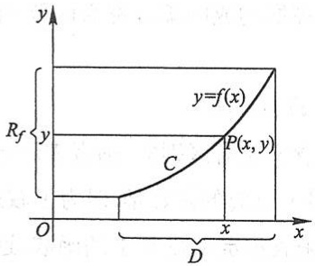

text_image

y
Rf
y=f(x)
C
P(x,y)
O
x
D
x

图1-1

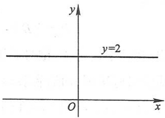

text_image

y
y=2
O
x

图1-2

4

---

第一节 映射与函数

例6 函数

$$
y = | x | = \left\{ \begin{array}{l l} - x, & x <   0, \\ x, & x \geqslant 0 \end{array} \right.
$$

的定义域  $D=(-\infty,+\infty)$ ，值域  $R_{f}=[0,+\infty)$ ，它的图形如图1-3所示。这个函数称为绝对值函数。

例7 函数

$$
y = \operatorname{sgn} x = \left\{ \begin{array}{l l} - 1, & x <   0, \\ 0, & x = 0, \\ 1, & x > 0 \end{array} \right.
$$

称为符号函数,它的定义域  $D=(-\infty,+\infty)$ , 值域  $R_{f}=\{-1,0,1\}$ , 它的图形如图1-4所示. 对于任何实数 x, 下列关系成立:

$$
x = \operatorname{sgn} x \cdot | x |.
$$

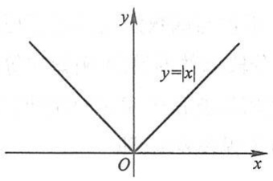

text_image

y
y=|x|
O
x

图1-3

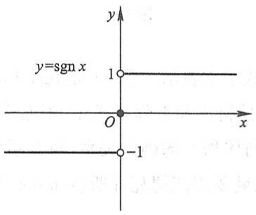

contour

| Point | X | Y |
| --- | --- | --- |
| Top | 0 | 1 |
| Bottom | -1 | -1 |

图1-4

例8 设 $x$ 为任一实数, 不超过 $x$ 的最大整数称为 $x$ 的整数部分, 记作 $[x]$. 例如, $\left[\frac{5}{7}\right] = 0, [\sqrt{2}] = 1, [\pi] = 3, [-1] = -1, [-3.5] = -4$. 把 $x$ 看作变量, 则函数

$$
y = [ x ]
$$

的定义域 $D = (-\infty, +\infty)$, 值域 $R_{f} = \mathbb{Z}$. 它的图形如图 1-5 所示, 这个图形称为阶梯曲线. 在 $x$ 为整数值处, 图形发生跳跃, 跃度为 1. 这个函数称为取整函数.

在例 6 和例 7 中看到,有时一个函数要用几个式子表示.这种在自变量的不同变化范围中,对应法则用不同式子来表示的函数,通常称为分段函数.

例9 函数

$$
y = f (x) = \left\{ \begin{array}{l l} 2 \sqrt {x}, & 0 \leqslant x \leqslant 1, \\ 1 + x, & x > 1 \end{array} \right.
$$

是一个分段函数. 它的定义域 $D = [0, +\infty)$. 当 $x \in [0, 1]$ 时, 对应的函数表达式 $f(x) = 2\sqrt{x}$; 当 $x \in (1, +\infty)$ 时, 对应的函数表达式 $f(x) = 1 + x$. 例如, $\frac{1}{2} \in [0, 1]$, 所以

5

---

第一章 函数与极限

$f\left(\frac{1}{2}\right) = 2\sqrt{\frac{1}{2}} = \sqrt{2}; 1 \in [0, 1]$, 所以 $f(1) = 2\sqrt{1} = 2; 3 \in (1, +\infty)$, 所以 $f(3) = 1 + 3 = 4$. 这个函数的图形如图1-6所示.

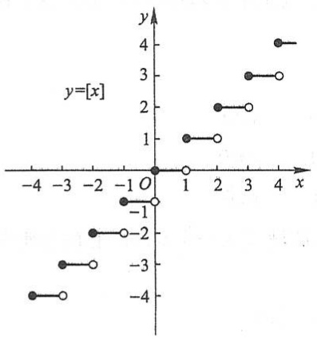

scatter

| X | Y (Solid Circle) | Y (Open Circle) |
| --- | --- | --- |
| -4 | -4 | — |
| -3 | -3 | -4 |
| -2 | -2 | -3 |
| 0 | 0 | -1 |
| 1 | 1 | 0 |
| 2 | 2 | 1 |
| 3 | 3 | 2 |
| 4 | 4 | 3 |

图1-5

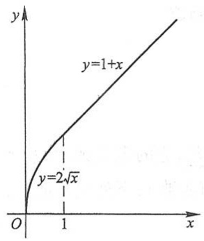

line

| X | Y |
| --- | --- |
| 0 | 0 |
| 1 | \(2\sqrt{x}\) |

图1-6

用几个式子来表示一个(不是几个!)函数,不仅与函数定义并无矛盾,而且有现实意义.在自然科学和工程技术中,经常会遇到分段函数的情形.例如在等温过程中,气体压强p与体积V的函数关系,当V不太小时依从玻意耳(Boyle)定律;当V相当小时,函数关系就要用范德瓦耳斯(vander Waals)方程来表示,即

$$
p = \left\{ \begin{array}{l l} \frac {\gamma}{V - \beta} - \frac {\alpha}{V ^ {2}}, & \beta <   V <   V _ {0}, \\ \frac {k}{V}, & V \geqslant V _ {0}, \end{array} \right.
$$

其中  $k,\alpha,\beta,\gamma$  都是常量.

## 2. 函数的几种特性

（1）函数的有界性 设函数 $f(x)$ 的定义域为 $D$ ，数集 $X \subset D$ .如果存在数 $K_{1}$ ，使得

$$
f (x) \leqslant K _ {1}
$$

对任一 $x \in X$ 都成立, 那么称函数 $f(x)$ 在 $X$ 上有上界, 而 $K_{1}$ 称为函数 $f(x)$ 在 $X$ 上的一个上界. 如果存在数 $K_{2}$, 使得

$$
f (x) \geqslant K _ {2}
$$

对任一 $x \in X$ 都成立, 那么称函数 $f(x)$ 在 $X$ 上有下界, 而 $K_{2}$ 称为函数 $f(x)$ 在 $X$ 上的一个下界. 如果存在正数 $M$, 使得

$$
\left| f (x) \right| \leqslant M
$$

对任一 $x \in X$ 都成立, 那么称函数 $f(x)$ 在 $X$ 上有界. 如果这样的 $M$ 不存在, 就称函数

6

---

第一节 映射与函数

$f(x)$ 在 $X$ 上无界; 这就是说, 如果对于任何正数 $M$, 总存在 $x_{1} \in X$, 使 $|f(x_{1})| > M$, 那么函数 $f(x)$ 在 $X$ 上无界.

例如,就函数 $f(x)=\sin x$ 在 $(-∞,+∞)$ 内来说,数1是它的一个上界,数-1是它的一个下界(当然,大于1的任何数也是它的上界,小于-1的任何数也是它的下界).又

$$
\left| \sin x \right| \leqslant 1
$$

对任一实数 $x$ 都成立，故函数 $f(x) = \sin x$ 在 $(- \infty, +\infty)$ 内是有界的，这里 $M = 1$ （当然也可取大于1的任何数作为 $M$ 而使 $|f(x)| \leqslant M$ 对任一实数 $x$ 都成立）.

又如函数 $f(x)=\frac{1}{x}$ 在开区间(0,1)内没有上界,但有下界,例如1就是它的一个下界.函数 $f(x)=\frac{1}{x}$ 在开区间(0,1)内是无界的,因为不存在这样的正数M,使 $\left|\frac{1}{x}\right|\leqslant M$ 对于(0,1)内的一切x都成立.但是 $f(x)=\frac{1}{x}$ 在区间(1,2)内是有界的,例如可取M=1而使 $\left|\frac{1}{x}\right|\leqslant1$ 对于一切 $x\in(1,2)$ 都成立.

容易证明, 函数  $f(x)$  在 X 上有界的充分必要条件是它在 X 上既有上界又有下界.

（2）函数的单调性 设函数  $y=f(x)$  的定义域为 D，区间  $I \subset D$ 。如果对于区间 I 上任意两点  $x_{1}$  及  $x_{2}$ ，当  $x_{1} < x_{2}$  时，恒有

$$
f (x _ {1}) <   f (x _ {2}),
$$

那么称函数  $y=f(x)$  在区间 I 上是单调增加的（图 1-7）；如果对于区间 I 上任意两点  $x_{1}$  及  $x_{2}$ ，当  $x_{1}<x_{2}$  时，恒有

$$
f (x _ {1}) > f (x _ {2}),
$$

那么称函数  $y=f(x)$  在区间 I 上是单调减少的(图 1-8). 单调增加和单调减少的函数统称为单调函数.

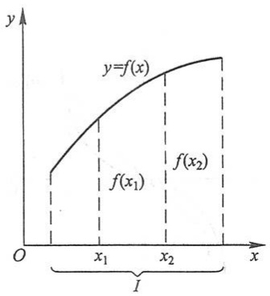

area

| Point | X-coordinate | Y-coordinate |
| --- | --- | --- |
| f(x1) | x1 | ~f(x1) |
| f(x2) | x2 | ~f(x2) |

图1-7

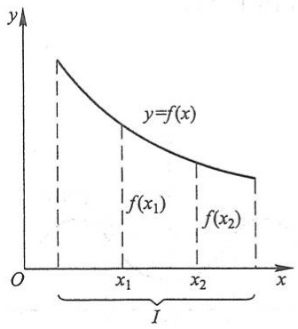

area

| X | Y |
| --- | --- |
| 0 | ~High |
| x1 | ~Medium |
| x2 | ~Low |

图1-8

7

---

第一章 函数与极限

例如, 函数  $y=x^{2}$  在区间  $[0,+\infty)$  上是单调增加的, 在区间  $(-∞,0]$  上是单调减少的; 在区间  $(-∞,+∞)$  内函数  $y=x^{2}$  不是单调的(图 1-9).

又例如, 函数  $y=x^{3}$  在区间  $(-∞,+∞)$  内是单调增加的 (图 1-10).

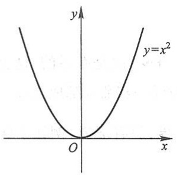

text_image

y
y=x²
O
x

图1-9

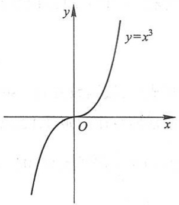

text_image

y
y=x³
O
x

图1-10

（3）函数的奇偶性 设函数 $f(x)$ 的定义域 $D$ 关于原点对称.如果对于任一 $x\in D$

$$
f (- x) = f (x)
$$

恒成立,那么称 $f(x)$ 为偶函数.如果对于任一 $x\in D$ ,

$$
f (- x) = - f (x)
$$

恒成立,那么称 $f(x)$ 为奇函数.

例如， $f(x)=x^{2}$ 是偶函数，因为 $f(-x)=(-x)^{2}=x^{2}=f(x)$ 。又例如， $f(x)=x^{3}$ 是奇函数，因为 $f(-x)=(-x)^{3}=-x^{3}=-f(x)$ 。

偶函数的图形关于 $y$ 轴是对称的. 因为若 $y = f(x)$ 是偶函数, 则 $f(-x) = f(x)$, 所以如果 $A(x, f(x))$ 是图形上的点, 那么它关于 $y$ 轴对称的点 $A'(-x, f(x))$ 也在图形上 (图1-11).

奇函数的图形关于原点是对称的. 因为若 $y = f(x)$ 是奇函数, 则 $f(-x) = -f(x)$, 所以如果 $A(x, f(x))$ 是图形上的点, 那么它关于原点对称的点 $A''(-x, -f(x))$ 也在图形上 (图 1-12).

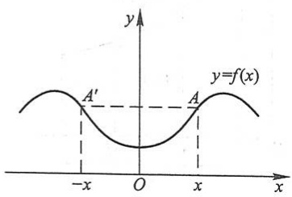

contour

| Point | x-coordinate | y-coordinate |
| --- | --- | --- |
| A' | -x | A' |
| O | 0 | Minimum |
| A | x | A |

图1-11

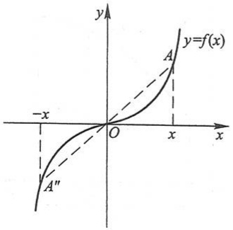

text_image

y
y=f(x)
A
-x
O
x
x
A''
A

图1-12

8

---

第一节 映射与函数

函数 $y = \sin x$ 是奇函数. 函数 $y = \cos x$ 是偶函数. 函数 $y = \sin x + \cos x$ 既非奇函数, 也非偶函数.

（4）函数的周期性 设函数 $f(x)$ 的定义域为 $D$. 如果存在一个正数 $l$, 使得对于任一 $x \in D$ 有 $(x \pm l) \in D$, 且

$$
f (x + l) = f (x)
$$

恒成立,那么称 $f(x)$ 为周期函数,l称为 $f(x)$ 的周期,通常我们说周期函数的周期是指最小正周期.

例如, 函数  $y = \sin x, y = \cos x$  都是以  $2\pi$  为周期的周期函数; 函数  $y = \tan x$  是以  $\pi$  为周期的周期函数.

图 1-13 表示周期为 l 的一个周期函数. 在每个长度为 l 的区间上, 函数图形有相同的形状.

并非每个周期函数都有最小正周期.下面的函数就属于这种情形:

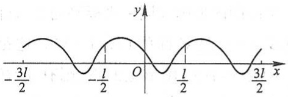

contour

| X | Y |
| --- | --- |
| -3l/2 | ~0.5 |
| -1/2 | ~0.5 |
| 1/2 | ~0.5 |
| 3l/2 | ~0.5 |

图1-13

例 10 狄利克雷(Dirichlet)函数

$$
D (x) = \left\{ \begin{array}{l l} 1, & x \in \mathbb {Q}, \\ 0, & x \in \mathbb {Q} ^ {c}. \end{array} \right.
$$

容易验证这是一个周期函数,任何正有理数 r 都是它的周期.因为不存在最小的正有理数,所以它没有最小正周期.

## 3. 反函数与复合函数

作为逆映射的特例,我们有以下反函数的概念:

设函数 $f: D \to f(D)$ 是单射, 则它存在逆映射 $f^{-1}: f(D) \to D$, 称此映射 $f^{-1}$ 为函数 $f$ 的反函数.

按此定义,对每个  $y \in f(D)$ ,有唯一的  $x \in D$ ,使得  $f(x) = y$ ,于是有

$$
f ^ {- 1} (y) = x.
$$

这就是说,反函数 $f^{-1}$ 的对应法则是完全由函数f的对应法则所确定的.

例如, 函数 $y = x^3$, $x \in \mathbb{R}$ 是单射, 所以它的反函数存在, 其反函数为 $x = y^{\frac{1}{3}}$, $y \in \mathbb{R}$.

由于习惯上自变量用 x 表示, 因变量用 y 表示, 于是  $y = x^{3}, x \in R$  的反函数通常写作  $y = x^{\frac{1}{3}}, x \in R$ .

一般地， $y = f(x),x\in D$ 的反函数记成 $y = f^{-1}(x),x\in f(D)$

若 $f$ 是定义在 $D$ 上的单调函数, 则 $f: D \to f(D)$ 是单射, 于是 $f$ 的反函数 $f^{-1}$ 必定存在, 而且容易证明 $f^{-1}$ 也是 $f(D)$ 上的单调函数. 事实上, 不妨设 $f$ 在 $D$ 上单调增加, 现在

9

---

第一章 函数与极限

图

释疑解难

1-1

来证明 $f^{-1}$ 在 $f(D)$ 上也是单调增加的.

任取 $y_{1}, y_{2} \in f(D)$, 且 $y_{1} < y_{2}$. 按函数 $f$ 的定义, 对 $y_{1}$, 在 $D$ 内存在唯一的原像 $x_{1}$, 使得 $f(x_{1}) = y_{1}$, 于是 $f^{-1}(y_{1}) = x_{1}$; 对 $y_{2}$, 在 $D$ 内存在唯一的原像 $x_{2}$, 使得 $f(x_{2}) = y_{2}$, 于是 $f^{-1}(y_{2}) = x_{2}$.

如果 $x_{1} > x_{2}$, 则由 $f(x)$ 单调增加, 必有 $y_{1} > y_{2}$; 如果 $x_{1} = x_{2}$, 则显然有 $y_{1} = y_{2}$. 这两种情形都与假设 $y_{1} < y_{2}$ 不符, 故必有 $x_{1} < x_{2}$, 即 $f^{-1}(y_{1}) < f^{-1}(y_{2})$. 这就证明了 $f^{-1}$ 在 $f(D)$ 上是单调增加的.

相对于反函数 $y = f^{-1}(x)$ 来说, 原来的函数 $y = f(x)$ 称为直接函数. 把直接函数 $y = f(x)$ 和它的反函数 $y = f^{-1}(x)$ 的图形画在同一坐标平面上, 这两个图形关于直线 $y = x$ 是对称的 (图 1-14). 这是因为如果 $P(a, b)$ 是 $y = f(x)$ 图形上的点, 则有 $b = f(a)$. 按反函数的定义, 有 $a = f^{-1}(b)$, 故 $Q(b, a)$ 是 $y = f^{-1}(x)$ 图形上的点; 反之, 若 $Q(b, a)$ 是 $y = f^{-1}(x)$ 图形上的点, 则 $P(a, b)$ 是 $y = f(x)$ 图形上的点. 而 $P(a, b)$ 与 $Q(b, a)$ 是关于直线 $y = x$ 对称的.

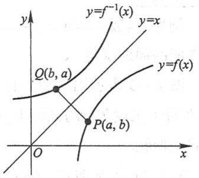

text_image

y
y=f⁻¹(x)
y=x
Q(b, a)
P(a, b)
O
x

图1-14

复合函数是复合映射的一种特例,按照通常函数的记号,复合函数的概念可如下表述:

设函数 $y = f(u)$ 的定义域为 $D_{f}$，函数 $u = g(x)$ 的定义域为 $D_{g}$，且其值域 $R_{g} \subset D_{f}$，则由下式确定的函数

$$
y = f \left[ g (x) \right], \quad x \in D _ {g}
$$

称为由函数  $u=g(x)$  与函数  $y=f(u)$  构成的复合函数, 它的定义域为  $D_{g}$ , 变量 u 称为中间变量.

函数 $g$ 与函数 $f$ 构成的复合函数, 即按“先 $g$ 后 $f$”的次序复合的函数, 通常记为 $f \circ g$, 即

$$
(f \circ g) (x) = f [ g (x) ].
$$

与复合映射一样，$g$ 与 $f$ 能构成复合函数 $f \circ g$ 的条件是:函数 $g$ 的值域 $R_g$ 必须包含于函数 $f$ 的定义域 $D_f$，即 $R_g \subset D_f$。否则，不能构成复合函数。例如，$y = f(u) = \arcsin u$ 的定义域为 $[-1, 1]$，$u = g(x) = \sin x$ 的定义域为 $\mathbf{R}$，且 $g(\mathbf{R}) \subset [-1, 1]$，故 $g$ 与 $f$ 可构成复合函数

$$
y = \arcsin \sin x, \quad x \in \mathbb {R};
$$

又如， $y=f(u)=\sqrt{u}$ 的定义域为 $D_{f}=\left[0,+\infty\right)$ ， $u=g(x)=\tan x$ 的值域为 $R_{g}=(-\infty,+\infty)$ ，显然 $R_{g}\not\subset D_{f}$ ，故g与f不能构成复合函数。但是，如果将函数g限制在它的定义

10

---

第一节 映射与函数

域的一个子集 $D = \left\{x \mid k\pi \leqslant x < \left(k + \frac{1}{2}\right)\pi, k \in \mathbb{Z}\right\}$ 上，令 $g^{*}(x) = \tan x, x \in D$ ，那么 $R_{g^{*}} = g^{*}(D) \subset D_{f}, g^{*}$ 与 $f$ 就可以构成复合函数

$$
(f \circ g ^ {*}) (x) = \sqrt {\tan x}, \quad x \in D.
$$

习惯上为了简便起见, 仍称函数 $\sqrt{\tan x}$ 是由函数 $u = \tan x$ 与函数 $y = \sqrt{u}$ 构成的复合函数. 这里函数 $u = \tan x$ 应理解成: $u = \tan x, x \in D$. 以后, 我们采取这种习惯说法. 例如, 我们称函数 $u = x + 1$ 与函数 $y = \ln u$ 构成复合函数 $\ln (x + 1)$, 它的定义域不是 $u = x + 1$ 的自然定义域 $\mathbf{R}$, 而是 $\mathbf{R}$ 的一个子集 $D = (-1, +\infty)$.

有时,也会遇到两个以上函数所构成的复合函数,只要它们顺次满足构成复合函数的条件.例如,函数  $y=\sqrt{u}$ ,  $u=\cot v$ ,  $v=\frac{x}{2}$  可构成复合函数  $y=\sqrt{\cot\frac{x}{2}}$ , 这里 u 及 v 都是中间变量,复合函数的定义域是  $D=\{x \mid 2k\pi < x \leqslant (2k+1)\pi, k \in \mathbb{Z}\}$ , 而不是  $v=\frac{x}{2}$  的自然定义域 R, D 是 R 的一个非空子集.

## 4. 函数的运算

设函数 $f(x), g(x)$ 的定义域依次为 $D_f, D_g, D = D_f \cap D_g \neq \emptyset$，则我们可以定义这两个函数的下列运算:

和(差) $f\pm g$ :  $(f\pm g)(x)=f(x)\pm g(x),x\in D;$

积 $f \cdot g: \quad (f \cdot g)(x) = f(x) \cdot g(x), x \in D;$

商 $\frac{f}{g}$: $\left(\frac{f}{g}\right)(x) = \frac{f(x)}{g(x)}, x \in D \setminus \{x \mid g(x) = 0, x \in D\}$.

例 11 设函数  $f(x)$  的定义域为  $(-l, l)$ ，证明必存在  $(-l, l)$  上的偶函数  $g(x)$  及奇函数  $h(x)$ ，使得

$$
f (x) = g (x) + h (x).
$$

证 先分析如下:假若这样的  $g(x)$ ,  $h(x)$  存在,使得

$$
f (x) = g (x) + h (x), \tag {1-1}
$$

且

$$
g (- x) = g (x), \quad h (- x) = - h (x).
$$

于是有

$$
f (- x) = g (- x) + h (- x) = g (x) - h (x). \tag {1-2}
$$

利用(1-1)、(1-2)式,就可作出 $g(x),h(x)$ .这就启发我们作如下证明:

作

11

---

第一章 函数与极限

$$
g (x) = \frac {1}{2} [ f (x) + f (- x) ], \quad h (x) = \frac {1}{2} [ f (x) - f (- x) ].
$$

则

$$
\begin{array}{l} g (x) + h (x) = f (x), \\ g (- x) = \frac {1}{2} [ f (- x) + f (x) ] = g (x), \\ h (- x) = \frac {1}{2} [ f (- x) - f (x) ] = - h (x). \\ \end{array}
$$

证毕.

## 5. 初等函数

在初等数学中已经讲过下面几类函数:

幂函数:  $y = x^{\mu}$  ( $\mu \in R$  是常数),

指数函数: $y=a^{x}$ （a>0 且 $a\neq1$ ），

对数函数: $y=\log_{a}x$  (a>0 且  $a\neq1$ , 特别当  $a=e^{①}$  时, 记为  $y=\ln x$ ),

三角函数: 如  $y = \sin x, y = \cos x, y = \tan x$  等,

反三角函数: 如  $y = \arcsin x, y = \arccos x, y = \arctan x$  等.

以上这五类函数统称为基本初等函数.

由常数和基本初等函数经过有限次的四则运算和有限次的函数复合步骤所构成并可用一个式子表示的函数,称为初等函数.例如

$$
y = \sqrt {1 - x ^ {2}}, \quad y = \sin^ {2} x, \quad y = \sqrt {\cot \frac {x}{2}}
$$

等都是初等函数.本课程中所讨论的函数绝大多数都是初等函数.

应用上常遇到以 e 为底的指数函数  $y=e^{x}$  和  $y=e^{-x}$  所产生的双曲函数以及它们的反函数——反双曲函数. 它们的定义如下:

双曲正弦 sh  $x=\frac{e^{x}-e^{-x}}{2}$ ,

双曲余弦 ch  $x=\frac{e^{x}+e^{-x}}{2}$ ,

双曲正切 th  $x=\frac{\operatorname{sh}x}{\operatorname{ch}x}=\frac{\mathrm{e}^{x}-\mathrm{e}^{-x}}{\mathrm{e}^{x}+\mathrm{e}^{-x}}$ .

这三个双曲函数的简单性态如下:

双曲正弦的定义域为 $(- \infty, +\infty)$，它是奇函数，它的图形通过原点且关于原点对

<small>① e 是一个无理数, 这个数的意义见本章第六节.</small>

12

---

第一节 映射与函数

称.在区间 $(-∞,+∞)$ 内它是单调增加的.当x的绝对值很大时,它的图形在第一象限内接近于曲线 $y=\frac{1}{2}e^{x}$ ,在第三象限内接近于曲线 $y=-\frac{1}{2}e^{-x}$ （图1-15）.

双曲余弦的定义域为 $(-∞,+∞)$ ，它是偶函数，它的图形通过点(0,1)且关于y轴对称。在区间 $(-∞,0)$ 内它是单调减少的，在区间 $(0,+∞)$ 内它是单调增加的。ch 0=1 是这个函数的最小值。当x的绝对值很大时，它的图形在第一象限内接近于曲线 $y=\frac{1}{2}e^{x}$ ，在第二象限内接近于曲线 $y=\frac{1}{2}e^{-x}$ （图1-15）。

双曲正切的定义域为 $(-∞,+∞)$ ，它是奇函数，它的图形通过原点且关于原点对称。在区间 $(-∞,+∞)$ 内它是单调增加的。它的图形夹在水平直线y=1及y=-1之间，且当x的绝对值很大时，它的图形在第一象限内接近于直线y=1，而在第三象限内接近于直线y=-1（图1-16）。

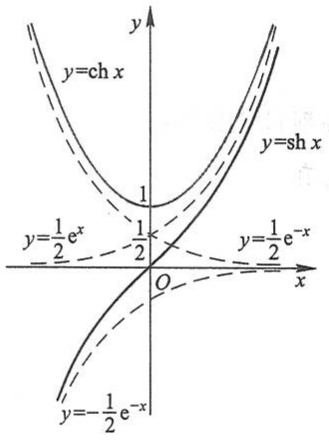

text_image

y=ch x
y=sh x
y=\frac{1}{2}e^x
\frac{1}{2}
O
y=\frac{1}{2}e^{-x}
x
y=-\frac{1}{2}e^{-x}

图1-15

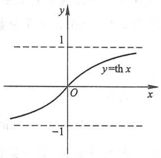

contour

| X | Y |
| --- | --- |
| -1 | ~-0.8 |
| 0 | 0 |
| 1 | ~0.8 |

图1-16

根据双曲函数的定义,可证下列四个公式:

$$
\mathrm{sh} (x + y) = \mathrm{sh} x \mathrm{ch} y + \mathrm{ch} x \mathrm{sh} y, \tag {1-3}
$$

$$
\mathrm{sh} (x - y) = \mathrm{sh} x \mathrm{ch} y - \mathrm{ch} x \mathrm{sh} y, \tag {1-4}
$$

$$
\mathrm{ch} (x + y) = \mathrm{ch} x \mathrm{ch} y + \mathrm{sh} x \mathrm{sh} y, \tag {1-5}
$$

$$
\mathrm{ch} (x - y) = \mathrm{ch} x \mathrm{ch} y - \mathrm{sh} x \mathrm{sh} y. \tag {1-6}
$$

我们来证明公式(1-3)，其他三个公式读者可自行证明.由定义，得

$$
\begin{array}{l} \mathrm{sh} x \mathrm{ch} y + \mathrm{ch} x \mathrm{sh} y = \frac {\mathrm{e} ^ {x} - \mathrm{e} ^ {- x}}{2} \cdot \frac {\mathrm{e} ^ {y} + \mathrm{e} ^ {- y}}{2} + \frac {\mathrm{e} ^ {x} + \mathrm{e} ^ {- x}}{2} \cdot \frac {\mathrm{e} ^ {y} - \mathrm{e} ^ {- y}}{2} \\ = \frac {\mathrm{e} ^ {x + y} - \mathrm{e} ^ {y - x} + \mathrm{e} ^ {x - y} - \mathrm{e} ^ {- (x + y)}}{4} + \frac {\mathrm{e} ^ {x + y} + \mathrm{e} ^ {y - x} - \mathrm{e} ^ {x - y} - \mathrm{e} ^ {- (x + y)}}{4} \\ = \frac {\mathrm{e} ^ {x + y} - \mathrm{e} ^ {- (x + y)}}{2} = \mathrm{sh} (x + y). \\ \end{array}
$$

13

---

第一章 函数与极限

由以上几个公式可以导出其他一些公式,例如:

在公式(1-6)中令 $x = y$ ，并注意到 $\mathrm{ch}0 = 1$ ，得

$$
\mathrm{ch} ^ {2} x - \mathrm{sh} ^ {2} x = 1; \tag {1-7}
$$

在公式(1-3)中令x=y,得

$$
\mathrm{sh} 2 x = 2 \mathrm{sh} x \mathrm{ch} x; \tag {1-8}
$$

在公式(1-5)中令x=y,得

$$
\mathrm{ch} 2 x = \mathrm{ch} ^ {2} x + \mathrm{sh} ^ {2} x. \tag {1-9}
$$

以上关于双曲函数的公式(1-3)至(1-9)与三角函数的有关公式相类似,把它们对比可帮助记忆.

双曲函数 $y = \operatorname{sh} x, y = \operatorname{ch} x (x \geqslant 0), y = \operatorname{th} x$ 的反函数依次记为

反双曲正弦  $y=\operatorname{arsh} x,$

反双曲余弦 y=arch x,

反双曲正切 y=arth x,

这些反双曲函数都可通过自然对数函数来表示,分别讨论如下:

先讨论双曲正弦 $y = \mathrm{sh}x$ 的反函数. 由 $x = \mathrm{sh}y$, 有

$$
x = \frac {e ^ {y} - e ^ {- y}}{2}.
$$

令 $u = \mathrm{e}^{y}$ ，则由上式有

$$
u ^ {2} - 2 x u - 1 = 0.
$$

这是关于 u 的一个二次方程, 它的根为

$$
u = x \pm \sqrt {x ^ {2} + 1}.
$$

因 $u = \mathrm{e}^{\gamma} > 0$ ，故上式根号前应取正号，于是

$$
u = x + \sqrt {x ^ {2} + 1}.
$$

由于  $y=\ln u$ ，故得反双曲正弦

$$
y = \operatorname{arsh} x = \ln (x + \sqrt {x ^ {2} + 1}).
$$

函数 $y = \operatorname{arsh} x$ 的定义域为 $(-\infty, +\infty)$，它是奇函数，在区间 $(-\infty, +\infty)$ 内单调增加。由 $y = \operatorname{sh} x$ 的图形，根据反函数的作图法，可得 $y = \operatorname{arsh} x$ 的图形如图1-17所示。

下面讨论双曲余弦 $y = \operatorname{ch} x (x \geqslant 0)$ 的反函数. 由 $x = \operatorname{ch} y (y \geqslant 0)$, 有

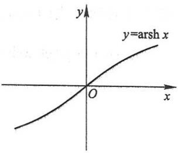

text_image

y
y=arsh x
O
x

图1-17

14

---

第一节 映射与函数

$$
x = \frac {\mathrm{e} ^ {y} + \mathrm{e} ^ {- y}}{2}, \quad y \geqslant 0.
$$

由此得  $e^{y}=x\pm\sqrt{x^{2}-1}$ ，故

$$
y = \ln (x \pm \sqrt {x ^ {2} - 1}).
$$

上式中 $x$ 的值必须满足条件 $x \geqslant 1$，而其中平方根前的符号由于 $y \geqslant 0$ 应取正。故

$$
y = \ln (x + \sqrt {x ^ {2} - 1}).
$$

上述双曲余弦 $y = \operatorname{ch} x (x \geqslant 0)$ 的反函数称为反双曲余弦的主值，记作 $y = \operatorname{arch} x$，即

$$
y = \operatorname{arch} x = \ln (x + \sqrt {x ^ {2} - 1}).
$$

这样规定的函数 $y = \operatorname{arch} x$ 的定义域为 $[1, +\infty)$，它在区间 $[1, +\infty)$ 上是单调增加的（图1-18）.

类似地,可得反双曲正切

$$
y = \operatorname{arth} x = \frac {1}{2} \ln \frac {1 + x}{1 - x}.
$$

这个函数的定义域为开区间 $(-1,1)$，它在开区间 $(-1,1)$ 内是单调增加的奇函数。它的图形关于原点对称（图1-19）。

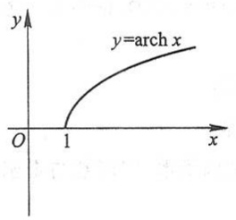

text_image

y
y=arch x
O 1 x

图1-18

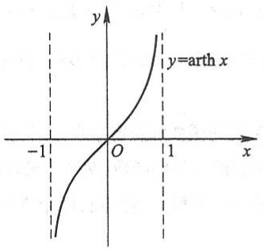

contour

| X | Y |
| --- | --- |
| -1 | ~-2.5 |
| 0 | 0 |
| 1 | ~2.5 |

图1-19

## 习题1-1

1. 求下列函数的自然定义域:

(1) $y = \sqrt{3x + 2}$;

(2) $y = \frac{1}{1 - x^2}$;

(3) $y = \frac{1}{x} - \sqrt{1 - x^2}$;

(4) $y = \frac{1}{\sqrt{4 - x^2}}$;

(5) $y = \sin \sqrt{x}$;

(6) $y = \tan (x + 1)$;

(7) $y = \arcsin (x - 3)$;

(8)  $y = \sqrt{3 - x} + \arctan \frac{1}{x};$

(9) $y = \ln (x + 1)$;

15

---

第一章 函数与极限

(10) $y=e^{\frac{1}{x}}$.

2. 下列各题中, 函数 $f(x)$ 和 $g(x)$ 是否相同? 为什么?

(1) $f(x) = \lg x^2$, $g(x) = 2\lg x$;

(2) $f(x) = x, g(x) = \sqrt{x^2}$;

(3) $f(x) = \sqrt[3]{x^4 - x^3}, g(x) = x\sqrt[3]{x - 1};$

(4) $f(x) = 1$, $g(x) = \sec^2 x - \tan^2 x$.

3. 设

$$
\varphi (x) = \left\{ \begin{array}{c c} | \sin x |, & | x | <   \frac {\pi}{3}, \\ 0, & | x | \geqslant \frac {\pi}{3}, \end{array} \right.
$$

求 $\varphi \left(\frac{\pi}{6}\right),\varphi \left(\frac{\pi}{4}\right),\varphi \left(-\frac{\pi}{4}\right),\varphi (-2)$ ，并作出函数 $y = \varphi (x)$ 的图形

4. 讨论下列函数的有界性:

(1) $f(x)=\frac{x}{1+x^{2}}$;

(2) $f(x) = \frac{1 + x^2}{1 + x^4}$.

5. 试证下列函数在指定区间内的单调性:

(1)  $y=\frac{x}{1-x},(-\infty,1)$ ;

(2) $y = x + \ln x, (0, +\infty)$.

6. 讨论下列函数的单调性:

(1) $f(x)=ax^{2}+bx+c$ , 其中  $a, b, c \in R, a \neq 0;$  (2) $f(x)=\frac{ax+b}{cx+d}$ , 其中  $a, b, c, d \in R, c > 0.$

7. 设 $f(x)$ 为定义在 $(-l, l)$ 内的奇函数, 若 $f(x)$ 在 $(0, l)$ 内单调增加, 证明 $f(x)$ 在 $(-l, 0)$ 内也单调增加.

8. 设下面所考虑的函数都是定义在区间 $(-l, l)$ 上的. 证明:

(1) 两个偶函数的和是偶函数,两个奇函数的和是奇函数;

(2) 两个偶函数的乘积是偶函数, 两个奇函数的乘积是偶函数, 偶函数与奇函数的乘积是奇函数.

9. 下列函数中哪些是偶函数, 哪些是奇函数, 哪些既非偶函数又非奇函数?

(1) $y = x^{2}(1 - x^{2})$;

(2) $y = 3x^{2} - x^{3}$;

(3) $y = \frac{1 - x^2}{1 + x^2}$;

(4)  $y = x(x - 1)(x + 1)$ ;

(5) $y = \sin x - \cos x + 1$;

(6) $y = \frac{a^x + a^{-x}}{2} (a > 0, a \neq 1)$.

10. 下列各函数中哪些是周期函数？对于周期函数，指出其周期:

(1) $y = \cos (x - 2)$;

(2) $y = \cos 4x$;

(3)  $y=1+\sin\pi x;$

(4)  $y = x \cos x;$

(5) $y = \sin^2 x.$

11. 求下列函数的反函数:

(1) $y = \sqrt[3]{x + 1}$;

(2) $y = \frac{1 - x}{1 + x}$;

(3) $y = \frac{ax + b}{cx + d} (ad - bc \neq 0)$;

(4) $y = 2\sin 3x \left( -\frac{\pi}{6} \leqslant x \leqslant \frac{\pi}{6} \right)$;

(5) $y = 1 + \ln (x + 2)$;

(6) $y = \frac{2^x}{2^x + 1}$.

16

---

第一节 映射与函数

12. 在下列各题中, 求由所给函数构成的复合函数, 并求该函数分别对应于给定自变量值  $x_{1}$  和  $x_{2}$  的函数值:

(1) $y = u^2, u = \sin x, x_1 = \frac{\pi}{6}, x_2 = \frac{\pi}{3}$;
(2) $y = \sin u, u = 2x, x_1 = \frac{\pi}{8}, x_2 = \frac{\pi}{4}$;
(3) $y = \sqrt{u}, u = 1 + x^2, x_1 = 1, x_2 = 2;$
(4) $y = \mathrm{e}^{u}, u = x^{2}, x_{1} = 0, x_{2} = 1;$
(5) $y=u^{2},u=e^{x},x_{1}=1,x_{2}=-1.$

13. 设 $f(x)$ 的定义域 $D = [0,1]$，求下列各函数的定义域:

(1) $f(x^{2})$;
(2) $f(\sin x)$;
(3) $f(x+a)$  (a>0);
(4) $f(x+a)+f(x-a)\quad(a>0)$.

14. 设

$$
f (x) = \left\{ \begin{array}{l l} 1, & | x | <   1, \\ 0, & | x | = 1, \quad g (x) = \mathrm{e} ^ {x}, \\ - 1, & | x | > 1, \end{array} \right.
$$

求 $f[g(x)]$ 和 $g[f(x)]$ ，并作出这两个函数的图形

15. 已知水渠的横断面为等腰梯形, 斜角  $\varphi = 40^{\circ}$  (图 1-20). 当过水断面 ABCD 的面积为定值  $S_{0}$  时, 求湿周 L ( $L = AB + BC + CD$ ) 与水深 h 之间的函数关系式, 并指明其定义域.

text_image

A
D
h
φ=40°
B C

图1-20

16. 设 $xOy$ 平面上有正方形 $D = \{(x, y) \mid 0 \leqslant x \leqslant 1, 0 \leqslant y \leqslant 1\}$ 及直线 $l: x + y = t (t \geqslant 0)$. 若 $S(t)$ 表示正方形 $D$ 位于直线 $l$ 左下方部分的面积, 试求 $S(t)$ 与 $t$ 之间的函数关系.
17. 求联系华氏温度(用 F 表示)和摄氏温度(用 C 表示)的转换公式,并求

(1) 90 °F 的等价摄氏温度和 -5 °C 的等价华氏温度；
（2）是否存在一个温度值，使华氏温度计和摄氏温度计的读数是一样的？如果存在，那么该温度值是多少？
18. 已知 Rt△ABC 中, 直角边 AC, BC 的长度分别为 20, 15, 动点 P 从 C 出发, 沿三角形边界按  $C \rightarrow B \rightarrow A$  方向移动; 动点 Q 从 C 出发, 沿三角形边界按  $C \rightarrow A \rightarrow B$  方向移动, 移动到两动点相遇时为止, 且点 Q 移动的速度是点 P 移动的速度的 2 倍. 设动点 P 移动的距离为 x, △CPQ 的面积为 y, 试求 y 与 x 之间的函数关系.

17

---

第一章 函数与极限

## 第二节 数列的极限

## 一、数列极限的定义

极限概念是在探求某些实际问题的精确解答过程中产生的.例如,我国古代数学家刘徽(公元3世纪)提出割圆术用于计算圆的周长、面积以及圆周率.割圆术的方法就是利用圆的内接正六边形边数逐次加倍去逐步逼近圆.刘徽说:“割之弥细,所失弥少.割之又割,以至于不可割,则与圆周合体而无所失矣”,这是我国古代数学家朴素的极限思想在几何学上的应用.

设有一圆, 首先作内接正六边形, 把它的面积记为 $A_{1}$; 再作内接正十二边形, 其面积记为 $A_{2}$; 再作内接正二十四边形, 其面积记为 $A_{3}$; 如此下去, 每次边数加倍, 一般地, 把内接正 $6 \times 2^{n-1}$ 边形的面积记为 $A_{n} (n \in \mathbb{N}_{+})$. 这样, 就得到一系列内接正多边形的面积

$$
A _ {1}, A _ {2}, A _ {3}, \dots , A _ {n}, \dots ,
$$

它们构成一列有次序的数. 当 $n$ 越大, 内接正多边形与圆的差别就越小, 从而以 $A_{n}$ 作为圆面积的近似值也越精确. 但是无论 $n$ 取得如何大, 只要 $n$ 取定了, $A_{n}$ 终究只是多边形的面积, 而还不是圆的面积. 因此, 设想 $n$ 无限增大 (记为 $n \to \infty$, 读作 $n$ 趋于无穷大), 即内接正多边形的边数无限增加, 在这个过程中, 内接正多边形无限接近于圆, 同时 $A_{n}$ 也无限接近于某一确定的数值, 这个确定的数值就理解为圆的面积. 这个确定的数值在数学上称为上面这列有次序的数 (所谓数列) $A_{1}, A_{2}, A_{3}, \cdots, A_{n}, \cdots$ 当 $n \to \infty$ 时的极限. 在圆面积问题中我们看到, 正是这个数列的极限才精确地表达了圆的面积.

在解决实际问题中逐渐形成的这种极限方法,已成为高等数学中的一种基本方法,因此有必要作进一步的阐明.

先说明数列的概念. 如果按照某一法则, 对每个 $n \in \mathbf{N}_{+}$, 对应着一个确定的实数 $x_{n}$, 这些实数 $x_{n}$ 按照下标 $n$ 从小到大排列得到的一个序列

$$
x _ {1}, x _ {2}, x _ {3}, \dots , x _ {n}, \dots ,
$$

就叫做数列,简记为数列 $\{x_{n}\}$ .

数列中的每一个数叫做数列的项, 第 $n$ 项 $x_{n}$ 叫做数列的一般项 (或通项). 例如:

$$
\frac {1}{2}, \frac {2}{3}, \frac {3}{4}, \dots , \frac {n}{n + 1}, \dots ;
$$

$$
2, 4, 8, \dots , 2 ^ {n}, \dots ;
$$

18

---

第二节 数列的极限

$$
\begin{array}{l} \frac {1}{2}, \frac {1}{4}, \frac {1}{8}, \dots , \frac {1}{2 ^ {n}}, \dots ; \\ 1, - 1, 1, \dots , (- 1) ^ {n + 1}, \dots ; \\ 2, \frac {1}{2}, \frac {4}{3}, \dots , \frac {n + (- 1) ^ {n - 1}}{n}, \dots \\ \end{array}
$$

都是数列的例子,它们的一般项依次为

$$
\frac {n}{n + 1}, \quad 2 ^ {n}, \quad \frac {1}{2 ^ {n}}, \quad (- 1) ^ {n + 1}, \quad \frac {n + (- 1) ^ {n - 1}}{n}.
$$

在几何上, 数列  $\{x_{n}\}$  可看作数轴上的一个动点, 它依次取数轴上的点  $x_{1}, x_{2}, x_{3}, \cdots, x_{n}, \cdots$  (图1-21).

图1-21

数列 $\{x_{n}\}$ 可看作自变量为正整数 $n$ 的函数

$$
x _ {n} = f (n), \quad n \in \mathbb {N} _ {+}.
$$

当自变量 n 依次取 1,2,3,…一切正整数时,对应的函数值就排列成数列  $\{x_{n}\}$ .

对于我们要讨论的问题来说,重要的是:当 n 无限增大时(即  $n \to \infty$  时),对应的  $x_{n} = f(n)$  是否能无限接近于某个确定的数值?如果能够的话,这个数值等于多少?

我们对数列

$$
2, \frac {1}{2}, \frac {4}{3}, \dots , \frac {n + (- 1) ^ {n - 1}}{n}, \dots \tag {2-1}
$$

进行分析.在这数列中，

$$
x _ {n} = \frac {n + (- 1) ^ {n - 1}}{n} = 1 + (- 1) ^ {n - 1} \frac {1}{n}.
$$

我们知道,两个数 a 与 b 之间的接近程度可以用这两个数之差的绝对值  $\left|b-a\right|$  来度量(在数轴上  $\left|b-a\right|$  表示点 a 与点 b 之间的距离),  $\left|b-a\right|$  越小,a 与 b 就越接近.

就数列(2-1)来说,因为

$$
\mid x _ {n} - 1 \mid = \left| (- 1) ^ {n - 1} \frac {1}{n} \right| = \frac {1}{n},
$$

由此可见, 当 $n$ 越来越大时, $\frac{1}{n}$ 越来越小, 从而 $x_{n}$ 就越来越接近于 1. 因为只要 $n$ 足够大, $|x_{n}-1|$ 即 $\frac{1}{n}$ 可以小于任意给定的正数, 所以说, 当 $n$ 无限增大时, $x_{n}$ 无限接近于 1. 例如, 给定 $\frac{1}{100}$, 欲使 $\frac{1}{n}<\frac{1}{100}$, 只要 $n>100$, 即从第 101 项起, 都能使不等式

$$
\mid x _ {n} - 1 \mid <   \frac {1}{1 0 0}
$$

成立.同样地,如果给定 $\frac{1}{10\ 000}$ ,那么从第10 001项起,都能使不等式

19

---

第一章 函数与极限

$$
\mid x _ {n} - 1 \mid <   \frac {1}{1 0 0 0 0}
$$

成立.一般地,不论给定的正数  $\varepsilon$  多么小,总存在着一个正整数 N,使得当 n>N 时,不等式

$$
\left| x _ {n} - 1 \right| <   \varepsilon
$$

都成立. 这就是数列  $x_{n}=\frac{n+(-1)^{n-1}}{n}(n=1,2,\cdots)$  当  $n\to\infty$  时无限接近于 1 这件事的实质. 这样的一个数 1, 叫做数列  $x_{n}=\frac{n+(-1)^{n-1}}{n}(n=1,2,\cdots)$  当  $n\to\infty$  时的极限.

一般地,有如下数列极限的定义:

定义 设 $\{x_{n}\}$ 为一数列, 如果存在常数 $a$, 对于任意给定的正数 $\varepsilon$ (不论它多么小), 总存在正整数 $N$, 使得当 $n > N$ 时, 不等式

$$
\left| x _ {n} - a \right| <   \varepsilon
$$

都成立,那么就称常数 a 是数列  $\{x_{n}\}$  的极限,或者称数列  $\{x_{n}\}$  收敛于 a,记为

$$
\lim _ {n \to \infty} x _ {n} = a,
$$

或

$$
x _ {n} \longrightarrow a \quad (n \longrightarrow \infty).
$$

如果不存在这样的常数 $a$, 就说数列 $\{x_{n}\}$ 没有极限, 或者说数列 $\{x_{n}\}$ 是发散的, 习惯上也说 $\lim_{n\to \infty}x_n$ 不存在.

上面定义中正数 $\varepsilon$ 可以任意给定是很重要的, 因为只有这样, 不等式 $|x_{n} - a| < \varepsilon$ 才能表达出 $x_{n}$ 与 $a$ 无限接近的意思. 此外还应注意到: 定义中的正整数 $N$ 是与任意给定的正数 $\varepsilon$ 有关的, 它随着 $\varepsilon$ 的给定而选定.

我们给“数列 $\{x_{n}\}$ 的极限为a”一个几何解释:

将常数 a 及数列  $x_{1}, x_{2}, x_{3}, \cdots, x_{n}, \cdots$  在数轴上用它们的对应点表示出来，再在数轴上作点 a 的  $\varepsilon$  邻域，即开区间  $(a - \varepsilon, a + \varepsilon)$  （图 1-22）.

text_image

a-ε
2ε
a+ε
x₂ x₁ x_{N+1} x_{N+3} a x_{N+2} x₃ x

图1-22

因不等式

$$
\left| x _ {n} - a \right| <   \varepsilon
$$

与不等式

$$
a - \varepsilon <   x _ {n} <   a + \varepsilon
$$

等价,所以当 n>N 时,所有的点  $x_{n}$  都落在开区间  $(a-\varepsilon,a+\varepsilon)$  内,而只有有限个(至多只有 N 个)在这区间以外.

为了表达方便, 引入记号“∀”表示“对于任意给定的”或“对于每一个”, 记号

20

---

第二节 数列的极限

“∃”表示“存在”.于是，“对于任意给定的  $\varepsilon>0$ ”写成“ $\forall\varepsilon>0$ ”，“存在正整数 N”写成“∃正整数 N”，数列极限  $\lim_{n\to\infty}x_n=a$  的定义可表达为

$$
\lim _ {n \to \infty} x _ {n} = a \Leftrightarrow \forall   \varepsilon > 0,   \exists   \text {正整数}   N,   \text {当}   n > N   \text {时},   \text {有}   |   x _ {n} - a   | <   \varepsilon .
$$

数列极限的定义并未直接提供如何去求数列的极限,以后再讲极限的求法,而现在先举几个说明极限概念的例子.

例1 证明数列

$$
2, \frac {1}{2}, \frac {4}{3}, \frac {3}{4}, \dots , \frac {n + (- 1) ^ {n - 1}}{n}, \dots
$$

的极限是1.

证 $|x_{n} - a| = \left|\frac{n + (-1)^{n - 1}}{n} - 1\right| = \frac{1}{n}.$

$\forall \varepsilon > 0$ ，为了使 $|x_{n} - a| < \varepsilon$ ，只要

$$
\frac {1}{n} <   \varepsilon \quad \text {或} \quad n > \frac {1}{\varepsilon}.
$$

这个 $\frac{1}{\varepsilon}$ 是一个确定的实数，而对于任何一个实数都有无穷多个大于它的正整数存在，所以，任取一个大于 $\frac{1}{\varepsilon}$ 的正整数作为 $N$ ，例如，取 $N = \left[\frac{1}{\varepsilon}\right] + 1$ ，则当 $n > N$ 时，就有

$$
\left| \frac {n + (- 1) ^ {n - 1}}{n} - 1 \right| <   \varepsilon ,
$$

即

$$
\lim _ {n \to \infty} \frac {n + (- 1) ^ {n - 1}}{n} = 1.
$$

例2 已知 $x_{n} = \frac{(-1)^{n}}{(n + 1)^{2}}$ ，证明数列 $\{x_{n}\}$ 的极限是0.

证 $|x_{n} - a| = \left|\frac{(-1)^{n}}{(n + 1)^{2}} -0\right| = \frac{1}{(n + 1)^{2}} <  \frac{1}{n^{2}}.$

$\forall \varepsilon > 0$ ，为了使 $|x_{n} - a| < \varepsilon$ ，只要

$$
\frac {1}{n ^ {2}} <   \varepsilon \quad \text {或} \quad n > \frac {1}{\sqrt {\varepsilon}},
$$

这个 $\frac{1}{\sqrt{\varepsilon}}$ 是一个确定的实数, 大于 $\frac{1}{\sqrt{\varepsilon}}$ 的正整数有无穷多个存在, 任取其中一个作为 $N$, 例如, 取 $N = \left[\frac{1}{\sqrt{\varepsilon}}\right] + 1$, 则当 $n > N$ 时, 就有

$$
\left| \frac {(- 1) ^ {n}}{(n + 1) ^ {2}} - 0 \right| <   \varepsilon ,
$$

21

---

第一章 函数与极限

即

$$
\lim _ {n \to \infty} \frac {(- 1) ^ {n}}{(n + 1) ^ {2}} = 0.
$$

注意 在利用数列极限的定义来论证某个数 $a$ 是数列 $\{x_{n}\}$ 的极限时, 重要的是对于任意给定的正数 $\varepsilon$, 要能够指出定义中所说的这种正整数 $N$ 确实存在. 如果知道 $|x_{n} - a|$ 小于某个量 (这个量与 $n$ 存在函数关系), 那么当这个量小于 $\varepsilon$ 时, $|x_{n} - a| < \varepsilon$ 当然也成立. 若令这个量小于 $\varepsilon$ 能推出符合定义要求的正整数 $N$ 必定存在, 就可采用这种方法. 例2便是这样做的. 当然, 在利用极限定义证明极限时, 如果能具体找出一个满足定义要求的正整数 $N$, 那么也就证明了这种 $N$ 的存在. 在以后的证明中, 多采取这种找出一个符合定义要求的正整数 $N$ 的方法.

例 3 设  $|q|<1$ , 证明等比数列

$$
1, q, q ^ {2}, \dots , q ^ {n - 1}, \dots
$$

的极限是0.

证 $\forall \varepsilon > 0$ （设 $\varepsilon < 1$），因为

$$
\mid x _ {n} - 0 \mid = \mid q ^ {n - 1} - 0 \mid = \mid q \mid^ {n - 1},
$$

要使 $|x_{n} - 0| < \varepsilon$ ，只要

$$
\mid q \mid^ {n - 1} <   \varepsilon .
$$

取自然对数, 得  $(n-1)\ln|q|<\ln\varepsilon$ . 因  $|q|<1,\ln|q|<0$ , 故

$$
n > 1 + \frac {\ln \varepsilon}{\ln | q |}.
$$

取 $N = \left[1 + \frac{\ln\varepsilon}{\ln|q|}\right]$ ，则当 $n > N$ 时，就有

$$
\mid q ^ {n - 1} - 0 \mid <   \varepsilon ,
$$

即

$$
\lim _ {n \to \infty} q ^ {n - 1} = 0.
$$

## 二、收敛数列的性质

下面四个定理都是有关收敛数列的性质.

定理1(极限的唯一性) 如果数列 $\{x_{n}\}$ 收敛,那么它的极限唯一.

证 用反证法. 假设同时有 $x_{n} \to a$ 及 $x_{n} \to b$, 且 $a < b$. 取 $\varepsilon = \frac{b - a}{2}$. 因为 $\lim_{n \to \infty} x_{n} = a$, 故 $\exists$ 正整数 $N_{1}$, 当 $n > N_{1}$ 时, 不等式

$$
\mid x _ {n} - a \mid <   \frac {b - a}{2} \tag {2-2}
$$

22

---

第二节 数列的极限

都成立. 同理, 因为 $\lim_{n\to \infty}x_n = b$, 故 $\exists$ 正整数 $N_2$, 当 $n > N_2$ 时, 不等式

$$
\left| x _ {n} - b \right| <   \frac {b - a}{2} \tag {2-3}
$$

都成立. 取 $N = \max \{N_1, N_2\}$ （这式子表示 $N$ 是 $N_1$ 和 $N_2$ 中较大的那个数），则当 $n > N$ 时，(2-2)式及(2-3)式会同时成立，但由(2-2)式有 $x_n < \frac{a + b}{2}$，由(2-3)式有 $x_n > \frac{a + b}{2}$，这是不可能的. 这矛盾证明了本定理的断言.

例 4 证明数列  $x_{n}=(-1)^{n+1}\quad(n=1,2,\cdots)$  是发散的.

证 如果这数列收敛,根据定理1它有唯一的极限,设极限为a,即 $\lim_{n\to\infty}x_n=a$ .按数列极限的定义,对于 $\varepsilon=\frac{1}{2}$ ,  $\exists$ 正整数N,当n>N时, $\left|x_{n}-a\right|<\frac{1}{2}$ 成立;即当n>N时, $x_{n}$ 都在开区间 $\left(a-\frac{1}{2},a+\frac{1}{2}\right)$ 内.但这是不可能的,因为 $n\to\infty$ 时, $x_{n}$ 无休止地一再重复取得1和-1这两个数,而这两个数不可能同时属于长度为1的开区间 $\left(a-\frac{1}{2},a+\frac{1}{2}\right)$ 内.因此这数列发散.

由函数有界性的概念可得以下的数列有界性概念.

对于数列 $\{x_{n}\}$ ，如果存在正数 $M$ ，使得对于一切 $x_{n}$ 都满足不等式

$$
\mid x _ {n} \mid \leqslant M,
$$

那么称数列 $\{x_{n}\}$ 是有界的；如果这样的正数 $M$ 不存在，就说数列 $\{x_{n}\}$ 是无界的.

例如, 数列  $x_{n}=\frac{n}{n+1}(n=1,2,\cdots)$  是有界的, 因为可取 M=1, 而使

$$
\left| \frac {n}{n + 1} \right| \leqslant 1
$$

对于一切正整数 n 都成立.

数列  $x_{n}=2^{n}\quad(n=1,2,\cdots)$  是无界的, 因为当 n 无限增加时,  $2^{n}$  可超过任何正数.

数轴上对应于有界数列的点 $x_{n}$ 都落在某个闭区间 $[-M, M]$ 上.

定理 2(收敛数列的有界性) 如果数列  $\{x_{n}\}$  收敛, 那么数列  $\{x_{n}\}$  一定有界.

证 因为数列 $\{x_{n}\}$ 收敛, 设 $\lim_{n\to \infty}x_n = a$. 根据数列极限的定义, 对于 $\varepsilon = 1$, ∃正整数 $N$, 当 $n > N$ 时, 不等式

$$
\mid x _ {n} - a \mid <   1
$$

都成立.于是,当n>N时,

$$
\left| x _ {n} \right| = \left| (x _ {n} - a) + a \right| \leqslant \left| x _ {n} - a \right| + \left| a \right| <   1 + \left| a \right|.
$$

取 $M = \max \{|x_1|, |x_2|, \dots, |x_N|, 1 + |a|\}$，那么数列 $\{x_n\}$ 中的一切 $x_n$ 都满足不等式

23

---

第一章 函数与极限

$$
\mid x _ {n} \mid \leqslant M.
$$

这就证明了数列 $\{x_{n}\}$ 是有界的.

根据上述定理,如果数列 $\{x_{n}\}$ 无界,那么数列 $\{x_{n}\}$ 一定发散.但是,如果数列 $\{x_{n}\}$ 有界,却不能断定数列 $\{x_{n}\}$ 一定收敛,例如数列

$$
1, - 1, 1, \dots , (- 1) ^ {n + 1}, \dots
$$

有界,但例4证明了这数列是发散的.所以数列有界是数列收敛的必要条件,但不是充分条件.

定理3（收敛数列的保号性）如果 $\lim_{n\to \infty}x_n = a$ ，且 $a > 0$ （或 $a <   0$ )，那么存在正整数$N$ ，当 $n > N$ 时，都有 $x_{n} > 0$ （或 $x_{n} <   0$ ）.

证 就 $a > 0$ 的情形证明. 由数列极限的定义, 对 $\varepsilon = \frac{a}{2} > 0$, $\exists$ 正整数 $N$, 当 $n > N$ 时, 有

$$
\mid x _ {n} - a \mid <   \frac {a}{2},
$$

从而

$$
x _ {n} > a - \frac {a}{2} = \frac {a}{2} > 0.
$$

推论 如果数列 $\{x_{n}\}$ 从某项起有 $x_{n} \geqslant 0$ （或 $x_{n} \leqslant 0$），且 $\lim_{n \to \infty} x_{n} = a$，那么 $a \geqslant 0$（或 $a \leqslant 0$）.

证 设数列 $\{x_{n}\}$ 从第 $N_{1}$ 项起, 即当 $n > N_{1}$ 时有 $x_{n} \geqslant 0$. 现在用反证法证明. 若 $\lim_{n \to \infty} x_{n} = a < 0$, 则由定理3知, $\exists$ 正整数 $N_{2}$, 当 $n > N_{2}$ 时, 有 $x_{n} < 0$. 取 $N = \max \{N_{1}, N_{2}\}$, 当 $n > N$ 时, 按假定有 $x_{n} \geqslant 0$, 按定理3有 $x_{n} < 0$, 这引起矛盾. 所以必有 $a \geqslant 0$.

数列 $\{x_{n}\}$ 从某项起有 $x_{n} \leqslant 0$ 的情形, 可以类似地证明.

最后,介绍子数列的概念以及关于收敛数列与其子数列间关系的一个定理.

在数列 $\{x_{n}\}$ 中任意抽取无限多项并保持这些项在原数列 $\{x_{n}\}$ 中的先后次序，这样得到的一个数列称为原数列 $\{x_{n}\}$ 的子数列（或子列）.

设在数列 $\{x_{n}\}$ 中，第一次抽取 $x_{n_1}$，第二次在 $x_{n_1}$ 后抽取 $x_{n_2}$，第三次在 $x_{n_2}$ 后抽取 $x_{n_3} \dots$ 这样无休止地抽取下去，得到一个数列

$$
x _ {n _ {1}}, x _ {n _ {2}}, \dots , x _ {n _ {k}}, \dots ,
$$

这个数列 $\{x_{n_k}\}$ 就是数列 $\{x_n\}$ 的一个子数列.

注意 在子数列 $\{x_{n_k}\}$ 中, 一般项 $x_{n_k}$ 是第 $k$ 项, 而 $x_{n_k}$ 在原数列 $\{x_n\}$ 中却是第 $n_k$ 项. 显然, $n_k \geqslant k$.

\*定理4(收敛数列与其子数列间的关系) 如果数列 $\{x_{n}\}$ 收敛于 $a$, 那么它的任一子数列也收敛, 且极限也是 $a$.

24

---

第二节 数列的极限

证 设数列  $\{x_{n_{k}}\}$  是数列  $\{x_{n}\}$  的任一子数列.

由于 $\lim_{n\to \infty}x_n = a$ ，故 $\forall \varepsilon >0$ ，exists正整数 $N$ ，当 $n > N$ 时， $\left|x_n - a\right| <   \varepsilon$ 成立.

取 $K = N$ ，则当 $k > K$ 时，$n_k > n_K = n_N \geqslant N.$ 于是 $\left|x_{n_k} - a\right| < \varepsilon.$ 这就证明了 $\lim_{k\to \infty}x_{n_k} = a.$ 证毕.

由定理 4 可知, 如果数列  $\{x_{n}\}$  有两个子数列收敛于不同的极限, 那么数列  $\{x_{n}\}$  是发散的. 例如, 例 4 中的数列

$$
1, - 1, 1, \dots , (- 1) ^ {n + 1}, \dots
$$

的子数列  $\{x_{2k-1}\}$  收敛于 1, 而子数列  $\{x_{2k}\}$  收敛于 -1, 因此数列  $x_{n}=(-1)^{n+1}(n=1,2,\cdots)$  是发散的. 同时这个例子也说明, 一个发散的数列也可能有收敛的子数列.

图

释疑解难

$1 - 2^{*}$

## 习题1- 2

1. 下列各题中, 哪些数列收敛, 哪些数列发散? 对收敛数列, 通过观察  $\{x_{n}\}$  的变化趋势, 写出它们的极限:

(1) $\left\{\frac{1}{2^{n}}\right\}$ ;

(2) $\left\{(-1)^{n}\frac{1}{n}\right\}$ ;

(3) $\left\{2+\frac{1}{n^{2}}\right\}$ ;

(4) $\left\{\frac{n-1}{n+1}\right\}$ ;

(5) $\{n(-1)^n\}$;

(6) $\left\{\frac{2^{n}-1}{3^{n}}\right\}$ ;

(7) $\left\{n-\frac{1}{n}\right\}$ ;

(8) $\left\{\left[(-1)^n + 1\right]\frac{n + 1}{n}\right\}$.

2.（1）数列的有界性是数列收敛的什么条件？

(2) 无界数列是否一定发散?

(3) 有界数列是否一定收敛?

3. 下列关于数列  $\{x_{n}\}$  的极限是 a 的定义, 哪些是对的, 哪些是错的? 如果是对的, 试说明理由; 如果是错的, 试给出一个反例.

（1）对于任意给定的  $\varepsilon>0$ ，存在  $N\in N_{+}$ ，当 n>N 时，不等式  $x_{n}-a<\varepsilon$  成立；
(2) 对于任意给定的  $\varepsilon > 0$ ，存在  $N \in N_{+}$ ，当 n > N 时，有无穷多项  $x_{n}$ ，使不等式  $\left|x_{n} - a\right| < \varepsilon$  成立；
（3）对于任意给定的 $\varepsilon > 0$，存在 $N \in \mathbb{N}_{+}$，当 $n > N$ 时，不等式 $|x_{n} - a| < c\varepsilon$ 成立，其中 $c$ 为某个正常数；
（4）对于任意给定的 $m \in \mathbf{N}_{+}$，存在 $N \in \mathbf{N}_{+}$，当 $n > N$ 时，不等式 $|x_{n} - a| < \frac{1}{m}$ 成立.

\* 4. 设数列 $\{x_{n}\}$ 的一般项 $x_{n} = \frac{1}{n} \cos \frac{n\pi}{2}$. 问 $\lim_{n\to \infty}x_n = ?$ 求出 $N$, 使当 $n > N$ 时, $x_{n}$ 与其极限之差的绝对值小于正数 $\varepsilon$. 当 $\varepsilon = 0.001$ 时, 求出数 $N$.

\* 5. 根据数列极限的定义证明:

(1) $\lim_{n\to \infty}\frac{1}{n^2} = 0;$

(2) $\lim_{n\to \infty}\frac{3n + 1}{2n + 1} = \frac{3}{2}$;

25

---

第一章 函数与极限

(3) $\lim_{n\to \infty}\frac{\sqrt{n^2 + a^2}}{n} = 1;$

(4)  $\lim_{n\to\infty}0.\underbrace{999\cdots9}_{n个}=1.$

\*6. 若 $\lim_{n\to \infty}u_n = a$，证明 $\lim_{n\to \infty}|u_n| = |a|$. 并举例说明:即使数列 $\{|x_n|\}$ 有极限，数列 $\{x_n\}$ 也未必有极限.

\*7. 设数列 $\{x_{n}\}$ 有界, 又 $\lim_{n\to \infty}y_n = 0$, 证明 $\lim_{n\to \infty}x_ny_n = 0$.

\* 8. 对于数列 $\{x_{n}\}$, 若 $x_{2k-1} \to a (k \to \infty)$, $x_{2k} \to a (k \to \infty)$, 证明 $x_{n} \to a (n \to \infty)$.

## 第三节 函数的极限

## 一、函数极限的定义

因为数列 $\{x_{n}\}$ 可看作自变量为 $n$ 的函数:$x_{n} = f(n), n \in \mathbf{N}_{+}$，所以，数列 $\{x_{n}\}$ 的极限为 $a$，就是:当自变量 $n$ 取正整数而无限增大（即 $n \to \infty$）时，对应的函数值 $f(n)$ 无限接近于确定的数 $a$。把数列极限概念中的函数为 $f(n)$ 而自变量的变化过程为 $n \to \infty$ 等特殊性撇开，这样可以引出函数极限的一般概念:在自变量的某个变化过程中，如果对应的函数值无限接近于某个确定的数，那么这个确定的数就叫做在这一变化过程中函数的极限。这个极限是与自变量的变化过程密切相关的，由于自变量的变化过程不同，函数的极限就表现为不同的形式。数列极限看作函数 $f(n)$ 当 $n \to \infty$ 时的极限，这里自变量的变化过程是 $n \to \infty$。下面讲述自变量的变化过程为其他情形时函数 $f(x)$ 的极限，主要研究两种情形:

（1）自变量 x 任意接近于有限值  $x_{0}$  或者说趋于有限值  $x_{0}$  （记作  $x \rightarrow x_{0}$ ）时，对应的函数值  $f(x)$  的变化情形；

(2) 自变量 x 的绝对值  $\left|x\right|$  无限增大即趋于无穷大 (记作  $x \to \infty$ ) 时, 对应的函数值  $f(x)$  的变化情形.

## 1. 自变量趋于有限值时函数的极限

现在考虑自变量 $x$ 的变化过程为 $x \to x_0$. 如果在 $x \to x_0$ 的过程中, 对应的函数值 $f(x)$ 无限接近于确定的数值 $A$, 那么就说 $A$ 是函数 $f(x)$ 当 $x \to x_0$ 时的极限. 当然, 这里我们首先假定函数 $f(x)$ 在点 $x_0$ 的某个去心邻域①内是有定义的.

在 $x \to x_0$ 的过程中, 对应的函数值 $f(x)$ 无限接近于 $A$, 就是 $|f(x) - A|$ 能任意小. 如

<small>① 以 $x_0$ 为中心的任何开区间称为点 $x_0$ 的邻域，记作 $U(x_0)$；在 $U(x_0)$ 中去掉中心 $x_0$ 后，称为点 $x_0$ 的去心邻域，记作 $\mathring{U}(x_0)$.</small>

26

---

第三节 函数的极限

数列极限概念所述， $|f(x) - A|$ 能任意小这件事可以用 $\left|f(x) - A\right| < \varepsilon$ 来表达，其中 $\varepsilon$ 是任意给定的正数.因为函数值 $f(x)$ 无限接近于 $A$ 是在 $x\to x_0$ 的过程中实现的，所以对于任意给定的正数 $\varepsilon$ ，只要求充分接近于 $x_0$ 的 $x$ 所对应的函数值 $f(x)$ 满足不等式$|f(x) - A| < \varepsilon$ ；而充分接近于 $x_0$ 的 $x$ 可表达为 $0 < |x - x_0| < \delta$ ，其中 $\delta$ 是某个正数.从几何上看，适合不等式 $0 < |x - x_0| < \delta$ 的 $x$ 的全体，就是点 $x_0$ 的去心 $\delta$ 邻域①，而邻域半径 $\delta$ 则体现了 $x$ 接近 $x_0$ 的程度.

通过以上分析,我们给出  $x \rightarrow x_{0}$  时函数的极限的定义如下:

定义1 设函数 $f(x)$ 在点 $x_0$ 的某一去心邻域内有定义. 如果存在常数 $A$，对于任意给定的正数 $\varepsilon$ （不论它多么小），总存在正数 $\delta$，使得当 $x$ 满足不等式 $0 < |x - x_0| < \delta$ 时，对应的函数值 $f(x)$ 都满足不等式

$$
\left| f (x) - A \right| <   \varepsilon ,
$$

那么常数 $A$ 就叫做函数 $f(x)$ 当 $x \to x_0$ 时的极限，记作

$$
\lim _ {x \to x _ {0}} f (  x  ) = A \quad \text {或} \quad f (  x  ) \to A (\text {当}   x \to x _ {0}).
$$

我们指出,定义中  $0<|x-x_{0}|$  表示  $x\neq x_{0}$ , 所以  $x\to x_{0}$  时  $f(x)$  有没有极限, 与  $f(x)$  在点  $x_{0}$  是否有定义并无关系.

定义 1 可以简单地表述为

$$
\lim _ {x \to x _ {0}} f (  x  ) = A \Longleftrightarrow   \forall   \varepsilon > 0  ,   \exists   \delta > 0  , \text {当}   0 <     |   x - x _ {0}   | <   \delta   \text {时}, \text {有}   |   f (  x  ) - A   | <   \varepsilon .
$$

函数 $f(x)$ 当 $x \to x_0$ 时的极限为 $A$ 的几何解释如下: 任意给定一正数 $\varepsilon$, 作平行于 $x$ 轴的两条直线 $y = A + \varepsilon$ 和 $y = A - \varepsilon$, 界于这两条直线之间是一横条区域. 根据定义, 对于给定的 $\varepsilon$, 存在着点 $x_0$ 的一个 $\delta$ 邻域 $(x_0 - \delta, x_0 + \delta)$, 当 $y = f(x)$ 的图形上的点的横坐标 $x$ 在邻域 $(x_0 - \delta, x_0 + \delta)$ 内, 但 $x \neq x_0$ 时, 这些点的纵坐标 $f(x)$ 满足不等式

$$
\left| f (x) - A \right| <   \varepsilon ,
$$

或

$$
A - \varepsilon <   f (x) <   A + \varepsilon.
$$

亦即这些点落在上面所作的横条区域内(图1-23).

例 1 证明  $\lim_{x\to x_{0}}c=c$ ，此处 c 为一常数.

证 这里 $|f(x) - A| = |c - c| = 0$，因此 $\forall \varepsilon > 0$ 可任取 $\delta > 0$，当 $0 < |x - x_0| < \delta$ 时，能使不等式

line

| X-axis | Y-axis |
| --- | --- |
| \(x0-\delta\) | \(A+\epsilon\) |
| \(x0\) | A |
| \(\delta\) | \(A-\epsilon\) |
| \(x0+\delta\) | \(A+\epsilon\) |

图1-23

<small>① 设 $x_0 \in \mathbb{R}, \delta > 0$，开区间 $(x_0 - \delta, x_0 + \delta)$ 称为点 $x_0$ 的 $\delta$ 邻域，记作 $U(x_0, \delta)$，点 $x_0$ 的去心 $\delta$ 邻域记作 $\stackrel{\circ}{U}(x_0, \delta), \delta$ 称为邻域半径.</small>

27

---

第一章 函数与极限

$|f(x)-A|=|c-c|=0<\varepsilon$ 成立.所以 $\lim_{x\to x_{0}}c=c.$

例 2 证明  $\lim_{x\to x_{0}}x=x_{0}$ .

证 这里 $|f(x) - A| = |x - x_0|$，因此 $\forall \varepsilon > 0$，总可取 $\delta = \varepsilon$，当 $0 < |x - x_0| < \delta = \varepsilon$ 时，能使不等式 $|f(x) - A| = |x - x_0| < \varepsilon$ 成立。所以 $\lim_{x \to x_0} x = x_0$.

例3 证明 $\lim_{x\to 1}(2x - 1) = 1.$

证 由于

$$
\left| f (x) - A \right| = \left| (2 x - 1) - 1 \right| = 2 \left| x - 1 \right|,
$$

为了使 $|f(x) - A| < \varepsilon$ ，只要

$$
\mid x - 1 \mid <   \frac {\varepsilon}{2}.
$$

所以， $\forall \varepsilon >0$ ，可取 $\delta = \frac{\varepsilon}{2}$ ，则当 $x$ 适合不等式

$$
0 <   | x - 1 | <   \delta
$$

时,对应的函数值 $f(x)$ 就满足不等式

$$
\left| f (x) - 1 \right| = \left| (2 x - 1) - 1 \right| <   \varepsilon .
$$

从而

$$
\lim _ {x \to 1} (2 x - 1) = 1.
$$

例 4 证明 $\lim_{x\to1}\frac{x^{2}-1}{x-1}=2.$

证 这里, 函数在点 $x = 1$ 是没有定义的, 但是函数当 $x \to 1$ 时的极限存在或不存在与它并无关系. 事实上, $\forall \varepsilon > 0$, 将不等式

$$
\left| \frac {x ^ {2} - 1}{x - 1} - 2 \right| <   \varepsilon
$$

约去非零因子 x-1 后, 就化为

$$
\mid x + 1 - 2 \mid = \mid x - 1 \mid <   \varepsilon ,
$$

因此, 只要取  $\delta = \varepsilon$ , 那么当  $0 < |x - 1| < \delta$  时, 就有

$$
\left| \frac {x ^ {2} - 1}{x - 1} - 2 \right| <   \varepsilon .
$$

所以

$$
\lim _ {x \to 1} \frac {x ^ {2} - 1}{x - 1} = 2.
$$

例5 证明: 当 $x_0 > 0$ 时, $\lim_{x \to x_0} \sqrt{x} = \sqrt{x_0}$.

证 $\forall \varepsilon > 0$, 因为

$$
\left| f (x) - A \right| = \left| \sqrt {x} - \sqrt {x _ {0}} \right| = \left| \frac {x - x _ {0}}{\sqrt {x} + \sqrt {x _ {0}}} \right| \leqslant \frac {1}{\sqrt {x _ {0}}} \left| x - x _ {0} \right|,
$$

28

---

第三节 函数的极限

要使 $|f(x) - A| < \varepsilon$，只要 $|x - x_0| < \sqrt{x_0}\varepsilon$ 且 $x \geqslant 0$，而 $x \geqslant 0$ 可用 $|x - x_0| \leqslant x_0$ 保证，因此取 $\delta = \min \{x_0, \sqrt{x_0}\varepsilon\}$（这个式子表示，$\delta$ 是 $x_0$ 和 $\sqrt{x_0}\varepsilon$ 两个数中较小的那个数），则当 $x$ 适合不等式 $0 < |x - x_0| < \delta$ 时，对应的函数值 $\sqrt{x}$ 就满足不等式

$$
\left| \sqrt {x} - \sqrt {x _ {0}} \right| <   \varepsilon .
$$

所以

$$
\lim _ {x \to x _ {0}} \sqrt {x} = \sqrt {x _ {0}}.
$$

上述 $x \to x_0$ 时函数 $f(x)$ 的极限概念中, $x$ 是既从 $x_0$ 的左侧也从 $x_0$ 的右侧趋于 $x_0$ 的. 但有时只能或只需考虑 $x$ 仅从 $x_0$ 的左侧趋于 $x_0$ (记作 $x \to x_0^-$) 的情形, 或 $x$ 仅从 $x_0$ 的右侧趋于 $x_0$ (记作 $x \to x_0^+$) 的情形. 在 $x \to x_0^-$ 的情形, $x$ 在 $x_0$ 的左侧, $x < x_0$. 在 $\lim_{x \to x_0} f(x) = A$ 的定义中, 把 $0 < |x - x_0| < \delta$ 改为 $x_0 - \delta < x < x_0$, 那么 $A$ 就叫做函数 $f(x)$ 当 $x \to x_0$ 时的左极限, 记作

$$
\lim _ {x \to x _ {0} ^ {-}} f (  x  ) = A \quad \text {或} \quad f (  x _ {0} ^ {-}  ) = A.
$$

类似地, 在  $\lim_{x\to x_{0}}f(x)=A$  的定义中, 把  $0<|x-x_{0}|<\delta$  改为  $x_{0}<x<x_{0}+\delta$ , 那么 A 就叫做函数  $f(x)$  当  $x\to x_{0}$  时的右极限, 记作

$$
\lim _ {x \to x _ {0} ^ {+}} f (  x  ) = A \quad \text {或} \quad f (  x _ {0} ^ {+}  ) = A.
$$

左极限与右极限统称为单侧极限.

根据  $x \rightarrow x_{0}$  时函数  $f(x)$  的极限的定义以及左极限和右极限的定义, 容易证明: 函数  $f(x)$  当  $x \rightarrow x_{0}$  时极限存在的充分必要条件是左极限及右极限各自存在并且相等, 即

$$
f (x _ {0} ^ {-}) = f (x _ {0} ^ {+}).
$$

因此，即使 $f(x_0^-)$ 和 $f(x_0^+)$ 都存在，但若不相等，则 $\lim_{x\to x_0}f(x)$ 也不存在.

例6 设

$$
y = f (x) = \left\{ \begin{array}{l l} x - 1, & x <   0, \\ 0, & x = 0, \\ x + 1 & x > 0. \end{array} \right.
$$

证明: 当  $x \to 0$  时,  $f(x)$  的极限不存在.

证 仿例3可证当 $x\to 0$ 时 $f(x)$ 的左极限

$$
\lim _ {x \to 0 ^ {-}} f (x) = \lim _ {x \to 0 ^ {-}} (x - 1) = - 1,
$$

而右极限

$$
\lim _ {x \to 0 ^ {+}} f (x) = \lim _ {x \to 0 ^ {+}} (x + 1) = 1,
$$

因为左极限和右极限存在但不相等, 所以  $\lim_{x\to0}f(x)$  不存在 (图 1-24).

text_image

y
1
y=x+1
O
x
y=x-1
-1

图1-24

29

---

第一章 函数与极限

## 2. 自变量趋于无穷大时函数的极限

如果在 $x \to \infty$ 的过程中, 对应的函数值 $f(x)$ 无限接近于确定的数值 $A$, 那么 $A$ 叫做函数 $f(x)$ 当 $x \to \infty$ 时的极限. 精确地说, 就是

定义2 设函数 $f(x)$ 当 $|x|$ 大于某一正数时有定义. 如果存在常数 $A$, 对于任意给定的正数 $\varepsilon$ (不论它多么小), 总存在着正数 $X$, 使得当 $x$ 满足不等式 $|x| > X$ 时, 对应的函数值 $f(x)$ 都满足不等式

$$
\left| f (x) - A \right| <   \varepsilon ,
$$

那么常数 A 就叫做函数  $f(x)$  当  $x \to \infty$  时的极限, 记作

$$
\lim _ {x \to \infty} f (  x  ) = A \quad \text {或} \quad f (  x  ) \to A (\text {当}   x \to \infty)  .
$$

定义 2 可简单地表达为

$$
\lim _ {x \to \infty} f (  x  ) = A \Longleftrightarrow \forall   \varepsilon > 0  ,   \exists   X > 0  , \text {当}   |   x   | > X   \text {时}, \text {有}   |   f (  x  ) - A   | <   \varepsilon .
$$

如果 $x > 0$ 且无限增大（记作 $x\to +\infty$），那么只要把上面定义中的 $|x| > X$ 改为 $x > X$ 就可得 $\lim_{x\to +\infty}f(x) = A$ 的定义.同样，如果 $x < 0$ 且 $|x|$ 无限增大（记作 $x\to -\infty$），那么只要把 $|x| > X$ 改为 $x < -X$，便得 $\lim_{x\to -\infty}f(x) = A$ 的定义.

从几何上来说, $\lim_{x\to\infty}f(x)=A$ 的意义是:作直线 $y=A-\varepsilon$ 和 $y=A+\varepsilon$ ,则总有一个正数

X 存在, 使得当 x<-X 或 x>X 时, 函数  $y=f(x)$  的图形位于这两直线之间 (图 1-25). 这时, 直线 y=A 是函数  $y=f(x)$  的图形的水平渐近线.

例 7 证明  $\lim_{x\to\infty}\frac{1}{x}=0.$

证 $\forall \varepsilon > 0$ ，要证 $\exists X > 0$ ，当 $|x| > X$ 时，不等式

$$
\left| \frac {1}{x} - 0 \right| <   \varepsilon
$$

contour

| Feature | Description |
| --- | --- |
| Curve | y=f(x) |
| Shaded Region | \(A + \epsilon\) to \(A - \epsilon\) |
| Points | -X, O, X |

图1-25

成立.因这个不等式相当于

$$
\frac {1}{| x |} <   \varepsilon \quad \text {或} \quad | x | > \frac {1}{\varepsilon}.
$$

由此可知,如果取  $X=\frac{1}{\varepsilon}$ , 那么当  $\left|x\right|>X=\frac{1}{\varepsilon}$  时, 不等式  $\left|\frac{1}{x}-0\right|<\varepsilon$  成立, 这就证明了

$$
\lim _ {x \to \infty} \frac {1}{x} = 0.
$$

直线 y=0 是函数  $y=\frac{1}{x}$  的图形的水平渐近线.

图

释疑解难

1-3

30

---

第三节 函数的极限

## 二、函数极限的性质

与收敛数列的性质相比较,可得函数极限的一些相应的性质.它们都可以根据函数极限的定义,运用类似于证明收敛数列性质的方法加以证明.由于函数极限的定义按自变量的变化过程不同有各种形式,下面仅以“ $\lim_{x\to x_{0}}f(x)$ ”这种形式为代表给出关于函数极限性质的一些定理,并就其中的几个给出证明.至于其他形式的极限的性质及其证明,只要相应地作一些修改即可得出.

定理1（函数极限的唯一性）如果 $\lim_{x\to x_0}f(x)$ 存在，那么这极限唯一.

定理 2(函数极限的局部有界性) 如果  $\lim_{x\to x_{0}}f(x)=A$ ，那么存在常数 M>0 和  $\delta>0$ ，使得当  $0<|x-x_{0}|<\delta$  时，有  $|f(x)|\leqslant M$ .

证 因为 $\lim_{x\to x_0}f(x) = A$ ，所以取 $\varepsilon = 1$ ，则 $\exists \delta >0$ ，当 $0 <   |x - x_0| <   \delta$ 时，有

$$
\left| f (x) - A \right| <   1 \Rightarrow \left| f (x) \right| \leqslant \left| f (x) - A \right| + \left| A \right| <   \left| A \right| + 1,
$$

记  $M = |A| + 1$ ，则定理 2 就获得证明.

定理3（函数极限的局部保号性）如果 $\lim_{x\to x_0}f(x) = A$ ，且 $A > 0$ （或 $A <   0$ )，那么存在常数 $\delta >0$ ，使得当 $0 <   |x - x_0| <   \delta$ 时，有 $f(x) > 0$ （或 $f(x) <   0$ ).

证 就 A>0 的情形证明.

因为 $\lim_{x\to x_{0}}f(x)=A>0$ ，所以，取 $\varepsilon=\frac{A}{2}>0$ ，则 $\exists\delta>0$ ，当 $0<|x-x_{0}|<\delta$ 时，有

$$
\left| f (x) - A \right| <   \frac {A}{2} \Rightarrow f (x) > A - \frac {A}{2} = \frac {A}{2} > 0.
$$

类似地,可以证明 A<0 的情形.

从定理 3 的证明中可知, 在定理 3 的条件下, 可得下面更强的结论:

定理 3' 如果  $\lim_{x\to x_{0}}f(x)=A\quad(A\neq0)$ ，那么就存在着  $x_{0}$  的某一去心邻域  $\stackrel{\circ}{U}(x_{0})$ ，当  $x\in\stackrel{\circ}{U}(x_{0})$  时，就有  $|f(x)|>\frac{|A|}{2}$ .

由定理 3, 易得以下推论:

推论 如果在 $x_0$ 的某去心邻域内 $f(x) \geqslant 0$ （或 $f(x) \leqslant 0$），而且 $\lim_{x \to x_0} f(x) = A$，那么 $A \geqslant 0$（或 $A \leqslant 0$）.

\* 定理 4(函数极限与数列极限的关系) 如果极限 $\lim_{x\to x_0}f(x)$ 存在, $\{x_n\}$ 为函数 $f(x)$ 的定义域内任一收敛于 $x_0$ 的数列, 且满足 $x_n \neq x_0$ ($n \in \mathbb{N}_+$), 那么相应的函数值数列 $\{f(x_n)\}$ 必收敛, 且 $\lim_{n\to \infty}f(x_n) = \lim_{x\to x_0}f(x)$.

证 设 $\lim_{x\to x_0}f(x) = A$ ，则 $\forall \varepsilon >0,\exists \delta >0$ ，当 $0 <   |x - x_0| <   \delta$ 时，有 $|f(x) - A| <   \varepsilon .$

31

---

第一章 函数与极限

又因 $\lim_{n\to \infty}x_n = x_0$ ，故对 $\delta >0$ ，exists正整数 $N$ ，当 $n > N$ 时，有 $\left|x_n - x_0\right| <   \delta .$

由假设, $x_{n}\neq x_{0}(n\in\mathbb{N}_{+})$ ,故当n>N时, $0<|x_{n}-x_{0}|<\delta$ ,从而 $|f(x_{n})-A|<\varepsilon$ .即 $\lim_{n\to\infty}f(x_{n})=A.$

## 习题1-3

1. 对图 1-26 所示的函数  $y=f(x)$ ，求下列极限，如极限不存在，说明理由.

(1)  $\lim_{x\to-2}f(x)$ ;

(2) $\lim_{x\to -1}f(x)$;

(3) $\lim_{x\to 0}f(x)$.

2. 对图 1-27 所示的函数  $y=f(x)$ ，下列陈述中哪些是对的，哪些是错的？

(1)  $\lim_{x\to0}f(x)$  不存在；

(2) $\lim_{x\to 0}f(x) = 0;$

(3) $\lim_{x\to 0}f(x) = 1$;

(4)  $\lim_{x\to1}f(x)=0;$

(5) $\lim_{x\to 1}f(x)$ 不存在；

(6) 对每个  $x_{0} \in (-1,1)$ ,  $\lim_{x \to x_{0}} f(x)$  存在.

3. 对图 1-28 所示的函数  $y=f(x)$ ，下列陈述中哪些是对的，哪些是错的？

(1)  $\lim_{x\to-1^{+}}f(x)=1;$

(2)  $\lim_{x\to-1^{-}}f(x)$  不存在；

(3) $\lim_{x\to 0}f(x) = 0;$

(4)  $\lim_{x\to0}f(x)=1;$

(5)  $\lim_{x\to1^{-}}f(x)=1;$

(6)  $\lim_{x\to1^{+}}f(x)=0;$

(7)  $\lim_{x\to2^{-}}f(x)=0;$

(8) $\lim_{x\to 2}f(x) = 0.$

line

| X | Y |
| --- | --- |
| -2 | 0 |
| -1 | 0 |
| 0 | 0 |
| 0 | -1 |
| 0 | 1 |

图1-26

line

| X | Y |
| --- | --- |
| -1 | -1 |
| 0 | 0 |
| 1 | 0 |
| 2 | 1 |

图1-27

contour

| Point | x | y |
| --- | --- | --- |
| Minimum | 0 | 0 |
| Data Point | 0 | 1 |

图1-28

4. 求 $f(x) = \frac{x}{x}, \varphi(x) = \frac{|x|}{x}$ 当 $x \to 0$ 时的左、右极限，并说明它们在 $x \to 0$ 时的极限是否存在.

\*5. 根据函数极限的定义证明:

(1)  $\lim_{x\to3}(3x-1)=8;$

(2)  $\lim_{x\to2}(5x+2)=12;$

(3)  $\lim_{x\to-2}\frac{x^{2}-4}{x+2}=-4;$

(4)  $\lim_{x\to-\frac{1}{2}}\frac{1-4x^{2}}{2x+1}=2.$

\*6. 根据函数极限的定义证明:

(1) $\lim_{x\to \infty}\frac{1 + x^3}{2x^3} = \frac{1}{2}$;

(2) $\lim_{x\to +\infty}\frac{\sin x}{\sqrt{x}} = 0.$

\*7. 当 $x \to 2$ 时, $y = x^2 \to 4$. 问 $\delta$ 等于多少, 使当 $|x - 2| < \delta$ 时, $|y - 4| < 0.001$?

32

---

第四节 无穷小与无穷大

\* 8. 当 $x \to \infty$ 时, $y = \frac{x^2 - 1}{x^2 + 3} \to 1$. 问 $X$ 等于多少, 使当 $|x| > X$ 时, $|y - 1| < 0.01$?

\* 9. 证明函数 $f(x) = |x|$ 当 $x \to 0$ 时极限为零.

\* 10. 证明: 若 $x \to +\infty$ 及 $x \to -\infty$ 时, 函数 $f(x)$ 的极限都存在且都等于 $A$, 则

$$
\lim _ {x \to \infty} f (x) = A.
$$

\* 11. 根据函数极限的定义证明: 函数 $f(x)$ 当 $x \to x_0$ 时极限存在的充分必要条件是左、右极限各自存在并且相等.

\* 12. 试给出 $x \to \infty$ 时函数极限的局部有界性的定理, 并加以证明.

## 第四节 无穷小与无穷大

## 一、无穷小

定义1 如果函数 $f(x)$ 当 $x \to x_0$ （或 $x \to \infty$）时的极限为零，那么称函数 $f(x)$ 为当 $x \to x_0$（或 $x \to \infty$）时的无穷小.

特别地,以零为极限的数列 $\{x_{n}\}$ 称为 $n\to\infty$ 时的无穷小.

例1 因为 $\lim_{x\to 1}(x - 1) = 0$ ，所以函数 $x - 1$ 为当 $x\to 1$ 时的无穷小.

因为 $\lim_{x\to\infty}\frac{1}{x}=0$ ,所以函数 $\frac{1}{x}$ 为当 $x\to\infty$ 时的无穷小.

注意 不要把无穷小与很小的数(例如百万分之一)混为一谈,因为无穷小是这样的函数,在 $x\to x_{0}$ （或 $x\to\infty$ ）的过程中,这个函数的绝对值能小于任意给定的正数 $\varepsilon$ ,而很小的数如百万分之一,就不能小于任意给定的正数 $\varepsilon$ ,例如取 $\varepsilon$ 等于千万分之一,则百万分之一就不能小于这个给定的 $\varepsilon$ .但零是可以作为无穷小的唯一的常数,因为如果 $f(x)\equiv0$ ,那么对于任意给定的 $\varepsilon>0$ 总有 $|f(x)|<\varepsilon$ .

下面的定理说明无穷小与函数极限的关系:

定理1 在自变量的同一变化过程 $x \to x_0$ （或 $x \to \infty$）中，函数 $f(x)$ 具有极限 $A$ 的充分必要条件是 $f(x) = A + \alpha$，其中 $\alpha$ 是无穷小.

证 先证必要性. 设 $\lim_{x \to x_0} f(x) = A$，则 $\forall \varepsilon > 0, \exists \delta > 0$，使当 $0 < |x - x_0| < \delta$ 时，有

$$
\left| f (x) - A \right| <   \varepsilon .
$$

令  $\alpha=f(x)-A$ ，则  $\alpha$  是当  $x\to x_{0}$  时的无穷小，且

$$
f (x) = A + \alpha .
$$

这就证明了 $f(x)$ 等于它的极限 $A$ 与一个无穷小 $\alpha$ 之和.

再证充分性. 设 $f(x) = A + \alpha$, 其中 $A$ 是常数, $\alpha$ 是当 $x \to x_0$ 时的无穷小, 于是

33

---

第一章 函数与极限

$$
\left| f (x) - A \right| = | \alpha |.
$$

因 $\alpha$ 是当 $x \to x_0$ 时的无穷小，所以 $\forall \varepsilon > 0, \exists \delta > 0$ ，使当 $0 < |x - x_0| < \delta$ 时，有

$$
\mid \alpha \mid <   \varepsilon ,
$$

即

$$
\left| f (x) - A \right| <   \varepsilon .
$$

这就证明了 A 是  $f(x)$  当  $x \to x_{0}$  时的极限.

类似地可证明当 $x \to \infty$ 时的情形.

## 二、无穷大

如果当 $x \to x_0$ （或 $x \to \infty$）时，对应的函数值的绝对值 $|f(x)|$ 可以大于预先指定的任何很大的正数 $M$，那么就称函数 $f(x)$ 是当 $x \to x_0$（或 $x \to \infty$）时的无穷大。精确地说，就是

定义2 设函数 $f(x)$ 在 $x_0$ 的某一去心邻域内有定义（或 $|x|$ 大于某一正数时有定义）。如果对于任意给定的正数 $M$ （不论它多么大），总存在正数 $\delta$ （或正数 $X$ ），只要 $x$ 适合不等式 $0 < |x - x_0| < \delta$ （或 $|x| > X$ ），对应的函数值 $f(x)$ 总满足不等式

$$
\mid f (x) \mid > M,
$$

那么称函数 $f(x)$ 是当 $x \to x_0$ （或 $x \to \infty$）时的无穷大.

按函数极限的定义来说, 当  $x \to x_{0}$  (或  $x \to \infty$ ) 时的无穷大的函数  $f(x)$  的极限是不存在的. 但为了便于叙述函数的这一性态, 我们也说“函数的极限是无穷大”, 并记作

$$
\lim _ {x \to x _ {0}} f (  x  ) =   \infty \quad (\text {或} \lim _ {x \to \infty} f (  x  ) =   \infty)  .
$$

如果在无穷大的定义中，把 $|f(x)| > M$ 换成 $f(x) > M$ （或 $f(x) < -M$），就记作

$$
\lim_{\substack{x\to x_{0}\\ (x\to \infty)}}f(x) = +\infty \quad (\text{或}\lim_{\substack{x\to x_{0}\\ (x\to \infty)}}f(x) = -\infty).
$$

必须注意,无穷大( $\infty$ )不是数,不可与很大的数(如1 000万、1亿等)混为一谈.

例 2 证明 $\lim_{x\to1}\frac{1}{x-1}=\infty$ （图 1-29）.

证 设 $\forall M > 0$. 要使

$$
\left| \frac {1}{x - 1} \right| > M,
$$

只要

$$
\mid x - 1 \mid <   \frac {1}{M}.
$$

所以，取 $\delta = \frac{1}{M}$ ，则只要 $x$ 适合不等式 $0 < |x - 1| < \delta = \frac{1}{M}$

contour

| X | Y |
| --- | --- |
| 0 | 0 |
| 1 | 1 |
| 2 | -1 |

图1-29

34

---

第四节 无穷小与无穷大

就有

$$
\left| \frac {1}{x - 1} \right| > M.
$$

这就证明了 $\lim_{x\to1}\frac{1}{x-1}=\infty$ .

直线 x=1 是函数  $y=\frac{1}{x-1}$  的图形的铅直渐近线.

一般地说,如果 $\lim_{x\to x_{0}}f(x)=\infty$ ,那么直线 $x=x_{0}$ 是函数 $y=f(x)$ 的图形的铅直渐近线.

无穷大与无穷小之间有一种简单的关系,即

定理2 在自变量的同一变化过程中, 如果 $f(x)$ 为无穷大, 那么 $\frac{1}{f(x)}$ 为无穷小; 反之, 如果 $f(x)$ 为无穷小, 且 $f(x) \neq 0$, 那么 $\frac{1}{f(x)}$ 为无穷大.

证 设 $\lim_{x\to x_0}f(x) = \infty$

$\forall \varepsilon > 0$. 根据无穷大的定义, 对于 $M = \frac{1}{\varepsilon}, \exists \delta > 0$, 当 $0 < |x - x_0| < \delta$ 时, 有

$$
| f (x) | > M = \frac {1}{\varepsilon},
$$

即

$$
\left| \frac {1}{f (x)} \right| <   \varepsilon ,
$$

所以 $\frac{1}{f(x)}$ 为当 $x\to x_{0}$ 时的无穷小.

反之，设 $\lim_{x\to x_0}f(x) = 0$ ，且 $f(x)\neq 0.$

$\forall M > 0.$ 根据无穷小的定义，对于 $\varepsilon = \frac{1}{M},\exists \delta >0$ ，当 $0 <   |x - x_0| <   \delta$ 时，有

$$
\left| f (x) \right| <   \varepsilon = \frac {1}{M},
$$

由于当 $0 < |x - x_0| < \delta$ 时 $f(x) \neq 0$, 从而

$$
\left| \frac {1}{f (x)} \right| > M,
$$

所以 $\frac{1}{f(x)}$ 为当 $x\to x_{0}$ 时的无穷大.

类似地,可证当  $x \to \infty$  时的情形.

图

释疑解难

1-4

35

---

第一章 函数与极限

## 习题 1-4

1. 两个无穷小的商是否一定是无穷小？举例说明之。
\*2. 根据定义证明:

(1) $y = \frac{x^2 - 9}{x + 3}$ 为当 $x \to 3$ 时的无穷小； (2) $y = x \sin \frac{1}{x}$ 为当 $x \to 0$ 时的无穷小.

\*3. 根据定义证明: $y = \frac{1 + 2x}{x}$ 为当 $x \to 0$ 时的无穷大. 问 $x$ 应满足什么条件, 能使 $|y| > 10^4$?
4. 求下列极限并说明理由:

(1) $\lim_{x\to \infty}\frac{2x + 1}{x};$ (2) $\lim_{x\to 0}\frac{1 - x^2}{1 - x}.$

5. 根据函数极限或无穷大定义,填写下表:

|  | $f(x) \rightarrow A$ | $f(x) \rightarrow \infty$ | $f(x) \rightarrow +\infty$ | $f(x) \rightarrow -\infty$ |
| --- | --- | --- | --- | --- |
| $x \rightarrow x_0$ | $\forall \varepsilon > 0,$$\exists \delta > 0,$使当 $0 < \|x - x_0\| < \delta$ 时,即有 $\|f(x) - A\| < \varepsilon$ |  |  |  |
| $x \rightarrow x_0^+$ |  |  |  |  |
| $x \rightarrow x_0^-$ |  |  |  |  |
| $x \rightarrow \infty$ |  | $\forall M > 0,$$\exists X > 0,$使当 $\|x\| > X$ 时,即有 $\|f(x)\| > M$ |  |  |
| $x \rightarrow +\infty$ |  |  |  |  |
| $x \rightarrow -\infty$ |  |  |  |  |

6. 函数 $y = x \cos x$ 在 $(- \infty, +\infty)$ 内是否有界？这个函数是不是 $x \to +\infty$ 时的无穷大？为什么？
\*7. 证明: 函数 $y = \frac{1}{x} \sin \frac{1}{x}$ 在区间 $(0,1]$ 内无界, 但这个函数不是 $x \to 0^{+}$时的无穷大.
8. 求函数  $f(x)=\frac{4}{2-x^{2}}$  的图形的渐近线.

36

---

第五节 极限运算法则

## 第五节 极限运算法则

本节讨论极限的求法,主要是建立极限的四则运算法则和复合函数的极限运算法则,利用这些法则,可以求某些函数的极限.以后我们还将介绍求极限的其他方法.

在下面的讨论中,记号“lim”下面没有标明自变量的变化过程,实际上,下面的定理对 $x\to x_{0}$ 及 $x\to\infty$ 都是成立的.在论证时,我们只证明了 $x\to x_{0}$ 的情形,只要把 $\delta$ 改成X,把 $0<|x-x_{0}|<\delta$ 改成 $|x|>X$ ,就可得 $x\to\infty$ 情形的证明.

定理1 两个无穷小的和是无穷小.

证 设 $\alpha$ 及 $\beta$ 是当 $x \to x_0$ 时的两个无穷小, 而

$$
\gamma = \alpha + \beta.
$$

$\forall \varepsilon > 0.$ 因为 $\alpha$ 是当 $x \to x_0$ 时的无穷小, 对于 $\frac{\varepsilon}{2} > 0$, $\exists \delta_1 > 0$, 当 $0 < |x - x_0| < \delta_1$ 时, 不等式

$$
| \alpha | <   \frac {\varepsilon}{2}
$$

成立. 又因 $\beta$ 是当 $x \to x_0$ 时的无穷小, 对于 $\frac{\varepsilon}{2} > 0$, $\exists \delta_2 > 0$, 当 $0 < |x - x_0| < \delta_2$ 时, 不等式

$$
| \beta | <   \frac {\varepsilon}{2}
$$

成立.取  $\delta=\min\left\{\delta_{1},\delta_{2}\right\}$ ，则当  $0<\left|x-x_{0}\right|<\delta$  时，

$$
| \alpha | <   \frac {\varepsilon}{2} \quad \text {及} \quad | \beta | <   \frac {\varepsilon}{2}
$$

同时成立,从而 $\left|\gamma\right|=\left|\alpha+\beta\right|\leqslant\left|\alpha\right|+\left|\beta\right|<\frac{\varepsilon}{2}+\frac{\varepsilon}{2}=\varepsilon.$ 这就证明了 $\gamma$ 也是当 $x\to x_{0}$ 时的无穷小.

用数学归纳法可证:有限个无穷小之和也是无穷小.

定理 2 有界函数与无穷小的乘积是无穷小.

证 设函数 $u$ 在 $x_0$ 的某一去心邻域 $\mathring{U}(x_0, \delta_1)$ 内是有界的，即 $\exists M > 0$ 使 $|u| \leqslant M$ 对一切 $x \in \mathring{U}(x_0, \delta_1)$ 成立. 又设 $\alpha$ 是当 $x \to x_0$ 时的无穷小，即 $\forall \varepsilon > 0, \exists \delta_2 > 0$ ，当 $x \in \mathring{U}(x_0, \delta_2)$ 时，有

$$
| \alpha | <   \frac {\varepsilon}{M}.
$$

37

---

第一章 函数与极限

取 $\delta = \min \{\delta_1,\delta_2\}$ ，则当 $x\in \mathring{U} (x_0,\delta)$ 时，

$$
| u | \leqslant M \quad {\text {及}} \quad | \alpha | <   \frac {\varepsilon}{M}
$$

同时成立. 从而

$$
\mid u \alpha \mid = \mid u \mid \cdot \mid \alpha \mid <   M \cdot \frac {\varepsilon}{M} = \varepsilon ,
$$

这就证明了 $u\alpha$ 是当 $x \to x_0$ 时的无穷小.

推论1 常数与无穷小的乘积是无穷小.

推论 2 有限个无穷小的乘积是无穷小.

定理 3 如果  $\lim f(x)=A,\lim g(x)=B$  ,那么

(1)  $\lim\left[f(x)\pm g(x)\right]=\lim f(x)\pm\lim g(x)=A\pm B;$
(2)  $\lim\left[f(x)\cdot g(x)\right]=\lim f(x)\cdot\lim g(x)=A\cdot B;$
(3) 若又有  $B \neq 0$ ，则

$$
\lim \frac {f (x)}{g (x)} = \frac {\lim f (x)}{\lim g (x)} = \frac {A}{B}.
$$

证 先证(1).

因  $\lim f(x)=A,\lim g(x)=B$  ,由第四节定理1有

$$
f (x) = A + \alpha , \quad g (x) = B + \beta ,
$$

其中 $\alpha$ 及 $\beta$ 为无穷小.于是

$$
f (x) \pm g (x) = (A + \alpha) \pm (B + \beta) = (A \pm B) + (\alpha \pm \beta).
$$

由本节定理 $1, \alpha \pm \beta$ 是无穷小 ($\alpha - \beta$ 可看作 $\alpha + (-1)\beta$, 由本节定理2的推论 $1, (-1)\beta$ 是无穷小, 因此 $\alpha - \beta$ 也可看作两个无穷小的和). 再由第四节定理1, 得

$$
\lim \left[ f (x) \pm g (x) \right] = A \pm B = \lim f (x) \pm \lim g (x).
$$

关于(2)的证明,建议读者作为练习.

再证(3).

由  $\lim f(x)=A,\lim g(x)=B$  ,有

$$
f (x) = A + \alpha , \quad g (x) = B + \beta ,
$$

其中 $\alpha$ 及 $\beta$ 为无穷小.设

$$
\gamma = \frac {f (x)}{g (x)} - \frac {A}{B},
$$

则

$$
\gamma = \frac {A + \alpha}{B + \beta} - \frac {A}{B} = \frac {1}{B (B + \beta)} (B \alpha - A \beta).
$$

上式表示, $\gamma$ 可看作两个函数的乘积,其中函数 $B\alpha-A\beta$ 是无穷小.下面我们证明另一个

38

---

第五节 极限运算法则

函数 $\frac{1}{B(B+\beta)}$ 在点 $x_{0}$ 的某一邻域内有界.

根据第三节定理 $3'$，由于 $\lim g(x) = B \neq 0$，存在着点 $x_0$ 的某一去心邻域 $\mathring{U}(x_0)$，当 $x \in \mathring{U}(x_0)$ 时，$|g(x)| > \frac{|B|}{2}$，从而 $\left|\frac{1}{g(x)}\right| < \frac{2}{|B|}$. 于是

$$
\left| \frac {1}{B (B + \beta)} \right| = \frac {1}{| B |} \cdot \left| \frac {1}{g (x)} \right| <   \frac {1}{| B |} \cdot \frac {2}{| B |} = \frac {2}{B ^ {2}}.
$$

这就证明了 $\frac{1}{B(B+\beta)}$ 在点 $x_{0}$ 的去心邻域 $\stackrel{\circ}{U}(x_{0})$ 内有界.

因此,根据本节定理 2, $\gamma$ 是无穷小.而

$$
\frac {f (x)}{g (x)} = \frac {A}{B} + \gamma ,
$$

所以由第四节定理1,得

$$
\lim \frac {f (x)}{g (x)} = \frac {A}{B} = \frac {\lim f (x)}{\lim g (x)}.
$$

证毕.

定理3中的(1)、(2)可推广到有限个函数的情形.例如,如果 $\lim f(x),\lim g(x),$ $\lim h(x)$ 都存在,则有

$$
\lim [ f (x) + g (x) - h (x) ] = \lim f (x) + \lim g (x) - \lim h (x),
$$

$$
\lim \left[ f (x) \cdot g (x) \cdot h (x) \right] = \lim f (x) \cdot \lim g (x) \cdot \lim h (x).
$$

关于定理 3 中的(2)，有如下推论:

推论1 如果 $\lim f(x)$ 存在, 而 $c$ 为常数, 那么

$$
\lim \left[ c f (x) \right] = c \lim f (x).
$$

就是说,求极限时,常数因子可以提到极限记号外面.这是因为  $\lim c=c$ .

推论 2 如果  $\lim f(x)$  存在, 而 n 是正整数, 那么

$$
\lim \left[ f (x) \right] ^ {n} = \left[ \lim f (x) \right] ^ {n}.
$$

这是因为

$$
\begin{array}{l} \lim [ f (x) ] ^ {n} = \lim [ f (x) \cdot f (x) \cdot \dots \cdot f (x) ] \\ = \lim f (x) \cdot \lim f (x) \cdot \dots \cdot \lim f (x) = [ \lim f (x) ] ^ {n}. \\ \end{array}
$$

关于数列,也有类似的极限四则运算法则,这就是下面的定理:

定理4 设有数列 $\{x_{n}\}$ 和 $\{y_{n}\}$. 如果

$$
\lim _ {n \to \infty} x _ {n} = A, \quad \lim _ {n \to \infty} y _ {n} = B,
$$

那么

(1)  $\lim_{n\to\infty}(x_{n}\pm y_{n})=A\pm B;$

39

---

第一章 函数与极限

(2) $\lim_{n\to \infty}(x_n\cdot y_n) = A\cdot B;$
(3) 当  $y_{n} \neq 0 (n = 1, 2, \cdots)$  且  $B \neq 0$  时， $\lim_{n \to \infty} \frac{x_{n}}{y_{n}} = \frac{A}{B}$ .

证明从略.

定理5 如果 $\varphi(x) \geqslant \psi(x)$，而 $\lim \varphi(x) = A, \lim \psi(x) = B$，那么 $A \geqslant B$.

证 令 $f(x) = \varphi (x) - \psi (x)$，则 $f(x) \geqslant 0$. 由本节定理3有

$$
\lim f (x) = \lim \left[ \varphi (x) - \psi (x) \right] = \lim \varphi (x) - \lim \psi (x) = A - B.
$$

由第三节定理3推论,有 $\lim f(x)\geqslant0$ ,即 $A-B\geqslant0$ ,故 $A\geqslant B$ .

关于数列的极限,也有类似的运算法则,这里不再详述.①

例1 求 $\lim_{x\to 1}(2x - 1)$

解 $\lim_{x\to 1}(2x - 1) = \lim_{x\to 1}2x - \lim_{x\to 1}1 = 2\lim_{x\to 1}x - 1 = 2\cdot 1 - 1 = 1.$

例 2 求  $\lim_{x\to2}\frac{x^{3}-1}{x^{2}-5x+3}$ .

解 这里分母的极限不为零,故

$$
\begin{array}{l} \lim _ {x \to 2} \frac {x ^ {3} - 1}{x ^ {2} - 5 x + 3} = \frac {\lim _ {x \to 2} (x ^ {3} - 1)}{\lim _ {x \to 2} (x ^ {2} - 5 x + 3)} = \frac {\lim _ {x \to 2} x ^ {3} - \lim _ {x \to 2} 1}{\lim _ {x \to 2} x ^ {2} - 5 \lim _ {x \to 2} x + \lim _ {x \to 2} 3} \\ = \frac {(\lim _ {x \to 2} x) ^ {3} - 1}{(\lim _ {x \to 2} x) ^ {2} - 5 \cdot 2 + 3} = \frac {2 ^ {3} - 1}{2 ^ {2} - 1 0 + 3} = \frac {7}{- 3} = - \frac {7}{3}. \\ \end{array}
$$

从上面两个例题可以看出,求有理整函数(多项式)或有理分式函数当 $x\to x_{0}$ 的极限时,只要把 $x_{0}$ 代替函数中的x就行了(对于有理分式函数,需假定这样代入后分母不等于零).

事实上,设多项式

$$
f (x) = a _ {0} x ^ {n} + a _ {1} x ^ {n - 1} + \dots + a _ {n},
$$

则

$$
\begin{array}{l} \lim _ {x \to x _ {0}} f (x) = \lim _ {x \to x _ {0}} (a _ {0} x ^ {n} + a _ {1} x ^ {n - 1} + \dots + a _ {n}) = a _ {0} (\lim _ {x \to x _ {0}} x) ^ {n} + a _ {1} (\lim _ {x \to x _ {0}} x) ^ {n - 1} + \dots + \lim _ {x \to x _ {0}} a _ {n} \\ = a _ {0} x _ {0} ^ {n} + a _ {1} x _ {0} ^ {n - 1} + \dots + a _ {n} = f (x _ {0}). \\ \end{array}
$$

又设有理分式函数

$$
F (x) = \frac {P (x)}{Q (x)},
$$

其中 $P(x), Q(x)$ 都是多项式，于是

<small>① 参阅习题 1-5 第 6 题.</small>

40

---

第五节 极限运算法则

$$
\lim _ {x \to x _ {0}} P (x) = P (x _ {0}), \quad \lim _ {x \to x _ {0}} Q (x) = Q (x _ {0});
$$

如果 $Q(x_0) \neq 0$，那么

$$
\lim _ {x \to x _ {0}} F (x) = \lim _ {x \to x _ {0}} \frac {P (x)}{Q (x)} = \frac {\lim _ {x \to x _ {0}} P (x)}{\lim _ {x \to x _ {0}} Q (x)} = \frac {P (x _ {0})}{Q (x _ {0})} = F (x _ {0}).
$$

但必须注意: 若  $Q(x_{0})=0$ , 则关于商的极限的运算法则不能应用, 那就需要特别考虑. 下面我们举两个属于这种情形的例题.

例3 求 $\lim_{x\to 3}\frac{x - 3}{x^2 - 9}$

解 当  $x \rightarrow 3$  时, 分子及分母的极限都是零, 于是分子、分母不能分别取极限. 因分子及分母有公因子 x-3, 而  $x \rightarrow 3$  时,  $x \neq 3, x-3 \neq 0$ , 可约去这个不为零的公因子. 所以

$$
\lim _ {x \to 3} \frac {x - 3}{x ^ {2} - 9} = \lim _ {x \to 3} \frac {1}{x + 3} = \frac {\lim _ {x \to 3} 1}{\lim _ {x \to 3} (x + 3)} = \frac {1}{6}.
$$

例4 求 $\lim_{x\to 1}\frac{2x - 3}{x^2 - 5x + 4}.$

解 因为分母的极限 $\lim_{x\to 1}(x^2 -5x + 4) = 1^2 -5\cdot 1 + 4 = 0$ ，不能应用商的极限的运算法则.但因

$$
\lim _ {x \to 1} \frac {x ^ {2} - 5 x + 4}{2 x - 3} = \frac {1 ^ {2} - 5 \cdot 1 + 4}{2 \cdot 1 - 3} = 0,
$$

故由第四节定理2得

$$
\lim _ {x \to 1} \frac {2 x - 3}{x ^ {2} - 5 x + 4} = \infty .
$$

例5 求 $\lim_{x\to \infty}\frac{3x^3 + 4x^2 + 2}{7x^3 + 5x^2 - 3}.$

解 先用  $x^{3}$  去除分母及分子, 然后取极限, 得

$$
\lim _ {x \to \infty} \frac {3 x ^ {3} + 4 x ^ {2} + 2}{7 x ^ {3} + 5 x ^ {2} - 3} = \lim _ {x \to \infty} \frac {3 + \frac {4}{x} + \frac {2}{x ^ {3}}}{7 + \frac {5}{x} - \frac {3}{x ^ {3}}} = \frac {3}{7},
$$

这是因为

$$
\lim _ {x \to \infty} \frac {a}{x ^ {n}} = a \lim _ {x \to \infty} \frac {1}{x ^ {n}} = a \left(\lim _ {x \to \infty} \frac {1}{x}\right) ^ {n} = 0,
$$

其中 $a$ 为常数，$n$ 为正整数，$\lim_{x \to \infty} \frac{1}{x} = 0$（见第三节例7）.

例6 求 $\lim_{x\to \infty}\frac{3x^2 - 2x - 1}{2x^3 - x^2 + 5}.$

41

---

第一章 函数与极限

解 先用  $x^{3}$  去除分母和分子, 然后取极限, 得

$$
\lim _ {x \to \infty} \frac {3 x ^ {2} - 2 x - 1}{2 x ^ {3} - x ^ {2} + 5} = \lim _ {x \to \infty} \frac {\frac {3}{x} - \frac {2}{x ^ {2}} - \frac {1}{x ^ {3}}}{2 - \frac {1}{x} + \frac {5}{x ^ {3}}} = \frac {0}{2} = 0.
$$

例7 求 $\lim_{x\to \infty}\frac{2x^3 - x^2 + 5}{3x^2 - 2x - 1}.$

解 应用例 6 的结果并根据第四节定理 2, 即得

$$
\lim _ {x \to \infty} \frac {2 x ^ {3} - x ^ {2} + 5}{3 x ^ {2} - 2 x - 1} = \infty .
$$

例5、例6、例7是下列一般情形的特例，即当 $a_0 \neq 0, b_0 \neq 0, m$ 和 $n$ 为非负整数时，有

$$
\lim _ {x \to \infty} \frac {a _ {0} x ^ {m} + a _ {1} x ^ {m - 1} + \cdots + a _ {m}}{b _ {0} x ^ {n} + b _ {1} x ^ {n - 1} + \cdots + b _ {n}} = \left\{ \begin{array}{l l} 0, & \text {当} n > m, \\ \frac {a _ {0}}{b _ {0}}, & \text {当} n = m, \\ \infty , & \text {当} n <   m. \end{array} \right.
$$

例8 求 $\lim_{x\to \infty}\frac{\sin x}{x}$

解 当 $x \to \infty$ 时, 分子及分母的极限都不存在, 故关于商的极限的运算法则不能应用. 如果把 $\frac{\sin x}{x}$ 看作 $\sin x$ 与 $\frac{1}{x}$ 的乘积, 由于 $\frac{1}{x}$ 当 $x \to \infty$ 时为无穷小, 而 $\sin x$ 是有界函数, 则根据本节定理2, 有

$$
\lim _ {x \to \infty} \frac {\sin x}{x} = 0.
$$

定理6（复合函数的极限运算法则）设函数 $y = f[g(x)]$ 是由函数 $u = g(x)$ 与函数 $y = f(u)$ 复合而成，$f[g(x)]$ 在点 $x_0$ 的某去心邻域内有定义，若 $\lim_{x\to x_0}g(x) = u_0$，$\lim_{u\to u_0}f(u) = A$，且存在 $\delta_0 > 0$，当 $x\in \mathring{U}(x_0,\delta_0)$ 时，有 $g(x)\neq u_0$，则

$$
\lim _ {x \to x _ {0}} f [ g (x) ] = \lim _ {u \to u _ {0}} f (u) = A.
$$

证 按函数极限的定义,要证:  $\forall \varepsilon > 0, \exists \delta > 0$ , 使得当  $0 < |x - x_{0}| < \delta$  时,

$$
\left| f [ g (x) ] - A \right| <   \varepsilon
$$

成立.

由于 $\lim_{u\to u_0}f(u) = A,\forall \varepsilon >0,\exists \eta >0$ ，当 $0 <   |u - u_0| <   \eta$ 时， $|f(u) - A| <   \varepsilon$ 成立.

又由于 $\lim_{x\to x_0}g(x) = u_0$ ，对于上面得到的 $\eta >0$ ， $\exists \delta_1 > 0$ ，当 $0 <   |x - x_0| <   \delta_1$ 时，$|g(x) - u_0| <   \eta$ 成立.

由假设, 当  $x \in \overset{\circ}{U}(x_{0}, \delta_{0})$  时,  $g(x) \neq u_{0}$ . 取  $\delta = \min\{\delta_{0}, \delta_{1}\}$ , 则当  $0 < |x - x_{0}| < \delta$  时,

例题精讲

1-1

42

---

第五节 极限运算法则

$\mid g(x) - u_0\mid < \eta$ 及 $\mid g(x) - u_0\mid \neq 0$ 同时成立，即 $0 < \mid g(x) - u_0\mid < \eta$ 成立，从而

$$
\left| f [ g (x) ] - A \right| = \left| f (u) - A \right| <   \varepsilon
$$

成立.证毕.

在定理6中，把 $\lim_{x\to x_0}g(x) = u_0$ 换成 $\lim_{x\to x_0}g(x) = \infty$ 或 $\lim_{x\to \infty}g(x) = \infty$ ，而把 $\lim_{u\to u_0}f(u) = A$ 换成 $\lim_{u\to \infty}f(u) = A$ ，可得类似的定理.

定理6表示,如果函数 $g(x)$ 和 $f(u)$ 满足该定理的条件,那么作代换 $u=g(x)$ 可把求 $\lim_{x\to x_{0}}f[g(x)]$ 化为求 $\lim_{u\to u_{0}}f(u)$,这里 $u_{0}=\lim_{x\to x_{0}}g(x)$.

释疑解难

1-5

## 习题1-5

1. 计算下列极限:

(1)  $\lim_{x\to2}\frac{x^{2}+5}{x-3};$

(2)  $\lim_{x\to\sqrt{3}}\frac{x^{2}-3}{x^{2}+1};$

(3) $\lim_{x\to 1}\frac{x^2 - 2x + 1}{x^2 - 1};$

(4) $\lim_{x\to 0}\frac{4x^3 - 2x^2 + x}{3x^2 + 2x};$

(5)  $\lim_{h\to0}\frac{(x+h)^{2}-x^{2}}{h};$

(6)  $\lim_{x\to\infty}\left(2-\frac{1}{x}+\frac{1}{x^{2}}\right)$ ;

(7) $\lim_{x\to \infty}\frac{x^2 - 1}{2x^2 - x - 1};$

(8)  $\lim_{x\to\infty}\frac{x^{2}+x}{x^{4}-3x^{2}+1};$

(9)  $\lim_{x\to4}\frac{x^{2}-6x+8}{x^{2}-5x+4};$

(10)  $\lim_{x\to\infty}\left(1+\frac{1}{x}\right)\left(2-\frac{1}{x^{2}}\right)$ ;

(11)  $\lim_{n\to\infty}\left(1+\frac{1}{2}+\frac{1}{4}+\cdots+\frac{1}{2^n}\right)$ ;

(12)  $\lim_{n\to\infty}\frac{1+2+3+\cdots+(n-1)}{n^{2}};$

(13)  $\lim_{n\to\infty}\frac{(n+1)(n+2)(n+3)}{5n^{3}}$ ;

(14) $\lim_{x\to 1}\left(\frac{1}{1 - x} -\frac{3}{1 - x^3}\right)$.

2. 计算下列极限:

(1)  $\lim_{x\to2}\frac{x^{3}+2x^{2}}{(x-2)^{2}};$

(2) $\lim_{x\to \infty}\frac{x^2}{2x + 1}$;

(3) $\lim_{x\to \infty}(2x^3 -x + 1)$.

3. 计算下列极限:

(1)  $\lim_{x\to0}x^{2}\sin\frac{1}{x};$

(2) $\lim_{x\to \infty}\frac{\arctan x}{x}.$

4. 设 $\{a_{n}\}, \{b_{n}\}, \{c_{n}\}$ 均为非负数列，且 $\lim_{n\to \infty}a_n = 0, \lim_{n\to \infty}b_n = 1, \lim_{n\to \infty}c_n = \infty$。下列陈述中哪些是对的，哪些是错的？如果是对的，说明理由；如果是错的，试给出一个反例。

(1)  $a_{n}<b_{n}, n\in N_{+};$

(2) $b_{n} < c_{n}, n \in \mathbb{N}_{+}$;

(3)  $\lim_{n\to\infty}a_{n}c_{n}$  不存在；

(4)  $\lim_{n\to\infty}b_{n}c_{n}$  不存在.

5. 下列陈述中, 哪些是对的, 哪些是错的? 如果是对的, 说明理由; 如果是错的, 试给出一个反例.

(1) 如果  $\lim_{x\to x_{0}}f(x)$  存在, 但  $\lim_{x\to x_{0}}g(x)$  不存在, 那么  $\lim_{x\to x_{0}}[f(x)+g(x)]$  不存在;

(2) 如果  $\lim_{x\to x_{0}}f(x)$  和  $\lim_{x\to x_{0}}g(x)$  都不存在, 那么  $\lim_{x\to x_{0}}[f(x)+g(x)]$  不存在;

(3) 如果  $\lim_{x\to x_{0}}f(x)$  存在, 但  $\lim_{x\to x_{0}}g(x)$  不存在, 那么  $\lim_{x\to x_{0}}[f(x)\cdot g(x)]$  不存在;

43

---

第一章 函数与极限

(4) 如果  $\lim_{x\to x_{0}}f(x)$  和  $\lim_{x\to x_{0}}g(x)$  都不存在, 那么  $\lim_{x\to x_{0}}[f(x)\cdot g(x)]$  不存在.

6. 设有收敛数列  $\{x_{n}\}$  和  $\{y_{n}\}$ ，若从某项起，有

$$
x _ {n} \geqslant y _ {n} \quad (n \geqslant N, N \in \mathbb {N} _ {+}),
$$

且 $\lim_{n\to \infty}x_n = A,\lim_{n\to \infty}\gamma_n = B$ ，证明: $A\geqslant B.$

\*7. 证明本节定理3中的(2).

## 第六节 极限存在准则 两个重要极限

下面讲判定极限存在的两个准则以及作为应用准则的例子,讨论两个重要极限:
 $\lim_{x\to0}\frac{\sin x}{x}=1$  及  $\lim_{x\to\infty}\left(1+\frac{1}{x}\right)^x=e.$

准则I 如果数列 $\{x_{n}\},\{y_{n}\}$ 及 $\{z_n\}$ 满足下列条件:

(1) 从某项起, 即  $\exists n_{0} \in N_{+}$ , 当  $n > n_{0}$  时, 有

$$
y _ {n} \leqslant x _ {n} \leqslant z _ {n};
$$

(2)  $\lim_{n\to\infty}y_{n}=a,\quad\lim_{n\to\infty}z_{n}=a,$

那么数列 $\{x_{n}\}$ 的极限存在，且 $\lim_{n\to \infty}x_n = a.$

证 因 $y_{n} \to a, z_{n} \to a$，所以根据数列极限的定义，$\forall \varepsilon > 0$，$\exists$ 正整数 $N_{1}$，当 $n > N_{1}$ 时，有 $|y_{n} - a| < \varepsilon$；又 $\exists$ 正整数 $N_{2}$，当 $n > N_{2}$ 时，有 $|z_{n} - a| < \varepsilon$。现在取 $N = \max \{n_{0}, N_{1}, N_{2}\}$，则当 $n > N$ 时，有

$$
\mid y _ {n} - a \mid <   \varepsilon , \quad \mid z _ {n} - a \mid <   \varepsilon
$$

同时成立,即

$$
a - \varepsilon <   y _ {n} <   a + \varepsilon , \quad a - \varepsilon <   z _ {n} <   a + \varepsilon
$$

同时成立.又因当 $n > N$ 时，$x_{n}$ 介于 $y_{n}$ 和 $z_{n}$ 之间，从而有

$$
a - \varepsilon <   y _ {n} \leqslant x _ {n} \leqslant z _ {n} <   a + \varepsilon ,
$$

即

$$
\mid x _ {n} - a \mid <   \varepsilon
$$

成立.这就证明了 $\lim_{n\to\infty}x_{n}=a$ .

上述数列极限存在准则可以推广到函数的极限.

## 准则 I' 如果

(1) 当  $x \in \mathring{U}(x_{0}, r)$  (或  $|x| > M$ ) 时,

$$
g (x) \leqslant f (x) \leqslant h (x);
$$

(2)  $\lim_{\substack{x\to x_{0}\\ (x\to\infty)}}g(x)=A,\quad\lim_{\substack{x\to x_{0}\\ (x\to\infty)}}h(x)=A,$

44

---

第六节 极限存在准则 两个重要极限

那么  $\lim f(x)$  存在,且等于 A.

$$
(x \rightarrow \infty)
$$

准则Ⅰ及准则Ⅰ'称为夹逼准则.

作为准则 I'的应用,下面讨论一个重要的极限

$$
\lim _ {x \to 0} \frac {\sin x}{x}.
$$

首先注意到,函数 $\frac{\sin x}{x}$ 对于一切 $x\neq0$ 都有定义.

在图 1-30 所示的四分之一的单位圆中, 设圆心角  $\angle AOB = x \left(0 < x < \frac{\pi}{2}\right)$ , 点 A 处的切线与 OB 的延长线相交于 D, 又  $BC \perp OA$ , 则

text_image

1
sin x
x
cos x
B
tan x
O
C
A
D

图1-30

$$
\sin x = C B, \quad x = \widehat {A B}, \quad \tan x = A D.
$$

因为

$\triangle AOB$ 的面积<扇形 AOB 的面积< $\triangle AOD$ 的面积,

所以

$$
\frac {1}{2} \sin x <   \frac {1}{2} x <   \frac {1}{2} \tan x,
$$

即

$$
\sin x <   x <   \tan x.
$$

不等号各边都除以  $\sin x$ ，就有

$$
1 <   \frac {x}{\sin x} <   \frac {1}{\cos x},
$$

或

$$
\cos x <   \frac {\sin x}{x} <   1. \tag {6-1}
$$

因为当 $x$ 用 $-x$ 代替时, $\cos x$ 与 $\frac{\sin x}{x}$ 都不变, 所以上面的不等式对于开区间 $\left(-\frac{\pi}{2}, 0\right)$ 内的一切 $x$ 也是成立的.

为了对(6-1)式应用准则 I', 下面来证  $\lim_{x\to0}\cos x=1$ .

事实上, 当  $0 < |x| < \frac{\pi}{2}$  时,

$$
0 <   | \cos x - 1 | = 1 - \cos x = 2 \sin^ {2} \frac {x}{2} <   2 \left(\frac {x}{2}\right) ^ {2} = \frac {x ^ {2}}{2},
$$

即

45

---

第一章 函数与极限

$$
0 <   1 - \cos x <   \frac {x ^ {2}}{2}.
$$

当 $x \to 0$ 时, $\frac{x^2}{2} \to 0$, 由准则 $\mathrm{I}'$ 有 $\lim_{x \to 0} (1 - \cos x) = 0$, 所以

$$
\lim _ {x \to 0} \cos x = 1.
$$

由于 $\lim_{x\to0}\cos x=1,\lim_{x\to0}1=1$ ，由不等式(6-

1) 及准则 I', 即得

$$
\lim _ {x \to 0} \frac {\sin x}{x} = 1. \tag {6-2}
$$

contour

| X | Y |
| --- | --- |
| 0 | 1 |

图1-31

从图 1-31 也可以看出这个重要极限.

例1 求 $\lim_{x\to 0}\frac{\tan x}{x}$

解 $\lim_{x\to 0}\frac{\tan x}{x} = \lim_{x\to 0}\left(\frac{\sin x}{x}\cdot \frac{1}{\cos x}\right) = \lim_{x\to 0}\frac{\sin x}{x}\cdot \lim_{x\to 0}\frac{1}{\cos x} = 1.$

例2 求 $\lim_{x\to 0}\frac{1 - \cos x}{x^2}.$

解 $\lim_{x\to 0}\frac{1 - \cos x}{x^2} = \lim_{x\to 0}\left(\frac{\sin^2x}{x^2}\cdot \frac{1}{1 + \cos x}\right) = \lim_{x\to 0}\left(\frac{\sin x}{x}\right)^2\cdot \lim_{x\to 0}\frac{1}{1 + \cos x} = \frac{1}{2}.$

例3 求 $\lim_{x\to 0}\frac{\arcsin x}{x}$

解 令 $t = \arcsin x$，则 $x = \sin t$，当 $x \to 0$ 时，有 $t \to 0$. 于是由复合函数的极限运算法则得

$$
\lim _ {x \to 0} \frac {\arcsin x}{x} = \lim _ {t \to 0} \frac {t}{\sin t} = 1.
$$

准则Ⅱ 单调有界数列必有极限.

如果数列 $\{x_{n}\}$ 满足条件

$$
x _ {1} \leqslant x _ {2} \leqslant x _ {3} \leqslant \dots \leqslant x _ {n} \leqslant x _ {n + 1} \leqslant \dots ,
$$

就称数列 $\{x_{n}\}$ 是单调增加的；如果数列 $\{x_{n}\}$ 满足条件

$$
x _ {1} \geqslant x _ {2} \geqslant x _ {3} \geqslant \dots \geqslant x _ {n} \geqslant x _ {n + 1} \geqslant \dots ,
$$

就称数列 $\{x_{n}\}$ 是单调减少的. 单调增加和单调减少的数列统称为单调数列①.

在第二节中曾证明:收敛的数列一定有界.但那时也曾指出:有界的数列不一定收敛.现在准则Ⅱ表明:如果数列不仅有界,并且是单调的,那么这个数列的极限必定存

<small>① 这里的单调数列是广义的，就是说，在条件中也包括相等的情形。以后称单调数列都是指这种广义的单调数列。</small>

图

例题精讲

1-2

46

---

第六节 极限存在准则 两个重要极限

在,也就是这数列一定收敛.

对准则Ⅱ我们不作证明,而给出如下的几何解释:

从数轴上看,对应于单调数列的点 $x_{n}$ 只可能向一个方向移动,所以只有两种可能情形:或者点 $x_{n}$ 沿数轴移向无穷远 $(x_{n} \to +\infty$ 或 $x_{n} \to -\infty)$,或者点 $x_{n}$ 无限趋于某一个定点 $A$ (图1-32),也就是数列 $\{x_{n}\}$ 趋于一个极限.但现在假定数列是有界的,而有界数列的点 $x_{n}$ 都落在数轴上某一个区间 $[-M, M]$ 内,那么上述第一种情形就不可能发生了.这就表示这个数列趋于一个极限,并且这个极限的绝对值不超过 $M$.

图1-32

作为准则Ⅱ的应用,我们讨论另一个重要极限

$$
\lim _ {x \to \infty} \left(1 + \frac {1}{x}\right) ^ {x}.
$$

下面考虑 x 取正整数 n 而趋于  $+\infty$  的情形.

设 $x_{n} = \left(1 + \frac{1}{n}\right)^{n}$, 我们来证数列 $\{x_{n}\}$ 单调增加并且有界. 按牛顿二项公式, 有

$$
\begin{array}{l} x _ {n} = \left(1 + \frac {1}{n}\right) ^ {n} \\ = 1 + \frac {n}{1 !} \cdot \frac {1}{n} + \frac {n (n - 1)}{2 !} \cdot \frac {1}{n ^ {2}} + \frac {n (n - 1) (n - 2)}{3 !} \cdot \frac {1}{n ^ {3}} + \dots + \frac {n (n - 1) \cdots (n - n + 1)}{n !} \cdot \frac {1}{n ^ {n}} \\ = 1 + 1 + \frac {1}{2 !} \left(1 - \frac {1}{n}\right) + \frac {1}{3 !} \left(1 - \frac {1}{n}\right) \left(1 - \frac {2}{n}\right) + \dots + \frac {1}{n !} \left(1 - \frac {1}{n}\right) \left(1 - \frac {2}{n}\right) \dots \left(1 - \frac {n - 1}{n}\right), \\ \end{array}
$$

类似地，

$$
\begin{array}{l} x _ {n + 1} = 1 + 1 + \frac {1}{2 !} \left(1 - \frac {1}{n + 1}\right) + \frac {1}{3 !} \left(1 - \frac {1}{n + 1}\right) \left(1 - \frac {2}{n + 1}\right) + \dots + \\ \frac {1}{n !} \left(1 - \frac {1}{n + 1}\right) \left(1 - \frac {2}{n + 1}\right) \dots \left(1 - \frac {n - 1}{n + 1}\right) + \frac {1}{(n + 1) !} \left(1 - \frac {1}{n + 1}\right) \left(1 - \frac {2}{n + 1}\right) \dots \left(1 - \frac {n}{n + 1}\right). \\ \end{array}
$$

比较 $x_{n}, x_{n+1}$ 的展开式, 可以看到除前两项外, $x_{n}$ 的每一项都小于 $x_{n+1}$ 的对应项, 并且 $x_{n+1}$ 还多了最后的一项, 其值大于 0 , 因此

$$
x _ {n} <   x _ {n + 1},
$$

这就说明数列 $\{x_{n}\}$ 是单调增加的. 这个数列同时还是有界的. 因为, 如果 $x_{n}$ 的展开式中各项括号内的数用较大的数1代替, 得

$$
x _ {n} \leqslant 1 + \left(1 + \frac {1}{2 !} + \frac {1}{3 !} + \dots + \frac {1}{n !}\right) \leqslant 1 + \left(1 + \frac {1}{2} + \frac {1}{2 ^ {2}} + \dots + \frac {1}{2 ^ {n - 1}}\right)
$$

47

---

第一章 函数与极限

$$
= 1 + \frac {1 - \frac {1}{2 ^ {n}}}{1 - \frac {1}{2}} = 3 - \frac {1}{2 ^ {n - 1}} <   3,
$$

这就说明数列 $\{x_{n}\}$ 是有界的.根据极限存在准则Ⅱ，这个数列 $\{x_{n}\}$ 的极限存在，通常用字母e来表示它，即

$$
\lim _ {n \to \infty} \left(1 + \frac {1}{n}\right) ^ {n} = \mathrm{e}.
$$

可以证明, 当 x 取实数而趋于  $+\infty$  或  $-\infty$  时, 函数  $\left(1+\frac{1}{x}\right)^{x}$  的极限都存在且都等于  $e^{①}$ . 因此②,

$$
\lim _ {x \to \infty} \left(1 + \frac {1}{x}\right) ^ {x} = \mathrm{e}. \tag {6-3}
$$

这个数 e 是无理数, 它的值是

$$
\mathrm{e} = 2. 7 1 8 2 8 1 8 2 8 4 5 9 0 4 5 \dots
$$

在第一节中提到的指数函数 $y = \mathrm{e}^x$ 以及自然对数 $y = \ln x$ 中的底 $\mathbf{e}$ 就是这个常数.

利用复合函数的极限运算法则, 可把(6-3)式写成另一形式. 在 $(1+z)^{\frac{1}{z}}$ 中作代换

① 设 $n \leqslant x < n + 1$，则

$$
\left(1 + \frac {1}{n + 1}\right) ^ {n} <   \left(1 + \frac {1}{x}\right) ^ {x} <   \left(1 + \frac {1}{n}\right) ^ {n + 1},
$$

且 $n$ 与 $x$ 同时趋于 $+\infty$ ，因为

$$
\lim _ {n \to \infty} \left(1 + \frac {1}{n + 1}\right) ^ {n} = \lim _ {n \to \infty} \frac {\left(1 + \frac {1}{n + 1}\right) ^ {n + 1}}{1 + \frac {1}{n + 1}} = e,
$$

$$
\lim _ {n \to \infty} \left(1 + \frac {1}{n}\right) ^ {n + 1} = \lim _ {n \to \infty} \left[ \left(1 + \frac {1}{n}\right) ^ {n} \cdot \left(1 + \frac {1}{n}\right) \right] = e,
$$

应用夹逼准则,即得

$$
\lim _ {x \to + \infty} \left(1 + \frac {1}{x}\right) ^ {x} = e.
$$

令 $x = -(t + 1)$ ，则 $x\to -\infty$ 时， $t\to +\infty$ .从而

$$
\begin{array}{l} \lim _ {x \to - \infty} \left(1 + \frac {1}{x}\right) ^ {x} = \lim _ {t \to + \infty} \left(1 - \frac {1}{t + 1}\right) ^ {- (t + 1)} = \lim _ {t \to + \infty} \left(\frac {t}{t + 1}\right) ^ {- (t + 1)} \\ = \lim _ {t \to + \infty} \left(1 + \frac {1}{t}\right) ^ {t + 1} = \lim _ {t \to + \infty} \left[ \left(1 + \frac {1}{t}\right) ^ {t} \cdot \left(1 + \frac {1}{t}\right) \right] = e. \\ \end{array}
$$

② 参阅习题 1-3 第 10 题.

48

---

第六节 极限存在准则 两个重要极限

$x = \frac{1}{z}$, 得 $\left(1 + \frac{1}{x}\right)^x$. 又当 $z \to 0$ 时 $x \to \infty$. 因此由复合函数的极限运算法则得

$$
\lim _ {z \to 0} (1 + z) ^ {\frac {1}{z}} = \lim _ {x \to \infty} \left(1 + \frac {1}{x}\right) ^ {x} = \mathrm{e}.
$$

下面的例 4 也是用代换方法来做的,实质上还是用到了复合函数的极限运算法则.

例4 求 $\lim_{x\to \infty}\left(1 - \frac{1}{x}\right)^x.$

解 令 $t = -x$ ，则当 $x \to \infty$ 时，$t \to \infty$ .于是

$$
\lim _ {x \to \infty} \left(1 - \frac {1}{x}\right) ^ {x} = \lim _ {t \to \infty} \left(1 + \frac {1}{t}\right) ^ {- t} = \lim _ {t \to \infty} \frac {1}{\left(1 + \frac {1}{t}\right) ^ {t}} = \frac {1}{\mathrm{e}}.
$$

相应于单调有界数列必有极限的准则Ⅱ，函数极限也有类似的准则。对于自变量的不同变化过程 $(x\to x_{0}^{-},x\to x_{0}^{+},x\to-\infty,x\to+\infty)$ ，准则有不同的形式。现以 $x\to x_{0}^{-}$ 为例，将相应的准则叙述如下:

准则Ⅱ' 设函数 $f(x)$ 在点 $x_0$ 的某个左邻域内单调并且有界, 则 $f(x)$ 在 $x_0$ 的左极限 $f(x_0^-)$ 必定存在.

\* 柯西(Cauchy)①极限存在准则

在第二节例 1 及例 2 中, 我们看到收敛数列不一定是单调的. 因此, 准则Ⅱ所给出的单调有界这条件, 是数列收敛的充分条件, 而不是必要的. 当然, 其中有界这一条件对数列的收敛性来说是必要的. 下面叙述的柯西极限存在准则, 它给出了数列收敛的充分必要条件.

柯西极限存在准则 数列  $\{x_{n}\}$  收敛的充分必要条件是: 对于任意给定的正数  $\varepsilon$ ，存在正整数 N，使得当 m > N, n > N 时，有

$$
\left| x _ {n} - x _ {m} \right| <   \varepsilon .
$$

证 必要性 设 $\lim_{n\to \infty}x_n = a.\forall \varepsilon >0$ ，由数列极限的定义， $\exists$ 正整数 $N$ ，当 $n > N$ 时，有

$$
\mid x _ {n} - a \mid <   \frac {\varepsilon}{2};
$$

同样, 当 m > N 时, 也有

$$
\mid x _ {m} - a \mid <   \frac {\varepsilon}{2}.
$$

<small>① 柯西(Augustin-Louis Cauchy,1789—1857),法国数学家,他出版了《分析教程》(1821)、《无穷小分析教程概论》(1823)、《微积分在几何中的应用》(1826—1828)这几部划时代的著作,给出了分析学一系列基本概念的严格定义,将微积分理论完整而严密地奠基于极限的基础之上,从而使他成为严格微积分学的奠基者.</small>

例题精讲

1-3

49

---

第一章 函数与极限

因此, 当 m > N, n > N 时, 有

$$
\left| x _ {n} - x _ {m} \right| = \left| (x _ {n} - a) - (x _ {m} - a) \right| \leqslant \left| x _ {n} - a \right| + \left| x _ {m} - a \right| <   \frac {\varepsilon}{2} + \frac {\varepsilon}{2} = \varepsilon,
$$

所以条件是必要的.

充分性这里不予证明.

这准则的几何意义表示,数列 $\{x_{n}\}$ 收敛的充分必要条件是:对于任意给定的正数 $\varepsilon$ ,在数轴上一切具有足够大序号的点 $x_{n}$ 中,任意两点间的距离小于 $\varepsilon$ .

柯西极限存在准则有时也叫做柯西审敛原理.

## 习题1-6

1. 计算下列极限:

(1)  $\lim_{x\to0}\frac{\sin\omega x}{x};$

(2)  $\lim_{x\to0}\frac{\tan3x}{x};$

(3)  $\lim_{x\to0}\frac{\sin2x}{\sin5x};$

(4)  $\lim_{x\to0}x\cot x;$

(5)  $\lim_{x\to0}\frac{1-\cos2x}{x\sin x};$

(6) $\lim_{n\to \infty}2^n\sin \frac{x}{2^n}$ ($x$ 为不等于零的常数, $n\in \mathbf{N}_+$).

2. 计算下列极限:

(1)  $\lim_{x\to0}(1-x)^{\frac{1}{x}}$ ;

(2) $\lim_{x\to 0}(1 + 2x)^{\frac{1}{x}}$

(3)  $\lim_{x\to\infty}\left(\frac{1+x}{x}\right)^{2x}$ ;

(4) $\lim_{x\to \infty}\left(1 - \frac{1}{x}\right)^{kx}(k$ 为正整数).

\*3. 根据函数极限的定义,证明极限存在的准则 I'.

4. 利用极限存在准则证明:

(1)  $\lim_{n\to\infty}\sqrt{1+\frac{1}{n}}=1;$

(2)  $\lim_{n\to\infty}n\left(\frac{1}{n^{2}+\pi}+\frac{1}{n^{2}+2\pi}+\cdots+\frac{1}{n^{2}+n\pi}\right)=1;$

(3)  $\lim_{x\to0}\sqrt[n]{1+x}=1;$

(4)  $\lim_{x\to0^{+}}x\left[\frac{1}{x}\right]=1.$

5. 设数列 $\{x_{n}\}$ 满足: $x_{1} = \sqrt{2}, x_{n+1} = \sqrt{2 + x_{n}} (n \in \mathbf{N}_{+})$. 证明 $\lim_{n \to \infty} x_{n}$ 存在, 并求此极限.

6. 设数列 $\{x_{n}\}$ 满足: $x_{1} \in (0, \pi), x_{n+1} = \sin x_{n} \quad (n \in \mathbb{N}_{+})$. 证明 $\lim_{n \to \infty} x_{n}$ 存在, 并求此极限.

## 第七节 无穷小的比较

在第五节中我们已经知道,两个无穷小的和、差及乘积仍旧是无穷小.但是,关于两个无穷小的商,却会出现不同的情况,例如,当 $x\to0$ 时, $3x,x^{2},\sin x$ 都是无穷小,而

50

---

第七节 无穷小的比较

$$
\lim _ {x \to 0} \frac {x ^ {2}}{3 x} = 0, \quad \lim _ {x \to 0} \frac {3 x}{x ^ {2}} = \infty , \quad \lim _ {x \to 0} \frac {\sin x}{3 x} = \frac {1}{3}.
$$

两个无穷小之比的极限的各种不同情况,反映了不同的无穷小趋于零的“快慢”程度.就上面几个例子来说,在 $x \to 0$ 的过程中, $x^{2} \to 0$ 比 $3x \to 0$ “快些”,反过来 $3x \to 0$ 比 $x^{2} \to 0$ “慢些”,而 $\sin x \to 0$ 与 $3x \to 0$ “快慢相仿”.

下面,我们就无穷小之比的极限存在或为无穷大时,来说明两个无穷小之间的比较.应当注意,下面的  $\alpha$  及  $\beta$  都是在同一个自变量的变化过程中的无穷小,且  $\alpha \neq 0$ ,  $\lim \frac{\beta}{\alpha}$  也是在这个变化过程中的极限.

定义

如果  $\lim_{\alpha}\frac{\beta}{\alpha}=0$  ,那么就说  $\beta$  是比  $\alpha$  高阶的无穷小,记作  $\beta=o(\alpha)$ ;

如果  $\lim \frac{\beta}{\alpha} = \infty$ ，那么就说  $\beta$  是比  $\alpha$  低阶的无穷小；

如果  $\lim \frac{\beta}{\alpha} = c \neq 0$ ，那么就说  $\beta$  与  $\alpha$  是同阶无穷小；

如果  $\lim_{\alpha^{k}}\frac{\beta}{\alpha^{k}}=c\neq0, k>0$  ,那么就说  $\beta$  是关于  $\alpha$  的 k 阶无穷小；

如果  $\lim_{\alpha}\frac{\beta}{\alpha}=1$  ,那么就说  $\beta$  与  $\alpha$  是等价无穷小,记作  $\alpha\sim\beta$ .

显然,等价无穷小是同阶无穷小的特殊情形,即 c=1 的情形.

下面举一些例子:

因为 $\lim_{x\to0}\frac{3x^{2}}{x}=0$ ，所以当 $x\to0$ 时， $3x^{2}$ 是比x高阶的无穷小，即

$$
3 x ^ {2} = o (x) (x \to 0).
$$

因为 $\lim_{n\to \infty}\frac{\frac{1}{n}}{\frac{1}{n^2}} = \infty$ ，所以当 $n\to \infty$ 时， $\frac{1}{n}$ 是比 $\frac{1}{n^2}$ 低阶的无穷小.

因为 $\lim_{x\to3}\frac{x^{2}-9}{x-3}=6$ ，所以当 $x\to3$ 时， $x^{2}-9$ 与x-3是同阶无穷小.

因为 $\lim_{x\to 0}\frac{1 - \cos x}{x^2} = \frac{1}{2}$ ，所以当 $x\to 0$ 时， $1 - \cos x$ 是关于 $x$ 的二阶无穷小

因为 $\lim_{x\to0}\frac{\sin x}{x}=1$ ，所以当 $x\to0$ 时， $\sin x$ 与x是等价无穷小，即

$$
\sin x \sim x (x \to 0).
$$

51

---

第一章 函数与极限

下面再举一个常用的等价无穷小的例子.

例1 证明: 当 $x \to 0$ 时, $\sqrt[n]{1 + x} - 1 \sim \frac{1}{n} x$.

证 因为

$$
\begin{array}{l} \lim _ {x \to 0} \frac {\sqrt [ n ]{1 + x} - 1}{\frac {1}{n} x} = \lim _ {x \to 0} \frac {(\sqrt [ n ]{1 + x}) ^ {n} - 1}{\frac {1}{n} x [ \sqrt [ n ]{(1 + x) ^ {n - 1}} + \sqrt [ n ]{(1 + x) ^ {n - 2}} + \cdots + 1 ]} \\ = \lim _ {x \to 0} \frac {n}{\sqrt [ n ]{(1 + x) ^ {n - 1}} + \sqrt [ n ]{(1 + x) ^ {n - 2}} + \cdots + 1} = 1 ①, \\ \end{array}
$$

所以 $\sqrt[n]{1 + x} - 1 \sim \frac{1}{n} x (x \to 0)$.

关于等价无穷小,有下面两个定理:

定理1 $\beta$ 与 $\alpha$ 是等价无穷小的充分必要条件为

$$
\beta = \alpha + o (\alpha).
$$

证 必要性 设 $\alpha \sim \beta$ ，则

$$
\lim \frac {\beta - \alpha}{\alpha} = \lim \left(\frac {\beta}{\alpha} - 1\right) = \lim \frac {\beta}{\alpha} - 1 = 0,
$$

因此 $\beta -\alpha = o(\alpha)$ ，即 $\beta = \alpha +o(\alpha)$

充分性 设  $\beta=\alpha+o(\alpha)$ ，则

$$
\lim \frac {\beta}{\alpha} = \lim \frac {\alpha + o (\alpha)}{\alpha} = \lim \left(1 + \frac {o (\alpha)}{\alpha}\right) = 1,
$$

因此 $\alpha \sim \beta$.

例2 因为当 $x \to 0$ 时, $\sin x \sim x, \tan x \sim x, \arcsin x \sim x, 1 - \cos x \sim \frac{1}{2} x^2$, 所以当 $x \to 0$ 时有

$$
\begin{array}{l} \sin x = x + o (x), \quad \tan x = x + o (x), \\ \arcsin x = x + o (x), \quad 1 - \cos x = \frac {1}{2} x ^ {2} + o (x ^ {2}). \\ \end{array}
$$

定理2 设 $\alpha \sim \widetilde{\alpha}, \beta \sim \widetilde{\beta}$, 且 $\lim_{\widetilde{\alpha}} \frac{\widetilde{\beta}}{\widetilde{\alpha}}$ 存在, 则

<small>① 极限 $\lim_{x\to0}\sqrt[n]{(1+x)^{m}}=1(m=n-1,n-2,\cdots,1)$ 用到了习题1-6中题4(3)的结果及第五节中定理3的推论2.</small>

52

---

第七节 无穷小的比较

$$
\lim \frac {\beta}{\alpha} = \lim \frac {\widetilde {\beta}}{\widetilde {\alpha}}.
$$

证 $\lim \frac{\beta}{\alpha} = \lim \left(\frac{\beta}{\widetilde{\beta}}\cdot \frac{\widetilde{\beta}}{\widetilde{\alpha}}\cdot \frac{\widetilde{\alpha}}{\alpha}\right) = \lim \frac{\beta}{\widetilde{\beta}}\cdot \lim \frac{\widetilde{\beta}}{\widetilde{\alpha}}\cdot \lim \frac{\widetilde{\alpha}}{\alpha} = \lim \frac{\widetilde{\beta}}{\widetilde{\alpha}}.$

定理 2 表明, 求两个无穷小之比的极限时, 分子及分母都可用等价无穷小来代替. 因此, 如果用来代替的无穷小选得适当的话, 就可以使计算简化.

例 3 求  $\lim_{x\to0}\frac{\tan2x}{\sin5x}$ .

解 当 $x \to 0$ 时, $\tan 2x \sim 2x$, $\sin 5x \sim 5x$, 所以

$$
\lim _ {x \to 0} \frac {\tan 2 x}{\sin 5 x} = \lim _ {x \to 0} \frac {2 x}{5 x} = \frac {2}{5}.
$$

例 4 求  $\lim_{x\to0}\frac{\sin x}{x^{3}+3x}$ .

解 当 $x \to 0$ 时, $\sin x \sim x$, 无穷小 $x^3 + 3x$ 与它本身显然是等价的, 所以

$$
\lim _ {x \to 0} \frac {\sin x}{x ^ {3} + 3 x} = \lim _ {x \to 0} \frac {x}{x (x ^ {2} + 3)} = \lim _ {x \to 0} \frac {1}{x ^ {2} + 3} = \frac {1}{3}.
$$

例 5 求  $\lim_{x\to0}\frac{(1+x^{2})^{\frac{1}{3}}-1}{\cos x-1}$ .

解 当 $x \to 0$ 时, $(1 + x^2)^{\frac{1}{3}} - 1 \sim \frac{1}{3} x^2$, $\cos x - 1 \sim -\frac{1}{2} x^2$, 所以

$$
\lim _ {x \to 0} \frac {(1 + x ^ {2}) ^ {\frac {1}{3}} - 1}{\cos x - 1} = \lim _ {x \to 0} \frac {\frac {1}{3} x ^ {2}}{- \frac {1}{2} x ^ {2}} = - \frac {2}{3}.
$$

释疑解难
1-6

例题精讲
1-4

## 习题1-7

1. 当 $x \to 0$ 时, $2x - x^2$ 与 $x^2 - x^3$ 相比, 哪一个是高阶无穷小?
2. 当 $x \to 0$ 时, $(1 - \cos x)^2$ 与 $\sin^2 x$ 相比, 哪一个是高阶无穷小?
3. 当 $x \to 1$ 时, 无穷小 $1 - x$ 和 (1) $1 - x^3$, (2) $\frac{1}{2} (1 - x^2)$ 是否同阶, 是否等价?
4. 证明: 当  $x \to 0$  时, 有

(1) arctan $x \sim x$;

(2) $\sec x - 1 \sim \frac{x^2}{2}$.

53

---

第一章 函数与极限

5. 利用等价无穷小的性质, 求下列极限:

(1) $\lim_{x\to 0}\frac{\tan{3}x}{2x}$;

(2) $\lim_{x\to 0}\frac{\sin(x^n)}{(\sin x)^m} (n,m$ 为正整数）；

(3)  $\lim_{x\to0}\frac{\tan x-\sin x}{\sin^{3}x};$

(4) $\lim_{x\to 0}\frac{\sin x - \tan x}{\left(\sqrt[3]{1 + x^2} - 1\right)\left(\sqrt{1 + \sin x} - 1\right)}.$

6. 证明无穷小的等价关系具有下列性质:

(1)  $\alpha \sim \alpha$  (自反性);

(2) 若  $\alpha \sim \beta$ ，则  $\beta \sim \alpha$ （对称性）；

(3) 若  $\alpha\sim\beta,\beta\sim\gamma$ ，则  $\alpha\sim\gamma$ （传递性）.

## 第八节 函数的连续性与间断点

## 一、函数的连续性

自然界中有许多现象,如气温的变化、河水的流动、植物的生长等都是连续地变化着的.这种现象在函数关系上的反映,就是函数的连续性.例如就气温的变化来看,当时间变动很微小时,气温的变化也很微小,这种特点就是所谓连续性.下面我们先引入增量的概念,然后来描述连续性,并引出函数的连续性的定义.

设变量 u 从它的一个初值  $u_{1}$  变到终值  $u_{2}$ ，终值与初值的差  $u_{2}-u_{1}$  就叫做变量 u 的增量，记作  $\Delta u$ ，即

$$
\Delta u = u _ {2} - u _ {1}.
$$

增量  $\Delta u$  可以是正的,也可以是负的.在  $\Delta u$  为正的情形,变量 u 从  $u_{1}$  变到  $u_{2}=u_{1}+\Delta u$  时是增大的;当  $\Delta u$  为负时,变量 u 是减小的.

应该注意到:记号  $\Delta u$  并不表示某个量  $\Delta$  与变量 u 的乘积, 而是一个整体不可分割的记号.

现在假定函数 $y = f(x)$ 在点 $x_0$ 的某一个邻域内是有定义的. 当自变量 $x$ 在这邻域内从 $x_0$ 变到 $x_0 + \Delta x$ 时, 函数值或因变量 $f(x)$ 相应地从 $f(x_0)$ 变到 $f(x_0 + \Delta x)$, 因此函数

值或因变量 $f(x)$ 的对应增量为

$$
\Delta y = f (x _ {0} + \Delta x) - f (x _ {0}).
$$

习惯上也称  $\Delta y$  为函数的增量, 函数增量的几何解释如图 1-33 所示.

假如保持  $x_{0}$  不变而让自变量的增量  $\Delta x$  变动, 一般说来, 函数的增量  $\Delta y$  也要随着变动. 现在我们对连续性的概念可以这样描述: 如

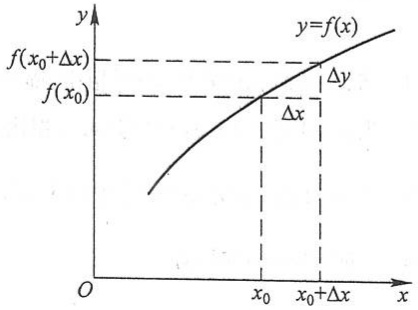

line

| Point | X-coordinate | Y-coordinate |
| --- | --- | --- |
| Tangent point (f(x0)) | x0 | f(x0) |
| Tangent point (f(x0+Δx)) | \(x0+\Delta x\) | \(f(x0+\Delta x)\) |

图1-33

54

---

第八节 函数的连续性与间断点

果当  $\Delta x$  趋于零时, 函数的对应增量  $\Delta y$  也趋于零, 即

$$
\lim _ {\Delta x \to 0} \Delta y = 0 \tag {8-1}
$$

或

$$
\lim _ {\Delta x \to 0} \left[ f (x _ {0} + \Delta x) - f (x _ {0}) \right] = 0,
$$

那么就称函数  $y=f(x)$  在点  $x_{0}$  处是连续的, 即有下述定义:

定义 设函数 $y = f(x)$ 在点 $x_0$ 的某一邻域内有定义, 如果

$$
\lim _ {\Delta x \to 0} \Delta y = \lim _ {\Delta x \to 0} \left[ f (x _ {0} + \Delta x) - f (x _ {0}) \right] = 0,
$$

那么就称函数  $y=f(x)$  在点  $x_{0}$  连续.

为了应用方便起见,下面把函数  $y=f(x)$  在点  $x_{0}$  连续的定义用不同的方式来叙述.

设 $x = x_0 + \Delta x$ ，则 $\Delta x\to 0$ 就是 $x\to x_0$ .又由于

$$
\Delta y = f (x _ {0} + \Delta x) - f (x _ {0}) = f (x) - f (x _ {0}),
$$

即

$$
f (x) = f (x _ {0}) + \Delta y,
$$

可见 $\Delta y\to 0$ 就是 $f(x)\rightarrow f(x_0)$ ，因此(8-1)式与

$$
\lim _ {x \to x _ {0}} f (x) = f (x _ {0})
$$

相当.所以,函数  $y=f(x)$  在点  $x_{0}$  连续的定义又可叙述如下:

设函数  $y=f(x)$  在点  $x_{0}$  的某一邻域内有定义, 如果

$$
\lim _ {x \to x _ {0}} f (x) = f (x _ {0}), \tag {8-2}
$$

那么就称函数 $f(x)$ 在点 $x_{0}$ 连续.

由函数 $f(x)$ 当 $x \to x_0$ 时的极限的定义可知，上述定义也可用“$\varepsilon - \delta$”语言表达如下:$f(x)$ 在点 $x_0$ 连续 $\Leftrightarrow \forall \varepsilon > 0, \exists \delta > 0$，当 $|x - x_0| < \delta$ 时，有 $|f(x) - f(x_0)| < \varepsilon$.

下面说明左连续及右连续的概念.

如果 $\lim_{x\to x_0^-}f(x) = f(x_0^-)$ 存在且等于 $f(x_0)$，即

$$
f (x _ {0} ^ {-}) = f (x _ {0}),
$$

那么就说函数 $f(x)$ 在点 $x_0$ 左连续. 如果 $\lim_{x\to x_0^+}f(x) = f(x_0^+)$ 存在且等于 $f(x_0)$，即

$$
f (x _ {0} ^ {+}) = f (x _ {0}),
$$

那么就说函数 $f(x)$ 在点 $x_{0}$ 右连续.

在区间上每一点都连续的函数,叫做在该区间上的连续函数,或者说函数在该区间上连续.如果区间包括端点,那么函数在右端点连续是指左连续,在左端点连续是指右连续.

连续函数的图形是一条连续而不间断的曲线.

在第五节中,我们曾经证明:如果 $f(x)$ 是有理整函数(多项式),那么对于任意的

图

释疑解难

1-7

55

---

第一章 函数与极限

实数 $x_0$ ，都有 $\lim_{x\to x_0}f(x) = f(x_0)$ ，因此有理整函数在区间 $(-\infty , + \infty)$ 内是连续的.对于有理分式函数 $F(x) = \frac{P(x)}{Q(x)}$ ，只要 $Q(x_0)\neq 0$ ，就有 $\lim_{x\to x_0}F(x) = F(x_0)$ ，因此有理分式函数在其定义域内的每一点都是连续的

由第三节例5可知，函数 $f(x) = \sqrt{x}$ 在 $(0, +\infty)$ 内是连续的.

作为例子,我们来证明,函数  $y=\sin x$  在区间  $(-∞,+∞)$  内是连续的.

设 $x$ 是区间 $(-\infty, +\infty)$ 内任意取定的一点. 当 $x$ 有增量 $\Delta x$ 时, 对应的函数的增量为

$$
\Delta y = \sin (x + \Delta x) - \sin x,
$$

由三角公式有

$$
\sin (x + \Delta x) - \sin x = 2 \sin \frac {\Delta x}{2} \cos \left(x + \frac {\Delta x}{2}\right),
$$

注意到

$$
\left| \cos \left(x + \frac {\Delta x}{2}\right) \right| \leqslant 1,
$$

就推得

$$
\mid \Delta y \mid = \mid \sin (x + \Delta x) - \sin x \mid \leqslant 2 \left| \sin \frac {\Delta x}{2} \right|.
$$

因为对于任意的角 $\alpha$ ，当 $\alpha \neq 0$ 时有 $|\sin \alpha| < |\alpha|$，所以

$$
0 \leqslant | \Delta y | = | \sin (x + \Delta x) - \sin x | <   | \Delta x |.
$$

因此, 当 $\Delta x \to 0$ 时, 由夹逼准则得 $|\Delta y| \to 0$, 这就证明了 $y = \sin x$ 对于任一 $x \in (-\infty, +\infty)$ 是连续的.

类似地可以证明,函数  $y=\cos x$  在区间  $(-∞,+∞)$  内是连续的.

## 二、函数的间断点

设函数 $f(x)$ 在点 $x_0$ 的某去心邻域内有定义.在此前提下，如果函数 $f(x)$ 有下列三种情形之一:

(1) 在  $x = x_{0}$  没有定义；
(2) 虽在  $x = x_{0}$  有定义, 但  $\lim_{x \to x_{0}} f(x)$  不存在;
(3) 虽在  $x = x_{0}$  有定义，且  $\lim_{x \to x_{0}} f(x)$  存在，但  $\lim_{x \to x_{0}} f(x) \neq f(x_{0})$ ,

那么函数 $f(x)$ 在点 $x_0$ 为不连续，而点 $x_0$ 称为函数 $f(x)$ 的不连续点或间断点.

下面举例来说明函数间断点的几种常见类型.

例1 正切函数 $y = \tan x$ 在 $x = \frac{\pi}{2}$ 处没有定义，所以点 $x = \frac{\pi}{2}$ 是函数 $\tan x$ 的间断

56

---

第八节 函数的连续性与间断点

点.因

$$
\lim_{x\to \frac{\pi}{2}}\tan x = \infty ,
$$

我们称  $x=\frac{\pi}{2}$  为函数  $\tan x$  的无穷间断点（图 1-34）.

例 2 函数  $y=\sin\frac{1}{x}$  在点 x=0 没有定义; 当  $x\to0$  时, 函数值在 -1 与 1 之间变动无限多次(图 1-35), 所以点 x=0 称为函数  $\sin\frac{1}{x}$  的振荡间断点.

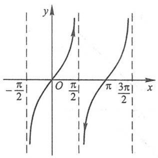

contour

| X | Y |
| --- | --- |
| \(-\pi/2\) | ~-1.5 |
| 0 | 0 |
| \(\pi/2\) | ~1.5 |
| \(\pi/3\) | ~-1.5 |
| \(3\pi/2\) | ~1.5 |

图1-34

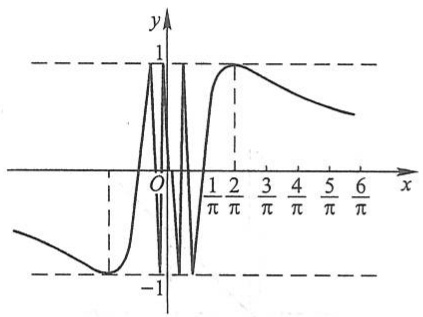

contour

| X-axis | Y-axis |
| --- | --- |
| O | 1 |
| \(1/\pi\) | 0 |
| \(2/\pi\) | 1 |
| \(3/\pi\) | ~0.8 |
| \(4/\pi\) | ~0.6 |
| \(5/\pi\) | ~0.4 |
| \(6/\pi\) | ~0.2 |

图1-35

例3 函数 $y = \frac{x^2 - 1}{x - 1}$ 在点 $x = 1$ 没有定义, 所以函数在点 $x = 1$ 不连续 (图1-36). 但这里

$$
\lim _ {x \to 1} \frac {x ^ {2} - 1}{x - 1} = \lim _ {x \to 1} (x + 1) = 2.
$$

如果补充定义: 令 x=1 时 y=2, 那么所给函数在 x=1 成为连续. 所以 x=1 称为该函数的可去间断点.

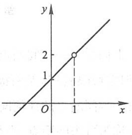

line

| X | Y |
| --- | --- |
| 1 | 2 |

图1-36

例4 函数

$$
y = f (x) = \left\{ \begin{array}{l l} x, & x \neq 1, \\ \frac {1}{2}, & x = 1. \end{array} \right.
$$

这里 $\lim_{x\to 1}f(x) = \lim_{x\to 1}x = 1$ ，但 $f(1) = \frac{1}{2}$ ，所以

$$
\lim _ {x \to 1} f (x) \neq f (1).
$$

因此, 点 x=1 是函数  $f(x)$  的间断点(图 1-37). 但如果改变函数  $f(x)$  在 x=1 处的定义: 令  $f(1)=1$ , 那么  $f(x)$  在 x=1 成为连续. 所以 x=1 也称为该函数的可去间断点.

例5 函数

57

---

第一章 函数与极限

$$
f (x) = \left\{ \begin{array}{l l} x - 1, & x <   0, \\ 0, & x = 0, \\ x + 1 & x > 0. \end{array} \right.
$$

这里, 当  $x \to 0$  时,

$$
\lim _ {x \to 0 ^ {-}} f (x) = \lim _ {x \to 0 ^ {-}} (x - 1) = - 1, \quad \lim _ {x \to 0 ^ {+}} f (x) = \lim _ {x \to 0 ^ {+}} (x + 1) = 1.
$$

左极限与右极限虽都存在,但不相等,故极限 $\lim_{x\to0}f(x)$ 不存在,所以点x=0是函数 $f(x)$ 的间断点(图1-38).因 $y=f(x)$ 的图形在x=0处产生跳跃现象,我们称x=0为函数 $f(x)$ 的跳跃间断点.

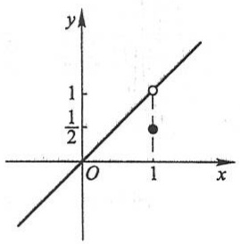

scatter

| Point | X | Y |
| --- | --- | --- |
| Open Circle | 1 | 1 |
| Solid Dot | 1 | 0.5 |

图1-37

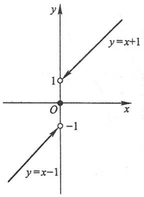

text_image

y
y=x+1
1
O
x
-1
y=x-1

图1-38

上面举了一些间断点的例子.通常把间断点分成两类:如果 $x_0$ 是函数 $f(x)$ 的间断点,但左极限 $f(x_0^-)$ 及右极限 $f(x_0^+)$ 都存在,那么 $x_0$ 称为函数 $f(x)$ 的第一类间断点.不是第一类间断点的任何间断点,称为第二类间断点.在第一类间断点中,左、右极限相等者称为可去间断点,不相等者称为跳跃间断点.无穷间断点和振荡间断点显然是第二类间断点.

## 习题1-8

1. 设  $y=f(x)$  的图形如图 1-39 所示, 试指出  $f(x)$  的全部间断点, 并对可去间断点补充或修改函数值的定义, 使它成为连续点.

2. 研究下列函数的连续性,并画出函数的图形:

(1) $f(x)=\begin{cases}x^{2},&0\leqslant x\leqslant1,\\2-x,&1<x\leqslant2;\end{cases}$

(2) $f(x)=\begin{cases}x,&-1\leqslant x\leqslant1,\\1,&x<-1\text{或}x>1.\end{cases}$

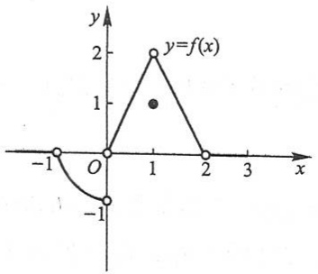

line

| X | Y |
| --- | --- |
| -1 | 0 |
| 0 | 0 |
| 1 | 2 |
| 2 | 0 |

图1-39

58

---

第九节 连续函数的运算与初等函数的连续性

3. 下列函数在指出的点处间断,说明这些间断点属于哪一类.如果是可去间断点,那么补充或改变函数的定义使它连续:

(1) $y = \frac{x^2 - 1}{x^2 - 3x + 2}, x = 1, x = 2;$

(2) $y = \frac{x}{\tan x}, x = k\pi, x = k\pi + \frac{\pi}{2} \quad (k = 0, \pm 1, \pm 2, \cdots)$;

(3)  $y = \cos^{2}\frac{1}{x}, x = 0;$

(4) $y = \begin{cases} x - 1, & x \leqslant 1, \\ 3 - x, & x > 1, \end{cases} \quad x = 1.$

4. 讨论函数 $f(x) = \lim_{n\to \infty}\frac{1 - x^{2n}}{1 + x^{2n}}x$ ($n \in \mathbb{N}_+$) 的连续性, 若有间断点, 则判别其类型.

5. 下列陈述中,哪些是对的,哪些是错的? 如果是对的,说明理由;如果是错的,试给出一个反例.

(1) 如果函数  $f(x)$  在 a 连续, 那么  $\left|f(x)\right|$  也在 a 连续;

(2) 如果函数  $\left|f(x)\right|$  在 a 连续, 那么  $f(x)$  也在 a 连续.

\*6. 证明: 若函数 $f(x)$ 在点 $x_0$ 连续且 $f(x_0) \neq 0$, 则存在 $x_0$ 的某一邻域 $U(x_0)$, 当 $x \in U(x_0)$ 时, $f(x) \neq 0$.

\*7. 设

$$
f (x) = \left\{ \begin{array}{l l} x, & x \in \mathbb {Q}, \\ 0, & x \in \mathbb {R} \backslash \mathbb {Q}, \end{array} \right.
$$

证明:

(1) $f(x)$ 在 x=0 连续；

(2) $f(x)$ 在非零的x处都不连续.

8. 设 $f(x)$ 对任意实数 $x, y$，有 $f(x + y) = f(x) + f(y)$，且 $f(x)$ 在 $x = 0$ 连续，证明:$f(x)$ 在 $\mathbb{R}$ 上连续.

## 第九节 连续函数的运算与初等函数的连续性

## 一、连续函数的和、差、积、商的连续性

由函数在某点连续的定义和极限的四则运算法则,立即可得出下面的定理:

定理1 设函数 $f(x)$ 和 $g(x)$ 在点 $x_0$ 连续，则它们的和（差）$f \pm g$、积 $f \cdot g$ 及商 $\frac{f}{g}$ （当 $g(x_0) \neq 0$ 时）都在点 $x_0$ 连续.

例1 因 $\tan x = \frac{\sin x}{\cos x}, \cot x = \frac{\cos x}{\sin x}$, 而 $y = \sin x$ 和 $y = \cos x$ 都在区间 $(- \infty, +\infty)$ 内连续(第八节), 故由定理1知 $y = \tan x$ 和 $y = \cot x$ 在它们的定义域内是连续的.

59

---

第一章 函数与极限

## 二、反函数与复合函数的连续性

反函数和复合函数的概念已经在第一节中讲过,这里来讨论它们的连续性.

定理2 如果函数 $y = f(x)$ 在区间 $I_{x}$ 上单调增加（或单调减少）且连续，那么它的反函数 $x = f^{-1}(y)$ 也在对应的区间 $I_{y} = \{y \mid y = f(x), x \in I_{x}\}$ 上单调增加（或单调减少）且连续.

证明从略.

例2 由于 $y = \sin x$ 在闭区间 $\left[-\frac{\pi}{2}, \frac{\pi}{2}\right]$ 上单调增加且连续，所以它的反函数 $y = \arcsin x$ 在闭区间 $[-1, 1]$ 上也是单调增加且连续的.

同样,应用定理2可证: $y = \arccos x$ 在闭区间 $[-1, 1]$ 上单调减少且连续, $y = \arctan x$ 在区间 $(- \infty, +\infty)$ 内单调增加且连续, $y = \operatorname{arccot} x$ 在区间 $(- \infty, +\infty)$ 内单调减少且连续.

总之,反三角函数  $y=\arcsin x, y=\arccos x, y=\arctan x, y=\operatorname{arccot} x$  在它们的定义域内都是连续的.

定理3 设函数 $y = f[g(x)]$ 由函数 $u = g(x)$ 与函数 $y = f(u)$ 复合而成，$\stackrel{\circ}{U}(x_0) \subset D_{f \circ g}$. 若 $\lim_{x \to x_0} g(x) = u_0$，而函数 $y = f(u)$ 在 $u = u_0$ 连续，则

$$
\lim _ {x \to x _ {0}} f [ g (x) ] = \lim _ {u \to u _ {0}} f (u) = f (u _ {0}). \tag {9-1}
$$

证 在第五节定理6中, 令 $A = f(u_0)$ (这时 $f(u)$ 在点 $u_0$ 连续), 并取消“存在 $\delta_0 > 0$, 当 $x \in \mathring{U}(x_0, \delta_0)$ 时, 有 $g(x) \neq u_0$”这个条件, 便得上面的定理. 这里可以取消条件 $g(x) \neq u_0$ 的理由是: $\forall \varepsilon > 0$, 使 $g(x) = u_0$ 成立的那些点 $x$, 显然也使 $|f[g(x)] - f(u_0)| < \varepsilon$ 成立. 因此就没有必要附加条件 $g(x) \neq u_0$ 了.

因为在定理3中有

$$
\lim _ {x \to x _ {0}} g (x) = u _ {0}, \quad \lim _ {u \to u _ {0}} f (u) = f (u _ {0}),
$$

故(9-1)式又可写成

$$
\lim _ {x \to x _ {0}} f [ g (x) ] = f [ \lim _ {x \to x _ {0}} g (x) ]. \tag {9-2}
$$

(9-1)式表示,在定理3的条件下,如果作代换 $u=g(x)$ ,那么求 $\lim_{x\to x_{0}}f[g(x)]$ 就化为求 $\lim_{u\to u_{0}}f(u)$ ,这里 $u_{0}=\lim_{x\to x_{0}}g(x)$ .

(9-2)式表示,在定理3的条件下,求复合函数 $f[g(x)]$ 的极限时,函数符号f与极限号 $\lim_{x\to x_{0}}$ 可以交换次序.

把定理3中的 $x \to x_0$ 换成 $x \to \infty$ ，可得类似的定理.

60

---

第九节 连续函数的运算与初等函数的连续性

例3 求 $\lim_{x\to 3}\sqrt{\frac{x - 3}{x^2 - 9}}.$

解 $y = \sqrt{\frac{x - 3}{x^2 - 9}}$ 可看作由 $y = \sqrt{u}$ 与 $u = \frac{x - 3}{x^2 - 9}$ 复合而成. 因为 $\lim_{x \to 3} \frac{x - 3}{x^2 - 9} = \frac{1}{6}$, 而函数 $y = \sqrt{u}$ 在点 $u = \frac{1}{6}$ 连续, 所以

$$
\lim _ {x \to 3} \sqrt {\frac {x - 3}{x ^ {2} - 9}} = \sqrt {\lim _ {x \to 3} \frac {x - 3}{x ^ {2} - 9}} = \sqrt {\frac {1}{6}} = \frac {\sqrt {6}}{6}.
$$

定理4 设函数 $y = f[g(x)]$ 是由函数 $u = g(x)$ 与函数 $y = f(u)$ 复合而成，$U(x_0) \subset D_{f \cdot g}$. 若函数 $u = g(x)$ 在 $x = x_0$ 连续，且 $g(x_0) = u_0$，而函数 $y = f(u)$ 在 $u = u_0$ 连续，则复合函数 $y = f[g(x)]$ 在 $x = x_0$ 也连续.

证 只要在定理3中令 $u_0 = g(x_0)$，这就表示 $g(x)$ 在点 $x_0$ 连续，于是由(9-1)式得

$$
\lim _ {x \to x _ {0}} f [ g (x) ] = f (u _ {0}) = f [ g (x _ {0}) ],
$$

这就证明了复合函数 $f[g(x)]$ 在点 $x_{0}$ 连续.

例 4 讨论函数  $y=\sin\frac{1}{x}$  的连续性.

解 函数 $y = \sin \frac{1}{x}$ 可看作是由 $u = \frac{1}{x}$ 及 $y = \sin u$ 复合而成的. $u = \frac{1}{x}$ 当 $-\infty < x < 0$ 和 $0 < x < +\infty$ 时是连续的, $y = \sin u$ 当 $-\infty < u < +\infty$ 时是连续的. 根据定理4, 函数 $y = \sin \frac{1}{x}$ 在无限区间 $(-\infty, 0)$ 和 $(0, +\infty)$ 内是连续的.

## 三、初等函数的连续性

前面证明了三角函数及反三角函数在它们的定义域内是连续的.

我们指出(但不详细讨论), 指数函数  $y = a^{x} (a > 0, a \neq 1)$  对于一切实数 x 都有定义, 且在区间  $(-\infty, +\infty)$  内是单调的和连续的, 它的值域为  $(0, +\infty)$ .

由指数函数的单调性和连续性, 引用定理 2 可得: 对数函数  $y = \log_{a} x \quad (a > 0, a \neq 1)$  在区间  $(0, +\infty)$  内单调且连续.

幂函数 $y = x^{\mu}$ 的定义域随 $\mu$ 的值而异,但无论 $\mu$ 为何值,在区间 $(0, +\infty)$ 内幂函数总是有定义的.下面我们来证明,在 $(0, +\infty)$ 内幂函数是连续的.事实上,设 $x > 0$,则

$$
y = x ^ {\mu} = a ^ {\mu \log_ {a} x},
$$

因此，幂函数 $x^{\mu}$ 可看作是由 $y = a^{u}, u = \mu \log_{a} x$ 复合而成的，由此，根据定理4，它在 $(0, +\infty)$ 内连续.如果对于 $\mu$ 取各种不同值加以分别讨论，可以证明（证明从略）幂函

61

---

第一章 函数与极限

释疑解难
1-8

数在它的定义域内是连续的.

综合起来得到:基本初等函数在它们的定义域内都是连续的.

最后,根据第一节中关于初等函数的定义,由基本初等函数的连续性以及本节定理1、定理4可得下列重要结论:一切初等函数在其定义区间内都是连续的.所谓定义区间,就是包含在定义域内的区间.

根据函数 $f(x)$ 在点 $x_0$ 连续的定义, 如果已知 $f(x)$ 在点 $x_0$ 连续, 那么求 $f(x)$ 当 $x \to x_0$ 的极限时, 只要求 $f(x)$ 在点 $x_0$ 的函数值就行了. 因此, 上述关于初等函数连续性的结论提供了求极限的一个方法, 这就是: 如果 $f(x)$ 是初等函数, 且 $x_0$ 是 $f(x)$ 的定义区间内的点, 那么

$$
\lim _ {x \to x _ {0}} f (x) = f (x _ {0}).
$$

例如，点 $x_0 = 0$ 是初等函数 $f(x) = \sqrt{1 - x^2}$ 的定义区间 $[-1, 1]$ 上的点，所以 $\lim_{x \to 0} \sqrt{1 - x^2} = \sqrt{1} = 1$；又如点 $x_0 = \frac{\pi}{2}$ 是初等函数 $f(x) = \ln \sin x$ 的一个定义区间 $(0, \pi)$ 内的点，所以

$$
\lim _ {x \to \frac {\pi}{2}} \ln \sin x = \ln \sin \frac {\pi}{2} = 0.
$$

例5 求 $\lim_{x\to 0}\frac{\log_a(1 + x)}{x} (a > 0,a\neq 1)$

解 $\lim_{x\to 0}\frac{\log_a(1 + x)}{x} = \lim_{x\to 0}\log_a(1 + x)^{\frac{1}{x}} = \log_a\mathrm{e} = \frac{1}{\ln a}.$

例6 求 $\lim_{x\to 0}\frac{a^x - 1}{x} (a > 0,a\neq 1)$

解 令 $a^x - 1 = t$，则 $x = \log_a(1 + t)$，当 $x \to 0$ 时 $t \to 0$，于是

$$
\lim _ {x \to 0} \frac {a ^ {x} - 1}{x} = \lim _ {t \to 0} \frac {t}{\log_ {a} (1 + t)} = \ln a.
$$

例7 求 $\lim_{x\to 0}\frac{(1 + x)^{\alpha} - 1}{x} (\alpha \in \mathbb{R})$

解 令 $(1 + x)^{\alpha} - 1 = t$ ，则当 $x\to 0$ 时， $t\to 0$ ，于是

$$
\lim _ {x \to 0} \frac {(1 + x) ^ {\alpha} - 1}{x} = \lim _ {x \to 0} \left[ \frac {(1 + x) ^ {\alpha} - 1}{\ln (1 + x) ^ {\alpha}} \cdot \frac {\alpha \ln (1 + x)}{x} \right] = \lim _ {t \to 0} \frac {t}{\ln (1 + t)} \cdot \lim _ {x \to 0} \frac {\alpha \ln (1 + x)}{x} = \alpha .
$$

由例 5、例 6、例 7 可得下列三个常用的等价无穷小关系式:

$$
\ln (1 + x) \sim x \quad (x \to 0),
$$

$$
\mathrm{e} ^ {x} - 1 \sim x (x \to 0),
$$

$$
(1 + x) ^ {\alpha} - 1 \sim \alpha x (x \rightarrow 0).
$$

62

---

第九节 连续函数的运算与初等函数的连续性

例8 求 $\lim_{x\to 0}(1 + 2x)^{\frac{3}{\sin x}}.$

解 因为

$$
(1 + 2 x) ^ {\frac {3}{\sin x}} = (1 + 2 x) ^ {\frac {1}{2 x} \cdot \frac {x}{\sin x} \cdot 6} = \mathrm{e} ^ {6 \cdot \frac {x}{\sin x} \ln (1 + 2 x)} ^ {\frac {1}{2 x}},
$$

利用定理 3 及极限的运算法则,便有

$$
\lim _ {x \to 0} (1 + 2 x) ^ {\frac {3}{\sin x}} = \mathrm{e} ^ {\lim _ {x \to 0} \left[ 6 \cdot \frac {x}{\sin x} \cdot \ln (1 + 2 x) ^ {\frac {1}{2 x}} \right]} = \mathrm{e} ^ {6}.
$$

一般地,对于形如  $u(x)^{v(x)}$  ( $u(x)>0, u(x)\neq1$ ) 的函数(通常称为幂指函数),如果

$$
\lim u (x) = a > 0, \quad \lim v (x) = b,
$$

那么

$$
\lim u (x) ^ {v (x)} = a ^ {b}.
$$

注意 这里三个 lim 都表示在同一自变量变化过程中的极限.

## 习题1-9

1. 求函数 $f(x) = \frac{x^3 + 3x^2 - x - 3}{x^2 + x - 6}$ 的连续区间，并求极限 $\lim_{x \to 0} f(x), \lim_{x \to -3} f(x)$ 及 $\lim_{x \to 2} f(x)$.
2. 设函数 $f(x)$ 与 $g(x)$ 在点 $x_0$ 连续，证明函数

$$
\varphi (x) = \max \{f (x), g (x) \}, \quad \psi (x) = \min \{f (x), g (x) \}
$$

在点 $x_0$ 也连续.

3. 求下列极限:

(1) $\lim_{x\to 0}\sqrt{x^2 - 2x + 5}$;
(2)  $\lim_{\alpha\to\frac{\pi}{4}}(\sin2\alpha)^{3}$ ;
(3)  $\lim_{x\to\frac{\pi}{6}}\ln(2\cos2x)$ ;
(4)  $\lim_{x\to0}\frac{\sqrt{x+1}-1}{x};$
(5)  $\lim_{x\to1}\frac{\sqrt{5x-4}-\sqrt{x}}{x-1};$
(6)  $\lim_{x\to\alpha}\frac{\sin x-\sin\alpha}{x-\alpha};$
(7)  $\lim_{x\to+\infty}\left(\sqrt{x^{2}+x}-\sqrt{x^{2}-x}\right)$ ;
(8)  $\lim_{x\to0}\frac{\left(1-\frac{1}{2}x^{2}\right)^{\frac{2}{3}}-1}{x\ln(1+x)}$ .

4. 求下列极限:

(1) $\lim_{x\to \infty}\mathrm{e}^{\frac{1}{x}};$

(2)  $\lim_{x\to0}\ln\frac{\sin x}{x};$

(3) $\lim_{x\to \infty}\left(1 + \frac{1}{x}\right)^{\frac{x}{2}};$

(4)  $\lim_{x\to0}(1+3\tan^{2}x)^{\cot^{2}x};$

(5)  $\lim_{x\to\infty}\left(\frac{3+x}{6+x}\right)^{\frac{x-1}{2}}$ ;

(6) $\lim_{x\to 0}\frac{\sqrt{1 + \tan x} - \sqrt{1 + \sin x}}{x\sqrt{1 + \sin^2x} - x};$

(7)  $\lim_{x\to e}\frac{\ln x-1}{x-e};$

(8)  $\lim_{x\to0}\frac{e^{3x}-e^{2x}-e^{x}+1}{\sqrt[3]{(1-x)(1+x)}-1};$

(9) $\lim_{x\to \infty}x(\mathrm{e}^{\frac{1}{2x}} - 1)$;

#

例题精讲
1-5

63

---

第一章 函数与极限

(10) $\lim_{x\to 1}\frac{x^2 - 1}{x - 1}\mathrm{e}^{\frac{1}{x - 1}}.$

5. 设 $f(x)$ 在 $\mathbb{R}$ 上连续, 且 $f(x) \neq 0, \varphi(x)$ 在 $\mathbb{R}$ 上有定义, 且有间断点, 则下列陈述中哪些是对的, 哪些是错的? 如果是对的, 试说明理由; 如果是错的, 试给出一个反例.

(1)  $\varphi[f(x)]$  必有间断点； (2)  $[\varphi(x)]^{2}$  必有间断点；
(3) $f[\varphi(x)]$ 未必有间断点；(4) $\frac{\varphi(x)}{f(x)}$ 必有间断点.

6. 设函数

$$
f (x) = \left\{ \begin{array}{l l} \mathrm{e} ^ {x}, & x <   0, \\ a + x, & x \geqslant 0. \end{array} \right.
$$

应当怎样选择数 $a$ ，才能使得 $f(x)$ 成为在 $(-\infty, +\infty)$ 内的连续函数？

## 第十节 闭区间上连续函数的性质

第八节中已说明了函数在区间上连续的概念,如果函数 $f(x)$ 在开区间 $(a,b)$ 内连续,在右端点b左连续,在左端点a右连续,那么函数 $f(x)$ 就是在闭区间 $[a,b]$ 上连续的.在闭区间上连续的函数有几个重要的性质,下面以定理的形式叙述它们.

## 一、有界性与最大值最小值定理

先说明最大值和最小值的概念.对于在区间 $I$ 上有定义的函数 $f(x)$, 如果有 $x_0 \in I$, 使得对于任一 $x \in I$ 都有

$$
f (x) \leqslant f (x _ {0}) \quad (f (x) \geqslant f (x _ {0})),
$$

那么称 $f(x_0)$ 是函数 $f(x)$ 在区间 $I$ 上的最大值(最小值).

例如, 函数 $f(x) = 1 + \sin x$ 在区间 $[0, 2\pi]$ 上有最大值 2 和最小值 0. 又例如, 函数 $f(x) = \operatorname{sgn} x$ 在区间 $(- \infty, +\infty)$ 内有最大值 1 和最小值 -1. 在开区间 $(0, +\infty)$ 内, $\operatorname{sgn} x$ 的最大值和最小值都等于 1 (注意: 最大值和最小值可以相等!). 但函数 $f(x) = x$ 在开区间 $(a, b)$ 内既无最大值又无最小值. 下面的定理给出函数有界且最大值和最小值存在的充分条件.

定理1（有界性与最大值最小值定理）在闭区间上连续的函数在该区间上有界且一定能取得它的最大值和最小值.

这就是说,如果函数 $f(x)$ 在闭区间 $[a,b]$ 上连续,那么存在常数M>0,使得对任一 $x\in[a,b]$ ,满足 $|f(x)|\leqslant M$ ;且至少有一点 $\xi_{1}$ ,使 $f(\xi_{1})$ 是 $f(x)$ 在 $[a,b]$ 上的最小值;又至少有一点 $\xi_{2}$ ,使 $f(\xi_{2})$ 是 $f(x)$ 在 $[a,b]$ 上的最大值(图1-40).

这里不予证明.

64

---

第十节 闭区间上连续函数的性质

注意 如果函数在开区间内连续,或函数在闭区间上有间断点,那么函数在该区间上不一定有界,也不一定有最大值或最小值.例如,函数  $y = \tan x$  在开区间  $\left(-\frac{\pi}{2}, \frac{\pi}{2}\right)$  内是连续的,但它在开区间  $\left(-\frac{\pi}{2}, \frac{\pi}{2}\right)$  内是无界的,且既无最大值又无最小值;又如,函数

$$
y = f (x) = \left\{ \begin{array}{l l} - x + 1, & 0 \leqslant x <   1, \\ 1, & x = 1, \\ - x + 3, & 1 <   x \leqslant 2 \end{array} \right.
$$

在闭区间 $[0,2]$ 上有间断点 $x = 1$ ，这函数 $f(x)$ 在闭区间 $[0,2]$ 上虽然有界，但是既无最大值又无最小值（图1-41）.

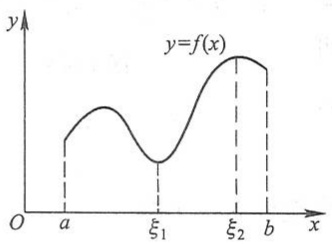

contour

| X | Y |
| --- | --- |
| a | ~0.4 |
| \(\xi1\) | ~0.3 |
| \(\xi2\) | ~0.9 |
| b | ~0.8 |

图1-40

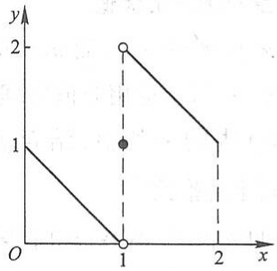

line

| X | Y (Line 1) | Y (Line 2) |
| --- | --- | --- |
| 0 | 1 | — |
| 1 | 0 | 2 |
| 2 | 1 | 1 |

图1-41

## 二、零点定理与介值定理

如果 $x_0$ 使 $f(x_0) = 0$，那么 $x_0$ 称为函数 $f(x)$ 的零点.

定理2（零点定理）设函数 $f(x)$ 在闭区间 $[a,b]$ 上连续，且 $f(a)$ 与 $f(b)$ 异号（即 $f(a)\cdot f(b) < 0$），则在开区间 $(a,b)$ 内至少有一点 $\xi$，使

$$
f (\xi) = 0.
$$

这里不予证明.

从几何上看,定理2表示:如果连续曲线弧 $y=f(x)$ 的两个端点位于x轴的不同侧,那么这段曲线弧与x轴至少有一个交点(图1-42).

由定理 2 立即可推得下列较一般性的定理.

定理3（介值定理）设函数 $f(x)$ 在闭区间$[a,b]$ 上连续，且在这区间的端点取不同的函数值

$$
f (  a  ) = A \quad \text {及} \quad f (  b  ) = B  ,
$$

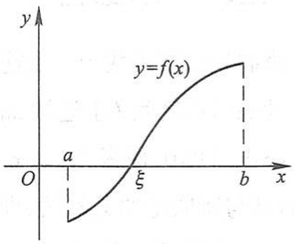

line

| X | Y |
| --- | --- |
| a | ~-1.5 |
| \(\xi\) | 0 |
| b | ~1.5 |

图1-42

则对于 $A$ 与 $B$ 之间的任意一个数 $C$ ，在开区间 $(a,b)$ 内至少有一点 $\xi$ ，使得

65

---

第一章 函数与极限

$$
f (\xi) = C \quad (a <   \xi <   b).
$$

证 设 $\varphi(x) = f(x) - C$，则 $\varphi(x)$ 在闭区间 $[a, b]$ 上连续，且 $\varphi(a) = A - C$ 与 $\varphi(b) = B - C$ 异号。根据零点定理，开区间 $(a, b)$ 内至少有一点 $\xi$ 使得

$$
\varphi (\xi) = 0 \quad (a <   \xi <   b).
$$

又 $\varphi (\xi) = f(\xi) - C$ ，因此由上式即得

$$
f (\xi) = C \quad (a <   \xi <   b).
$$

这个定理的几何意义是: 连续曲线弧  $y=f(x)$  与水平直线 y=C 至少相交于一点(图 1-43).

推论 在闭区间 $[a, b]$ 上连续的函数 $f(x)$ 的值域为闭区间 $[m, M]$, 其中 $m$ 与 $M$ 依次为 $f(x)$ 在 $[a, b]$ 上的最小值与最大值.

设 $m = f(x_{1}), M = f(x_{2})$，而 $m \neq M$，在闭区间 $[x_{1}, x_{2}]$（或 $[x_{2}, x_{1}]$）上应用介值定理，知 $f(x)$ 可取区间 $(m, M)$ 内的一切值，结合 $f(x_{1}) = m$，$f(x_{2}) = M$，便得上述推论.

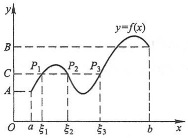

line

| Point | x-coordinate | y-coordinate |
| --- | --- | --- |
| P1 | \(\xi1\) | C |
| P2 | \(\xi2\) | C |
| P3 | \(\xi3\) | C |

图1-43

例 1 证明方程  $x^{3}-4x^{2}+1=0$  在区间  $(0,1)$  内至少有一个根.

证 函数 $f(x) = x^{3} - 4x^{2} + 1$ 在闭区间[0,1]上连续，又

$$
f (0) = 1 > 0, \quad f (1) = - 2 <   0.
$$

根据零点定理,在 $(0,1)$ 内至少有一点 $\xi$ ,使得

$$
f (\xi) = 0,
$$

即

$$
\xi^ {3} - 4 \xi^ {2} + 1 = 0 \quad (0 <   \xi <   1).
$$

这等式说明方程 $x^{3} - 4x^{2} + 1 = 0$ 在区间(0,1)内至少有一个根是 $\xi$.

## \* 三、一致连续性

我们先介绍函数的一致连续性概念.

设函数在区间 $I$ 上连续，$x_0$ 是在 $I$ 上任意取定的一个点。由于 $f(x)$ 在点 $x_0$ 连续，因此 $\forall \varepsilon > 0, \exists \delta > 0$，使得当 $|x - x_0| < \delta$ 时，就有 $|f(x) - f(x_0)| < \varepsilon$。通常这个 $\delta$ 不仅与 $\varepsilon$ 有关，而且与所取定的 $x_0$ 有关，即使 $\varepsilon$ 不变，但选取区间 $I$ 上的其他点作为 $x_0$ 时，这个 $\delta$ 就不一定适用了。可是对于某些函数，却有这样一种重要情形:存在着只与 $\varepsilon$ 有关，而对区间 $I$ 上任何点 $x_0$ 都能适用的正数 $\delta$，即对任何 $x_0 \in I$，只要 $|x - x_0| < \delta$ 时，就有 $|f(x) - f(x_0)| < \varepsilon$。如果函数 $f(x)$ 在区间 $I$ 上能使这种情形发生，就说函数 $f(x)$ 在区间 $I$ 上是一致连续的。

#

例题精讲

1-6

66

---

第十节 闭区间上连续函数的性质

定义 设函数 $f(x)$ 在区间 $I$ 上有定义. 如果对于任意给定的正数 $\varepsilon$, 总存在正数 $\delta$, 使得对于区间 $I$ 上的任意两点 $x_{1}, x_{2}$, 当 $|x_{1} - x_{2}| < \delta$ 时, 有

$$
\left| f (x _ {1}) - f (x _ {2}) \right| <   \varepsilon ,
$$

那么称函数 $f(x)$ 在区间I上一致连续.

一致连续性表示,不论在区间 I 的任何部分,只要自变量的两个数值接近到一定程度,就可使对应的函数值达到所指定的接近程度.

由上述定义可知,如果函数 $f(x)$ 在区间I上一致连续,那么 $f(x)$ 在区间I上也是连续的.但反过来不一定成立,举例说明如下:

例 2 函数  $f(x)=\frac{1}{x}$  在区间  $(0,1]$  上是连续的,但不是一致连续的.

因为函数 $f(x)=\frac{1}{x}$ 是初等函数,它在区间(0,1]上有定义,所以在(0,1]上是连续的.

$\forall \varepsilon > 0 (0 < \varepsilon < 1)$, 假定 $f(x) = \frac{1}{x}$ 在 $(0,1]$ 上一致连续, 应该 $\exists \delta > 0$, 使得对于 $(0,1]$ 上的任意两个值 $x_1, x_2$, 当 $|x_1 - x_2| < \delta$ 时, 就有 $|f(x_1) - f(x_2)| < \varepsilon$.

现在取原点附近的两点

$$
x _ {1} = \frac {1}{n}, \quad x _ {2} = \frac {1}{n + 1},
$$

其中 $n$ 为正整数，这样的 $x_{1}, x_{2}$ 显然在 $(0,1]$ 上. 因

$$
\left| x _ {1} - x _ {2} \right| = \left| \frac {1}{n} - \frac {1}{n + 1} \right| = \frac {1}{n (n + 1)},
$$

故只要 $n$ 取得足够大，总能使 $\left|x_1 - x_2\right| < \delta.$ 但这时有

$$
\left| f (x _ {1}) - f (x _ {2}) \right| = \left| \frac {1}{\frac {1}{n}} - \frac {1}{\frac {1}{n + 1}} \right| = | n - (n + 1) | = 1 > \varepsilon ,
$$

不符合一致连续的定义,所以  $f(x)=\frac{1}{x}$  在  $(0,1]$  上不是一致连续的.

上例说明,在半开区间上连续的函数不一定在该区间上一致连续.但是,有下面的定理:

定理 4(一致连续性定理) 如果函数  $f(x)$  在闭区间  $[a, b]$  上连续, 那么它在该区间上一致连续.

这里不予证明.

## 习题1-10

1. 假设函数 $f(x)$ 在闭区间 $[0,1]$ 上连续，并且对 $[0,1]$ 上任一点 $x$ 有 $0 \leqslant f(x) \leqslant 1$. 试证明 $[0,1]$

67

---

第一章 函数与极限

中必存在一点 $c$ ，使得 $f(c) = c$ （$c$ 称为函数 $f(x)$ 的不动点）.

2. 证明方程 $x^{5} - 3x = 1$ 至少有一个根介于1和2之间.

3. 证明方程 $x = a\sin x + b$，其中 $a > 0, b > 0$，至少有一个正根，并且它不超过 $a + b$.

4. 证明任一最高次幂的指数为奇数的代数方程

$$
a _ {0} x ^ {2 n + 1} + a _ {1} x ^ {2 n} + \dots + a _ {2 n} x + a _ {2 n + 1} = 0
$$

至少有一个实根,其中  $a_{0}, a_{1}, \cdots, a_{2n+1}$  均为常数,  $n \in N$ .

5. 证明: 方程 $x^{3} + 2x^{2} - 4x - 1 = 0$ 有三个实根.

6. 若  $f(x)$  在  $[a, b]$  上连续， $a < x_{1} < x_{2} < \cdots < x_{n} < b \quad (n \geqslant 3)$ ，证明:在  $(x_{1}, x_{n})$  内至少有一点  $\xi$ ，使  $f(\xi) = \frac{f(x_{1}) + f(x_{2}) + \cdots + f(x_{n})}{n}$ .

\*7. 设函数 $f(x)$ 对于闭区间 $[a, b]$ 上的任意两点 $x, y$，恒有 $|f(x) - f(y)| \leqslant L|x - y|$，其中 $L$ 为正常数，且 $f(a) \cdot f(b) < 0$. 证明:至少有一点 $\xi \in (a, b)$，使得 $f(\xi) = 0$.

\*8. 证明: 若 $f(x)$ 在 $(- \infty, +\infty)$ 内连续, 且 $\lim_{x \to -\infty} f(x)$ 存在, 则 $f(x)$ 必在 $(- \infty, +\infty)$ 内有界.

\*9. 在什么条件下，$(a, b)$ 内的连续函数 $f(x)$ 为一致连续？

## 总习题一

1. 在“充分”“必要”和“充分必要”三者中选择一个正确的填入下列空格内:

(1) 数列  $\{x_{n}\}$  有界是数列  $\{x_{n}\}$  收敛的 \_\_\_\_ 条件, 数列  $\{x_{n}\}$  收敛是数列  $\{x_{n}\}$  有界的 \_\_\_\_ 条件;

(2) $f(x)$ 在 $x_0$ 的某一去心邻域内有界是 $\lim_{x \to x_0} f(x)$ 存在的 \_\_\_\_ 条件, $\lim_{x \to x_0} f(x)$ 存在是 $f(x)$ 在 $x_0$ 的某一去心邻域内有界的 \_\_\_\_ 条件;

(3) $f(x)$ 在 $x_0$ 的某一去心邻域内无界是 $\lim_{x \to x_0} f(x) = \infty$ 的 \_\_\_\_ 条件, $\lim_{x \to x_0} f(x) = \infty$ 是 $f(x)$ 在 $x_0$ 的某一去心邻域内无界的 \_\_\_\_ 条件;

(4) $f(x)$ 当 $x \to x_0$ 时的右极限 $f(x_0^+)$ 及左极限 $f(x_0^-)$ 都存在且相等是 $\lim_{x \to x_0} f(x)$ 存在的 \_\_\_\_ 条件.

2. 已知函数

$$
f (x) = \left\{ \begin{array}{l l} (\cos x) ^ {- x ^ {2}}, & 0 <   | x | <   \frac {\pi}{2}, \\ a, & x = 0 \end{array} \right.
$$

在 x=0 连续, 则 a= \_\_\_\_.

3. 以下两题中给出了四个结论,从中选出一个正确的结论:

(1) 设  $f(x)=2^{x}+3^{x}-2$ ，则当  $x\to0$  时，有().

(A) $f(x)$ 与 $x$ 是等价无穷小

(B) $f(x)$ 与 $x$ 同阶但非等价无穷小

(C) $f(x)$ 是比 $x$ 高阶的无穷小

(D) $f(x)$ 是比 $x$ 低阶的无穷小

68

---

总习题一

(2) 设  $f(x)=\frac{\mathrm{e}^{\frac{1}{x}}-1}{\mathrm{e}^{\frac{1}{x}}+1}$ ，则 x=0 是  $f(x)$  的().

(A) 可去间断点

(B) 跳跃间断点

(C) 第二类间断点

(D) 连续点

4. 设 $f(x)$ 的定义域是 $[0,1]$，求下列函数的定义域:

(1)  $f(e^{x})$ ;

(2) $f(\ln x)$;

(3) $f(\arctan x)$;

(4) $f(\cos x)$.

5. 设

$$
f (x) = \left\{ \begin{array}{l l} 0, & x \leqslant 0, \\ x, & x > 0, \end{array} \right. \quad g (x) = \left\{ \begin{array}{l l} 0, & x \leqslant 0, \\ - x ^ {2}, & x > 0, \end{array} \right.
$$

求 $f[f(x)]$ ,  $g[g(x)]$ ,  $f[g(x)]$ ,  $g[f(x)]$ .

6. 利用  $y = \sin x$  的图形作出下列函数的图形:

(1)  $y = |\sin x|$ ;

(2)  $y=\sin |x|$ ;

(3) $y = 2\sin \frac{x}{2}$.

7. 把半径为 R 的一圆形铁皮, 自圆心处剪去圆心角为  $\alpha$  的一扇形后围成一无底圆锥. 试建立该圆锥的体积 V 与角  $\alpha$  间的函数关系.

\* 8. 根据函数极限的定义证明 $\lim_{x\to3}\frac{x^{2}-x-6}{x-3}=5$.

9. 求下列极限:

(1)  $\lim_{x\to1}\frac{x^{2}-x+1}{(x-1)^{2}};$

(2) $\lim_{x\to +\infty}x(\sqrt{x^2 + 1} -x)$;

(3)  $\lim_{x\to\infty}\left(\frac{2x+3}{2x+1}\right)^{x+1}$ ;

(4)  $\lim_{x\to0}\frac{\tan x-\sin x}{x^{3}};$

(5) $\lim_{x\to 0}\left(\frac{a^x + b^x + c^x}{3}\right)^{\frac{1}{x}}$ ($a > 0, a \neq 1; b > 0, b \neq 1; c > 0, c \neq 1$);

(6)  $\lim_{x\to\frac{\pi}{2}}(\sin x)^{\tan x}$ ;

(7)  $\lim_{x\to a}\frac{\ln x-\ln a}{x-a}$  (a>0);

(8)  $\lim_{x\to0}\frac{x\tan x}{\sqrt{1-x^{2}}-1}.$

10. 设

$$
f (x) = \left\{ \begin{array}{l l} x \sin \frac {1}{x}, & x > 0, \\ a + x ^ {2} & x \leqslant 0, \end{array} \right.
$$

要使 $f(x)$ 在 $(-∞,+∞)$ 内连续,应当怎样选择数a?

11. 设

$$
f (x) = \lim _ {n \to \infty} \frac {1 + x}{1 + x ^ {2 n}},
$$

求 $f(x)$ 的间断点,并说明间断点所属类型.

12. 证明

$$
\lim _ {n \to \infty} \left(\frac {1}{\sqrt {n ^ {2} + 1}} + \frac {1}{\sqrt {n ^ {2} + 2}} + \dots + \frac {1}{\sqrt {n ^ {2} + n}}\right) = 1.
$$

13. 证明方程 $\sin x + x + 1 = 0$ 在开区间 $\left(-\frac{\pi}{2}, \frac{\pi}{2}\right)$ 内至少有一个根.

69

---

第一章 函数与极限

14. 如果存在直线 $L: y = kx + b$，使得当 $x \to \infty$（或 $x \to +\infty, x \to -\infty$）时，曲线 $y = f(x)$ 上的动点 $M(x, y)$ 到直线 $L$ 的距离 $d(M, L) \to 0$，那么称 $L$ 为曲线 $y = f(x)$ 的渐近线。当直线 $L$ 的斜率 $k \neq 0$ 时，称 $L$ 为斜渐近线。

（1）证明:直线 $L: y = kx + b$ 为曲线 $y = f(x)$ 的渐近线的充分必要条件是

$$
k = \lim_{\substack{x\to \infty \\ \left( \begin{array}{c}x\to +\infty \\ x\to -\infty \end{array} \right)}}\frac{f(x)}{x}, \quad b = \lim_{\substack{x\to \infty \\ \left( \begin{array}{c}x\to +\infty \\ x\to -\infty \end{array} \right)}}[f(x) - kx];
$$

(2) 求曲线  $y=(2x-1)\mathrm{e}^{\frac{1}{x}}$  的斜渐近线；
(3) 求曲线  $y = x \ln \left( e + \frac{1}{x} \right)$  的渐近线.

第一章释疑解难

第一章例题精讲

70
