# 第5章 定积分

原始 PDF 第 236–283 页。

# 第五章

# 定积分

本章讨论积分学的另一个基本问题——定积分问题.我们先从几何与力学问题出发引进定积分的定义,然后讨论它的性质与计算方法.关于定积分的应用,将在第六章讨论.

## 第一节 定积分的概念与性质

## 一、定积分问题举例

## 1. 曲边梯形的面积

设 $y = f(x)$ 在区间 $[a, b]$ 上非负、连续. 由直线 $x = a, x = b, y = 0$ 及曲线 $y = f(x)$ 所围成的图形（图 5-1）称为曲边梯形，其中曲线弧称为曲边.

我们知道,已知矩形的高和底,它的面积可按公式

$$
\text {矩形面积} = \text {高} \times \text {底}
$$

来定义和计算.而曲边梯形在底边上各点处的高 $f(x)$ 在区间 $[a,b]$ 上是变动的,故它的面积不能直接按上述公式来定义和计算.然而,由

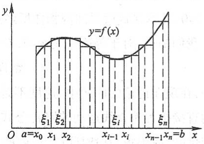

bar

| Interval | Description |
| --- | --- |
| \(\xi_1\) | Leftmost interval (between x_0 and x_1) |
| \(\xi_2\) | Second interval (between x_1 and x_2) |
| \(\xi_i\) | Third interval (between x_{i-1} and x_i) |
| \(\xi_n\) | Fourth interval (between x_{n-1} and x_n = b) |

图5-1

于曲边梯形的高 $f(x)$ 在区间 $[a, b]$ 上是连续变化的，在很小一段区间上它的变化很小，近似于不变。因此，如果把区间 $[a, b]$ 划分为许多小区间，在每个小区间上用其中某一点处的高来近似代替同一个小区间上的窄曲边梯形的变高，那么，每个窄曲边梯形就可近似地看成这样得到的窄矩形。我们就以所有这些窄矩形面积之和作为曲边梯形

219

---

第五章 定积分

面积的近似值,并把区间 $[a,b]$ 无限细分下去,即使每个小区间的长度都趋于零,这时所有窄矩形面积之和的极限就可定义为曲边梯形的面积.这个定义同时也给出了计算曲边梯形面积的方法,现详述于下:

在区间 $[a, b]$ 中任意插入 $n - 1$ 个分点

$$
a = x _ {0} <   x _ {1} <   x _ {2} <   \dots <   x _ {n - 1} <   x _ {n} = b,
$$

把 $[a,b]$ 分成 $n$ 个小区间

$$
\left[ x _ {0}, x _ {1} \right], \quad \left[ x _ {1}, x _ {2} \right], \quad \dots , \quad \left[ x _ {n - 1}, x _ {n} \right],
$$

它们的长度依次为

$$
\Delta x _ {1} = x _ {1} - x _ {0}, \quad \Delta x _ {2} = x _ {2} - x _ {1}, \quad \dots , \quad \Delta x _ {n} = x _ {n} - x _ {n - 1}.
$$

经过每一个分点作平行于 y 轴的直线段, 把曲边梯形分成 n 个窄曲边梯形. 在每个小区间  $\left[x_{i-1}, x_{i}\right]$  上任取一点  $\xi_{i}$ , 以  $\left[x_{i-1}, x_{i}\right]$  为底、 $f(\xi_{i})$  为高的窄矩形近似替代第 i 个窄曲边梯形 ( $i=1,2,\cdots,n$ ), 把这样得到的 n 个窄矩形面积之和作为所求曲边梯形面积 A 的近似值, 即

$$
A \approx f (\xi_ {1}) \Delta x _ {1} + f (\xi_ {2}) \Delta x _ {2} + \dots + f (\xi_ {n}) \Delta x _ {n} = \sum_ {i = 1} ^ {n} f (\xi_ {i}) \Delta x _ {i}.
$$

为了保证所有小区间的长度都无限缩小,我们要求小区间长度中的最大者趋于零,如记  $\lambda=\max\left\{\Delta x_{1},\Delta x_{2},\cdots,\Delta x_{n}\right\}$ , 则上述条件可表示为  $\lambda\to0$ . 当  $\lambda\to0$  时(这时分段数 n 无限增多, 即  $n\to\infty$ ), 取上述和式的极限, 便得曲边梯形的面积

$$
A = \lim _ {\lambda \to 0} \sum_ {i = 1} ^ {n} f (\xi_ {i}) \Delta x _ {i}.
$$

## 2. 变速直线运动的路程

设某物体做直线运动,已知速度  $v=v(t)$  是时间间隔  $[T_{1}, T_{2}]$  上 t 的连续函数,且  $v(t) \geqslant 0$ , 计算在这段时间内物体所经过的路程 s.

我们知道,对于等速直线运动,有公式

路程 $=$ 速度 $\times$ 时间.

但是,在现在讨论的问题中,速度不是常量而是随时间变化的变量,因此,所求路程s不能直接按等速直线运动的路程公式来计算.然而,物体运动的速度函数 $v=v(t)$ 是连续变化的,在很短一段时间内,速度的变化很小,近似于等速.因此,如果把时间间隔分小,在小段时间内,以等速运动代替变速运动,那么,就可算出部分路程的近似值;再求和,得到整个路程的近似值;最后,通过对时间间隔无限细分的极限过程,这时所有部分路程的近似值之和的极限,就是所求变速直线运动的路程的精确值.

具体计算步骤如下:

在时间间隔 $\left[T_{1},T_{2}\right]$ 内任意插入若干个分点

220

---

第一节 定积分的概念与性质

$$
T _ {1} = t _ {0} <   t _ {1} <   t _ {2} <   \dots <   t _ {n - 1} <   t _ {n} = T _ {2},
$$

把 $\left[T_{1},T_{2}\right]$ 分成n个小时段

$$
\left[ t _ {0}, t _ {1} \right], \quad \left[ t _ {1}, t _ {2} \right], \quad \dots , \quad \left[ t _ {n - 1}, t _ {n} \right],
$$

各小时段时间的长依次为

$$
\Delta t _ {1} = t _ {1} - t _ {0}, \quad \Delta t _ {2} = t _ {2} - t _ {1}, \quad \dots , \quad \Delta t _ {n} = t _ {n} - t _ {n - 1}.
$$

相应地,在各段时间内物体经过的路程依次为

$$
\Delta s _ {1}, \quad \Delta s _ {2}, \quad \dots , \quad \Delta s _ {n}.
$$

在时间间隔 $\left[t_{i-1},t_{i}\right]$ 上任取一个时刻 $\tau_{i}\left(t_{i-1}\leqslant\tau_{i}\leqslant t_{i}\right)$ ，以 $\tau_{i}$ 时的速度 $v(\tau_{i})$ 来代替 $\left[t_{i-1},t_{i}\right]$ 上各个时刻的速度，得到部分路程 $\Delta s_{i}$ 的近似值，即

$$
\Delta s _ {i} \approx v (\tau_ {i}) \Delta t _ {i} (i = 1, 2, \dots , n).
$$

于是这 n 段部分路程的近似值之和就是所求变速直线运动路程 s 的近似值, 即

$$
s \approx v (\tau_ {1}) \Delta t _ {1} + v (\tau_ {2}) \Delta t _ {2} + \dots + v (\tau_ {n}) \Delta t _ {n} = \sum_ {i = 1} ^ {n} v (\tau_ {i}) \Delta t _ {i}.
$$

记  $\lambda=\max\left\{\Delta t_{1},\Delta t_{2},\cdots,\Delta t_{n}\right\}$ ，当  $\lambda\to0$  时，取上述和式的极限，即得变速直线运动的路程

$$
s = \lim _ {\lambda \to 0} \sum_ {i = 1} ^ {n} v (\tau_ {i}) \Delta t _ {i}.
$$

## 二、定积分的定义

从上面两个例子可以看到:所要计算的量,即曲边梯形的面积 A 及变速直线运动的路程 s 的实际意义虽然不同,前者是几何量,后者是物理量,但是它们都由一个函数及其自变量的变化区间所决定,如:

曲边梯形的高度  $y=f(x)$  及其底边上的点 x 的变化区间  $[a,b]$ ,

直线运动的速度  $v=v(t)$  及时间 t 的变化区间  $[T_{1}, T_{2}]$ .

其次,计算这些量的方法与步骤都是相同的,并且它们都归结为具有相同结构的一种特定和的极限,如

面积 $A = \lim_{\lambda \to 0}\sum_{i = 1}^{n}f(\xi_i)\Delta x_i,$

路程  $s=\lim_{\lambda\to0}\sum_{i=1}^{n}v(\tau_{i})\Delta t_{i}.$

抛开这些问题的具体意义,抓住它们在数量关系上共同的本质与特性加以概括,我们就可以抽象出下述定积分的定义:

定义 设函数 $f(x)$ 在 $[a, b]$ 上有界，在 $[a, b]$ 中任意插入若干个分点

$$
a = x _ {0} <   x _ {1} <   x _ {2} <   \dots <   x _ {n - 1} <   x _ {n} = b,
$$

把区间 $[a, b]$ 分成 $n$ 个小区间

221

---

第五章 定积分

$$
\left[ x _ {0}, x _ {1} \right], \quad \left[ x _ {1}, x _ {2} \right], \quad \dots , \quad \left[ x _ {n - 1}, x _ {n} \right],
$$

各个小区间的长度依次为

$$
\Delta x _ {1} = x _ {1} - x _ {0}, \quad \Delta x _ {2} = x _ {2} - x _ {1}, \quad \dots , \quad \Delta x _ {n} = x _ {n} - x _ {n - 1}.
$$

在每个小区间 $\left[x_{i-1},x_{i}\right]$ 上任取一点 $\xi_{i}\left(x_{i-1}\leqslant\xi_{i}\leqslant x_{i}\right)$ ，作函数值 $f(\xi_{i})$ 与小区间长度 $\Delta x_{i}$ 的乘积 $f(\xi_{i})\Delta x_{i}(i=1,2,\cdots,n)$ ，并作出和

$$
S = \sum_ {i = 1} ^ {n} f (\xi_ {i}) \Delta x _ {i}. \tag {1-1}
$$

记  $\lambda=\max\left\{\Delta x_{1},\Delta x_{2},\cdots,\Delta x_{n}\right\}$ ，如果当  $\lambda\to0$  时，这和的极限总存在，且与闭区间  $[a,b]$  的分法及点  $\xi_{i}$  的取法无关，那么称这个极限 I 为函数  $f(x)$  在区间  $[a,b]$  上的定积分（简称积分），记作  $\int_{a}^{b}f(x)\mathrm{d}x$ ，即

$$
\int_ {a} ^ {b} f (x) \mathrm{d} x = I = \lim _ {\lambda \rightarrow 0} \sum_ {i = 1} ^ {n} f (\xi_ {i}) \Delta x _ {i}, \tag {1-2}
$$

其中 $f(x)$ 叫做被积函数, $f(x)\mathrm{d}x$ 叫做被积表达式, $x$ 叫做积分变量, $a$ 叫做积分下限, $b$ 叫做积分上限, $[a,b]$ 叫做积分区间.

利用“$\varepsilon - \delta$”的说法，上述定积分的定义可以表述如下:

设有常数 I, 如果对于任意给定的正数  $\varepsilon$ , 总存在一个正数  $\delta$ , 使得对于区间  $[a, b]$  的任何分法, 不论  $\xi_{i}$  在  $[x_{i-1}, x_{i}]$  中怎样选取, 只要  $\lambda = \max\{\Delta x_{1}, \Delta x_{2}, \cdots, \Delta x_{n}\} < \delta$ , 总有

$$
\left| \sum_ {i = 1} ^ {n} f (\xi_ {i}) \Delta x _ {i} - I \right| <   \varepsilon
$$

成立,那么称 I 是  $f(x)$  在区间  $[a,b]$  上的定积分,记作  $\int_{a}^{b}f(x)\mathrm{d}x$ .

注意 当和式 $\sum_{i=1}^{n} f(\xi_i) \Delta x_i$ 的极限存在时, 其极限 $I$ 仅与被积函数 $f(x)$ 及积分区间 $[a, b]$ 有关. 如果既不改变被积函数 $f$, 也不改变积分区间 $[a, b]$, 而只把积分变量 $x$ 改写成其他字母, 例如 $t$ 或 $u$, 那么, 这时和的极限 $I$ 不变, 也就是定积分的值不变, 即

$$
\int_ {a} ^ {b} f (x) \mathrm{d} x = \int_ {a} ^ {b} f (t) \mathrm{d} t = \int_ {a} ^ {b} f (u) \mathrm{d} u.
$$

这就是说,定积分的值只与被积函数及积分区间有关,而与积分变量的记法无关.

和式 $\sum_{i=1}^{n} f(\xi_i) \Delta x_i$ 通常称为 $f(x)$ 的积分和. 如果 $f(x)$ 在 $[a, b]$ 上的定积分存在, 那么就说 $f(x)$ 在 $[a, b]$ 上可积.

对于定积分,有这样一个重要问题:函数 $f(x)$ 在 $[a,b]$ 上满足怎样的条件, $f(x)$ 在 $[a,b]$ 上一定可积?这个问题我们不作深入讨论,而只给出以下两个充分条件:

定理1 设 $f(x)$ 在区间 $[a, b]$ 上连续，则 $f(x)$ 在 $[a, b]$ 上可积.

222

---

第一节 定积分的概念与性质

定理2 设 $f(x)$ 在区间 $[a, b]$ 上有界，且只有有限个间断点，则 $f(x)$ 在 $[a, b]$ 上可积.

利用定积分的定义,前面所讨论的两个实际问题可以分别表述如下:

曲线 $y = f(x)(f(x)\geqslant 0),x$ 轴及两条直线 $x = a,x = b$ 所围成的曲边梯形的面积 $A$ 等于函数 $f(x)$ 在区间 $[a,b]$ 上的定积分，即

$$
A = \int_ {a} ^ {b} f (x)   \mathrm{d} x.
$$

物体以变速 $v = v(t)(v(t)\geqslant 0)$ 做直线运动，从时刻 $t = T_{1}$ 到时刻 $t = T_{2}$，这物体经过的路程 $s$ 等于函数 $v(t)$ 在区间 $[T_1,T_2]$ 上的定积分，即

$$
s = \int_ {T _ {1}} ^ {T _ {2}} v (t) \mathrm{d} t.
$$

下面讨论定积分的几何意义. 在 $[a, b]$ 上 $f(x) \geqslant 0$ 时, 我们已经知道, 定积分 $\int_{a}^{b} f(x) \mathrm{d}x$ 表示由曲线 $y = f(x)$, 两条直线 $x = a, x = b$ 与 $x$ 轴所围成的曲边梯形的面积; 在 $[a, b]$ 上 $f(x) \leqslant 0$ 时, 由曲线 $y = f(x)$, 两条直线 $x = a, x = b$ 与 $x$ 轴所围成的曲边梯形位于 $x$ 轴的下方, 定积分

$$
\int_ {a} ^ {b} f (x) \mathrm{d} x
$$

表示上述曲边梯形面积的负值；在 $[a, b]$ 上 $f(x)$ 既取得正值又取得负值时，函数 $f(x)$ 的图形某些部分在 $x$ 轴的上方，而其他部分在 $x$ 轴下方（图5-2），此时定积分 $\int_{a}^{b} f(x) \mathrm{d}x$ 表示 $x$ 轴上方图形面积减去 $x$ 轴下方图形面积所得之差.

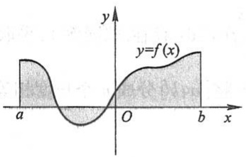

text_image

y
y=f(x)
a O b x

图5-2

最后,举一个按定义计算定积分的例子.

例1 利用定义计算定积分 $\int_0^1 x^2\mathrm{d}x.$

解 因为被积函数 $f(x) = x^2$ 在积分区间[0,1]上连续，而连续函数是可积的，所以积分与区间[0,1]的分法及点 $\xi_i$ 的取法无关。因此，为了便于计算，不妨把区间[0,1]分成 $n$ 等份，分点为 $x_i = \frac{i}{n}, i = 1, 2, \dots, n-1$。这样，每个小区间 $[x_{i-1}, x_i]$ 的长度 $\Delta x_i = \frac{1}{n}, i = 1, 2, \dots, n$。取 $\xi_i = x_i, i = 1, 2, \dots, n$。于是，得和式

$$
\sum_ {i = 1} ^ {n} f (\xi_ {i}) \Delta x _ {i} = \sum_ {i = 1} ^ {n} \xi_ {i} ^ {2} \Delta x _ {i} = \sum_ {i = 1} ^ {n} x _ {i} ^ {2} \Delta x _ {i} = \sum_ {i = 1} ^ {n} \left(\frac {i}{n}\right) ^ {2} \cdot \frac {1}{n} = \frac {1}{n ^ {3}} \sum_ {i = 1} ^ {n} i ^ {2}
$$

223

---

第五章 定积分

$$
= \frac {1}{n ^ {3}} \cdot \frac {1}{6} n (n + 1) (2 n + 1) ① = \frac {1}{6} \left(1 + \frac {1}{n}\right) \left(2 + \frac {1}{n}\right).
$$

当 $\lambda \to 0$ 即 $n\to \infty$ 时，取上式右端的极限.由定积分的定义，即得所要计算的积分为

$$
\int_ {0} ^ {1} x ^ {2} \mathrm{d} x = \lim _ {\lambda \rightarrow 0} \sum_ {i = 1} ^ {n} \xi_ {i} ^ {2} \Delta x _ {i} = \lim _ {n \rightarrow \infty} \frac {1}{6} \left(1 + \frac {1}{n}\right)\left(2 + \frac {1}{n}\right) = \frac {1}{3}.
$$

## 三、定积分的近似计算

从例 1 的计算过程中可以看到, 对于任一确定的正整数 n, 积分和

$$
\sum_ {i = 1} ^ {n} f (\xi_ {i}) \Delta x _ {i} = \frac {1}{6} \left(1 + \frac {1}{n}\right) \left(2 + \frac {1}{n}\right)
$$

都是定积分 $\int_0^1 x^2\mathrm{d}x$ 的近似值.当 $n$ 取不同值时，可得到定积分 $\int_0^1 x^2\mathrm{d}x$ 精度不同的近似值.一般说来， $n$ 取得越大，近似程度越好.

下面就一般情形,讨论定积分的近似计算问题.设 $f(x)$ 在 $[a,b]$ 上连续,这时定积分 $\int_{a}^{b}f(x)\mathrm{d}x$ 存在.如同例1,采取把区间 $[a,b]$ 等分的分法,即用分点 $a=x_{0},x_{1},x_{2},\cdots,x_{n}=b$ 将 $[a,b]$ 分成n个长度相等的小区间,每个小区间的长为

$$
\Delta x = \frac {b - a}{n},
$$

在小区间 $[x_{i - 1},x_i]$ 上，取 $\xi_{i} = x_{i - 1}$ ，应有

① 利用恒等式 $(n+1)^{3}=n^{3}+3n^{2}+3n+1$ ，得

$$
\left\{ \begin{array}{l} (n + 1) ^ {3} - n ^ {3} = 3 n ^ {2} + 3 n + 1, \\ n ^ {3} - (n - 1) ^ {3} = 3 (n - 1) ^ {2} + 3 (n - 1) + 1, \\ \dots \dots \\ 3 ^ {3} - 2 ^ {3} = 3 \times 2 ^ {2} + 3 \times 2 + 1, \\ 2 ^ {3} - 1 ^ {3} = 3 \times 1 ^ {2} + 3 \times 1 + 1. \end{array} \right.
$$

把这 $n$ 个等式两端分别相加，得

$$
(n + 1) ^ {3} - 1 = 3 (1 ^ {2} + 2 ^ {2} + \dots + n ^ {2}) + 3 (1 + 2 + \dots + n) + n.
$$

由于  $1+2+\cdots+n=\frac{1}{2}n(n+1)$ ，代入上式，得

$$
n ^ {3} + 3 n ^ {2} + 3 n = 3 (1 ^ {2} + 2 ^ {2} + \dots + n ^ {2}) + \frac {3}{2} n (n + 1) + n.
$$

整理后,得

$$
1 ^ {2} + 2 ^ {2} + \dots + n ^ {2} = \frac {1}{6} n (n + 1) (2 n + 1).
$$

224

---

第一节 定积分的概念与性质

$$
\int_ {a} ^ {b} f (x) \mathrm{d} x = \lim _ {n \to \infty} \frac {b - a}{n} \sum_ {i = 1} ^ {n} f (x _ {i - 1}),
$$

从而对于任一确定的正整数 $n$ ，有

$$
\int_ {a} ^ {b} f (x) \mathrm{d} x \approx \frac {b - a}{n} \sum_ {i = 1} ^ {n} f (x _ {i - 1}).
$$

记 $f(x_{i})=y_{i}\quad(i=0,1,2,\cdots,n)$ ，上式可记作

$$
\int_ {a} ^ {b} f (x) \mathrm{d} x \approx \frac {b - a}{n} (y _ {0} + y _ {1} + \dots + y _ {n - 1}). \tag {1-3}
$$

如果取  $\xi_{i}=x_{i}$ ，则可得近似公式

$$
\int_ {a} ^ {b} f (x) \mathrm{d} x \approx \frac {b - a}{n} (y _ {1} + y _ {2} + \dots + y _ {n}). \tag {1-4}
$$

以上求定积分近似值的方法称为矩形法, 公式(1-3)、(1-4)称为矩形法公式.

矩形法的几何意义是:用窄条矩形的面积作为窄条曲边梯形面积的近似值.整体上用台阶形的面积作为曲边梯形面积的近似值.如图5-3所示.

求定积分近似值的方法,常用的还有梯形法和抛物线法(又称辛普森(Simpson)法),简单介绍一下:

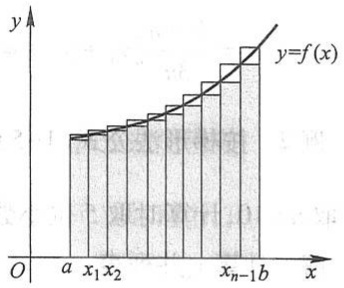

bar

| Interval | Value |
| --- | --- |
| 1 | ~0.5 |
| 2 | ~0.6 |
| 3 | ~0.7 |
| 4 | ~0.8 |
| 5 | ~0.9 |
| 6 | ~1.0 |
| 7 | ~1.1 |
| 8 | ~1.2 |
| 9 | ~1.3 |
| 10 | ~1.4 |
| 11 | ~1.5 |
| 12 | ~1.6 |
| 13 | ~1.7 |
| 14 | ~1.8 |
| 15 | ~1.9 |
| 16 | ~2.0 |
| 17 | ~2.1 |
| 18 | ~2.2 |
| 19 | ~2.3 |
| 20 | ~2.4 |

图5-3

和矩形法一样, 将区间  $[a, b]n$  等分. 设  $f(x_{i}) = y_{i}$ , 曲线  $y = f(x)$  上的点  $(x_{i}, y_{i})$  记作  $M_{i}$   $(i = 0, 1, 2, \cdots, n)$ .

梯形法的原理是: 将曲线  $y = f(x)$  上的小弧段  $\widehat{M_{i-1}M_i}$  用直线段  $\overline{M_{i-1}M_i}$  代替, 也就是把窄条曲边梯形用窄条梯形代替(图 5-4(a)), 由此得到定积分的近似值为

$$
\begin{array}{l} \int_ {a} ^ {b} f (x) \mathrm{d} x \approx \frac {b - a}{n} \left(\frac {y _ {0} + y _ {1}}{2} + \frac {y _ {1} + y _ {2}}{2} + \dots + \frac {y _ {n - 1} + y _ {n}}{2}\right) \\ = \frac {b - a}{n} \left(\frac {y _ {0} + y _ {n}}{2} + y _ {1} + y _ {2} + \dots + y _ {n - 1}\right). \tag {1-5} \\ \end{array}
$$

显然,梯形法公式(1-5)所得近似值就是矩形法公式(1-3)和(1-4)所得两个近似值的平均值.

抛物线法的原理是: 将曲线  $y = f(x)$  上的两个小弧段  $\widehat{M_{i-1}M_i}$  和  $\widehat{M_iM_{i+1}}$  合起来, 用过  $M_{i-1}, M_i, M_{i+1}$  三点的抛物线  $y = px^2 + qx + r (p \neq 0)$  代替 (图 5-4(b)). 经推导可得, 以此抛物线弧段为曲边、以  $[x_{i-1}, x_{i+1}]$  为底的曲边梯形面积为

$$
\frac {1}{6} (y _ {i - 1} + 4 y _ {i} + y _ {i + 1}) \cdot 2 \Delta x = \frac {b - a}{3 n} (y _ {i - 1} + 4 y _ {i} + y _ {i + 1}).
$$

225

---

第五章 定积分

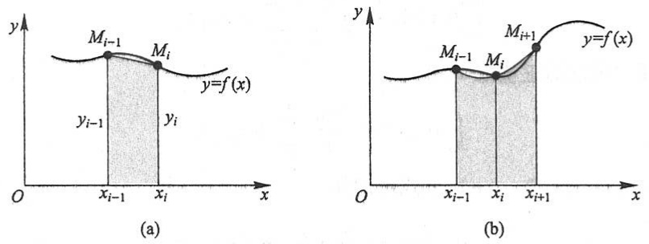

图5-4

取 n 为偶数, 得到定积分的近似值为

$$
\begin{array}{l} \int_ {a} ^ {b} f (x) \mathrm{d} x \approx \frac {b - a}{3 n} \left[ \left(y _ {0} + 4 y _ {1} + y _ {2}\right) + \left(y _ {2} + 4 y _ {3} + y _ {4}\right) + \dots + \left(y _ {n - 2} + 4 y _ {n - 1} + y _ {n}\right) \right] \\ = \frac {b - a}{3 n} [ y _ {0} + y _ {n} + 4 (y _ {1} + y _ {3} + \dots + y _ {n - 1}) + 2 (y _ {2} + y _ {4} + \dots + y _ {n - 2}) ]. \tag {1-6} \\ \end{array}
$$

例 2 按梯形法公式(1-5)和抛物线法公式(1-6)计算定积分  $\int_{0}^{1}\frac{4}{1+x^{2}}dx$  的近似值(取 n=10, 计算时取 5 位小数).

解 计算  $y_{i}$  并列表:

| i | $x_i$ | $y_i$ |
| --- | --- | --- |
| 0 | 0.0 | 4.000 00 |
| 1 | 0.1 | 3.960 40 |
| 2 | 0.2 | 3.846 15 |
| 3 | 0.3 | 3.669 72 |
| 4 | 0.4 | 3.448 28 |
| 5 | 0.5 | 3.200 00 |
| 6 | 0.6 | 2.941 18 |
| 7 | 0.7 | 2.684 56 |
| 8 | 0.8 | 2.439 02 |
| 9 | 0.9 | 2.209 94 |
| 10 | 1.0 | 2.000 00 |

按梯形法公式(1-5)求得近似值为

$$
S _ {1} = 3. 1 3 9 9 3,
$$

按抛物线法公式(1-6)求得近似值为

$$
S _ {2} = 3. 1 4 1 5 9.
$$

226

---

第一节 定积分的概念与性质

本例所给积分的精确值为

$$
\int_ {0} ^ {1} \frac {4}{1 + x ^ {2}} \mathrm{d} x = \pi = 3. 1 4 1 5 9 2 6 \dots ,
$$

用 $S_{2}$ 作为所给积分的近似值，误差小于 $10^{-5}$.

计算定积分的近似值的方法很多,这里不再作介绍.随着计算机应用的普及,定积分的近似计算已变得更为方便,现在已有很多现成的数学软件可用于定积分的近似计算.

## 四、定积分的性质

为了以后计算及应用方便起见,对定积分作以下两点补充规定:

(1) 当 b=a 时， $\int_{a}^{a}f(x)\mathrm{d}x=0;$

(2) 当 a > b 时， $\int_{a}^{b} f(x) \, dx = -\int_{b}^{a} f(x) \, dx,$

由上式可知,交换定积分的上、下限时,定积分的绝对值不变而符号相反.

下面讨论定积分的性质.下列各性质中积分上、下限的大小,如不特别指明,均不加限制,并假定各性质中所出现的被积函数在积分区间上都是可积的.

性质1 设 $\alpha$ 与 $\beta$ 均为常数, 则

$$
\int_ {a} ^ {b} [ \alpha f (x) + \beta g (x) ] \mathrm{d} x = \alpha \int_ {a} ^ {b} f (x) \mathrm{d} x + \beta \int_ {a} ^ {b} g (x) \mathrm{d} x.
$$

证 $\int_{a}^{b}\left[\alpha f(x) + \beta g(x)\right]\mathrm{d}x = \lim_{\lambda \to 0}\sum_{i = 1}^{n}\left[\alpha f(\xi_i) + \beta g(\xi_i)\right]\Delta x_i$

$$
= \lim _ {\lambda \rightarrow 0} \alpha \sum_ {i = 1} ^ {n} f (\xi_ {i}) \Delta x _ {i} + \lim _ {\lambda \rightarrow 0} \beta \sum_ {i = 1} ^ {n} g (\xi_ {i}) \Delta x _ {i}
$$

$$
= \alpha \int_ {a} ^ {b} f (x) \mathrm{d} x + \beta \int_ {a} ^ {b} g (x) \mathrm{d} x.
$$

性质 1 对于任意有限个函数的线性组合也是成立的.

性质 2 设 a<c<b, 则

$$
\int_ {a} ^ {b} f (x) \mathrm{d} x = \int_ {a} ^ {c} f (x) \mathrm{d} x + \int_ {c} ^ {b} f (x) \mathrm{d} x.
$$

证 因为函数 $f(x)$ 在区间 $[a, b]$ 上可积，所以不论把 $[a, b]$ 怎样分，积分和的极限总是不变的。因此，在分区间时，可以使 $c$ 永远是个分点。那么，$[a, b]$ 上的积分和等于 $[a, c]$ 上的积分和加 $[c, b]$ 上的积分和，记为

$$
\sum_ {[ a, b ]} f (\xi_ {i}) \Delta x _ {i} = \sum_ {[ a, c ]} f (\xi_ {i}) \Delta x _ {i} + \sum_ {[ c, b ]} f (\xi_ {i}) \Delta x _ {i}.
$$

令  $\lambda \rightarrow 0$ ，上式两端同时取极限，即得

227

---

第五章 定积分

$$
\int_ {a} ^ {b} f (x) \mathrm{d} x = \int_ {a} ^ {c} f (x) \mathrm{d} x + \int_ {c} ^ {b} f (x) \mathrm{d} x.
$$

这个性质表明定积分对于积分区间具有可加性.

按定积分的补充规定,我们有:不论a,b,c的相对位置如何,总有等式

$$
\int_ {a} ^ {b} f (x) \mathrm{d} x = \int_ {a} ^ {c} f (x) \mathrm{d} x + \int_ {c} ^ {b} f (x) \mathrm{d} x
$$

成立.例如,当a<b<c时,由于

$$
\int_ {a} ^ {c} f (x) \mathrm{d} x = \int_ {a} ^ {b} f (x) \mathrm{d} x + \int_ {b} ^ {c} f (x) \mathrm{d} x,
$$

于是得

$$
\int_ {a} ^ {b} f (x) \mathrm{d} x = \int_ {a} ^ {c} f (x) \mathrm{d} x - \int_ {b} ^ {c} f (x) \mathrm{d} x = \int_ {a} ^ {c} f (x) \mathrm{d} x + \int_ {c} ^ {b} f (x) \mathrm{d} x.
$$

性质3 如果在区间 $[a, b]$ 上 $f(x) \equiv 1$，那么

$$
\int_ {a} ^ {b} 1 \mathrm{d} x = \int_ {a} ^ {b} \mathrm{d} x = b - a.
$$

这个性质的证明请读者自己完成.

性质 4 如果在区间  $[a, b]$  上  $f(x) \geqslant 0$ ，那么

$$
\int_ {a} ^ {b} f (x) \mathrm{d} x \geqslant 0 \quad (a <   b).
$$

证 因为 $f(x) \geqslant 0$ ，所以

$$
f (\xi_ {i}) \geqslant 0 \quad (i = 1, 2, \dots , n).
$$

又由于  $\Delta x_{i} \geqslant 0 (i = 1, 2, \cdots, n)$ ，因此

$$
\sum_ {i = 1} ^ {n} f (\xi_ {i}) \Delta x _ {i} \geqslant 0,
$$

令  $\lambda=\max\left\{\Delta x_{1},\Delta x_{2},\cdots,\Delta x_{n}\right\}\rightarrow0$  ,便得要证的不等式.

推论1 如果在区间 $[a, b]$ 上 $f(x) \leqslant g(x)$, 那么.

$$
\int_ {a} ^ {b} f (x) \mathrm{d} x \leqslant \int_ {a} ^ {b} g (x) \mathrm{d} x \quad (a <   b).
$$

证 因为 $g(x) - f(x) \geqslant 0$ ，由性质4得

$$
\int_ {a} ^ {b} \left[ g (x) - f (x) \right] \mathrm{d} x \geqslant 0.
$$

再利用性质1,便得要证的不等式.

推论2 $\left|\int_{a}^{b}f(x)\mathrm{d}x\right| \leqslant \int_{a}^{b}|f(x)|\mathrm{d}x \quad (a < b).$

证 因为

$$
- \left| f (x) \right| \leqslant f (x) \leqslant \left| f (x) \right|,
$$

所以由推论1及性质1可得

228

---

第一节 定积分的概念与性质

$$
- \int_ {a} ^ {b} | f (x) | \mathrm{d} x \leqslant \int_ {a} ^ {b} f (x) \mathrm{d} x \leqslant \int_ {a} ^ {b} | f (x) | \mathrm{d} x,
$$

即

$$
\left| \int_ {a} ^ {b} f (x)   \mathrm{d} x \right| \leqslant \int_ {a} ^ {b} | f (x) |   \mathrm{d} x.
$$

性质5 设 $M$ 及 $m$ 分别是函数 $f(x)$ 在区间 $[a, b]$ 上的最大值及最小值，则

$$
m (b - a) \leqslant \int_ {a} ^ {b} f (x)   \mathrm{d} x \leqslant M (b - a) \quad (a <   b).
$$

证 因为 $m \leqslant f(x) \leqslant M$，所以由性质4的推论1，得

$$
\int_ {a} ^ {b} m \mathrm{d} x \leqslant \int_ {a} ^ {b} f (x) \mathrm{d} x \leqslant \int_ {a} ^ {b} M \mathrm{d} x.
$$

再由性质 1 及性质 3, 即得所要证的不等式.

这个性质说明,由被积函数在积分区间上的最大值及最小值,可以估计积分值的大致范围.例如,定积分 $\int_{\frac{1}{2}}^{1}x^{4}dx$ ,它的被积函数 $f(x)=x^{4}$ 在积分区间 $\left[\frac{1}{2},1\right]$ 上是单调增加的,于是有最小值 $m=\left(\frac{1}{2}\right)^{4}=\frac{1}{16}$ 、最大值 $M=(1)^{4}=1$ .由性质5,得

$$
\frac {1}{1 6} \times \left(1 - \frac {1}{2}\right) \leqslant \int_ {\frac {1}{2}} ^ {1} x ^ {4} \mathrm{d} x \leqslant 1 \times \left(1 - \frac {1}{2}\right),
$$

即

$$
\frac {1}{3 2} \leqslant \int_ {\frac {1}{2}} ^ {1} x ^ {4} \mathrm{d} x \leqslant \frac {1}{2}.
$$

性质6(定积分中值定理) 如果函数 $f(x)$ 在积分区间 $[a, b]$ 上连续, 那么在 $[a, b]$ 上至少存在一个点 $\xi$, 使下式成立:

$$
\int_ {a} ^ {b} f (x) \mathrm{d} x = f (\xi) (b - a) \quad (a \leqslant \xi \leqslant b).
$$

这个公式叫做积分中值公式①.

证 把性质 5 中的不等式各边除以 b-a, 得

$$
m \leqslant \frac {1}{b - a} \int_ {a} ^ {b} f (x)   \mathrm{d} x \leqslant M.
$$

这表明,确定的数值 $\frac{1}{b-a}\int_{a}^{b}f(x)\mathrm{d}x\in[m,M]$ .根据闭区间上连续函数的介值定理(第一章第十节定理3)的推论,在 $[a,b]$ 上至少存在一点 $\xi$ ,使得函数 $f(x)$ 在点 $\xi$ 处的值与这个确定的数值相等,即应有

<small>① 可以证明  $\xi \in (a, b)$ ，参阅本章第二节例 6.</small>

229

---

第五章 定积分

$$
\frac {1}{b - a} \int_ {a} ^ {b} f (x)   \mathrm{d} x = f (\xi) \quad (a \leqslant \xi \leqslant b).
$$

两端各乘 b-a，即得所要证的等式.

显然,积分中值公式

$\int_{a}^{b}f(x)\mathrm{d}x = f(\xi)(b - a)$ （ $\xi$ 在 $a$ 与 $b$ 之间）

不论 $a < b$ 或 $a > b$ 都是成立的.

积分中值公式有如下的几何解释: 在区间  $[a, b]$  上至少存在一点  $\xi$ ，使得以区间  $[a, b]$  为底边、以曲线  $y = f(x)$  为曲边的曲边梯形的面积等于同一底边而高为  $f(\xi)$  的一个矩形的面积(图 5-5).

按积分中值公式所得

$$
f (\xi) = \frac {1}{b - a} \int_ {a} ^ {b} f (x) \mathrm{d} x
$$

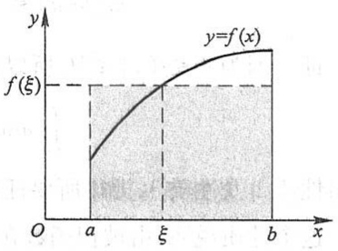

area

| X | Y |
| --- | --- |
| a | \(f(\xi)\) |
| \(\xi\) | \(f(\xi)\) |
| b | \(f(\xi)\) |

图5-5

称为函数 $f(x)$ 在区间 $[a,b]$ 上的平均值.例如按图5-5, $f(\xi)$ 可看作图中曲边梯形的平均高度.又如物体以变速 $v(t)$ 做直线运动，在时间区间 $[T_{1},T_{2}]$ 上经过的路程为 $\int_{T_{1}}^{T_{2}}v(t)\mathrm{d}t$ ，因此，

$$
v (\xi) = \frac {1}{T _ {2} - T _ {1}} \int_ {T _ {1}} ^ {T _ {2}} v (t) \mathrm{d} t, \quad \xi \in [ T _ {1}, T _ {2} ]
$$

便是运动物体在 $\left[T_{1},T_{2}\right]$ 这段时间内的平均速度.

## 习题5-1

\* 1. 利用定积分的定义计算由抛物线 $y = x^2 + 1$、两直线 $x = a, x = b (b > a)$ 及 $x$ 轴所围成的图形的面积.

\*2. 利用定积分的定义计算下列积分:

(1) $\int_{a}^{b}x\mathrm{d}x(a<b)$ ;

(2) $\int_0^1\mathrm{e}^x\mathrm{d}x.$

3. 利用定积分的几何意义, 证明下列等式:

(1) $\int_{0}^{1}2xdx=1;$

(2) $\int_0^1\sqrt{1 - x^2}\mathrm{d}x = \frac{\pi}{4};$

(3) $\int_{-\pi}^{\pi}\sin xdx=0;$

(4) $\int_{-\frac{\pi}{2}}^{\frac{\pi}{2}}\cos x\mathrm{d}x = 2\int_{0}^{\frac{\pi}{2}}\cos x\mathrm{d}x.$

4. 利用定积分的几何意义, 求下列积分:

(1) $\int_{0}^{t} x \, \mathrm{d}x (t > 0)$;

(2) $\int_{-2}^{4}\left(\frac{x}{2} + 3\right)\mathrm{d}x;$

230

---

第一节 定积分的概念与性质

(3) $\int_{-1}^{2}|x|\mathrm{d}x;$

(4) $\int_{-3}^{3}\sqrt{9 - x^2}\mathrm{d}x.$

5. 设 $a < b$ ，问 $a, b$ 取什么值时，积分 $\int_{a}^{b}(x - x^2) \, \mathrm{d}x$ 取得最大值？

6. 试从定积分的几何意义,说明以下等式成立:

$$
\int_ {1} ^ {\mathrm{e}} \ln x \mathrm{d} x + \int_ {0} ^ {1} \mathrm{e} ^ {x} \mathrm{d} x = \mathrm{e}.
$$

7. 已知 $\ln 2 = \int_{0}^{1} \frac{1}{1 + x} \mathrm{d}x$，试用抛物线法公式(1-6)，求出 $\ln 2$ 的近似值（取 $n = 10$，计算时取4位小数）.

8. 设 $\int_{-1}^{1} 3f(x) \, \mathrm{d}x = 18, \int_{-1}^{3} f(x) \, \mathrm{d}x = 4, \int_{-1}^{3} g(x) \, \mathrm{d}x = 3.$ 求:

(1) $\int_{-1}^{1} f(x) \, \mathrm{d}x$;

(2) $\int_{1}^{3} f(x) \, \mathrm{d}x$;

(3) $\int_{3}^{-1}g(x)\mathrm{d}x;$

(4) $\int_{-1}^{3}\frac{1}{5}[4f(x) + 3g(x)]\mathrm{d}x.$

9. 证明定积分的性质:

(1) $\int_{a}^{b}kf(x)\mathrm{d}x = k\int_{a}^{b}f(x)\mathrm{d}x$ ( $k$ 是常数);

(2) $\int_{a}^{b} 1 \cdot \mathrm{d}x = \int_{a}^{b} \mathrm{d}x = b - a.$

10. 估计下列各积分的值:

(1) $\int_{1}^{4}(x^2 + 1)\mathrm{d}x$;

(2) $\int_{\frac{\pi}{4}}^{\frac{5}{4}\pi}(1 + \sin^2 x)\mathrm{d}x;$

(3) $\int_{\frac{1}{\sqrt{3}}}^{\sqrt{3}}x\arctan xdx;$

(4) $\int_{2}^{0}\mathrm{e}^{x^{2}-x}\mathrm{d}x.$

11. 设 $f(x)$ 在 $[0,1]$ 上连续，证明 $\int_0^1 f^2 (x)\mathrm{d}x\geqslant \left[\int_0^1 f(x)\mathrm{d}x\right]^2.$

12. 设 $f(x)$ 及 $g(x)$ 在 $[a, b]$ 上连续，证明:

(1) 若在  $[a, b]$  上， $f(x) \geqslant 0$ ，且  $f(x) \neq 0$ ，则  $\int_{a}^{b} f(x) \, dx > 0$ ;

(2) 若在  $[a, b]$  上， $f(x) \geqslant 0$ ，且  $\int_{a}^{b} f(x) \, dx = 0$ ，则在  $[a, b]$  上  $f(x) \equiv 0$ ;

(3) 若在 $[a, b]$ 上，$f(x) \leqslant g(x)$，且 $\int_{a}^{b} f(x) \, \mathrm{d}x = \int_{a}^{b} g(x) \, \mathrm{d}x$，则在 $[a, b]$ 上 $f(x) \equiv g(x)$.

13. 根据定积分的性质及第 12 题的结论,说明下列各对积分中哪一个的值较大:

(1) $\int_{0}^{1}x^{2}dx$ 还是 $\int_{0}^{1}x^{3}dx?$

(2) $\int_{1}^{2} x^{2} \mathrm{~d} x$ 还是 $\int_{1}^{2} x^{3} \mathrm{~d} x$?

(3) $\int_{1}^{2}\ln xdx$ 还是 $\int_{1}^{2}(\ln x)^{2}dx?$

(4) $\int_0^1 x\mathrm{d}x$ 还是 $\int_0^1\ln (1 + x)\mathrm{d}x?$

(5) $\int_{0}^{1}e^{x}dx$ 还是 $\int_{0}^{1}(1+x)\mathrm{d}x$ ?

231

---

第五章 定积分

## 第二节 微积分基本公式

在第一节中有一个应用定积分的定义计算积分的例子.从这个例子我们看到,被积函数虽然是简单的幂函数 $f(x)=x^{2}$ ,但直接按定义来计算它的定积分已经不是很容易的事.如果被积函数是其他复杂的函数,其困难就更大了.因此,我们必须寻求计算定积分的新方法.

下面先从实际问题中寻找解决问题的线索.为此,我们对变速直线运动中遇到的位置函数 $s(t)$ 及速度函数 $v(t)$ 之间的联系作进一步的研究.

## 一、变速直线运动中位置函数与速度函数之间的联系

有一物体在一直线上运动.在这直线上取定原点、正方向及长度单位,使它成一数轴.设时刻 t 时物体所在位置为  $s(t)$ , 速度为  $v(t)$  (为了讨论方便起见, 可以设  $v(t) \geqslant 0$ ).

从第一节知道:物体在时间间隔 $\left[T_{1},T_{2}\right]$ 内经过的路程可以用速度函数 $v(t)$ 在 $\left[T_{1},T_{2}\right]$ 上的定积分

$$
\int_ {T _ {1}} ^ {T _ {2}} v (t) \mathrm{d} t
$$

来表达;另一方面,这段路程又可以通过位置函数 $s(t)$ 在区间 $[T_{1},T_{2}]$ 上的增量

$$
s (T _ {2}) - s (T _ {1})
$$

来表达.由此可见,位置函数 $s(t)$ 与速度函数 $v(t)$ 之间有如下关系:

$$
\int_ {T _ {1}} ^ {T _ {2}} v (t) \mathrm{d} t = s (T _ {2}) - s (T _ {1}). \tag {2-1}
$$

因为 $s'(t) = v(t)$，即位置函数 $s(t)$ 是速度函数 $v(t)$ 的原函数，所以关系式(2-1)表示，速度函数 $v(t)$ 在区间 $[T_1, T_2]$ 上的定积分等于 $v(t)$ 的原函数 $s(t)$ 在区间 $[T_1, T_2]$ 上的增量

$$
s (T _ {2}) - s (T _ {1}).
$$

上述从变速直线运动的路程这个特殊问题中得出来的关系,在一定条件下具有普遍性.事实上,我们将在第三目中证明,如果函数 $f(x)$ 在区间 $[a,b]$ 上连续,那么, $f(x)$ 在区间 $[a,b]$ 上的定积分就等于 $f(x)$ 的原函数(设为 $F(x)$)在区间 $[a,b]$ 上的增量

$$
F (b) - F (a).
$$

## 二、积分上限的函数及其导数

设函数 $f(x)$ 在区间 $[a, b]$ 上可积，并且设 $x$ 为 $[a, b]$ 上的一点。我们来考察 $f(x)$ 在

232

---

第二节 微积分基本公式

部分区间 $[a, x]$ 上的定积分

$$
\int_ {a} ^ {x} f (x) \mathrm{d} x.
$$

首先,由于 $f(x)$ 在 $[a,x]$ 上仍旧可积,因此这个定积分存在.这里,x既表示定积分的上限,又表示积分变量.因为定积分与积分变量的记法无关,所以,为了明确起见,可以把积分变量改用其他符号,例如用t表示,则上面的定积分可以写成

$$
\int_ {a} ^ {x} f (t) \mathrm{d} t.
$$

如果上限 x 在区间  $[a, b]$  上任意变动, 那么对于每一个取定的 x 值, 定积分有一个对应值, 所以它在  $[a, b]$  上定义了一个函数, 记作  $\Phi(x)$ :

$$
\Phi (x) = \int_ {a} ^ {x} f (t) \mathrm{d} t \quad (a \leqslant x \leqslant b).
$$

这个函数  $\Phi(x)$  具有下面定理 1 所指出的重要性质.

定理1 如果函数 $f(x)$ 在区间 $[a, b]$ 上连续，那么积分上限的函数

$$
\Phi (x) = \int_ {a} ^ {x} f (t)   \mathrm{d} t
$$

在 $[a, b]$ 上可导，并且它的导数

$$
\Phi^ {\prime} (x) = \frac {\mathrm{d}}{\mathrm{d} x} \int_ {a} ^ {x} f (t)   \mathrm{d} t = f (x) \quad (a \leqslant x \leqslant b). \tag {2-2}
$$

证 若 $x \in (a, b)$, 设 $x$ 获得增量 $\Delta x$, 其绝对值足够地小, 使得 $x + \Delta x \in (a, b)$, 则 $\Phi(x)$ (图5-6, 图中 $\Delta x > 0$) 在 $x + \Delta x$ 处的函数值为

$$
\Phi (x + \Delta x) = \int_ {a} ^ {x + \Delta x} f (t)   \mathrm{d} t.
$$

由此得函数的增量

$$
\begin{array}{l} \Delta \Phi = \Phi (x + \Delta x) - \Phi (x) \\ = \int_ {a} ^ {x + \Delta x} f (t) \mathrm{d} t - \int_ {a} ^ {x} f (t) \mathrm{d} t \\ = \int_ {a} ^ {x} f (t) \mathrm{d} t + \int_ {x} ^ {x + \Delta x} f (t) \mathrm{d} t - \int_ {a} ^ {x} f (t) \mathrm{d} t \\ = \int_ {x} ^ {x + \Delta x} f (t)   \mathrm{d} t. \\ \end{array}
$$

再应用积分中值定理,即有等式

$$
\Delta \Phi = f (\xi)   \Delta x  ,
$$

这里，$\xi$ 在 $x$ 与 $x + \Delta x$ 之间. 把上式两端各除以 $\Delta x$ ，得函数增量与自变量增量的比值

$$
\frac {\Delta \Phi}{\Delta x} = f (\xi).
$$

由于假设 $f(x)$ 在 $[a,b]$ 上连续，而 $\Delta x\to 0$ 时， $\xi \rightarrow x$ ，因此 $\lim_{\Delta x\to 0}f(\xi) = f(x)$ .于是，令

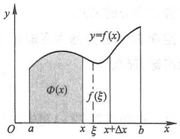

text_image

y
y=f(x)
Φ(x)
f(ξ)
O a x ξ x+Δx b x

图5-6

233

---

第五章 定积分

$\Delta x \to 0$ 对上式两端取极限时, 左端的极限也应该存在且等于 $f(x)$. 这就是说, 函数 $\Phi(x)$ 的导数存在, 并且

$$
\Phi^ {\prime} (x) = f (x).
$$

若 $x = a$ ，取 $\Delta x > 0$ ，则同理可证 $\Phi_{+}^{\prime}(a) = f(a)$ ；若 $x = b$ ，取 $\Delta x < 0$ ，则同理可证$\Phi_{-}^{\prime}(b) = f(b)$

定理 1 证毕.

这个定理指出了一个重要结论:连续函数 $f(x)$ 取变上限x的定积分然后求导,其结果还原为 $f(x)$ 本身.联想到原函数的定义,就可以从定理1推知 $\Phi(x)$ 是连续函数 $f(x)$ 的一个原函数.因此,我们引出如下的原函数存在定理:

定理2 如果函数 $f(x)$ 在区间 $[a, b]$ 上连续，那么函数

$$
\Phi (x) = \int_ {a} ^ {x} f (t) \mathrm{d} t \tag {2-3}
$$

就是 $f(x)$ 在 $[a,b]$ 上的一个原函数.

这个定理的重要意义是:一方面肯定了连续函数的原函数是存在的,另一方面初步地揭示了积分学中的定积分与原函数之间的联系.因此,我们就有可能通过原函数来计算定积分.

## 三、牛顿-莱布尼茨公式

现在我们根据定理 2 来证明一个重要定理——微积分基本定理, 它给出了用原函数计算定积分的公式.

定理3（微积分基本定理）如果函数 $F(x)$ 是连续函数 $f(x)$ 在区间 $[a, b]$ 上的一个原函数，那么

$$
\int_ {a} ^ {b} f (x) \mathrm{d} x = F (b) - F (a). \tag {2-4}
$$

证 已知函数 $F(x)$ 是连续函数 $f(x)$ 的一个原函数, 又根据定理2知道, 积分上限的函数

$$
\Phi (x) = \int_ {a} ^ {x} f (t) \mathrm{d} t
$$

也是 $f(x)$ 的一个原函数.于是这两个原函数之差 $F(x) - \Phi (x)$ 在 $[a,b]$ 上必定是某一个常数 $C$ （第四章第一节），即

$$
F (x) - \Phi (x) = C \quad (a \leqslant x \leqslant b). \tag {2-5}
$$

在上式中令 $x = a$ ，得 $F(a) - \Phi (a) = C.$ 又由 $\Phi (x)$ 的定义式(2-3)及上节定积分的补充规定(1)可知 $\Phi (a) = 0$ ，因此， $C = F(a)$ .以 $F(a)$ 代入(2-5)式中的 $C$ ，以 $\int_{a}^{x}f(t)\mathrm{d}t$ 代入(2-5)式中的 $\Phi (x)$ ，可得

234

---

第二节 微积分基本公式

$$
\int_ {a} ^ {x} f (t) \mathrm{d} t = F (x) - F (a).
$$

在上式中令 x=b，就得到所要证明的公式(2-4).

由上节定积分的补充规定(2)可知,(2-4)式对a>b的情形同样成立.

为了方便起见,以后把  $F(b)-F(a)$  记成  $[F(x)]_{a}^{b}$ , 于是(2-4)式又可写成

$$
\int_ {a} ^ {b} f (x) \mathrm{d} x = [ F (x) ] _ {a} ^ {b}.
$$

公式(2-4)叫做牛顿(Newton)-莱布尼茨(Leibniz)公式①,也叫做微积分基本公式.这个公式进一步揭示了定积分与被积函数的原函数或不定积分之间的联系.它表明:一个连续函数在区间[a,b]上的定积分等于它的任一个原函数在区间[a,b]上的增量.这就给定积分提供了一个有效而简便的计算方法,大大简化了定积分的计算步骤.

下面我们举几个应用公式(2-4)来计算定积分的简单例子.

例1 计算第一节中的定积分 $\int_0^1 x^2\mathrm{d}x.$

解 由于 $\frac{x^3}{3}$ 是 $x^2$ 的一个原函数, 所以按牛顿-莱布尼茨公式, 有

$$
\int_ {0} ^ {1} x ^ {2} \mathrm{d} x = \left[ \frac {x ^ {3}}{3} \right] _ {0} ^ {1} = \frac {1 ^ {3}}{3} - \frac {0 ^ {3}}{3} = \frac {1}{3} - 0 = \frac {1}{3}.
$$

例 2 计算  $\int_{-1}^{\sqrt{3}}\frac{dx}{1+x^{2}}$ .

解 由于 $\arctan x$ 是 $\frac{1}{1 + x^2}$ 的一个原函数, 所以

$$
\int_ {- 1} ^ {\sqrt {3}} \frac {\mathrm{d} x}{1 + x ^ {2}} = [ \arctan x ] _ {- 1} ^ {\sqrt {3}} = \arctan \sqrt {3} - \arctan (- 1) = \frac {\pi}{3} - \left(- \frac {\pi}{4}\right) = \frac {7}{1 2} \pi .
$$

例3 计算 $\int_{-2}^{-1}\frac{\mathrm{d}x}{x}.$

解 当 $x < 0$ 时, $\frac{1}{x}$ 的一个原函数是 $\ln |x|$, 现在积分区间是 $[-2, -1]$, 所以按牛顿-莱布尼茨公式, 有

$$
\int_ {- 2} ^ {- 1} \frac {\mathrm{d} x}{x} = [ \ln | x | ] _ {- 2} ^ {- 1} = \ln 1 - \ln 2 = - \ln 2.
$$

<small>① 牛顿(Isaac Newton,1643—1727) 英国数学家、物理学家,微积分的奠基者.牛顿的微积分学说最早的公开表述是在1687年出版的巨著《自然哲学之数学原理》中.</small>

<small>莱布尼茨(Gottfried Wilhelm Leibniz,1646—1716) 德国数学家,微积分的另一个奠基者.微积分基本定理的陈述最早出现在莱布尼茨1677年的一篇手稿中.</small>

235

---

第五章 定积分

通过例3,我们应该特别注意:公式(2-4)中的函数 $F(x)$ 必须是 $f(x)$ 在该积分区间 $[a,b]$ 上的原函数.

例4 计算正弦曲线 $y = \sin x$ 在 $[0, \pi]$ 上与 $x$ 轴所围成的平面图形（图5-7）的面积.

解 这图形是曲边梯形的一个特例. 它的面积

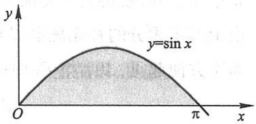

text_image

y
y=sin x
O
π
x

图5-7

$$
A = \int_ {0} ^ {\pi} \sin x \mathrm{d} x.
$$

由于- $\cos x$ 是 $\sin x$ 的一个原函数,所以

$$
A = \int_ {0} ^ {\pi} \sin x \mathrm{d} x = [ - \cos x ] _ {0} ^ {\pi} = - (- 1) - (- 1) = 2.
$$

例 5 汽车以 36 km/h 速度沿直线行驶, 到某处需要减速停车. 设汽车以等加速度  $a = -5 \, m/s^{2}$  刹车. 问从开始刹车到停车, 汽车驶过了多少距离?

解 首先要算出从开始刹车到停车经过的时间. 设开始刹车的时刻为 t=0, 此时汽车速度

$$
v _ {0} = 3 6 \mathrm{km/h} = \frac {3 6 \times 1 0 0 0}{3 6 0 0} \mathrm{m/s} = 1 0 \mathrm{m/s}.
$$

刹车后汽车减速行驶,其速度为

$$
v (t) = v _ {0} + a t = 1 0 - 5 t.
$$

当汽车停住时,速度  $v(t)=0$ , 故从

$$
v (t) = 1 0 - 5 t = 0
$$

解得

$$
t = \frac {1 0}{5} = 2 (\mathrm{s}).
$$

于是在这段时间内,汽车所驶过的距离为

$$
s = \int_ {0} ^ {2} v (t) \mathrm{d} t = \int_ {0} ^ {2} (1 0 - 5 t) \mathrm{d} t = \left[ 1 0 t - 5 \times \frac {t ^ {2}}{2} \right] _ {0} ^ {2} = 1 0 (\mathrm{m}),
$$

即在刹车后,汽车需驶过10 m才能停住.

例6 证明积分中值定理: 若函数 $f(x)$ 在闭区间 $[a, b]$ 上连续, 则在开区间 $(a, b)$ 内至少存在一点 $\xi$, 使

$$
\int_ {a} ^ {b} f (x) \mathrm{d} x = f (\xi) (b - a) (a <   \xi <   b).
$$

证 因 $f(x)$ 连续, 故它的原函数存在, 设为 $F(x)$, 即设在 $[a, b]$ 上 $F'(x) = f(x)$. 根据牛顿-莱布尼茨公式, 有

$$
\int_ {a} ^ {b} f (x) \mathrm{d} x = F (b) - F (a).
$$

236

---

第二节 微积分基本公式

显然函数 $F(x)$ 在区间 $[a, b]$ 上满足微分中值定理的条件，因此按微分中值定理，在开区间 $(a, b)$ 内至少存在一点 $\xi$，使

$$
F (b) - F (a) = F ^ {\prime} (\xi) (b - a), \quad \xi \in (a, b),
$$

故

$$
\int_ {a} ^ {b} f (x) \mathrm{d} x = f (\xi) (b - a), \quad \xi \in (a, b).
$$

本例的结论是上一节所述积分中值定理的改进.从本例的证明中不难看出积分中值定理与微分中值定理的联系.

下面再举几个应用公式(2-2)的例子.

例7 设 $f(x)$ 在 $[0, +\infty)$ 内连续且 $f(x) > 0$. 证明函数

$$
F (x) = \frac {\int_ {0} ^ {x} t f (t) \mathrm{d} t}{\int_ {0} ^ {x} f (t) \mathrm{d} t}
$$

在 $(0,+\infty)$ 内为单调增加函数.

证 由公式(2-2)，得

$$
\frac {\mathrm{d}}{\mathrm{d} x} \int_ {0} ^ {x} t f (t) \mathrm{d} t = x f (x), \quad \frac {\mathrm{d}}{\mathrm{d} x} \int_ {0} ^ {x} f (t) \mathrm{d} t = f (x).
$$

故

$$
F ^ {\prime} (x) = \frac {x f (x) \int_ {0} ^ {x} f (t) \mathrm{d} t - f (x) \int_ {0} ^ {x} t f (t) \mathrm{d} t}{\left[ \int_ {0} ^ {x} f (t) \mathrm{d} t \right] ^ {2}} = \frac {f (x) \int_ {0} ^ {x} (x - t) f (t) \mathrm{d} t}{\left[ \int_ {0} ^ {x} f (t) \mathrm{d} t \right] ^ {2}}.
$$

按假设, 当 0 < t < x 时  $f(t) > 0$ ,  $(x - t)f(t) > 0$ , 按例 6 所述积分中值定理可知

$$
\int_ {0} ^ {x} f (t) \mathrm{d} t > 0, \quad \int_ {0} ^ {x} (x - t) f (t) \mathrm{d} t > 0,
$$

所以  $F'(x)>0\ (x>0)$ ，从而  $F(x)$  在  $(0,+\infty)$  内为单调增加函数.

例8 求 $\lim_{x\to 0}\frac{\int_{\cos x}^{1}\mathrm{e}^{-t^2}\mathrm{d}t}{x^2}.$

解 易知这是一个 $\frac{0}{0}$ 型的未定式, 我们利用洛必达法则来计算. 分子可写成

$$
- \int_ {1} ^ {\cos x} \mathrm{e} ^ {- t ^ {2}} \mathrm{d} t,
$$

它是以  $\cos x$  为上限的积分,作为 x 的函数可看成是以  $u = \cos x$  为中间变量的复合函数,故由公式(2-2)有

#

例题精讲

5-1

237

---

第五章 定积分

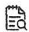

释疑解难

5-1

$$
\begin{array}{l} \frac {\mathrm{d}}{\mathrm{d} x} \int_ {\cos x} ^ {1} \mathrm{e} ^ {- t ^ {2}} \mathrm{d} t = - \frac {\mathrm{d}}{\mathrm{d} x} \int_ {1} ^ {\cos x} \mathrm{e} ^ {- t ^ {2}} \mathrm{d} t = - \frac {\mathrm{d}}{\mathrm{d} u} \int_ {1} ^ {u} \mathrm{e} ^ {- t ^ {2}} \mathrm{d} t \Big | _ {u = \cos x} \cdot (\cos x) ^ {\prime} \\ = - \mathrm{e} ^ {- \cos^ {2} x} \cdot (- \sin x) = \sin x \mathrm{e} ^ {- \cos^ {2} x}. \\ \end{array}
$$

因此

$$
\lim _ {x \to 0} \frac {\int_ {\cos x} ^ {1} e ^ {- t ^ {2}} d t}{x ^ {2}} = \lim _ {x \to 0} \frac {\sin x e ^ {- \cos^ {2} x}}{2 x} = \frac {1}{2 e}.
$$

## 习题 5-2

1. 试求函数 $y = \int_{0}^{x} \sin t \, \mathrm{d}t$ 当 $x = 0$ 及 $x = \frac{\pi}{4}$ 时的导数.
2. 求由参数表达式 $x = \int_{0}^{t} \sin u \, \mathrm{d}u, y = \int_{0}^{t} \cos u \, \mathrm{d}u$ 所确定的函数对 $x$ 的导数 $\frac{\mathrm{d}y}{\mathrm{d}x}$.
3. 求由  $\int_{0}^{y} e^{t} dt + \int_{0}^{x} \cos t dt = 0$  所确定的隐函数对 x 的导数  $\frac{dy}{dx}$ .
4. 当 $x$ 为何值时, 函数 $I(x) = \int_{0}^{x} t e^{-t^2} \mathrm{d}t$ 有极值?

5. 计算下列各导数:

(1) $\frac{\mathrm{d}}{\mathrm{d}x}\int_{0}^{x^2}\sqrt{1 + t^2}\mathrm{d}t;$

(2) $\frac{\mathrm{d}}{\mathrm{d}x}\int_{x^2}^{x^3}\frac{\mathrm{d}t}{\sqrt{1 + t^4}};$

(3) $\frac{\mathrm{d}}{\mathrm{d}x}\int_{\sin x}^{\cos x}\cos (\pi t^2)\mathrm{d}t.$

6. 证明 $f(x) = \int_{1}^{x} \sqrt{1 + t^3} \, \mathrm{d}t$ 在 $[-1, +\infty)$ 上是单调增加函数，并求 $(f^{-1})'(0)$.

7. 设 $f(x) = \int_{0}^{x}\left(\int_{\sin t}^{1}\sqrt{1 + u^4}\mathrm{d}u\right)\mathrm{d}t$, 求 $f''\left(\frac{\pi}{3}\right)$.

8. 设 $f(x)$ 具有三阶连续导数, $y = f(x)$ 的图形如图5-8所示. 问下列积分中的哪一个积分值为负?

(A) $\int_{-1}^{3} f(x) \, \mathrm{d}x$

(B) $\int_{-1}^{3} f'(x) \, \mathrm{d}x$

(C) $\int_{-1}^{3} f''(x) \, \mathrm{d}x$

(D) $\int_{-1}^{3} f'''(x) \, \mathrm{d}x$

9. 计算下列各定积分:

(1) $\int_{0}^{a}(3x^{2} - x + 1)\mathrm{d}x;$

(2) $\int_{1}^{2}\left(x^{2} + \frac{1}{x^{4}}\right)\mathrm{d}x;$

(3) $\int_{4}^{9}\sqrt{x}(1+\sqrt{x})dx;$

(4) $\int_{\frac{1}{\sqrt{3}}}\frac{\mathrm{d}x}{1 + x^2};$

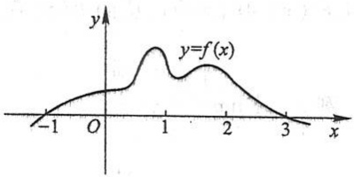

contour

| X | Y |
| --- | --- |
| -1 | 0 |
| 0 | ~0.2 |
| 0.8 | ~0.8 |
| 1.2 | ~0.4 |
| 1.7 | ~0.6 |
| 3 | 0 |

图5-8

238

---

第二节 微积分基本公式

(5) $\int_{-\frac{1}{2}}^{\frac{1}{2}}\frac{\mathrm{d}x}{\sqrt{1 - x^2}};$

(6) $\int_0^{\sqrt{3} a}\frac{\mathrm{d}x}{a^2 + x^2};$

(7) $\int_0^1\frac{\mathrm{d}x}{\sqrt{4 - x^2}};$

(8) $\int_{-1}^{0}\frac{3x^4 + 3x^2 + 1}{x^2 + 1}\mathrm{d}x;$

(9) $\int_{-e - 1}^{-2}\frac{\mathrm{d}x}{1 + x};$

(10) $\int_{0}^{\frac{\pi}{4}}\tan^{2}\theta\mathrm{d}\theta;$

(11) $\int_{0}^{2\pi}\left|\sin x\right|dx;$

(12) $\int_0^2 f(x)\mathrm{d}x$ ，其中 $f(x) = \left\{ \begin{array}{ll}x + 1, & x\leqslant 1,\\ \frac{1}{2} x^2, & x > 1. \end{array} \right.$

10. 设 $k \in \mathbb{N}_{+}$. 试证下列各题:

(1) $\int_{-\pi}^{\pi}\cos kxdx=0;$

(2) $\int_{-\pi}^{\pi}\sin kxdx=0;$

(3) $\int_{-\pi}^{\pi}\cos^{2}kxdx=\pi;$

(4) $\int_{-\pi}^{\pi}\sin^2 kx\mathrm{d}x = \pi .$

11. 设 $k, l \in \mathbb{N}_{+}$, 且 $k \neq l$. 证明:

(1) $\int_{-\pi}^{\pi}\cos kx\sin lxdx=0;$

(2) $\int_{-\pi}^{\pi}\cos kx\cos lxdx=0;$

(3) $\int_{-\pi}^{\pi}\sin kx\sin lxdx=0.$

12. 求下列极限:

(1)  $\lim_{x\to0}\frac{\int_{0}^{x}\cos t^{2}dt}{x};$

(2) $\lim_{x\to 0}\frac{\left(\int_0^x\mathrm{e}^{t^2}\mathrm{d}t\right)^2}{\int_0^x t\mathrm{e}^{2t^2}\mathrm{d}t}.$

13. 设

$$
f (x) = \left\{ \begin{array}{l l} x ^ {2}, & x \in [ 0, 1), \\ x, & x \in [ 1, 2 ]. \end{array} \right.
$$

求  $\Phi(x)=\int_{0}^{x}f(t)\mathrm{d}t$  在  $[0,2]$  上的表达式，并讨论  $\Phi(x)$  在  $(0,2)$  内的连续性.

14. 设

$$
f (x) = \left\{ \begin{array}{l l} \frac {1}{2} \sin x, & 0 \leqslant x \leqslant \pi , \\ 0, & x <   0 \text {或} x > \pi . \end{array} \right.
$$

求  $\Phi(x)=\int_{0}^{x}f(t)\mathrm{d}t$  在  $(-∞,+∞)$  内的表达式.

15. 设 $f(x)$ 在 $[a, b]$ 上连续，在 $(a, b)$ 内可导且 $f'(x) \leqslant 0$,

$$
F (x) = \frac {1}{x - a} \int_ {a} ^ {x} f (t)   \mathrm{d} t.
$$

证明在 $(a,b)$ 内有 $F'(x)\leqslant0$ .

16. 以下积分上限的函数:

$$
S (x) = \int_ {0} ^ {x} \sin \frac {\pi t ^ {2}}{2} \mathrm{d} t, \quad x \in (- \infty , + \infty)
$$

239

---

第五章 定积分

称为菲涅耳(Fresnel)积分,在光学中有重要应用.

(1) 证明: $S(x)$ 为奇函数;
(2) 求出  $S(x)$  的极小值点.

17. 设 $f(x)$ 在 $[0, +\infty)$ 内连续，且 $\lim_{x \to +\infty} f(x) = 1$。证明函数

$$
y = \mathrm{e} ^ {- x} \int_ {0} ^ {x} \mathrm{e} ^ {t} f (t) \mathrm{d} t
$$

满足方程 $\frac{dy}{dx}+y=f(x)$ ，并求 $\lim_{x\to+\infty}y(x)$ .

## 第三节 定积分的换元法和分部积分法

由上节结果知道,计算定积分 $\int_{a}^{b}f(x)\mathrm{d}x$ 的简便方法是把它转化为求 $f(x)$ 的原函数的增量.在第四章中,我们知道用换元积分法和分部积分法可以求出一些函数的原函数.因此,在一定条件下,可以用换元积分法和分部积分法来计算定积分.下面就来讨论定积分的这两种计算方法.

## 一、定积分的换元法

为了说明如何用换元法来计算定积分,先证明下面的定理:

定理 设函数 $f(x)$ 在区间 $[a, b]$ 上连续，函数 $x = \varphi(t)$ 满足条件:

(1)  $\varphi(\alpha)=a,\varphi(\beta)=b;$
(2) $\varphi(t)$ 在 $[\alpha, \beta]$ （或 $[\beta, \alpha]$）上具有连续导数，且其值域 $R_{\varphi} = [a, b]$ ①，则有

$$
\int_ {a} ^ {b} f (x) \mathrm{d} x = \int_ {\alpha} ^ {\beta} f [ \varphi (t) ] \varphi^ {\prime} (t) \mathrm{d} t. \tag {3-1}
$$

公式(3-1)叫做定积分的换元公式.

证 由假设可以知道,上式两端的被积函数都是连续的,因此不仅上式两端的定积分都存在,而且由上节的定理2知道,被积函数的原函数也都存在.所以,(3-1)式两端的定积分都可应用牛顿-莱布尼茨公式.假设 $F(x)$ 是 $f(x)$ 的一个原函数,则

$$
\int_ {a} ^ {b} f (x) \mathrm{d} x = F (b) - F (a).
$$

另一方面，记 $\Phi(t) = F[\varphi(t)]$ ，它是由 $F(x)$ 与 $x = \varphi(t)$ 复合而成的函数.由复合函数求导法则，得

<small>① 当 $\varphi(t)$ 的值域 $R_{\varphi}$ 超出 $[a, b]$，但 $\varphi(t)$ 满足其余条件时，只要 $f(x)$ 在 $R_{\varphi}$ 上连续，定理的结论仍成立.</small>

240

---

第三节 定积分的换元法和分部积分法

$$
\Phi^ {\prime} (t) = \frac {\mathrm{d} F}{\mathrm{d} x} \cdot \frac {\mathrm{d} x}{\mathrm{d} t} = f (x) \varphi^ {\prime} (t) = f [ \varphi (t) ] \varphi^ {\prime} (t).
$$

这表明 $\Phi(t)$ 是 $f[\varphi(t)]\varphi'(t)$ 的一个原函数.因此有

$$
\int_ {\alpha} ^ {\beta} f [ \varphi (t) ] \varphi^ {\prime} (t) \mathrm{d} t = \Phi (\beta) - \Phi (\alpha).
$$

又由 $\Phi(t) = F[\varphi(t)]$ 及 $\varphi(\alpha) = a, \varphi(\beta) = b$ 可知

$$
\Phi (\beta) - \Phi (\alpha) = F [ \varphi (\beta) ] - F [ \varphi (\alpha) ] = F (b) - F (a).
$$

所以

$$
\int_ {a} ^ {b} f (x) \mathrm{d} x = F (b) - F (a) = \Phi (\beta) - \Phi (\alpha) = \int_ {\alpha} ^ {\beta} f [ \varphi (t) ] \varphi^ {\prime} (t) \mathrm{d} t.
$$

这就证明了换元公式.

在定积分 $\int_{a}^{b}f(x)\mathrm{d}x$ 中的 $\mathrm{dx}$ ，本来是整个定积分记号中不可分割的一部分，但由上述定理可知，在一定条件下，它确实可以作为微分记号来对待.这就是说，应用换元公式时，如果把 $\int_{a}^{b}f(x)\mathrm{d}x$ 中的 $x$ 换成 $\varphi (t)$ ，那么 $\mathrm{dx}$ 就换成 $\varphi '(t)\mathrm{d}t$ ，这正好是 $x = \varphi (t)$ 的微分 $\mathrm{dx}$

应用换元公式时有两点值得注意:（1）用 $x = \varphi(t)$ 把原来变量 $x$ 代换成新变量 $t$ 时，积分限也要换成相应于新变量 $t$ 的积分限；（2）求出 $f[\varphi(t)]\varphi'(t)$ 的一个原函数 $\Phi(t)$ 后，不必像计算不定积分那样再要把 $\Phi(t)$ 变换成原来变量 $x$ 的函数，而只要把新变量 $t$ 的上、下限分别代入 $\Phi(t)$ 中然后相减就行了.

例1 计算 $\int_0^a\sqrt{a^2 - x^2}\mathrm{d}x$ （ $a > 0$ ）.

解 设  $x = a \sin t$ ，则  $dx = a \cos t dt$ ，

当 $x = 0$ 时，取 $t = 0$；当 $x = a$ 时，取 $t = \frac{\pi}{2}$.

于是

$$
\begin{array}{l} \int_ {0} ^ {a} \sqrt {a ^ {2} - x ^ {2}} \mathrm{d} x = a ^ {2} \int_ {0} ^ {\frac {\pi}{2}} \cos^ {2} t \mathrm{d} t = \frac {a ^ {2}}{2} \int_ {0} ^ {\frac {\pi}{2}} (1 + \cos 2 t) \mathrm{d} t \\ = \frac {a ^ {2}}{2} \left[ t + \frac {1}{2} \sin 2 t \right] _ {0} ^ {\frac {\pi}{2}} = \frac {\pi a ^ {2}}{4}. \\ \end{array}
$$

换元公式也可反过来使用.为使用方便起见,把换元公式中左、右两端对调位置,同时把 t 改记为 x,而 x 改记为 t,得

$$
\int_ {a} ^ {b} f \left[ \varphi (x) \right] \varphi^ {\prime} (x) \mathrm{d} x = \int_ {\alpha} ^ {\beta} f (t) \mathrm{d} t.
$$

这样,我们可用  $t=\varphi(x)$  来引入新变量 t, 而  $\alpha=\varphi(a)$ ,  $\beta=\varphi(b)$ .

241

---

第五章 定积分

例2 计算 $\int_0^{\frac{\pi}{2}}\cos^5 x\sin x\mathrm{d}x.$

解 设 $t = \cos x$ ，则 $\mathrm{dt} = -\sin x\mathrm{dx}$ ，且

$$
\text {当} x = 0 \text {时,} t = 1; \quad \text {当} x = \frac {\pi}{2} \text {时,} t = 0.
$$

于是

$$
\int_ {0} ^ {\frac {\pi}{2}} \cos^ {5} x \sin x \mathrm{d} x = - \int_ {1} ^ {0} t ^ {5} \mathrm{d} t = \int_ {0} ^ {1} t ^ {5} \mathrm{d} t = \left[ \frac {t ^ {6}}{6} \right] _ {0} ^ {1} = \frac {1}{6}.
$$

在例 2 中, 如果我们不明显地写出新变量 t, 那么定积分的上、下限就不要变更. 现在用这种记法写出计算过程如下:

$$
\int_ {0} ^ {\frac {\pi}{2}} \cos^ {5} x \sin x \mathrm{d} x = - \int_ {0} ^ {\frac {\pi}{2}} \cos^ {5} x \mathrm{d} (\cos x) = - \left[ \frac {\cos^ {6} x}{6} \right] _ {0} ^ {\frac {\pi}{2}} = - \left(0 - \frac {1}{6}\right) = \frac {1}{6}.
$$

例3 计算 $\int_0^\pi \sqrt{\sin^3 x - \sin^5 x} \, \mathrm{d}x.$

解 由于 $\sqrt{\sin^3 x - \sin^5 x} = \sqrt{\sin^3 x(1 - \sin^2 x)} = \sin^{\frac{3}{2}}x\cdot |\cos x|$，在 $\left[0,\frac{\pi}{2}\right]$ 上，$|\cos x| = \cos x$；在 $\left[\frac{\pi}{2},\pi\right]$ 上，$|\cos x| = -\cos x$，所以

$$
\begin{array}{l} \int_ {0} ^ {\pi} \sqrt {\sin^ {3} x - \sin^ {5} x} \mathrm{d} x = \int_ {0} ^ {\frac {\pi}{2}} \sin^ {\frac {3}{2}} x \cos x \mathrm{d} x + \int_ {\frac {\pi}{2}} ^ {\pi} \sin^ {\frac {3}{2}} x (- \cos x) \mathrm{d} x \\ = \int_ {0} ^ {\frac {\pi}{2}} \sin^ {\frac {3}{2}} x \mathrm{d} (\sin x) - \int_ {\frac {\pi}{2}} ^ {\pi} \sin^ {\frac {3}{2}} x \mathrm{d} (\sin x) \\ = \left[ \frac {2}{5} \sin^ {\frac {5}{2}} x \right] _ {0} ^ {\frac {\pi}{2}} - \left[ \frac {2}{5} \sin^ {\frac {5}{2}} x \right] _ {\frac {\pi}{2}} ^ {\pi} \\ = \frac {2}{5} - \left(- \frac {2}{5}\right) = \frac {4}{5}. \\ \end{array}
$$

注意 如果忽略 $\cos x$ 在 $\left[\frac{\pi}{2},\pi\right]$ 上非正, 而按 $\sqrt{\sin^3x - \sin^5x} = \sin^{\frac{3}{2}}x\cos x$ 计算, 将导致错误.

例4 计算 $\int_0^4\frac{x + 2}{\sqrt{2x + 1}}\mathrm{d}x.$

解 设 $\sqrt{2x + 1} = t$，则 $x = \frac{t^2 - 1}{2}, \mathrm{d}x = t\mathrm{d}t$，且

$$
\text {当} x = 0 \text {时,} t = 1; \quad \text {当} x = 4 \text {时,} t = 3.
$$

于是

242

---

第三节 定积分的换元法和分部积分法

$$
\begin{array}{l} \int_ {0} ^ {4} \frac {x + 2}{\sqrt {2 x + 1}} \mathrm{d} x = \int_ {1} ^ {3} \frac {\frac {t ^ {2} - 1}{2} + 2}{t} t \mathrm{d} t = \frac {1}{2} \int_ {1} ^ {3} (t ^ {2} + 3) \mathrm{d} t \\ = \frac {1}{2} \left[ \frac {t ^ {3}}{3} + 3 t \right] _ {1} ^ {3} = \frac {1}{2} \left[ \left(\frac {2 7}{3} + 9\right) - \left(\frac {1}{3} + 3\right) \right] = \frac {2 2}{3}. \\ \end{array}
$$

例 5 证明:

(1) 若  $f(x)$  在  $[-a, a]$  上连续且为偶函数, 则

$$
\int_ {- a} ^ {a} f (x) \mathrm{d} x = 2 \int_ {0} ^ {a} f (x) \mathrm{d} x;
$$

(2) 若  $f(x)$  在  $[-a, a]$  上连续且为奇函数，则

$$
\int_ {- a} ^ {a} f (x) \mathrm{d} x = 0.
$$

证 因为

$$
\int_ {- a} ^ {a} f (x) \mathrm{d} x = \int_ {- a} ^ {0} f (x) \mathrm{d} x + \int_ {0} ^ {a} f (x) \mathrm{d} x,
$$

对积分 $\int_{-a}^{0}f(x)\mathrm{d}x$ 作代换 $x = -t$ ，则得

$$
\int_ {- a} ^ {0} f (x) \mathrm{d} x = - \int_ {a} ^ {0} f (- t) \mathrm{d} t = \int_ {0} ^ {a} f (- t) \mathrm{d} t = \int_ {0} ^ {a} f (- x) \mathrm{d} x,
$$

于是

$$
\int_ {- a} ^ {a} f (x) \mathrm{d} x = \int_ {0} ^ {a} f (- x) \mathrm{d} x + \int_ {0} ^ {a} f (x) \mathrm{d} x = \int_ {0} ^ {a} [ f (x) + f (- x) ] \mathrm{d} x.
$$

(1) 若  $f(x)$  为偶函数, 则

$$
f (x) + f (- x) = 2 f (x),
$$

从而

$$
\int_ {- a} ^ {a} f (x) \mathrm{d} x = 2 \int_ {0} ^ {a} f (x) \mathrm{d} x.
$$

(2) 若  $f(x)$  为奇函数, 则

$$
f (x) + f (- x) = 0,
$$

从而

$$
\int_ {- a} ^ {a} f (x) \mathrm{d} x = 0.
$$

利用例 5 的结论, 常可简化计算偶函数、奇函数在对称于原点的区间上的定积分.

例6 设 $f(x)$ 在 $[0,1]$ 上连续，证明:

(1) $\int_{0}^{\frac{\pi}{2}} f(\sin x) \, \mathrm{d}x = \int_{0}^{\frac{\pi}{2}} f(\cos x) \, \mathrm{d}x$;

(2) $\int_{0}^{\pi} x f(\sin x) \, \mathrm{d}x = \frac{\pi}{2} \int_{0}^{\pi} f(\sin x) \, \mathrm{d}x$，由此计算

243

---

第五章 定积分

$$
\int_ {0} ^ {\pi} \frac {x \sin x}{1 + \cos^ {2} x} \mathrm{d} x.
$$

证（1）设 $x = \frac{\pi}{2} - t$，则 $\mathrm{dx} = -\mathrm{dt}$，且

当 $x = 0$ 时，$t = \frac{\pi}{2}$；当 $x = \frac{\pi}{2}$ 时，$t = 0$.

于是

$$
\int_ {0} ^ {\frac {\pi}{2}} f (\sin x) \mathrm{d} x = - \int_ {\frac {\pi}{2}} ^ {0} f \left[ \sin \left(\frac {\pi}{2} - t\right) \right] \mathrm{d} t = \int_ {0} ^ {\frac {\pi}{2}} f (\cos t) \mathrm{d} t = \int_ {0} ^ {\frac {\pi}{2}} f (\cos x) \mathrm{d} x.
$$

(2) 设  $x=\pi-t$ ，则 dx=-dt，且

当 x=0 时, $t=\pi$ ; 当  $x=\pi$  时, t=0.

于是

$$
\begin{array}{l} \int_ {0} ^ {\pi} x f (\sin x) \mathrm{d} x = - \int_ {\pi} ^ {0} (\pi - t) f [ \sin (\pi - t) ] \mathrm{d} t = \int_ {0} ^ {\pi} (\pi - t) f (\sin t) \mathrm{d} t \\ = \pi \int_ {0} ^ {\pi} f (\sin t) \mathrm{d} t - \int_ {0} ^ {\pi} t f (\sin t) \mathrm{d} t = \pi \int_ {0} ^ {\pi} f (\sin x) \mathrm{d} x - \int_ {0} ^ {\pi} x f (\sin x) \mathrm{d} x, \\ \end{array}
$$

所以

$$
\int_ {0} ^ {\pi} x f (\sin x) \mathrm{d} x = \frac {\pi}{2} \int_ {0} ^ {\pi} f (\sin x) \mathrm{d} x.
$$

利用上述结论,即得

$$
\begin{array}{l} \int_ {0} ^ {\pi} \frac {x \sin x}{1 + \cos^ {2} x} \mathrm{d} x = \frac {\pi}{2} \int_ {0} ^ {\pi} \frac {\sin x}{1 + \cos^ {2} x} \mathrm{d} x = - \frac {\pi}{2} \int_ {0} ^ {\pi} \frac {\mathrm{d} (\cos x)}{1 + \cos^ {2} x} \\ = - \frac {\pi}{2} [ \arctan (\cos x) ] _ {0} ^ {\pi} = - \frac {\pi}{2} \left(- \frac {\pi}{4} - \frac {\pi}{4}\right) = \frac {\pi^ {2}}{4}. \\ \end{array}
$$

例 7 设  $f(x)$  是连续的周期函数, 周期为 T, 证明:

(1) $\int_{a}^{a + T}f(x)\mathrm{d}x = \int_{0}^{T}f(x)\mathrm{d}x;$

(2) $\int_{a}^{a + nT}f(x)\mathrm{d}x = n\int_{0}^{T}f(x)\mathrm{d}x (n\in \mathbf{N})$ ，由此计算

$$
\int_ {0} ^ {n \pi} \sqrt {1 + \sin 2 x}   \mathrm{d} x.
$$

证 (1) 记 $\Phi(a) = \int_{a}^{a + T} f(x) \, \mathrm{d}x$，则

$$
\Phi^ {\prime} (a) = \left[ \int_ {0} ^ {a + T} f (x) \mathrm{d} x - \int_ {0} ^ {a} f (x) \mathrm{d} x \right] ^ {\prime} = f (a + T) - f (a) = 0,
$$

知 $\Phi(a)$ 与 $a$ 无关, 因此 $\Phi(a)=\Phi(0)$, 即

$$
\int_ {a} ^ {a + T} f (x) \mathrm{d} x = \int_ {0} ^ {T} f (x) \mathrm{d} x.
$$

244

---

第三节 定积分的换元法和分部积分法

(2) $\int_{a}^{a + nT}f(x)\mathrm{d}x = \sum_{k = 0}^{n - 1}\int_{a + kT}^{a + kT + T}f(x)\mathrm{d}x$ ，由（1）知

$$
\int_ {a + k T} ^ {a + k T + T} f (x) \mathrm{d} x = \int_ {0} ^ {T} f (x) \mathrm{d} x,
$$

因此

$$
\int_ {a} ^ {a + n T} f (x) \mathrm{d} x = n \int_ {0} ^ {T} f (x) \mathrm{d} x.
$$

由于 $\sqrt{1 + \sin 2x}$ 是以 $\pi$ 为周期的周期函数, 利用上述结论, 有

$$
\begin{array}{l} \int_ {0} ^ {n \pi} \sqrt {1 + \sin 2 x} \mathrm{d} x = n \int_ {0} ^ {\pi} \sqrt {1 + \sin 2 x} \mathrm{d} x = n \int_ {0} ^ {\pi} | \sin x + \cos x | \mathrm{d} x \\ = \sqrt {2} n \int_ {0} ^ {\pi} \left| \sin \left(x + \frac {\pi}{4}\right) \right| \mathrm{d} x = \sqrt {2} n \int_ {\frac {\pi}{4}} ^ {\frac {5 \pi}{4}} | \sin t | \mathrm{d} t \\ = \sqrt {2} n \int_ {0} ^ {\pi} | \sin t | \mathrm{d} t = \sqrt {2} n \int_ {0} ^ {\pi} \sin t \mathrm{d} t = 2 \sqrt {2} n. \\ \end{array}
$$

例8 计算 $\int_0^3\frac{x^2}{(x^2 - 3x + 3)^2}\mathrm{d}x.$

解 因 $x^{2} - 3x + 3 = \left(x - \frac{3}{2}\right)^{2} + \frac{3}{4}$, 令 $x - \frac{3}{2} = \frac{\sqrt{3}}{2} \tan u\left(|u| < \frac{\pi}{2}\right)$, 则

$$
(x ^ {2} - 3 x + 3) ^ {2} = \left(\frac {3}{4} \sec^ {2} u\right) ^ {2} = \frac {9}{1 6} \sec^ {4} u, \mathrm{d} x = \frac {\sqrt {3}}{2} \sec^ {2} u \mathrm{d} u.
$$

当 $x = 0$ 时, $u = -\frac{\pi}{3}$; $x = 3$ 时, $u = \frac{\pi}{3}$.

于是

$$
\begin{array}{l} \int_ {0} ^ {3} \frac {x ^ {2}}{(x ^ {2} - 3 x + 3) ^ {2}} \mathrm{d} x = \int_ {- \frac {\pi}{3}} ^ {\frac {\pi}{3}} \left(\frac {3}{4} \tan^ {2} u + \frac {3 \sqrt {3}}{2} \tan u + \frac {9}{4}\right) \cdot \frac {1 6}{9} \cdot \frac {\sqrt {3}}{2} \cos^ {2} u \mathrm{d} u \\ = \frac {8}{3 \sqrt {3}} \cdot 2 \int_ {0} ^ {\frac {\pi}{3}} \left(\frac {3}{4} \tan^ {2} u + \frac {9}{4}\right) \cos^ {2} u \mathrm{d} u \\ = \frac {4}{\sqrt {3}} \int_ {0} ^ {\frac {\pi}{3}} (\sin^ {2} u + 3 \cos^ {2} u) \mathrm{d} u = \frac {4}{\sqrt {3}} \int_ {0} ^ {\frac {\pi}{3}} (2 + \cos 2 u) \mathrm{d} u \\ = \frac {4}{\sqrt {3}} \left[ 2 u + \frac {1}{2} \sin 2 u \right] _ {0} ^ {\frac {\pi}{3}} = \frac {8 \pi}{3 \sqrt {3}} + 1. \\ \end{array}
$$

例9 设函数

$$
f (x) = \left\{ \begin{array}{l l} \frac {1}{1 + \cos x}, & - \pi <   x <   0, \\ x \mathrm{e} ^ {- x ^ {2}}, & x \geqslant 0, \end{array} \right.
$$

245

---

第五章 定积分

计算 $\int_{1}^{4}f(x - 2)\mathrm{d}x.$

解 设 x-2=t，则 dx=dt，且

$$
\text {当} x = 1 \text {时,} t = - 1; \quad \text {当} x = 4 \text {时,} t = 2.
$$

于是

$$
\begin{array}{l} \int_ {1} ^ {4} f (x - 2) \mathrm{d} x = \int_ {- 1} ^ {2} f (t) \mathrm{d} t = \int_ {- 1} ^ {0} \frac {\mathrm{d} t}{1 + \cos t} + \int_ {0} ^ {2} t \mathrm{e} ^ {- t ^ {2}} \mathrm{d} t \\ = \left[ \tan \frac {t}{2} \right] _ {- 1} ^ {0} - \left[ \frac {1}{2} \mathrm{e} ^ {- t ^ {2}} \right] _ {0} ^ {2} = \tan \frac {1}{2} - \frac {1}{2} \mathrm{e} ^ {- 4} + \frac {1}{2}. \\ \end{array}
$$

## 二、定积分的分部积分法

依据不定积分的分部积分法, 若  $u(x)$ ,  $v(x)$  在  $[a, b]$  上具有连续导数, 则

$$
\begin{array}{l} \int_ {a} ^ {b} u (x) v ^ {\prime} (x) \mathrm{d} x = \left[ \int u (x) v ^ {\prime} (x) \mathrm{d} x \right] _ {a} ^ {b} = \left[ u (x) v (x) - \int v (x) u ^ {\prime} (x) \mathrm{d} x \right] _ {a} ^ {b} \\ = [ u (x) v (x) ] _ {a} ^ {b} - \int_ {a} ^ {b} v (x) u ^ {\prime} (x) \mathrm{d} x, \tag {3-2} \\ \end{array}
$$

简记作

$$
\int_ {a} ^ {b} u v ^ {\prime} \mathrm{d} x = [ u v ] _ {a} ^ {b} - \int_ {a} ^ {b} v u ^ {\prime} \mathrm{d} x,
$$

或

$$
\int_ {a} ^ {b} u \mathrm{d} v = [ u v ] _ {a} ^ {b} - \int_ {a} ^ {b} v \mathrm{d} u.
$$

公式(3-2)叫做定积分的分部积分公式.公式表明原函数已经积出的部分可以先用上、下限代入.

例10 计算 $\int_0^{\frac{1}{2}}\arcsin x\mathrm{d}x.$

解 $\int_0^{\frac{1}{2}}\arcsin x\mathrm{d}x = [x\arcsin x]^{\frac{1}{2}}_0 - \int_0^{\frac{1}{2}}\frac{x}{\sqrt{1 - x^2}}\mathrm{d}x$

$$
= \frac {1}{2} \cdot \frac {\pi}{6} + \left[ \sqrt {1 - x ^ {2}} \right] _ {0} ^ {\frac {1}{2}} = \frac {\pi}{1 2} + \frac {\sqrt {3}}{2} - 1.
$$

例11 计算 $\int_0^1\mathrm{e}^{\sqrt{x}}\mathrm{d}x.$

解 先用换元法. 令 $\sqrt{x} = t$，则 $x = t^2, \mathrm{d}x = 2t\mathrm{d}t$，且

当 $x = 0$ 时，$t = 0$；当 $x = 1$ 时，$t = 1$.

246

---

第三节 定积分的换元法和分部积分法

于是

$$
\begin{array}{l} \int_ {0} ^ {1} \mathrm{e} ^ {\sqrt {x}} \mathrm{d} x = 2 \int_ {0} ^ {1} t \mathrm{e} ^ {t} \mathrm{d} t = 2 \int_ {0} ^ {1} t \mathrm{d} (\mathrm{e} ^ {t}) = 2 \left(\left[ t \mathrm{e} ^ {t} \right] _ {0} ^ {1} - \int_ {0} ^ {1} \mathrm{e} ^ {t} \mathrm{d} t\right) \\ = 2 (\mathrm{e} - [ \mathrm{e} ^ {t} ] _ {0} ^ {1}) = 2 [ \mathrm{e} - (\mathrm{e} - 1) ] = 2. \\ \end{array}
$$

例 12 证明定积分公式(见附录Ⅳ积分表公式 147):

$$
\begin{array}{l} I _ {n} = \int_ {0} ^ {\frac {\pi}{2}} \sin^ {n} x \mathrm{d} x \left(= \int_ {0} ^ {\frac {\pi}{2}} \cos^ {n} x \mathrm{d} x\right) \\ = \left\{ \begin{array}{l l} \frac {n - 1}{n} \cdot \frac {n - 3}{n - 2} \cdot \dots \cdot \frac {3}{4} \cdot \frac {1}{2} \cdot \frac {\pi}{2}, & n \text {为正偶数,} \\ \frac {n - 1}{n} \cdot \frac {n - 3}{n - 2} \cdot \dots \cdot \frac {4}{5} \cdot \frac {2}{3}, & n \text {为大于1的正奇数.} \end{array} \right. \\ \end{array}
$$

证 $I_{n} = -\int_{0}^{\frac{\pi}{2}}\sin^{n - 1}x\mathrm{d}(\cos x)$

$$
= \left[ - \cos x \sin^ {n - 1} x \right] _ {0} ^ {\frac {\pi}{2}} + (n - 1) \int_ {0} ^ {\frac {\pi}{2}} \sin^ {n - 2} x \cos^ {2} x \mathrm{d} x.
$$

右端第一项等于零；将第二项里的  $\cos^{2}x$  写成  $1-\sin^{2}x$ ，并把积分分成两个，得

$$
I _ {n} = (n - 1) \int_ {0} ^ {\frac {\pi}{2}} \sin^ {n - 2} x \mathrm{d} x - (n - 1) \int_ {0} ^ {\frac {\pi}{2}} \sin^ {n} x \mathrm{d} x = (n - 1) I _ {n - 2} - (n - 1) I _ {n},
$$

由此得

$$
I _ {n} = \frac {n - 1}{n} I _ {n - 2}.
$$

这个等式叫做积分  $I_{n}$  关于下标的递推公式.

如果把 n 换成 n-2, 那么得

$$
I _ {n - 2} = \frac {n - 3}{n - 2} I _ {n - 4}.
$$

同样地依次进行下去,直到 $I_{n}$ 的下标递减到0或1为止.于是,

$$
\begin{array}{l} I _ {2 m} = \frac {2 m - 1}{2 m} \cdot \frac {2 m - 3}{2 m - 2} \cdot \dots \cdot \frac {5}{6} \cdot \frac {3}{4} \cdot \frac {1}{2} I _ {0}, \\ I _ {2 m + 1} = \frac {2 m}{2 m + 1} \cdot \frac {2 m - 2}{2 m - 1} \cdot \dots \cdot \frac {6}{7} \cdot \frac {4}{5} \cdot \frac {2}{3} I _ {1} \quad (m = 1, 2, \dots), \\ \end{array}
$$

而

$$
I _ {0} = \int_ {0} ^ {\frac {\pi}{2}} \mathrm{d} x = \frac {\pi}{2}, \quad I _ {1} = \int_ {0} ^ {\frac {\pi}{2}} \sin x \mathrm{d} x = 1,
$$

因此

247

---

第五章 定积分

$$
I _ {2 m} = \frac {2 m - 1}{2 m} \cdot \frac {2 m - 3}{2 m - 2} \cdot \dots \cdot \frac {5}{6} \cdot \frac {3}{4} \cdot \frac {1}{2} \cdot \frac {\pi}{2},
$$

$$
I _ {2 m + 1} = \frac {2 m}{2 m + 1} \cdot \frac {2 m - 2}{2 m - 1} \cdot \dots \cdot \frac {6}{7} \cdot \frac {4}{5} \cdot \frac {2}{3} \quad (m = 1, 2, \dots).
$$

至于定积分 $\int_0^{\frac{\pi}{2}}\cos^n x\mathrm{d}x$ 与 $\int_0^{\frac{\pi}{2}}\sin^n x\mathrm{d}x$ 相等，由本节例6(1）即可知道，证毕.

## 习题 5-3

1. 计算下列定积分:

(1) $\int_{\frac{\pi}{3}}^{\pi}\sin \left(x + \frac{\pi}{3}\right)\mathrm{d}x;$

(2) $\int_{-2}^{1}\frac{\mathrm{d}x}{(11 + 5x)^3};$

(3) $\int_{0}^{\frac{\pi}{2}}\sin \varphi \cos^{3}\varphi \mathrm{d}\varphi$

(4) $\int_0^\pi (1 - \sin^3\theta)\mathrm{d}\theta$

(5) $\int_{\frac{\pi}{6}}^{\frac{\pi}{2}}\cos^2 u\mathrm{d}u;$

(6) $\int_0^{\sqrt{2}}\sqrt{2 - x^2}\mathrm{d}x;$

(7) $\int_{-\sqrt{2}}^{\sqrt{2}}\sqrt{8 - 2y^2}\mathrm{d}y;$

(8) $\int_{\frac{1}{\sqrt{2}}}\frac{\sqrt{1 - x^2}}{x^2}\mathrm{d}x;$

(9) $\int_{0}^{a} x^{2} \sqrt{a^{2} - x^{2}} \, \mathrm{d}x (a > 0)$;

(10) $\int_{1}^{\sqrt{3}}\frac{\mathrm{d}x}{x^2\sqrt{1 + x^2}};$

(11) $\int_{-1}^{1}\frac{x\mathrm{d}x}{\sqrt{5 - 4x}};$

(12) $\int_{1}^{4}\frac{\mathrm{d}x}{1 + \sqrt{x}};$

(13) $\int_{\frac{3}{4}}^{1}\frac{\mathrm{d}x}{\sqrt{1 - x} - 1};$

(14) $\int_0^{\sqrt{2a}}\frac{x\mathrm{d}x}{\sqrt{3a^2 - x^2}} (a > 0);$

(15) $\int_0^1 t\mathrm{e}^{-\frac{t^2}{2}}\mathrm{d}t;$

(16) $\int_{1}^{\mathrm{e}^2}\frac{\mathrm{d}x}{x\sqrt{1 + \ln x}};$

(17) $\int_{-2}^{0}\frac{(x+2)\mathrm{d}x}{x^{2}+2x+2};$

(18) $\int_0^2\frac{x\mathrm{d}x}{(x^2 - 2x + 2)^2};$

(19) $\int_{-\pi}^{\pi} x^4 \sin x \, \mathrm{d}x$;

(20) $\int_{-\frac{\pi}{2}}^{\frac{\pi}{2}} 4\cos^{4}\theta \mathrm{d}\theta$;

(21) $\int_{-\frac{1}{2}}^{\frac{1}{2}}\frac{(\arcsin x)^{2}}{\sqrt{1 - x^{2}}}\mathrm{d}x;$

(22) $\int_{-5}^{5}\frac{x^3\sin^2x}{x^4 + 2x^2 + 1}\mathrm{d}x;$

(23) $\int_{-\frac{\pi}{2}}^{\frac{\pi}{2}}\cos x\cos 2x\mathrm{d}x;$

(24) $\int_{-\frac{\pi}{2}}^{\frac{\pi}{2}}\sqrt{\cos x - \cos^3x}\mathrm{d}x;$

(25) $\int_0^\pi \sqrt{1 + \cos 2x} \, \mathrm{d}x$;

(26) $\int_{0}^{2\pi}|\sin (x + 1)|\mathrm{d}x.$

2. 设 $f(x)$ 在 $[a, b]$ 上连续，证明:

$$
\int_ {a} ^ {b} f (x) \mathrm{d} x = \int_ {a} ^ {b} f (a + b - x) \mathrm{d} x.
$$

3. 证明:$\int_{x}^{1}\frac{\mathrm{d}t}{1+t^2}=\int_{1}^{\frac{1}{x}}\frac{\mathrm{d}t}{1+t^2}\quad(x>0)$.

4. 证明: $\int_{0}^{1}x^{m}(1-x)^{n}\mathrm{d}x=\int_{0}^{1}x^{n}(1-x)^{m}\mathrm{d}x\quad(m,n\in\mathbf{N})$

5. 设 $f(x)$ 在 $[0,1]$ 上连续, $n \in \mathbb{Z}$, 证明:

248

---

第四节 反常积分

$$
\int_ {\frac {n}{2} \pi} ^ {\frac {n + 1}{2} \pi} f (\mid \sin x \mid) \mathrm{d} x = \int_ {\frac {n}{2} \pi} ^ {\frac {n + 1}{2} \pi} f (\mid \cos x \mid) \mathrm{d} x = \int_ {0} ^ {\frac {\pi}{2}} f (\sin x) \mathrm{d} x.
$$

6. 若 $f(t)$ 是连续的奇函数, 证明 $\int_{0}^{x} f(t) \, \mathrm{d}t$ 是偶函数; 若 $f(t)$ 是连续的偶函数, 证明 $\int_{0}^{x} f(t) \, \mathrm{d}t$ 是奇函数.

7. 设 $x = \varphi(y)$ 是单调函数 $y = x\mathrm{e}^{x^2}$ 的反函数, 求 $\int_0^{\mathrm{e}}\varphi(y)\mathrm{d}y$.
8. 计算下列定积分:

(1) $\int_0^1 x\mathrm{e}^{-x}\mathrm{d}x;$

(2) $\int_{1}^{\mathrm{e}} x \ln x \, \mathrm{d}x$;

(3) $\int_{0}^{\frac{2\pi}{\omega}}t\sin\omega tdt(\omega$ 为常数);

(4) $\int_{\frac{\pi}{4}}^{\frac{\pi}{3}}\frac{x}{\sin^2x}\mathrm{d}x;$

(5) $\int_{1}^{4}\frac{\ln x}{\sqrt{x}}\mathrm{d}x;$

(6) $\int_0^1 x\arctan x\mathrm{d}x;$

(7) $\int_{0}^{\frac{\pi}{2}}\mathrm{e}^{2x}\cos x\mathrm{d}x;$

(8) $\int_{1}^{2} x \log_2 x \, \mathrm{d}x$;

(9) $\int_{0}^{\pi}(x\sin x)^{2}\mathrm{d}x;$

(10) $\int_{1}^{e}\sin (\ln x)\mathrm{d}x;$

(11) $\int_{\frac{1}{e}}^{e}|\ln x|dx;$

(12) $\int_0^1 (1 - x^2)^{\frac{m}{2}}\mathrm{d}x$ ($m\in \mathbf{N}_+$);

(13) $J_{m} = \int_{0}^{\pi}x\sin^{m}x\mathrm{d}x (m\in \mathbf{N}_{+}).$

## 第四节 反常积分

在一些实际问题中,常会遇到积分区间为无穷区间,或者被积函数为无界函数的积分,它们已经不属于前面所说的定积分了.因此,我们对定积分作如下两种推广,从而形成反常积分的概念.

## 一、无穷限的反常积分

设函数 $f(x)$ 在区间 $[a, +\infty)$ 上连续，任取 $t > a$ ，作定积分 $\int_{a}^{t}f(x)\mathrm{d}x$ ，再求极限:

$$
\lim _ {t \to + \infty} \int_ {a} ^ {t} f (x)   \mathrm{d} x, \tag {4-1}
$$

这个对变上限定积分的算式(4-1)称为函数 $f(x)$ 在无穷区间 $[a,+\infty)$ 上的反常积分，记为 $\int_{a}^{+\infty}f(x)\mathrm{d}x$ ，即

249

---

第五章 定积分

$$
\int_ {a} ^ {+ \infty} f (x) \mathrm{d} x = \lim _ {t \to + \infty} \int_ {a} ^ {t} f (x) \mathrm{d} x, \tag {$4-1^{\prime$}}
$$

根据算式(4-1)的结果是否存在,可引入反常积分 $\int_{a}^{+\infty}f(x)\mathrm{d}x$ 收敛与发散的定义如下:

定义1（1）设函数 $f(x)$ 在区间 $[a, +\infty)$ 上连续，如果极限(4-1)存在，那么称反常积分 $\int_{a}^{+\infty} f(x) \mathrm{d}x$ 收敛，并称此极限为该反常积分的值；如果极限(4-1)不存在，那么称反常积分 $\int_{a}^{+\infty} f(x) \mathrm{d}x$ 发散.

类似地，设函数 $f(x)$ 在区间 $(-\infty, b]$ 上连续，任取 $t < b$ ，算式

$$
\lim _ {t \to - \infty} \int_ {t} ^ {b} f (x) \mathrm{d} x \tag {4-2}
$$

称为函数 $f(x)$ 在无穷区间 $(- \infty, b]$ 上的反常积分，记为 $\int_{-\infty}^{b} f(x) \mathrm{d}x$ ，即

$$
\int_ {- \infty} ^ {b} f (x) \mathrm{d} x = \lim _ {t \to - \infty} \int_ {t} ^ {b} f (x) \mathrm{d} x. \tag {$4-2^{\prime$}}
$$

于是有

（2）设函数 $f(x)$ 在区间 $(- \infty, b]$ 上连续，如果极限(4-2)存在，那么称反常积分 $\int_{-\infty}^{b} f(x) \mathrm{d}x$ 收敛，并称此极限为该反常积分的值；如果极限(4-2)不存在，那么称反常积分 $\int_{-\infty}^{b} f(x) \mathrm{d}x$ 发散.

设函数 $f(x)$ 在区间 $(-\infty, +\infty)$ 上连续，反常积分 $\int_{-\infty}^{0} f(x) \mathrm{d}x$ 与反常积分 $\int_{0}^{+\infty} f(x) \mathrm{d}x$ 之和称为函数 $f(x)$ 在无穷区间 $(- \infty, +\infty)$ 上的反常积分，记为 $\int_{-\infty}^{+\infty} f(x) \mathrm{d}x$ 即

$$
\int_ {- \infty} ^ {+ \infty} f (x) \mathrm{d} x = \int_ {- \infty} ^ {0} f (x) \mathrm{d} x + \int_ {0} ^ {+ \infty} f (x) \mathrm{d} x. \tag {4-3}
$$

（3）设函数 $f(x)$ 在区间 $(-\infty, +\infty)$ 上连续，如果反常积分 $\int_{-\infty}^{0} f(x) \mathrm{d}x$ 与反常积分 $\int_{0}^{+\infty} f(x) \mathrm{d}x$ 均收敛，那么称反常积分 $\int_{-\infty}^{+\infty} f(x) \mathrm{d}x$ 收敛，并称反常积分 $\int_{-\infty}^{0} f(x) \mathrm{d}x$ 的值与反常积分 $\int_{0}^{+\infty} f(x) \mathrm{d}x$ 的值之和为反常积分 $\int_{-\infty}^{+\infty} f(x) \mathrm{d}x$ 的值，否则就称反常积分 $\int_{-\infty}^{+\infty} f(x) \mathrm{d}x$ 发散.

上述反常积分统称为无穷限的反常积分.

由上述定义及牛顿-莱布尼茨公式,可得如下结果:

250

---

第四节 反常积分

设 $F(x)$ 为 $f(x)$ 在 $[a, +\infty)$ 上的一个原函数，若 $\lim_{x\to +\infty}F(x)$ 存在，则反常积分

$$
\int_ {a} ^ {+ \infty} f (x)   \mathrm{d} x = \lim _ {x \to + \infty} F (x) - F (a);
$$

若 $\lim_{x\to +\infty}F(x)$ 不存在，则反常积分 $\int_{a}^{+\infty}f(x)\mathrm{d}x$ 发散.

若记 $F(+\infty) = \lim_{x\to +\infty}F(x),[F(x)]_a^{+\infty} = F(+\infty) - F(a)$ ，则当 $F(+\infty)$ 存在时，

$$
\int_ {a} ^ {+ \infty} f (x) \mathrm{d} x = [ F (x) ] _ {a} ^ {+ \infty};
$$

当  $F(+\infty)$  不存在时, 反常积分  $\int_{a}^{+\infty} f(x) \, dx$  发散.

类似地, 若在 $(-∞,b]$ 上 $F'(x)=f(x)$ ，则当 $F(-∞)$ 存在时，

$$
\int_ {- \infty} ^ {b} f (x)   \mathrm{d} x = [ F (x) ] _ {- \infty} ^ {b};
$$

当 $F(-\infty)$ 不存在时，反常积分 $\int_{-\infty}^{b}f(x)\mathrm{d}x$ 发散.

若在 $(- \infty, +\infty)$ 内 $F'(x) = f(x)$，则当 $F(-\infty)$ 与 $F(+\infty)$ 都存在时，

$$
\int_ {- \infty} ^ {+ \infty} f (x) \mathrm{d} x = [ F (x) ] _ {- \infty} ^ {+ \infty};
$$

当 $F(-\infty)$ 与 $F(+\infty)$ 有一个不存在时，反常积分 $\int_{-\infty}^{+\infty}f(x)\mathrm{d}x$ 发散.

例1 计算反常积分 $\int_{-\infty}^{+\infty}\frac{\mathrm{d}x}{1 + x^2}.$

解 $\int_{-\infty}^{+\infty}\frac{\mathrm{d}x}{1 + x^2} = [\arctan x]_{-\infty}^{+\infty} = \lim_{x\to +\infty}\arctan x - \lim_{x\to -\infty}\arctan x = \frac{\pi}{2} -\left(-\frac{\pi}{2}\right) = \pi .$

这个反常积分值的几何意义是: 当  $a \rightarrow -\infty$ ,  $b \rightarrow +\infty$  时, 虽然图 5-9 中阴影部分向左、右无限延伸, 但其面积却有极限值  $\pi$ . 简单地说, 它是位于曲线  $y = \frac{1}{1 + x^{2}}$  的下方, x 轴上方的图形面积.

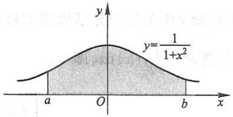

text_image

y
y=\frac{1}{1+x^2}
a O b x

图5-9

例 2 计算反常积分  $\int_{0}^{+\infty} te^{-pt} dt$ ，其中 p 是常数，且 p > 0.

$$
\begin{array}{l} = \left[ - \frac {t}{p} \mathrm{e} ^ {- p t} + \frac {1}{p} \int \mathrm{e} ^ {- p t} \mathrm{d} t \right] _ {0} ^ {+ \infty} = \left[ - \frac {t}{p} \mathrm{e} ^ {- p t} \right] _ {0} ^ {+ \infty} - \left[ \frac {1}{p ^ {2}} \mathrm{e} ^ {- p t} \right] _ {0} ^ {+ \infty} \\ = - \frac {1}{p} \lim _ {t \to + \infty} t \mathrm{e} ^ {- p t} - 0 - \frac {1}{p ^ {2}} (0 - 1) = \frac {1}{p ^ {2}}. \\ \end{array}
$$

解 $\int_0^{+\infty}t\mathrm{e}^{-pt}\mathrm{d}t = \left[\int t\mathrm{e}^{-pt}\mathrm{d}t\right]_{0}^{+\infty} = \left[-\frac{1}{p}\int t\mathrm{d}(\mathrm{e}^{-pt})\right]_{0}^{+\infty}$

图

释疑解难

5-2

251

---

第五章 定积分

注意,上式中的极限  $\lim_{t\to+\infty}te^{-pt}$  是未定式,可用洛必达法则确定.

例3 证明反常积分 $\int_{a}^{+\infty}\frac{\mathrm{d}x}{x^p} (a > 0)$ 当 $p > 1$ 时收敛，当 $p\leqslant 1$ 时发散.

证 当 $p = 1$ 时，

$$
\int_ {a} ^ {+ \infty} \frac {\mathrm{d} x}{x ^ {p}} = \int_ {a} ^ {+ \infty} \frac {\mathrm{d} x}{x} = [ \ln x ] _ {a} ^ {+ \infty} = + \infty ,
$$

当 $p \neq 1$ 时，

$$
\int_ {a} ^ {+ \infty} \frac {\mathrm{d} x}{x ^ {p}} = \left[ \frac {x ^ {1 - p}}{1 - p} \right] _ {a} ^ {+ \infty} = \left\{ \begin{array}{l l} + \infty , & p <   1, \\ \frac {a ^ {1 - p}}{p - 1}, & p > 1. \end{array} \right.
$$

因此, 当 p>1 时, 这反常积分收敛, 其值为  $\frac{a^{1-p}}{p-1}$ ; 当  $p \leqslant 1$  时, 这反常积分发散.

## 二、无界函数的反常积分

现在我们把定积分推广到被积函数为无界函数的情形.

如果函数 $f(x)$ 在点 $a$ 的任一邻域内都无界,那么点 $a$ 称为函数 $f(x)$ 的瑕点(也称为无界间断点).无界函数的反常积分又称为瑕积分.

设函数 $f(x)$ 在区间 $(a, b]$ 上连续，点 $a$ 为 $f(x)$ 的瑕点。任取 $t > a$，作定积分 $\int_{t}^{b} f(x) \mathrm{d}x$，再求极限

$$
\lim _ {t \to a ^ {+}} \int_ {t} ^ {b} f (x) \mathrm{d} x, \tag {4-4}
$$

这个对变下限的定积分求极限的算式(4-4)称为函数 $f(x)$ 在区间 $(a,b]$ 上的反常积分,仍然记为 $\int_{a}^{b}f(x)\mathrm{d}x$ ,即

$$
\int_ {a} ^ {b} f (x) \mathrm{d} x = \lim _ {t \to a ^ {+}} \int_ {t} ^ {b} f (x) \mathrm{d} x. \tag {$4-4^{\prime$}}
$$

根据算式(4-4)的结果是否存在,可引入反常积分 $\int_{a}^{b}f(x)\mathrm{d}x$ 收敛与发散的定义如下:

定义2（1）设函数 $f(x)$ 在区间 $(a, b]$ 上连续，点 $a$ 为 $f(x)$ 的瑕点，如果极限(4-4)存在，那么称反常积分 $\int_{a}^{b} f(x) \mathrm{d}x$ 收敛，并称此极限为该反常积分的值；如果极限(4-4)不存在，那么称反常积分 $\int_{a}^{b} f(x) \mathrm{d}x$ 发散.

类似地, 设函数  $f(x)$  在区间  $[a, b)$  上连续, 点 b 为  $f(x)$  的瑕点. 任取 t < b, 算式

252

---

第四节 反常积分

$$
\lim _ {t \to b ^ {-}} \int_ {a} ^ {t} f (x) \mathrm{d} x \tag {4-5}
$$

称为函数 $f(x)$ 在区间 $[a, b)$ 上的反常积分，仍然记为 $\int_{a}^{b} f(x) \mathrm{d}x$，即

$$
\int_ {a} ^ {b} f (x) \mathrm{d} x = \lim _ {t \to b ^ {-}} \int_ {a} ^ {t} f (x) \mathrm{d} x. \tag {$4-5^{\prime$}}
$$

于是有

（2）设函数 $f(x)$ 在区间 $[a, b)$ 上连续，点 $b$ 为 $f(x)$ 的瑕点，如果极限(4-5)存在，那么称反常积分 $\int_{a}^{b} f(x) \mathrm{d}x$ 收敛，并称此极限为该反常积分的值；如果极限(4-5)不存在，那么称反常积分 $\int_{a}^{b} f(x) \mathrm{d}x$ 发散.

设函数 $f(x)$ 在区间 $[a, c)$ 及区间 $(c, b]$ 上连续，点 $c$ 为 $f(x)$ 的瑕点。反常积分 $\int_{a}^{c} f(x) \mathrm{d}x$ 与反常积分 $\int_{c}^{b} f(x) \mathrm{d}x$ 之和称为函数 $f(x)$ 在区间 $[a, b]$ 上的反常积分，仍然记为 $\int_{a}^{b} f(x) \mathrm{d}x$，即

$$
\int_ {a} ^ {b} f (x) \mathrm{d} x = \int_ {a} ^ {c} f (x) \mathrm{d} x + \int_ {c} ^ {b} f (x) \mathrm{d} x. \tag {4-6}
$$

（3）设函数 $f(x)$ 在区间 $[a, c)$ 及区间 $(c, b]$ 上连续，点 $c$ 为 $f(x)$ 的瑕点。如果反常积分 $\int_{a}^{c} f(x) \mathrm{d}x$ 与反常积分 $\int_{c}^{b} f(x) \mathrm{d}x$ 均收敛，那么称反常积分 $\int_{a}^{b} f(x) \mathrm{d}x$ 收敛，并称反常积分 $\int_{a}^{c} f(x) \mathrm{d}x$ 的值与反常积分 $\int_{c}^{b} f(x) \mathrm{d}x$ 的值之和为反常积分 $\int_{a}^{b} f(x) \mathrm{d}x$ 的值；否则，就称反常积分 $\int_{a}^{b} f(x) \mathrm{d}x$ 发散。

计算无界函数的反常积分,也可借助于牛顿-莱布尼茨公式.

设 $x = a$ 为 $f(x)$ 的瑕点，在 $(a,b]$ 上 $F^{\prime}(x) = f(x)$，如果极限 $\lim_{x\to a^{+}}F(x)$ 存在，那么反常积分

$$
\int_ {a} ^ {b} f (x) \mathrm{d} x = F (b) - \lim _ {x \to a ^ {+}} F (x) = F (b) - F (a ^ {+});
$$

如果 $\lim_{x\to a^{+}}F(x)$ 不存在，那么反常积分 $\int_{a}^{b}f(x)\mathrm{d}x$ 发散.

我们仍用记号 $[F(x)]_a^b$ 来表示 $F(b) - F(a^{+})$ ，从而形式上仍有

$$
\int_ {a} ^ {b} f (x) \mathrm{d} x = \left[ F (x) \right] _ {a} ^ {b}.
$$

对于 $f(x)$ 在 $[a, b)$ 上连续，$b$ 为瑕点的反常积分，也有类似的计算公式，这里不再详述.

例 4 计算反常积分

253

---

第五章 定积分

$$
\int_ {0} ^ {a} \frac {\mathrm{d} x}{\sqrt {a ^ {2} - x ^ {2}}} \quad (a > 0),
$$

解 因为

$$
\lim _ {x \to a ^ {-}} \frac {1}{\sqrt {a ^ {2} - x ^ {2}}} = + \infty ,
$$

所以点 a 是瑕点, 于是

$$
\int_ {0} ^ {a} \frac {\mathrm{d} x}{\sqrt {a ^ {2} - x ^ {2}}} = \left[ \arcsin \frac {x}{a} \right] _ {0} ^ {a} = \lim _ {x \to a ^ {-}} \arcsin \frac {x}{a} - 0 = \frac {\pi}{2}.
$$

这个反常积分值的几何意义是:位于曲线  $y=\frac{1}{\sqrt{a^{2}-x^{2}}}$  之下,x 轴之上,直线 x=0 与 x=a 之间的图形面积(图 5-10).

例 5 讨论反常积分  $\int_{-1}^{1}\frac{dx}{x^{2}}$  的收敛性.

解 被积函数 $f(x) = \frac{1}{x^2}$ 在积分区间 $[-1, 1]$ 上除 $x = 0$ 外连续，且 $\lim_{x \to 0} \frac{1}{x^2} = \infty$. 由于

$$
\int_ {- 1} ^ {0} \frac {\mathrm{d} x}{x ^ {2}} = \left[ - \frac {1}{x} \right] _ {- 1} ^ {0} = \lim _ {x \to 0 ^ {-}} \left(- \frac {1}{x}\right) - 1 = + \infty ,
$$

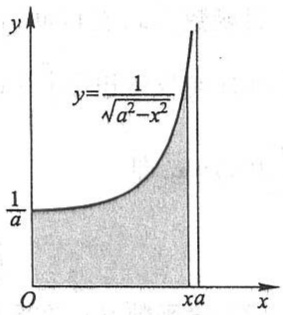

area

| X | Y |
| --- | --- |
| 0 | 1/a |
| xa | >1/a |

图5-10

即反常积分 $\int_{-1}^{0}\frac{\mathrm{d}x}{x^2}$ 发散，所以反常积分 $\int_{-1}^{1}\frac{\mathrm{d}x}{x^2}$ 发散.

注意 如果疏忽了 $x = 0$ 是被积函数的瑕点，就会得到以下的错误结果:

$$
\int_ {- 1} ^ {1} \frac {\mathrm{d} x}{x ^ {2}} = \left[ - \frac {1}{x} \right] _ {- 1} ^ {1} = - 1 - 1 = - 2.
$$

例6 证明反常积分 $\int_{a}^{b}\frac{\mathrm{d}x}{(x - a)^q}$ 当 $0 < q < 1$ 时收敛, 当 $q \geqslant 1$ 时发散.

证 当 $q = 1$ 时，

$$
\int_ {a} ^ {b} \frac {\mathrm{d} x}{(x - a) ^ {q}} = \int_ {a} ^ {b} \frac {\mathrm{d} x}{x - a} = [ \ln (x - a) ] _ {a} ^ {b} = \ln (b - a) - \lim _ {x \to a ^ {+}} \ln (x - a) = + \infty .
$$

当 $q \neq 1$ 时，

$$
\int_ {a} ^ {b} \frac {\mathrm{d} x}{(x - a) ^ {q}} = \left[ \frac {(x - a) ^ {1 - q}}{1 - q} \right] _ {a} ^ {b} = \left\{ \begin{array}{l l} \frac {(b - a) ^ {1 - q}}{1 - q}, & 0 <   q <   1, \\ + \infty , & q > 1. \end{array} \right.
$$

因此, 当 0 < q < 1 时, 该反常积分收敛, 其值为  $\frac{(b-a)^{1-q}}{1-q}$ ; 当  $q \geqslant 1$  时, 该反常积分

254

---

第四节 反常积分

发散.

设有反常积分 $\int_{a}^{b}f(x)\mathrm{d}x$ ，其中 $f(x)$ 在开区间 $(a,b)$ 内连续， $a$ 可以是 $-\infty ,b$ 可以是 $+\infty ,a,b$ 也可以是 $f(x)$ 的瑕点.对于这样的反常积分，在另加换元函数单调的假定下，可以像定积分一样作换元

例7 求反常积分 $\int_0^{+\infty}\frac{\mathrm{d}x}{\sqrt{x(x + 1)^3}}.$

解 这里,积分上限为 $+\infty$ ,且下限x=0为被积函数的瑕点.

令 $\sqrt{x} = t$ ，则 $x = t^2$ ，当 $x\to 0^{+}$ 时 $t\to 0$ ；当 $x\to +\infty$ 时 $t\to +\infty$ .于是

$$
\int_ {0} ^ {+ \infty} \frac {\mathrm{d} x}{\sqrt {x (x + 1) ^ {3}}} = \int_ {0} ^ {+ \infty} \frac {2 t \mathrm{d} t}{t (t ^ {2} + 1) ^ {3 / 2}} = 2 \int_ {0} ^ {+ \infty} \frac {\mathrm{d} t}{(t ^ {2} + 1) ^ {3 / 2}}.
$$

再令 $t = \tan u$ ，则 $u = \arctan t$ ，当 $t = 0$ 时 $u = 0$ ；当 $t\to +\infty$ 时 $u\to \frac{\pi}{2}$ .于是

$$
\int_ {0} ^ {+ \infty} \frac {\mathrm{d} x}{\sqrt {x (x + 1) ^ {3}}} = 2 \int_ {0} ^ {\frac {\pi}{2}} \frac {\sec^ {2} u \mathrm{d} u}{\sec^ {3} u} = 2 \int_ {0} ^ {\frac {\pi}{2}} \cos u \mathrm{d} u = 2.
$$

本例如用代换 $\frac{1}{x}=t$ 或 $\frac{1}{x+1}=t$ ，计算会更简单些，读者可自行解之.

## 习题5-4

1. 判定下列各反常积分的收敛性, 如果收敛, 计算反常积分的值:

(1) $\int_{1}^{+\infty}\frac{\mathrm{d}x}{x^4};$

(2) $\int_{1}^{+\infty}\frac{\mathrm{d}x}{\sqrt{x}};$

(3) $\int_{0}^{+\infty}\mathrm{e}^{-ax}\mathrm{d}x$ ($a > 0$);

(4) $\int_0^{+\infty}\frac{\mathrm{d}x}{(1 + x)(1 + x^2)};$

(5) $\int_{0}^{+\infty}\mathrm{e}^{-pt}\sin \omega t\mathrm{d}t$ ($p > 0, \omega > 0$);

(6) $\int_{-\infty}^{+\infty}\frac{\mathrm{d}x}{x^2 + 2x + 2};$

(7) $\int_0^1\frac{x\mathrm{d}x}{\sqrt{1 - x^2}};$

(8) $\int_0^2\frac{\mathrm{d}x}{(1 - x)^2};$

(9) $\int_{1}^{2}\frac{x\mathrm{d}x}{\sqrt{x - 1}};$

(10) $\int_{1}^{\mathrm{e}}\frac{\mathrm{d}x}{x\sqrt{1 - (\ln x)^2}}.$

2. 求由曲线  $y=\frac{1}{4x^{2}-1}$ 、x 轴和直线 x=1 所围成的向右无限延伸的图形的面积.

3. 当 $k$ 为何值时, 反常积分 $\int_{2}^{+\infty} \frac{\mathrm{d}x}{x(\ln x)^k}$ 收敛? 当 $k$ 为何值时, 该反常积分发散? 又当 $k$ 为何值时, 该反常积分取得最小值?

255

---

第五章 定积分

4. 利用递推公式计算反常积分 $I_{n} = \int_{0}^{+\infty} x^{n} \mathrm{e}^{-x} \, \mathrm{d}x$ ($n \in \mathbb{N}$).
5. 计算反常积分  $\int_{0}^{1}\ln x dx$ .

## \* 第五节 反常积分的审敛法 Γ函数

反常积分的收敛性,可以通过求被积函数的原函数,然后按定义取极限,根据极限的存在与否来判定.本节中我们来建立不通过被积函数的原函数判定反常积分收敛性的判定法.

## 一、无穷限反常积分的审敛法

定理1 设函数 $f(x)$ 在区间 $[a, +\infty)$ 上连续，且 $f(x) \geqslant 0$。若函数

$$
F (x) = \int_ {a} ^ {x} f (t) \mathrm{d} t
$$

在 $[a, +\infty)$ 上有上界，则反常积分 $\int_{a}^{+\infty} f(x) \, \mathrm{d}x$ 收敛.

事实上, 因为 $f(x) \geqslant 0, F(x)$ 在 $[a, +\infty)$ 上单调增加, 又 $F(x)$ 在 $[a, +\infty)$ 上有上界, 故 $F(x)$ 在 $[a, +\infty)$ 上是单调有界的函数. 按照“$[a, +\infty)$ 上的单调有界函数 $F(x)$ 必有极限 $\lim_{x \to +\infty} F(x)$”的准则, 就可知道极限

$$
\lim _ {x \to + \infty} \int_ {a} ^ {x} f (t)   \mathrm{d} t
$$

存在,即反常积分 $\int_{a}^{+\infty}f(x)\mathrm{d}x$ 收敛.

根据定理 1, 对于非负函数的无穷限的反常积分, 有以下的比较审敛原理:

定理2（比较审敛原理）设函数 $f(x), g(x)$ 在区间 $[a, +\infty)$ 上连续. 如果 $0 \leqslant f(x) \leqslant g(x) (a \leqslant x < +\infty)$，并且 $\int_{a}^{+\infty} g(x) \mathrm{d}x$ 收敛，那么 $\int_{a}^{+\infty} f(x) \mathrm{d}x$ 也收敛；如果 $0 \leqslant g(x) \leqslant f(x) (a \leqslant x < +\infty)$，并且 $\int_{a}^{+\infty} g(x) \mathrm{d}x$ 发散，那么 $\int_{a}^{+\infty} f(x) \mathrm{d}x$ 也发散.

证 设 $a < t < +\infty$ ，由 $0 \leqslant f(x) \leqslant g(x)$ 及 $\int_{a}^{+\infty} g(x) \, \mathrm{d}x$ 收敛，得

$$
\int_ {a} ^ {t} f (x) \mathrm{d} x \leqslant \int_ {a} ^ {t} g (x) \mathrm{d} x \leqslant \int_ {a} ^ {+ \infty} g (x) \mathrm{d} x.
$$

这表明作为积分上限 $t$ 的函数

$$
F (t) = \int_ {a} ^ {t} f (x) \mathrm{d} x
$$

256

---

\* 第五节 反常积分的审敛法 Γ函数

在 $[a, +\infty)$ 上有上界. 由定理1即知反常积分 $\int_{a}^{+\infty} f(x) \mathrm{d}x$ 收敛.

如果 $0 \leqslant g(x) \leqslant f(x)$, 且 $\int_{a}^{+\infty} g(x) \mathrm{d}x$ 发散, 那么 $\int_{a}^{+\infty} f(x) \mathrm{d}x$ 必定发散. 因为如果 $\int_{a}^{+\infty} f(x) \mathrm{d}x$ 收敛, 由定理的第一部分即知 $\int_{a}^{+\infty} g(x) \mathrm{d}x$ 也收敛, 这与假设相矛盾. 证毕.

由上节例3知道,反常积分 $\int_{a}^{+\infty}\frac{\mathrm{d}x}{x^{p}}(a>0)$ 当p>1时收敛,当 $p\leqslant1$ 时发散.因此,取 $g(x)=\frac{A}{x^{p}}(A>0)$ ,立即可得下面的反常积分的比较审敛法.

定理3（比较审敛法1）设函数 $f(x)$ 在区间 $[a, +\infty)$ （$a > 0$）上连续，且 $f(x) \geqslant 0$。如果存在常数 $M > 0$ 及 $p > 1$，使得 $f(x) \leqslant \frac{M}{x^p}$（$a \leqslant x < +\infty$），那么反常积分 $\int_{a}^{+\infty} f(x) \mathrm{d}x$ 收敛；如果存在常数 $N > 0$，使得 $f(x) \geqslant \frac{N}{x}$（$a \leqslant x < +\infty$），那么反常积分 $\int_{a}^{+\infty} f(x) \mathrm{d}x$ 发散。

例1 判定反常积分 $\int_{1}^{+\infty}\frac{\mathrm{d}x}{\sqrt[3]{x^4 + 1}}$ 的收敛性.

解 由于

$$
0 <   \frac {1}{\sqrt [ 3 ]{x ^ {4} + 1}} <   \frac {1}{\sqrt [ 3 ]{x ^ {4}}} = \frac {1}{x ^ {\frac {4}{3}}},
$$

根据比较审敛法1,这个反常积分收敛.

以比较审敛法 1 为基础, 可以得到在应用上较为方便的极限审敛法.

定理4（极限审敛法1）设函数 $f(x)$ 在区间 $[a, +\infty)$ 上连续，且 $f(x) \geqslant 0$。如果存在常数 $p > 1$，使得 $\lim_{x \to +\infty} x^p f(x) = c < +\infty$，那么反常积分 $\int_{a}^{+\infty} f(x) \mathrm{d}x$ 收敛；如果 $\lim_{x \to +\infty} xf(x) = d > 0$（或 $\lim_{x \to +\infty} xf(x) = +\infty$），那么反常积分 $\int_{a}^{+\infty} f(x) \mathrm{d}x$ 发散。

证 由假设 $\lim_{x\to +\infty}x^{p}f(x) = c(p > 1)$. 根据极限的定义, 存在充分大的 $x_{1}(x_{1}\geqslant a,x_{1} > 0)$, 当 $x > x_{1}$ 时, 必有

$$
\mid x ^ {p} f (x) - c \mid <   1,
$$

由此得

$$
0 \leqslant x ^ {p} f (x) <   1 + c.
$$

令 $1 + c = M > 0$ ，于是在区间 $(x_{1}, + \infty)$ 内不等式 $0\leqslant f(x) <   \frac{M}{x^p}$ 成立.由比较审敛法1知

257

---

第五章 定积分

$\int_{x_1}^{+\infty}f(x)\mathrm{d}x$ 收敛，而

$$
\begin{array}{l} \int_ {a} ^ {+ \infty} f (x) \mathrm{d} x = \lim _ {t \rightarrow + \infty} \int_ {a} ^ {t} f (x) \mathrm{d} x = \lim _ {t \rightarrow + \infty} \left[ \int_ {a} ^ {x _ {1}} f (x) \mathrm{d} x + \int_ {x _ {1}} ^ {t} f (x) \mathrm{d} x \right] \\ = \int_ {a} ^ {x _ {1}} f (x) \mathrm{d} x + \lim _ {t \rightarrow + \infty} \int_ {x _ {1}} ^ {t} f (x) \mathrm{d} x = \int_ {a} ^ {x _ {1}} f (x) \mathrm{d} x + \int_ {x _ {1}} ^ {+ \infty} f (x) \mathrm{d} x, \\ \end{array}
$$

故反常积分

$$
\int_ {a} ^ {+ \infty} f (x) \mathrm{d} x
$$

收敛.

如果 $\lim_{x\to +\infty}xf(x) = d > 0$ （或 $+\infty$ ），那么存在充分大的 $x_{1}$ ，当 $x > x_{1}$ 时，必有

$$
\mid x f (x) - d \mid <   \frac {d}{2},
$$

由此得

$$
xf(x) > \frac{d}{2}.
$$

(当 $\lim_{x\to +\infty}xf(x) = +\infty$ 时, 可取任意正数作为 $d$.) 令 $\frac{d}{2} = N > 0$, 于是在区间 $(x_1, +\infty)$ 内不等式 $f(x) \geqslant \frac{N}{x}$ 成立. 根据比较审敛法 1 知 $\int_{x_1}^{+\infty} f(x) \mathrm{d}x$ 发散, 从而反常积分 $\int_{a}^{+\infty} f(x) \mathrm{d}x$ 发散.

例2 判定反常积分 $\int_{1}^{+\infty}\frac{\mathrm{d}x}{x\sqrt{1 + x^2}}$ 的收敛性.

解 由于

$$
\lim _ {x \to + \infty} x ^ {2} \cdot \frac {1}{x \sqrt {1 + x ^ {2}}} = \lim _ {x \to + \infty} \frac {1}{\sqrt {\frac {1}{x ^ {2}} + 1}} = 1,
$$

根据极限审敛法1,知所给反常积分收敛.

例3 判定反常积分 $\int_{1}^{+\infty}\frac{x^{\frac{3}{2}}}{1 + x^2}\mathrm{d}x$ 的收敛性.

解 由于

$$
\lim _ {x \to + \infty} x \frac {x ^ {\frac {3}{2}}}{1 + x ^ {2}} = \lim _ {x \to + \infty} \frac {x ^ {2} \sqrt {x}}{1 + x ^ {2}} = + \infty ,
$$

根据极限审敛法1,知所给反常积分发散.

例4 判定反常积分 $\int_{1}^{+\infty}\frac{\arctan x}{x}\mathrm{d}x$ 的收敛性.

258

---

\* 第五节 反常积分的审敛法 Γ函数

解 由于

$$
\lim _ {x \to + \infty} x \frac {\arctan x}{x} = \lim _ {x \to + \infty} \arctan x = \frac {\pi}{2},
$$

根据极限审敛法1,知所给反常积分发散.

假定反常积分的被积函数在所讨论的区间上可取正值也可取负值,对于这类反常积分的收敛性,有如下的结论:

定理5 设函数 $f(x)$ 在区间 $[a, +\infty)$ 上连续. 如果反常积分

$$
\int_ {a} ^ {+ \infty} | f (x) | \mathrm{d} x
$$

收敛,那么反常积分

$$
\int_ {a} ^ {+ \infty} f (x) \mathrm{d} x
$$

也收敛.

证 令 $\varphi(x) = \frac{1}{2}[f(x) + |f(x)|]$, 于是 $\varphi(x) \geqslant 0$, 且 $\varphi(x) \leqslant |f(x)|$, 而

$\int_{a}^{+\infty}|f(x)|\mathrm{d}x$ 收敛，由比较审敛法1即知 $\int_{a}^{+\infty}\varphi (x)\mathrm{d}x$ 也收敛.但 $f(x) = 2\varphi (x) - |f(x)|$ ，因此

$$
\int_ {a} ^ {+ \infty} f (x) \mathrm{d} x = 2 \int_ {a} ^ {+ \infty} \varphi (x) \mathrm{d} x - \int_ {a} ^ {+ \infty} | f (x) | \mathrm{d} x.
$$

可见反常积分 $\int_{a}^{+\infty}f(x)\mathrm{d}x$ 是两个收敛的反常积分的差，因此它是收敛的.证毕

通常称满足定理5条件的反常积分 $\int_{a}^{+\infty} f(x) \mathrm{d}x$ 绝对收敛. 于是, 定理5可简单地表达为: 绝对收敛的反常积分 $\int_{a}^{+\infty} f(x) \mathrm{d}x$ 必定收敛.

例5 判定反常积分 $\int_0^{+\infty}\mathrm{e}^{-ax}\sin bx\mathrm{d}x$ （ $a,b$ 都是常数，且 $a > 0)$ 的收敛性.

解 因为 $|\mathrm{e}^{-ax}\sin bx| \leqslant \mathrm{e}^{-ax}$, 而 $\int_{0}^{+\infty}\mathrm{e}^{-ax}\mathrm{d}x$ 收敛, 根据比较审敛法 1, 反常积分 $\int_{0}^{+\infty}|\mathrm{e}^{-ax}\sin bx|\mathrm{d}x$ 收敛. 由定理 5 可知所给反常积分收敛.

## 二、无界函数的反常积分的审敛法

对于无界函数的反常积分,也有类似的审敛法.

由上节例6知道,反常积分

$$
\int_ {a} ^ {b} \frac {\mathrm{d} x}{(x - a) ^ {q}}
$$

259

---

第五章 定积分

当 $q < 1$ 时收敛, 当 $q \geqslant 1$ 时发散. 于是, 与定理3、定理4类似可得如下两个审敛法:

定理6(比较审敛法2) 设函数 $f(x)$ 在区间 $(a, b]$ 上连续，且 $f(x) \geqslant 0, x = a$ 为 $f(x)$ 的瑕点. 如果存在常数 $M > 0$ 及 $q < 1$ ，使得

$$
f (x) \leqslant \frac {M}{(x - a) ^ {q}} \quad (a <   x \leqslant b),
$$

那么反常积分 $\int_{a}^{b}f(x)\mathrm{d}x$ 收敛；如果存在常数 $N > 0$ ，使得

$$
f (x) \geqslant \frac {N}{x - a} \quad (a <   x \leqslant b),
$$

那么反常积分  $\int_{a}^{b}f(x)\mathrm{d}x$  发散.

定理7(极限审敛法2) 设函数 $f(x)$ 在区间 $(a, b]$ 上连续，且 $f(x) \geqslant 0, x = a$ 为 $f(x)$ 的瑕点. 如果存在常数 $0 < q < 1$ ，使得

$$
\lim _ {x \to a ^ {+}} (x - a) ^ {q} f (x)
$$

存在,那么反常积分  $\int_{a}^{b}f(x)\mathrm{d}x$  收敛;如果

$$
\lim _ {x \to a ^ {+}} (  x   -   a  ) f (  x  ) = d   >   0 \quad (\text {或} \lim _ {x \to a ^ {+}} (  x   -   a  ) f (  x  ) = + \infty) ,
$$

那么反常积分  $\int_{a}^{b}f(x)\mathrm{d}x$  发散.

例6 判定反常积分 $\int_{1}^{3}\frac{\mathrm{d}x}{\ln x}$ 的收敛性.

解 这里 $x = 1$ 是被积函数的瑕点.由洛必达法则知

$$
\lim _ {x \to 1 ^ {+}} (x - 1) \frac {1}{\ln x} = \lim _ {x \to 1 ^ {+}} \frac {1}{\frac {1}{x}} = 1 > 0,
$$

根据极限审敛法 2, 所给反常积分发散.

例 7 判定椭圆积分

$$
\int_ {0} ^ {1} \frac {\mathrm{d} x}{\sqrt {(1 - x ^ {2}) (1 - k ^ {2} x ^ {2})}} \quad (k ^ {2} <   1)
$$

的收敛性.

解 这里 $x = 1$ 是被积函数的瑕点.由于

$$
\lim _ {x \to 1 ^ {-}} (1 - x) ^ {\frac {1}{2}} \frac {1}{\sqrt {(1 - x ^ {2}) (1 - k ^ {2} x ^ {2})}} = \lim _ {x \to 1 ^ {-}} \frac {1}{\sqrt {(1 + x) (1 - k ^ {2} x ^ {2})}} = \frac {1}{\sqrt {2 (1 - k ^ {2})}},
$$

根据极限审敛法2,所给反常积分收敛.

对于无界函数的反常积分,当被积函数在所讨论的区间上可取正值也可取负值时,有与定理5相类似的结论,在此不再详述.

260

---

\* 第五节 反常积分的审敛法 Γ函数

例8 判定反常积分 $\int_0^1\frac{1}{\sqrt{x}}\sin \frac{1}{x}\mathrm{d}x$ 的收敛性.

解 因为 $\left|\frac{1}{\sqrt{x}}\sin \frac{1}{x}\right| \leqslant \frac{1}{\sqrt{x}}$，而 $\int_0^1\frac{\mathrm{d}x}{\sqrt{x}}$ 收敛，根据比较审敛法2，反常积分 $\int_0^1\left|\frac{1}{\sqrt{x}}\sin \frac{1}{x}\right|\mathrm{d}x$ 收敛，从而反常积分 $\int_0^1\frac{1}{\sqrt{x}}\sin \frac{1}{x}\mathrm{d}x$ 也收敛.

## 三、$\Gamma$ 函数

下面介绍在理论上和应用上都有重要意义的 $\Gamma$ 函数.这函数的定义是

$$
\Gamma (s) = \int_ {0} ^ {+ \infty} \mathrm{e} ^ {- x} x ^ {s - 1} \mathrm{d} x \quad (s > 0). \tag {5-1}
$$

首先,讨论(5-1)式右端积分的收敛性问题.这个积分的积分区间为无穷,又当s-1<0时x=0是被积函数的瑕点.为此,分别讨论下列两个积分

$$
I _ {1} = \int_ {0} ^ {1} \mathrm{e} ^ {- x} x ^ {s - 1} \mathrm{d} x, \quad I _ {2} = \int_ {1} ^ {+ \infty} \mathrm{e} ^ {- x} x ^ {s - 1} \mathrm{d} x
$$

的收敛性.

先讨论 $I_{1}$. 当 $s \geqslant 1$ 时, $I_{1}$ 是定积分; 当 $0 < s < 1$ 时, 因为

$$
\mathrm{e} ^ {- x} \cdot x ^ {s - 1} = \frac {1}{\mathrm{e} ^ {x}} \frac {1}{x ^ {1 - s}} <   \frac {1}{x ^ {1 - s}},
$$

而 1-s<1, 根据比较审敛法 2, 反常积分  $I_{1}$  收敛.

再讨论 $I_{2}$ .因为

$$
\lim _ {x \to + \infty} x ^ {2} \cdot (\mathrm{e} ^ {- x} x ^ {s - 1}) = \lim _ {x \to + \infty} \frac {x ^ {s + 1}}{\mathrm{e} ^ {x}} = 0,
$$

根据极限审敛法  $1, I_{2}$  也收敛.

由以上讨论即得反常积分 $\int_0^{+\infty}\mathrm{e}^{-x}x^{s - 1}\mathrm{d}x$ 对 $s > 0$ 均收敛. $\Gamma$ 函数的图形如图5-11所示.

其次,讨论  $\Gamma$  函数的几个重要性质.

1. 递推公式 $\Gamma(s + 1) = s\Gamma(s) (s > 0)$.

证 应用分部积分法,有

$$
\Gamma (s + 1) = \int_ {0} ^ {+ \infty} \mathrm{e} ^ {- x} x ^ {s} \mathrm{d} x = - \int_ {0} ^ {+ \infty} x ^ {s} \mathrm{d} (\mathrm{e} ^ {- x}) = [ - x ^ {s} \mathrm{e} ^ {- x} ] _ {0} ^ {+ \infty} + s \int_ {0} ^ {+ \infty} \mathrm{e} ^ {- x} x ^ {s - 1} \mathrm{d} x = s \Gamma (s),
$$

其中  $\lim_{x\to+\infty}x^{s}e^{-x}=0$  可由洛必达法则求得.

显然，$\Gamma(1) = \int_{0}^{+\infty}\mathrm{e}^{-x}\mathrm{d}x = 1.$

反复运用递推公式,便有

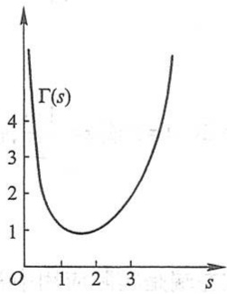

line

| s | \(\Gamma(s)\) |
| --- | --- |
| 0 | ~6.5 |
| 1 | ~1.2 |
| 1.5 | 1 |
| 3 | ~2.2 |
| 4 | ~6.5 |

图5-11

261

---

第五章 定积分

$$
\Gamma (2) = 1 \cdot \Gamma (1) = 1,
$$

$$
\Gamma (3) = 2 \cdot \Gamma (2) = 2!,
$$

$$
\Gamma (4) = 3 \cdot \Gamma (3) = 3!, \dots
$$

一般地,对任何正整数 n,有

$$
\Gamma (n + 1) = n!,
$$

所以,我们可以把  $\Gamma$  函数看成是阶乘的推广.

2. 当 $s \to 0^{+}$ 时, $\Gamma(s) \to +\infty$.

证 因为

$$
\Gamma (s) = \frac {\Gamma (s + 1)}{s}, \quad \Gamma (1) = 1,
$$

所以当 $s \to 0^{+}$时, $\Gamma(s) \to +\infty$ ①.

3.  $\Gamma(s)\Gamma(1-s)=\frac{\pi}{\sin\pi s}(0<s<1)$ .

这个公式称为余元公式,在此我们不作证明.

当 $s = \frac{1}{2}$ 时，由余元公式可得

$$
\Gamma \left(\frac {1}{2}\right) = \sqrt {\pi}.
$$

4. 在 $\Gamma(s) = \int_{0}^{+\infty} \mathrm{e}^{-x} x^{s-1} \, \mathrm{d}x$ 中，作代换 $x = u^2$，有

$$
\Gamma (s) = 2 \int_ {0} ^ {+ \infty} \mathrm{e} ^ {- u ^ {2}} u ^ {2 s - 1} \mathrm{d} u. \tag {5-2}
$$

再令 $2s - 1 = t$ 或 $s = \frac{1 + t}{2}$, 便有

$$
\int_ {0} ^ {+ \infty} \mathrm{e} ^ {- u ^ {2}} u ^ {t} \mathrm{d} u = \frac {1}{2} \Gamma \left(\frac {1 + t}{2}\right) \quad (t > - 1).
$$

上式左端是实际应用中常见的积分,它的值可以通过上式用  $\Gamma$  函数计算出来.

在(5-2)中,令 $s=\frac{1}{2}$ ,得

$$
2 \int_ {0} ^ {+ \infty} \mathrm{e} ^ {- u ^ {2}} \mathrm{d} u = \Gamma \left(\frac {1}{2}\right) = \sqrt {\pi}.
$$

从而

$$
\int_ {0} ^ {+ \infty} \mathrm{e} ^ {- u ^ {2}} \mathrm{d} u = \frac {\sqrt {\pi}}{2}.
$$

<small>①  $\Gamma$  函数在 s>0 时连续.</small>

262

---

总习题五

上式左端的积分是在概率论中常用的积分.

## \*习题5-5

1. 判定下列反常积分的收敛性:

(1) $\int_{0}^{+\infty}\frac{x^2}{x^4 + x^2 + 1}\mathrm{d}x;$

(2) $\int_{1}^{+\infty}\frac{\mathrm{d}x}{x\sqrt[3]{x^2 + 1}};$

(3) $\int_{1}^{+\infty}\sin \frac{1}{x^2}\mathrm{d}x;$

(4) $\int_0^{+\infty}\frac{\mathrm{d}x}{1 + x|\sin x|};$

(5) $\int_{1}^{+\infty}\frac{x\arctan x}{1 + x^3}\mathrm{d}x;$

(6) $\int_{1}^{2}\frac{\mathrm{d}x}{(\ln x)^3};$

(7) $\int_0^1\frac{x^4}{\sqrt{1 - x^4}}\mathrm{d}x;$

(8) $\int_{1}^{2}\frac{\mathrm{d}x}{\sqrt[3]{x^2 - 3x + 2}}.$

2. 设反常积分  $\int_{1}^{+\infty} f^{2}(x) \, dx$  收敛, 证明反常积分  $\int_{1}^{+\infty} \frac{f(x)}{x} \, dx$  绝对收敛.

3. 用 $\Gamma$ 函数表示下列积分, 并指出这些积分的收敛范围:

(1) $\int_{0}^{+\infty}\mathrm{e}^{-x^n}\mathrm{d}x (n > 0);$

(2) $\int_{0}^{1}\left(\ln\frac{1}{x}\right)^{p}dx;$

(3) $\int_{0}^{+\infty} x^{m} \mathrm{e}^{-x^{n}} \, \mathrm{d}x (n \neq 0)$.

4. 证明 $\Gamma\left(\frac{2k+1}{2}\right)=\frac{1\cdot3\cdot5\cdot\cdots\cdot(2k-1)\sqrt{\pi}}{2^{k}}$, 其中 $k\in\mathbb{N}_{+}$.

5. 证明以下各式(其中  $n \in N_{+}$ ):

(1)  $2 \cdot 4 \cdot 6 \cdot \cdots \cdot 2n = 2^{n}\Gamma(n+1)$ ;

(2) $1 \cdot 3 \cdot 5 \cdot \cdots \cdot (2n-1) = \frac{\Gamma(2n)}{2^{n-1}\Gamma(n)}$;

(3)  $\sqrt{\pi}\Gamma(2n)=2^{2n-1}\Gamma(n)\Gamma\left(n+\frac{1}{2}\right)$  (勒让德(Legendre)倍量公式).

## 总习题五

1. 填空:

（1）函数 $f(x)$ 在 $[a,b]$ 上有界是 $f(x)$ 在 $[a,b]$ 上可积的\_\_\_\_条件，而 $f(x)$ 在 $[a,b]$ 上连续是 $f(x)$ 在 $[a,b]$ 上可积的\_\_\_\_条件；

(2) 对  $[a, +\infty)$  上非负、连续的函数  $f(x)$ ，积分上限的函数  $\int_{a}^{x} f(t) dt$  在  $[a, +\infty)$  上有界是反常积分  $\int_{a}^{+\infty} f(x) dx$  收敛的 \_\_\_\_ 条件；

\* (3) 绝对收敛的反常积分 $\int_{a}^{+\infty} f(x) \mathrm{d}x$ 一定\_\_\_\_；

(4) 函数 $f(x)$ 在 $[a, b]$ 上有定义且 $|f(x)|$ 在 $[a, b]$ 上可积，此时积分 $\int_{a}^{b} f(x) \, \mathrm{d}x$ \_\_\_\_ 存在.

263

---

第五章 定积分

(5) 设函数  $f(x)$  连续，则  $\frac{\mathrm{d}}{\mathrm{d}x}\int_{0}^{x}tf(t^{2}-x^{2})\mathrm{d}t=$ \_\_\_\_ .

2. 以下两题中给出了四个结论,从中选出一个正确的结论:

（1）设 $I = \int_0^1\frac{x^4}{\sqrt{1 + x}}\mathrm{d}x$ ，则估计 $I$ 值的大致范围为（ ）；

(A) $0 \leqslant I \leqslant \frac{\sqrt{2}}{10}$

(B) $\frac{\sqrt{2}}{10} \leqslant I \leqslant \frac{1}{5}$

(C) $\frac{1}{5} < I < 1$

(D) $I \geqslant 1$

(2) 设  $F(x)$  是连续函数  $f(x)$  的一个原函数, 则必有().

(A)  $F(x)$  是偶函数  $\Leftrightarrow f(x)$  是奇函数

(B) $F(x)$ 是奇函数 $\Leftrightarrow f(x)$ 是偶函数

(C)  $F(x)$  是周期函数  $\Leftrightarrow f(x)$  是周期函数

(D)  $F(x)$  是单调函数  $\Leftrightarrow f(x)$  是单调函数

3. 回答下列问题:

（1）设函数 $f(x)$ 及 $g(x)$ 在区间 $[a, b]$ 上连续，且 $f(x) \geqslant g(x)$，则 $\int_{a}^{b}[f(x) - g(x)] \mathrm{d}x$ 在几何上表示什么？

(2) 设函数  $f(x)$  在区间  $[a, b]$  上连续，且  $f(x) \geqslant 0$ ，则  $\int_{a}^{b} \pi f^{2}(x) \, dx$  在几何上表示什么？

（3）如果在时刻 t 以  $\varphi(t)$  的流量(单位时间内流过的流体的体积或质量)向一水池注水,那么  $\int_{t_{1}}^{t_{2}}\varphi(t)\mathrm{d}t$  表示什么?

（4）如果某国人口增长的速率为 $u(t)$，那么 $\int_{T_1}^{T_2} u(t) \, \mathrm{d}t$ 表示什么？

(5) 如果一公司经营某种产品的边际利润函数为  $P'(x)$ ，那么  $\int_{1000}^{2000} P'(x) \, dx$  表示什么？

\* 4. 利用定积分的定义计算下列极限:

(1)  $\lim_{n\to\infty}\frac{1}{n}\sum_{i=1}^{n}\sqrt{1+\frac{i}{n}}$ ;

(2)  $\lim_{n\to\infty}\frac{1^{p}+2^{p}+\cdots+n^{p}}{n^{p+1}}\quad(p>0).$

5. 求下列极限:

(1) $\lim_{x\to a}\frac{x}{x - a}\int_{a}^{x}f(t)\mathrm{d}t$ ，其中 $f(x)$ 连续；

(2) $\lim_{x\to +\infty}\frac{\int_0^x(\arctan t)^2\mathrm{d}t}{\sqrt{x^2 + 1}}.$

6. 下列计算是否正确,试说明理由:

(1) $\int_{-1}^{1} \frac{\mathrm{d}x}{1 + x^2} = -\int_{-1}^{1} \frac{\mathrm{d}\left(\frac{1}{x}\right)}{1 + \left(\frac{1}{x}\right)^2} = \left[-\arctan \frac{1}{x}\right]_{-1}^{1} = -\frac{\pi}{2};$

(2) 因为  $\int_{-1}^{1}\frac{\mathrm{d}x}{x^{2}+x+1}=\frac{x=\frac{1}{t}}{-\int_{-1}^{1}\frac{\mathrm{d}t}{t^{2}+t+1}}$ ，所以  $\int_{-1}^{1}\frac{\mathrm{d}x}{x^{2}+x+1}=0.$

7. 设 $x > 0$ ，证明:$\int_{0}^{x} \frac{1}{1 + t^2} \mathrm{d}t + \int_{0}^{\frac{1}{x}} \frac{1}{1 + t^2} \mathrm{d}t = \frac{\pi}{2}$.

264

---

总习题五

8. 设 $p > 0$，证明:$\frac{p}{p + 1} < \int_{0}^{1} \frac{\mathrm{d}x}{1 + x^p} < 1$.

9. 设 $f(x), g(x)$ 在区间 $[a, b]$ 上均连续，证明:

(1) $\left[\int_{a}^{b}f(x)g(x)\mathrm{d}x\right]^{2}\leqslant \int_{a}^{b}f^{2}(x)\mathrm{d}x\cdot \int_{a}^{b}g^{2}(x)\mathrm{d}x$ （柯西-施瓦茨不等式）；

(2) $\left\{\int_{a}^{b}[f(x) + g(x)]^{2}\mathrm{d}x\right\}^{\frac{1}{2}}\leqslant \left[\int_{a}^{b}f^{2}(x)\mathrm{d}x\right]^{\frac{1}{2}} + \left[\int_{a}^{b}g^{2}(x)\mathrm{d}x\right]^{\frac{1}{2}}$ （闵可夫斯基不等式）.

10. 设 $f(x)$ 在区间 $[a, b]$ 上连续，且 $f(x) > 0$. 证明:$\int_{a}^{b} f(x) \, \mathrm{d}x \cdot \int_{a}^{b} \frac{\mathrm{d}x}{f(x)} \geqslant (b - a)^2$.

11. 计算下列积分:

(1) $\int_{0}^{\frac{\pi}{2}}\frac{x + \sin x}{1 + \cos x}\mathrm{d}x;$

(2) $\int_{0}^{\frac{\pi}{4}}\ln (1 + \tan x)\mathrm{d}x;$

(3) $\int_{0}^{a}\frac{\mathrm{d}x}{x + \sqrt{a^2 - x^2}} (a > 0);$

(4) $\int_0^{\frac{\pi}{2}}\sqrt{1 - \sin 2x}\mathrm{d}x;$

(5) $\int_{0}^{\frac{\pi}{2}}\frac{\mathrm{d}x}{1 + \cos^2x};$

(6) $\int_0^\pi x\sqrt{\cos^2x - \cos^4x}\mathrm{d}x;$

(7) $\int_{0}^{\pi} x^{2} \mid \cos x \mid \mathrm{d}x$;

(8) $\int_{0}^{+\infty}\frac{\mathrm{d}x}{\mathrm{e}^{x + 1} + \mathrm{e}^{3 - x}};$

(9) $\int_{\frac{1}{2}}^{\frac{3}{2}}\frac{\mathrm{d}x}{\sqrt{|x^2 - x|}};$

(10) $\int_0^x\max \{t^3,t^2,1\} \mathrm{d}t.$

12. 设 $f(x)$ 为连续函数, 证明: $\int_{0}^{x} f(t)(x - t) \, \mathrm{d}t = \int_{0}^{x} \left[ \int_{0}^{t} f(u) \, \mathrm{d}u \right] \, \mathrm{d}t$.

13. 设  $f(x)$  在区间  $[a, b]$  上连续，且  $f(x) > 0$ ，

$$
F (x) = \int_ {a} ^ {x} f (t)   \mathrm{d} t + \int_ {b} ^ {x} \frac {\mathrm{d} t}{f (t)}, \quad x \in [ a, b ].
$$

证明:

(1)  $F'(x) \geqslant 2;$

(2) 方程  $F(x)=0$  在区间  $(a,b)$  内有且仅有一个根.

14. 求  $\int_{0}^{2}f(x-1)\mathrm{d}x$ , 其中

$$
f (x) = \left\{ \begin{array}{l l} \frac {1}{1 + \mathrm{e} ^ {x}}, & x <   0, \\ \frac {1}{1 + x}, & x \geqslant 0. \end{array} \right.
$$

15. 设 $f'(x)$ 在 $[- \pi, \pi]$ 上连续，$a_n = \frac{1}{\pi} \int_{-\pi}^{\pi} f(x) \cos nx \, \mathrm{d}x$ ($n \in \mathbb{N}$)，证明:$\lim_{n \to \infty} a_n = 0$

16. 设 $f(x)$ 在区间 $[a, b]$ 上连续，$g(x)$ 在区间 $[a, b]$ 上连续且不变号。证明:至少存在一点 $\xi \in [a, b]$，使下式成立:

$$
\int_ {a} ^ {b} f (x) g (x) \mathrm{d} x = f (\xi) \int_ {a} ^ {b} g (x) \mathrm{d} x \quad (\text {积分第一中值定理}).
$$

265

---

第五章 定积分

\* 17. 证明: $\int_{0}^{+\infty} x^{n} \mathrm{e}^{-x^{2}} \mathrm{d}x = \frac{n-1}{2} \int_{0}^{+\infty} x^{n-2} \mathrm{e}^{-x^{2}} \mathrm{d}x (n>1)$, 并用它证明

$$
\int_ {0} ^ {+ \infty} x ^ {2 n + 1} \mathrm{e} ^ {- x ^ {2}} \mathrm{d} x = \frac {1}{2} \Gamma (n + 1) \quad (n \in \mathbf {N}).
$$

\* 18. 判定下列反常积分的收敛性:

(1) $\int_{0}^{+\infty}\frac{\sin x}{\sqrt{x^3}}\mathrm{d}x;$

(2) $\int_{2}^{+\infty}\frac{\mathrm{d}x}{x\cdot\sqrt[3]{x^2 - 3x + 2}};$

(3) $\int_{2}^{+\infty}\frac{\cos x}{\ln x}dx;$

(4) $\int_{0}^{+\infty}\frac{\mathrm{d}x}{\sqrt[3]{x^2(x - 1)(x - 2)}}.$

\* 19. 计算下列反常积分:

(1) $\int_{0}^{\frac{\pi}{2}}\ln\sin xdx;$

(2) $\int_{0}^{+\infty}\frac{\mathrm{d}x}{(1 + x^2)(1 + x^\alpha)} (\alpha \geqslant 0)$.

第五章释疑解难

第五章例题精讲

266
