(10) $y=e^{\frac{1}{x}}$.

2. 下列各题中, 函数 $f(x)$ 和 $g(x)$ 是否相同? 为什么?

(1) $f(x) = \lg x^2$, $g(x) = 2\lg x$;

(2) $f(x) = x, g(x) = \sqrt{x^2}$;

(3) $f(x) = \sqrt[3]{x^4 - x^3}, g(x) = x\sqrt[3]{x - 1};$

(4) $f(x) = 1$, $g(x) = \sec^2 x - \tan^2 x$.

3. 设

$$
\varphi (x) = \left\{ \begin{array}{c c} | \sin x |, & | x | <   \frac {\pi}{3}, \\ 0, & | x | \geqslant \frac {\pi}{3}, \end{array} \right.
$$

求 $\varphi \left(\frac{\pi}{6}\right),\varphi \left(\frac{\pi}{4}\right),\varphi \left(-\frac{\pi}{4}\right),\varphi (-2)$ ，并作出函数 $y = \varphi (x)$ 的图形

4. 讨论下列函数的有界性:

(1) $f(x)=\frac{x}{1+x^{2}}$;

(2) $f(x) = \frac{1 + x^2}{1 + x^4}$.

5. 试证下列函数在指定区间内的单调性:

(1)  $y=\frac{x}{1-x},(-\infty,1)$ ;

(2) $y = x + \ln x, (0, +\infty)$.

6. 讨论下列函数的单调性:

(1) $f(x)=ax^{2}+bx+c$ , 其中  $a, b, c \in R, a \neq 0;$  (2) $f(x)=\frac{ax+b}{cx+d}$ , 其中  $a, b, c, d \in R, c > 0.$

7. 设 $f(x)$ 为定义在 $(-l, l)$ 内的奇函数, 若 $f(x)$ 在 $(0, l)$ 内单调增加, 证明 $f(x)$ 在 $(-l, 0)$ 内也单调增加.

8. 设下面所考虑的函数都是定义在区间 $(-l, l)$ 上的. 证明:

(1) 两个偶函数的和是偶函数,两个奇函数的和是奇函数;

(2) 两个偶函数的乘积是偶函数, 两个奇函数的乘积是偶函数, 偶函数与奇函数的乘积是奇函数.

9. 下列函数中哪些是偶函数, 哪些是奇函数, 哪些既非偶函数又非奇函数?

(1) $y = x^{2}(1 - x^{2})$;

(2) $y = 3x^{2} - x^{3}$;

(3) $y = \frac{1 - x^2}{1 + x^2}$;

(4)  $y = x(x - 1)(x + 1)$ ;

(5) $y = \sin x - \cos x + 1$;

(6) $y = \frac{a^x + a^{-x}}{2} (a > 0, a \neq 1)$.

10. 下列各函数中哪些是周期函数？对于周期函数，指出其周期:

(1) $y = \cos (x - 2)$;

(2) $y = \cos 4x$;

(3)  $y=1+\sin\pi x;$

(4)  $y = x \cos x;$

(5) $y = \sin^2 x.$

11. 求下列函数的反函数:

(1) $y = \sqrt[3]{x + 1}$;

(2) $y = \frac{1 - x}{1 + x}$;

(3) $y = \frac{ax + b}{cx + d} (ad - bc \neq 0)$;

(4) $y = 2\sin 3x \left( -\frac{\pi}{6} \leqslant x \leqslant \frac{\pi}{6} \right)$;

(5) $y = 1 + \ln (x + 2)$;

(6) $y = \frac{2^x}{2^x + 1}$.

12. 在下列各题中, 求由所给函数构成的复合函数, 并求该函数分别对应于给定自变量值  $x_{1}$  和  $x_{2}$  的函数值:

(1) $y = u^2, u = \sin x, x_1 = \frac{\pi}{6}, x_2 = \frac{\pi}{3}$;
(2) $y = \sin u, u = 2x, x_1 = \frac{\pi}{8}, x_2 = \frac{\pi}{4}$;
(3) $y = \sqrt{u}, u = 1 + x^2, x_1 = 1, x_2 = 2;$
(4) $y = \mathrm{e}^{u}, u = x^{2}, x_{1} = 0, x_{2} = 1;$
(5) $y=u^{2},u=e^{x},x_{1}=1,x_{2}=-1.$

13. 设 $f(x)$ 的定义域 $D = [0,1]$，求下列各函数的定义域:

(1) $f(x^{2})$;
(2) $f(\sin x)$;
(3) $f(x+a)$  (a>0);
(4) $f(x+a)+f(x-a)\quad(a>0)$.

14. 设

$$
f (x) = \left\{ \begin{array}{l l} 1, & | x | <   1, \\ 0, & | x | = 1, \quad g (x) = \mathrm{e} ^ {x}, \\ - 1, & | x | > 1, \end{array} \right.
$$

求 $f[g(x)]$ 和 $g[f(x)]$ ，并作出这两个函数的图形

15. 已知水渠的横断面为等腰梯形, 斜角  $\varphi = 40^{\circ}$  (图 1-20). 当过水断面 ABCD 的面积为定值  $S_{0}$  时, 求湿周 L ( $L = AB + BC + CD$ ) 与水深 h 之间的函数关系式, 并指明其定义域.

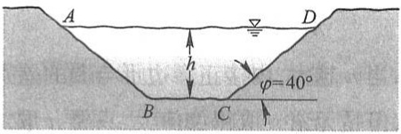

text_image

A
D
h
φ=40°
B C

图1-20

16. 设 $xOy$ 平面上有正方形 $D = \{(x, y) \mid 0 \leqslant x \leqslant 1, 0 \leqslant y \leqslant 1\}$ 及直线 $l: x + y = t (t \geqslant 0)$. 若 $S(t)$ 表示正方形 $D$ 位于直线 $l$ 左下方部分的面积, 试求 $S(t)$ 与 $t$ 之间的函数关系.
17. 求联系华氏温度(用 F 表示)和摄氏温度(用 C 表示)的转换公式,并求

(1) 90 °F 的等价摄氏温度和 -5 °C 的等价华氏温度；
（2）是否存在一个温度值，使华氏温度计和摄氏温度计的读数是一样的？如果存在，那么该温度值是多少？
18. 已知 Rt△ABC 中, 直角边 AC, BC 的长度分别为 20, 15, 动点 P 从 C 出发, 沿三角形边界按  $C \rightarrow B \rightarrow A$  方向移动; 动点 Q 从 C 出发, 沿三角形边界按  $C \rightarrow A \rightarrow B$  方向移动, 移动到两动点相遇时为止, 且点 Q 移动的速度是点 P 移动的速度的 2 倍. 设动点 P 移动的距离为 x, △CPQ 的面积为 y, 试求 y 与 x 之间的函数关系.

## 第二节 数列的极限

## 一、数列极限的定义

极限概念是在探求某些实际问题的精确解答过程中产生的.例如,我国古代数学家刘徽(公元3世纪)提出割圆术用于计算圆的周长、面积以及圆周率.割圆术的方法就是利用圆的内接正六边形边数逐次加倍去逐步逼近圆.刘徽说:“割之弥细,所失弥少.割之又割,以至于不可割,则与圆周合体而无所失矣”,这是我国古代数学家朴素的极限思想在几何学上的应用.

设有一圆, 首先作内接正六边形, 把它的面积记为 $A_{1}$; 再作内接正十二边形, 其面积记为 $A_{2}$; 再作内接正二十四边形, 其面积记为 $A_{3}$; 如此下去, 每次边数加倍, 一般地, 把内接正 $6 \times 2^{n-1}$ 边形的面积记为 $A_{n} (n \in \mathbb{N}_{+})$. 这样, 就得到一系列内接正多边形的面积

$$
A _ {1}, A _ {2}, A _ {3}, \dots , A _ {n}, \dots ,
$$

它们构成一列有次序的数. 当 $n$ 越大, 内接正多边形与圆的差别就越小, 从而以 $A_{n}$ 作为圆面积的近似值也越精确. 但是无论 $n$ 取得如何大, 只要 $n$ 取定了, $A_{n}$ 终究只是多边形的面积, 而还不是圆的面积. 因此, 设想 $n$ 无限增大 (记为 $n \to \infty$, 读作 $n$ 趋于无穷大), 即内接正多边形的边数无限增加, 在这个过程中, 内接正多边形无限接近于圆, 同时 $A_{n}$ 也无限接近于某一确定的数值, 这个确定的数值就理解为圆的面积. 这个确定的数值在数学上称为上面这列有次序的数 (所谓数列) $A_{1}, A_{2}, A_{3}, \cdots, A_{n}, \cdots$ 当 $n \to \infty$ 时的极限. 在圆面积问题中我们看到, 正是这个数列的极限才精确地表达了圆的面积.

在解决实际问题中逐渐形成的这种极限方法,已成为高等数学中的一种基本方法,因此有必要作进一步的阐明.

先说明数列的概念. 如果按照某一法则, 对每个 $n \in \mathbf{N}_{+}$, 对应着一个确定的实数 $x_{n}$, 这些实数 $x_{n}$ 按照下标 $n$ 从小到大排列得到的一个序列

$$
x _ {1}, x _ {2}, x _ {3}, \dots , x _ {n}, \dots ,
$$

就叫做数列,简记为数列 $\{x_{n}\}$ .

数列中的每一个数叫做数列的项, 第 $n$ 项 $x_{n}$ 叫做数列的一般项 (或通项). 例如:

$$
\frac {1}{2}, \frac {2}{3}, \frac {3}{4}, \dots , \frac {n}{n + 1}, \dots ;
$$

$$
2, 4, 8, \dots , 2 ^ {n}, \dots ;
$$

$$
\begin{array}{l} \frac {1}{2}, \frac {1}{4}, \frac {1}{8}, \dots , \frac {1}{2 ^ {n}}, \dots ; \\ 1, - 1, 1, \dots , (- 1) ^ {n + 1}, \dots ; \\ 2, \frac {1}{2}, \frac {4}{3}, \dots , \frac {n + (- 1) ^ {n - 1}}{n}, \dots \\ \end{array}
$$

都是数列的例子,它们的一般项依次为

$$
\frac {n}{n + 1}, \quad 2 ^ {n}, \quad \frac {1}{2 ^ {n}}, \quad (- 1) ^ {n + 1}, \quad \frac {n + (- 1) ^ {n - 1}}{n}.
$$

在几何上, 数列  $\{x_{n}\}$  可看作数轴上的一个动点, 它依次取数轴上的点  $x_{1}, x_{2}, x_{3}, \cdots, x_{n}, \cdots$  (图1-21).

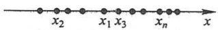

图1-21

数列 $\{x_{n}\}$ 可看作自变量为正整数 $n$ 的函数

$$
x _ {n} = f (n), \quad n \in \mathbb {N} _ {+}.
$$

当自变量 n 依次取 1,2,3,…一切正整数时,对应的函数值就排列成数列  $\{x_{n}\}$ .

对于我们要讨论的问题来说,重要的是:当 n 无限增大时(即  $n \to \infty$  时),对应的  $x_{n} = f(n)$  是否能无限接近于某个确定的数值?如果能够的话,这个数值等于多少?

我们对数列

$$
2, \frac {1}{2}, \frac {4}{3}, \dots , \frac {n + (- 1) ^ {n - 1}}{n}, \dots \tag {2-1}
$$

进行分析.在这数列中，

$$
x _ {n} = \frac {n + (- 1) ^ {n - 1}}{n} = 1 + (- 1) ^ {n - 1} \frac {1}{n}.
$$

我们知道,两个数 a 与 b 之间的接近程度可以用这两个数之差的绝对值  $\left|b-a\right|$  来度量(在数轴上  $\left|b-a\right|$  表示点 a 与点 b 之间的距离),  $\left|b-a\right|$  越小,a 与 b 就越接近.

就数列(2-1)来说,因为

$$
\mid x _ {n} - 1 \mid = \left| (- 1) ^ {n - 1} \frac {1}{n} \right| = \frac {1}{n},
$$

由此可见, 当 $n$ 越来越大时, $\frac{1}{n}$ 越来越小, 从而 $x_{n}$ 就越来越接近于 1. 因为只要 $n$ 足够大, $|x_{n}-1|$ 即 $\frac{1}{n}$ 可以小于任意给定的正数, 所以说, 当 $n$ 无限增大时, $x_{n}$ 无限接近于 1. 例如, 给定 $\frac{1}{100}$, 欲使 $\frac{1}{n}<\frac{1}{100}$, 只要 $n>100$, 即从第 101 项起, 都能使不等式

$$
\mid x _ {n} - 1 \mid <   \frac {1}{1 0 0}
$$

成立.同样地,如果给定 $\frac{1}{10\ 000}$ ,那么从第10 001项起,都能使不等式

$$
\mid x _ {n} - 1 \mid <   \frac {1}{1 0 0 0 0}
$$

成立.一般地,不论给定的正数  $\varepsilon$  多么小,总存在着一个正整数 N,使得当 n>N 时,不等式

$$
\left| x _ {n} - 1 \right| <   \varepsilon
$$

都成立. 这就是数列  $x_{n}=\frac{n+(-1)^{n-1}}{n}(n=1,2,\cdots)$  当  $n\to\infty$  时无限接近于 1 这件事的实质. 这样的一个数 1, 叫做数列  $x_{n}=\frac{n+(-1)^{n-1}}{n}(n=1,2,\cdots)$  当  $n\to\infty$  时的极限.

一般地,有如下数列极限的定义:

定义 设 $\{x_{n}\}$ 为一数列, 如果存在常数 $a$, 对于任意给定的正数 $\varepsilon$ (不论它多么小), 总存在正整数 $N$, 使得当 $n > N$ 时, 不等式

$$
\left| x _ {n} - a \right| <   \varepsilon
$$

都成立,那么就称常数 a 是数列  $\{x_{n}\}$  的极限,或者称数列  $\{x_{n}\}$  收敛于 a,记为

$$
\lim _ {n \to \infty} x _ {n} = a,
$$

或

$$
x _ {n} \longrightarrow a \quad (n \longrightarrow \infty).
$$

如果不存在这样的常数 $a$, 就说数列 $\{x_{n}\}$ 没有极限, 或者说数列 $\{x_{n}\}$ 是发散的, 习惯上也说 $\lim_{n\to \infty}x_n$ 不存在.

上面定义中正数 $\varepsilon$ 可以任意给定是很重要的, 因为只有这样, 不等式 $|x_{n} - a| < \varepsilon$ 才能表达出 $x_{n}$ 与 $a$ 无限接近的意思. 此外还应注意到: 定义中的正整数 $N$ 是与任意给定的正数 $\varepsilon$ 有关的, 它随着 $\varepsilon$ 的给定而选定.

我们给“数列 $\{x_{n}\}$ 的极限为a”一个几何解释:

将常数 a 及数列  $x_{1}, x_{2}, x_{3}, \cdots, x_{n}, \cdots$  在数轴上用它们的对应点表示出来，再在数轴上作点 a 的  $\varepsilon$  邻域，即开区间  $(a - \varepsilon, a + \varepsilon)$  （图 1-22）.

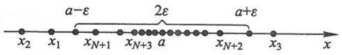

text_image

a-ε
2ε
a+ε
x₂ x₁ x_{N+1} x_{N+3} a x_{N+2} x₃ x

图1-22

因不等式

$$
\left| x _ {n} - a \right| <   \varepsilon
$$

与不等式

$$
a - \varepsilon <   x _ {n} <   a + \varepsilon
$$

等价,所以当 n>N 时,所有的点  $x_{n}$  都落在开区间  $(a-\varepsilon,a+\varepsilon)$  内,而只有有限个(至多只有 N 个)在这区间以外.

为了表达方便, 引入记号“∀”表示“对于任意给定的”或“对于每一个”, 记号“∃”表示“存在”.于是，“对于任意给定的  $\varepsilon>0$ ”写成“ $\forall\varepsilon>0$ ”，“存在正整数 N”写成“∃正整数 N”，数列极限  $\lim_{n\to\infty}x_n=a$  的定义可表达为

$$
\lim _ {n \to \infty} x _ {n} = a \Leftrightarrow \forall   \varepsilon > 0,   \exists   \text {正整数}   N,   \text {当}   n > N   \text {时},   \text {有}   |   x _ {n} - a   | <   \varepsilon .
$$

数列极限的定义并未直接提供如何去求数列的极限,以后再讲极限的求法,而现在先举几个说明极限概念的例子.

例1 证明数列

$$
2, \frac {1}{2}, \frac {4}{3}, \frac {3}{4}, \dots , \frac {n + (- 1) ^ {n - 1}}{n}, \dots
$$

的极限是1.

证 $|x_{n} - a| = \left|\frac{n + (-1)^{n - 1}}{n} - 1\right| = \frac{1}{n}.$

$\forall \varepsilon > 0$ ，为了使 $|x_{n} - a| < \varepsilon$ ，只要

$$
\frac {1}{n} <   \varepsilon \quad \text {或} \quad n > \frac {1}{\varepsilon}.
$$

这个 $\frac{1}{\varepsilon}$ 是一个确定的实数，而对于任何一个实数都有无穷多个大于它的正整数存在，所以，任取一个大于 $\frac{1}{\varepsilon}$ 的正整数作为 $N$ ，例如，取 $N = \left[\frac{1}{\varepsilon}\right] + 1$ ，则当 $n > N$ 时，就有

$$
\left| \frac {n + (- 1) ^ {n - 1}}{n} - 1 \right| <   \varepsilon ,
$$

即

$$
\lim _ {n \to \infty} \frac {n + (- 1) ^ {n - 1}}{n} = 1.
$$

例2 已知 $x_{n} = \frac{(-1)^{n}}{(n + 1)^{2}}$ ，证明数列 $\{x_{n}\}$ 的极限是0.

证 $|x_{n} - a| = \left|\frac{(-1)^{n}}{(n + 1)^{2}} -0\right| = \frac{1}{(n + 1)^{2}} <  \frac{1}{n^{2}}.$

$\forall \varepsilon > 0$ ，为了使 $|x_{n} - a| < \varepsilon$ ，只要

$$
\frac {1}{n ^ {2}} <   \varepsilon \quad \text {或} \quad n > \frac {1}{\sqrt {\varepsilon}},
$$

这个 $\frac{1}{\sqrt{\varepsilon}}$ 是一个确定的实数, 大于 $\frac{1}{\sqrt{\varepsilon}}$ 的正整数有无穷多个存在, 任取其中一个作为 $N$, 例如, 取 $N = \left[\frac{1}{\sqrt{\varepsilon}}\right] + 1$, 则当 $n > N$ 时, 就有

$$
\left| \frac {(- 1) ^ {n}}{(n + 1) ^ {2}} - 0 \right| <   \varepsilon ,
$$

即

$$
\lim _ {n \to \infty} \frac {(- 1) ^ {n}}{(n + 1) ^ {2}} = 0.
$$

注意 在利用数列极限的定义来论证某个数 $a$ 是数列 $\{x_{n}\}$ 的极限时, 重要的是对于任意给定的正数 $\varepsilon$, 要能够指出定义中所说的这种正整数 $N$ 确实存在. 如果知道 $|x_{n} - a|$ 小于某个量 (这个量与 $n$ 存在函数关系), 那么当这个量小于 $\varepsilon$ 时, $|x_{n} - a| < \varepsilon$ 当然也成立. 若令这个量小于 $\varepsilon$ 能推出符合定义要求的正整数 $N$ 必定存在, 就可采用这种方法. 例2便是这样做的. 当然, 在利用极限定义证明极限时, 如果能具体找出一个满足定义要求的正整数 $N$, 那么也就证明了这种 $N$ 的存在. 在以后的证明中, 多采取这种找出一个符合定义要求的正整数 $N$ 的方法.

例 3 设  $|q|<1$ , 证明等比数列

$$
1, q, q ^ {2}, \dots , q ^ {n - 1}, \dots
$$

的极限是0.

证 $\forall \varepsilon > 0$ （设 $\varepsilon < 1$），因为

$$
\mid x _ {n} - 0 \mid = \mid q ^ {n - 1} - 0 \mid = \mid q \mid^ {n - 1},
$$

要使 $|x_{n} - 0| < \varepsilon$ ，只要

$$
\mid q \mid^ {n - 1} <   \varepsilon .
$$

取自然对数, 得  $(n-1)\ln|q|<\ln\varepsilon$ . 因  $|q|<1,\ln|q|<0$ , 故

$$
n > 1 + \frac {\ln \varepsilon}{\ln | q |}.
$$

取 $N = \left[1 + \frac{\ln\varepsilon}{\ln|q|}\right]$ ，则当 $n > N$ 时，就有

$$
\mid q ^ {n - 1} - 0 \mid <   \varepsilon ,
$$

即

$$
\lim _ {n \to \infty} q ^ {n - 1} = 0.
$$

## 二、收敛数列的性质

下面四个定理都是有关收敛数列的性质.

定理1(极限的唯一性) 如果数列 $\{x_{n}\}$ 收敛,那么它的极限唯一.

证 用反证法. 假设同时有 $x_{n} \to a$ 及 $x_{n} \to b$, 且 $a < b$. 取 $\varepsilon = \frac{b - a}{2}$. 因为 $\lim_{n \to \infty} x_{n} = a$, 故 $\exists$ 正整数 $N_{1}$, 当 $n > N_{1}$ 时, 不等式

$$
\mid x _ {n} - a \mid <   \frac {b - a}{2} \tag {2-2}
$$

都成立. 同理, 因为 $\lim_{n\to \infty}x_n = b$, 故 $\exists$ 正整数 $N_2$, 当 $n > N_2$ 时, 不等式

$$
\left| x _ {n} - b \right| <   \frac {b - a}{2} \tag {2-3}
$$

都成立. 取 $N = \max \{N_1, N_2\}$ （这式子表示 $N$ 是 $N_1$ 和 $N_2$ 中较大的那个数），则当 $n > N$ 时，(2-2)式及(2-3)式会同时成立，但由(2-2)式有 $x_n < \frac{a + b}{2}$，由(2-3)式有 $x_n > \frac{a + b}{2}$，这是不可能的. 这矛盾证明了本定理的断言.

例 4 证明数列  $x_{n}=(-1)^{n+1}\quad(n=1,2,\cdots)$  是发散的.

证 如果这数列收敛,根据定理1它有唯一的极限,设极限为a,即 $\lim_{n\to\infty}x_n=a$ .按数列极限的定义,对于 $\varepsilon=\frac{1}{2}$ ,  $\exists$ 正整数N,当n>N时, $\left|x_{n}-a\right|<\frac{1}{2}$ 成立;即当n>N时, $x_{n}$ 都在开区间 $\left(a-\frac{1}{2},a+\frac{1}{2}\right)$ 内.但这是不可能的,因为 $n\to\infty$ 时, $x_{n}$ 无休止地一再重复取得1和-1这两个数,而这两个数不可能同时属于长度为1的开区间 $\left(a-\frac{1}{2},a+\frac{1}{2}\right)$ 内.因此这数列发散.

由函数有界性的概念可得以下的数列有界性概念.

对于数列 $\{x_{n}\}$ ，如果存在正数 $M$ ，使得对于一切 $x_{n}$ 都满足不等式

$$
\mid x _ {n} \mid \leqslant M,
$$

那么称数列 $\{x_{n}\}$ 是有界的；如果这样的正数 $M$ 不存在，就说数列 $\{x_{n}\}$ 是无界的.

例如, 数列  $x_{n}=\frac{n}{n+1}(n=1,2,\cdots)$  是有界的, 因为可取 M=1, 而使

$$
\left| \frac {n}{n + 1} \right| \leqslant 1
$$

对于一切正整数 n 都成立.

数列  $x_{n}=2^{n}\quad(n=1,2,\cdots)$  是无界的, 因为当 n 无限增加时,  $2^{n}$  可超过任何正数.

数轴上对应于有界数列的点 $x_{n}$ 都落在某个闭区间 $[-M, M]$ 上.

定理 2(收敛数列的有界性) 如果数列  $\{x_{n}\}$  收敛, 那么数列  $\{x_{n}\}$  一定有界.

证 因为数列 $\{x_{n}\}$ 收敛, 设 $\lim_{n\to \infty}x_n = a$. 根据数列极限的定义, 对于 $\varepsilon = 1$, ∃正整数 $N$, 当 $n > N$ 时, 不等式

$$
\mid x _ {n} - a \mid <   1
$$

都成立.于是,当n>N时,

$$
\left| x _ {n} \right| = \left| (x _ {n} - a) + a \right| \leqslant \left| x _ {n} - a \right| + \left| a \right| <   1 + \left| a \right|.
$$

取 $M = \max \{|x_1|, |x_2|, \dots, |x_N|, 1 + |a|\}$，那么数列 $\{x_n\}$ 中的一切 $x_n$ 都满足不等式

$$
\mid x _ {n} \mid \leqslant M.
$$

这就证明了数列 $\{x_{n}\}$ 是有界的.

根据上述定理,如果数列 $\{x_{n}\}$ 无界,那么数列 $\{x_{n}\}$ 一定发散.但是,如果数列 $\{x_{n}\}$ 有界,却不能断定数列 $\{x_{n}\}$ 一定收敛,例如数列

$$
1, - 1, 1, \dots , (- 1) ^ {n + 1}, \dots
$$

有界,但例4证明了这数列是发散的.所以数列有界是数列收敛的必要条件,但不是充分条件.

定理3（收敛数列的保号性）如果 $\lim_{n\to \infty}x_n = a$ ，且 $a > 0$ （或 $a <   0$ )，那么存在正整数$N$ ，当 $n > N$ 时，都有 $x_{n} > 0$ （或 $x_{n} <   0$ ）.

证 就 $a > 0$ 的情形证明. 由数列极限的定义, 对 $\varepsilon = \frac{a}{2} > 0$, $\exists$ 正整数 $N$, 当 $n > N$ 时, 有

$$
\mid x _ {n} - a \mid <   \frac {a}{2},
$$

从而

$$
x _ {n} > a - \frac {a}{2} = \frac {a}{2} > 0.
$$

推论 如果数列 $\{x_{n}\}$ 从某项起有 $x_{n} \geqslant 0$ （或 $x_{n} \leqslant 0$），且 $\lim_{n \to \infty} x_{n} = a$，那么 $a \geqslant 0$（或 $a \leqslant 0$）.

证 设数列 $\{x_{n}\}$ 从第 $N_{1}$ 项起, 即当 $n > N_{1}$ 时有 $x_{n} \geqslant 0$. 现在用反证法证明. 若 $\lim_{n \to \infty} x_{n} = a < 0$, 则由定理3知, $\exists$ 正整数 $N_{2}$, 当 $n > N_{2}$ 时, 有 $x_{n} < 0$. 取 $N = \max \{N_{1}, N_{2}\}$, 当 $n > N$ 时, 按假定有 $x_{n} \geqslant 0$, 按定理3有 $x_{n} < 0$, 这引起矛盾. 所以必有 $a \geqslant 0$.

数列 $\{x_{n}\}$ 从某项起有 $x_{n} \leqslant 0$ 的情形, 可以类似地证明.

最后,介绍子数列的概念以及关于收敛数列与其子数列间关系的一个定理.

在数列 $\{x_{n}\}$ 中任意抽取无限多项并保持这些项在原数列 $\{x_{n}\}$ 中的先后次序，这样得到的一个数列称为原数列 $\{x_{n}\}$ 的子数列（或子列）.

设在数列 $\{x_{n}\}$ 中，第一次抽取 $x_{n_1}$，第二次在 $x_{n_1}$ 后抽取 $x_{n_2}$，第三次在 $x_{n_2}$ 后抽取 $x_{n_3} \dots$ 这样无休止地抽取下去，得到一个数列

$$
x _ {n _ {1}}, x _ {n _ {2}}, \dots , x _ {n _ {k}}, \dots ,
$$

这个数列 $\{x_{n_k}\}$ 就是数列 $\{x_n\}$ 的一个子数列.

注意 在子数列 $\{x_{n_k}\}$ 中, 一般项 $x_{n_k}$ 是第 $k$ 项, 而 $x_{n_k}$ 在原数列 $\{x_n\}$ 中却是第 $n_k$ 项. 显然, $n_k \geqslant k$.

\*定理4(收敛数列与其子数列间的关系) 如果数列 $\{x_{n}\}$ 收敛于 $a$, 那么它的任一子数列也收敛, 且极限也是 $a$.

证 设数列  $\{x_{n_{k}}\}$  是数列  $\{x_{n}\}$  的任一子数列.

由于 $\lim_{n\to \infty}x_n = a$ ，故 $\forall \varepsilon >0$ ，exists正整数 $N$ ，当 $n > N$ 时， $\left|x_n - a\right| <   \varepsilon$ 成立.

取 $K = N$ ，则当 $k > K$ 时，$n_k > n_K = n_N \geqslant N.$ 于是 $\left|x_{n_k} - a\right| < \varepsilon.$ 这就证明了 $\lim_{k\to \infty}x_{n_k} = a.$ 证毕.

由定理 4 可知, 如果数列  $\{x_{n}\}$  有两个子数列收敛于不同的极限, 那么数列  $\{x_{n}\}$  是发散的. 例如, 例 4 中的数列

$$
1, - 1, 1, \dots , (- 1) ^ {n + 1}, \dots
$$

的子数列  $\{x_{2k-1}\}$  收敛于 1, 而子数列  $\{x_{2k}\}$  收敛于 -1, 因此数列  $x_{n}=(-1)^{n+1}(n=1,2,\cdots)$  是发散的. 同时这个例子也说明, 一个发散的数列也可能有收敛的子数列.

图

释疑解难

$1 - 2^{*}$

## 习题1- 2

1. 下列各题中, 哪些数列收敛, 哪些数列发散? 对收敛数列, 通过观察  $\{x_{n}\}$  的变化趋势, 写出它们的极限:

(1) $\left\{\frac{1}{2^{n}}\right\}$ ;

(2) $\left\{(-1)^{n}\frac{1}{n}\right\}$ ;

(3) $\left\{2+\frac{1}{n^{2}}\right\}$ ;

(4) $\left\{\frac{n-1}{n+1}\right\}$ ;

(5) $\{n(-1)^n\}$;

(6) $\left\{\frac{2^{n}-1}{3^{n}}\right\}$ ;

(7) $\left\{n-\frac{1}{n}\right\}$ ;

(8) $\left\{\left[(-1)^n + 1\right]\frac{n + 1}{n}\right\}$.

2.（1）数列的有界性是数列收敛的什么条件？

(2) 无界数列是否一定发散?

(3) 有界数列是否一定收敛?

3. 下列关于数列  $\{x_{n}\}$  的极限是 a 的定义, 哪些是对的, 哪些是错的? 如果是对的, 试说明理由; 如果是错的, 试给出一个反例.

（1）对于任意给定的  $\varepsilon>0$ ，存在  $N\in N_{+}$ ，当 n>N 时，不等式  $x_{n}-a<\varepsilon$  成立；
(2) 对于任意给定的  $\varepsilon > 0$ ，存在  $N \in N_{+}$ ，当 n > N 时，有无穷多项  $x_{n}$ ，使不等式  $\left|x_{n} - a\right| < \varepsilon$  成立；
（3）对于任意给定的 $\varepsilon > 0$，存在 $N \in \mathbb{N}_{+}$，当 $n > N$ 时，不等式 $|x_{n} - a| < c\varepsilon$ 成立，其中 $c$ 为某个正常数；
（4）对于任意给定的 $m \in \mathbf{N}_{+}$，存在 $N \in \mathbf{N}_{+}$，当 $n > N$ 时，不等式 $|x_{n} - a| < \frac{1}{m}$ 成立.

\* 4. 设数列 $\{x_{n}\}$ 的一般项 $x_{n} = \frac{1}{n} \cos \frac{n\pi}{2}$. 问 $\lim_{n\to \infty}x_n = ?$ 求出 $N$, 使当 $n > N$ 时, $x_{n}$ 与其极限之差的绝对值小于正数 $\varepsilon$. 当 $\varepsilon = 0.001$ 时, 求出数 $N$.

\* 5. 根据数列极限的定义证明:

(1) $\lim_{n\to \infty}\frac{1}{n^2} = 0;$

(2) $\lim_{n\to \infty}\frac{3n + 1}{2n + 1} = \frac{3}{2}$;

(3) $\lim_{n\to \infty}\frac{\sqrt{n^2 + a^2}}{n} = 1;$

(4)  $\lim_{n\to\infty}0.\underbrace{999\cdots9}_{n个}=1.$

\*6. 若 $\lim_{n\to \infty}u_n = a$，证明 $\lim_{n\to \infty}|u_n| = |a|$. 并举例说明:即使数列 $\{|x_n|\}$ 有极限，数列 $\{x_n\}$ 也未必有极限.

\*7. 设数列 $\{x_{n}\}$ 有界, 又 $\lim_{n\to \infty}y_n = 0$, 证明 $\lim_{n\to \infty}x_ny_n = 0$.

\* 8. 对于数列 $\{x_{n}\}$, 若 $x_{2k-1} \to a (k \to \infty)$, $x_{2k} \to a (k \to \infty)$, 证明 $x_{n} \to a (n \to \infty)$.

## 第三节 函数的极限

## 一、函数极限的定义

因为数列 $\{x_{n}\}$ 可看作自变量为 $n$ 的函数:$x_{n} = f(n), n \in \mathbf{N}_{+}$，所以，数列 $\{x_{n}\}$ 的极限为 $a$，就是:当自变量 $n$ 取正整数而无限增大（即 $n \to \infty$）时，对应的函数值 $f(n)$ 无限接近于确定的数 $a$。把数列极限概念中的函数为 $f(n)$ 而自变量的变化过程为 $n \to \infty$ 等特殊性撇开，这样可以引出函数极限的一般概念:在自变量的某个变化过程中，如果对应的函数值无限接近于某个确定的数，那么这个确定的数就叫做在这一变化过程中函数的极限。这个极限是与自变量的变化过程密切相关的，由于自变量的变化过程不同，函数的极限就表现为不同的形式。数列极限看作函数 $f(n)$ 当 $n \to \infty$ 时的极限，这里自变量的变化过程是 $n \to \infty$。下面讲述自变量的变化过程为其他情形时函数 $f(x)$ 的极限，主要研究两种情形:

（1）自变量 x 任意接近于有限值  $x_{0}$  或者说趋于有限值  $x_{0}$  （记作  $x \rightarrow x_{0}$ ）时，对应的函数值  $f(x)$  的变化情形；

(2) 自变量 x 的绝对值  $\left|x\right|$  无限增大即趋于无穷大 (记作  $x \to \infty$ ) 时, 对应的函数值  $f(x)$  的变化情形.

## 1. 自变量趋于有限值时函数的极限

现在考虑自变量 $x$ 的变化过程为 $x \to x_0$. 如果在 $x \to x_0$ 的过程中, 对应的函数值 $f(x)$ 无限接近于确定的数值 $A$, 那么就说 $A$ 是函数 $f(x)$ 当 $x \to x_0$ 时的极限. 当然, 这里我们首先假定函数 $f(x)$ 在点 $x_0$ 的某个去心邻域①内是有定义的.

在 $x \to x_0$ 的过程中, 对应的函数值 $f(x)$ 无限接近于 $A$, 就是 $|f(x) - A|$ 能任意小. 如数列极限概念所述， $|f(x) - A|$ 能任意小这件事可以用 $\left|f(x) - A\right| < \varepsilon$ 来表达，其中 $\varepsilon$ 是任意给定的正数.因为函数值 $f(x)$ 无限接近于 $A$ 是在 $x\to x_0$ 的过程中实现的，所以对于任意给定的正数 $\varepsilon$ ，只要求充分接近于 $x_0$ 的 $x$ 所对应的函数值 $f(x)$ 满足不等式$|f(x) - A| < \varepsilon$ ；而充分接近于 $x_0$ 的 $x$ 可表达为 $0 < |x - x_0| < \delta$ ，其中 $\delta$ 是某个正数.从几何上看，适合不等式 $0 < |x - x_0| < \delta$ 的 $x$ 的全体，就是点 $x_0$ 的去心 $\delta$ 邻域①，而邻域半径 $\delta$ 则体现了 $x$ 接近 $x_0$ 的程度.

<small>① 以 $x_0$ 为中心的任何开区间称为点 $x_0$ 的邻域，记作 $U(x_0)$；在 $U(x_0)$ 中去掉中心 $x_0$ 后，称为点 $x_0$ 的去心邻域，记作 $\mathring{U}(x_0)$.</small>

通过以上分析,我们给出  $x \rightarrow x_{0}$  时函数的极限的定义如下:

定义1 设函数 $f(x)$ 在点 $x_0$ 的某一去心邻域内有定义. 如果存在常数 $A$，对于任意给定的正数 $\varepsilon$ （不论它多么小），总存在正数 $\delta$，使得当 $x$ 满足不等式 $0 < |x - x_0| < \delta$ 时，对应的函数值 $f(x)$ 都满足不等式

$$
\left| f (x) - A \right| <   \varepsilon ,
$$

那么常数 $A$ 就叫做函数 $f(x)$ 当 $x \to x_0$ 时的极限，记作

$$
\lim _ {x \to x _ {0}} f (  x  ) = A \quad \text {或} \quad f (  x  ) \to A (\text {当}   x \to x _ {0}).
$$

我们指出,定义中  $0<|x-x_{0}|$  表示  $x\neq x_{0}$ , 所以  $x\to x_{0}$  时  $f(x)$  有没有极限, 与  $f(x)$  在点  $x_{0}$  是否有定义并无关系.

定义 1 可以简单地表述为

$$
\lim _ {x \to x _ {0}} f (  x  ) = A \Longleftrightarrow   \forall   \varepsilon > 0  ,   \exists   \delta > 0  , \text {当}   0 <     |   x - x _ {0}   | <   \delta   \text {时}, \text {有}   |   f (  x  ) - A   | <   \varepsilon .
$$

函数 $f(x)$ 当 $x \to x_0$ 时的极限为 $A$ 的几何解释如下: 任意给定一正数 $\varepsilon$, 作平行于 $x$ 轴的两条直线 $y = A + \varepsilon$ 和 $y = A - \varepsilon$, 界于这两条直线之间是一横条区域. 根据定义, 对于给定的 $\varepsilon$, 存在着点 $x_0$ 的一个 $\delta$ 邻域 $(x_0 - \delta, x_0 + \delta)$, 当 $y = f(x)$ 的图形上的点的横坐标 $x$ 在邻域 $(x_0 - \delta, x_0 + \delta)$ 内, 但 $x \neq x_0$ 时, 这些点的纵坐标 $f(x)$ 满足不等式

$$
\left| f (x) - A \right| <   \varepsilon ,
$$

或

$$
A - \varepsilon <   f (x) <   A + \varepsilon.
$$

亦即这些点落在上面所作的横条区域内(图1-23).

例 1 证明  $\lim_{x\to x_{0}}c=c$ ，此处 c 为一常数.

证 这里 $|f(x) - A| = |c - c| = 0$，因此 $\forall \varepsilon > 0$ 可任取 $\delta > 0$，当 $0 < |x - x_0| < \delta$ 时，能使不等式$|f(x)-A|=|c-c|=0<\varepsilon$ 成立.所以 $\lim_{x\to x_{0}}c=c.$

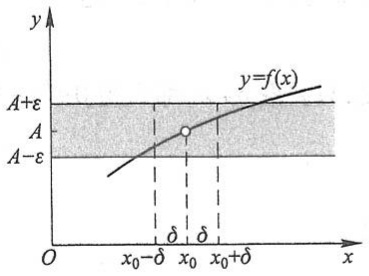

line

| X-axis | Y-axis |
| --- | --- |
| \(x0-\delta\) | \(A+\epsilon\) |
| \(x0\) | A |
| \(\delta\) | \(A-\epsilon\) |
| \(x0+\delta\) | \(A+\epsilon\) |

图1-23

<small>① 设 $x_0 \in \mathbb{R}, \delta > 0$，开区间 $(x_0 - \delta, x_0 + \delta)$ 称为点 $x_0$ 的 $\delta$ 邻域，记作 $U(x_0, \delta)$，点 $x_0$ 的去心 $\delta$ 邻域记作 $\stackrel{\circ}{U}(x_0, \delta), \delta$ 称为邻域半径.</small>

例 2 证明  $\lim_{x\to x_{0}}x=x_{0}$ .

证 这里 $|f(x) - A| = |x - x_0|$，因此 $\forall \varepsilon > 0$，总可取 $\delta = \varepsilon$，当 $0 < |x - x_0| < \delta = \varepsilon$ 时，能使不等式 $|f(x) - A| = |x - x_0| < \varepsilon$ 成立。所以 $\lim_{x \to x_0} x = x_0$.

例3 证明 $\lim_{x\to 1}(2x - 1) = 1.$

证 由于

$$
\left| f (x) - A \right| = \left| (2 x - 1) - 1 \right| = 2 \left| x - 1 \right|,
$$

为了使 $|f(x) - A| < \varepsilon$ ，只要

$$
\mid x - 1 \mid <   \frac {\varepsilon}{2}.
$$

所以， $\forall \varepsilon >0$ ，可取 $\delta = \frac{\varepsilon}{2}$ ，则当 $x$ 适合不等式

$$
0 <   | x - 1 | <   \delta
$$

时,对应的函数值 $f(x)$ 就满足不等式

$$
\left| f (x) - 1 \right| = \left| (2 x - 1) - 1 \right| <   \varepsilon .
$$

从而

$$
\lim _ {x \to 1} (2 x - 1) = 1.
$$

例 4 证明 $\lim_{x\to1}\frac{x^{2}-1}{x-1}=2.$

证 这里, 函数在点 $x = 1$ 是没有定义的, 但是函数当 $x \to 1$ 时的极限存在或不存在与它并无关系. 事实上, $\forall \varepsilon > 0$, 将不等式

$$
\left| \frac {x ^ {2} - 1}{x - 1} - 2 \right| <   \varepsilon
$$

约去非零因子 x-1 后, 就化为

$$
\mid x + 1 - 2 \mid = \mid x - 1 \mid <   \varepsilon ,
$$

因此, 只要取  $\delta = \varepsilon$ , 那么当  $0 < |x - 1| < \delta$  时, 就有

$$
\left| \frac {x ^ {2} - 1}{x - 1} - 2 \right| <   \varepsilon .
$$

所以

$$
\lim _ {x \to 1} \frac {x ^ {2} - 1}{x - 1} = 2.
$$

例5 证明: 当 $x_0 > 0$ 时, $\lim_{x \to x_0} \sqrt{x} = \sqrt{x_0}$.

证 $\forall \varepsilon > 0$, 因为

$$
\left| f (x) - A \right| = \left| \sqrt {x} - \sqrt {x _ {0}} \right| = \left| \frac {x - x _ {0}}{\sqrt {x} + \sqrt {x _ {0}}} \right| \leqslant \frac {1}{\sqrt {x _ {0}}} \left| x - x _ {0} \right|,
$$

要使 $|f(x) - A| < \varepsilon$，只要 $|x - x_0| < \sqrt{x_0}\varepsilon$ 且 $x \geqslant 0$，而 $x \geqslant 0$ 可用 $|x - x_0| \leqslant x_0$ 保证，因此取 $\delta = \min \{x_0, \sqrt{x_0}\varepsilon\}$（这个式子表示，$\delta$ 是 $x_0$ 和 $\sqrt{x_0}\varepsilon$ 两个数中较小的那个数），则当 $x$ 适合不等式 $0 < |x - x_0| < \delta$ 时，对应的函数值 $\sqrt{x}$ 就满足不等式

$$
\left| \sqrt {x} - \sqrt {x _ {0}} \right| <   \varepsilon .
$$

所以

$$
\lim _ {x \to x _ {0}} \sqrt {x} = \sqrt {x _ {0}}.
$$

上述 $x \to x_0$ 时函数 $f(x)$ 的极限概念中, $x$ 是既从 $x_0$ 的左侧也从 $x_0$ 的右侧趋于 $x_0$ 的. 但有时只能或只需考虑 $x$ 仅从 $x_0$ 的左侧趋于 $x_0$ (记作 $x \to x_0^-$) 的情形, 或 $x$ 仅从 $x_0$ 的右侧趋于 $x_0$ (记作 $x \to x_0^+$) 的情形. 在 $x \to x_0^-$ 的情形, $x$ 在 $x_0$ 的左侧, $x < x_0$. 在 $\lim_{x \to x_0} f(x) = A$ 的定义中, 把 $0 < |x - x_0| < \delta$ 改为 $x_0 - \delta < x < x_0$, 那么 $A$ 就叫做函数 $f(x)$ 当 $x \to x_0$ 时的左极限, 记作

$$
\lim _ {x \to x _ {0} ^ {-}} f (  x  ) = A \quad \text {或} \quad f (  x _ {0} ^ {-}  ) = A.
$$

类似地, 在  $\lim_{x\to x_{0}}f(x)=A$  的定义中, 把  $0<|x-x_{0}|<\delta$  改为  $x_{0}<x<x_{0}+\delta$ , 那么 A 就叫做函数  $f(x)$  当  $x\to x_{0}$  时的右极限, 记作

$$
\lim _ {x \to x _ {0} ^ {+}} f (  x  ) = A \quad \text {或} \quad f (  x _ {0} ^ {+}  ) = A.
$$

左极限与右极限统称为单侧极限.

根据  $x \rightarrow x_{0}$  时函数  $f(x)$  的极限的定义以及左极限和右极限的定义, 容易证明: 函数  $f(x)$  当  $x \rightarrow x_{0}$  时极限存在的充分必要条件是左极限及右极限各自存在并且相等, 即

$$
f (x _ {0} ^ {-}) = f (x _ {0} ^ {+}).
$$

因此，即使 $f(x_0^-)$ 和 $f(x_0^+)$ 都存在，但若不相等，则 $\lim_{x\to x_0}f(x)$ 也不存在.

例6 设

$$
y = f (x) = \left\{ \begin{array}{l l} x - 1, & x <   0, \\ 0, & x = 0, \\ x + 1 & x > 0. \end{array} \right.
$$

证明: 当  $x \to 0$  时,  $f(x)$  的极限不存在.

证 仿例3可证当 $x\to 0$ 时 $f(x)$ 的左极限

$$
\lim _ {x \to 0 ^ {-}} f (x) = \lim _ {x \to 0 ^ {-}} (x - 1) = - 1,
$$

而右极限

$$
\lim _ {x \to 0 ^ {+}} f (x) = \lim _ {x \to 0 ^ {+}} (x + 1) = 1,
$$

因为左极限和右极限存在但不相等, 所以  $\lim_{x\to0}f(x)$  不存在 (图 1-24).

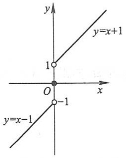

text_image

y
1
y=x+1
O
x
y=x-1
-1

图1-24

## 2. 自变量趋于无穷大时函数的极限

如果在 $x \to \infty$ 的过程中, 对应的函数值 $f(x)$ 无限接近于确定的数值 $A$, 那么 $A$ 叫做函数 $f(x)$ 当 $x \to \infty$ 时的极限. 精确地说, 就是

定义2 设函数 $f(x)$ 当 $|x|$ 大于某一正数时有定义. 如果存在常数 $A$, 对于任意给定的正数 $\varepsilon$ (不论它多么小), 总存在着正数 $X$, 使得当 $x$ 满足不等式 $|x| > X$ 时, 对应的函数值 $f(x)$ 都满足不等式

$$
\left| f (x) - A \right| <   \varepsilon ,
$$

那么常数 A 就叫做函数  $f(x)$  当  $x \to \infty$  时的极限, 记作

$$
\lim _ {x \to \infty} f (  x  ) = A \quad \text {或} \quad f (  x  ) \to A (\text {当}   x \to \infty)  .
$$

定义 2 可简单地表达为

$$
\lim _ {x \to \infty} f (  x  ) = A \Longleftrightarrow \forall   \varepsilon > 0  ,   \exists   X > 0  , \text {当}   |   x   | > X   \text {时}, \text {有}   |   f (  x  ) - A   | <   \varepsilon .
$$

如果 $x > 0$ 且无限增大（记作 $x\to +\infty$），那么只要把上面定义中的 $|x| > X$ 改为 $x > X$ 就可得 $\lim_{x\to +\infty}f(x) = A$ 的定义.同样，如果 $x < 0$ 且 $|x|$ 无限增大（记作 $x\to -\infty$），那么只要把 $|x| > X$ 改为 $x < -X$，便得 $\lim_{x\to -\infty}f(x) = A$ 的定义.

从几何上来说, $\lim_{x\to\infty}f(x)=A$ 的意义是:作直线 $y=A-\varepsilon$ 和 $y=A+\varepsilon$ ,则总有一个正数

X 存在, 使得当 x<-X 或 x>X 时, 函数  $y=f(x)$  的图形位于这两直线之间 (图 1-25). 这时, 直线 y=A 是函数  $y=f(x)$  的图形的水平渐近线.

例 7 证明  $\lim_{x\to\infty}\frac{1}{x}=0.$

证 $\forall \varepsilon > 0$ ，要证 $\exists X > 0$ ，当 $|x| > X$ 时，不等式

$$
\left| \frac {1}{x} - 0 \right| <   \varepsilon
$$

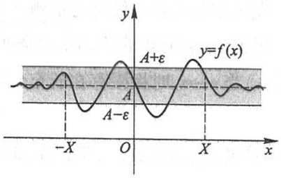

contour

| Feature | Description |
| --- | --- |
| Curve | y=f(x) |
| Shaded Region | \(A + \epsilon\) to \(A - \epsilon\) |
| Points | -X, O, X |

图1-25

成立.因这个不等式相当于

$$
\frac {1}{| x |} <   \varepsilon \quad \text {或} \quad | x | > \frac {1}{\varepsilon}.
$$

由此可知,如果取  $X=\frac{1}{\varepsilon}$ , 那么当  $\left|x\right|>X=\frac{1}{\varepsilon}$  时, 不等式  $\left|\frac{1}{x}-0\right|<\varepsilon$  成立, 这就证明了

$$
\lim _ {x \to \infty} \frac {1}{x} = 0.
$$

直线 y=0 是函数  $y=\frac{1}{x}$  的图形的水平渐近线.

## 二、函数极限的性质

与收敛数列的性质相比较,可得函数极限的一些相应的性质.它们都可以根据函数极限的定义,运用类似于证明收敛数列性质的方法加以证明.由于函数极限的定义按自变量的变化过程不同有各种形式,下面仅以“ $\lim_{x\to x_{0}}f(x)$ ”这种形式为代表给出关于函数极限性质的一些定理,并就其中的几个给出证明.至于其他形式的极限的性质及其证明,只要相应地作一些修改即可得出.

定理1（函数极限的唯一性）如果 $\lim_{x\to x_0}f(x)$ 存在，那么这极限唯一.

定理 2(函数极限的局部有界性) 如果  $\lim_{x\to x_{0}}f(x)=A$ ，那么存在常数 M>0 和  $\delta>0$ ，使得当  $0<|x-x_{0}|<\delta$  时，有  $|f(x)|\leqslant M$ .

证 因为 $\lim_{x\to x_0}f(x) = A$ ，所以取 $\varepsilon = 1$ ，则 $\exists \delta >0$ ，当 $0 <   |x - x_0| <   \delta$ 时，有

$$
\left| f (x) - A \right| <   1 \Rightarrow \left| f (x) \right| \leqslant \left| f (x) - A \right| + \left| A \right| <   \left| A \right| + 1,
$$

记  $M = |A| + 1$ ，则定理 2 就获得证明.

定理3（函数极限的局部保号性）如果 $\lim_{x\to x_0}f(x) = A$ ，且 $A > 0$ （或 $A <   0$ )，那么存在常数 $\delta >0$ ，使得当 $0 <   |x - x_0| <   \delta$ 时，有 $f(x) > 0$ （或 $f(x) <   0$ ).

证 就 A>0 的情形证明.

因为 $\lim_{x\to x_{0}}f(x)=A>0$ ，所以，取 $\varepsilon=\frac{A}{2}>0$ ，则 $\exists\delta>0$ ，当 $0<|x-x_{0}|<\delta$ 时，有

$$
\left| f (x) - A \right| <   \frac {A}{2} \Rightarrow f (x) > A - \frac {A}{2} = \frac {A}{2} > 0.
$$

类似地,可以证明 A<0 的情形.

从定理 3 的证明中可知, 在定理 3 的条件下, 可得下面更强的结论:

定理 3' 如果  $\lim_{x\to x_{0}}f(x)=A\quad(A\neq0)$ ，那么就存在着  $x_{0}$  的某一去心邻域  $\stackrel{\circ}{U}(x_{0})$ ，当  $x\in\stackrel{\circ}{U}(x_{0})$  时，就有  $|f(x)|>\frac{|A|}{2}$ .

由定理 3, 易得以下推论:

推论 如果在 $x_0$ 的某去心邻域内 $f(x) \geqslant 0$ （或 $f(x) \leqslant 0$），而且 $\lim_{x \to x_0} f(x) = A$，那么 $A \geqslant 0$（或 $A \leqslant 0$）.

\* 定理 4(函数极限与数列极限的关系) 如果极限 $\lim_{x\to x_0}f(x)$ 存在, $\{x_n\}$ 为函数 $f(x)$ 的定义域内任一收敛于 $x_0$ 的数列, 且满足 $x_n \neq x_0$ ($n \in \mathbb{N}_+$), 那么相应的函数值数列 $\{f(x_n)\}$ 必收敛, 且 $\lim_{n\to \infty}f(x_n) = \lim_{x\to x_0}f(x)$.

证 设 $\lim_{x\to x_0}f(x) = A$ ，则 $\forall \varepsilon >0,\exists \delta >0$ ，当 $0 <   |x - x_0| <   \delta$ 时，有 $|f(x) - A| <   \varepsilon .$

又因 $\lim_{n\to \infty}x_n = x_0$ ，故对 $\delta >0$ ，exists正整数 $N$ ，当 $n > N$ 时，有 $\left|x_n - x_0\right| <   \delta .$

由假设, $x_{n}\neq x_{0}(n\in\mathbb{N}_{+})$ ,故当n>N时, $0<|x_{n}-x_{0}|<\delta$ ,从而 $|f(x_{n})-A|<\varepsilon$ .即 $\lim_{n\to\infty}f(x_{n})=A.$

## 习题1-3

1. 对图 1-26 所示的函数  $y=f(x)$ ，求下列极限，如极限不存在，说明理由.

(1)  $\lim_{x\to-2}f(x)$ ;

(2) $\lim_{x\to -1}f(x)$;

(3) $\lim_{x\to 0}f(x)$.

2. 对图 1-27 所示的函数  $y=f(x)$ ，下列陈述中哪些是对的，哪些是错的？

(1)  $\lim_{x\to0}f(x)$  不存在；

(2) $\lim_{x\to 0}f(x) = 0;$

(3) $\lim_{x\to 0}f(x) = 1$;

(4)  $\lim_{x\to1}f(x)=0;$

(5) $\lim_{x\to 1}f(x)$ 不存在；

(6) 对每个  $x_{0} \in (-1,1)$ ,  $\lim_{x \to x_{0}} f(x)$  存在.

3. 对图 1-28 所示的函数  $y=f(x)$ ，下列陈述中哪些是对的，哪些是错的？

(1)  $\lim_{x\to-1^{+}}f(x)=1;$

(2)  $\lim_{x\to-1^{-}}f(x)$  不存在；

(3) $\lim_{x\to 0}f(x) = 0;$

(4)  $\lim_{x\to0}f(x)=1;$

(5)  $\lim_{x\to1^{-}}f(x)=1;$

(6)  $\lim_{x\to1^{+}}f(x)=0;$

(7)  $\lim_{x\to2^{-}}f(x)=0;$

(8) $\lim_{x\to 2}f(x) = 0.$

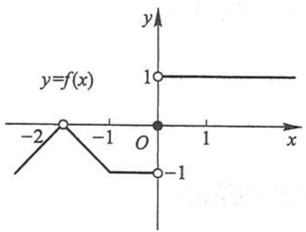

line

| X | Y |
| --- | --- |
| -2 | 0 |
| -1 | 0 |
| 0 | 0 |
| 0 | -1 |
| 0 | 1 |

图1-26

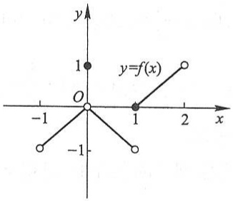

line

| X | Y |
| --- | --- |
| -1 | -1 |
| 0 | 0 |
| 1 | 0 |
| 2 | 1 |

图1-27

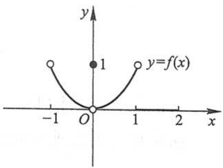

contour

| Point | x | y |
| --- | --- | --- |
| Minimum | 0 | 0 |
| Data Point | 0 | 1 |

图1-28

4. 求 $f(x) = \frac{x}{x}, \varphi(x) = \frac{|x|}{x}$ 当 $x \to 0$ 时的左、右极限，并说明它们在 $x \to 0$ 时的极限是否存在.

\*5. 根据函数极限的定义证明:

(1)  $\lim_{x\to3}(3x-1)=8;$

(2)  $\lim_{x\to2}(5x+2)=12;$

(3)  $\lim_{x\to-2}\frac{x^{2}-4}{x+2}=-4;$

(4)  $\lim_{x\to-\frac{1}{2}}\frac{1-4x^{2}}{2x+1}=2.$

\*6. 根据函数极限的定义证明:

(1) $\lim_{x\to \infty}\frac{1 + x^3}{2x^3} = \frac{1}{2}$;

(2) $\lim_{x\to +\infty}\frac{\sin x}{\sqrt{x}} = 0.$

\*7. 当 $x \to 2$ 时, $y = x^2 \to 4$. 问 $\delta$ 等于多少, 使当 $|x - 2| < \delta$ 时, $|y - 4| < 0.001$?

\* 8. 当 $x \to \infty$ 时, $y = \frac{x^2 - 1}{x^2 + 3} \to 1$. 问 $X$ 等于多少, 使当 $|x| > X$ 时, $|y - 1| < 0.01$?

\* 9. 证明函数 $f(x) = |x|$ 当 $x \to 0$ 时极限为零.

\* 10. 证明: 若 $x \to +\infty$ 及 $x \to -\infty$ 时, 函数 $f(x)$ 的极限都存在且都等于 $A$, 则

$$
\lim _ {x \to \infty} f (x) = A.
$$

\* 11. 根据函数极限的定义证明: 函数 $f(x)$ 当 $x \to x_0$ 时极限存在的充分必要条件是左、右极限各自存在并且相等.

\* 12. 试给出 $x \to \infty$ 时函数极限的局部有界性的定理, 并加以证明.

## 第四节 无穷小与无穷大

## 一、无穷小

定义1 如果函数 $f(x)$ 当 $x \to x_0$ （或 $x \to \infty$）时的极限为零，那么称函数 $f(x)$ 为当 $x \to x_0$（或 $x \to \infty$）时的无穷小.

特别地,以零为极限的数列 $\{x_{n}\}$ 称为 $n\to\infty$ 时的无穷小.

例1 因为 $\lim_{x\to 1}(x - 1) = 0$ ，所以函数 $x - 1$ 为当 $x\to 1$ 时的无穷小.

因为 $\lim_{x\to\infty}\frac{1}{x}=0$ ,所以函数 $\frac{1}{x}$ 为当 $x\to\infty$ 时的无穷小.

注意 不要把无穷小与很小的数(例如百万分之一)混为一谈,因为无穷小是这样的函数,在 $x\to x_{0}$ （或 $x\to\infty$ ）的过程中,这个函数的绝对值能小于任意给定的正数 $\varepsilon$ ,而很小的数如百万分之一,就不能小于任意给定的正数 $\varepsilon$ ,例如取 $\varepsilon$ 等于千万分之一,则百万分之一就不能小于这个给定的 $\varepsilon$ .但零是可以作为无穷小的唯一的常数,因为如果 $f(x)\equiv0$ ,那么对于任意给定的 $\varepsilon>0$ 总有 $|f(x)|<\varepsilon$ .

下面的定理说明无穷小与函数极限的关系:

定理1 在自变量的同一变化过程 $x \to x_0$ （或 $x \to \infty$）中，函数 $f(x)$ 具有极限 $A$ 的充分必要条件是 $f(x) = A + \alpha$，其中 $\alpha$ 是无穷小.

证 先证必要性. 设 $\lim_{x \to x_0} f(x) = A$，则 $\forall \varepsilon > 0, \exists \delta > 0$，使当 $0 < |x - x_0| < \delta$ 时，有

$$
\left| f (x) - A \right| <   \varepsilon .
$$

令  $\alpha=f(x)-A$ ，则  $\alpha$  是当  $x\to x_{0}$  时的无穷小，且

$$
f (x) = A + \alpha .
$$

这就证明了 $f(x)$ 等于它的极限 $A$ 与一个无穷小 $\alpha$ 之和.

再证充分性. 设 $f(x) = A + \alpha$, 其中 $A$ 是常数, $\alpha$ 是当 $x \to x_0$ 时的无穷小, 于是

$$
\left| f (x) - A \right| = | \alpha |.
$$

因 $\alpha$ 是当 $x \to x_0$ 时的无穷小，所以 $\forall \varepsilon > 0, \exists \delta > 0$ ，使当 $0 < |x - x_0| < \delta$ 时，有

$$
\mid \alpha \mid <   \varepsilon ,
$$

即

$$
\left| f (x) - A \right| <   \varepsilon .
$$

这就证明了 A 是  $f(x)$  当  $x \to x_{0}$  时的极限.

类似地可证明当 $x \to \infty$ 时的情形.

## 二、无穷大

如果当 $x \to x_0$ （或 $x \to \infty$）时，对应的函数值的绝对值 $|f(x)|$ 可以大于预先指定的任何很大的正数 $M$，那么就称函数 $f(x)$ 是当 $x \to x_0$（或 $x \to \infty$）时的无穷大。精确地说，就是

定义2 设函数 $f(x)$ 在 $x_0$ 的某一去心邻域内有定义（或 $|x|$ 大于某一正数时有定义）。如果对于任意给定的正数 $M$ （不论它多么大），总存在正数 $\delta$ （或正数 $X$ ），只要 $x$ 适合不等式 $0 < |x - x_0| < \delta$ （或 $|x| > X$ ），对应的函数值 $f(x)$ 总满足不等式

$$
\mid f (x) \mid > M,
$$

那么称函数 $f(x)$ 是当 $x \to x_0$ （或 $x \to \infty$）时的无穷大.

按函数极限的定义来说, 当  $x \to x_{0}$  (或  $x \to \infty$ ) 时的无穷大的函数  $f(x)$  的极限是不存在的. 但为了便于叙述函数的这一性态, 我们也说“函数的极限是无穷大”, 并记作

$$
\lim _ {x \to x _ {0}} f (  x  ) =   \infty \quad (\text {或} \lim _ {x \to \infty} f (  x  ) =   \infty)  .
$$

如果在无穷大的定义中，把 $|f(x)| > M$ 换成 $f(x) > M$ （或 $f(x) < -M$），就记作

$$
\lim_{\substack{x\to x_{0}\\ (x\to \infty)}}f(x) = +\infty \quad (\text{或}\lim_{\substack{x\to x_{0}\\ (x\to \infty)}}f(x) = -\infty).
$$

必须注意,无穷大( $\infty$ )不是数,不可与很大的数(如1 000万、1亿等)混为一谈.

例 2 证明 $\lim_{x\to1}\frac{1}{x-1}=\infty$ （图 1-29）.

证 设 $\forall M > 0$. 要使

$$
\left| \frac {1}{x - 1} \right| > M,
$$

只要

$$
\mid x - 1 \mid <   \frac {1}{M}.
$$

所以，取 $\delta = \frac{1}{M}$ ，则只要 $x$ 适合不等式 $0 < |x - 1| < \delta = \frac{1}{M}$

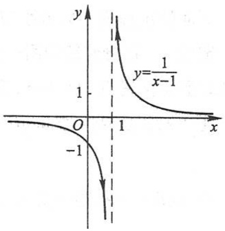

contour

| X | Y |
| --- | --- |
| 0 | 0 |
| 1 | 1 |
| 2 | -1 |

图1-29

就有

$$
\left| \frac {1}{x - 1} \right| > M.
$$

这就证明了 $\lim_{x\to1}\frac{1}{x-1}=\infty$ .

直线 x=1 是函数  $y=\frac{1}{x-1}$  的图形的铅直渐近线.

一般地说,如果 $\lim_{x\to x_{0}}f(x)=\infty$ ,那么直线 $x=x_{0}$ 是函数 $y=f(x)$ 的图形的铅直渐近线.

无穷大与无穷小之间有一种简单的关系,即

定理2 在自变量的同一变化过程中, 如果 $f(x)$ 为无穷大, 那么 $\frac{1}{f(x)}$ 为无穷小; 反之, 如果 $f(x)$ 为无穷小, 且 $f(x) \neq 0$, 那么 $\frac{1}{f(x)}$ 为无穷大.

证 设 $\lim_{x\to x_0}f(x) = \infty$

$\forall \varepsilon > 0$. 根据无穷大的定义, 对于 $M = \frac{1}{\varepsilon}, \exists \delta > 0$, 当 $0 < |x - x_0| < \delta$ 时, 有

$$
| f (x) | > M = \frac {1}{\varepsilon},
$$

即

$$
\left| \frac {1}{f (x)} \right| <   \varepsilon ,
$$

所以 $\frac{1}{f(x)}$ 为当 $x\to x_{0}$ 时的无穷小.

反之，设 $\lim_{x\to x_0}f(x) = 0$ ，且 $f(x)\neq 0.$

$\forall M > 0.$ 根据无穷小的定义，对于 $\varepsilon = \frac{1}{M},\exists \delta >0$ ，当 $0 <   |x - x_0| <   \delta$ 时，有

$$
\left| f (x) \right| <   \varepsilon = \frac {1}{M},
$$

由于当 $0 < |x - x_0| < \delta$ 时 $f(x) \neq 0$, 从而

$$
\left| \frac {1}{f (x)} \right| > M,
$$

所以 $\frac{1}{f(x)}$ 为当 $x\to x_{0}$ 时的无穷大.

类似地,可证当  $x \to \infty$  时的情形.

图

释疑解难

1-4

## 习题 1-4

1. 两个无穷小的商是否一定是无穷小？举例说明之。
\*2. 根据定义证明:

(1) $y = \frac{x^2 - 9}{x + 3}$ 为当 $x \to 3$ 时的无穷小； (2) $y = x \sin \frac{1}{x}$ 为当 $x \to 0$ 时的无穷小.

\*3. 根据定义证明: $y = \frac{1 + 2x}{x}$ 为当 $x \to 0$ 时的无穷大. 问 $x$ 应满足什么条件, 能使 $|y| > 10^4$?
4. 求下列极限并说明理由:

(1) $\lim_{x\to \infty}\frac{2x + 1}{x};$ (2) $\lim_{x\to 0}\frac{1 - x^2}{1 - x}.$

5. 根据函数极限或无穷大定义,填写下表:

|  | $f(x) \rightarrow A$ | $f(x) \rightarrow \infty$ | $f(x) \rightarrow +\infty$ | $f(x) \rightarrow -\infty$ |
| --- | --- | --- | --- | --- |
| $x \rightarrow x_0$ | $\forall \varepsilon > 0,$$\exists \delta > 0,$使当 $0 < \|x - x_0\| < \delta$ 时,即有 $\|f(x) - A\| < \varepsilon$ |  |  |  |
| $x \rightarrow x_0^+$ |  |  |  |  |
| $x \rightarrow x_0^-$ |  |  |  |  |
| $x \rightarrow \infty$ |  | $\forall M > 0,$$\exists X > 0,$使当 $\|x\| > X$ 时,即有 $\|f(x)\| > M$ |  |  |
| $x \rightarrow +\infty$ |  |  |  |  |
| $x \rightarrow -\infty$ |  |  |  |  |

6. 函数 $y = x \cos x$ 在 $(- \infty, +\infty)$ 内是否有界？这个函数是不是 $x \to +\infty$ 时的无穷大？为什么？
\*7. 证明: 函数 $y = \frac{1}{x} \sin \frac{1}{x}$ 在区间 $(0,1]$ 内无界, 但这个函数不是 $x \to 0^{+}$时的无穷大.
8. 求函数  $f(x)=\frac{4}{2-x^{2}}$  的图形的渐近线.

## 第五节 极限运算法则

本节讨论极限的求法,主要是建立极限的四则运算法则和复合函数的极限运算法则,利用这些法则,可以求某些函数的极限.以后我们还将介绍求极限的其他方法.

在下面的讨论中,记号“lim”下面没有标明自变量的变化过程,实际上,下面的定理对 $x\to x_{0}$ 及 $x\to\infty$ 都是成立的.在论证时,我们只证明了 $x\to x_{0}$ 的情形,只要把 $\delta$ 改成X,把 $0<|x-x_{0}|<\delta$ 改成 $|x|>X$ ,就可得 $x\to\infty$ 情形的证明.

定理1 两个无穷小的和是无穷小.

证 设 $\alpha$ 及 $\beta$ 是当 $x \to x_0$ 时的两个无穷小, 而

$$
\gamma = \alpha + \beta.
$$

$\forall \varepsilon > 0.$ 因为 $\alpha$ 是当 $x \to x_0$ 时的无穷小, 对于 $\frac{\varepsilon}{2} > 0$, $\exists \delta_1 > 0$, 当 $0 < |x - x_0| < \delta_1$ 时, 不等式

$$
| \alpha | <   \frac {\varepsilon}{2}
$$

成立. 又因 $\beta$ 是当 $x \to x_0$ 时的无穷小, 对于 $\frac{\varepsilon}{2} > 0$, $\exists \delta_2 > 0$, 当 $0 < |x - x_0| < \delta_2$ 时, 不等式

$$
| \beta | <   \frac {\varepsilon}{2}
$$

成立.取  $\delta=\min\left\{\delta_{1},\delta_{2}\right\}$ ，则当  $0<\left|x-x_{0}\right|<\delta$  时，

$$
| \alpha | <   \frac {\varepsilon}{2} \quad \text {及} \quad | \beta | <   \frac {\varepsilon}{2}
$$

同时成立,从而 $\left|\gamma\right|=\left|\alpha+\beta\right|\leqslant\left|\alpha\right|+\left|\beta\right|<\frac{\varepsilon}{2}+\frac{\varepsilon}{2}=\varepsilon.$ 这就证明了 $\gamma$ 也是当 $x\to x_{0}$ 时的无穷小.

用数学归纳法可证:有限个无穷小之和也是无穷小.

定理 2 有界函数与无穷小的乘积是无穷小.

证 设函数 $u$ 在 $x_0$ 的某一去心邻域 $\mathring{U}(x_0, \delta_1)$ 内是有界的，即 $\exists M > 0$ 使 $|u| \leqslant M$ 对一切 $x \in \mathring{U}(x_0, \delta_1)$ 成立. 又设 $\alpha$ 是当 $x \to x_0$ 时的无穷小，即 $\forall \varepsilon > 0, \exists \delta_2 > 0$ ，当 $x \in \mathring{U}(x_0, \delta_2)$ 时，有

$$
| \alpha | <   \frac {\varepsilon}{M}.
$$

取 $\delta = \min \{\delta_1,\delta_2\}$ ，则当 $x\in \mathring{U} (x_0,\delta)$ 时，

$$
| u | \leqslant M \quad {\text {及}} \quad | \alpha | <   \frac {\varepsilon}{M}
$$

同时成立. 从而

$$
\mid u \alpha \mid = \mid u \mid \cdot \mid \alpha \mid <   M \cdot \frac {\varepsilon}{M} = \varepsilon ,
$$

这就证明了 $u\alpha$ 是当 $x \to x_0$ 时的无穷小.

推论1 常数与无穷小的乘积是无穷小.

推论 2 有限个无穷小的乘积是无穷小.

定理 3 如果  $\lim f(x)=A,\lim g(x)=B$  ,那么

(1)  $\lim\left[f(x)\pm g(x)\right]=\lim f(x)\pm\lim g(x)=A\pm B;$
(2)  $\lim\left[f(x)\cdot g(x)\right]=\lim f(x)\cdot\lim g(x)=A\cdot B;$
(3) 若又有  $B \neq 0$ ，则

$$
\lim \frac {f (x)}{g (x)} = \frac {\lim f (x)}{\lim g (x)} = \frac {A}{B}.
$$

证 先证(1).

因  $\lim f(x)=A,\lim g(x)=B$  ,由第四节定理1有

$$
f (x) = A + \alpha , \quad g (x) = B + \beta ,
$$

其中 $\alpha$ 及 $\beta$ 为无穷小.于是

$$
f (x) \pm g (x) = (A + \alpha) \pm (B + \beta) = (A \pm B) + (\alpha \pm \beta).
$$

由本节定理 $1, \alpha \pm \beta$ 是无穷小 ($\alpha - \beta$ 可看作 $\alpha + (-1)\beta$, 由本节定理2的推论 $1, (-1)\beta$ 是无穷小, 因此 $\alpha - \beta$ 也可看作两个无穷小的和). 再由第四节定理1, 得

$$
\lim \left[ f (x) \pm g (x) \right] = A \pm B = \lim f (x) \pm \lim g (x).
$$

关于(2)的证明,建议读者作为练习.

再证(3).

由  $\lim f(x)=A,\lim g(x)=B$  ,有

$$
f (x) = A + \alpha , \quad g (x) = B + \beta ,
$$

其中 $\alpha$ 及 $\beta$ 为无穷小.设

$$
\gamma = \frac {f (x)}{g (x)} - \frac {A}{B},
$$

则

$$
\gamma = \frac {A + \alpha}{B + \beta} - \frac {A}{B} = \frac {1}{B (B + \beta)} (B \alpha - A \beta).
$$

上式表示, $\gamma$ 可看作两个函数的乘积,其中函数 $B\alpha-A\beta$ 是无穷小.下面我们证明另一个

函数 $\frac{1}{B(B+\beta)}$ 在点 $x_{0}$ 的某一邻域内有界.

根据第三节定理 $3'$，由于 $\lim g(x) = B \neq 0$，存在着点 $x_0$ 的某一去心邻域 $\mathring{U}(x_0)$，当 $x \in \mathring{U}(x_0)$ 时，$|g(x)| > \frac{|B|}{2}$，从而 $\left|\frac{1}{g(x)}\right| < \frac{2}{|B|}$. 于是

$$
\left| \frac {1}{B (B + \beta)} \right| = \frac {1}{| B |} \cdot \left| \frac {1}{g (x)} \right| <   \frac {1}{| B |} \cdot \frac {2}{| B |} = \frac {2}{B ^ {2}}.
$$

这就证明了 $\frac{1}{B(B+\beta)}$ 在点 $x_{0}$ 的去心邻域 $\stackrel{\circ}{U}(x_{0})$ 内有界.

因此,根据本节定理 2, $\gamma$ 是无穷小.而

$$
\frac {f (x)}{g (x)} = \frac {A}{B} + \gamma ,
$$

所以由第四节定理1,得

$$
\lim \frac {f (x)}{g (x)} = \frac {A}{B} = \frac {\lim f (x)}{\lim g (x)}.
$$

证毕.

定理3中的(1)、(2)可推广到有限个函数的情形.例如,如果 $\lim f(x),\lim g(x),$ $\lim h(x)$ 都存在,则有

$$
\lim [ f (x) + g (x) - h (x) ] = \lim f (x) + \lim g (x) - \lim h (x),
$$

$$
\lim \left[ f (x) \cdot g (x) \cdot h (x) \right] = \lim f (x) \cdot \lim g (x) \cdot \lim h (x).
$$

关于定理 3 中的(2)，有如下推论:

推论1 如果 $\lim f(x)$ 存在, 而 $c$ 为常数, 那么

$$
\lim \left[ c f (x) \right] = c \lim f (x).
$$

就是说,求极限时,常数因子可以提到极限记号外面.这是因为  $\lim c=c$ .

推论 2 如果  $\lim f(x)$  存在, 而 n 是正整数, 那么

$$
\lim \left[ f (x) \right] ^ {n} = \left[ \lim f (x) \right] ^ {n}.
$$

这是因为

$$
\begin{array}{l} \lim [ f (x) ] ^ {n} = \lim [ f (x) \cdot f (x) \cdot \dots \cdot f (x) ] \\ = \lim f (x) \cdot \lim f (x) \cdot \dots \cdot \lim f (x) = [ \lim f (x) ] ^ {n}. \\ \end{array}
$$

关于数列,也有类似的极限四则运算法则,这就是下面的定理:

定理4 设有数列 $\{x_{n}\}$ 和 $\{y_{n}\}$. 如果

$$
\lim _ {n \to \infty} x _ {n} = A, \quad \lim _ {n \to \infty} y _ {n} = B,
$$

那么

(1)  $\lim_{n\to\infty}(x_{n}\pm y_{n})=A\pm B;$

(2) $\lim_{n\to \infty}(x_n\cdot y_n) = A\cdot B;$
(3) 当  $y_{n} \neq 0 (n = 1, 2, \cdots)$  且  $B \neq 0$  时， $\lim_{n \to \infty} \frac{x_{n}}{y_{n}} = \frac{A}{B}$ .

证明从略.

定理5 如果 $\varphi(x) \geqslant \psi(x)$，而 $\lim \varphi(x) = A, \lim \psi(x) = B$，那么 $A \geqslant B$.

证 令 $f(x) = \varphi (x) - \psi (x)$，则 $f(x) \geqslant 0$. 由本节定理3有

$$
\lim f (x) = \lim \left[ \varphi (x) - \psi (x) \right] = \lim \varphi (x) - \lim \psi (x) = A - B.
$$

由第三节定理3推论,有 $\lim f(x)\geqslant0$ ,即 $A-B\geqslant0$ ,故 $A\geqslant B$ .

关于数列的极限,也有类似的运算法则,这里不再详述.①

例1 求 $\lim_{x\to 1}(2x - 1)$

解 $\lim_{x\to 1}(2x - 1) = \lim_{x\to 1}2x - \lim_{x\to 1}1 = 2\lim_{x\to 1}x - 1 = 2\cdot 1 - 1 = 1.$

例 2 求  $\lim_{x\to2}\frac{x^{3}-1}{x^{2}-5x+3}$ .

解 这里分母的极限不为零,故

$$
\begin{array}{l} \lim _ {x \to 2} \frac {x ^ {3} - 1}{x ^ {2} - 5 x + 3} = \frac {\lim _ {x \to 2} (x ^ {3} - 1)}{\lim _ {x \to 2} (x ^ {2} - 5 x + 3)} = \frac {\lim _ {x \to 2} x ^ {3} - \lim _ {x \to 2} 1}{\lim _ {x \to 2} x ^ {2} - 5 \lim _ {x \to 2} x + \lim _ {x \to 2} 3} \\ = \frac {(\lim _ {x \to 2} x) ^ {3} - 1}{(\lim _ {x \to 2} x) ^ {2} - 5 \cdot 2 + 3} = \frac {2 ^ {3} - 1}{2 ^ {2} - 1 0 + 3} = \frac {7}{- 3} = - \frac {7}{3}. \\ \end{array}
$$

从上面两个例题可以看出,求有理整函数(多项式)或有理分式函数当 $x\to x_{0}$ 的极限时,只要把 $x_{0}$ 代替函数中的x就行了(对于有理分式函数,需假定这样代入后分母不等于零).

事实上,设多项式

$$
f (x) = a _ {0} x ^ {n} + a _ {1} x ^ {n - 1} + \dots + a _ {n},
$$

则

$$
\begin{array}{l} \lim _ {x \to x _ {0}} f (x) = \lim _ {x \to x _ {0}} (a _ {0} x ^ {n} + a _ {1} x ^ {n - 1} + \dots + a _ {n}) = a _ {0} (\lim _ {x \to x _ {0}} x) ^ {n} + a _ {1} (\lim _ {x \to x _ {0}} x) ^ {n - 1} + \dots + \lim _ {x \to x _ {0}} a _ {n} \\ = a _ {0} x _ {0} ^ {n} + a _ {1} x _ {0} ^ {n - 1} + \dots + a _ {n} = f (x _ {0}). \\ \end{array}
$$

又设有理分式函数

$$
F (x) = \frac {P (x)}{Q (x)},
$$

其中 $P(x), Q(x)$ 都是多项式，于是

<small>① 参阅习题 1-5 第 6 题.</small>

$$
\lim _ {x \to x _ {0}} P (x) = P (x _ {0}), \quad \lim _ {x \to x _ {0}} Q (x) = Q (x _ {0});
$$

如果 $Q(x_0) \neq 0$，那么

$$
\lim _ {x \to x _ {0}} F (x) = \lim _ {x \to x _ {0}} \frac {P (x)}{Q (x)} = \frac {\lim _ {x \to x _ {0}} P (x)}{\lim _ {x \to x _ {0}} Q (x)} = \frac {P (x _ {0})}{Q (x _ {0})} = F (x _ {0}).
$$

但必须注意: 若  $Q(x_{0})=0$ , 则关于商的极限的运算法则不能应用, 那就需要特别考虑. 下面我们举两个属于这种情形的例题.

例3 求 $\lim_{x\to 3}\frac{x - 3}{x^2 - 9}$

解 当  $x \rightarrow 3$  时, 分子及分母的极限都是零, 于是分子、分母不能分别取极限. 因分子及分母有公因子 x-3, 而  $x \rightarrow 3$  时,  $x \neq 3, x-3 \neq 0$ , 可约去这个不为零的公因子. 所以

$$
\lim _ {x \to 3} \frac {x - 3}{x ^ {2} - 9} = \lim _ {x \to 3} \frac {1}{x + 3} = \frac {\lim _ {x \to 3} 1}{\lim _ {x \to 3} (x + 3)} = \frac {1}{6}.
$$

例4 求 $\lim_{x\to 1}\frac{2x - 3}{x^2 - 5x + 4}.$

解 因为分母的极限 $\lim_{x\to 1}(x^2 -5x + 4) = 1^2 -5\cdot 1 + 4 = 0$ ，不能应用商的极限的运算法则.但因

$$
\lim _ {x \to 1} \frac {x ^ {2} - 5 x + 4}{2 x - 3} = \frac {1 ^ {2} - 5 \cdot 1 + 4}{2 \cdot 1 - 3} = 0,
$$

故由第四节定理2得

$$
\lim _ {x \to 1} \frac {2 x - 3}{x ^ {2} - 5 x + 4} = \infty .
$$

例5 求 $\lim_{x\to \infty}\frac{3x^3 + 4x^2 + 2}{7x^3 + 5x^2 - 3}.$

解 先用  $x^{3}$  去除分母及分子, 然后取极限, 得

$$
\lim _ {x \to \infty} \frac {3 x ^ {3} + 4 x ^ {2} + 2}{7 x ^ {3} + 5 x ^ {2} - 3} = \lim _ {x \to \infty} \frac {3 + \frac {4}{x} + \frac {2}{x ^ {3}}}{7 + \frac {5}{x} - \frac {3}{x ^ {3}}} = \frac {3}{7},
$$

这是因为

$$
\lim _ {x \to \infty} \frac {a}{x ^ {n}} = a \lim _ {x \to \infty} \frac {1}{x ^ {n}} = a \left(\lim _ {x \to \infty} \frac {1}{x}\right) ^ {n} = 0,
$$

其中 $a$ 为常数，$n$ 为正整数，$\lim_{x \to \infty} \frac{1}{x} = 0$（见第三节例7）.

例6 求 $\lim_{x\to \infty}\frac{3x^2 - 2x - 1}{2x^3 - x^2 + 5}.$

解 先用  $x^{3}$  去除分母和分子, 然后取极限, 得

$$
\lim _ {x \to \infty} \frac {3 x ^ {2} - 2 x - 1}{2 x ^ {3} - x ^ {2} + 5} = \lim _ {x \to \infty} \frac {\frac {3}{x} - \frac {2}{x ^ {2}} - \frac {1}{x ^ {3}}}{2 - \frac {1}{x} + \frac {5}{x ^ {3}}} = \frac {0}{2} = 0.
$$

例7 求 $\lim_{x\to \infty}\frac{2x^3 - x^2 + 5}{3x^2 - 2x - 1}.$

解 应用例 6 的结果并根据第四节定理 2, 即得

$$
\lim _ {x \to \infty} \frac {2 x ^ {3} - x ^ {2} + 5}{3 x ^ {2} - 2 x - 1} = \infty .
$$

例5、例6、例7是下列一般情形的特例，即当 $a_0 \neq 0, b_0 \neq 0, m$ 和 $n$ 为非负整数时，有

$$
\lim _ {x \to \infty} \frac {a _ {0} x ^ {m} + a _ {1} x ^ {m - 1} + \cdots + a _ {m}}{b _ {0} x ^ {n} + b _ {1} x ^ {n - 1} + \cdots + b _ {n}} = \left\{ \begin{array}{l l} 0, & \text {当} n > m, \\ \frac {a _ {0}}{b _ {0}}, & \text {当} n = m, \\ \infty , & \text {当} n <   m. \end{array} \right.
$$

例8 求 $\lim_{x\to \infty}\frac{\sin x}{x}$

解 当 $x \to \infty$ 时, 分子及分母的极限都不存在, 故关于商的极限的运算法则不能应用. 如果把 $\frac{\sin x}{x}$ 看作 $\sin x$ 与 $\frac{1}{x}$ 的乘积, 由于 $\frac{1}{x}$ 当 $x \to \infty$ 时为无穷小, 而 $\sin x$ 是有界函数, 则根据本节定理2, 有

$$
\lim _ {x \to \infty} \frac {\sin x}{x} = 0.
$$

定理6（复合函数的极限运算法则）设函数 $y = f[g(x)]$ 是由函数 $u = g(x)$ 与函数 $y = f(u)$ 复合而成，$f[g(x)]$ 在点 $x_0$ 的某去心邻域内有定义，若 $\lim_{x\to x_0}g(x) = u_0$，$\lim_{u\to u_0}f(u) = A$，且存在 $\delta_0 > 0$，当 $x\in \mathring{U}(x_0,\delta_0)$ 时，有 $g(x)\neq u_0$，则

$$
\lim _ {x \to x _ {0}} f [ g (x) ] = \lim _ {u \to u _ {0}} f (u) = A.
$$

证 按函数极限的定义,要证:  $\forall \varepsilon > 0, \exists \delta > 0$ , 使得当  $0 < |x - x_{0}| < \delta$  时,

$$
\left| f [ g (x) ] - A \right| <   \varepsilon
$$

成立.

由于 $\lim_{u\to u_0}f(u) = A,\forall \varepsilon >0,\exists \eta >0$ ，当 $0 <   |u - u_0| <   \eta$ 时， $|f(u) - A| <   \varepsilon$ 成立.

又由于 $\lim_{x\to x_0}g(x) = u_0$ ，对于上面得到的 $\eta >0$ ， $\exists \delta_1 > 0$ ，当 $0 <   |x - x_0| <   \delta_1$ 时，$|g(x) - u_0| <   \eta$ 成立.

由假设, 当  $x \in \overset{\circ}{U}(x_{0}, \delta_{0})$  时,  $g(x) \neq u_{0}$ . 取  $\delta = \min\{\delta_{0}, \delta_{1}\}$ , 则当  $0 < |x - x_{0}| < \delta$  时,

$\mid g(x) - u_0\mid < \eta$ 及 $\mid g(x) - u_0\mid \neq 0$ 同时成立，即 $0 < \mid g(x) - u_0\mid < \eta$ 成立，从而

$$
\left| f [ g (x) ] - A \right| = \left| f (u) - A \right| <   \varepsilon
$$

成立.证毕.

在定理6中，把 $\lim_{x\to x_0}g(x) = u_0$ 换成 $\lim_{x\to x_0}g(x) = \infty$ 或 $\lim_{x\to \infty}g(x) = \infty$ ，而把 $\lim_{u\to u_0}f(u) = A$ 换成 $\lim_{u\to \infty}f(u) = A$ ，可得类似的定理.

定理6表示,如果函数 $g(x)$ 和 $f(u)$ 满足该定理的条件,那么作代换 $u=g(x)$ 可把求 $\lim_{x\to x_{0}}f[g(x)]$ 化为求 $\lim_{u\to u_{0}}f(u)$,这里 $u_{0}=\lim_{x\to x_{0}}g(x)$.

释疑解难

1-5

## 习题1-5

1. 计算下列极限:

(1)  $\lim_{x\to2}\frac{x^{2}+5}{x-3};$

(2)  $\lim_{x\to\sqrt{3}}\frac{x^{2}-3}{x^{2}+1};$

(3) $\lim_{x\to 1}\frac{x^2 - 2x + 1}{x^2 - 1};$

(4) $\lim_{x\to 0}\frac{4x^3 - 2x^2 + x}{3x^2 + 2x};$

(5)  $\lim_{h\to0}\frac{(x+h)^{2}-x^{2}}{h};$

(6)  $\lim_{x\to\infty}\left(2-\frac{1}{x}+\frac{1}{x^{2}}\right)$ ;

(7) $\lim_{x\to \infty}\frac{x^2 - 1}{2x^2 - x - 1};$

(8)  $\lim_{x\to\infty}\frac{x^{2}+x}{x^{4}-3x^{2}+1};$

(9)  $\lim_{x\to4}\frac{x^{2}-6x+8}{x^{2}-5x+4};$

(10)  $\lim_{x\to\infty}\left(1+\frac{1}{x}\right)\left(2-\frac{1}{x^{2}}\right)$ ;

(11)  $\lim_{n\to\infty}\left(1+\frac{1}{2}+\frac{1}{4}+\cdots+\frac{1}{2^n}\right)$ ;

(12)  $\lim_{n\to\infty}\frac{1+2+3+\cdots+(n-1)}{n^{2}};$

(13)  $\lim_{n\to\infty}\frac{(n+1)(n+2)(n+3)}{5n^{3}}$ ;

(14) $\lim_{x\to 1}\left(\frac{1}{1 - x} -\frac{3}{1 - x^3}\right)$.

2. 计算下列极限:

(1)  $\lim_{x\to2}\frac{x^{3}+2x^{2}}{(x-2)^{2}};$

(2) $\lim_{x\to \infty}\frac{x^2}{2x + 1}$;

(3) $\lim_{x\to \infty}(2x^3 -x + 1)$.

3. 计算下列极限:

(1)  $\lim_{x\to0}x^{2}\sin\frac{1}{x};$

(2) $\lim_{x\to \infty}\frac{\arctan x}{x}.$

4. 设 $\{a_{n}\}, \{b_{n}\}, \{c_{n}\}$ 均为非负数列，且 $\lim_{n\to \infty}a_n = 0, \lim_{n\to \infty}b_n = 1, \lim_{n\to \infty}c_n = \infty$。下列陈述中哪些是对的，哪些是错的？如果是对的，说明理由；如果是错的，试给出一个反例。

(1)  $a_{n}<b_{n}, n\in N_{+};$

(2) $b_{n} < c_{n}, n \in \mathbb{N}_{+}$;

(3)  $\lim_{n\to\infty}a_{n}c_{n}$  不存在；

(4)  $\lim_{n\to\infty}b_{n}c_{n}$  不存在.

5. 下列陈述中, 哪些是对的, 哪些是错的? 如果是对的, 说明理由; 如果是错的, 试给出一个反例.

(1) 如果  $\lim_{x\to x_{0}}f(x)$  存在, 但  $\lim_{x\to x_{0}}g(x)$  不存在, 那么  $\lim_{x\to x_{0}}[f(x)+g(x)]$  不存在;

(2) 如果  $\lim_{x\to x_{0}}f(x)$  和  $\lim_{x\to x_{0}}g(x)$  都不存在, 那么  $\lim_{x\to x_{0}}[f(x)+g(x)]$  不存在;

(3) 如果  $\lim_{x\to x_{0}}f(x)$  存在, 但  $\lim_{x\to x_{0}}g(x)$  不存在, 那么  $\lim_{x\to x_{0}}[f(x)\cdot g(x)]$  不存在;

(4) 如果  $\lim_{x\to x_{0}}f(x)$  和  $\lim_{x\to x_{0}}g(x)$  都不存在, 那么  $\lim_{x\to x_{0}}[f(x)\cdot g(x)]$  不存在.

6. 设有收敛数列  $\{x_{n}\}$  和  $\{y_{n}\}$ ，若从某项起，有

$$
x _ {n} \geqslant y _ {n} \quad (n \geqslant N, N \in \mathbb {N} _ {+}),
$$

且 $\lim_{n\to \infty}x_n = A,\lim_{n\to \infty}\gamma_n = B$ ，证明: $A\geqslant B.$

\*7. 证明本节定理3中的(2).

## 第六节 极限存在准则 两个重要极限

下面讲判定极限存在的两个准则以及作为应用准则的例子,讨论两个重要极限:
 $\lim_{x\to0}\frac{\sin x}{x}=1$  及  $\lim_{x\to\infty}\left(1+\frac{1}{x}\right)^x=e.$

准则I 如果数列 $\{x_{n}\},\{y_{n}\}$ 及 $\{z_n\}$ 满足下列条件:

(1) 从某项起, 即  $\exists n_{0} \in N_{+}$ , 当  $n > n_{0}$  时, 有

$$
y _ {n} \leqslant x _ {n} \leqslant z _ {n};
$$

(2)  $\lim_{n\to\infty}y_{n}=a,\quad\lim_{n\to\infty}z_{n}=a,$

那么数列 $\{x_{n}\}$ 的极限存在，且 $\lim_{n\to \infty}x_n = a.$

证 因 $y_{n} \to a, z_{n} \to a$，所以根据数列极限的定义，$\forall \varepsilon > 0$，$\exists$ 正整数 $N_{1}$，当 $n > N_{1}$ 时，有 $|y_{n} - a| < \varepsilon$；又 $\exists$ 正整数 $N_{2}$，当 $n > N_{2}$ 时，有 $|z_{n} - a| < \varepsilon$。现在取 $N = \max \{n_{0}, N_{1}, N_{2}\}$，则当 $n > N$ 时，有

$$
\mid y _ {n} - a \mid <   \varepsilon , \quad \mid z _ {n} - a \mid <   \varepsilon
$$

同时成立,即

$$
a - \varepsilon <   y _ {n} <   a + \varepsilon , \quad a - \varepsilon <   z _ {n} <   a + \varepsilon
$$

同时成立.又因当 $n > N$ 时，$x_{n}$ 介于 $y_{n}$ 和 $z_{n}$ 之间，从而有

$$
a - \varepsilon <   y _ {n} \leqslant x _ {n} \leqslant z _ {n} <   a + \varepsilon ,
$$

即

$$
\mid x _ {n} - a \mid <   \varepsilon
$$

成立.这就证明了 $\lim_{n\to\infty}x_{n}=a$ .

上述数列极限存在准则可以推广到函数的极限.

## 准则 I' 如果

(1) 当  $x \in \mathring{U}(x_{0}, r)$  (或  $|x| > M$ ) 时,

$$
g (x) \leqslant f (x) \leqslant h (x);
$$

(2)  $\lim_{\substack{x\to x_{0}\\ (x\to\infty)}}g(x)=A,\quad\lim_{\substack{x\to x_{0}\\ (x\to\infty)}}h(x)=A,$

那么  $\lim f(x)$  存在,且等于 A.

$$
(x \rightarrow \infty)
$$

准则Ⅰ及准则Ⅰ'称为夹逼准则.

作为准则 I'的应用,下面讨论一个重要的极限

$$
\lim _ {x \to 0} \frac {\sin x}{x}.
$$

首先注意到,函数 $\frac{\sin x}{x}$ 对于一切 $x\neq0$ 都有定义.

在图 1-30 所示的四分之一的单位圆中, 设圆心角  $\angle AOB = x \left(0 < x < \frac{\pi}{2}\right)$ , 点 A 处的切线与 OB 的延长线相交于 D, 又  $BC \perp OA$ , 则

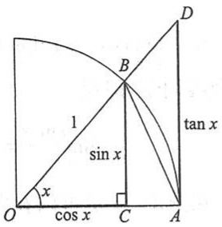

text_image

1
sin x
x
cos x
B
tan x
O
C
A
D

图1-30

$$
\sin x = C B, \quad x = \widehat {A B}, \quad \tan x = A D.
$$

因为

$\triangle AOB$ 的面积<扇形 AOB 的面积< $\triangle AOD$ 的面积,

所以

$$
\frac {1}{2} \sin x <   \frac {1}{2} x <   \frac {1}{2} \tan x,
$$

即

$$
\sin x <   x <   \tan x.
$$

不等号各边都除以  $\sin x$ ，就有

$$
1 <   \frac {x}{\sin x} <   \frac {1}{\cos x},
$$

或

$$
\cos x <   \frac {\sin x}{x} <   1. \tag {6-1}
$$

因为当 $x$ 用 $-x$ 代替时, $\cos x$ 与 $\frac{\sin x}{x}$ 都不变, 所以上面的不等式对于开区间 $\left(-\frac{\pi}{2}, 0\right)$ 内的一切 $x$ 也是成立的.

为了对(6-1)式应用准则 I', 下面来证  $\lim_{x\to0}\cos x=1$ .

事实上, 当  $0 < |x| < \frac{\pi}{2}$  时,

$$
0 <   | \cos x - 1 | = 1 - \cos x = 2 \sin^ {2} \frac {x}{2} <   2 \left(\frac {x}{2}\right) ^ {2} = \frac {x ^ {2}}{2},
$$

即

$$
0 <   1 - \cos x <   \frac {x ^ {2}}{2}.
$$

当 $x \to 0$ 时, $\frac{x^2}{2} \to 0$, 由准则 $\mathrm{I}'$ 有 $\lim_{x \to 0} (1 - \cos x) = 0$, 所以

$$
\lim _ {x \to 0} \cos x = 1.
$$

由于 $\lim_{x\to0}\cos x=1,\lim_{x\to0}1=1$ ，由不等式(6-

1) 及准则 I', 即得

$$
\lim _ {x \to 0} \frac {\sin x}{x} = 1. \tag {6-2}
$$

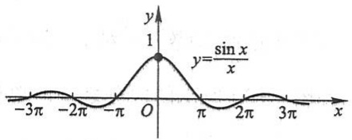

contour

| X | Y |
| --- | --- |
| 0 | 1 |

图1-31

从图 1-31 也可以看出这个重要极限.

例1 求 $\lim_{x\to 0}\frac{\tan x}{x}$

解 $\lim_{x\to 0}\frac{\tan x}{x} = \lim_{x\to 0}\left(\frac{\sin x}{x}\cdot \frac{1}{\cos x}\right) = \lim_{x\to 0}\frac{\sin x}{x}\cdot \lim_{x\to 0}\frac{1}{\cos x} = 1.$

例2 求 $\lim_{x\to 0}\frac{1 - \cos x}{x^2}.$

解 $\lim_{x\to 0}\frac{1 - \cos x}{x^2} = \lim_{x\to 0}\left(\frac{\sin^2x}{x^2}\cdot \frac{1}{1 + \cos x}\right) = \lim_{x\to 0}\left(\frac{\sin x}{x}\right)^2\cdot \lim_{x\to 0}\frac{1}{1 + \cos x} = \frac{1}{2}.$

例3 求 $\lim_{x\to 0}\frac{\arcsin x}{x}$

解 令 $t = \arcsin x$，则 $x = \sin t$，当 $x \to 0$ 时，有 $t \to 0$. 于是由复合函数的极限运算法则得

$$
\lim _ {x \to 0} \frac {\arcsin x}{x} = \lim _ {t \to 0} \frac {t}{\sin t} = 1.
$$

准则Ⅱ 单调有界数列必有极限.

如果数列 $\{x_{n}\}$ 满足条件

$$
x _ {1} \leqslant x _ {2} \leqslant x _ {3} \leqslant \dots \leqslant x _ {n} \leqslant x _ {n + 1} \leqslant \dots ,
$$

就称数列 $\{x_{n}\}$ 是单调增加的；如果数列 $\{x_{n}\}$ 满足条件

$$
x _ {1} \geqslant x _ {2} \geqslant x _ {3} \geqslant \dots \geqslant x _ {n} \geqslant x _ {n + 1} \geqslant \dots ,
$$

就称数列 $\{x_{n}\}$ 是单调减少的. 单调增加和单调减少的数列统称为单调数列①.

在第二节中曾证明:收敛的数列一定有界.但那时也曾指出:有界的数列不一定收敛.现在准则Ⅱ表明:如果数列不仅有界,并且是单调的,那么这个数列的极限必定存

<small>① 这里的单调数列是广义的，就是说，在条件中也包括相等的情形。以后称单调数列都是指这种广义的单调数列。</small>

在,也就是这数列一定收敛.

对准则Ⅱ我们不作证明,而给出如下的几何解释:

从数轴上看,对应于单调数列的点 $x_{n}$ 只可能向一个方向移动,所以只有两种可能情形:或者点 $x_{n}$ 沿数轴移向无穷远 $(x_{n} \to +\infty$ 或 $x_{n} \to -\infty)$,或者点 $x_{n}$ 无限趋于某一个定点 $A$ (图1-32),也就是数列 $\{x_{n}\}$ 趋于一个极限.但现在假定数列是有界的,而有界数列的点 $x_{n}$ 都落在数轴上某一个区间 $[-M, M]$ 内,那么上述第一种情形就不可能发生了.这就表示这个数列趋于一个极限,并且这个极限的绝对值不超过 $M$.

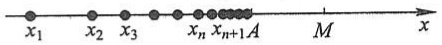

图1-32

作为准则Ⅱ的应用,我们讨论另一个重要极限

$$
\lim _ {x \to \infty} \left(1 + \frac {1}{x}\right) ^ {x}.
$$

下面考虑 x 取正整数 n 而趋于  $+\infty$  的情形.

设 $x_{n} = \left(1 + \frac{1}{n}\right)^{n}$, 我们来证数列 $\{x_{n}\}$ 单调增加并且有界. 按牛顿二项公式, 有

$$
\begin{array}{l} x _ {n} = \left(1 + \frac {1}{n}\right) ^ {n} \\ = 1 + \frac {n}{1 !} \cdot \frac {1}{n} + \frac {n (n - 1)}{2 !} \cdot \frac {1}{n ^ {2}} + \frac {n (n - 1) (n - 2)}{3 !} \cdot \frac {1}{n ^ {3}} + \dots + \frac {n (n - 1) \cdots (n - n + 1)}{n !} \cdot \frac {1}{n ^ {n}} \\ = 1 + 1 + \frac {1}{2 !} \left(1 - \frac {1}{n}\right) + \frac {1}{3 !} \left(1 - \frac {1}{n}\right) \left(1 - \frac {2}{n}\right) + \dots + \frac {1}{n !} \left(1 - \frac {1}{n}\right) \left(1 - \frac {2}{n}\right) \dots \left(1 - \frac {n - 1}{n}\right), \\ \end{array}
$$

类似地，

$$
\begin{array}{l} x _ {n + 1} = 1 + 1 + \frac {1}{2 !} \left(1 - \frac {1}{n + 1}\right) + \frac {1}{3 !} \left(1 - \frac {1}{n + 1}\right) \left(1 - \frac {2}{n + 1}\right) + \dots + \\ \frac {1}{n !} \left(1 - \frac {1}{n + 1}\right) \left(1 - \frac {2}{n + 1}\right) \dots \left(1 - \frac {n - 1}{n + 1}\right) + \frac {1}{(n + 1) !} \left(1 - \frac {1}{n + 1}\right) \left(1 - \frac {2}{n + 1}\right) \dots \left(1 - \frac {n}{n + 1}\right). \\ \end{array}
$$

比较 $x_{n}, x_{n+1}$ 的展开式, 可以看到除前两项外, $x_{n}$ 的每一项都小于 $x_{n+1}$ 的对应项, 并且 $x_{n+1}$ 还多了最后的一项, 其值大于 0 , 因此

$$
x _ {n} <   x _ {n + 1},
$$

这就说明数列 $\{x_{n}\}$ 是单调增加的. 这个数列同时还是有界的. 因为, 如果 $x_{n}$ 的展开式中各项括号内的数用较大的数1代替, 得

$$
x _ {n} \leqslant 1 + \left(1 + \frac {1}{2 !} + \frac {1}{3 !} + \dots + \frac {1}{n !}\right) \leqslant 1 + \left(1 + \frac {1}{2} + \frac {1}{2 ^ {2}} + \dots + \frac {1}{2 ^ {n - 1}}\right)
$$