现在我们以乘积的微分法则为例加以证明.

根据函数微分的表达式,有

$$
\mathrm{d} (u v) = (u v) ^ {\prime} \mathrm{d} x.
$$

再根据乘积的求导法则,有

$$
(u v) ^ {\prime} = u ^ {\prime} v + u v ^ {\prime}.
$$

于是

$$
\mathrm{d} (u v) = (u ^ {\prime} v + u v ^ {\prime}) \mathrm{d} x = u ^ {\prime} v \mathrm{d} x + u v ^ {\prime} \mathrm{d} x.
$$

由于

$$
u ^ {\prime} \mathrm{d} x = \mathrm{d} u, v ^ {\prime} \mathrm{d} x = \mathrm{d} v,
$$

所以

$$
\mathrm{d} (u v) = v \mathrm{d} u + u \mathrm{d} v.
$$

其他法则都可以用类似方法证明.

## 3. 复合函数的微分法则

与复合函数的求导法则相应的复合函数的微分法则可推导如下:

设 $y = f(u)$ 及 $u = g(x)$ 都可导，则复合函数 $y = f[g(x)]$ 的微分为

$$
\mathrm{d} y = y _ {x} ^ {\prime} \mathrm{d} x ① = f ^ {\prime} (u) g ^ {\prime} (x) \mathrm{d} x.
$$

由于 $g'(x)\mathrm{d}x = \mathrm{d}u$ ，所以，复合函数 $y = f[g(x)]$ 的微分公式也可以写成

$$
\mathrm{d} y = f ^ {\prime} (u)   \mathrm{d} u \quad \text {或} \quad \mathrm{d} y = y _ {u} ^ {\prime}   \mathrm{d} u.
$$

由此可见,无论 u 是自变量还是中间变量,微分形式  $dy=f'(u)du$  保持不变.这一性质称为微分形式不变性.这性质表示,当变换自变量时,微分形式  $dy=f'(u)du$  并不改变.

例 3 设  $y=\sin(2x+1)$ ，求 dy.

解 把  $2x+1$  看成中间变量 u, 则

$$
\begin{array}{l} \mathrm{d} y = \mathrm{d} (\sin u) = \cos u \mathrm{d} u = \cos (2 x + 1) \mathrm{d} (2 x + 1) \\ = \cos (2 x + 1) \cdot 2 \mathrm{d} x = 2 \cos (2 x + 1) \mathrm{d} x. \\ \end{array}
$$

在求复合函数的导数时,可以不写出中间变量.在求复合函数的微分时,类似地也可以不写出中间变量.下面我们用这种方法来求函数的微分.

例 4 设  $y=\ln(1+e^{x^{2}})$ ，求 dy.

解 $\mathrm{dy} = \mathrm{d}(\ln (1 + \mathrm{e}^{x^2})) = \frac{1}{1 + \mathrm{e}^{x^2}}\mathrm{d}(1 + \mathrm{e}^{x^2}) = \frac{1}{1 + \mathrm{e}^{x^2}}\cdot \mathrm{e}^{x^2}\mathrm{d}(x^2) = \frac{\mathrm{e}^{x^2}}{1 + \mathrm{e}^{x^2}}\cdot 2x\mathrm{dx} = \frac{2xe^{x^2}}{1 + \mathrm{e}^{x^2}}\mathrm{dx}.$

例 5 设  $y=e^{1-3x}\cos x$ , 求 dy.

<small>① 其中 $y_{x}^{\prime}$ 表示 $y$ 对 $x$ 的导数，它也是导数的一种表示方法.</small>

解 应用积的微分法则, 得

$$
\begin{array}{l} \mathrm{d} y = \mathrm{d} (\mathrm{e} ^ {1 - 3 x} \cos x) = \cos x \mathrm{d} (\mathrm{e} ^ {1 - 3 x}) + \mathrm{e} ^ {1 - 3 x} \mathrm{d} (\cos x) \\ = (\cos x) \mathrm{e} ^ {1 - 3 x} (- 3 \mathrm{d} x) + \mathrm{e} ^ {1 - 3 x} (- \sin x \mathrm{d} x) = - \mathrm{e} ^ {1 - 3 x} (3 \cos x + \sin x) \mathrm{d} x. \\ \end{array}
$$

例 6 在下列等式左端的括号中填入适当的函数,使等式成立.

(1) $\mathrm{d}(\quad) = x\mathrm{d}x;$

(2) $\mathrm{d}(\quad) = \cos \omega t\mathrm{d}t (\omega \neq 0)$.

解（1）我们知道，

$$
\mathrm{d} (x ^ {2}) = 2 x \mathrm{d} x.
$$

可见

$$
x \mathrm{d} x = \frac {1}{2} \mathrm{d} (x ^ {2}) = \mathrm{d} \left(\frac {x ^ {2}}{2}\right),
$$

即

$$
\mathrm{d} \left(\frac {x ^ {2}}{2}\right) = x \mathrm{d} x.
$$

一般地,有

$$
\mathrm{d} \left(\frac {x ^ {2}}{2} + C\right) = x \mathrm{d} x \quad (C \text {为任意常数}).
$$

(2) 因为

$$
\mathrm{d} (\sin \omega t) = \omega \cos \omega t \mathrm{d} t,
$$

可见

$$
\cos \omega t \mathrm{d} t = \frac {1}{\omega} \mathrm{d} (\sin \omega t) = \mathrm{d} \left(\frac {1}{\omega} \sin \omega t\right),
$$

即

$$
\mathrm{d} \left(\frac {1}{\omega} \sin \omega t\right) = \cos \omega t \mathrm{d} t.
$$

一般地,有

$$
\mathrm{d} \left(\frac {1}{\omega} \sin \omega t + C\right) = \cos \omega t \mathrm{d} t (C \text {为任意常数}, \omega \neq 0).
$$

## 四、微分在近似计算中的应用

## 1. 函数的近似计算

在工程问题中,经常会遇到一些复杂的计算公式.如果直接用这些公式进行计算,那是很费力的.利用微分往往可以把一些复杂的计算公式用简单的近似公式来代替.

前面说过,如果  $y=f(x)$  在点  $x_{0}$  处的导数  $f'(x_{0})\neq0$ , 且  $|\Delta x|$  很小时, 我们有

$$
\Delta y \approx \mathrm{d} y = f ^ {\prime} (x _ {0}) \Delta x.
$$

这个式子也可以写为

$$
\Delta y = f (x _ {0} + \Delta x) - f (x _ {0}) \approx f ^ {\prime} (x _ {0}) \Delta x, \tag {5-4}
$$

或

$$
f (x _ {0} + \Delta x) \approx f (x _ {0}) + f ^ {\prime} (x _ {0}) \Delta x. \tag {5-5}
$$

在(5-5)式中令 $x = x_0 + \Delta x$ ，即 $\Delta x = x - x_0$ ，那么(5-5)式可改写为

$$
f (x) \approx f (x _ {0}) + f ^ {\prime} (x _ {0}) (x - x _ {0}). \tag {5-6}
$$

如果 $f(x_0)$ 与 $f'(x_0)$ 都容易计算，那么可利用(5-4)式来近似计算 $\Delta y$ ，利用(5-5)式来近似计算 $f(x_0 + \Delta x)$ ，或利用(5-6)式来近似计算 $f(x)$ .这种近似计算的实质就是用 $x$ 的线性函数 $f(x_0) + f'(x_0)(x - x_0)$ 来近似表达函数 $f(x)$ .从导数的几何意义可知，这也就是用曲线 $y = f(x)$ 在点 $(x_0,f(x_0))$ 处的切线来近似代替该曲线（就切点邻近部分来说）.

例 7 有一批半径为 1 cm 的球,为了提高球面的光洁度,要镀上一层铜,厚度定为 0.01 cm.估计一下镀每只球需用多少克铜(铜的密度是  $8.9 \, g/cm^{3}$ )?

解 先求出镀层的体积,再乘密度就可得到镀每只球需用铜的质量.

因为镀层的体积等于镀铜前、后两个球体体积之差,所以它就是球体体积  $V=\frac{4}{3}\pi R^{3}$  当 R 自  $R_{0}$  取得增量  $\Delta R$  时的增量  $\Delta V$ . 我们求 V 对 R 的导数

$$
V ^ {\prime} \Big | _ {R = R _ {0}} = \left(\frac {4}{3} \pi R ^ {3}\right) ^ {\prime} \Big | _ {R = R _ {0}} = 4 \pi R _ {0} ^ {2},
$$

由(5-4)式得

$$
\Delta V \approx 4 \pi R _ {0} ^ {2} \Delta R.
$$

将  $R_{0}=1,\Delta R=0.01$  代入上式, 得

$$
\Delta V \approx 4 \times 3. 1 4 \times 1 ^ {2} \times 0. 0 1 \approx 0. 1 3 (\mathrm{cm} ^ {3}),
$$

于是镀每只球需用的铜约为

$$
0. 1 3 \times 8. 9 \approx 1. 1 6 (\mathrm{g}).
$$

例 8 利用微分计算  $\sin 30^{\circ}30'$  的近似值.

解 把  $30^{\circ}30'$  化为弧度, 得

$$
3 0 ^ {\circ} 3 0 ^ {\prime} = \frac {\pi}{6} + \frac {\pi}{3 6 0}.
$$

由于所求的是正弦函数的值,故设 $f(x)=\sin x$ .此时 $f'(x)=\cos x$ .如果取 $x_{0}=\frac{\pi}{6}$ ,那么 $f\left(\frac{\pi}{6}\right)=\sin\frac{\pi}{6}=\frac{1}{2}$ 与 $f'\left(\frac{\pi}{6}\right)=\cos\frac{\pi}{6}=\frac{\sqrt{3}}{2}$ 都容易计算,并且 $\Delta x=\frac{\pi}{360}$ 比较小.应用(5-5)式便得

$$
\begin{array}{l} \sin 30^\circ 30' = \sin \left(\frac{\pi}{6} +\frac{\pi}{360}\right) \approx \sin \frac{\pi}{6} +\cos \frac{\pi}{6}\times \frac{\pi}{360} \\ = \frac {1}{2} + \frac {\sqrt {3}}{2} \times \frac {\pi}{3 6 0} \approx 0. 5 0 0 0 + 0. 0 0 7 6 = 0. 5 0 7 6. \\ \end{array}
$$

下面我们来推导一些常用的近似公式.为此,在(5-6)式中取 $x_{0}=0$ ,于是得

$$
f (x) \approx f (0) + f ^ {\prime} (0) x. \tag {5-7}
$$

应用(5-7)式可以推得以下几个在工程上常用的近似公式(下面都假定 $|x|$ 是较小的数值):

(i) $(1 + x)^{\alpha}\approx 1 + \alpha x$ $(\alpha \in \mathbb{R})$
(ii)  $\sin x \approx x$  (x 以弧度为单位),
(iii)  $\tan x \approx x$  (x 以弧度为单位),
(iv)  $e^{x} \approx 1 + x,$
(v)  $\ln(1+x)\approx x.$

证（i）在第一章第九节例7中我们已经知道 $(1 + x)^{\alpha} - 1\sim \alpha x$ （ $x\to 0$ )，从而得出这个近似公式.在这里，我们利用微分证明.取 $f(x) = (1 + x)^{\alpha}$ ，那么 $f(0) = 1,f^{\prime}(0) =$ $\alpha (1 + x)^{\alpha -1}\Big|_{x = 0} = \alpha ,$ 代入(5-7)式便得

$$
(1 + x) ^ {\alpha} \approx 1 + \alpha x.
$$

(ii) 取 $f(x) = \sin x$，那么 $f(0) = 0, f'(0) = \cos x \bigg|_{x=0} = 1$，代入(5-7)式便得

$$
\sin x \approx x.
$$

其他几个近似公式可用类似方法证明,这里从略了.

例 9 计算 $\sqrt{1.05}$ 的近似值.

解 $\sqrt{1.05} = \sqrt{1 + 0.05}$

这里 $x = 0.05$ ，其值较小，利用近似公式(i） $(\alpha = \frac{1}{2}$ 的情形），便得

$$
\sqrt {1 . 0 5} \approx 1 + \frac {1}{2} \times 0. 0 5 = 1. 0 2 5.
$$

如果直接开方,可得

$$
\sqrt {1 . 0 5} = 1. 0 2 4 7 0.
$$

将两个结果比较一下,可以看出,用1.025作为 $\sqrt{1.05}$ 的近似值,其误差不超过0.001,这样的近似值在一般应用上已够精确了.如果开方次数较高,就更能体现出用微分进行近似计算的优越性.

## \*2. 误差估计

在生产实践中,经常要测量各种数据.但是有的数据不易直接测量,这时我们就通过测量其他有关数据后,根据某种公式算出所要的数据.例如,要计算圆钢的截面积A,可先用卡尺测量圆钢截面的直径D,然后根据公式 $A=\frac{\pi}{4}D^{2}$ 算出A.

由于测量仪器的精度、测量的条件和测量的方法等各种因素的影响,测得的数据往往带有误差,而根据带有误差的数据计算所得的结果也会有误差,我们把它叫做间接测量误差.

下面就讨论怎样利用微分来估计间接测量误差.

先说明绝对误差、相对误差的概念.

如果某个量的精确值为 A，它的近似值为 a，那么  $\left|A-a\right|$  叫做 a 的绝对误差，而绝对误差与  $\left|a\right|$  的比值  $\frac{\left|A-a\right|}{\left|a\right|}$  叫做 a 的相对误差.

在实际工作中,某个量的精确值往往是无法知道的,于是绝对误差和相对误差也就无法求得.但是根据测量仪器的精度等因素,有时能够确定误差在某一个范围内.如果某个量的精确值是A,测得它的近似值是a,又知道它的误差不超过 $\delta_{A}$ ,即

$$
\mid A - a \mid \leqslant \delta_ {A},
$$

那么  $\delta_{A}$  叫做测量 A 的绝对误差限，而  $\frac{\delta_{A}}{|a|}$  叫做测量 A 的相对误差限.

例 10 设测得圆钢截面的直径 D = 60.03 mm, 测量 D 的绝对误差限  $\delta_{D} = 0.05$  mm. 利用公式

$$
A = \frac{\pi}{4} D^2
$$

计算圆钢的截面积时,试估计面积的误差.

解 如果我们把测量 D 时所产生的误差当作自变量 D 的增量  $\Delta D$ ，那么，利用公式  $A = \frac{\pi}{4} D^{2}$  来计算 A 时所产生的误差就是函数 A 的对应增量  $\Delta A$ 。当  $|\Delta D|$  很小时，可以利用微分 dA 近似地代替增量  $\Delta A$ ，即

$$
\Delta A \approx \mathrm{d} A = A ^ {\prime} \cdot \Delta D = \frac {\pi}{2} D \cdot \Delta D.
$$

由于 D 的绝对误差限为  $\delta_{D}=0.05\ mm$ ，所以

$$
\mid \Delta D \mid \leqslant \delta_ {D} = 0. 0 5,
$$

而

$$
\left| \Delta A \right| \approx \left| \mathrm{d} A \right| = \frac {\pi}{2} D \cdot \left| \Delta D \right| \leqslant \frac {\pi}{2} D \cdot \delta_ {D},
$$

因此得出 $A$ 的绝对误差限约为

$$
\delta_ {A} = \frac {\pi}{2} D \cdot \delta_ {D} = \frac {\pi}{2} \times 6 0. 0 3 \times 0. 0 5 \approx 4. 7 1 2 (\mathrm{mm} ^ {2});
$$

$A$ 的相对误差限约为

$$
\frac {\delta_ {A}}{A} = \frac {\frac {\pi}{2} D \cdot \delta_ {D}}{\frac {\pi}{4} D ^ {2}} = 2 \frac {\delta_ {D}}{D} = 2 \times \frac {0 . 0 5}{6 0 . 0 3} \approx 0. 17\%
$$

一般地,根据直接测量的 x 值按公式  $y=f(x)$  计算 y 值时,如果已知测量 x 的绝对误差限是  $\delta_{x}$ , 即

$$
\mid \Delta x \mid \leqslant \delta_ {x},
$$

那么, 当  $y' \neq 0$  时, y 的绝对误差

$$
\mid \Delta y \mid \approx \mid \mathrm{d} y \mid = \mid y ^ {\prime} \mid \cdot \mid \Delta x \mid \leqslant \mid y ^ {\prime} \mid \cdot \delta_ {x},
$$

即 $y$ 的绝对误差限约为

$$
\delta_ {y} = | y ^ {\prime} | \cdot \delta_ {x}; \tag {5-8}
$$

$y$ 的相对误差限约为

$$
\frac {\delta_ {y}}{| y |} = \left| \frac {y ^ {\prime}}{y} \right| \cdot \delta_ {x}. \tag {5-9}
$$

以后常把绝对误差限与相对误差限简称为绝对误差与相对误差.

## 习题2-5

1. 已知  $y = x^{3} - x$ ，计算在 x = 2 处当  $\Delta x$  分别等于 1, 0.1, 0.01 时的  $\Delta y$  及 dy.
2. 设函数  $y=f(x)$  的图形如图 2-12, 试在图 2-12(a)、(b)、(c)、(d) 中分别标出在点  $x_{0}$  的 dy,  $\Delta y$  及  $\Delta y-dy$ , 并说明其正负.

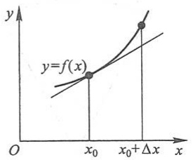

line

| Point | x-coordinate | y-coordinate |
| --- | --- | --- |
| Intersection (y=f(x), x0) | x0 | y=f(x) |
| Intersection (y=f(x), \(x0+\Delta x)\) | \(x0+\Delta x\) | y=f(x) |

(a)

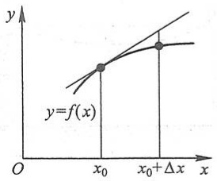

line

| X | Y |
| --- | --- |
| x0 | ~Value 1 |
| \(x0+\Delta x\) | ~Value 2 |

(b)

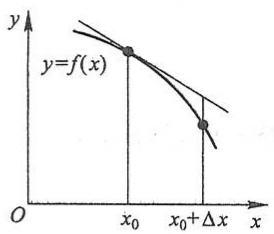

line

| Point | X-coordinate | Y-coordinate |
| --- | --- | --- |
| Point 1 | \(x_{0}\) | \(y=f(x)\) |
| Point 2 | \(x_{0}+\Delta x\) | Intermediate point |

(c)

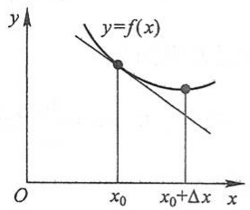

line

| Point | X-coordinate | Y-coordinate |
| --- | --- | --- |
| Intersection (x₀, y=f(x)) | \(x_{0}\) | — |
| Intersection \((x_{0}+\Delta x)\) | \(x_{0}+\Delta x\) | — |

(d)

图2-12

3. 求下列函数的微分:

(1)  $y=\frac{1}{x}+2\sqrt{x}$ ;

(2) $y = x \sin 2x$;

(3) $y = \frac{x}{\sqrt{x^2 + 1}}$;

(4)  $y=\ln^{2}(1-x)$ ;

(5) $y = x^{2} \mathrm{e}^{2x}$;

(6) $y = e^{-x} \cos(3 - x)$;

(7)  $y = \arcsin \sqrt{1 - x^{2}}$ ;

(8) $y = \tan^2 (1 + 2x^2)$;

(9)  $y=\arctan\frac{1-x^{2}}{1+x^{2}};$

(10) $s = A\sin (\omega t + \varphi)$ $(A,\omega ,\varphi$ 是常数).

4. 将适当的函数填入下列括号内, 使等式成立:

(1)  $\mathrm{d}(\quad) = 2 \mathrm{~d} x;$

(2)  $\mathrm{d}(\quad) = 3x \mathrm{~dx};$

(3)  $\mathrm{d}(\quad) = \cos t \, dt;$

(4)  $\mathrm{d}(\quad) = \sin \omega x \mathrm{d}x \quad (\omega \neq 0);$

(5) d() =  $\frac{1}{1+x}dx$ ;

(6)  $\mathrm{d}(\quad) = \mathrm{e}^{-2x} \mathrm{~d}x;$

(7) d() =  $\frac{1}{\sqrt{x}}dx;$

(8) d() = sec²3xdx.

5. 如图 2-13 所示的电缆  $\widehat{AOB}$  的长为 s，跨度为 2l，电缆的最低点 O 与杆顶连线 AB 的距离为 f，则电缆长可按下面公式计算

$$
s = 2 l \left(1 + \frac {2 f ^ {2}}{3 l ^ {2}}\right),
$$

当f变化了 $\Delta f$ 时,电缆长的变化约为多少?

6. 设扇形的圆心角 $\alpha = 60^{\circ}$, 半径 $R = 100 \mathrm{~cm}$ (图2-14). 如果 $R$ 不变, $\alpha$ 减少 $30'$, 问扇形面积大约改变了多少? 又如果 $\alpha$ 不变, $R$ 增加 $1 \mathrm{~cm}$, 问扇形面积大约改变了多少?

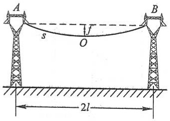

text_image

A
s
O
f
B
2l

图2-13

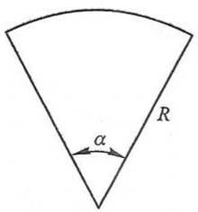

text_image

R
α

图2-14

7. 计算下列三角函数值的近似值:

(1)  $\cos 29^{\circ}$ ;

(2)  $\tan 136^{\circ}$ .

8. 计算下列反三角函数值的近似值:

(1) arcsin 0.500 2; (2) arccos 0.499 5.

9. 当  $\left|x\right|$  较小时, 证明下列近似公式:

(1)  $\tan x \approx x$  (x 是角的弧度值); (2)  $\ln(1+x) \approx x$ ;

(3)  $\sqrt[n]{1+x} \approx 1 + \frac{1}{n}x;$ 

(4)  $e^{x} \approx 1 + x.$

并计算  $\tan 45'$  和  $\ln 1.002$  的近似值.

10. 计算下列各根式的近似值:

(1)  $\sqrt[3]{996}$ ; (2)  $\sqrt[6]{65}$ .

\* 11. 计算球体体积时,要求精确度在 $2\%$ 以内.问这时测量直径 $D$ 的相对误差不能超过多少?

\* 12. 某厂生产如图 2-15 所示的扇形板, 半径 $R = 200 \mathrm{~mm}$, 要求圆心角 $\alpha$ 为 $55^{\circ}$. 产品检验时, 一般用测量弦长 $l$ 的办法来间接测量圆心角 $\alpha$. 如果测量弦长 $l$ 时的误差 $\delta_{l} = 0.1 \mathrm{~mm}$, 问由此而引起的圆心角测量误差 $\delta_{\alpha}$ 是多少?

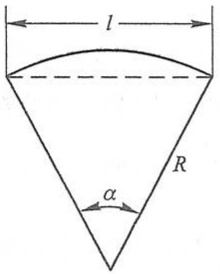

text_image

l
R
α

图2-15

## 总习题二

1. 在“充分”“必要”和“充分必要”三者中选择一个正确的填入下列空格内:

(1) $f(x)$ 在点 $x_0$ 可导是 $f(x)$ 在点 $x_0$ 连续的\_\_\_\_条件, $f(x)$ 在点 $x_0$ 连续是 $f(x)$ 在点 $x_0$ 可导的\_\_\_\_条件;
(2) $f(x)$ 在点 $x_0$ 的左导数 $f'_-(x_0)$ 及右导数 $f'_+(x_0)$ 都存在且相等是 $f(x)$ 在点 $x_0$ 可导的 \_\_\_\_ 条件；
(3) $f(x)$ 在点 $x_0$ 可导是 $f(x)$ 在点 $x_0$ 可微的 \_\_\_\_ 条件.

2. 设  $f(x)=x(x+1)(x+2)\cdot\cdots\cdot(x+n)$  ( $n\geqslant2$ )，则  $f'(0)=$ \_\_\_\_ .

3. 下题中给出了四个结论,从中选出一个正确的结论:

设 $f(x)$ 在 x=a 的某个邻域内有定义，则 $f(x)$ 在 x=a 处可导的一个充分条件是（）.

(A) $\lim_{h\to +\infty}h\left[f\left(a + \frac{1}{h}\right) - f(a)\right]$ 存在.
(B) $\lim_{h\to 0}\frac{f(a + 2h) - f(a + h)}{h}$ 存在.
(C)  $\lim_{h\to0}\frac{f(a+h)-f(a-h)}{2h}$  存在.
(D)  $\lim_{h\to0}\frac{f(a)-f(a-h)}{h}$  存在.

4. 设有一根细棒, 取棒的一端作为原点, 棒上任意点的坐标为 x, 于是分布在区间  $[0, x]$  上细棒的质量 m 与 x 存在函数关系  $m = m(x)$ . 应怎样确定细棒在点  $x_{0}$  处的线密度 (对于均匀细棒来说, 单位长度细棒的质量叫做这细棒的线密度)?

5. 根据导数的定义, 求  $f(x)=\frac{1}{x}$  的导数.
6. 求下列函数 $f(x)$ 的 $f_{-}^{\prime}(0)$ 及 $f_{+}^{\prime}(0)$，又 $f^{\prime}(0)$ 是否存在:

(1) $f(x)=\left\{\begin{aligned}\sin x, & x<0,\\ \ln(1+x), & x\geqslant0;\end{aligned}\right.$

(2) $f(x)=\left\{\begin{aligned}\frac{x}{1+\mathrm{e}^{\frac{1}{x}}},&x\neq0,\\ 0,&x=0.\end{aligned}\right.$

7. 讨论函数

$$
f (x) = \left\{ \begin{array}{l l} x \sin \frac {1}{x}, & x \neq 0, \\ 0, & x = 0 \end{array} \right.
$$

在 x=0 处的连续性与可导性.

8. 求下列函数的导数:

(1)  $y=\arcsin(\sin x)$ ;

(2) $y = \arctan \frac{1 + x}{1 - x}$;

(3)  $y=\ln \tan \frac{x}{2}-\cos x \cdot \ln \tan x;$

(4) $y = \ln (\mathrm{e}^x +\sqrt{1 + \mathrm{e}^{2x}})$;

(5) $y = x^{\frac{1}{x}}$ (x > 0).

9. 求下列函数的二阶导数:

(1)  $y = \cos^{2}x \cdot \ln x;$

(2) $y = \frac{x}{\sqrt{1 - x^2}}$.

\* 10. 求下列函数的 $n$ 阶导数:

(1) $y = \sqrt[m]{1 + x}$;

(2) $y = \frac{1 - x}{1 + x}$.

11. 设函数  $y=y(x)$  由方程  $e^{y}+xy=e$  所确定, 求  $y''(0)$ .

12. 设 $y = y(x)$ 是由方程 $\left\{ \begin{aligned} & \mathrm{e}^{x} = 3t^{2} + 2t + 1, \\ & t \sin y - y + \frac{\pi}{2} = 0 \end{aligned} \right.$ 所确定, 求 $\frac{\mathrm{d}y}{\mathrm{d}x}\bigg|_{t=0}.$

13. 求下列由参数方程所确定的函数的一阶导数 $\frac{\mathrm{d}y}{\mathrm{d}x}$ 及二阶导数 $\frac{\mathrm{d}^2y}{\mathrm{d}x^2}$:

(1) $\left\{\begin{aligned}x=a\cos^{3}\theta,\\ y=a\sin^{3}\theta;\end{aligned}\right.$

(2) $\left\{ \begin{array}{l}x = \ln \sqrt{1 + t^2},\\ y = \arctan t. \end{array} \right.$

14. 求曲线  $\left\{\begin{aligned} x &= 2e^{t}, \\ y &= e^{-t}\end{aligned}\right.$  在 t=0 相应的点处的切线方程及法线方程.
15. 已知 $f(x)$ 是周期为 5 的连续函数, 它在 $x = 0$ 的某个邻域内满足关系式

$$
f (1 + \sin x) - 3 f (1 - \sin x) = 8 x + o (x),
$$

且 $f(x)$ 在 $x = 1$ 处可导，求曲线 $y = f(x)$ 在点(6, $f(6)$)处的切线方程.
16. 当正在高度 H 水平飞行的飞机开始向机场跑道下降时, 如图 2-16 所示从飞机到机场的水平地面距离为 L. 假设飞机下降的路径为三次函数 $y = ax^3 + bx^2 + cx + d$ 的图形，其中 $y|_{x=-L} = H, y|_{x=0} = 0$. 试确定飞机的降落路径.

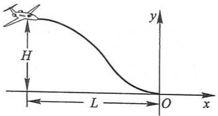

text_image

H
L
O
x
y

图2-16

17. 甲船以 $6 \mathrm{~km} / \mathrm{h}$ 的速率向东航行, 乙船以 $8 \mathrm{~km} / \mathrm{h}$ 的速率向南航行. 在中午 12:00, 乙船位于甲船之北 $16 \mathrm{~km}$ 处. 问下午 1:00 两船相离的速率为多少?

18. 利用函数的微分代替函数的增量求  $\sqrt[3]{1.02}$  的近似值.

19. 已知单摆的振动周期 $T = 2\pi \sqrt{\frac{l}{g}}$，其中 $g = 980 \, \mathrm{cm/s^2}$，$l$ 为摆长（单位为 cm）。设原摆长为 $20 \, \mathrm{cm}$，为使周期 $T$ 增大 $0.05 \, \mathrm{s}$，摆长约需加长多少？

第二章释疑解难

第二章例题精讲

# 第三章

# 微分中值定理与导数的应用

上一章里,从分析实际问题中因变量相对于自变量的变化快慢出发,引进了导数概念,并讨论了导数的计算方法.本章中,我们将应用导数来研究函数以及曲线的某些性态,并利用这些知识解决一些实际问题.为此,先要介绍微分学的几个中值定理,它们是导数应用的理论基础.

## 第一节 微分中值定理

我们先讲罗尔(Rolle)定理,然后根据它推出拉格朗日(Lagrange)中值定理和柯西(Cauchy)中值定理.

## 一、罗尔定理

首先,我们观察图3-1.设曲线弧AB是函数 $y=f(x)$ ( $x\in[a,b]$ )的图形.这是一条连续的曲线弧,除端点外处处有不垂直于x轴的切线,且两个端点的纵坐标相等,即 $f(a)=f(b)$ .可以发现在曲线弧的最高点C处或最低点D处,曲线有水平的切线.如果记点C的横坐标为 $\xi$ ,那么就有 $f'(\xi)=0$ .现在用分析语言把这个几何现象描述出来,就可得下面的罗尔定理.为了应用方便,先介绍费马(Fermat)引理.

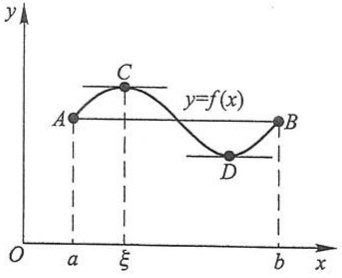

line

| Point | x-coordinate | y-coordinate |
| --- | --- | --- |
| A | a | ~0.5 |
| C | \(\xi\) | ~0.7 |
| D | b | ~0.2 |
| B | b | ~0.5 |

图3-1

费马引理 设函数 $f(x)$ 在点 $x_0$ 的某邻域 $U(x_0)$ 内有定义，并且在 $x_0$ 处可导，如果对任意的 $x \in U(x_0)$，有

$$
f (x) \leqslant f (x _ {0}) \quad (\text {或} f (x) \geqslant f (x _ {0}))  ,
$$

那么 $f^{\prime}(x_0) = 0.$

证 不妨设 $x \in U(x_0)$ 时, $f(x) \leqslant f(x_0)$ (如果 $f(x) \geqslant f(x_0)$, 可以类似地证明). 于是, 对于 $x_0 + \Delta x \in U(x_0)$, 有

$$
f (x _ {0} + \Delta x) \leqslant f (x _ {0}),
$$

从而当 $\Delta x > 0$ 时，

$$
\frac {f (x _ {0} + \Delta x) - f (x _ {0})}{\Delta x} \leqslant 0;
$$

当 $\Delta x < 0$ 时，

$$
\frac {f (x _ {0} + \Delta x) - f (x _ {0})}{\Delta x} \geqslant 0.
$$

根据函数 $f(x)$ 在 $x_0$ 可导的条件及极限的保号性，便得到

$$
f ^ {\prime} (x _ {0}) = f _ {+} ^ {\prime} (x _ {0}) = \lim _ {\Delta x \to 0 ^ {+}} \frac {f (x _ {0} + \Delta x) - f (x _ {0})}{\Delta x} \leqslant 0,
$$

$$
f ^ {\prime} (x _ {0}) = f _ {-} ^ {\prime} (x _ {0}) = \lim _ {\Delta x \to 0 ^ {-}} \frac {f (x _ {0} + \Delta x) - f (x _ {0})}{\Delta x} \geqslant 0.
$$

所以， $f'(x_{0})=0$ . 证毕.

通常称导数等于零的点为函数的驻点(或稳定点,临界点).

罗尔定理 如果函数 $f(x)$ 满足

(1) 在闭区间  $[a, b]$  上连续；
(2) 在开区间 $(a,b)$ 内可导；
(3) 在区间端点处的函数值相等, 即  $f(a)=f(b)$ ,

那么在 $(a,b)$ 内至少有一点 $\xi (a <   \xi <  b)$ ，使得 $f^{\prime}(\xi) = 0$

证 由于 $f(x)$ 在闭区间 $[a, b]$ 上连续，根据闭区间上连续函数的最大值最小值定理，$f(x)$ 在闭区间 $[a, b]$ 上必定取得它的最大值 $M$ 和最小值 $m$. 这样，只有两种可能情形:

(1) M=m. 这时  $f(x)$  在区间  $[a,b]$  上必然取相同的数值  $M:f(x)=M.$  由此， $\forall x\in(a,b)$ ，有  $f'(x)=0.$  因此，任取  $\xi\in(a,b)$ ，有  $f'(\xi)=0.$
(2) $M > m$. 因为 $f(a) = f(b)$, 所以 $M$ 和 $m$ 这两个数中至少有一个不等于 $f(x)$ 在区间 $[a, b]$ 的端点处的函数值. 为确定起见, 不妨设 $M \neq f(a)$ (如果设 $m \neq f(a)$, 证法完全类似), 那么必定在开区间 $(a, b)$ 内有一点 $\xi$ 使 $f(\xi) = M$. 因此, $\forall x \in [a, b]$, 有 $f(x) \leqslant f(\xi)$, 从而由费马引理可知 $f'(\xi) = 0$.

定理证毕.

## 二、拉格朗日中值定理

罗尔定理中 $f(a) = f(b)$ 这个条件是相当特殊的，它使罗尔定理的应用受到限制.如果把 $f(a)=f(b)$ 这个条件取消,但仍保留其余两个条件,并相应地改变结论,那么就得到微分学中十分重要的拉格朗日中值定理.

拉格朗日中值定理 如果函数 $f(x)$ 满足

(1) 在闭区间  $[a, b]$  上连续；
(2) 在开区间 $(a,b)$ 内可导，

那么在 $(a,b)$ 内至少有一点 $\xi (a <   \xi <  b)$ ，使等式

$$
f (b) - f (a) = f ^ {\prime} (\xi) (b - a) \tag {1-1}
$$

成立.

在证明之前,先看一下定理的几何意义.如果把(1-1)式改写成

$$
\frac {f (b) - f (a)}{b - a} = f ^ {\prime} (\xi),
$$

由图3-2可看出， $\frac{f(b) - f(a)}{b - a}$ 为弦 $AB$ 的斜率，而 $f^{\prime}(\xi)$ 为曲线在点 $C$ 处的切线的斜

率.因此拉格朗日中值定理的几何意义是:如果连续曲线  $y=f(x)$  的弧  $\widehat{AB}$  上除端点外处处具有不垂直于 x 轴的切线,那么这弧上至少有一点 C,使曲线在点 C 处的切线平行于弦 AB.

从图3-1看出，在罗尔定理中，由于 $f(a) = f(b)$，弦 $AB$ 是平行于 $x$ 轴的，因此点 $C$ 处的切线实际上也平行于弦 $AB$. 由此可见，罗尔定理是拉格朗日中值定理的特殊情形.

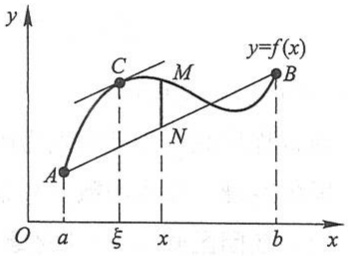

line

| Point | x-coordinate | y-coordinate |
| --- | --- | --- |
| A | a | 0 |
| C | \(\xi\) | ~0.8 |
| M | x | ~0.8 |
| B | b | ~0.8 |

图3-2

从上述拉格朗日中值定理与罗尔定理的关系,自然想到利用罗尔定理来证明拉格朗日中值定理.但在拉格朗日中值定理中,函数 $f(x)$ 不一定具备 $f(a)=f(b)$ 这个条件,为此我们设想构造一个与 $f(x)$ 有密切联系的函数 $\varphi(x)$ （称为辅助函数）,使 $\varphi(x)$ 满足条件 $\varphi(a)=\varphi(b)$ .然后对 $\varphi(x)$ 应用罗尔定理,再把对 $\varphi(x)$ 所得的结论转化到 $f(x)$ 上,证得所要的结果.我们从拉格朗日中值定理的几何解释中来寻找辅助函数,从图3-2中看到,有向线段NM的值是x的函数,把它表示为 $\varphi(x)$ ,它与 $f(x)$ 有密切的联系,且当x=a及x=b时,点M与点N重合,即有 $\varphi(a)=\varphi(b)=0$ .为求得函数 $\varphi(x)$ 的表达式,设直线AB的方程为 $y=L(x)$ ,则

$$
L (x) = f (a) + \frac {f (b) - f (a)}{b - a} (x - a),
$$

由于点 $M, N$ 的纵坐标依次为 $f(x)$ 及 $L(x)$，故表示有向线段 $NM$ 的值的函数

$$
\varphi (x) = f (x) - L (x) = f (x) - f (a) - \frac {f (b) - f (a)}{b - a} (x - a).
$$

下面就利用这个辅助函数来证明拉格朗日中值定理.

拉格朗日中值定理的证明 引进辅助函数

$$
\varphi (x) = f (x) - f (a) - \frac {f (b) - f (a)}{b - a} (x - a).
$$

容易验证函数 $\varphi (x)$ 适合罗尔定理的条件: $\varphi (a) = \varphi (b) = 0,\varphi (x)$ 在闭区间 $[a,b]$ 上连续，在开区间 $(a,b)$ 内可导，且

$$
\varphi^ {\prime} (x) = f ^ {\prime} (x) - \frac {f (b) - f (a)}{b - a}.
$$

根据罗尔定理, 可知在  $(a, b)$  内至少有一点  $\xi$ , 使  $\varphi'(\xi)=0$ , 即

$$
f ^ {\prime} (\xi) - \frac {f (b) - f (a)}{b - a} = 0.
$$

由此得

$$
\frac {f (b) - f (a)}{b - a} = f ^ {\prime} (\xi),
$$

即

$$
f (b) - f (a) = f ^ {\prime} (\xi) (b - a).
$$

定理证毕.

显然,公式(1-1)对于 b<a 也成立.(1-1)式叫做拉格朗日中值公式.

设 $x$ 为区间 $[a, b]$ 内一点，$x + \Delta x$ 为这区间内的另一点（$\Delta x > 0$ 或 $\Delta x < 0$），则公式 (1-1) 在区间 $[x, x + \Delta x]$（当 $\Delta x > 0$ 时）或在区间 $[x + \Delta x, x]$（当 $\Delta x < 0$ 时）上就成为

$$
f (x + \Delta x) - f (x) = f ^ {\prime} (x + \theta \Delta x) \cdot \Delta x \quad (0 <   \theta <   1). \tag {1-2}
$$

这里数值  $\theta$  在 0 与 1 之间, 所以  $x + \theta \Delta x$  是在 x 与  $x + \Delta x$  之间.

如果记 $f(x)$ 为 $y$ ，那么(1-2)式又可写成

$$
\Delta y = f ^ {\prime} (x + \theta \Delta x) \cdot \Delta x \quad (0 <   \theta <   1). \tag {1-3}
$$

我们知道,函数的微分  $\mathrm{dy}=f'(x)\cdot\Delta x$  是函数的增量  $\Delta y$  的近似表达式,一般说来,以 dy 近似代替  $\Delta y$  时所产生的误差只有当  $\Delta x\to0$  时才趋于零;而(1-3)式却给出了自变量取得有限增量  $\Delta x(|\Delta x|$  不一定很小)时,函数增量  $\Delta y$  的准确表达式.因此,这个定理也叫做有限增量定理,(1-3)式称为有限增量公式.拉格朗日中值定理在微分学中占有重要地位,有时也称这定理为微分中值定理.在某些问题中当自变量 x 取得有限增量  $\Delta x$  而需要函数增量的准确表达式时,拉格朗日中值定理就显出它的价值.

作为拉格朗日中值定理的一个应用,我们来导出以后讲积分学时很有用的一个定理.我们知道,如果函数 $f(x)$ 在某一区间上是一个常数,那么 $f(x)$ 在该区间上的导数恒为零.它的逆命题也是成立的,这就是:

图

例题精讲

3-1

定理 如果函数 $f(x)$ 在区间 $I$ 上连续, $I$ 内①可导且导数恒为零, 那么 $f(x)$ 在区间 $I$ 上是一个常数.

证 在区间 $I$ 上任取两点 $x_{1}, x_{2} (x_{1} < x_{2})$，应用(1-1)式就得

$$
f (x _ {2}) - f (x _ {1}) = f ^ {\prime} (\xi) (x _ {2} - x _ {1}) \quad (x _ {1} <   \xi <   x _ {2}).
$$

由假定， $f^{\prime}(\xi) = 0$ ，所以 $f(x_{2}) - f(x_{1}) = 0$ ，即

$$
f (x _ {2}) = f (x _ {1}).
$$

因为 $x_{1}, x_{2}$ 是 $I$ 上任意两点，所以上面的等式表明:$f(x)$ 在 $I$ 上的函数值总是相等的，这就是说，$f(x)$ 在区间 $I$ 上是一个常数.

从上述论证中可以看出,虽然拉格朗日中值定理中的  $\xi$  的准确数值不知道,但在这里并不妨碍它的应用.

例 证明当 x>0 时，

$$
\frac {x}{1 + x} <   \ln (1 + x) <   x.
$$

证 设 $f(t) = \ln (1 + t)$，显然 $f(t)$ 在区间 $[0, x]$ 上满足拉格朗日中值定理的条件，根据定理，应有

$$
f (x) - f (0) = f ^ {\prime} (\xi) (x - 0), \quad 0 <   \xi <   x.
$$

由于 $f(0) = 0, f'(t) = \frac{1}{1 + t}$, 因此上式即为

$$
\ln (1 + x) = \frac {x}{1 + \xi}.
$$

又由 $0 < \xi < x$ ，有

$$
\frac {x}{1 + x} <   \frac {x}{1 + \xi} <   x,
$$

即

$$
\frac {x}{1 + x} <   \ln (1 + x) <   x (x > 0).
$$

## 三、柯西中值定理

上面已经指出,如果连续曲线弧 $\widehat{AB}$ 上除端点外处处具有不垂直于横轴的切线,那么这段弧上至少有一点C,使曲线在点C处的切线平行于弦AB.设 $\widehat{AB}$ 由参数方程

$$
\left\{ \begin{array}{l l} x = \varphi (t), \\ y = \psi (t) \end{array} \right. \quad (a \leqslant t \leqslant b)
$$

<small>① $x$ 在区间 $I$ 内指 $x \in I$, 且 $x$ 不是 $I$ 的端点.</small>

表示,其中 t 为参数,则曲线上点 $(x,y)$ 处的切线斜率为

$$
\frac {\mathrm{d} y}{\mathrm{d} x} = \frac {\psi^ {\prime} (t)}{\varphi^ {\prime} (t)},
$$

弦 ${AB}$ 的斜率为

$$
\frac {\psi (b) - \psi (a)}{\varphi (b) - \varphi (a)}.
$$

假定点 C 对应于参数  $t=\xi$ ，那么曲线上点 C 处的切线平行于弦 AB，可表示为

$$
\frac {\psi (b) - \psi (a)}{\varphi (b) - \varphi (a)} = \frac {\psi^ {\prime} (\xi)}{\varphi^ {\prime} (\xi)}.
$$

这是函数在参数方程形式下的拉格朗日中值定理的表达形式.通过对这个特殊问题的思考,可以得到以下一般性的结论.

柯西中值定理 如果函数 $f(x)$ 及 $F(x)$ 满足

(1) 在闭区间  $[a, b]$  上连续；
(2) 在开区间 $(a,b)$ 内可导；
(3) 对任一  $x \in (a, b)$ ,  $F'(x) \neq 0$ ,

那么在 $(a,b)$ 内至少有一点 $\xi$ ，使等式

$$
\frac {f (b) - f (a)}{F (b) - F (a)} = \frac {f ^ {\prime} (\xi)}{F ^ {\prime} (\xi)} \tag {1-4}
$$

成立.

在定理证明之前,先对要证的结论作一些分析,以便寻找证明的思路.

要证在 $(a,b)$ 内至少有一点 $\xi$ ，使等式(1-4)成立，即成立

$$
\frac {f (b) - f (a)}{F (b) - F (a)} F ^ {\prime} (\xi) = f ^ {\prime} (\xi)
$$

或

$$
f ^ {\prime} (\xi) - \frac {f (b) - f (a)}{F (b) - F (a)} F ^ {\prime} (\xi) = 0
$$

若设函数

$$
\varphi (x) = f (x) - \frac {f (b) - f (a)}{F (b) - F (a)} F (x),
$$

则要证成立

$$
\varphi^ {\prime} (\xi) = f ^ {\prime} (\xi) - \frac {f (b) - f (a)}{F (b) - F (a)} F ^ {\prime} (\xi) = 0.
$$

由此联想到:是否可以利用罗尔定理来证明.而要做到这一点,关键是需要检查函数 $\varphi(x)$ 在闭区间 $[a,b]$ 两端点处的函数值是否相等.

因为

$$
\begin{array}{l} \varphi (x) = f (x) - \frac {f (b) - f (a)}{F (b) - F (a)} F (x) = \frac {[ F (b) - F (a) ] f (x) - [ f (b) - f (a) ] F (x)}{F (b) - F (a)}, \\ \varphi (a) = \frac {\left[ F (b) - F (a) \right] f (a) - \left[ f (b) - f (a) \right] F (a)}{F (b) - F (a)} = \frac {F (b) f (a) - F (a) f (b)}{F (b) - F (a)}, \\ \varphi (b) = \frac {\left[ F (b) - F (a) \right] f (b) - \left[ f (b) - f (a) \right] F (b)}{F (b) - F (a)} = \frac {F (b) f (a) - F (a) f (b)}{F (b) - F (a)}, \\ \end{array}
$$

所以

$$
\varphi (a) = \varphi (b) = \frac {F (b) f (a) - F (a) f (b)}{F (b) - F (a)}.
$$

由以上分析可知,可以通过引入辅助函数  $\varphi(x)$ , 对  $\varphi(x)$  应用罗尔定理来证明本定理.

证 首先注意到 $F(b) - F(a) \neq 0$. 这是由于

$$
F (b) - F (a) = F ^ {\prime} (\eta) (b - a),
$$

其中 $a < \eta < b$，根据假定 $F'(\eta) \neq 0$，又 $b - a \neq 0$，所以

$$
F (b) - F (a) \neq 0.
$$

设辅助函数

$$
\varphi (x) = f (x) - \frac {f (b) - f (a)}{F (b) - F (a)} F (x),
$$

显然，$\varphi(x)$ 在闭区间 $[a, b]$ 上连续，在开区间 $(a, b)$ 内可导，且

$$
\varphi (a) = \varphi (b) = \frac {F (b) f (a) - F (a) f (b)}{F (b) - F (a)},
$$

故 $\varphi (x)$ 适合罗尔定理的条件，因此在 $(a,b)$ 内至少有一点 $\xi$ ，使

$$
\varphi^ {\prime} (\xi) = f ^ {\prime} (\xi) - \frac {f (b) - f (a)}{F (b) - F (a)} F ^ {\prime} (\xi) = 0,
$$

由此得

$$
\frac {f (b) - f (a)}{F (b) - F (a)} = \frac {f ^ {\prime} (\xi)}{F ^ {\prime} (\xi)}.
$$

定理证毕.

很明显,如果取  $F(x)=x$ ,那么  $F(b)-F(a)=b-a,F'(x)=1$ ,因而公式(1-4)就可以写成

$$
f (b) - f (a) = f ^ {\prime} (\xi) (b - a) \quad (a <   \xi <   b),
$$

这样就变成拉格朗日中值公式了.

## 习题3-1

1. 验证罗尔定理对函数  $y=\ln \sin x$  在区间  $\left[\frac{\pi}{6},\frac{5\pi}{6}\right]$  上的正确性.

2. 验证拉格朗日中值定理对函数 $y = 4x^{3} - 5x^{2} + x - 2$ 在区间[0,1]上的正确性.

3. 对函数 $f(x) = \sin x$ 及 $F(x) = x + \cos x$ 在区间 $\left[0, \frac{\pi}{2}\right]$ 上验证柯西中值定理的正确性.

4. 试证明对函数 $y = px^2 + qx + r$ 应用拉格朗日中值定理时所求得的点 $\xi$ 总是位于区间的正中间.

5. 不用求出函数 $f(x) = (x - 1)(x - 2)(x - 3)(x - 4)$ 的导数，说明方程 $f'(x) = 0$ 有几个实根，并指出它们所在的区间.

6. 证明恒等式: $\arcsin x + \arccos x = \frac{\pi}{2} (-1 \leqslant x \leqslant 1)$.

7. 若方程 $a_0x^n + a_1x^{n-1} + \cdots + a_{n-1}x = 0$ 有一个正根 $x = x_0$, 证明方程 $a_0nx^{n-1} + a_1(n-1)x^{n-2} + \cdots + a_{n-1} = 0$ 必有一个小于 $x_0$ 的正根.

8. 若函数 $f(x)$ 在[1,2]上具有二阶导数，且 $f(2) = 0$，又 $F(x) = (x - 1)^2 f(x)$，证明在(1,2)内至少存在一点 $\xi$，使 $F''(\xi) = 0$.

9. 设 $a > b > 0, n > 1$，证明:$nb^{n-1}(a-b) < a^n - b^n < na^{n-1}(a-b)$.

10. 设 a > b > 0，证明: $\frac{a - b}{a} < \ln \frac{a}{b} < \frac{a - b}{b}.$

11. 证明下列不等式:

(1)  $\left|\arctan a-\arctan b\right|\leqslant\left|a-b\right|;$

(2) 当 x>1 时,  $e^{x}>ex$ .

12. 证明方程  $x^{5}+x-1=0$  只有一个正根.

\*13. 设 $f(x), g(x)$ 在 $[a, b]$ 上连续，在 $(a, b)$ 内可导，证明在 $(a, b)$ 内有一点 $\xi$，使

$$
\left| \begin{array}{l l} f (a) & f (b) \\ g (a) & g (b) \end{array} \right| = (b - a) \left| \begin{array}{l l} f (a) & f ^ {\prime} (\xi) \\ g (a) & g ^ {\prime} (\xi) \end{array} \right|.
$$

14. 证明: 若函数 $y = f(x)$ 在 $(- \infty, +\infty)$ 内满足关系式 $f'(x) = f(x)$，且 $f(0) = 1$，则 $f(x) = \mathrm{e}^x$.

\* 15. 设函数 $y = f(x)$ 在 $x = 0$ 的某邻域内具有 $n$ 阶导数，且 $f(0) = f'(0) = \cdots = f^{(n-1)}(0) = 0$，试用柯西中值定理证明:

$$
\frac {f (x)}{x ^ {n}} = \frac {f ^ {(n)} (\theta x)}{n !} \quad (0 <   \theta <   1).
$$

## 第二节 洛必达法则

如果当 $x \to a$ （或 $x \to \infty$）时，两个函数 $f(x)$ 与 $F(x)$ 都趋于零或都趋于无穷大，那么极限 $\lim_{\substack{x\to a\\ (x\to \infty)}}\frac{f(x)}{F(x)}$ 可能存在、也可能不存在.通常把这种极限叫做未定式，并分别简记为 $\frac{0}{0}$ 或 $\frac{\infty}{\infty}$.在第一章第六节中讨论过的极限 $\lim_{x\to 0}\frac{\sin x}{x}$ 就是未定式 $\frac{0}{0}$ 的一个例子.对于这类极限，即使它存在也不能用“商的极限等于极限的商”这一法则.下面我们将根据柯西中值定理来推出求这类极限的一种简便且重要的方法.

我们着重讨论 $x \to a$ 时的未定式 $\frac{0}{0}$ 的情形, 关于这情形有以下定理:

## 定理1 设

(1) 当  $x \to a$  时, 函数  $f(x)$  及  $F(x)$  都趋于零;
(2) 在点 a 的某去心邻域内,  $f'(x)$  及  $F'(x)$  都存在且  $F'(x) \neq 0$ ;
(3) $\lim_{x\to a}\frac{f'(x)}{F'(x)}$ 存在（或为无穷大），

则

$$
\lim _ {x \to a} \frac {f (x)}{F (x)} = \lim _ {x \to a} \frac {f ^ {\prime} (x)}{F ^ {\prime} (x)}.
$$

这就是说,当 $\lim_{x\to a}\frac{f'(x)}{F'(x)}$ 存在时, $\lim_{x\to a}\frac{f(x)}{F(x)}$ 也存在且等于 $\lim_{x\to a}\frac{f'(x)}{F'(x)}$ ;当 $\lim_{x\to a}\frac{f'(x)}{F'(x)}$ 为无穷大时, $\lim_{x\to a}\frac{f(x)}{F(x)}$ 也是无穷大.这种在一定条件下通过分子、分母分别求导再求极限来确定未定式的值的方法称为洛必达(L'Hospital)法则.

证 因为求 $\frac{f(x)}{F(x)}$ 当 $x \to a$ 时的极限与 $f(a)$ 及 $F(a)$ 无关, 所以可以假定 $f(a) = F(a) = 0$, 于是由条件 (1)、(2) 知道, $f(x)$ 及 $F(x)$ 在点 $a$ 的某一邻域内是连续的. 设 $x$ 是这邻域内的一点, 那么在以 $x$ 及 $a$ 为端点的区间上, 柯西中值定理的条件均满足, 因此有

$$
\frac {f (x)}{F (x)} = \frac {f (x) - f (a)}{F (x) - F (a)} = \frac {f ^ {\prime} (\xi)}{F ^ {\prime} (\xi)} \quad (\xi \text {在} x \text {与} a \text {之间}).
$$

令 $x \to a$，并对上式两端求极限，注意到 $x \to a$ 时 $\xi \to a$，再根据条件(3)便得要证明的结论.

如果 $\frac{f'(x)}{F'(x)}$ 当 $x \to a$ 时仍属 $\frac{0}{0}$ 型，且这时 $f'(x), F'(x)$ 能满足定理中 $f(x), F(x)$ 所要满足的条件，那么可以继续使用洛必达法则先确定 $\lim_{x \to a} \frac{f'(x)}{F'(x)}$，从而确定 $\lim_{x \to a} \frac{f(x)}{F(x)}$，即

$$
\lim _ {x \to a} \frac {f (x)}{F (x)} = \lim _ {x \to a} \frac {f ^ {\prime} (x)}{F ^ {\prime} (x)} = \lim _ {x \to a} \frac {f ^ {\prime \prime} (x)}{F ^ {\prime \prime} (x)}.
$$

且可以以此类推.

例 1 求  $\lim_{x\to0}\frac{\sin ax}{\sin bx}$  ( $b\neq0$ ).

解 $\lim_{x\to 0}\frac{\sin ax}{\sin bx} = \lim_{x\to 0}\frac{a\cos ax}{b\cos bx} = \frac{a}{b}.$

例2 求 $\lim_{x\to 1}\frac{x^3 - 3x + 2}{x^3 - x^2 - x + 1}.$

解 $\lim_{x\to 1}\frac{x^3 - 3x + 2}{x^3 - x^2 - x + 1} = \lim_{x\to 1}\frac{3x^2 - 3}{3x^2 - 2x - 1} = \lim_{x\to 1}\frac{6x}{6x - 2} = \frac{3}{2}.$

注意,上式中的 $\lim_{x\to1}\frac{6x}{6x-2}$ 已不是未定式,不能对它应用洛必达法则,否则要导致错误结果.以后使用洛必达法则时应当经常注意这一点,如果不是未定式,那么就不能应用洛必达法则.

例3 求 $\lim_{x\to 0}\frac{x - \sin x}{x^3}.$

解  $\lim_{x\to0}\frac{x-\sin x}{x^{3}}=\lim_{x\to0}\frac{1-\cos x}{3x^{2}}=\lim_{x\to0}\frac{\sin x}{6x}=\frac{1}{6}.$

我们指出,对于 $x\to\infty$ 时的未定式 $\frac{0}{0}$ 以及对于 $x\to a$ 或 $x\to\infty$ 时的未定式 $\frac{\infty}{\infty}$ ，也有相应的洛必达法则.例如，对于 $x\to\infty$ 时的未定式 $\frac{0}{0}$ 有以下定理:

## 定理2 设

(1) 当  $x \to \infty$  时, 函数  $f(x)$  及  $F(x)$  都趋于零;
(2) 当  $\left|x\right|>N$  时  $f'(x)$  与  $F'(x)$  都存在, 且  $F'(x)\neq0$ ;
(3) $\lim_{x\to \infty}\frac{f'(x)}{F'(x)}$ 存在（或为无穷大），

则

$$
\lim _ {x \to \infty} \frac {f (x)}{F (x)} = \lim _ {x \to \infty} \frac {f ^ {\prime} (x)}{F ^ {\prime} (x)}.
$$

例4 求 $\lim_{x\to +\infty}\frac{\frac{\pi}{2} - \arctan x}{\frac{1}{x}}.$

解 $\lim_{x\to +\infty}\frac{\frac{\pi}{2} - \arctan x}{\frac{1}{x}} = \lim_{x\to +\infty}\frac{-\frac{1}{1 + x^2}}{-\frac{1}{x^2}} = \lim_{x\to +\infty}\frac{x^2}{1 + x^2} = 1.$

例 5 求  $\lim_{x\to+\infty}\frac{\ln x}{x^{n}}(n>0)$ .

解 $\lim_{x\to +\infty}\frac{\ln x}{x^n} = \lim_{x\to +\infty}\frac{\frac{1}{x}}{nx^{n - 1}} = \lim_{x\to +\infty}\frac{1}{nx^n} = 0.$

例6 求 $\lim_{x\to +\infty}\frac{x^n}{\mathrm{e}^{\lambda x}} (n$ 为正整数， $\lambda >0)$

解 相继应用洛必达法则 n 次, 得

$$
\lim _ {x \to + \infty} \frac {x ^ {n}}{\mathrm{e} ^ {\lambda x}} = \lim _ {x \to + \infty} \frac {n x ^ {n - 1}}{\lambda \mathrm{e} ^ {\lambda x}} = \lim _ {x \to + \infty} \frac {n (n - 1) x ^ {n - 2}}{\lambda^ {2} \mathrm{e} ^ {\lambda x}} = \dots = \lim _ {x \to + \infty} \frac {n !}{\lambda^ {n} \mathrm{e} ^ {\lambda x}} = 0.
$$

事实上,如果例6中的n不是正整数而是任何正数,那么极限仍为零.

对数函数  $y=\ln x$  、幂函数  $y=x^{n}\quad(n>0)$  、指数函数  $y=e^{\lambda x}\quad(\lambda>0)$  均为当  $x\to+\infty$  时的无穷大，但从例 5、例 6 可以看出，这三个函数增大的“速度”是很不一样的，幂函数增大的“速度”比对数函数快得多，而指数函数增大的“速度”又比幂函数快得多。

下表列出了 $x$ 分别取10,100,1000时， $\ln x,\sqrt{x},x^2$ 及 $\mathrm{e}^x$ 相应的值.从中可以看出当$x$ 增大时这几个函数增大“速度”快慢的情况

| x | 10 | 100 | 1 000 |
| --- | --- | --- | --- |
| ln x | 2.3 | 4.6 | 6.9 |
| $\sqrt{x}$ | 3.2 | 10 | 31.6 |
| $x^2$ | 100 | $10^4$ | $10^6$ |
| $e^x$ | $2.20×10^4$ | $2.69×10^{43}$ | $1.97×10^{434}$ |

其他还有一些 $0 \cdot \infty, \infty - \infty, 0^0, 1^\infty, \infty^0$ 型的未定式，也可通过 $\frac{0}{0}$ 或 $\frac{\infty}{\infty}$ 型的未定式来计算，下面用例子说明.

例 7 求  $\lim_{x\to0^{+}}x^{n}\ln x$  (n>0).

解 这是未定式 $0 \cdot \infty$. 因为

$$
x ^ {n} \ln x = \frac {\ln x}{\frac {1}{x ^ {n}}},
$$

当 $x \to 0^{+}$时，上式右端是未定式 $\frac{\infty}{\infty}$，应用洛必达法则，得

$$
\lim _ {x \to 0 ^ {+}} x ^ {n} \ln x = \lim _ {x \to 0 ^ {+}} \frac {\ln x}{x ^ {- n}} = \lim _ {x \to 0 ^ {+}} \frac {\frac {1}{x}}{- n x ^ {- n - 1}} = \lim _ {x \to 0 ^ {+}} \left(\frac {- x ^ {n}}{n}\right) = 0.
$$

例8 求 $\lim_{x\to \frac{\pi}{2}}(\sec x - \tan x)$

解 这是未定式 $\infty -\infty$ .因为

$$
\sec x - \tan x = \frac {1 - \sin x}{\cos x},
$$

当 $x \to \frac{\pi}{2}$ 时，上式右端是未定式 $\frac{0}{0}$，应用洛必达法则，得

$$
\lim _ {x \to \frac {\pi}{2}} (\sec x - \tan x) = \lim _ {x \to \frac {\pi}{2}} \frac {1 - \sin x}{\cos x} = \lim _ {x \to \frac {\pi}{2}} \frac {- \cos x}{- \sin x} = 0.
$$

例9 求 $\lim_{x\to 0^{+}}x^{x}$

解 这是未定式 $0^0$ 设 $y = x^x$ ，两端取对数得

$$
\ln y = x \ln x,
$$

当 $x \to 0^{+}$时，上式右端是未定式 $0 \cdot \infty$。应用例7的结果，得

$$
\lim _ {x \to 0 ^ {+}} \ln y = \lim _ {x \to 0 ^ {+}} (x \ln x) = 0.
$$

因为 $y = \mathrm{e}^{\ln y}$ ，而 $\lim y = \lim \mathrm{e}^{\ln y} = \mathrm{e}^{\lim \ln y}$ （当 $x\to 0^{+}$ ），所以

$$
\lim _ {x \to 0 ^ {+}} x ^ {x} = \lim _ {x \to 0 ^ {+}} y = \mathrm{e} ^ {0} = 1.
$$

洛必达法则是求未定式的一种有效方法,但最好能与其他求极限的方法结合使用.例如能化简时应尽可能先化简,可以应用等价无穷小替换或重要极限时,应尽可能应用,这样可以使运算简捷.

例10 求 $\lim_{x\to 0}\frac{\tan x - x}{x^2\sin x}.$

解 如果直接用洛必达法则,那么分母的导数(尤其是高阶导数)较繁.如果作一个等价无穷小替换,那么运算就方便得多.其运算如下:

$$
\lim _ {x \to 0} \frac {\tan x - x}{x ^ {2} \sin x} = \lim _ {x \to 0} \frac {\tan x - x}{x ^ {3}} = \lim _ {x \to 0} \frac {\sec^ {2} x - 1}{3 x ^ {2}} = \lim _ {x \to 0} \frac {2 \sec^ {2} x \tan x}{6 x} = \frac {1}{3} \lim _ {x \to 0} \frac {\tan x}{x} = \frac {1}{3}.
$$

最后,我们指出,本节定理给出的是求未定式的一种方法.当定理条件满足时,所求的极限当然存在(或为 $\infty$ ),但当定理条件不满足时,所求极限却不一定不存在,这就是说,当 $\lim\frac{f'(x)}{F'(x)}$ 不存在时(等于无穷大的情况除外), $\lim\frac{f(x)}{F(x)}$ 仍可能存在(见本节习题第2、第3题).

## 习题3-2

1. 用洛必达法则求下列极限:

(1) $\lim_{x\to 0}\frac{\ln(1 + x)}{x};$

(2) $\lim_{x\to 0}\frac{\mathrm{e}^x - \mathrm{e}^{-x}}{\sin x};$

(3) $\lim_{x\to 0}\frac{\tan{x} - x}{x - \sin{x}};$

(4) $\lim_{x\to \pi}\frac{\sin{3}x}{\tan{5}x};$

(5) $\lim_{x\to \frac{\pi}{2}}\frac{\ln\sin x}{(\pi - 2x)^{2}};$

(6) $\lim_{x\to a}\frac{x^m - a^m}{x^n - a^n} (a\neq 0);$

(7)  $\lim_{x\to0^{+}}\frac{\ln\tan7x}{\ln\tan2x};$

(8)  $\lim_{x\to\frac{\pi}{2}}\frac{\tan x}{\tan3x};$

(9)  $\lim_{x\to+\infty}\frac{\ln\left(1+\frac{1}{x}\right)}{\operatorname{arccot}x};$

(10)  $\lim_{x\to0}\frac{\ln(1+x^{2})}{\sec x-\cos x};$

(11)  $\lim_{x\to0}x\cot2x;$

(12) $\lim_{x\to 0}x^2\mathrm{e}^{\frac{1}{x^2}};$

(13)  $\lim_{x\to1}\left(\frac{2}{x^{2}-1}-\frac{1}{x-1}\right)$ ;

(14)  $\lim_{x\to0}(e^{x}+x)^{\frac{1}{x}}$ ;

(15)  $\lim_{x\to0^{+}}x^{\sin x}$ ;

(16) $\lim_{x\to 0^{+}}\left(\frac{1}{x}\right)^{\tan x}.$

2. 验证极限  $\lim_{x\to\infty}\frac{x+\sin x}{x}$  存在, 但不能用洛必达法则得出.

3. 验证极限 $\lim_{x\to 0}\frac{x^2\sin\frac{1}{x}}{\sin x}$ 存在, 但不能用洛必达法则得出.

\* 4. 讨论函数

$$
f (x) = \left\{ \begin{array}{l l} {\left[ \frac {(1 + x) ^ {\frac {1}{x}}}{\mathrm{e}} \right] ^ {\frac {1}{x}},} & {x > 0,} \\ {\mathrm{e} ^ {- \frac {1}{2}},} & {x \leqslant 0} \end{array} \right.
$$

在点 x=0 处的连续性.

## 第三节 泰勒公式

对于一些较复杂的函数,为了便于研究,往往希望用一些简单的函数来近似表达.由于用多项式表示的函数,只要对自变量进行有限次加、减、乘三种算术运算,便能求出它的函数值来,因此我们经常用多项式来近似表达函数.

在微分的应用中已经知道, 当  $\left|x\right|$  很小时, 有如下的近似等式:

$$
\mathrm{e} ^ {x} \approx 1 + x, \quad \ln (1 + x) \approx x.
$$

这些都是用一次多项式来近似表达函数的例子. 显然, 在 $x = 0$ 处这些一次多项式及其一阶导数的值, 分别等于被近似表达的函数及其导数的相应值.

但是这种近似表达式的精确度不高,它所产生的误差仅是关于 x 的高阶无穷小.为了提高精确度,自然想到用更高次的多项式来逼近函数.于是,提出如下问题:

设 $f(x)$ 在 $x_0$ 处具有 $n$ 阶导数，试找出一个关于 $x - x_0$ 的 $n$ 次多项式

$$
p _ {n} (x) = a _ {0} + a _ {1} \left(x - x _ {0}\right) + a _ {2} \left(x - x _ {0}\right) ^ {2} + \dots + a _ {n} \left(x - x _ {0}\right) ^ {n} \tag {3-1}
$$

来近似表达 $f(x)$ ，要求使得 $p_n(x)$ 与 $f(x)$ 之差是当 $x \to x_0$ 时比 $(x - x_0)^n$ 高阶的无穷小.

下面我们来讨论这个问题. 假设  $p_{n}(x)$  在  $x_{0}$  处的函数值及它的直到 n 阶导数在  $x_{0}$  处的值依次与  $f(x_{0})$ ,  $f'(x_{0})$ ,  $\cdots$ ,  $f^{(n)}(x_{0})$  相等, 即满足

$$
p _ {n} (x _ {0}) = f (x _ {0}), \quad p _ {n} ^ {\prime} (x _ {0}) = f ^ {\prime} (x _ {0}), \quad p _ {n} ^ {\prime \prime} (x _ {0}) = f ^ {\prime \prime} (x _ {0}), \quad \dots , \quad p _ {n} ^ {(n)} (x _ {0}) = f ^ {(n)} (x _ {0}),
$$

按这些等式来确定多项式(3-1)的系数 $a_{0},a_{1},a_{2},\cdots,a_{n}$ .为此,对(3-1)式求各阶导数,然后分别代入以上等式,得

$$
a _ {0} = f (x _ {0}), \quad 1 \cdot a _ {1} = f ^ {\prime} (x _ {0}), \quad 2! a _ {2} = f ^ {\prime \prime} (x _ {0}), \quad \dots , \quad n! a _ {n} = f ^ {(n)} (x _ {0}),
$$

即得

$$
a _ {0} = f (x _ {0}), \quad a _ {1} = f ^ {\prime} (x _ {0}), \quad a _ {2} = \frac {1}{2 !} f ^ {\prime \prime} (x _ {0}), \quad \dots , \quad a _ {n} = \frac {1}{n !} f ^ {(n)} (x _ {0}).
$$

将求得的系数 $a_0, a_1, a_2, \dots, a_n$ 代入(3-1)式，有

$$
p _ {n} (x) = f \left(x _ {0}\right) + f ^ {\prime} \left(x _ {0}\right) \left(x - x _ {0}\right) + \frac {f ^ {\prime \prime} \left(x _ {0}\right)}{2 !} \left(x - x _ {0}\right) ^ {2} + \dots + \frac {f ^ {(n)} \left(x _ {0}\right)}{n !} \left(x - x _ {0}\right) ^ {n}. \tag {3-2}
$$

下面的定理表明,多项式(3-2)的确是所要找的 n 次多项式.

泰勒(Taylor)中值定理1 如果函数 $f(x)$ 在 $x_0$ 处具有 $n$ 阶导数, 那么存在 $x_0$ 的一个邻域, 对于该邻域内的任一 $x$, 有

$$
f (x) = f (x _ {0}) + f ^ {\prime} (x _ {0}) (x - x _ {0}) + \frac {f ^ {\prime \prime} (x _ {0})}{2 !} (x - x _ {0}) ^ {2} + \dots + \frac {f ^ {(n)} (x _ {0})}{n !} (x - x _ {0}) ^ {n} + R _ {n} (x), \tag {3-3}
$$

其中

$$
R _ {n} (x) = o \left(\left(x - x _ {0}\right) ^ {n}\right). \tag {3-4}
$$

证 记 $R_{n}(x) = f(x) - p_{n}(x)$，则

$$
R _ {n} (x _ {0}) = R _ {n} ^ {\prime} (x _ {0}) = R _ {n} ^ {\prime \prime} (x _ {0}) = \dots = R _ {n} ^ {(n)} (x _ {0}) = 0.
$$

由于 $f(x)$ 在 $x_0$ 处有 $n$ 阶导数，因此 $f(x)$ 必在 $x_0$ 的某邻域内存在 $n - 1$ 阶导数，从而$R_{n}(x)$ 也在该邻域内 $n - 1$ 阶可导，反复应用洛必达法则，得

$$
\begin{array}{l} \lim _ {x \to x _ {0}} \frac {R _ {n} (x)}{(x - x _ {0}) ^ {n}} = \lim _ {x \to x _ {0}} \frac {R _ {n} ^ {\prime} (x)}{n (x - x _ {0}) ^ {n - 1}} = \lim _ {x \to x _ {0}} \frac {R _ {n} ^ {\prime \prime} (x)}{n (n - 1) (x - x _ {0}) ^ {n - 2}} = \dots \\ = \lim _ {x \to x _ {0}} \frac {R _ {n} ^ {(n - 1)} (x)}{n ! (x - x _ {0})} = \frac {1}{n !} \lim _ {x \to x _ {0}} \frac {R _ {n} ^ {(n - 1)} (x) - R _ {n} ^ {(n - 1)} (x _ {0})}{x - x _ {0}} = \frac {1}{n !} R _ {n} ^ {(n)} (x _ {0}) = 0, \\ \end{array}
$$

因此 $R_{n}(x) = o((x - x_{0})^{n})$ ，定理证毕.

多项式(3-2)称为函数 $f(x)$ 在 $x_0$ 处（或按 $x - x_0$ 的幂展开）的 $n$ 次泰勒多项式，公式(3-3)称为 $f(x)$ 在 $x_0$ 处（或按 $x - x_0$ 的幂展开）的带有佩亚诺(Peano)余项的 $n$ 阶泰勒公式，而 $R_{n}(x)$ 的表达式(3-4)称为佩亚诺余项，它就是用 $n$ 次泰勒多项式来近似表达 $f(x)$ 所产生的误差，这一误差是当 $x \to x_0$ 时比 $(x - x_0)^n$ 高阶的无穷小，但不能由它具体估算出误差的大小。下面给出的具有另一种余项形式的泰勒定理则解决了这一问题。

泰勒中值定理2 如果函数 $f(x)$ 在 $x_0$ 的某个邻域 $U(x_0)$ 内具有 $n + 1$ 阶导数，那么对任一 $x \in U(x_0)$，有

$$
\begin{array}{l} f (x) = f \left(x _ {0}\right) + f ^ {\prime} \left(x _ {0}\right) \left(x - x _ {0}\right) + \frac {f ^ {\prime \prime} \left(x _ {0}\right)}{2 !} \left(x - x _ {0}\right) ^ {2} + \dots + \\ \frac {f ^ {(n)} (x _ {0})}{n !} (x - x _ {0}) ^ {n} + R _ {n} (x), \tag {3-5} \\ \end{array}
$$

其中

$$
R _ {n} (x) = \frac {f ^ {(n + 1)} (\xi)}{(n + 1) !} (x - x _ {0}) ^ {n + 1}, \tag {3-6}
$$

这里  $\xi$  是  $x_{0}$  与 x 之间的某个值.

证 记 $R_{n}(x) = f(x) - p_{n}(x)$. 只需证明

$$
R _ {n} (x) = \frac {f ^ {(n + 1)} (\xi)}{(n + 1) !} (x - x _ {0}) ^ {n + 1} \quad (\xi \text {在} x _ {0} \text {与} x \text {之间}).
$$

由假设可知, $R_{n}(x)$ 在 $U(x_{0})$ 内具有 $n+1$ 阶导数,且

$$
R _ {n} (x _ {0}) = R _ {n} ^ {\prime} (x _ {0}) = R _ {n} ^ {\prime \prime} (x _ {0}) = \dots = R _ {n} ^ {(n)} (x _ {0}) = 0.
$$

对两个函数  $R_{n}(x)$  及  $(x-x_{0})^{n+1}$  在以  $x_{0}$  及 x 为端点的区间上应用柯西中值定理（显然，这两个函数满足柯西中值定理的条件），得

$$
\frac {R _ {n} (x)}{(x - x _ {0}) ^ {n + 1}} = \frac {R _ {n} (x) - R _ {n} (x _ {0})}{(x - x _ {0}) ^ {n + 1} - 0} = \frac {R _ {n} ^ {\prime} (\xi_ {1})}{(n + 1) (\xi_ {1} - x _ {0}) ^ {n}} \quad (\xi_ {1} \text {在} x _ {0} \text {与} x \text {之间}),
$$

再对两个函数 $R_{n}^{\prime}(x)$ 与 $(n + 1)(x - x_0)^n$ 在以 $x_0$ 及 $\xi_{1}$ 为端点的区间上应用柯西中值定理，得

$$
\frac {R _ {n} ^ {\prime} (\xi_ {1})}{(n + 1) (\xi_ {1} - x _ {0}) ^ {n}} = \frac {R _ {n} ^ {\prime} (\xi_ {1}) - R _ {n} ^ {\prime} (x _ {0})}{(n + 1) (\xi_ {1} - x _ {0}) ^ {n} - 0} = \frac {R _ {n} ^ {\prime \prime} (\xi_ {2})}{(n + 1) n (\xi_ {2} - x _ {0}) ^ {n - 1}} \quad (\xi_ {2} \text {在} x _ {0} \text {与} \xi_ {1} \text {之间}).
$$

照此方法继续做下去, 经过  $n+1$  次后, 得

$$
\frac {R _ {n} (x)}{(x - x _ {0}) ^ {n + 1}} = \frac {R _ {n} ^ {(n + 1)} (\xi)}{(n + 1) !} \quad (\xi \text {在} x _ {0} \text {与} \xi_ {n} \text {之间}, \text {因而也在} x _ {0} \text {与} x \text {之间}).
$$

注意到 $R_{n}^{(n + 1)}(x) = f^{(n + 1)}(x)$ （因 $p_n^{(n + 1)}(x) = 0$），则由上式得

$$
R _ {n} (x) = \frac {f ^ {(n + 1)} (\xi)}{(n + 1) !} (x - x _ {0}) ^ {n + 1} \quad (\xi \text {在} x _ {0} \text {与} x \text {之间}),
$$

定理证毕.

公式(3-5)称为 $f(x)$ 在 $x_{0}$ 处(或按 $x-x_{0}$ 的幂展开)的带有拉格朗日余项的n阶泰

勒公式,而  $R_{n}(x)$  的表达式(3-6)称为拉格朗日余项.

当 $n = 0$ 时, 泰勒公式(3-5)变成拉格朗日中值公式

$$
f (x) = f (x _ {0}) + f ^ {\prime} (\xi) (x - x _ {0}) \quad (\xi \text {在} x _ {0} \text {与} x \text {之间}).
$$

因此,泰勒中值定理2是拉格朗日中值定理的推广.

由泰勒中值定理2可知，以多项式 $p_n(x)$ 近似表达函数 $f(x)$ 时，其误差为$\left|R_n(x)\right|$.如果对于某个固定的 $n$ ，当 $x\in U(x_0)$ 时， $\left|f^{(n + 1)}(x)\right|\leqslant M$ ，那么有估计式

$$
\mid R _ {n} (x) \mid = \left| \frac {f ^ {(n + 1)} (\xi)}{(n + 1) !} (x - x _ {0}) ^ {n + 1} \right| \leqslant \frac {M}{(n + 1) !} \mid x - x _ {0} \mid^ {n + 1}. \tag {3-7}
$$

在泰勒公式(3-3)中,如果取 $x_{0}=0$ ,那么有带有佩亚诺余项的麦克劳林(Maclaurin)公式

$$
f (x) = f (0) + f ^ {\prime} (0) x + \dots + \frac {f ^ {(n)} (0)}{n !} x ^ {n} + o (x ^ {n}). \tag {3-8}
$$

在泰勒公式(3-5)中, 如果取 $x_0 = 0$, 那么 $\xi$ 在 0 与 $x$ 之间. 因此可以令 $\xi = \theta x (0 < \theta < 1)$, 从而泰勒公式(3-5)变成较简单的形式, 即所谓带有拉格朗日余项的麦克劳林公式

$$
f (x) = f (0) + f ^ {\prime} (0) x + \frac {f ^ {\prime \prime} (0)}{2 !} x ^ {2} + \dots + \frac {f ^ {(n)} (0)}{n !} x ^ {n} + \frac {f ^ {(n + 1)} (\theta x)}{(n + 1) !} x ^ {n + 1} \quad (0 <   \theta <   1). \tag {3-9}
$$

由(3-8)或(3-9)可得近似公式

$$
f (x) \approx f (0) + f ^ {\prime} (0) x + \frac {f ^ {\prime \prime} (0)}{2 !} x ^ {2} + \dots + \frac {f ^ {(n)} (0)}{n !} x ^ {n},
$$

误差估计式(3-7)相应地变成

$$
\mid R _ {n} (x) \mid \leqslant \frac {M}{(n + 1) !} \mid x \mid^ {n + 1}. \tag {3-10}
$$

例 1 写出函数  $f(x)=\mathrm{e}^{x}$  的带有拉格朗日余项的 n 阶麦克劳林公式.

解 因为

$$
f ^ {\prime} (x) = f ^ {\prime \prime} (x) = \dots = f ^ {(n)} (x) = \mathrm{e} ^ {x},
$$

所以

$$
f (0) = f ^ {\prime} (0) = f ^ {\prime \prime} (0) = \dots = f ^ {(n)} (0) = 1.
$$

把这些值代入公式(3-9)，并注意到 $f^{(n + 1)}(\theta x) = \mathrm{e}^{\theta x}$ 便得

$$
\mathrm{e} ^ {x} = 1 + x + \frac {x ^ {2}}{2 !} + \dots + \frac {x ^ {n}}{n !} + \frac {\mathrm{e} ^ {\theta x}}{(n + 1) !} x ^ {n + 1} \quad (0 <   \theta <   1).
$$

由这个公式可知,若把  $e^{x}$  用它的 n 次泰勒多项式表达为

$$
\mathrm{e} ^ {x} \approx 1 + x + \frac {x ^ {2}}{2 !} + \dots + \frac {x ^ {n}}{n !},
$$

这时所产生的误差为

$$
\mid R _ {n} (x) \mid = \left| \frac {\mathrm{e} ^ {\theta x}}{(n + 1) !} x ^ {n + 1} \right| <   \frac {\mathrm{e} ^ {| x |}}{(n + 1) !} \mid x \mid^ {n + 1} \quad (0 <   \theta <   1).
$$

如果取 $x = 1$ ，则得无理数 $\mathbf{e}$ 的近似式为

$$
e \approx 1 + 1 + \frac {1}{2 !} + \dots + \frac {1}{n !},
$$

其误差

$$
\mid R _ {n} \mid <   \frac {\mathrm{e}}{(n + 1) !} <   \frac {3}{(n + 1) !}.
$$

当 n=10 时, 可算出  $e \approx 2.718\ 282$ , 其误差不超过  $10^{-6}$ .

例 2 求  $f(x)=\sin x$  的带有拉格朗日余项的 n 阶麦克劳林公式.

解 因为

$$
f ^ {\prime} (x) = \cos x, \quad f ^ {\prime \prime} (x) = - \sin x, \quad f ^ {\prime \prime \prime} (x) = - \cos x,
$$

$$
f ^ {(4)} (x) = \sin x, \quad \dots , \quad f ^ {(n)} (x) = \sin \left(x + \frac {n \pi}{2}\right),
$$

所以

$$
f (0) = 0, f ^ {\prime} (0) = 1, f ^ {\prime \prime} (0) = 0, f ^ {\prime \prime \prime} (0) = - 1, f ^ {(4)} (0) = 0
$$

等. 它们顺序循环地取四个数 0,1,0,-1, 于是按公式(3-9)得(令 n=2m)

$$
\sin x = x - \frac {x ^ {3}}{3 !} + \frac {x ^ {5}}{5 !} - \dots + (- 1) ^ {m - 1} \frac {x ^ {2 m - 1}}{(2 m - 1) !} + R _ {2 m} (x),
$$

其中

$$
R _ {2 m} (x) = \frac {\sin \left[ \theta x + (2 m + 1) \frac {\pi}{2} \right]}{(2 m + 1) !} x ^ {2 m + 1} = (- 1) ^ {m} \frac {\cos \theta x}{(2 m + 1) !} x ^ {2 m + 1} \quad (0 <   \theta <   1).
$$

如果取 m=1，那么得近似公式

$$
\sin x \approx x,
$$

这时误差为

$$
| R _ {2} | = \left| - \frac {\cos \theta x}{3 !} x ^ {3} \right| \leqslant \frac {| x | ^ {3}}{6} \quad (0 <   \theta <   1).
$$

如果 $m$ 分别取2和3,那么可得 $\sin x$ 的3次和5次泰勒多项式

$$
\sin x \approx x - \frac {1}{3 !} x ^ {3} \quad \text {和} \quad \sin x \approx x - \frac {1}{3 !} x ^ {3} + \frac {1}{5 !} x ^ {5},
$$

其误差的绝对值依次不超过 $\frac{1}{5!} |x|^5$ 和 $\frac{1}{7!} |x|^7$. 以上三个泰勒多项式及正弦函数的图形都画在图3-3中, 以便于比较.

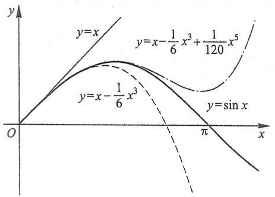

line

| Function | Equation |
| --- | --- |
| Linear function | y=x |
| Parabola function | y=sin x |
| Quadrilateral function | \(y=x - \frac{1}{6}x^{3} + \frac{1}{120}x^{5}\) |

图3-3

类似地,还可以得到

$$
\cos x = 1 - \frac {1}{2 !} x ^ {2} + \frac {1}{4 !} x ^ {4} - \dots + (- 1) ^ {m} \frac {1}{(2 m) !} x ^ {2 m} + R _ {2 m + 1} (x),
$$

其中 $R_{2m + 1}(x) = \frac{\cos[\theta x + (m + 1)\pi]}{(2m + 2)!} x^{2m + 2} = (-1)^{m + 1}\frac{\cos\theta x}{(2m + 2)!} x^{2m + 2}$ （ $0 <   \theta <  1$ ）；

$$
\ln (1 + x) = x - \frac {1}{2} x ^ {2} + \frac {1}{3} x ^ {3} - \dots + (- 1) ^ {n - 1} \frac {1}{n} x ^ {n} + R _ {n} (x),
$$

其中 $R_{n}(x) = \frac{(-1)^{n}}{(n + 1)(1 + \theta x)^{n + 1}} x^{n + 1}$ （$0 < \theta < 1$）；

$$
(1 + x) ^ {\alpha} = 1 + \alpha x + \frac {\alpha (\alpha - 1)}{2 !} x ^ {2} + \dots + \frac {\alpha (\alpha - 1) \cdot \cdots \cdot (\alpha - n + 1)}{n !} x ^ {n} + R _ {n} (x),
$$

其中 $R_{n}(x) = \frac{\alpha(\alpha - 1)\cdot\cdots\cdot(\alpha - n + 1)(\alpha - n)}{(n + 1)!} (1 + \theta x)^{\alpha - n - 1}x^{n + 1}$ （$0 < \theta < 1$）.

由以上带有拉格朗日余项的麦克劳林公式,易得相应的带有佩亚诺余项的麦克劳林公式,读者可自行写出.

例3 利用带有佩亚诺余项的麦克劳林公式, 求极限 $\lim_{x\to 0}\frac{\sin x - x\cos x}{\sin^3 x}$.

解 由于分式的分母 $\sin^3 x \sim x^3 (x \to 0)$, 我们只需将分子中的 $\sin x$ 和 $x \cos x$ 分别用带有佩亚诺余项的 3 阶麦克劳林公式表示, 即

$$
\sin x = x - \frac {x ^ {3}}{3 !} + o (x ^ {3}), \quad x \cos x = x - \frac {x ^ {3}}{2 !} + o (x ^ {3}).
$$

于是

$$
\sin x - x \cos x = x - \frac {x ^ {3}}{3 !} + o (x ^ {3}) - x + \frac {x ^ {3}}{2 !} - o (x ^ {3}) = \frac {1}{3} x ^ {3} + o (x ^ {3}),
$$

对上式作运算时,把两个比  $x^{3}$  高阶的无穷小的代数和仍记作  $o(x^{3})$ , 故

例题精讲

3-3

$$
\lim _ {x \to 0} \frac {\sin x - x \cos x}{\sin^ {3} x} = \lim _ {x \to 0} \frac {\frac {1}{3} x ^ {3} + o (x ^ {3})}{x ^ {3}} = \frac {1}{3}.
$$

## 习题 3-3

1. 按 $x - 4$ 的幂展开多项式 $f(x) = x^4 - 5x^3 + x^2 - 3x + 4$.
2. 应用麦克劳林公式, 按 x 的幂展开函数  $f(x)=(x^{2}-3x+1)^{3}$ .
3. 求函数  $f(x)=\sqrt{x}$  按 x-4 的幂展开的带有拉格朗日余项的 3 阶泰勒公式.
4. 求函数  $f(x)=\ln x$  按 x-2 的幂展开的带有佩亚诺余项的 n 阶泰勒公式.
5. 求函数 $f(x) = \frac{1}{x}$ 按 $x + 1$ 的幂展开的带有拉格朗日余项的 $n$ 阶泰勒公式.
6. 求函数  $f(x)=\tan x$  的带有佩亚诺余项的 3 阶麦克劳林公式.
7. 求函数  $f(x)=xe^{x}$  的带有佩亚诺余项的 n 阶麦克劳林公式.
9. 应用 3 阶泰勒公式求下列各数的近似值, 并估计误差:

8. 验证当 $0 < x \leqslant \frac{1}{2}$ 时，按公式 $\mathrm{e}^x \approx 1 + x + \frac{x^2}{2} + \frac{x^3}{6}$ 计算 $\mathrm{e}^x$ 的近似值时，所产生的误差小于0.01，并求 $\sqrt{\mathrm{e}}$ 的近似值，使误差小于0.01.

(1)  $\sqrt[3]{30}$ ;

(2) $\sin 18^{\circ}$.

\* 10. 利用泰勒公式求下列极限:

(1) $\lim_{x\to +\infty}(\sqrt[3]{x^3 + 3x^2} -\sqrt[4]{x^4 - 2x^3})$

(2) $\lim_{x\to 0}\frac{\cos x - e^{-\frac{x^2}{2}}}{x^2[x + \ln(1 - x)]};$

(3) $\lim_{x\to 0}\frac{1 + \frac{1}{2}x^2 - \sqrt{1 + x^2}}{(\cos x - e^{x^2})\sin x^2};$

(4) $\lim_{x\to \infty}\left[x - x^2\ln \left(1 + \frac{1}{x}\right)\right].$

11. 若函数 $f(x)$ 在 $(- \infty, +\infty)$ 内具有二阶导数，且 $f''(x) > 0$，又 $\lim_{x \to 0} \frac{f(x)}{x} = 1$，证明:$f(x) \geqslant x, x \in (-\infty, +\infty)$.

## 第四节 函数的单调性与曲线的凹凸性

## 一、函数单调性的判定法

第一章第一节中已经介绍了函数在区间上单调的概念.下面利用导数来对函数的

单调性进行研究.

如果函数 $y = f(x)$ 在 $[a, b]$ 上单调增加（单调减少），那么它的图形是一条沿 $x$ 轴正向上升（下降）的曲线。这时，如图3-4，曲线上各点处的切线斜率是非负的（是非正的），即 $y' = f'(x) \geqslant 0$ ($y' = f'(x) \leqslant 0$)。由此可见，函数的单调性与导数的符号有着密切的联系。

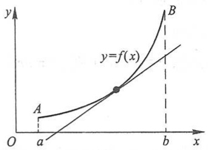

line

| Point | X | Y |
| --- | --- | --- |
| A | a | ~0.2 |
| Intersection (y=f(x), x) | b | ~0.5 |
| B | b | >0.8 |

(a) 函数图形上升时切线斜率非负

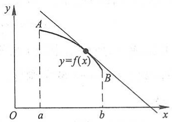

line

| Point | x | y |
| --- | --- | --- |
| A | a | ~0.8 |
| B | b | ~0.3 |

(b) 函数图形下降时切线斜率非正

图3-4

反过来,能否用导数的符号来判定函数的单调性呢?

下面我们利用拉格朗日中值定理来进行讨论.

设函数 $y = f(x)$ 在 $[a, b]$ 上连续，在 $(a, b)$ 内可导，在 $[a, b]$ 上任取两点 $x_1, x_2 (x_1 < x_2)$，应用拉格朗日中值定理，得到

$$
f (x _ {2}) - f (x _ {1}) = f ^ {\prime} (\xi) (x _ {2} - x _ {1}) \quad (x _ {1} <   \xi <   x _ {2}).
$$

由于在上式中， $x_{2} - x_{1} > 0$ ，因此，如果在 $(a,b)$ 内导数 $f^{\prime}(x)$ 保持正号，即 $f^{\prime}(x) > 0$ 那么也有 $f^{\prime}(\xi) > 0.$ 于是

$$
f (x _ {2}) - f (x _ {1}) = f ^ {\prime} (\xi) (x _ {2} - x _ {1}) > 0,
$$

即

$$
f (x _ {1}) <   f (x _ {2}),
$$

表明函数 $y = f(x)$ 在 $[a, b]$ 上单调增加. 同理, 如果在 $(a, b)$ 内导数 $f'(x)$ 保持负号, 即 $f'(x) < 0$, 那么 $f'(\xi) < 0$, 于是 $f(x_2) - f(x_1) < 0$, 即 $f(x_1) > f(x_2)$, 表明函数 $y = f(x)$ 在 $[a, b]$ 上单调减少.

此外,如果 $f'(x)$ 在 $(a,b)$ 内的某点x=c处等于零,而在其余各点处均为正(负),那么 $f(x)$ 在区间 $[a,c]$ 和区间 $[c,b]$ 上都是单调增加(减少)的,因此在区间 $[a,b]$ 上仍是单调增加(减少)的.显然,如果 $f'(x)$ 在 $(a,b)$ 内等于零的点为有限多个,只要它在其余各点处保持定号,那么 $f(x)$ 在 $[a,b]$ 上仍是单调的.

归纳以上讨论,即得

定理1 设函数 $y = f(x)$ 在 $[a, b]$ 上连续，在 $(a, b)$ 内可导.

（1）如果在 $(a,b)$ 内 $f^{\prime}(x)\geqslant 0$ ，且等号仅在有限多个点处成立，那么函数 $y = f(x)$ 在 $[a,b]$ 上单调增加；

（2）如果在 $(a,b)$ 内 $f^{\prime}(x)\leqslant 0$ ，且等号仅在有限多个点处成立，那么函数 $y = f(x)$ 在 $[a,b]$ 上单调减少.

如果把这个判定法中的闭区间换成其他各种区间(对于无穷区间,要求在其任一有限的子区间上满足定理的条件),那么结论也成立,参阅本节习题8.

例1 判定函数 $y = x - \sin x$ 在 $[- \pi, \pi]$ 上的单调性.

解 因为所给函数在 $[- \pi, \pi]$ 上连续，在 $(- \pi, \pi)$ 内

$$
y ^ {\prime} = 1 - \cos x \geqslant 0,
$$

且等号仅在 $x = 0$ 处成立，所以由定理1可知，函数 $y = x - \sin x$ 在 $[- \pi, \pi]$ 上单调增加.

例 2 讨论函数  $y=e^{x}-x-1$  的单调性.

解  $y' = e^{x} - 1.$

函数 $y = \mathrm{e}^{x} - x - 1$ 的定义域为 $(- \infty, +\infty)$. 因为在 $(- \infty, 0)$ 内 $y' < 0$, 所以函数 $y = \mathrm{e}^{x} - x - 1$ 在 $(- \infty, 0]$ 上单调减少; 因为在 $(0, +\infty)$ 内 $y' > 0$, 所以函数 $y = \mathrm{e}^{x} - x - 1$ 在 $[0, +\infty)$ 上单调增加.

例3 讨论函数 $y = \sqrt[3]{x^2}$ 的单调性.

解 这函数的定义域为 $(-∞,+∞)$ .

当 $x \neq 0$ 时, 这函数的导数为

$$
y ^ {\prime} = \frac {2}{3 \sqrt [ 3 ]{x}},
$$

当 $x = 0$ 时，函数的导数不存在.在 $(-\infty ,0)$ 内， $y^{\prime} <   0$ ，因此函数 $y = \sqrt[3]{x^2}$ 在 $(-\infty ,0]$ 上单

调减少；在 $(0, +\infty)$ 内，$y' > 0$，因此函数 $y = \sqrt[3]{x^2}$ 在 $[0, +\infty)$ 上单调增加。函数的图形如图3-5所示。

我们注意到,在例2中,x=0是函数 $y=e^{x}-x-1$ 的单调减少区间 $(-∞,0]$ 与单调增加区间 $[0,+∞)$ 的分界点,而在该点处 $y'=0$.在例3中,x=0是函数 $y=\sqrt[3]{x^{2}}$ 的单调减少区间 $(-∞,0]$ 与单调增加区间 $[0,+∞)$ 的分界点,而在该点处导数不存在.

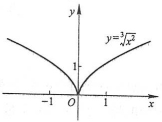

contour

| X | Y |
| --- | --- |
| -1 | ~0.67 |
| 0 | 0 |
| 1 | ~0.67 |

图3-5

从例 2 中看出,有些函数在它的定义区间上不是单调的,但是当我们用函数的驻点来划分函数的定义区间以后,就可以使函数在各个部分区间上单调.从例 3 中可看出,如果函数在某些点处不可导,则划分函数的定义区间的分点,还应包括这些导数不存在的点.一般地,我们有如下结论:

如果函数 $y = f(x)$ 在定义区间上连续，除去有限个导数不存在的点外导数存在且在区间内只有有限个驻点，那么只要用函数的驻点及导数不存在的点来划分函数 $y = f(x)$ 的定义区间，就能保证 $f'(x)$ 在各个部分区间内保持固定符号，因而函数 $y = f(x)$

在每个部分区间上单调.

例 4 确定函数  $f(x)=2x^{3}-9x^{2}+12x-3$  的单调区间.

解 这函数的定义域为 $(-\infty, +\infty)$. 求这函数的导数

$$
f ^ {\prime} (x) = 6 x ^ {2} - 1 8 x + 1 2 = 6 (x - 1) (x - 2).
$$

解方程 $f'(x)=0$ , 即解

$$
6 (x - 1) (x - 2) = 0,
$$

得出它在函数定义域 $(- \infty, +\infty)$ 内的两个根 $x_{1} = 1, x_{2} = 2$. 这两个根把 $(- \infty, +\infty)$ 分成三个部分区间 $(- \infty, 1], [1, 2]$ 及 $[2, +\infty)$.

在区间 $(-∞,1)$ 内,x-1<0且x-2<0,所以 $f'(x)>0$ .因此,函数 $f(x)$ 在 $(-∞,1]$ 上单调增加.在区间(1,2)内,x-1>0但x-2<0,所以 $f'(x)<0$ .因此,函数 $f(x)$ 在[1,2]上单调减少.在区间 $(2,+∞)$ 内,x-1>0且x-2>0,所以 $f'(x)>0$ .因此,函数 $f(x)$ 在 $[2,+∞)$ 上单调增加.

函数  $y=f(x)$  的图形如图 3-6 所示.

下面我们举一个利用函数的单调性证明不等式的例子.

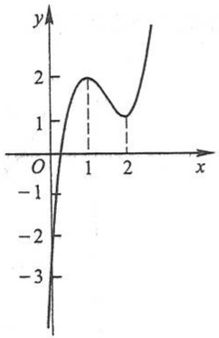

line

| X | Y |
| --- | --- |
| 1 | 2 |
| 2 | 1 |

图3-6

例 5 证明: 当 x > 1 时,  $2\sqrt{x} > 3 - \frac{1}{x}$ .

证 令 $f(x) = 2\sqrt{x} - \left(3 - \frac{1}{x}\right)$, 则

$$
f ^ {\prime} (x) = \frac {1}{\sqrt {x}} - \frac {1}{x ^ {2}} = \frac {1}{x ^ {2}} (x \sqrt {x} - 1).
$$

$f(x)$ 在 $[1, +\infty)$ 上连续，在 $(1, +\infty)$ 内 $f'(x) > 0$ ，因此在 $[1, +\infty)$ 上 $f(x)$ 单调增加，从而当 $x > 1$ 时，$f(x) > f(1)$.

由于 $f(1) = 0$ ，故 $f(x) > f(1) = 0$ ，即

$$
2 \sqrt {x} - \left(3 - \frac {1}{x}\right) > 0,
$$

亦即

$$
2 \sqrt {x} > 3 - \frac {1}{x} (x > 1).
$$

## 二、曲线的凹凸性与拐点

在第一目中,我们研究了函数单调性的判定法.函数的单调性反映在图形上,就是曲线的上升或下降.但是,曲线在上升或下降的过程中,还有一个弯曲方向的问题.例如,图3-7中有两条曲线弧,虽然它们都是上升的,但图形却有显著的不同, $\widehat{ACB}$ 是向上

例题精讲

3-4

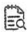

释疑解难

3-3