特征方程的根 $r_1 = -n + \sqrt{n^2 - k^2}, r_2 = -n - \sqrt{n^2 - k^2}$ 是两个不相等的负实根，所以方程(7-7)的通解为

$$
x = C _ {1} \mathrm{e} ^ {- (n - \sqrt {n ^ {2} - k ^ {2}}) t} + C _ {2} \mathrm{e} ^ {- (n + \sqrt {n ^ {2} - k ^ {2}}) t}, \tag {7-11}
$$

其中任意常数  $C_{1}, C_{2}$  可以由初值条件来确定.

从(7-11)式看出,使x=0的t值最多只有一个,即物体最多越过平衡位置一次,因此物体已不再有振动现象.又当 $t\to+\infty$ 时, $x\to0$ .因此,物体随时间t的增大而趋于平衡位置.

函数(7-11)的图形如图7-12所示(图中假定 $x_{0}>0,v_{0}>0$ ).

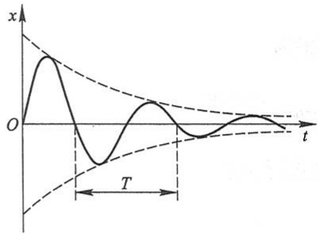

text_image

x
O
T
t

图7-11

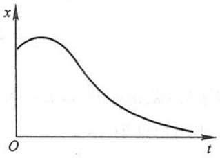

line

| Time (t) | Value (x) |
| --- | --- |
| 0 | ~High |
| Peak | ~Highest |
| End | ~Low |

图7-12

(iii) 临界阻尼情形: n = k

特征方程的根  $r_{1}=r_{2}=-n$  是两个相等的实根, 所以方程(7-7)的通解为

$$
x = \mathrm{e} ^ {- n t} (  C _ {1} + C _ {2} t)  ,
$$

其中任意常数 $C_1$ 及 $C_2$ 可由初值条件来确定. 由上式可看出, 在临界阻尼情形使 $x = 0$ 的 $t$ 值也最多只有一个, 因此物体也不再有振动现象. 又由于

$$
\lim _ {t \to + \infty} t \mathrm{e} ^ {- n t} = \lim _ {t \to + \infty} \frac {t}{\mathrm{e} ^ {n t}} = \lim _ {t \to + \infty} \frac {1}{n \mathrm{e} ^ {n t}} = 0,
$$

从而可以看出, 当  $t \to +\infty$  时,  $x \to 0$ . 因此, 在临界阻尼情形, 物体也随时间 t 的增大而趋于平衡位置.

上面讨论二阶常系数齐次线性微分方程所用的方法以及方程的通解的形式,可推广到 n 阶常系数齐次线性微分方程上去,对此我们不再详细讨论,只简单地叙述于下:

n 阶常系数齐次线性微分方程的一般形式是

$$
y ^ {(n)} + p _ {1} y ^ {(n - 1)} + p _ {2} y ^ {(n - 2)} + \dots + p _ {n - 1} y ^ {\prime} + p _ {n} y = 0, \tag {7-12}
$$

其中  $p_{1}, p_{2}, \cdots, p_{n-1}, p_{n}$  都是常数.

有时我们用记号 D（叫做微分算子）表示对 x 求导的运算  $\frac{d}{dx}$ ，把  $\frac{dy}{dx}$  记作 Dy，把  $\frac{d^{n}y}{dx^{n}}$  记作  $D^{n}y$ ，并把方程(7-12)记作

$$
(\mathrm{D} ^ {n} + p _ {1} \mathrm{D} ^ {n - 1} + \dots + p _ {n - 1} \mathrm{D} + p _ {n}) y = 0. \tag {7-13}
$$

记

$$
L (\mathrm{D}) = \mathrm{D} ^ {n} + p _ {1} \mathrm{D} ^ {n - 1} + \dots + p _ {n - 1} \mathrm{D} + p _ {n},
$$

$L(\mathrm{D})$ 叫做微分算子 $\mathrm{D}$ 的 $n$ 次多项式.于是方程(7-13)可记作

$$
L (\mathrm{D}) y = 0.
$$

如同讨论二阶常系数齐次线性微分方程那样，令 $y = \mathrm{e}^{rx}$. 由于 $\mathrm{De}^{rx} = r\mathrm{e}^{rx}, \dots, \mathrm{D}^n\mathrm{e}^{rx} = r^n\mathrm{e}^{rx}$，故 $L(\mathrm{D})\mathrm{e}^{rx} = L(r)\mathrm{e}^{rx}$. 因此把 $y = \mathrm{e}^{rx}$ 代入方程(7-13)，得

$$
L (r) \mathrm{e} ^ {r x} = 0.
$$

由此可见,如果选取 r 是 n 次代数方程  $L(r)=0$  即

$$
r ^ {n} + p _ {1} r ^ {n - 1} + p _ {2} r ^ {n - 2} + \dots + p _ {n - 1} r + p _ {n} = 0 \tag {7-14}
$$

的根,那么作出的函数  $y=e^{rx}$  就是方程(7-13)的一个解.

方程(7-14)叫做方程(7-13)的特征方程.

根据特征方程的根,可以写出其对应的微分方程的解如下:

| 特征方程的根 | 微分方程通解中的对应项 |
| --- | --- |
| 单实根 r | 给出一项:$Ce^{rx}$ |
| 一对单复根 $r_{1,2} = \alpha \pm \beta i$ | 给出两项:$e^{\alpha x}(C_1 \cos \beta x + C_2 \sin \beta x)$ |
| k 重实根 r | 给出 k 项:$e^{rx}(C_1 + C_2 x + \cdots + C_k x^{k-1})$ |
| 一对 k 重复根 $r_{1,2} = \alpha \pm \beta i$ | 给出 2k 项:$e^{\alpha x}[(C_1 + C_2 x + \cdots + C_k x^{k-1}) \cos \beta x + (D_1 + D_2 x + \cdots + D_k x^{k-1}) \sin \beta x]$ |

从代数学知道, $n$ 次代数方程有 $n$ 个根(重根按重数计算),而特征方程的每一个根都对应着通解中的一项,且每项各含一个任意常数,这样就得到 $n$ 阶常系数齐次线性微分方程的通解

$$
y = C _ {1} y _ {1} + C _ {2} y _ {2} + \dots + C _ {n} y _ {n}.
$$

例 6 求方程  $y^{(4)}-2y'''+5y''=0$  的通解.

解 这里的特征方程为

$$
r ^ {4} - 2 r ^ {3} + 5 r ^ {2} = 0,
$$

即

$$
r ^ {2} (r ^ {2} - 2 r + 5) = 0.
$$

它的根是 $r_1 = r_2 = 0$ 和 $r_{3,4} = 1\pm 2\mathrm{i}$ .因此所给微分方程的通解为

$$
y = C _ {1} + C _ {2} x + \mathrm{e} ^ {x} (C _ {3} \cos 2 x + C _ {4} \sin 2 x).
$$

例7 求方程 $\frac{\mathrm{d}^4w}{\mathrm{d}x^4} +\beta^4 w = 0$ 的通解，其中 $\beta >0$

解 这里的特征方程为

$$
r ^ {4} + \beta^ {4} = 0.
$$

由于

$$
r ^ {4} + \beta^ {4} = r ^ {4} + 2 r ^ {2} \beta^ {2} + \beta^ {4} - 2 r ^ {2} \beta^ {2} = (r ^ {2} + \beta^ {2}) ^ {2} - 2 r ^ {2} \beta^ {2} = (r ^ {2} - \sqrt {2} \beta r + \beta^ {2}) (r ^ {2} + \sqrt {2} \beta r + \beta^ {2}),
$$

所以特征方程可以写为

$$
(r ^ {2} - \sqrt {2} \beta r + \beta^ {2}) (r ^ {2} + \sqrt {2} \beta r + \beta^ {2}) = 0.
$$

它的根为 $r_{1,2} = \frac{\beta}{\sqrt{2}} (1\pm \mathrm{i}),r_{3,4} = -\frac{\beta}{\sqrt{2}} (1\pm \mathrm{i})$ ，因此所给方程的通解为

$$
w = \mathrm{e} ^ {\frac {\beta}{\sqrt {2}} x} \left(C _ {1} \cos \frac {\beta}{\sqrt {2}} x + C _ {2} \sin \frac {\beta}{\sqrt {2}} x\right) + \mathrm{e} ^ {- \frac {\beta}{\sqrt {2}} x} \left(C _ {3} \cos \frac {\beta}{\sqrt {2}} x + C _ {4} \sin \frac {\beta}{\sqrt {2}} x\right).
$$

## 习题 7-7

1. 下题中给出了四个结论,从中选一个正确的结论:

在下列微分方程中, 以  $y = C_{1} e^{-x} + C_{2} \cos x + C_{3} \sin x$  ( $C_{1}, C_{2}, C_{3}$  为任意常数) 为通解的常系数齐次线性微分方程是().

(A)  $y''' + y'' - y' - y = 0$

(B) $y^{\prime \prime \prime} + y^{\prime \prime} + y^{\prime} + y = 0$

(C)  $y'''-y''-y'+y=0$

(D)  $y'''-y''-y'-y=0$

2. 求下列微分方程的通解:

(1)  $y'' + y' - 2y = 0;$

(2) $y''-4y'=0;$

(3)  $y''+y=0;$

(4) $y''+6y'+13y=0;$

(5) $4\frac{d^{2}x}{dt^{2}}-20\frac{dx}{dt}+25x=0;$

(6)  $y''-4y'+5y=0;$

(7)  $y^{(4)} - y = 0;$

(8) $y^{(4)}+2y''+y=0;$

(9)  $y^{(4)} - 2y''' + y'' = 0;$

(10) $y^{(4)} + 5y'' - 36y = 0.$

3. 求下列微分方程满足所给初值条件的特解:

(1)  $y''-4y'+3y=0, y \mid_{x=0}=6, y' \mid_{x=0}=10;$

(2) $4y''+4y'+y=0,y\mid_{x=0}=2,y'\mid_{x=0}=0;$

(3) $y''-3y'-4y=0,y\mid_{x=0}=0,y'\mid_{x=0}=-5;$

(4) $y'' + 4y' + 29y = 0, y \mid_{x=0} = 0, y' \mid_{x=0} = 15;$

(5)  $y''+25y=0, y \mid_{x=0}=2, y' \mid_{x=0}=5;$

(6) $y''-4y'+13y=0,y\mid_{x=0}=0,y'\mid_{x=0}=3.$

4. 一个单位质量的质点在数轴上运动, 开始时质点在原点 O 处且速度为  $v_{0}$ , 在运动过程中, 它

受到一个力的作用,这个力的大小与质点到原点的距离成正比(比例系数 $k_{1}>0$ )而方向与初速度一致.又介质的阻力与速度成正比(比例系数 $k_{2}>0$ ).求反映这质点的运动规律的函数.

5. 在图 7-13 所示的电路中先将开关 S 拨向 A, 达到稳定状态后再将开关 S 拨向 B, 求电压  $u_{C}(t)$  及电流  $i(t)$ . 已知 E = 20 V,  $C = 0.5 \times 10^{-6}$  F, L = 0.1 H, R = 2000 Ω.

6. 设圆柱形浮筒的底面直径为 0.5 m, 将它铅直放在水中,
当稍向下压后突然放开, 浮筒在水中上下振动的周期为 2 s, 求浮筒的质量.

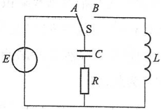

text_image

A B
S
C
R
E L

图 7-13

## 第八节 常系数非齐次线性微分方程

本节着重讨论二阶常系数非齐次线性微分方程的解法,并对 n 阶方程的解法作必要的说明.

二阶常系数非齐次线性微分方程的一般形式是

$$
y ^ {\prime \prime} + p y ^ {\prime} + q y = f (x), \tag {8-1}
$$

其中 p, q 是常数.

由第六节定理 3 可知, 求二阶常系数非齐次线性微分方程的通解, 归结为求对应的齐次方程

$$
y ^ {\prime \prime} + p y ^ {\prime} + q y = 0 \tag {8-2}
$$

的通解和非齐次方程(8-1)本身的一个特解.由于二阶常系数齐次线性微分方程的通解的求法已在第七节得到解决,所以这里只需讨论求二阶常系数非齐次线性微分方程的一个特解 $y^{*}$ 的方法.

本节只介绍当方程(8-1)中的 $f(x)$ 取两种常见形式时求 $y^{*}$ 的方法.这种方法的特点是不用积分就可求出 $y^{*}$ 来,它叫做待定系数法. $f(x)$ 的两种形式是

(1) $f(x)=\mathrm{e}^{\lambda x}P_{m}(x)$ ，其中 $\lambda$ 是常数， $P_{m}(x)$ 是x的一个m次多项式

$$
P _ {m} (x) = a _ {0} x ^ {m} + a _ {1} x ^ {m - 1} + \dots + a _ {m - 1} x + a _ {m};
$$

(2) $f(x)=\mathrm{e}^{\lambda x}\left[P_{l}(x)\cos\omega x+Q_{n}(x)\sin\omega x\right]$ ，其中 $\lambda,\omega$ 是常数， $\omega\neq0,P_{l}(x),Q_{n}(x)$ 分别是x的l次、n次多项式，且仅有一个可为零.

下面分别介绍 $f(x)$ 为上述两种形式时 $y^{*}$ 的求法.

## 一、 $f(x) = \mathrm{e}^{\lambda x}P_m(x)$ 型

我们知道,方程(8-1)的特解 $y^{*}$ 是使(8-1)成为恒等式的函数.怎样的函数能使(8-1) 成为恒等式呢？因为(8-1)式右端 $f(x)$ 是多项式 $P_{m}(x)$ 与指数函数 $\mathrm{e}^{\lambda x}$ 的乘积，而多项式与指数函数乘积的导数仍然是多项式与指数函数的乘积，因此，我们推测 $y^{*} = R(x)\mathrm{e}^{\lambda x}$ （其中 $R(x)$ 是某个多项式）可能是方程(8-1)的特解. 把 $y^{*}, y^{*'}$ 及 $y^{*''}$ 代入方程(8-1)，然后考虑能否选取适当的多项式 $R(x)$，使 $y^{*} = R(x)\mathrm{e}^{\lambda x}$ 满足方程(8-1). 为此，将

$$
\begin{array}{l} y ^ {*} = R (x) \mathrm{e} ^ {\lambda x}, \\ y ^ {* \prime} = \mathrm{e} ^ {\lambda x} [ \lambda R (x) + R ^ {\prime} (x) ], \\ y ^ {* \prime \prime} = \mathrm{e} ^ {\lambda x} \left[ \lambda^ {2} R (x) + 2 \lambda R ^ {\prime} (x) + R ^ {\prime \prime} (x) \right] \\ \end{array}
$$

代入方程(8-1)并消去 $e^{\lambda x}$ ，得

$$
R ^ {\prime \prime} (x) + (2 \lambda + p) R ^ {\prime} (x) + \left(\lambda^ {2} + p \lambda + q\right) R (x) = P _ {m} (x). \tag {8-3}
$$

(i) 如果 $\lambda$ 不是(8-2)式的特征方程 $r^2 + pr + q = 0$ 的根, 即 $\lambda^2 + p\lambda + q \neq 0$, 由于 $P_m(x)$ 是一个 $m$ 次多项式, 要使(8-3)的两端恒等, 那么可令 $R(x)$ 为另一个 $m$ 次多项式 $R_m(x)$:

$$
R _ {m} (x) = b _ {0} x ^ {m} + b _ {1} x ^ {m - 1} + \dots + b _ {m - 1} x + b _ {m},
$$

代入(8-3)式, 比较等式两端 x 同次幂的系数, 就得到以  $b_{0}, b_{1}, \cdots, b_{m}$  作为未知数的  $m+1$  个方程的联立方程组. 从而可以定出这些  $b_{i} (i=0,1,\cdots,m)$ , 并得到所求的特解  $y^{*}=R_{m}(x)\mathrm{e}^{\lambda x}$ .

(ii) 如果 $\lambda$ 是特征方程 $r^2 + pr + q = 0$ 的单根, 即 $\lambda^2 + p\lambda + q = 0$, 但 $2\lambda + p \neq 0$, 要使 (8-3) 的两端恒等, 那么 $R'(x)$ 必须是 $m$ 次多项式. 此时可令

$$
R (x) = x R _ {m} (x),
$$

并且可用同样的方法来确定  $R_{m}(x)$  的系数  $b_{i}$  ( $i=0,1,2,\cdots,m$ ).

（iii）如果 $\lambda$ 是特征方程 $r^2 + pr + q = 0$ 的重根，即 $\lambda^2 + p\lambda + q = 0$ ，且 $2\lambda + p = 0$ ，要使(8-3)的两端恒等，那么 $R''(x)$ 必须是 $m$ 次多项式.此时可令

$$
R (x) = x ^ {2} R _ {m} (x),
$$

并用同样的方法来确定  $R_{m}(x)$  中的系数.

综上所述,我们有如下结论:

如果 $f(x) = \mathrm{e}^{\lambda x}P_m(x)$，那么二阶常系数非齐次线性微分方程(8-1)具有形如

$$
y ^ {*} = x ^ {k} R _ {m} (x) \mathrm{e} ^ {\lambda x} \tag {8-4}
$$

的特解, 其中  $R_{m}(x)$  是与  $P_{m}(x)$  同次 (m 次) 的多项式, 而 k 按  $\lambda$  不是特征方程的根、是特征方程的单根或是特征方程的重根依次取为 0,1 或 2.

上述结论可推广到 n 阶常系数非齐次线性微分方程,但要注意(8-4)式中的 k 是特征方程含根  $\lambda$  的重复次数(即若  $\lambda$  不是特征方程的根,则 k 取为 0;若  $\lambda$  是特征方程的 s 重根,则 k 取为 s).

例1 求微分方程 $y'' - 2y' - 3y = 3x + 1$ 的一个特解.

解 这是二阶常系数非齐次线性微分方程,且函数 $f(x)$ 是 $\mathrm{e}^{\lambda x}P_{m}(x)$ 型(其中 $\lambda = 0, P_{m}(x) = 3x + 1$).

与所给方程对应的齐次方程为

$$
y ^ {\prime \prime} - 2 y ^ {\prime} - 3 y = 0,
$$

它的特征方程为

$$
r ^ {2} - 2 r - 3 = 0.
$$

由于这里  $\lambda=0$  不是特征方程的根, 所以应设特解为

$$
y ^ {*} = b _ {0} x + b _ {1}.
$$

把它代入所给方程,得

$$
- 3 b _ {0} x - 2 b _ {0} - 3 b _ {1} = 3 x + 1,
$$

比较等式两端 x 同次幂的系数, 得

$$
\left\{ \begin{array}{l} - 3 b _ {0} = 3, \\ - 2 b _ {0} - 3 b _ {1} = 1. \end{array} \right.
$$

由此求得 $b_{0} = -1, b_{1} = \frac{1}{3}$. 于是求得一个特解为

$$
y ^ {*} = - x + \frac {1}{3}.
$$

例 2 求微分方程  $y''-5y'+6y=xe^{2x}$  的通解.

解 所给方程也是二阶常系数非齐次线性微分方程, 且 $f(x)$ 呈 $\mathrm{e}^{\lambda x}P_{m}(x)$ 型 (其中 $\lambda = 2, P_{m}(x) = x$).

与所给方程对应的齐次方程为

$$
y ^ {\prime \prime} - 5 y ^ {\prime} + 6 y = 0,
$$

它的特征方程

$$
r ^ {2} - 5 r + 6 = 0
$$

有两个实根 $r_1 = 2, r_2 = 3$. 于是与所给方程对应的齐次方程的通解为

$$
Y = C _ {1} \mathrm{e} ^ {2 x} + C _ {2} \mathrm{e} ^ {3 x}.
$$

由于  $\lambda=2$  是特征方程的单根, 所以应设  $y^{*}$  为

$$
y ^ {*} = x (b _ {0} x + b _ {1}) \mathrm{e} ^ {2 x}.
$$

把它代入所给方程,得

$$
- 2 b _ {0} x + 2 b _ {0} - b _ {1} = x.
$$

比较等式两端 x 同次幂的系数, 得

$$
\left\{ \begin{array}{l} - 2 b _ {0} = 1, \\ 2 b _ {0} - b _ {1} = 0. \end{array} \right.
$$

解得 $b_{0} = -\frac{1}{2}, b_{1} = -1.$ 因此求得一个特解为

$$
y ^ {*} = x \left(- \frac {1}{2} x - 1\right) \mathrm{e} ^ {2 x}.
$$

从而所求的通解为

$$
y = C _ {1} \mathrm{e} ^ {2 x} + C _ {2} \mathrm{e} ^ {3 x} - \frac {1}{2} (x ^ {2} + 2 x) \mathrm{e} ^ {2 x}.
$$

## 二、 $f(x) = \mathrm{e}^{\lambda x}[P_l(x)\cos \omega x + Q_n(x)\sin \omega x]$ 型

应用欧拉公式

$$
\cos \theta = \frac {1}{2} (\mathrm{e} ^ {\mathrm{i} \theta} + \mathrm{e} ^ {- \mathrm{i} \theta}), \quad \sin \theta = \frac {1}{2 \mathrm{i}} (\mathrm{e} ^ {\mathrm{i} \theta} - \mathrm{e} ^ {- \mathrm{i} \theta}),
$$

把 $f(x)$ 表示成复变指数函数的形式,有

$$
\begin{array}{l} f (x) = \mathrm{e} ^ {\lambda x} \left(P _ {l} \cos \omega x + Q _ {n} \sin \omega x\right) = \mathrm{e} ^ {\lambda x} \left(P _ {l} \frac {\mathrm{e} ^ {\omega x \mathrm{i}} + \mathrm{e} ^ {- \omega x \mathrm{i}}}{2} + Q _ {n} \frac {\mathrm{e} ^ {\omega x \mathrm{i}} - \mathrm{e} ^ {- \omega x \mathrm{i}}}{2 \mathrm{i}}\right) \\ = \left(\frac {P _ {l}}{2} + \frac {Q _ {n}}{2 \mathrm{i}}\right) \mathrm{e} ^ {(\lambda + \omega \mathrm{i}) x} + \left(\frac {P _ {l}}{2} - \frac {Q _ {n}}{2 \mathrm{i}}\right) \mathrm{e} ^ {(\lambda - \omega \mathrm{i}) x} = P (x) \mathrm{e} ^ {(\lambda + \omega \mathrm{i}) x} + \overline {{P}} (x) \mathrm{e} ^ {(\lambda - \omega \mathrm{i}) x}, \\ \end{array}
$$

其中

$$
P (x) = \frac {P _ {l}}{2} + \frac {Q _ {n}}{2 \mathrm{i}} = \frac {P _ {l}}{2} - \frac {Q _ {n}}{2} \mathrm{i}, \quad \overline {{P}} (x) = \frac {P _ {l}}{2} - \frac {Q _ {n}}{2 \mathrm{i}} = \frac {P _ {l}}{2} + \frac {Q _ {n}}{2} \mathrm{i}
$$

是互成共轭的 $m$ 次多项式（即它们对应项的系数是共轭复数），而 $m = \max \{l, n\}$.

应用上一目的结果,对于 $f(x)$ 中的第一项 $P(x)\mathrm{e}^{(\lambda+\omega\mathrm{i})x}$ ，可求出一个m次多项式 $R_{m}(x)$ ，使得 $y_{1}^{*}=x^{k}R_{m}\mathrm{e}^{(\lambda+\omega\mathrm{i})x}$ 为方程

$$
y ^ {\prime \prime} + p y ^ {\prime} + q y = P (x) \mathrm{e} ^ {(\lambda + \omega \mathrm{i}) x}
$$

的特解, 其中 $k$ 按 $\lambda + \omega \mathrm{i}$ 不是特征方程的根或是特征方程的单根依次取 0 或 1. 由于 $f(x)$ 的第二项 $\overline{P}(x) \mathrm{e}^{(\lambda - \omega \mathrm{i}) x}$ 与第一项 $P(x) \mathrm{e}^{(\lambda + \omega \mathrm{i}) x}$ 成共轭, 所以与 $y_{1}^{*}$ 成共轭的函数 $y_{2}^{*} = x^{k} \overline{R}_{m} \mathrm{e}^{(\lambda - \omega \mathrm{i}) x}$ 必然是方程

$$
y ^ {\prime \prime} + p y ^ {\prime} + q y = \overline {{P}} (x) \mathrm{e} ^ {(\lambda - \omega \mathrm{i}) x}
$$

的特解,这里  $\overline{R}_{m}$  表示与  $R_{m}$  成共轭的 m 次多项式.于是,根据第六节定理 4,方程(8-1)具有形如

$$
y ^ {*} = x ^ {k} R _ {m} \mathrm{e} ^ {(\lambda + \omega \mathrm{i}) x} + x ^ {k} \overline {{R}} _ {m} \mathrm{e} ^ {(\lambda - \omega \mathrm{i}) x}
$$

的特解.上式可写为

$$
\begin{array}{l} y ^ {*} = x ^ {k} \mathrm{e} ^ {\lambda x} \left(R _ {m} \mathrm{e} ^ {\omega x \mathrm{i}} + \overline {{R}} _ {m} \mathrm{e} ^ {- \omega x \mathrm{i}}\right) \\ = x ^ {k} \mathrm{e} ^ {\lambda x} \left[ R _ {m} (\cos \omega x + \mathrm{i} \sin \omega x) + \overline {{R}} _ {m} (\cos \omega x - \mathrm{i} \sin \omega x) \right], \\ \end{array}
$$

由于括号内的两项是互成共轭的,相加后即无虚部,所以可以写成实函数的形式

$$
y ^ {*} = x ^ {k} \mathrm{e} ^ {\lambda x} \left[ R _ {m} ^ {(1)} (x) \cos \omega x + R _ {m} ^ {(2)} (x) \sin \omega x \right].
$$

综上所述,我们有如下结论:

如果 $f(x) = \mathrm{e}^{\lambda x}[P_l(x)\cos \omega x + Q_n(x)\sin \omega x]$，那么二阶常系数非齐次线性微分方程(8-1)的特解可设为

$$
y ^ {*} = x ^ {k} \mathrm{e} ^ {\lambda x} \left[ R _ {m} ^ {(1)} (x) \cos \omega x + R _ {m} ^ {(2)} (x) \sin \omega x \right], \tag {8-5}
$$

其中 $R_{m}^{(1)}(x), R_{m}^{(2)}(x)$ 是 $m$ 次多项式，$m = \max \{l, n\}$，而 $k$ 按 $\lambda + \omega \mathrm{i}$（或 $\lambda - \omega \mathrm{i}$）不是特征方程的根或是特征方程的单根依次取0或1.

上述结论可推广到 $n$ 阶常系数非齐次线性微分方程, 但要注意 (8-5) 式中的 $k$ 是特征方程中含根 $\lambda + \omega \mathrm{i}$ (或 $\lambda - \omega \mathrm{i}$) 的重复次数.

例3 求微分方程 $y'' + y = x \cos 2x$ 的一个特解.

解 所给方程是二阶常系数非齐次线性方程, 且 $f(x)$ 属于 $\mathrm{e}^{\lambda x}[P_l(x)\cos \omega x + Q_n(x)\sin \omega x]$ 型 (其中 $\lambda = 0, \omega = 2, P_l(x) = x, Q_n(x) = 0$).

与所给方程对应的齐次方程为

$$
y ^ {\prime \prime} + y = 0,
$$

它的特征方程为

$$
r ^ {2} + 1 = 0.
$$

由于这里  $\lambda + \omega i = 2i$  不是特征方程的根, 所以应设特解为

$$
y ^ {*} = (a x + b) \cos 2 x + (c x + d) \sin 2 x.
$$

把它代入所给方程,得

$$
(- 3 a x - 3 b + 4 c) \cos 2 x - (3 c x + 3 d + 4 a) \sin 2 x = x \cos 2 x.
$$

比较等式两端同类项的系数,得

$$
\left\{ \begin{array}{l} - 3 a = 1, \\ - 3 b + 4 c = 0, \\ - 3 c = 0, \\ - 3 d - 4 a = 0, \end{array} \right.
$$

由此解得

$$
a = - \frac {1}{3}, \quad b = 0, \quad c = 0, \quad d = \frac {4}{9}.
$$

于是求得一个特解为

$$
y ^ {*} = - \frac {1}{3} x \cos 2 x + \frac {4}{9} \sin 2 x.
$$

例 4 求微分方程  $y''-y=e^{x}\cos2x$  的一个特解.

解 这是二阶常系数非齐次线性方程, 且 $f(x)$ 属 $\mathrm{e}^{\lambda x}[P_l(x)\cos \omega x + Q_n(x)\sin \omega x]$ 型 (这里 $\lambda = 1, \omega = 2, P_l(x) = 1, Q_n(x) = 0$).

特征方程为  $r^{2}-1=0$ ，由于  $\lambda+\omega i=1+2i$  不是特征方程的根，所以应设特解为

$$
y ^ {*} = \mathrm{e} ^ {x} (a \cos 2 x + b \sin 2 x).
$$

求导得

$$
y ^ {* \prime} = \mathrm{e} ^ {x} \left[ (a + 2 b) \cos 2 x + (- 2 a + b) \sin 2 x \right],
$$

$$
y ^ {* \prime \prime} = \mathrm{e} ^ {x} \left[ (- 3 a + 4 b) \cos 2 x + (- 4 a - 3 b) \sin 2 x \right].
$$

代入所给方程,得

$$
4 \mathrm{e} ^ {x} [ (- a + b) \cos 2 x - (a + b) \sin 2 x ] = \mathrm{e} ^ {x} \cos 2 x,
$$

比较等式两端同类项的系数,有

$$
\left\{ \begin{array}{l} - a + b = \frac {1}{4}, \\ a + b = 0, \end{array} \right.
$$

解得 $a = -\frac{1}{8}, \quad b = \frac{1}{8}.$

因此所给方程的一个特解为

$$
y ^ {*} = \frac {1}{8} \mathrm{e} ^ {x} (\sin 2 x - \cos 2 x).
$$

例 5 在第六节例 1 中, 设物体受弹性恢复力 f 和铅直干扰力 F 的作用. 试求物体的运动规律.

解 这里需要求出无阻尼强迫振动方程

$$
\frac {\mathrm{d} ^ {2} x}{\mathrm{d} t ^ {2}} + k ^ {2} x = h \sin p t \tag {8-6}
$$

的通解.

对应的齐次微分方程(即无阻尼自由振动方程)为

$$
\frac {\mathrm{d} ^ {2} x}{\mathrm{d} t ^ {2}} + k ^ {2} x = 0, \tag {8-7}
$$

它的特征方程 $r^2 + k^2 = 0$ 的根为 $r = \pm ki$. 故方程(8-7)的通解为

$$
X = C _ {1} \cos k t + C _ {2} \sin k t.
$$

令 $C_1 = A\sin \varphi, C_2 = A\cos \varphi$，则方程(8-7)的通解又可写成

$$
X = A \sin (k t + \varphi),
$$

其中, $A,\varphi$ 为任意常数.

方程(8-6)右端的函数

$$
f (t) = h \sin p t
$$

与 $f(t) = \mathrm{e}^{\lambda t}[P_l(t)\cos \omega t + Q_n(t)\sin \omega t]$ 相比较，有 $\lambda = 0,\omega = p,P_{l}(t) = 0,Q_{n}(t) = h.$ 现在分别就 $p\neq k$ 和 $p = k$ 两种情形讨论如下:

(i) 如果 $p \neq k$，则 $\lambda \pm \omega \mathrm{i} = \pm p\mathrm{i}$ 不是特征方程的根，故设

$$
x ^ {*} = a _ {1} \cos p t + b _ {1} \sin p t.
$$

代入方程(8-6)求得

$$
a _ {1} = 0, \quad b _ {1} = \frac {h}{k ^ {2} - p ^ {2}},
$$

于是

$$
x ^ {*} = \frac {h}{k ^ {2} - p ^ {2}} \sin p t.
$$

从而当 $p \neq k$ 时, 方程(8-6)的通解为

$$
x = X + x ^ {*} = A \sin (k t + \varphi) + \frac {h}{k ^ {2} - p ^ {2}} \sin p t.
$$

上式表示,物体的运动由两部分组成,这两部分都是简谐振动.上式第一项表示自由振动,第二项所表示的振动叫做强迫振动.强迫振动是干扰力引起的,它的角频率即是干扰力的角频率p;当干扰力的角频率p与振动系统的固有频率k相差很小时,它的振幅 $\left|\frac{h}{k^{2}-p^{2}}\right|$ 可以很大.

(ii) 如果 $p = k$ 那么 $\lambda \pm \omega \mathrm{i} = \pm p\mathrm{i}$ 是特征方程的根. 故设

$$
x ^ {*} = t (a _ {1} \cos k t + b _ {1} \sin k t).
$$

代入方程(8-6)求得

$$
a _ {1} = - \frac {h}{2 k}, \quad b _ {1} = 0.
$$

于是

$$
x ^ {*} = - \frac {h}{2 k} t \cos k t.
$$

从而当 p=k 时, 方程(8-6)的通解为

$$
x = X + x ^ {*} = A \sin (k t + \varphi) - \frac {h}{2 k} t \cos k t.
$$

上式右端第二项表明,强迫振动的振幅 $\frac{h}{2k}t$ 随时间t的增大而无限增大.这就发生所谓共振现象.为了避免共振现象,应使干扰力的角频率p不要靠近振动系统的固有频率k.反之,如果要利用共振现象,那么应使p=k或使p与k尽量靠近.

有阻尼的强迫振动问题可作类似的讨论,这里从略了.

## 习题7-8

1. 求下列各微分方程的通解:

(1) $2y''+y'-y=2e^{x}$;

(2) $y''+a^{2}y=e^{x}$;

(3) $2y''+5y'=5x^{2}-2x-1;$

(4)  $y''+3y'+2y=3xe^{-x}$ ;

(5) $y''-2y'+5y=e^{x}\sin 2x;$

(6) $y''-6y'+9y=(x+1)e^{3x}$;

(7)  $y''+5y'+4y=3-2x;$

(8) $y''+4y=x\cos x;$

(9)  $y'' + y = e^{x} + \cos x;$

(10)  $y''-y=\sin^{2}x.$

2. 求下列各微分方程满足已给初值条件的特解:

(1) $y'' + y + \sin 2x = 0, y \mid_{x=\pi} = 1, y' \mid_{x=\pi} = 1;$
(2) $y''-3y'+2y=5,y\mid_{x=0}=1,y'\mid_{x=0}=2;$
(3) $y''-10y'+9y=e^{2x},y\mid_{x=0}=\frac{6}{7},y'\mid_{x=0}=\frac{33}{7};$
(4)  $y''-y=4xe^{x}, y \mid_{x=0}=0, y' \mid_{x=0}=1;$
(5) $y''-4y'=5,y\mid_{x=0}=1,y'\mid_{x=0}=0.$

3. 已知二阶常系数齐次线性微分方程 $y'' + my' + ny = 0$ 的通解为 $y = (C_1 + C_2x)e^x$，求 $m, n$ 的值，并求非齐次方程 $y'' + my' + ny = x$ 满足初值条件 $y(0) = 2, y'(0) = 0$ 的特解.

4. 大炮以仰角  $\alpha$ 、初速度  $v_{0}$  发射炮弹，若不计空气阻力，求弹道曲线.

5. 在 RLC 含源串联电路中, 电动势为 E 的电源对电容器 C 充电. 已知  $E = 20 \, V, C = 0.2 \, \mu F, L = 0.1 \, H, R = 1000 \, \Omega$ , 试求合上开关 S 后的电流  $i(t)$  及电压  $u_{c}(t)$ .

6. 设函数  $\varphi(x)$  连续, 且满足

$$
\varphi (x) = \mathrm{e} ^ {x} + \int_ {0} ^ {x} t \varphi (t) \mathrm{d} t - x \int_ {0} ^ {x} \varphi (t) \mathrm{d} t,
$$

求 $\varphi (x)$

## \* 第九节 欧拉方程

变系数的线性微分方程,一般说来都是不容易求解的.但是有些特殊的变系数线性微分方程,则可以通过变量代换化为常系数线性微分方程,因而容易求解,欧拉方程就是其中的一种.

形如

$$
x ^ {n} y ^ {(n)} + p _ {1} x ^ {n - 1} y ^ {(n - 1)} + \dots + p _ {n - 1} x y ^ {\prime} + p _ {n} y = f (x) \tag {9-1}
$$

的方程(其中 $p_{1},p_{2},\cdots,p_{n}$ 为常数)，叫做欧拉方程.

作变换  $x=e^{t}$  或  $t=\ln x$ ，将自变量 x 换成  $t^{①}$ ，我们有

$$
\begin{array}{l} \frac {\mathrm{d} y}{\mathrm{d} x} = \frac {\mathrm{d} y}{\mathrm{d} t} \cdot \frac {\mathrm{d} t}{\mathrm{d} x} = \frac {1}{x} \frac {\mathrm{d} y}{\mathrm{d} t}, \\ \frac {\mathrm{d} ^ {2} y}{\mathrm{d} x ^ {2}} = \frac {1}{x ^ {2}} \left(\frac {\mathrm{d} ^ {2} y}{\mathrm{d} t ^ {2}} - \frac {\mathrm{d} y}{\mathrm{d} t}\right), \\ \frac {\mathrm{d} ^ {3} y}{\mathrm{d} x ^ {3}} = \frac {1}{x ^ {3}} \left(\frac {\mathrm{d} ^ {3} y}{\mathrm{d} t ^ {3}} - 3 \frac {\mathrm{d} ^ {2} y}{\mathrm{d} t ^ {2}} + 2 \frac {\mathrm{d} y}{\mathrm{d} t}\right). \\ \end{array}
$$

如果采用记号 D 表示对 t 求导的运算  $\frac{d}{dt}$ ，那么上述计算结果可以写成

$$
\begin{array}{l} x y ^ {\prime} = \mathrm{D} y, \\ x ^ {2} y ^ {\prime \prime} = \frac {\mathrm{d} ^ {2} y}{\mathrm{d} t ^ {2}} - \frac {\mathrm{d} y}{\mathrm{d} t} = \left(\frac {\mathrm{d} ^ {2}}{\mathrm{d} t ^ {2}} - \frac {\mathrm{d}}{\mathrm{d} t}\right) y = (\mathrm{D} ^ {2} - \mathrm{D}) y = \mathrm{D} (\mathrm{D} - 1) y, \\ x ^ {3} y ^ {\prime \prime \prime} = \frac {\mathrm{d} ^ {3} y}{\mathrm{d} t ^ {3}} - 3 \frac {\mathrm{d} ^ {2} y}{\mathrm{d} t ^ {2}} + 2 \frac {\mathrm{d} y}{\mathrm{d} t} = (\mathrm{D} ^ {3} - 3 \mathrm{D} ^ {2} + 2 \mathrm{D}) y = \mathrm{D} (\mathrm{D} - 1) (\mathrm{D} - 2) y, \\ \end{array}
$$

一般地,有

$$
x ^ {k} y ^ {(k)} = \mathrm{D(D-1)} \dots (\mathrm{D-k+1}) y.
$$

把它代入欧拉方程(9-1)，便得一个以 $t$ 为自变量的常系数线性微分方程.在求出这个方程的解后，把 $t$ 换成 $\ln x$ ，即得原方程的解

例 求欧拉方程  $x^{3}y''' + x^{2}y'' - 4xy' = 3x^{2}$  的通解.

解 作变换 $x = \mathrm{e}^t$ 或 $t = \ln x$ ，原方程化为

$$
\mathrm{D} (\mathrm{D} - 1) (\mathrm{D} - 2) y + \mathrm{D} (\mathrm{D} - 1) y - 4 \mathrm{D} y = 3 \mathrm{e} ^ {2 t},
$$

即

$$
\mathrm{D} ^ {3} y - 2 \mathrm{D} ^ {2} y - 3 \mathrm{D} y = 3 \mathrm{e} ^ {2 t},
$$

或

$$
\frac {\mathrm{d} ^ {3} y}{\mathrm{d} t ^ {3}} - 2 \frac {\mathrm{d} ^ {2} y}{\mathrm{d} t ^ {2}} - 3 \frac {\mathrm{d} y}{\mathrm{d} t} = 3 \mathrm{e} ^ {2 t}. \tag {9-2}
$$

方程(9-2)所对应的齐次方程为

$$
\frac {\mathrm{d} ^ {3} y}{\mathrm{d} t ^ {3}} - 2 \frac {\mathrm{d} ^ {2} y}{\mathrm{d} t ^ {2}} - 3 \frac {\mathrm{d} y}{\mathrm{d} t} = 0, \tag {9-3}
$$

其特征方程为

$$
r ^ {3} - 2 r ^ {2} - 3 r = 0,
$$

它有三个根: $r_1 = 0, r_2 = -1, r_3 = 3.$ 于是方程(9-3)的通解为

<small>① 这里仅在 $x > 0$ 范围内求解. 如果要在 $x < 0$ 的范围内求解, 那么可作变换 $x = -\mathrm{e}^{t}$ 或 $t = \ln(-x)$, 所得结果与 $x > 0$ 的结果相类似.</small>

$$
Y = C _ {1} + C _ {2} \mathrm{e} ^ {- t} + C _ {3} \mathrm{e} ^ {3 t} = C _ {1} + \frac {C _ {2}}{x} + C _ {3} x ^ {3}.
$$

根据上节第一目,特解的形式为

$$
y ^ {*} = b \mathrm{e} ^ {2 t} = b x ^ {2},
$$

代入原方程,求得  $b=-\frac{1}{2}$ , 即

$$
y ^ {*} = - \frac {x ^ {2}}{2}.
$$

于是,所给欧拉方程的通解为①

$$
y = C _ {1} + \frac {C _ {2}}{x} + C _ {3} x ^ {3} - \frac {1}{2} x ^ {2}.
$$

## \*习题7-9

求下列欧拉方程的通解:

1.  $x^{2}y''+xy'-y=0.$

2. $y'' - \frac{y'}{x} + \frac{y}{x^2} = \frac{2}{x}.$

3.  $x^{3}y'''+3x^{2}y''-2xy'+2y=0.$

4.  $x^{2}y''-2xy'+2y=\ln^{2}x-2\ln x.$

5.  $x^{2}y''+xy'-4y=x^{3}$

6. $x^{2}y^{\prime \prime} - xy^{\prime} + 4y = x\sin (\ln x)$

7.  $x^{2}y''-3xy'+4y=x+x^{2}\ln x.$

8. $x^{3}y^{\prime \prime \prime} + 2xy^{\prime} - 2y = x^{2}\ln x + 3x.$

## \* 第十节 常系数线性微分方程组解法举例

前面讨论的是由一个微分方程求解一个未知函数的情形,但在研究某些实际问题时,还会遇到由几个微分方程联立起来共同确定几个具有同一自变量的函数的情形.这些联立的微分方程称为微分方程组.

如果微分方程组中的每一个微分方程都是常系数线性微分方程,那么,这种微分方程组就叫做常系数线性微分方程组.

对于常系数线性微分方程组,我们可以用下述方法求它的解:

第一步 从方程组中消去一些未知函数及其各阶导数,得到只含有一个未知函数的高阶常系数线性微分方程.

第二步 解此高阶微分方程,求出满足该方程的未知函数.

<small>① 这是在 $x > 0$ 范围内所求得的通解.容易验证,在 $x <   0$ 范围内，它也是所给方程的通解</small>

第三步 把已求得的函数代入原方程组,一般说来,不必经过积分就可求出其余的未知函数.

例1 解微分方程组

$$
\left\{ \begin{array}{l} \frac {\mathrm{d} y}{\mathrm{d} x} = 3 y - 2 z, \\ \frac {\mathrm{d} z}{\mathrm{d} x} = 2 y - z. \end{array} \right. \tag {10-2}
$$

解 这是含有两个未知函数 $y(x), z(x)$ 的由两个一阶常系数线性方程组成的方程组.

设法消去未知函数 $y$. 由(10-2)式得

$$
y = \frac {1}{2} \left(\frac {\mathrm{d} z}{\mathrm{d} x} + z\right). \tag {10-3}
$$

对上式两端求导,有

$$
\frac {\mathrm{d} y}{\mathrm{d} x} = \frac {1}{2} \left(\frac {\mathrm{d} ^ {2} z}{\mathrm{d} x ^ {2}} + \frac {\mathrm{d} z}{\mathrm{d} x}\right). \tag {10-4}
$$

把(10-3)、(10-4)两式代入(10-1)式并化简,得

$$
\frac {\mathrm{d} ^ {2} z}{\mathrm{d} x ^ {2}} - 2 \frac {\mathrm{d} z}{\mathrm{d} x} + z = 0.
$$

这是一个二阶常系数线性微分方程,它的通解是

$$
z = (C _ {1} + C _ {2} x) \mathrm{e} ^ {x}. \tag {10-5}
$$

再把(10-5)式代入(10-3)式,得

$$
y = \frac {1}{2} (2 C _ {1} + C _ {2} + 2 C _ {2} x) \mathrm{e} ^ {x}. \tag {10-6}
$$

将(10-5)、(10-6)联立起来,就得到所给方程组的通解.

如果我们要得到方程组满足初值条件

$$
y \mid_ {x = 0} = 1, \quad z \mid_ {x = 0} = 0
$$

的特解,只需将此条件代入(10-6)和(10-5)式,得

$$
\left\{ \begin{array}{l} 1 = \frac {1}{2} (2 C _ {1} + C _ {2}), \\ 0 = C _ {1}. \end{array} \right.
$$

由此求得

$$
C _ {1} = 0, \quad C _ {2} = 2.
$$

于是所给微分方程组满足上述初值条件的特解为

$$
\left\{ \begin{array}{l} y = (1 + 2 x) \mathrm{e} ^ {x}, \\ z = 2 x \mathrm{e} ^ {x}. \end{array} \right.
$$

在讨论常系数线性微分方程(或方程组)时,常采用第七节中引入的记号D表示对自变量x求导的运算 $\frac{d}{dx}$ .

例 2 解微分方程组

$$
\left\{ \begin{array}{l} \frac {\mathrm{d} ^ {2} x}{\mathrm{d} t ^ {2}} + \frac {\mathrm{d} y}{\mathrm{d} t} - x = \mathrm{e} ^ {t}, \\ \frac {\mathrm{d} ^ {2} y}{\mathrm{d} t ^ {2}} + \frac {\mathrm{d} x}{\mathrm{d} t} + y = 0. \end{array} \right.
$$

解 用记号 D 表示 $\frac{\mathrm{d}}{\mathrm{d}t}$, 则方程组可记作

$$
\left\{ \begin{array}{l l} (\mathrm{D} ^ {2} - 1) x + \mathrm{D} y = \mathrm{e} ^ {t}, & (1 0 - 7) \\ \mathrm{D} x + (\mathrm{D} ^ {2} + 1) y = 0. & (1 0 - 8) \end{array} \right.
$$

我们可以类似于解代数方程组那样消去一个未知数,例如为消去 x, 可作如下运算:

$$
(1 0 - 7) - \mathrm{D} (1 0 - 8): - x - \mathrm{D} ^ {3} y = \mathrm{e} ^ {t}, \tag {10-9}
$$

$$
(1 0 - 8) + \mathrm{D} (1 0 - 9): (- \mathrm{D} ^ {4} + \mathrm{D} ^ {2} + 1) y = \mathrm{De} ^ {t},
$$

即

$$
(- \mathrm{D} ^ {4} + \mathrm{D} ^ {2} + 1) y = \mathrm{e} ^ {t}. \tag {10-10}
$$

(10-10)式为四阶非齐次线性方程,其特征方程为

$$
- r ^ {4} + r ^ {2} + 1 = 0,
$$

解得特征根为

$$
r _ {1, 2} = \pm \alpha = \pm \sqrt {\frac {1 + \sqrt {5}}{2}}, \quad r _ {3, 4} = \pm \beta \mathrm{i} = \pm \mathrm{i} \sqrt {\frac {\sqrt {5} - 1}{2}},
$$

容易求得一个特解 $y^{*} = \mathrm{e}^{t}$，于是得(10-10)的通解为

$$
y = C _ {1} \mathrm{e} ^ {- \alpha t} + C _ {2} \mathrm{e} ^ {\alpha t} + C _ {3} \cos \beta t + C _ {4} \sin \beta t + \mathrm{e} ^ {t}. \tag {10-11}
$$

再求 $x$. 由(10-9)式, 即有

$$
x = - \mathrm{D} ^ {3} y - \mathrm{e} ^ {t},
$$

以(10-11)式代入上式,即得

$$
x = \alpha^ {3} C _ {1} \mathrm{e} ^ {- \alpha t} - \alpha^ {3} C _ {2} \mathrm{e} ^ {\alpha t} - \beta^ {3} C _ {3} \sin \beta t + \beta^ {3} C _ {4} \cos \beta t - 2 \mathrm{e} ^ {t}. \tag {10-12}
$$

将(10-11)和(10-12)两个函数联立,就是所求方程组的通解.

这里要注意,在求得一个未知函数以后,再求另一个未知函数时,一般不再积分(积分就会出现新的任意常数,从(10-11)、(10-12)两式可知两式中的任意常数之间有着确定的关系).

我们也可用行列式解上述方程组.由(10-7)和(10-8),有

$$
\left| \begin{array}{c c} \mathrm{D} ^ {2} - 1 & \mathrm{D} \\ \mathrm{D} & \mathrm{D} ^ {2} + 1 \end{array} \right| y = \left| \begin{array}{c c} \mathrm{D} ^ {2} - 1 & \mathrm{e} ^ {t} \\ \mathrm{D} & 0 \end{array} \right|,
$$

即

$$
(\mathrm{D} ^ {4} - \mathrm{D} ^ {2} - 1) y = - \mathrm{e} ^ {t}.
$$

这与(10-10)式是一样的.但再求 $x$ 时，不宜再次应用行列式.如再应用行列式，得

$$
\left| \begin{array}{c c} \mathrm{D} ^ {2} - 1 & \mathrm{D} \\ \mathrm{D} & \mathrm{D} ^ {2} + 1 \end{array} \right| x = \left| \begin{array}{c c} \mathrm{e} ^ {t} & \mathrm{D} \\ 0 & \mathrm{D} ^ {2} + 1 \end{array} \right|,
$$

即

$$
(\mathrm{D} ^ {4} - \mathrm{D} ^ {2} - 1) x = 2 \mathrm{e} ^ {\iota},
$$

解得

$$
x = A _ {1} \mathrm{e} ^ {- \alpha t} + A _ {2} \mathrm{e} ^ {\alpha t} + A _ {3} \cos \beta t + A _ {4} \sin \beta t - 2 \mathrm{e} ^ {t},
$$

则必须说明 $A_{1}, A_{2}, A_{3}, A_{4}$ 与 $C_{1}, C_{2}, C_{3}, C_{4}$ 之间的关系.

注意这里的“系数行列式”

$$
\left| \begin{array}{c c} \mathrm{D} ^ {2} - 1 & \mathrm{D} \\ \mathrm{D} & \mathrm{D} ^ {2} + 1 \end{array} \right| = \mathrm{D} ^ {4} - \mathrm{D} ^ {2} - 1
$$

是 D 的四次多项式, 这就标志着微分方程组是四阶的, 它的通解中一定恰含四个任意常数.

## \*习题7-10

1. 求下列微分方程组的通解:

(1) $\left\{ \begin{array}{l} \frac{\mathrm{d}y}{\mathrm{d}x} = z, \\ \frac{\mathrm{d}z}{\mathrm{d}x} = y; \end{array} \right.$

(2) $\left\{ \begin{array}{l} \frac{\mathrm{d}^2 x}{\mathrm{d}t^2} = y, \\ \frac{\mathrm{d}^2 y}{\mathrm{d}t^2} = x; \end{array} \right.$

(3) $\left\{ \begin{array}{l} \frac{\mathrm{d}x}{\mathrm{d}t} + \frac{\mathrm{d}y}{\mathrm{d}t} = -x + y + 3, \\ \frac{\mathrm{d}x}{\mathrm{d}t} - \frac{\mathrm{d}y}{\mathrm{d}t} = x + y - 3; \end{array} \right.$

(4) $\left\{ \begin{array}{l} \frac{\mathrm{d}x}{\mathrm{d}t} + 5x + y = \mathrm{e}^t, \\ \frac{\mathrm{d}y}{\mathrm{d}t} - x - 3y = \mathrm{e}^{2t}; \end{array} \right.$

(5) $\left\{ \begin{array}{l} \frac{\mathrm{d}x}{\mathrm{d}t} + 2x + \frac{\mathrm{d}y}{\mathrm{d}t} + y = t, \\ 5x + \frac{\mathrm{d}y}{\mathrm{d}t} + 3y = t^2; \end{array} \right.$

(6) $\left\{ \begin{array}{l} \frac{\mathrm{d}x}{\mathrm{d}t} - 3x + 2\frac{\mathrm{d}y}{\mathrm{d}t} + 4y = 2\sin t, \\ 2\frac{\mathrm{d}x}{\mathrm{d}t} + 2x + \frac{\mathrm{d}y}{\mathrm{d}t} - y = \cos t. \end{array} \right.$

2. 求下列微分方程组满足所给初值条件的特解:

(1) $\left\{ \begin{array}{l} \frac{\mathrm{d}x}{\mathrm{d}t} = y, x \mid_{t=0} = 0, \\ \frac{\mathrm{d}y}{\mathrm{d}t} = -x, y \mid_{t=0} = 1; \end{array} \right.$
(2) $\left\{ \begin{array}{l} \frac{\mathrm{d}^2x}{\mathrm{d}t^2} + 2\frac{\mathrm{d}y}{\mathrm{d}t} - x = 0, x \mid_{t=0} = 1, \\ \frac{\mathrm{d}x}{\mathrm{d}t} + y = 0, y \mid_{t=0} = 0; \end{array} \right.$
(3) $\left\{ \begin{array}{l}\frac{\mathrm{d}x}{\mathrm{d}t} + 3x - y = 0, x \mid_{t=0} = 1, \\ \frac{\mathrm{d}y}{\mathrm{d}t} - 8x + y = 0, y \mid_{t=0} = 4; \end{array} \right.$
(4) $\left\{ \begin{array}{l} 2 \frac{\mathrm{d}x}{\mathrm{d}t} - 4x + \frac{\mathrm{d}y}{\mathrm{d}t} - y = \mathrm{e}^t, x \mid_{t=0} = \frac{3}{2}, \\ \frac{\mathrm{d}x}{\mathrm{d}t} + 3x + y = 0, y \mid_{t=0} = 0; \end{array} \right.$
(5) $\left\{ \begin{array}{l} \frac{\mathrm{d}x}{\mathrm{d}t} + 2x - \frac{\mathrm{d}y}{\mathrm{d}t} = 10\cos t, x \mid_{t=0} = 2, \\ \frac{\mathrm{d}x}{\mathrm{d}t} + \frac{\mathrm{d}y}{\mathrm{d}t} + 2y = 4\mathrm{e}^{-2t}, y \mid_{t=0} = 0; \end{array} \right.$
(6) $\left\{ \begin{array}{l} \frac{\mathrm{d}x}{\mathrm{d}t} - x + \frac{\mathrm{d}y}{\mathrm{d}t} + 3y = \mathrm{e}^{-t} - 1, x \mid_{t=0} = \frac{48}{49}, \\ \frac{\mathrm{d}x}{\mathrm{d}t} + 2x + \frac{\mathrm{d}y}{\mathrm{d}t} + y = \mathrm{e}^{2t} + t, y \mid_{t=0} = \frac{95}{98}. \end{array} \right.$

## 总习题七

1. 填空:

(1)  $xy''' + 2x^{2}y'^{2} + x^{3}y = x^{4} + 1$  是 \_\_\_\_ 阶微分方程；
(2) 一阶线性微分方程  $y' + P(x)y = Q(x)$  的通解为 \_\_\_\_；
(3) 与积分方程 $y = \int_{x_0}^{x} f(x, y) \, \mathrm{d}x$ 等价的微分方程初值问题是 \_\_\_\_;
(4) 已知 $y = 1, y = x, y = {x}^{2}$ 是某二阶非齐次线性微分方程的三个解,则该方程的通解为\_\_\_\_.

2. 以下两题中给出了四个结论,从中选出一个正确的结论:

（1）设非齐次线性微分方程  $y' + P(x)y = Q(x)$  有两个不同的解  $y_{1}(x)$  与  $y_{2}(x)$ ，C 为任意常数，则该方程的通解是（）；

(A) $C[y_{1}(x) - y_{2}(x)]$

(B) $y_{1}(x) + C[y_{1}(x) - y_{2}(x)]$

(C) $C[y_{1}(x) + y_{2}(x)]$

(D) $y_{1}(x) + C[y_{1}(x) + y_{2}(x)]$

(2) 具有特解  $y_{1}=e^{-x}, y_{2}=2xe^{-x}, y_{3}=3e^{x}$  的三阶常系数齐次线性微分方程是().

(A) $y'''-y''-y'+y=0$

(B) $y''' + y'' - y' - y = 0$

(C)  $y'''-6y''+11y'-6y=0$

(D) $y'''-2y''-y'+2y=0$

3. 求以下列各式所表示的函数为通解的微分方程:

(1) $(x+C)^{2}+y^{2}=1$ （其中C为任意常数）;
(2) $y=C_{1}e^{x}+C_{2}e^{2x}$ （其中 $C_{1},C_{2}$ 为任意常数）.

4. 求下列微分方程的通解:

(1) $xy'+y=2\sqrt{xy}$;

(2)  $xy'\ln x+y=ax(\ln x+1)$ ;

(3)  $\frac{dy}{dx}=\frac{y}{2(\ln y-x)};$

$^{*}$ (4)  $\frac{dy}{dx} + xy - x^{3}y^{3} = 0;$

(5) $y''+y'^{2}+1=0;$

(6) $yy'' - y'^2 - 1 = 0$;

(7) $y''+2y'+5y=\sin 2x;$

(8) $y''' + y'' - 2y' = x(e^x + 4)$;

$^{*}$ (9) $(y^{4}-3x^{2})\mathrm{d}y+xy\mathrm{d}x=0;$

(10) $y' + x = \sqrt{x^2 + y}$.

5. 求下列微分方程满足所给初值条件的特解:

$^{*}$ (1)  $y^{3}\mathrm{d}x+2(x^{2}-xy^{2})\mathrm{d}y=0,x=1$  时 y=1;

(2) $y''-ay'^{2}=0,x=0$ 时 $y=0,y'=-1;$
(3) $2y''-\sin 2y=0,x=0$ 时 $y=\frac{\pi}{2},y'=1;$
(4) $y''+2y'+y=\cos x,x=0$ 时 $y=0,y'=\frac{3}{2}$.

6. 已知某曲线经过点(1,1)，它的切线在纵轴上的截距等于切点的横坐标，求它的方程.

7. 已知某车间的容积为  $5400 \, m^{3}$ ，其中的空气含 0.12% 的  $CO_{2}$ （以容积计算）。现以含  $CO_{2}$  0.04% 的新鲜空气输入，问每分应输入多少，才能在 30 min 后使车间空气中  $CO_{2}$  的含量不超过 0.06%？（假定输入的新鲜空气与原有空气很快混合均匀后，以相同的流量排出。）

8. 设可导函数 $\varphi(x)$ 满足

$$
\varphi (x) \cos x + 2 \int_ {0} ^ {x} \varphi (t) \sin t \mathrm{d} t = x + 1,
$$

求  $\varphi(x)$ .

9. 设光滑曲线 $y = \varphi(x)$ 过原点，且当 $x > 0$ 时 $\varphi(x) > 0$. 对应于 $[0, x]$ 一段曲线的弧长为 $e^x - 1$，求 $\varphi(x)$.

10. 设 $y_{1}(x), y_{2}(x)$ 是二阶齐次线性方程 $y'' + p(x)y' + q(x)y = 0$ 的两个解，令

$$
W (x) = \left| \begin{array}{l l} y _ {1} (x) & y _ {2} (x) \\ y _ {1} ^ {\prime} (x) & y _ {2} ^ {\prime} (x) \end{array} \right| = y _ {1} (x) y _ {2} ^ {\prime} (x) - y _ {1} ^ {\prime} (x) y _ {2} (x),
$$

证明:(1)  $W(x)$  满足方程  $W' + p(x)W = 0;$

(2) $W(x)=W(x_{0})\mathrm{e}^{-\int_{x_{0}}^{x}p(t)\mathrm{d}t}.$

\* 11. 求下列欧拉方程的通解:

(1)  $x^{2}y''+3xy'+y=0;$

(2) $x^{2}y^{\prime \prime} - 4xy^{\prime} + 6y = x.$

\* 12. 求下列常系数线性微分方程组的通解:

(1) $\left\{ \begin{array}{l} \frac{\mathrm{d}x}{\mathrm{d}t} + 2\frac{\mathrm{d}y}{\mathrm{d}t} + y = 0, \\ 3\frac{\mathrm{d}x}{\mathrm{d}t} + 2x + 4\frac{\mathrm{d}y}{\mathrm{d}t} + 3y = t; \end{array} \right.$

(2) $\left\{ \begin{array}{l} \frac{\mathrm{d}^2x}{\mathrm{d}t^2} + 2\frac{\mathrm{d}x}{\mathrm{d}t} + x + \frac{\mathrm{d}y}{\mathrm{d}t} + y = 0, \\ \frac{\mathrm{d}x}{\mathrm{d}t} + x + \frac{\mathrm{d}^2y}{\mathrm{d}t^2} + 2\frac{\mathrm{d}y}{\mathrm{d}t} + y = e^t. \end{array} \right.$

第七章释疑解难

## 附录I

## 初等数学几个内容简介

## (一) 三角函数公式

1. 两角和差公式

$$
\sin (\alpha + \beta) = \sin \alpha \cos \beta + \cos \alpha \sin \beta
$$

$$
\sin (\alpha - \beta) = \sin \alpha \cos \beta - \cos \alpha \sin \beta
$$

$$
\cos (\alpha + \beta) = \cos \alpha \cos \beta - \sin \alpha \sin \beta
$$

$$
\cos (\alpha - \beta) = \cos \alpha \cos \beta + \sin \alpha \sin \beta
$$

$$
\tan (\alpha + \beta) = \frac {\tan \alpha + \tan \beta}{1 - \tan \alpha \tan \beta}
$$

$$
\tan (\alpha - \beta) = \frac {\tan \alpha - \tan \beta}{1 + \tan \alpha \tan \beta}
$$

2. 和差化积公式

$$
\sin \alpha + \sin \beta = 2 \sin \frac {\alpha + \beta}{2} \cos \frac {\alpha - \beta}{2}
$$

$$
\sin \alpha - \sin \beta = 2 \cos \frac {\alpha + \beta}{2} \sin \frac {\alpha - \beta}{2}
$$

$$
\cos \alpha + \cos \beta = 2 \cos \frac {\alpha + \beta}{2} \cos \frac {\alpha - \beta}{2}
$$

$$
\cos \alpha - \cos \beta = - 2 \sin \frac {\alpha + \beta}{2} \sin \frac {\alpha - \beta}{2}
$$

3. 积化和差公式

$$
\sin \alpha \cos \beta = \frac {1}{2} [ \sin (\alpha + \beta) + \sin (\alpha - \beta) ]
$$

$$
\cos \alpha \sin \beta = \frac {1}{2} [ \sin (\alpha + \beta) - \sin (\alpha - \beta) ]
$$

$$
\cos \alpha \cos \beta = \frac {1}{2} [ \cos (\alpha + \beta) + \cos (\alpha - \beta) ]
$$

$$
\sin \alpha \sin \beta = - \frac {1}{2} [ \cos (\alpha + \beta) - \cos (\alpha - \beta) ]
$$

4. 倍角公式

$$
\sin 2 \alpha = 2 \sin \alpha \cos \alpha = \frac {2 \tan \alpha}{1 + \tan^ {2} \alpha}
$$

$$
\cos 2 \alpha = \cos^ {2} \alpha - \sin^ {2} \alpha = 2 \cos^ {2} \alpha - 1 = 1 - 2 \sin^ {2} \alpha = \frac {1 - \tan^ {2} \alpha}{1 + \tan^ {2} \alpha}
$$

$$
\tan 2 \alpha = \frac {2 \tan \alpha}{1 - \tan^ {2} \alpha}
$$

5. 半角公式

$$
\sin \frac {\alpha}{2} = \pm \sqrt {\frac {1 - \cos \alpha}{2}}
$$

$$
\cos \frac {\alpha}{2} = \pm \sqrt {\frac {1 + \cos \alpha}{2}}
$$

$$
\tan \frac {\alpha}{2} = \frac {\sin \alpha}{1 + \cos \alpha} = \frac {1 - \cos \alpha}{\sin \alpha} = \pm \sqrt {\frac {1 - \cos \alpha}{1 + \cos \alpha}}
$$

$\left(正、负号由 \frac{\alpha}{2} 所在的象限决定.\right)$

## (二) 反三角函数

三角函数作为一种从它们各自的定义域到值域的映射,都不是单射. 然而,如果对其定义域作某种限制,也可以使每一个三角函数都成为单射,从而就存在反函数,这样得到的反函数就是通常所说的反三角函数,它们的定义以及性质如下:

正弦函数 $y = \sin x, x \in \left[-\frac{\pi}{2}, \frac{\pi}{2}\right]$ 的反函数称为反正弦函数，记作 $y = \arcsin x$，即 $x = \sin y$，这里 $x$ 是自变量，$y$ 是因变量.

因为 $\frac{1}{2} = \sin \frac{\pi}{6}$ ，所以 $\arcsin \frac{1}{2} = \frac{\pi}{6}$ ；类似地，有

$$
\frac {\sqrt {2}}{2} = \sin \frac {\pi}{4} \Rightarrow \arcsin \frac {\sqrt {2}}{2} = \frac {\pi}{4};
$$

$$
\frac {\sqrt {3}}{2} = \sin \frac {\pi}{3} \Rightarrow \arcsin \frac {\sqrt {3}}{2} = \frac {\pi}{3};
$$

$$
- 1 = \sin \left(- \frac {\pi}{2}\right) \Rightarrow \arcsin (- 1) = - \frac {\pi}{2},
$$

等等. 反正弦函数 $y = \arcsin x$ 的定义域为 $[-1, 1]$，值域为 $\left[-\frac{\pi}{2}, \frac{\pi}{2}\right]$，它在闭区间

[-1,1]上是有界的、单调增加的，且为奇函数，函数的图形如图1(a)所示.

余弦函数 $y = \cos x, x \in [0, \pi]$ 的反函数称为反余弦函数，记作 $y = \arccos x$，即 $x = \cos y$. 反余弦函数 $y = \arccos x$ 的定义域为 $[-1, 1]$，值域为 $[0, \pi]$，它在闭区间 $[-1, 1]$ 上是有界的、单调减少的，函数的图形如图1(b)所示.

正切函数 $y = \tan x, x \in \left(-\frac{\pi}{2}, \frac{\pi}{2}\right)$ 的反函数称为反正切函数，记作 $y = \arctan x$，即 $x = \tan y$. 反正切函数 $y = \arctan x$ 的定义域为 $(-\infty, +\infty)$，值域为 $\left(-\frac{\pi}{2}, \frac{\pi}{2}\right)$，它在 $(-\infty, +\infty)$ 内是有界的、单调增加的，且为奇函数，函数的图形如图1(c)所示.

余切函数 $y = \cot x = \frac{\cos x}{\sin x}, x \in (0, \pi)$ 的反函数称为反余切函数，记作 $y = \operatorname{arccot} x$，即 $x = \cot y$. 反余切函数 $y = \operatorname{arccot} x$ 的定义域为 $(-\infty, +\infty)$，值域为 $(0, \pi)$，它在 $(-\infty, +\infty)$ 内是有界的、单调减少的，函数的图形如图1(d)所示.

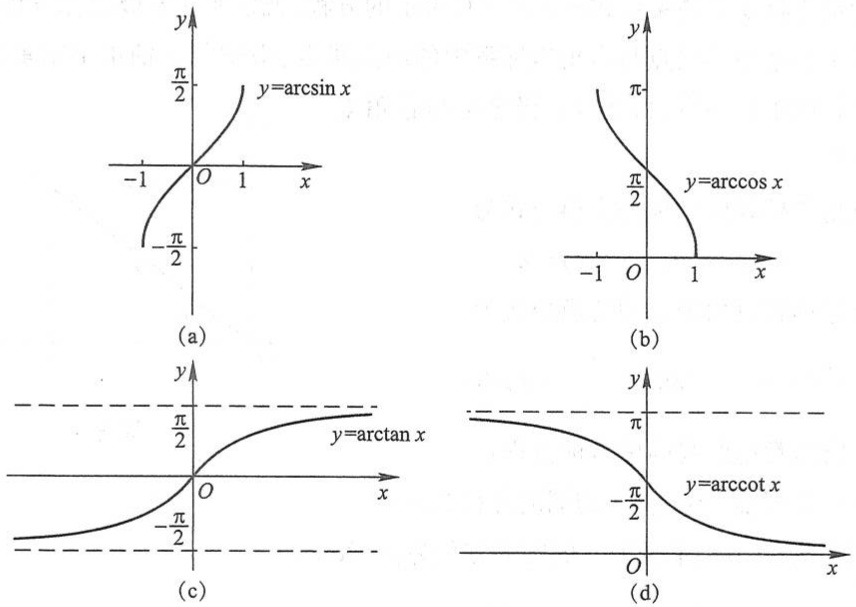

图1

## (三) 极坐标

在平面上取定一点 $O$ ，从点 $O$ 引一条射线 $OA$ ，再选定一个长度单位和角的正方向

（通常取逆时针方向），这样，平面上任意一点 $M$ 的位置就可用两个数 $\rho$ 和 $\theta$ 来确定，确定的方法是（图2）:$\rho = |OM|$，因此 $\rho \geqslant 0; \theta = \angle AOM, 0 \leqslant \theta < 2\pi.$ 这样规定的数 $\rho$ 和 $\theta$ 叫做点 $M$ 的极坐标，且以有序实数对 $(\rho, \theta)$ 表示，$\rho$ 称为点 $M$ 的极径，$\theta$ 称为点 $M$ 的极角，$O$ 称为极点，$OA$ 称为极轴. 这样建立的坐标系称为极坐标系.

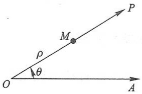

text_image

P
M
ρ
θ
O
A

图2

当点 M 在极点时, 极径  $\rho=0$ , 极角  $\theta$  可取任意值. 在极坐标系中, 除了极点 O 以外, 平面上任一点 M 与有序实数对  $(\rho,\theta)$  之间建立了一一对应关系. 但在实际应用中,

有时为了方便起见,在极坐标中,允许 $\rho$ 和 $\theta$ 可取一切实数.这时,设有两个任意实数 $\rho$ 和 $\theta$,先作射线OP,使 $\angle AOP=\theta$,如果 $\rho>0$,在OP上作一点M,使 $|OM|=\rho$;如果 $\rho<0$,在P向O的延长线上,作一点M,使 $|OM|=|\rho|$ (图3).这样,对于任意一对实数 $\rho$ 和 $\theta$,总可以在平面上确定唯一的一点M,( $\rho,\theta$ )仍称为点M的极坐标.由此可知,有序实数对 $(\rho,\theta)$ 与

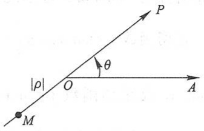

text_image

|ρ|
O
θ
P
A
M

图3

$(\rho,\theta+2k\pi)$  或  $(- \rho, \theta + (2k+1)\pi)$  表示同一个点，这里 k 取任意整数.

与直角坐标系一样,在极坐标系中,把曲线看作适合某种条件的点的集合,用曲线上的点的极坐标  $\rho,\theta$  的关系式  $\varphi(\rho,\theta)=0$  表示的方程,就是曲线的极坐标方程.

当极坐标系中的极点与直角坐标系中的原点重合, 极轴与 x 轴正半轴重合, 两种

坐标系的长度单位一致时(图4)，极坐标与直角坐标可以互换.

由直角坐标到极坐标的变换公式为

$$
x = \rho \cos \theta , \quad y = \rho \sin \theta .
$$

由极坐标到直角坐标的变换公式为

$$
\rho^ {2} = x ^ {2} + y ^ {2}, \quad \tan \theta = \frac {y}{x} \quad (x \neq 0).
$$

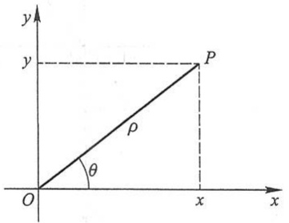

text_image

y
y
P
ρ
θ
O
x
x

图4

下面给出常用曲线的极坐标方程:

1. 圆心在极点, 半径为 r 的圆的方程为  $\rho = r$ .
2. 圆心为 $(a,0)$ ，半径为 a 的圆的方程为  $\rho=2a\cos\theta$ .
3. 圆心为  $\left(a,\frac{\pi}{2}\right)$ ，半径为 a 的圆的方程为  $\rho=2a\sin\theta$ .
4. 过极点, 倾角为  $\alpha$  的直线方程为  $\theta = \alpha (\rho \in \mathbb{R})$ .
5. 过点 $(a,0)$ 且垂直于极轴的直线方程为 $\rho \cos \theta = a$.
6. 过点 $\left(a,\frac{\pi}{2}\right)$ 且平行于极轴的直线方程为 $\rho\sin\theta=a$ .

## (四) 参数方程

在平面直角坐标系中,如果曲线上任意一点的坐标 x,y 都是某个变量 t 的函数$\left\{\begin{aligned}x&=\varphi(t),\\ y&=\psi(t),\end{aligned}\right.$  并且对于 t 的每一个允许的取值，由方程组确定的点  $(x,y)$  都在这条曲线上，那么这个方程就叫做曲线的参数方程，变量 t 叫做参数.

下面给出常用曲线的参数方程:

1. 以 $(a, b)$ 为圆心，$r$ 为半径的圆的参数方程为

$$
\left\{ \begin{array}{l} x = a + r \cos \theta , \\ y = b + r \sin \theta , \end{array} \right.
$$

其中  $\theta$  为参数.

2. 椭圆 $\frac{x^2}{a^2} + \frac{y^2}{b^2} = 1 (a > b > 0)$ 的参数方程为

$$
\left\{ \begin{array}{l} x = a \cos \theta , \\ y = b \sin \theta . \end{array} \right.
$$

3. 双曲线 $\frac{x^{2}}{a^{2}}-\frac{y^{2}}{b^{2}}=1(a>b>0)$ 的参数方程为

$$
\left\{ \begin{array}{l} x = a \sec \theta , \\ y = b \tan \theta . \end{array} \right.
$$

4. 抛物线 $y^{2}=2px$ 的参数方程为

$$
\left\{ \begin{array}{l} x = 2 p t ^ {2}, \\ y = 2 p t. \end{array} \right.
$$

## (五) 二阶和三阶行列式

给出二元线性方程组

$$
\left\{ \begin{array}{l} a _ {1 1} x _ {1} + a _ {1 2} x _ {2} = b _ {1}, \\ a _ {2 1} x _ {1} + a _ {2 2} x _ {2} = b _ {2}, \end{array} \right. \tag {1}
$$

求这方程组的解.

用大家熟知的消元法,分别消去方程组(1)中的 $x_{2}$ 及 $x_{1}$ ,得

$$
\left\{ \begin{array}{l} (a _ {1 1} a _ {2 2} - a _ {1 2} a _ {2 1}) x _ {1} = b _ {1} a _ {2 2} - a _ {1 2} b _ {2}, \\ (a _ {1 1} a _ {2 2} - a _ {1 2} a _ {2 1}) x _ {2} = a _ {1 1} b _ {2} - b _ {1} a _ {2 1}. \end{array} \right. \tag {2}
$$

下面引入二阶行列式,然后利用二阶行列式来进一步讨论上述问题.

设已知四个数排成正方形表

$$
\left( \begin{array}{c c} a _ {1 1} & a _ {1 2} \\ a _ {2 1} & a _ {2 2} \end{array} \right),
$$

则数 $a_{11}a_{22} - a_{12}a_{21}$ 称为对应于这个表的二阶行列式，用记号

$$
\left| \begin{array}{l l} a _ {1 1} & a _ {1 2} \\ a _ {2 1} & a _ {2 2} \end{array} \right| \tag {3}
$$

表示,因此

$$
\left| \begin{array}{c c} a _ {1 1} & a _ {1 2} \\ a _ {2 1} & a _ {2 2} \end{array} \right| = a _ {1 1} a _ {2 2} - a _ {1 2} a _ {2 1}.
$$

数 $a_{11}, a_{12}, a_{21}, a_{22}$ 叫做行列式(3)的元素，横排叫做行，竖排叫做列。元素 $a_{ij}$ 中的第一个指标 $i$ 和第二个指标 $j$ 依次表示该元素所在的行数和列数。例如，元素 $a_{21}$ 在行列式(3)中位于第二行和第一列。

现在,方程组(2)可利用行列式来表示.设

$$
D = \left| \begin{array}{l l} a _ {1 1} & a _ {1 2} \\ a _ {2 1} & a _ {2 2} \end{array} \right| = a _ {1 1} a _ {2 2} - a _ {1 2} a _ {2 1},
$$

$$
D _ {1} = \left| \begin{array}{l l} b _ {1} & a _ {1 2} \\ b _ {2} & a _ {2 2} \end{array} \right| = b _ {1} a _ {2 2} - a _ {1 2} b _ {2},
$$

$$
D _ {2} = \left| \begin{array}{c c} a _ {1 1} & b _ {1} \\ a _ {2 1} & b _ {2} \end{array} \right| = a _ {1 1} b _ {2} - b _ {1} a _ {2 1},
$$

则方程组(2)可写成

$$
\left\{ \begin{array}{l} D x _ {1} = D _ {1}, \\ D x _ {2} = D _ {2}. \end{array} \right. \tag {$2^{\prime$}}
$$

我们注意到, D 就是方程组(1)中  $x_{1}$  及  $x_{2}$  的系数构成的行列式, 因此称为系数行列式, 而  $D_{1}$  和  $D_{2}$  分别是用方程组(1)右端的常数项代替 D 的第一列和第二列而形成的.

若 $D \neq 0$ ，则方程组(2)的解为

$$
x _ {1} = \frac {D _ {1}}{D}, \quad x _ {2} = \frac {D _ {2}}{D}. \tag {4}
$$

把(4)中 $x_{1}$ 及 $x_{2}$ 的值代入方程组(1)，便可证实 $x_{1}$ 及 $x_{2}$ 的这对值也是方程组(1)的解.另一方面，(2)是由(1)导出的，因此(1)的解一定是(2)的解.现在(2)只有一组解(4)，所以(4)是方程组(1)的唯一解.由此得出结论:

在 $D \neq 0$ 的条件下, 方程组(1)有唯一的解

$$
x _ {1} = \frac {D _ {1}}{D}, \quad x _ {2} = \frac {D _ {2}}{D}.
$$

例1 解方程组

$$
\left\{ \begin{array}{l} 2 x + 3 y = 8, \\ x - 2 y = - 3. \end{array} \right.
$$

解 $D = \begin{vmatrix} 2 & 3 \\ 1 & -2 \end{vmatrix} = 2 \times (-2) - 3 \times 1 = -7,$

$$
D _ {1} = \left| \begin{array}{c c} 8 & 3 \\ - 3 & - 2 \end{array} \right| = 8 \times (- 2) - 3 \times (- 3) = - 7,
$$

$$
D _ {2} = \left| \begin{array}{c c} 2 & 8 \\ 1 & - 3 \end{array} \right| = 2 \times (- 3) - 8 \times 1 = - 1 4.
$$

因 $D = -7 \neq 0$ ，故所给方程组有唯一解

$$
x = \frac {D _ {1}}{D} = \frac {- 7}{- 7} = 1, \quad y = \frac {D _ {2}}{D} = \frac {- 1 4}{- 7} = 2.
$$

下面介绍三阶行列式概念.

设已知9个数排成正方形表

$$
\left( \begin{array}{c c c} a _ {1 1} & a _ {1 2} & a _ {1 3} \\ a _ {2 1} & a _ {2 2} & a _ {2 3} \\ a _ {3 1} & a _ {3 2} & a _ {3 3} \end{array} \right),
$$

则数 $a_{11}a_{22}a_{33} + a_{12}a_{23}a_{31} + a_{13}a_{21}a_{32} - a_{13}a_{22}a_{31} - a_{12}a_{21}a_{33} - a_{11}a_{23}a_{32}$ 称为对应于这个表的三阶行列式，用记号

$$
\left| \begin{array}{c c c} a _ {1 1} & a _ {1 2} & a _ {1 3} \\ a _ {2 1} & a _ {2 2} & a _ {2 3} \\ a _ {3 1} & a _ {3 2} & a _ {3 3} \end{array} \right|
$$

表示,因此

$$
\begin{array}{l} \left| \begin{array}{c c c} a _ {1 1} & a _ {1 2} & a _ {1 3} \\ a _ {2 1} & a _ {2 2} & a _ {2 3} \\ a _ {3 1} & a _ {3 2} & a _ {3 3} \end{array} \right| \\ = a _ {1 1} a _ {2 2} a _ {3 3} + a _ {1 2} a _ {2 3} a _ {3 1} + a _ {1 3} a _ {2 1} a _ {3 2} - a _ {1 3} a _ {2 2} a _ {3 1} - a _ {1 2} a _ {2 1} a _ {3 3} - a _ {1 1} a _ {2 3} a _ {3 2}. \tag {5} \\ \end{array}
$$

关于三阶行列式的元素、行、列等概念,与二阶行列式的相应概念类似,不再重复.

(5)式右端相当复杂,我们可以借助图5得出它的计算法则(通常称为对角线法则):

行列式中从左上角到右下角的直线称为主对角线,从右上角到左下角的直线称为次对角线.主对角线上元素的乘积以及位于主对角线的平行线上的元素与对角上的元素的乘积,前面都取正号.次对角线上元素的乘积以及位于次对角线的平行线上的元素与对角上的元素的乘积,前面都取负号.

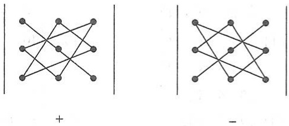

text_image

Diagram showing two configurations of graph structures with plus and minus signs, each containing a central node and connected edges.

图5

例 2  $\begin{vmatrix}2&1&2\\-4&3&1\\2&3&5\end{vmatrix}$

$$
\begin{array}{l} = 2 \times 3 \times 5 + 1 \times 1 \times 2 + 2 \times (- 4) \times 3 - 2 \times 3 \times 2 - 1 \times (- 4) \times 5 - 2 \times 1 \times 3 \\ = 3 0 + 2 - 2 4 - 1 2 + 2 0 - 6 = 1 0. \\ \end{array}
$$

利用交换律及结合律,可把(5)式改写如下:

$$
\left| \begin{array}{l l l} a _ {1 1} & a _ {1 2} & a _ {1 3} \\ a _ {2 1} & a _ {2 2} & a _ {2 3} \\ a _ {3 1} & a _ {3 2} & a _ {3 3} \end{array} \right| = a _ {1 1} (a _ {2 2} a _ {3 3} - a _ {2 3} a _ {3 2}) - a _ {1 2} (a _ {2 1} a _ {3 3} - a _ {2 3} a _ {3 1}) + a _ {1 3} (a _ {2 1} a _ {3 2} - a _ {2 2} a _ {3 1}).
$$

把上式右端三个括号中的式子表示为二阶行列式,则有

$$
\left| \begin{array}{l l l} a _ {1 1} & a _ {1 2} & a _ {1 3} \\ a _ {2 1} & a _ {2 2} & a _ {2 3} \\ a _ {3 1} & a _ {3 2} & a _ {3 3} \end{array} \right| = a _ {1 1} \left| \begin{array}{l l} a _ {2 2} & a _ {2 3} \\ a _ {3 2} & a _ {3 3} \end{array} \right| - a _ {1 2} \left| \begin{array}{l l} a _ {2 1} & a _ {2 3} \\ a _ {3 1} & a _ {3 3} \end{array} \right| + a _ {1 3} \left| \begin{array}{l l} a _ {2 1} & a _ {2 2} \\ a _ {3 1} & a _ {3 2} \end{array} \right|.
$$

上式称为三阶行列式按第一行的展开式.

例 3 将例 2 中的行列式按第一行展开并计算它的值.

解  $\begin{vmatrix}2&1&2\\ -4&3&1\\ 2&3&5\end{vmatrix}=2\begin{vmatrix}3&1\\ 3&5\end{vmatrix}-\begin{vmatrix}-4&1\\ 2&5\end{vmatrix}+2\begin{vmatrix}-4&3\\ 2&3\end{vmatrix}$

$$
= 2 \times 1 2 - (- 2 2) + 2 \times (- 1 8) = 2 4 + 2 2 - 3 6 = 1 0.
$$

## 习题

1. 利用二阶行列式解下列方程组:

(1) $\left\{\begin{aligned}5x-y=2,\\ 3x+2y=9;\end{aligned}\right.$

(2) $\left\{\begin{aligned}3x+4y=2,\\ 2x+3y=7.\end{aligned}\right.$

2. 利用对角线法则, 计算下列各行列式:

(1) $\begin{vmatrix}2&0&1\\1&-4&-1\\-1&8&3\end{vmatrix};$

(2) $\begin{vmatrix}4&-2&4\\10&2&12\\1&2&2\end{vmatrix};$

(3) $\begin{vmatrix}3&4&2\\ 7&5&1\\ 3&2&4\end{vmatrix};$

(4) $\begin{vmatrix}1&1&1\\ 1&1+a&1\\ 1&1&1+b\end{vmatrix}.$

3. 将下列行列式按第一行展开并计算它们的值:

(1) $\begin{vmatrix}1&2&3\\ 3&1&2\\ 2&3&1\end{vmatrix};$

(2) $\begin{vmatrix}-1&2&2\\2&-1&2\\2&2&-1\end{vmatrix}.$

4. 证明下列等式:

(1) $\begin{vmatrix}a_{11}&a_{12}&a_{13}\\a_{21}&a_{22}&a_{23}\\a_{31}&a_{32}&a_{33}\end{vmatrix}=-a_{21}\begin{vmatrix}a_{12}&a_{13\\a_{32}&a_{33}\end{vmatrix}+a_{22}\begin{vmatrix}a_{11}&a_{13\\a_{31}&a_{33}\end{vmatrix}-a_{23}\begin{vmatrix}a_{11}&a_{12\\a_{31}&a_{32}\end{vmatrix};$

(2) $\begin{vmatrix}a_{11}&a_{12}&a_{13}\\a_{21}&a_{22}&a_{23}\\a_{31}&a_{32}&a_{33}\end{vmatrix}=a_{31}\begin{vmatrix}a_{12}&a_{13}\\a_{22}&a_{23}\end{vmatrix}-a_{32}\begin{vmatrix}a_{11}&a_{13}\\a_{21}&a_{23}\end{vmatrix}+a_{33}\begin{vmatrix}a_{11}&a_{12}\\a_{21}&a_{22}\end{vmatrix}.$

注:上面这两个等式分别称为三阶行列式按第二行和按第三行的展开式.

## 答案

1. (1) x=1, y=3; (2) x=-22, y=17.
2. (1) -4; (2) 8; (3) -48; (4) ab.
3. (1) 18; (2) 27.

4. 略.

## 附录Ⅱ

## 基本初等函数的图形

幂函数

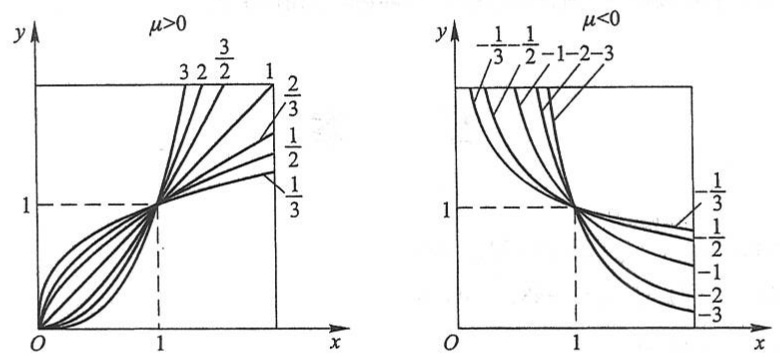

$y = x^{\mu}$

指数函数

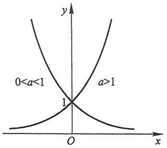

contour

| Region | Description |
| --- | --- |
| Left Curve | 0 < a < 1 |
| Right Curve | a > 1 |

$y = a^{x}$

对数函数

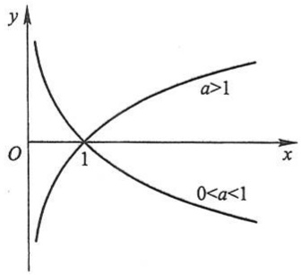

line

| X | Y (Curve 1) | Y (Curve 2) |
| --- | --- | --- |
| 0 | High | Low |
| 1 | 0 | 0 |
| >1 | Increasing | Decreasing |

$y = \log_a x$

三角函数

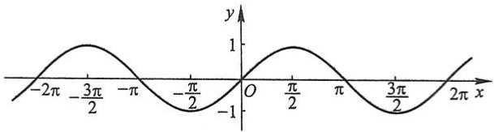

contour

| X | Y |
| --- | --- |
| \(-2\pi\) | ~-0.5 |
| \(-3\pi/2\) | 1 |
| \(-\pi\) | 0 |
| \(-\pi/2\) | ~-0.8 |
| O | 0 |
| \(\pi/2\) | 1 |
| \(\pi\) | 0 |
| \(3\pi/2\) | ~-0.8 |
| \(2\pi\) | ~0.5 |

$y = \sin x$

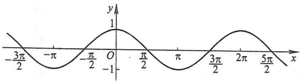

contour

| X | Y |
| --- | --- |
| \(-3\pi/2\) | 0 |
| \(-\pi\) | ~-0.8 |
| \(-\pi/2\) | 0 |
| O | 1 |
| \(\pi/2\) | 0 |
| \(3\pi/2\) | ~-0.8 |
| \(2\pi\) | 0 |
| \(5\pi/2\) | ~-0.8 |

$y = \cos x$

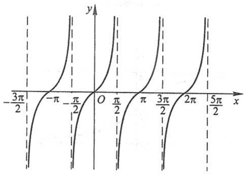

contour

| X | Y |
| --- | --- |
| \(-3\pi/2\) | 0 |
| \(-\pi/2\) | 0 |
| O | 0 |
| \(\pi/2\) | 0 |
| \(3\pi/2\) | 0 |
| \(5\pi/2\) | 0 |

$y = \tan x$

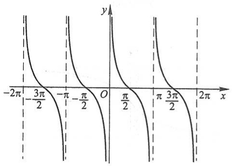

contour

| X | Y |
| --- | --- |
| \(-2\pi\) | >0 |
| \(-3\pi/2\) | 0 |
| \(-\pi\) | >0 |
| \(-\pi/2\) | 0 |
| O | >0 |
| \(\pi/2\) | 0 |
| \(\pi\) | >0 |
| \(3\pi/2\) | 0 |
| \(2\pi\) | >0 |

$y = \cot x$

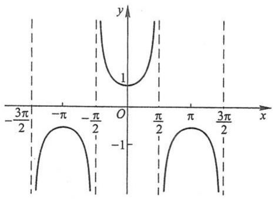

contour

| X-axis | Y-axis |
| --- | --- |
| \(-3\pi/2\) | 0 |
| \(-\pi\) | 0 |
| \(-\pi/2\) | 0 |
| O | 0 |
| \(\pi/2\) | 0 |
| \(\pi\) | 0 |
| \(3\pi/2\) | 0 |
| \(-3\pi/2\) | 1 |
| \(-\pi\) | 1 |
| \(-\pi/2\) | 1 |
| \(\pi/2\) | 1 |
| \(\pi\) | 1 |
| \(3\pi/2\) | 1 |

$y = \sec x$

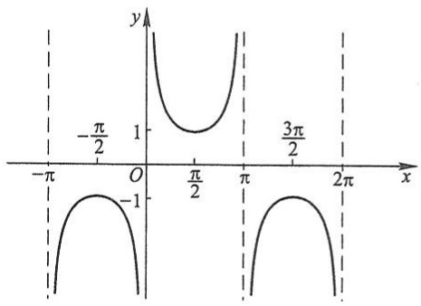

contour

| x | y |
| --- | --- |
| \(-\pi\) | 1 |
| \(-\pi/2\) | 1 |
| \(\pi/2\) | 1 |
| \(\pi\) | 1 |
| \(3\pi/2\) | 1 |
| \(2\pi\) | 1 |

$y = \csc x$

反三角函数

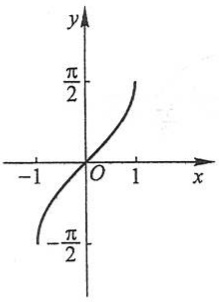

contour

| X | Y |
| --- | --- |
| -1 | ~-0.5 |
| 0 | 0 |
| 1 | ~0.5 |

$y = \arcsin x$

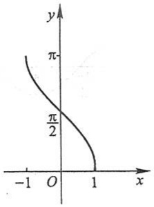

contour

| X | Y |
| --- | --- |
| -1 | ~\(\pi\) |
| 0 | \(\pi/2\) |
| 1 | 0 |

$y = \arccos x$

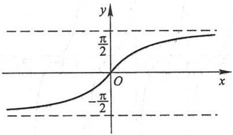

contour

| X | Y |
| --- | --- |
| 0 | 0 |
| \(-\pi/2\) | \(-\pi/2\) |
| \(\pi/2\) | \(\pi/2\) |

$y = \arctan x$

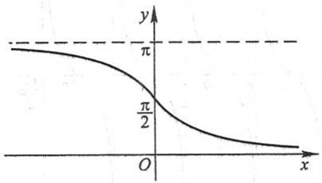

line

| X | Y |
| --- | --- |
| 0 | \(\pi\) |
| ~0.5 | \(\pi/2\) |

$y = \operatorname{arccot} x$

# 附录Ⅲ

# 几种常用的曲线

(1) 三次抛物线

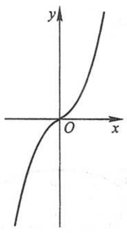

text_image

y
O
x

$$
y = a x ^ {3}
$$

(2) 半立方抛物线

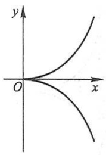

text_image

y
O
x

$$
y ^ {2} = a x ^ {3}
$$

(3) 概率曲线

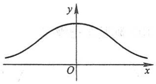

text_image

y
O
x

$$
y = \mathrm{e} ^ {- x ^ {2}}
$$

(4) 箕舌线

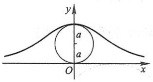

text_image

y
a
a
O
x

$$
y = \frac {8 a ^ {3}}{x ^ {2} + 4 a ^ {2}}
$$