# 第8章 向量代数与空间解析几何

原始 PDF 第 8–58 页。

# 第八章

# 向量代数与空间解析几何

在平面解析几何中,通过坐标法把平面上的点与一对有次序的数对应起来,把平面上的图形和方程对应起来,从而可以用代数方法来研究几何问题.空间解析几何也是按照类似的方法建立起来的.

正像平面解析几何的知识对学习一元函数微积分是不可缺少的一样,空间解析几何的知识对学习多元函数微积分也是必要的.

本章先引进向量的概念,根据向量的线性运算建立空间坐标系,然后利用坐标讨论向量的运算,并介绍空间解析几何的有关内容.

## 第一节 向量及其线性运算

## 一、向量的概念

客观世界中有这样一类量,它们既有大小,又有方向,例如位移、速度、加速度、力、力矩等,这一类量叫做向量(或矢量).

在数学上,常用一条有方向的线段,即有向线段来表示向量.有向线段的长度表示向量的大小,有向线段的方向表示向量的方向.以A为起点、B为终点的有向线段所表示的向量记作 $\overrightarrow{AB}$ （图8-1）.有时也用一个黑体字母(书写时,在字母上面加箭头)来表示向量,例如a,r,v,F或 $\overrightarrow{a},\overrightarrow{r},\overrightarrow{v},\overrightarrow{F}$ 等.

natural_image

Simple diagram showing a vector from point A to point B (no labels or text)

图8-1

在实际问题中,有些向量与其起点有关(例如质点运动的速度与该质点的位置有关,一个力与该力的作用点的位置有关),有些向量与其起点无关.由于一切向量的共性是它们都有大小和方向,因此在数学上我们只研究与起点无关的向量,并称这种向量为自由向量(以后简称向量),即只考虑向量的大小和方向,而不论它的起点在什么

1

---

第八章 向量代数与空间解析几何

地方.当遇到与起点有关的向量时,可在一般原则下作特别处理.

由于我们只讨论自由向量,所以如果两个向量 a 和 b 的大小相等,且方向相同,我们就说向量 a 和 b 是相等的,记作 a=b.这就是说,经过平行移动后能完全重合的向量是相等的.

向量的大小叫做向量的模.向量$\overrightarrow{AB}$, $a$ 和 $\overrightarrow{a}$ 的模依次记作 $|\overrightarrow{AB}|$, $|a|$ 和 $|\overrightarrow{a}|$. 模等于 1 的向量叫做单位向量.模等于零的向量叫做零向量, 记作 0 或 $\overrightarrow{0}$. 零向量的起点和终点重合, 它的方向可以看做是任意的.

设有两个非零向量 $a, b$，任取空间一点 $O$，作 $\overrightarrow{OA} = a$，$\overrightarrow{OB} = b$，规定不超过 $\pi$ 的 $\angle AOB$（设 $\varphi = \angle AOB, 0 \leqslant \varphi \leqslant \pi$）称为向量 $a$ 与 $b$ 的夹角（图8-2），记作 $(\widehat{a}, \widehat{b})$ 或 $(\widehat{b}, \widehat{a})$，即 $(\widehat{a}, \widehat{b}) = \varphi$。如果向量 $a$ 与 $b$ 中有一个是零向量，规定它们的夹角可以在0到 $\pi$ 之间任意取值。

text_image

O
a
A
b
φ
B

图8-2

如果 $(\widehat{a,b}) = 0$ 或 $\pi$ ，就称向量 $a$ 与 $b$ 平行，记作 $a / / b.$ 如果 $(\widehat{a,b}) = \frac{\pi}{2}$ ，就称向量 $a$ 与 $b$ 垂直，记作 $a \perp b.$ 由于零向量与另一向量的夹角可以在0到 $\pi$ 之间任意取值，因此可以认为零向量与任何向量都平行，也可以认为零向量与任何向量都垂直.

当两个平行向量的起点放在同一点时,它们的终点和公共起点应在一条直线上.因此,两向量平行,又称两向量共线.

类似还有向量共面的概念. 设有 $k (k \geqslant 3)$ 个向量, 当把它们的起点放在同一点时, 如果 $k$ 个终点和公共起点在一个平面上, 就称这 $k$ 个向量共面.

## 二、向量的线性运算

## 1. 向量的加减法

向量的加法运算规定如下:

设有两个向量 a 与 b，任取一点 A，作  $\overrightarrow{AB}=a$ ，再以 B 为起点，作  $\overrightarrow{BC}=b$ ，连接 AC（图 8-3），那么向量  $\overrightarrow{AC}=c$  称为向量 a 与 b 的和，记作  $a+b$ ，即

$$
c = a + b.
$$

上述作出两向量之和的方法叫做向量相加的三角形法则.

text_image

a+b
A
a
B
b
C

图8-3

力学上有求合力的平行四边形法则, 仿此, 我们也有向量相加的平行四边形法则. 这就是: 当向量 a 与 b 不平行时, 作  $\overrightarrow{AB}=a, \overrightarrow{AD}=b$ , 以 AB, AD 为边作一平行四边形

2

---

第一节 向量及其线性运算

ABCD, 连接对角线 AC（图 8-4），显然向量  $\overrightarrow{AC}$  即等于向量 a 与 b 的和  $a+b$ .

向量的加法符合下列运算规律:

text_image

D
b
a+b
A
a
B
C

图8-4

(1) 交换律 $a + b = b + a$;
(2) 结合律  $(a+b)+c=a+(b+c)$ .

这是因为,按向量加法的规定(三角形法则),从图8-4可见:

$$
a + b = \overrightarrow {A B} + \overrightarrow {B C} = \overrightarrow {A C} = c,
$$

$$
b + a = \overrightarrow {A D} + \overrightarrow {D C} = \overrightarrow {A C} = c,
$$

所以符合交换律.又如图8-5所示,先作 $a+b$ 再加上c,即得和 $(a+b)+c$ ,若以a与 $b+c$ 相加,则得同一结果,所以符合结合律.

由于向量的加法符合交换律与结合律, 故 n 个向量  $a_{1}, a_{2}, \cdots, a_{n}$  ( $n \geqslant 3$ ) 相加可写成

$$
a _ {1} + a _ {2} + \dots + a _ {n},
$$

并按向量相加的三角形法则,可得 n 个向量相加的法则如下:以前一向量的终点作为次一向量的起点,相继作向量  $a_{1}, a_{2}, \cdots, a_{n}$ , 再以第一个向量的起点为起点,最后一个向量的终点为终点作一向量,这个向量即为所求的和.如图 8-6 所示,有

$$
s = a _ {1} + a _ {2} + a _ {3} + a _ {4} + a _ {5}.
$$

text_image

a+b+c
b+c
a+b
a
b

图8-5

text_image

a₄
a₅
a₃
s
a₂
a₁

图8-6

设 a 为一向量,与 a 的模相同而方向相反的向量叫做 a 的负向量,记作 -a. 由此,我们规定两个向量 b 与 a 的差

$$
b - a = b + (- a).
$$

即把向量-a加到向量b上,便得b与a的差b-a(图8-7(a)).

特别地, 当 b=a 时, 有

$$
a - a = a + (- a) = 0.
$$

显然,任给向量 $\overrightarrow{AB}$ 及点O,有

$$
\overrightarrow {A B} = \overrightarrow {A O} + \overrightarrow {O B} = \overrightarrow {O B} - \overrightarrow {O A},
$$

因此,若把向量 a 与 b 移到同一起点 O,则从 a 的终点 A 向 b 的终点 B 所引向量  $\overrightarrow{AB}$  便

3

---

第八章 向量代数与空间解析几何

是向量 b 与 a 的差 b-a（图 8-7(b)）.

text_image

-a
b-a
b
a

(a)

text_image

b
b-a
O
a
A

(b)

图8-7

由三角形两边之和大于第三边,有

$$
\mid a + b \mid \leqslant \mid a \mid + \mid b \mid \quad \text {及} \quad \mid a - b \mid \leqslant \mid a \mid + \mid b \mid ,
$$

其中等号在 a 与 b 同向或反向时成立.

## 2. 向量与数的乘法

向量 a 与实数  $\lambda$  的乘积记作  $\lambda a$ ，规定  $\lambda a$  是一个向量，它的模

$$
\mid \lambda a \mid = \mid \lambda \mid \mid a \mid ,
$$

它的方向当  $\lambda>0$  时与 a 相同, 当  $\lambda<0$  时与 a 相反.

当  $\lambda=0$  时， $\left|\lambda a\right|=0$ ，即  $\lambda a$  为零向量，这时它的方向可以是任意的.

特别地, 当  $\lambda = \pm 1$  时, 有

$$
1 a = a, \quad (- 1) a = - a.
$$

向量与数的乘积符合下列运算规律:

(1) 结合律  $\lambda(\mu\boldsymbol{a})=\mu(\lambda\boldsymbol{a})=(\lambda\mu)\boldsymbol{a}.$

这是因为由向量与数的乘积的规定可知, 向量  $\lambda(\mu\boldsymbol{a}), \mu(\lambda\boldsymbol{a}), (\lambda\mu)\boldsymbol{a}$  都是平行的向量, 它们的方向也是相同的, 而且

$$
\mid \lambda (\mu a) \mid = \mid \mu (\lambda a) \mid = \mid (\lambda \mu) a \mid = \mid \lambda \mu \mid \mid a \mid ,
$$

所以

$$
\lambda (\mu a) = \mu (\lambda a) = (\lambda \mu) a.
$$

(2) 分配律

$$
(\lambda + \mu) a = \lambda a + \mu a, \tag {1-1}
$$

$$
\lambda (a + b) = \lambda a + \lambda b. \tag {1-2}
$$

这个规律同样可以按向量与数的乘积的规定来证明,这里从略了.

向量相加及数乘向量统称为向量的线性运算.

例 1 在平行四边形 ABCD 中, 设  $\overrightarrow{AB} = a, \overrightarrow{AD} = b$ . 试用 a 和 b 表示向量  $\overrightarrow{MA}, \overrightarrow{MB}, \overrightarrow{MC}$  和  $\overrightarrow{MD}$ , 这里 M 是平行四边形对角线的交点(图 8-8).

4

---

第一节 向量及其线性运算

解 由于平行四边形的对角线互相平分,所以

$$
\boldsymbol {a} + \boldsymbol {b} = \overrightarrow {A C} = 2 \overrightarrow {A M},
$$

即

$$
- (\boldsymbol {a} + \boldsymbol {b}) = 2 \overrightarrow {M A},
$$

于是

$$
\overrightarrow {M A} = - \frac {1}{2} (a + b).
$$

text_image

D
b
M
A
a
B
C

图8-8

因为 $\overrightarrow{MC}=-\overrightarrow{MA}$ ，所以 $\overrightarrow{MC}=\frac{1}{2}(a+b)$ .

又因 $-a+b=\overrightarrow{BD}=2\overrightarrow{MD}$ ，所以 $\overrightarrow{MD}=\frac{1}{2}(b-a)$ .

由于 $\overrightarrow{MB}=-\overrightarrow{MD}$ ，所以 $\overrightarrow{MB}=\frac{1}{2}(a-b)$ .

前面已经讲过,模等于1的向量叫做单位向量.设 $e_{a}$ 表示与非零向量a同方向的单位向量,那么按照向量与数的乘积的规定,由于 $|a|>0$ ,所以 $|a|e_{a}$ 与 $e_{a}$ 的方向相同,即 $|a|e_{a}$ 与a的方向相同.又因 $|a|e_{a}$ 的模是

$$
\mid a \mid \mid e _ {a} \mid = \mid a \mid \cdot 1 = \mid a \mid ,
$$

即  $\left|a\right|e_{a}$  与 a 的模也相同, 因此,

$$
a = | a | e _ {a}.
$$

我们规定, 当  $\lambda \neq 0$  时,  $\frac{a}{\lambda} = \frac{1}{\lambda} a$ . 由此, 上式又可写成

$$
\frac {a}{| a |} = e _ {a}.
$$

这表示一个非零向量除以它的模的结果是一个与原向量同方向的单位向量.

由于向量  $\lambda a$  与 a 平行, 因此我们常用向量与数的乘积来说明两个向量的平行关系. 即有

定理1 设向量 $a \neq 0$，则向量 $b$ 平行于 $a$ 的充分必要条件是:存在唯一的实数 $\lambda$，使 $b = \lambda a$.

证 条件的充分性是显然的,下面证明条件的必要性.

设 $b / / a$ .取 $\mid \lambda \mid = \frac{\mid b\mid}{\mid a\mid}$ 当 $\pmb{b}$ 与 $a$ 同向时 $\lambda$ 取正值，当 $\pmb{b}$ 与 $a$ 反向时 $\lambda$ 取负值，即有 $b = \lambda a.$ 这是因为此时 $\pmb{b}$ 与 $\lambda a$ 同向，且

$$
\mid \lambda a \mid = \mid \lambda \mid \mid a \mid = \frac {\mid b \mid}{\mid a \mid} \mid a \mid = \mid b \mid .
$$

再证数 $\lambda$ 的唯一性. 设 $b = \lambda a$, 又设 $b = \mu a$, 两式相减, 便得

5

---

第八章 向量代数与空间解析几何

$$
(\lambda - \mu) a = 0,
$$

即 $|\lambda - \mu ||a| = 0$。因 $|a| \neq 0$，故 $|\lambda - \mu| = 0$，即 $\lambda = \mu$.

定理证毕.

定理1是建立数轴的理论依据.我们知道,给定一个点、一个方向及单位长度,就确定了一条数轴.由于一个单位向量既确定了方向,又确定了单位长度,因此,给定一个点及一个单位向量就确定了一条数轴.设点O及单位向量i确定了数轴Ox(图

8-9), 对于轴上任一点 $P$, 对应一个向量 $\overrightarrow{OP}$, 由于 $\overrightarrow{OP} // i$, 根据定理1, 必有唯一的实数 $x$, 使 $\overrightarrow{OP} = xi$ (实数 $x$ 叫做轴上有向线段 $\overrightarrow{OP}$ 的值), 并知 $\overrightarrow{OP}$ 与实数 $x$ 一一对应. 于是

图8-9

$$
\text {点} P \longleftrightarrow \text {向量} \overrightarrow {O P} = x i \longleftrightarrow \text {实数} x,
$$

从而轴上的点 $P$ 与实数 $x$ 有一一对应的关系.据此,定义实数 $x$ 为轴上点 $P$ 的坐标.

由此可知,轴上点 P 的坐标为 x 的充分必要条件是

$$
\overrightarrow {O P} = x i.
$$

## 三、空间直角坐标系

在空间取定一点 $O$ 和三个两两垂直的单位向量 $\pmb{i},\pmb{j},\pmb{k}$ ，就确定了三条都以 $O$ 为原点的两两垂直的数轴，依次记为 $\underline{x}$ 轴（横轴）、$\underline{y}$ 轴（纵轴）、$\underline{z}$ 轴（竖轴），统称坐标轴.它们构成一个空间直角坐标系，称为Oxyz坐标系或 $[O;i,j,k]$ 坐标系(图8-10).通常把$x$ 轴和 $y$ 轴配置在水平面上，而 $z$ 轴则是铅垂线；它们的正向通常符合右手规则，即以右手握住 $z$ 轴，当右手的四个手指从 $x$ 轴正向以 $\frac{\pi}{2}$ 角度转向 $y$ 轴正向时，大拇指的指向就是 $z$ 轴的正向，如图8-11所示.

text_image

z
k
O
j
y
i
x

图8-10

text_image

z
O
y
x

图8-11

三条坐标轴中的任意两条可以确定一个平面,这样定出的三个平面统称为坐标面.x轴及y轴所确定的坐标面叫做xOy面,另两个由y轴及z轴和由z轴及x轴所确

6

---

第一节 向量及其线性运算

定的坐标面,分别叫做 $yOz$ 面及 $zOx$ 面.三个坐标面把空间分成八个部分,每一部分叫做一个卦限.其中,在 $xOy$ 面上方且 $yOz$ 面前方、 $zOx$ 面右方的那个卦限叫做第一卦限,其他第二、第三、第四卦限,在 $xOy$ 面的上方,按逆时针方向确定.第五至第八卦限,在 $xOy$ 面的下方,由第一卦限之下的第五卦限,按逆时针方向确定,这八个卦限分别用字母I,II,III,IV,V,VI,VII,VIII表示(图8-12).

任给向量 r，有对应点 M，使  $\overrightarrow{OM}=r$ 。以 OM 为对角线、三条坐标轴为棱作长方体 RHMK-OPNQ，如图 8-13 所示，有

$$
r = \overrightarrow {O M} = \overrightarrow {O P} + \overrightarrow {P N} + \overrightarrow {N M} = \overrightarrow {O P} + \overrightarrow {O Q} + \overrightarrow {O R},
$$

设 $\overrightarrow{OP} = x\mathbf{i}$ ， $\overrightarrow{OQ} = yj$ ， $\overrightarrow{OR} = zk$ ，则

$$
r = \overrightarrow {O M} = x i + y j + z k.
$$

上式称为向量 r 的坐标分解式, xi, yj 和 zk 称为向量 r 沿三个坐标轴方向的分向量.

text_image

z
III
II
IV
I
O
y
x
VII
VI
VIII
V

图8-12

text_image

z
R
K
H
M
r
O
Q
y
P
N
x

图8-13

显然,给定向量 r, 就确定了点 M 及  $\overrightarrow{OP}, \overrightarrow{OQ}, \overrightarrow{OR}$  三个分向量, 进而确定了 x, y, z 三个有序数; 反之, 给定三个有序数 x, y, z, 也就确定了向量 r 与点 M. 于是点 M、向量 r 与三个有序数 x, y, z 之间有一一对应的关系

$$
M \longleftrightarrow r = \overrightarrow {O M} = x i + y j + z k \longleftrightarrow (x, y, z),
$$

据此, 定义: 有序数 $x, y, z$ 称为向量 $\pmb{r}$ (在坐标系 $Oxyz$ 中) 的坐标, 记作 $r = (x, y, z)$; 有序数 $x, y, z$ 也称为点 $M$ (在坐标系 $Oxyz$ 中) 的坐标, 记作 $M(x, y, z)$.

向量 $r = \overrightarrow{OM}$ 称为点 $M$ 关于原点 $O$ 的向径. 上述定义表明, 一个点与该点的向径有相同的坐标. 记号 $(x, y, z)$ 既表示点 $M$, 又表示向量 $\overrightarrow{OM}$.

坐标面上和坐标轴上的点,其坐标各有一定的特征.例如:如果点 M 在 yOz 面上,那么 x=0;同样,在 zOx 面上的点,有 y=0;在 xOy 面上的点,有 z=0.如果点 M 在 x 轴上,那么 y=z=0;同样,在 y 轴上的点,有 z=x=0;在 z 轴上的点,有 x=y=0.若点 M 为

7

---

第八章 向量代数与空间解析几何

原点,则 x=y=z=0.

## 四、利用坐标作向量的线性运算

利用向量的坐标,可得向量的加法、减法以及向量与数的乘法的运算如下:

设 $a = (a_{x}, a_{y}, a_{z})$，$b = (b_{x}, b_{y}, b_{z})$，即

$$
\boldsymbol {a} = a _ {x} \boldsymbol {i} + a _ {y} \boldsymbol {j} + a _ {z} \boldsymbol {k}, \boldsymbol {b} = b _ {x} \boldsymbol {i} + b _ {y} \boldsymbol {j} + b _ {z} \boldsymbol {k}.
$$

利用向量加法的交换律与结合律以及向量与数的乘法的结合律与分配律,有

$$
\boldsymbol {a} + \boldsymbol {b} = (a _ {x} + b _ {x}) \boldsymbol {i} + (a _ {y} + b _ {y}) \boldsymbol {j} + (a _ {z} + b _ {z}) \boldsymbol {k},
$$

$$
\boldsymbol {a} - \boldsymbol {b} = (a _ {x} - b _ {x}) \boldsymbol {i} + (a _ {y} - b _ {y}) \boldsymbol {j} + (a _ {z} - b _ {z}) \boldsymbol {k},
$$

$$
\lambda \boldsymbol {a} = (\lambda a _ {x}) \boldsymbol {i} + (\lambda a _ {y}) \boldsymbol {j} + (\lambda a _ {z}) \boldsymbol {k} \quad (\lambda \text {为实数}),
$$

即

$$
\boldsymbol {a} + \boldsymbol {b} = (a _ {x} + b _ {x}, a _ {y} + b _ {y}, a _ {z} + b _ {z}),
$$

$$
\boldsymbol {a} - \boldsymbol {b} = (a _ {x} - b _ {x}, a _ {y} - b _ {y}, a _ {z} - b _ {z}),
$$

$$
\lambda a = (\lambda a _ {x}, \lambda a _ {y}, \lambda a _ {z}).
$$

由此可见,对向量进行加、减及与数相乘,只需对向量的各个坐标分别进行相应的数量运算就行了.

定理 1 指出, 当向量  $a \neq 0$  时, 向量  $b \parallel a$  相当于  $b = \lambda a$ , 坐标表示式为

$$
(b _ {x}, b _ {y}, b _ {z}) = \lambda (a _ {x}, a _ {y}, a _ {z}),
$$

这也就相当于向量 $\pmb{b}$ 与 $\pmb{a}$ 对应的坐标成比例

$$
\frac {b _ {x}}{a _ {x}} = \frac {b _ {y}}{a _ {y}} = \frac {b _ {z}}{a _ {z}}. \tag {1-3}
$$

例2 求解以向量为元的线性方程组

$$
\left\{ \begin{array}{l} 5 x - 3 y = a, \\ 3 x - 2 y = b, \end{array} \right.
$$

其中  $\boldsymbol{a}=(2,1,2)$ ,  $\boldsymbol{b}=(-1,1,-2)$ .

解 如同解以实数为元的线性方程组一样, 可解得

$$
x = 2 a - 3 b, y = 3 a - 5 b.
$$

① 当 $a_{x}, a_{y}, a_{z}$ 有一个为零时，例如 $a_{x} = 0, a_{y}, a_{z} \neq 0$ ，这时(1-3)式应理解为

$$
\left\{ \begin{array}{l} b _ {x} = 0, \\ \frac {b _ {y}}{a _ {y}} = \frac {b _ {z}}{a _ {z}}; \end{array} \right.
$$

当 $a_{x}, a_{y}, a_{z}$ 有两个为零时，例如 $a_{x} = a_{y} = 0, a_{z} \neq 0$ ，这时(1-3)式应理解为

$$
\left\{ \begin{array}{l} b _ {x} = 0, \\ b _ {y} = 0. \end{array} \right.
$$

8

---

第一节 向量及其线性运算

将 a, b 的坐标表示式代入, 即得

$$
\begin{array}{l} x = 2 (2, 1, 2) - 3 (- 1, 1, - 2) = (7, - 1, 1 0), \\ y = 3 (2, 1, 2) - 5 (- 1, 1, - 2) = (1 1, - 2, 1 6). \\ \end{array}
$$

例3 已知两点 $A(x_{1},y_{1},z_{1})$ 和 $B(x_{2},y_{2},z_{2})$ 以及实数 $\lambda \neq -1$ ，在直线 $AB$ 上求点$M$ ，使

$$
\overrightarrow {A M} = \lambda \overrightarrow {M B}.
$$

解 如图 8-14 所示. 由于

$$
\overrightarrow {A M} = \overrightarrow {O M} - \overrightarrow {O A}, \overrightarrow {M B} = \overrightarrow {O B} - \overrightarrow {O M},
$$

因此

$$
\overrightarrow {O M} - \overrightarrow {O A} = \lambda (\overrightarrow {O B} - \overrightarrow {O M}),
$$

从而

$$
\overrightarrow {O M} = \frac {1}{1 + \lambda} (\overrightarrow {O A} + \lambda \overrightarrow {O B}).
$$

将 $\overrightarrow{OA},\overrightarrow{OB}$ 的坐标(即点A、点B的坐标)代入,即得

text_image

z
A
M
B
O
y
x

图8-14

$$
\overrightarrow {O M} = \left(\frac {x _ {1} + \lambda x _ {2}}{1 + \lambda}, \frac {y _ {1} + \lambda y _ {2}}{1 + \lambda}, \frac {z _ {1} + \lambda z _ {2}}{1 + \lambda}\right),
$$

这就是点 M 的坐标.

本例中的点 $M$ 叫做有向线段 $\overrightarrow{AB}$ 的 $\lambda$ 分点. 特别地, 当 $\lambda = 1$ 时, 得线段 $AB$ 的中点为

$$
M \left(\frac {x _ {1} + x _ {2}}{2}, \frac {y _ {1} + y _ {2}}{2}, \frac {z _ {1} + z _ {2}}{2}\right).
$$

通过本例,我们应注意以下两点:(1)由于点M与向量 $\overrightarrow{OM}$ 有相同的坐标,因此,求点M的坐标,就是求 $\overrightarrow{OM}$ 的坐标.(2)记号 $(x,y,z)$ 既可表示点M,又可表示向量 $\overrightarrow{OM}$ ,在几何中点与向量是两个不同的概念,不可混淆.因此,在看到记号 $(x,y,z)$ 时,须从上下文去认清它究竟表示点还是表示向量.当 $(x,y,z)$ 表示向量时,可对它进行运算;当 $(x,y,z)$ 表示点时,就不能进行运算.

## 五、向量的模、方向角、投影

## 1. 向量的模与两点间的距离公式

设向量 $r = (x, y, z)$，作 $\overrightarrow{OM} = r$，如图8-13所示，有

$$
r = \overrightarrow {O M} = \overrightarrow {O P} + \overrightarrow {O Q} + \overrightarrow {O R},
$$

按勾股定理可得

$$
\mid r \mid = \mid O M \mid = \sqrt {\mid O P \mid^ {2} + \mid O Q \mid^ {2} + \mid O R \mid^ {2}}.
$$

9

---

第八章 向量代数与空间解析几何

由 $\overrightarrow{OP} = xi$ ， $\overrightarrow{OQ} = yj$ ， $\overrightarrow{OR} = zk$ ，有

$$
\mid O P \mid = \mid x \mid , \quad \mid O Q \mid = \mid y \mid , \quad \mid O R \mid = \mid z \mid ,
$$

于是得向量模的坐标表示式

$$
\mid r \mid = \sqrt {x ^ {2} + y ^ {2} + z ^ {2}}.
$$

设有点 $A(x_{1},y_{1},z_{1})$ 和点 $B(x_{2},y_{2},z_{2})$ ，则点 $A$ 与点 $B$ 间的距离 $|AB|$ 就是向量 $\overrightarrow{AB}$ 的模.由

$$
\overrightarrow {A B} = \overrightarrow {O B} - \overrightarrow {O A} = (x _ {2}, y _ {2}, z _ {2}) - (x _ {1}, y _ {1}, z _ {1}) = (x _ {2} - x _ {1}, y _ {2} - y _ {1}, z _ {2} - z _ {1}),
$$

即得 A, B 两点间的距离

$$
\mid A B \mid = \mid \overrightarrow {A B} \mid = \sqrt {\left(x _ {2} - x _ {1}\right) ^ {2} + \left(y _ {2} - y _ {1}\right) ^ {2} + \left(z _ {2} - z _ {1}\right) ^ {2}}.
$$

例4 求证以 $M_{1}(4,3,1), M_{2}(7,1,2), M_{3}(5,2,3)$ 三点为顶点的三角形是一个等腰三角形.

解 因为

$$
\begin{array}{l} \mid M _ {1} M _ {2} \mid^ {2} = (7 - 4) ^ {2} + (1 - 3) ^ {2} + (2 - 1) ^ {2} = 1 4, \\ \mid M _ {2} M _ {3} \mid^ {2} = (5 - 7) ^ {2} + (2 - 1) ^ {2} + (3 - 2) ^ {2} = 6, \\ \mid M _ {3} M _ {1} \mid^ {2} = (4 - 5) ^ {2} + (3 - 2) ^ {2} + (1 - 3) ^ {2} = 6, \\ \end{array}
$$

所以 $|M_2M_3| = |M_3M_1|$，即 $\triangle M_1M_2M_3$ 为等腰三角形.

例 5 在 z 轴上求与两点 A(-4,1,7) 和 B(3,5,-2) 等距离的点.

解 因为所求的点 M 在 z 轴上, 所以设该点为  $M(0,0,z)$ , 依题意有

$$
\mid M A \mid = \mid M B \mid ,
$$

即

$$
\sqrt {(0 + 4) ^ {2} + (0 - 1) ^ {2} + (z - 7) ^ {2}} = \sqrt {(3 - 0) ^ {2} + (5 - 0) ^ {2} + (- 2 - z) ^ {2}}.
$$

两边平方,解得

$$
z = \frac {1 4}{9},
$$

因此,所求的点为  $M\left(0,0,\frac{14}{9}\right)$ .

例6 已知两点 $A(4,0,5)$ 和 $B(7,1,3)$，求与 $\overrightarrow{AB}$ 方向相同的单位向量 $e_{\overrightarrow{AB}}$

解 因为

$$
\overrightarrow {A B} = \overrightarrow {O B} - \overrightarrow {O A} = (7, 1, 3) - (4, 0, 5) = (3, 1, - 2),
$$

所以

$$
\mid \overrightarrow {A B} \mid = \sqrt {3 ^ {2} + 1 ^ {2} + (- 2) ^ {2}} = \sqrt {1 4},
$$

于是

10

---

第一节 向量及其线性运算

$$
e _ {\overrightarrow {A B}} = \frac {\overrightarrow {A B}}{| \overrightarrow {A B} |} = \frac {1}{\sqrt {1 4}} (3, 1, - 2).
$$

## 2. 方向角与方向余弦

非零向量 r 与三条坐标轴的夹角  $\alpha, \beta, \gamma$  称为向量 r 的方向角. 从图 8-15 可见, 设  $\overrightarrow{OM} = r = (x, y, z)$ , 由于 x 是有向线段  $\overrightarrow{OP}$  的值,  $MP \perp OP$ , 故

$$
\cos \alpha = \frac {x}{| O M |} = \frac {x}{| r |},
$$

类似可知

$$
\cos \beta = \frac {y}{| r |}, \quad \cos \gamma = \frac {z}{| r |}.
$$

从而

text_image

z
y
M
γ
β
α
O
P
x

图8-15

$$
(\cos \alpha , \cos \beta , \cos \gamma) = \left(\frac {x}{| r |}, \frac {y}{| r |}, \frac {z}{| r |}\right) = \frac {1}{| r |} (x, y, z) = \frac {r}{| r |} = e _ {r}.
$$

$\cos \alpha, \cos \beta, \cos \gamma$ 称为向量 $r$ 的方向余弦. 上式表明, 以向量 $r$ 的方向余弦为坐标的向量就是与 $r$ 同方向的单位向量 $e_r$. 并由此可得

$$
\cos^ {2} \alpha + \cos^ {2} \beta + \cos^ {2} \gamma = 1.
$$

例7 已知两点 $M_{1}(2,2,\sqrt{2})$ 和 $M_2(1,3,0)$，计算向量 $\overrightarrow{M_1M_2}$ 的模、方向余弦和方向角.

解 $\overrightarrow{M_1M_2} = (1 - 2,3 - 2,0 - \sqrt{2}) = (-1,1, - \sqrt{2}),$

$$
\mid \overrightarrow {M _ {1} M _ {2}} \mid = \sqrt {(- 1) ^ {2} + 1 ^ {2} + (- \sqrt {2}) ^ {2}} = \sqrt {1 + 1 + 2} = \sqrt {4} = 2;
$$

$$
\cos \alpha = - \frac {1}{2}, \quad \cos \beta = \frac {1}{2}, \quad \cos \gamma = - \frac {\sqrt {2}}{2};
$$

$$
\alpha = \frac {2 \pi}{3}, \quad \beta = \frac {\pi}{3}, \quad \gamma = \frac {3 \pi}{4}.
$$

例8 设点 $A$ 位于第I卦限，向径 $\overrightarrow{OA}$ 与 $x$ 轴、$y$ 轴的夹角依次为 $\frac{\pi}{3}$ 和 $\frac{\pi}{4}$，且 $|\overrightarrow{OA}| = 6$，求点 $A$ 的坐标.

解 $\alpha = \frac{\pi}{3},\beta = \frac{\pi}{4}$ .由关系式 $\cos^2\alpha +\cos^2\beta +\cos^2\gamma = 1$ ，得

$$
\cos^ {2} \gamma = 1 - \left(\frac {1}{2}\right) ^ {2} - \left(\frac {\sqrt {2}}{2}\right) ^ {2} = \frac {1}{4},
$$

因点 A 在第 I 卦限, 知  $\cos \gamma > 0$ , 故

11

---

第八章 向量代数与空间解析几何

$$
\cos \gamma = \frac {1}{2}.
$$

于是

$$
\overrightarrow {O A} = | \overrightarrow {O A} |   e _ {\overrightarrow {O A}} = 6 \left(\frac {1}{2}, \frac {\sqrt {2}}{2}, \frac {1}{2}\right) = (3, 3 \sqrt {2}, 3),
$$

这就是点 A 的坐标.

## 3. 向量在轴上的投影

如果撇开 $y$ 轴和 $z$ 轴, 单独考虑 $x$ 轴与向量 $\boldsymbol{r} = \overrightarrow{OM}$ 的关系, 那么从图8-15可见, 过点 $M$ 作与 $x$ 轴垂直的平面, 此平面与 $x$ 轴的交点即是点 $P$. 作出点 $P$, 即得向量 $\boldsymbol{r}$ 在 $x$

轴上的分向量 $\overrightarrow{OP}$, 进而由 $\overrightarrow{OP} = xi$, 便得向量在 $x$ 轴上的坐标 $x$, 且 $x = |r| \cos \alpha$.

一般地,设点 O 及单位向量 e 确定 u 轴(图 8-16).任给向量 r,作  $\overrightarrow{OM}=r$ ,再过点 M 作与 u 轴垂直的平面交 u 轴于点  $M'$  (点  $M'$  叫做点 M 在 u 轴上的投影),则向量  $\overrightarrow{OM'}$  称为向量 r 在 u 轴上的分向量.设  $\overrightarrow{OM'}=\lambda e$ ,则数  $\lambda$  称为向量 r 在 u 轴上的投影,记作  $\Prj_{u}r$  或  $(r)_{u}$ .

text_image

O
e
M'
u
r
φ

图8-16

按此定义, 向量 a 在直角坐标系 Oxyz 中的坐标  $a_{x}, a_{y}, a_{z}$  就是 a 在三条坐标轴上的投影, 即

$$
a _ {x} = \mathrm{Prj} _ {x} a, \quad a _ {y} = \mathrm{Prj} _ {y} a, \quad a _ {z} = \mathrm{Prj} _ {z} a,
$$

或记作

$$
a _ {x} = (\boldsymbol {a}) _ {x}, \quad a _ {y} = (\boldsymbol {a}) _ {y}, \quad a _ {z} = (\boldsymbol {a}) _ {z}.
$$

由此可知,向量的投影具有与坐标相同的性质:

性质1 $\operatorname{Prj}_u\boldsymbol{a} = |\boldsymbol{a}|\cos \varphi$ （即 $(\boldsymbol{a})_u = |\boldsymbol{a}|\cos \varphi)$ ，其中 $\varphi$ 为向量 $\pmb{a}$ 与 $u$ 轴的夹角；

性质2 $\mathrm{Prj}_u(a + b) = \mathrm{Prj}_u a + \mathrm{Prj}_u b$ （即 $(a + b)_u = (a)_u + (b)_u$）；

性质3 $\operatorname{Prj}_u(\lambda a) = \lambda \operatorname{Prj}_u a$ （即 $(\lambda a)_u = \lambda(a)_u$）.

例9 设正方体的一条对角线为 $OM$，一条棱为 $OA$，且 $|OA| = a$，求 $\overrightarrow{OA}$ 在 $\overrightarrow{OM}$ 方向上的投影 $\operatorname{Prj}_{\overrightarrow{OM}} \overrightarrow{OA}$. ①

解 如图 8-17 所示, 记  $\angle MOA = \varphi$ , 有

$$
\cos \varphi = \frac {\mid O A \mid}{\mid O M \mid} = \frac {1}{\sqrt {3}},
$$

text_image

M
φ
O
A

图8-17

于是

<small>① 向量 $r$ 在向量 $a (a \neq 0)$ 的方向上的投影 $\operatorname{Prj}_a r$ 是指 $r$ 在某条与 $a$ 同方向的轴上的投影.</small>

12

---

第一节 向量及其线性运算

$$
\mathrm{Prj} _ {\overrightarrow {O M}} \overrightarrow {O A} = | \overrightarrow {O A} | \cos \varphi = \frac {a}{\sqrt {3}}.
$$

## 习题8-1

1. 设  $u=a-b+2c, v=-a+3b-c$ . 试用 a, b, c 表示 2u-3v.
2. 如果平面上一个四边形的对角线互相平分, 试用向量证明它是平行四边形.
3. 把 $\triangle ABC$ 的 $BC$ 边五等分, 设分点依次为 $D_{1}, D_{2}, D_{3}, D_{4}$, 再把各分点与点 $A$ 连接. 试以 $\overrightarrow{AB} = c$, $\overrightarrow{BC} = a$ 表示向量 $\overrightarrow{D_{1}A}, \overrightarrow{D_{2}A}, \overrightarrow{D_{3}A}$ 和 $\overrightarrow{D_{4}A}$.
4. 已知两点 $M_{1}(0,1,2)$ 和 $M_{2}(1,-1,0)$. 试用坐标表示式表示向量 $\overrightarrow{M_1M_2}$ 及 $-2\overrightarrow{M_1M_2}$.
5. 求平行于向量  $a=(6,7,-6)$  的单位向量.
6. 在空间直角坐标系中, 指出下列各点在哪个卦限?

$$
A (1, - 2, 3), \quad B (2, 3, - 4), \quad C (2, - 3, - 4), \quad D (- 2, - 3, 1).
$$

7. 在坐标面上和在坐标轴上的点的坐标各有什么特征？指出下列各点的位置:

$$
A (3, 4, 0), \quad B (0, 4, 3), \quad C (3, 0, 0), \quad D (0, - 1, 0).
$$

8. 求点 $(a,b,c)$ 关于(1)各坐标面；(2)各坐标轴；(3)坐标原点的对称点的坐标.

9. 自点  $P_{0}(x_{0}, y_{0}, z_{0})$  分别作各坐标面和各坐标轴的垂线，写出各垂足的坐标.

10. 过点  $P_{0}(x_{0}, y_{0}, z_{0})$  分别作平行于 z 轴的直线和平行于 xOy 面的平面, 问在它们上面的点的坐标各有什么特点?

11. 一棱长为 $a$ 的立方体放置在 $xOy$ 面上, 其底面的中心在坐标原点, 底面的顶点在 $x$ 轴和 $y$ 轴上, 求它各顶点的坐标.

12. 求点  $M(4,-3,5)$  到各坐标轴的距离.

13. 在 yOz 面上, 求与三点 A(3,1,2), B(4,-2,-2) 和 C(0,5,1) 等距离的点.

14. 试证明以 $A(4,1,9), B(10,-1,6), C(2,4,3)$ 三点为顶点的三角形是等腰直角三角形.

15. 设已知两点 $M_{1}(4, \sqrt{2}, 1)$ 和 $M_{2}(3, 0, 2)$, 计算向量 $\overrightarrow{M_{1}M_{2}}$ 的模、方向余弦和方向角.

16. 设向量的方向余弦分别满足(1)  $\cos \alpha = 0$ ; (2)  $\cos \beta = 1$ ; (3)  $\cos \alpha = \cos \beta = 0$ , 问这些向量与坐标轴或坐标面的关系如何?

17. 设向量 r 的模是 4, 它与 u 轴的夹角是  $\frac{\pi}{3}$ , 求 r 在 u 轴上的投影.

18. 一向量的终点在点 $B(2, -1, 7)$, 它在 $x$ 轴、$y$ 轴和 $z$ 轴上的投影依次为 4, -4 和 7. 求这向量的起点 $A$ 的坐标.

19. 设 $m = 3i + 5j + 8k, n = 2i - 4j - 7k$ 和 $p = 5i + j - 4k$, 求向量 $a = 4m + 3n - p$ 在 $x$ 轴上的投影及在 $y$ 轴上的分向量.

20. 设 $O$ 是 $A, B$ 的连线以外的一点，证明 $A, B, C$ 三点共线的充分必要条件是 $\overrightarrow{OC} = \lambda \overrightarrow{OA} + \mu \overrightarrow{OB}$，其中 $\lambda + \mu = 1$.

13

---

第八章 向量代数与空间解析几何

## 第二节 数量积 向量积 \* 混合积

## 一、两向量的数量积

设一物体在恒力 F 作用下沿直线从点  $M_{1}$  移动到点  $M_{2}$ ，以 s 表示位移  $\overrightarrow{M_{1}M_{2}}$ 。由物理学知道，力 F 所做的功为

$$
W = \mid F \mid \mid s \mid \cos \theta ,
$$

其中  $\theta$  为 F 与 s 的夹角(图 8-18).

从这个问题看出,我们有时要对两个向量 a 和 b 作这样的运算,运算的结果是一个数,它等于  $\left|a\right|$ ,  $\left|b\right|$  及它们的夹角  $\theta$  的余弦的乘积.我们把它叫做向量 a 与 b 的数量积,记作  $a \cdot b$  (图 8-19),即

$$
a \cdot b = | a | | b | \cos \theta .
$$

text_image

F
θ
s
M₁
M₂

图8-18

text_image

b
θ
a

图8-19

根据这个定义,上述问题中力所做的功 W 是力 F 与位移 s 的数量积,即

$$
W = \boldsymbol {F} \cdot \boldsymbol {s}.
$$

由于 $|b|\cos \theta = |b|\cos (a,b)$，当 $a\neq 0$ 时是向量 $b$ 在向量 $a$ 的方向上的投影，用 $\operatorname{Prj}_a b$ 来表示这个投影，便有

$$
\boldsymbol {a} \cdot \boldsymbol {b} = | \boldsymbol {a} | \operatorname{Prj} _ {\boldsymbol {a}} \boldsymbol {b},
$$

同理, 当  $b \neq 0$  时有

$$
\boldsymbol {a} \cdot \boldsymbol {b} = | \boldsymbol {b} | \operatorname{Prj} _ {b} \boldsymbol {a}.
$$

这就是说,两向量的数量积等于其中一个向量的模和另一个向量在这向量的方向上的投影的乘积.

由数量积的定义可以推得

(1)  $a \cdot a = |a|^{2}.$

这是因为夹角  $\theta=0$ ，所以

14

---

第二节 数量积 向量积 \* 混合积

$$
\boldsymbol {a} \cdot \boldsymbol {a} = | \boldsymbol {a} | ^ {2} \cos 0 = | \boldsymbol {a} | ^ {2}.
$$

（2）对于两个非零向量 $a, b$，如果 $a \cdot b = 0$，那么 $a \perp b$；反之，如果 $a \perp b$，那么 $a \cdot b = 0$.

这是因为如果  $a \cdot b = 0$ ，由于  $|a| \neq 0, |b| \neq 0$ ，所以  $\cos \theta = 0$ ，从而  $\theta = \frac{\pi}{2}$ ，即  $a \perp b$ ；反之，如果  $a \perp b$ ，那么  $\theta = \frac{\pi}{2}$ ， $\cos \theta = 0$ ，于是  $a \cdot b = |a||b|\cos \theta = 0$ 。

由于可以认为零向量与任何向量都垂直,因此,上述结论可叙述为:向量  $a \perp b$  的充分必要条件是  $a \cdot b = 0$ .

数量积符合下列运算规律:

(1) 交换律  $a \cdot b = b \cdot a$ .

证 根据定义有

$$
\boldsymbol {a} \cdot \boldsymbol {b} = | \boldsymbol {a} | | \boldsymbol {b} | \cos (\widehat {\boldsymbol {a} , \boldsymbol {b}}), \quad \boldsymbol {b} \cdot \boldsymbol {a} = | \boldsymbol {b} | | \boldsymbol {a} | \cos (\widehat {\boldsymbol {b} , \boldsymbol {a}}),
$$

而

$$
\mid \boldsymbol {a} \mid \mid \boldsymbol {b} \mid = \mid \boldsymbol {b} \mid \mid \boldsymbol {a} \mid \quad \text {且} \quad \cos (\widehat {\boldsymbol {a}}, \boldsymbol {b}) = \cos (\widehat {\boldsymbol {b}}, \boldsymbol {a}),
$$

所以

$$
a \cdot b = b \cdot a.
$$

(2) 分配律  $(a+b)\cdot c=a\cdot c+b\cdot c.$

证 当 $c = 0$ 时, 上式显然成立; 当 $c \neq 0$ 时, 有

$$
(a + b) \cdot c = | c | \operatorname{Prj} _ {c} (a + b),
$$

由投影性质 2, 可知

$$
\mathrm{Prj} _ {c} (a + b) = \mathrm{Prj} _ {c} a + \mathrm{Prj} _ {c} b,
$$

所以

$$
(a + b) \cdot c = | c | (\operatorname{Prj} _ {c} a + \operatorname{Prj} _ {c} b) = | c | \operatorname{Prj} _ {c} a + | c | \operatorname{Prj} _ {c} b = a \cdot c + b \cdot c.
$$

(3) 数量积还符合如下的结合律:

$$
(\lambda a) \cdot b = \lambda (a \cdot b), \quad \lambda \text {为数}.
$$

证 当 b=0 时, 上式显然成立; 当  $b \neq 0$  时, 按投影性质 3, 可得

$$
(\lambda a) \cdot b = | b | \operatorname{Prj} _ {b} (\lambda a) = | b | \lambda \operatorname{Prj} _ {b} a = \lambda | b | \operatorname{Prj} _ {b} a = \lambda (a \cdot b).
$$

由上述结合律,利用交换律,容易推得

$$
\boldsymbol {a} \cdot (\lambda \boldsymbol {b}) = \lambda (\boldsymbol {a} \cdot \boldsymbol {b}) \quad \text {及} \quad (\lambda \boldsymbol {a}) \cdot (\mu \boldsymbol {b}) = \lambda \mu (\boldsymbol {a} \cdot \boldsymbol {b}).
$$

这是因为

$$
a \cdot (\lambda b) = (\lambda b) \cdot a = \lambda (b \cdot a) = \lambda (a \cdot b),
$$

$$
(\lambda a) \cdot (\mu b) = \lambda [ a \cdot (\mu b) ] = \lambda [ \mu (a \cdot b) ] = \lambda \mu (a \cdot b).
$$

例 1 试用向量证明三角形的余弦定理.

15

---

第八章 向量代数与空间解析几何

证 设在 $\triangle ABC$ 中, $\angle BCA = \theta$ (图8-20), $|BC| = a$, $|CA| = b$, $|AB| = c$, 要证

$$
c ^ {2} = a ^ {2} + b ^ {2} - 2 a b \cos \theta .
$$

记 $\overrightarrow{CB} = a, \overrightarrow{CA} = b, \overrightarrow{AB} = c$，则有

$$
c = a - b,
$$

text_image

A
c
b
B
a
C
θ

图8-20

从而

$$
\begin{array}{l} \mid c \mid^ {2} = c \cdot c = (a - b) \cdot (a - b) = a \cdot a + b \cdot b - 2 a \cdot b \\ = | \boldsymbol {a} | ^ {2} + | \boldsymbol {b} | ^ {2} - 2 | \boldsymbol {a} | | \boldsymbol {b} | \cos (\widehat {\boldsymbol {a}}, \boldsymbol {b}). \\ \end{array}
$$

由 $|\pmb{a}| = a, |\pmb{b}| = b, |\pmb{c}| = c$ 及 $(\widehat{\pmb{a}}, \pmb{b}) = \theta$，即得

$$
c ^ {2} = a ^ {2} + b ^ {2} - 2 a b \cos \theta .
$$

下面我们来推导数量积的坐标表示式.

设 $a = a_{x}i + a_{y}j + a_{z}k, b = b_{x}i + b_{y}j + b_{z}k.$ 按数量积的运算规律可得

$$
\begin{array}{l} \boldsymbol {a} \cdot \boldsymbol {b} = (a _ {x} \boldsymbol {i} + a _ {y} \boldsymbol {j} + a _ {z} \boldsymbol {k}) \cdot (b _ {x} \boldsymbol {i} + b _ {y} \boldsymbol {j} + b _ {z} \boldsymbol {k}) \\ = a _ {x} \boldsymbol {i} \cdot (b _ {x} \boldsymbol {i} + b _ {y} \boldsymbol {j} + b _ {z} \boldsymbol {k}) + a _ {y} \boldsymbol {j} \cdot (b _ {x} \boldsymbol {i} + b _ {y} \boldsymbol {j} + b _ {z} \boldsymbol {k}) + a _ {z} \boldsymbol {k} \cdot (b _ {x} \boldsymbol {i} + b _ {y} \boldsymbol {j} + b _ {z} \boldsymbol {k}) \\ = a _ {x} b _ {x} \boldsymbol {i} \cdot \boldsymbol {i} + a _ {x} b _ {y} \boldsymbol {i} \cdot \boldsymbol {j} + a _ {x} b _ {z} \boldsymbol {i} \cdot \boldsymbol {k} + a _ {y} b _ {x} \boldsymbol {j} \cdot \boldsymbol {i} + a _ {y} b _ {y} \boldsymbol {j} \cdot \boldsymbol {j} + a _ {y} b _ {z} \boldsymbol {j} \cdot \boldsymbol {k} + \\ a _ {z} b _ {x} \boldsymbol {k} \cdot \boldsymbol {i} + a _ {z} b _ {y} \boldsymbol {k} \cdot \boldsymbol {j} + a _ {z} b _ {z} \boldsymbol {k} \cdot \boldsymbol {k}. \\ \end{array}
$$

因为 $i, j$ 和 $k$ 互相垂直，所以 $i \cdot j = j \cdot k = k \cdot i = 0, j \cdot i = k \cdot j = i \cdot k = 0.$ 又因为 $i, j$ 和 $k$ 的模均为1，所以 $i \cdot i = j \cdot j = k \cdot k = 1.$ 因而得

$$
\boldsymbol {a} \cdot \boldsymbol {b} = a _ {x} b _ {x} + a _ {y} b _ {y} + a _ {z} b _ {z}.
$$

这就是两个向量的数量积的坐标表示式.

因为  $a \cdot b = |a||b|\cos\theta$ ，所以当 a 与 b 都不是零向量时，有

$$
\cos \theta = \frac {a \cdot b}{| a | | b |}.
$$

将数量积的坐标表示式及向量的模的坐标表示式代入上式,就得

$$
\cos \theta = \frac {a _ {x} b _ {x} + a _ {y} b _ {y} + a _ {z} b _ {z}}{\sqrt {a _ {x} ^ {2} + a _ {y} ^ {2} + a _ {z} ^ {2}} \sqrt {b _ {x} ^ {2} + b _ {y} ^ {2} + b _ {z} ^ {2}}},
$$

这就是两向量夹角余弦的坐标表示式.

例2 已知三点 $M(1,1,1), A(2,2,1)$ 和 $B(2,1,2)$，求 $\angle AMB$.

解 作向量 $\overrightarrow{MA}$ 及 $\overrightarrow{MB}$, $\angle AMB$ 就是向量 $\overrightarrow{MA}$ 与 $\overrightarrow{MB}$ 的夹角. 这里, $\overrightarrow{MA} = (1,1,0)$, $\overrightarrow{MB} = (1,0,1)$, 从而

$$
\overrightarrow {M A} \cdot \overrightarrow {M B} = 1 \times 1 + 1 \times 0 + 0 \times 1 = 1,
$$

$$
\mid \overrightarrow {M A} \mid = \sqrt {1 ^ {2} + 1 ^ {2} + 0 ^ {2}} = \sqrt {2}, \quad \mid \overrightarrow {M B} \mid = \sqrt {1 ^ {2} + 0 ^ {2} + 1 ^ {2}} = \sqrt {2}.
$$

例题精讲

8-1

16

---

第二节 数量积 向量积 \* 混合积

代入两向量夹角余弦的表达式,得

$$
\cos \angle A M B = \frac {\overrightarrow {M A} \cdot \overrightarrow {M B}}{| \overrightarrow {M A} | | \overrightarrow {M B} |} = \frac {1}{\sqrt {2} \cdot \sqrt {2}} = \frac {1}{2}.
$$

由此得

$$
\angle A M B = \frac {\pi}{3}.
$$

例 3 设液体流过平面 S 上面积为 A 的一个区域, 液体在这区域上各点处的流速均为(常向量) v. 设 n 为垂直于 S 的单位向量(图 8-21(a)), 计算单位时间内经过这区域流向 n 所指一侧的液体的质量 m(液体的密度为  $\rho$ ).

图8-21

解 单位时间内流过这区域的液体组成一个底面积为 A、斜高为  $\left|v\right|$  的斜柱体（图 8-21(b)). 这柱体的斜高与底面的垂线的夹角就是 v 与 n 的夹角  $\theta$ ，所以这柱体的高为  $\left|v\right|\cos\theta$ ，体积为

$$
A \mid \boldsymbol {v} \mid \cos \theta = A \boldsymbol {v} \cdot \boldsymbol {n}.
$$

从而,单位时间内经过这区域流向 n 所指一侧的液体的质量为

$$
m = \rho A \boldsymbol {v} \cdot \boldsymbol {n}.
$$

## 二、两向量的向量积

在研究物体转动问题时,不但要考虑这物体所受的力,还要分析这些力所产生的力矩.下面就举一个简单的例子来说明表达力矩的方法.

设 O 为一根杠杆 L 的支点. 有一个力 F 作用于这杠杆上点 P 处. F 与  $\overrightarrow{OP}$  的夹角为  $\theta$  (图 8-22). 由力学规定, 力 F 对支点 O 的力矩是一向量 M, 它的模

text_image

O
P
Q
L
F
θ

图8-22

17

---

第八章 向量代数与空间解析几何

$$
\mid M \mid = \mid O Q \mid \mid F \mid = \mid \overrightarrow {O P} \mid \mid F \mid \sin \theta ,
$$

而 $M$ 垂直于 $\overrightarrow{OP}$ 与 $F$ 所决定的平面, $M$ 的正向是按右手规则从 $\overrightarrow{OP}$ 以不超过 $\pi$ 的角转向 $F$ 来确定的, 即当右手的四个手指从 $\overrightarrow{OP}$ 以不超过 $\pi$ 的角转向 $F$ 握拳时, 大拇指的指向就是 $M$ 的方向(图8-23).

这种由两个已知向量按上面的规则来确定另一个向量的情况,在其他力学和物理问题中也会遇到.于是从中抽象出两个向量的向量积概念.

设向量 $c$ 由两个向量 $\pmb{a}$ 与 $\pmb{b}$ 按下列方式定出:

c 的模  $\left|c\right|=\left|a\right|\left|b\right|\sin\theta,$  其中  $\theta$  为 a 与 b 的夹角；c 垂直于 a 与 b 所决定的平面（即 c 既垂直于 a，又垂直于 b），c 的正向按右手规则从 a 转向 b 来确定（图 8-24），向量 c 叫做向量 a 与 b 的向量积，记作  $a\times b$ ，即

$$
c = a \times b.
$$

text_image

F
P
M=OP×F

图8-23

text_image

b
a
c=a×b

图8-24

按此定义,上面的力矩 M 等于  $\overrightarrow{OP}$  与 F 的向量积,即

$$
M = \overrightarrow {O P} \times F.
$$

由向量积的定义可以推得

(1)  $a \times a = 0.$

这是因为夹角 $\theta = 0$ ，所以 $|\pmb {a}\times \pmb {a}| = |\pmb {a}|^2\sin 0 = 0.$

(2) 对于两个非零向量 a, b, 如果  $a \times b = 0$ , 那么  $a \parallel b$ ; 反之, 如果  $a \parallel b$ , 那么  $a \times b = 0$ .

这是因为如果 $a \times b = 0$，由于 $|a| \neq 0, |b| \neq 0$，那么必有 $\sin \theta = 0$，于是 $\theta = 0$ 或 $\pi$，即 $a // b$；反之，如果 $a // b$，那么 $\theta = 0$ 或 $\pi$，于是 $\sin \theta = 0$，从而 $|a \times b| = 0$，即 $a \times b = 0$.

由于可以认为零向量与任何向量都平行,因此,上述结论可叙述为:向量  $a \parallel b$  的充分必要条件是  $a \times b = 0$ .

向量积符合下列运算规律:

(1) $b \times a = -a \times b$.

18

---

第二节 数量积 向量积 \* 混合积

这是因为按右手规则从 $b$ 转向 $\pmb{a}$ 定出的方向恰好与按右手规则从 $\pmb{a}$ 转向 $\pmb{b}$ 定出的方向相反.它表明交换律对向量积不成立.

(2) 分配律  $(a+b)\times c=a\times c+b\times c.$
(3) 向量积还符合如下的结合律:

$$
(\lambda a) \times b = a \times (\lambda b) = \lambda (a \times b) \quad (\lambda \text {为数}).
$$

这两个规律这里不予证明.

下面来推导向量积的坐标表示式.

设 $a = a_{x}i + a_{y}j + a_{z}k, b = b_{x}i + b_{y}j + b_{z}k.$ 那么，按上述运算规律，得

$$
\begin{array}{l} \boldsymbol {a} \times \boldsymbol {b} = (a _ {x} \boldsymbol {i} + a _ {y} \boldsymbol {j} + a _ {z} \boldsymbol {k}) \times (b _ {x} \boldsymbol {i} + b _ {y} \boldsymbol {j} + b _ {z} \boldsymbol {k}) \\ = a _ {x} \boldsymbol {i} \times (b _ {x} \boldsymbol {i} + b _ {y} \boldsymbol {j} + b _ {z} \boldsymbol {k}) + a _ {y} \boldsymbol {j} \times (b _ {x} \boldsymbol {i} + b _ {y} \boldsymbol {j} + b _ {z} \boldsymbol {k}) + a _ {z} \boldsymbol {k} \times (b _ {x} \boldsymbol {i} + b _ {y} \boldsymbol {j} + b _ {z} \boldsymbol {k}) \\ = a _ {x} b _ {x} (\boldsymbol {i} \times \boldsymbol {i}) + a _ {x} b _ {y} (\boldsymbol {i} \times \boldsymbol {j}) + a _ {x} b _ {z} (\boldsymbol {i} \times \boldsymbol {k}) + a _ {y} b _ {x} (\boldsymbol {j} \times \boldsymbol {i}) + a _ {y} b _ {y} (\boldsymbol {j} \times \boldsymbol {j}) + a _ {y} b _ {z} (\boldsymbol {j} \times \boldsymbol {k}) + \\ a _ {z} b _ {x} (\boldsymbol {k} \times \boldsymbol {i}) + a _ {z} b _ {y} (\boldsymbol {k} \times \boldsymbol {j}) + a _ {z} b _ {z} (\boldsymbol {k} \times \boldsymbol {k}). \\ \end{array}
$$

因为  $i \times i = j \times j = k \times k = 0, i \times j = k, j \times k = i, k \times i = j, j \times i = -k, k \times j = -i$  和  $i \times k = -j$ ，所以

$$
\boldsymbol {a} \times \boldsymbol {b} = (a _ {y} b _ {z} - a _ {z} b _ {y}) \boldsymbol {i} + (a _ {z} b _ {x} - a _ {x} b _ {z}) \boldsymbol {j} + (a _ {x} b _ {y} - a _ {y} b _ {x}) \boldsymbol {k}.
$$

为了帮助记忆,利用三阶行列式,上式可写成

$$
\boldsymbol {a} \times \boldsymbol {b} = \left| \begin{array}{c c c} \boldsymbol {i} & \boldsymbol {j} & \boldsymbol {k} \\ a _ {x} & a _ {y} & a _ {z} \\ b _ {x} & b _ {y} & b _ {z} \end{array} \right|.
$$

例 4 设  $a=(2,1,-1)$ ,  $b=(1,-1,2)$ , 计算  $a \times b$ .

解 $a \times b = \begin{vmatrix} i & j & k \\ 2 & 1 & -1 \\ 1 & -1 & 2 \end{vmatrix} = i - 5j - 3k.$

例 5 已知三角形 ABC 的顶点分别是 A(1,2,3), B(3,4,5) 和 C(2,4,7), 求三角形 ABC 的面积.

解 根据向量积的定义, 可知三角形 ABC 的面积

$$
S _ {\triangle A B C} = \frac {1}{2} | \overrightarrow {A B} | | \overrightarrow {A C} | \sin \angle A = \frac {1}{2} | \overrightarrow {A B} \times \overrightarrow {A C} |.
$$

由于 $\overrightarrow{AB} = (2,2,2),\overrightarrow{AC} = (1,2,4)$ ，因此

$$
\overrightarrow {A B} \times \overrightarrow {A C} = \left| \begin{array}{c c c} i & j & k \\ 2 & 2 & 2 \\ 1 & 2 & 4 \end{array} \right| = 4 i - 6 j + 2 k,
$$

于是

$$
S _ {\triangle A B C} = \frac {1}{2} | 4 i - 6 j + 2 k | = \frac {1}{2} \sqrt {4 ^ {2} + (- 6) ^ {2} + 2 ^ {2}} = \sqrt {1 4}.
$$

释疑解难
8-1

19

---

第八章 向量代数与空间解析几何

例 6 设刚体以等角速度  $\omega$  绕 l 轴旋转, 计算刚体上一点 M 的线速度.

解 刚体绕 l 轴旋转时, 我们可以用在 l 轴上的一个向量  $\omega$  表示角速度, 它的大小等于角速度的大小, 它的方向由右手规则定出: 即以右手握住 l 轴, 当右手的四个手指的转向与刚体的旋转方向一致时, 大拇指的指向就是  $\omega$  的方向 (图 8-25).

设点 M 到旋转轴 l 的距离为 a，再在 l 轴上任取一点 O 作向量  $r=\overrightarrow{OM}$ ，并以  $\theta$  表示  $\omega$  与 r 的夹角，则

$$
a = | r | \sin \theta .
$$

text_image

ω
a
M
v
r
θ
O
l

图8-25

设点 M 的线速度为 v，由物理学上线速度与角速度间的关系可知，v 的大小为

$$
\mid \boldsymbol {v} \mid = \mid \boldsymbol {\omega} \mid a = \mid \boldsymbol {\omega} \mid \mid \boldsymbol {r} \mid \sin \theta ;
$$

$v$ 垂直于通过 $M$ 点与 $l$ 轴的平面, 即 $v$ 既垂直于 $\omega$ 又垂直于 $r$; 又 $v$ 的方向使 $\omega, r, v$ 符合右手规则. 因此有

$$
v = \omega \times r.
$$

## \* 三、向量的混合积

设已知三个向量 a, b 和 c. 先作两向量 a 和 b 的向量积  $a \times b$ ，把所得到的向量与第三个向量 c 再作数量积  $(a \times b) \cdot c$ ，这样得到的数叫做三向量 a, b, c 的混合积，记作 [abc].

下面我们来推出三向量的混合积的坐标表示式.

设 $a = (a_{x}, a_{y}, a_{z}), b = (b_{x}, b_{y}, b_{z}), c = (c_{x}, c_{y}, c_{z})$，因为

$$
\boldsymbol {a} \times \boldsymbol {b} = \left| \begin{array}{l l l} \boldsymbol {i} & \boldsymbol {j} & \boldsymbol {k} \\ a _ {x} & a _ {y} & a _ {z} \\ b _ {x} & b _ {y} & b _ {z} \end{array} \right| = \left| \begin{array}{l l} a _ {y} & a _ {z} \\ b _ {y} & b _ {z} \end{array} \right| \boldsymbol {i} - \left| \begin{array}{l l} a _ {x} & a _ {z} \\ b _ {x} & b _ {z} \end{array} \right| \boldsymbol {j} + \left| \begin{array}{l l} a _ {x} & a _ {y} \\ b _ {x} & b _ {y} \end{array} \right| \boldsymbol {k},
$$

再按两向量的数量积的坐标表示式,便得

$$
\begin{array}{l} \left[ \begin{array}{l l l} a & b & c \end{array} \right] = (a \times b) \cdot c \\ = c _ {x} \left| \begin{array}{l l} a _ {y} & a _ {z} \\ b _ {y} & b _ {z} \end{array} \right| - c _ {y} \left| \begin{array}{l l} a _ {x} & a _ {z} \\ b _ {x} & b _ {z} \end{array} \right| + c _ {z} \left| \begin{array}{l l} a _ {x} & a _ {y} \\ b _ {x} & b _ {y} \end{array} \right| = \left| \begin{array}{l l l} a _ {x} & a _ {y} & a _ {z} \\ b _ {x} & b _ {y} & b _ {z} \\ c _ {x} & c _ {y} & c _ {z} \end{array} \right|. \\ \end{array}
$$

向量的混合积有下述几何意义:

向量的混合积 $[abc] = (a \times b) \cdot c$ 是这样一个数，它的绝对值表示以向量 $a, b, c$ 为棱的平行六面体的体积。如果向量 $a, b, c$ 组成右手系（即 $c$ 的方向按右手规则从 $a$

20

---

第二节 数量积 向量积 \* 混合积

转向 $b$ 来确定), 那么混合积的符号是正的; 如果 $a, b, c$ 组成左手系 (即 $c$ 的方向按左手规则从 $a$ 转向 $b$ 来确定), 那么混合积的符号是负的.

事实上, 设 $\overrightarrow{OA} = a, \overrightarrow{OB} = b, \overrightarrow{OC} = c$. 按向量积的定义, 向量积 $a \times b = f$ 是一个向量, 它的模在数值上等于以向量 $a$ 和 $b$ 为邻边所作平行四边形 $OADB$ 的面积, 它的方向垂直于这平行四边形的平面, 且当 $a, b, c$ 组成右手系时, 向量 $f$ 与向量 $c$ 朝着这平面的同侧 (图 8-26); 当 $a, b, c$ 组成左手系时, 向量 $f$ 与向量 $c$ 朝着这平面的异侧. 所以, 如设 $f$ 与 $c$ 的夹角为 $\alpha$, 那么当 $a, b, c$ 组成右手系时, $\alpha$ 为锐角; 当 $a, b, c$ 组成左手系时, $\alpha$ 为钝角. 由于

text_image

a×b=f
C₁
α
O
B
A
D

图 8-26

$$
[ a b c ] = (a \times b) \cdot c = | a \times b | | c | \cos \alpha ,
$$

所以当 $a, b, c$ 组成右手系时，$[abc]$ 为正；当 $a, b, c$ 组成左手系时，$[abc]$ 为负.

因为以向量 a, b, c 为棱的平行六面体的底(平行四边形 OADB) 的面积 S 在数值上等于  $\left|a \times b\right|$ ，它的高 h 等于向量 c 在向量 f 上的投影的绝对值，即

$$
h = \mid \mathrm{Prj} _ {f}   c \mid = \mid c \mid \mid \cos \alpha \mid ,
$$

所以平行六面体的体积

$$
V = S h = \left| \boldsymbol {a} \times \boldsymbol {b} \right| \left| \boldsymbol {c} \right| \left| \cos \alpha \right| = \left| \left[ \boldsymbol {a b c} \right] \right|.
$$

由上述混合积的几何意义可知,若混合积 $[abc]\neq0$ ,则能以a,b,c三向量为棱构成平行六面体,从而a,b,c三向量不共面;反之,若a,b,c三向量不共面,则必能以a,b,c为棱构成平行六面体,从而 $[abc]\neq0$ .于是有下述结论:

三向量 $a, b, c$ 共面的充分必要条件是它们的混合积 $[a b c] = 0$，即

$$
\left| \begin{array}{c c c} a _ {x} & a _ {y} & a _ {z} \\ b _ {x} & b _ {y} & b _ {z} \\ c _ {x} & c _ {y} & c _ {z} \end{array} \right| = 0.
$$

例7 已知不在一平面上的四点 $A(x_{1},y_{1},z_{1}), B(x_{2},y_{2},z_{2}), C(x_{3},y_{3},z_{3}), D(x_{4},y_{4},z_{4})$. 求四面体ABCD的体积.

解 由立体几何知道,四面体的体积 V 等于以向量  $\overrightarrow{AB}, \overrightarrow{AC}$  和  $\overrightarrow{AD}$  为棱的平行六面体的体积的六分之一.因而

$$
V = \frac {1}{6} \left| \left[ \overrightarrow {A B} \overrightarrow {A C} \overrightarrow {A D} \right] \right|.
$$

由于

$$
\overrightarrow {A B} = (x _ {2} - x _ {1}, y _ {2} - y _ {1}, z _ {2} - z _ {1}),
$$

$$
\overrightarrow {A C} = (x _ {3} - x _ {1}, y _ {3} - y _ {1}, z _ {3} - z _ {1}),
$$

21

释疑解难
8-2

---

第八章 向量代数与空间解析几何

$$
\overrightarrow {A D} = (x _ {4} - x _ {1}, y _ {4} - y _ {1}, z _ {4} - z _ {1}),
$$

所以

$$
V = \pm \frac {1}{6} \left| \begin{array}{c c c} x _ {2} - x _ {1} & y _ {2} - y _ {1} & z _ {2} - z _ {1} \\ x _ {3} - x _ {1} & y _ {3} - y _ {1} & z _ {3} - z _ {1} \\ x _ {4} - x _ {1} & y _ {4} - y _ {1} & z _ {4} - z _ {1} \end{array} \right|,
$$

上式中符号的选择必须和行列式的符号一致.

例 8 已知  $A(1,2,0)$ ,  $B(2,3,1)$ ,  $C(4,2,2)$ ,  $M(x,y,z)$  四点共面, 求点 M 的坐标 x,y,z 所满足的关系式.

解 $A, B, C, M$ 四点共面相当于 $\overrightarrow{AM}, \overrightarrow{AB}, \overrightarrow{AC}$ 三向量共面，这里 $\overrightarrow{AM} = (x - 1, y - 2, z)$，$\overrightarrow{AB} = (1, 1, 1), \overrightarrow{AC} = (3, 0, 2)$. 按三向量共面的充分必要条件，可得

$$
\left| \begin{array}{c c c} x - 1 & y - 2 & z \\ 1 & 1 & 1 \\ 3 & 0 & 2 \end{array} \right| = 0,
$$

即

$$
2 x + y - 3 z - 4 = 0.
$$

这就是点 M 的坐标所满足的关系式.

## 习题8-2

1. 设 $a = 3i - j - 2k, b = i + 2j - k$，求

(1) $a \cdot b$ 及 $a \times b$; (2) $(-2a) \cdot 3b$ 及 $a \times 2b$; (3) $a, b$ 的夹角的余弦.

2. 设 a, b, c 为单位向量，且满足  $a + b + c = 0$ ，求  $a \cdot b + b \cdot c + c \cdot a$ .

3. 已知 $M_{1}(1, -1, 2), M_{2}(3, 3, 1)$ 和 $M_{3}(3, 1, 3)$. 求与 $\overrightarrow{M_{1}M_{2}}, \overrightarrow{M_{2}M_{3}}$ 同时垂直的单位向量.

4. 设质量为 100 kg 的物体从点  $M_{1}(3,1,8)$  沿直线移动到点  $M_{2}(1,4,2)$ ，计算重力所做的功（坐标系长度单位为 m，重力方向为 z 轴负方向）.

5. 在杠杆上支点 $O$ 的一侧与点 $O$ 的距离为 $x_{1}$ 的点 $P_{1}$ 处, 作用着一个与 $\overrightarrow{OP_1}$ 成角 $\theta_{1}$ 的力 $F_{1}$; 在 $O$ 的另一侧与点 $O$ 的距离为 $x_{2}$ 的点 $P_{2}$ 处, 作用着一个与 $\overrightarrow{OP_2}$ 成角 $\theta_{2}$ 的力 $F_{2}$ (图8-27). 问 $\theta_{1}, \theta_{2}, x_{1}, x_{2}, |F_{1}|$, $|F_{2}|$ 符合怎样的条件才能使杠杆保持平衡?

text_image

F₂
θ₂
P₂
x₂
Δ
O
x₁
P₁
F₁
θ₁

图8-27

6. 求向量  $\boldsymbol{a}=(4,-3,4)$  在向量  $\boldsymbol{b}=(2,2,1)$  上的投影.

7. 设  $\boldsymbol{a}=(3,5,-2)$ ,  $\boldsymbol{b}=(2,1,4)$ ，问  $\lambda$  与  $\mu$  有怎样的关系，能使得  $\lambda a+\mu b$  与 z 轴垂直？

8. 试用向量证明直径所对的圆周角是直角.

22

---

第三节 平面及其方程

9. 已知向量 $a = 2i - 3j + k, b = i - j + 3k$ 和 $c = i - 2j$, 计算:

(1) $(\pmb{a} \cdot \pmb{b})\pmb{c} - (\pmb{a} \cdot \pmb{c})\pmb{b}$; (2) $(\pmb{a} + \pmb{b}) \times (\pmb{b} + \pmb{c})$; (3) $(\pmb{a} \times \pmb{b}) \cdot \pmb{c}$.

10. 设一平行四边形对角线为 $c = a + 2b, d = 3a - 4b$，其中 $a, b$ 为单位向量且 $a \perp b$，求该平行四边形的面积。

11. 设有四面体 $OPQR$ （图8-28），其中 $\triangle OPQ, \triangle OQR, \triangle OPR$ 和 $\triangle PQR$ 的面积分别为 $A, B, C$ 和 $D$. 试用向量方法证明如下三维空间中的勾股定理:

$$
A ^ {2} + B ^ {2} + C ^ {2} = D ^ {2}.
$$

\*12. 已知 $a = (a_{x}, a_{y}, a_{z}), b = (b_{x}, b_{y}, b_{z}), c = (c_{x}, c_{y}, c_{z})$，试利用行列式的性质证明:

$$
(a \times b) \cdot c = (b \times c) \cdot a = (c \times a) \cdot b.
$$

text_image

z
R(0,0,c)
O
Q(0,b,0)
y
P(a,0,0)
x

图8-28

13. 试用向量证明不等式:

$$
\sqrt {a _ {1} ^ {2} + a _ {2} ^ {2} + a _ {3} ^ {2}} \sqrt {b _ {1} ^ {2} + b _ {2} ^ {2} + b _ {3} ^ {2}} \geqslant \left| a _ {1} b _ {1} + a _ {2} b _ {2} + a _ {3} b _ {3} \right|,
$$

其中 $a_1, a_2, a_3, b_1, b_2, b_3$ 为任意实数，并指出等号成立的条件.

## 第三节 平面及其方程

## 一、曲面方程与空间曲线方程的概念

因为平面与空间直线分别是曲面与空间曲线的特例,所以在讨论平面与空间直线以前,先引入有关曲面方程与空间曲线方程的概念.

像在平面解析几何中把平面曲线当作动点的轨迹一样,在空间解析几何中,任何曲面或曲线都看作点的几何轨迹.在这样的意义下,如果曲面 S 与三元方程

$$
F (x, y, z) = 0 \tag {3-1}
$$

有下述关系:

(1) 曲面 S 上任一点的坐标都满足方程(3-1);
(2) 不在曲面 S 上的点的坐标都不满足方程 (3-1), 那么, 方程 (3-1) 就叫做曲面 S 的方程, 而曲面 S 就叫做方程 (3-1) 的图形 (图 8-29).

空间曲线可以看作两个曲面 $S_{1}, S_{2}$ 的交线. 设

$$
F (x, y, z) = 0 \quad {\text {和}} \quad G (x, y, z) = 0
$$

分别是这两个曲面的方程,它们的交线为 C（图 8-30）.因为曲线 C 上的任何点的坐标应同时满足这两个曲面的方程,所以应满足方程组

$$
\left\{ \begin{array}{l} F (x, y, z) = 0, \\ G (x, y, z) = 0. \end{array} \right. \tag {3-2}
$$

23

---

第八章 向量代数与空间解析几何

反过来,如果点 M 不在曲线 C 上,那么它不可能同时在两个曲面上,所以它的坐标不满足方程组(3-2).因此,曲线 C 可以用方程组(3-2)来表示.方程组(3-2)就叫做空间曲线 C 的方程,而曲线 C 就叫做方程组(3-2)的图形.

text_image

F(x, y, z)=0
S
O
x
y
z

图8-29

text_image

z
S₁
C
O
y
x

图8-30

在本节和下一节里,我们将以向量为工具,在空间直角坐标系中讨论最简单的曲面和曲线——平面和直线.

## 二、平面的点法式方程

如果一非零向量垂直于一平面,那么这个向量就叫做该平面的法向量.容易知道,平面上的任一向量均与该平面的法向量垂直.

因为过空间一点可以作而且只能作一平面垂直于一已知直线,所以当平面  $\Pi$  上一点  $M_{0}(x_{0},y_{0},z_{0})$  和它的一个法向量  $\boldsymbol{n}=(A,B,C)$  为已知时,平面  $\Pi$  的位置就完全确定了.下面我们来建立平面  $\Pi$  的方程.

设 $M(x,y,z)$ 是平面 $\Pi$ 上的任一点(图8-31).则向量$\overrightarrow{M_0M}$ 必与平面 $\Pi$ 的法向量 $\pmb{n}$ 垂直，即它们的数量积等于零

text_image

z
M₀
Π
M
n
O
y
x

图8-31

$$
\boldsymbol {n} \cdot \overrightarrow {M _ {0} M} = 0.
$$

因为 $n = (A,B,C),\overrightarrow{M_0M} = (x - x_0,y - y_0,z - z_0)$ ，所以有

$$
A (x - x _ {0}) + B (y - y _ {0}) + C (z - z _ {0}) = 0. \tag {3-3}
$$

这就是平面 $\Pi$ 上任一点 $M$ 的坐标 $x, y, z$ 所满足的方程.

反过来, 如果 $M(x, y, z)$ 不在平面 $\Pi$ 上, 那么向量 $\overrightarrow{M_0M}$ 与法向量 $n$ 不垂直, 从而 $n \cdot \overrightarrow{M_0M} \neq 0$, 即不在平面 $\Pi$ 上的点 $M$ 的坐标 $x, y, z$ 不满足方程(3-3).

由此可知,平面  $\Pi$  上的任一点的坐标 x,y,z 都满足方程(3-3),不在平面  $\Pi$  上的

24

---

第三节 平面及其方程

点的坐标都不满足方程(3-3).这样,方程(3-3)就是平面 $\Pi$ 的方程,而平面 $\Pi$ 就是方程(3-3)的图形.因为方程(3-3)是由平面 $\Pi$ 上的一点 $M_{0}(x_{0},y_{0},z_{0})$ 及它的一个法向量 $n=(A,B,C)$ 确定的,所以方程(3-3)叫做平面的点法式方程.

例 1 求过点 $(2,-3,0)$ 且以 $n=(1,-2,3)$ 为法向量的平面的方程.

解 根据平面的点法式方程(3-3)，得所求平面的方程为

$$
(x - 2) - 2 (y + 3) + 3 z = 0,
$$

即

$$
x - 2 y + 3 z - 8 = 0.
$$

例 2 求过三点  $M_{1}(2,-1,4)$ ,  $M_{2}(-1,3,-2)$  和  $M_{3}(0,2,3)$  的平面的方程.

解 先找出这平面的法向量 n. 因为向量 n 与向量  $\overrightarrow{M_{1}M_{2}}$  和  $\overrightarrow{M_{1}M_{3}}$  都垂直, 而  $\overrightarrow{M_{1}M_{2}} = (-3, 4, -6)$ ,  $\overrightarrow{M_{1}M_{3}} = (-2, 3, -1)$ , 所以可取它们的向量积为 n, 即

$$
\boldsymbol {n} = \overrightarrow {M _ {1} M _ {2}} \times \overrightarrow {M _ {1} M _ {3}} = \left| \begin{array}{c c c} \boldsymbol {i} & \boldsymbol {j} & \boldsymbol {k} \\ - 3 & 4 & - 6 \\ - 2 & 3 & - 1 \end{array} \right| = 1 4 \boldsymbol {i} + 9 \boldsymbol {j} - \boldsymbol {k},
$$

根据平面的点法式方程(3-3)，得所求平面的方程为

$$
1 4 (x - 2) + 9 (y + 1) - (z - 4) = 0,
$$

即

$$
1 4 x + 9 y - z - 1 5 = 0.
$$

## 三、平面的一般方程

因为平面的点法式方程(3-3)是 $x, y$ 和 $z$ 的一次方程，而任一平面都可以用它上面的一点及它的法向量来确定，所以任一平面都可以用三元一次方程来表示.

反过来,设有三元一次方程

$$
A x + B y + C z + D = 0. \tag {3-4}
$$

我们任取满足该方程的一组数 $x_0, y_0, z_0$，即

$$
A x _ {0} + B y _ {0} + C z _ {0} + D = 0. \tag {3-5}
$$

把上述两等式相减,得

$$
A (x - x _ {0}) + B (y - y _ {0}) + C (z - z _ {0}) = 0. \tag {3-6}
$$

把它和平面的点法式方程(3-3)作比较,可以知道方程(3-6)是通过点 $M_{0}(x_{0},y_{0},z_{0})$ 且以 $n=(A,B,C)$ 为法向量的平面方程.方程(3-4)与方程(3-6)同解,这是因为由(3-4)减去(3-5)即得(3-6),又由(3-6)加上(3-5)就得(3-4).由此可知,任一三元一次方程(3-4)的图形总是一个平面.方程(3-4)称为平面的一般方程,其中x,y,z的系数就是该平面的一个法向量n的坐标,即 $n=(A,B,C)$ .

25

---

第八章 向量代数与空间解析几何

例如,方程

$$
3 x - 4 y + z - 9 = 0
$$

表示一个平面, $n=(3,-4,1)$ 是这平面的一个法向量.

对于一些特殊的三元一次方程,应该熟悉它们的图形的特点.

当 D=0 时, 方程(3-4)成为  $Ax+By+Cz=0$ , 它表示一个通过原点的平面.

当 $A = 0$ 时，方程(3-4)成为 $By + Cz + D = 0$ ，法向量 $\pmb {n} = (0,B,C)$ 垂直于 $x$ 轴，方程表示一个平行于(或包含) $x$ 轴的平面.

同样,方程 $Ax+Cz+D=0$ 和 $Ax+By+D=0$ 分别表示一个平行于(或包含)y轴和z轴的平面.

当 $A = B = 0$ 时，方程(3-4)成为 $Cz + D = 0$ 或 $z = -\frac{D}{C}$，法向量 $\pmb{n} = (0,0,C)$ 同时垂直于 $x$ 轴和 $y$ 轴，方程表示一个平行于（或重合于）$xOy$ 面的平面.

同样,方程  $Ax+D=0$  和  $By+D=0$  分别表示一个平行于(或重合于) yOz 面和 zOx 面的平面.

例 3 求通过 x 轴和点  $(4, -3, -1)$  的平面的方程.

解 由于平面通过 x 轴, 从而它的法向量垂直于 x 轴, 于是法向量在 x 轴上的投影为零, 即 A=0; 又由平面通过 x 轴, 它必通过原点, 于是 D=0. 因此可设这平面的方程为

$$
B y + C z = 0.
$$

又因这平面通过点 $(4,-3,-1)$ ，所以有

$$
- 3 B - C = 0, \quad \text {或} \quad C = - 3 B.
$$

以此代入所设方程并除以  $B(B \neq 0)$ ，便得所求的平面方程为

$$
y - 3 z = 0.
$$

例 4 设一平面与 x 轴、y 轴和 z 轴的交点依次为  $P(a,0,0)$ ,  $Q(0,b,0)$ ,  $R(0,0,c)$  三点（图 8-32），求这平面的方程（其中  $a \neq 0, b \neq 0, c \neq 0$ ）.

解 设所求平面的方程为

$$
A x + B y + C z + D = 0.
$$

因为 $P(a,0,0), Q(0,b,0)$ 和 $R(0,0,c)$ 三点都在这平面上，所以点 $P, Q$ 和 $R$ 的坐标都满足方程(3-4)，即有

$$
\left\{ \begin{array}{l} a A + D = 0, \\ b B + D = 0, \\ c C + D = 0, \end{array} \right.
$$

解得

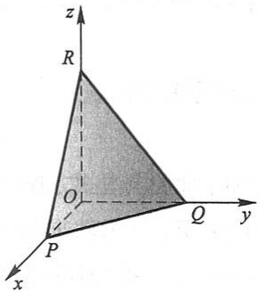

text_image

z
R
O
Q
y
P
x

图8-32

26

---

第三节 平面及其方程

$$
A = - \frac {D}{a}, \quad B = - \frac {D}{b}, \quad C = - \frac {D}{c}.
$$

以此代入(3-4)并除以 $D(D \neq 0)$, 便得所求的平面方程为

$$
\frac {x}{a} + \frac {y}{b} + \frac {z}{c} = 1. \tag {3-7}
$$

方程(3-7)叫做平面的截距式方程,而a,b和c依次叫做平面在x轴、y轴和z轴上的截距.

## 四、两平面的夹角

两平面的法向量的夹角(通常指锐角或直角)称为两平面的夹角.

设平面 $\Pi_1$ 和 $\Pi_2$ 的法向量依次为 $n_1 = (A_1, B_1, C_1)$ 和 $n_2 = (A_2, B_2, C_2)$，则平面 $\Pi_1$ 和 $\Pi_2$ 的夹角 $\theta$（图8-33）应是 $(\widehat{n_1, n_2})$ 和 $(-n_1, n_2) = \pi - (\widehat{n_1, n_2})$ 两者中的锐角或直角，因此，$\cos \theta = |\cos (\widehat{n_1, n_2})|$. 按两向量夹角余弦的坐标表示式，平面 $\Pi_1$ 和平面 $\Pi_2$ 的夹角 $\theta$ 可由

$$
\cos \theta = \frac {\mid A _ {1} A _ {2} + B _ {1} B _ {2} + C _ {1} C _ {2} \mid}{\sqrt {A _ {1} ^ {2} + B _ {1} ^ {2} + C _ {1} ^ {2}} \sqrt {A _ {2} ^ {2} + B _ {2} ^ {2} + C _ {2} ^ {2}}} \tag {3-8}
$$

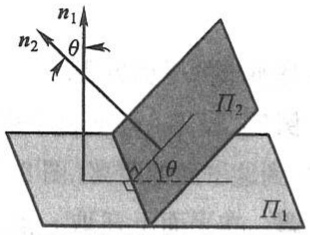

text_image

n₁
θ
n₂
Π₂
θ
Π₁

图8-33

来确定.

从两向量垂直、平行的充分必要条件立即推得下列结论:

两平面  $\Pi_{1}$  和  $\Pi_{2}$  互相垂直相当于  $A_{1}A_{2}+B_{1}B_{2}+C_{1}C_{2}=0$ ;

两平面 $\Pi_1$ 和 $\Pi_2$ 互相平行或重合相当于 $\frac{A_1}{A_2} = \frac{B_1}{B_2} = \frac{C_1}{C_2}$.

例 5 求两平面  $x-y+2z-6=0$  和  $2x+y+z-5=0$  的夹角.

解 由公式(3-8)有

$$
\cos \theta = \frac {\mid 1 \times 2 + (- 1) \times 1 + 2 \times 1 \mid}{\sqrt {1 ^ {2} + (- 1) ^ {2} + 2 ^ {2}} \sqrt {2 ^ {2} + 1 ^ {2} + 1 ^ {2}}} = \frac {1}{2},
$$

因此,所求夹角  $\theta=\frac{\pi}{3}$ .

例6 一平面通过两点 $M_{1}(1,1,1)$ 和 $M_{2}(0,1,-1)$ 且垂直于平面 $x + y + z = 0$，求它的方程.

解 设所求平面的一个法向量为

$$
n = (A, B, C).
$$

因 $\overrightarrow{M_1M_2} = (-1,0, - 2)$ 在所求平面上，它必与 $n$ 垂直，所以有

27

---

第八章 向量代数与空间解析几何

$$
- A - 2 C = 0. \tag {3-9}
$$

又因所求的平面垂直于已知平面 $x + y + z = 0$ ，所以又有

$$
A + B + C = 0. \tag {3-10}
$$

由式(3-9)、式(3-10)得到

$$
A = - 2 C, \quad B = C.
$$

由平面的点法式方程可知,所求平面方程为

$$
A (x - 1) + B (y - 1) + C (z - 1) = 0.
$$

将 A = -2C 及 B = C 代入上式, 并约去 C ( $C \neq 0$ ), 便得

$$
- 2 (x - 1) + (y - 1) + (z - 1) = 0,
$$

即

$$
2 x - y - z = 0.
$$

这就是所求的平面方程.

例 7 设  $P_{0}(x_{0}, y_{0}, z_{0})$  是平面  $Ax + By + Cz + D = 0$  外一点，求  $P_{0}$  到这平面的距离（图 8-34）.

解 在平面上任取一点 $P_{1}(x_{1},y_{1},z_{1})$ ，并作一法向量 $\pmb{n}$ ，由图8-34，并考虑到 $\overrightarrow{P_1P_0}$ 与 $\pmb{n}$ 的夹角 $\theta$ 也可能是钝角，得所求的距离

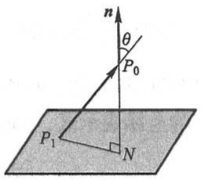

text_image

n
θ
P₀
P₁
N

图8-34

$$
d = | \overrightarrow {P _ {1} P _ {0}} | | \cos \theta | = \frac {| \overrightarrow {P _ {1} P _ {0}} \cdot n |}{| n |}.
$$

而

$$
\boldsymbol {n} = (A, B, C), \quad \overrightarrow {P _ {1} P _ {0}} = (x _ {0} - x _ {1}, y _ {0} - y _ {1}, z _ {0} - z _ {1}),
$$

得

$$
\frac {\overrightarrow {P _ {1} P _ {0}} \cdot \boldsymbol {n}}{| \boldsymbol {n} |} = \frac {A (x _ {0} - x _ {1}) + B (y _ {0} - y _ {1}) + C (z _ {0} - z _ {1})}{\sqrt {A ^ {2} + B ^ {2} + C ^ {2}}} = \frac {A x _ {0} + B y _ {0} + C z _ {0} - (A x _ {1} + B y _ {1} + C z _ {1})}{\sqrt {A ^ {2} + B ^ {2} + C ^ {2}}}.
$$

因为 $Ax_{1} + By_{1} + Cz_{1} + D = 0$ ，所以

$$
\frac {\overrightarrow {P _ {1} P _ {0}} \cdot \boldsymbol {n}}{| \boldsymbol {n} |} = \frac {A x _ {0} + B y _ {0} + C z _ {0} + D}{\sqrt {A ^ {2} + B ^ {2} + C ^ {2}}}.
$$

由此得点 $P_0(x_0, y_0, z_0)$ 到平面 $Ax + By + Cz + D = 0$ 的距离公式

$$
d = \frac {\mid A x _ {0} + B y _ {0} + C z _ {0} + D \mid}{\sqrt {A ^ {2} + B ^ {2} + C ^ {2}}}. \tag {3-11}
$$

例如,求点 $(2,1,1)$ 到平面 $x+y-z+1=0$ 的距离,可利用公式 $(3-11)$ ,便得

$$
d = \frac {\mid 1 \times 2 + 1 \times 1 - 1 \times 1 + 1 \mid}{\sqrt {1 ^ {2} + 1 ^ {2} + (- 1) ^ {2}}} = \frac {3}{\sqrt {3}} = \sqrt {3}.
$$

#

例题精讲

8-2

28

---

第四节 空间直线及其方程

## 习题8-3

1. 求过点 $(3,0,-1)$ 且与平面 $3x - 7y + 5z - 12 = 0$ 平行的平面方程.
2. 求过点 $M_0(2,9,-6)$ 且与连接坐标原点及点 $M_0$ 的线段 $OM_0$ 垂直的平面方程.
3. 求过 $M_{1}(1,1,-1), M_{2}(-2,-2,2)$ 和 $M_{3}(1,-1,2)$ 三点的平面方程.
4. 指出下列各平面的特殊位置,并画出各平面:

(1) x=0;

(2) 3y-1=0;

(3) 2x-3y-6=0;

(4) $x - \sqrt{3} y = 0$;

(5) $y + z = 1$;

(6) x-2z=0;

(7) $6x+5y-z=0.$

5. 求平面  $2x-2y+z+5=0$  与各坐标面的夹角的余弦.
6. 设一平面过点 $M_0(1,2,-1)$ 且垂直于平面 $3x - 4y + z + 16 = 0$ 和 $4x - z + 6 = 0$, 试求这平面方程.
7. 求三平面  $x+3y+z=1,2x-y-z=0,-x+2y+2z=3$  的交点.
8. 分别按下列条件求平面方程:

(1) 平行于 zOx 面且经过点  $(2, -5, 3)$ ;
(2) 通过 z 轴和点  $(-3,1,-2)$ ;
(3) 平行于 x 轴且经过两点  $(4,0,-2)$  和  $(5,1,7)$ .

9. 求点(1,2,1)到平面  $x+2y+2z-10=0$  的距离.

## 第四节 空间直线及其方程

## 一、空间直线的一般方程

空间直线 $L$ 可以看做是两个平面 $\Pi_{1}$ 和 $\Pi_{2}$ 的交线（图8-35).如果两个相交的平面 $\Pi_{1}$ 和 $\Pi_{2}$ 的方程分别为 $A_{1}x + B_{1}y + C_{1}z + D_{1} = 0$ 和 $A_{2}x + B_{2}y + C_{2}z + D_{2} = 0$ ，那么直线 $L$ 上的任一点的坐标应同时满足这两个平面的方程，即应满足方程组

$$
\left\{ \begin{array}{l} A _ {1} x + B _ {1} y + C _ {1} z + D _ {1} = 0, \\ A _ {2} x + B _ {2} y + C _ {2} z + D _ {2} = 0. \end{array} \right. \tag {4-1}
$$

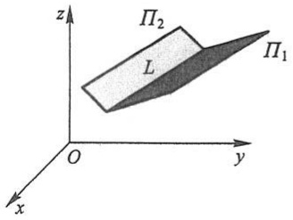

text_image

z
Π₂
L
Π₁
O
y
x

图8-35

反过来,如果点 M 不在直线 L 上,那么它不可能同时在平面  $\Pi_{1}$  和  $\Pi_{2}$  上,所以它的坐标不满足方程组(4-1).因此,直线 L 可以用方程组(4-1)来表示.方程组(4-1)叫做空间直线的一般方程.

通过空间一直线 $L$ 的平面有无限多个, 只要在这无限多个平面中任意选取两个,

29

---

第八章 向量代数与空间解析几何

把它们的方程联立起来,所得的方程组就表示空间直线 L.

## 二、空间直线的对称式方程与参数方程

如果一个非零向量平行于一条已知直线,那么这个向量就叫做这条直线的方向向量.

由于过空间一点可作而且只能作一条直线平行于一已知直线,所以当直线 L 上一点  $M_{0}(x_{0},y_{0},z_{0})$  和它的一方向向量  $s=(m,n,p)$  为已知时,直线 L 的位置就完全确定了.下面我们来建立这条直线的方程.

设点 $M(x,y,z)$ 是直线 $L$ 上的任一点，则向量 $\overrightarrow{M_0M}$ 与 $L$ 的方向向量 $s$ 平行（图8-36).所以两向量的对应坐标成比例，由于 $\overrightarrow{M_0M} = (x - x_0,y - y_0,z - z_0),s = (m,n,$ $p)$ ，从而有

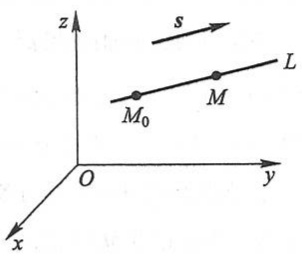

text_image

z
s
M₀ M L
O y
x

图8-36

$$
\frac {x - x _ {0}}{m} = \frac {y - y _ {0}}{n} = \frac {z - z _ {0}}{p}. \tag {4-2}
$$

反过来,如果点 M 不在直线 L 上,那么由于  $\overrightarrow{M_{0}M}$  与 s 不平行,这两向量的对应坐标就不成比例.因此方程组(4-2)就是直线 L 的方程,叫做直线的对称式方程或点向式方程.

直线的任一方向向量 s 的坐标 m, n 和 p 叫做这条直线的一组方向数，而向量 s 的方向余弦叫做该直线的方向余弦.

由直线的对称式方程容易导出直线的参数方程.如设

$$
\frac {x - x _ {0}}{m} = \frac {y - y _ {0}}{n} = \frac {z - z _ {0}}{p} = t,
$$

则

$$
\left\{ \begin{array}{l} x = x _ {0} + m t, \\ y = y _ {0} + n t, \\ z = z _ {0} + p t. \end{array} \right. \tag {4-3}
$$

① 当 $m, n$ 和 $p$ 中有一个为零，例如 $m = 0$ ，而 $n$ 与 $p \neq 0$ 时，这个方程组应理解为

$$
\left\{ \begin{array}{l} x - x _ {0} = 0, \\ \frac {y - y _ {0}}{n} = \frac {z - z _ {0}}{p}; \end{array} \right.
$$

当 $m, n$ 和 $p$ 中有两个为零，例如 $m = n = 0$ ，而 $p \neq 0$ 时，这个方程组应理解为

$$
\left\{ \begin{array}{l} x - x _ {0} = 0, \\ y - y _ {0} = 0. \end{array} \right.
$$

30

---

第四节 空间直线及其方程

方程组(4-3)就是直线的参数方程.

例1 用对称式方程及参数方程表示直线

$$
\left\{ \begin{array}{l} x + y + z + 1 = 0, \\ 2 x - y + 3 z + 4 = 0. \end{array} \right. \tag {4-4}
$$

解 先找出这条直线上的一点 $(x_0, y_0, z_0)$. 例如, 可以取 $x_0 = 1$, 代入方程组 (4-4), 得

$$
\left\{ \begin{array}{l} y _ {0} + z _ {0} = - 2, \\ y _ {0} - 3 z _ {0} = 6. \end{array} \right.
$$

解这个二元一次方程组, 得

$$
y _ {0} = 0, \quad z _ {0} = - 2,
$$

即 $(1,0,-2)$ 是这条直线上的一点.

下面再找出这条直线的方向向量 $s$. 因为两平面的交线与这两平面的法向量 $\pmb{n}_{1} = (1,1,1), \pmb{n}_{2} = (2, -1,3)$ 都垂直，所以可取

$$
s = \boldsymbol {n} _ {1} \times \boldsymbol {n} _ {2} = \left| \begin{array}{c c c} i & j & k \\ 1 & 1 & 1 \\ 2 & - 1 & 3 \end{array} \right| = 4 i - j - 3 k.
$$

因此,所给直线的对称式方程为

$$
\frac {x - 1}{4} = \frac {y}{- 1} = \frac {z + 2}{- 3}.
$$

令 $\frac{x-1}{4}=\frac{y}{-1}=\frac{z+2}{-3}=t$ ，得所给直线的参数方程为

$$
\left\{ \begin{array}{l} x = 1 + 4 t, \\ y = - t, \\ z = - 2 - 3 t. \end{array} \right.
$$

## 三、两直线的夹角

两直线的方向向量的夹角(通常指锐角或直角)叫做两直线的夹角.

设直线 $L_{1}$ 和 $L_{2}$ 的方向向量依次为 $s_1 = (m_1, n_1, p_1)$ 和 $s_2 = (m_2, n_2, p_2)$，则 $L_{1}$ 和 $L_{2}$ 的夹角 $\varphi$ 应是 $(\widehat{s_1, s_2})$ 和 $(- \widehat{s_1, s_2}) = \pi - (\widehat{s_1, s_2})$ 两者中的锐角或直角，因此 $\cos \varphi = |\cos (\widehat{s_1, s_2})|$. 按两向量的夹角的余弦公式，直线 $L_{1}$ 和直线 $L_{2}$ 的夹角 $\varphi$ 可由

$$
\cos \varphi = \frac {\mid m _ {1} m _ {2} + n _ {1} n _ {2} + p _ {1} p _ {2} \mid}{\sqrt {m _ {1} ^ {2} + n _ {1} ^ {2} + p _ {1} ^ {2}} \sqrt {m _ {2} ^ {2} + n _ {2} ^ {2} + p _ {2} ^ {2}}} \tag {4-5}
$$

来确定.

31

---

第八章 向量代数与空间解析几何

从两向量垂直、平行的充分必要条件立即推得下列结论:

两直线  $L_{1}$  和  $L_{2}$  互相垂直相当于  $m_{1}m_{2}+n_{1}n_{2}+p_{1}p_{2}=0$ ;

两直线  $L_{1}$  和  $L_{2}$  互相平行或重合相当于  $\frac{m_{1}}{m_{2}} = \frac{n_{1}}{n_{2}} = \frac{p_{1}}{p_{2}}$ .

例 2 求直线  $L_{1}:\frac{x-1}{1}=\frac{y}{-4}=\frac{z+3}{1}$  和  $L_{2}:\frac{x}{2}=\frac{y+2}{-2}=\frac{z}{-1}$  的夹角.

解 直线 $L_{1}$ 的方向向量为 $s_1 = (1, -4, 1)$, 直线 $L_{2}$ 的方向向量为 $s_2 = (2, -2, -1)$. 设直线 $L_{1}$ 和 $L_{2}$ 的夹角为 $\varphi$, 则由公式(4-5)有

$$
\cos \varphi = \frac {\mid 1 \times 2 + (- 4) \times (- 2) + 1 \times (- 1) \mid}{\sqrt {1 ^ {2} + (- 4) ^ {2} + 1 ^ {2}} \sqrt {2 ^ {2} + (- 2) ^ {2} + (- 1) ^ {2}}} = \frac {1}{\sqrt {2}},
$$

所以

$$
\varphi = \frac {\pi}{4}.
$$

## 四、直线与平面的夹角

当直线与平面不垂直时,直线和它在平面上的投影直线的夹角 $\varphi\left(0\leqslant\varphi<\frac{\pi}{2}\right)$ 称为直线与平面的夹角(图8-37),当直线与平面垂直时,规定直线与平面的夹角为 $\frac{\pi}{2}$ .

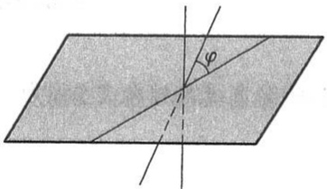

text_image

Geometric diagram showing a plane intersected by two lines with angle φ marked at the intersection point.

图8-37

设直线的方向向量为 $s = (m, n, p)$，平面的法向量为 $n = (A, B, C)$，直线与平面的夹角为 $\varphi$，那么 $\varphi = \left|\frac{\pi}{2} - (\widehat{s, n})\right|$，因此 $\sin \varphi = |\cos (\widehat{s, n})|$。按两向量夹角余弦的坐标表示式，有

$$
\sin \varphi = \frac {\mid A m + B n + C p \mid}{\sqrt {A ^ {2} + B ^ {2} + C ^ {2}} \sqrt {m ^ {2} + n ^ {2} + p ^ {2}}} . \tag {4-6}
$$

因为直线与平面垂直相当于直线的方向向量与平面的法向量平行,所以,直线与平面垂直相当于

$$
\frac {A}{m} = \frac {B}{n} = \frac {C}{p}. \tag {4-7}
$$

因为直线与平面平行或直线在平面上相当于直线的方向向量与平面的法向量垂直,所以,直线与平面平行或直线在平面上相当于

$$
A m + B n + C p = 0. \tag {4-8}
$$

例3 求过点 $(1, -2, 4)$ 且与平面 $2x - 3y + z - 4 = 0$ 垂直的直线的方程.

32

---

第四节 空间直线及其方程

解 因为所求直线垂直于已知平面,所以可以取已知平面的法向量 $(2,-3,1)$ 作为所求直线的方向向量.由此可得所求直线的方程为

$$
\frac {x - 1}{2} = \frac {y + 2}{- 3} = \frac {z - 4}{1}.
$$

## 五、杂例

例 4 求与两平面 x-4z=3 和 2x-y-5z=1 的交线平行且过点  $(-3,2,5)$  的直线的方程.

解法一 因为所求直线与两平面的交线平行,也就是直线的方向向量 s 一定同时与两平面的法向量  $n_{1}, n_{2}$  垂直,所以可以取

$$
s = \boldsymbol {n} _ {1} \times \boldsymbol {n} _ {2} = \left| \begin{array}{c c c} i & j & k \\ 1 & 0 & - 4 \\ 2 & - 1 & - 5 \end{array} \right| = - (4 i + 3 j + k),
$$

因此所求直线的方程为

$$
\frac {x + 3}{4} = \frac {y - 2}{3} = \frac {z - 5}{1}.
$$

解法二 过点 $(-3,2,5)$ 且与平面x-4z=3平行的平面的方程为

$$
x - 4 z = - 2 3,
$$

过点 $(-3,2,5)$ 且与平面2x-y-5z=1平行的平面的方程为

$$
2 x - y - 5 z = - 3 3,
$$

所求直线为上述两平面的交线,故其方程为

$$
\left\{ \begin{array}{l} x - 4 z = - 2 3, \\ 2 x - y - 5 z = - 3 3. \end{array} \right.
$$

例 5 求直线 $\frac{x-2}{1}=\frac{y-3}{1}=\frac{z-4}{2}$ 与平面 $2x+y+z-6=0$ 的交点.

解 所给直线的参数方程为

$$
x = 2 + t, \quad y = 3 + t, \quad z = 4 + 2 t,
$$

代入平面方程中,得

$$
2 (2 + t) + (3 + t) + (4 + 2 t) - 6 = 0.
$$

解以上方程, 得 t = -1. 把求得的 t 值代入直线的参数方程中, 即得所求交点的坐标为

$$
x = 1, \quad y = 2, \quad z = 2.
$$

例6 求过点(2,1,3)且与直线 $\frac{x + 1}{3} = \frac{y - 1}{2} = \frac{z}{-1}$ 垂直相交的直线的方程.

解 先作一平面过点(2,1,3)且垂直于已知直线,那么这平面的方程应为

33

---

第八章 向量代数与空间解析几何

$$
3 (x - 2) + 2 (y - 1) - (z - 3) = 0. \tag {4-9}
$$

再求已知直线与这平面的交点.已知直线的参数方程为

$$
x = - 1 + 3 t, \quad y = 1 + 2 t, \quad z = - t. \tag {4-10}
$$

把(4-10)代入(4-9)中,求得 $t=\frac{3}{7}$ ,从而求得交点为 $\left(\frac{2}{7},\frac{13}{7},-\frac{3}{7}\right)$ .

以点(2,1,3)为起点,点 $\left(\frac{2}{7},\frac{13}{7},-\frac{3}{7}\right)$ 为终点的向量

$$
\left(\frac {2}{7} - 2, \frac {1 3}{7} - 1, - \frac {3}{7} - 3\right) = - \frac {6}{7} (2, - 1, 4)
$$

是所求直线的一个方向向量,故所求直线的方程为

$$
\frac {x - 2}{2} = \frac {y - 1}{- 1} = \frac {z - 3}{4}.
$$

有时用平面束的方程解题比较方便,现在我们来介绍它的方程.

设直线 $L$ 由方程组

$$
\left\{ \begin{array}{l l} A _ {1} x + B _ {1} y + C _ {1} z + D _ {1} = 0, & (4 - 1 1) \\ A _ {2} x + B _ {2} y + C _ {2} z + D _ {2} = 0 & (4 - 1 2) \end{array} \right.
$$

所确定,其中系数 $A_{1},B_{1},C_{1}$ 与 $A_{2},B_{2},C_{2}$ 不成比例.我们建立三元一次方程

$$
A _ {1} x + B _ {1} y + C _ {1} z + D _ {1} + \lambda (A _ {2} x + B _ {2} y + C _ {2} z + D _ {2}) = 0, \tag {4-13}
$$

其中  $\lambda$  为任意常数. 因为  $A_{1}, B_{1}, C_{1}$  与  $A_{2}, B_{2}, C_{2}$  不成比例, 所以对于任何一个  $\lambda$  值, 方程(4-13) 的系数:  $A_{1} + \lambda A_{2}, B_{1} + \lambda B_{2}, C_{1} + \lambda C_{2}$  不全为零, 从而方程(4-13) 表示一个平面, 若一点在直线 L 上, 则点的坐标必同时满足方程(4-11) 和(4-12), 因而也满足方程(4-13), 故方程(4-13) 表示通过直线 L 的平面, 且对应于不同的  $\lambda$  值, 方程(4-13) 表示通过直线 L 的不同的平面. 反之, 通过直线 L 的任何平面 (除平面(4-12) 外) 都包含在方程(4-13) 所表示的一族平面内. 通过定直线的所有平面的全体称为平面束, 而方程(4-13) 就作为通过直线 L 的平面束的方程 (实际上, 方程(4-13) 表示缺少平面(4-12) 的平面束).

例7 求直线 $\begin{cases} x + y - z - 1 = 0, \\ x - y + z + 1 = 0 \end{cases}$ 在平面 $x + y + z = 0$ 上的投影直线的方程.

解 过直线 $\left\{\begin{aligned}x+y-z-1&=0,\\ x-y+z+1&=0\end{aligned}\right.$ 的平面束的方程为

$$
(x + y - z - 1) + \lambda (x - y + z + 1) = 0,
$$

即

$$
(1 + \lambda) x + (1 - \lambda) y + (- 1 + \lambda) z + (- 1 + \lambda) = 0, \tag {4-14}
$$

其中 $\lambda$ 为待定常数.这平面与平面 $x + y + z = 0$ 垂直的条件是

释疑解难
8-3

34

---

第四节 空间直线及其方程

$$
(1 + \lambda) \cdot 1 + (1 - \lambda) \cdot 1 + (- 1 + \lambda) \cdot 1 = 0,
$$

即

$$
\lambda + 1 = 0,
$$

由此得

$$
\lambda = - 1.
$$

代入(4-14)式,得投影平面的方程为

$$
2 y - 2 z - 2 = 0,
$$

即

$$
y - z - 1 = 0.
$$

所以投影直线的方程为

$$
\left\{ \begin{array}{l} y - z - 1 = 0, \\ x + y + z = 0. \end{array} \right.
$$

## 习题8-4

1. 求过点 $(4, -1, 3)$ 且平行于直线 $\frac{x - 3}{2} = \frac{y}{1} = \frac{z - 1}{5}$ 的直线方程.
2. 求过两点  $M_{1}(3,-2,1)$  和  $M_{2}(-1,0,2)$  的直线方程.
3. 用对称式方程及参数方程表示直线  $\left\{\begin{aligned} x-y+z &= 1, \\ 2x+y+z &= 4.\end{aligned}\right.$
4. 求过点(2,0,-3)且与直线 $\left\{\begin{aligned}x-2y+4z-7=0,\\ 3x+5y-2z+1=0\end{aligned}\right.$ 垂直的平面方程.
5. 求直线  $\left\{\begin{aligned}5x-3y+3z-9=0,\\ 3x-2y+z-1=0\end{aligned}\right.$  与直线  $\left\{\begin{aligned}2x+2y-z+23=0,\\ 3x+8y+z-18=0\end{aligned}\right.$  的夹角的余弦.
6. 证明直线 $\left\{\begin{aligned}x+2y-z=7,\\ -2x+y+z=7\end{aligned}\right.$ 与直线 $\left\{\begin{aligned}3x+6y-3z=8,\\ 2x-y-z=0\end{aligned}\right.$ 平行.
7. 求过点 $(1,0,-2)$ 且与平面 $3x+4y-z+6=0$ 平行，又与直线 $\frac{x-3}{1}=\frac{y+2}{4}=\frac{z}{1}$ 垂直的直线方程.
8. 求过点 $(3,1,-2)$ 且通过直线 $\frac{x-4}{5}=\frac{y+3}{2}=\frac{z}{1}$ 的平面方程.
9. 求直线  $\left\{\begin{aligned} x+y+3z=0, \\ x-y-z=0 \end{aligned}\right.$  与平面  $x-y-z+1=0$  的夹角.
10. 试确定下列各组中的直线和平面间的关系:

(1) $\frac{x + 3}{-2} = \frac{y + 4}{-7} = \frac{z}{3}$ 和 $4x - 2y - 2z = 3$;

(2) $\frac{x}{3}=\frac{y}{-2}=\frac{z}{7}$ 和 $3x-2y+7z=8;$

图

例题精讲

8-3

35

---

第八章 向量代数与空间解析几何

(3) $\frac{x - 2}{3} = \frac{y + 2}{1} = \frac{z - 3}{-4}$ 和 $x + y + z = 3$.

11. 求过点(1,2,1)且与两直线 $\left\{\begin{aligned}x+2y-z+1=0,\\ x-y+z-1=0\end{aligned}\right.$ 和 $\left\{\begin{aligned}2x-y+z=0,\\ x-y+z=0\end{aligned}\right.$ 都平行的平面的方程.

12. 求点 $(-1,2,0)$ 在平面 $x+2y-z+1=0$ 上的投影.

13. 求点  $P(3,-1,2)$  到直线  $\left\{\begin{aligned} x+y-z+1 &= 0, \\ 2x-y+z-4 &= 0 \end{aligned}\right.$  的距离.

14. 设 $M_0$ 是直线 $L$ 外一点, $M$ 是直线 $L$ 上任意一点, 且直线的方向向量为 $s$, 试证: 点 $M_0$ 到直线 $L$ 的距离

$$
d = \frac {\mid \overrightarrow {M _ {0} M} \times s \mid}{\mid s \mid}.
$$

15. 求直线  $\left\{\begin{aligned}&2x-4y+z=0,\\ &3x-y-2z-9=0\end{aligned}\right.$  在平面  $4x-y+z=1$  上的投影直线的方程.

16. 画出下列各平面所围成的立体的图形:

(1) x=0, y=0, z=0, x=2, y=1,  $3x+4y+2z-12=0$ ;
(2) x=0, z=0, x=1, y=2,  $z=\frac{y}{4}$ .

## 第五节 曲面及其方程

## 一、曲面研究的基本问题

在空间解析几何中,关于曲面的研究有下列两个基本问题:

(1) 已知一曲面作为点的几何轨迹时, 建立这曲面的方程;
(2) 已知坐标 x, y 和 z 间的一个方程时, 研究这方程所表示的曲面的形状.

在第三节中关于建立一种最简单的曲面——平面方程的例子就属于基本问题(1)，以下是建立另一种特殊曲面——球面方程的例子.

例 1 建立球心在点  $M_{0}(x_{0}, y_{0}, z_{0})$ 、半径为 R 的球面的方程.

解 设 $M(x,y,z)$ 是球面上的任一点(图8-38), 则

$$
\mid M _ {0} M \mid = R.
$$

由于

$$
\mid M _ {0} M \mid = \sqrt {\left(x - x _ {0}\right) ^ {2} + \left(y - y _ {0}\right) ^ {2} + \left(z - z _ {0}\right) ^ {2}},
$$

所以

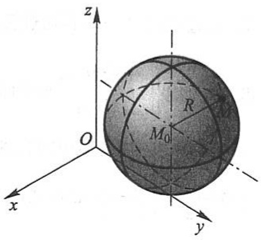

text_image

z
O
M₀
R
x
y

图8-38

36

---

第五节 曲面及其方程

$$
\sqrt {\left(x - x _ {0}\right) ^ {2} + \left(y - y _ {0}\right) ^ {2} + \left(z - z _ {0}\right) ^ {2}} = R,
$$

或

$$
\left(x - x _ {0}\right) ^ {2} + \left(y - y _ {0}\right) ^ {2} + \left(z - z _ {0}\right) ^ {2} = R ^ {2}. \tag {5-1}
$$

这就是球面上的点的坐标所满足的方程. 而不在球面上的点的坐标都不满足这方程. 所以方程(5-1)就是以 $M_0(x_0, y_0, z_0)$ 为球心、$R$ 为半径的球面方程.

如果球心在原点,那么  $x_{0}=y_{0}=z_{0}=0$ , 从而球面方程为

$$
x ^ {2} + y ^ {2} + z ^ {2} = R ^ {2}.
$$

下面举一个由已知方程研究它所表示的曲面的例子.

例2 方程 $x^{2} + y^{2} + z^{2} - 2x + 4y = 0$ 表示怎样的曲面？

解 通过配方,原方程可以改写成

$$
(x - 1) ^ {2} + (y + 2) ^ {2} + z ^ {2} = 5.
$$

与(5-1)式比较, 就知道原方程表示球心在点  $M_{0}(1,-2,0)$ 、半径  $R=\sqrt{5}$  的球面.

一般地,设有三元二次方程

$$
A x ^ {2} + A y ^ {2} + A z ^ {2} + D x + E y + F z + G = 0,
$$

这个方程的特点是缺 $xy, yz, zx$ 各项，而且平方项系数相同，只要将方程经过配方可以化成方程(5-1)的形式，则它的图形就是一个球面.

下一目中讨论旋转曲面,也是基本问题(1)的例子;而第三、四目中分别讨论柱面、二次曲面,则是基本问题(2)的例子.

## 二、旋转曲面

以一条平面曲线绕其平面上的一条直线旋转一周所成的曲面叫做旋转曲面,旋转曲线和定直线依次叫做旋转曲面的母线和轴.

设在 yOz 坐标面上有一已知曲线 C, 它的方程为

$$
f (y, z) = 0,
$$

把这曲线绕 $z$ 轴旋转一周，就得到一个以 $z$ 轴为轴的旋转曲面（图8-39).它的方程可以求得如下:

设 $M_{1}(0,y_{1},z_{1})$ 为曲线 $C$ 上的任一点，则有

$$
f (y _ {1}, z _ {1}) = 0. \tag {5-2}
$$

当曲线 $C$ 绕 $z$ 轴旋转时，点 $M_{1}$ 绕 $z$ 轴转到另一点 $M(x,y,z)$，这时 $z = z_{1}$ 保持不变，且点 $M$ 到 $z$ 轴的距离

$$
d = \sqrt {x ^ {2} + y ^ {2}} = | y _ {1} |.
$$

将 $z_{1} = z, y_{1} = \pm \sqrt{x^{2} + y^{2}}$ 代入(5-2)式，就有

$$
f (\pm \sqrt {x ^ {2} + y ^ {2}}, z) = 0, \tag {5-3}
$$

37

---

第八章 向量代数与空间解析几何

这就是所求旋转曲面的方程.

由此可知,在曲线 C 的方程  $f(y,z)=0$  中将 y 改成  $\pm\sqrt{x^{2}+y^{2}}$ , 便得曲线 C 绕 z 轴旋转所成的旋转曲面的方程.

同理,曲线 C 绕 y 轴旋转所成的旋转曲面的方程为

$$
f (y, \pm \sqrt {x ^ {2} + z ^ {2}}) = 0. \tag {5-4}
$$

例3 直线 $L$ 绕另一条与 $L$ 相交的直线旋转一周, 所得旋转曲面叫做圆锥面. 两直线的交点叫做圆锥面的顶点, 两直线的夹角 $\alpha \left(0 < \alpha < \frac{\pi}{2}\right)$ 叫做圆锥面的半顶角. 试建立顶点在坐标原点 $O$, 旋转轴为 $z$ 轴, 半顶角为 $\alpha$ 的圆锥面 (图8-40) 的方程.

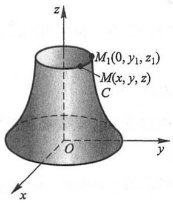

text_image

z
M₁(0, y₁, z₁)
M(x, y, z)
C
O
y
x

图8-39

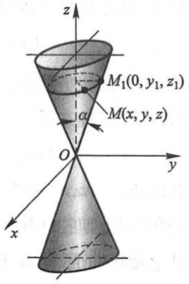

text_image

z
M₁(0, y₁, z₁)
α
M(x, y, z)
O
y
x

图8-40

解 在 yOz 坐标面上, 直线 L 的方程为

$$
z = y \cot \alpha , \tag {5-5}
$$

因为旋转轴为 z 轴, 所以只要将方程(5-5)中的 y 改成  $\pm\sqrt{x^{2}+y^{2}}$ , 便得到这圆锥面的方程

$$
z = \pm \sqrt {x ^ {2} + y ^ {2}} \cot \alpha
$$

或

$$
z ^ {2} = a ^ {2} (x ^ {2} + y ^ {2}), \tag {5-6}
$$

其中 $a = \cot \alpha$.

显然,圆锥面上任一点 M 的坐标一定满足方程(5-6).如果点 M 不在圆锥面上,那么直线 OM 与 z 轴的夹角就不等于  $\alpha$ ,于是点 M 的坐标就不满足方程(5-6).

例4 将 $zOx$ 坐标面上的双曲线

$$
\frac {x ^ {2}}{a ^ {2}} - \frac {z ^ {2}}{c ^ {2}} = 1
$$

分别绕 z 轴和 x 轴旋转一周, 求所生成的旋转曲面的方程.

解 绕 z 轴旋转所成的旋转曲面叫做旋转单叶双曲面(图 8-41)，它的方程为

38

---

第五节 曲面及其方程

$$
\frac {x ^ {2} + y ^ {2}}{a ^ {2}} - \frac {z ^ {2}}{c ^ {2}} = 1.
$$

绕 x 轴旋转所成的旋转曲面叫做旋转双叶双曲面(图 8-42)，它的方程为

$$
\frac {x ^ {2}}{a ^ {2}} - \frac {y ^ {2} + z ^ {2}}{c ^ {2}} = 1.
$$

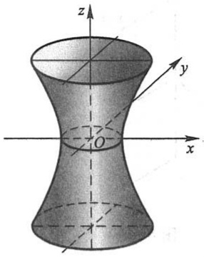

text_image

z
y
O
x

图8-41

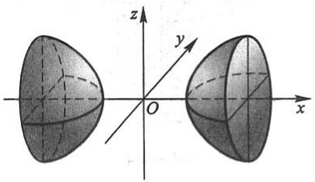

text_image

z
y
O
x

图8-42

## 三、柱面

我们先分析一个具体的例子.

例5 方程 $x^{2} + y^{2} = R^{2}$ 表示怎样的曲面？

解 方程 $x^{2} + y^{2} = R^{2}$ 在 $xOy$ 面上表示圆心在原点 $O$、半径为 $R$ 的圆. 在空间直角坐标系中, 这方程不含竖坐标 $z$, 即不论空间点的竖坐标 $z$ 怎样, 只要它的横坐标 $x$ 和纵坐标 $y$ 能满足这方程, 那么这些点就在这曲面上. 这就是说, 凡是通过 $xOy$ 面内圆 $x^{2} + y^{2} = R^{2}$ 上一点 $M(x, y, 0)$, 且平行于 $z$ 轴的直线 $l$ 都在这曲面上, 因此, 这曲面可以看做是由平行于 $z$ 轴的直线 $l$ 沿 $xOy$ 面上的圆 $x^{2} + y^{2} = R^{2}$ 移动而形成的. 这曲面叫做圆柱面 (图 8-43), $xOy$ 面上的圆 $x^{2} + y^{2} = R^{2}$ 叫做它的准线, 这平行于 $z$ 轴的直线 $l$ 叫做它的母线.

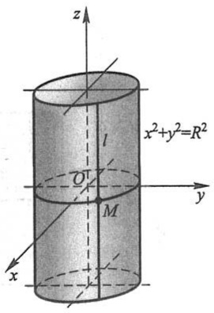

text_image

z
x²+y²=R²
l
O'
M
y
x

图8-43

一般地, 直线 L 沿定曲线 C 平行移动形成的轨迹叫做柱面, 定曲线 C 叫做柱面的准线, 动直线 L 叫做柱面的母线.

上面我们看到,不含 z 的方程  $x^{2}+y^{2}=R^{2}$  在空间直角坐标系中表示圆柱面,它的母线平行于 z 轴,它的准线是 xOy 面上的圆  $x^{2}+y^{2}=R^{2}$ .

类似地,方程  $y^{2}=2x$  表示母线平行于 z 轴的柱面,它的准线是 xOy 面上的抛物线

39

---

第八章 向量代数与空间解析几何

$y^{2}=2x$ , 该柱面叫做抛物柱面(图8-44).

又如,方程 x-y=0 表示母线平行于 z 轴的柱面,其准线是 xOy 面上的直线 x-y=0,所以它是过 z 轴的平面(图 8-45).

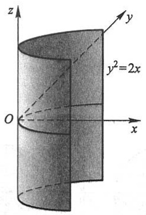

text_image

z
y
y²=2x
O
x

图8-44

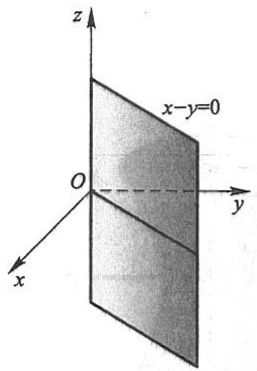

text_image

z
x-y=0
O
y
x

图 8-45

一般地, 只含 $x, y$ 而缺 $z$ 的方程 $F(x, y) = 0$ 在空间直角坐标系中表示母线平行于 $z$ 轴的柱面, 其准线是 $xOy$ 面上的曲线 $C: F(x, y) = 0$ (图8-46).

类似可知, 只含 x, z 而缺 y 的方程  $G(x, z) = 0$  和只含 y, z 而缺 x 的方程  $H(y, z) = 0$  分别表示母线平行于 y 轴和 x 轴的柱面.

例如, 方程 x-z=0 表示母线平行于 y 轴的柱面, 其准线是 zOx 面上的直线 x-z=0. 所以它是过 y 轴的平面(图 8-47).

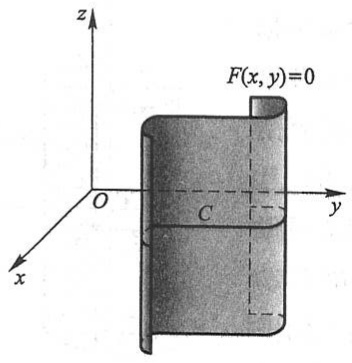

text_image

z
F(x, y)=0
O
C
y
x

图8-46

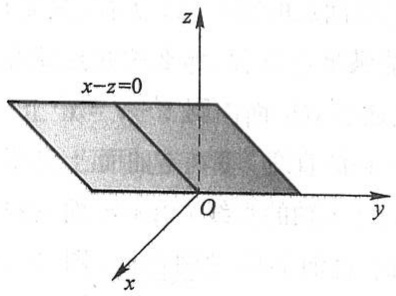

text_image

x-z=0
z
O
y
x

图8-47

## 四、二次曲面

与平面解析几何中规定的二次曲线相类似,我们把三元二次方程  $F(x,y,z)=0$  所表示的曲面称为二次曲面,把平面称为一次曲面.

二次曲面有九种,适当选取空间直角坐标系,可得它们的标准方程.下面就九种二

40

---

第五节 曲面及其方程

次曲面的标准方程来讨论二次曲面的形状.

(1) 椭圆锥面  $\frac{x^{2}}{a^{2}}+\frac{y^{2}}{b^{2}}=z^{2}$

以垂直于 $z$ 轴的平面 $z = t$ 截此曲面，当 $t = 0$ 时得一点 $(0,0,0)$；当 $t \neq 0$ 时，得平面 $z = t$ 上的椭圆

$$
\frac {x ^ {2}}{(a t) ^ {2}} + \frac {y ^ {2}}{(b t) ^ {2}} = 1.
$$

当 $t$ 变化时，上式表示一族长短轴比例不变的椭圆，当 $|t|$ 从大到小并变为0时，这族椭圆从大到小并缩为一点.综合上述讨论，可得椭圆锥面(1)的形状如图8-48所示

平面 z=t 与曲面  $F(x,y,z)=0$  的交线称为截痕. 通过综合截痕的变化来了解曲面形状的方法称为截痕法.

我们还可以用伸缩变形的方法来得出椭圆锥面(1)的形状.

先说明 $xOy$ 平面上的图形伸缩变形的方法. 在 $xOy$ 平面上, 把点 $M(x, y)$ 变为点 $M'(x, \lambda y)$, 从而把点 $M$ 的轨迹 $C$ 变为点 $M'$ 的轨迹 $C'$, 称为把图形 $C$ 沿 $y$ 轴方向伸缩 $\lambda$ 倍变成图形 $C'$. 假如 $C$ 为曲线 $F(x, y) = 0$, 点 $M(x_1, y_1) \in C$, 点 $M$ 变为点 $M'(x_2, y_2)$, 其中 $x_2 = x_1, y_2 = \lambda y_1$, 即 $x_1 = x_2, y_1 = \frac{1}{\lambda} y_2$, 因点 $M \in C$, 有 $F(x_1, y_1) = 0$, 故 $F\left(x_2, \frac{1}{\lambda} y_2\right) = 0$, 因此点 $M'(x_2, y_2)$ 的轨迹 $C'$ 的方程为 $F\left(x, \frac{1}{\lambda} y\right) = 0$. 例如把圆 $x^2 + y^2 = a^2$ 沿 $y$ 轴方向伸缩 $\frac{b}{a}$ 倍, 就变为椭圆 $\frac{x^2}{a^2} + \frac{y^2}{b^2} = 1$ (图8-49).

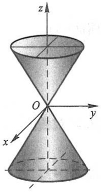

text_image

z
O
y
x
1

图8-48

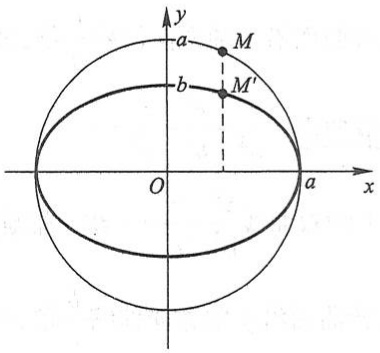

text_image

y
a
M
b
M'
O
a
x

图8-49

类似地,把空间图形沿 y 轴方向伸缩  $\frac{b}{a}$  倍,圆锥面  $\frac{x^{2}+y^{2}}{a^{2}}=z^{2}$  (图 8-40) 就变为椭圆锥面  $\frac{x^{2}}{a^{2}}+\frac{y^{2}}{b^{2}}=z^{2}$  (图 8-48).

41

---

第八章 向量代数与空间解析几何

利用圆锥面(旋转曲面)的伸缩变形来得出椭圆锥面的形状,这种方法是研究曲面形状的一种较方便的方法.

(2) 椭球面  $\frac{x^{2}}{a^{2}}+\frac{y^{2}}{b^{2}}+\frac{z^{2}}{c^{2}}=1$

把 zOx 面上的椭圆  $\frac{x^{2}}{a^{2}} + \frac{z^{2}}{c^{2}} = 1$  绕 z 轴旋转，所得曲面称为旋转椭球面，其方程为

$$
\frac {x ^ {2} + y ^ {2}}{a ^ {2}} + \frac {z ^ {2}}{c ^ {2}} = 1.
$$

再把旋转椭球面沿 y 轴方向伸缩  $\frac{b}{a}$  倍, 便得椭球面(2)的形状如图 8-50 所示.

当 $a = b = c$ 时，椭球面(2)成为 $x^{2} + y^{2} + z^{2} = a^{2}$，这是球心在原点、半径为 $a$ 的球面。显然，球面是旋转椭球面的特殊情形，旋转椭球面是椭球面的特殊情形。把球面 $x^{2} + y^{2} + z^{2} = a^{2}$ 沿 $z$ 轴方向伸缩 $\frac{c}{a}$ 倍，即得旋转椭球面 $\frac{x^2 + y^2}{a^2} +\frac{z^2}{c^2} = 1$；再沿 $y$ 轴方向伸缩 $\frac{b}{a}$ 倍，即得椭球面(2)。

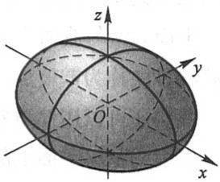

text_image

z
y
O
x

图8-50

(3) 单叶双曲面  $\frac{x^{2}}{a^{2}}+\frac{y^{2}}{b^{2}}-\frac{z^{2}}{c^{2}}=1$

把 $zOx$ 面上的双曲线 $\frac{x^2}{a^2} -\frac{z^2}{c^2} = 1$ 绕 $z$ 轴旋转，得旋转单叶双曲面 $\frac{x^2 + y^2}{a^2} -\frac{z^2}{c^2} = 1$ （图8-41).把此旋转曲面沿 $y$ 轴方向伸缩 $\frac{b}{a}$ 倍，即得单叶双曲面(3).

(4) 双叶双曲面  $\frac{x^{2}}{a^{2}}-\frac{y^{2}}{b^{2}}-\frac{z^{2}}{c^{2}}=1$

把 $zOx$ 面上的双曲线 $\frac{x^2}{a^2} -\frac{z^2}{c^2} = 1$ 绕 $x$ 轴旋转，得旋转双叶双曲面 $\frac{x^2}{a^2} -\frac{y^2 + z^2}{c^2} = 1$ （图8-42），把此旋转曲面沿 $y$ 轴方向伸缩 $\frac{b}{c}$ 倍，即得双叶双曲面(4).

(5) 椭圆抛物面  $\frac{x^{2}}{a^{2}}+\frac{y^{2}}{b^{2}}=z$

把 $zOx$ 面上的抛物线 $\frac{x^2}{a^2} = z$ 绕 $z$ 轴旋转, 所得曲面叫做旋转抛物面, 如图8-51所示. 把此旋转曲面沿 $y$ 轴方向伸缩 $\frac{b}{a}$ 倍, 即得椭圆抛物面(5).

42

---

第五节 曲面及其方程

(6) 双曲抛物面  $\frac{x^{2}}{a^{2}} - \frac{y^{2}}{b^{2}} = z$

双曲抛物面又称马鞍面,我们用截痕法来讨论它的形状.

用平面 x=t 截此曲面, 所得截痕 l 为平面 x=t 上的抛物线

$$
- \frac {y ^ {2}}{b ^ {2}} = z - \frac {t ^ {2}}{a ^ {2}},
$$

此抛物线开口朝下,其顶点坐标为

$$
x = t, \quad y = 0, \quad z = \frac {t ^ {2}}{a ^ {2}}.
$$

当 $t$ 变化时，$l$ 的形状不变，位置只作平移，而 $l$ 的顶点的轨迹 $L$ 为平面 $y = 0$ 上的抛物线

$$
z = \frac {x ^ {2}}{a ^ {2}}.
$$

因此,以 l 为母线,L 为准线,母线 l 的顶点在准线 L 上滑动,且母线作平行移动,这样得到的曲面便是双曲抛物面(6),如图 8-52 所示.

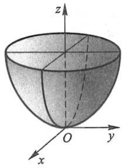

natural_image

3D geometric diagram of a hemisphere in Cartesian coordinate system (x, y, z axes labeled), showing no text or symbols beyond axis labels.

图8-51

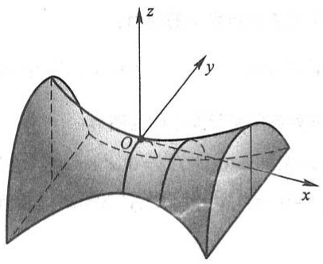

text_image

z
y
O
x

图8-52

还有三种二次曲面是以三种二次曲线为准线的柱面

$$
\frac {x ^ {2}}{a ^ {2}} + \frac {y ^ {2}}{b ^ {2}} = 1, \quad \frac {x ^ {2}}{a ^ {2}} - \frac {y ^ {2}}{b ^ {2}} = 1, \quad x ^ {2} = a y,
$$

依次称为椭圆柱面、双曲柱面、抛物柱面. 柱面的形状在第三目中已经讨论过, 这里不再赘述.

## 习题8-5

1. 一球面过原点及 $A(4,0,0), B(1,3,0)$ 和 $C(0,0,-4)$ 三点，求球面的方程及球心的坐标和半径.
2. 已知一球面的球心在点  $P_{0}(3,-5,2)$  且与平面  $\Pi:2x-y+3z+9=0$  相切，求该球面方程.

43

---

第八章 向量代数与空间解析几何

3. 方程  $x^{2}+y^{2}+z^{2}-2x+4y+2z=0$  表示什么曲面？

4. 求与坐标原点 $O$ 及点 $(2,3,4)$ 的距离之比为 $1:2$ 的点的全体所组成的曲面的方程, 它表示怎样的曲面?

5. 将 $zOx$ 坐标面上的抛物线 $z^2 = 5x$ 绕 $x$ 轴旋转一周, 求所生成的旋转曲面的方程.

6. 将 $zOx$ 坐标面上的圆 $x^{2} + z^{2} = 9$ 绕 $z$ 轴旋转一周, 求所生成的旋转曲面的方程.

7. 将 $xOy$ 坐标面上的双曲线 $4x^{2} - 9y^{2} = 36$ 分别绕 $x$ 轴及 $y$ 轴旋转一周, 求所生成的旋转曲面的方程.

8. 画出下列各方程所表示的曲面:

(1) $\left(x-\frac{a}{2}\right)^{2}+y^{2}=\left(\frac{a}{2}\right)^{2};$

(2) $-\frac{x^{2}}{4}+\frac{y^{2}}{9}=1;$

(3) $\frac{x^2}{9} + \frac{z^2}{4} = 1$;

(4) $y^{2}-z=0;$

(5) $z=2-x^{2}.$

9. 指出下列方程在平面解析几何中和在空间解析几何中分别表示什么图形:

(1) x=2;

(2) $y = x + 1$;

(3) $x^{2} + y^{2} = 4$;

(4) $x^{2} - y^{2} = 1$.

10. 说明下列旋转曲面是怎样形成的:

(1) $\frac{x^2}{4} + \frac{y^2}{9} + \frac{z^2}{9} = 1$;

(2) $x^{2} - \frac{y^{2}}{4} +z^{2} = 1;$

(3) $x^{2} - y^{2} - z^{2} = 1$;

(4) $(z - a)^2 = x^2 + y^2$.

11. 画出下列方程所表示的曲面:

(1) $4x^{2}+y^{2}-z^{2}=4;$

(2) $x^{2} - y^{2} - 4z^{2} = 4$;

(3) $\frac{z}{3} = \frac{x^2}{4} + \frac{y^2}{9}$.

12. 画出下列各曲面所围立体的图形:

(1) z=0, z=3, x-y=0,  $x-\sqrt{3}y=0$ ,  $x^{2}+y^{2}=1$  （在第Ⅰ卦限内）;

(2) $x = 0, y = 0, z = 0, x^2 + y^2 = R^2, y^2 + z^2 = R^2$ （在第I卦限内）.

## 第六节 空间曲线及其方程

## 一、空间曲线的一般方程

在第三节中,我们已经知道空间曲线可以看做两个曲面的交线.设

$$
F (x, y, z) = 0 \quad {\text {和}} \quad G (x, y, z) = 0
$$

是两个曲面的方程,则方程组

$$
\left\{ \begin{array}{l} F (x, y, z) = 0, \\ G (x, y, z) = 0. \end{array} \right. \tag {6-1}
$$

就是这两个曲面的交线 C 的方程, 方程组(6-1)也叫做空间曲线 C 的一般方程.

例1 方程组 $\begin{cases} x^2 + y^2 = 1, \\ 2x + 3z = 6 \end{cases}$ 表示怎样的曲线？

44

---

第六节 空间曲线及其方程

解 方程组中第一个方程表示母线平行于 $z$ 轴的圆柱面, 其准线是 $xOy$ 面上的圆, 圆心在原点 $O$, 半径为 1. 方程组中第二个方程表示一个母线平行于 $y$ 轴的柱面, 由于它的准线是 $zOx$ 面上的直线, 因此它是一个平面. 方程组就表示上述平面与圆柱面的交线, 如图 8-53 所示.

例2 方程组 $\left\{ \begin{array}{l} z = \sqrt{a^2 - x^2 - y^2}, \\ \left( x - \frac{a}{2} \right)^2 + y^2 = \left( \frac{a}{2} \right)^2 \end{array} \right.$ 表示怎样的曲线？

解 方程组中第一个方程表示球心在坐标原点 $O$, 半径为 $a$ 的上半球面. 第二个方程表示母线平行于 $z$ 轴的圆柱面, 它的准线是 $xOy$ 面上的圆, 这圆的圆心在点 $\left(\frac{a}{2}, 0\right)$, 半径为 $\frac{a}{2}$. 方程组就表示上述半球面与圆柱面的交线, 如图 8-54 所示.

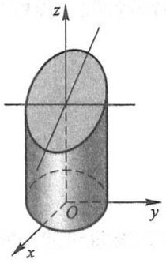

text_image

z
O
y
x

图8-53

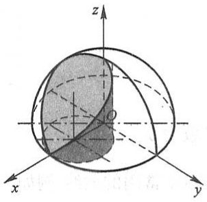

text_image

z
O
x
y

图8-54

## 二、空间曲线的参数方程

空间曲线 $C$ 的方程除了一般方程之外，也可以用参数形式表示，只要将 $C$ 上动点的坐标 $x, y$ 和 $z$ 表示为参数 $t$ 的函数

$$
\left\{ \begin{array}{l} x = x (t), \\ y = y (t), \\ z = z (t). \end{array} \right. \tag {6-2}
$$

当给定 $t = t_{1}$ 时，就得到曲线 $C$ 上的一个点 $(x_{1},y_{1},z_{1})$；随着 $t$ 的变动便可得曲线 $C$ 上的全部点。方程组(6-2)叫做空间曲线的参数方程。

例3 如果空间一点 $M$ 在圆柱面 $x^{2} + y^{2} = a^{2}$ 上以角速度 $\omega$ 绕 $z$ 轴旋转, 同时又以线速度 $v$ 沿平行于 $z$ 轴的正方向上升 (其中 $\omega$ 和 $v$ 都是常数), 那么点 $M$ 构成的图形叫做螺旋线. 试建立其参数方程.

解 取时间 $t$ 为参数. 设当 $t = 0$ 时, 动点位于 $x$ 轴上的一点 $A(a,0,0)$ 处. 经过时间 $t$, 动点由 $A$ 运动到 $M(x,y,z)$ (图8-55). 记 $M$ 在 $xOy$ 面上的投影为 $M', M'$ 的坐标

45

---

第八章 向量代数与空间解析几何

为 $(x,y,0)$ .由于动点在圆柱面上以角速度 $\omega$ 绕z轴旋转,所以经过时间 $t,\angle AOM^{\prime}=\omega t$ .从而

$$
x = \mid O M ^ {\prime} \mid \cos \angle A O M ^ {\prime} = a \cos \omega t,
$$

$$
y = \mid O M ^ {\prime} \mid \sin \angle A O M ^ {\prime} = a \sin \omega t.
$$

由于动点同时以线速度 v 沿平行于 z 轴的正方向上升，所以

$$
z = M ^ {\prime} M = v t.
$$

因此螺旋线的参数方程为

$$
\left\{ \begin{array}{l} x = a \cos \omega t, \\ y = a \sin \omega t, \\ z = v t. \end{array} \right.
$$

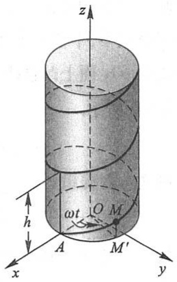

text_image

z
h
ωt
O M
A
M'
x
y

图8-55

也可以用其他变量作参数.例如令 $\theta = \omega t$ ，则螺旋线的参数方程可写为

$$
\left\{ \begin{array}{l} x = a \cos \theta , \\ y = a \sin \theta , \\ z = b \theta . \end{array} \right.
$$

这里 $b = \frac{v}{\omega}$ 而参数为 $\theta$.

螺旋线是实践中常用的曲线.例如,平头螺丝钉的外缘曲线就是螺旋线.当我们拧紧平头螺丝钉时,它的外缘曲线上的任一点M,一方面绕螺丝钉的轴旋转,另一方面又沿平行于轴线的方向前进,点M就走出一段螺旋线.

螺旋线有一个重要性质: 当  $\theta$  从  $\theta_{0}$  变到  $\theta_{0} + \alpha$  时, z 由  $b\theta_{0}$  变到  $b\theta_{0} + b\alpha$ . 这说明当  $OM'$  转过角  $\alpha$  时, 点 M 沿螺旋线上升了高度  $b\alpha$ , 即上升的高度与  $OM'$  转过的角度成正比. 特别是当  $OM'$  转过一周, 即  $\alpha = 2\pi$  时, 点 M 就上升固定的高度  $h = 2\pi b$ . 这个高度  $h = 2\pi b$  在工程技术上叫做螺距.

\* 曲面的参数方程

下面顺便介绍一下曲面的参数方程.曲面的参数方程通常是含两个参数的方程，形如

$$
\left\{ \begin{array}{l} x = x (s, t), \\ y = y (s, t), \\ z = z (s, t). \end{array} \right. \tag {6-3}
$$

例如空间曲线 $\Gamma$

$$
\left\{ \begin{array}{l l} x = \varphi (t), \\ y = \psi (t), & (\alpha \leqslant t \leqslant \beta) \\ z = \omega (t) \end{array} \right.
$$

46

---

第六节 空间曲线及其方程

绕 z 轴旋转, 所得旋转曲面的方程为

$$
\left\{ \begin{array}{l} x = \sqrt {\left[ \varphi (t) \right] ^ {2} + \left[ \psi (t) \right] ^ {2}} \cos \theta , \\ y = \sqrt {\left[ \varphi (t) \right] ^ {2} + \left[ \psi (t) \right] ^ {2}} \sin \theta , \quad \alpha \leqslant t \leqslant \beta , 0 \leqslant \theta \leqslant 2 \pi . \\ z = \omega (t), \end{array} \right. \tag {6-4}
$$

这是因为, 固定一个 t, 得  $\Gamma$  上一点  $M_{1}(\varphi(t), \psi(t), \omega(t))$ , 点  $M_{1}$  绕 z 轴旋转, 得空间的一个圆, 该圆在平面  $z = \omega(t)$  上, 其半径为点  $M_{1}$  到 z 轴的距离  $\sqrt{[\varphi(t)]^{2} + [\psi(t)]^{2}}$ , 因此, 固定 t 的方程 (6-4) 就是该圆的参数方程. 再令 t 在  $[\alpha, \beta]$  内变动, 方程 (6-4) 便是旋转曲面的方程.

例如直线

$$
\left\{ \begin{array}{l} x = 1, \\ y = t, \\ z = 2 t \end{array} \right.
$$

绕 z 轴旋转所得旋转曲面(图 8-56)的方程为

$$
\left\{ \begin{array}{l} x = \sqrt {1 + t ^ {2}} \cos \theta , \\ y = \sqrt {1 + t ^ {2}} \sin \theta , \\ z = 2 t \end{array} \right.
$$

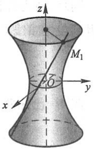

text_image

z
M₁
O
y
x

图8-56

$\left( \text{上式消去 } t \text{ 和 } \theta, \text{得曲面的直角坐标方程为 } x^{2} + y^{2} = 1 + \frac{z^{2}}{4} \right).$

又如球面 $x^{2} + y^{2} + z^{2} = a^{2}$ 可看成 $zOx$ 面上的半圆周

$$
\left\{ \begin{array}{l l} x = a \sin \varphi , \\ y = 0, & 0 \leqslant \varphi \leqslant \pi \\ z = a \cos \varphi , \end{array} \right.
$$

绕 z 轴旋转所得(图 8-57)，故球面方程为

$$
\left\{ \begin{array}{l l} x = a \sin \varphi \cos \theta , \\ y = a \sin \varphi \sin \theta , & 0 \leqslant \varphi \leqslant \pi , 0 \leqslant \theta \leqslant 2 \pi . \\ z = a \cos \varphi , \end{array} \right.
$$

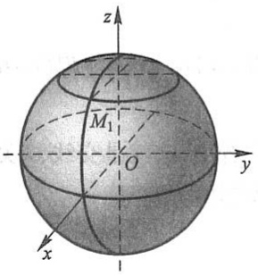

text_image

z
M₁
O
y
x

图8-57

## 三、空间曲线在坐标面上的投影

设空间曲线 C 的一般方程为  $(6-1)$ ，现在来研究由方程组  $(6-1)$  消去变量 z 后（如果可能的话）所得的方程

$$
H (x, y) = 0. \tag {6-5}
$$

由于方程(6-5)是由方程组(6-1)消去 $z$ 后所得的结果, 因此当 $x, y$ 和 $z$ 满足方程组(6-1)时, 前两个坐标 $x, y$ 必定满足方程(6-5), 这说明曲线 $C$ 上的所有点都在

47

---

第八章 向量代数与空间解析几何

由方程(6-5)所表示的曲面上.

由上节知道,方程(6-5)表示一个母线平行于z轴的柱面.由上面的讨论可知,这柱面必定包含曲线C.以曲线C为准线、母线平行于z轴(即垂直于xOy面)的柱面叫做曲线C关于xOy面的投影柱面,投影柱面与xOy面的交线叫做空间曲线C在xOy面上的投影曲线,或简称投影.因此,方程(6-5)所表示的柱面必定包含投影柱面,而方程

$$
\left\{ \begin{array}{l} H (x, y) = 0, \\ z = 0 \end{array} \right.
$$

所表示的曲线必定包含空间曲线 C 在 xOy 面上的投影.

同理,消去方程组(6-1)中的变量x或变量y,再分别和x=0或y=0联立,我们就可得到包含曲线C在yOz面或zOx面上的投影的曲线方程:

$$
\left\{ \begin{array}{l l} R (  y, z) = 0  , \\ x = 0  , \end{array} \right. \quad \text {或} \quad \left\{ \begin{array}{l l} T (  x, z) = 0  , \\ y = 0. \end{array} \right.
$$

例4 已知两球面的方程为

$$
x ^ {2} + y ^ {2} + z ^ {2} = 1 \tag {6-6}
$$

和

$$
x ^ {2} + (y - 1) ^ {2} + (z - 1) ^ {2} = 1, \tag {6-7}
$$

求它们的交线 C 在 xOy 面上的投影的方程.

解 先求包含交线 $C$ 而母线平行于 $z$ 轴的柱面方程. 因此要由方程(6-6)、(6-7)消去 $z$, 为此可先从(6-6)式减去(6-7)式并化简, 得到

$$
y + z = 1.
$$

再以 $z = 1 - y$ 代入方程(6-6)或(6-7)即得所求的柱面方程为

$$
x ^ {2} + 2 y ^ {2} - 2 y = 0.
$$

容易看出,这就是交线 C 关于 xOy 面的投影柱面方程,于是两球面的交线在 xOy 面上的投影的方程是

$$
\left\{ \begin{array}{l} x ^ {2} + 2 y ^ {2} - 2 y = 0, \\ z = 0. \end{array} \right.
$$

在重积分和曲面积分的计算中,往往需要确定一个立体或曲面在坐标面上的投影,这时要利用投影柱面和投影曲线.

例5 设一个立体由上半球面 $z = \sqrt{4 - x^2 - y^2}$ 和锥面 $z = \sqrt{3(x^2 + y^2)}$ 所围成（图8-58），求它在 $xOy$ 面上的投影.

解 半球面和锥面的交线为

$$
C: \left\{ \begin{array}{l} z = \sqrt {4 - x ^ {2} - y ^ {2}}, \\ z = \sqrt {3 (x ^ {2} + y ^ {2})}. \end{array} \right.
$$

48

---

第六节 空间曲线及其方程

由上列方程组消去 $z$ ，得到 $x^{2} + y^{2} = 1.$ 这是一个母线平行于 $z$ 轴的圆柱面，容易看出，这恰好是交线 $C$ 关于$xOy$ 面的投影柱面，因此交线 $C$ 在 $xOy$ 面上的投影曲线为

$$
\left\{ \begin{array}{l} x ^ {2} + y ^ {2} = 1, \\ z = 0. \end{array} \right.
$$

这是 xOy 面上的一个圆, 于是所求立体在 xOy 面上的投影, 就是该圆在 xOy 面上所围的部分

$$
x ^ {2} + y ^ {2} \leqslant 1.
$$

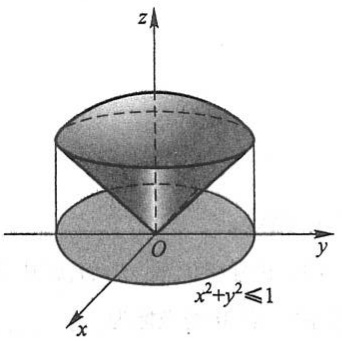

text_image

z
O
y
x²+y²≤1
x

图8-58

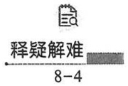

## 习题8-6

1. 画出下列曲线在第Ⅰ卦限内的图形:

(1) $\left\{\begin{aligned}x=1,\\ y=2;\end{aligned}\right.$

(2) $\left\{ \begin{array}{l} z = \sqrt{4 - x^2 - y^2}, \\ x - y = 0; \end{array} \right.$

(3) $\left\{ \begin{array}{l}x^{2} + y^{2} = a^{2},\\ x^{2} + z^{2} = a^{2}. \end{array} \right.$

2. 指出下列方程组在平面解析几何中与在空间解析几何中分别表示什么图形:

(1) $\left\{ \begin{array}{l} y = 5x + 1, \\ y = 2x - 3; \end{array} \right.$

(2) $\left\{\begin{aligned}\frac{x^{2}}{4}+\frac{y^{2}}{9}=1,\\ y=3.\end{aligned}\right.$

3. 分别求母线平行于 $x$ 轴及 $y$ 轴而且通过曲线 $\left\{ \begin{array}{l} 2x^{2} + y^{2} + z^{2} = 16, \\ x^{2} + z^{2} - y^{2} = 0 \end{array} \right.$ 的柱面方程.

4. 求下列两曲面的交线在 $xOy$ 面上的投影的方程:

(1) 球面  $x^{2}+y^{2}+z^{2}=9$  与平面  $x+z=1$ ;
(2) 椭球面  $x^{2}+y^{2}+4z^{2}=1$  与圆锥面  $z^{2}=x^{2}+y^{2}$ .

5. 将下列曲线的一般方程化为参数方程:

(1) $\left\{\begin{aligned}x^{2}+y^{2}+z^{2}&=9,\\ y&=x;\end{aligned}\right.$

(2) $\left\{ \begin{array}{l}(x - 1)^2 + y^2 + (z + 1)^2 = 4, \\ z = 0. \end{array} \right.$

6. 求螺旋线  $\left\{\begin{aligned} x &= a \cos \theta, \\ y &= a \sin \theta, \\ z &= b \theta \end{aligned}\right.$  在三个坐标面上的投影曲线的直角坐标方程.

7. 求上半球 $0 \leqslant z \leqslant \sqrt{a^2 - x^2 - y^2}$ 与圆柱体 $x^2 + y^2 \leqslant ax (a > 0)$ 的公共部分在 $xOy$ 面和 $zOx$ 面上的投影.
8. 求旋转抛物面  $z = x^{2} + y^{2} (0 \leqslant z \leqslant 4)$  在三坐标面上的投影.

49

---

第八章 向量代数与空间解析几何

## 总习题八

1. 填空:

（1）设在坐标系 $[O;i,j,k]$ 中点A和点M的坐标依次为 $(x_{0},y_{0},z_{0})$ 和 $(x,y,z)$ ，则在 $[A;i,j,k]$ 坐标系中，点M的坐标为\_\_\_\_，向量 $\overrightarrow{OM}$ 的坐标为\_\_\_\_；
(2) 设数  $\lambda_{1}, \lambda_{2}, \lambda_{3}$  不全为 0，使  $\lambda_{1}a + \lambda_{2}b + \lambda_{3}c = 0$ ，则 a, b, c 三个向量是 \_\_\_\_ 的；
(3) 设  $\boldsymbol{a}=(2,1,2)$ ,  $\boldsymbol{b}=(4,-1,10)$ ,  $c=b-\lambda a$ , 且  $a \perp c$ , 则  $\lambda=$ \_\_\_\_ ;
(4) 设  $\left|a\right|=3,\left|b\right|=4,\left|c\right|=5$  ,且满足  $a+b+c=0$  ,则  $\left|a\times b+b\times c+c\times a\right|=$  \_\_\_\_.

2. 下列两题中给出了四个结论, 从中选出一个正确的结论:

（1）设直线 L 的方程为  $\left\{\begin{aligned} x-y+z &= 1, \\ 2x+y+z &= 4, \end{aligned}\right.$  则 L 的参数方程为（）；

(A) $\left\{\begin{aligned}x&=1-2t,\\ y&=1+t,\\ z&=1+3t\end{aligned}\right.$

(B) $\left\{ \begin{array}{l}x = 1 - 2t,\\ y = -1 + t,\\ z = 1 + 3t \end{array} \right.$

(C) $\left\{ \begin{array}{l}x = 1 - 2t,\\ y = 1 - t,\\ z = 1 + 3t \end{array} \right.$

(D) $\left\{ \begin{array}{l}x = 1 - 2t,\\ y = -1 - t,\\ z = 1 + 3t \end{array} \right.$

(2) 下列结论中, 错误的是().

(A) $z + 2x^{2} + y^{2} = 0$ 表示椭圆抛物面

(B) $x^{2} + 2y^{2} = 1 + 3z^{2}$ 表示双叶双曲面

(C)  $x^{2}+y^{2}-(z-1)^{2}=0$  表示圆锥面

(D) $y^{2}=5x$ 表示抛物柱面

$$
\overrightarrow {A D} + \overrightarrow {B E} + \overrightarrow {C F} = 0.
$$

3. 在 y 轴上求与点 A(1,-3,7) 和点 B(5,7,-5) 等距离的点.
4. 已知 $\triangle ABC$ 的顶点为 $A(3,2,-1), B(5,-4,7)$ 和 $C(-1,1,2)$, 求从顶点 $C$ 所引中线的长度.
5. 设 $\triangle ABC$ 的三边 $\overrightarrow{BC} = a, \overrightarrow{CA} = b, \overrightarrow{AB} = c$, 三边中点依次为 $D, E, F$, 试用向量 $a, b, c$ 表示 $\overrightarrow{AD}, \overrightarrow{BE}, \overrightarrow{CF}$, 并证明
6. 试用向量证明: 梯形两腰中点的连线平行于底边, 且其长度等于上、下两底边长度之和的一半.
7. 设 $|a + b| = |a - b|$, $a = (3, -5, 8)$, $b = (-1, 1, z)$, 求 $z$.
8. 设 $|a| = \sqrt{3}$, $|b| = 1$, $(\widehat{a, b}) = \frac{\pi}{6}$, 求向量 $a + b$ 与 $a - b$ 的夹角.
9. 设 $(a+3b)\perp(7a-5b),(a-4b)\perp(7a-2b)$ ，求 $(\widehat{a,b})$ .
10. 设向量 $a = (1, -2, 2), b = (-2, 1, 2)$，若存在向量 $c$，使 $a \times c = b$，试求向量 $c$；若向量 $c$ 不止一个，试找出模最小的那个 $c$.
11. 设 $|a| = 4$, $|b| = 3$, $(\widehat{a, b}) = \frac{\pi}{6}$, 求以 $a + 2b$ 和 $a - 3b$ 为边的平行四边形的面积.
12. 设 $a = (2, -3, 1), b = (1, -2, 3), c = (2, 1, 2)$，向量 $r$ 满足 $r \perp a, r \perp b, \operatorname{Prj}_c r = 14$，求 $r$.
13. 设 $a = (-1, 3, 2), b = (2, -3, -4), c = (-3, 12, 6)$，证明三向量 $a, b, c$ 共面，并用 $a$ 和 $b$ 表

50

---

总习题八

示c.

14. 已知动点 $M(x, y, z)$ 到 $xOy$ 面的距离与点 $M$ 到点 $(1, -1, 2)$ 的距离相等, 求点 $M$ 的轨迹的方程.

15. 指出下列旋转曲面的一条母线和旋转轴:

(1) $z = 2(x^{2} + y^{2})$;

(2) $\frac{x^2}{36} + \frac{y^2}{9} + \frac{z^2}{36} = 1$;

(3) $z^2 = 3(x^2 + y^2)$;

(4) $x^{2} - \frac{y^{2}}{4} -\frac{z^{2}}{4} = 1.$

16. 求通过点 $A(3,0,0)$ 和 $B(0,0,1)$ 且与 $xOy$ 面成 $\frac{\pi}{3}$ 角的平面的方程.

17. 设一平面垂直于平面 $z = 0$，并通过从点 $(1, -1, 1)$ 到直线 $\left\{ \begin{array}{l} y - z + 1 = 0, \\ x = 0 \end{array} \right.$ 的垂线，求此平面的方程.

18. 求过点 $(-1,0,4)$, 且平行于平面 $3x - 4y + z - 10 = 0$, 又与直线 $\frac{x + 1}{1} = \frac{y - 3}{1} = \frac{z}{2}$ 相交的直线的方程.

19. 一直线 $l$ 过点 $A(-3,5,-9)$ 且与两直线 $l_{1}: \begin{cases} y = 3x + 5, \\ z = 2x - 3, \end{cases} l_{2}: \begin{cases} y = 4x - 7, \\ z = 5x + 10 \end{cases}$ 相交，求此直线方程.

20. 已知点 $A(1,0,0)$ 及点 $B(0,2,1)$, 试在 $z$ 轴上求一点 $C$, 使 $\triangle ABC$ 的面积最小.

21. 求曲线  $\left\{\begin{aligned}z&=2-x^{2}-y^{2},\\ z&(x-1)^{2}+(y-1)^{2}\end{aligned}\right.$  在三个坐标面上的投影曲线的方程.

22. 求锥面 $z = \sqrt{x^2 + y^2}$ 与柱面 $z^2 = 2x$ 所围立体在三个坐标面上的投影.

23. 画出下列各曲面所围立体的图形:

(1) 抛物柱面  $2y^{2}=x$ ，平面 z=0 及  $\frac{x}{4}+\frac{y}{2}+\frac{z}{2}=1$ ;

(2) 抛物柱面  $x^{2}=1-z$ ，平面 y=0, z=0 及  $x+y=1$ ;

(3) 圆锥面  $z = \sqrt{x^{2} + y^{2}}$  及旋转抛物面  $z = 2 - x^{2} - y^{2}$ ;

(4) 旋转抛物面  $x^{2}+y^{2}=z$ ，柱面  $y^{2}=x$ ，平面 z=0 及 x=1.

第八章释疑解难

第八章例题精讲

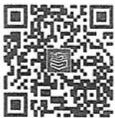

51
