# 第11章 曲线积分与曲面积分

原始 PDF 第 187–247 页。

# 第十一章

# 曲线积分与曲面积分

上一章已经把积分概念从积分范围为数轴上一个区间的情形推广到积分范围为平面或空间内的一个闭区域的情形.本章将把积分概念推广到积分范围为一段曲线弧或一片曲面①的情形(这样推广后的积分称为曲线积分和曲面积分),并阐明有关这两种积分的一些基本内容.

## 第一节 对弧长的曲线积分

## 一、对弧长的曲线积分的概念与性质

曲线形构件的质量 在设计曲线形构件时,为了合理使用材料,应该根据构件各部分受力情况,把构件上各点处的粗细程度设计得不完全一样.因此,可以认为这构件

的线密度(单位长度的质量)是变量.假设这构件所处的位置在xOy面内的一段曲线弧L上,它的端点是A,B,在L上任一点 $(x,y)$ 处,它的线密度为 $\mu(x,y)$ .现在要计算这构件的质量m（图11-1）.

如果构件的线密度为常量,那么这构件的质量就等于它的线密度与长度的乘积.现在构件上各点处的线密度是变量,就不能直接用上述方法来计算.为了克服这个困难,可以用 L 上的点  $M_{1}, M_{2}, \cdots, M_{n-1}$  把 L 分成 n 个小

line

| Point | x | y |
| --- | --- | --- |
| A | ~0.2 | ~0.3 |
| M1 | ~0.4 | ~0.5 |
| M2 | ~0.6 | ~0.7 |
| Mi-1 | ~0.8 | ~1.0 |
| Mi | ~1.0 | ~1.3 |
| L | ~1.2 | ~1.6 |
| Mn-1 | ~1.4 | ~2.2 |
| B | ~1.6 | ~2.8 |

图11-1

段,取其中一小段构件 $\widehat{M_{i-1}M_i}$ 来分析.在线密度连续变化的前提下,只要这小段很短,

<small>① 本章讨论的都是具有有限长度的曲线和具有有限面积的曲面.</small>

180

---

第一节 对弧长的曲线积分

就可以用这小段上任一点 $(\xi_{i},\eta_{i})$ 处的线密度代替这小段上其他各点处的线密度，从而得到这小段构件的质量的近似值为

$$
\mu (\xi_ {i}, \eta_ {i}) \Delta s _ {i},
$$

其中 $\Delta s_{i}$ 表示 $\widehat{M_{i - 1}M_i}$ 的长度，于是整个曲线形构件的质量

$$
m \approx \sum_ {i = 1} ^ {n} \mu (\xi_ {i}, \eta_ {i}) \Delta s _ {i}.
$$

用 $\lambda$ 表示 $n$ 个小弧段的最大长度.为了计算 $m$ 的精确值,取上式右端之和当 $\lambda \rightarrow 0$ 时的极限,从而得到

$$
m = \lim _ {\lambda \to 0} \sum_ {i = 1} ^ {n} \mu (\xi_ {i}, \eta_ {i}) \Delta s _ {i}.
$$

这种和的极限在研究其他问题时也会遇到.现在引进下面的定义:

定义 设 L 为 xOy 面内的一条光滑曲线弧, 函数  $f(x,y)$  在 L 上有界. 在 L 上任意插入一点列  $M_{1}, M_{2}, \cdots, M_{n-1}$  把 L 分成 n 个小段. 设第 i 个小段的长度为  $\Delta s_{i}$ . 又  $(\xi_{i}, \eta_{i})$  为第 i 个小段上任意取定的一点, 作乘积  $f(\xi_{i}, \eta_{i}) \Delta s_{i} \quad (i=1,2,\cdots,n)$ , 并作和  $\sum_{i=1}^{n} f(\xi_{i}, \eta_{i}) \Delta s_{i}$ , 如果当各小弧段的长度的最大值  $\lambda \to 0$  时, 这和的极限总存在, 且与曲线弧 L 的分法及点  $(\xi_{i}, \eta_{i})$  的取法无关, 那么称此极限为函数  $f(x,y)$  在曲线弧 L 上对弧长的曲线积分或第一类曲线积分, 记作  $\int_{L} f(x,y) \, ds$ , 即

$$
\int_ {L} f (x, y) \mathrm{d} s = \lim _ {\lambda \to 0} \sum_ {i = 1} ^ {n} f (\xi_ {i}, \eta_ {i}) \Delta s _ {i},
$$

其中 $f(x,y)$ 叫做被积函数，$L$ 叫做积分弧段.

在第二目中我们将看到, 当 $f(x, y)$ 在光滑曲线弧 $L$ 上连续时, 对弧长的曲线积分 $\int_{L} f(x, y) \mathrm{d}s$ 是存在的. 以后我们总假定 $f(x, y)$ 在 $L$ 上是连续的.

根据这个定义,前述曲线形构件的质量 m 当线密度  $\mu(x,y)$  在 L 上连续时,就等于  $\mu(x,y)$  对弧长的曲线积分,即

$$
m = \int_ {L} \mu (x, y)   \mathrm{d} s.
$$

上述定义可以类似地推广到积分弧段为空间曲线弧 $\Gamma$ 的情形, 即函数 $f(x, y, z)$ 在曲线弧 $\Gamma$ 上对弧长的曲线积分

$$
\int_ {\Gamma} f (x, y, z) \mathrm{d} s = \lim _ {\lambda \to 0} \sum_ {i = 1} ^ {n} f (\xi_ {i}, \eta_ {i}, \zeta_ {i}) \Delta s _ {i}.
$$

如果 $L$ （或 $\Gamma$ )是分段光滑的①，我们规定函数在 $L$ （或 $\Gamma$ )上的曲线积分等于函数

<small>① 就是说, $L$ (或 $\Gamma$) 可以分成有限段, 而每一段都是光滑的. 以后我们总假定 $L$ (或 $\Gamma$) 是光滑的或分段光滑的.</small>

181

---

第十一章 曲线积分与曲面积分

在光滑的各段上的曲线积分之和.例如,设 L 可分成两段光滑曲线弧  $L_{1}$  及  $L_{2}$  （记作  $L=L_{1}+L_{2}$ ），就规定

$$
\int_ {L _ {1} + L _ {2}} f (x, y) \mathrm{d} s = \int_ {L _ {1}} f (x, y) \mathrm{d} s + \int_ {L _ {2}} f (x, y) \mathrm{d} s.
$$

如果 $L$ 是闭曲线, 那么函数 $f(x, y)$ 在闭曲线 $L$ 上对弧长的曲线积分记为 $\oint_{L} f(x, y) \mathrm{d}s$.

由对弧长的曲线积分的定义可知,它有以下性质:

性质 1 设  $\alpha,\beta$  为常数, 则

$$
\int_ {L} \left[ \alpha f (x, y) + \beta g (x, y) \right] \mathrm{d} s = \alpha \int_ {L} f (x, y) \mathrm{d} s + \beta \int_ {L} g (x, y) \mathrm{d} s.
$$

性质2 若积分弧段 $L$ 可分成两段光滑曲线弧 $L_{1}$ 和 $L_{2}$，则

$$
\int_ {L} f (x, y) \mathrm{d} s = \int_ {L _ {1}} f (x, y) \mathrm{d} s + \int_ {L _ {2}} f (x, y) \mathrm{d} s.
$$

性质3 设在 $L$ 上 $f(x,y)\leqslant g(x,y)$ ，则

$$
\int_ {L} f (x, y) \mathrm{d} s \leqslant \int_ {L} g (x, y) \mathrm{d} s.
$$

特别地,有

$$
\left| \int_ {L} f (x, y)   \mathrm{d} s \right| \leqslant \int_ {L} | f (x, y) |   \mathrm{d} s.
$$

## 二、对弧长的曲线积分的计算法

定理 设 $f(x,y)$ 在曲线弧 $L$ 上有定义且连续，$L$ 的参数方程为

$$
\left\{ \begin{array}{l l} x = \varphi (t), \\ y = \psi (t) \end{array} \right. (\alpha \leqslant t \leqslant \beta),
$$

若 $\varphi(t), \psi(t)$ 在 $[\alpha, \beta]$ 上具有一阶连续导数，且 $\varphi'^2(t) + \psi'^2(t) \neq 0$，则曲线积分 $\int_{L} f(x, y) \mathrm{d}s$ 存在，且

$$
\int_ {L} f (x, y) \mathrm{d} s = \int_ {\alpha} ^ {\beta} f [ \varphi (t), \psi (t) ] \sqrt {\varphi^ {\prime 2} (t) + \psi^ {\prime 2} (t)} \mathrm{d} t \quad (\alpha <   \beta). \tag {1-1}
$$

证 假定当参数 $t$ 由 $\alpha$ 变至 $\beta$ 时, $L$ 上的点 $M(x,y)$ 依点 $A$ 至点 $B$ 的方向描出曲线弧 $L$. 在 $L$ 上取一列点

$$
A = M _ {0}, M _ {1}, M _ {2}, \dots , M _ {n - 1}, M _ {n} = B,
$$

它们对应于一列单调增加的参数值

$$
\alpha = t _ {0} <   t _ {1} <   t _ {2} <   \dots <   t _ {n - 1} <   t _ {n} = \beta .
$$

根据对弧长的曲线积分的定义,有

182

---

第一节 对弧长的曲线积分

$$
\int_ {L} f (x, y) \mathrm{d} s = \lim _ {\lambda \to 0} \sum_ {i = 1} ^ {n} f (\xi_ {i}, \eta_ {i}) \Delta s _ {i}.
$$

设点 $(\xi_{i},\eta_{i})$ 对应于参数值 $\tau_{i}$ ，即 $\xi_{i} = \varphi (\tau_{i}),\eta_{i} = \psi (\tau_{i})$ ，这里 $t_{i - 1}\leqslant \tau_i\leqslant t_i.$ 由于

$$
\Delta s _ {i} = \int_ {t _ {i - 1}} ^ {t _ {i}} \sqrt {\varphi^ {\prime 2} (t) + \psi^ {\prime 2} (t)} \mathrm{d} t,
$$

应用积分中值定理,有

$$
\Delta s _ {i} = \sqrt {\varphi^ {' 2} (\tau_ {i} ^ {\prime}) + \psi^ {' 2} (\tau_ {i} ^ {\prime})}   \Delta t _ {i},
$$

其中 $\Delta t_{i} = t_{i} - t_{i - 1},t_{i - 1}\leqslant \tau_{i}^{\prime}\leqslant t_{i}$ .于是

$$
\int_ {L} f (x, y) \mathrm{d} s = \lim _ {\lambda \rightarrow 0} \sum_ {i = 1} ^ {n} f [ \varphi (\tau_ {i}), \psi (\tau_ {i}) ] \sqrt {\varphi^ {\prime 2} (\tau_ {i} ^ {\prime}) + \psi^ {\prime 2} (\tau_ {i} ^ {\prime})} \Delta t _ {i}.
$$

由于函数 $\sqrt{\varphi'^2(t) + \psi'^2(t)}$ 在闭区间 $[\alpha, \beta]$ 上连续，我们可以把上式中的 $\tau_i'$ 换成 $\tau_i^{①}$，从而

$$
\int_ {L} f (x, y) \mathrm{d} s = \lim _ {\lambda \to 0} \sum_ {i = 1} ^ {n} f [ \varphi (\tau_ {i}), \psi (\tau_ {i}) ] \sqrt {\varphi^ {\prime 2} (\tau_ {i}) + \psi^ {\prime 2} (\tau_ {i})} \Delta t _ {i}.
$$

上式右端的和的极限就是函数 $f[\varphi(t), \psi(t)]\sqrt{\varphi'^2(t) + \psi'^2(t)}$ 在区间 $[\alpha, \beta]$ 上的定积分，因为这个函数在 $[\alpha, \beta]$ 上连续，所以这个定积分是存在的，因此上式左端的曲线积分 $\int_{L} f(x, y) \mathrm{d}s$ 也存在，并且有

$$
\int_ {L} f (x, y) \mathrm{d} s = \int_ {\alpha} ^ {\beta} f [ \varphi (t), \psi (t) ] \sqrt {\varphi^ {\prime 2} (t) + \psi^ {\prime 2} (t)} \mathrm{d} t \quad (\alpha <   \beta). \tag {1-1}
$$

公式(1-1)表明,计算对弧长的曲线积分 $\int_{L}f(x,y)\mathrm{d}s$ 时,只要把x,y,ds依次换为 $\varphi(t),\psi(t),\sqrt{\varphi'^{2}(t)+\psi'^{2}(t)}\mathrm{d}t$ ,然后从 $\alpha$ 到 $\beta$ 作定积分就行了,这里必须注意,定积分的下限 $\alpha$ 一定要小于上限 $\beta$ .这是因为,从上述推导中可以看出,由于小弧段的长度 $\Delta s_{i}$ 总是正的,从而 $\Delta t_{i}>0$ ,所以定积分的下限 $\alpha$ 一定小于上限 $\beta$ .

如果曲线弧 $L$ 由方程

$$
y = \psi (x) \quad (x _ {0} \leqslant x \leqslant X)
$$

给出,那么可以把这种情形看做是特殊的参数方程

$$
x = t, \quad y = \psi (t) \quad (x _ {0} \leqslant t \leqslant X)
$$

的情形,从而由公式(1-1)得出

$$
\int_ {L} f (x, y) \mathrm{d} s = \int_ {x _ {0}} ^ {X} f [ x, \psi (x) ] \sqrt {1 + \psi^ {\prime 2} (x)} \mathrm{d} x \quad (x _ {0} <   X). \tag {1-2}
$$

类似地,如果曲线弧 L 由方程

<small>① 它的证明要用到函数  $\sqrt{\varphi'^{2}(t)+\psi'^{2}(t)}$  在闭区间  $[\alpha,\beta]$  上的一致连续性, 这里从略.</small>

183

---

第十一章 曲线积分与曲面积分

$$
x = \varphi (y) \quad (y _ {0} \leqslant y \leqslant Y)
$$

给出,那么有

$$
\int_ {L} f (x, y) \mathrm{d} s = \int_ {y _ {0}} ^ {Y} f [ \varphi (y), y ] \sqrt {1 + \varphi^ {\prime 2} (y)} \mathrm{d} y \quad (y _ {0} <   Y). \tag {1-3}
$$

公式(1-1)可推广到空间曲线弧 $\Gamma$ 由参数方程

$$
x = \varphi (t), \quad y = \psi (t), \quad z = \omega (t) \quad (\alpha \leqslant t \leqslant \beta)
$$

给出的情形,这时有

$$
\int_ {\Gamma} f (x, y, z) \mathrm{d} s = \int_ {\alpha} ^ {\beta} f [ \varphi (t), \psi (t), \omega (t) ] \sqrt {\varphi^ {\prime 2} (t) + \psi^ {\prime 2} (t) + \omega^ {\prime 2} (t)} \mathrm{d} t \quad (\alpha <   \beta). \tag {1-4}
$$

例1 计算 $\int_{L} \sqrt{y} \, \mathrm{d}s$，其中 $L$ 是抛物线 $y = x^2$ 上点 $O(0,0)$ 与点 $B(1,1)$ 之间的一段弧（图11-2）.

解 由于 $L$ 由方程 $y = x^{2}$ （$0 \leqslant x \leqslant 1$）给出，因此

$$
\int_ {L} \sqrt {y} \mathrm{d} s = \int_ {0} ^ {1} \sqrt {x ^ {2}} \sqrt {1 + (x ^ {2}) ^ {\prime 2}} \mathrm{d} x = \int_ {0} ^ {1} x \sqrt {1 + 4 x ^ {2}} \mathrm{d} x = \left[ \frac {1}{1 2} (1 + 4 x ^ {2}) ^ {3 / 2} \right] _ {0} ^ {1} = \frac {1}{1 2} (5 \sqrt {5} - 1).
$$

例 2 计算半径为 R、中心角为  $2\alpha$  的圆弧 L 对于它的对称轴的转动惯量 I（设线密度  $\mu=1$ ）.

解 取坐标系如图 11-3 所示, 则

$$
I = \int_ {L} y ^ {2} \mathrm{d} s.
$$

line

| Point | X | Y |
| --- | --- | --- |
| L | 0 | 0 |
| B(1,1) | 1 | 1 |

图11-2

text_image

y
L
α
O
R
x

图11-3

为了便于计算,利用 L 的参数方程

$$
x = R \cos \theta , \quad y = R \sin \theta \quad (- \alpha \leqslant \theta \leqslant \alpha).
$$

于是

$$
\begin{array}{l} I = \int_ {L} y ^ {2} \mathrm{d} s = \int_ {- \alpha} ^ {\alpha} R ^ {2} \sin^ {2} \theta \sqrt {\left(- R \sin \theta\right) ^ {2} + \left(R \cos \theta\right) ^ {2}} \mathrm{d} \theta \\ = R ^ {3} \int_ {- \alpha} ^ {\alpha} \sin^ {2} \theta \mathrm{d} \theta = \frac {R ^ {3}}{2} \left[ \theta - \frac {\sin 2 \theta}{2} \right] _ {- \alpha} ^ {\alpha} = \frac {R ^ {3}}{2} (2 \alpha - \sin 2 \alpha) = R ^ {3} (\alpha - \sin \alpha \cos \alpha). \\ \end{array}
$$

184

---

第一节 对弧长的曲线积分

例3 计算曲线积分 $\int_{\Gamma} (x^2 + y^2 + z^2) \, \mathrm{d}s$，其中 $\Gamma$ 为螺旋线 $x = a \cos t, y = a \sin t, z = kt$ 上相应于 $t$ 从0到 $2\pi$ 的一段弧.

解 $\int_{\Gamma}\left(x^{2} + y^{2} + z^{2}\right)\mathrm{d}s$

$$
\begin{array}{l} = \int_ {0} ^ {2 \pi} \left[ (a \cos t) ^ {2} + (a \sin t) ^ {2} + (k t) ^ {2} \right] \sqrt {(- a \sin t) ^ {2} + (a \cos t) ^ {2} + k ^ {2}} \mathrm{d} t \\ = \int_ {0} ^ {2 \pi} (a ^ {2} + k ^ {2} t ^ {2}) \sqrt {a ^ {2} + k ^ {2}} \mathrm{d} t = \sqrt {a ^ {2} + k ^ {2}} \left[ a ^ {2} t + \frac {k ^ {2}}{3} t ^ {3} \right] _ {0} ^ {2 \pi} \\ = \frac {2}{3} \pi \sqrt {a ^ {2} + k ^ {2}} (3 a ^ {2} + 4 \pi^ {2} k ^ {2}). \\ \end{array}
$$

## 习题11-1

1. 设在 $xOy$ 面内有一分布着质量的曲线弧 $L$, 在点 $(x, y)$ 处它的线密度为 $\mu(x, y)$. 用对弧长的曲线积分分别表达:

(1) 这曲线弧对 x 轴、对 y 轴的转动惯量  $I_{x}, I_{y}$ ;
(2) 这曲线弧的质心坐标  $\bar{x}, \bar{y}$ .

2. 利用对弧长的曲线积分的定义证明性质 3.

3. 计算下列对弧长的曲线积分:

(1) $\oint_{L} (x^{2} + y^{2})^{n} \mathrm{~d}s$, 其中 $L$ 为圆周 $x = a \cos t, y = a \sin t$ ($0 \leqslant t \leqslant 2\pi$);
(2) $\int_{L}(x+y)\mathrm{d}s$ ,其中L为连接(1,0)及(0,1)两点的直线段；
(3) $\oint_{L}x\mathrm{d}s$ ,其中L为由直线y=x及抛物线 $y=x^{2}$ 所围成的区域的整个边界;
(4) $\oint_{L} \mathrm{e}^{\sqrt{x^2 + y^2}} \, \mathrm{d}s$, 其中 $L$ 为圆周 $x^2 + y^2 = a^2$, 直线 $y = x$ 及 $x$ 轴在第一象限内所围成的扇形的整个边界;
(5) $\int_{\Gamma} \frac{1}{x^2 + y^2 + z^2} \, \mathrm{d}s$，其中 $\Gamma$ 为曲线 $x = e^t \cos t, y = e^t \sin t, z = e^t$ 上相应于 $t$ 从0变到2的这段弧；
(6) $\int_{\Gamma} x^2 y z \mathrm{~d}s$, 其中 $\Gamma$ 为折线 $ABCD$, 这里 $A, B, C, D$ 依次为点 $(0,0,0),(0,0,2),(1,0,2),(1,3,2)$;
(7) $\int_{L} y^{2} \mathrm{~d}s$, 其中 $L$ 为摆线的一拱 $x = a(t - \sin t)$, $y = a(1 - \cos t)$ ($0 \leqslant t \leqslant 2\pi$);
(8) $\int_{L}(x^{2} + y^{2})\mathrm{d}s$ ，其中 $L$ 为曲线 $x = a(\cos t + t\sin t),y = a(\sin t - t\cos t)$ （$0\leqslant t\leqslant 2\pi$）.

4. 求半径为 a、圆心角为  $2\varphi$  的均匀圆弧（线密度  $\mu=1$ ）的质心.

5. 设螺旋形弹簧一圈的方程为 $x = a\cos t, y = a\sin t, z = kt$，其中 $0 \leqslant t \leqslant 2\pi$，它的线密度 $\rho(x, y, z) = x^2 + y^2 + z^2$。求:

图

释疑解难

11-1

#

例题精讲

11-1

185

---

第十一章 曲线积分与曲面积分

(1) 它关于 z 轴的转动惯量  $I_{z}$ ;
(2) 它的质心.

## 第二节 对坐标的曲线积分

## 一、对坐标的曲线积分的概念与性质

变力沿曲线所做的功 设一个质点在 $xOy$ 面内受到力

$$
\boldsymbol {F} (x, y) = P (x, y) \boldsymbol {i} + Q (x, y) \boldsymbol {j}
$$

的作用,从点 A 沿光滑曲线弧 L 移动到点 B,其中函数  $P(x,y)$  与  $Q(x,y)$  在 L 上连

续.要计算在上述移动过程中变力 $F(x,y)$ 所做的功（图11-4）.

我们知道,如果力 F 是恒力,且质点从 A 沿直线移动到 B,那么恒力 F 所做的功 W 等于向量 F 与向量  $\overrightarrow{AB}$  的数量积,即

$$
W = \boldsymbol {F} \cdot \overrightarrow {A B}.
$$

现在  $F(x,y)$  是变力,且质点沿曲线 L 移动,功 W 不能直接按以上公式计算.然而第一节中用来处理曲线形构件质量问题的方法,原则上也适用于目前的问题.

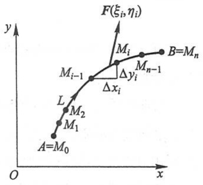

scatter

| Point | x-coordinate | y-coordinate |
| --- | --- | --- |
| A=M0 | ~1.5 | ~2.5 |
| M1 | ~2.0 | ~3.5 |
| M2 | ~2.5 | ~4.0 |
| L | ~3.0 | ~4.5 |
| Mi-1 | ~4.5 | ~6.0 |
| Mi | ~5.5 | ~7.0 |
| Mn-1 | ~6.5 | ~7.5 |
| B=Mn | ~8.0 | ~8.0 |

图11-4

先用曲线弧 L 上的点  $M_{1}(x_{1},y_{1}), M_{2}(x_{2},y_{2}), \cdots, M_{n-1}(x_{n-1},y_{n-1})$  把 L 分成 n 个小弧段，取其中一个有向小弧段  $\widehat{M_{i-1}M_{i}}$  来分析:由于  $\widehat{M_{i-1}M_{i}}$  光滑而且很短，可以用有向线段

$$
\overrightarrow {M _ {i - 1} M _ {i}} = (\Delta x _ {i}) \boldsymbol {i} + (\Delta y _ {i}) \boldsymbol {j}
$$

来近似代替它,其中  $\Delta x_{i}=x_{i}-x_{i-1},\Delta y_{i}=y_{i}-y_{i-1}$ . 又由于函数  $P(x,y)$  与  $Q(x,y)$  在 L 上连续,可以用  $\widehat{M_{i-1}M_{i}}$  上任意取定的一点  $(\xi_{i},\eta_{i})$  处的力

$$
\boldsymbol {F} (\xi_ {i}, \eta_ {i}) = P (\xi_ {i}, \eta_ {i}) \boldsymbol {i} + Q (\xi_ {i}, \eta_ {i}) \boldsymbol {j}
$$

来近似代替这小弧段上各点处的力.这样,变力 $F(x,y)$ 沿有向小弧段 $\widehat{M_{i-1}M_i}$ 所做的功 $\Delta W_i$ 可以认为近似地等于恒力 $F(\xi_i,\eta_i)$ 沿 $\overrightarrow{M_{i-1}M_i}$ 所做的功:

$$
\Delta W _ {i} \approx F (\xi_ {i}, \eta_ {i}) \cdot \overrightarrow {M _ {i - 1} M _ {i}},
$$

即

$$
\Delta W _ {i} \approx P (\xi_ {i}, \eta_ {i}) \Delta x _ {i} + Q (\xi_ {i}, \eta_ {i}) \Delta y _ {i}.
$$

于是

186

---

第二节 对坐标的曲线积分

$$
W = \sum_ {i = 1} ^ {n} \Delta W _ {i} \approx \sum_ {i = 1} ^ {n} \left[ P (\xi_ {i}, \eta_ {i}) \Delta x _ {i} + Q (\xi_ {i}, \eta_ {i}) \Delta y _ {i} \right].
$$

用 $\lambda$ 表示 $n$ 个小弧段的最大长度, 令 $\lambda \to 0$ 取上述和的极限, 所得到的极限自然地被认作变力 $F$ 沿有向曲线弧所做的功, 即

$$
W = \lim _ {\lambda \to 0} \sum_ {i = 1} ^ {n} \left[ P (\xi_ {i}, \eta_ {i}) \Delta x _ {i} + Q (\xi_ {i}, \eta_ {i}) \Delta y _ {i} \right].
$$

这种和的极限在研究其他问题时也会遇到.现在引进下面的定义:

定义 设 L 为 xOy 面内从点 A 到点 B 的一条有向光滑曲线弧, 函数  $P(x,y)$  与  $Q(x,y)$  在 L 上有界. 在 L 上沿 L 的方向任意插入一点列  $M_{1}(x_{1},y_{1}), M_{2}(x_{2},y_{2}), \cdots, M_{n-1}(x_{n-1},y_{n-1})$ , 把 L 分成 n 个有向小弧段

$$
\widehat {M _ {i - 1} M _ {i}} \quad (i = 1, 2, \dots , n; M _ {0} = A, M _ {n} = B).
$$

设  $\Delta x_{i}=x_{i}-x_{i-1},\Delta y_{i}=y_{i}-y_{i-1}$ ，点  $(\xi_{i},\eta_{i})$  为  $\widehat{M_{i-1}M_{i}}$  上任意取定的点，作乘积  $P(\xi_{i},\eta_{i})\Delta x_{i}$   $(i=1,2,\cdots,n)$ ，并作和  $\sum_{i=1}^{n}P(\xi_{i},\eta_{i})\Delta x_{i}$ ，如果当各小弧段长度的最大值  $\lambda\to0$  时，这和的极限总存在，且与曲线弧 L 的分法及点  $(\xi_{i},\eta_{i})$  的取法无关，那么称此极限为函数  $P(x,y)$  在有向曲线弧 L 上对坐标 x 的曲线积分，记作  $\int_{L}P(x,y)\mathrm{d}x$ 。类似地，如果  $\lim_{\lambda\to0}\sum_{i=1}^{n}Q(\xi_{i},\eta_{i})\Delta y_{i}$  总存在，且与曲线弧 L 的分法及点  $(\xi_{i},\eta_{i})$  的取法无关，那么称此极限为函数  $Q(x,y)$  在有向曲线弧 L 上对坐标 y 的曲线积分，记作  $\int_{L}Q(x,y)\mathrm{d}y$ 。即

$$
\begin{array}{l} \int_ {L} P (x, y) \mathrm{d} x = \lim _ {\lambda \to 0} \sum_ {i = 1} ^ {n} P (\xi_ {i}, \eta_ {i}) \Delta x _ {i}, \\ \int_ {L} Q (x, y) \mathrm{d} y = \lim _ {\lambda \to 0} \sum_ {i = 1} ^ {n} Q (\xi_ {i}, \eta_ {i}) \Delta y _ {i}, \\ \end{array}
$$

其中  $P(x,y)$ ,  $Q(x,y)$  叫做被积函数, L 叫做积分弧段.

以上两个积分也称为第二类曲线积分.

在第二目中我们将看到, 当  $P(x,y)$  与  $Q(x,y)$  在有向光滑曲线弧 L 上连续时, 对坐标的曲线积分  $\int_{L} P(x,y) \, dx$  及  $\int_{L} Q(x,y) \, dy$  都存在. 以后我们总假定  $P(x,y)$  与  $Q(x,y)$  在 L 上连续.

上述定义可以类似地推广到积分弧段为空间有向曲线弧 $\Gamma$ 的情形:

$$
\begin{array}{l} \int_ {\Gamma} P (x, y, z) \mathrm{d} x = \lim _ {\lambda \to 0} \sum_ {i = 1} ^ {n} P (\xi_ {i}, \eta_ {i}, \zeta_ {i}) \Delta x _ {i}, \\ \int_ {\Gamma} Q (x, y, z) \mathrm{d} y = \lim _ {\lambda \to 0} \sum_ {i = 1} ^ {n} Q (\xi_ {i}, \eta_ {i}, \zeta_ {i}) \Delta y _ {i}, \\ \end{array}
$$

187

---

第十一章 曲线积分与曲面积分

$$
\int_ {\Gamma} R (x, y, z) \mathrm{d} z = \lim _ {\lambda \rightarrow 0} \sum_ {i = 1} ^ {n} R (\xi_ {i}, \eta_ {i}, \zeta_ {i}) \Delta z _ {i}.
$$

应用上经常出现的是

$$
\int_ {L} P (x, y) \mathrm{d} x + \int_ {L} Q (x, y) \mathrm{d} y
$$

这种合并起来的形式,为简便起见,把上式写成

$$
\int_ {L} P (x, y) \mathrm{d} x + Q (x, y) \mathrm{d} y,
$$

也可写成向量形式

$$
\int_ {L} \boldsymbol {F} (x, y) \cdot \mathrm{d} \boldsymbol {r},
$$

其中 $F(x,y) = P(x,y)i + Q(x,y)j$ 为向量值函数， $\mathrm{d}\pmb {r} = \mathrm{d}\pmb {x}\pmb {i} + \mathrm{d}\pmb {y}\pmb{j}$

例如,本目开始时讨论过的变力 F 所做的功可以表达成

$$
W = \int_ {L} P (x, y)   \mathrm{d} x + Q (x, y)   \mathrm{d} y,
$$

或

$$
W = \int_ {L} \boldsymbol {F} (x, y) \cdot \mathrm{d} \boldsymbol {r}.
$$

类似地,把

$$
\int_ {\Gamma} P (x, y, z) \mathrm{d} x + \int_ {\Gamma} Q (x, y, z) \mathrm{d} y + \int_ {\Gamma} R (x, y, z) \mathrm{d} z
$$

简写成

$$
\int_ {\Gamma} P (x, y, z) \mathrm{d} x + Q (x, y, z) \mathrm{d} y + R (x, y, z) \mathrm{d} z,
$$

或

$$
\int_ {\Gamma} A (x, y, z) \cdot \mathrm{d} r,
$$

其中 $A(x,y,z) = P(x,y,z)i + Q(x,y,z)\boldsymbol {j} + R(x,y,z)\boldsymbol {k},\mathrm{d}\boldsymbol {r} = \mathrm{d}x\boldsymbol {i} + \mathrm{d}y\boldsymbol {j} + \mathrm{d}z\boldsymbol{k}.$

如果 $L$ （或 $\Gamma$ )是分段光滑的，我们规定函数在有向曲线弧 $L$ （或 $\Gamma$ )上对坐标的曲线积分等于在光滑的各段上对坐标的曲线积分之和.

根据上述曲线积分的定义,可以导出对坐标的曲线积分的一些性质.为了表达简便起见,我们用向量形式表达,并假定其中的向量值函数在曲线 L 上连续①.

## 性质1 设 $\alpha$ 与 $\beta$ 为常数, 则

<small>① 向量值函数 $F(x,y)$ 在曲线L上连续是指:对L上任意点 $M_{0}(x_{0},y_{0})$ ，当L上的动点 $M(x,y)$ 沿L趋于 $M_{0}$ 时，有 $|F(x,y)-F(x_{0},y_{0})|\rightarrow0$ 。若 $F(x,y)=P(x,y)i+Q(x,y)j$ ，则 $F(x,y)$ 在L上连续等价于 $P(x,y)$ 与 $Q(x,y)$ 均在L上连续。</small>

188

---

第二节 对坐标的曲线积分

$$
\int_ {L} \left[ \alpha F _ {1} (x, y) + \beta F _ {2} (x, y) \right] \cdot \mathrm{d} r = \alpha \int_ {L} F _ {1} (x, y) \cdot \mathrm{d} r + \beta \int_ {L} F _ {2} (x, y) \cdot \mathrm{d} r.
$$

性质2 若有向曲线弧 $L$ 可分成两段光滑的有向曲线弧 $L_{1}$ 和 $L_{2}$，则

$$
\int_ {L} \boldsymbol {F} (x, y) \cdot \mathrm{d} \boldsymbol {r} = \int_ {L _ {1}} \boldsymbol {F} (x, y) \cdot \mathrm{d} \boldsymbol {r} + \int_ {L _ {2}} \boldsymbol {F} (x, y) \cdot \mathrm{d} \boldsymbol {r}.
$$

性质3 设 $L$ 是有向光滑曲线弧, $L^{-}$ 是 $L$ 的反向曲线弧, 则

$$
\int_ {L ^ {-}} \boldsymbol {F} (x, y) \cdot \mathrm{d} \boldsymbol {r} = - \int_ {L} \boldsymbol {F} (x, y) \cdot \mathrm{d} \boldsymbol {r}.
$$

证 把 $L$ 分成 $n$ 小段, 相应的 $L^{-}$也分成 $n$ 小段. 对于每一个小弧段来说, 当曲线弧的方向改变时, 有向弧段在坐标轴上的投影, 其绝对值不变, 但要改变符号, 因此性质3成立.

性质 3 表示, 当积分弧段的方向改变时, 对坐标的曲线积分要改变符号. 因此关于对坐标的曲线积分, 我们必须注意积分弧段的方向.

这一性质是对坐标的曲线积分所特有的,对弧长的曲线积分不具有这一性质.而对弧长的曲线积分所具有的性质3,对坐标的曲线积分也不具有类似的性质.

## 二、对坐标的曲线积分的计算法

定理 设 $P(x,y)$ 与 $Q(x,y)$ 在有向曲线弧 $L$ 上有定义且连续，$L$ 的参数方程为

$$
\left\{ \begin{array}{l} x = \varphi (t), \\ y = \psi (t), \end{array} \right.
$$

当参数 $t$ 单调地由 $\alpha$ 变到 $\beta$ 时，点 $M(x,y)$ 从 $L$ 的起点 $A$ 沿 $L$ 运动到终点 $B$ ，若$\varphi (t)$ 与 $\psi (t)$ 在以 $\alpha$ 及 $\beta$ 为端点的闭区间上具有一阶连续导数，且 $\varphi^{\prime 2}(t) + \psi^{\prime 2}(t)\neq 0,$ 则曲线积分 $\int_{L}P(x,y)\mathrm{d}x + Q(x,y)\mathrm{d}y$ 存在，且

$$
\begin{array}{l} \int_ {L} P (x, y) \mathrm{d} x + Q (x, y) \mathrm{d} y \\ = \int_ {\alpha} ^ {\beta} \left\{P [ \varphi (t), \psi (t) ] \varphi^ {\prime} (t) + Q [ \varphi (t), \psi (t) ] \psi^ {\prime} (t) \right\} \mathrm{d} t. \tag {2-1} \\ \end{array}
$$

证 在 $L$ 上取一点列

$$
A = M _ {0}, M _ {1}, M _ {2}, \dots , M _ {n - 1}, M _ {n} = B,
$$

它们对应于一列单调变化的参数值

$$
\alpha = t _ {0}, t _ {1}, t _ {2}, \dots , t _ {n - 1}, t _ {n} = \beta .
$$

根据对坐标的曲线积分的定义,有

$$
\int_ {L} P (x, y) \mathrm{d} x = \lim _ {\lambda \to 0} \sum_ {i = 1} ^ {n} P (\xi_ {i}, \eta_ {i}) \Delta x _ {i}.
$$

设点 $(\xi_{i},\eta_{i})$ 对应于参数值 $\tau_{i}$ ，即 $\xi_{i} = \varphi (\tau_{i}),\eta_{i} = \psi (\tau_{i})$ ，这里 $\tau_{i}$ 在 $t_{i - 1}$ 与 $t_i$ 之间.由于

189

---

第十一章 曲线积分与曲面积分

$$
\Delta x _ {i} = x _ {i} - x _ {i - 1} = \varphi (t _ {i}) - \varphi (t _ {i - 1}),
$$

应用微分中值定理,有

$$
\Delta x _ {i} = \varphi^ {\prime} (\tau_ {i} ^ {\prime}) \Delta t _ {i},
$$

其中 $\Delta t_{i} = t_{i} - t_{i - 1},\tau_{i}^{\prime}$ 在 $t_{i - 1}$ 与 $t_i$ 之间.于是

$$
\int_ {L} P (x, y) \mathrm{d} x = \lim _ {\lambda \rightarrow 0} \sum_ {i = 1} ^ {n} P [ \varphi (\tau_ {i}), \psi (\tau_ {i}) ] \varphi^ {\prime} (\tau_ {i} ^ {\prime}) \Delta t _ {i}.
$$

因为函数  $\varphi'(t)$  在闭区间  $[\alpha,\beta]$  （或  $[\beta,\alpha]$ ）上连续，我们可以把上式中的  $\tau_{i}^{\prime}$  换成  $\tau_{i}^{①}$ ，从而

$$
\int_ {L} P (x, y) \mathrm{d} x = \lim _ {\lambda \rightarrow 0} \sum_ {i = 1} ^ {n} P [ \varphi (\tau_ {i}), \psi (\tau_ {i}) ] \varphi^ {\prime} (\tau_ {i}) \Delta t _ {i}.
$$

上式右端的和的极限就是定积分 $\int_{\alpha}^{\beta}P[\varphi (t),\psi (t)]\varphi '(t)\mathrm{d}t$ ，由于函数 $P[\varphi (t),\psi (t)]\varphi '(t)$ 连续，这个定积分是存在的，因此上式左端的曲线积分 $\int_{L}P(x,y)\mathrm{d}x$ 也存在，并且有

$$
\int_ {L} P (x, y) \mathrm{d} x = \int_ {\alpha} ^ {\beta} P [ \varphi (t), \psi (t) ] \varphi^ {\prime} (t) \mathrm{d} t.
$$

同理可证

$$
\int_ {L} Q (x, y) \mathrm{d} y = \int_ {\alpha} ^ {\beta} Q [ \varphi (t), \psi (t) ] \psi^ {\prime} (t) \mathrm{d} t,
$$

把以上两式相加,得

$$
\int_ {L} P (x, y) \mathrm{d} x + Q (x, y) \mathrm{d} y = \int_ {\alpha} ^ {\beta} \left\{P [ \varphi (t), \psi (t) ] \varphi^ {\prime} (t) + Q [ \varphi (t), \psi (t) ] \psi^ {\prime} (t) \right\} \mathrm{d} t,
$$

这里下限  $\alpha$  对应于 L 的起点, 上限  $\beta$  对应于 L 的终点.

公式(2-1)表明,计算对坐标的曲线积分

$$
\int_ {L} P (x, y) \mathrm{d} x + Q (x, y) \mathrm{d} y
$$

时, 只要把 $x, y, \mathrm{d}x, \mathrm{d}y$ 依次换为 $\varphi(t), \psi(t), \varphi'(t) \mathrm{d}t, \psi'(t) \mathrm{d}t$, 然后从 $L$ 的起点所对应的参数值 $\alpha$ 到 $L$ 的终点所对应的参数值 $\beta$ 作定积分就行了, 这里必须注意, 下限 $\alpha$ 对应于 $L$ 的起点, 上限 $\beta$ 对应于 $L$ 的终点, $\alpha$ 不一定小于 $\beta$.

如果 L 由方程  $y=\psi(x)$  或  $x=\varphi(y)$  给出, 可以看做参数方程的特殊情形, 例如, 当 L 由  $y=\psi(x)$  给出时, 公式(2-1)成为

$$
\int_ {L} P (x, y) \mathrm{d} x + Q (x, y) \mathrm{d} y = \int_ {a} ^ {b} \left\{P [ x, \psi (x) ] + Q [ x, \psi (x) ] \psi^ {\prime} (x) \right\} \mathrm{d} x,
$$

这里下限 a 对应 L 的起点, 上限 b 对应 L 的终点.

公式(2-1)可推广到空间曲线  $\Gamma$  由参数方程

<small>① 它的证明要用到函数  $\varphi'(t)$  在闭区间上的一致连续性, 这里从略.</small>

190

---

第二节 对坐标的曲线积分

$$
x = \varphi (t), \quad y = \psi (t), \quad z = \omega (t)
$$

给出的情形,这样便得到

$$
\begin{array}{l} \int_ {\Gamma} P (x, y, z) \mathrm{d} x + Q (x, y, z) \mathrm{d} y + R (x, y, z) \mathrm{d} z \\ = \int_ {\alpha} ^ {\beta} \left\{P [ \varphi (t), \psi (t), \omega (t) ] \varphi^ {\prime} (t) + Q [ \varphi (t), \psi (t), \omega (t) ] \psi^ {\prime} (t) + \right. \\ R [ \varphi (t), \psi (t), \omega (t) ] \omega^ {\prime} (t) \} \mathrm{d} t, \\ \end{array}
$$

这里下限  $\alpha$  对应  $\Gamma$  的起点, 上限  $\beta$  对应  $\Gamma$  的终点.

例1 计算 $\int_{L} xy \, \mathrm{d}x$，其中 $L$ 为抛物线 $y^2 = x$ 上从点 $A(1, -1)$ 到点 $B(1, 1)$ 的一段弧（图11-5）.

解法一 将所给积分化为对 $x$ 的定积分来计算. 由于 $y = \pm \sqrt{x}$ 不是单值函数, 所以要把 $L$ 分为 $AO$ 和 $OB$ 两部分. 在 $AO$ 上, $y = -\sqrt{x}, x$ 从 1 变到 0; 在 $OB$ 上, $y = \sqrt{x}, x$ 从 0 变到 1. 因此

$$
\begin{array}{l} \int_ {L} x y \mathrm{d} x = \int_ {A O} x y \mathrm{d} x + \int_ {O B} x y \mathrm{d} x \\ = \int_ {1} ^ {0} x (- \sqrt {x}) \mathrm{d} x + \int_ {0} ^ {1} x \sqrt {x} \mathrm{d} x = 2 \int_ {0} ^ {1} x ^ {\frac {3}{2}} \mathrm{d} x = \frac {4}{5}. \\ \end{array}
$$

解法二 将所给积分化为对 $y$ 的定积分来计算, 现在 $x = y^2, y$ 从-1变到1. 因此

$$
\int_ {L} x y \mathrm{d} x = \int_ {- 1} ^ {1} y ^ {2} y (y ^ {2}) ^ {\prime} \mathrm{d} y = 2 \int_ {- 1} ^ {1} y ^ {4} \mathrm{d} y = 2 \left[ \frac {y ^ {5}}{5} \right] _ {- 1} ^ {1} = \frac {4}{5}.
$$

例2 计算 $\int_{L} y^{2} \mathrm{~d} x$ 其中 $L$ 为(图11-6):

（1）半径为 a、圆心为原点、按逆时针方向绕行的上半圆周；
(2) 从点  $A(a,0)$  沿 x 轴到点  $B(-a,0)$  的直线段.

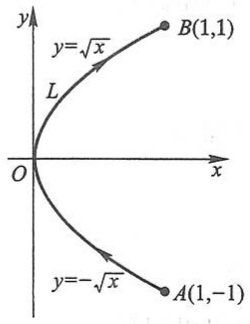

text_image

y
y=√x
L
O
x
B(1,1)
y=-√x
A(1,-1)

图11-5

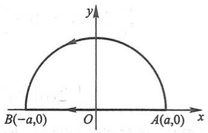

text_image

y
B(-a,0) O A(a,0) x

图11-6

解 (1) $L$ 是参数方程

191

---

第十一章 曲线积分与曲面积分

$$
x = a \cos \theta , \quad y = a \sin \theta
$$

当参数 $\theta$ 从0变到 $\pi$ 的曲线弧.因此

$$
\begin{array}{l} \int_ {L} y ^ {2} \mathrm{d} x = \int_ {0} ^ {\pi} a ^ {2} \sin^ {2} \theta (- a \sin \theta) \mathrm{d} \theta = a ^ {3} \int_ {0} ^ {\pi} (1 - \cos^ {2} \theta) \mathrm{d} (\cos \theta) \\ = a ^ {3} \left[ \cos \theta - \frac {\cos^ {3} \theta}{3} \right] _ {0} ^ {\pi} = - \frac {4}{3} a ^ {3}. \\ \end{array}
$$

(2) L 的方程为 y=0, x 从 a 变到 -a. 所以

$$
\int_ {L} y ^ {2} \mathrm{d} x = \int_ {a} ^ {- a} 0 \mathrm{d} x = 0.
$$

从例 2 看出,虽然两个曲线积分的被积函数相同,起点和终点也相同,但沿不同路径得出的积分值并不相等.

例 3 计算  $\int_{L} 2xy dx + x^{2} dy$ ，其中 L 为(图11-7):

(1) 抛物线  $y=x^{2}$  上从  $O(0,0)$  到  $B(1,1)$  的一段弧；
(2) 抛物线  $x=y^{2}$  上从  $O(0,0)$  到  $B(1,1)$  的一段弧；
（3）有向折线 OAB，这里 O, A, B 依次是点  $(0,0)$ ， $(1,0)$ ， $(1,1)$ .

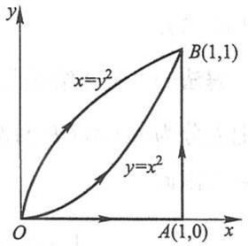

text_image

y
x=y²
B(1,1)
y=x²
O
A(1,0) x

图11-7

解（1）化为对 $x$ 的定积分. $L: y = x^2, x$ 从0变到1. 所以

$$
\int_ {L} 2 x y \mathrm{d} x + x ^ {2} \mathrm{d} y = \int_ {0} ^ {1} (2 x \cdot x ^ {2} + x ^ {2} \cdot 2 x) \mathrm{d} x = 4 \int_ {0} ^ {1} x ^ {3} \mathrm{d} x = 1.
$$

(2) 化为对 y 的定积分.  $L: x = y^{2}$ , y 从 0 变到 1. 所以

$$
\int_ {L} 2 x y \mathrm{d} x + x ^ {2} \mathrm{d} y = \int_ {0} ^ {1} (2 y ^ {2} \cdot y \cdot 2 y + y ^ {4}) \mathrm{d} y = 5 \int_ {0} ^ {1} y ^ {4} \mathrm{d} y = 1.
$$

(3) $\int_{L} 2xy\mathrm{d}x + x^{2}\mathrm{d}y = \int_{OA} 2xy\mathrm{d}x + x^{2}\mathrm{d}y + \int_{AB} 2xy\mathrm{d}x + x^{2}\mathrm{d}y,$

在 OA 上, y=0, x 从 0 变到 1, 所以

$$
\int_ {O A} 2 x y \mathrm{d} x + x ^ {2} \mathrm{d} y = \int_ {0} ^ {1} (2 x \cdot 0 + x ^ {2} \cdot 0) \mathrm{d} x = 0.
$$

在 AB 上, x=1, y 从 0 变到 1, 所以

$$
\int_ {A B} 2 x y \mathrm{d} x + x ^ {2} \mathrm{d} y = \int_ {0} ^ {1} (2 y \cdot 0 + 1) \mathrm{d} y = 1.
$$

从而

图

释疑解难

11-2

$$
\int_ {L} 2 x y \mathrm{d} x + x ^ {2} \mathrm{d} y = 0 + 1 = 1.
$$

从例 3 可以看出,虽然沿不同路径,曲线积分的值可以相等.

例4 计算 $\int_{\Gamma} x^3 \mathrm{d}x + 3zy^2 \mathrm{d}y - x^2 y \mathrm{d}z$，其中 $\Gamma$ 是从点 $A(3,2,1)$ 到点 $B(0,0,0)$ 的直线段 $AB$.

192

---

第二节 对坐标的曲线积分

解 直线段 $AB$ 的方程是

$$
\frac {x}{3} = \frac {y}{2} = \frac {z}{1},
$$

化为参数方程得

$$
x = 3 t, \quad y = 2 t, \quad z = t, \quad t \text {从} 1 \text {变到} 0.
$$

所以

$$
\begin{array}{l} \int_ {\Gamma} x ^ {3} \mathrm{d} x + 3 z y ^ {2} \mathrm{d} y - x ^ {2} y \mathrm{d} z \\ = \int_ {1} ^ {0} \left[ (3 t) ^ {3} \cdot 3 + 3 t (2 t) ^ {2} \cdot 2 - (3 t) ^ {2} \cdot 2 t \right] \mathrm{d} t = 8 7 \int_ {1} ^ {0} t ^ {3} \mathrm{d} t = - \frac {8 7}{4}. \\ \end{array}
$$

例 5 设一个质点在点  $M(x,y)$  处受到力 F 的作用, F 的大小与点 M 到原点 O 的距离成正比, F 的方向恒指向原点. 此质点由点 A(a,0) 沿椭圆  $\frac{x^{2}}{a^{2}} + \frac{y^{2}}{b^{2}} = 1$  按逆时针方向移动到点 B(0,b), 求力 F 所做的功 W.

解 $\overrightarrow{OM} = x\mathbf{i} + y\mathbf{j},\quad |\overrightarrow{OM}| = \sqrt{x^2 + y^2}.$

由假设有 $F = -k(xi + yj)$，其中 $k > 0$ 是比例常数。于是

$$
W = \int_ {\widehat {A B}} \boldsymbol {F} \cdot \mathrm{d} \boldsymbol {r} = \int_ {\widehat {A B}} - k x \mathrm{d} x - k y \mathrm{d} y = - k \int_ {\widehat {A B}} x \mathrm{d} x + y \mathrm{d} y.
$$

利用椭圆的参数方程 $\left\{\begin{aligned}x&=a\cos t,\\ y&=b\sin t,\end{aligned}\right.$ 起点A、终点B分别对应参数 $t=0,t=\frac{\pi}{2}$ .于是

$$
\begin{array}{l} W = - k \int_ {0} ^ {\frac {\pi}{2}} (- a ^ {2} \cos t \sin t + b ^ {2} \sin t \cos t) \mathrm{d} t \\ = k (a ^ {2} - b ^ {2}) \int_ {0} ^ {\frac {\pi}{2}} \sin t \cos t \mathrm{d} t = \frac {k}{2} (a ^ {2} - b ^ {2}). \\ \end{array}
$$

## 三、两类曲线积分之间的联系

设有向曲线弧 L 的起点为 A, 终点为 B. 曲线弧 L 由参数方程

$$
\left\{ \begin{array}{l} x = \varphi (t), \\ y = \psi (t) \end{array} \right.
$$

给出,起点A与终点B分别对应参数 $\alpha$ 与 $\beta$ .不妨设 $\alpha<\beta$ （若 $\alpha>\beta$ ,可令s=-t,A,B对应 $s=-\alpha,s=-\beta$ ,就有 $(-α)<(-\beta)$ ,把下面的讨论对参数s进行即可），并设函数 $\varphi(t)$ 与 $\psi(t)$ 在闭区间 $[\alpha,\beta]$ 上具有一阶连续导数，且 $\varphi^{\prime2}(t)+\psi^{\prime2}(t)\neq0$ ,又函数 $P(x,y)$ 与 $Q(x,y)$ 在L上连续.于是,由对坐标的曲线积分计算公式(2-1)有

$$
\int_ {L} P (x, y) \mathrm{d} x + Q (x, y) \mathrm{d} y = \int_ {\alpha} ^ {\beta} \left\{P [ \varphi (t), \psi (t) ] \varphi^ {\prime} (t) + Q [ \varphi (t), \psi (t) ] \psi^ {\prime} (t) \right\} \mathrm{d} t.
$$

例题精讲
11-2

193

---

第十一章 曲线积分与曲面积分

我们知道,向量  $\boldsymbol{\tau}=\varphi'(t)\boldsymbol{i}+\psi'(t)\boldsymbol{j}$  是曲线弧 L 在点  $M(\varphi(t),\psi(t))$  处的一个切向量,它的方向与参数 t 的增长方向一致,当  $\alpha<\beta$  时,这个方向就是有向曲线弧 L 的方向.以后,我们称这种方向与有向曲线弧的方向一致的切向量为有向曲线弧的切向量.于是,有向曲线弧 L 的切向量为

$$
\boldsymbol {\tau} = \varphi^ {\prime} (t) \boldsymbol {i} + \psi^ {\prime} (t) \boldsymbol {j},
$$

它的方向余弦为

$$
\cos \alpha = \frac {\varphi^ {\prime} (t)}{\sqrt {\varphi^ {\prime 2} (t) + \psi^ {\prime 2} (t)}}, \quad \cos \beta = \frac {\psi^ {\prime} (t)}{\sqrt {\varphi^ {\prime 2} (t) + \psi^ {\prime 2} (t)}}.
$$

由对弧长的曲线积分的计算公式可得

$$
\begin{array}{l} \int_ {L} \left[ P (x, y) \cos \alpha + Q (x, y) \cos \beta \right] \mathrm{d} s \\ = \int_ {\alpha} ^ {\beta} \left\{P [ \varphi (t), \psi (t) ] \frac {\varphi^ {\prime} (t)}{\sqrt {\varphi^ {\prime 2} (t) + \psi^ {\prime 2} (t)}} + \right. \\ Q [ \varphi (t), \psi (t) ] \frac {\psi^ {\prime} (t)}{\sqrt {\varphi^ {\prime 2} (t) + \psi^ {\prime 2} (t)}} \Bigg \} \sqrt {\varphi^ {\prime 2} (t) + \psi^ {\prime 2} (t)} \mathrm{d} t \\ = \int_ {\alpha} ^ {\beta} \left\{P [ \varphi (t), \psi (t) ] \varphi^ {\prime} (t) + Q [ \varphi (t), \psi (t) ] \psi^ {\prime} (t) \right\} \mathrm{d} t. \\ \end{array}
$$

由此可见,平面曲线弧 L 上的两类曲线积分之间有如下联系:

$$
\int_ {L} P \mathrm{d} x + Q \mathrm{d} y = \int_ {L} (P \cos \alpha + Q \cos \beta) \mathrm{d} s, \tag {2-2}
$$

其中 $\alpha (x,y)$ 与 $\beta (x,y)$ 为有向曲线弧 $L$ 在点 $(x,y)$ 处的切向量的方向角.

类似地可知,空间曲线弧  $\Gamma$  上的两类曲线积分之间有如下联系:

$$
\int_ {\Gamma} P \mathrm{d} x + Q \mathrm{d} y + R \mathrm{d} z = \int_ {\Gamma} (P \cos \alpha + Q \cos \beta + R \cos \gamma) \mathrm{d} s, \tag {2-3}
$$

其中 $\alpha (x,y,z),\beta (x,y,z),\gamma (x,y,z)$ 为有向曲线弧 $\Gamma$ 在点 $(x,y,z)$ 处的切向量的方向角.

两类曲线积分之间的联系也可用向量的形式表达.例如,空间曲线弧  $\Gamma$  上的两类曲线积分之间的联系可写成如下形式:

$$
\int_ {\Gamma} \boldsymbol {A} \cdot \mathrm{d} \boldsymbol {r} = \int_ {\Gamma} \boldsymbol {A} \cdot \boldsymbol {\tau} \mathrm{d} s \tag {2-4}
$$

或

$$
\int_ {\Gamma} A \cdot \mathrm{d} r = \int_ {\Gamma} A _ {\tau} \mathrm{d} s, \tag {$2-4^{\prime$}}
$$

其中  $\boldsymbol{A}=(P,Q,R)$ ,  $\boldsymbol{\tau}=(\cos\alpha,\cos\beta,\cos\gamma)$  为有向曲线弧  $\Gamma$  在点  $(x,y,z)$  处的单位切向量,  $\mathrm{d}\boldsymbol{r}=\boldsymbol{\tau}\mathrm{d}s=(\mathrm{d}x,\mathrm{d}y,\mathrm{d}z)$ , 称为有向曲线元,  $A_{\tau}$  为向量 A 在向量  $\tau$  上的投影.

194

---

第二节 对坐标的曲线积分

## 习题11-2

1. 设 $L$ 为 $xOy$ 面内直线 $x = a$ 上的一段，证明:$\int_{L} P(x, y) \mathrm{d}x = 0.$

2. 设 $L$ 为 $xOy$ 面内 $x$ 轴上从点 $(a,0)$ 到点 $(b,0)$ 的一段直线，证明:$\int_{L} P(x,y) \mathrm{d}x = \int_{a}^{b} P(x,0) \mathrm{d}x.$

3. 计算下列对坐标的曲线积分:

(1) $\int_{L}(x^{2} - y^{2})\mathrm{d}x$ ，其中 $L$ 是抛物线 $y = x^{2}$ 上从点(0,0)到点(2,4)的一段弧；
(2) $\oint_{L} xy \, \mathrm{d}x$, 其中 $L$ 为圆周 $(x - a)^2 + y^2 = a^2$ ($a > 0$) 及 $x$ 轴所围成的在第一象限内的区域的整个边界（按逆时针方向绕行）；

(3) $\int_{L} y \mathrm{~d}x + x \mathrm{~d}y$，其中 $L$ 为圆周 $x = R \cos t, y = R \sin t$ 上对应 $t$ 从0到 $\frac{\pi}{2}$ 的一段弧；

(4) $\oint_{L} \frac{(x + y) \, \mathrm{d}x - (x - y) \, \mathrm{d}y}{x^2 + y^2}$, 其中 $L$ 为圆周 $x^2 + y^2 = a^2$ （按逆时针方向绕行）；

(5) $\int_{\Gamma} x^{2} \mathrm{~d}x + z \mathrm{~d}y - y \mathrm{~d}z$，其中 $\Gamma$ 为曲线 $x = k\theta, y = a \cos \theta, z = a \sin \theta$ 上对应 $\theta$ 从0到 $\pi$ 的一段弧；

(6) $\int_{\Gamma} x \mathrm{~d}x + y \mathrm{~d}y + (x + y - 1) \mathrm{~d}z$，其中 $\Gamma$ 是从点 $(1,1,1)$ 到点 $(2,3,4)$ 的一段直线；

(7) $\oint_{\Gamma} \mathrm{d}x - \mathrm{d}y + y \mathrm{~d}z$，其中 $\Gamma$ 为有向闭折线 $ABCA$，这里的 $A, B, C$ 依次为点 $(1,0,0), (0,1,0), (0,0,1)$；

(8) $\int_{L}(x^{2} - 2xy)\mathrm{d}x + (y^{2} - 2xy)\mathrm{d}y$ ，其中 $L$ 是抛物线 $y = x^{2}$ 上从点 $(-1,1)$ 到点(1,1)的一段弧.

4. 计算 $\int_{L}(x + y)\mathrm{d}x + (y - x)\mathrm{d}y$ ，其中 $L$ 是

(1) 抛物线  $y^{2}=x$  上从点 (1,1) 到点 (4,2) 的一段弧；
(2) 从点(1,1)到点(4,2)的直线段;
(3) 先沿直线从点 $(1,1)$ 到点 $(1,2)$ ，然后再沿直线到点 $(4,2)$ 的折线；
(4) 曲线  $x=2t^{2}+t+1, y=t^{2}+1$  上从点 (1,1) 到点 (4,2) 的一段弧.

5. 一力场由沿横轴正方向的恒力 F 所构成. 试求当一质量为 m 的质点沿圆周  $x^{2} + y^{2} = R^{2}$  按逆时针方向移过位于第一象限的那一段弧时场力所做的功.
6. 设 z 轴与重力的方向一致, 求质量为 m 的质点从位置  $(x_{1}, y_{1}, z_{1})$  沿直线移到  $(x_{2}, y_{2}, z_{2})$  时重力所做的功.

7. 把对坐标的曲线积分  $\int_{L} P(x, y) \, dx + Q(x, y) \, dy$  化成对弧长的曲线积分, 其中 L 为

(1) 在 xOy 面内沿直线从点  $(0,0)$  到点  $(1,1)$ ;
(2) 沿抛物线  $y=x^{2}$  从点  $(0,0)$  到点  $(1,1)$ ;
(3) 沿上半圆周  $x^{2}+y^{2}=2x$  从点  $(0,0)$  到点  $(1,1)$ .

8. 设 $\Gamma$ 为曲线 $x = t, y = t^2, z = t^3$ 上相应于 $t$ 从0变到1的曲线弧，把对坐标的曲线积分 $\int_{\Gamma} P \mathrm{d}x+$

195

---

第十一章 曲线积分与曲面积分

$Qdy+Rdz$ 化成对弧长的曲线积分.

9. 设曲线 $\Gamma$ 为球面 $x^{2} + y^{2} + z^{2} = a^{2}$ 与平面 $x + y + z = 0$ 的交线，从 $z$ 轴的正向看取逆时针方向，

$$
I = \oint_ {\Gamma} z \mathrm{d} x + x \mathrm{d} y + y \mathrm{d} z,
$$

试利用两类曲线积分之间的关系证明: $|I|\leqslant2\pi a^{2}$

## 第三节 格林公式及其应用

## 一、格林公式

在一元函数积分学中,牛顿-莱布尼茨公式

$$
\int_ {a} ^ {b} F ^ {\prime} (x) \mathrm{d} x = F (b) - F (a)
$$

表示: $F'(x)$ 在区间 $[a,b]$ 上的积分可以通过它的原函数 $F(x)$ 在这个区间端点上的值来表达.

下面要介绍的格林(Green)公式告诉我们,在平面闭区域 D 上的二重积分可以通过沿闭区域 D 的边界曲线 L 上的曲线积分来表达.

现在先介绍平面单连通区域的概念.设 $D$ 为平面区域,若 $D$ 内任一闭曲线所围的部分都属于 $D$,则称 $D$ 为平面单连通区域,否则称为复连通区域.通俗地说,平面单连通区域就是不含有“洞”(包括点“洞”)的区域,复连通区域是含有“洞”(包括点“洞”)的区域.例如,平面上的圆形区域 $\{(x,y)\mid x^{2}+y^{2}<1\}$、上半平面 $\{(x,y)\mid y>0\}$ 都是单连通区域,圆环形区域 $\{(x,y)\mid 1<x^{2}+y^{2}<4\},\{(x,y)\mid 0<x^{2}+y^{2}<2\}$ 都是复连通区域.

对平面区域 $D$ 的边界曲线 $L$, 我们规定 $L$ 的正向如下: 当观察者沿 $L$ 的这个方向行走时, $D$ 内在他近处的那一部分总在他的左边. 例如, $D$ 是边界曲线 $L$ 及 $l$ 所围成的复连通区域 (图11-8), 作为 $D$ 的正向边界, $L$ 的正向是逆时针方向, 而 $l$ 的正向是顺时针方向.

定理1 设闭区域 $D$ 由分段光滑的曲线 $L$ 围成, 若函数 $P(x, y)$ 及 $Q(x, y)$ 在 $D$ 上具有一阶连续偏导数, 则有

$$
\iint_ {D} \left(\frac {\partial Q}{\partial x} - \frac {\partial P}{\partial y}\right) \mathrm{d} x \mathrm{d} y = \oint_ {L} P \mathrm{d} x + Q \mathrm{d} y, \tag {3-1}
$$

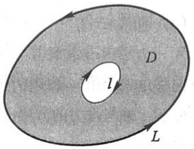

text_image

D
l
L

图11-8

其中 L 是 D 的取正向的边界曲线.

公式(3-1)叫做格林公式.

196

---

第三节 格林公式及其应用

证 先假设穿过区域 $D$ 内部且平行于坐标轴的直线与 $D$ 的边界曲线 $L$ 的交点恰好为两点, 即区域 $D$ 既是 $X$ 型又是 $Y$ 型的情形.

图11-9、图11-10所示的区域都属于这种情形.例如,图11-9所示的区域 $D$ 显然是 $X$ 型的,事实上 $D$ 又是 $Y$ 型的.若设有向曲线弧 $\widehat{FGAE}$ 为 $L_1':x = \psi_1(y)$, $\widehat{EBCF}$ 为 $L_2':x = \psi_2(y)$,则 $D$ 可表达成

$$
D = \{(x, y)   |   \psi_ {1} (y) \leqslant x \leqslant \psi_ {2} (y), c \leqslant y \leqslant d \},
$$

即 D 又是 Y 型的.

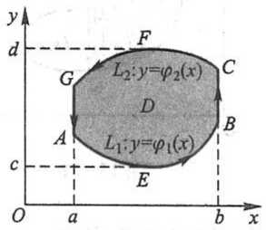

text_image

y
d
F
L₂:y=φ₂(x)
G
C
D
A
B
E
c
O
a
b
x

图11-9

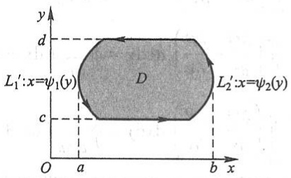

text_image

y
d
L₁':x=ψ₁(y)
D
c
O a b x
L₂':x=ψ₂(y)

图11-10

设 $D$ 如图11-9所示, 于是 $D = \{(x, y) \mid \varphi_1(x) \leqslant y \leqslant \varphi_2(x), a \leqslant x \leqslant b\}$. 因为 $\frac{\partial P}{\partial y}$ 连续, 所以由二重积分的计算法有

$$
\iint_ {D} \frac {\partial P}{\partial y} \mathrm{d} x \mathrm{d} y = \int_ {a} ^ {b} \left\{\int_ {\varphi_ {1} (x)} ^ {\varphi_ {2} (x)} \frac {\partial P (x , y)}{\partial y} \mathrm{d} y \right\} \mathrm{d} x = \int_ {a} ^ {b} \left\{P [ x, \varphi_ {2} (x) ] - P [ x, \varphi_ {1} (x) ] \right\} \mathrm{d} x.
$$

另一方面，由对坐标的曲线积分的性质及计算法有

$$
\begin{array}{l} \oint_ {L} P \mathrm{d} x = \int_ {L _ {1}} P \mathrm{d} x + \int_ {B C} P \mathrm{d} x + \int_ {L _ {2}} P \mathrm{d} x + \int_ {G A} P \mathrm{d} x \\ = \int_ {L _ {1}} P \mathrm{d} x + \int_ {L _ {2}} P \mathrm{d} x = \int_ {a} ^ {b} P [ x, \varphi_ {1} (x) ] \mathrm{d} x + \int_ {b} ^ {a} P [ x, \varphi_ {2} (x) ] \mathrm{d} x \\ = \int_ {a} ^ {b} \left\{P [ x, \varphi_ {1} (x) ] - P [ x, \varphi_ {2} (x) ] \right\} \mathrm{d} x, \\ \end{array}
$$

因此，

$$
- \iint_ {D} \frac {\partial P}{\partial y} \mathrm{d} x \mathrm{d} y = \oint_ {L} P \mathrm{d} x. \tag {3-2}
$$

又由于 $D = \{(x,y)\mid \psi_1(y)\leqslant x\leqslant \psi_2(y),c\leqslant y\leqslant d\}$ ，故有

$$
\begin{array}{l} \iint_ {D} \frac {\partial Q}{\partial x} \mathrm{d} x \mathrm{d} y = \int_ {c} ^ {d} \left[ \int_ {\psi_ {1} (y)} ^ {\psi_ {2} (y)} \frac {\partial Q}{\partial x} \mathrm{d} x \right] \mathrm{d} y = \int_ {c} ^ {d} \left\{Q [ \psi_ {2} (y), y ] - Q [ \psi_ {1} (y), y ] \right\} \mathrm{d} y \\ = \int_ {L _ {2} ^ {\prime}} Q \mathrm{d} y + \int_ {L _ {1} ^ {\prime}} Q \mathrm{d} y = \oint_ {L} Q \mathrm{d} y. \tag {3-3} \\ \end{array}
$$

由于对区域 $D$ ，式(3-2)与(3-3)同时成立，合并后即得公式(3-1).对于如图11-10

197

---

第十一章 曲线积分与曲面积分

所示的区域 D, 完全类似地可证(3-1)成立.

再考虑一般情形.如果闭区域 $D$ 不满足以上条件,那么可以在 $D$ 内引进一条或几条辅助曲线把 $D$ 分成有限个部分闭区域,使得每个部分闭区域都满足上述条件.例如,就图11-11所示的闭区域 $D$ 来说,它的边界曲线 $L$ 为MNPM,引进一条辅助线ABC,

把 D 分成  $D_{1}, D_{2}, D_{3}$  三部分. 应用公式(3-1)于每个部分, 得

$$
\iint_ {D _ {1}} \left(\frac {\partial Q}{\partial x} - \frac {\partial P}{\partial y}\right) \mathrm{d} x \mathrm{d} y = \oint_ {\widehat {M C B A M}} P \mathrm{d} x + Q \mathrm{d} y,
$$

$$
\iint_ {D _ {2}} \left(\frac {\partial Q}{\partial x} - \frac {\partial P}{\partial y}\right) \mathrm{d} x \mathrm{d} y = \oint_ {\widehat {A B P A}} P \mathrm{d} x + Q \mathrm{d} y,
$$

$$
\iint_ {D _ {3}} \left(\frac {\partial Q}{\partial x} - \frac {\partial P}{\partial y}\right) \mathrm{d} x \mathrm{d} y = \oint_ {\widehat {B C N B}} P \mathrm{d} x + Q \mathrm{d} y.
$$

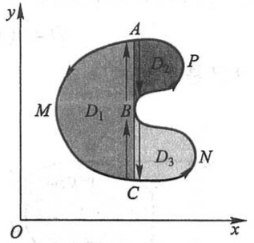

text_image

y
A
E₂ P
M
D₁ B
C
D₃ N
O x

图11-11

把这三个等式相加,注意到相加时沿辅助线来回的曲线积分相互抵消,便得

$$
\iint_ {D} \left(\frac {\partial Q}{\partial x} - \frac {\partial P}{\partial y}\right) \mathrm{d} x \mathrm{d} y = \oint_ {L} P \mathrm{d} x + Q \mathrm{d} y,
$$

其中 L 的方向对 D 来说为正方向. 一般地, 公式(3-1)对于由分段光滑曲线围成的闭区域都成立. 证毕.

注意,对于复连通区域 D,格林公式(3-1)右端应包括沿区域 D 的全部边界的曲线积分,且边界的方向对区域 D 来说都是正向.

下面说明格林公式的一个简单应用.

在公式(3-1)中取 $P = -y, Q = x$，即得

$$
2 \iint_ {D} \mathrm{d} x \mathrm{d} y = \oint_ {L} x \mathrm{d} y - y \mathrm{d} x.
$$

上式左端是闭区域 D 的面积 A 的 2 倍, 因此有

$$
A = \frac {1}{2} \oint_ {L} x \mathrm{d} y - y \mathrm{d} x. \tag {3-4}
$$

例1 计算 $\oint_{L} x^{2} y \mathrm{~d}x - xy^{2} \mathrm{~d}y$，其中 $L$ 为正向圆周 $x^{2} + y^{2} = a^{2}$.

解 令 $P = x^{2}y, Q = -xy^{2}$, 则

$$
\frac {\partial Q}{\partial x} - \frac {\partial P}{\partial y} = - y ^ {2} - x ^ {2}.
$$

因此,由公式(3-1)有

$$
\oint_ {L} x ^ {2} y \mathrm{d} x - x y ^ {2} \mathrm{d} y = - \iint_ {D} (x ^ {2} + y ^ {2}) \mathrm{d} x \mathrm{d} y = - \int_ {0} ^ {2 \pi} \mathrm{d} \theta \int_ {0} ^ {a} \rho^ {3} \mathrm{d} \rho = - \frac {\pi}{2} a ^ {4}.
$$

198

---

第三节 格林公式及其应用

例2 计算 $\iint_{D} \mathrm{e}^{-y^2} \, \mathrm{d}x \, \mathrm{d}y$，其中 $D$ 是以 $O(0,0), A(1,1), B(0,1)$ 为顶点的三角形闭区域（图11-12）.

解 令 $P = 0, Q = x\mathrm{e}^{-y^2}$, 则

$$
\frac {\partial Q}{\partial x} - \frac {\partial P}{\partial y} = \mathrm{e} ^ {- y ^ {2}}.
$$

因此,由公式(3-1)有

$$
\begin{array}{l} \iint_ {D} \mathrm{e} ^ {- y ^ {2}} \mathrm{d} x \mathrm{d} y = \int_ {O A + A B + B O} x \mathrm{e} ^ {- y ^ {2}} \mathrm{d} y = \int_ {O A} x \mathrm{e} ^ {- y ^ {2}} \mathrm{d} y \\ = \int_ {0} ^ {1} x \mathrm{e} ^ {- x ^ {2}} \mathrm{d} x = \frac {1}{2} (1 - \mathrm{e} ^ {- 1}). \\ \end{array}
$$

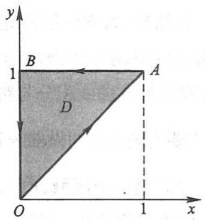

text_image

y
1
B
A
D
O
1
x

图11-12

例 3 求椭圆  $x = a \cos \theta, y = b \sin \theta$  所围成图形的面积 A.

解 根据公式(3-4)有

$$
A = \frac {1}{2} \oint_ {L} x \mathrm{d} y - y \mathrm{d} x = \frac {1}{2} \int_ {0} ^ {2 \pi} (a b \cos^ {2} \theta + a b \sin^ {2} \theta) \mathrm{d} \theta = \frac {1}{2} a b \int_ {0} ^ {2 \pi} \mathrm{d} \theta = \pi a b.
$$

例 4 计算  $\oint_{L}\frac{xdy-ydx}{x^{2}+y^{2}}$ ，其中 L 为一条不自相交①、分段光滑且不经过原点的连续闭曲线，L 的方向为逆时针方向.

解 令 $P = \frac{-y}{x^2 + y^2}, Q = \frac{x}{x^2 + y^2}$. 则当 $x^2 + y^2 \neq 0$ 时，有

$$
\frac {\partial Q}{\partial x} = \frac {y ^ {2} - x ^ {2}}{(x ^ {2} + y ^ {2}) ^ {2}} = \frac {\partial P}{\partial y}.
$$

记 L 所围成的闭区域为 D. 当  $(0,0) \notin D$  时, 由公式 (3-1) 便得

$$
\oint_ {L} \frac {x \mathrm{d} y - y \mathrm{d} x}{x ^ {2} + y ^ {2}} = 0;
$$

当 $(0,0)\in D$ 时,选取适当小的r>0,作位于D内的圆周l: $x^{2}+y^{2}=r^{2}$ .记L和l所围成的闭区域为 $D_{1}$ (图11-13).对复连通区域 $D_{1}$ 应用格林公式,得

$$
\oint_ {L} \frac {x \mathrm{d} y - y \mathrm{d} x}{x ^ {2} + y ^ {2}} - \oint_ {l} \frac {x \mathrm{d} y - y \mathrm{d} x}{x ^ {2} + y ^ {2}} = 0,
$$

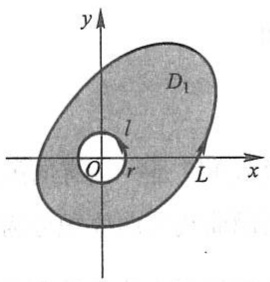

text_image

y
D₁
l
O
r
L
x

图11-13

其中 l 的方向取逆时针方向. 于是

$$
\oint_ {L} \frac {x \mathrm{d} y - y \mathrm{d} x}{x ^ {2} + y ^ {2}} = \oint_ {l} \frac {x \mathrm{d} y - y \mathrm{d} x}{x ^ {2} + y ^ {2}} = \int_ {0} ^ {2 \pi} \frac {r ^ {2} \cos^ {2} \theta + r ^ {2} \sin^ {2} \theta}{r ^ {2}} \mathrm{d} \theta = 2 \pi .
$$

<small>① 对于连续曲线 $L: x = \varphi(t), y = \psi(t), \alpha \leqslant t \leqslant \beta$，如果除了 $t = \alpha, t = \beta$ 外，当 $t_1 \neq t_2$ 时，$(\varphi(t_1), \psi(t_1))$ 与 $(\varphi(t_2), \psi(t_2))$ 总是相异的，那么称 $L$ 是不自相交的曲线。</small>

释疑解难 11-3

#

例题精讲 11-3

199

---

第十一章 曲线积分与曲面积分

## 二、平面上曲线积分与路径无关的条件

在物理、力学中要研究所谓势场,就是要研究场力所做的功与路径无关的情形.在

什么条件下场力所做的功与路径无关？这个问题在数学上就是要研究曲线积分与路径无关的条件.为了研究这个问题,先要明确什么叫做曲线积分 $\int_{L}Pdx+Qdy$ 与路径无关.

设 $G$ 是一个区域, $P(x,y)$ 以及 $Q(x,y)$ 在区域 $G$ 内具有一阶连续偏导数. 如果对于 $G$ 内任意指定的两个点 $A,B$ 以及 $G$ 内从点 $A$ 到点 $B$ 的任意两条曲线 $L_{1}, L_{2}$ (图11-14), 等式

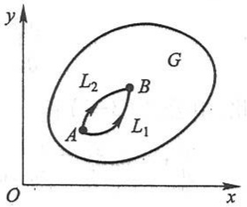

text_image

y
G
L₂
B
A
L₁
O
x

图11-14

$$
\int_ {L _ {1}} P \mathrm{d} x + Q \mathrm{d} y = \int_ {L _ {2}} P \mathrm{d} x + Q \mathrm{d} y
$$

恒成立,就说曲线积分 $\int_{L}P\mathrm{d}x + Q\mathrm{d}y$ 在 $G$ 内与路径无关,否则便说与路径有关.

在以上叙述中注意到,如果曲线积分与路径无关,那么

$$
\int_ {L _ {1}} P \mathrm{d} x + Q \mathrm{d} y = \int_ {L _ {2}} P \mathrm{d} x + Q \mathrm{d} y.
$$

由于

$$
\int_ {L _ {2}} P \mathrm{d} x + Q \mathrm{d} y = - \int_ {L _ {2} ^ {-}} P \mathrm{d} x + Q \mathrm{d} y,
$$

所以

$$
\int_ {L _ {1}} P \mathrm{d} x + Q \mathrm{d} y + \int_ {L _ {2} ^ {-}} P \mathrm{d} x + Q \mathrm{d} y = 0,
$$

从而

$$
\oint_ {L _ {1} + L _ {2} ^ {-}} P \mathrm{d} x + Q \mathrm{d} y = 0,
$$

这里 $L_{1} + L_{2}^{-}$ 是一条有向闭曲线. 因此, 在区域 $G$ 内由曲线积分与路径无关可推得在 $G$ 内沿闭曲线的曲线积分为零. 反过来, 如果在区域 $G$ 内沿任意闭曲线的曲线积分为零, 也可推得在 $G$ 内曲线积分与路径无关. 由此得出结论: 曲线积分 $\int_{L} P \mathrm{~d} x + Q \mathrm{~d} y$ 在 $G$ 内与路径无关相当于沿 $G$ 内任意闭曲线 $C$ 的曲线积分 $\oint_{C} P \mathrm{~d} x + Q \mathrm{~d} y$ 等于零.

定理2 设区域 $G$ 是一个单连通区域, 若函数 $P(x, y)$ 与 $Q(x, y)$ 在 $G$ 内具有一阶连续偏导数, 则曲线积分 $\int_{L} P \mathrm{~d}x + Q \mathrm{~d}y$ 在 $G$ 内与路径无关 (或沿 $G$ 内任意闭曲线的曲线积分为零) 的充分必要条件是

200

---

第三节 格林公式及其应用

$$
\frac {\partial P}{\partial y} = \frac {\partial Q}{\partial x} \tag {3-5}
$$

在 $G$ 内恒成立.

证 先证条件(3-5)是充分的.在 $G$ 内任取一条闭曲线 $C$, 要证当条件(3-5)成立时有 $\oint_{C} P \mathrm{~d} x + Q \mathrm{~d} y = 0$. 因为 $G$ 是单连通的, 所以闭曲线 $C$ 所围成的闭区域 $D$ 全部在 $G$ 内, 于是(3-5)式在 $D$ 上恒成立. 应用格林公式, 有

$$
\iint_ {D} \left(\frac {\partial Q}{\partial x} - \frac {\partial P}{\partial y}\right) \mathrm{d} x \mathrm{d} y = \oint_ {C} P \mathrm{d} x + Q \mathrm{d} y.
$$

上式左端的二重积分等于零（因为被积函数 $\frac{\partial Q}{\partial x} -\frac{\partial P}{\partial y}$ 在 $D$ 上恒为零），从而右端的曲线积分也等于零.

再证条件(3-5)是必要的.现在要证的是:如果沿G内任意闭曲线的曲线积分为零,那么(3-5)式在G内恒成立.用反证法来证.假设上述论断不成立,那么G内至少有一点 $M_{0}$ ,使

$$
\left(\frac {\partial Q}{\partial x} - \frac {\partial P}{\partial y}\right) _ {M _ {0}} \neq 0.
$$

不妨假定

$$
\left(\frac {\partial Q}{\partial x} - \frac {\partial P}{\partial y}\right) _ {M _ {0}} = \eta > 0.
$$

由于 $\frac{\partial P}{\partial y}$ 与 $\frac{\partial Q}{\partial x}$ 在G内连续,可以在G内取得一个以 $M_{0}$ 为圆心、半径足够小的圆形闭区域K,使得在K上恒有

$$
\frac {\partial Q}{\partial x} - \frac {\partial P}{\partial y} \geqslant \frac {\eta}{2}.
$$

于是由格林公式及二重积分的性质就有

$$
\oint_ {\gamma} P \mathrm{d} x + Q \mathrm{d} y = \iint_ {K} \left(\frac {\partial Q}{\partial x} - \frac {\partial P}{\partial y}\right) \mathrm{d} x \mathrm{d} y \geqslant \frac {\eta}{2} \cdot \sigma ,
$$

这里 $\gamma$ 是 $K$ 的正向边界曲线, $\sigma$ 是 $K$ 的面积. 因为 $\eta > 0, \sigma > 0$, 从而

$$
\oint_ {\gamma} P \mathrm{d} x + Q \mathrm{d} y > 0.
$$

这结果与沿 $G$ 内任意闭曲线的曲线积分为零的假定相矛盾，可见 $G$ 内使(3-5)式不成立的点不可能存在，即(3-5)式在 $G$ 内处处成立.证毕.

在第二节第二目例3中我们看到，起点与终点相同的三个曲线积分 $\int_{L}2xy\mathrm{d}x + x^{2}\mathrm{d}y$

201

---

第十一章 曲线积分与曲面积分

相等.由定理2来看,这不是偶然的,因为这里 $\frac{\partial Q}{\partial x}=\frac{\partial P}{\partial y}=2x$ 在整个xOy面内恒成立,而整个xOy面是单连通区域,因此曲线积分 $\int_{L}2xydx+x^{2}dy$ 与路径无关.

在定理2中,要求区域G是单连通区域,且函数 $P(x,y)$ 与 $Q(x,y)$ 在G内具有一阶连续偏导数.如果这两个条件之一不能满足,那么定理的结论不能保证成立.例如,在例4中我们已经看到,当L所围成的区域含有原点时,虽然除去原点外,恒有 $\frac{\partial Q}{\partial x}=\frac{\partial P}{\partial y}$ ,但沿闭曲线的积分 $\oint_{L}Pdx+Qdy\neq0$ ,其原因在于区域内含有破坏函数P,Q及 $\frac{\partial Q}{\partial x}$ , $\frac{\partial P}{\partial y}$ 连续性条件的点O,这种点通常称为奇点.

## 三、二元函数的全微分求积

现在要讨论:函数  $P(x,y)$  与  $Q(x,y)$  满足什么条件时,表达式  $P(x,y)\mathrm{d}x+Q(x,y)\mathrm{d}y$  才是某个二元函数  $u(x,y)$  的全微分;当这样的二元函数存在时把它求出来.

定理3 设区域 $G$ 是一个单连通区域, 若函数 $P(x, y)$ 与 $Q(x, y)$ 在 $G$ 内具有一阶连续偏导数, 则 $P(x, y) \mathrm{d}x + Q(x, y) \mathrm{d}y$ 在 $G$ 内为某一函数 $u(x, y)$ 的全微分的充分必要条件是

$$
\frac {\partial P}{\partial y} = \frac {\partial Q}{\partial x} \tag {3-5}
$$

在 $G$ 内恒成立.

证 先证必要性. 假设存在着某一函数 $u(x, y)$, 使得

$$
\mathrm{d} u = P (x, y) \mathrm{d} x + Q (x, y) \mathrm{d} y,
$$

则必有

$$
\frac {\partial u}{\partial x} = P (x, y), \quad \frac {\partial u}{\partial y} = Q (x, y).
$$

从而

$$
\frac {\partial^ {2} u}{\partial x \partial y} = \frac {\partial P}{\partial y}, \quad \frac {\partial^ {2} u}{\partial y \partial x} = \frac {\partial Q}{\partial x}.
$$

由于 $P$ 与 $Q$ 具有一阶连续偏导数，所以 $\frac{\partial^2 u}{\partial x \partial y}$ 与 $\frac{\partial^2 u}{\partial y \partial x}$ 连续，因此 $\frac{\partial^2 u}{\partial x \partial y} = \frac{\partial^2 u}{\partial y \partial x}$，即 $\frac{\partial P}{\partial y} = \frac{\partial Q}{\partial x}$. 这就证明了条件(3-5)是必要的.

再证充分性. 设已知条件(3-5)在 $G$ 内恒成立, 则由定理2可知, 起点为 $M_0(x_0, y_0)$, 终点为 $M(x, y)$ 的曲线积分在区域 $G$ 内与路径无关, 于是可把这条曲线积

202

---

第三节 格林公式及其应用

分写作

$$
\int_ {(x _ {0}, y _ {0})} ^ {(x, y)} P (x, y) \mathrm{d} x + Q (x, y) \mathrm{d} y.
$$

当起点 $M_0(x_0, y_0)$ 固定时，这个积分的值取决于终点 $M(x, y)$，因此，它与 $x$ 及 $y$ 构成函数关系，把这个函数记作 $u(x, y)$，即

$$
u (x, y) = \int_ {(x _ {0}, y _ {0})} ^ {(x, y)} P (x, y) \mathrm{d} x + Q (x, y) \mathrm{d} y ①. \tag {3-6}
$$

下面来证明这个函数 $u(x,y)$ 的全微分就是 $P(x,y)\mathrm{d}x + Q(x,y)\mathrm{d}y.$ 因为 $P(x,y)$ 与$Q(x,y)$ 都是连续的，因此只要证明

$$
\frac {\partial u}{\partial x} = P (x, y), \quad \frac {\partial u}{\partial y} = Q (x, y).
$$

按偏导数的定义,有

$$
\frac {\partial u}{\partial x} = \lim _ {\Delta x \to 0} \frac {u (x + \Delta x , y) - u (x , y)}{\Delta x}.
$$

由(3-6)式,得

$$
u (x + \Delta x, y) = \int_ {(x _ {0}, y _ {0})} ^ {(x + \Delta x, y)} P (x, y) \mathrm{d} x + Q (x, y) \mathrm{d} y.
$$

由于这里的曲线积分与路径无关,可以取先从点  $M_{0}$  到点 M,然后沿平行于 x 轴的直线段从点 M 到点 N 作为上式右端曲线积分的路径(图 11-15).这样就有

$$
\begin{array}{l} u (x + \Delta x, y) \\ = u (x, y) + \int_ {(x, y)} ^ {(x + \Delta x, y)} P (x, y) \mathrm{d} x + Q (x, y) \mathrm{d} y. \\ \end{array}
$$

从而

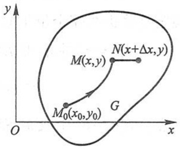

text_image

y
M(x,y)
N(x+Δx,y)
M₀(x₀,y₀)
G
O
x

图11-15

$$
u (x + \Delta x, y) - u (x, y) = \int_ {(x, y)} ^ {(x + \Delta x, y)} P (x, y) \mathrm{d} x + Q (x, y) \mathrm{d} y.
$$

因为直线段 MN 的方程为 y=常数, 按对坐标的曲线积分的计算法, 上式成为

$$
u (x + \Delta x, y) - u (x, y) = \int_ {x} ^ {x + \Delta x} P (x, y) \mathrm{d} x.
$$

应用定积分中值定理,得

$$
u (x + \Delta x, y) - u (x, y) = P (x + \theta \Delta x, y) \Delta x \quad (0 \leqslant \theta \leqslant 1).
$$

上式两端除以 $\Delta x$，并令 $\Delta x \to 0$ 取极限。由于 $P(x, y)$ 的偏导数在 $G$ 内连续，$P(x, y)$ 本身也一定连续，于是得

<small>① 为区别函数的自变量与积分变量, 可记</small>

<small>$u(x,y) = \int_{(x_0,y_0)}^{(x,y)}P(s,t)\mathrm{d}s + Q(s,t)\mathrm{d}t.$</small>

203

---

第十一章 曲线积分与曲面积分

$$
\frac {\partial u}{\partial x} = P (x, y).
$$

同理可证

$$
\frac {\partial u}{\partial y} = Q (x, y).
$$

这就证明了条件(3-5)是充分的.证毕.

由定理 2 及定理 3, 立即可得如下推论:

推论 设区域 $G$ 是一个单连通区域, 若函数 $P(x, y)$ 与 $Q(x, y)$ 在 $G$ 内具有一阶连续偏导数, 则曲线积分 $\int_{L} P \mathrm{~d} x + Q \mathrm{~d} y$ 在 $G$ 内与路径无关的充分必要条件是: 在 $G$ 内存在函数 $u(x, y)$, 使 $\mathrm{d} u = P \mathrm{~d} x + Q \mathrm{~d} y$.

根据上述定理,如果函数  $P(x,y)$  与  $Q(x,y)$  在单连通区域 G 内具有一阶连续偏导数,且满足条件(3-5),那么  $Pdx+Qdy$  是某个函数的全微分,这函数可用公式(3-6)来求出.因为公式(3-6)中的曲线积分与路径无关,为计算简便起见,可以选择平行于坐标轴的直线段连成的折线  $M_{0}RM$  或  $M_{0}SM$  作为积分路线(图11-16),当然要假定这些折线完全位于 G 内.

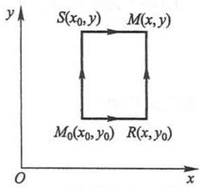

text_image

y
S(x₀,y) M(x,y)
M₀(x₀,y₀) R(x,y₀)
O x

图11-16

在公式(3-6)中取 $M_{0}RM$ 为积分路线,得

$$
u (x, y) = \int_ {x _ {0}} ^ {x} P (x, y _ {0}) \mathrm{d} x + \int_ {y _ {0}} ^ {y} Q (x, y) \mathrm{d} y.
$$

在公式(3-6)中取 $M_0SM$ 为积分路线, 则函数 $u$ 也可表为

$$
u (x, y) = \int_ {y _ {0}} ^ {y} Q (x _ {0}, y) \mathrm{d} y + \int_ {x _ {0}} ^ {x} P (x, y) \mathrm{d} x.
$$

例 5 验证: $\frac{xdy-ydx}{x^{2}+y^{2}}$ 在右半平面(x>0)内是某个函数的全微分,并求出一个这样的函数.

解 在例 4 中已经知道,令

$$
P = \frac {- y}{x ^ {2} + y ^ {2}}, \quad Q = \frac {x}{x ^ {2} + y ^ {2}},
$$

就有

$$
\frac {\partial P}{\partial y} = \frac {y ^ {2} - x ^ {2}}{(x ^ {2} + y ^ {2}) ^ {2}} = \frac {\partial Q}{\partial x}
$$

在右半平面内恒成立,因此在右半平面内, $\frac{xdy-ydx}{x^{2}+y^{2}}$ 是某个函数的全微分.

取积分路线如图 11-17 所示, 利用公式(3-6) 得所求函数为

204

---

第三节 格林公式及其应用

$$
\begin{array}{l} u (x, y) = \int_ {(1, 0)} ^ {(x, y)} \frac {x \mathrm{d} y - y \mathrm{d} x}{x ^ {2} + y ^ {2}} = \int_ {A B} \frac {x \mathrm{d} y - y \mathrm{d} x}{x ^ {2} + y ^ {2}} + \int_ {B C} \frac {x \mathrm{d} y - y \mathrm{d} x}{x ^ {2} + y ^ {2}} \\ = 0 + \int_ {0} ^ {y} \frac {x \mathrm{d} y}{x ^ {2} + y ^ {2}} = \left[ \arctan \frac {y}{x} \right] _ {0} ^ {y} = \arctan \frac {y}{x}. \\ \end{array}
$$

例 6 验证: 在整个 xOy 面内,  $xy^{2}dx + x^{2}ydy$  是某个函数的全微分, 并求出一个这样的函数.

解 现在 $P = xy^2, Q = x^2y$，且

$$
\frac {\partial P}{\partial y} = 2 x y = \frac {\partial Q}{\partial x}
$$

在整个 xOy 面内恒成立, 因此在整个 xOy 面内,  $xy^{2}dx + x^{2}ydy$  是某个函数的全微分. 取积分路线如图 11-18 所示, 利用公式 (3-6) 得所求函数为

$$
\begin{array}{l} u (x, y) = \int_ {(0, 0)} ^ {(x, y)} x y ^ {2} \mathrm{d} x + x ^ {2} y \mathrm{d} y = \int_ {O A} x y ^ {2} \mathrm{d} x + x ^ {2} y \mathrm{d} y + \int_ {A B} x y ^ {2} \mathrm{d} x + x ^ {2} y \mathrm{d} y \\ = 0 + \int_ {0} ^ {y} x ^ {2} y \mathrm{d} y = x ^ {2} \int_ {0} ^ {y} y \mathrm{d} y = \frac {x ^ {2} y ^ {2}}{2}. \\ \end{array}
$$

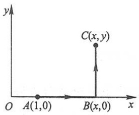

text_image

y
C(x,y)
O A(1,0) B(x,0) x

图11-17

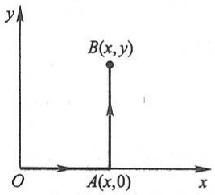

text_image

y
B(x,y)
O
A(x,0)
x

图11-18

\* 全微分方程

利用二元函数的全微分求积,还可以用来求解下面一类一阶微分方程.

一个微分方程写成

$$
P (x, y) \mathrm{d} x + Q (x, y) \mathrm{d} y = 0 \tag {3-7}
$$

的形式后,如果它的左端恰好是某一个函数  $u(x,y)$  的全微分:

$$
\mathrm{d} u (x, y) = P (x, y) \mathrm{d} x + Q (x, y) \mathrm{d} y,
$$

那么方程(3-7)就叫做全微分方程.

容易知道,如果方程(3-7)的左端是函数 $u(x,y)$ 的全微分,那么

$$
u (x, y) = C
$$

就是全微分方程(3-7)的隐式通解,其中 C 是任意常数.

由定理3及公式(3-6)可知,当 $P(x,y)$ 与 $Q(x,y)$ 在单连通区域G内具有一阶连续偏导数时,方程(3-7)成为全微分方程的充分必要条件是

205

---

第十一章 曲线积分与曲面积分

$$
\frac {\partial P}{\partial y} = \frac {\partial Q}{\partial x}
$$

在区域 $G$ 内恒成立，且当此条件满足时，全微分方程(3-7)的通解为

$$
u (x, y) \equiv \int_ {(x _ {0}, y _ {0})} ^ {(x, y)} P (x, y) \mathrm{d} x + Q (x, y) \mathrm{d} y = C, \tag {3-8}
$$

其中 $x_0$ 与 $y_0$ 是在区域 $G$ 内适当选定的点 $M_0$ 的坐标.

例7 求解方程

$$
(5 x ^ {4} + 3 x y ^ {2} - y ^ {3}) \mathrm{d} x + (3 x ^ {2} y - 3 x y ^ {2} + y ^ {2}) \mathrm{d} y = 0.
$$

解 设 $P(x,y) = 5x^{4} + 3xy^{2} - y^{3}, Q(x,y) = 3x^{2}y - 3xy^{2} + y^{2}$, 则

$$
\frac {\partial P}{\partial y} = 6 x y - 3 y ^ {2} = \frac {\partial Q}{\partial x},
$$

因此,所给方程是全微分方程.

取 $x_0 = 0, y_0 = 0$，根据公式(3-8)，有

$$
\begin{array}{l} u (x, y) = \int_ {(0, 0)} ^ {(x, y)} \left(5 x ^ {4} + 3 x y ^ {2} - y ^ {3}\right) \mathrm{d} x + \left(3 x ^ {2} y - 3 x y ^ {2} + y ^ {2}\right) \mathrm{d} y \\ = \int_ {0} ^ {x} 5 x ^ {4} \mathrm{d} x + \int_ {0} ^ {y} (3 x ^ {2} y - 3 x y ^ {2} + y ^ {2}) \mathrm{d} y = x ^ {5} + \frac {3}{2} x ^ {2} y ^ {2} - x y ^ {3} + \frac {1}{3} y ^ {3}. \\ \end{array}
$$

于是,方程的通解为

$$
x ^ {5} + \frac {3}{2} x ^ {2} y ^ {2} - x y ^ {3} + \frac {1}{3} y ^ {3} = C.
$$

除了利用公式(3-8)以外,还可以用下面的方法求解全微分方程.

以上面的方程为例.因为要求的方程通解为 $u(x,y) = C$ ，其中 $u(x,y)$ 满足

$$
\frac {\partial u}{\partial x} = 5 x ^ {4} + 3 x y ^ {2} - y ^ {3},
$$

故

$$
u (x, y) = \int (5 x ^ {4} + 3 x y ^ {2} - y ^ {3}) \mathrm{d} x = x ^ {5} + \frac {3}{2} x ^ {2} y ^ {2} - x y ^ {3} + \varphi (y),
$$

这里 $\varphi(y)$ 是以 $y$ 为自变量的待定函数. 由此, 得

$$
\frac {\partial u}{\partial y} = 3 x ^ {2} y - 3 x y ^ {2} + \varphi^ {\prime} (y).
$$

又 $u(x,y)$ 必须满足

$$
\frac {\partial u}{\partial y} = 3 x ^ {2} y - 3 x y ^ {2} + y ^ {2}.
$$

故

$$
3 x ^ {2} y - 3 x y ^ {2} + \varphi^ {\prime} (y) = 3 x ^ {2} y - 3 x y ^ {2} + y ^ {2}.
$$

从而

$$
\varphi^ {\prime} (y) = y ^ {2}, \quad \varphi (y) = \frac {1}{3} y ^ {3} + C.
$$

206

---

第三节 格林公式及其应用

所以,所给方程的通解为

$$
x ^ {5} + \frac {3}{2} x ^ {2} y ^ {2} - x y ^ {3} + \frac {1}{3} y ^ {3} = C.
$$

## \* 四、曲线积分的基本定理

若曲线积分  $\int_{L} F \cdot dr$  在区域 G 内与积分路径无关, 则称向量场 F 为保守场.

下面的定理给出了平面曲线积分与路径无关的另一种形式的条件,并为计算保守场中的曲线积分提供了一种简便的方法.

定理4（曲线积分的基本定理）设 $F(x,y) = P(x,y)i + Q(x,y)j$ 是平面区域 $G$ 内的一个向量场，若 $P(x,y)$ 与 $Q(x,y)$ 都在 $G$ 内连续，且存在一个数量函数 $f(x,y)$，使得 $F = \nabla f$，则曲线积分 $\int_{L} F \cdot \mathrm{d}r$ 在 $G$ 内与路径无关，且

$$
\int_ {L} \boldsymbol {F} \cdot \mathrm{d} \boldsymbol {r} = f (B) - f (A), \tag {3-9}
$$

其中 L 是位于 G 内起点为 A、终点为 B 的任一分段光滑曲线.

证 设 $L$ 的向量方程为

$$
r = \varphi (t) i + \psi (t) j, \quad t \in [ \alpha , \beta ],
$$

起点 A 对应参数  $t=\alpha$ ，终点 B 对应参数  $t=\beta$ .

由假设， $f_{x}=P,f_{y}=Q,P,Q$  连续，从而f可微，且

$$
\frac {\mathrm{d} f}{\mathrm{d} t} = f _ {x} \frac {\mathrm{d} x}{\mathrm{d} t} + f _ {y} \frac {\mathrm{d} y}{\mathrm{d} t} = \nabla f \cdot \left(\frac {\mathrm{d} x}{\mathrm{d} t} i + \frac {\mathrm{d} y}{\mathrm{d} t} j\right) = F \cdot \frac {\mathrm{d} r}{\mathrm{d} t},
$$

于是

$$
\int_ {L} \boldsymbol {F} \cdot \mathrm{d} \boldsymbol {r} = \int_ {\alpha} ^ {\beta} \boldsymbol {F} \cdot \frac {\mathrm{d} \boldsymbol {r}}{\mathrm{d} t} \mathrm{d} t = \int_ {\alpha} ^ {\beta} \frac {\mathrm{d} f}{\mathrm{d} t} \mathrm{d} t = f [ \varphi (t), \psi (t) ] \Bigg | _ {\alpha} ^ {\beta} = f (B) - f (A),
$$

证毕.

定理 4 表明, 对于势场 F, 曲线积分  $\int_{L} F \cdot dr$  的值仅依赖于它的势函数 f 在路径 L 的两端点的值, 而不依赖于两点间的路径, 即积分  $\int_{L} F \cdot dr$  在 G 内与路径无关. 也就是说: 势场是保守场.

公式(3-9)是与微积分基本公式

$$
\int_ {a} ^ {b} f (x) \mathrm{d} x = F (b) - F (a)
$$

(其中  $F'(x)=f(x)$ ) 完全类似的向量微积分的相应公式, 称为曲线积分的基本公式.

207

---

第十一章 曲线积分与曲面积分

## 习题11-3

1. 计算下列曲线积分,并验证格林公式的正确性:

(1) $\oint_{L}(2xy - x^{2})\mathrm{d}x + (x + y^{2})\mathrm{d}y$ ，其中 $L$ 是由抛物线 $y = x^{2}$ 和 $y^{2} = x$ 所围成的区域的正向边界曲线；
(2) $\oint_{L} (x^{2} - xy^{3}) \mathrm{d}x + (y^{2} - 2xy) \mathrm{d}y$，其中 $L$ 是四个顶点分别为 $(0,0)$，$(2,0)$，$(2,2)$ 和 $(0,2)$ 的正方形区域的正向边界.

2. 利用曲线积分,求下列曲线所围成的图形的面积:

(1) 星形线  $x = a \cos^{3} t, y = a \sin^{3} t;$
(2) 椭圆  $9x^{2}+16y^{2}=144$ ;
(3) 圆  $x^{2}+y^{2}=2ax.$

3. 计算曲线积分 $\oint_{L} \frac{y \, \mathrm{d}x - x \, \mathrm{d}y}{2(x^2 + y^2)}$, 其中 $L$ 为圆周 $(x-1)^2 + y^2 = 2, L$ 的方向为逆时针方向.

4. 确定正向闭曲线 $C$，使曲线积分 $\oint_{C} \left(x + \frac{y^3}{3}\right) \mathrm{d}x + \left(y + x - \frac{2}{3} x^3\right) \mathrm{d}y$ 达到最大值.

5. 设 n 边形的 n 个顶点按逆时针方向依次为  $M_{1}(x_{1}, y_{1}), M_{2}(x_{2}, y_{2}), \cdots, M_{n}(x_{n}, y_{n})$ . 试利用曲线积分证明此 n 边形的面积为

$$
A = \frac {1}{2} \big [ (x _ {1} y _ {2} - x _ {2} y _ {1}) + (x _ {2} y _ {3} - x _ {3} y _ {2}) + \dots + (x _ {n - 1} y _ {n} - x _ {n} y _ {n - 1}) + (x _ {n} y _ {1} - x _ {1} y _ {n}) \big ].
$$

6. 证明下列曲线积分在整个 xOy 面内与路径无关, 并计算积分值:

(1) $\int_{(1,1)}^{(2,3)} (x + y) \, \mathrm{d}x + (x - y) \, \mathrm{d}y$;
(2) $\int_{(1,2)}^{(3,4)} (6xy^2 - y^3) \, \mathrm{d}x + (6x^2y - 3xy^2) \, \mathrm{d}y$;
(3) $\int_{(1,0)}^{(2,1)} (2xy - y^4 + 3) \, \mathrm{d}x + (x^2 - 4xy^3) \, \mathrm{d}y.$

7. 利用格林公式, 计算下列曲线积分:

(1) $\oint_{L}(2x - y + 4)\mathrm{d}x + (5y + 3x - 6)\mathrm{d}y$ ，其中 $L$ 是三顶点分别为(0,0)，(3,0)和(3,2)的三角形正向边界；

(2) $\oint_{L} (x^{2}y\cos x + 2xy\sin x - y^{2}e^{x}) \, \mathrm{d}x + (x^{2}\sin x - 2ye^{x}) \, \mathrm{d}y$，其中 $L$ 为正向星形线 $x^{\frac{2}{3}} + y^{\frac{2}{3}} = a^{\frac{2}{3}}$ ($a > 0$);

(3) $\int_{L} (2xy^{3} - y^{2}\cos x) \, \mathrm{d}x + (1 - 2y\sin x + 3x^{2}y^{2}) \, \mathrm{d}y$，其中 $L$ 为在抛物线 $2x = \pi y^{2}$ 上由点 $(0,0)$ 到 $\left(\frac{\pi}{2}, 1\right)$ 的一段弧；

(4) $\int_{L}(x^{2} - y)\mathrm{d}x - (x + \sin^{2}y)\mathrm{d}y$ ，其中 $L$ 是在圆周 $y = \sqrt{2x - x^2}$ 上由点(0,0)到点(1,1)的一段弧.

8. 设有界闭区域 $D$ 由 $xOy$ 面上的分段光滑曲线 $L$ 所围成, 函数 $u = u(x, y)$ 在 $D$ 上具有连续的二

208

---

第四节 对面积的曲面积分

阶偏导数, $\frac{\partial u}{\partial n}$ 表示 $u(x,y)$ 沿L的外法向量的方向导数,证明

$$
\oint_ {L} \frac {\partial u}{\partial n} \mathrm{d} s = \iint_ {D} \left(\frac {\partial^ {2} u}{\partial x ^ {2}} + \frac {\partial^ {2} u}{\partial y ^ {2}}\right) \mathrm{d} \sigma ,
$$

其中 $L$ 取正向.

9. 验证下列 $P(x, y) \mathrm{d}x + Q(x, y) \mathrm{d}y$ 在整个 $xOy$ 面内是某一函数 $u(x, y)$ 的全微分，并求这样的一个 $u(x, y)$:

(1) $(x+2y)\mathrm{d}x+(2x+y)\mathrm{d}y;$

(2) $2xy\mathrm{d}x+x^{2}\mathrm{d}y;$

(3)  $4\sin x\sin 3y\cos xdx - 3\cos 3y\cos 2xdy;$

(4) $(3x^{2}y + 8xy^{2})\mathrm{d}x + (x^{3} + 8x^{2}y + 12ye^{y})\mathrm{d}y;$

(5) $(2x\cos y+y^{2}\cos x)\mathrm{d}x+(2y\sin x-x^{2}\sin y)\mathrm{d}y.$

10. 设有一变力在坐标轴上的投影为 $X = x^{2} + y^{2}, Y = 2xy - 8$，这变力确定了一个力场。证明质点在此场内移动时，场力所做的功与路径无关。

\*11. 判别下列方程中哪些是全微分方程？对于全微分方程，求出它的通解.

(1) $(3x^{2}+6xy^{2})\mathrm{d}x+(6x^{2}y+4y^{2})\mathrm{d}y=0;$

(2) $(a^{2}-2xy-y^{2})\mathrm{d}x-(x+y)^{2}\mathrm{d}y=0$  (a为常数);

(3)  $e^{y}dx+(xe^{y}-2y)dy=0;$

(4) $(x\cos y + \cos x)y' - y\sin x + \sin y = 0;$

(5) $(x^{2}-y)\mathrm{d}x-x\mathrm{d}y=0;$

(6) $y(x-2y)\mathrm{d}x-x^{2}\mathrm{d}y=0;$

(7) $(1+e^{2\theta})d\rho+2\rho e^{2\theta}d\theta=0;$

(8) $(x^{2}+y^{2})dx+xydy=0.$

12. 确定常数 $\lambda$, 使在右半平面 $x > 0$ 上的向量 $A(x, y) = 2xy(x^4 + y^2)^{\lambda}i - x^2(x^4 + y^2)^{\lambda}j$ 为某二元函数 $u(x, y)$ 的梯度, 并求 $u(x, y)$.

## 第四节 对面积的曲面积分

## 一、对面积的曲面积分的概念与性质

在本章第一节第一目的质量问题中,如果把曲线改为曲面①,并相应地把线密度  $\mu(x,y)$  改为面密度  $\mu(x,y,z)$ , 小段曲线的弧长  $\Delta s_{i}$  改为小块曲面的面积  $\Delta S_{i}$ , 而第 i 小段曲线上的一点  $(\xi_{i},\eta_{i})$  改为第 i 小块曲面上的一点  $(\xi_{i},\eta_{i},\zeta_{i})$ , 那么, 在面密度  $\mu(x,y,z)$  连续的前提下, 所求的质量 m 就是下列和的极限:

$$
m = \lim _ {\lambda \to 0} \sum_ {i = 1} ^ {n} \mu (\xi_ {i}, \eta_ {i}, \zeta_ {i}) \Delta S _ {i},
$$

其中  $\lambda$  表示 n 小块曲面的直径②的最大值.

这样的极限还会在其他问题中遇到. 抽去它们的具体意义, 就得出对面积的曲面

<small>① 以后都假定曲面的边界曲线是分段光滑的闭曲线,且曲面有界.</small>

<small>② 曲面的直径是指曲面上任意两点间距离的最大者.</small>

209

---

第十一章 曲线积分与曲面积分

积分的概念.

定义 设曲面  $\Sigma$  是光滑的①, 函数  $f(x,y,z)$  在  $\Sigma$  上有界. 把  $\Sigma$  任意分成 n 小块  $\Delta S_{i}$  ( $\Delta S_{i}$  同时也代表第 i 小块曲面的面积), 设  $(\xi_{i},\eta_{i},\zeta_{i})$  是  $\Delta S_{i}$  上任意取定的一点, 作乘积  $f(\xi_{i},\eta_{i},\zeta_{i})\Delta S_{i}$  ( $i=1,2,3,\cdots,n$ ), 并作和  $\sum_{i=1}^{n}f(\xi_{i},\eta_{i},\zeta_{i})\Delta S_{i}$ , 如果当各小块曲面的直径的最大值  $\lambda\to0$  时, 这和的极限总存在, 且与曲面  $\Sigma$  的分法及点  $(\xi_{i},\eta_{i},\zeta_{i})$  的取法无关, 那么称此极限为函数  $f(x,y,z)$  在曲面  $\Sigma$  上对面积的曲面积分或第一类曲面积分, 记作  $\iint_{\Sigma}f(x,y,z)\mathrm{d}S$ , 即

$$
\iint_ {\Sigma} f (x, y, z) \mathrm{d} S = \lim _ {\lambda \to 0} \sum_ {i = 1} ^ {n} f (\xi_ {i}, \eta_ {i}, \zeta_ {i}) \Delta S _ {i},
$$

其中 $f(x,y,z)$ 叫做被积函数，$\Sigma$ 叫做积分曲面.

我们指出, 当 $f(x, y, z)$ 在光滑曲面 $\Sigma$ 上连续时, 对面积的曲面积分是存在的. 今后总假定 $f(x, y, z)$ 在 $\Sigma$ 上连续.

根据上述定义,面密度为连续函数  $\mu(x,y,z)$  的光滑曲面  $\Sigma$  的质量 m, 可表示为  $\mu(x,y,z)$  在  $\Sigma$  上对面积的曲面积分

$$
m = \iint_ {\Sigma} \mu (x, y, z)   \mathrm{d} S.
$$

如果 $\Sigma$ 是分片光滑的②, 我们规定函数在 $\Sigma$ 上对面积的曲面积分等于函数在光滑的各片曲面上对面积的曲面积分之和. 例如, 设 $\Sigma$ 可分成两片光滑曲面 $\Sigma_{1}$ 及 $\Sigma_{2}$ (记作 $\Sigma = \Sigma_{1} + \Sigma_{2}$), 就规定

$$
\iint_ {\Sigma_ {1} + \Sigma_ {2}} f (x, y, z) \mathrm{d} S = \iint_ {\Sigma_ {1}} f (x, y, z) \mathrm{d} S + \iint_ {\Sigma_ {2}} f (x, y, z) \mathrm{d} S.
$$

由对面积的曲面积分的定义可知,它具有与对弧长的曲线积分相类似的性质,这里不再赘述.

## 二、对面积的曲面积分的计算法

设积分曲面 $\Sigma$ 由方程 $z = z(x, y)$ 给出，$\Sigma$ 在 $xOy$ 面上的投影区域为 $D_{xy}$（图11-19），函数 $z = z(x, y)$ 在 $D_{xy}$ 上具有连续偏导数，被积函数 $f(x, y, z)$ 在 $\Sigma$ 上连续.

按对面积的曲面积分的定义,有

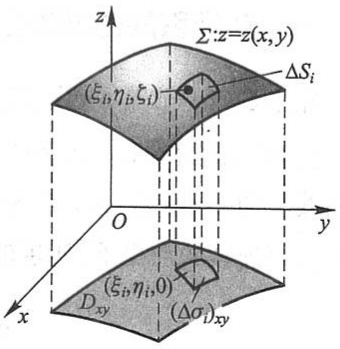

text_image

z
Σ: z=z(x,y)
(ξᵢ, ηᵢ, ξᵢ)
ΔSᵢ
O
y
x
(ξᵢ, ηᵢ, 0)
Dₓᵧ
(Δσᵢ)ₓᵧ

图11-19

<small>① 所谓曲面是光滑的, 就是说, 曲面上各点处都具有切平面, 且当点在曲面上连续移动时, 切平面也连续转动.</small>

<small>② 分片光滑的曲面是指由有限个光滑曲面所组成的曲面.以后我们总假定曲面是光滑的或分片光滑的.</small>

210

---

第四节 对面积的曲面积分

$$
\iint_ {\Sigma} f (x, y, z) \mathrm{d} S = \lim _ {\lambda \rightarrow 0} \sum_ {i = 1} ^ {n} f (\xi_ {i}, \eta_ {i}, \zeta_ {i}) \Delta S _ {i}. \tag {4-1}
$$

设 $\Sigma$ 上第 $i$ 小块曲面 $\Delta S_{i}$ （它的面积也记作 $\Delta S_{i}$）在 $xOy$ 面上的投影区域为 $(\Delta \sigma_{i})_{xy}$（它的面积也记作 $(\Delta \sigma_{i})_{xy}$），则(4-1)式中的 $\Delta S_{i}$ 可表示为二重积分

$$
\Delta S _ {i} = \iint_ {(\Delta \sigma_ {i}) _ {x y}} \sqrt {1 + z _ {x} ^ {2} (x , y) + z _ {y} ^ {2} (x , y)} \mathrm{d} x \mathrm{d} y.
$$

利用二重积分的中值定理,上式又可写成

$$
\Delta S _ {i} = \sqrt {1 + z _ {x} ^ {2} (\xi_ {i} ^ {\prime} , \eta_ {i} ^ {\prime}) + z _ {y} ^ {2} (\xi_ {i} ^ {\prime} , \eta_ {i} ^ {\prime})} (\Delta \sigma_ {i}) _ {x y},
$$

其中 $(\xi_i', \eta_i', 0)$ 是小闭区域 $(\Delta \sigma_i)_{xy}$ 上的一点. 又因 $(\xi_i, \eta_i, \zeta_i)$ 是 $\Sigma$ 上的一点, 故 $\zeta_i = z(\xi_i, \eta_i)$, 这里 $(\xi_i, \eta_i, 0)$ 也是小闭区域 $(\Delta \sigma_i)_{xy}$ 上的点. 于是

$$
\sum_ {i = 1} ^ {n} f (\xi_ {i}, \eta_ {i}, \zeta_ {i}) \Delta S _ {i} = \sum_ {i = 1} ^ {n} f [ \xi_ {i}, \eta_ {i}, z (\xi_ {i}, \eta_ {i}) ] \sqrt {1 + z _ {x} ^ {2} (\xi_ {i} ^ {\prime} , \eta_ {i} ^ {\prime}) + z _ {y} ^ {2} (\xi_ {i} ^ {\prime} , \eta_ {i} ^ {\prime})} (\Delta \sigma_ {i}) _ {x y}.
$$

由于函数 $f[x,y,z(x,y)]$ 以及函数 $\sqrt{1 + z_x^2(x,y) + z_y^2(x,y)}$ 都在闭区域 $D_{xy}$ 上连续，可以证明，当 $\lambda \to 0$ 时，上式右端的极限与

$$
\sum_ {i = 1} ^ {n} f [ \xi_ {i}, \eta_ {i}, z (\xi_ {i}, \eta_ {i}) ] \sqrt {1 + z _ {x} ^ {2} (\xi_ {i} , \eta_ {i}) + z _ {y} ^ {2} (\xi_ {i} , \eta_ {i})} (\Delta \sigma_ {i}) _ {x y}
$$

的极限相等.这个极限在本目开始所给的条件下是存在的,它等于二重积分

$$
\iint_ {D _ {x y}} f [ x, y, z (x, y) ] \sqrt {1 + z _ {x} ^ {2} (x , y) + z _ {y} ^ {2} (x , y)} \mathrm{d} x \mathrm{d} y,
$$

因此左端的极限即曲面积分 $\iint_{\Sigma} f(x, y, z) \, \mathrm{d}S$ 也存在，且有

$$
\iint_ {\Sigma} f (x, y, z) \mathrm{d} S = \iint_ {D _ {x y}} f [ x, y, z (x, y) ] \sqrt {1 + z _ {x} ^ {2} (x , y) + z _ {y} ^ {2} (x , y)} \mathrm{d} x \mathrm{d} y. \tag {4-2}
$$

这就是把对面积的曲面积分化为二重积分的公式. 这公式是容易记忆的, 因为曲面 $\Sigma$ 的方程是 $z = z(x, y)$, 而曲面积分记号中的 $\mathrm{d}S$ 就是 $\sqrt{1 + z_x^2(x, y) + z_y^2(x, y)} \mathrm{d}x \mathrm{d}y$. 在计算时, 只要把变量 $z$ 换为 $z(x, y)$, $\mathrm{d}S$ 换为 $\sqrt{1 + z_x^2 + z_y^2} \mathrm{d}x \mathrm{d}y$, 再确定 $\Sigma$ 在 $xOy$ 面上的投影区域 $D_{xy}$, 这样就把对面积的曲面积分化为二重积分了.

如果积分曲面 $\Sigma$ 由方程 $x = x(y,z)$ 或 $y = y(z,x)$ 给出，也可类似地把对面积的曲面积分化为相应的二重积分.

例1 计算曲面积分 $\iint_{\Sigma} \frac{\mathrm{d}S}{z}$, 其中 $\Sigma$ 是球面 $x^2 + y^2 + z^2 = a^2$ 被平面 $z = h (0 < h < a)$ 截出的顶部（图11-20）.

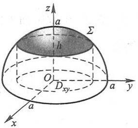

text_image

z
a
Σ
h
O
Dxy
a
y
x
a

图11-20

解 $\Sigma$ 的方程为

211

---

第十一章 曲线积分与曲面积分

$$
z = \sqrt {a ^ {2} - x ^ {2} - y ^ {2}},
$$

$\Sigma$ 在 $xOy$ 面上的投影区域 $D_{xy}$ 为圆形闭区域 $\{(x,y)\mid x^2 +y^2\leqslant a^2 -h^2\}$. 又

$$
\sqrt {1 + z _ {x} ^ {2} + z _ {y} ^ {2}} = \frac {a}{\sqrt {a ^ {2} - x ^ {2} - y ^ {2}}}.
$$

根据公式(4-2)，有

$$
\iint_ {\Sigma} \frac {\mathrm{d} S}{z} = \iint_ {D _ {x y}} \frac {a \mathrm{d} x \mathrm{d} y}{a ^ {2} - x ^ {2} - y ^ {2}}.
$$

利用极坐标,得

$$
\iint_ {\Sigma} \frac {\mathrm{d} S}{z} = \iint_ {D _ {x y}} \frac {a \rho \mathrm{d} \rho \mathrm{d} \theta}{a ^ {2} - \rho^ {2}} = a \int_ {0} ^ {2 \pi} \mathrm{d} \theta \int_ {0} ^ {\sqrt {a ^ {2} - h ^ {2}}} \frac {\rho \mathrm{d} \rho}{a ^ {2} - \rho^ {2}} = 2 \pi a \left[ - \frac {1}{2} \ln (a ^ {2} - \rho^ {2}) \right] _ {0} ^ {\sqrt {a ^ {2} - h ^ {2}}} = 2 \pi a \ln \frac {a}{h}.
$$

例 2 计算  $\oiint_{\Sigma} xyz \, dS^{①}$ ，其中  $\Sigma$  是由平面 x=0, y=0, z=0 及  $x+y+z=1$  所围成的四面体的整个边界曲面（图 11-21）.

解 整个边界曲面 $\Sigma$ 在平面 $x = 0, y = 0, z = 0$ 及 $x + y + z = 1$ 上的部分依次记为 $\Sigma_{1}, \Sigma_{2}, \Sigma_{3}$ 及 $\Sigma_{4}$, 于是

$$
\oiint_ {\Sigma} x y z \mathrm{d} S = \iint_ {\Sigma_ {1}} x y z \mathrm{d} S + \iint_ {\Sigma_ {2}} x y z \mathrm{d} S + \iint_ {\Sigma_ {3}} x y z \mathrm{d} S + \iint_ {\Sigma_ {4}} x y z \mathrm{d} S.
$$

因为在  $\Sigma_{1}, \Sigma_{2}, \Sigma_{3}$  上，被积函数  $f(x, y, z) = xyz$  均为零，
所以

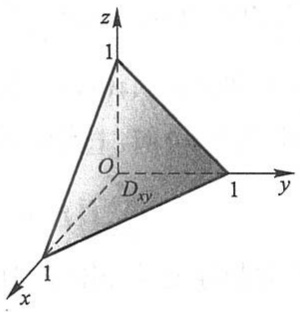

text_image

z
1
O
Dxy
1
y
x
1

图11-21

$$
\iint_ {\Sigma_ {1}} x y z \mathrm{d} S = \iint_ {\Sigma_ {2}} x y z \mathrm{d} S = \iint_ {\Sigma_ {3}} x y z \mathrm{d} S = 0.
$$

在  $\Sigma_{4}$  上, z=1-x-y, 所以

$$
\sqrt {1 + z _ {x} ^ {2} + z _ {y} ^ {2}} = \sqrt {1 + (- 1) ^ {2} + (- 1) ^ {2}} = \sqrt {3},
$$

从而

$$
\oiint_ {\Sigma} x y z \mathrm{d} S = \iint_ {\Sigma_ {4}} x y z \mathrm{d} S = \iint_ {D _ {x y}} \sqrt {3} x y (1 - x - y) \mathrm{d} x \mathrm{d} y,
$$

其中 $D_{xy}$ 是 $\Sigma_4$ 在 $xOy$ 面上的投影区域，即由直线 $x = 0, y = 0$ 及 $x + y = 1$ 所围成的闭区域.因此

$$
\oiint_ {\Sigma} x y z \mathrm{d} S = \sqrt {3} \int_ {0} ^ {1} x \mathrm{d} x \int_ {0} ^ {1 - x} y (1 - x - y) \mathrm{d} y = \sqrt {3} \int_ {0} ^ {1} x \left[ (1 - x) \frac {y ^ {2}}{2} - \frac {y ^ {3}}{3} \right] _ {0} ^ {1 - x} \mathrm{d} x
$$

<small>① 记号  $\oint_{\Sigma}$  表示在闭曲面  $\Sigma$  上积分.</small>

212

例题精讲

11-4

---

第五节 对坐标的曲面积分

$$
= \sqrt {3} \int_ {0} ^ {1} x \cdot \frac {(1 - x) ^ {3}}{6} \mathrm{d} x = \frac {\sqrt {3}}{6} \int_ {0} ^ {1} (x - 3 x ^ {2} + 3 x ^ {3} - x ^ {4}) \mathrm{d} x = \frac {\sqrt {3}}{1 2 0}.
$$

## 习题11-4

1. 设有一分布着质量的曲面 $\Sigma$，在点 $(x, y, z)$ 处它的面密度为 $\mu(x, y, z)$，用对面积的曲面积分表示这曲面对于 $x$ 轴的转动惯量。

2. 按对面积的曲面积分的定义证明公式

$$
\iint_ {\Sigma} f (x, y, z) \mathrm{d} S = \iint_ {\Sigma_ {1}} f (x, y, z) \mathrm{d} S + \iint_ {\Sigma_ {2}} f (x, y, z) \mathrm{d} S,
$$

其中  $\Sigma$  是由  $\Sigma_{1}$  和  $\Sigma_{2}$  组成的.

3. 当 $\Sigma$ 是 $xOy$ 面内的一个闭区域时，曲面积分 $\iint_{\Sigma} f(x, y, z) \mathrm{d}S$ 与二重积分有什么关系？

4. 计算曲面积分 $\iint_{\Sigma} f(x, y, z) \, \mathrm{d}S$，其中 $\Sigma$ 为抛物面 $z = 2 - (x^2 + y^2)$ 在 $xOy$ 面上方的部分，$f(x, y, z)$ 分别如下:

(1) $f(x,y,z)=1;$

(2) $f(x,y,z)=x^{2}+y^{2};$

(3) $f(x,y,z)=3z.$

5. 计算 $\iint_{\Sigma} (x^2 + y^2) \, \mathrm{d}S$，其中 $\Sigma$ 是

（1）锥面 $z = \sqrt{x^2 + y^2}$ 及平面 $z = 1$ 所围成的区域的整个边界曲面；
(2) 锥面  $z^{2}=3(x^{2}+y^{2})$  被平面 z=0 和 z=3 所截得的部分.

6. 计算下列对面积的曲面积分:

(1) $\iint_{\Sigma} \left(z + 2x + \frac{4}{3}y\right) \, \mathrm{d}S$，其中 $\Sigma$ 为平面 $\frac{x}{2} + \frac{y}{3} + \frac{z}{4} = 1$ 在第 I 卦限中的部分；
(2) $\iint_{\Sigma}(2xy - 2x^2 - x + z)\mathrm{d}S$ ，其中 $\Sigma$ 为平面 $2x + 2y + z = 6$ 在第I卦限中的部分；
(3) $\iint_{\Sigma}(x + y + z)\mathrm{d}S$ ，其中 $\Sigma$ 为球面 $x^{2} + y^{2} + z^{2} = a^{2}$ 上 $z\geqslant h$ （ $0 <   h <   a$ )的部分；
(4) $\iint_{\Sigma}(xy + yz + zx)\mathrm{d}S$ ，其中 $\Sigma$ 为锥面 $z = \sqrt{x^2 + y^2}$ 被柱面 $x^{2} + y^{2} = 2ax$ 所截得的有限部分.

7. 求抛物面壳 $z = \frac{1}{2} (x^2 + y^2) (0 \leqslant z \leqslant 1)$ 的质量, 此壳的面密度为 $\mu = z$.

8. 求面密度为  $\mu_{0}$  的均匀半球壳  $x^{2} + y^{2} + z^{2} = a^{2} (z \geqslant 0)$  对于 z 轴的转动惯量.

## 第五节 对坐标的曲面积分

## 一、对坐标的曲面积分的概念与性质

我们对曲面作一些说明,这里假定曲面是光滑的.

213

---

第十一章 曲线积分与曲面积分

通常我们遇到的曲面都是双侧的.例如由方程 $z = z(x,y)$ 表示的曲面,有上侧与下侧之分①;又例如,一张包围某一空间区域的闭曲面,有外侧与内侧之分.以后我们总假定所考虑的曲面是双侧的.

在讨论对坐标的曲面积分时,需要指定曲面的侧.我们可以通过曲面上法向量的方向来定出曲面的侧.例如,对于曲面 $z=z(x,y)$ ,如果取它的法向量n的方向朝上,我们就认为取定曲面的上侧;又如,对于闭曲面如果取它的法向量的方向朝外,我们就认为取定曲面的外侧.这种取定了法向量亦即选定了侧的曲面,就称为有向曲面.

设 $\Sigma$ 是有向曲面. 在 $\Sigma$ 上取一小块曲面 $\Delta S$, 把 $\Delta S$ 投影到 $xOy$ 面上得一投影区域, 这投影区域的面积记为 $(\Delta \sigma)_{xy}$. 假定 $\Delta S$ 上各点处的法向量与 $z$ 轴的夹角 $\gamma$ 的余弦 $\cos \gamma$ 有相同的符号 (即 $\cos \gamma$ 都是正的或都是负的). 我们规定 $\Delta S$ 在 $xOy$ 面上的投影 $(\Delta S)_{xy}$ 为

$$
(\Delta S) _ {x y} = \left\{ \begin{array}{l l} (\Delta \sigma) _ {x y}, & \cos \gamma > 0, \\ - (\Delta \sigma) _ {x y}, & \cos \gamma <   0, \\ 0, & \cos \gamma \equiv 0. \end{array} \right.
$$

其中 $\cos \gamma \equiv 0$ 也就是 $(\Delta \sigma)_{xy} = 0$ 的情形. $\Delta S$ 在 $xOy$ 面上的投影 $(\Delta S)_{xy}$ 实际就是 $\Delta S$ 在 $xOy$ 面上的投影区域的面积附以一定的正负号. 类似地可以定义 $\Delta S$ 在 $yOz$ 面及 $zOx$ 面上的投影 $(\Delta S)_{yz}$ 及 $(\Delta S)_{zx}$.

下面讨论一个例子,然后引进对坐标的曲面积分的概念.

流向曲面一侧的流量 设稳定流动②的不可压缩流体(假定密度为1)的速度场由

$$
\boldsymbol {v} (x, y, z) = P (x, y, z) \boldsymbol {i} + Q (x, y, z) \boldsymbol {j} + R (x, y, z) \boldsymbol {k}
$$

给出, $\Sigma$ 是速度场中的一片有向曲面,函数 $P(x,y,z)$ , $Q(x,y,z)$ 与 $R(x,y,z)$ 都在 $\Sigma$ 上连续,求在单位时间内流向 $\Sigma$ 指定侧的流体的质量,即流量 $\Phi$ .

如果流体流过平面上面积为 $A$ 的一个闭区域，且流体在这闭区域上各点处的流速为（常向量） $\pmb{v}$ ，又设 $\pmb{n}$ 为该平面的单位法向量（图11-22(a))，那么在单位时间内流过这个闭区域的流体组成一个底面积为 $A$ 、斜高为 $|\pmb{v}|$ 的斜柱体(图11-22(b)).

当 $(\widehat{\boldsymbol{v},\boldsymbol{n}}) = \theta <  \frac{\pi}{2}$ 时，斜柱体的体积为

$$
A \mid \boldsymbol {v} \mid \cos \theta = A \boldsymbol {v} \cdot \boldsymbol {n}.
$$

这也就是通过闭区域 $A$ 流向 $\pmb{n}$ 所指一侧的流量 $\Phi$;

当 $(\widehat{\boldsymbol{v},\boldsymbol{n}}) = \frac{\pi}{2}$ 时，显然流体通过闭区域 $A$ 流向 $\pmb{n}$ 所指一侧的流量 $\Phi$ 为零，而 $Av\cdot$

<small>① 按惯例,这里假定 z 轴铅直向上.</small>

<small>② 所谓稳定流动,就是说流速与时间 t 无关.</small>

214

---

第五节 对坐标的曲面积分

$$
n = 0, \text {故} \Phi = A v \cdot n = 0;
$$

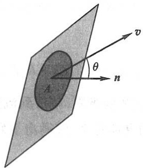

text_image

v
θ
A
n

(a)

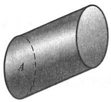

natural_image

3D illustration of a cylinder with a dashed diameter line labeled A (no text or symbols beyond the label)

(b)

图11-22

当 $(\widehat{\boldsymbol{v},\boldsymbol{n}}) > \frac{\pi}{2}$ 时，$Av\cdot n < 0$ ，这时我们仍把 $Av\cdot n$ 称为流体通过闭区域 $A$ 流向 $\pmb{n}$ 所指一侧的流量，它表示流体通过闭区域 $A$ 实际上流向- $\pmb{n}$ 所指一侧，且流向- $\pmb{n}$ 所指一侧的流量为 $-Av\cdot n.$ 因此，不论 $(\widehat{\boldsymbol{v},\boldsymbol{n}})$ 为何值，流体通过闭区域 $A$ 流向 $\pmb{n}$ 所指一侧的流量 $\Phi$ 均为 $Av\cdot n$

由于现在所考虑的不是平面闭区域而是一片曲面,且流速 v 也不是常向量,因此所求流量不能直接用上述方法计算.然而过去在引出各类积分概念的例子中一再使用过的方法,也可用来解决目前的问题.

把曲面 $\Sigma$ 分成 $n$ 小块 $\Delta S_{i}$（$\Delta S_{i}$ 同时也代表第 $i$ 小块曲面的面积）。在 $\Sigma$ 是光滑的和 $\pmb{v}$ 是连续的前提下，只要 $\Delta S_{i}$ 的直径很小，我们就可以用 $\Delta S_{i}$ 上任一点 $(\xi_{i}, \eta_{i}, \zeta_{i})$ 处的流速

$$
\boldsymbol {v} _ {i} = \boldsymbol {v} (\xi_ {i}, \eta_ {i}, \zeta_ {i}) = P (\xi_ {i}, \eta_ {i}, \zeta_ {i}) \boldsymbol {i} + Q (\xi_ {i}, \eta_ {i}, \zeta_ {i}) \boldsymbol {j} + R (\xi_ {i}, \eta_ {i}, \zeta_ {i}) \boldsymbol {k}
$$

代替  $\Delta S_{i}$  上其他各点处的流速, 以该点  $(\xi_{i}, \eta_{i}, \zeta_{i})$  处曲面  $\Sigma$  的单位法向量

$$
n _ {i} = \cos \alpha_ {i} i + \cos \beta_ {i} j + \cos \gamma_ {i} k
$$

代替  $\Delta S_{i}$  上其他各点处的单位法向量（图11-23）。从而得到通过  $\Delta S_{i}$  流向指定侧的流量的近似值为

$$
\boldsymbol {v} _ {i} \cdot \boldsymbol {n} _ {i} \Delta S _ {i} \quad (i = 1, 2, \dots , n).
$$

于是,通过  $\Sigma$  流向指定侧的流量

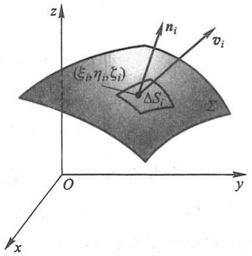

text_image

(ξᵢ,ηᵢ,ζᵢ)
ΔSᵢ
z
nᵢ
vᵢ
Σ
O
y
x

图 11-23

$$
\begin{array}{l} \Phi \approx \sum_ {i = 1} ^ {n} \boldsymbol {v} _ {i} \cdot \boldsymbol {n} _ {i} \Delta S _ {i} \\ = \sum_ {i = 1} ^ {n} \left[ P (\xi_ {i}, \eta_ {i}, \zeta_ {i}) \cos \alpha_ {i} + Q (\xi_ {i}, \eta_ {i}, \zeta_ {i}) \cos \beta_ {i} + R (\xi_ {i}, \eta_ {i}, \zeta_ {i}) \cos \gamma_ {i} \right] \Delta S _ {i}, \\ \end{array}
$$

215

---

第十一章 曲线积分与曲面积分

但

$$
\cos \alpha_ {i} \cdot \Delta S _ {i} \approx (\Delta S _ {i}) _ {y z}, \quad \cos \beta_ {i} \cdot \Delta S _ {i} \approx (\Delta S _ {i}) _ {z x}, \quad \cos \gamma_ {i} \cdot \Delta S _ {i} \approx (\Delta S _ {i}) _ {x y},
$$

因此上式可以写成

$$
\Phi \approx \sum_ {i = 1} ^ {n} \left[ P (\xi_ {i}, \eta_ {i}, \zeta_ {i}) (\Delta S _ {i}) _ {y z} + Q (\xi_ {i}, \eta_ {i}, \zeta_ {i}) (\Delta S _ {i}) _ {z x} + R (\xi_ {i}, \eta_ {i}, \zeta_ {i}) (\Delta S _ {i}) _ {x y} \right].
$$

当各小块曲面的直径的最大值  $\lambda \rightarrow 0$  取上述和的极限, 就得到流量  $\Phi$  的精确值. 这样的极限还会在其他问题中遇到. 抽去它们的具体意义, 就得出下列对坐标的曲面积分的概念:

定义 设  $\Sigma$  为光滑的有向曲面, 函数  $R(x,y,z)$  在  $\Sigma$  上有界. 把  $\Sigma$  任意分成 n 块小曲面  $\Delta S_{i}$  ( $\Delta S_{i}$  同时又表示第 i 块小曲面的面积),  $\Delta S_{i}$  在 xOy 面上的投影为  $(\Delta S_{i})_{xy}$ ,  $(\xi_{i},\eta_{i},\zeta_{i})$  是  $\Delta S_{i}$  上任意取定的一点, 作乘积  $R(\xi_{i},\eta_{i},\zeta_{i})(\Delta S_{i})_{xy}$  ( $i=1,2,\cdots,n$ ), 并作和  $\sum_{i=1}^{n}R(\xi_{i},\eta_{i},\zeta_{i})(\Delta S_{i})_{xy}$ , 如果当各小块曲面的直径的最大值  $\lambda\to0$  时, 这和的极限总存在, 且与曲面  $\Sigma$  的分法及点  $(\xi_{i},\eta_{i},\zeta_{i})$  的取法无关, 那么称此极限为函数  $R(x,y,z)$  在有向曲面  $\Sigma$  上对坐标 x,y 的曲面积分, 记作  $\iint_{\Sigma}R(x,y,z)\mathrm{d}x\mathrm{d}y$ , 即

$$
\iint_ {\Sigma} R (x, y, z) \mathrm{d} x \mathrm{d} y = \lim _ {\lambda \to 0} \sum_ {i = 1} ^ {n} R (\xi_ {i}, \eta_ {i}, \zeta_ {i}) (\Delta S _ {i}) _ {x y},
$$

其中  $R(x,y,z)$  叫做被积函数,  $\Sigma$  叫做积分曲面.

类似地可以定义函数 $P(x,y,z)$ 在有向曲面 $\Sigma$ 上对坐标 $y,z$ 的曲面积分$\iint_{\Sigma}P(x,y,z)\mathrm{d}y\mathrm{d}z$ 及函数 $Q(x,y,z)$ 在有向曲面 $\Sigma$ 上对坐标 $z,x$ 的曲面积分$\iint_{\Sigma}Q(x,y,z)\mathrm{d}z\mathrm{d}x$ 分别为

$$
\iint_ {\Sigma} P (x, y, z) \mathrm{d} y \mathrm{d} z = \lim _ {\lambda \rightarrow 0} \sum_ {i = 1} ^ {n} P (\xi_ {i}, \eta_ {i}, \zeta_ {i}) (\Delta S _ {i}) _ {y z},
$$

$$
\iint_ {\Sigma} Q (x, y, z) \mathrm{d} z \mathrm{d} x = \lim _ {\lambda \rightarrow 0} \sum_ {i = 1} ^ {n} Q (\xi_ {i}, \eta_ {i}, \zeta_ {i}) (\Delta S _ {i}) _ {z x}.
$$

以上三个曲面积分也称为第二类曲面积分.

我们指出, 当  $P(x,y,z)$ ,  $Q(x,y,z)$  与  $R(x,y,z)$  在有向光滑曲面  $\Sigma$  上连续时, 对坐标的曲面积分是存在的, 以后总假定 P, Q 与 R 在  $\Sigma$  上连续.

在应用上出现较多的是

$$
\iint_ {\Sigma} P (x, y, z) \mathrm{d} y \mathrm{d} z + \iint_ {\Sigma} Q (x, y, z) \mathrm{d} z \mathrm{d} x + \iint_ {\Sigma} R (x, y, z) \mathrm{d} x \mathrm{d} y
$$

这种合并起来的形式.为简便起见,我们把它写成

216

---

第五节 对坐标的曲面积分

$$
\iint_ {\Sigma} P (x, y, z) \mathrm{d} y \mathrm{d} z + Q (x, y, z) \mathrm{d} z \mathrm{d} x + R (x, y, z) \mathrm{d} x \mathrm{d} y.
$$

例如,上述流向  $\Sigma$  指定侧的流量  $\Phi$  可表示为

$$
\Phi = \iint_ {\Sigma} P (x, y, z) \mathrm{d} y \mathrm{d} z + Q (x, y, z) \mathrm{d} z \mathrm{d} x + R (x, y, z) \mathrm{d} x \mathrm{d} y.
$$

如果 $\Sigma$ 是分片光滑的有向曲面, 我们规定函数在 $\Sigma$ 上对坐标的曲面积分等于函数在各片光滑曲面上对坐标的曲面积分之和.

对坐标的曲面积分具有与对坐标的曲线积分相类似的一些性质.例如:

(1) 如果把  $\Sigma$  分成  $\Sigma_{1}$  和  $\Sigma_{2}$ ，那么

$$
\begin{array}{l} \iint_ {\Sigma} P \mathrm{d} y \mathrm{d} z + Q \mathrm{d} z \mathrm{d} x + R \mathrm{d} x \mathrm{d} y \\ = \iint_ {\Sigma_ {1}} P \mathrm{d} y \mathrm{d} z + Q \mathrm{d} z \mathrm{d} x + R \mathrm{d} x \mathrm{d} y + \iint_ {\Sigma_ {2}} P \mathrm{d} y \mathrm{d} z + Q \mathrm{d} z \mathrm{d} x + R \mathrm{d} x \mathrm{d} y. \tag {5-1} \\ \end{array}
$$

公式(5-1)可以推广到  $\Sigma$  分成  $\Sigma_{1}, \Sigma_{2}, \cdots, \Sigma_{n}$  几部分的情形.

(2) 设  $\Sigma$  是有向曲面,  $\Sigma^{-}$ 表示与  $\Sigma$  取相反侧的有向曲面, 则

$$
\begin{array}{l} \iint_ {\Sigma^ {-}} P (x, y, z) \mathrm{d} y \mathrm{d} z = - \iint_ {\Sigma} P (x, y, z) \mathrm{d} y \mathrm{d} z, \\ \iint_ {\Sigma^ {-}} Q (x, y, z) \mathrm{d} z \mathrm{d} x = - \iint_ {\Sigma} Q (x, y, z) \mathrm{d} z \mathrm{d} x, \tag {5-2} \\ \iint_ {\Sigma^ {-}} R (x, y, z) \mathrm{d} x \mathrm{d} y = - \iint_ {\Sigma} R (x, y, z) \mathrm{d} x \mathrm{d} y. \\ \end{array}
$$

(5-2)式表示,当积分曲面改变为相反侧时,对坐标的曲面积分要改变符号.因此关于对坐标的曲面积分,我们必须注意积分曲面所取的侧.

这些性质的证明从略.

## 二、对坐标的曲面积分的计算法

设积分曲面 $\Sigma$ 是由方程 $z = z(x,y)$ 所给出的曲面上侧，$\Sigma$ 在 $xOy$ 面上的投影区域为 $D_{xy}$，函数 $z = z(x,y)$ 在 $D_{xy}$ 上具有一阶连续偏导数，被积函数 $R(x,y,z)$ 在 $\Sigma$ 上连续.

按对坐标的曲面积分的定义,有

$$
\iint_ {\Sigma} R (x, y, z) \mathrm{d} x \mathrm{d} y = \lim _ {\lambda \to 0} \sum_ {i = 1} ^ {n} R (\xi_ {i}, \eta_ {i}, \zeta_ {i}) (\Delta S _ {i}) _ {x y}.
$$

因为  $\Sigma$  取上侧,  $\cos \gamma > 0$ , 所以

$$
(\Delta S _ {i}) _ {x y} = (\Delta \sigma_ {i}) _ {x y}.
$$

又因 $(\xi_{i},\eta_{i},\zeta_{i})$ 是 $\Sigma$ 上的一点，故 $\zeta_i = z(\xi_i,\eta_i)$ .从而有

$$
\sum_ {i = 1} ^ {n} R (\xi_ {i}, \eta_ {i}, \zeta_ {i}) (\Delta S _ {i}) _ {x y} = \sum_ {i = 1} ^ {n} R [ \xi_ {i}, \eta_ {i}, z (\xi_ {i}, \eta_ {i}) ] (\Delta \sigma_ {i}) _ {x y}.
$$

217

---

第十一章 曲线积分与曲面积分

令各小块曲面的直径的最大值 $\lambda \rightarrow 0$ 取上式两端的极限, 就得到

$$
\iint_ {\Sigma} R (x, y, z) \mathrm{d} x \mathrm{d} y = \iint_ {D _ {x y}} R [ x, y, z (x, y) ] \mathrm{d} x \mathrm{d} y. \tag {5-3}
$$

这就是把对坐标的曲面积分化为二重积分的公式. 公式(5-3)表明, 计算曲面积分  $\iint_{\Sigma} R(x, y, z) \, dx \, dy$  时, 只需将其中变量 z 换为表示  $\Sigma$  的函数  $z(x, y)$ , 然后在  $\Sigma$  的投影区域  $D_{xy}$  上计算二重积分即可.

必须注意,公式(5-3)的曲面积分是取在曲面  $\Sigma$  上侧的,如果曲面积分取在  $\Sigma$  的下侧,这时  $\cos\gamma<0$ ,那么

$$
(\Delta S _ {i}) _ {x y} = - (\Delta \sigma_ {i}) _ {x y},
$$

从而有

$$
\iint_ {\Sigma} R (x, y, z) \mathrm{d} x \mathrm{d} y = - \iint_ {D _ {x y}} R [ x, y, z (x, y) ] \mathrm{d} x \mathrm{d} y. \tag {$5-3^{\prime$}}
$$

类似地,如果  $\Sigma$  由  $x=x(y,z)$  给出,那么有

$$
\iint_ {\Sigma} P (x, y, z) \mathrm{d} y \mathrm{d} z = \pm \iint_ {D _ {y z}} P [ x (y, z), y, z ] \mathrm{d} y \mathrm{d} z, \tag {5-4}
$$

等式右端的符号这样决定:积分曲面  $\Sigma$  是由方程  $x=x(y,z)$  所给出的曲面前侧,即  $\cos\alpha>0$ , 应取正号; 反之,  $\Sigma$  取后侧, 即  $\cos\alpha<0$ , 应取负号.

如果 $\Sigma$ 由 $y = y(z,x)$ 给出，那么有

$$
\iint_ {\Sigma} Q (x, y, z) \mathrm{d} z \mathrm{d} x = \pm \iint_ {D _ {z x}} Q [ x, y (z, x), z ] \mathrm{d} z \mathrm{d} x, \tag {5-5}
$$

等式右端的符号这样决定:积分曲面  $\Sigma$  是由方程  $y=y(z,x)$  所给出的曲面右侧,即  $\cos\beta>0$ , 应取正号; 反之,  $\Sigma$  取左侧, 即  $\cos\beta<0$ , 应取负号.

例1 计算曲面积分

$$
\iint_ {\Sigma} x ^ {2} \mathrm{d} y \mathrm{d} z + y ^ {2} \mathrm{d} z \mathrm{d} x + z ^ {2} \mathrm{d} x \mathrm{d} y,
$$

其中 $\Sigma$ 是长方体 $\Omega$ 的整个表面的外侧，$\Omega = \{(x, y, z) \mid 0 \leqslant x \leqslant a, 0 \leqslant y \leqslant b, 0 \leqslant z \leqslant c\}$.

解 把有向曲面 $\Sigma$ 分成以下六部分:

$\Sigma_{1}:z = c(0\leqslant x\leqslant a,0\leqslant y\leqslant b)$ 的上侧，

$\Sigma_{2}:z = 0(0\leqslant x\leqslant a,0\leqslant y\leqslant b)$ 的下侧，

$\Sigma_{3}:x = a(0\leqslant y\leqslant b,0\leqslant z\leqslant c)$ 的前侧，

$\Sigma_{4}:x = 0(0\leqslant y\leqslant b,0\leqslant z\leqslant c)$ 的后侧，

$\Sigma_{5}:y = b(0\leqslant x\leqslant a,0\leqslant z\leqslant c)$ 的右侧，

$\Sigma_6:y = 0$ （ $0\leqslant x\leqslant a,0\leqslant z\leqslant c)$ 的左侧.

218

---

第五节 对坐标的曲面积分

除 $\Sigma_3, \Sigma_4$ 外，其余四片曲面在 $yOz$ 面上的投影为零，因此

$$
\iint_ {\Sigma} x ^ {2} \mathrm{d} y \mathrm{d} z = \iint_ {\Sigma_ {3}} x ^ {2} \mathrm{d} y \mathrm{d} z + \iint_ {\Sigma_ {4}} x ^ {2} \mathrm{d} y \mathrm{d} z.
$$

应用公式(5-4)就有

$$
\iint_ {\Sigma} x ^ {2} \mathrm{d} y \mathrm{d} z = \iint_ {D _ {y z}} a ^ {2} \mathrm{d} y \mathrm{d} z - \iint_ {D _ {y z}} 0 ^ {2} \mathrm{d} y \mathrm{d} z = a ^ {2} b c.
$$

类似地可得

$$
\iint_ {\Sigma} y ^ {2} \mathrm{d} z \mathrm{d} x = b ^ {2} a c, \iint_ {\Sigma} z ^ {2} \mathrm{d} x \mathrm{d} y = c ^ {2} a b.
$$

于是所求曲面积分为 $(a+b+c)abc$ .

例 2 计算曲面积分  $\iint_{\Sigma} xyz \, dx \, dy$ ，其中  $\Sigma$  是球面  $x^{2} + y^{2} + z^{2} = 1$  外侧在  $x \geqslant 0, y \geqslant 0$  的部分.

解 把 $\Sigma$ 分为 $\Sigma_{1}$ 和 $\Sigma_{2}$ 两部分（图11-24），$\Sigma_{1}$ 的方程为

$$
z _ {1} = - \sqrt {1 - x ^ {2} - y ^ {2}},
$$

$\Sigma_{2}$  的方程为

$$
z _ {2} = \sqrt {1 - x ^ {2} - y ^ {2}}.
$$

$$
\iint_ {\Sigma} x y z \mathrm{d} x \mathrm{d} y = \iint_ {\Sigma_ {2}} x y z \mathrm{d} x \mathrm{d} y + \iint_ {\Sigma_ {1}} x y z \mathrm{d} x \mathrm{d} y.
$$

text_image

z
1
Σ₂
O
Dₓᵧ
1
y
1
Σ₁
-1
x

图11-24

上式右端的第一个积分的积分曲面 $\Sigma_{2}$ 取上侧，第二个积分的积分曲面 $\Sigma_{1}$ 取下侧，因此分别应用公式(5-3)及(5-3')，就有

$$
\begin{array}{l} \iint_ {\Sigma} x y z \mathrm{d} x \mathrm{d} y = \iint_ {D _ {x y}} x y \sqrt {1 - x ^ {2} - y ^ {2}} \mathrm{d} x \mathrm{d} y - \iint_ {D _ {x y}} x y (- \sqrt {1 - x ^ {2} - y ^ {2}}) \mathrm{d} x \mathrm{d} y \\ = 2 \iint_ {D _ {x y}} x y \sqrt {1 - x ^ {2} - y ^ {2}} \mathrm{d} x \mathrm{d} y. \\ \end{array}
$$

其中 $D_{xy}$ 是 $\Sigma_1$ 及 $\Sigma_2$ 在 $xOy$ 面上的投影区域，就是位于第一象限内的扇形 $x^{2} + y^{2}\leqslant 1$ $(x\geqslant 0,y\geqslant 0)$ .利用极坐标计算这个二重积分如下:

$$
\begin{array}{l} 2 \iint_ {D _ {x y}} x y \sqrt {1 - x ^ {2} - y ^ {2}} \mathrm{d} x \mathrm{d} y = 2 \iint_ {D _ {x y}} \rho^ {2} \sin \theta \cos \theta \sqrt {1 - \rho^ {2}} \rho \mathrm{d} \rho \mathrm{d} \theta \\ = \int_ {0} ^ {\frac {\pi}{2}} \sin 2 \theta \mathrm{d} \theta \int_ {0} ^ {1} \rho^ {3} \sqrt {1 - \rho^ {2}} \mathrm{d} \rho = 1 \times \frac {2}{1 5} = \frac {2}{1 5}, \\ \end{array}
$$

从而

$$
\iint_ {\Sigma} x y z \mathrm{d} x \mathrm{d} y = \frac {2}{1 5}.
$$

219

---

第十一章 曲线积分与曲面积分

## 三、两类曲面积分之间的联系

设有向曲面 $\Sigma$ 由方程 $z = z(x, y)$ 给出，$\Sigma$ 在 $xOy$ 面上的投影区域为 $D_{xy}$，函数 $z = z(x, y)$ 在 $D_{xy}$ 上具有一阶连续偏导数，$R(x, y, z)$ 在 $\Sigma$ 上连续。如果 $\Sigma$ 取上侧，那么由对坐标的曲面积分计算公式(5-3)有

$$
\iint_ {\Sigma} R (x, y, z) \mathrm{d} x \mathrm{d} y = \iint_ {D _ {x y}} R [ x, y, z (x, y) ] \mathrm{d} x \mathrm{d} y.
$$

另一方面,因上述有向曲面  $\Sigma$  的法向量的方向余弦为

$$
\cos \alpha = \frac {- z _ {x}}{\sqrt {1 + z _ {x} ^ {2} + z _ {y} ^ {2}}}, \quad \cos \beta = \frac {- z _ {y}}{\sqrt {1 + z _ {x} ^ {2} + z _ {y} ^ {2}}}, \quad \cos \gamma = \frac {1}{\sqrt {1 + z _ {x} ^ {2} + z _ {y} ^ {2}}},
$$

故由对面积的曲面积分计算公式有

$$
\iint_ {\Sigma} R (x, y, z) \cos \gamma \mathrm{d} S = \iint_ {D _ {x y}} R [ x, y, z (x, y) ] \mathrm{d} x \mathrm{d} y.
$$

由此可见,有

$$
\iint_ {\Sigma} R (x, y, z) \mathrm{d} x \mathrm{d} y = \iint_ {\Sigma} R (x, y, z) \cos \gamma \mathrm{d} S. \tag {5-6}
$$

如果 $\Sigma$ 取下侧, 那么由式(5-3')有

$$
\iint_ {\Sigma} R (x, y, z) \mathrm{d} x \mathrm{d} y = - \iint_ {D _ {x y}} R [ x, y, z (x, y) ] \mathrm{d} x \mathrm{d} y.
$$

但这时  $\cos\gamma=\frac{-1}{\sqrt{1+z_{x}^{2}+z_{y}^{2}}}$ ，因此(5-6)式仍成立.

类似地可推得

$$
\iint_ {\Sigma} P (x, y, z) \mathrm{d} y \mathrm{d} z = \iint_ {\Sigma} P (x, y, z) \cos \alpha \mathrm{d} S, \tag {5-7}
$$

$$
\iint_ {\Sigma} Q (x, y, z) \mathrm{d} z \mathrm{d} x = \iint_ {\Sigma} Q (x, y, z) \cos \beta \mathrm{d} S. \tag {5-8}
$$

合并(5-6)、(5-7)、(5-8)三式,得两类曲面积分之间的如下联系:

$$
\iint_ {\Sigma} P \mathrm{d} y \mathrm{d} z + Q \mathrm{d} z \mathrm{d} x + R \mathrm{d} x \mathrm{d} y = \iint_ {\Sigma} (P \cos \alpha + Q \cos \beta + R \cos \gamma) \mathrm{d} S, \tag {5-9}
$$

其中 $\cos \alpha, \cos \beta$ 与 $\cos \gamma$ 是有向曲面 $\Sigma$ 在点 $(x, y, z)$ 处的法向量的方向余弦.

两类曲面积分之间的联系也可写成如下的向量形式:

$$
\iint_ {\Sigma} A \cdot \mathrm{d} S = \iint_ {\Sigma} A \cdot n \mathrm{d} S \tag {5-10}
$$

或

220

---

第五节 对坐标的曲面积分

$$
\iint_ {\Sigma} \boldsymbol {A} \cdot \mathrm{d} \boldsymbol {S} = \iint_ {\Sigma} A _ {n} \mathrm{d} S, \tag {$5-10^{\prime$}}
$$

其中 $A = (P, Q, R), n = (\cos \alpha, \cos \beta, \cos \gamma)$ 为有向曲面 $\Sigma$ 在点 $(x, y, z)$ 处的单位法向量，$\mathrm{d}S = n\mathrm{d}S = (\mathrm{d}y\mathrm{d}z, \mathrm{d}z\mathrm{d}x, \mathrm{d}x\mathrm{d}y)$ 称为有向曲面元，$A_{n}$ 为向量 $A$ 在向量 $n$ 上的投影.

例3 计算曲面积分 $\iint_{\Sigma}(z^2 + x) \, \mathrm{d}y \, \mathrm{d}z - z \, \mathrm{d}x \, \mathrm{d}y$，其中 $\Sigma$ 是旋转抛物面 $z = \frac{1}{2}(x^2 + y^2)$ 介于平面 $z = 0$ 及 $z = 2$ 之间的部分的下侧.

解法一 把 $\Sigma$ 分为 $\Sigma_{\text{前}}, \Sigma_{\text{后}}$ 两部分, 它们在 $yOz$ 面上的投影区域为 $D_{yz}$,

$$
\begin{array}{l} \iint_ {\Sigma} \left(z ^ {2} + x\right) \mathrm{d} y \mathrm{d} z = \iint_ {\Sigma_ {\text {前}}} \left(z ^ {2} + x\right) \mathrm{d} y \mathrm{d} z + \iint_ {\Sigma_ {\text {后}}} \left(z ^ {2} + x\right) \mathrm{d} y \mathrm{d} z \\ = \iint_ {D _ {y z}} (z ^ {2} + \sqrt {2 z - y ^ {2}}) \mathrm{d} y \mathrm{d} z - \iint_ {D _ {y z}} (z ^ {2} - \sqrt {2 z - y ^ {2}}) \mathrm{d} y \mathrm{d} z \\ = 2 \iint_ {D _ {y z}} \sqrt {2 z - y ^ {2}} \mathrm{d} y \mathrm{d} z = 2 \int_ {- 2} ^ {2} \mathrm{d} y \int_ {\frac {1}{2} y ^ {2}} ^ {2} \sqrt {2 z - y ^ {2}} \mathrm{d} z = 4 \pi . \\ \end{array}
$$

$$
\iint_ {\Sigma} z \mathrm{d} x \mathrm{d} y = - \iint_ {D _ {x y}} \frac {1}{2} (x ^ {2} + y ^ {2}) \mathrm{d} x \mathrm{d} y = - \int_ {0} ^ {2 \pi} \mathrm{d} \theta \int_ {0} ^ {2} \frac {1}{2} \rho^ {2} \cdot \rho \mathrm{d} \rho = - 4 \pi .
$$

故

$$
\iint_ {\Sigma} (z ^ {2} + x) \mathrm{d} y \mathrm{d} z - z \mathrm{d} x \mathrm{d} y = 4 \pi - (- 4 \pi) = 8 \pi .
$$

解法二 利用两类曲面积分之间的联系(5-9)，将对坐标 y, z 的曲面积分转化为对坐标 x, y 的曲面积分

$$
\iint_ {\Sigma} (z ^ {2} + x) \mathrm{d} y \mathrm{d} z = \iint_ {\Sigma} (z ^ {2} + x) \cos \alpha \mathrm{d} S = \iint_ {\Sigma} (z ^ {2} + x) \frac {\cos \alpha}{\cos \gamma} \mathrm{d} x \mathrm{d} y.
$$

在曲面  $\Sigma$  上,有

$$
\cos \alpha = \frac {x}{\sqrt {1 + x ^ {2} + y ^ {2}}}, \quad \cos \gamma = \frac {- 1}{\sqrt {1 + x ^ {2} + y ^ {2}}}.
$$

故

$$
\iint_ {\Sigma} (z ^ {2} + x) \mathrm{d} y \mathrm{d} z - z \mathrm{d} x \mathrm{d} y = \iint_ {\Sigma} [ (z ^ {2} + x) (- x) - z ] \mathrm{d} x \mathrm{d} y.
$$

再按对坐标的曲面积分的计算法,便得

$$
\iint_ {\Sigma} (z ^ {2} + x) \mathrm{d} y \mathrm{d} z - z \mathrm{d} x \mathrm{d} y = - \iint_ {D _ {x y}} \left\{\left[ \frac {1}{4} (x ^ {2} + y ^ {2}) ^ {2} + x \right] \cdot (- x) - \frac {1}{2} (x ^ {2} + y ^ {2}) \right\} \mathrm{d} x \mathrm{d} y.
$$

利用积分区域及被积函数的对称性可知

$$
\iint_ {D _ {x y}} \frac {1}{4} x (x ^ {2} + y ^ {2}) ^ {2} \mathrm{d} x \mathrm{d} y = 0,
$$

221

---

第十一章 曲线积分与曲面积分

故

$$
\begin{array}{l} \iint_ {\Sigma} (z ^ {2} + x) \mathrm{d} y \mathrm{d} z - z \mathrm{d} x \mathrm{d} y = \iint_ {D _ {x y}} \left[ x ^ {2} + \frac {1}{2} (x ^ {2} + y ^ {2}) \right] \mathrm{d} x \mathrm{d} y \\ = \int_ {0} ^ {2 \pi} \mathrm{d} \theta \int_ {0} ^ {2} \left(\rho^ {2} \cos^ {2} \theta + \frac {1}{2} \rho^ {2}\right) \rho \mathrm{d} \rho = 8 \pi . \\ \end{array}
$$

例题精讲

11-5

## 习题11-5

1. 按对坐标的曲面积分的定义证明公式

$$
\iint_ {\Sigma} \left[ P _ {1} (x, y, z) \pm P _ {2} (x, y, z) \right] \mathrm{d} y \mathrm{d} z = \iint_ {\Sigma} P _ {1} (x, y, z) \mathrm{d} y \mathrm{d} z \pm \iint_ {\Sigma} P _ {2} (x, y, z) \mathrm{d} y \mathrm{d} z.
$$

2. 当 $\Sigma$ 为 $xOy$ 面内的一个闭区域时，曲面积分 $\iint_{\Sigma} R(x, y, z) \, \mathrm{d}x \, \mathrm{d}y$ 与二重积分有什么关系？

3. 计算下列对坐标的曲面积分:

(1) $\iint_{\Sigma} x^{2} y^{2} z \, \mathrm{d}x \, \mathrm{d}y$，其中 $\Sigma$ 是球面 $x^{2} + y^{2} + z^{2} = R^{2}$ 的下半部分的下侧；
(2) $\iint_{\Sigma} z \, \mathrm{d}x \, \mathrm{d}y + x \, \mathrm{d}y \, \mathrm{d}z + y \, \mathrm{d}z \, \mathrm{d}x$，其中 $\Sigma$ 是柱面 $x^2 + y^2 = 1$ 被平面 $z = 0$ 及 $z = 3$ 所截得的在第 I 卦限内的部分的前侧；
(3) $\iint_{\Sigma} [f(x, y, z) + x] \, \mathrm{d}y \, \mathrm{d}z + [2f(x, y, z) + y] \, \mathrm{d}z \, \mathrm{d}x + [f(x, y, z) + z] \, \mathrm{d}x \, \mathrm{d}y$，其中 $f(x, y, z)$ 为连续函数，$\Sigma$ 是平面 $x - y + z = 1$ 在第IV卦限部分的上侧；
(4) $\oint_{\Sigma} xz \, \mathrm{d}x \, \mathrm{d}y + xy \, \mathrm{d}y \, \mathrm{d}z + yz \, \mathrm{d}z \, \mathrm{d}x$，其中 $\Sigma$ 是平面 $x = 0, y = 0, z = 0, x + y + z = 1$ 所围成的空间区域的整个边界曲面的外侧.

4. 把对坐标的曲面积分

$$
\iint_ {\Sigma} P (x, y, z) \mathrm{d} y \mathrm{d} z + Q (x, y, z) \mathrm{d} z \mathrm{d} x + R (x, y, z) \mathrm{d} x \mathrm{d} y
$$

化成对面积的曲面积分,其中

(1)  $\Sigma$  是平面  $3x + 2y + 2\sqrt{3}z = 6$  在第 I 卦限的部分的上侧；
(2)  $\Sigma$  是抛物面  $z=8-(x^{2}+y^{2})$  在 xOy 面上方的部分的上侧.

5. 计算

$$
\iint_ {\Sigma} (3 z + 1) x \mathrm{d} y \mathrm{d} z - \mathrm{d} z \mathrm{d} x + z \mathrm{d} x \mathrm{d} y,
$$

其中  $\Sigma$  是由曲线  $\left\{\begin{aligned}z&=\sqrt{y-1},\\ x&=0\end{aligned}\right.$  ( $1\leqslant y\leqslant3$ ) 绕 y 轴旋转一周所成的旋转曲面的左侧.

222

---

第六节 高斯公式 \* 通量与散度

## 第六节 高斯公式 \* 通量与散度

## 一、高斯公式

格林公式表达了平面闭区域上的二重积分与其边界曲线上的曲线积分之间的关系,而高斯(Gauss)公式表达了空间闭区域上的三重积分与其边界曲面上的曲面积分之间的关系,这个关系可陈述如下:

定理1 设空间闭区域 $\Omega$ 是由分片光滑的闭曲面 $\Sigma$ 所围成, 若函数 $P(x,y,z)$, $Q(x,y,z)$ 与 $R(x,y,z)$ 在 $\Omega$ 上具有一阶连续偏导数, 则有

$$
\iiint_ {\Omega} \left(\frac {\partial P}{\partial x} + \frac {\partial Q}{\partial y} + \frac {\partial R}{\partial z}\right) \mathrm{d} V = \oiint_ {\Sigma} P \mathrm{d} y \mathrm{d} z + Q \mathrm{d} z \mathrm{d} x + R \mathrm{d} x \mathrm{d} y, \tag {6-1}
$$

或

$$
\iiint_ {\Omega} \left(\frac {\partial P}{\partial x} + \frac {\partial Q}{\partial y} + \frac {\partial R}{\partial z}\right) \mathrm{d} V = \oiint_ {\Sigma} (P \cos \alpha + Q \cos \beta + R \cos \gamma) \mathrm{d} S, \tag {$6-1^{\prime$}}
$$

这里 $\Sigma$ 是 $\Omega$ 的整个边界曲面的外侧，$\cos \alpha, \cos \beta$ 与 $\cos \gamma$ 是 $\Sigma$ 在点 $(x, y, z)$ 处的法向量的方向余弦. 公式(6-1)或(6-1')叫做高斯公式.

证 由公式(5-9)可知, 公式(6-1)及(6-1')的右端是相等的, 因此这里只要证明公式(6-1)就可以了.

设闭区域 $\Omega$ 在 $xOy$ 面上的投影区域为 $D_{xy}$. 假定穿过 $\Omega$ 内部且平行于 $z$ 轴的直线与 $\Omega$ 的边界曲面 $\Sigma$ 的交点恰好是两个. 这样, 可设 $\Sigma$ 由 $\Sigma_1, \Sigma_2$ 和 $\Sigma_3$ 三部分组成 (图11-25), 其中 $\Sigma_1$ 和 $\Sigma_2$ 分别由方程 $z = z_1(x, y)$ 和 $z = z_2(x, y)$ 给定, 这里 $z_1(x, y) \leqslant z_2(x, y), \Sigma_1$ 取下侧, $\Sigma_2$ 取上侧, $\Sigma_3$ 是以

text_image

Σ₂:z=z₂(x,y)
Σ₃
Ω
Σ₁:z=z₁(x,y)
O
y
x
Dₓᵧ

图11-25

$D_{xy}$  的边界曲线为准线而母线平行于 z 轴的柱面上的一部分, 取外侧.

根据三重积分的计算法,有

$$
\begin{array}{l} \iiint_ {\Omega} \frac {\partial R}{\partial z} \mathrm{d} V = \iint_ {D _ {x y}} \left\{\int_ {z _ {1} (x, y)} ^ {z _ {2} (x, y)} \frac {\partial R}{\partial z} \mathrm{d} z \right\} \mathrm{d} x \mathrm{d} y \\ = \iint_ {D _ {x y}} \left\{R [ x, y, z _ {2} (x, y) ] - R [ x, y, z _ {1} (x, y) ] \right\} \mathrm{d} x \mathrm{d} y. \tag {6-2} \\ \end{array}
$$

根据曲面积分的计算法,有

223

---

第十一章 曲线积分与曲面积分

$$
\begin{array}{l} \iint_ {\Sigma_ {1}} R (x, y, z) \mathrm{d} x \mathrm{d} y = - \iint_ {D _ {x y}} R [ x, y, z _ {1} (x, y) ] \mathrm{d} x \mathrm{d} y. \\ \iint_ {\Sigma_ {2}} R (x, y, z) \mathrm{d} x \mathrm{d} y = \iint_ {D _ {x y}} R [ x, y, z _ {2} (x, y) ] \mathrm{d} x \mathrm{d} y. \\ \end{array}
$$

因为  $\Sigma_{3}$  上任意一块曲面在 xOy 面上的投影为零, 所以直接根据对坐标的曲面积分的定义可知

$$
\iint_ {\Sigma_ {3}} R (x, y, z) \mathrm{d} x \mathrm{d} y = 0.
$$

把以上三式相加,得

$$
\iint_ {\Sigma} R (x, y, z) \mathrm{d} x \mathrm{d} y = \iint_ {D _ {x y}} \left\{R [ x, y, z _ {2} (x, y) ] - R [ x, y, z _ {1} (x, y) ] \right\} \mathrm{d} x \mathrm{d} y. \tag {6-3}
$$

比较(6-2)与(6-3)两式,得

$$
\iiint_ {\Omega} \frac {\partial R}{\partial z} \mathrm{d} V = \iint_ {\Sigma} R (x, y, z) \mathrm{d} x \mathrm{d} y.
$$

如果穿过  $\Omega$  内部且平行于 x 轴的直线以及平行于 y 轴的直线与  $\Omega$  的边界曲面  $\Sigma$  的交点也都恰好是两个,那么类似地可得

$$
\iiint_ {\Omega} \frac {\partial P}{\partial x} \mathrm{d} V = \oiint_ {\Sigma} P (x, y, z) \mathrm{d} y \mathrm{d} z, \quad \iiint_ {\Omega} \frac {\partial Q}{\partial y} \mathrm{d} V = \oiint_ {\Sigma} Q (x, y, z) \mathrm{d} z \mathrm{d} x,
$$

把以上三式两端分别相加,即得高斯公式(6-1).

在上述证明中,我们对闭区域  $\Omega$  作了这样的限制,即穿过  $\Omega$  内部且平行于坐标轴的直线与  $\Omega$  的边界曲面  $\Sigma$  的交点恰好是两点.如果  $\Omega$  不满足这样的条件,可以引进几张辅助曲面把  $\Omega$  分为有限个闭区域,使得每个闭区域满足这样的条件,并注意到沿辅助曲面相反两侧的两个曲面积分的绝对值相等而符号相反,相加时正好抵消,因此公

式(6-1)对于这样的闭区域仍然是正确的.

例 1 利用高斯公式计算曲面积分

$$
\oiint_ {\Sigma} (x - y) \mathrm{d} x \mathrm{d} y + (y - z) x \mathrm{d} y \mathrm{d} z,
$$

其中  $\Sigma$  为柱面  $x^{2}+y^{2}=1$  及平面 z=0, z=3 所围成的空间闭区域  $\Omega$  的整个边界曲面的外侧(图 11-26).

解 因 $P = (y - z)x, Q = 0, R = x - y,$

$$
\frac {\partial P}{\partial x} = y - z, \quad \frac {\partial Q}{\partial y} = 0, \quad \frac {\partial R}{\partial z} = 0,
$$

利用高斯公式把所给曲面积分化为三重积分,得

$$
\oiint_ {\Sigma} (x - y) \mathrm{d} x \mathrm{d} y + (y - z) x \mathrm{d} y \mathrm{d} z = \iiint_ {\Omega} (y - z) \mathrm{d} x \mathrm{d} y \mathrm{d} z = 0 - \iiint_ {\Omega} z \mathrm{d} x \mathrm{d} y \mathrm{d} z = - \frac {9 \pi}{2},
$$

text_image

z
3
O
1
y
x
1

图11-26

224

---

第六节 高斯公式 \* 通量与散度

其中 $\iiint_{\Omega} y \, \mathrm{d}x \, \mathrm{d}y \, \mathrm{d}z = 0$ 由积分区域及被积函数的对称性得出.

例 2 利用高斯公式计算曲面积分

$$
\iint_ {\Sigma} (x ^ {2} \cos \alpha + y ^ {2} \cos \beta + z ^ {2} \cos \gamma) \mathrm{d} S,
$$

其中  $\Sigma$  为锥面  $x^{2}+y^{2}=z^{2}$  介于平面 z=0 及平面  $z=h\quad(h>0)$  之间的部分的下侧， $\cos\alpha,\cos\beta$  与  $\cos\gamma$  是  $\Sigma$  在点  $(x,y,z)$  处的法向量的方向余弦.

解 因曲面 $\Sigma$ 不是封闭曲面, 故不能直接利用高斯公式. 若设 $\Sigma_{1}$ 为 $z = h (x^{2} + y^{2} \leqslant h^{2})$ 的上侧, 则 $\Sigma$ 与 $\Sigma_{1}$ 一起构成一个封闭曲面, 记它们围成的空间闭区域为 $\Omega$, 利用高斯公式, 便得

$$
\begin{array}{l} \oiint_ {\Sigma + \Sigma_ {1}} (x ^ {2} \cos \alpha + y ^ {2} \cos \beta + z ^ {2} \cos \gamma) \mathrm{d} S \\ = 2 \iiint_ {\Omega} (x + y + z) \mathrm{d} V = 2 \iint_ {D _ {x y}} \mathrm{d} x \mathrm{d} y \int_ {\sqrt {x ^ {2} + y ^ {2}}} ^ {h} (x + y + z) \mathrm{d} z, \\ \end{array}
$$

其中 $D_{xy} = \{(x,y) | x^2 + y^2 \leqslant h^2\}$. 注意到

$$
\iint_ {D _ {x y}} \mathrm{d} x \mathrm{d} y \int_ {\sqrt {x ^ {2} + y ^ {2}}} ^ {h} (x + y) \mathrm{d} z = 0,
$$

即得

$$
\oiint_ {\Sigma + \Sigma_ {1}} (x ^ {2} \cos \alpha + y ^ {2} \cos \beta + z ^ {2} \cos \gamma) \mathrm{d} S = \iint_ {D _ {x y}} (h ^ {2} - x ^ {2} - y ^ {2}) \mathrm{d} x \mathrm{d} y = \frac {1}{2} \pi h ^ {4}.
$$

而

$$
\iint_ {\Sigma_ {1}} \left(x ^ {2} \cos \alpha + y ^ {2} \cos \beta + z ^ {2} \cos \gamma\right) \mathrm{d} S = \iint_ {\Sigma_ {1}} z ^ {2} \mathrm{d} S = \iint_ {D _ {x y}} h ^ {2} \mathrm{d} x \mathrm{d} y = \pi h ^ {4}.
$$

因此

$$
\iint_ {\Sigma} \left(x ^ {2} \cos \alpha + y ^ {2} \cos \beta + z ^ {2} \cos \gamma\right) \mathrm{d} S = \frac {1}{2} \pi h ^ {4} - \pi h ^ {4} = - \frac {1}{2} \pi h ^ {4}.
$$

例3 设函数 $u(x,y,z)$ 和 $v(x,y,z)$ 在闭区域 $\Omega$ 上具有一阶及二阶连续偏导数，证明

$$
\iiint_ {\Omega} u \Delta v \mathrm{d} x \mathrm{d} y \mathrm{d} z = \oiint_ {\Sigma} u \frac {\partial v}{\partial n} \mathrm{d} S - \iiint_ {\Omega} \left(\frac {\partial u}{\partial x} \frac {\partial v}{\partial x} + \frac {\partial u}{\partial y} \frac {\partial v}{\partial y} + \frac {\partial u}{\partial z} \frac {\partial v}{\partial z}\right) \mathrm{d} x \mathrm{d} y \mathrm{d} z,
$$

其中  $\Sigma$  是闭区域  $\Omega$  的整个边界曲面， $\frac{\partial v}{\partial n}$  为函数  $v(x,y,z)$  沿  $\Sigma$  的外法向量的方向导数，
符号  $\Delta=\frac{\partial^{2}}{\partial x^{2}}+\frac{\partial^{2}}{\partial y^{2}}+\frac{\partial^{2}}{\partial z^{2}}$  称为拉普拉斯(Laplace)算子.这个公式叫做格林第一公式.

证 因为方向导数

图

释疑解难

11-4

225

---

第十一章 曲线积分与曲面积分

$$
\frac {\partial v}{\partial n} = \frac {\partial v}{\partial x} \cos \alpha + \frac {\partial v}{\partial y} \cos \beta + \frac {\partial v}{\partial z} \cos \gamma ,
$$

其中 $\cos \alpha, \cos \beta$ 与 $\cos \gamma$ 是 $\Sigma$ 在点 $(x, y, z)$ 处的外法向量的方向余弦. 于是曲面积分

$$
\begin{array}{l} \oiint_ {\Sigma} u \frac {\partial v}{\partial n} \mathrm{d} S = \oiint_ {\Sigma} u \left(\frac {\partial v}{\partial x} \cos \alpha + \frac {\partial v}{\partial y} \cos \beta + \frac {\partial v}{\partial z} \cos \gamma\right) \mathrm{d} S \\ = \oint_ {\Sigma} \left[ \left(u \frac {\partial v}{\partial x}\right) \cos \alpha + \left(u \frac {\partial v}{\partial y}\right) \cos \beta + \left(u \frac {\partial v}{\partial z}\right) \cos \gamma \right] \mathrm{d} S. \\ \end{array}
$$

利用高斯公式,即得

$$
\begin{array}{l} \iint_ {\Sigma} u \frac {\partial v}{\partial n} \mathrm{d} S = \iiint_ {\Omega} \left[ \frac {\partial}{\partial x} \left(u \frac {\partial v}{\partial x}\right) + \frac {\partial}{\partial y} \left(u \frac {\partial v}{\partial y}\right) + \frac {\partial}{\partial z} \left(u \frac {\partial v}{\partial z}\right) \right] \mathrm{d} x \mathrm{d} y \mathrm{d} z \\ = \iiint_ {\Omega} u \Delta v \mathrm{d} x \mathrm{d} y \mathrm{d} z + \iiint_ {\Omega} \left(\frac {\partial u}{\partial x} \frac {\partial v}{\partial x} + \frac {\partial u}{\partial y} \frac {\partial v}{\partial y} + \frac {\partial u}{\partial z} \frac {\partial v}{\partial z}\right) \mathrm{d} x \mathrm{d} y \mathrm{d} z, \\ \end{array}
$$

将上式右端第二个积分移至左端便得所要证明的等式.

## \* 二、沿任意闭曲面的曲面积分为零的条件

现在提出与第三节第二目所讨论的问题相类似的问题,这就是:在怎样的条件下,曲面积分

$$
\iint_ {\Sigma} P \mathrm{d} y \mathrm{d} z + Q \mathrm{d} z \mathrm{d} x + R \mathrm{d} x \mathrm{d} y
$$

与曲面 $\Sigma$ 无关而只取决于 $\Sigma$ 的边界曲线？这问题相当于在怎样的条件下，沿任意闭曲面的曲面积分为零？这问题可用高斯公式来解决.

先介绍空间二维单连通区域及一维单连通区域的概念.对空间区域 $G$, 如果 $G$ 内任一闭曲面所围成的区域全属于 $G$, 则称 $G$ 是空间二维单连通区域; 如果 $G$ 内任一闭曲线总可以张成一片完全属于 $G$ 的曲面, 则称 $G$ 为空间一维单连通区域. 例如球面所围成的区域既是空间二维单连通的, 又是空间一维单连通的; 环面所围成的区域是空间二维单连通的, 但不是空间一维单连通的; 两个同心球面之间的区域是空间一维单连通的, 但不是空间二维单连通的.

对于沿任意闭曲面的曲面积分为零的条件,我们有以下结论:

定理2 设 $G$ 是空间二维单连通区域, 若 $P(x, y, z), Q(x, y, z)$ 与 $R(x, y, z)$ 在 $G$ 内具有一阶连续偏导数, 则曲面积分

$$
\iint_ {\Sigma} P \mathrm{d} y \mathrm{d} z + Q \mathrm{d} z \mathrm{d} x + R \mathrm{d} x \mathrm{d} y
$$

在 $G$ 内与所取曲面 $\Sigma$ 无关而只取决于 $\Sigma$ 的边界曲线（或沿 $G$ 内任一闭曲面的曲面积分为零）的充分必要条件是

226

---

第六节 高斯公式 \* 通量与散度

$$
\frac {\partial P}{\partial x} + \frac {\partial Q}{\partial y} + \frac {\partial R}{\partial z} = 0 \tag {6-4}
$$

在 $G$ 内恒成立.

证 若等式(6-4)在 $G$ 内恒成立, 则由高斯公式(6-1)立即可看出沿 $G$ 内的任意闭曲面的曲面积分为零, 因此条件(6-4)是充分的. 反之, 设沿 $G$ 内的任一闭曲面的曲面积分为零, 若等式(6-4)在 $G$ 内不恒成立, 就是说在 $G$ 内至少有一点 $M_0$ 使得

$$
\left(\frac {\partial P}{\partial x} + \frac {\partial Q}{\partial y} + \frac {\partial R}{\partial z}\right) _ {M _ {0}} \neq 0,
$$

仿照第三节第二目中所用的方法,就可得出 G 内存在着闭曲面使得沿该闭曲面的曲面积分不等于零,这与假设相矛盾.因此条件(6-4)是必要的.证毕.

## \*三、通量与散度

设有向量场

$$
A (x, y, z) = P (x, y, z) i + Q (x, y, z) j + R (x, y, z) k,
$$

其中函数 P, Q 与 R 均具有一阶连续偏导数,  $\Sigma$  是场内的一片有向曲面, n 是  $\Sigma$  在点  $(x, y, z)$  处的单位法向量, 则积分

$$
\iint_ {\Sigma} \boldsymbol {A} \cdot \boldsymbol {n} \mathrm{d} S
$$

称为向量场 A 通过曲面  $\Sigma$  向着指定侧的通量(或流量).

由两类曲面积分的关系,通量又可表达为

$$
\iint_ {\Sigma} \boldsymbol {A} \cdot \boldsymbol {n} \mathrm{d} S = \iint_ {\Sigma} \boldsymbol {A} \cdot \mathrm{d} S = \iint_ {\Sigma} P \mathrm{d} y \mathrm{d} z + Q \mathrm{d} z \mathrm{d} x + R \mathrm{d} x \mathrm{d} y.
$$

例 4 求向量场  $A = yzj + z^{2}k$  穿过曲面  $\Sigma$  流向上侧的通量, 其中  $\Sigma$  为柱面  $y^{2} + z^{2} = 1 (z \geqslant 0)$  被平面 x = 0 及 x = 1 截下的有限部分(图 11-27).

解 曲面 $\Sigma$ 上侧的法向量可以由

$$
f (x, y, z) = y ^ {2} + z ^ {2}
$$

的梯度 $\nabla f$ 得出，即

$$
\boldsymbol {n} = \frac {\nabla f}{| \nabla f |} = \frac {2 y \boldsymbol {j} + 2 z \boldsymbol {k}}{\sqrt {(2 y) ^ {2} + (2 z) ^ {2}}} = y \boldsymbol {j} + z \boldsymbol {k} \quad (y ^ {2} + z ^ {2} = 1).
$$

在曲面 $\Sigma$ 上，

$$
A \cdot n = y ^ {2} z + z ^ {3} = z (y ^ {2} + z ^ {2}) = z.
$$

因此，A 穿过  $\Sigma$  流向上侧的通量为

text_image

Σ: y²+z²=1
(1,-1,0)
(1,1,0)
x
y
n
z

图11-27

227

---

第十一章 曲线积分与曲面积分

$$
\iint_ {\Sigma} \boldsymbol {A} \cdot \boldsymbol {n} \mathrm{d} S = \iint_ {\Sigma} z \mathrm{d} S = \iint_ {D _ {x y}} \sqrt {1 - y ^ {2}} \cdot \frac {1}{\sqrt {1 - y ^ {2}}} \mathrm{d} x \mathrm{d} y = \iint_ {D _ {x y}} \mathrm{d} x \mathrm{d} y = 2.
$$

下面我们来解释高斯公式

$$
\iiint_ {\Omega} \left(\frac {\partial P}{\partial x} + \frac {\partial Q}{\partial y} + \frac {\partial R}{\partial z}\right) \mathrm{d} V = \oint_ {\Sigma} P \mathrm{d} y \mathrm{d} z + Q \mathrm{d} z \mathrm{d} x + R \mathrm{d} x \mathrm{d} y \tag {6-1}
$$

的物理意义.

设在闭区域 $\Omega$ 上有稳定流动的、不可压缩的流体（假定流体的密度为1）的速度场

$$
\boldsymbol {v} (x, y, z) = P (x, y, z) \boldsymbol {i} + Q (x, y, z) \boldsymbol {j} + R (x, y, z) \boldsymbol {k},
$$

其中函数 $P, Q$ 与 $R$ 均具有一阶连续偏导数，$\Sigma$ 是闭区域 $\Omega$ 的边界曲面的外侧，$n$ 是曲面 $\Sigma$ 在点 $(x, y, z)$ 处的单位法向量，则由第五节第一目知道，单位时间内流体经过曲面 $\Sigma$ 流向指定侧的流体总质量就是

$$
\iint_ {\Sigma} \boldsymbol {v} \cdot \boldsymbol {n} \mathrm{d} S = \iint_ {\Sigma} v _ {n} \mathrm{d} S = \iint_ {\Sigma} P \mathrm{d} y \mathrm{d} z + Q \mathrm{d} z \mathrm{d} x + R \mathrm{d} x \mathrm{d} y.
$$

因此,高斯公式(6-1)的右端可解释为速度场 v 通过闭曲面  $\Sigma$  流向外侧的通量,即流体在单位时间内离开闭区域  $\Omega$  的总质量.由于我们假定流体是不可压缩且流动是稳定的,因此在流体离开  $\Omega$  的同时, $\Omega$  内部必须有产生流体的“源头”产生出同样多的流体来进行补充.所以高斯公式(6-1)的左端可解释为分布在  $\Omega$  内的源头在单位时间内所产生的流体的总质量.

为简便起见,把高斯公式(6-1)改写成

$$
\iiint_ {\Omega} \left(\frac {\partial P}{\partial x} + \frac {\partial Q}{\partial y} + \frac {\partial R}{\partial z}\right) \mathrm{d} V = \iint_ {\Sigma} v _ {n} \mathrm{d} S.
$$

以闭区域 $\Omega$ 的体积 $V$ 除上式两端, 得

$$
\frac {1}{V} \iiint_ {\Omega} \left(\frac {\partial P}{\partial x} + \frac {\partial Q}{\partial y} + \frac {\partial R}{\partial z}\right) \mathrm{d} V = \frac {1}{V} \oiint_ {\Sigma} v _ {n} \mathrm{d} S.
$$

上式左端表示 $\Omega$ 内的源头在单位时间单位体积内所产生的流体质量的平均值.应用积分中值定理于上式左端，得

$$
\left(\frac {\partial P}{\partial x} + \frac {\partial Q}{\partial y} + \frac {\partial R}{\partial z}\right) \Bigg | _ {(\xi , \eta , \zeta)} = \frac {1}{V} \oiint_ {\Sigma} v _ {n} \mathrm{d} S,
$$

这里 $(\xi, \eta, \zeta)$ 是 $\Omega$ 内的某个点. 令 $\Omega$ 缩向一点 $M(x, y, z)$, 取上式的极限, 得

$$
\frac {\partial P}{\partial x} + \frac {\partial Q}{\partial y} + \frac {\partial R}{\partial z} = \lim _ {\Omega \to M} \frac {1}{V} \oiint_ {\Sigma} v _ {n} \mathrm{d} S.
$$

上式左端称为速度场 v 在点 M 的通量密度或散度, 记作 div  $v(M)$ , 即

$$
\operatorname{div} \boldsymbol {v} (M) = \frac {\partial P}{\partial x} + \frac {\partial Q}{\partial y} + \frac {\partial R}{\partial z}.
$$

$\operatorname{div} \boldsymbol{v}(M)$ 在这里可看做稳定流动的不可压缩流体在点 $M$ 的源头强度. 在 $\operatorname{div} \boldsymbol{v}(M) > 0$

228

---

第六节 高斯公式 \* 通量与散度

的点处,流体从该点向外发散,表示流体在该点处有正源;在 $\text{div } v(M)<0$ 的点处,流体向该点汇聚,表示流体在该点处有吸收流体的负源(又称为汇或洞);在 $\text{div } v(M)=0$ 的点处,表示流体在该点处无源.

对于一般的向量场

$$
A (x, y, z) = P (x, y, z) i + Q (x, y, z) j + R (x, y, z) k,
$$

$\frac{\partial P}{\partial x} + \frac{\partial Q}{\partial y} + \frac{\partial R}{\partial z}$ 叫做向量场 $A$ 的散度，记作 $\operatorname{div} A$ ，即

$$
\operatorname{div} A = \frac {\partial P}{\partial x} + \frac {\partial Q}{\partial y} + \frac {\partial R}{\partial z}.
$$

利用向量微分算子 $\nabla,A$ 的散度div A也可表达为 $\nabla\cdot A$ ，即

$$
\operatorname{div} \boldsymbol {A} = \nabla \cdot \boldsymbol {A}.
$$

如果向量场 A 的散度 div A 处处为零,那么称向量场 A 为无源场.

例 5 求例 4 中的向量场 A 的散度.

解 $\operatorname{div} A = \nabla \cdot A = \frac{\partial}{\partial y}(yz) + \frac{\partial}{\partial z}(z^2) = z + 2z = 3z.$

利用向量场的通量和散度,高斯公式可以写成下面的向量形式

$$
\iiint_ {\Omega} \mathrm{div} A \mathrm{d} V = \iint_ {\Sigma} A _ {n} \mathrm{d} S \tag {6-5}
$$

或

$$
\iiint_ {\Omega} \nabla \cdot A \mathrm{d} V = \iint_ {\Sigma} A _ {n} \mathrm{d} S. \tag {$6-5^{\prime$}}
$$

高斯公式(6-5)表示:向量场A通过闭曲面 $\Sigma$ 流向外侧的通量等于向量场A的散度在闭曲面 $\Sigma$ 所围闭区域 $\Omega$ 上的积分.

## 习题11-6

1. 利用高斯公式计算曲面积分:

(1) $\iint_{\Sigma} x^{2} \mathrm{d}y \mathrm{~d}z + y^{2} \mathrm{~d}z \mathrm{~d}x + z^{2} \mathrm{~d}x \mathrm{~d}y$，其中 $\Sigma$ 为平面 $x = 0, y = 0, z = 0, x = a, y = a, z = a$ 所围成的立体的表面的外侧；

\* (2) $\iint_{\Sigma} x^3 \, \mathrm{d}y \, \mathrm{d}z + y^3 \, \mathrm{d}z \, \mathrm{d}x + z^3 \, \mathrm{d}x \, \mathrm{d}y$，其中 $\Sigma$ 为球面 $x^2 + y^2 + z^2 = a^2$ 的外侧；

\* (3) $\iint_{\Sigma} x z^{2} \mathrm{d}y \mathrm{d}z + (x^{2} y - z^{3}) \mathrm{d}z \mathrm{d}x + (2xy + y^{2} z) \mathrm{d}x \mathrm{d}y$，其中 $\Sigma$ 为上半球体 $0 \leqslant z \leqslant \sqrt{a^{2} - x^{2} - y^{2}}, x^{2} + y^{2} \leqslant a^{2}$ 的表面的外侧；

(4) $\oint_{\Sigma} x \, \mathrm{d}y \, \mathrm{d}z + y \, \mathrm{d}z \, \mathrm{d}x + z \, \mathrm{d}x \, \mathrm{d}y$，其中 $\Sigma$ 是界于 $z = 0$ 和 $z = 3$ 之间的圆柱体 $x^2 + y^2 \leqslant 9$ 的整个表面的

229

---

第十一章 曲线积分与曲面积分

外侧；

(5) $\oint_{\Sigma} 4xz\mathrm{d}y\mathrm{d}z - y^2\mathrm{d}z\mathrm{d}x + yz\mathrm{d}x\mathrm{d}y$，其中 $\Sigma$ 是平面 $x = 0, y = 0, z = 0, x = 1, y = 1, z = 1$ 所围成的立方体的全表面的外侧.

\*2. 求下列向量 $A$ 穿过曲面 $\Sigma$ 流向指定侧的通量:

(1) $A=yzi+xzj+xyk,\Sigma$ 为圆柱 $x^{2}+y^{2}\leqslant a^{2}\quad(0\leqslant z\leqslant h)$ 的全表面,流向外侧;
(2) $A=(2x-z)i+x^{2}yj-xz^{2}k,\Sigma$ 为立方体 $0\leqslant x\leqslant a,0\leqslant y\leqslant a,0\leqslant z\leqslant a$ 的全表面，流向外侧；
(3) $A=(2x+3z)i-(xz+y)j+(y^{2}+2z)k,\Sigma$ 是以点 $(3,-1,2)$ 为球心，半径R=3的球面，流向外侧.

\*3. 求下列向量场 $A$ 的散度:

(1) $A=(x^{2}+yz)i+(y^{2}+xz)j+(z^{2}+xy)k;$
(2) $A=e^{xy}i+\cos(xy)j+\cos(xz^{2})k;$
(3)  $A = y^{2}i + xyj + xzk.$

4. 设 $u(x, y, z), v(x, y, z)$ 是两个定义在闭区域 $\Omega$ 上的具有二阶连续偏导数的函数，$\frac{\partial u}{\partial n}, \frac{\partial v}{\partial n}$ 依次表示 $u(x, y, z), v(x, y, z)$ 沿 $\Sigma$ 的外法线方向的方向导数。证明:

$$
\iiint_ {\Omega} (u \Delta v - v \Delta u) \mathrm{d} x \mathrm{d} y \mathrm{d} z = \oiint_ {\Sigma} \left(u \frac {\partial v}{\partial n} - v \frac {\partial u}{\partial n}\right) \mathrm{d} S,
$$

其中 $\Sigma$ 是空间闭区域 $\Omega$ 的整个边界曲面. 这个公式叫做格林第二公式.

\*5. 利用高斯公式推证阿基米德原理: 浸没在液体中的物体所受液体的压力的合力(即浮力)的方向铅直向上, 其大小等于该物体所排开的液体所受的重力.

## 第七节 斯托克斯公式 \* 环流量与旋度

## 一、斯托克斯公式

斯托克斯(Stokes)公式是格林公式的推广.格林公式表达了平面闭区域上的二重积分与其边界曲线上的曲线积分间的关系,而斯托克斯公式则把曲面  $\Sigma$  上的曲面积分与沿着  $\Sigma$  的边界曲线的曲线积分联系起来.这个联系可陈述如下:

定理1 设 $\Gamma$ 为分段光滑的空间有向闭曲线, $\Sigma$ 是以 $\Gamma$ 为边界的分片光滑的有向曲面, $\Gamma$ 的正向与 $\Sigma$ 的侧符合右手规则①, 若函数 $P(x,y,z), Q(x,y,z)$ 与 $R(x,y,z)$ 在曲面 $\Sigma$ (连同边界 $\Gamma$) 上具有一阶连续偏导数, 则有

$$
\iint_ {\Sigma} \left(\frac {\partial R}{\partial y} - \frac {\partial Q}{\partial z}\right) \mathrm{d} y \mathrm{d} z + \left(\frac {\partial P}{\partial z} - \frac {\partial R}{\partial x}\right) \mathrm{d} z \mathrm{d} x + \left(\frac {\partial Q}{\partial x} - \frac {\partial P}{\partial y}\right) \mathrm{d} x \mathrm{d} y = \oint_ {r} P \mathrm{d} x + Q \mathrm{d} y + R \mathrm{d} z. \tag {7-1}
$$

<small>① 就是说,当右手除拇指外的四指依  $\Gamma$  的绕行方向时,拇指所指的方向与  $\Sigma$  上法向量的方向相同.这时称  $\Gamma$  是有向曲面  $\Sigma$  的正向边界曲线.</small>

230

---

第七节 斯托克斯公式 \* 环流量与旋度

公式(7-1)叫做斯托克斯公式.

证 先假定 $\Sigma$ 与平行于 $z$ 轴的直线相交不多于一点，并设 $\Sigma$ 为曲面 $z = f(x, y)$ 的上侧，$\Sigma$ 的正向边界曲线 $\Gamma$ 在 $xOy$ 面上的投影为平面有向曲线 $C, C$ 所围成的闭区域为 $D_{xy}$（图11-28）.

我们设法把曲面积分

$$
\iint_ {\Sigma} \frac {\partial P}{\partial z} \mathrm{d} z \mathrm{d} x - \frac {\partial P}{\partial y} \mathrm{d} x \mathrm{d} y
$$

化为闭区域 $D_{xy}$ 上的二重积分，然后通过格林公式使它与曲线积分相联系.

text_image

Σ:z=f(x,y)
Γ
O
y
x
Dxy
C
z
n

图11-28

根据对面积的和对坐标的曲面积分间的关系,有

$$
\iint_ {\Sigma} \frac {\partial P}{\partial z} \mathrm{d} z \mathrm{d} x - \frac {\partial P}{\partial y} \mathrm{d} x \mathrm{d} y = \iint_ {\Sigma} \left(\frac {\partial P}{\partial z} \cos \beta - \frac {\partial P}{\partial y} \cos \gamma\right) \mathrm{d} S. \tag {7-2}
$$

由第九章第六节知道,有向曲面  $\Sigma$  的法向量的方向余弦为

$$
\cos \alpha = \frac {- f _ {x}}{\sqrt {1 + f _ {x} ^ {2} + f _ {y} ^ {2}}}, \quad \cos \beta = \frac {- f _ {y}}{\sqrt {1 + f _ {x} ^ {2} + f _ {y} ^ {2}}}, \quad \cos \gamma = \frac {1}{\sqrt {1 + f _ {x} ^ {2} + f _ {y} ^ {2}}},
$$

因此 $\cos \beta = -f_{\gamma}\cos \gamma$ ，把它代入(7-2)式得

$$
\iint_ {\Sigma} \frac {\partial P}{\partial z} \mathrm{d} z \mathrm{d} x - \frac {\partial P}{\partial y} \mathrm{d} x \mathrm{d} y = - \iint_ {\Sigma} \left(\frac {\partial P}{\partial y} + \frac {\partial P}{\partial z} f _ {y}\right) \cos \gamma \mathrm{d} S,
$$

即

$$
\iint_ {\Sigma} \frac {\partial P}{\partial z} \mathrm{d} z \mathrm{d} x - \frac {\partial P}{\partial y} \mathrm{d} x \mathrm{d} y = - \iint_ {\Sigma} \left(\frac {\partial P}{\partial y} + \frac {\partial P}{\partial z} f _ {y}\right) \mathrm{d} x \mathrm{d} y. \tag {7-3}
$$

上式右端的曲面积分化为二重积分时,应把  $P(x,y,z)$  中的 z 用  $f(x,y)$  来代替.因为由复合函数的微分法,有

$$
\frac {\partial}{\partial y} P [ x, y, f (x, y) ] = \frac {\partial P}{\partial y} + \frac {\partial P}{\partial z} f _ {y}.
$$

所以，(7-3)式可写成

$$
\iint_ {\Sigma} \frac {\partial P}{\partial z} \mathrm{d} z \mathrm{d} x - \frac {\partial P}{\partial y} \mathrm{d} x \mathrm{d} y = - \iint_ {D _ {x y}} \frac {\partial}{\partial y} P [ x, y, f (x, y) ] \mathrm{d} x \mathrm{d} y.
$$

根据格林公式,上式右端的二重积分可化为沿闭区域 $D_{xy}$ 的边界C的曲线积分

$$
- \iint_ {D _ {x y}} \frac {\partial}{\partial y} P [ x, y, f (x, y) ] \mathrm{d} x \mathrm{d} y = \oint_ {C} P [ x, y, f (x, y) ] \mathrm{d} x,
$$

于是

$$
\iint_ {\Sigma} \frac {\partial P}{\partial z} \mathrm{d} z \mathrm{d} x - \frac {\partial P}{\partial y} \mathrm{d} x \mathrm{d} y = \oint_ {C} P [ x, y, f (x, y) ] \mathrm{d} x.
$$

231

---

第十一章 曲线积分与曲面积分

因为函数 $P[x,y,f(x,y)]$ 在曲线 $C$ 上点 $(x,y)$ 处的值与函数 $P(x,y,z)$ 在曲线 $\Gamma$ 上对应点 $(x,y,z)$ 处的值是一样的，并且两曲线上的对应小弧段在 $x$ 轴上的投影也一样，根据曲线积分的定义，上式右端的曲线积分等于曲线 $\Gamma$ 上的曲线积分 $\int_{\Gamma} P(x,y,z) \mathrm{d}x.$ 因此，我们证得

$$
\iint_ {\Sigma} \frac {\partial P}{\partial z} \mathrm{d} z \mathrm{d} x - \frac {\partial P}{\partial y} \mathrm{d} x \mathrm{d} y = \oint_ {\Gamma} P (x, y, z) \mathrm{d} x. \tag {7-4}
$$

如果 $\Sigma$ 取下侧, $\Gamma$ 也相应地改成相反的方向, 那么 (7-4) 式两端同时改变符号, 因此 (7-4) 式仍成立.

其次,如果曲面与平行于z轴的直线的交点多于一个,那么可作辅助曲线把曲面分成几部分,然后应用公式(7-4)并相加.因为沿辅助曲线而方向相反的两个曲线积分相加时正好抵消,所以对于这一类曲面公式(7-4)也成立.

同样可证

$$
\iint_ {\Sigma} \frac {\partial Q}{\partial x} \mathrm{d} x \mathrm{d} y - \frac {\partial Q}{\partial z} \mathrm{d} y \mathrm{d} z = \oint_ {\Gamma} Q \mathrm{d} y,
$$

$$
\iint_ {\Sigma} \frac {\partial R}{\partial y} \mathrm{d} y \mathrm{d} z - \frac {\partial R}{\partial x} \mathrm{d} z \mathrm{d} x = \oint_ {r} R \mathrm{d} z.
$$

把它们与公式(7-4)相加即得公式(7-1).证毕.

为了便于记忆,利用行列式记号把斯托克斯公式(7-1)写成

$$
\iint_ {\Sigma} \left| \begin{array}{c c c} \mathrm{d} y \mathrm{d} z & \mathrm{d} z \mathrm{d} x & \mathrm{d} x \mathrm{d} y \\ \frac {\partial}{\partial x} & \frac {\partial}{\partial y} & \frac {\partial}{\partial z} \\ P & Q & R \end{array} \right| = \oint_ {r} P \mathrm{d} x + Q \mathrm{d} y + R \mathrm{d} z,
$$

把其中的行列式按第一行展开,并把 $\frac{\partial}{\partial y}$ 与R的“积”理解为 $\frac{\partial R}{\partial y},\frac{\partial}{\partial z}$ 与Q的“积”理解为 $\frac{\partial Q}{\partial z}$ ,等等,于是这个行列式就“等于”

$$
\left(\frac {\partial R}{\partial y} - \frac {\partial Q}{\partial z}\right) \mathrm{d} y \mathrm{d} z + \left(\frac {\partial P}{\partial z} - \frac {\partial R}{\partial x}\right) \mathrm{d} z \mathrm{d} x + \left(\frac {\partial Q}{\partial x} - \frac {\partial P}{\partial y}\right) \mathrm{d} x \mathrm{d} y.
$$

这恰好是公式(7-1)左端的被积表达式.

利用两类曲面积分间的联系,可得斯托克斯公式的另一形式

$$
\iint_ {\Sigma} \left| \begin{array}{c c c} \cos \alpha & \cos \beta & \cos \gamma \\ \frac {\partial}{\partial x} & \frac {\partial}{\partial y} & \frac {\partial}{\partial z} \\ P & Q & R \end{array} \right| \mathrm{d} S = \oint_ {F} P \mathrm{d} x + Q \mathrm{d} y + R \mathrm{d} z,
$$

其中 $n = (\cos \alpha, \cos \beta, \cos \gamma)$ 为有向曲面 $\Sigma$ 在点 $(x, y, z)$ 处的单位法向量.

232

---

第七节 斯托克斯公式 \* 环流量与旋度

如果  $\Sigma$  是 xOy 面上的一块平面闭区域, 斯托克斯公式就变成格林公式. 因此, 格林公式是斯托克斯公式的一种特殊情形.

例1 利用斯托克斯公式计算曲线积分 $\oint_{\Gamma} z \mathrm{d}x + x \mathrm{d}y + y \mathrm{d}z$，其中 $\Gamma$ 为平面 $x + y + z = 1$ 被三个坐标面所截成的三角形的整个边界，它的正向与这个平面三角形 $\Sigma$ 上侧的法向量之间符合右手规则（图11-29）.

解 按斯托克斯公式,有

$$
\oint_ {\Gamma} z \mathrm{d} x + x \mathrm{d} y + y \mathrm{d} z = \iint_ {\Sigma} \mathrm{d} y \mathrm{d} z + \mathrm{d} z \mathrm{d} x + \mathrm{d} x \mathrm{d} y.
$$

text_image

z
1
O
Dxy
1
y
x
1
n

图11-29

而

$$
\iint_ {\Sigma} \mathrm{d} y \mathrm{d} z = \iint_ {D _ {y z}} \mathrm{d} \sigma = \frac {1}{2},
$$

$$
\iint_ {\Sigma} \mathrm{d} z \mathrm{d} x = \iint_ {D _ {z x}} \mathrm{d} \sigma = \frac {1}{2},
$$

$$
\iint_ {\Sigma} \mathrm{d} x \mathrm{d} y = \iint_ {D _ {x y}} \mathrm{d} \sigma = \frac {1}{2},
$$

其中 $D_{yz}, D_{zx}$ 与 $D_{xy}$ 分别为 $\Sigma$ 在 $yOz, zOx$ 与 $xOy$ 面上的投影区域，因此

$$
\oint_ {r} z \mathrm{d} x + x \mathrm{d} y + y \mathrm{d} z = \frac {3}{2}.
$$

例2 利用斯托克斯公式计算曲线积分

$$
I = \oint_ {\Gamma} (y ^ {2} - z ^ {2}) \mathrm{d} x + (z ^ {2} - x ^ {2}) \mathrm{d} y + (x ^ {2} - y ^ {2}) \mathrm{d} z,
$$

其中 $\Gamma$ 是用平面 $x + y + z = \frac{3}{2}$ 截立方体 $\{(x,y,z)\mid 0\leqslant x\leqslant 1,0\leqslant y\leqslant 1,0\leqslant z\leqslant 1\}$ 的表面所得的截痕，若从 $x$ 轴的正向看去，取逆时针方向（图11-30(a)).

text_image

(0,0,1)
Γ
Σ
O
(0,1,0)
y
(1,0,0)
x
z

(a)

text_image

y
1
x+y=3/2
Dxy
1/2
O
1/2
x
x

(b)

图11-30

233

---

第十一章 曲线积分与曲面积分

解 取 $\Sigma$ 为平面 $x + y + z = \frac{3}{2}$ 的上侧被 $\Gamma$ 所围成的部分, $\Sigma$ 的单位法向量 $n = \frac{1}{\sqrt{3}} (1,1,1)$, 即 $\cos \alpha = \cos \beta = \cos \gamma = \frac{1}{\sqrt{3}}$. 按斯托克斯公式, 有

$$
I = \iint_ {\Sigma} \left| \begin{array}{c c c} \frac {1}{\sqrt {3}} & \frac {1}{\sqrt {3}} & \frac {1}{\sqrt {3}} \\ \frac {\partial}{\partial x} & \frac {\partial}{\partial y} & \frac {\partial}{\partial z} \\ y ^ {2} - z ^ {2} & z ^ {2} - x ^ {2} & x ^ {2} - y ^ {2} \end{array} \right| \mathrm{d} S = - \frac {4}{\sqrt {3}} \iint_ {\Sigma} (x + y + z) \mathrm{d} S.
$$

因为在 $\Sigma$ 上 $x + y + z = \frac{3}{2}$, 故

$$
I = - \frac {4}{\sqrt {3}} \times \frac {3}{2} \iint_ {\Sigma} \mathrm{d} S = - 2 \sqrt {3} \iint_ {D _ {x y}} \sqrt {3} \mathrm{d} x \mathrm{d} y = - 6 \sigma_ {x y},
$$

其中 $D_{xy}$ 为 $\Sigma$ 在 $xOy$ 平面上的投影区域（图11-30(b))，$\sigma_{xy}$ 为 $D_{xy}$ 的面积，因

$$
\sigma_ {x y} = 1 - 2 \times \frac {1}{8} = \frac {3}{4}
$$

故

$$
I = - \frac {9}{2}.
$$

## \* 二、空间曲线积分与路径无关的条件

在第三节中,利用格林公式推得了平面曲线积分与路径无关的条件.完全类似地,利用斯托克斯公式,可推得空间曲线积分与路径无关的条件.

首先我们指出,空间曲线积分与路径无关相当于沿任意闭曲线的曲线积分为零.关于空间曲线积分在什么条件下与路径无关的问题,有以下结论:

定理2 设空间区域 $G$ 是一维单连通区域, 若函数 $P(x, y, z), Q(x, y, z)$ 与 $R(x, y, z)$ 在 $G$ 内具有一阶连续偏导数, 则空间曲线积分 $\int_{\Gamma} P \mathrm{d}x + Q \mathrm{d}y + R \mathrm{d}z$ 在 $G$ 内与路径无关 (或沿 $G$ 内任意闭曲线的曲线积分为零) 的充分必要条件是

$$
\frac {\partial P}{\partial y} = \frac {\partial Q}{\partial x}, \quad \frac {\partial Q}{\partial z} = \frac {\partial R}{\partial y}, \quad \frac {\partial R}{\partial x} = \frac {\partial P}{\partial z} \tag {7-5}
$$

在 $G$ 内恒成立.

证 如果等式(7-5)在 $G$ 内恒成立, 那么由斯托克斯公式(7-1)立即可看出, 沿闭曲线的曲线积分为零, 因此条件是充分的. 反之, 设沿 $G$ 内任意闭曲线的曲线积分为零, 若 $G$ 内有一点 $M_0$ 使(7-5)式中的三个等式不完全成立, 例如 $\frac{\partial P}{\partial y} \neq \frac{\partial Q}{\partial x}$. 不妨假定

234

---

第七节 斯托克斯公式 \* 环流量与旋度

$$
\left(\frac {\partial Q}{\partial x} - \frac {\partial P}{\partial y}\right) _ {M _ {0}} = \eta > 0.
$$

过点 $M_0(x_0, y_0, z_0)$ 作平面 $z = z_0$，并在这个平面上取一个以 $M_0$ 为圆心、半径足够小的圆形闭区域 $K$，使得在 $K$ 上恒有

$$
\frac {\partial Q}{\partial x} - \frac {\partial P}{\partial y} \geqslant \frac {\eta}{2}.
$$

设 $\gamma$ 是 $K$ 的正向边界曲线. 因为 $\gamma$ 在平面 $z = z_0$ 上, 所以按定义有

$$
\oint_ {\gamma} P \mathrm{d} x + Q \mathrm{d} y + R \mathrm{d} z = \oint_ {\gamma} P \mathrm{d} x + Q \mathrm{d} y.
$$

又由(7-1)式有

$$
\oint_ {\gamma} P \mathrm{d} x + Q \mathrm{d} y + R \mathrm{d} z = \iint_ {K} \left(\frac {\partial Q}{\partial x} - \frac {\partial P}{\partial y}\right) \mathrm{d} x \mathrm{d} y \geqslant \frac {\eta}{2} \cdot \sigma ,
$$

其中 $\sigma$ 是 $K$ 的面积, 因为 $\eta > 0, \sigma > 0$, 从而

$$
\oint_ {\gamma} P \mathrm{d} x + Q \mathrm{d} y + R \mathrm{d} z > 0.
$$

这结果与假设矛盾,从而(7-5)式在G内恒成立.证毕.

应用定理 2 并仿照第三节定理 3 的证法,便可以得到

定理3 设区域 $G$ 是空间一维单连通区域，若函数 $P(x,y,z), Q(x,y,z)$ 与 $R(x,y,z)$ 在 $G$ 内具有一阶连续偏导数，则表达式 $P\mathrm{d}x + Q\mathrm{d}y + R\mathrm{d}z$ 在 $G$ 内成为某一函数 $u(x,y,z)$ 的全微分的充分必要条件是等式(7-5)在 $G$ 内恒成立；当条件(7-5)满足

时,这个函数(不计一常数之差)可用下式求出:

$$
u (x, y, z) = \int_ {(x _ {0}, y _ {0}, z _ {0})} ^ {(x, y, z)} P \mathrm{d} x + Q \mathrm{d} y + R \mathrm{d} z \tag {7-6}
$$

或用定积分表示为（按图11-31取积分路径，且此积分路径在 $G$ 内）

$$
\begin{array}{l} u (x, y, z) = \int_ {x _ {0}} ^ {x} P (x, y _ {0}, z _ {0}) \mathrm{d} x + \int_ {y _ {0}} ^ {y} Q (x, y, z _ {0}) \mathrm{d} y + \\ \int_ {z _ {0}} ^ {z} R (x, y, z) \mathrm{d} z. \tag {$7-6^{\prime$}} \\ \end{array}
$$

其中 $M_0(x_0,y_0,z_0)$ 为 $G$ 内某一定点，点 $M(x,y,z)\in G.$

text_image

z
M(x,y,z)
M₀(x₀,y₀,z₀)
O
y
x
M₁(x,y₀,z₀)
M₂(x,y,z₀)

图11-31

## \* 三、环流量与旋度

设有向量场

$$
A (x, y, z) = P (x, y, z) i + Q (x, y, z) j + R (x, y, z) k,
$$

其中函数 P, Q 与 R 均连续,  $\Gamma$  是 A 的定义域内的一条分段光滑的有向闭曲线,  $\tau$  是  $\Gamma$  在点  $(x, y, z)$  处的单位切向量, 则积分

235

---

第十一章 曲线积分与曲面积分

$$
\oint_ {\Gamma} \boldsymbol {A} \cdot \boldsymbol {\tau} \mathrm{d} s
$$

称为向量场 A 沿有向闭曲线  $\Gamma$  的环流量.

由两类曲线积分的关系,环流量又可表达为

$$
\oint_ {\Gamma} \boldsymbol {A} \cdot \boldsymbol {\tau} \mathrm{d} s = \oint_ {\Gamma} \boldsymbol {A} \cdot \mathrm{d} \boldsymbol {r} = \oint_ {\Gamma} P \mathrm{d} x + Q \mathrm{d} y + R \mathrm{d} z.
$$

例3 求向量场 $A = (x^{2} - y)i + 4zj + x^{2}k$ 沿闭曲线 $\Gamma$ 的环流量, 其中 $\Gamma$ 为锥面 $z = \sqrt{x^2 + y^2}$ 和平面 $z = 2$ 的交线, 从 $z$ 轴正向看 $\Gamma$ 为逆时针方向.

解 $\Gamma$ 的向量方程为

$$
r = 2 \cos \theta i + 2 \sin \theta j + 2 k, \quad 0 \leqslant \theta \leqslant 2 \pi .
$$

于是

$$
\begin{array}{l} A = (x ^ {2} - y) i + 4 z j + x ^ {2} k = (4 \cos^ {2} \theta - 2 \sin \theta) i + 8 j + 4 \cos^ {2} \theta k, \\ \mathrm{d} \boldsymbol {r} = (- 2 \sin \theta \mathrm{d} \theta) \boldsymbol {i} + (2 \cos \theta \mathrm{d} \theta) \boldsymbol {j}, \\ \end{array}
$$

$$
\oint_ {\Gamma} \boldsymbol {A} \cdot \boldsymbol {\tau} \mathrm{d} s = \oint_ {\Gamma} \boldsymbol {A} \cdot \mathrm{d} \boldsymbol {r} = \int_ {0} ^ {2 \pi} (- 8 \cos^ {2} \theta \sin \theta + 4 \sin^ {2} \theta + 1 6 \cos \theta) \mathrm{d} \theta = 4 \pi.
$$

类似于由向量场 A 的通量可以引出向量场 A 在一点的通量密度(即散度)一样, 由向量场 A 沿一闭曲线的环流量可引出向量场 A 在一点的环量密度或旋度. 它是一个向量, 定义如下:

设有一向量场

$$
A (x, y, z) = P (x, y, z) i + Q (x, y, z) j + R (x, y, z) k,
$$

其中函数 $P, Q$ 与 $R$ 均具有一阶连续偏导数，则向量

$$
\left(\frac {\partial R}{\partial y} - \frac {\partial Q}{\partial z}\right) i + \left(\frac {\partial P}{\partial z} - \frac {\partial R}{\partial x}\right) j + \left(\frac {\partial Q}{\partial x} - \frac {\partial P}{\partial y}\right) k
$$

称为向量场 A 的旋度, 记作 rot A, 即

$$
\mathrm{rot} A = \left(\frac {\partial R}{\partial y} - \frac {\partial Q}{\partial z}\right) i + \left(\frac {\partial P}{\partial z} - \frac {\partial R}{\partial x}\right) j + \left(\frac {\partial Q}{\partial x} - \frac {\partial P}{\partial y}\right) k. \tag {7-7}
$$

利用向量微分算子 $\nabla$ ，向量场 $A$ 的旋度rot $A$ 可表示为 $\nabla \times A$ ，即

$$
\mathbf {r o t} A = \nabla \times A = \left| \begin{array}{c c c} i & j & k \\ \frac {\partial}{\partial x} & \frac {\partial}{\partial y} & \frac {\partial}{\partial z} \\ P & Q & R \end{array} \right|.
$$

若向量场 A 的旋度 rot A 处处为零, 则称向量场 A 为无旋场. 而一个无源且无旋的向量场称为调和场. 调和场是物理学中另一类重要的向量场, 这种场与调和函数有密切的关系.

例 4 求例 3 中的向量场 A 的旋度.

236

---

第七节 斯托克斯公式 \* 环流量与旋度

解

$$
\text {rot} A = \nabla \times A = \left| \begin{array}{c c c} i & j & k \\ \frac {\partial}{\partial x} & \frac {\partial}{\partial y} & \frac {\partial}{\partial z} \\ x ^ {2} - y & 4 z & x ^ {2} \end{array} \right| = - 4 i - 2 x j + k.
$$

设斯托克斯公式中的有向曲面 $\Sigma$ 在点 $(x,y,z)$ 处的单位法向量为

$$
n = \cos \alpha i + \cos \beta j + \cos \gamma k,
$$

则

$$
\mathrm{rot}   A \cdot n = \nabla \times A \cdot n = \left| \begin{array}{c c c} \cos \alpha & \cos \beta & \cos \gamma \\ \frac {\partial}{\partial x} & \frac {\partial}{\partial y} & \frac {\partial}{\partial z} \\ P & Q & R \end{array} \right|.
$$

于是,斯托克斯公式可以写成下面的向量形式

$$
\iint_ {\Sigma} \mathbf {r o t} A \cdot n \mathrm{d} S = \oint_ {\Gamma} A \cdot \tau \mathrm{d} s \tag {7-8}
$$

或

$$
\iint_ {\Sigma} (\mathbf {r o t} A) _ {n} \mathrm{d} S = \oint_ {\Gamma} A _ {\tau} \mathrm{d} s. \tag {$7-8^{\prime$}}
$$

斯托克斯公式(7-8)表示:向量场A沿有向闭曲线 $\Gamma$ 的环流量等于向量场A的旋度通过曲面 $\Sigma$ 的通量,这里 $\Gamma$ 的正向与 $\Sigma$ 的侧应符合右手规则.

最后,我们从力学角度来对 rot A 的含义作些解释.

设有刚体绕定轴 $l$ 转动, 角速度为 $\omega, M$ 为刚体内任意一点. 在定轴 $l$ 上任取一点 $O$ 为坐标原点, 作空间直角坐标系, 使 $z$ 轴与定轴 $l$ 重合, 则 $\omega = \omega k$, 而点 $M$ 可用向量 $r = \overrightarrow{OM} = (x, y, z)$ 来确定. 由力学知道, 点 $M$ 的线速度 $\pmb{v}$ 可表示为

$$
v = \omega \times r.
$$

由此有

$$
v = \left| \begin{array}{c c c} i & j & k \\ 0 & 0 & \omega \\ x & y & z \end{array} \right| = (- \omega y, \omega x, 0),
$$

而

$$
\text {rot} \boldsymbol {v} = \left| \begin{array}{c c c} i & j & k \\ \frac {\partial}{\partial x} & \frac {\partial}{\partial y} & \frac {\partial}{\partial z} \\ - \omega y & \omega x & 0 \end{array} \right| = (0, 0, 2 \omega) = 2 \omega .
$$

237

---

第十一章 曲线积分与曲面积分

从速度场 v 的旋度与旋转角速度的这个关系, 可见“旋度”这一名词的由来.

## 习题11-7

1. 试对曲面 $\Sigma: z = x^2 + y^2, x^2 + y^2 \leqslant 1, P = y^2, Q = x, R = z^2$ 验证斯托克斯公式.

\*2. 利用斯托克斯公式, 计算下列曲线积分:

(1) $\oint_{\Gamma} y \mathrm{~d}x + z \mathrm{~d}y + x \mathrm{~d}z$，其中 $\Gamma$ 为圆周 $x^{2} + y^{2} + z^{2} = a^{2}, x + y + z = 0$，若从 $x$ 轴的正向看去，这圆周是取逆时针方向；

(2) $\oint_{\Gamma}(y - z)\mathrm{d}x + (z - x)\mathrm{d}y + (x - y)\mathrm{d}z$ ，其中 $\Gamma$ 为椭圆 $x^{2} + y^{2} = a^{2},\frac{x}{a} +\frac{z}{b} = 1(a > 0,b > 0)$ ，若从 $x$ 轴正向看去，这椭圆取逆时针方向；

(3) $\oint_{\Gamma} 3y \mathrm{~d}x - xz \mathrm{~d}y + yz^2 \mathrm{~d}z$，其中 $\Gamma$ 是圆周 $x^2 + y^2 = 2z, z = 2$，若从 $z$ 轴正向看去，这圆周取逆时针方向；

(4) $\oint_{\Gamma} 2y \mathrm{~d}x + 3x \mathrm{~d}y - z^2 \mathrm{~d}z$，其中 $\Gamma$ 是圆周 $x^2 + y^2 + z^2 = 9, z = 0$，若从 $z$ 轴正向看去，这圆周取逆时针方向.

\*3. 求下列向量场 $A$ 的旋度:

(1)  $A = (2z - 3y)i + (3x - z)j + (y - 2x)k;$
(2)  $A = (z + \sin y)i - (z - x\cos y)j$ ;
(3)  $A = x^{2} \sin y i + y^{2} \sin(xz) j + x y \sin(\cos z) k.$

\*4. 利用斯托克斯公式把曲面积分 $\iint_{\Sigma} \operatorname{rot} A \cdot n \, \mathrm{d}S$ 化为曲线积分, 并计算积分值, 其中 $A, \Sigma$ 及 $n$ 分别如下:

(1) $A=y^{2}i+xyj+xzk,\Sigma$ 为上半球面 $z=\sqrt{1-x^{2}-y^{2}}$ 的上侧,n是 $\Sigma$ 的单位法向量；
(2) $A=(y-z)i+yzj-xzk,\Sigma$ 为立方体 $\{(x,y,z)\mid0\leqslant x\leqslant2,0\leqslant y\leqslant2,0\leqslant z\leqslant2\}$ 的表面外侧去掉xOy面上的那个底面,n是 $\Sigma$ 的单位法向量.

\*5. 求下列向量场 $A$ 沿闭曲线 $\Gamma$ （从 $z$ 轴正向看 $\Gamma$ 依逆时针方向）的环流量:

(1) $A=-yi+xj+ck$  (c为常量), $\Gamma$ 为圆周 $x^{2}+y^{2}=1,z=0;$
(2) $A=(x-z)i+(x^{3}+yz)j-3xy^{2}k$ ,其中Γ为圆周 $z=2-\sqrt{x^{2}+y^{2}}$ ,z=0.

\* 6. 证明 $\operatorname{rot}(a + b) = \operatorname{rot} a + \operatorname{rot} b$.

\*7. 设 $u = u(x, y, z)$ 具有二阶连续偏导数, 求 $\operatorname{rot}(\operatorname{grad} u)$.

## 总习题十一

1. 填空:

(1) 第二类曲线积分  $\int_{\Gamma} P dx + Q dy + R dz$  化成第一类曲线积分是 \_\_\_\_ , 其中  $\alpha, \beta, \gamma$  为

238

---

总习题十一

有向曲线弧  $\Gamma$  在点  $(x,y,z)$  处的 \_\_\_\_ 的方向角；

(2) 第二类曲面积分  $\iint_{\Sigma} P \, dy \, dz + Q \, dz \, dx + R \, dx \, dy$  化成第一类曲面积分是 \_\_\_\_，其中  $\alpha, \beta$  与  $\gamma$  为有向曲面  $\Sigma$  在点  $(x, y, z)$  处的 \_\_\_\_ 的方向角.

2. 下题中给出了四个结论, 从中选出一个正确的结论:

设曲面 $\Sigma$ 是上半球面: $x^{2} + y^{2} + z^{2} = R^{2}$ ($z \geqslant 0$), 曲面 $\Sigma_{1}$ 是曲面 $\Sigma$ 在第 I 卦限中的部分, 则有 ( ).

(A) $\iint_{\Sigma} x \, \mathrm{d}S = 4 \iint_{\Sigma_1} x \, \mathrm{d}S$

(B) $\iint_{\Sigma} y \, \mathrm{d}S = 4 \iint_{\Sigma_1} x \, \mathrm{d}S$

(C) $\iint_{\Sigma} z \, \mathrm{d}S = 4 \iint_{\Sigma_1} x \, \mathrm{d}S$

(D) $\iint_{\Sigma} xyz \, \mathrm{d}S = 4 \iint_{\Sigma_1} xyz \, \mathrm{d}S$

3. 计算下列曲线积分:

(1) $\oint_{L} \sqrt{x^2 + y^2} \, \mathrm{d}s$, 其中 $L$ 为圆周 $x^2 + y^2 = ax$;
(2) $\int_{\Gamma} z \, \mathrm{d}s$，其中 $\Gamma$ 为曲线 $x = t \cos t, y = t \sin t, z = t (0 \leqslant t \leqslant t_0)$;
(3) $\int_{L}(2a - y)\mathrm{d}x + x\mathrm{d}y$ ，其中 $L$ 为摆线 $x = a(t - \sin t),y = a(1 - \cos t)$ 上对应 $t$ 从0到 $2\pi$ 的一段弧；
(4) $\int_{\Gamma}(y^2 -z^2)\mathrm{d}x + 2yz\mathrm{d}y - x^2\mathrm{d}z$ ，其中 $\varGamma$ 是曲线 $x = t,y = t^{2},z = t^{3}$ 上由 $t_1 = 0$ 到 $t_2 = 1$ 的一段弧；
(5) $\int_{L} (\mathrm{e}^{x} \sin y - 2y) \, \mathrm{d}x + (\mathrm{e}^{x} \cos y - 2) \, \mathrm{d}y$，其中 $L$ 为上半圆周 $(x - a)^{2} + y^{2} = a^{2}, y \geqslant 0$，沿逆时针方向；
(6) $\oint_{\Gamma} xyz \, \mathrm{d}z$，其中 $\Gamma$ 是用平面 $y = z$ 截球面 $x^2 + y^2 + z^2 = 1$ 所得的截痕，从 $z$ 轴的正向看去，沿逆时针方向.

4. 已知函数 $f(x)$ 具有连续导数, $f(0) = 1$, 且曲线积分

$$
\int_ {L} \left[ \mathrm{e} ^ {x} + f (x) \right] y \mathrm{d} x - f (x) \mathrm{d} y
$$

与路径无关,试确定 $f(x)$ ,并计算 $\int_{(0,0)}^{(1,1)}\left[\mathrm{e}^{x}+f(x)\right]y\mathrm{d}x-f(x)\mathrm{d}y$ 的值.

5. 计算下列曲面积分:

(1) $\iint_{\Sigma} \frac{\mathrm{d}S}{x^2 + y^2 + z^2}$, 其中 $\Sigma$ 是界于平面 $z = 0$ 及 $z = H$ 之间的圆柱面 $x^2 + y^2 = R^2$;
(2) $\iint_{\Sigma}(y^2 -z)\mathrm{d}y\mathrm{d}z + (z^2 -x)\mathrm{d}z\mathrm{d}x + (x^2 -y)\mathrm{d}x\mathrm{d}y$ ，其中 $\Sigma$ 为锥面 $z = \sqrt{x^2 + y^2}$ （$0\leqslant z\leqslant h$）的外侧；
(3) $\iint_{\Sigma} x \, \mathrm{d}y \, \mathrm{d}z + y \, \mathrm{d}z \, \mathrm{d}x + z \, \mathrm{d}x \, \mathrm{d}y$，其中 $\Sigma$ 为半球面 $z = \sqrt{R^2 - x^2 - y^2}$ 的上侧；
(4) $\iint_{\Sigma} xyz \, \mathrm{d}x \, \mathrm{d}y$，其中 $\Sigma$ 为球面 $x^2 + y^2 + z^2 = 1 (x \geqslant 0, y \geqslant 0)$ 的外侧；
(5) $\iint_{\Sigma} f(x) \, \mathrm{d}y \, \mathrm{d}z - [2f(y) + y^2] \, \mathrm{d}z \, \mathrm{d}x + [f(z) + z^3] \, \mathrm{d}x \, \mathrm{d}y,$ 其中函数 $f(x)$ 具有连续导数，$\Sigma$ 是立方体 $\Omega$:

239

---

第十一章 曲线积分与曲面积分

$0 \leqslant x \leqslant a, 0 \leqslant y \leqslant a, 0 \leqslant z \leqslant a$ 的表面，并取外侧.

6. 证明: $\frac{xdx + ydy}{x^2 + y^2}$ 在整个 $xOy$ 面除去 $y$ 的负半轴及原点的区域 $G$ 内是某个二元函数的全微分, 并求出一个这样的二元函数.
7. 设在半平面 $x > 0$ 内有力 $F = -\frac{k}{\rho^3} (xi + yj)$ 构成力场, 其中 $k$ 为常数, $\rho = \sqrt{x^2 + y^2}$. 证明在此力场中场力所做的功与所取的路径无关.
8. 设函数 $f(x)$ 在 $(- \infty, +\infty)$ 内具有一阶连续导数，$L$ 是上半平面 $(y > 0)$ 内的有向分段光滑曲线，其起点为 $(a, b)$，终点为 $(c, d)$. 记

$$
I = \int_ {L} \frac {1}{y} [ 1 + y ^ {2} f (x y) ] \mathrm{d} x + \frac {x}{y ^ {2}} [ y ^ {2} f (x y) - 1 ] \mathrm{d} y,
$$

(1) 证明曲线积分 I 与路径无关;
(2) 当 ab = cd 时, 求 I 的值.

9. 求均匀曲面  $z = \sqrt{a^{2} - x^{2} - y^{2}}$  的质心的坐标.

10. 设 $u(x, y)$ 与 $v(x, y)$ 在闭区域 $D$ 上都具有二阶连续偏导数，分段光滑的曲线 $L$ 为 $D$ 的正向边界曲线。证明:

(1) $\iint_{D} v \Delta u \, \mathrm{d}x \, \mathrm{d}y = -\iint_{D} (\mathbf{grad} u \cdot \mathbf{grad} v) \, \mathrm{d}x \, \mathrm{d}y + \oint_{L} v \frac{\partial u}{\partial n} \, \mathrm{d}s;$
(2) $\iint_{D} (u \Delta v - v \Delta u) \, \mathrm{d}x \, \mathrm{d}y = \oint_{L} \left( u \frac{\partial v}{\partial n} - v \frac{\partial u}{\partial n} \right) \, \mathrm{d}s,$

其中 $\frac{\partial u}{\partial n}$ 与 $\frac{\partial v}{\partial n}$ 分别是u与v沿L的外法向量n的方向导数,符号 $\Delta=\frac{\partial^{2}}{\partial x^{2}}+\frac{\partial^{2}}{\partial y^{2}}$ 称为二维拉普拉斯算子.

\* 11. 求向量 $A = x i + y j + z k$ 通过闭区域 $\Omega = \{(x, y, z) \mid 0 \leqslant x \leqslant 1, 0 \leqslant y \leqslant 1, 0 \leqslant z \leqslant 1\}$ 的边界曲面流向外侧的通量.
12. 求力 $F = y i + z j + x k$ 沿有向闭曲线 $\Gamma$ 所做的功, 其中 $\Gamma$ 为平面 $x + y + z = 1$ 被三个坐标面所截成的三角形的整个边界, 从 $z$ 轴正向看去, 沿顺时针方向.

第十一章释疑解难

第十一章例题精讲

240
