本教材第七版曾获首届全国教材建设奖

全国优秀教材特等奖

# 高等数学

第八版 下册

同济大学数学科学学院 编

本教材第七版曾获首届全国教材建设奖

全国优秀教材特等奖

## 高等数学

第八版 下册

同济大学数学科学学院 编

## 内容提要

本书是同济大学数学科学学院编《高等数学》第八版，内容深广度符合2014年版“工科类本科数学基础课程教学基本要求”，适合高等院校工科类各专业教学使用。

本书第七版曾获首届全国教材建设奖全国优秀教材特等奖，在保持原书结构合理、逻辑清晰、叙述严谨、例题丰富等特色的基础上，对第七版进行了一次细心的修订:少数地方作了一些必要的修改，个别章节补充了例题；对习题进行了适当的调整和补充，更换了少量习题；附录增加了一些初等数学内容介绍；增加了可通过扫描二维码查阅的释疑解难、例题精讲等数字教学资源。经过修订，本书更加完善，能更好地满足当前的教学需要。

本书分上、下两册出版，下册包括向量代数与空间解析几何、多元函数微分法及其应用、重积分、曲线积分与曲面积分、无穷级数等内容，书末还附有部分习题参考答案与提示。

## 图书在版编目（CIP）数据

高等数学. 下册 / 同济大学数学科学学院编. -- 8 版. -- 北京:高等教育出版社，2023.6

ISBN 978-7-04-058868-2

I. ①高… II. ①同… III. ①高等数学-高等学校-教材 IV. ①013

中国版本图书馆 CIP 数据核字(2022)第 107438 号

Gaodeng Shuxue

| 策划编辑 | 兰莹莹 | 责任编辑 | 蒋青 | 封面设计 | 王凌波 | 版式设计 | 于婕 |
| --- | --- | --- | --- | --- | --- | --- | --- |
| 责任绘图 | 黄云燕 | 责任校对 | 刁丽丽 | 责任印制 | 刘思涵 |  |  |

| 出版发行 | 高等教育出版社 | 网 址 | http://www.hep.edu.cn |
| --- | --- | --- | --- |
| 社 址 | 北京市西城区德外大街4号 |  | http://www.hep.com.cn |
| 邮政编码 | 100120 | 网上订购 | http://www.hepmall.com.cn |
| 印 刷 | 高教社(天津)印务有限公司 |  | http://www.hepmall.com |
| 开 本 | 787 mm×1092 mm 1/16 |  | http://www.hepmall.cn |
| 印 张 | 22 | 版 次 | 1978年10月第1版 |
| 字 数 | 420千字 |  | 2023年6月第8版 |
| 购书热线 | 010-58581118 | 印 次 | 2023年6月第1次印刷 |
| 咨询电话 | 400-810-0598 | 定 价 | 46.50元 |

## 目录

## 第八章 向量代数与空间解析几何 …… 1

## 第一节 向量及其线性运算 …… 1

一、向量的概念(1) 二、向量的线性运算(2) 三、空间直角坐标系(6)
四、利用坐标作向量的线性运算(8) 五、向量的模、方向角、投影(9)
习题 8-1(13)

## 第二节 数量积 向量积 \* 混合积.... 14

一、两向量的数量积(14) 二、两向量的向量积(17) \*三、向量的混合积(20)
习题8-2(22)

## 第三节 平面及其方程 23

一、曲面方程与空间曲线方程的概念(23) 二、平面的点法式方程(24)
三、平面的一般方程(25) 四、两平面的夹角(27) 习题8-3(29)

## 第四节 空间直线及其方程 29

一、空间直线的一般方程(29) 二、空间直线的对称式方程与参数方程(30)
三、两直线的夹角(31) 四、直线与平面的夹角(32) 五、杂例(33)
习题 8-4(35)

## 第五节 曲面及其方程 36

一、曲面研究的基本问题(36) 二、旋转曲面(37) 三、柱面(39)
四、二次曲面(40) 习题8-5(43)

## 第六节 空间曲线及其方程 44

一、空间曲线的一般方程(44) 二、空间曲线的参数方程(45)
三、空间曲线在坐标面上的投影(47) 习题8-6(49)

## 总习题八 50

## 第九章 多元函数微分法及其应用 52

## 第一节 多元函数的基本概念 …… 52

一、平面点集 $^{*}n$ 维空间(52) 二、多元函数的概念(55)
三、多元函数的极限(58) 四、多元函数的连续性(59) 习题9-1(62)
一、偏导数的定义及其计算法(63) 二、高阶偏导数(67) 习题9-2(68)
一、全微分的定义(69) \*二、全微分在近似计算中的应用(73)
习题 9-3(75)
一、一个方程的情形(83) 二、方程组的情形(85) 习题9-5(88)
一、一元向量值函数及其导数(89) 二、空间曲线的切线与法平面(93)
三、曲面的切平面与法线(96) 习题9-6(99)
一、方向导数(100) 二、梯度(102) 习题9-7(107)
一、多元函数的极值及最大值与最小值(108) 二、条件极值 拉格朗日乘数法(112) 习题9-8(117)
一、二元函数的泰勒公式(118) 二、极值充分条件的证明(121)
\* 习题 9-9(123)
\* 习题 9-10(127)
总习题九 127

## 第二节 偏导数 63

## 第三节 全微分 69

## 第四节 多元复合函数的求导法则 …… 76 习题 9-4(81)

## 第五节 隐函数的求导公式 83

## 第六节 多元函数微分学的几何应用 89

## 第七节 方向导数与梯度 …… 100

## 第八节 多元函数的极值及其求法 …… 108

## \*第九节 二元函数的泰勒公式 …… 118

## \*第十节 最小二乘法 …… 123

## 第十章 重积分 …… 130

## 第一节 二重积分的概念与性质 …… 130

一、二重积分的概念(130) 二、二重积分的性质(133) 习题10-1(135)

## 第二节 二重积分的计算法 …… 136

一、利用直角坐标计算二重积分(136) 二、利用极坐标计算二重积分(142)
\*三、二重积分的换元法(146) 习题10-2(150)

## 第三节 三重积分 …… 154

一、三重积分的概念(154) 二、三重积分的计算(155) 习题10-3(160)

## 第四节 重积分的应用 …… 161

一、曲面的面积(162) 二、质心(165) 三、转动惯量(167) 四、引力(169)
习题 10-4(170)

\*第五节 含参变量的积分 …… 171
\*习题 10-5(176)

总习题十 177

## 第十一章 曲线积分与曲面积分 …… 180

## 第一节 对弧长的曲线积分 …… 180

一、对弧长的曲线积分的概念与性质(180) 二、对弧长的曲线积分的计算法(182) 习题11-1(185)

## 第二节 对坐标的曲线积分 …… 186

一、对坐标的曲线积分的概念与性质(186) 二、对坐标的曲线积分的计算法(189) 三、两类曲线积分之间的联系(193) 习题11-2(195)

## 第三节 格林公式及其应用 …… 196

一、格林公式(196) 二、平面上曲线积分与路径无关的条件(200)
三、二元函数的全微分求积(202) \* 四、曲线积分的基本定理(207)
习题 11-3(208)

## 第四节 对面积的曲面积分 …… 209

一、对面积的曲面积分的概念与性质(209) 二、对面积的曲面积分的计算法(210) 习题11-4(213)

## 第五节 对坐标的曲面积分 …… 213

一、对坐标的曲面积分的概念与性质(213) 二、对坐标的曲面积分的计算法(217) 三、两类曲面积分之间的联系(220) 习题11-5(222)

## 第六节 高斯公式 \*通量与散度 223

一、高斯公式(223) \*二、沿任意闭曲面的曲面积分为零的条件(226)
\*三、通量与散度(227) 习题11-6(229)

## 第七节 斯托克斯公式 \*环流量与旋度 230

一、斯托克斯公式(230) \*二、空间曲线积分与路径无关的条件(234)
\*三、环流量与旋度(235) 习题11-7(238)

## 总习题十一 238

## 第十二章 无穷级数 …… 241

## 第一节 常数项级数的概念和性质 …… 241

一、常数项级数的概念(241) 二、收敛级数的基本性质(244)
\*三、柯西审敛原理(247) 习题 12-1(247)

## 第二节 常数项级数的审敛法 …… 248

一、正项级数及其审敛法(248) 二、交错级数及其审敛法(254)
三、绝对收敛与条件收敛(255) \* 四、绝对收敛级数的性质(257)

习题 12-2(260)

## 第三节 幂级数 …… 262

一、函数项级数的概念(262) 二、幂级数及其收敛性(262)
三、幂级数的运算(267) 习题12-3(269)

## 第四节 函数展开成幂级数 …… 270

习题 12-4(277)

## 第五节 函数的幂级数展开式的应用 …… 278

一、近似计算(278) 二、微分方程的幂级数解法(282) 三、欧拉公式(284)
习题12-5(286)

## \*第六节 函数项级数的一致收敛性及一致收敛级数的基本性质 …… 286

一、函数项级数的一致收敛性(286) 二、一致收敛级数的基本性质(290)
\* 习题 12-6(294)

## 第七节 傅里叶级数 294

一、三角级数 三角函数系的正交性(294) 二、函数展开成傅里叶级数(296)
三、正弦级数和余弦级数(301) 习题 12-7(306)

## 第八节 一般周期函数的傅里叶级数 …… 307

一、周期为 $2l$ 的周期函数的傅里叶级数(307) \*二、傅里叶级数的
复数形式(310) 习题 12-8(312)

## 总习题十二 313

## 部分习题参考答案与提示…… 315

# 第八章

# 向量代数与空间解析几何

在平面解析几何中,通过坐标法把平面上的点与一对有次序的数对应起来,把平面上的图形和方程对应起来,从而可以用代数方法来研究几何问题.空间解析几何也是按照类似的方法建立起来的.

正像平面解析几何的知识对学习一元函数微积分是不可缺少的一样,空间解析几何的知识对学习多元函数微积分也是必要的.

本章先引进向量的概念,根据向量的线性运算建立空间坐标系,然后利用坐标讨论向量的运算,并介绍空间解析几何的有关内容.

## 第一节 向量及其线性运算

## 一、向量的概念

客观世界中有这样一类量,它们既有大小,又有方向,例如位移、速度、加速度、力、力矩等,这一类量叫做向量(或矢量).

在数学上,常用一条有方向的线段,即有向线段来表示向量.有向线段的长度表示向量的大小,有向线段的方向表示向量的方向.以A为起点、B为终点的有向线段所表示的向量记作 $\overrightarrow{AB}$ （图8-1）.有时也用一个黑体字母(书写时,在字母上面加箭头)来表示向量,例如a,r,v,F或 $\overrightarrow{a},\overrightarrow{r},\overrightarrow{v},\overrightarrow{F}$ 等.

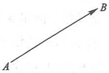

natural_image

Simple diagram showing a vector from point A to point B (no labels or text)

图8-1

在实际问题中,有些向量与其起点有关(例如质点运动的速度与该质点的位置有关,一个力与该力的作用点的位置有关),有些向量与其起点无关.由于一切向量的共性是它们都有大小和方向,因此在数学上我们只研究与起点无关的向量,并称这种向量为自由向量(以后简称向量),即只考虑向量的大小和方向,而不论它的起点在什么地方.当遇到与起点有关的向量时,可在一般原则下作特别处理.

由于我们只讨论自由向量,所以如果两个向量 a 和 b 的大小相等,且方向相同,我们就说向量 a 和 b 是相等的,记作 a=b.这就是说,经过平行移动后能完全重合的向量是相等的.

向量的大小叫做向量的模.向量$\overrightarrow{AB}$, $a$ 和 $\overrightarrow{a}$ 的模依次记作 $|\overrightarrow{AB}|$, $|a|$ 和 $|\overrightarrow{a}|$. 模等于 1 的向量叫做单位向量.模等于零的向量叫做零向量, 记作 0 或 $\overrightarrow{0}$. 零向量的起点和终点重合, 它的方向可以看做是任意的.

设有两个非零向量 $a, b$，任取空间一点 $O$，作 $\overrightarrow{OA} = a$，$\overrightarrow{OB} = b$，规定不超过 $\pi$ 的 $\angle AOB$（设 $\varphi = \angle AOB, 0 \leqslant \varphi \leqslant \pi$）称为向量 $a$ 与 $b$ 的夹角（图8-2），记作 $(\widehat{a}, \widehat{b})$ 或 $(\widehat{b}, \widehat{a})$，即 $(\widehat{a}, \widehat{b}) = \varphi$。如果向量 $a$ 与 $b$ 中有一个是零向量，规定它们的夹角可以在0到 $\pi$ 之间任意取值。

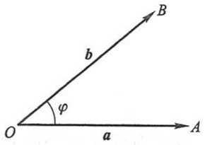

text_image

O
a
A
b
φ
B

图8-2

如果 $(\widehat{a,b}) = 0$ 或 $\pi$ ，就称向量 $a$ 与 $b$ 平行，记作 $a / / b.$ 如果 $(\widehat{a,b}) = \frac{\pi}{2}$ ，就称向量 $a$ 与 $b$ 垂直，记作 $a \perp b.$ 由于零向量与另一向量的夹角可以在0到 $\pi$ 之间任意取值，因此可以认为零向量与任何向量都平行，也可以认为零向量与任何向量都垂直.

当两个平行向量的起点放在同一点时,它们的终点和公共起点应在一条直线上.因此,两向量平行,又称两向量共线.

类似还有向量共面的概念. 设有 $k (k \geqslant 3)$ 个向量, 当把它们的起点放在同一点时, 如果 $k$ 个终点和公共起点在一个平面上, 就称这 $k$ 个向量共面.

## 二、向量的线性运算

## 1. 向量的加减法

向量的加法运算规定如下:

设有两个向量 a 与 b，任取一点 A，作  $\overrightarrow{AB}=a$ ，再以 B 为起点，作  $\overrightarrow{BC}=b$ ，连接 AC（图 8-3），那么向量  $\overrightarrow{AC}=c$  称为向量 a 与 b 的和，记作  $a+b$ ，即

$$
c = a + b.
$$

上述作出两向量之和的方法叫做向量相加的三角形法则.

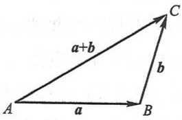

text_image

a+b
A
a
B
b
C

图8-3

力学上有求合力的平行四边形法则, 仿此, 我们也有向量相加的平行四边形法则. 这就是: 当向量 a 与 b 不平行时, 作  $\overrightarrow{AB}=a, \overrightarrow{AD}=b$ , 以 AB, AD 为边作一平行四边形

ABCD, 连接对角线 AC（图 8-4），显然向量  $\overrightarrow{AC}$  即等于向量 a 与 b 的和  $a+b$ .

向量的加法符合下列运算规律:

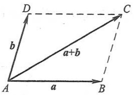

text_image

D
b
a+b
A
a
B
C

图8-4

(1) 交换律 $a + b = b + a$;
(2) 结合律  $(a+b)+c=a+(b+c)$ .

这是因为,按向量加法的规定(三角形法则),从图8-4可见:

$$
a + b = \overrightarrow {A B} + \overrightarrow {B C} = \overrightarrow {A C} = c,
$$

$$
b + a = \overrightarrow {A D} + \overrightarrow {D C} = \overrightarrow {A C} = c,
$$

所以符合交换律.又如图8-5所示,先作 $a+b$ 再加上c,即得和 $(a+b)+c$ ,若以a与 $b+c$ 相加,则得同一结果,所以符合结合律.

由于向量的加法符合交换律与结合律, 故 n 个向量  $a_{1}, a_{2}, \cdots, a_{n}$  ( $n \geqslant 3$ ) 相加可写成

$$
a _ {1} + a _ {2} + \dots + a _ {n},
$$

并按向量相加的三角形法则,可得 n 个向量相加的法则如下:以前一向量的终点作为次一向量的起点,相继作向量  $a_{1}, a_{2}, \cdots, a_{n}$ , 再以第一个向量的起点为起点,最后一个向量的终点为终点作一向量,这个向量即为所求的和.如图 8-6 所示,有

$$
s = a _ {1} + a _ {2} + a _ {3} + a _ {4} + a _ {5}.
$$

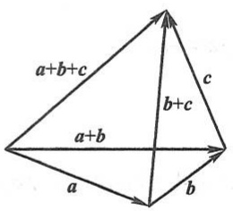

text_image

a+b+c
b+c
a+b
a
b

图8-5

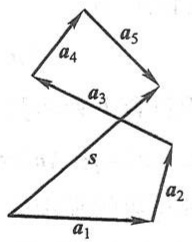

text_image

a₄
a₅
a₃
s
a₂
a₁

图8-6

设 a 为一向量,与 a 的模相同而方向相反的向量叫做 a 的负向量,记作 -a. 由此,我们规定两个向量 b 与 a 的差

$$
b - a = b + (- a).
$$

即把向量-a加到向量b上,便得b与a的差b-a(图8-7(a)).

特别地, 当 b=a 时, 有

$$
a - a = a + (- a) = 0.
$$

显然,任给向量 $\overrightarrow{AB}$ 及点O,有

$$
\overrightarrow {A B} = \overrightarrow {A O} + \overrightarrow {O B} = \overrightarrow {O B} - \overrightarrow {O A},
$$

因此,若把向量 a 与 b 移到同一起点 O,则从 a 的终点 A 向 b 的终点 B 所引向量  $\overrightarrow{AB}$  便

是向量 b 与 a 的差 b-a（图 8-7(b)）.

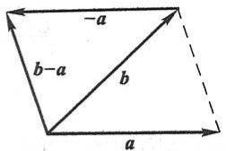

text_image

-a
b-a
b
a

(a)

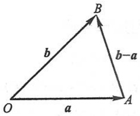

text_image

b
b-a
O
a
A

(b)

图8-7

由三角形两边之和大于第三边,有

$$
\mid a + b \mid \leqslant \mid a \mid + \mid b \mid \quad \text {及} \quad \mid a - b \mid \leqslant \mid a \mid + \mid b \mid ,
$$

其中等号在 a 与 b 同向或反向时成立.

## 2. 向量与数的乘法

向量 a 与实数  $\lambda$  的乘积记作  $\lambda a$ ，规定  $\lambda a$  是一个向量，它的模

$$
\mid \lambda a \mid = \mid \lambda \mid \mid a \mid ,
$$

它的方向当  $\lambda>0$  时与 a 相同, 当  $\lambda<0$  时与 a 相反.

当  $\lambda=0$  时， $\left|\lambda a\right|=0$ ，即  $\lambda a$  为零向量，这时它的方向可以是任意的.

特别地, 当  $\lambda = \pm 1$  时, 有

$$
1 a = a, \quad (- 1) a = - a.
$$

向量与数的乘积符合下列运算规律:

(1) 结合律  $\lambda(\mu\boldsymbol{a})=\mu(\lambda\boldsymbol{a})=(\lambda\mu)\boldsymbol{a}.$

这是因为由向量与数的乘积的规定可知, 向量  $\lambda(\mu\boldsymbol{a}), \mu(\lambda\boldsymbol{a}), (\lambda\mu)\boldsymbol{a}$  都是平行的向量, 它们的方向也是相同的, 而且

$$
\mid \lambda (\mu a) \mid = \mid \mu (\lambda a) \mid = \mid (\lambda \mu) a \mid = \mid \lambda \mu \mid \mid a \mid ,
$$

所以

$$
\lambda (\mu a) = \mu (\lambda a) = (\lambda \mu) a.
$$

(2) 分配律

$$
(\lambda + \mu) a = \lambda a + \mu a, \tag {1-1}
$$

$$
\lambda (a + b) = \lambda a + \lambda b. \tag {1-2}
$$

这个规律同样可以按向量与数的乘积的规定来证明,这里从略了.

向量相加及数乘向量统称为向量的线性运算.

例 1 在平行四边形 ABCD 中, 设  $\overrightarrow{AB} = a, \overrightarrow{AD} = b$ . 试用 a 和 b 表示向量  $\overrightarrow{MA}, \overrightarrow{MB}, \overrightarrow{MC}$  和  $\overrightarrow{MD}$ , 这里 M 是平行四边形对角线的交点(图 8-8).

解 由于平行四边形的对角线互相平分,所以

$$
\boldsymbol {a} + \boldsymbol {b} = \overrightarrow {A C} = 2 \overrightarrow {A M},
$$

即

$$
- (\boldsymbol {a} + \boldsymbol {b}) = 2 \overrightarrow {M A},
$$

于是

$$
\overrightarrow {M A} = - \frac {1}{2} (a + b).
$$

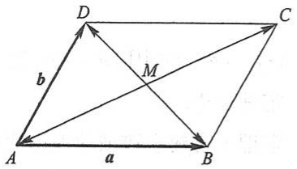

text_image

D
b
M
A
a
B
C

图8-8

因为 $\overrightarrow{MC}=-\overrightarrow{MA}$ ，所以 $\overrightarrow{MC}=\frac{1}{2}(a+b)$ .

又因 $-a+b=\overrightarrow{BD}=2\overrightarrow{MD}$ ，所以 $\overrightarrow{MD}=\frac{1}{2}(b-a)$ .

由于 $\overrightarrow{MB}=-\overrightarrow{MD}$ ，所以 $\overrightarrow{MB}=\frac{1}{2}(a-b)$ .

前面已经讲过,模等于1的向量叫做单位向量.设 $e_{a}$ 表示与非零向量a同方向的单位向量,那么按照向量与数的乘积的规定,由于 $|a|>0$ ,所以 $|a|e_{a}$ 与 $e_{a}$ 的方向相同,即 $|a|e_{a}$ 与a的方向相同.又因 $|a|e_{a}$ 的模是

$$
\mid a \mid \mid e _ {a} \mid = \mid a \mid \cdot 1 = \mid a \mid ,
$$

即  $\left|a\right|e_{a}$  与 a 的模也相同, 因此,

$$
a = | a | e _ {a}.
$$

我们规定, 当  $\lambda \neq 0$  时,  $\frac{a}{\lambda} = \frac{1}{\lambda} a$ . 由此, 上式又可写成

$$
\frac {a}{| a |} = e _ {a}.
$$

这表示一个非零向量除以它的模的结果是一个与原向量同方向的单位向量.

由于向量  $\lambda a$  与 a 平行, 因此我们常用向量与数的乘积来说明两个向量的平行关系. 即有

定理1 设向量 $a \neq 0$，则向量 $b$ 平行于 $a$ 的充分必要条件是:存在唯一的实数 $\lambda$，使 $b = \lambda a$.

证 条件的充分性是显然的,下面证明条件的必要性.

设 $b / / a$ .取 $\mid \lambda \mid = \frac{\mid b\mid}{\mid a\mid}$ 当 $\pmb{b}$ 与 $a$ 同向时 $\lambda$ 取正值，当 $\pmb{b}$ 与 $a$ 反向时 $\lambda$ 取负值，即有 $b = \lambda a.$ 这是因为此时 $\pmb{b}$ 与 $\lambda a$ 同向，且

$$
\mid \lambda a \mid = \mid \lambda \mid \mid a \mid = \frac {\mid b \mid}{\mid a \mid} \mid a \mid = \mid b \mid .
$$

再证数 $\lambda$ 的唯一性. 设 $b = \lambda a$, 又设 $b = \mu a$, 两式相减, 便得

$$
(\lambda - \mu) a = 0,
$$

即 $|\lambda - \mu ||a| = 0$。因 $|a| \neq 0$，故 $|\lambda - \mu| = 0$，即 $\lambda = \mu$.

定理证毕.

定理1是建立数轴的理论依据.我们知道,给定一个点、一个方向及单位长度,就确定了一条数轴.由于一个单位向量既确定了方向,又确定了单位长度,因此,给定一个点及一个单位向量就确定了一条数轴.设点O及单位向量i确定了数轴Ox(图

8-9), 对于轴上任一点 $P$, 对应一个向量 $\overrightarrow{OP}$, 由于 $\overrightarrow{OP} // i$, 根据定理1, 必有唯一的实数 $x$, 使 $\overrightarrow{OP} = xi$ (实数 $x$ 叫做轴上有向线段 $\overrightarrow{OP}$ 的值), 并知 $\overrightarrow{OP}$ 与实数 $x$ 一一对应. 于是

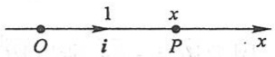

图8-9

$$
\text {点} P \longleftrightarrow \text {向量} \overrightarrow {O P} = x i \longleftrightarrow \text {实数} x,
$$

从而轴上的点 $P$ 与实数 $x$ 有一一对应的关系.据此,定义实数 $x$ 为轴上点 $P$ 的坐标.

由此可知,轴上点 P 的坐标为 x 的充分必要条件是

$$
\overrightarrow {O P} = x i.
$$

## 三、空间直角坐标系

在空间取定一点 $O$ 和三个两两垂直的单位向量 $\pmb{i},\pmb{j},\pmb{k}$ ，就确定了三条都以 $O$ 为原点的两两垂直的数轴，依次记为 $\underline{x}$ 轴（横轴）、$\underline{y}$ 轴（纵轴）、$\underline{z}$ 轴（竖轴），统称坐标轴.它们构成一个空间直角坐标系，称为Oxyz坐标系或 $[O;i,j,k]$ 坐标系(图8-10).通常把$x$ 轴和 $y$ 轴配置在水平面上，而 $z$ 轴则是铅垂线；它们的正向通常符合右手规则，即以右手握住 $z$ 轴，当右手的四个手指从 $x$ 轴正向以 $\frac{\pi}{2}$ 角度转向 $y$ 轴正向时，大拇指的指向就是 $z$ 轴的正向，如图8-11所示.

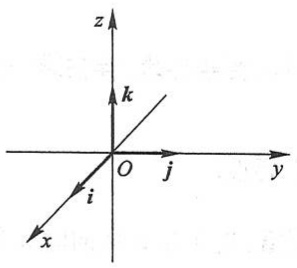

text_image

z
k
O
j
y
i
x

图8-10

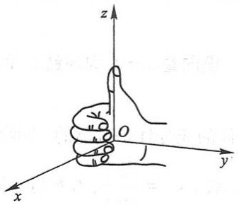

text_image

z
O
y
x

图8-11

三条坐标轴中的任意两条可以确定一个平面,这样定出的三个平面统称为坐标面.x轴及y轴所确定的坐标面叫做xOy面,另两个由y轴及z轴和由z轴及x轴所确定的坐标面,分别叫做 $yOz$ 面及 $zOx$ 面.三个坐标面把空间分成八个部分,每一部分叫做一个卦限.其中,在 $xOy$ 面上方且 $yOz$ 面前方、 $zOx$ 面右方的那个卦限叫做第一卦限,其他第二、第三、第四卦限,在 $xOy$ 面的上方,按逆时针方向确定.第五至第八卦限,在 $xOy$ 面的下方,由第一卦限之下的第五卦限,按逆时针方向确定,这八个卦限分别用字母I,II,III,IV,V,VI,VII,VIII表示(图8-12).

任给向量 r，有对应点 M，使  $\overrightarrow{OM}=r$ 。以 OM 为对角线、三条坐标轴为棱作长方体 RHMK-OPNQ，如图 8-13 所示，有

$$
r = \overrightarrow {O M} = \overrightarrow {O P} + \overrightarrow {P N} + \overrightarrow {N M} = \overrightarrow {O P} + \overrightarrow {O Q} + \overrightarrow {O R},
$$

设 $\overrightarrow{OP} = x\mathbf{i}$ ， $\overrightarrow{OQ} = yj$ ， $\overrightarrow{OR} = zk$ ，则

$$
r = \overrightarrow {O M} = x i + y j + z k.
$$

上式称为向量 r 的坐标分解式, xi, yj 和 zk 称为向量 r 沿三个坐标轴方向的分向量.

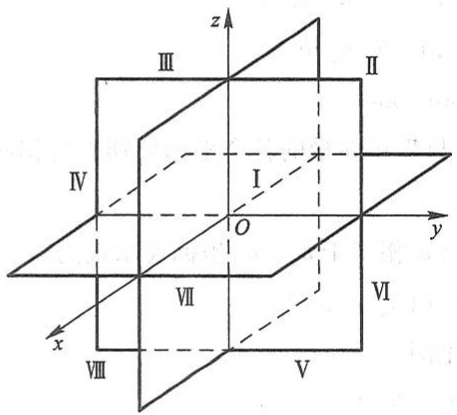

text_image

z
III
II
IV
I
O
y
x
VII
VI
VIII
V

图8-12

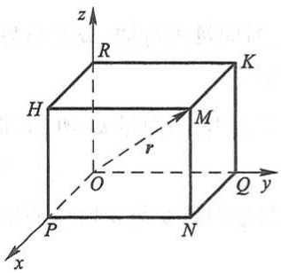

text_image

z
R
K
H
M
r
O
Q
y
P
N
x

图8-13

显然,给定向量 r, 就确定了点 M 及  $\overrightarrow{OP}, \overrightarrow{OQ}, \overrightarrow{OR}$  三个分向量, 进而确定了 x, y, z 三个有序数; 反之, 给定三个有序数 x, y, z, 也就确定了向量 r 与点 M. 于是点 M、向量 r 与三个有序数 x, y, z 之间有一一对应的关系

$$
M \longleftrightarrow r = \overrightarrow {O M} = x i + y j + z k \longleftrightarrow (x, y, z),
$$

据此, 定义: 有序数 $x, y, z$ 称为向量 $\pmb{r}$ (在坐标系 $Oxyz$ 中) 的坐标, 记作 $r = (x, y, z)$; 有序数 $x, y, z$ 也称为点 $M$ (在坐标系 $Oxyz$ 中) 的坐标, 记作 $M(x, y, z)$.

向量 $r = \overrightarrow{OM}$ 称为点 $M$ 关于原点 $O$ 的向径. 上述定义表明, 一个点与该点的向径有相同的坐标. 记号 $(x, y, z)$ 既表示点 $M$, 又表示向量 $\overrightarrow{OM}$.

坐标面上和坐标轴上的点,其坐标各有一定的特征.例如:如果点 M 在 yOz 面上,那么 x=0;同样,在 zOx 面上的点,有 y=0;在 xOy 面上的点,有 z=0.如果点 M 在 x 轴上,那么 y=z=0;同样,在 y 轴上的点,有 z=x=0;在 z 轴上的点,有 x=y=0.若点 M 为

原点,则 x=y=z=0.

## 四、利用坐标作向量的线性运算

利用向量的坐标,可得向量的加法、减法以及向量与数的乘法的运算如下:

设 $a = (a_{x}, a_{y}, a_{z})$，$b = (b_{x}, b_{y}, b_{z})$，即

$$
\boldsymbol {a} = a _ {x} \boldsymbol {i} + a _ {y} \boldsymbol {j} + a _ {z} \boldsymbol {k}, \boldsymbol {b} = b _ {x} \boldsymbol {i} + b _ {y} \boldsymbol {j} + b _ {z} \boldsymbol {k}.
$$

利用向量加法的交换律与结合律以及向量与数的乘法的结合律与分配律,有

$$
\boldsymbol {a} + \boldsymbol {b} = (a _ {x} + b _ {x}) \boldsymbol {i} + (a _ {y} + b _ {y}) \boldsymbol {j} + (a _ {z} + b _ {z}) \boldsymbol {k},
$$

$$
\boldsymbol {a} - \boldsymbol {b} = (a _ {x} - b _ {x}) \boldsymbol {i} + (a _ {y} - b _ {y}) \boldsymbol {j} + (a _ {z} - b _ {z}) \boldsymbol {k},
$$

$$
\lambda \boldsymbol {a} = (\lambda a _ {x}) \boldsymbol {i} + (\lambda a _ {y}) \boldsymbol {j} + (\lambda a _ {z}) \boldsymbol {k} \quad (\lambda \text {为实数}),
$$

即

$$
\boldsymbol {a} + \boldsymbol {b} = (a _ {x} + b _ {x}, a _ {y} + b _ {y}, a _ {z} + b _ {z}),
$$

$$
\boldsymbol {a} - \boldsymbol {b} = (a _ {x} - b _ {x}, a _ {y} - b _ {y}, a _ {z} - b _ {z}),
$$

$$
\lambda a = (\lambda a _ {x}, \lambda a _ {y}, \lambda a _ {z}).
$$

由此可见,对向量进行加、减及与数相乘,只需对向量的各个坐标分别进行相应的数量运算就行了.

定理 1 指出, 当向量  $a \neq 0$  时, 向量  $b \parallel a$  相当于  $b = \lambda a$ , 坐标表示式为

$$
(b _ {x}, b _ {y}, b _ {z}) = \lambda (a _ {x}, a _ {y}, a _ {z}),
$$

这也就相当于向量 $\pmb{b}$ 与 $\pmb{a}$ 对应的坐标成比例

$$
\frac {b _ {x}}{a _ {x}} = \frac {b _ {y}}{a _ {y}} = \frac {b _ {z}}{a _ {z}}. \tag {1-3}
$$

例2 求解以向量为元的线性方程组

$$
\left\{ \begin{array}{l} 5 x - 3 y = a, \\ 3 x - 2 y = b, \end{array} \right.
$$

其中  $\boldsymbol{a}=(2,1,2)$ ,  $\boldsymbol{b}=(-1,1,-2)$ .

解 如同解以实数为元的线性方程组一样, 可解得

$$
x = 2 a - 3 b, y = 3 a - 5 b.
$$

① 当 $a_{x}, a_{y}, a_{z}$ 有一个为零时，例如 $a_{x} = 0, a_{y}, a_{z} \neq 0$ ，这时(1-3)式应理解为

$$
\left\{ \begin{array}{l} b _ {x} = 0, \\ \frac {b _ {y}}{a _ {y}} = \frac {b _ {z}}{a _ {z}}; \end{array} \right.
$$

当 $a_{x}, a_{y}, a_{z}$ 有两个为零时，例如 $a_{x} = a_{y} = 0, a_{z} \neq 0$ ，这时(1-3)式应理解为

$$
\left\{ \begin{array}{l} b _ {x} = 0, \\ b _ {y} = 0. \end{array} \right.
$$

将 a, b 的坐标表示式代入, 即得

$$
\begin{array}{l} x = 2 (2, 1, 2) - 3 (- 1, 1, - 2) = (7, - 1, 1 0), \\ y = 3 (2, 1, 2) - 5 (- 1, 1, - 2) = (1 1, - 2, 1 6). \\ \end{array}
$$

例3 已知两点 $A(x_{1},y_{1},z_{1})$ 和 $B(x_{2},y_{2},z_{2})$ 以及实数 $\lambda \neq -1$ ，在直线 $AB$ 上求点$M$ ，使

$$
\overrightarrow {A M} = \lambda \overrightarrow {M B}.
$$

解 如图 8-14 所示. 由于

$$
\overrightarrow {A M} = \overrightarrow {O M} - \overrightarrow {O A}, \overrightarrow {M B} = \overrightarrow {O B} - \overrightarrow {O M},
$$

因此

$$
\overrightarrow {O M} - \overrightarrow {O A} = \lambda (\overrightarrow {O B} - \overrightarrow {O M}),
$$

从而

$$
\overrightarrow {O M} = \frac {1}{1 + \lambda} (\overrightarrow {O A} + \lambda \overrightarrow {O B}).
$$

将 $\overrightarrow{OA},\overrightarrow{OB}$ 的坐标(即点A、点B的坐标)代入,即得

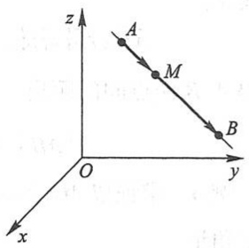

text_image

z
A
M
B
O
y
x

图8-14

$$
\overrightarrow {O M} = \left(\frac {x _ {1} + \lambda x _ {2}}{1 + \lambda}, \frac {y _ {1} + \lambda y _ {2}}{1 + \lambda}, \frac {z _ {1} + \lambda z _ {2}}{1 + \lambda}\right),
$$

这就是点 M 的坐标.

本例中的点 $M$ 叫做有向线段 $\overrightarrow{AB}$ 的 $\lambda$ 分点. 特别地, 当 $\lambda = 1$ 时, 得线段 $AB$ 的中点为

$$
M \left(\frac {x _ {1} + x _ {2}}{2}, \frac {y _ {1} + y _ {2}}{2}, \frac {z _ {1} + z _ {2}}{2}\right).
$$

通过本例,我们应注意以下两点:(1)由于点M与向量 $\overrightarrow{OM}$ 有相同的坐标,因此,求点M的坐标,就是求 $\overrightarrow{OM}$ 的坐标.(2)记号 $(x,y,z)$ 既可表示点M,又可表示向量 $\overrightarrow{OM}$ ,在几何中点与向量是两个不同的概念,不可混淆.因此,在看到记号 $(x,y,z)$ 时,须从上下文去认清它究竟表示点还是表示向量.当 $(x,y,z)$ 表示向量时,可对它进行运算;当 $(x,y,z)$ 表示点时,就不能进行运算.

## 五、向量的模、方向角、投影

## 1. 向量的模与两点间的距离公式

设向量 $r = (x, y, z)$，作 $\overrightarrow{OM} = r$，如图8-13所示，有

$$
r = \overrightarrow {O M} = \overrightarrow {O P} + \overrightarrow {O Q} + \overrightarrow {O R},
$$

按勾股定理可得

$$
\mid r \mid = \mid O M \mid = \sqrt {\mid O P \mid^ {2} + \mid O Q \mid^ {2} + \mid O R \mid^ {2}}.
$$

由 $\overrightarrow{OP} = xi$ ， $\overrightarrow{OQ} = yj$ ， $\overrightarrow{OR} = zk$ ，有

$$
\mid O P \mid = \mid x \mid , \quad \mid O Q \mid = \mid y \mid , \quad \mid O R \mid = \mid z \mid ,
$$

于是得向量模的坐标表示式

$$
\mid r \mid = \sqrt {x ^ {2} + y ^ {2} + z ^ {2}}.
$$

设有点 $A(x_{1},y_{1},z_{1})$ 和点 $B(x_{2},y_{2},z_{2})$ ，则点 $A$ 与点 $B$ 间的距离 $|AB|$ 就是向量 $\overrightarrow{AB}$ 的模.由

$$
\overrightarrow {A B} = \overrightarrow {O B} - \overrightarrow {O A} = (x _ {2}, y _ {2}, z _ {2}) - (x _ {1}, y _ {1}, z _ {1}) = (x _ {2} - x _ {1}, y _ {2} - y _ {1}, z _ {2} - z _ {1}),
$$

即得 A, B 两点间的距离

$$
\mid A B \mid = \mid \overrightarrow {A B} \mid = \sqrt {\left(x _ {2} - x _ {1}\right) ^ {2} + \left(y _ {2} - y _ {1}\right) ^ {2} + \left(z _ {2} - z _ {1}\right) ^ {2}}.
$$

例4 求证以 $M_{1}(4,3,1), M_{2}(7,1,2), M_{3}(5,2,3)$ 三点为顶点的三角形是一个等腰三角形.

解 因为

$$
\begin{array}{l} \mid M _ {1} M _ {2} \mid^ {2} = (7 - 4) ^ {2} + (1 - 3) ^ {2} + (2 - 1) ^ {2} = 1 4, \\ \mid M _ {2} M _ {3} \mid^ {2} = (5 - 7) ^ {2} + (2 - 1) ^ {2} + (3 - 2) ^ {2} = 6, \\ \mid M _ {3} M _ {1} \mid^ {2} = (4 - 5) ^ {2} + (3 - 2) ^ {2} + (1 - 3) ^ {2} = 6, \\ \end{array}
$$

所以 $|M_2M_3| = |M_3M_1|$，即 $\triangle M_1M_2M_3$ 为等腰三角形.

例 5 在 z 轴上求与两点 A(-4,1,7) 和 B(3,5,-2) 等距离的点.

解 因为所求的点 M 在 z 轴上, 所以设该点为  $M(0,0,z)$ , 依题意有

$$
\mid M A \mid = \mid M B \mid ,
$$

即

$$
\sqrt {(0 + 4) ^ {2} + (0 - 1) ^ {2} + (z - 7) ^ {2}} = \sqrt {(3 - 0) ^ {2} + (5 - 0) ^ {2} + (- 2 - z) ^ {2}}.
$$

两边平方,解得

$$
z = \frac {1 4}{9},
$$

因此,所求的点为  $M\left(0,0,\frac{14}{9}\right)$ .

例6 已知两点 $A(4,0,5)$ 和 $B(7,1,3)$，求与 $\overrightarrow{AB}$ 方向相同的单位向量 $e_{\overrightarrow{AB}}$

解 因为

$$
\overrightarrow {A B} = \overrightarrow {O B} - \overrightarrow {O A} = (7, 1, 3) - (4, 0, 5) = (3, 1, - 2),
$$

所以

$$
\mid \overrightarrow {A B} \mid = \sqrt {3 ^ {2} + 1 ^ {2} + (- 2) ^ {2}} = \sqrt {1 4},
$$

于是

$$
e _ {\overrightarrow {A B}} = \frac {\overrightarrow {A B}}{| \overrightarrow {A B} |} = \frac {1}{\sqrt {1 4}} (3, 1, - 2).
$$

## 2. 方向角与方向余弦

非零向量 r 与三条坐标轴的夹角  $\alpha, \beta, \gamma$  称为向量 r 的方向角. 从图 8-15 可见, 设  $\overrightarrow{OM} = r = (x, y, z)$ , 由于 x 是有向线段  $\overrightarrow{OP}$  的值,  $MP \perp OP$ , 故

$$
\cos \alpha = \frac {x}{| O M |} = \frac {x}{| r |},
$$

类似可知

$$
\cos \beta = \frac {y}{| r |}, \quad \cos \gamma = \frac {z}{| r |}.
$$

从而

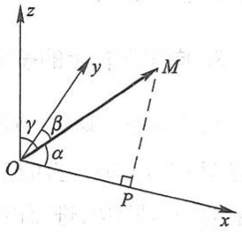

text_image

z
y
M
γ
β
α
O
P
x

图8-15

$$
(\cos \alpha , \cos \beta , \cos \gamma) = \left(\frac {x}{| r |}, \frac {y}{| r |}, \frac {z}{| r |}\right) = \frac {1}{| r |} (x, y, z) = \frac {r}{| r |} = e _ {r}.
$$

$\cos \alpha, \cos \beta, \cos \gamma$ 称为向量 $r$ 的方向余弦. 上式表明, 以向量 $r$ 的方向余弦为坐标的向量就是与 $r$ 同方向的单位向量 $e_r$. 并由此可得

$$
\cos^ {2} \alpha + \cos^ {2} \beta + \cos^ {2} \gamma = 1.
$$

例7 已知两点 $M_{1}(2,2,\sqrt{2})$ 和 $M_2(1,3,0)$，计算向量 $\overrightarrow{M_1M_2}$ 的模、方向余弦和方向角.

解 $\overrightarrow{M_1M_2} = (1 - 2,3 - 2,0 - \sqrt{2}) = (-1,1, - \sqrt{2}),$

$$
\mid \overrightarrow {M _ {1} M _ {2}} \mid = \sqrt {(- 1) ^ {2} + 1 ^ {2} + (- \sqrt {2}) ^ {2}} = \sqrt {1 + 1 + 2} = \sqrt {4} = 2;
$$

$$
\cos \alpha = - \frac {1}{2}, \quad \cos \beta = \frac {1}{2}, \quad \cos \gamma = - \frac {\sqrt {2}}{2};
$$

$$
\alpha = \frac {2 \pi}{3}, \quad \beta = \frac {\pi}{3}, \quad \gamma = \frac {3 \pi}{4}.
$$

例8 设点 $A$ 位于第I卦限，向径 $\overrightarrow{OA}$ 与 $x$ 轴、$y$ 轴的夹角依次为 $\frac{\pi}{3}$ 和 $\frac{\pi}{4}$，且 $|\overrightarrow{OA}| = 6$，求点 $A$ 的坐标.

解 $\alpha = \frac{\pi}{3},\beta = \frac{\pi}{4}$ .由关系式 $\cos^2\alpha +\cos^2\beta +\cos^2\gamma = 1$ ，得

$$
\cos^ {2} \gamma = 1 - \left(\frac {1}{2}\right) ^ {2} - \left(\frac {\sqrt {2}}{2}\right) ^ {2} = \frac {1}{4},
$$

因点 A 在第 I 卦限, 知  $\cos \gamma > 0$ , 故

$$
\cos \gamma = \frac {1}{2}.
$$

于是

$$
\overrightarrow {O A} = | \overrightarrow {O A} |   e _ {\overrightarrow {O A}} = 6 \left(\frac {1}{2}, \frac {\sqrt {2}}{2}, \frac {1}{2}\right) = (3, 3 \sqrt {2}, 3),
$$

这就是点 A 的坐标.

## 3. 向量在轴上的投影

如果撇开 $y$ 轴和 $z$ 轴, 单独考虑 $x$ 轴与向量 $\boldsymbol{r} = \overrightarrow{OM}$ 的关系, 那么从图8-15可见, 过点 $M$ 作与 $x$ 轴垂直的平面, 此平面与 $x$ 轴的交点即是点 $P$. 作出点 $P$, 即得向量 $\boldsymbol{r}$ 在 $x$

轴上的分向量 $\overrightarrow{OP}$, 进而由 $\overrightarrow{OP} = xi$, 便得向量在 $x$ 轴上的坐标 $x$, 且 $x = |r| \cos \alpha$.

一般地,设点 O 及单位向量 e 确定 u 轴(图 8-16).任给向量 r,作  $\overrightarrow{OM}=r$ ,再过点 M 作与 u 轴垂直的平面交 u 轴于点  $M'$  (点  $M'$  叫做点 M 在 u 轴上的投影),则向量  $\overrightarrow{OM'}$  称为向量 r 在 u 轴上的分向量.设  $\overrightarrow{OM'}=\lambda e$ ,则数  $\lambda$  称为向量 r 在 u 轴上的投影,记作  $\Prj_{u}r$  或  $(r)_{u}$ .

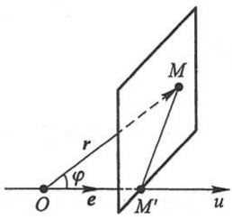

text_image

O
e
M'
u
r
φ

图8-16

按此定义, 向量 a 在直角坐标系 Oxyz 中的坐标  $a_{x}, a_{y}, a_{z}$  就是 a 在三条坐标轴上的投影, 即

$$
a _ {x} = \mathrm{Prj} _ {x} a, \quad a _ {y} = \mathrm{Prj} _ {y} a, \quad a _ {z} = \mathrm{Prj} _ {z} a,
$$

或记作

$$
a _ {x} = (\boldsymbol {a}) _ {x}, \quad a _ {y} = (\boldsymbol {a}) _ {y}, \quad a _ {z} = (\boldsymbol {a}) _ {z}.
$$

由此可知,向量的投影具有与坐标相同的性质:

性质1 $\operatorname{Prj}_u\boldsymbol{a} = |\boldsymbol{a}|\cos \varphi$ （即 $(\boldsymbol{a})_u = |\boldsymbol{a}|\cos \varphi)$ ，其中 $\varphi$ 为向量 $\pmb{a}$ 与 $u$ 轴的夹角；

性质2 $\mathrm{Prj}_u(a + b) = \mathrm{Prj}_u a + \mathrm{Prj}_u b$ （即 $(a + b)_u = (a)_u + (b)_u$）；

性质3 $\operatorname{Prj}_u(\lambda a) = \lambda \operatorname{Prj}_u a$ （即 $(\lambda a)_u = \lambda(a)_u$）.

例9 设正方体的一条对角线为 $OM$，一条棱为 $OA$，且 $|OA| = a$，求 $\overrightarrow{OA}$ 在 $\overrightarrow{OM}$ 方向上的投影 $\operatorname{Prj}_{\overrightarrow{OM}} \overrightarrow{OA}$. ①

解 如图 8-17 所示, 记  $\angle MOA = \varphi$ , 有

$$
\cos \varphi = \frac {\mid O A \mid}{\mid O M \mid} = \frac {1}{\sqrt {3}},
$$

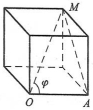

text_image

M
φ
O
A

图8-17

于是

<small>① 向量 $r$ 在向量 $a (a \neq 0)$ 的方向上的投影 $\operatorname{Prj}_a r$ 是指 $r$ 在某条与 $a$ 同方向的轴上的投影.</small>

$$
\mathrm{Prj} _ {\overrightarrow {O M}} \overrightarrow {O A} = | \overrightarrow {O A} | \cos \varphi = \frac {a}{\sqrt {3}}.
$$

## 习题8-1

1. 设  $u=a-b+2c, v=-a+3b-c$ . 试用 a, b, c 表示 2u-3v.
2. 如果平面上一个四边形的对角线互相平分, 试用向量证明它是平行四边形.
3. 把 $\triangle ABC$ 的 $BC$ 边五等分, 设分点依次为 $D_{1}, D_{2}, D_{3}, D_{4}$, 再把各分点与点 $A$ 连接. 试以 $\overrightarrow{AB} = c$, $\overrightarrow{BC} = a$ 表示向量 $\overrightarrow{D_{1}A}, \overrightarrow{D_{2}A}, \overrightarrow{D_{3}A}$ 和 $\overrightarrow{D_{4}A}$.
4. 已知两点 $M_{1}(0,1,2)$ 和 $M_{2}(1,-1,0)$. 试用坐标表示式表示向量 $\overrightarrow{M_1M_2}$ 及 $-2\overrightarrow{M_1M_2}$.
5. 求平行于向量  $a=(6,7,-6)$  的单位向量.
6. 在空间直角坐标系中, 指出下列各点在哪个卦限?

$$
A (1, - 2, 3), \quad B (2, 3, - 4), \quad C (2, - 3, - 4), \quad D (- 2, - 3, 1).
$$

7. 在坐标面上和在坐标轴上的点的坐标各有什么特征？指出下列各点的位置:

$$
A (3, 4, 0), \quad B (0, 4, 3), \quad C (3, 0, 0), \quad D (0, - 1, 0).
$$

8. 求点 $(a,b,c)$ 关于(1)各坐标面；(2)各坐标轴；(3)坐标原点的对称点的坐标.

9. 自点  $P_{0}(x_{0}, y_{0}, z_{0})$  分别作各坐标面和各坐标轴的垂线，写出各垂足的坐标.

10. 过点  $P_{0}(x_{0}, y_{0}, z_{0})$  分别作平行于 z 轴的直线和平行于 xOy 面的平面, 问在它们上面的点的坐标各有什么特点?

11. 一棱长为 $a$ 的立方体放置在 $xOy$ 面上, 其底面的中心在坐标原点, 底面的顶点在 $x$ 轴和 $y$ 轴上, 求它各顶点的坐标.

12. 求点  $M(4,-3,5)$  到各坐标轴的距离.

13. 在 yOz 面上, 求与三点 A(3,1,2), B(4,-2,-2) 和 C(0,5,1) 等距离的点.

14. 试证明以 $A(4,1,9), B(10,-1,6), C(2,4,3)$ 三点为顶点的三角形是等腰直角三角形.

15. 设已知两点 $M_{1}(4, \sqrt{2}, 1)$ 和 $M_{2}(3, 0, 2)$, 计算向量 $\overrightarrow{M_{1}M_{2}}$ 的模、方向余弦和方向角.

16. 设向量的方向余弦分别满足(1)  $\cos \alpha = 0$ ; (2)  $\cos \beta = 1$ ; (3)  $\cos \alpha = \cos \beta = 0$ , 问这些向量与坐标轴或坐标面的关系如何?

17. 设向量 r 的模是 4, 它与 u 轴的夹角是  $\frac{\pi}{3}$ , 求 r 在 u 轴上的投影.

18. 一向量的终点在点 $B(2, -1, 7)$, 它在 $x$ 轴、$y$ 轴和 $z$ 轴上的投影依次为 4, -4 和 7. 求这向量的起点 $A$ 的坐标.

19. 设 $m = 3i + 5j + 8k, n = 2i - 4j - 7k$ 和 $p = 5i + j - 4k$, 求向量 $a = 4m + 3n - p$ 在 $x$ 轴上的投影及在 $y$ 轴上的分向量.

20. 设 $O$ 是 $A, B$ 的连线以外的一点，证明 $A, B, C$ 三点共线的充分必要条件是 $\overrightarrow{OC} = \lambda \overrightarrow{OA} + \mu \overrightarrow{OB}$，其中 $\lambda + \mu = 1$.

## 第二节 数量积 向量积 \* 混合积

## 一、两向量的数量积

设一物体在恒力 F 作用下沿直线从点  $M_{1}$  移动到点  $M_{2}$ ，以 s 表示位移  $\overrightarrow{M_{1}M_{2}}$ 。由物理学知道，力 F 所做的功为

$$
W = \mid F \mid \mid s \mid \cos \theta ,
$$

其中  $\theta$  为 F 与 s 的夹角(图 8-18).

从这个问题看出,我们有时要对两个向量 a 和 b 作这样的运算,运算的结果是一个数,它等于  $\left|a\right|$ ,  $\left|b\right|$  及它们的夹角  $\theta$  的余弦的乘积.我们把它叫做向量 a 与 b 的数量积,记作  $a \cdot b$  (图 8-19),即

$$
a \cdot b = | a | | b | \cos \theta .
$$

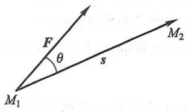

text_image

F
θ
s
M₁
M₂

图8-18

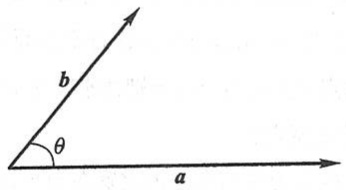

text_image

b
θ
a

图8-19

根据这个定义,上述问题中力所做的功 W 是力 F 与位移 s 的数量积,即

$$
W = \boldsymbol {F} \cdot \boldsymbol {s}.
$$

由于 $|b|\cos \theta = |b|\cos (a,b)$，当 $a\neq 0$ 时是向量 $b$ 在向量 $a$ 的方向上的投影，用 $\operatorname{Prj}_a b$ 来表示这个投影，便有

$$
\boldsymbol {a} \cdot \boldsymbol {b} = | \boldsymbol {a} | \operatorname{Prj} _ {\boldsymbol {a}} \boldsymbol {b},
$$

同理, 当  $b \neq 0$  时有

$$
\boldsymbol {a} \cdot \boldsymbol {b} = | \boldsymbol {b} | \operatorname{Prj} _ {b} \boldsymbol {a}.
$$

这就是说,两向量的数量积等于其中一个向量的模和另一个向量在这向量的方向上的投影的乘积.

由数量积的定义可以推得

(1)  $a \cdot a = |a|^{2}.$

这是因为夹角  $\theta=0$ ，所以

$$
\boldsymbol {a} \cdot \boldsymbol {a} = | \boldsymbol {a} | ^ {2} \cos 0 = | \boldsymbol {a} | ^ {2}.
$$

（2）对于两个非零向量 $a, b$，如果 $a \cdot b = 0$，那么 $a \perp b$；反之，如果 $a \perp b$，那么 $a \cdot b = 0$.

这是因为如果  $a \cdot b = 0$ ，由于  $|a| \neq 0, |b| \neq 0$ ，所以  $\cos \theta = 0$ ，从而  $\theta = \frac{\pi}{2}$ ，即  $a \perp b$ ；反之，如果  $a \perp b$ ，那么  $\theta = \frac{\pi}{2}$ ， $\cos \theta = 0$ ，于是  $a \cdot b = |a||b|\cos \theta = 0$ 。

由于可以认为零向量与任何向量都垂直,因此,上述结论可叙述为:向量  $a \perp b$  的充分必要条件是  $a \cdot b = 0$ .

数量积符合下列运算规律:

(1) 交换律  $a \cdot b = b \cdot a$ .

证 根据定义有

$$
\boldsymbol {a} \cdot \boldsymbol {b} = | \boldsymbol {a} | | \boldsymbol {b} | \cos (\widehat {\boldsymbol {a} , \boldsymbol {b}}), \quad \boldsymbol {b} \cdot \boldsymbol {a} = | \boldsymbol {b} | | \boldsymbol {a} | \cos (\widehat {\boldsymbol {b} , \boldsymbol {a}}),
$$

而

$$
\mid \boldsymbol {a} \mid \mid \boldsymbol {b} \mid = \mid \boldsymbol {b} \mid \mid \boldsymbol {a} \mid \quad \text {且} \quad \cos (\widehat {\boldsymbol {a}}, \boldsymbol {b}) = \cos (\widehat {\boldsymbol {b}}, \boldsymbol {a}),
$$

所以

$$
a \cdot b = b \cdot a.
$$

(2) 分配律  $(a+b)\cdot c=a\cdot c+b\cdot c.$

证 当 $c = 0$ 时, 上式显然成立; 当 $c \neq 0$ 时, 有

$$
(a + b) \cdot c = | c | \operatorname{Prj} _ {c} (a + b),
$$

由投影性质 2, 可知

$$
\mathrm{Prj} _ {c} (a + b) = \mathrm{Prj} _ {c} a + \mathrm{Prj} _ {c} b,
$$

所以

$$
(a + b) \cdot c = | c | (\operatorname{Prj} _ {c} a + \operatorname{Prj} _ {c} b) = | c | \operatorname{Prj} _ {c} a + | c | \operatorname{Prj} _ {c} b = a \cdot c + b \cdot c.
$$

(3) 数量积还符合如下的结合律:

$$
(\lambda a) \cdot b = \lambda (a \cdot b), \quad \lambda \text {为数}.
$$

证 当 b=0 时, 上式显然成立; 当  $b \neq 0$  时, 按投影性质 3, 可得

$$
(\lambda a) \cdot b = | b | \operatorname{Prj} _ {b} (\lambda a) = | b | \lambda \operatorname{Prj} _ {b} a = \lambda | b | \operatorname{Prj} _ {b} a = \lambda (a \cdot b).
$$

由上述结合律,利用交换律,容易推得

$$
\boldsymbol {a} \cdot (\lambda \boldsymbol {b}) = \lambda (\boldsymbol {a} \cdot \boldsymbol {b}) \quad \text {及} \quad (\lambda \boldsymbol {a}) \cdot (\mu \boldsymbol {b}) = \lambda \mu (\boldsymbol {a} \cdot \boldsymbol {b}).
$$

这是因为

$$
a \cdot (\lambda b) = (\lambda b) \cdot a = \lambda (b \cdot a) = \lambda (a \cdot b),
$$

$$
(\lambda a) \cdot (\mu b) = \lambda [ a \cdot (\mu b) ] = \lambda [ \mu (a \cdot b) ] = \lambda \mu (a \cdot b).
$$

例 1 试用向量证明三角形的余弦定理.

证 设在 $\triangle ABC$ 中, $\angle BCA = \theta$ (图8-20), $|BC| = a$, $|CA| = b$, $|AB| = c$, 要证

$$
c ^ {2} = a ^ {2} + b ^ {2} - 2 a b \cos \theta .
$$

记 $\overrightarrow{CB} = a, \overrightarrow{CA} = b, \overrightarrow{AB} = c$，则有

$$
c = a - b,
$$

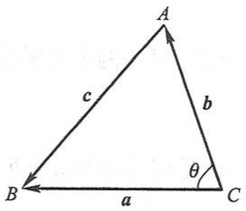

text_image

A
c
b
B
a
C
θ

图8-20

从而

$$
\begin{array}{l} \mid c \mid^ {2} = c \cdot c = (a - b) \cdot (a - b) = a \cdot a + b \cdot b - 2 a \cdot b \\ = | \boldsymbol {a} | ^ {2} + | \boldsymbol {b} | ^ {2} - 2 | \boldsymbol {a} | | \boldsymbol {b} | \cos (\widehat {\boldsymbol {a}}, \boldsymbol {b}). \\ \end{array}
$$

由 $|\pmb{a}| = a, |\pmb{b}| = b, |\pmb{c}| = c$ 及 $(\widehat{\pmb{a}}, \pmb{b}) = \theta$，即得

$$
c ^ {2} = a ^ {2} + b ^ {2} - 2 a b \cos \theta .
$$

下面我们来推导数量积的坐标表示式.

设 $a = a_{x}i + a_{y}j + a_{z}k, b = b_{x}i + b_{y}j + b_{z}k.$ 按数量积的运算规律可得

$$
\begin{array}{l} \boldsymbol {a} \cdot \boldsymbol {b} = (a _ {x} \boldsymbol {i} + a _ {y} \boldsymbol {j} + a _ {z} \boldsymbol {k}) \cdot (b _ {x} \boldsymbol {i} + b _ {y} \boldsymbol {j} + b _ {z} \boldsymbol {k}) \\ = a _ {x} \boldsymbol {i} \cdot (b _ {x} \boldsymbol {i} + b _ {y} \boldsymbol {j} + b _ {z} \boldsymbol {k}) + a _ {y} \boldsymbol {j} \cdot (b _ {x} \boldsymbol {i} + b _ {y} \boldsymbol {j} + b _ {z} \boldsymbol {k}) + a _ {z} \boldsymbol {k} \cdot (b _ {x} \boldsymbol {i} + b _ {y} \boldsymbol {j} + b _ {z} \boldsymbol {k}) \\ = a _ {x} b _ {x} \boldsymbol {i} \cdot \boldsymbol {i} + a _ {x} b _ {y} \boldsymbol {i} \cdot \boldsymbol {j} + a _ {x} b _ {z} \boldsymbol {i} \cdot \boldsymbol {k} + a _ {y} b _ {x} \boldsymbol {j} \cdot \boldsymbol {i} + a _ {y} b _ {y} \boldsymbol {j} \cdot \boldsymbol {j} + a _ {y} b _ {z} \boldsymbol {j} \cdot \boldsymbol {k} + \\ a _ {z} b _ {x} \boldsymbol {k} \cdot \boldsymbol {i} + a _ {z} b _ {y} \boldsymbol {k} \cdot \boldsymbol {j} + a _ {z} b _ {z} \boldsymbol {k} \cdot \boldsymbol {k}. \\ \end{array}
$$

因为 $i, j$ 和 $k$ 互相垂直，所以 $i \cdot j = j \cdot k = k \cdot i = 0, j \cdot i = k \cdot j = i \cdot k = 0.$ 又因为 $i, j$ 和 $k$ 的模均为1，所以 $i \cdot i = j \cdot j = k \cdot k = 1.$ 因而得

$$
\boldsymbol {a} \cdot \boldsymbol {b} = a _ {x} b _ {x} + a _ {y} b _ {y} + a _ {z} b _ {z}.
$$

这就是两个向量的数量积的坐标表示式.

因为  $a \cdot b = |a||b|\cos\theta$ ，所以当 a 与 b 都不是零向量时，有

$$
\cos \theta = \frac {a \cdot b}{| a | | b |}.
$$

将数量积的坐标表示式及向量的模的坐标表示式代入上式,就得

$$
\cos \theta = \frac {a _ {x} b _ {x} + a _ {y} b _ {y} + a _ {z} b _ {z}}{\sqrt {a _ {x} ^ {2} + a _ {y} ^ {2} + a _ {z} ^ {2}} \sqrt {b _ {x} ^ {2} + b _ {y} ^ {2} + b _ {z} ^ {2}}},
$$

这就是两向量夹角余弦的坐标表示式.

例2 已知三点 $M(1,1,1), A(2,2,1)$ 和 $B(2,1,2)$，求 $\angle AMB$.

解 作向量 $\overrightarrow{MA}$ 及 $\overrightarrow{MB}$, $\angle AMB$ 就是向量 $\overrightarrow{MA}$ 与 $\overrightarrow{MB}$ 的夹角. 这里, $\overrightarrow{MA} = (1,1,0)$, $\overrightarrow{MB} = (1,0,1)$, 从而

$$
\overrightarrow {M A} \cdot \overrightarrow {M B} = 1 \times 1 + 1 \times 0 + 0 \times 1 = 1,
$$

$$
\mid \overrightarrow {M A} \mid = \sqrt {1 ^ {2} + 1 ^ {2} + 0 ^ {2}} = \sqrt {2}, \quad \mid \overrightarrow {M B} \mid = \sqrt {1 ^ {2} + 0 ^ {2} + 1 ^ {2}} = \sqrt {2}.
$$

代入两向量夹角余弦的表达式,得

$$
\cos \angle A M B = \frac {\overrightarrow {M A} \cdot \overrightarrow {M B}}{| \overrightarrow {M A} | | \overrightarrow {M B} |} = \frac {1}{\sqrt {2} \cdot \sqrt {2}} = \frac {1}{2}.
$$

由此得

$$
\angle A M B = \frac {\pi}{3}.
$$

例 3 设液体流过平面 S 上面积为 A 的一个区域, 液体在这区域上各点处的流速均为(常向量) v. 设 n 为垂直于 S 的单位向量(图 8-21(a)), 计算单位时间内经过这区域流向 n 所指一侧的液体的质量 m(液体的密度为  $\rho$ ).

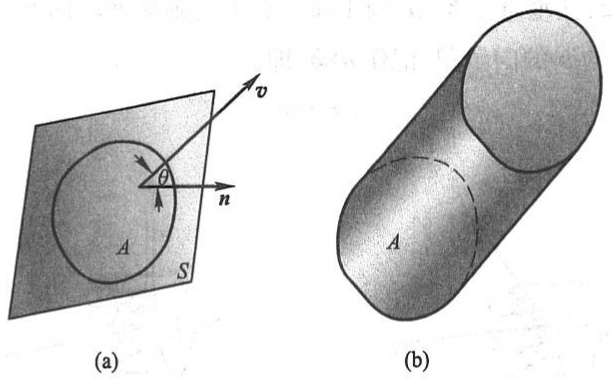

图8-21

解 单位时间内流过这区域的液体组成一个底面积为 A、斜高为  $\left|v\right|$  的斜柱体（图 8-21(b)). 这柱体的斜高与底面的垂线的夹角就是 v 与 n 的夹角  $\theta$ ，所以这柱体的高为  $\left|v\right|\cos\theta$ ，体积为

$$
A \mid \boldsymbol {v} \mid \cos \theta = A \boldsymbol {v} \cdot \boldsymbol {n}.
$$

从而,单位时间内经过这区域流向 n 所指一侧的液体的质量为

$$
m = \rho A \boldsymbol {v} \cdot \boldsymbol {n}.
$$

## 二、两向量的向量积

在研究物体转动问题时,不但要考虑这物体所受的力,还要分析这些力所产生的力矩.下面就举一个简单的例子来说明表达力矩的方法.

设 O 为一根杠杆 L 的支点. 有一个力 F 作用于这杠杆上点 P 处. F 与  $\overrightarrow{OP}$  的夹角为  $\theta$  (图 8-22). 由力学规定, 力 F 对支点 O 的力矩是一向量 M, 它的模

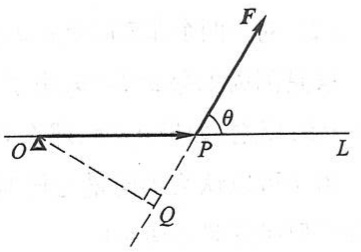

text_image

O
P
Q
L
F
θ

图8-22

$$
\mid M \mid = \mid O Q \mid \mid F \mid = \mid \overrightarrow {O P} \mid \mid F \mid \sin \theta ,
$$

而 $M$ 垂直于 $\overrightarrow{OP}$ 与 $F$ 所决定的平面, $M$ 的正向是按右手规则从 $\overrightarrow{OP}$ 以不超过 $\pi$ 的角转向 $F$ 来确定的, 即当右手的四个手指从 $\overrightarrow{OP}$ 以不超过 $\pi$ 的角转向 $F$ 握拳时, 大拇指的指向就是 $M$ 的方向(图8-23).

这种由两个已知向量按上面的规则来确定另一个向量的情况,在其他力学和物理问题中也会遇到.于是从中抽象出两个向量的向量积概念.

设向量 $c$ 由两个向量 $\pmb{a}$ 与 $\pmb{b}$ 按下列方式定出:

c 的模  $\left|c\right|=\left|a\right|\left|b\right|\sin\theta,$  其中  $\theta$  为 a 与 b 的夹角；c 垂直于 a 与 b 所决定的平面（即 c 既垂直于 a，又垂直于 b），c 的正向按右手规则从 a 转向 b 来确定（图 8-24），向量 c 叫做向量 a 与 b 的向量积，记作  $a\times b$ ，即

$$
c = a \times b.
$$

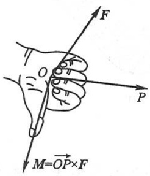

text_image

F
P
M=OP×F

图8-23

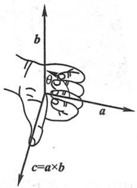

text_image

b
a
c=a×b

图8-24

按此定义,上面的力矩 M 等于  $\overrightarrow{OP}$  与 F 的向量积,即

$$
M = \overrightarrow {O P} \times F.
$$

由向量积的定义可以推得

(1)  $a \times a = 0.$

这是因为夹角 $\theta = 0$ ，所以 $|\pmb {a}\times \pmb {a}| = |\pmb {a}|^2\sin 0 = 0.$

(2) 对于两个非零向量 a, b, 如果  $a \times b = 0$ , 那么  $a \parallel b$ ; 反之, 如果  $a \parallel b$ , 那么  $a \times b = 0$ .

这是因为如果 $a \times b = 0$，由于 $|a| \neq 0, |b| \neq 0$，那么必有 $\sin \theta = 0$，于是 $\theta = 0$ 或 $\pi$，即 $a // b$；反之，如果 $a // b$，那么 $\theta = 0$ 或 $\pi$，于是 $\sin \theta = 0$，从而 $|a \times b| = 0$，即 $a \times b = 0$.

由于可以认为零向量与任何向量都平行,因此,上述结论可叙述为:向量  $a \parallel b$  的充分必要条件是  $a \times b = 0$ .

向量积符合下列运算规律:

(1) $b \times a = -a \times b$.

这是因为按右手规则从 $b$ 转向 $\pmb{a}$ 定出的方向恰好与按右手规则从 $\pmb{a}$ 转向 $\pmb{b}$ 定出的方向相反.它表明交换律对向量积不成立.

(2) 分配律  $(a+b)\times c=a\times c+b\times c.$
(3) 向量积还符合如下的结合律:

$$
(\lambda a) \times b = a \times (\lambda b) = \lambda (a \times b) \quad (\lambda \text {为数}).
$$

这两个规律这里不予证明.

下面来推导向量积的坐标表示式.

设 $a = a_{x}i + a_{y}j + a_{z}k, b = b_{x}i + b_{y}j + b_{z}k.$ 那么，按上述运算规律，得

$$
\begin{array}{l} \boldsymbol {a} \times \boldsymbol {b} = (a _ {x} \boldsymbol {i} + a _ {y} \boldsymbol {j} + a _ {z} \boldsymbol {k}) \times (b _ {x} \boldsymbol {i} + b _ {y} \boldsymbol {j} + b _ {z} \boldsymbol {k}) \\ = a _ {x} \boldsymbol {i} \times (b _ {x} \boldsymbol {i} + b _ {y} \boldsymbol {j} + b _ {z} \boldsymbol {k}) + a _ {y} \boldsymbol {j} \times (b _ {x} \boldsymbol {i} + b _ {y} \boldsymbol {j} + b _ {z} \boldsymbol {k}) + a _ {z} \boldsymbol {k} \times (b _ {x} \boldsymbol {i} + b _ {y} \boldsymbol {j} + b _ {z} \boldsymbol {k}) \\ = a _ {x} b _ {x} (\boldsymbol {i} \times \boldsymbol {i}) + a _ {x} b _ {y} (\boldsymbol {i} \times \boldsymbol {j}) + a _ {x} b _ {z} (\boldsymbol {i} \times \boldsymbol {k}) + a _ {y} b _ {x} (\boldsymbol {j} \times \boldsymbol {i}) + a _ {y} b _ {y} (\boldsymbol {j} \times \boldsymbol {j}) + a _ {y} b _ {z} (\boldsymbol {j} \times \boldsymbol {k}) + \\ a _ {z} b _ {x} (\boldsymbol {k} \times \boldsymbol {i}) + a _ {z} b _ {y} (\boldsymbol {k} \times \boldsymbol {j}) + a _ {z} b _ {z} (\boldsymbol {k} \times \boldsymbol {k}). \\ \end{array}
$$

因为  $i \times i = j \times j = k \times k = 0, i \times j = k, j \times k = i, k \times i = j, j \times i = -k, k \times j = -i$  和  $i \times k = -j$ ，所以

$$
\boldsymbol {a} \times \boldsymbol {b} = (a _ {y} b _ {z} - a _ {z} b _ {y}) \boldsymbol {i} + (a _ {z} b _ {x} - a _ {x} b _ {z}) \boldsymbol {j} + (a _ {x} b _ {y} - a _ {y} b _ {x}) \boldsymbol {k}.
$$

为了帮助记忆,利用三阶行列式,上式可写成

$$
\boldsymbol {a} \times \boldsymbol {b} = \left| \begin{array}{c c c} \boldsymbol {i} & \boldsymbol {j} & \boldsymbol {k} \\ a _ {x} & a _ {y} & a _ {z} \\ b _ {x} & b _ {y} & b _ {z} \end{array} \right|.
$$

例 4 设  $a=(2,1,-1)$ ,  $b=(1,-1,2)$ , 计算  $a \times b$ .

解 $a \times b = \begin{vmatrix} i & j & k \\ 2 & 1 & -1 \\ 1 & -1 & 2 \end{vmatrix} = i - 5j - 3k.$

例 5 已知三角形 ABC 的顶点分别是 A(1,2,3), B(3,4,5) 和 C(2,4,7), 求三角形 ABC 的面积.

解 根据向量积的定义, 可知三角形 ABC 的面积

$$
S _ {\triangle A B C} = \frac {1}{2} | \overrightarrow {A B} | | \overrightarrow {A C} | \sin \angle A = \frac {1}{2} | \overrightarrow {A B} \times \overrightarrow {A C} |.
$$

由于 $\overrightarrow{AB} = (2,2,2),\overrightarrow{AC} = (1,2,4)$ ，因此

$$
\overrightarrow {A B} \times \overrightarrow {A C} = \left| \begin{array}{c c c} i & j & k \\ 2 & 2 & 2 \\ 1 & 2 & 4 \end{array} \right| = 4 i - 6 j + 2 k,
$$

于是

$$
S _ {\triangle A B C} = \frac {1}{2} | 4 i - 6 j + 2 k | = \frac {1}{2} \sqrt {4 ^ {2} + (- 6) ^ {2} + 2 ^ {2}} = \sqrt {1 4}.
$$

例 6 设刚体以等角速度  $\omega$  绕 l 轴旋转, 计算刚体上一点 M 的线速度.

解 刚体绕 l 轴旋转时, 我们可以用在 l 轴上的一个向量  $\omega$  表示角速度, 它的大小等于角速度的大小, 它的方向由右手规则定出: 即以右手握住 l 轴, 当右手的四个手指的转向与刚体的旋转方向一致时, 大拇指的指向就是  $\omega$  的方向 (图 8-25).

设点 M 到旋转轴 l 的距离为 a，再在 l 轴上任取一点 O 作向量  $r=\overrightarrow{OM}$ ，并以  $\theta$  表示  $\omega$  与 r 的夹角，则

$$
a = | r | \sin \theta .
$$

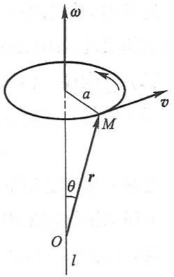

text_image

ω
a
M
v
r
θ
O
l

图8-25

设点 M 的线速度为 v，由物理学上线速度与角速度间的关系可知，v 的大小为

$$
\mid \boldsymbol {v} \mid = \mid \boldsymbol {\omega} \mid a = \mid \boldsymbol {\omega} \mid \mid \boldsymbol {r} \mid \sin \theta ;
$$

$v$ 垂直于通过 $M$ 点与 $l$ 轴的平面, 即 $v$ 既垂直于 $\omega$ 又垂直于 $r$; 又 $v$ 的方向使 $\omega, r, v$ 符合右手规则. 因此有

$$
v = \omega \times r.
$$

## \* 三、向量的混合积

设已知三个向量 a, b 和 c. 先作两向量 a 和 b 的向量积  $a \times b$ ，把所得到的向量与第三个向量 c 再作数量积  $(a \times b) \cdot c$ ，这样得到的数叫做三向量 a, b, c 的混合积，记作 [abc].

下面我们来推出三向量的混合积的坐标表示式.

设 $a = (a_{x}, a_{y}, a_{z}), b = (b_{x}, b_{y}, b_{z}), c = (c_{x}, c_{y}, c_{z})$，因为

$$
\boldsymbol {a} \times \boldsymbol {b} = \left| \begin{array}{l l l} \boldsymbol {i} & \boldsymbol {j} & \boldsymbol {k} \\ a _ {x} & a _ {y} & a _ {z} \\ b _ {x} & b _ {y} & b _ {z} \end{array} \right| = \left| \begin{array}{l l} a _ {y} & a _ {z} \\ b _ {y} & b _ {z} \end{array} \right| \boldsymbol {i} - \left| \begin{array}{l l} a _ {x} & a _ {z} \\ b _ {x} & b _ {z} \end{array} \right| \boldsymbol {j} + \left| \begin{array}{l l} a _ {x} & a _ {y} \\ b _ {x} & b _ {y} \end{array} \right| \boldsymbol {k},
$$

再按两向量的数量积的坐标表示式,便得

$$
\begin{array}{l} \left[ \begin{array}{l l l} a & b & c \end{array} \right] = (a \times b) \cdot c \\ = c _ {x} \left| \begin{array}{l l} a _ {y} & a _ {z} \\ b _ {y} & b _ {z} \end{array} \right| - c _ {y} \left| \begin{array}{l l} a _ {x} & a _ {z} \\ b _ {x} & b _ {z} \end{array} \right| + c _ {z} \left| \begin{array}{l l} a _ {x} & a _ {y} \\ b _ {x} & b _ {y} \end{array} \right| = \left| \begin{array}{l l l} a _ {x} & a _ {y} & a _ {z} \\ b _ {x} & b _ {y} & b _ {z} \\ c _ {x} & c _ {y} & c _ {z} \end{array} \right|. \\ \end{array}
$$

向量的混合积有下述几何意义:

向量的混合积 $[abc] = (a \times b) \cdot c$ 是这样一个数，它的绝对值表示以向量 $a, b, c$ 为棱的平行六面体的体积。如果向量 $a, b, c$ 组成右手系（即 $c$ 的方向按右手规则从 $a$转向 $b$ 来确定), 那么混合积的符号是正的; 如果 $a, b, c$ 组成左手系 (即 $c$ 的方向按左手规则从 $a$ 转向 $b$ 来确定), 那么混合积的符号是负的.

事实上, 设 $\overrightarrow{OA} = a, \overrightarrow{OB} = b, \overrightarrow{OC} = c$. 按向量积的定义, 向量积 $a \times b = f$ 是一个向量, 它的模在数值上等于以向量 $a$ 和 $b$ 为邻边所作平行四边形 $OADB$ 的面积, 它的方向垂直于这平行四边形的平面, 且当 $a, b, c$ 组成右手系时, 向量 $f$ 与向量 $c$ 朝着这平面的同侧 (图 8-26); 当 $a, b, c$ 组成左手系时, 向量 $f$ 与向量 $c$ 朝着这平面的异侧. 所以, 如设 $f$ 与 $c$ 的夹角为 $\alpha$, 那么当 $a, b, c$ 组成右手系时, $\alpha$ 为锐角; 当 $a, b, c$ 组成左手系时, $\alpha$ 为钝角. 由于

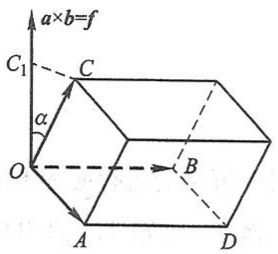

text_image

a×b=f
C₁
α
O
B
A
D

图 8-26

$$
[ a b c ] = (a \times b) \cdot c = | a \times b | | c | \cos \alpha ,
$$

所以当 $a, b, c$ 组成右手系时，$[abc]$ 为正；当 $a, b, c$ 组成左手系时，$[abc]$ 为负.

因为以向量 a, b, c 为棱的平行六面体的底(平行四边形 OADB) 的面积 S 在数值上等于  $\left|a \times b\right|$ ，它的高 h 等于向量 c 在向量 f 上的投影的绝对值，即

$$
h = \mid \mathrm{Prj} _ {f}   c \mid = \mid c \mid \mid \cos \alpha \mid ,
$$

所以平行六面体的体积

$$
V = S h = \left| \boldsymbol {a} \times \boldsymbol {b} \right| \left| \boldsymbol {c} \right| \left| \cos \alpha \right| = \left| \left[ \boldsymbol {a b c} \right] \right|.
$$

由上述混合积的几何意义可知,若混合积 $[abc]\neq0$ ,则能以a,b,c三向量为棱构成平行六面体,从而a,b,c三向量不共面;反之,若a,b,c三向量不共面,则必能以a,b,c为棱构成平行六面体,从而 $[abc]\neq0$ .于是有下述结论:

三向量 $a, b, c$ 共面的充分必要条件是它们的混合积 $[a b c] = 0$，即

$$
\left| \begin{array}{c c c} a _ {x} & a _ {y} & a _ {z} \\ b _ {x} & b _ {y} & b _ {z} \\ c _ {x} & c _ {y} & c _ {z} \end{array} \right| = 0.
$$

例7 已知不在一平面上的四点 $A(x_{1},y_{1},z_{1}), B(x_{2},y_{2},z_{2}), C(x_{3},y_{3},z_{3}), D(x_{4},y_{4},z_{4})$. 求四面体ABCD的体积.

解 由立体几何知道,四面体的体积 V 等于以向量  $\overrightarrow{AB}, \overrightarrow{AC}$  和  $\overrightarrow{AD}$  为棱的平行六面体的体积的六分之一.因而

$$
V = \frac {1}{6} \left| \left[ \overrightarrow {A B} \overrightarrow {A C} \overrightarrow {A D} \right] \right|.
$$

由于

$$
\overrightarrow {A B} = (x _ {2} - x _ {1}, y _ {2} - y _ {1}, z _ {2} - z _ {1}),
$$

$$
\overrightarrow {A C} = (x _ {3} - x _ {1}, y _ {3} - y _ {1}, z _ {3} - z _ {1}),
$$

$$
\overrightarrow {A D} = (x _ {4} - x _ {1}, y _ {4} - y _ {1}, z _ {4} - z _ {1}),
$$

所以

$$
V = \pm \frac {1}{6} \left| \begin{array}{c c c} x _ {2} - x _ {1} & y _ {2} - y _ {1} & z _ {2} - z _ {1} \\ x _ {3} - x _ {1} & y _ {3} - y _ {1} & z _ {3} - z _ {1} \\ x _ {4} - x _ {1} & y _ {4} - y _ {1} & z _ {4} - z _ {1} \end{array} \right|,
$$

上式中符号的选择必须和行列式的符号一致.

例 8 已知  $A(1,2,0)$ ,  $B(2,3,1)$ ,  $C(4,2,2)$ ,  $M(x,y,z)$  四点共面, 求点 M 的坐标 x,y,z 所满足的关系式.

解 $A, B, C, M$ 四点共面相当于 $\overrightarrow{AM}, \overrightarrow{AB}, \overrightarrow{AC}$ 三向量共面，这里 $\overrightarrow{AM} = (x - 1, y - 2, z)$，$\overrightarrow{AB} = (1, 1, 1), \overrightarrow{AC} = (3, 0, 2)$. 按三向量共面的充分必要条件，可得

$$
\left| \begin{array}{c c c} x - 1 & y - 2 & z \\ 1 & 1 & 1 \\ 3 & 0 & 2 \end{array} \right| = 0,
$$

即

$$
2 x + y - 3 z - 4 = 0.
$$

这就是点 M 的坐标所满足的关系式.

## 习题8-2

1. 设 $a = 3i - j - 2k, b = i + 2j - k$，求

(1) $a \cdot b$ 及 $a \times b$; (2) $(-2a) \cdot 3b$ 及 $a \times 2b$; (3) $a, b$ 的夹角的余弦.

2. 设 a, b, c 为单位向量，且满足  $a + b + c = 0$ ，求  $a \cdot b + b \cdot c + c \cdot a$ .

3. 已知 $M_{1}(1, -1, 2), M_{2}(3, 3, 1)$ 和 $M_{3}(3, 1, 3)$. 求与 $\overrightarrow{M_{1}M_{2}}, \overrightarrow{M_{2}M_{3}}$ 同时垂直的单位向量.

4. 设质量为 100 kg 的物体从点  $M_{1}(3,1,8)$  沿直线移动到点  $M_{2}(1,4,2)$ ，计算重力所做的功（坐标系长度单位为 m，重力方向为 z 轴负方向）.

5. 在杠杆上支点 $O$ 的一侧与点 $O$ 的距离为 $x_{1}$ 的点 $P_{1}$ 处, 作用着一个与 $\overrightarrow{OP_1}$ 成角 $\theta_{1}$ 的力 $F_{1}$; 在 $O$ 的另一侧与点 $O$ 的距离为 $x_{2}$ 的点 $P_{2}$ 处, 作用着一个与 $\overrightarrow{OP_2}$ 成角 $\theta_{2}$ 的力 $F_{2}$ (图8-27). 问 $\theta_{1}, \theta_{2}, x_{1}, x_{2}, |F_{1}|$, $|F_{2}|$ 符合怎样的条件才能使杠杆保持平衡?

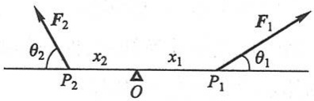

text_image

F₂
θ₂
P₂
x₂
Δ
O
x₁
P₁
F₁
θ₁

图8-27

6. 求向量  $\boldsymbol{a}=(4,-3,4)$  在向量  $\boldsymbol{b}=(2,2,1)$  上的投影.

7. 设  $\boldsymbol{a}=(3,5,-2)$ ,  $\boldsymbol{b}=(2,1,4)$ ，问  $\lambda$  与  $\mu$  有怎样的关系，能使得  $\lambda a+\mu b$  与 z 轴垂直？

8. 试用向量证明直径所对的圆周角是直角.

9. 已知向量 $a = 2i - 3j + k, b = i - j + 3k$ 和 $c = i - 2j$, 计算:

(1) $(\pmb{a} \cdot \pmb{b})\pmb{c} - (\pmb{a} \cdot \pmb{c})\pmb{b}$; (2) $(\pmb{a} + \pmb{b}) \times (\pmb{b} + \pmb{c})$; (3) $(\pmb{a} \times \pmb{b}) \cdot \pmb{c}$.

10. 设一平行四边形对角线为 $c = a + 2b, d = 3a - 4b$，其中 $a, b$ 为单位向量且 $a \perp b$，求该平行四边形的面积。

11. 设有四面体 $OPQR$ （图8-28），其中 $\triangle OPQ, \triangle OQR, \triangle OPR$ 和 $\triangle PQR$ 的面积分别为 $A, B, C$ 和 $D$. 试用向量方法证明如下三维空间中的勾股定理:

$$
A ^ {2} + B ^ {2} + C ^ {2} = D ^ {2}.
$$

\*12. 已知 $a = (a_{x}, a_{y}, a_{z}), b = (b_{x}, b_{y}, b_{z}), c = (c_{x}, c_{y}, c_{z})$，试利用行列式的性质证明:

$$
(a \times b) \cdot c = (b \times c) \cdot a = (c \times a) \cdot b.
$$

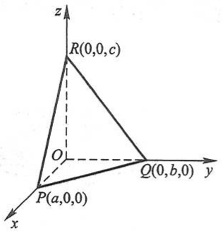

text_image

z
R(0,0,c)
O
Q(0,b,0)
y
P(a,0,0)
x

图8-28

13. 试用向量证明不等式:

$$
\sqrt {a _ {1} ^ {2} + a _ {2} ^ {2} + a _ {3} ^ {2}} \sqrt {b _ {1} ^ {2} + b _ {2} ^ {2} + b _ {3} ^ {2}} \geqslant \left| a _ {1} b _ {1} + a _ {2} b _ {2} + a _ {3} b _ {3} \right|,
$$

其中 $a_1, a_2, a_3, b_1, b_2, b_3$ 为任意实数，并指出等号成立的条件.

## 第三节 平面及其方程

## 一、曲面方程与空间曲线方程的概念

因为平面与空间直线分别是曲面与空间曲线的特例,所以在讨论平面与空间直线以前,先引入有关曲面方程与空间曲线方程的概念.

像在平面解析几何中把平面曲线当作动点的轨迹一样,在空间解析几何中,任何曲面或曲线都看作点的几何轨迹.在这样的意义下,如果曲面 S 与三元方程

$$
F (x, y, z) = 0 \tag {3-1}
$$

有下述关系:

(1) 曲面 S 上任一点的坐标都满足方程(3-1);
(2) 不在曲面 S 上的点的坐标都不满足方程 (3-1), 那么, 方程 (3-1) 就叫做曲面 S 的方程, 而曲面 S 就叫做方程 (3-1) 的图形 (图 8-29).

空间曲线可以看作两个曲面 $S_{1}, S_{2}$ 的交线. 设

$$
F (x, y, z) = 0 \quad {\text {和}} \quad G (x, y, z) = 0
$$

分别是这两个曲面的方程,它们的交线为 C（图 8-30）.因为曲线 C 上的任何点的坐标应同时满足这两个曲面的方程,所以应满足方程组

$$
\left\{ \begin{array}{l} F (x, y, z) = 0, \\ G (x, y, z) = 0. \end{array} \right. \tag {3-2}
$$

反过来,如果点 M 不在曲线 C 上,那么它不可能同时在两个曲面上,所以它的坐标不满足方程组(3-2).因此,曲线 C 可以用方程组(3-2)来表示.方程组(3-2)就叫做空间曲线 C 的方程,而曲线 C 就叫做方程组(3-2)的图形.

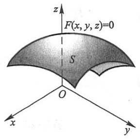

text_image

F(x, y, z)=0
S
O
x
y
z

图8-29

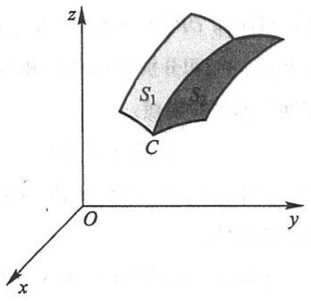

text_image

z
S₁
C
O
y
x

图8-30

在本节和下一节里,我们将以向量为工具,在空间直角坐标系中讨论最简单的曲面和曲线——平面和直线.

## 二、平面的点法式方程

如果一非零向量垂直于一平面,那么这个向量就叫做该平面的法向量.容易知道,平面上的任一向量均与该平面的法向量垂直.

因为过空间一点可以作而且只能作一平面垂直于一已知直线,所以当平面  $\Pi$  上一点  $M_{0}(x_{0},y_{0},z_{0})$  和它的一个法向量  $\boldsymbol{n}=(A,B,C)$  为已知时,平面  $\Pi$  的位置就完全确定了.下面我们来建立平面  $\Pi$  的方程.

设 $M(x,y,z)$ 是平面 $\Pi$ 上的任一点(图8-31).则向量$\overrightarrow{M_0M}$ 必与平面 $\Pi$ 的法向量 $\pmb{n}$ 垂直，即它们的数量积等于零

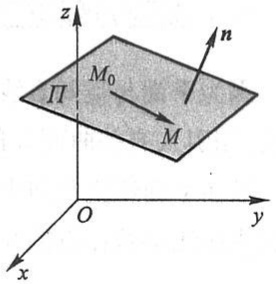

text_image

z
M₀
Π
M
n
O
y
x

图8-31

$$
\boldsymbol {n} \cdot \overrightarrow {M _ {0} M} = 0.
$$

因为 $n = (A,B,C),\overrightarrow{M_0M} = (x - x_0,y - y_0,z - z_0)$ ，所以有

$$
A (x - x _ {0}) + B (y - y _ {0}) + C (z - z _ {0}) = 0. \tag {3-3}
$$

这就是平面 $\Pi$ 上任一点 $M$ 的坐标 $x, y, z$ 所满足的方程.

反过来, 如果 $M(x, y, z)$ 不在平面 $\Pi$ 上, 那么向量 $\overrightarrow{M_0M}$ 与法向量 $n$ 不垂直, 从而 $n \cdot \overrightarrow{M_0M} \neq 0$, 即不在平面 $\Pi$ 上的点 $M$ 的坐标 $x, y, z$ 不满足方程(3-3).

由此可知,平面  $\Pi$  上的任一点的坐标 x,y,z 都满足方程(3-3),不在平面  $\Pi$  上的点的坐标都不满足方程(3-3).这样,方程(3-3)就是平面 $\Pi$ 的方程,而平面 $\Pi$ 就是方程(3-3)的图形.因为方程(3-3)是由平面 $\Pi$ 上的一点 $M_{0}(x_{0},y_{0},z_{0})$ 及它的一个法向量 $n=(A,B,C)$ 确定的,所以方程(3-3)叫做平面的点法式方程.

例 1 求过点 $(2,-3,0)$ 且以 $n=(1,-2,3)$ 为法向量的平面的方程.

解 根据平面的点法式方程(3-3)，得所求平面的方程为

$$
(x - 2) - 2 (y + 3) + 3 z = 0,
$$

即

$$
x - 2 y + 3 z - 8 = 0.
$$

例 2 求过三点  $M_{1}(2,-1,4)$ ,  $M_{2}(-1,3,-2)$  和  $M_{3}(0,2,3)$  的平面的方程.

解 先找出这平面的法向量 n. 因为向量 n 与向量  $\overrightarrow{M_{1}M_{2}}$  和  $\overrightarrow{M_{1}M_{3}}$  都垂直, 而  $\overrightarrow{M_{1}M_{2}} = (-3, 4, -6)$ ,  $\overrightarrow{M_{1}M_{3}} = (-2, 3, -1)$ , 所以可取它们的向量积为 n, 即

$$
\boldsymbol {n} = \overrightarrow {M _ {1} M _ {2}} \times \overrightarrow {M _ {1} M _ {3}} = \left| \begin{array}{c c c} \boldsymbol {i} & \boldsymbol {j} & \boldsymbol {k} \\ - 3 & 4 & - 6 \\ - 2 & 3 & - 1 \end{array} \right| = 1 4 \boldsymbol {i} + 9 \boldsymbol {j} - \boldsymbol {k},
$$

根据平面的点法式方程(3-3)，得所求平面的方程为

$$
1 4 (x - 2) + 9 (y + 1) - (z - 4) = 0,
$$

即

$$
1 4 x + 9 y - z - 1 5 = 0.
$$

## 三、平面的一般方程

因为平面的点法式方程(3-3)是 $x, y$ 和 $z$ 的一次方程，而任一平面都可以用它上面的一点及它的法向量来确定，所以任一平面都可以用三元一次方程来表示.

反过来,设有三元一次方程

$$
A x + B y + C z + D = 0. \tag {3-4}
$$

我们任取满足该方程的一组数 $x_0, y_0, z_0$，即

$$
A x _ {0} + B y _ {0} + C z _ {0} + D = 0. \tag {3-5}
$$

把上述两等式相减,得

$$
A (x - x _ {0}) + B (y - y _ {0}) + C (z - z _ {0}) = 0. \tag {3-6}
$$

把它和平面的点法式方程(3-3)作比较,可以知道方程(3-6)是通过点 $M_{0}(x_{0},y_{0},z_{0})$ 且以 $n=(A,B,C)$ 为法向量的平面方程.方程(3-4)与方程(3-6)同解,这是因为由(3-4)减去(3-5)即得(3-6),又由(3-6)加上(3-5)就得(3-4).由此可知,任一三元一次方程(3-4)的图形总是一个平面.方程(3-4)称为平面的一般方程,其中x,y,z的系数就是该平面的一个法向量n的坐标,即 $n=(A,B,C)$ .