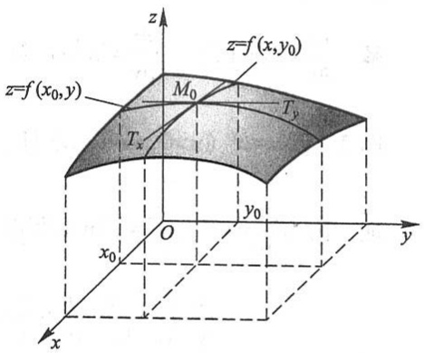
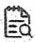
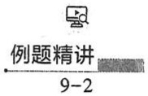

## 三、多元函数的极限

先讨论二元函数 $z = f(x,y)$ 当 $(x,y)\to (x_0,y_0)$，即 $P(x,y)\rightarrow P_0(x_0,y_0)$ 时的极限

这里 $P \to P_0$ 表示点 $P$ 以任何方式趋于点 $P_0$, 也就是点 $P$ 与点 $P_0$ 间的距离趋于零, 即

$$
\mid P P _ {0} \mid = \sqrt {\left(x - x _ {0}\right) ^ {2} + \left(y - y _ {0}\right) ^ {2}} \rightarrow 0.
$$

与一元函数的极限概念类似,如果在  $P(x,y)\rightarrow P_{0}(x_{0},y_{0})$  的过程中,对应的函数值  $f(x,y)$  无限接近于一个确定的常数 A,那么就说 A 是函数  $f(x,y)$  当  $(x,y)\rightarrow(x_{0},y_{0})$  时的极限.下面用“ $\varepsilon-\delta$ ”语言描述这个极限概念.

定义2 设二元函数 $f(P) = f(x, y)$ 的定义域为 $D, P_0(x_0, y_0)$ 是 $D$ 的聚点. 如果存在常数 $A$，对于任意给定的正数 $\varepsilon$，总存在正数 $\delta$，使得当点 $P(x, y) \in D \cap \overset{\circ}{U}(P_0, \delta)$ 时，都有

$$
\mid f (P) - A \mid = \mid f (x, y) - A \mid <   \varepsilon
$$

成立,那么就称常数 A 为函数  $f(x,y)$  当  $(x,y)\rightarrow(x_{0},y_{0})$  时的极限,记作

$$
\lim _ {(x, y) \to (x _ {0}, y _ {0})} f (  x  , y  ) = A \quad \text {或} \quad f (  x  , y  ) \to A   \left(  (  x  , y  ) \to (  x _ {0}  , y _ {0}  )  \right),
$$

也记作

$$
\lim _ {P \to P _ {0}} f (  P) = A \quad \text {或} \quad f (  P) \to A \quad (  P \to P _ {0}  ).
$$

为了区别于一元函数的极限,我们把二元函数的极限叫做二重极限.

例4 设 $f(x,y) = (x^{2} + y^{2})\sin \frac{1}{x^{2} + y^{2}}$ ，求证:

$$
\lim _ {(x, y) \to (0, 0)} f (x, y) = 0.
$$

证 这里函数 $f(x, y)$ 的定义域为 $D = \mathbb{R}^2 \setminus \{(0, 0)\}$，点 $O(0, 0)$ 为 $D$ 的聚点。因为

$$
\mid f (x, y) - 0 \mid = \left| (x ^ {2} + y ^ {2}) \sin \frac {1}{x ^ {2} + y ^ {2}} - 0 \right| \leqslant x ^ {2} + y ^ {2},
$$

可见， $\forall \varepsilon >0$ ，取 $\delta = \sqrt{\varepsilon}$ ，则当

$$
0 <   \sqrt {(x - 0) ^ {2} + (y - 0) ^ {2}} <   \delta ,
$$

即 $P(x,y)\in D\cap \mathring{U} (O,\delta)$ 时，总有

$$
\mid f (x, y) - 0 \mid <   \varepsilon
$$

成立,所以

$$
\lim _ {(x, y) \to (0, 0)} f (x, y) = 0.
$$

必须注意,所谓二重极限存在,是指  $P(x,y)$  以任何方式趋于  $P_{0}(x_{0},y_{0})$  时,  $f(x,y)$  都无限接近于 A. 因此, 如果  $P(x,y)$  以某一特殊方式, 例如沿着一条定直线或定曲线趋于 $P_0(x_0, y_0)$ 时，即使 $f(x, y)$ 无限接近于某一确定值，我们还不能由此断定函数的极限存在。但是反过来，如果当 $P(x, y)$ 以不同的方式趋于 $P_0(x_0, y_0)$ 时，$f(x, y)$ 趋于不同的值，那么就可以断定这函数的极限不存在。下面用例子来说明这种情形。

考察函数

$$
f (x, y) = \left\{ \begin{array}{l l} \frac {x y}{x ^ {2} + y ^ {2}}, & x ^ {2} + y ^ {2} \neq 0, \\ 0, & x ^ {2} + y ^ {2} = 0. \end{array} \right.
$$

显然, 当点  $P(x,y)$  沿 x 轴趋于点  $(0,0)$  时,

$$
\lim_{\substack{(x,y)\to (0,0)\\ y = 0}}f(x,y) = \lim_{x\to 0}f(x,0) = \lim_{x\to 0}0 = 0;
$$

又当点  $P(x,y)$  沿 y 轴趋于点  $(0,0)$  时，

$$
\lim_{\substack{(x,y)\to (0,0)\\ x = 0}}f(x,y) = \lim_{y\to 0}f(0,y) = \lim_{y\to 0}0 = 0.
$$

虽然点 $P(x,y)$ 以上述两种特殊方式（沿 $x$ 轴或沿 $y$ 轴）趋于原点时函数的极限存在并且相等，但是 $\lim_{(x,y)\to (0,0)}f(x,y)$ 并不存在.这是因为当点 $P(x,y)$ 沿着直线 $y = kx$ 趋于点(0,0)时，有

$$
\lim_{\substack{(x,y)\to (0,0)\\ y = kx}}\frac{xy}{x^2 + y^2} = \lim_{x\to 0}\frac{kx^2}{x^2 + k^2x^2} = \frac{k}{1 + k^2},
$$

显然它是随着 k 的值的不同而改变的.

以上关于二元函数的极限概念, 可相应地推广到 n 元函数  $u = f(P)$ , 即  $u = f(x_{1}, x_{2}, \cdots, x_{n})$  上去.

关于多元函数的极限运算,有与一元函数类似的运算法则.

例 5 求  $\lim_{(x,y)\to(0,2)}\frac{\sin(xy)}{x}$ .

解 这里函数 $\frac{\sin(xy)}{x}$ 的定义域为 $D = \{(x, y) \mid x \neq 0, y \in \mathbb{R}\}, P_0(0, 2)$ 为 $D$ 的聚点.

由积的极限运算法则,得

$$
\lim _ {(x, y) \to (0, 2)} \frac {\sin (x y)}{x} = \lim _ {(x, y) \to (0, 2)} \left[ \frac {\sin (x y)}{x y} \cdot y \right] = \lim _ {x y \to 0} \frac {\sin (x y)}{x y} \cdot \lim _ {y \to 2} y = 1 \times 2 = 2.
$$

## 四、多元函数的连续性

明白了函数极限的概念,就不难说明多元函数的连续性.

定义3 设二元函数 $f(P) = f(x, y)$ 的定义域为 $D, P_0(x_0, y_0)$ 为 $D$ 的聚点，且 $P_0 \in$

## D. 如果

$$
\lim _ {(x, y) \to (x _ {0}, y _ {0})} f (x, y) = f (x _ {0}, y _ {0}),
$$

那么称函数 $f(x,y)$ 在点 $P_0(x_0,y_0)$ 连续.

设函数 $f(x,y)$ 在D上有定义，D内的每一点都是函数定义域的聚点.如果函数 $f(x,y)$ 在D的每一点都连续，那么就称函数 $f(x,y)$ 在D上连续，或者称 $f(x,y)$ 是D上的连续函数.

以上关于二元函数的连续性概念, 可相应地推广到 n 元函数  $f(P)$  上去.

下面,我们把一元基本初等函数看成二元函数的特例(即另一个自变量不出现),来讨论它的连续性.先看一个例子.

例6 设 $f(x,y) = \sin x$ ，证明 $f(x,y)$ 是 $\mathbb{R}^2$ 上的连续函数.

证 设 $P_0(x_0, y_0) \in \mathbb{R}^2$. $\forall \varepsilon > 0$, 由于 $\sin x$ 在 $x_0$ 处连续, 故 $\exists \delta > 0$, 当 $|x - x_0| < \delta$ 时, 有

$$
\mid \sin x - \sin x _ {0} \mid <   \varepsilon .
$$

以上述 $\delta$ 作 $P_0$ 的 $\delta$ 邻域 $U(P_0, \delta)$，则当 $P(x, y) \in U(P_0, \delta)$ 时，显然

$$
\mid x - x _ {0} \mid \leqslant \rho (P, P _ {0}) <   \delta ,
$$

从而

$$
\mid f (x, y) - f (x _ {0}, y _ {0}) \mid = \mid \sin x - \sin x _ {0} \mid <   \varepsilon ,
$$

即 $f(x,y) = \sin x$ 在点 $P_0(x_0,y_0)$ 连续.由 $P_{0}$ 的任意性知，$\sin x$ 作为 $x,y$ 的二元函数在 $\mathbf{R}^2$ 上连续.

类似的讨论可知,一元基本初等函数看成二元函数或二元以上的多元函数时,它们在各自的定义域内都是连续的.

定义4 设函数 $f(x, y)$ 的定义域为 $D, P_0(x_0, y_0)$ 是 $D$ 的聚点. 如果函数 $f(x, y)$ 在点 $P_0(x_0, y_0)$ 不连续, 那么称 $P_0(x_0, y_0)$ 为函数 $f(x, y)$ 的间断点.

例如,前面讨论过的函数

$$
f (x, y) = \left\{ \begin{array}{c l} \frac {x y}{x ^ {2} + y ^ {2}}, & x ^ {2} + y ^ {2} \neq 0, \\ 0, & x ^ {2} + y ^ {2} = 0, \end{array} \right.
$$

其定义域 $D = \mathbb{R}^2$ ，点 $O(0,0)$ 是 $D$ 的聚点. $f(x,y)$ 当 $(x,y)\rightarrow (0,0)$ 时的极限不存在，所以点 $O(0,0)$ 是该函数的一个间断点；又如函数

$$
f (x, y) = \sin \frac {1}{x ^ {2} + y ^ {2} - 1},
$$

其定义域为

$$
D = \{(x, y) \mid x ^ {2} + y ^ {2} \neq 1 \},
$$

圆周 $C = \{(x,y)\mid x^2 +y^2 = 1\}$ 上的点都是 $D$ 的聚点，而 $f(x,y)$ 在 $C$ 上没有定义，当然$f(x,y)$ 在 $C$ 上各点都不连续，所以圆周 $C$ 上各点都是该函数的间断点.

前面已经指出:一元函数中关于极限的运算法则,对于多元函数仍然适用.根据多元函数的极限运算法则,可以证明多元连续函数的和、差、积仍为连续函数;连续函数的商在分母不为零处仍连续;多元连续函数的复合函数也是连续函数.

与一元初等函数相类似,多元初等函数是指可用一个式子表示的多元函数,这个式子是由常数及具有不同自变量的一元基本初等函数经过有限次的四则运算和复合运算而得到的.例如, $\frac{x+x^{2}-y^{2}}{1+y^{2}},\sin(x+y),e^{x^{2}+y^{2}+z^{2}}$ 等都是多元初等函数.

根据上面指出的连续函数的和、差、积、商的连续性以及连续函数的复合函数的连续性,再利用基本初等函数的连续性,我们进一步可以得出如下结论:

一切多元初等函数在其定义区域内是连续的.所谓定义区域是指包含在定义域内的区域或闭区域.

由多元初等函数的连续性,如果要求它在点 $P_{0}$ 处的极限,而该点又在此函数的定义区域内,那么此极限值就是函数在该点的函数值,即

$$
\lim _ {P \to P _ {0}} f (P) = f (P _ {0}).
$$

例7 求 $\lim_{(x,y)\to (1,2)}\frac{x + y}{xy}$.

解 函数 $f(x, y) = \frac{x + y}{xy}$ 是初等函数, 它的定义域为

$$
D = \{(x, y) \mid x \neq 0, y \neq 0 \}.
$$

$P_{0}(1,2)$ 为 $D$ 的内点，故存在 $P_{0}$ 的某一邻域 $U(P_0)\subset D$ ，而任何邻域都是区域，所以$U(P_0)$ 是 $f(x,y)$ 的一个定义区域，因此

$$
\lim _ {(x, y) \to (1, 2)} \frac {x + y}{x y} = f (1, 2) = \frac {3}{2}.
$$

一般地, 求  $\lim_{P\to P_{0}}f(P)$  时, 如果  $f(P)$  是初等函数, 且  $P_{0}$  是  $f(P)$  的定义域的内点, 那么  $f(P)$  在点  $P_{0}$  处连续, 于是

$$
\lim _ {P \to P _ {0}} f (P) = f (P _ {0}).
$$

例8 求 $\lim_{(x,y)\to (0,0)}\frac{\sqrt{xy + 1} - 1}{xy}$

解 $\lim_{(x,y)\to (0,0)}\frac{\sqrt{xy + 1} - 1}{xy} = \lim_{(x,y)\to (0,0)}\frac{xy + 1 - 1}{xy(\sqrt{xy + 1} + 1)} = \lim_{(x,y)\to (0,0)}\frac{1}{\sqrt{xy + 1} + 1} = \frac{1}{2}.$

以上运算的最后一步用到了二元函数 $\frac{1}{\sqrt{xy+1}+1}$ 在点(0,0)的连续性.

与闭区间上一元连续函数的性质相类似,在有界闭区域上连续的多元函数具有如下性质:

性质1(有界性与最大值最小值定理) 在有界闭区域 $D$ 上的多元连续函数, 必定在 $D$ 上有界, 且能取得它的最大值和最小值.

性质1就是说,若 $f(P)$ 在有界闭区域D上连续,则必定存在常数M>0,使得对一切 $P\in D$ ,有 $\left|f(P)\right|\leqslant M$ ;且存在 $P_{1},P_{2}\in D$ ,使得

$$
f (P _ {1}) = \max \left\{f (P) \mid P \in D \right\}, \quad f (P _ {2}) = \min \left\{f (P) \mid P \in D \right\}.
$$

性质 2(介值定理) 在有界闭区域 D 上的多元连续函数必取得介于最大值和最小值之间的任何值.

\*性质3(一致连续性定理) 在有界闭区域 $D$ 上的多元连续函数必定在 $D$ 上一致连续.

性质3就是说,若 $f(P)$ 在有界闭区域D上连续,则对于任意给定的正数 $\varepsilon$ ,总存在正数 $\delta$ ,使得对于D上的任意两点 $P_{1},P_{2}$ ,只要当 $|P_{1}P_{2}|<\delta$ 时,都有

$$
\mid f (P _ {1}) - f (P _ {2}) \mid <   \varepsilon
$$

成立.

## 习题9-1

1. 判定下列平面点集中哪些是开集、闭集、区域、有界集、无界集，并分别指出它们的聚点所成的点集（称为导集）和边界.

(1)  $\{(x,y)\mid x\neq0,y\neq0\}$ ;

(2) $\{(x,y)\mid1<x^{2}+y^{2}\leqslant4\}$ ;

(3)  $\{(x,y)\mid y>x^{2}\}$ ;

(4) $\{(x, y) \mid x^2 + (y - 1)^2 \geqslant 1\} \cap \{(x, y) \mid x^2 + (y - 2)^2 \leqslant 4\}$.

2. 已知函数 $f(x, y) = x^2 + y^2 - xy \tan \frac{x}{y}$，试求 $f(tx, ty)$.

3. 试证函数 $F(x, y) = \ln x \cdot \ln y$ 满足关系式

$$
F (x y, u v) = F (x, u) + F (x, v) + F (y, u) + F (y, v).
$$

4. 已知函数 $f(u, v, w) = u^w + w^{u + v}$，试求 $f(x + y, x - y, xy)$.

5. 求下列各函数的定义域:

(1) $z = \ln (y^2 - 2x + 1)$;

(2) $z = \frac{1}{\sqrt{x + y}} +\frac{1}{\sqrt{x - y}};$

(3) $z=\sqrt{x-\sqrt{y}}$;

(4) $z = \ln (y - x) + \frac{\sqrt{x}}{\sqrt{1 - x^2 - y^2}};$

(5) $u = \sqrt{R^2 - x^2 - y^2 - z^2} + \frac{1}{\sqrt{x^2 + y^2 + z^2 - r^2}}$ ($R > r > 0$);

(6) $u = \arccos \frac{z}{\sqrt{x^2 + y^2}}.$

6. 求下列各极限:

(1) $\lim_{(x,y)\to (0,1)}\frac{1 - xy}{x^2 + y^2};$

(2) $\lim_{(x,y)\to (1,0)}\frac{\ln(x + e^y)}{\sqrt{x^2 + y^2}};$

(3)  $\lim_{(x,y)\to(0,0)}\frac{2-\sqrt{xy+4}}{xy};$

(4) $\lim_{(x,y)\to (0,0)}\frac{xy}{\sqrt{2 - e^{xy}} - 1};$

(5) $\lim_{(x,y)\to (2,0)}\frac{\tan(xy)}{y};$

(6) $\lim_{(x,y)\to (0,0)}\frac{1 - \cos(x^2 + y^2)}{(x^2 + y^2)e^{x^2y^2}}.$

\*7. 证明下列极限不存在:

(1)  $\lim_{(x,y)\to(0,0)}\frac{x+y}{x-y};$

(2)  $\lim_{(x,y)\to(0,0)}\frac{x^{2}y^{2}}{x^{2}y^{2}+(x-y)^{2}};$

(3) $\lim_{(x,y)\to (0,0)}\frac{xy}{x + y};$

(4) $\lim_{(x,y)\to (0,0)}\frac{1 - \cos(x + y)}{(x + y)xy}.$

8. 函数 $z = \frac{y^2 + 2x}{y^2 - 2x}$ 在何处是间断的？

\*9. 证明 $\lim_{(x,y)\to (0,0)}\frac{xy}{\sqrt{x^2 + y^2}} = 0.$

\*10. 设 $F(x, y) = f(x)$, $f(x)$ 在点 $x_0$ 处连续, 证明: 对任意 $y_0 \in \mathbb{R}$, $F(x, y)$ 在点 $(x_0, y_0)$ 处连续.

## 第二节 偏导数

## 一、偏导数的定义及其计算法

在研究一元函数时,我们从研究函数的变化率引入了导数的概念.对于多元函数同样需要讨论它的变化率.但多元函数的自变量不止一个,因变量与自变量的关系要比一元函数复杂得多.在这一节里,我们首先考虑多元函数关于其中一个自变量的变化率.以二元函数 $z=f(x,y)$ 为例,如果只有自变量x变化,而自变量y固定(即看做常量),这时它就是x的一元函数,这函数对x的导数,就称为二元函数 $z=f(x,y)$ 对x的偏导数,即有如下定义:

定义 设函数 $z = f(x, y)$ 在点 $(x_0, y_0)$ 的某一邻域内有定义，当 $y$ 固定在 $y_0$ 而 $x$ 在 $x_0$ 处有增量 $\Delta x$ 时，相应的函数有增量

$$
f (x _ {0} + \Delta x, y _ {0}) - f (x _ {0}, y _ {0}),
$$

如果

$$
\lim _ {\Delta x \to 0} \frac {f (x _ {0} + \Delta x , y _ {0}) - f (x _ {0} , y _ {0})}{\Delta x} \tag {2-1}
$$

存在,那么称此极限为函数  $z=f(x,y)$  在点  $(x_{0},y_{0})$  处对 x 的偏导数,记作

$$
\frac {\partial z}{\partial x} \Bigg | _ {x = x _ {0}, y = y _ {0}}, \quad \frac {\partial f}{\partial x} \Bigg | _ {x = x _ {0}, y = y _ {0}}, \quad z _ {x} \Bigg | _ {x = x _ {0}, y = y _ {0}} \quad \text {或} \quad f _ {x} (x _ {0}, y _ {0}). ①
$$

例如,极限(2-1)可以表示为

$$
f _ {x} (x _ {0}, y _ {0}) = \lim _ {\Delta x \to 0} \frac {f (x _ {0} + \Delta x , y _ {0}) - f (x _ {0} , y _ {0})}{\Delta x}. \tag {2-2}
$$

类似地, 函数  $z=f(x,y)$  在点  $(x_{0},y_{0})$  处对 y 的偏导数定义为

$$
\lim _ {\Delta y \to 0} \frac {f (x _ {0} , y _ {0} + \Delta y) - f (x _ {0} , y _ {0})}{\Delta y}, \tag {2-3}
$$

记作

$$
\frac {\partial z}{\partial y} \Bigg | _ x = x _ {0}, \quad \frac {\partial f}{\partial y} \Bigg | _ {x = x _ {0}, \quad z _ {y}} \Bigg | _ {x = x _ {0} \atop y = y _ {0}} \quad \text {或} \quad f _ {y} (x _ {0}, y _ {0}).
$$

如果函数 $z = f(x,y)$ 在区域 $D$ 内每一点 $(x,y)$ 处对 $x$ 的偏导数都存在，那么这个偏导数就是 $x,y$ 的函数，它就称为函数 $z = f(x,y)$ 对自变量 $x$ 的偏导函数，记作

$$
\frac {\partial z}{\partial x}, \quad \frac {\partial f}{\partial x}, \quad z _ {x} \quad \text {或} \quad f _ {x} (x, y).
$$

类似地,可以定义函数  $z=f(x,y)$  对自变量 y 的偏导函数,记作

$$
\frac {\partial z}{\partial y}, \quad \frac {\partial f}{\partial y}, \quad z _ {y} \quad \text {或} \quad f _ {y} (x, y).
$$

由偏导函数的概念可知， $f(x,y)$  在点 $(x_{0},y_{0})$ 处对 x 的偏导数 $f_{x}(x_{0},y_{0})$ 显然就是偏导函数 $f_{x}(x,y)$ 在点 $(x_{0},y_{0})$ 处的函数值； $f_{y}(x_{0},y_{0})$ 就是偏导函数 $f_{y}(x,y)$ 在点 $(x_{0},y_{0})$ 处的函数值。就像一元函数的导函数一样，以后在不至于混淆的地方也把偏导函数简称为偏导数。

至于实际求 $z = f(x, y)$ 的偏导数，并不需要用新的方法，因为这里只有一个自变量在变动，另一个自变量是看做固定的，所以仍旧是一元函数的微分法问题。求 $\frac{\partial f}{\partial x}$ 时，只要把 $y$ 暂时看做常量而对 $x$ 求导数；求 $\frac{\partial f}{\partial y}$ 时，只要把 $x$ 暂时看做常量而对 $y$ 求导数。

偏导数的概念还可推广到二元以上的函数.例如三元函数 $u = f(x,y,z)$ 在点 $(x,y,z)$ 处对 $x$ 的偏导数定义为

$$
f _ {x} (x, y, z) = \lim _ {\Delta x \to 0} \frac {f (x + \Delta x , y , z) - f (x , y , z)}{\Delta x},
$$

其中 $(x,y,z)$ 是函数 $u = f(x,y,z)$ 的定义域的内点. 它们的求法也仍旧是一元函数的微分法问题.

<small>① 偏导数记号 $z_{x}, f_{x}$ 也记成 $z_{x}^{\prime}, f_{x}^{\prime}$, 下面高阶偏导数的记号也有类似的情形.</small>

例1 求 $z = x^{2} + 3xy + y^{2}$ 在点(1,2)处的偏导数.

解 把 y 看做常量, 得

$$
\frac {\partial z}{\partial x} = 2 x + 3 y;
$$

把 x 看做常量, 得

$$
\frac {\partial z}{\partial y} = 3 x + 2 y.
$$

将 $(1,2)$ 代入上面的结果,就得

$$
\frac{\partial z}{\partial x}\bigg|_{\substack{x = 1\\ y = 2}} = 2\times 1 + 3\times 2 = 8,\quad \frac{\partial z}{\partial y}\bigg|_{\substack{x = 1\\ y = 2}} = 3\times 1 + 2\times 2 = 7.
$$

例 2 求  $z=x^{2}\sin 2y$  的偏导数.

解  $\frac{\partial z}{\partial x}=2x\sin 2y,\quad\frac{\partial z}{\partial y}=2x^{2}\cos 2y.$

例3 设 $z = x^{y}$ ($x > 0, x \neq 1$), 求证: $\frac{x}{y} \frac{\partial z}{\partial x} + \frac{1}{\ln x} \frac{\partial z}{\partial y} = 2z$.

证 因为 $\frac{\partial z}{\partial x}=yx^{y-1},\frac{\partial z}{\partial y}=x^{y}\ln x.$ 所以

$$
\frac {x}{y} \frac {\partial z}{\partial x} + \frac {1}{\ln x} \frac {\partial z}{\partial y} = \frac {x}{y} y x ^ {y - 1} + \frac {1}{\ln x} x ^ {y} \ln x = x ^ {y} + x ^ {y} = 2 z.
$$

例 4 求  $r=\sqrt{x^{2}+y^{2}+z^{2}}$  的偏导数.

解 把 y 和 z 都看做常量, 得

$$
\frac {\partial r}{\partial x} = \frac {x}{\sqrt {x ^ {2} + y ^ {2} + z ^ {2}}} = \frac {x}{r}.
$$

由于所给函数关于自变量的对称性①,所以

$$
\frac {\partial r}{\partial y} = \frac {y}{r}, \quad \frac {\partial r}{\partial z} = \frac {z}{r}.
$$

例 5 已知理想气体的状态方程 pV = RT (R 为常量), 求证:

$$
\frac {\partial p}{\partial V} \cdot \frac {\partial V}{\partial T} \cdot \frac {\partial T}{\partial p} = - 1.
$$

证 因为

$$
p = \frac {R T}{V}, \quad \frac {\partial p}{\partial V} = - \frac {R T}{V ^ {2}};
$$

<small>① 这就是说,当函数表达式中任意两个自变量对调后,仍表示原来的函数.</small>

$$
\begin{array}{l} V = \frac {R T}{p}, \quad \frac {\partial V}{\partial T} = \frac {R}{p}; \\ T = \frac {p V}{R}, \quad \frac {\partial T}{\partial p} = \frac {V}{R}, \\ \end{array}
$$

所以

$$
\frac {\partial p}{\partial V} \cdot \frac {\partial V}{\partial T} \cdot \frac {\partial T}{\partial p} = - \frac {R T}{V ^ {2}} \cdot \frac {R}{p} \cdot \frac {V}{R} = - \frac {R T}{p V} = - 1.
$$

我们知道,对一元函数来说, $\frac{dy}{dx}$ 可看做函数的微分dy与自变量的微分dx之商.而上式表明,偏导数的记号是一个整体记号,不能看做分子与分母之商.

二元函数 $z = f(x,y)$ 在点 $(x_0,y_0)$ 的偏导数有下述几何意义.

设 $M_0(x_0, y_0, f(x_0, y_0))$ 为曲面 $z = f(x, y)$ 上的一点，过 $M_0$ 作平面 $y = y_0$，截此曲面得一曲线，此曲线在平面 $y = y_0$ 上的方程为 $z = f(x, y_0)$，则导数 $\frac{\mathrm{d}}{\mathrm{d}x} f(x, y_0) \Bigg|_{x = x_0}$，即偏导数 $f_x(x_0, y_0)$，就是这曲线在点 $M_0$ 处的切线 $M_0 T_x$ 对 $x$ 轴的斜率（图9-5）。同样，偏导数 $f_y(x_0, y_0)$ 的几何意义是曲面被平面 $x = x_0$ 所截得的曲线在点 $M_0$ 处的切线 $M_0 T_y$ 对 $y$ 轴的斜率。

text_image

z=f(x₀,y)
M₀
Tₓ
y₀
x₀
O
z=f(x,y₀)
y

图9-5

我们已经知道,如果一元函数在某点具有导数,那么它在该点必定连续.但对于多元函数来说,即使各偏导数在某点都存在,也不能保证函数在该点连续.这是因为各偏导数存在只能保证点P沿着平行于坐标轴的方向趋于 $P_{0}$ 时,函数值 $f(P)$ 趋于 $f(P_{0})$ ,但不能保证点P按任何方式趋于 $P_{0}$ 时,函数值 $f(P)$ 都趋于 $f(P_{0})$ .例如,函数

$$
z = f (x, y) = \left\{ \begin{array}{l l} \frac {x y}{x ^ {2} + y ^ {2}}, & x ^ {2} + y ^ {2} \neq 0, \\ 0, & x ^ {2} + y ^ {2} = 0 \end{array} \right.
$$

在点(0,0)处对 $x$ 的偏导数为

$$
f _ {x} (0, 0) = \lim _ {\Delta x \to 0} \frac {f (0 + \Delta x , 0) - f (0 , 0)}{\Delta x} = \lim _ {\Delta x \to 0} 0 = 0;
$$

释疑解难

9-1

同样有

$$
f _ {y} (0, 0) = \lim _ {\Delta y \to 0} \frac {f (0 , 0 + \Delta y) - f (0 , 0)}{\Delta y} = \lim _ {\Delta y \to 0} 0 = 0.
$$

但是在第一节中已经知道这函数在点 $(0,0)$ 并不连续.

## 二、高阶偏导数

设函数 $z = f(x,y)$ 在区域 $D$ 内具有偏导数

$$
\frac {\partial z}{\partial x} = f _ {x} (x, y), \quad \frac {\partial z}{\partial y} = f _ {y} (x, y),
$$

于是在 $D$ 内 $f_{x}(x,y), f_{y}(x,y)$ 都是 $x, y$ 的函数. 如果这两个函数的偏导数也存在, 那么称它们是函数 $z = f(x,y)$ 的二阶偏导数. 按照对变量求导次序的不同有下列四个二阶偏导数:

$$
\begin{array}{l} \frac {\partial}{\partial x} \left(\frac {\partial z}{\partial x}\right) = \frac {\partial^ {2} z}{\partial x ^ {2}} = f _ {x x} (x, y), \quad \frac {\partial}{\partial y} \left(\frac {\partial z}{\partial x}\right) = \frac {\partial^ {2} z}{\partial x \partial y} = f _ {x y} (x, y), \\ \frac {\partial}{\partial x} \Bigg (\frac {\partial z}{\partial y} \Bigg) = \frac {\partial^ {2} z}{\partial y \partial x} = f _ {y x} (x, y), \quad \frac {\partial}{\partial y} \Bigg (\frac {\partial z}{\partial y} \Bigg) = \frac {\partial^ {2} z}{\partial y ^ {2}} = f _ {y y} (x, y). \\ \end{array}
$$

其中第二、三两个偏导数称为混合偏导数. 同样可得三阶、四阶……以及 n 阶偏导数. 二阶及二阶以上的偏导数统称为高阶偏导数.

例6 设 $z = x^{3}y^{2} - 3xy^{3} - xy + 1$，求 $\frac{\partial^2z}{\partial x^2}, \frac{\partial^2z}{\partial y\partial x}, \frac{\partial^2z}{\partial x\partial y}, \frac{\partial^2z}{\partial y^2}$ 及 $\frac{\partial^3z}{\partial x^3}$.

解 $\frac{\partial z}{\partial x} = 3x^{2}y^{2} - 3y^{3} - y,$ $\frac{\partial z}{\partial y} = 2x^3 y - 9xy^2 -x;$

$$
\frac {\partial^ {2} z}{\partial x ^ {2}} = 6 x y ^ {2}, \quad \frac {\partial^ {2} z}{\partial y \partial x} = 6 x ^ {2} y - 9 y ^ {2} - 1, \quad \frac {\partial^ {2} z}{\partial x \partial y} = 6 x ^ {2} y - 9 y ^ {2} - 1, \quad \frac {\partial^ {2} z}{\partial y ^ {2}} = 2 x ^ {3} - 1 8 x y;
$$

$$
\frac {\partial^ {3} z}{\partial x ^ {3}} = 6 y ^ {2}.
$$

我们看到例6中两个二阶混合偏导数相等, 即 $\frac{\partial^2 z}{\partial y \partial x} = \frac{\partial^2 z}{\partial x \partial y}$. 这不是偶然的, 事实上, 有下述定理.

定理 如果函数 $z = f(x, y)$ 的两个二阶混合偏导数 $\frac{\partial^2 z}{\partial y \partial x}$ 及 $\frac{\partial^2 z}{\partial x \partial y}$ 在区域 $D$ 内连续，那么在该区域内这两个二阶混合偏导数必相等.

换句话说,二阶混合偏导数在连续的条件下与求导的次序无关.这定理的证明从略.

对于二元以上的函数,也可以类似地定义高阶偏导数,而且高阶混合偏导数在偏导数连续的条件下也与求导的次序无关.

例7 验证函数 $z = \ln \sqrt{x^2 + y^2}$ 满足方程

$$
\frac {\partial^ {2} z}{\partial x ^ {2}} + \frac {\partial^ {2} z}{\partial y ^ {2}} = 0.
$$

证 因为 $z = \ln \sqrt{x^2 + y^2} = \frac{1}{2}\ln (x^2 +y^2)$ ，所以

$$
\frac {\partial z}{\partial x} = \frac {x}{x ^ {2} + y ^ {2}}, \quad \frac {\partial z}{\partial y} = \frac {y}{x ^ {2} + y ^ {2}},
$$

$$
\frac {\partial^ {2} z}{\partial x ^ {2}} = \frac {(x ^ {2} + y ^ {2}) - x \cdot 2 x}{(x ^ {2} + y ^ {2}) ^ {2}} = \frac {y ^ {2} - x ^ {2}}{(x ^ {2} + y ^ {2}) ^ {2}}, \quad \frac {\partial^ {2} z}{\partial y ^ {2}} = \frac {(x ^ {2} + y ^ {2}) - y \cdot 2 y}{(x ^ {2} + y ^ {2}) ^ {2}} = \frac {x ^ {2} - y ^ {2}}{(x ^ {2} + y ^ {2}) ^ {2}}.
$$

因此

$$
\frac {\partial^ {2} z}{\partial x ^ {2}} + \frac {\partial^ {2} z}{\partial y ^ {2}} = \frac {y ^ {2} - x ^ {2}}{(x ^ {2} + y ^ {2}) ^ {2}} + \frac {x ^ {2} - y ^ {2}}{(x ^ {2} + y ^ {2}) ^ {2}} = 0.
$$

例8 证明函数 $u = \frac{1}{r}$ 满足方程

$$
\frac {\partial^ {2} u}{\partial x ^ {2}} + \frac {\partial^ {2} u}{\partial y ^ {2}} + \frac {\partial^ {2} u}{\partial z ^ {2}} = 0,
$$

其中  $r=\sqrt{x^{2}+y^{2}+z^{2}}$ .

证 $\frac{\partial u}{\partial x} = -\frac{1}{r^2}\frac{\partial r}{\partial x} = -\frac{1}{r^2}\cdot \frac{x}{r} = -\frac{x}{r^3},$

$$
\frac {\partial^ {2} u}{\partial x ^ {2}} = - \frac {1}{r ^ {3}} + \frac {3 x}{r ^ {4}} \cdot \frac {\partial r}{\partial x} = - \frac {1}{r ^ {3}} + \frac {3 x ^ {2}}{r ^ {5}}.
$$

因为函数关于自变量的对称性,所以

$$
\frac {\partial^ {2} u}{\partial y ^ {2}} = - \frac {1}{r ^ {3}} + \frac {3 y ^ {2}}{r ^ {5}}, \quad \frac {\partial^ {2} u}{\partial z ^ {2}} = - \frac {1}{r ^ {3}} + \frac {3 z ^ {2}}{r ^ {5}}.
$$

因此

$$
\frac {\partial^ {2} u}{\partial x ^ {2}} + \frac {\partial^ {2} u}{\partial y ^ {2}} + \frac {\partial^ {2} u}{\partial z ^ {2}} = - \frac {3}{r ^ {3}} + \frac {3 (x ^ {2} + y ^ {2} + z ^ {2})}{r ^ {5}} = - \frac {3}{r ^ {3}} + \frac {3 r ^ {2}}{r ^ {5}} = 0.
$$

例 7 和例 8 中的两个方程都叫做拉普拉斯(Laplace)方程, 它是数学物理方程中一种很重要的方程.

## 习题9-2

1. 设 $f(x,y)=\mathrm{e}^{\sqrt{x^{2+y^{4}}} }$, 求 $f_{x}(0,0)$, $f_{y}(0,0)$.
2. 求下列函数的偏导数:

(1) $z = x^{3}y - y^{3}x$;

(2) $s = \frac{u^2 + v^2}{uv}$;

(3) $z = \sqrt{\ln(xy)}$;

(4)  $z=\sin(xy)+\cos^{2}(xy)$ ;

(5)  $z=\ln\tan\frac{x}{y};$

(6) $z = (1 + xy)^y$;

(7) $u = x^{\frac{y}{z}}$;

(8)  $u = \arctan(x - y)^{z}$ .

3. 设 $T = 2\pi \sqrt{\frac{l}{g}}$, 求证 $l\frac{\partial T}{\partial l} + g\frac{\partial T}{\partial g} = 0$.

4. 设  $z = e^{-\left(\frac{1}{x} + \frac{1}{y}\right)}$ ，求证  $x^{2} \frac{\partial z}{\partial x} + y^{2} \frac{\partial z}{\partial y} = 2z.$

5. 设 $f(x,y)=x+(y-1)\arcsin\sqrt{\frac{x}{y}}$ ，求 $f_{x}(x,1)$ .

6. 求曲线  $\left\{\begin{aligned} z &= \frac{x^{2} + y^{2}}{4}, \\ y &= 4 \end{aligned}\right.$  在点(2,4,5)处的切线对于 x 轴的倾角.

7. 求下列函数的 $\frac{\partial^{2}z}{\partial x^{2}},\frac{\partial^{2}z}{\partial y^{2}}$ 和 $\frac{\partial^{2}z}{\partial x\partial y}$:

(1) $z = x^{4} + y^{4} - 4x^{2}y^{2}$;

(2)  $z = \arctan \frac{y}{x}$ ;

(3)  $z = y^{x}$ .

8. 设 $f(x, y, z) = xy^2 + yz^2 + zx^2$，求 $f_{xx}(0, 0, 1), f_{xz}(1, 0, 2), f_{yz}(0, -1, 0)$ 及 $f_{zx}(2, 0, 1)$.

9. 设 $z = x \ln (xy)$, 求 $\frac{\partial^3 z}{\partial x^2 \partial y}$ 及 $\frac{\partial^3 z}{\partial x \partial y^2}$.

10. 验证:

(1) $y=e^{-kn^{2}t}\sin nx$ 满足 $\frac{\partial y}{\partial t}=k\frac{\partial^{2}y}{\partial x^{2}};$

(2) $r = \sqrt{x^2 + y^2 + z^2}$ 满足 $\frac{\partial^2r}{\partial x^2} + \frac{\partial^2r}{\partial y^2} + \frac{\partial^2r}{\partial z^2} = \frac{2}{r}$.

## 第三节 全微分

## 一、全微分的定义

由偏导数的定义知道,二元函数对某个自变量的偏导数表示当另一个自变量固定时,因变量相对于该自变量的变化率.根据一元函数微分学中增量与微分的关系,可得

$$
f (x + \Delta x, y) - f (x, y) \approx f _ {x} (x, y) \Delta x,
$$

$$
f (x, y + \Delta y) - f (x, y) \approx f _ {y} (x, y) \Delta y.
$$

上面两式的左端分别叫做二元函数对 x 和对 y 的偏增量,而右端分别叫做二元函数对

x 和对 y 的偏微分.
在实际问题中,有时需要研究多元函数中各个自变量都取得增量时因变量所获得的增量,即所谓全增量的问题.下面以二元函数为例进行讨论.
设函数  $z=f(x,y)$  在点  $P(x,y)$  的某邻域内有定义, $P'(x+\Delta x,y+\Delta y)$  为这邻域内的任意一点,则称这两点的函数值之差 $f(x+\Delta x,y+\Delta y)-f(x,y)$ 为函数在点P对应于自变量增量 $\Delta x$ 和 $\Delta y$ 的全增量,记作 $\Delta z$ ,即

$$
\Delta z = f (x + \Delta x, y + \Delta y) - f (x, y). \tag {3-1}
$$

一般说来,计算全增量  $\Delta z$  比较复杂.与一元函数的情形一样,我们希望用自变量的增量  $\Delta x,\Delta y$  的线性函数来近似地代替函数的合增量 A, 从而

定义 设函数  $z=f(x,y)$  在点  $(x,y)$  的某邻域内有定义, 如果函数在点  $(x,y)$  的全增量

可表示为

$$
\Delta z = f (x + \Delta x, y + \Delta y) - f (x, y)
$$

$$
\Delta z = A \Delta x + B \Delta y + o (\rho), \tag {3-2}
$$

其中 $A$ 和 $B$ 不依赖于 $\Delta x$ 和 $\Delta y$ 而仅与 $x$ 和 $y$ 有关, $\rho = \sqrt{(\Delta x)^2 + (\Delta y)^2}$, 那么称函数 $z = f(x,y)$ 在点 $(x,y)$ 可微分, 而 $A\Delta x + B\Delta y$ 称为函数 $z = f(x,y)$ 在点 $(x,y)$ 的全微分, 记作 $\mathrm{d}z$, 即

$$
\mathrm{d} z = A \Delta x + B \Delta y.
$$

如果函数在区域 D 内各点处都可微分,那么称这函数在 D 内可微分.
在第二节中曾指出,多元函数在其上的位式为

2. 证明函数在某点的偏导数存在, 并不能保证函数在该点连续. 但是, 由上述定义可知, 如果函数 $z = f(x, y)$ 在点 $(x, y)$ 可微分, 那么这函数在该点必定连续. 事实上, 这时由 (3-2) 式可得

从而①

$$
\lim _ {\rho \to 0} \Delta z = 0,
$$

$\lim_{(\Delta x,\Delta y)\to (0,0)}f(x + \Delta x,y + \Delta y) = \lim_{\rho \to 0}[f(x,y) + \Delta z] = f(x,y).$ 因此函数 $z = f(x,y)$ 在点 $(x,y)$ 处连续.

下面讨论函数  $z=f(x,y)$  在点  $(x,y)$  可微分的条件.

定理1(必要条件) 如果函数 $z = f(x, y)$ 在点 $(x, y)$ 可微分, 那么该函数在点 $(x, y)$ 的偏导数 $\frac{\partial z}{\partial x}$ 与 $\frac{\partial z}{\partial y}$ 必定存在, 且函数 $z = f(x, y)$ 在点 $(x, y)$ 的全微分为

$$
\mathrm{d} z = \frac {\partial z}{\partial x} \Delta x + \frac {\partial z}{\partial y} \Delta y. \tag {3-3}
$$

证 设函数 $z = f(x, y)$ 在点 $P(x, y)$ 可微分. 于是, 对于点 $P$ 的某个邻域内的任意一点 $P'(x + \Delta x, y + \Delta y)$, (3-2) 式总成立. 特别当 $\Delta y = 0$ 时 (3-2) 式也应成立, 这时 $\rho = |\Delta x|$, 所以 (3-2) 式成为

$$
f (x + \Delta x, y) - f (x, y) = A \cdot \Delta x + o (\mid \Delta x \mid).
$$

<small>① 这里, $\rho\rightarrow0$ 与 $(\Delta x,\Delta y)\rightarrow(0,0)$ 等价.</small>

上式两端各除以  $\Delta x$ ，再令  $\Delta x \rightarrow 0$  而取极限，就得

$$
\lim _ {\Delta x \to 0} \frac {f (x + \Delta x , y) - f (x , y)}{\Delta x} = A,
$$

从而偏导数 $\frac{\partial z}{\partial x}$ 存在,且等于A.同样可证 $\frac{\partial z}{\partial y}=B.$ 所以(3-3)式成立.证毕.

我们知道,一元函数在某点的导数存在是微分存在的充分必要条件.但对于多元函数来说,情形就不同了.当函数的各偏导数都存在时,虽然能形式地写出 $\frac{\partial z}{\partial x}\Delta x+\frac{\partial z}{\partial y}\Delta y$ ,但它与 $\Delta z$ 之差并不一定是较 $\rho$ 高阶的无穷小,因此它不一定是函数的全微分.换句话说,各偏导数的存在只是全微分存在的必要条件而不是充分条件.例如,函数

$$
z = f (x, y) = \left\{ \begin{array}{l l} \frac {x y}{\sqrt {x ^ {2} + y ^ {2}}}, & x ^ {2} + y ^ {2} \neq 0, \\ 0, & x ^ {2} + y ^ {2} = 0 \end{array} \right.
$$

在点(0,0)处有 $f_{x}(0,0)=0$ 及 $f_{y}(0,0)=0$ ，所以

$$
\Delta z - [ f _ {x} (0, 0) \cdot \Delta x + f _ {y} (0, 0) \cdot \Delta y ] = \frac {\Delta x \cdot \Delta y}{\sqrt {(\Delta x) ^ {2} + (\Delta y) ^ {2}}},
$$

如果考虑点 $P^{\prime}(\Delta x,\Delta y)$ 沿着直线 $y = x$ 趋于(0,0)，那么

$$
\frac {\frac {\Delta x \cdot \Delta y}{\sqrt {(\Delta x) ^ {2} + (\Delta y) ^ {2}}}}{\rho} = \frac {\Delta x \cdot \Delta y}{(\Delta x) ^ {2} + (\Delta y) ^ {2}} = \frac {\Delta x \cdot \Delta x}{(\Delta x) ^ {2} + (\Delta x) ^ {2}} = \frac {1}{2},
$$

它不能随  $\rho\rightarrow0$  而趋于 0, 这表示  $\rho\rightarrow0$  时,

$$
\Delta z - [ f _ {x} (0, 0) \Delta x + f _ {y} (0, 0) \Delta y ]
$$

并不是较 $\rho$ 高阶的无穷小，因此函数在点(0,0)处的全微分并不存在，即函数在点(0,0)处是不可微分的.

由定理 1 及这个例子可知, 偏导数存在是可微分的必要条件而不是充分条件. 但是, 如果再假定函数的各个偏导数连续, 那么可以证明函数是可微分的, 即有下面的定理.

定理2(充分条件) 如果函数 $z = f(x,y)$ 的偏导数 $\frac{\partial z}{\partial x},\frac{\partial z}{\partial y}$ 在点 $(x,y)$ 连续①,那么函数在该点可微分.

<small>① 多元函数的偏导数在一点连续是指: 偏导数在该点的某个邻域内存在, 于是偏导数在这个邻域内有定义, 进而这个偏导函数在该点连续.</small>

证 由假定, 函数的偏导数 $\frac{\partial z}{\partial x}$ 与 $\frac{\partial z}{\partial y}$ 在点 $P(x, y)$ 的某邻域内存在. 设点 $(x + \Delta x, y + \Delta y)$ 为该邻域内任意一点, 考察函数的全增量

$$
\begin{array}{l} \Delta z = f (x + \Delta x, y + \Delta y) - f (x, y) \\ = [ f (x + \Delta x, y + \Delta y) - f (x, y + \Delta y) ] + [ f (x, y + \Delta y) - f (x, y) ]. \\ \end{array}
$$

在第一个方括号内的表达式,由于  $y+\Delta y$  不变,因而可以看做是 x 的一元函数  $f(x,y+\Delta y)$  的增量.于是,应用拉格朗日中值定理,得到

$$
f (x + \Delta x, y + \Delta y) - f (x, y + \Delta y) = f _ {x} (x + \theta_ {1} \Delta x, y + \Delta y) \Delta x \quad (0 <   \theta_ {1} <   1).
$$

又依假设， $f_{x}(x,y)$ 在点 $(x,y)$ 连续，所以上式可写为

$$
f (x + \Delta x, y + \Delta y) - f (x, y + \Delta y) = f _ {x} (x, y) \Delta x + \varepsilon_ {1} \Delta x, \tag {3-4}
$$

其中  $\varepsilon_{1}$  为  $\Delta x$  与  $\Delta y$  的函数，且当  $\Delta x \to 0, \Delta y \to 0$  时， $\varepsilon_{1} \to 0$ .

同理可证第二个方括号内的表达式可写为

$$
f (x, y + \Delta y) - f (x, y) = f _ {y} (x, y) \Delta y + \varepsilon_ {2} \Delta y, \tag {3-5}
$$

其中  $\varepsilon_{2}$  为  $\Delta y$  的函数, 且当  $\Delta y \to 0$  时,  $\varepsilon_{2} \to 0$ .

由(3-4)、(3-5)两式可见,在偏导数连续的假定下,全增量 $\Delta z$ 可以表示为

$$
\Delta z = f _ {x} (x, y) \Delta x + f _ {y} (x, y) \Delta y + \varepsilon_ {1} \Delta x + \varepsilon_ {2} \Delta y. \tag {3-6}
$$

容易看出

$$
\left| \frac {\varepsilon_ {1} \Delta x + \varepsilon_ {2} \Delta y}{\rho} \right| \leqslant | \varepsilon_ {1} | + | \varepsilon_ {2} |,
$$

它是随着 $(\Delta x,\Delta y)\rightarrow(0,0)$ 即 $\rho\rightarrow0$ 而趋于零的.

这就证明了 $z = f(x,y)$ 在点 $P(x,y)$ 是可微分的.

以上关于二元函数全微分的定义及可微分的必要条件和充分条件,可以完全类似地推广到三元和三元以上的多元函数.

习惯上,我们将自变量的增量  $\Delta x$  与  $\Delta y$  分别记作 dx 与 dy,并分别称为自变量 x 与 y 的微分.这样,函数  $z=f(x,y)$  的全微分就可写为

$$
\mathrm{d} z = \frac {\partial z}{\partial x} \mathrm{d} x + \frac {\partial z}{\partial y} \mathrm{d} y, \tag {3-7}
$$

通常把二元函数的全微分等于它的两个偏微分之和这个结论称为二元函数的微分符合叠加原理.

叠加原理也适用于二元以上的函数.例如,如果三元函数 $u=f(x,y,z)$ 可微分,那么它的全微分就等于它的三个偏微分之和,即

$$
\mathrm{d} u = \frac {\partial u}{\partial x} \mathrm{d} x + \frac {\partial u}{\partial y} \mathrm{d} y + \frac {\partial u}{\partial z} \mathrm{d} z.
$$

例 1 计算函数  $z=x^{2}y+y^{2}$  的全微分.

解 因为 $\frac{\partial z}{\partial x} = 2xy, \frac{\partial z}{\partial y} = x^2 + 2y$，所以

$$
\mathrm{d} z = 2 x y \mathrm{d} x + (x ^ {2} + 2 y) \mathrm{d} y.
$$

例 2 计算函数  $z=e^{xy}$  在点(2,1)处的全微分.

解 因为

$$
\frac {\partial z}{\partial x} = y \mathrm{e} ^ {x y}, \frac {\partial z}{\partial y} = x \mathrm{e} ^ {x y}; \left. \frac {\partial z}{\partial x} \right| _ {x = 2 \atop y = 1} = \mathrm{e} ^ {2}, \left. \frac {\partial z}{\partial y} \right| _ {x = 2 \atop y = 1} = 2 \mathrm{e} ^ {2},
$$

所以

$$
\mathrm{d}z\Bigg|_{\substack{x = 2\\ y = 1}} = \mathrm{e}^{2}\mathrm{d}x + 2\mathrm{e}^{2}\mathrm{d}y.
$$

例 3 计算函数  $u = x + \sin \frac{y}{2} + e^{yz}$  的全微分.

解 因为 $\frac{\partial u}{\partial x} = 1, \frac{\partial u}{\partial y} = \frac{1}{2}\cos \frac{y}{2} + ze^{yz}, \frac{\partial u}{\partial z} = ye^{yz}$, 所以

$$
\mathrm{d} u = \mathrm{d} x + \left(\frac {1}{2} \cos \frac {y}{2} + z \mathrm{e} ^ {y z}\right) \mathrm{d} y + y \mathrm{e} ^ {y z} \mathrm{d} z.
$$

## \* 二、全微分在近似计算中的应用

由二元函数全微分的定义及关于全微分存在的充分条件可知, 当二元函数  $z=f(x,y)$  在点  $P(x,y)$  的两个偏导数  $f_{x}(x,y)$ ,  $f_{y}(x,y)$  连续, 并且  $\left|\Delta x\right|$ ,  $\left|\Delta y\right|$  都较小时, 就有近似等式

$$
\Delta z \approx \mathrm{d} z = f _ {x} (x, y) \Delta x + f _ {y} (x, y) \Delta y. \tag {3-8}
$$

上式也可以写成

$$
f (x + \Delta x, y + \Delta y) \approx f (x, y) + f _ {x} (x, y) \Delta x + f _ {y} (x, y) \Delta y. \tag {3-9}
$$

与一元函数的情形相类似,可以利用(3-8)式或(3-9)式对二元函数作近似计算和误差估计,举例于下.

例 4 有一圆柱体受压后发生形变, 它的半径由 20 cm 增大到 20.05 cm, 高度由 100 cm 减少到 99 cm. 求此圆柱体体积变化的近似值.

解 设圆柱体的半径、高和体积依次为 r, h 和 V, 则有

$$
V = \pi r ^ {2} h.
$$

记 $r, h$ 和 $V$ 的增量依次为 $\Delta r, \Delta h$ 和 $\Delta V$. 应用公式(3-8)，有

$$
\Delta V \approx \mathrm{d} V = V _ {r} \Delta r + V _ {h} \Delta h = 2 \pi r h \Delta r + \pi r ^ {2} \Delta h.
$$

把 $r = 20, h = 100, \Delta r = 0.05, \Delta h = -1$ 代入，得

$$
\Delta V \approx 2 \pi \times 2 0 \times 1 0 0 \times 0. 0 5 + \pi \times 2 0 ^ {2} \times (- 1) = - 2 0 0 \pi (\mathrm{cm} ^ {3}).
$$

即此圆柱体在受压后体积约减少了 $200\pi \mathrm{cm}^3$

例 5 计算  $1.04^{2.02}$  的近似值.

解 设函数 $f(x, y) = x^y$. 显然, 要计算的值就是函数在 $x = 1.04, y = 2.02$ 时的函数值 $f(1.04, 2.02)$.

取 $x = 1, y = 2, \Delta x = 0.04, \Delta y = 0.02$. 由于

$$
f _ {x} (x, y) = y x ^ {y - 1}, \quad f _ {y} (x, y) = x ^ {y} \ln x,
$$

$$
f (1, 2) = 1, \quad f _ {x} (1, 2) = 2, \quad f _ {y} (1, 2) = 0,
$$

所以,应用公式(3-9)便有

$$
1. 0 4 ^ {2. 0 2} \approx 1 + 2 \times 0. 0 4 + 0 \times 0. 0 2 = 1. 0 8.
$$

例6 利用单摆摆动测定重力加速度 $g$ 的公式是

$$
g = \frac {4 \pi^ {2} l}{T ^ {2}}.
$$

现测得单摆摆长 l 与振动周期 T 分别为  $l=(100\pm0.1)\mathrm{cm}, T=(2\pm0.004)\mathrm{s}$ . 问由于测定 l 与 T 的误差而引起 g 的绝对误差和相对误差各为多少①?

解 如果把测量 $l$ 与 $T$ 时所产生的误差当作 $|\Delta l|$ 与 $|\Delta T|$, 那么利用上述计算公式所产生的误差就是二元函数 $g = \frac{4\pi^2 l}{T^2}$ 的全增量的绝对值 $|\Delta g|$. 由于 $|\Delta l|, |\Delta T|$ 都很小, 因此我们可以用 $\mathrm{dg}$ 来近似地代替 $\Delta g$. 这样就得到 $g$ 的误差为

$$
\begin{array}{l} \mid \Delta g \mid \approx \mid \mathrm{d} g \mid = \left| \frac {\partial g}{\partial l} \Delta l + \frac {\partial g}{\partial T} \Delta T \right| \\ \leqslant \left| \frac {\partial g}{\partial l} \right| \cdot \delta_ {l} + \left| \frac {\partial g}{\partial T} \right| \cdot \delta_ {T} = 4 \pi^ {2} \left(\frac {1}{T ^ {2}} \delta_ {l} + \frac {2 l}{T ^ {3}} \delta_ {T}\right), \\ \end{array}
$$

其中 $\delta_{l}$ 与 $\delta_T$ 分别为 $l$ 与 $T$ 的绝对误差. 把 $l = 100\mathrm{cm}, T = 2\mathrm{s}, \delta_l = 0.1\mathrm{cm}, \delta_T = 0.004\mathrm{s}$ 代入上式, 得 $g$ 的绝对误差约为

$$
\delta_ {g} = 4 \pi^ {2} \left(\frac {0 . 1}{2 ^ {2}} + \frac {2 \times 1 0 0}{2 ^ {3}} \times 0. 0 0 4\right) = 0. 5 \pi^ {2} \approx 4. 9 3 (\mathrm{cm/s} ^ {2}).
$$

从而 $g$ 的相对误差约为

$$
\frac {\delta_ {g}}{g} = \frac {0 . 5 \pi^ {2}}{\frac {4 \pi^ {2} \times 1 0 0}{2 ^ {2}}} = 0. 5 \%.
$$

从上面的例子可以看到,对于一般的二元函数  $z=f(x,y)$ , 如果自变量 x,y 的绝对误差分别为  $\delta_{x},\delta_{y}$ , 即

<small>① 按第二章第五节的说明,这里的绝对误差和相对误差各指相应的误差限.</small>

$$
\mid \Delta x \mid \leqslant \delta_ {x}, \quad \mid \Delta y \mid \leqslant \delta_ {y},
$$

那么 $z$ 的误差

$$
\begin{array}{l} \mid \Delta z \mid \approx \mid \mathrm{d} z \mid = \left| \frac {\partial z}{\partial x} \Delta x + \frac {\partial z}{\partial y} \Delta y \right| \\ \leqslant \left| \frac {\partial z}{\partial x} \right| \cdot | \Delta x | + \left| \frac {\partial z}{\partial y} \right| \cdot | \Delta y | \leqslant \left| \frac {\partial z}{\partial x} \right| \delta_ {x} + \left| \frac {\partial z}{\partial y} \right| \delta_ {y}, \\ \end{array}
$$

从而得到 $z$ 的绝对误差约为

$$
\delta_ {z} = \left| \frac {\partial z}{\partial x} \right| \delta_ {x} + \left| \frac {\partial z}{\partial y} \right| \delta_ {y}, \tag {3-10}
$$

$z$ 的相对误差约为

$$
\frac {\delta_ {z}}{| z |} = \left| \frac {\frac {\partial z}{\partial x}}{z} \right| \delta_ {x} + \left| \frac {\frac {\partial z}{\partial y}}{z} \right| \delta_ {y}. \tag {3-11}
$$

## 习题9-3

1. 求下列函数的全微分:

(1) $z = xy + \frac{x}{y};$

(2) $z=e^{\frac{y}{x}}$;

(3) $z = \frac{y}{\sqrt{x^2 + y^2}};$

(4)  $u = x^{yz}.$

2. 求函数  $z=\ln(1+x^{2}+y^{2})$  当 x=1, y=2 时的全微分.

3. 求函数 $z = \frac{y}{x}$ 当 $x = 2, y = 1, \Delta x = 0.1, \Delta y = -0.2$ 时的全增量和全微分.

4. 求函数  $z=e^{xy}$  当 x=1, y=1,  $\Delta x=0.15$ ,  $\Delta y=0.1$  时的全微分.

5. 考虑二元函数 $f(x, y)$ 的下面四条性质:

(1) $f(x,y)$ 在点 $(x_0,y_0)$ 连续；
(2) $f_{x}(x,y), f_{y}(x,y)$ 在点 $(x_0, y_0)$ 连续；
(3) $f(x,y)$ 在点 $(x_{0},y_{0})$ 可微分；
(4) $f_{x}(x_{0},y_{0}),f_{y}(x_{0},y_{0})$ 存在.

若用“ $P \Rightarrow Q$ ”表示可由性质 P 推出性质 Q，则下列四个选项中正确的是（）.

(A) (2) $\Rightarrow$ (3) $\Rightarrow$ (1)

(B) (3) $\Rightarrow$ (2) $\Rightarrow$ (1)

(C) (3) $\Rightarrow$ (4) $\Rightarrow$ (1)

(D) (3) $\Rightarrow$ (1) $\Rightarrow$ (4)

\*6. 计算 $\sqrt{1.02^3 + 1.97^3}$ 的近似值.

\*7. 计算 $1.97^{1.05}$ 的近似值 $(\ln 2 = 0.693)$.

\*8. 已知边长为 $x = 6 \mathrm{~m}$ 与 $y = 8 \mathrm{~m}$ 的矩形, 如果 $x$ 边增加 $5 \mathrm{~cm}$ 而 $y$ 边减少 $10 \mathrm{~cm}$, 问这个矩形的对角线的近似变化怎样?

\*9. 设有一无盖圆柱形容器, 容器的壁与底的厚度均为 $0.1 \mathrm{~cm}$, 内高为 $20 \mathrm{~cm}$, 内半径为 $4 \mathrm{~cm}$. 求这个容器外壳体积的近似值.

\* 10. 设有直角三角形, 测得其两直角边的长分别为 $(7 \pm 0.1) \mathrm{cm}$ 和 $(24 \pm 0.1) \mathrm{cm}$. 试求利用上述两值来计算斜边长度时的绝对误差.

\*11. 测得一块三角形土地的两边边长分别为 $(63 \pm 0.1) \mathrm{~m}$ 和 $(78 \pm 0.1) \mathrm{~m}$, 这两边的夹角为 $60^{\circ} \pm 1^{\circ}$. 试求这块三角形土地面积的近似值, 并求其绝对误差和相对误差.

\* 12. 利用全微分证明:两数之和的绝对误差等于它们各自的绝对误差之和.

\*13. 利用全微分证明:乘积的相对误差等于各因子的相对误差之和,商的相对误差等于被除数及除数的相对误差之和.

## 第四节 多元复合函数的求导法则

本节要将一元函数微分学中复合函数的求导法则推广到多元复合函数的情形.多元复合函数的求导法则在多元函数微分学中也起着重要作用.

下面按照多元复合函数不同的复合情形,分三种情形讨论.

## 1. 一元函数与多元函数复合的情形

定理1 如果函数 $u = \varphi(t)$ 及 $v = \psi(t)$ 都在点 $t$ 可导，函数 $z = f(u, v)$ 在对应点 $(u, v)$ 具有连续偏导数，那么复合函数 $z = f[\varphi(t), \psi(t)]$ 在点 $t$ 可导，且有

$$
\frac {\mathrm{d} z}{\mathrm{d} t} = \frac {\partial z}{\partial u} \frac {\mathrm{d} u}{\mathrm{d} t} + \frac {\partial z}{\partial v} \frac {\mathrm{d} v}{\mathrm{d} t}. \tag {4-1}
$$

证 设 $t$ 获得增量 $\Delta t$, 这时 $u = \varphi(t), v = \psi(t)$ 的对应增量为 $\Delta u, \Delta v$, 由此, 函数 $z = f(u, v)$ 相应地获得增量 $\Delta z$. 按假定, 函数 $z = f(u, v)$ 在点 $(u, v)$ 具有连续偏导数, 这时函数的全增量 $\Delta z$ 可表示为

$$
\Delta z = \frac {\partial z}{\partial u} \Delta u + \frac {\partial z}{\partial v} \Delta v + \varepsilon_ {1} \Delta u + \varepsilon_ {2} \Delta v,
$$

这里，当 $\Delta u\to 0,\Delta v\to 0$ 时， $\varepsilon_1\rightarrow 0,\varepsilon_2\rightarrow 0.$ ①

将上式两端各除以  $\Delta t$ ，得

$$
\frac {\Delta z}{\Delta t} = \frac {\partial z}{\partial u} \frac {\Delta u}{\Delta t} + \frac {\partial z}{\partial v} \frac {\Delta v}{\Delta t} + \varepsilon_ {1} \frac {\Delta u}{\Delta t} + \varepsilon_ {2} \frac {\Delta v}{\Delta t}.
$$

因为当 $\Delta t\to 0$ 时， $\Delta u\rightarrow 0,\Delta v\rightarrow 0,\frac{\Delta u}{\Delta t}\longrightarrow \frac{\mathrm{d}u}{\mathrm{d}t},\frac{\Delta v}{\Delta t}\longrightarrow \frac{\mathrm{d}v}{\mathrm{d}t}$ ，所以

$$
\lim _ {\Delta t \to 0} \frac {\Delta z}{\Delta t} = \frac {\partial z}{\partial u} \frac {\mathrm{d} u}{\mathrm{d} t} + \frac {\partial z}{\partial v} \frac {\mathrm{d} v}{\mathrm{d} t}.
$$

<small>① 在偏导数连续的条件下,这一公式成立的证明参见本章第三节定理2的证明.</small>

这就证明了复合函数 $z = f[\varphi (t),\psi (t)]$ 在点 $t$ 可导，且其导数可用公式(4-1)计算.证毕.

用同样的方法, 可把定理推广到复合函数的中间变量多于两个的情形. 例如, 设  $z=f(u,v,w)$ ,  $u=\varphi(t)$ ,  $v=\psi(t)$ ,  $w=\omega(t)$  复合而得复合函数

$$
z = f [ \varphi (t), \psi (t), \omega (t) ],
$$

则在与定理相类似的条件下,这个复合函数在点 t 可导,且其导数可用下列公式计算:

$$
\frac {\mathrm{d} z}{\mathrm{d} t} = \frac {\partial z}{\partial u} \frac {\mathrm{d} u}{\mathrm{d} t} + \frac {\partial z}{\partial v} \frac {\mathrm{d} v}{\mathrm{d} t} + \frac {\partial z}{\partial w} \frac {\mathrm{d} w}{\mathrm{d} t}. \tag {4-2}
$$

公式(4-1)及(4-2)中的导数 $\frac{dz}{dt}$ 称为全导数.

## 2. 多元函数与多元函数复合的情形

定理2 如果函数 $u = \varphi(x, y)$ 及 $v = \psi(x, y)$ 都在点 $(x, y)$ 具有对 $x$ 及对 $y$ 的偏导数，函数 $z = f(u, v)$ 在对应点 $(u, v)$ 具有连续偏导数，那么复合函数 $z = f[\varphi(x, y), \psi(x, y)]$ 在点 $(x, y)$ 的两个偏导数都存在，且有

$$
\frac {\partial z}{\partial x} = \frac {\partial z}{\partial u} \frac {\partial u}{\partial x} + \frac {\partial z}{\partial v} \frac {\partial v}{\partial x}, \tag {4-3}
$$

$$
\frac {\partial z}{\partial y} = \frac {\partial z}{\partial u} \frac {\partial u}{\partial y} + \frac {\partial z}{\partial v} \frac {\partial v}{\partial y}. \tag {4-4}
$$

事实上,这里求 $\frac{\partial z}{\partial x}$ 时,将y看做常量,因此 $u=\varphi(x,y)$ 及 $v=\psi(x,y)$ 仍可看做一元函数而应用定理1.但由于复合函数 $z=f\left[\varphi(x,y),\psi(x,y)\right]$ 以及 $u=\varphi(x,y)$ 和 $v=\psi(x,y)$ 都是x,y的二元函数,所以应把(4-1)式中的d改为 $\partial$ ,再把t换成x,这样便由(4-1)式得(4-3)式.同理由(4-1)式可得(4-4)式.

类似地, 设  $u=\varphi(x,y)$ ,  $v=\psi(x,y)$  及  $w=\omega(x,y)$  都在点  $(x,y)$  具有对 x 及对 y 的偏导数, 函数  $z=f(u,v,w)$  在对应点  $(u,v,w)$  具有连续偏导数, 则复合函数

$$
z = f [ \varphi (x, y), \psi (x, y), \omega (x, y) ]
$$

在点 $(x,y)$ 的两个偏导数都存在，且可用下列公式计算:

$$
\frac {\partial z}{\partial x} = \frac {\partial z}{\partial u} \frac {\partial u}{\partial x} + \frac {\partial z}{\partial v} \frac {\partial v}{\partial x} + \frac {\partial z}{\partial w} \frac {\partial w}{\partial x}, \tag {4-5}
$$

$$
\frac {\partial z}{\partial y} = \frac {\partial z}{\partial u} \frac {\partial u}{\partial y} + \frac {\partial z}{\partial v} \frac {\partial v}{\partial y} + \frac {\partial z}{\partial w} \frac {\partial w}{\partial y}. \tag {4-6}
$$

## 3. 其他情形

定理3 如果函数 $u = \varphi (x,y)$ 在点 $(x,y)$ 具有对 $x$ 及对 $y$ 的偏导数，函数 $v = \psi (y)$

在点 $y$ 可导，函数 $z = f(u, v)$ 在对应点 $(u, v)$ 具有连续偏导数，那么复合函数 $z = f[\varphi(x, y), \psi(y)]$ 在点 $(x, y)$ 的两个偏导数都存在，且有

$$
\frac {\partial z}{\partial x} = \frac {\partial z}{\partial u} \frac {\partial u}{\partial x}, \tag {4-7}
$$

$$
\frac {\partial z}{\partial y} = \frac {\partial z}{\partial u} \frac {\partial u}{\partial y} + \frac {\partial z}{\partial v} \frac {\mathrm{d} v}{\mathrm{d} y}. \tag {4-8}
$$

上述情形实际上是情形2的一种特例, 即在情形2中, 如变量 v 与 x 无关, 从而  $\frac{\partial v}{\partial x}=0$ ; 在 v 对 y 求导时, 由于  $v=\psi(y)$  是一元函数, 故  $\frac{\partial v}{\partial y}$  换成了  $\frac{dv}{dy}$ , 这就得出上述结果.

在情形3中,还会遇到这样的情形:复合函数的某些中间变量本身又是复合函数的自变量.例如,设 $z=f(u,x,y)$ 具有连续偏导数,而 $u=\varphi(x,y)$ 具有偏导数,则复合函数 $z=f\left[\varphi(x,y),x,y\right]$ 可看做情形2中当v=x,w=y的特殊情形.因此

$$
\frac {\partial v}{\partial x} = 1, \quad \frac {\partial w}{\partial x} = 0, \quad \frac {\partial v}{\partial y} = 0, \quad \frac {\partial w}{\partial y} = 1.
$$

从而复合函数 $z = f[\varphi (x,y),x,y]$ 具有对自变量 $x$ 及 $y$ 的偏导数，且由公式(4-5）、(4-6)得

$$
\frac {\partial z}{\partial x} = \frac {\partial f}{\partial u} \frac {\partial u}{\partial x} + \frac {\partial f}{\partial x}, \quad \frac {\partial z}{\partial y} = \frac {\partial f}{\partial u} \frac {\partial u}{\partial y} + \frac {\partial f}{\partial y}.
$$

注意 这里 $\frac{\partial z}{\partial x}$ 与 $\frac{\partial f}{\partial x}$ 是不同的，$\frac{\partial z}{\partial x}$ 是把复合函数 $z = f[\varphi(x, y), x, y]$ 中的 $y$ 看做不变而对 $x$ 的偏导数，$\frac{\partial f}{\partial x}$ 是把 $f(u, x, y)$ 中的 $u$ 及 $y$ 看做不变而对 $x$ 的偏导数。$\frac{\partial z}{\partial y}$ 与 $\frac{\partial f}{\partial y}$ 也有类似的区别.

例1 设 $z = \mathrm{e}^{u}\sin v$，而 $u = xy, v = x + y$. 求 $\frac{\partial z}{\partial x}$ 和 $\frac{\partial z}{\partial y}$.

解 $\frac{\partial z}{\partial x} = \frac{\partial z}{\partial u}\frac{\partial u}{\partial x} +\frac{\partial z}{\partial v}\frac{\partial v}{\partial x} = e^{u}\sin v\cdot y + e^{u}\cos v\cdot 1 = e^{xy}[y\sin (x + y) + \cos (x + y)]$

$$
\frac {\partial z}{\partial y} = \frac {\partial z}{\partial u} \frac {\partial u}{\partial y} + \frac {\partial z}{\partial v} \frac {\partial v}{\partial y} = \mathrm{e} ^ {u} \sin v \cdot x + \mathrm{e} ^ {u} \cos v \cdot 1 = \mathrm{e} ^ {x y} [ x \sin (x + y) + \cos (x + y) ].
$$

例2 设 $u = f(x, y, z) = \mathrm{e}^{x^2 + y^2 + z^2}$, 而 $z = x^2 \sin y$. 求 $\frac{\partial u}{\partial x}$ 和 $\frac{\partial u}{\partial y}$.

解 $\frac{\partial u}{\partial x} = \frac{\partial f}{\partial x} +\frac{\partial f}{\partial z}\frac{\partial z}{\partial x} = 2xe^{x^2 +y^2 +z^2} + 2ze^{x^2 +y^2 +z^2}\cdot 2x\sin y = 2x(1 + 2x^2\sin^2 y)e^{x^2 +y^2 +x^4\sin^2 y}.$

$$
\frac {\partial u}{\partial y} = \frac {\partial f}{\partial y} + \frac {\partial f}{\partial z} \frac {\partial z}{\partial y} = 2 y \mathrm{e} ^ {x ^ {2} + y ^ {2} + z ^ {2}} + 2 z \mathrm{e} ^ {x ^ {2} + y ^ {2} + z ^ {2}} \cdot x ^ {2} \cos y = 2 (y + x ^ {4} \sin y \cos y) \mathrm{e} ^ {x ^ {2} + y ^ {2} + x ^ {4} \sin^ {2} y}.
$$

例3 设 $z = f(u, v, t) = uv + \sin t$，而 $u = \mathrm{e}^t, v = \cos t$. 求全导数 $\frac{\mathrm{d}z}{\mathrm{d}t}$.

解 $\frac{\mathrm{d}z}{\mathrm{d}t} = \frac{\partial f}{\partial u}\frac{\mathrm{d}u}{\mathrm{d}t} +\frac{\partial f}{\partial v}\frac{\mathrm{d}v}{\mathrm{d}t} +\frac{\partial f}{\partial t} = v\mathrm{e}^t -u\sin t + \cos t$

$$
= \mathrm{e} ^ {t} \cos t - \mathrm{e} ^ {t} \sin t + \cos t = \mathrm{e} ^ {t} (\cos t - \sin t) + \cos t.
$$

例4设 $w = f(x + y + z,xyz)$ ， $f$ 具有二阶连续偏导数，求 $\frac{\partial w}{\partial x}$ 及 $\frac{\partial^2w}{\partial x\partial z}$

解 令 $u = x + y + z, v = xyz$，则 $w = f(u, v)$.

因所给函数由 $w = f(u, v)$ 及 $u = x + y + z, v = xyz$ 复合而成，根据复合函数求导法则，有

$$
\frac {\partial w}{\partial x} = \frac {\partial f}{\partial u} \frac {\partial u}{\partial x} + \frac {\partial f}{\partial v} \frac {\partial v}{\partial x} = f _ {u} + y z f _ {v},
$$

$$
\frac {\partial^ {2} w}{\partial x \partial z} = \frac {\partial}{\partial z} (f _ {u} + y z f _ {v}) = \frac {\partial f _ {u}}{\partial z} + y f _ {v} + y z \frac {\partial f _ {v}}{\partial z}.
$$

求 $\frac{\partial f_{u}}{\partial z}$ 及 $\frac{\partial f_{v}}{\partial z}$ 时,应注意 $f_{u}(u,v)$ 及 $f_{v}(u,v)$ 中u,v是中间变量,根据复合函数求导法则,有

$$
\frac {\partial f _ {u}}{\partial z} = \frac {\partial f _ {u}}{\partial u} \frac {\partial u}{\partial z} + \frac {\partial f _ {u}}{\partial v} \frac {\partial v}{\partial z} = f _ {u u} + x y f _ {u v},
$$

$$
\frac {\partial f _ {v}}{\partial z} = \frac {\partial f _ {v}}{\partial u} \frac {\partial u}{\partial z} + \frac {\partial f _ {v}}{\partial v} \frac {\partial v}{\partial z} = f _ {v u} + x y f _ {v v},
$$

于是

$$
\frac {\partial^ {2} w}{\partial x \partial z} = f _ {u u} + x y f _ {u v} + y f _ {v} + y z f _ {v u} + x y ^ {2} z f _ {v v} = f _ {u u} + y (x + z) f _ {u v} + x y ^ {2} z f _ {v v} + y f _ {v}.
$$

有时,为表达简便起见,引入以下记号:

$$
f _ {1} ^ {\prime} (u, v) = f _ {u} (u, v), \quad f _ {2} ^ {\prime} (u, v) = f _ {v} (u, v), \quad f _ {1 2} ^ {\prime \prime} (u, v) = f _ {u v} (u, v),
$$

这里,下标1表示对第一个变量u求偏导数,下标2表示对第二个变量v求偏导数.同理有 $f_{11}^{\prime\prime},f_{22}^{\prime\prime},f_{21}^{\prime\prime}$ 等.利用这种记号,例4的结果可表示成

$$
\frac {\partial w}{\partial x} = f _ {1} ^ {\prime} + y z f _ {2} ^ {\prime},
$$

$$
\frac {\partial^ {2} w}{\partial x \partial z} = f _ {1 1} ^ {\prime \prime} + y (x + z) f _ {1 2} ^ {\prime \prime} + x y ^ {2} z f _ {2 2} ^ {\prime \prime} + y f _ {2} ^ {\prime}.
$$

例 5 设  $u=f(x,y)$  的所有二阶偏导数连续, 把下列表达式转换为极坐标系中的形式:

(1) $\left(\frac{\partial u}{\partial x}\right)^2 +\left(\frac{\partial u}{\partial y}\right)^2;$

(2) $\frac{\partial^2 u}{\partial x^2} + \frac{\partial^2 u}{\partial y^2}$.

解 由直角坐标与极坐标间的关系式

$$
x = \rho \cos \theta , \quad y = \rho \sin \theta ,
$$

可把函数  $u=f(x,y)$  换成极坐标  $\rho$  及  $\theta$  的函数:

$$
u = f (x, y) = f (\rho \cos \theta , \rho \sin \theta) = F (\rho , \theta).
$$

现在要将式子 $\left(\frac{\partial u}{\partial x}\right)^2 +\left(\frac{\partial u}{\partial y}\right)^2$ 及 $\frac{\partial^2u}{\partial x^2} +\frac{\partial^2u}{\partial y^2}$ 用 $\rho ,\theta$ 及函数 $u = F(\rho ,\theta)$ 对 $\rho ,\theta$ 的偏导数来表达.为此，要求出 $u = f(x,y)$ 的偏导数 $\frac{\partial u}{\partial x},\frac{\partial u}{\partial y},\frac{\partial^2u}{\partial x^2}$ 及 $\frac{\partial^2u}{\partial y^2}$.这里 $u = f(x,y)$ 要看做由 $u = F(\rho ,\theta)$ 及

$$
\rho = \sqrt {x ^ {2} + y ^ {2}}, \quad \theta = \arctan \frac {y}{x} ①
$$

复合而成,应用复合函数求导法则,得

$$
\frac {\partial u}{\partial x} = \frac {\partial u}{\partial \rho} \frac {\partial \rho}{\partial x} + \frac {\partial u}{\partial \theta} \frac {\partial \theta}{\partial x} = \frac {\partial u}{\partial \rho} \frac {x}{\rho} - \frac {\partial u}{\partial \theta} \frac {\gamma}{\rho^ {2}} = \frac {\partial u}{\partial \rho} \cos \theta - \frac {\partial u}{\partial \theta} \frac {\sin \theta}{\rho},
$$

$$
\frac {\partial u}{\partial y} = \frac {\partial u}{\partial \rho} \frac {\partial \rho}{\partial y} + \frac {\partial u}{\partial \theta} \frac {\partial \theta}{\partial y} = \frac {\partial u}{\partial \rho} \frac {y}{\rho} + \frac {\partial u}{\partial \theta} \frac {x}{\rho^ {2}} = \frac {\partial u}{\partial \rho} \sin \theta + \frac {\partial u}{\partial \theta} \frac {\cos \theta}{\rho}.
$$

两式平方后相加,得

$$
\left(\frac {\partial u}{\partial x}\right) ^ {2} + \left(\frac {\partial u}{\partial y}\right) ^ {2} = \left(\frac {\partial u}{\partial \rho}\right) ^ {2} + \frac {1}{\rho^ {2}} \left(\frac {\partial u}{\partial \theta}\right) ^ {2}.
$$

再求二阶偏导数,得

$$
\begin{array}{l} \frac {\partial^ {2} u}{\partial x ^ {2}} = \frac {\partial}{\partial \rho} \left(\frac {\partial u}{\partial x}\right) \cdot \frac {\partial \rho}{\partial x} + \frac {\partial}{\partial \theta} \left(\frac {\partial u}{\partial x}\right) \cdot \frac {\partial \theta}{\partial x} \\ = \left[ \frac {\partial}{\partial \rho} \left(\frac {\partial u}{\partial \rho} \cos \theta - \frac {\partial u}{\partial \theta} \frac {\sin \theta}{\rho}\right) \right] \cdot \cos \theta - \left[ \frac {\partial}{\partial \theta} \left(\frac {\partial u}{\partial \rho} \cos \theta - \frac {\partial u}{\partial \theta} \frac {\sin \theta}{\rho}\right) \right] \cdot \frac {\sin \theta}{\rho} \\ = \frac {\partial^ {2} u}{\partial \rho^ {2}} \cos^ {2} \theta - \frac {\partial^ {2} u}{\partial \rho \partial \theta} \frac {\sin 2 \theta}{\rho} + \frac {\partial^ {2} u}{\partial \theta^ {2}} \frac {\sin^ {2} \theta}{\rho^ {2}} + \frac {\partial u}{\partial \theta} \frac {\sin 2 \theta}{\rho^ {2}} + \frac {\partial u}{\partial \rho} \frac {\sin^ {2} \theta}{\rho}. \\ \end{array}
$$

同理可得

$$
\frac {\partial^ {2} u}{\partial y ^ {2}} = \frac {\partial^ {2} u}{\partial \rho^ {2}} \sin^ {2} \theta + \frac {\partial^ {2} u}{\partial \rho \partial \theta} \frac {\sin 2 \theta}{\rho} + \frac {\partial^ {2} u}{\partial \theta^ {2}} \frac {\cos^ {2} \theta}{\rho^ {2}} - \frac {\partial u}{\partial \theta} \frac {\sin 2 \theta}{\rho^ {2}} + \frac {\partial u}{\partial \rho} \frac {\cos^ {2} \theta}{\rho}.
$$

① 当点 $P(x,y)$ 在第一、四象限时，规定 $\theta$ 的取值范围为 $-\frac{\pi}{2} < \theta < \frac{\pi}{2}$，则

$$
\theta = \arctan \frac {y}{x};
$$

当点  $P(x,y)$  在第二、三象限时，规定  $\theta$  的取值范围为  $\frac{\pi}{2}<\theta<\frac{3}{2}\pi$ ，则

$$
\theta = \arctan \frac {y}{x} + \pi ,
$$

此时以下推导仍成立.

两式相加,得

$$
\frac {\partial^ {2} u}{\partial x ^ {2}} + \frac {\partial^ {2} u}{\partial y ^ {2}} = \frac {\partial^ {2} u}{\partial \rho^ {2}} + \frac {1}{\rho} \frac {\partial u}{\partial \rho} + \frac {1}{\rho^ {2}} \frac {\partial^ {2} u}{\partial \theta^ {2}} = \frac {1}{\rho^ {2}} \left[ \rho \frac {\partial}{\partial \rho} \left(\rho \frac {\partial u}{\partial \rho}\right) + \frac {\partial^ {2} u}{\partial \theta^ {2}} \right].
$$

全微分形式不变性 设函数 $z = f(u,v)$ 具有连续偏导数，则有全微分

$$
\mathrm{d} z = \frac {\partial z}{\partial u} \mathrm{d} u + \frac {\partial z}{\partial v} \mathrm{d} v.
$$

如果 $u$ 和 $v$ 又是中间变量, 即 $u = \varphi(x, y), v = \psi(x, y)$, 且这两个函数也具有连续偏导数, 那么复合函数

$$
z = f [ \varphi (x, y), \psi (x, y) ]
$$

的全微分为

$$
\mathrm{d} z = \frac {\partial z}{\partial x} \mathrm{d} x + \frac {\partial z}{\partial y} \mathrm{d} y,
$$

其中 $\frac{\partial z}{\partial x}$ 及 $\frac{\partial z}{\partial y}$ 分别由公式(4-3)及(4-4)给出.把公式(4-3)及(4-4)中的 $\frac{\partial z}{\partial x}$ 及 $\frac{\partial z}{\partial y}$ 代入上式,得

$$
\begin{array}{l} \mathrm{d} z = \left(\frac {\partial z}{\partial u} \frac {\partial u}{\partial x} + \frac {\partial z}{\partial v} \frac {\partial v}{\partial x}\right) \mathrm{d} x + \left(\frac {\partial z}{\partial u} \frac {\partial u}{\partial y} + \frac {\partial z}{\partial v} \frac {\partial v}{\partial y}\right) \mathrm{d} y \\ = \frac {\partial z}{\partial u} \left(\frac {\partial u}{\partial x} \mathrm{d} x + \frac {\partial u}{\partial y} \mathrm{d} y\right) + \frac {\partial z}{\partial v} \left(\frac {\partial v}{\partial x} \mathrm{d} x + \frac {\partial v}{\partial y} \mathrm{d} y\right) = \frac {\partial z}{\partial u} \mathrm{d} u + \frac {\partial z}{\partial v} \mathrm{d} v. \\ \end{array}
$$

由此可见,无论 u 和 v 是自变量还是中间变量,函数  $z=f(u,v)$  的全微分形式是一样的.这个性质叫做全微分形式不变性.

例 6 利用全微分形式不变性解本节的例 1.

解 $\mathrm{dz} = \mathrm{d}\left(\mathrm{e}^{u}\sin v\right) = \mathrm{e}^{u}\sin v\mathrm{d}u + \mathrm{e}^{u}\cos v\mathrm{d}v,$

因

$$
\mathrm{d} u = \mathrm{d} (x y) = y \mathrm{d} x + x \mathrm{d} y, \mathrm{d} v = \mathrm{d} (x + y) = \mathrm{d} x + \mathrm{d} y,
$$

代入后归并含 dx 及 dy 的项, 得

$$
\mathrm{d} z = \left(\mathrm{e} ^ {u} \sin v \cdot y + \mathrm{e} ^ {u} \cos v\right) \mathrm{d} x + \left(\mathrm{e} ^ {u} \sin v \cdot x + \mathrm{e} ^ {u} \cos v\right) \mathrm{d} y,
$$

即

$$
\frac {\partial z}{\partial x} \mathrm{d} x + \frac {\partial z}{\partial y} \mathrm{d} y = \mathrm{e} ^ {x y} [ y \sin (x + y) + \cos (x + y) ] \mathrm{d} x + \mathrm{e} ^ {x y} [ x \sin (x + y) + \cos (x + y) ] \mathrm{d} y.
$$

比较上式两端的 dx 和 dy 的系数, 就同时得到两个偏导数  $\frac{\partial z}{\partial x}$  和  $\frac{\partial z}{\partial y}$ , 它们与例 1 的结果一样.

## 习题9-4

1. 设 $z = u^{2} + v^{2}$, 而 $u = x + y, v = x - y$, 求 $\frac{\partial z}{\partial x}, \frac{\partial z}{\partial y}$.

释疑解难

9-3

2. 设 $z = u^{2}\ln v$，而 $u = \frac{x}{y}, v = 3x - 2y$，求 $\frac{\partial z}{\partial x}, \frac{\partial z}{\partial y}$.
3. 设  $z = e^{x - 2y}$ ，而  $x = \sin t, y = t^{3}$ ，求  $\frac{dz}{dt}$ .
4. 设  $z=\arcsin(x-y)$ ，而  $x=3t, y=4t^{3}$ ，求  $\frac{dz}{dt}$ .
5. 设  $z=\arctan(xy)$ ，而  $y=e^{x}$ ，求  $\frac{dz}{dx}$ .
6. 设 $u = \frac{\mathrm{e}^{ax}(y - z)}{a^2 + 1}$，而 $y = a\sin x, z = \cos x$，求 $\frac{\mathrm{d}u}{\mathrm{d}x}$.
7. 设 $z = \arctan \frac{x}{y}$, 而 $x = u + v, y = u - v$, 验证 $\frac{\partial z}{\partial u} + \frac{\partial z}{\partial v} = \frac{u - v}{u^2 + v^2}$.
8. 求下列函数的一阶偏导数（其中f具有一阶连续偏导数）:

(1)  $u=f(x^{2}-y^{2},\mathrm{e}^{xy})$ ;

(2) $u = f\left(\frac{x}{y}, \frac{y}{z}\right)$;

(3)  $u=f(x,xy,xyz)$ .

9. 设  $z=xy+xF(u)$ ，而  $u=\frac{y}{x}$ ， $F(u)$  为可导函数，证明  $x\frac{\partial z}{\partial x}+y\frac{\partial z}{\partial y}=z+xy$ .

10. 设  $z=\frac{y}{f(x^{2}-y^{2})}$ ，其中  $f(u)$  为可导函数，验证  $\frac{1}{x}\frac{\partial z}{\partial x}+\frac{1}{y}\frac{\partial z}{\partial y}=\frac{z}{y^{2}}$ .

11. 设函数 $f(x, y, z)$ 满足 $f(tx, ty, tz) = t^n f(x, y, z)$ ( $t$ 为任意实数)，则称函数 $f$ 为 $n$ 次齐次函数。证明:$n$ 次齐次函数 $f$ 满足关系式

$$
xf_{x} + yf_{y} + zf_{z} = nf(x,y,z),
$$

其中函数f具有一阶连续偏导数.

12. 设 $z = f(x^{2} + y^{2})$，其中 $f$ 具有二阶导数，求 $\frac{\partial^2 z}{\partial x^2}, \frac{\partial^2 z}{\partial x \partial y}, \frac{\partial^2 z}{\partial y^2}$.

\*13. 求下列函数的 $\frac{\partial^2 z}{\partial x^2}, \frac{\partial^2 z}{\partial x \partial y}, \frac{\partial^2 z}{\partial y^2}$ （其中 $f$ 具有二阶连续偏导数）:

(1)  $z=f(xy,y)$ ;

(2) $z = f\left(x, \frac{x}{y}\right)$;

(3)  $z=f(xy^{2},x^{2}y)$ ;

(4) $z = f(\sin x, \cos y, \mathrm{e}^{x + y})$.

\* 14. 设 $u = f(x, y)$ 的所有二阶偏导数连续, 而

$$
x = \frac {s - \sqrt {3} t}{2}, \quad y = \frac {\sqrt {3} s + t}{2},
$$

证明

$$
\left(\frac {\partial u}{\partial x}\right) ^ {2} + \left(\frac {\partial u}{\partial y}\right) ^ {2} = \left(\frac {\partial u}{\partial s}\right) ^ {2} + \left(\frac {\partial u}{\partial t}\right) ^ {2} \quad \text {及} \quad \frac {\partial^ {2} u}{\partial x ^ {2}} + \frac {\partial^ {2} u}{\partial y ^ {2}} = \frac {\partial^ {2} u}{\partial s ^ {2}} + \frac {\partial^ {2} u}{\partial t ^ {2}}.
$$

## 第五节 隐函数的求导公式

## 一、一个方程的情形

在第二章第四节中我们已经提出了隐函数的概念,并且指出了不经过显化直接由方程

$$
F (x, y) = 0 \tag {5-1}
$$

求它所确定的隐函数的导数的方法. 现在介绍隐函数存在定理, 并根据多元复合函数的求导法来导出隐函数的导数公式.

隐函数存在定理1 设函数 $F(x, y)$ 在点 $P(x_0, y_0)$ 的某一邻域内具有连续偏导数，且 $F(x_0, y_0) = 0, F_y(x_0, y_0) \neq 0$，则方程 $F(x, y) = 0$ 在点 $(x_0, y_0)$ 的某一邻域内恒能唯一确定一个连续且具有连续导数的函数 $y = f(x)$，它满足条件 $y_0 = f(x_0)$，并有

$$
\frac {\mathrm{d} y}{\mathrm{d} x} = - \frac {F _ {x}}{F _ {y}}. \tag {5-2}
$$

公式(5-2)就是隐函数的求导公式.

这个定理我们不证.现仅就公式(5-2)作如下推导:

将方程(5-1)所确定的函数 $y = f(x)$ 代入(5-1)，得恒等式

$$
F (x, f (x)) \equiv 0,
$$

其左端可以看做是 $x$ 的一个复合函数, 求这个函数的全导数, 由于恒等式两端求导后仍然恒等, 即得

$$
\frac {\partial F}{\partial x} + \frac {\partial F}{\partial y} \frac {\mathrm{d} y}{\mathrm{d} x} = 0,
$$

因为 $F_{y}$ 连续，且 $F_{y}(x_{0},y_{0})\neq 0$ ，所以存在 $(x_0,y_0)$ 的一个邻域，在这个邻域内 $F_{y}\neq 0$ ，于是得

$$
\frac {\mathrm{d} y}{\mathrm{d} x} = - \frac {F _ {x}}{F _ {y}}.
$$

如果 $F(x,y)$ 的二阶偏导数也都连续，我们可以把等式(5-2)的两端看做 $x$ 的复合函数而再一次求导，即得

$$
\begin{array}{l} \frac {\mathrm{d} ^ {2} y}{\mathrm{d} x ^ {2}} = \frac {\partial}{\partial x} \left(- \frac {F _ {x}}{F _ {y}}\right) + \frac {\partial}{\partial y} \left(- \frac {F _ {x}}{F _ {y}}\right) \frac {\mathrm{d} y}{\mathrm{d} x} \\ = - \frac {F _ {x x} F _ {y} - F _ {y x} F _ {x}}{F _ {y} ^ {2}} - \frac {F _ {x y} F _ {y} - F _ {y y} F _ {x}}{F _ {y} ^ {2}} \left(- \frac {F _ {x}}{F _ {y}}\right) = - \frac {F _ {x x} F _ {y} ^ {2} - 2 F _ {x y} F _ {x} F _ {y} + F _ {y y} F _ {x} ^ {2}}{F _ {y} ^ {3}}. \\ \end{array}
$$

例1 验证方程 $x^{2} + y^{2} - 1 = 0$ 在点(0,1)的某一邻域内能唯一确定一个有连续导数，当 $x = 0, y = 1$ 时的隐函数 $y = f(x)$，并求这函数的一阶与二阶导数在 $x = 0$ 的值.

解 设 $F(x, y) = x^2 + y^2 - 1$，则 $F_x = 2x, F_y = 2y, F_x(0, 1) = 0, F_y(0, 1) = 2 \neq 0$. 因此由定理1可知，方程 $x^2 + y^2 - 1 = 0$ 在点 $(0, 1)$ 的某邻域内能唯一确定一个有连续导数，当 $x = 0, y = 1$ 时的函数 $y = f(x)$.

下面求这函数的一阶及二阶导数.

$$
\begin{array}{l} \frac{\mathrm{d}y}{\mathrm{d}x} = -\frac{F_x}{F_y} = -\frac{x}{y},\quad \frac{\mathrm{d}y}{\mathrm{d}x}\bigg|_{\substack{x = 0\\ y = 1}} = 0; \\ \frac {\mathrm{d} ^ {2} y}{\mathrm{d} x ^ {2}} = - \frac {y - x y ^ {\prime}}{y ^ {2}} = - \frac {y - x \left(- \frac {x}{y}\right)}{y ^ {2}} = - \frac {y ^ {2} + x ^ {2}}{y ^ {3}} = - \frac {1}{y ^ {3}}, \quad \left. \frac {\mathrm{d} ^ {2} y}{\mathrm{d} x ^ {2}} \right| _ {x = 0 \atop y = 1} = - 1. \\ \end{array}
$$

隐函数存在定理还可以推广到多元函数.既然一个二元方程(5-1)可以确定一个一元隐函数,那么一个三元方程

$$
F (x, y, z) = 0 \tag {5-3}
$$

就有可能确定一个二元隐函数.

与定理1一样, 我们同样可以由三元函数  $F(x,y,z)$  的性质来断定由方程  $F(x,y,z)=0$  所确定的二元函数  $z=f(x,y)$  的存在以及这个函数的性质. 这就是下面的定理.

隐函数存在定理2 设函数 $F(x, y, z)$ 在点 $P(x_0, y_0, z_0)$ 的某一邻域内具有连续偏导数，且 $F(x_0, y_0, z_0) = 0, F_z(x_0, y_0, z_0) \neq 0$，则方程 $F(x, y, z) = 0$ 在点 $(x_0, y_0, z_0)$ 的某一邻域内恒能唯一确定一个连续且具有连续偏导数的函数 $z = f(x, y)$，它满足条件 $z_0 = f(x_0, y_0)$，并有

$$
\frac {\partial z}{\partial x} = - \frac {F _ {x}}{F _ {z}}, \quad \frac {\partial z}{\partial y} = - \frac {F _ {y}}{F _ {z}}. \tag {5-4}
$$

这个定理我们不证.与定理1类似,仅就公式(5-4)作如下推导:

由于 $F[x,y,f(x,y)]\equiv 0$ ，将上式两端分别对 $x$ 和 $y$ 求导，应用复合函数求导法则得

$$
F _ {x} + F _ {z} \frac {\partial z}{\partial x} = 0, \quad F _ {y} + F _ {z} \frac {\partial z}{\partial y} = 0.
$$

因为 $F_{z}$ 连续，且 $F_{z}(x_{0},y_{0},z_{0})\neq 0$ ，所以存在点 $(x_0,y_0,z_0)$ 的一个邻域，在这个邻域内$F_{z}\neq 0$ ，于是得

$$
\frac {\partial z}{\partial x} = - \frac {F _ {x}}{F _ {z}}, \quad \frac {\partial z}{\partial y} = - \frac {F _ {y}}{F _ {z}}.
$$

例2 设 $x^{2} + y^{2} + z^{2} - 4z = 0$ ，求 $\frac{\partial^2z}{\partial x^2}$

解 设 $F(x, y, z) = x^2 + y^2 + z^2 - 4z$，则 $F_x = 2x, F_z = 2z - 4$. 当 $z \neq 2$ 时，应用公式 (5-4)，得

$$
\frac {\partial z}{\partial x} = \frac {x}{2 - z}.
$$

再一次对 $x$ 求偏导数, 得

$$
\frac {\partial^ {2} z}{\partial x ^ {2}} = \frac {(2 - z) + x \frac {\partial z}{\partial x}}{(2 - z) ^ {2}} = \frac {(2 - z) + x \cdot \frac {x}{2 - z}}{(2 - z) ^ {2}} = \frac {(2 - z) ^ {2} + x ^ {2}}{(2 - z) ^ {3}}.
$$

## 二、方程组的情形

下面我们将隐函数存在定理作另一方面的推广.我们不仅增加方程中变量的个数,而且增加方程的个数.例如,考虑方程组

$$
\left\{ \begin{array}{l} F (x, y, u, v) = 0, \\ G (x, y, u, v) = 0. \end{array} \right. \tag {5-5}
$$

这时,在四个变量中,一般只能有两个变量独立变化,因此方程组(5-5)就有可能确定两个二元函数.在这种情况下,我们可以由函数F,G的性质来断定由方程组(5-5)所确定的两个二元函数的存在以及它们的性质.我们有下面的定理.

隐函数存在定理3 设 $F(x, y, u, v), G(x, y, u, v)$ 在点 $P(x_0, y_0, u_0, v_0)$ 的某一邻域内具有对各个变量的连续偏导数，又 $F(x_0, y_0, u_0, v_0) = 0, G(x_0, y_0, u_0, v_0) = 0$，且偏导数所组成的函数行列式（或称雅可比（Jacobi）式）

$$
J = \frac {\partial (F , G)}{\partial (u , v)} = \left| \begin{array}{c c} \frac {\partial F}{\partial u} & \frac {\partial F}{\partial v} \\ \frac {\partial G}{\partial u} & \frac {\partial G}{\partial v} \end{array} \right|
$$

在点 $P(x_0, y_0, u_0, v_0)$ 不等于零，则方程组 $F(x, y, u, v) = 0, G(x, y, u, v) = 0$ 在点 $(x_0, y_0, u_0, v_0)$ 的某一邻域内恒能唯一确定一组连续且具有连续偏导数的函数 $u = u(x, y), v = v(x, y)$，它们满足条件 $u_0 = u(x_0, y_0), v_0 = v(x_0, y_0)$，并有

$$
\frac {\partial u}{\partial x} = - \frac {1}{J} \frac {\partial (F , G)}{\partial (x , v)} = - \frac {\left| \begin{array}{c c} F _ {x} & F _ {v} \\ G _ {x} & G _ {v} \end{array} \right|}{\left| \begin{array}{c c} F _ {u} & F _ {v} \\ G _ {u} & G _ {v} \end{array} \right|},
$$

$$
\frac {\partial v}{\partial x} = - \frac {1}{J} \frac {\partial (F , G)}{\partial (u , x)} = - \frac {\left| \begin{array}{l l} F _ {u} & F _ {x} \\ G _ {u} & G _ {x} \end{array} \right|}{\left| \begin{array}{l l} F _ {u} & F _ {v} \\ G _ {u} & G _ {v} \end{array} \right|}, \tag {5-6}
$$

$$
\frac {\partial u}{\partial y} = - \frac {1}{J} \frac {\partial (F , G)}{\partial (y , v)} = - \frac {\left| \begin{array}{c c} F _ {y} & F _ {v} \\ G _ {y} & G _ {v} \end{array} \right|}{\left| \begin{array}{c c} F _ {u} & F _ {v} \\ G _ {u} & G _ {v} \end{array} \right|},
$$

$$
\frac {\partial v}{\partial y} = - \frac {1}{J} \frac {\partial (F , G)}{\partial (u , y)} = - \frac {\left| \begin{array}{l l} F _ {u} & F _ {y} \\ G _ {u} & G _ {y} \end{array} \right|}{\left| \begin{array}{l l} F _ {u} & F _ {v} \\ G _ {u} & G _ {v} \end{array} \right|}.
$$

这个定理我们不证.与前两个定理类似,下面仅就公式(5-6)作如下推导:

由于

$$
F [ x, y, u (x, y), v (x, y) ] \equiv 0, \quad G [ x, y, u (x, y), v (x, y) ] \equiv 0,
$$

将恒等式两端分别对 $x$ 求导，应用复合函数求导法则得

$$
\left\{ \begin{array}{l} F _ {x} + F _ {u} \frac {\partial u}{\partial x} + F _ {v} \frac {\partial v}{\partial x} = 0, \\ G _ {x} + G _ {u} \frac {\partial u}{\partial x} + G _ {v} \frac {\partial v}{\partial x} = 0. \end{array} \right.
$$

这是关于 $\frac{\partial u}{\partial x}$ 和 $\frac{\partial v}{\partial x}$ 的线性方程组，由假设可知在点 $P(x_{0},y_{0},u_{0},v_{0})$ 的一个邻域内，系数行列式

$$
J = \left| \begin{array}{c c} F _ {u} & F _ {v} \\ G _ {u} & G _ {v} \end{array} \right| \neq 0,
$$

从而可解出 $\frac{\partial u}{\partial x}, \frac{\partial v}{\partial x}$, 得

$$
\frac {\partial u}{\partial x} = - \frac {1}{J} \frac {\partial (F , G)}{\partial (x , v)}, \quad \frac {\partial v}{\partial x} = - \frac {1}{J} \frac {\partial (F , G)}{\partial (u , x)}.
$$

同理,可得

$$
\frac {\partial u}{\partial y} = - \frac {1}{J} \frac {\partial (F , G)}{\partial (y , v)}, \quad \frac {\partial v}{\partial y} = - \frac {1}{J} \frac {\partial (F , G)}{\partial (u , y)}.
$$

例3 设 $xu - yv = 0, yu + xv = 1$，求 $\frac{\partial u}{\partial x}, \frac{\partial u}{\partial y}, \frac{\partial v}{\partial x}$ 和 $\frac{\partial v}{\partial y}$.

解 此题可直接利用公式(5-6)，但也可依照推导公式(5-6)的方法来求解.下面我们用后一种方法来做.

将所给方程的两端对 x 求导并移项, 得

$$
\left\{ \begin{array}{l} x \frac {\partial u}{\partial x} - y \frac {\partial v}{\partial x} = - u, \\ y \frac {\partial u}{\partial x} + x \frac {\partial v}{\partial x} = - v. \end{array} \right.
$$

在 $J = \left| \begin{array}{cc}x & -y\\ y & x \end{array} \right| = x^{2} + y^{2}\neq 0$ 的条件下，

$$
\frac {\partial u}{\partial x} = \frac {\left| \begin{array}{c c} - u & - y \\ - v & x \end{array} \right|}{\left| \begin{array}{c c} x & - y \\ y & x \end{array} \right|} = - \frac {x u + y v}{x ^ {2} + y ^ {2}}, \quad \frac {\partial v}{\partial x} = \frac {\left| \begin{array}{c c} x & - u \\ y & - v \end{array} \right|}{\left| \begin{array}{c c} x & - y \\ y & x \end{array} \right|} = \frac {y u - x v}{x ^ {2} + y ^ {2}}.
$$

将所给方程的两端对 $y$ 求导. 用同样方法在 $J = x^{2} + y^{2} \neq 0$ 的条件下可得

$$
\frac {\partial u}{\partial y} = \frac {x v - y u}{x ^ {2} + y ^ {2}}, \quad \frac {\partial v}{\partial y} = - \frac {x u + y v}{x ^ {2} + y ^ {2}}.
$$

例4 设函数 $x = x(u, v), y = y(u, v)$ 在点 $(u, v)$ 的某一邻域内连续且有连续偏导数，又

$$
\frac {\partial (x , y)}{\partial (u , v)} \neq 0.
$$

(1) 证明方程组

$$
\left\{ \begin{array}{l} x = x (u, v), \\ y = y (u, v) \end{array} \right. \tag {5-7}
$$

在点 $(x,y,u,v)$ 的某一邻域内唯一确定一组连续且具有连续偏导数的反函数 $u = u(x,y)$, $v = v(x,y)$.

(2) 求反函数  $u = u(x, y)$ ,  $v = v(x, y)$  对 x, y 的偏导数.

解（1）将方程组(5-7)改写成

$$
\left\{ \begin{array}{l} F (x, y, u, v) \equiv x - x (u, v) = 0, \\ G (x, y, u, v) \equiv y - y (u, v) = 0. \end{array} \right.
$$

则按假设

$$
J = \frac {\partial (F , G)}{\partial (u , v)} = \frac {\partial (x , y)}{\partial (u , v)} \neq 0.
$$

由隐函数存在定理 3, 即得所要证的结论.

(2) 将方程组(5-7)所确定的反函数  $u=u(x,y)$ ,  $v=v(x,y)$  代入(5-7), 即得

$$
\left\{ \begin{array}{l} x \equiv x [ u (x, y), v (x, y) ], \\ y \equiv y [ u (x, y), v (x, y) ]. \end{array} \right.
$$

将上述恒等式两端分别对 x 求偏导数, 得

$$
\left\{ \begin{array}{l} 1 = \frac {\partial x}{\partial u} \frac {\partial u}{\partial x} + \frac {\partial x}{\partial v} \frac {\partial v}{\partial x}, \\ 0 = \frac {\partial y}{\partial u} \frac {\partial u}{\partial x} + \frac {\partial y}{\partial v} \frac {\partial v}{\partial x}. \end{array} \right.
$$

由于 $J \neq 0$ ，故可解得

$$
\frac {\partial u}{\partial x} = \frac {1}{J} \frac {\partial y}{\partial v}, \quad \frac {\partial v}{\partial x} = - \frac {1}{J} \frac {\partial y}{\partial u}.
$$

释疑解难

9-4

同理,可得

$$
\frac {\partial u}{\partial y} = - \frac {1}{J} \frac {\partial x}{\partial v}, \quad \frac {\partial v}{\partial y} = \frac {1}{J} \frac {\partial x}{\partial u}.
$$

## 习题9-5

1. 设  $\sin y + e^{x} - xy^{2} = 0$ , 求  $\frac{dy}{dx}$ .

2. 设  $\ln\sqrt{x^{2}+y^{2}}=\arctan\frac{y}{x}$ ，求  $\frac{dy}{dx}$ .

3. 设 $x + 2y + z - 2\sqrt{xyz} = 0$，求 $\frac{\partial z}{\partial x}$ 及 $\frac{\partial z}{\partial y}$.

4. 设 $\frac{x}{z}=\ln\frac{z}{y}$ ，求 $\frac{\partial z}{\partial x}$ 及 $\frac{\partial z}{\partial y}$ .

5. 设 $2\sin (x + 2y - 3z) = x + 2y - 3z$，证明 $\frac{\partial z}{\partial x} + \frac{\partial z}{\partial y} = 1$.

6. 设 $x = x(y, z), y = y(x, z), z = z(x, y)$ 都是由方程 $F(x, y, z) = 0$ 所确定的具有连续偏导数的函数，证明 $\frac{\partial x}{\partial y} \cdot \frac{\partial y}{\partial z} \cdot \frac{\partial z}{\partial x} = -1$.

7. 设  $\Phi(u,v)$  具有连续偏导数, 证明由方程  $\Phi(cx-az, cy-bz)=0$  所确定的函数  $z=f(x,y)$  满足  $a\frac{\partial z}{\partial x}+b\frac{\partial z}{\partial y}=c$ .

8. 设  $z=z(x,y)$  是由方程  $2xz-2xyz+\ln(xyz)=0$  所确定的隐函数, 求 dz.

\* 9. 设 $\mathrm{e}^z - xyz = 0$, 求 $\frac{\partial^2 z}{\partial x^2}$.

\* 10. 设 $z^3 - 3xyz = a^3$, 求 $\frac{\partial^2 z}{\partial x \partial y}$.

11. 求由下列方程组所确定的函数的导数或偏导数:

(1) 设  $\left\{\begin{aligned} z &= x^{2} + y^{2}, \\ x^{2} + 2y^{2} + 3z^{2} &= 20, \end{aligned}\right.$  求  $\frac{dy}{dx}, \frac{dz}{dx};$
(2) 设  $\left\{\begin{aligned} x+y+z &= 0, \\ x^{2}+y^{2}+z^{2} &= 1, \end{aligned}\right.$  求  $\frac{dx}{dz}, \frac{dy}{dz};$
(3) 设  $\left\{\begin{aligned} u &= f(ux, v + y), \\ v &= g(u - x, v^{2}y), \end{aligned}\right.$  其中 f, g 具有一阶连续偏导数，求  $\frac{\partial u}{\partial x}, \frac{\partial v}{\partial x}$ ;
(4) 设  $\left\{\begin{aligned} x &= e^{u} + u \sin v, \\ y &= e^{u} - u \cos v, \end{aligned}\right.$  求  $\frac{\partial u}{\partial x}, \frac{\partial u}{\partial y}, \frac{\partial v}{\partial x}, \frac{\partial v}{\partial y}.$

12. 设 $y = f(x, t)$，而 $t = t(x, y)$ 是由方程 $F(x, y, t) = 0$ 所确定的函数，其中 $f, F$ 都具有一阶连续偏导数。试证明

$$
\frac {\mathrm{d} y}{\mathrm{d} x} = \frac {\frac {\partial f}{\partial x} \frac {\partial F}{\partial t} - \frac {\partial f}{\partial t} \frac {\partial F}{\partial x}}{\frac {\partial f}{\partial t} \frac {\partial F}{\partial y} + \frac {\partial F}{\partial t}}.
$$

## 第六节 多元函数微分学的几何应用

本节先介绍一元向量值函数及其导数,再讨论多元函数微分学的几何应用.

## 一、一元向量值函数及其导数

由空间解析几何知道,空间曲线  $\Gamma$  的参数方程为

$$
\left\{ \begin{array}{l} x = \varphi (t), \\ y = \psi (t), \quad t \in [ \alpha , \beta ]. \\ z = \omega (t), \end{array} \right. \tag {6-1}
$$

方程(6-1)也可以写成向量形式.若记

$$
r = x i + y j + z k, \quad f (t) = \varphi (t) i + \psi (t) j + \omega (t) k,
$$

则方程(6-1)就成为向量方程

$$
r = f (t), \quad t \in [ \alpha , \beta ]. \tag {6-2}
$$

方程(6-2)确定了一个映射 $f:[\alpha, \beta] \to \mathbb{R}^3$. 由于这个映射将每一个 $t \in [\alpha, \beta]$ 映成一个向量 $f(t) \in \mathbb{R}^3$, 故称这映射为一元向量值函数. 一般地, 有如下定义.

定义1 设数集 $D \subset \mathbb{R}$, 则称映射 $f: D \to \mathbb{R}^n$ 为一元向量值函数, 通常记为

$$
r = f (t), \quad t \in D,
$$

其中数集 D 称为函数的定义域, t 称为自变量, r 称为因变量.

一元向量值函数是普通一元函数的推广. 现在, 自变量 t 依然取实数值, 但因变量