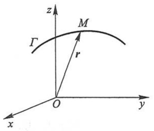
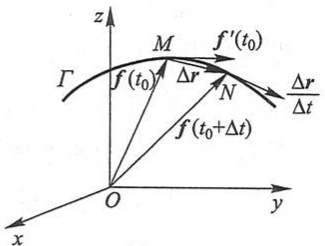
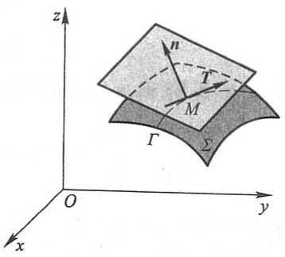
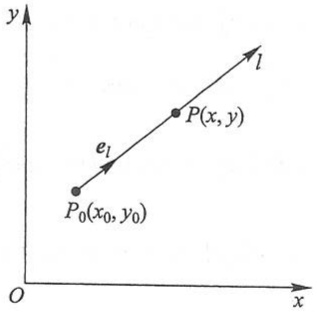
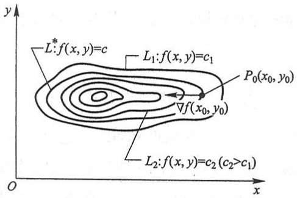
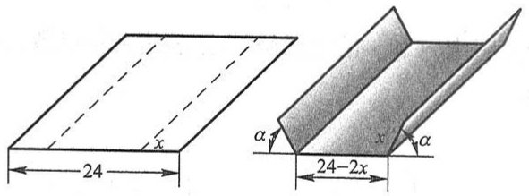

r 不取实数值, 而取值为 n 维向量.

在本教材中, 只讨论一元向量值函数, 并对因变量的取值以 n=3 的情形作为代表, 即 r 的取值为 3 维向量. 为简单起见, 以下将一元向量值函数简称为向量值函数, 并把普通的实值函数称为数量函数.

在 $\mathbf{R}^3$ 中, 若向量值函数 $f(t)$, $t \in D$ 的三个分量函数依次为 $f_1(t)$, $f_2(t)$, $f_3(t)$, $t \in D$, 则向量值函数 $f(t)$ 可表示为

$$
\boldsymbol {f} (t) = f _ {1} (t) \boldsymbol {i} + f _ {2} (t) \boldsymbol {j} + f _ {3} (t) \boldsymbol {k}, \quad t \in D \tag {6-3}
$$

或

$$
f (t) = (f _ {1} (t), f _ {2} (t), f _ {3} (t)), \quad t \in D. \tag {$6-3^{\prime$}}
$$

设(变)向量 r 的起点取在坐标系的原点 O 处, 终点在 M 处, 即  $r = \overrightarrow{OM}$  (图 9-6). 当 t 改变时, r 跟着改变, 从而终点 M 也随之改变. 终点 M 的轨迹(记作曲线  $\Gamma$ ) 称为向量值函数  $\boldsymbol{r} = \boldsymbol{f}(t) \quad (t \in D)$  的终端曲线, 曲线  $\Gamma$  也称为向量值函数  $\boldsymbol{r} = \boldsymbol{f}(t) \quad (t \in D)$  的图形.

由于向量值函数 $r = f(t) (t \in D)$ 与空间曲线 $\Gamma$ 是一一对应的, 因此

text_image

z
M
Γ
r
O
x
y

图9-6

$$
\boldsymbol {r} = \boldsymbol {f} (t) = (f _ {1} (t), f _ {2} (t), f _ {3} (t)), \quad t \in D \tag {6-4}
$$

称为曲线  $\Gamma$  的向量方程.

根据  $R^{3}$  中的向量的线性运算及向量的模的概念, 可以类似于定义数量函数的极限、连续、导数等概念的形式来定义向量值函数的相应概念, 现简述如下:

定义2 设向量值函数 $f(t)$ 在点 $t_0$ 的某一去心邻域内有定义, 如果存在一个常向量 $r_0$, 对于任意给定的正数 $\varepsilon$, 总存在正数 $\delta$, 使得当 $t$ 满足 $0 < |t - t_0| < \delta$ 时, 对应的函数值 $f(t)$ 都满足不等式

$$
\mid f (t) - r _ {0} \mid <   \varepsilon ,
$$

那么常向量 $r_0$ 就叫做向量值函数 $f(t)$ 当 $t \to t_0$ 时的极限，记作

$$
\lim _ {t \to t _ {0}} f (  t  ) = r _ {0} \quad \text {或} \quad f (  t  ) \longrightarrow r _ {0}  ,   t \longrightarrow t _ {0}.
$$

容易证明:向量值函数 $f(t)$ 当 $t\to t_{0}$ 时的极限存在的充分必要条件是: $f(t)$ 的三个分量函数 $f_{1}(t)$ , $f_{2}(t)$ , $f_{3}(t)$ 当 $t\to t_{0}$ 时的极限都存在;在函数 $f(t)$ 当 $t\to t_{0}$ 时的极限存在时,其极限

$$
\lim _ {t \to t _ {0}} f (t) = \left(\lim _ {t \to t _ {0}} f _ {1} (t), \lim _ {t \to t _ {0}} f _ {2} (t), \lim _ {t \to t _ {0}} f _ {3} (t)\right). \tag {6-5}
$$

设向量值函数 $f(t)$ 在点 $t_{0}$ 的某一邻域内有定义,若

$$
\lim _ {t \to t _ {0}} f (t) = f (t _ {0}),
$$

则称向量值函数 $f(t)$ 在 $t_{0}$ 连续.

向量值函数 $f(t)$ 在 $t_{0}$ 连续的充分必要条件是: $f(t)$ 的三个分量函数 $f_{1}(t), f_{2}(t), f_{3}(t)$ 都在 $t_{0}$ 连续.

设向量值函数 $f(t), t \in D$. 若 $D_1 \subset D$, $f(t)$ 在 $D_1$ 中的每一点处都连续, 则称 $f(t)$ 在 $D_1$ 上连续, 并称 $f(t)$ 是 $D_1$ 上的连续函数.

下面给出向量值函数的导数(或导向量)的定义.

定义3 设向量值函数 $r = f(t)$ 在点 $t_0$ 的某一邻域内有定义, 如果

$$
\lim _ {\Delta t \to 0} \frac {\Delta r}{\Delta t} = \lim _ {\Delta t \to 0} \frac {f (t _ {0} + \Delta t) - f (t _ {0})}{\Delta t}
$$

存在,那么就称这个极限向量为向量值函数  $r=f(t)$  在  $t_{0}$  处的导数或导向量,记作  $f'(t_{0})$  或  $\frac{dr}{dt}\bigg|_{t=t_{0}}$ .

设向量值函数 $r = f(t), t \in D$. 若 $D_{1} \subset D, f(t)$ 在 $D_{1}$ 中的每一点 $t$ 处都存在导向量 $f'(t)\left(\text{或}\frac{\mathrm{d}r}{\mathrm{d}t}\right)$, 则称 $f(t)$ 在 $D_{1}$ 上可导.

向量值函数 $f(t)$ 在 $t_0$ 可导（即存在导数）的充分必要条件是: $f(t)$ 的三个分量函数 $f_1(t), f_2(t), f_3(t)$ 都在 $t_0$ 可导；当 $f(t)$ 在 $t_0$ 可导时，其导数

$$
f ^ {\prime} (t _ {0}) = f _ {1} ^ {\prime} (t _ {0}) i + f _ {2} ^ {\prime} (t _ {0}) j + f _ {3} ^ {\prime} (t _ {0}) k. \tag {6-6}
$$

向量值函数的导数运算法则与数量函数的导数运算法则的形式相同,现列出如下:

设  $\boldsymbol{u}(t), \boldsymbol{v}(t)$  是可导的向量值函数, C 是常向量, c 是任一常数,  $\varphi(t)$  是可导的数量函数, 则

(1)  $\frac{d}{dt}C=0;$
(2) $\frac{\mathrm{d}}{\mathrm{d}t}\left[c\boldsymbol{u}(t)\right] = c\boldsymbol{u}'(t);$
(3) $\frac{\mathrm{d}}{\mathrm{d}t}[\boldsymbol{u}(t)\pm \boldsymbol{v}(t)] = \boldsymbol{u}'(t)\pm \boldsymbol{v}'(t);$
(4) $\frac{\mathrm{d}}{\mathrm{d}t}[\varphi(t)\boldsymbol{u}(t)] = \varphi'(t)\boldsymbol{u}(t) + \varphi(t)\boldsymbol{u}'(t);$
(5) $\frac{\mathrm{d}}{\mathrm{d}t}[\boldsymbol{u}(t)\cdot \boldsymbol{v}(t)] = \boldsymbol{u}'(t)\cdot \boldsymbol{v}(t) + \boldsymbol{u}(t)\cdot \boldsymbol{v}'(t);$
(6) $\frac{\mathrm{d}}{\mathrm{d}t}[\boldsymbol{u}(t)\times\boldsymbol{v}(t)]=\boldsymbol{u}'(t)\times\boldsymbol{v}(t)+\boldsymbol{u}(t)\times\boldsymbol{v}'(t);$
(7) $\frac{\mathrm{d}}{\mathrm{d}t}\boldsymbol{u}[\varphi (t)] = \varphi '(t)\boldsymbol{u}'[\varphi (t)]$.

仿照对数量函数的导数运算法则的证明方法,或对向量函数的分量运用对应的数量函数的导数运算法则,可以证明以上法则,读者可作为练习自行证明.

下面,讨论向量值函数  $r = f(t)$  的导向量的几何意义.

设空间曲线 $\Gamma$ 是向量值函数 $r = f(t), t \in D$ 的终端曲线，向量 $\overrightarrow{OM} = f(t_0), \overrightarrow{ON} = f(t_0 + \Delta t)$，如图9-7所示。又设导向量 $f'(t_0)$ 不是零向量。

当  $\Delta t > 0$  时, 向量  $\Delta r = f(t_{0} + \Delta t) - f(t_{0})$  的方向与 t 增大时点 M 移动的走向(以下简称 t 的增长方向)一致; 当

text_image

z
M
f'(t₀)
Γ
f(t₀)
Δr
N
Δr
Δt
f(t₀+Δt)
O
x
y

图9-7

$\Delta t < 0$ 时，向量 $\Delta r = f(t_0 + \Delta t) - f(t_0)$ 的方向与 $t$ 的增长方向相反.但不论 $\Delta t > 0$ 或 $\Delta t < 0$ 向量 $\frac{\Delta r}{\Delta t} = \frac{1}{\Delta t}\Delta r$ 的方向总与 $t$ 的增长方向一致.于是，导向量 $f^{\prime}(t_{0}) = \lim_{\Delta t\to 0}\frac{\Delta r}{\Delta t}$ 是向量值函数 $r = f(t)$ 的终端曲线 $\Gamma$ 在点 $M$ 处的一个切向量，其方向与 $t$ 的增长方向一致.

设向量值函数  $r=f(t)$  是沿空间光滑曲线运动的质点 M 的位置向量，则向量值函数  $r=f(t)$  的导向量有以下的物理意义:

$v(t)=\frac{dr}{dt}$ 是质点 M 的速度向量, 其方向与曲线相切;

$a(t) = \frac{\mathrm{d}\boldsymbol{v}}{\mathrm{d}t} = \frac{\mathrm{d}^2\boldsymbol{r}}{\mathrm{d}t^2}$ 是质点 $M$ 的加速度向量.

例1 设 $f(t) = (\cos t)i + (\sin t)j + tk$，求 $\lim_{t\to \frac{\pi}{4}}f(t)$.

解 $\lim_{t\to \frac{\pi}{4}}f(t) = \left(\lim_{t\to \frac{\pi}{4}}\cos t\right)i + \left(\lim_{t\to \frac{\pi}{4}}\sin t\right)\boldsymbol {j} + \left(\lim_{t\to \frac{\pi}{4}}t\right)\boldsymbol {k} = \frac{\sqrt{2}}{2}\boldsymbol {i} + \frac{\sqrt{2}}{2}\boldsymbol {j} + \frac{\pi}{4}\boldsymbol {k}.$

例2 设空间曲线 $\Gamma$ 的向量方程为

$$
r = f (t) = (t ^ {2} + 1, 4 t - 3, 2 t ^ {2} - 6 t), \quad t \in \mathbf {R},
$$

求曲线  $\Gamma$  在与 t=2 相应的点处的单位切向量.

解 $f^{\prime}(t) = (2t,4,4t - 6),\quad t\in \mathbf{R},$

$$
f ^ {\prime} (2) = (4, 4, 2), \quad | f ^ {\prime} (2) | = \sqrt {4 ^ {2} + 4 ^ {2} + 2 ^ {2}} = 6.
$$

由导向量的几何意义知, 曲线  $\Gamma$  在与 t=2 相应的点处的一个单位切向量是  $\left(\frac{2}{3},\frac{2}{3},\frac{1}{3}\right)$ , 其方向与 t 的增长方向一致; 另一个单位切向量是  $\left(-\frac{2}{3},-\frac{2}{3},-\frac{1}{3}\right)$ , 其方向与 t 的增长方向相反.

例3 一个人在悬挂式滑翔机上由于快速上升气流而沿位置向量为 $r = f(t) = (3\cos t)i + (3\sin t)j + t^2 k$ 的路径螺旋式向上.求

(1) 滑翔机在任意时刻 t 的速度向量和加速度向量;
(2) 滑翔机在任意时刻 t 的速率;
(3) 滑翔机的加速度与速度正交的时刻.

解 (1) $r = f(t) = (3\cos t)i + (3\sin t)j + t^2 k,$

$$
v = \frac {\mathrm{d} r}{\mathrm{d} t} = (- 3 \sin t) i + (3 \cos t) j + 2 t k,
$$

$$
\boldsymbol {a} = \frac {\mathrm{d} ^ {2} \boldsymbol {r}}{\mathrm{d} t ^ {2}} = (- 3 \cos t) \boldsymbol {i} - (3 \sin t) \boldsymbol {j} + 2 \boldsymbol {k}.
$$

(2) 速率是速度v的大小, 即

$$
\mid \boldsymbol {v} \mid = \sqrt {\left(- 3 \sin t\right) ^ {2} + \left(3 \cos t\right) ^ {2} + \left(2 t\right) ^ {2}} = \sqrt {9 + 4 t ^ {2}}.
$$

这一结果表明:滑翔机沿其路径升高时,运动得越来越快.

（3）由  $v \cdot a = 9 \sin t \cos t - 9 \sin t \cos t + 4t = 0$ ，得 t = 0。这表明:加速度与速度正交的唯一时刻是在 t = 0。

## 二、空间曲线的切线与法平面

设空间曲线  $\Gamma$  的参数方程为

$$
\left\{ \begin{array}{l} x = \varphi (t), \\ y = \psi (t), \quad t \in [ \alpha , \beta ]. \\ z = \omega (t), \end{array} \right. \tag {6-7}
$$

这里假定(6-7)式的三个函数都在 $[\alpha,\beta]$ 上可导,且三个导数不同时为零.

现在要求曲线  $\Gamma$  在其上一点  $M(x_{0}, y_{0}, z_{0})$  处的切线及法平面方程.

设与点 $M$ 对应的参数为 $t_0$, 记 $f(t) = (\varphi(t), \psi(t), \omega(t))$, $t \in [\alpha, \beta]$. 由向量值函数的导向量的几何意义知, 向量 $T = f'(t_0) = (\varphi'(t_0), \psi'(t_0), \omega'(t_0))$ 就是曲线 $\Gamma$ 在点 $M$ 处的一个切向量, 从而曲线 $\Gamma$ 在点 $M$ 处的切线方程为

$$
\frac {x - x _ {0}}{\varphi^ {\prime} (t _ {0})} = \frac {y - y _ {0}}{\psi^ {\prime} (t _ {0})} = \frac {z - z _ {0}}{\omega^ {\prime} (t _ {0})}. \tag {6-8}
$$

通过点 M 且与切线垂直的平面称为曲线  $\Gamma$  在点 M 处的法平面, 它是通过点  $M(x_{0}, y_{0}, z_{0})$  且以  $T = f'(t_{0})$  为法向量的平面, 因此法平面方程为

$$
\varphi^ {\prime} (t _ {0}) (x - x _ {0}) + \psi^ {\prime} (t _ {0}) (y - y _ {0}) + \omega^ {\prime} (t _ {0}) (z - z _ {0}) = 0. \tag {6-9}
$$

例 4 求曲线  $x=t, y=t^{2}, z=t^{3}$  在点  $(1,1,1)$  处的切线及法平面方程.

解 因为 $x_{t}^{\prime} = 1, y_{t}^{\prime} = 2t, z_{t}^{\prime} = 3t^{2}$, 而点 $(1,1,1)$ 所对应的参数 $t_0 = 1$, 所以

$$
T = (1, 2, 3).
$$

于是,切线方程为

$$
\frac {x - 1}{1} = \frac {y - 1}{2} = \frac {z - 1}{3},
$$

法平面方程为

$$
(x - 1) + 2 (y - 1) + 3 (z - 1) = 0,
$$

即

$$
x + 2 y + 3 z = 6.
$$

现在我们再来讨论空间曲线  $\Gamma$  的方程以另外两种形式给出的情形.

如果空间曲线 $\Gamma$ 的方程以

$$
\left\{ \begin{array}{l} y = \varphi (x), \\ z = \psi (x) \end{array} \right.
$$

的形式给出,取 x 为参数,它就可以表示为参数方程的形式

$$
\left\{ \begin{array}{l} x = x, \\ y = \varphi (x), \\ z = \psi (x). \end{array} \right.
$$

若 $\varphi (x),\psi (x)$ 都在 $x = x_0$ 处可导，则根据上面的讨论可知， $T = (1,\varphi '(x_0),\psi '(x_0))$ ，因此曲线 $\Gamma$ 在点 $M(x_0,y_0,z_0)$ 处的切线方程为

$$
\frac {x - x _ {0}}{1} = \frac {y - y _ {0}}{\varphi^ {\prime} (x _ {0})} = \frac {z - z _ {0}}{\psi^ {\prime} (x _ {0})}, \tag {6-10}
$$

在点 $M(x_0,y_0,z_0)$ 处的法平面方程为

$$
(x - x _ {0}) + \varphi^ {\prime} (x _ {0}) (y - y _ {0}) + \psi^ {\prime} (x _ {0}) (z - z _ {0}) = 0. \tag {6-11}
$$

设空间曲线 $\Gamma$ 的方程以

$$
\left\{ \begin{array}{l} F (x, y, z) = 0, \\ G (x, y, z) = 0 \end{array} \right. \tag {6-12}
$$

的形式给出, $M(x_{0},y_{0},z_{0})$ 是曲线 $\Gamma$ 上的一个点.又设F,G有对各个变量的连续偏导数,且

$$
\frac {\partial (F , G)}{\partial (y , z)} \bigg | _ {(x _ {0}, y _ {0}, z _ {0})} \neq 0.
$$

这时方程组(6-12)在点 $M(x_0, y_0, z_0)$ 的某一邻域内确定了一组函数 $y = \varphi(x)$, $z = \psi(x)$. 要求曲线 $\Gamma$ 在点 $M$ 处的切线方程和法平面方程, 只要求出 $\varphi'(x_0), \psi'(x_0)$, 然后代入(6-10)、(6-11)两式就行了. 为此, 我们在恒等式

$$
F [ x, \varphi (x), \psi (x) ] \equiv 0, \quad G [ x, \varphi (x), \psi (x) ] \equiv 0
$$

两端分别对 $x$ 求全导数, 得

$$
\left\{ \begin{array}{l} \frac {\partial F}{\partial x} + \frac {\partial F}{\partial y} \frac {\mathrm{d} y}{\mathrm{d} x} + \frac {\partial F}{\partial z} \frac {\mathrm{d} z}{\mathrm{d} x} = 0, \\ \frac {\partial G}{\partial x} + \frac {\partial G}{\partial y} \frac {\mathrm{d} y}{\mathrm{d} x} + \frac {\partial G}{\partial z} \frac {\mathrm{d} z}{\mathrm{d} x} = 0. \end{array} \right.
$$

由假设可知,在点 M 的某个邻域内

$$
J = \frac {\partial (F , G)}{\partial (y , z)} \neq 0,
$$

故可解得

$$
\frac {\mathrm{d} y}{\mathrm{d} x} = \varphi^ {\prime} (x) = \frac {\left| \begin{array}{l l} F _ {z} & F _ {x} \\ G _ {z} & G _ {x} \end{array} \right|}{\left| \begin{array}{l l} F _ {y} & F _ {z} \\ G _ {y} & G _ {z} \end{array} \right|}, \quad \frac {\mathrm{d} z}{\mathrm{d} x} = \psi^ {\prime} (x) = \frac {\left| \begin{array}{l l} F _ {x} & F _ {y} \\ G _ {x} & G _ {y} \end{array} \right|}{\left| \begin{array}{l l} F _ {y} & F _ {z} \\ G _ {y} & G _ {z} \end{array} \right|}.
$$

于是 $T = (1, \varphi'(x_0), \psi'(x_0))$ 是曲线 $\Gamma$ 在点 $M$ 处的一个切向量，这里

$$
\varphi^ {\prime} (x _ {0}) = \frac {\left| \begin{array}{c c} F _ {z} & F _ {x} \\ G _ {z} & G _ {x} \end{array} \right| _ {M}}{\left| \begin{array}{c c} F _ {y} & F _ {z} \\ G _ {y} & G _ {z} \end{array} \right| _ {M}}, \quad \psi^ {\prime} (x _ {0}) = \frac {\left| \begin{array}{c c} F _ {x} & F _ {y} \\ G _ {x} & G _ {y} \end{array} \right| _ {M}}{\left| \begin{array}{c c} F _ {y} & F _ {z} \\ G _ {y} & G _ {z} \end{array} \right| _ {M}},
$$

分子、分母中带下标 $M$ 的行列式表示行列式在点 $M(x_0, y_0, z_0)$ 的值. 把上面的切向量 $T$ 乘 $\left| \begin{array}{cc} F_y & F_z \\ G_y & G_z \end{array} \right|_M$, 得

$$
\boldsymbol {T} _ {1} = \left(\left| \begin{array}{c c} F _ {y} & F _ {z} \\ G _ {y} & G _ {z} \end{array} \right| _ {M}, \left| \begin{array}{c c} F _ {z} & F _ {x} \\ G _ {z} & G _ {x} \end{array} \right| _ {M}, \left| \begin{array}{c c} F _ {x} & F _ {y} \\ G _ {x} & G _ {y} \end{array} \right| _ {M}\right),
$$

这也是曲线 $\Gamma$ 在点 $M$ 处的一个切向量. 由此可写出曲线 $\Gamma$ 在点 $M(x_0, y_0, z_0)$ 处的切线方程为

$$
\frac {x - x _ {0}}{\left| \begin{array}{c c} F _ {y} & F _ {z} \\ G _ {y} & G _ {z} \end{array} \right| _ {M}} = \frac {y - y _ {0}}{\left| \begin{array}{c c} F _ {z} & F _ {x} \\ G _ {z} & G _ {x} \end{array} \right| _ {M}} = \frac {z - z _ {0}}{\left| \begin{array}{c c} F _ {x} & F _ {y} \\ G _ {x} & G _ {y} \end{array} \right| _ {M}}, \tag {6-13}
$$

曲线 $\Gamma$ 在点 $M(x_0, y_0, z_0)$ 处的法平面方程为

$$
\left| \begin{array}{c c} F _ {y} & F _ {z} \\ G _ {y} & G _ {z} \end{array} \right| _ {M} (x - x _ {0}) + \left| \begin{array}{c c} F _ {z} & F _ {x} \\ G _ {z} & G _ {x} \end{array} \right| _ {M} (y - y _ {0}) + \left| \begin{array}{c c} F _ {x} & F _ {y} \\ G _ {x} & G _ {y} \end{array} \right| _ {M} (z - z _ {0}) = 0. \tag {6-14}
$$

如果 $\frac{\partial(F,G)}{\partial(y,z)}\bigg|_M = 0$ 而 $\frac{\partial(F,G)}{\partial(z,x)}\bigg|_M,\frac{\partial(F,G)}{\partial(x,y)}\bigg|_M$ 中至少有一个不等于零，那么我们可得同样的结果.

例 5 求曲线  $x^{2}+y^{2}+z^{2}=6, x+y+z=0$  在点  $(1,-2,1)$  处的切线及法平面方程.

解 这里可直接利用公式(6-13)及(6-14)来解,但下面我们依照推导公式的方法来做.

将所给方程的两端对 x 求导并移项, 得

$$
\left\{ \begin{array}{l} y \frac {\mathrm{d} y}{\mathrm{d} x} + z \frac {\mathrm{d} z}{\mathrm{d} x} = - x, \\ \frac {\mathrm{d} y}{\mathrm{d} x} + \frac {\mathrm{d} z}{\mathrm{d} x} = - 1. \end{array} \right.
$$

由此得

$$
\begin{array}{l} \frac {\mathrm{d} y}{\mathrm{d} x} = \frac {\left| \begin{array}{c c} - x & z \\ - 1 & 1 \end{array} \right|}{\left| \begin{array}{c c} y & z \\ 1 & 1 \end{array} \right|} = \frac {z - x}{y - z}, \quad \frac {\mathrm{d} z}{\mathrm{d} x} = \frac {\left| \begin{array}{c c} y & - x \\ 1 & - 1 \end{array} \right|}{\left| \begin{array}{c c} y & z \\ 1 & 1 \end{array} \right|} = \frac {x - y}{y - z}. \\ \frac {\mathrm{d} y}{\mathrm{d} x} \bigg | _ {(1, - 2, 1)} = 0, \quad \frac {\mathrm{d} z}{\mathrm{d} x} \bigg | _ {(1, - 2, 1)} = - 1. \\ \end{array}
$$

从而

$$
T = (1, 0, - 1).
$$

故所求切线方程为

$$
\frac {x - 1}{1} = \frac {y + 2}{0} = \frac {z - 1}{- 1},
$$

法平面方程为

$$
(x - 1) + 0 \cdot (y + 2) - (z - 1) = 0,
$$

即

$$
x - z = 0.
$$

## 三、曲面的切平面与法线

我们先讨论由隐式给出曲面方程

$$
F (x, y, z) = 0 \tag {6-15}
$$

的情形,然后把由显式给出的曲面方程  $z=f(x,y)$  作为它的特殊情形.

设曲面 $\Sigma$ 由方程(6-15)给出，$M(x_0, y_0, z_0)$ 是曲面 $\Sigma$ 上的一点，并设函数 $F(x, y, z)$ 的偏导数在该点连续且不同时为零。在曲面 $\Sigma$ 上，通过点 $M$ 任意引一条曲线 $\Gamma$（图9-8），假定曲线 $\Gamma$ 的参数方程为

text_image

z
n
T
M
Γ
Σ
O
y
x

图9-8

$$
x = \varphi (t), y = \psi (t), z = \omega (t) \quad (\alpha \leqslant t \leqslant \beta), \tag {6-16}
$$

$t=t_{0}$  对应于点  $M(x_{0},y_{0},z_{0})$  且  $\varphi'(t_{0}),\psi'(t_{0}),\omega'(t_{0})$  不全为零，则由(6-8)式可得这曲线的切线方程为

$$
\frac {x - x _ {0}}{\varphi^ {\prime} (t _ {0})} = \frac {y - y _ {0}}{\psi^ {\prime} (t _ {0})} = \frac {z - z _ {0}}{\omega^ {\prime} (t _ {0})}.
$$

我们现在要证明,在曲面 $\Sigma$ 上通过点 $M$ 且在点 $M$ 处具有切线的任何曲线,它们在点 $M$ 处的切线都在同一个平面上.事实上,因为曲线 $\Gamma$ 完全在曲面 $\Sigma$ 上,所以有恒等式

$$
F [ \varphi (t), \psi (t), \omega (t) ] \equiv 0,
$$

又因为 $F(x,y,z)$ 在点 $(x_0,y_0,z_0)$ 处有连续偏导数，且 $\varphi'(t_0),\psi'(t_0)$ 和 $\omega'(t_0)$ 存在，所以这恒等式左端的复合函数在 $t = t_0$ 时有全导数，且这全导数等于零:

$$
\frac {\mathrm{d}}{\mathrm{d} t} F [ \varphi (t), \psi (t), \omega (t) ] \Big | _ {t = t _ {0}} = 0,
$$

即有

$$
F _ {x} (x _ {0}, y _ {0}, z _ {0}) \varphi^ {\prime} (t _ {0}) + F _ {y} (x _ {0}, y _ {0}, z _ {0}) \psi^ {\prime} (t _ {0}) + F _ {z} (x _ {0}, y _ {0}, z _ {0}) \omega^ {\prime} (t _ {0}) = 0. \tag {6-17}
$$

引入向量

$$
\boldsymbol {n} = (F _ {x} (x _ {0}, y _ {0}, z _ {0}), F _ {y} (x _ {0}, y _ {0}, z _ {0}), F _ {z} (x _ {0}, y _ {0}, z _ {0})) ,
$$

则(6-17)式表示曲线(6-16)在点 $M$ 处的切向量

$$
\boldsymbol {T} = (\varphi^ {\prime} (t _ {0}), \psi^ {\prime} (t _ {0}), \omega^ {\prime} (t _ {0}))
$$

与向量 $n$ 垂直. 因为曲线 (6-16) 是曲面上通过点 $M$ 的任意一条曲线, 它们在点 $M$ 的切线都与同一个向量 $n$ 垂直, 所以曲面上通过点 $M$ 的一切曲线在点 $M$ 的切线都在同一个平面上 (图 9-8). 这个平面称为曲面 $\Sigma$ 在点 $M$ 的切平面. 这切平面的方程是

$$
F _ {x} \left(x _ {0}, y _ {0}, z _ {0}\right) \left(x - x _ {0}\right) + F _ {y} \left(x _ {0}, y _ {0}, z _ {0}\right) \left(y - y _ {0}\right) + F _ {z} \left(x _ {0}, y _ {0}, z _ {0}\right) \left(z - z _ {0}\right) = 0. \tag {6-18}
$$

通过点 $M(x_0,y_0,z_0)$ 且垂直于切平面(6-18)的直线称为曲面在该点的法线.法线方程是

$$
\frac {x - x _ {0}}{F _ {x} (x _ {0} , y _ {0} , z _ {0})} = \frac {y - y _ {0}}{F _ {y} (x _ {0} , y _ {0} , z _ {0})} = \frac {z - z _ {0}}{F _ {z} (x _ {0} , y _ {0} , z _ {0})}. \tag {6-19}
$$

垂直于曲面上切平面的向量称为曲面的法向量.向量

$$
\boldsymbol {n} = (F _ {x} (x _ {0}, y _ {0}, z _ {0}), F _ {y} (x _ {0}, y _ {0}, z _ {0}), F _ {z} (x _ {0}, y _ {0}, z _ {0}))
$$

就是曲面 $\Sigma$ 在点 $M$ 处的一个法向量.

现在来考虑曲面方程

$$
z = f (x, y). \tag {6-20}
$$

令

$$
F (x, y, z) = f (x, y) - z,
$$

可见

$$
F _ {x} (x, y, z) = f _ {x} (x, y), \quad F _ {y} (x, y, z) = f _ {y} (x, y), \quad F _ {z} (x, y, z) = - 1.
$$

于是，当函数 $f(x,y)$ 的偏导数 $f_{x}(x,y),f_{y}(x,y)$ 在点 $(x_0,y_0)$ 连续时，曲面(6-20)在点$M(x_0,y_0,z_0)$ 处的法向量为

$$
\boldsymbol {n} = (f _ {x} (x _ {0}, y _ {0}), f _ {y} (x _ {0}, y _ {0}), - 1),
$$

切平面方程为

$$
f _ {x} (x _ {0}, y _ {0}) (x - x _ {0}) + f _ {y} (x _ {0}, y _ {0}) (y - y _ {0}) - (z - z _ {0}) = 0,
$$

或

$$
z - z _ {0} = f _ {x} (x _ {0}, y _ {0}) (x - x _ {0}) + f _ {y} (x _ {0}, y _ {0}) (y - y _ {0}), \tag {6-21}
$$

而法线方程为

$$
\frac {x - x _ {0}}{f _ {x} (x _ {0} , y _ {0})} = \frac {y - y _ {0}}{f _ {y} (x _ {0} , y _ {0})} = \frac {z - z _ {0}}{- 1}. \tag {6-22}
$$

这里顺便指出,方程(6-21)右端恰好是函数 $z=f(x,y)$ 在点 $(x_{0},y_{0})$ 的全微分,而左端是切平面上点的竖坐标的增量.因此,函数 $z=f(x,y)$ 在点 $(x_{0},y_{0})$ 的全微分,在几何上表示曲面 $z=f(x,y)$ 在点 $(x_{0},y_{0},z_{0})$ 处的切平面上点的竖坐标的增量.

如果用  $\alpha,\beta$  和  $\gamma$  表示曲面的法向量的方向角,并假定法向量的方向是向上的,即使得它与 z 轴的正向所夹的角  $\gamma$  是一锐角,那么法向量的方向余弦为

$$
\cos \alpha = \frac {- f _ {x}}{\sqrt {1 + f _ {x} ^ {2} + f _ {y} ^ {2}}}, \quad \cos \beta = \frac {- f _ {y}}{\sqrt {1 + f _ {x} ^ {2} + f _ {y} ^ {2}}}, \quad \cos \gamma = \frac {1}{\sqrt {1 + f _ {x} ^ {2} + f _ {y} ^ {2}}}.
$$

这里，把 $f_{x}(x_{0},y_{0})$ 和 $f_{y}(x_{0},y_{0})$ 分别简记为 $f_{x}$ 和 $f_{y}$.

例 6 求球面  $x^{2}+y^{2}+z^{2}=14$  在点  $(1,2,3)$  处的切平面及法线方程.

解 $F(x,y,z) = x^{2} + y^{2} + z^{2} - 14,$

$$
\boldsymbol {n} = (F _ {x}, F _ {y}, F _ {z}) = (2 x, 2 y, 2 z), \quad \boldsymbol {n} | _ {(1, 2, 3)} = (2, 4, 6).
$$

所以在点(1,2,3)处此球面的切平面方程为

$$
2 (x - 1) + 4 (y - 2) + 6 (z - 3) = 0,
$$

即

$$
x + 2 y + 3 z - 1 4 = 0.
$$

法线方程为

$$
\frac {x - 1}{1} = \frac {y - 2}{2} = \frac {z - 3}{3},
$$

即

$$
\frac {x}{1} = \frac {y}{2} = \frac {z}{3}.
$$

由此可见,法线经过原点(即球心).

例 7 求旋转抛物面  $z=x^{2}+y^{2}-1$  在点  $(2,1,4)$  处的切平面及法线方程.

解 $f(x,y) = x^{2} + y^{2} - 1,$

$$
\boldsymbol {n} = (f _ {x}, f _ {y}, - 1) = (2 x, 2 y, - 1), \quad \boldsymbol {n} \mid_ {(2, 1, 4)} = (4, 2, - 1).
$$

所以在点 $(2,1,4)$ 处的切平面方程为

$$
4 (x - 2) + 2 (y - 1) - (z - 4) = 0,
$$

即

$$
4 x + 2 y - z - 6 = 0.
$$

法线方程为

$$
\frac {x - 2}{4} = \frac {y - 1}{2} = \frac {z - 4}{- 1}.
$$

## 习题9-6

1. 设 $f(t) = f_{1}(t)i + f_{2}(t)j + f_{3}(t)k$, $g(t) = g_{1}(t)i + g_{2}(t)j + g_{3}(t)k$, $\lim_{t\to t_0}f(t) = u$, $\lim_{t\to t_0}g(t) = v$, 证明

$$
\lim _ {t \to t _ {0}} [ f (t) \times g (t) ] = u \times v.
$$

2. 下列各题中, $r=f(t)$ 是空间中的质点 M 在时刻 t 的位置, 求质点 M 在时刻 $t_{0}$ 的速度向量和加速度向量以及在任意时刻 t 的速率:

(1)  $r = f(t) = (t + 1)i + (t^{2} - 1)j + 2tk, t_{0} = 1;$
(2) $r=f(t)=(2\cos t)i+(3\sin t)j+4tk,t_{0}=\frac{\pi}{2};$
(3) $r=f(t)=(2\ln(t+1))i+t^{2}j+\frac{1}{2}t^{2}k,t_{0}=1.$

3. 求曲线 $r = f(t) = (t - \sin t)i + (1 - \cos t)j + \left(4\sin \frac{t}{2}\right)k$ 在与 $t_0 = \frac{\pi}{2}$ 相应的点处的切线及法平面方程.

4. 求曲线  $x=\frac{t}{1+t}, y=\frac{1+t}{t}, z=t^{2}$  在对应于  $t_{0}=1$  的点处的切线及法平面方程.

5. 求曲线  $y^{2}=2mx, z^{2}=m-x$  在点  $(x_{0}, y_{0}, z_{0})$  处的切线及法平面方程.

6. 求曲线  $\left\{\begin{aligned} x^{2}+y^{2}+z^{2}-3x=0,\\ 2x-3y+5z-4=0\end{aligned}\right.$  在点(1,1,1)处的切线及法平面方程.

7. 求出曲线 $x = t, y = t^2, z = t^3$ 上的点，使在该点的切线平行于平面 $x + 2y + z = 4$.

8. 求曲面  $e^{z}-z+xy=3$  在点  $(2,1,0)$  处的切平面及法线方程.

9. 求曲面  $ax^{2}+by^{2}+cz^{2}=1$  在点  $(x_{0},y_{0},z_{0})$  处的切平面及法线方程.

10. 求椭球面  $x^{2}+2y^{2}+z^{2}=1$  上平行于平面  $x-y+2z=0$  的切平面方程.

11. 设曲面 $3x^{2} + y^{2} - z^{2} = 27$ 的切平面通过直线 $L: \begin{cases} 10x + 2y - 2z = 27, \\ x + y - z = 0. \end{cases}$ 求此切平面的方程.

12. 设 $L$ 是曲面 $\Sigma: z = y^2 + x^3y$ 上一条曲线的切线，切点为 $P(2,1,9), L$ 在 $xOy$ 面上的投影平行于 $x$ 轴，求切线 $L$ 的参数方程.

13. 求旋转椭球面 $3x^{2} + y^{2} + z^{2} = 16$ 上点 $(-1, -2, 3)$ 处的切平面与 $xOy$ 面的夹角的余弦.

14. 试证曲面 $\sqrt{x} +\sqrt{y} +\sqrt{z} = \sqrt{a}$ （ $a > 0$ )上任何点处的切平面在各坐标轴上的截距之和等于 $a$

15. 设  $\boldsymbol{u}(t)$ ,  $\boldsymbol{v}(t)$  是可导的向量值函数, 证明:

(1) $\frac{\mathrm{d}}{\mathrm{d}t}[\boldsymbol{u}(t)\pm \boldsymbol {v}(t)] = \boldsymbol{u}'(t)\pm \boldsymbol{v}'(t);$
(2) $\frac{\mathrm{d}}{\mathrm{d}t}[\boldsymbol{u}(t)\cdot \boldsymbol {v}(t)] = \boldsymbol{u}'(t)\cdot \boldsymbol {v}(t) + \boldsymbol {u}(t)\cdot \boldsymbol{v}'(t);$
(3) $\frac{\mathrm{d}}{\mathrm{d}t}[\boldsymbol{u}(t)\times\boldsymbol{v}(t)]=\boldsymbol{u}'(t)\times\boldsymbol{v}(t)+\boldsymbol{u}(t)\times\boldsymbol{v}'(t).\quad$

## 第七节 方向导数与梯度

## 一、方向导数

偏导数反映的是函数沿坐标轴方向的变化率.但许多物理现象告诉我们,只考虑

函数沿坐标轴方向的变化率是不够的.因此我们有必要来讨论函数沿任一指定方向的变化率问题.

设 $l$ 是 $xOy$ 平面上以 $P_0(x_0, y_0)$ 为始点的一条射线，$e_l = (\cos \alpha, \cos \beta)$ 是与 $l$ 同方向的单位向量（图9-9). 射线 $l$ 的参数方程为

$$
\left\{ \begin{array}{l l} x = x _ {0} + t \cos \alpha , \\ y = y _ {0} + t \cos \beta \end{array} \right. (t \geqslant 0).
$$

text_image

y
P(x, y)
l
e₁
P₀(x₀, y₀)
O
x

图9-9

设函数 $z = f(x,y)$ 在点 $P_0(x_0,y_0)$ 的某个邻域

$U(P_{0})$ 内有定义, $P(x_{0}+t\cos\alpha,y_{0}+t\cos\beta)$ 为 l 上另一点,且 $P\in U(P_{0})$. 如果函数增量 $f(x_{0}+t\cos\alpha,y_{0}+t\cos\beta)-f(x_{0},y_{0})$ 与 P 到 $P_{0}$ 的距离 $|PP_{0}|=t$ 的比值

$$
\frac {f (x _ {0} + t \cos \alpha , y _ {0} + t \cos \beta) - f (x _ {0} , y _ {0})}{t}
$$

当 $P$ 沿着 $l$ 趋于 $P_{0}$ （即 $t\to 0^{+}$）时的极限存在，那么称此极限为函数 $f(x,y)$ 在点 $P_{0}$ 沿方向 $l$ 的方向导数，记作 $\frac{\partial f}{\partial l}\Bigg|_{(x_0,y_0)}$ ，即

$$
\left. \frac {\partial f}{\partial l} \right| _ {(x _ {0}, y _ {0})} = \lim _ {t \to 0 ^ {+}} \frac {f (x _ {0} + t \cos \alpha , y _ {0} + t \cos \beta) - f (x _ {0} , y _ {0})}{t}. \tag {7-1}
$$

从方向导数的定义可知, 方向导数  $\frac{\partial f}{\partial l}\bigg|_{(x_{0},y_{0})}$  就是函数  $f(x,y)$  在点  $P_{0}(x_{0},y_{0})$  处沿方向 l 的变化率. 若函数  $f(x,y)$  在点  $P_{0}(x_{0},y_{0})$  的偏导数存在,  $e_{l}=i=(1,0)$ , 则

$$
\frac {\partial f}{\partial l} \Bigg | _ {(x _ {0}, y _ {0})} = \lim _ {t \to 0 ^ {+}} \frac {f (x _ {0} + t , y _ {0}) - f (x _ {0} , y _ {0})}{t} = f _ {x} (x _ {0}, y _ {0});
$$

又若 $e_l = j = (0,1)$ ，则

$$
\frac {\partial f}{\partial l} \Bigg | _ {(x _ {0}, y _ {0})} = \lim _ {t \to 0 ^ {+}} \frac {f (x _ {0} , y _ {0} + t) - f (x _ {0} , y _ {0})}{t} = f _ {y} (x _ {0}, y _ {0}).
$$

但反之，若 $e_l = i, \frac{\partial z}{\partial l}\bigg|_{(x_0,y_0)}$ 存在，则 $\frac{\partial z}{\partial x}\bigg|_{(x_0,y_0)}$ 未必存在.例如，$z = \sqrt{x^2 + y^2}$ 在点 $O(0,0)$ 处沿$l = i$ 方向的方向导数 $\frac{\partial z}{\partial l}\bigg|_{(0,0)} = 1$ ，而偏导数 $\frac{\partial z}{\partial x}\bigg|_{(0,0)}$ 不存在.

关于方向导数的存在及计算,我们有以下定理:

定理 如果函数 $f(x,y)$ 在点 $P_0(x_0,y_0)$ 可微分, 那么函数在该点沿任一方向 $l$ 的方向导数存在, 且有

$$
\left. \frac {\partial f}{\partial l} \right| _ {(x _ {0}, y _ {0})} = f _ {x} (x _ {0}, y _ {0}) \cos \alpha + f _ {y} (x _ {0}, y _ {0}) \cos \beta , \tag {7-2}
$$

其中  $\cos\alpha$  和  $\cos\beta$  是方向 l 的方向余弦.

证 由假设, $f(x,y)$ 在点 $(x_{0},y_{0})$ 可微分,故有

$$
f (x _ {0} + \Delta x, y _ {0} + \Delta y) - f (x _ {0}, y _ {0}) = f _ {x} (x _ {0}, y _ {0}) \Delta x + f _ {y} (x _ {0}, y _ {0}) \Delta y + o (\sqrt {(\Delta x) ^ {2} + (\Delta y) ^ {2}}).
$$

但点 $(x_{0}+\Delta x,y_{0}+\Delta y)$ 在以 $(x_{0},y_{0})$ 为始点的射线l上时，应有 $\Delta x=t\cos\alpha,\Delta y=t\cos\beta,$   $\sqrt{(\Delta x)^{2}+(\Delta y)^{2}}=t.$ 所以

$$
\lim _ {t \to 0 ^ {+}} \frac {f (x _ {0} + t \cos \alpha , y _ {0} + t \cos \beta) - f (x _ {0} , y _ {0})}{t} = f _ {x} (x _ {0}, y _ {0}) \cos \alpha + f _ {y} (x _ {0}, y _ {0}) \cos \beta.
$$

这就证明了方向导数存在,且其值为

$$
\left. \frac {\partial f}{\partial l} \right| _ {(x _ {0}, y _ {0})} = f _ {x} (x _ {0}, y _ {0}) \cos \alpha + f _ {y} (x _ {0}, y _ {0}) \cos \beta .
$$

例1 求函数 $z = x\mathrm{e}^{2y}$ 在点 $P(1,0)$ 处沿从点 $P(1,0)$ 到点 $Q(2,-1)$ 的方向的方向导数.

解 这里方向 $l$ 即向量 $\overrightarrow{PQ} = (1, -1)$ 的方向，与 $l$ 同向的单位向量为 $e_l = \left(\frac{1}{\sqrt{2}}, -\frac{1}{\sqrt{2}}\right)$.

因为函数可微分,且

$$
\frac {\partial z}{\partial x} \bigg | _ {(1, 0)} = \mathrm{e} ^ {2 y} \bigg | _ {(1, 0)} = 1, \quad \frac {\partial z}{\partial y} \bigg | _ {(1, 0)} = 2 x \mathrm{e} ^ {2 y} \bigg | _ {(1, 0)} = 2,
$$

故所求方向导数为

$$
\left. \frac {\partial z}{\partial l} \right| _ {(1, 0)} = 1 \times \frac {1}{\sqrt {2}} + 2 \times \left(- \frac {1}{\sqrt {2}}\right) = - \frac {\sqrt {2}}{2}.
$$

对于三元函数 $f(x,y,z)$ 来说，它在空间一点 $P_0(x_0,y_0,z_0)$ 沿方向 $\pmb{e}_l = (\cos \alpha, \cos \beta, \cos \gamma)$ 的方向导数为

$$
\left. \frac {\partial f}{\partial l} \right| _ {(z _ {0}, y _ {0}, z _ {0})} = \lim _ {t \rightarrow 0 ^ {+}} \frac {f \left(x _ {0} + t \cos \alpha , y _ {0} + t \cos \beta , z _ {0} + t \cos \gamma\right) - f \left(x _ {0} , y _ {0} , z _ {0}\right)}{t}. \tag {7-3}
$$

同样可以证明:如果函数 $f(x,y,z)$ 在点 $(x_{0},y_{0},z_{0})$ 可微分,那么函数在该点沿方向 $\boldsymbol{e}_{l}=(\cos\alpha,\cos\beta,\cos\gamma)$ 的方向导数为

$$
\left. \frac {\partial f}{\partial l} \right| _ {(x _ {0}, y _ {0}, z _ {0})} = f _ {x} (x _ {0}, y _ {0}, z _ {0}) \cos \alpha + f _ {y} (x _ {0}, y _ {0}, z _ {0}) \cos \beta + f _ {z} (x _ {0}, y _ {0}, z _ {0}) \cos \gamma . \tag {7-4}
$$

例 2 求  $f(x,y,z)=xy+yz+zx$  在点  $(1,1,2)$  沿方向 l 的方向导数, 其中 l 的方向角分别为  $60^{\circ}, 45^{\circ}, 60^{\circ}$ .

解 与 $l$ 同向的单位向量

$$
e _ {l} = (\cos 6 0 ^ {\circ}, \cos 4 5 ^ {\circ}, \cos 6 0 ^ {\circ}) = \left(\frac {1}{2}, \frac {\sqrt {2}}{2}, \frac {1}{2}\right).
$$

因为函数可微分,且

$$
f _ {x} (1, 1, 2) = (y + z) \mid_ {(1, 1, 2)} = 3,
$$

$$
f _ {y} (1, 1, 2) = (x + z) \mid_ {(1, 1, 2)} = 3,
$$

$$
f _ {z} (1, 1, 2) = (y + x) \mid_ {(1, 1, 2)} = 2.
$$

由公式(7-4)，得

$$
\left. \frac {\partial f}{\partial l} \right| _ {(1, 1, 2)} = 3 \times \frac {1}{2} + 3 \times \frac {\sqrt {2}}{2} + 2 \times \frac {1}{2} = \frac {1}{2} (5 + 3 \sqrt {2}).
$$

## 二、梯度

与方向导数有关联的一个概念是函数的梯度. 在二元函数的情形, 设函数 $f(x, y)$ 在平面区域 $D$ 内具有一阶连续偏导数, 则对于每一点 $P_0(x_0, y_0) \in D$, 都可定出一个向量

$$
f _ {x} (x _ {0}, y _ {0}) i + f _ {y} (x _ {0}, y _ {0}) j,
$$

这向量称为函数 $f(x,y)$ 在点 $P_0(x_0,y_0)$ 的梯度，记作 $\operatorname{grad} f(x_0,y_0)$ 或 $\nabla f(x_0,y_0)$，即

$$
\mathrm{grad} f (x _ {0}, y _ {0}) = \nabla f (x _ {0}, y _ {0}) = f _ {x} (x _ {0}, y _ {0}) i + f _ {y} (x _ {0}, y _ {0}) j,
$$

其中 $\nabla=\frac{\partial}{\partial x}i+\frac{\partial}{\partial y}j$ 称为（二维的）向量微分算子或Nabla算子， $\nabla f=\frac{\partial f}{\partial x}i+\frac{\partial f}{\partial y}j.$

如果函数 $f(x,y)$ 在点 $P_0(x_0,y_0)$ 可微分，$e_l = (\cos \alpha, \cos \beta)$ 是与方向 $l$ 同向的单位向量，那么

$$
\begin{array}{l} \left. \frac {\partial f}{\partial l} \right| _ {(x _ {0}, y _ {0})} = f _ {x} (x _ {0}, y _ {0}) \cos \alpha + f _ {y} (x _ {0}, y _ {0}) \cos \beta \\ = \operatorname{grad} f (x _ {0}, y _ {0}) \cdot e _ {l} = | \operatorname{grad} f (x _ {0}, y _ {0}) | \cos \theta , \\ \end{array}
$$

其中  $\theta=(\mathbf{grad}f(x_{0},y_{0}),e_{l})$ .

这一关系式表明了函数在一点的梯度与函数在这点的方向导数间的关系.特别，由这关系可知:

（1）当 $\theta = 0$ ，即方向 $e_l$ 与梯度grad $f(x_0,y_0)$ 的方向相同时，函数 $f(x,y)$ 增加最快.此时，函数在这个方向的方向导数达到最大值，这个最大值就是梯度grad $f(x_0,y_0)$ 的模，即

$$
\left. \frac {\partial f}{\partial l} \right| _ {(x _ {0}, y _ {0})} = | \operatorname{grad} f (x _ {0}, y _ {0}) |\cdot
$$

这个结果也表示: 函数  $f(x,y)$  在一点的梯度 grad f 是这样一个向量, 它的方向是函数在这点的方向导数取得最大值的方向, 它的模就等于方向导数的最大值.

（2）当 $\theta = \pi$ ，即方向 $e_l$ 与梯度grad $f(x_0,y_0)$ 的方向相反时，函数 $f(x,y)$ 减少最快，函数在这个方向的方向导数达到最小值，即

$$
\left. \frac {\partial f}{\partial l} \right| _ {(x _ {0}, y _ {0})} = - | \mathbf {g r a d} f (x _ {0}, y _ {0}) |\.
$$

(3) 当  $\theta=\frac{\pi}{2}$ ，即方向  $e_{l}$  与梯度 grad  $f(x_{0},y_{0})$  的方向正交时，函数的变化率为零，即

$$
\frac {\partial f}{\partial l} \bigg | _ {(x _ {0}, y _ {0})} = | \mathbf {g r a d} f (x _ {0}, y _ {0}) | \cos \theta = 0.
$$

我们知道,一般说来二元函数  $z=f(x,y)$  在几何上表示一个曲面,这曲面被平面 z=c (c 是常数) 所截得的曲线 L 的方程为

$$
\left\{ \begin{array}{l} z = f (x, y), \\ z = c. \end{array} \right.
$$

这条曲线 L 在 xOy 面上的投影是一条平面曲线  $L^{*}$ （图 9-10），它在 xOy 平面直角坐标系中的方程为

$$
f (x, y) = c.
$$

对于曲线  $L^{*}$  上的一切点, 已给函数的函数值都是 c, 所以我们称平面曲线  $L^{*}$  为函数  $z = f(x, y)$  的等值线.

若 $f_{x}, f_{y}$ 不同时为零, 则等值线 $f(x, y) = c$ 上任一点 $P_{0}(x_{0}, y_{0})$ 处的一个单位法向

量为

$$
n = \frac {1}{\sqrt {f _ {x} ^ {2} (x _ {0} , y _ {0}) + f _ {y} ^ {2} (x _ {0} , y _ {0})}} (f _ {x} (x _ {0}, y _ {0}), f _ {y} (x _ {0}, y _ {0})) = \frac {\nabla f (x _ {0} , y _ {0})}{| \nabla f (x _ {0} , y _ {0}) |}.
$$

这表明函数 $f(x,y)$ 在一点 $(x_0,y_0)$ 的梯度 $\nabla f(x_0,y_0)$ 的方向就是等值线 $f(x,y) = c$ 在这点的法线方向 $\pmb{n}$，而梯度的模 $|\nabla f(x_0,y_0)|$ 就是沿这个法线方向的方向导数 $\frac{\partial f}{\partial n}$，于是有

$$
\nabla f (x _ {0}, y _ {0}) = \frac {\partial f}{\partial n} \boldsymbol {n}.
$$

text_image

L*f(x, y)=c
L1:f(x, y)=c1
P0(x0, y0)
∇f(x0, y0)
L2:f(x, y)=c2 (c2>c1)

图9-10

上面讨论的梯度概念可以类似地推广到三元函数的情形. 设函数 $f(x, y, z)$ 在空间区域 $G$ 内具有一阶连续偏导数, 则对于每一点 $P_0(x_0, y_0, z_0) \in G$, 都可定出一个向量

$$
f _ {x} (x _ {0}, y _ {0}, z _ {0}) i + f _ {y} (x _ {0}, y _ {0}, z _ {0}) j + f _ {z} (x _ {0}, y _ {0}, z _ {0}) k,
$$

这向量称为函数 $f(x,y,z)$ 在点 $P_0(x_0,y_0,z_0)$ 的梯度，将它记作 $\operatorname{grad} f(x_0,y_0,z_0)$ 或 $\nabla f(x_0,y_0,z_0)$，即

$$
\text {grad} f (x _ {0}, y _ {0}, z _ {0}) = \nabla f (x _ {0}, y _ {0}, z _ {0}) = f _ {x} (x _ {0}, y _ {0}, z _ {0}) i + f _ {y} (x _ {0}, y _ {0}, z _ {0}) j + f _ {z} (x _ {0}, y _ {0}, z _ {0}) k,
$$

其中 $\nabla = \frac{\partial}{\partial x}\boldsymbol{i} + \frac{\partial}{\partial y}\boldsymbol{j} + \frac{\partial}{\partial z}\boldsymbol{k}$ 称为（三维的）向量微分算子或Nabla算子， $\nabla f = \frac{\partial f}{\partial x}\boldsymbol{i} + \frac{\partial f}{\partial y}\boldsymbol{j} + \frac{\partial f}{\partial z}\boldsymbol{k}$

经过与二元函数的情形完全类似的讨论可知,三元函数 $f(x,y,z)$ 在一点的梯度 $\nabla f$ 是这样一个向量,它的方向是函数 $f(x,y,z)$ 在这点的方向导数取得最大值的方向,它的模就等于方向导数的最大值.

如果引进曲面

$$
f (x, y, z) = c
$$

为函数 $f(x,y,z)$ 的等值面的概念，那么可得函数 $f(x,y,z)$ 在一点 $(x_0,y_0,z_0)$ 的梯度 $\nabla f(x_0,y_0,z_0)$ 的方向就是等值面 $f(x,y,z) = c$ 在这点的法向量 $\pmb{n}$，而梯度的模$\mid \nabla f(x_0,y_0,z_0)\mid$ 就是函数沿这个法向量的方向导数 $\frac{\partial f}{\partial n}$

例3 求 $\operatorname{grad} \frac{1}{x^2 + y^2}$.

解 这里 $f(x,y) = \frac{1}{x^2 + y^2}$. 因为

$$
\frac {\partial f}{\partial x} = - \frac {2 x}{(x ^ {2} + y ^ {2}) ^ {2}}, \quad \frac {\partial f}{\partial y} = - \frac {2 y}{(x ^ {2} + y ^ {2}) ^ {2}},
$$

所以

$$
\mathrm{grad} \frac {1}{x ^ {2} + y ^ {2}} = - \frac {2 x}{(x ^ {2} + y ^ {2}) ^ {2}} i - \frac {2 y}{(x ^ {2} + y ^ {2}) ^ {2}} j.
$$

例4 设 $f(x,y) = \frac{1}{2} (x^{2} + y^{2})$ ，点 $P_0(1,1)$ ，求:

(1) $f(x,y)$ 在点 $P_{0}$ 处增加最快的方向以及 $f(x,y)$ 沿这个方向的方向导数；
(2) $f(x,y)$ 在点 $P_{0}$ 处减少最快的方向以及 $f(x,y)$ 沿这个方向的方向导数；
(3) $f(x,y)$ 在点 $P_{0}$ 处的变化率为零的方向.

解（1） $f(x,y)$ 在点 $P_0$ 处沿 $\nabla f(1,1)$ 的方向增加最快，

$$
\nabla f (1, 1) = (x \boldsymbol {i} + y \boldsymbol {j}) \mid_ {(1, 1)} = \boldsymbol {i} + \boldsymbol {j},
$$

故所求方向可取为

$$
n = \frac {\nabla f (1 , 1)}{| \nabla f (1 , 1) |} = \frac {1}{\sqrt {2}} i + \frac {1}{\sqrt {2}} j,
$$

方向导数为

$$
\frac {\partial f}{\partial n} \big | _ {(1, 1)} = | \nabla f (1, 1) | = \sqrt {2}.
$$

(2) $f(x,y)$ 在点 $P_{0}$ 处沿 $-\nabla f(1,1)$ 的方向减少最快,这方向可取为

$$
n _ {1} = - n = - \frac {1}{\sqrt {2}} i - \frac {1}{\sqrt {2}} j,
$$

方向导数为

$$
\frac {\partial f}{\partial n _ {1}} \big | _ {(1, 1)} = - \mid \nabla f (1, 1) \mid = - \sqrt {2}.
$$

(3) $f(x,y)$ 在点 $P_0$ 处沿垂直于 $\nabla f(1,1)$ 的方向变化率为零，这方向是

$$
n _ {2} = - \frac {1}{\sqrt {2}}   i + \frac {1}{\sqrt {2}}   j \quad \text {或} \quad n _ {3} = \frac {1}{\sqrt {2}}   i - \frac {1}{\sqrt {2}}   j.
$$

例 5 设  $f(x,y,z)=x^{3}-xy^{2}-z$ ，点  $P_{0}(1,1,0)$ 。问  $f(x,y,z)$  在点  $P_{0}$  处沿什么方向变化最快，在这个方向的变化率是多少？

解 $\nabla f = f_{x}i + f_{y}j + f_{z}k = (3x^{2} - y^{2})i - 2xyj - k,\nabla f(1,1,0) = 2i - 2j - k.$

$f(x,y,z)$  在点  $P_{0}$  处沿  $\nabla f(1,1,0)$  的方向增加最快，沿  $-\nabla f(1,1,0)$  的方向减少最快，在这两个方向的变化率分别是

$$
\begin{array}{l} \mid \nabla f (1, 1, 0) \mid = \sqrt {2 ^ {2} + (- 2) ^ {2} + 1} = 3, \\ - | \nabla f (1, 1, 0) | = - 3. \\ \end{array}
$$

例 6 求曲面  $x^{2}+y^{2}+z=9$  在点  $P_{0}(1,2,4)$  的切平面和法线方程.

解 设 $f(x,y,z) = x^{2} + y^{2} + z.$ 由梯度与等值面的关系可知，梯度

$$
\nabla f \Big | _ {P _ {0}} = (2 x i + 2 y j + k) \Big | _ {(1, 2, 4)} = 2 i + 4 j + k
$$

的方向是等值面 $f(x,y,z)=9$ 在点 $P_{0}$ 的法线方向,因此切平面方程是

$$
2 (x - 1) + 4 (y - 2) + (z - 4) = 0,
$$

即

$$
2 x + 4 y + z = 1 4,
$$

曲面在点  $P_{0}$  处的法线方程是

$$
x = 1 + 2 t, \quad y = 2 + 4 t, z = 4 + t \quad (t \text {为任意常数}).
$$

下面我们简单地介绍数量场与向量场的概念.

如果对于空间区域 $G$ 内的任一点 $M$, 都有一个确定的数量 $f(M)$, 那么称在这空间区域 $G$ 内确定了一个数量场 (例如温度场、密度场等). 一个数量场可用一个数量函数 $f(M)$ 来确定. 如果与点 $M$ 相对应的是一个向量 $F(M)$, 那么称在这空间区域 $G$ 内确定了一个向量场 (例如力场、速度场等). 一个向量场可用一个向量值函数 $F(M)$ 来确定, 而

$$
\boldsymbol {F} (M) = P (M) \boldsymbol {i} + Q (M) \boldsymbol {j} + R (M) \boldsymbol {k},
$$

其中  $P(M)$ ,  $Q(M)$ ,  $R(M)$  是点 M 的数量函数.

若向量场 $F(M)$ 是某个数量函数 $f(M)$ 的梯度, 则称 $f(M)$ 是向量场 $F(M)$ 的一个势函数, 并称向量场 $F(M)$ 为势场. 由此可知, 由数量函数 $f(M)$ 产生的梯度场 $\operatorname{grad} f(M)$ 是一个势场. 但需注意, 任意一个向量场并不一定都是势场, 因为它不一定是某个数量函数的梯度.

例 7 试求数量场 $\frac{m}{r}$ 所产生的梯度场, 其中常数 $m > 0, r = \sqrt{x^2 + y^2 + z^2}$ 为原点 O 与点 $M(x, y, z)$ 间的距离.

解

$$
\frac {\partial}{\partial x} \left(\frac {m}{r}\right) = - \frac {m}{r ^ {2}} \frac {\partial r}{\partial x} = - \frac {m x}{r ^ {3}},
$$

同理

$$
\frac {\partial}{\partial y} \left(\frac {m}{r}\right) = - \frac {m y}{r ^ {3}}, \quad \frac {\partial}{\partial z} \left(\frac {m}{r}\right) = - \frac {m z}{r ^ {3}}.
$$

从而

$$
\mathrm{grad} \frac {m}{r} = - \frac {m}{r ^ {2}} \left(\frac {x}{r} i + \frac {y}{r} j + \frac {z}{r} k\right).
$$

如果用 $e_r$ 表示与 $\overrightarrow{OM}$ 同方向的单位向量, 那么

$$
e _ {r} = \frac {x}{r} i + \frac {y}{r} j + \frac {z}{r} k,
$$

因此

$$
\mathrm{grad} \frac {m}{r} = - \frac {m}{r ^ {2}} e _ {r}.
$$

上式右端在力学上可解释为,位于原点 O 而质量为 m 的质点对位于点 M 而质量为 1 的质点的引力.这引力的大小与两质点的质量的乘积成正比、而与它们的距离平方成反比,这引力的方向由点 M 指向原点.因此数量场  $\frac{m}{r}$  的势场,即梯度场  $\frac{grad}{r}$ ,称为引力场,而函数  $\frac{m}{r}$  称为引力势.

## 习题9-7

1. 求函数 $z = x^{2} + y^{2}$ 在点(1,2)处沿从点(1,2)到点 $(2,2 + \sqrt{3})$ 的方向的方向导数.
2. 求函数 $z = \ln (x + y)$ 在抛物线 $y^{2} = 4x$ 上点(1,2)处，沿着这抛物线在该点处偏向 $x$ 轴正向的切线方向的方向导数.
3. 求函数 $z = 1 - \left(\frac{x^2}{a^2} + \frac{y^2}{b^2}\right)$ 在点 $\left(\frac{a}{\sqrt{2}}, \frac{b}{\sqrt{2}}\right)$ 处沿曲线 $\frac{x^2}{a^2} + \frac{y^2}{b^2} = 1$ 在该点的内法线方向的方向导数.

4. 求函数 $u = xy^2 + z^3 - xyz$ 在点(1,1,2)处沿方向角为 $\alpha = \frac{\pi}{3}, \beta = \frac{\pi}{4}, \gamma = \frac{\pi}{3}$ 的方向的方向导数.

5. 求函数 u = xyz 在点  $(5,1,2)$  处沿从点  $(5,1,2)$  到点  $(9,4,14)$  的方向的方向导数.

6. 求函数 $u = x^{2} + y^{2} + z^{2}$ 在曲线 $x = t, y = t^2, z = t^3$ 上点(1,1,1)处，沿曲线在该点的切线正方向（对应于 $t$ 增大的方向）的方向导数.

7. 求函数 $u = x + y + z$ 在球面 $x^{2} + y^{2} + z^{2} = 1$ 上点 $(x_{0}, y_{0}, z_{0})$ 处，沿球面在该点的外法线方向的方向导数.

8. 设 $f(x, y, z) = x^{2} + 2y^{2} + 3z^{2} + xy + 3x - 2y - 6z$，求

$$
\operatorname{grad} f (0, 0, 0) \quad \text {及} \quad \operatorname{grad} f (1, 1, 1).
$$

9. 设函数 $u(x,y,z), v(x,y,z)$ 的各个偏导数都存在且连续, 证明:

(1)  $\nabla(cu)=c\nabla u$  (其中 c 为常数); (2)  $\nabla(u\pm v)=\nabla u\pm\nabla v;$

(3) $\nabla(uv) = v\nabla u + u\nabla v;$

(4) $\nabla \left(\frac{u}{v}\right) = \frac{v\nabla u - u\nabla v}{v^2}\quad (v\neq 0)$.

10. 求函数 $u = xy^2 z$ 在点 $P_0(1, -1, 2)$ 处变化最快的方向，并求沿这个方向的方向导数

## 第八节 多元函数的极值及其求法

## 一、多元函数的极值及最大值与最小值

在实际问题中,往往会遇到多元函数的最大值与最小值问题.与一元函数相类似,多元函数的最大值、最小值与极大值、极小值有密切联系,因此我们以二元函数为例,先来讨论多元函数的极值问题.

定义 设函数 $z = f(x, y)$ 的定义域为 $D, P_0(x_0, y_0)$ 为 $D$ 的内点. 若存在 $P_0$ 的某个邻域 $U(P_0) \subset D$, 使得对于该邻域内异于 $P_0$ 的任何点 $(x, y)$, 都有

$$
f (x, y) <   f (x _ {0}, y _ {0}),
$$

则称函数 $f(x,y)$ 在点 $(x_0,y_0)$ 有极大值 $f(x_0,y_0)$，点 $(x_0,y_0)$ 称为函数 $f(x,y)$ 的极大值点；若对于该邻域内异于 $P_0$ 的任何点 $(x,y)$，都有

$$
f (x, y) > f (x _ {0}, y _ {0}),
$$

则称函数 $f(x,y)$ 在点 $(x_{0},y_{0})$ 有极小值 $f(x_{0},y_{0})$ ，点 $(x_{0},y_{0})$ 称为函数 $f(x,y)$ 的极小值点.极大值与极小值统称为极值.使得函数取得极值的点称为极值点.

例1 函数 $z = 3x^{2} + 4y^{2}$ 在点 $(0,0)$ 处有极小值. 因为对于点 $(0,0)$ 的任一邻域内异于 $(0,0)$ 的点，函数值都为正，而在点 $(0,0)$ 处的函数值为零. 从几何上看这是显然的，因为点 $(0,0,0)$ 是开口朝上的椭圆抛物面 $z = 3x^{2} + 4y^{2}$ 的顶点.

例2 函数 $z = -\sqrt{x^2 + y^2}$ 在点 $(0,0)$ 处有极大值.因为在点 $(0,0)$ 处函数值为零，而对于点 $(0,0)$ 的任一邻域内异于 $(0,0)$ 的点，函数值都为负.点 $(0,0,0)$ 是位于 $xOy$ 平面下方的锥面 $z = -\sqrt{x^2 + y^2}$ 的顶点.

例3 函数 $z = xy$ 在点 $(0,0)$ 处既不取得极大值也不取得极小值.因为在点 $(0,0)$ 处的函数值为零，而在点 $(0,0)$ 的任一邻域内，总有使函数值为正的点，也有使函数值为负的点.

以上关于二元函数的极值概念,可推广到 n 元函数.设 n 元函数  $u=f(P)$  的定义域为 D,  $P_{0}$  为 D 的内点.若存在  $P_{0}$  的某个邻域  $U(P_{0})\subset D$ ,使得该邻域内异于  $P_{0}$  的任何点 P,都有

$$
f (P) <   f (P _ {0}) (\text {或} f (P) > f (P _ {0})) ,
$$

则称函数 $f(P)$ 在点 $P_{0}$ 有极大值(或极小值) $f(P_{0})$ .

二元函数的极值问题,一般可以利用偏导数来解决.下面两个定理就是关于这问题的结论.

定理1(必要条件) 设函数 $z = f(x, y)$ 在点 $(x_0, y_0)$ 具有偏导数，且在点 $(x_0, y_0)$ 处有极值，则有

$$
f _ {x} (x _ {0}, y _ {0}) = 0, \quad f _ {y} (x _ {0}, y _ {0}) = 0.
$$

证 不妨设 $z = f(x, y)$ 在点 $(x_0, y_0)$ 处有极大值. 依照极大值的定义, 在点 $(x_0, y_0)$ 的某邻域内异于 $(x_0, y_0)$ 的点 $(x, y)$ 都适合不等式

$$
f (x, y) <   f (x _ {0}, y _ {0}).
$$

特殊地，在该邻域内取 $y = y_0$ 而 $x \neq x_0$ 的点，也应适合不等式

$$
f (x, y _ {0}) <   f (x _ {0}, y _ {0}).
$$

这表明一元函数 $f(x,y_0)$ 在 $x = x_0$ 处取得极大值，因而必有

$$
f _ {x} (x _ {0}, y _ {0}) = 0.
$$

类似可证

$$
f _ {y} (x _ {0}, y _ {0}) = 0.
$$

从几何上看,这时如果曲面  $z=f(x,y)$  在点  $(x_{0},y_{0},z_{0})$  处有切平面,则切平面

$$
z - z _ {0} = f _ {x} (x _ {0}, y _ {0}) (x - x _ {0}) + f _ {y} (x _ {0}, y _ {0}) (y - y _ {0})
$$

成为平行于 xOy 坐标面的平面  $z-z_{0}=0$ .

类似地推得,如果三元函数  $u=f(x,y,z)$  在点  $(x_{0},y_{0},z_{0})$  具有偏导数,那么它在点  $(x_{0},y_{0},z_{0})$  具有极值的必要条件为

$$
f _ {x} (x _ {0}, y _ {0}, z _ {0}) = 0, \quad f _ {y} (x _ {0}, y _ {0}, z _ {0}) = 0, \quad f _ {z} (x _ {0}, y _ {0}, z _ {0}) = 0.
$$

仿照一元函数,凡是能使 $f_{x}(x,y)=0$ ,  $f_{y}(x,y)=0$ 同时成立的点 $(x_{0},y_{0})$ 称为函数 $z=f(x,y)$ 的驻点.从定理1可知,具有偏导数的函数的极值点必定是驻点.但函数的驻点不一定是极值点,例如,点(0,0)是函数z=xy的驻点,但函数在该点并无极值.

怎样判定一个驻点是否是极值点呢？下面的定理回答了这个问题.

定理2（充分条件）设函数 $z = f(x,y)$ 在点 $(x_0,y_0)$ 的某邻域内连续且有一阶及二阶连续偏导数，又 $f_{x}(x_{0},y_{0}) = 0,f_{y}(x_{0},y_{0}) = 0$ ，令

$$
f _ {x x} (x _ {0}, y _ {0}) = A, \quad f _ {x y} (x _ {0}, y _ {0}) = B, \quad f _ {y y} (x _ {0}, y _ {0}) = C,
$$

则 $f(x,y)$ 在 $(x_0,y_0)$ 处是否取得极值的条件如下:

(1) $AC - B^{2} > 0$ 时具有极值, 且当 $A < 0$ 时有极大值, 当 $A > 0$ 时有极小值;
(2) $AC - B^{2} < 0$ 时没有极值；
(3) $AC - B^{2} = 0$ 时可能有极值,也可能没有极值,还需另作讨论.

这个定理现在不证①. 利用定理1、定理2, 我们把具有二阶连续偏导数的函数 $z = f(x, y)$ 的极值的求法叙述如下:

第一步 解方程组

$$
f _ {x} (x, y) = 0, \quad f _ {y} (x, y) = 0,
$$

求得一切实数解,即可求得一切驻点.

第二步 对于每一个驻点 $(x_{0},y_{0})$ ，求出二阶偏导数的值A,B和C.

第三步 定出 $AC - B^2$ 的符号, 按定理 2 的结论判定 $f(x_0, y_0)$ 是不是极值、是极大值还是极小值.

例 4 求函数  $f(x,y)=x^{3}-y^{3}+3x^{2}+3y^{2}-9x$  的极值.

解 先解方程组

$$
\left\{ \begin{array}{l} f _ {x} (x, y) = 3 x ^ {2} + 6 x - 9 = 0, \\ f _ {y} (x, y) = - 3 y ^ {2} + 6 y = 0, \end{array} \right.
$$

求得驻点为(1,0),(1,2),(-3,0),(-3,2).

再求出二阶偏导数

$$
f _ {x x} (x, y) = 6 x + 6, \quad f _ {x y} (x, y) = 0, \quad f _ {y y} (x, y) = - 6 y + 6.
$$

在点(1,0)处,因为 $AC-B^{2}=12\times6>0$ ,又A>0,所以函数在(1,0)处有极小值 $f(1,0)=-5$ ;

在点(1,2)处,因为 $AC-B^{2}=12\times(-6)<0$ ,所以 $f(1,2)$ 不是极值;

在点 $(-3,0)$ 处，因为 $AC-B^{2}=-12\times6<0$ ，所以 $f(-3,0)$ 不是极值；

在点 $(-3,2)$ 处，因为 $AC-B^{2}=-12\times(-6)>0$ ，又A<0，所以函数在 $(-3,2)$ 处有极大值 $f(-3,2)=31$ .

讨论函数的极值问题时,如果函数在所讨论的区域内具有偏导数,那么由定理1可知,极值只可能在驻点处取得.然而,如果函数在个别点处的偏导数不存在,这些点当然不是驻点,但也可能是极值点.例如在例2中,函数 $z=-\sqrt{x^{2}+y^{2}}$ 在点(0,0)处的偏导数不存在,但该函数在点(0,0)处却具有极大值.因此,在考虑函数的极值问题时,除了考虑函数的驻点外,如果有偏导数不存在的点,那么对这些点也应当考虑.

与一元函数相类似,我们可以利用函数的极值来求函数的最大值和最小值.在第一节中已经指出,如果 $f(x,y)$ 在有界闭区域D上连续,那么 $f(x,y)$ 在D上必定能取得最大值和最小值.这种使函数取得最大值或最小值的点既可能在D的内部,也可能在D的边界上.我们假定,函数在D上连续、在D内可微分且只有有限个驻点,这时如果函数在 $D$ 的内部取得最大值(最小值), 那么这个最大值(最小值)也是函数的极大值 (极小值). 因此, 在上述假定下, 求函数的最大值和最小值的一般方法是: 将函数 $f(x, y)$ 在 $D$ 内的所有驻点处的函数值及在 $D$ 的边界上的最大值和最小值相互比较, 其中最大的就是最大值, 最小的就是最小值. 但这种做法, 由于要求出 $f(x, y)$ 在 $D$ 的边界上的最大值和最小值, 所以往往相当复杂. 在通常遇到的实际问题中, 如果根据问题的性质, 知道函数 $f(x, y)$ 的最大值(最小值)一定在 $D$ 的内部取得, 而函数在 $D$ 内只有一个驻点, 那么可以肯定该驻点处的函数值就是函数 $f(x, y)$ 在 $D$ 上的最大值(最小值).

<small>① 证明见第九节第二目.</small>

例 5 某厂要用铁板做成一个体积为  $2 \, m^{3}$  的有盖长方体水箱. 问当长、宽和高各取怎样的尺寸时, 才能使用料最省.

解 设水箱的长为 $x \mathrm{~m}$, 宽为 $y \mathrm{~m}$, 则其高应为 $\frac{2}{xy} \mathrm{~m}$. 此水箱所用材料的面积为 $A = 2\left(xy + y \cdot \frac{2}{xy} + x \cdot \frac{2}{xy}\right)$, 即

$$
A = 2 \left(x y + \frac {2}{x} + \frac {2}{y}\right) \quad (x > 0, y > 0).
$$

可见材料面积 $A = A(x,y)$ 是 $x$ 和 $y$ 的二元函数，这就是目标函数，下面求使这函数取得最小值的点 $(x,y)$.

令

$$
A _ {x} = 2 \left(y - \frac {2}{x ^ {2}}\right) = 0, \quad A _ {y} = 2 \left(x - \frac {2}{y ^ {2}}\right) = 0.
$$

解这方程组,得

$$
x = \sqrt [ 3 ]{2}, \quad y = \sqrt [ 3 ]{2}.
$$

根据题意可以知道,水箱所用材料面积的最小值一定存在,并在开区域  $D=\{(x,y)\mid x>0,y>0\}$  内取得.又函数在 D 内只有唯一的驻点  $(\sqrt[3]{2},\sqrt[3]{2})$ , 因此可断定当  $x=\sqrt[3]{2},y=\sqrt[3]{2}$  时,A 取得最小值.就是说,当水箱的长为  $\sqrt[3]{2}$  m、宽为  $\sqrt[3]{2}$  m、高为  $\frac{2}{\sqrt[3]{2}\cdot\sqrt[3]{2}}=\sqrt[3]{2}$  m 时,水箱所用的材料最省.

从这个例子还可看出,在体积一定的长方体中,以立方体的表面积为最小.

例 6 有一宽为 24 cm 的长方形铁板,把它两边折起来做成一断面为等腰梯形的水槽.问怎样折法才能使断面的面积最大?

解 设折起来的边长为 $x \mathrm{~cm}$, 倾角为 $\alpha$ (图9-11), 则梯形断面的下底长为 $(24 - 2x) \mathrm{~cm}$, 上底长为 $(24 - 2x + 2x \cos \alpha) \mathrm{~cm}$, 高为 $(x \sin \alpha) \mathrm{~cm}$, 所以断面面积

$$
A = \frac {1}{2} (2 4 - 2 x + 2 x \cos \alpha + 2 4 - 2 x) \cdot x \sin \alpha ,
$$

即

$$
A = 2 4 x \sin \alpha - 2 x ^ {2} \sin \alpha + x ^ {2} \sin \alpha \cos \alpha \quad \left(0 <   x <   1 2, 0 <   \alpha \leqslant \frac {\pi}{2}\right).
$$

可见断面面积 $A = A(x, \alpha)$, 这就是目标函数, 下面求使这函数取得最大值的点 $(x, \alpha)$. 令

$$
\left\{ \begin{array}{l} A _ {x} = 2 4 \sin \alpha - 4 x \sin \alpha + 2 x \sin \alpha \cos \alpha = 0, \\ A _ {\alpha} = 2 4 x \cos \alpha - 2 x ^ {2} \cos \alpha + x ^ {2} (\cos^ {2} \alpha - \sin^ {2} \alpha) = 0. \end{array} \right.
$$

由于 $\sin \alpha \neq 0, x \neq 0$ ，上述方程组可化为

$$
\left\{ \begin{array}{l} 1 2 - 2 x + x \cos \alpha = 0, \\ 2 4 \cos \alpha - 2 x \cos \alpha + x (\cos^ {2} \alpha - \sin^ {2} \alpha) = 0. \end{array} \right.
$$

解这方程组,得

$$
\alpha = \frac {\pi}{3}, \quad x = 8.
$$

text_image

24
x
α
24-2x
x
α

图9-11

根据题意可知断面面积的最大值一定存在,并且在  $D=\left\{(x,\alpha)\mid0<x<12,0<\alpha\leqslant\frac{\pi}{2}\right\}$  内取得.通过计算得知  $\alpha=\frac{\pi}{2}$  时的函数值比  $\alpha=\frac{\pi}{3},x=8$  时的函数值小.又函数在 D 内只有一个驻点,因此可以断定,当  $x=8,\alpha=\frac{\pi}{3}$  时,就能使断面的面积最大.

## 二、条件极值 拉格朗日乘数法

上面所讨论的极值问题,对于函数的自变量,除了限制在函数的定义域内以外,并无其他条件,所以有时候称为无条件极值.但在实际问题中,有时会遇到对函数的自变量还有附加条件的极值问题.例如,求表面积为 $a^2$ 而体积为最大的长方体的体积问题.设长方体的三棱的长为 $x,y$ 与 $z$,则体积 $V = xyz$.又因假定表面积为 $a^2$,所以自变量 $x,y$ 与 $z$ 还必须满足附加条件 $2(xy + yz + xz) = a^2$.像这种对自变量有附加条件的极值称为条件极值.对于有些实际问题,可以把条件极值化为无条件极值,然后利用第一目中的方法加以解决.例如上述问题,可由条件 $2(xy+yz+xz)=a^{2}$ ,将z表示成

$$
z = \frac {a ^ {2} - 2 x y}{2 (x + y)}.
$$

再把它代入 $V = xyz$ 中，于是问题就化为求

$$
V = \frac {x y}{2} \left(\frac {a ^ {2} - 2 x y}{x + y}\right)
$$

的无条件极值.例5也是属于把条件极值化为无条件极值的例子.

但在很多情形下,将条件极值化为无条件极值并不这样简单.另有一种直接寻求条件极值的方法,可以不必先把问题化到无条件极值的问题,这就是下面要介绍的拉格朗日乘数法.

现在先来寻求函数

$$
z = f (x, y) \tag {8-1}
$$

在条件

$$
\varphi (x, y) = 0 \tag {8-2}
$$

下取得极值的必要条件.

如果函数(8-1)在 $(x_0,y_0)$ 取得所求的极值，那么首先有

$$
\varphi (x _ {0}, y _ {0}) = 0. \tag {8-3}
$$

我们假定在 $(x_0, y_0)$ 的某一邻域内 $f(x, y)$ 与 $\varphi(x, y)$ 均有连续的一阶偏导数，而 $\varphi_y(x_0, y_0) \neq 0$. 由隐函数存在定理可知，方程(8-2)确定一个连续且具有连续导数的函数 $y = \psi(x)$，将其代入(8-1)式，结果得到一个变量 $x$ 的函数

$$
z = f [ x, \psi (x) ]. \tag {8-4}
$$

于是函数(8-1)在 $(x_{0},y_{0})$ 取得所求的极值,也就是相当于函数(8-4)在 $x=x_{0}$ 取得极值.由一元可导函数取得极值的必要条件知道

$$
\frac {\mathrm{d} z}{\mathrm{d} x} \Big | _ {x = x _ {0}} = f _ {x} (x _ {0}, y _ {0}) + f _ {y} (x _ {0}, y _ {0}) \frac {\mathrm{d} y}{\mathrm{d} x} \Big | _ {x = x _ {0}} = 0, \tag {8-5}
$$

而由(8-2)用隐函数求导公式,有

$$
\frac {\mathrm{d} y}{\mathrm{d} x} \Big | _ {x = x _ {0}} = - \frac {\varphi_ {x} (x _ {0} , y _ {0})}{\varphi_ {y} (x _ {0} , y _ {0})}.
$$

把上式代入(8-5)式,得

$$
f _ {x} (x _ {0}, y _ {0}) - f _ {y} (x _ {0}, y _ {0}) \frac {\varphi_ {x} (x _ {0} , y _ {0})}{\varphi_ {y} (x _ {0} , y _ {0})} = 0. \tag {8-6}
$$

(8-3)、(8-6)两式就是函数(8-1)在条件(8-2)下在 $(x_{0},y_{0})$ 取得极值的必要条件.

设 $\frac{f_y(x_0,y_0)}{\varphi_y(x_0,y_0)} = -\lambda$ ，上述必要条件就变为

$$
\left\{ \begin{array}{l} f _ {x} (x _ {0}, y _ {0}) + \lambda \varphi_ {x} (x _ {0}, y _ {0}) = 0, \\ f _ {y} (x _ {0}, y _ {0}) + \lambda \varphi_ {y} (x _ {0}, y _ {0}) = 0, \\ \varphi (x _ {0}, y _ {0}) = 0. \end{array} \right. \tag {8-7}
$$

若引进辅助函数

$$
L (x, y) = f (x, y) + \lambda \varphi (x, y),
$$

则不难看出，(8-7)中前两式就是

$$
L _ {x} (x _ {0}, y _ {0}) = 0, \quad L _ {y} (x _ {0}, y _ {0}) = 0.
$$

函数  $L(x,y)$  称为拉格朗日函数, 参数  $\lambda$  称为拉格朗日乘子.

由以上讨论,我们得到以下结论:

拉格朗日乘数法 要找函数 $z = f(x,y)$ 在附加条件 $\varphi (x,y) = 0$ 下的可能极值点，可以先作拉格朗日函数

$$
L (x, y) = f (x, y) + \lambda \varphi (x, y),
$$

其中  $\lambda$  为参数. 求其对 x 与 y 的一阶偏导数, 并使之为零, 然后与方程(8-2)联立起来:

$$
\left\{ \begin{array}{l} f _ {x} (x, y) + \lambda \varphi_ {x} (x, y) = 0, \\ f _ {y} (x, y) + \lambda \varphi_ {y} (x, y) = 0, \\ \varphi (x, y) = 0. \end{array} \right. \tag {8-8}
$$

由这方程组解出 $x, y$ 及 $\lambda$, 这样得到的 $(x, y)$ 就是函数 $f(x, y)$ 在附加条件 $\varphi(x, y) = 0$ 下的可能极值点.

这方法还可以推广到自变量多于两个而条件多于一个的情形.例如,要求函数

$$
u = f (x, y, z, t)
$$

在附加条件

$$
\varphi (x, y, z, t) = 0, \quad \psi (x, y, z, t) = 0 \tag {8-9}
$$

下的极值,可以先作拉格朗日函数

$$
L (x, y, z, t) = f (x, y, z, t) + \lambda \varphi (x, y, z, t) + \mu \psi (x, y, z, t),
$$

其中 $\lambda, \mu$ 均为参数, 求其一阶偏导数, 并使之为零, 然后与(8-9)中的两个方程联立起来求解, 这样得出的 $(x, y, z, t)$ 就是函数 $f(x, y, z, t)$ 在附加条件(8-9)下的可能极值点.

至于如何确定所求得的点是不是极值点,在实际问题中往往可根据问题本身的性质来判定.

例 7 求表面积为  $a^{2}$  而体积为最大的长方体的体积.

解 设长方体的三棱长为 $x, y$ 与 $z$, 则问题就是在条件

$$
\varphi (x, y, z) = 2 x y + 2 y z + 2 x z - a ^ {2} = 0 \tag {8-10}
$$

下,求函数

$$
V = x y z \quad (x > 0, y > 0, z > 0)
$$

的最大值.作拉格朗日函数

$$
L (x, y, z) = x y z + \lambda (2 x y + 2 y z + 2 x z - a ^ {2}),
$$

求其对 $x, y$ 与 $z$ 的偏导数，并使之为零，得到

$$
\left\{ \begin{array}{l} y z + 2 \lambda (y + z) = 0, \\ x z + 2 \lambda (x + z) = 0, \\ x y + 2 \lambda (y + x) = 0. \end{array} \right. \tag {8-11}
$$

再与(8-10)联立求解.

因为 $x, y$ 与 $z$ 都不等于零，所以由(8-11)可得

$$
\frac {x}{y} = \frac {x + z}{y + z}, \quad \frac {y}{z} = \frac {x + y}{x + z}.
$$

由以上两式解得

$$
x = y = z.
$$

将此代入(8-10)式,便得

$$
x = y = z = \frac {\sqrt {6}}{6} a,
$$

这是唯一可能的极值点.因为由问题本身可知最大值一定存在,所以最大值就在这个可能的极值点处取得.也就是说,表面积为 $a^{2}$ 的长方体中,以棱长为 $\frac{\sqrt{6}}{6}a$ 的立方体的体积为最大,最大体积 $V=\frac{\sqrt{6}}{36}a^{3}$ .

例8 求函数 $u = xyz$ 在附加条件

$$
\frac {1}{x} + \frac {1}{y} + \frac {1}{z} = \frac {1}{a} \quad (x > 0, y > 0, z > 0, a > 0) \tag {8-12}
$$

下的极值.

解 作拉格朗日函数

$$
L (x, y, z) = x y z + \lambda \left(\frac {1}{x} + \frac {1}{y} + \frac {1}{z} - \frac {1}{a}\right).
$$

令

$$
\left\{ \begin{array}{l} L _ {x} = y z - \frac {\lambda}{x ^ {2}} = 0, \\ L _ {y} = x z - \frac {\lambda}{y ^ {2}} = 0, \\ L _ {z} = x y - \frac {\lambda}{z ^ {2}} = 0. \end{array} \right. \tag {8-13}
$$

注意到以上三个方程左端的第一项都是三个变量 $x, y$ 与 $z$ 中某两个变量的乘积，将各方程两端同乘相应缺少的那个变量，使各方程左端的第一项都成为 $xyz$ ，然后将所得的三个方程左、右两端相加，得

$$
3 x y z - \lambda \left(\frac {1}{x} + \frac {1}{y} + \frac {1}{z}\right) = 0,
$$

把(8-12)代入上式,得

$$
xyz = \frac {\lambda}{3 a}.
$$

再把这个结果分别代入(8-13)中各式,便得x=y=z=3a.由此得到点 $(3a,3a,3a)$ 是函数u=xyz在条件(8-12)下唯一可能的极值点.把条件(8-12)确定的隐函数记作 $z=z(x,y)$ ,将目标函数看做 $u=xyz(x,y)=F(x,y)$ ,再应用二元函数极值的充分条件判断,可知点 $(3a,3a,3a)$ 是函数u=xyz在条件(8-12)下的极小值点.因此,目标函数u=xyz在条件(8-12)下在点 $(3a,3a,3a)$ 处取得极小值 $27a^{3}$ .

下面的问题涉及经济学中的一个最优价格的模型.

在生产和销售商品过程中,商品销售量、生产成本与销售价格是相互影响的.厂家要选择合理的销售价格,才能获得最大利润.这个价格称为最优价格.下面的例题就是讨论怎样确定电视机的最优价格.

例 9 设某电视机厂生产一台电视机的成本为 C, 每台电视机的销售价格为 p, 销售量为 x. 假设该厂的生产处于平衡状态, 即电视机的生产量等于销售量. 根据市场预测, 销售量 x 与销售价格 p 之间有下面的关系:

$$
x = M \mathrm{e} ^ {- a p} \quad (M > 0, a > 0), \tag {8-14}
$$

其中 M 为市场最大需求量, a 是价格系数. 同时, 生产部门根据对生产环节的分析, 对每台电视机的生产成本 C 有如下测算:

$$
C = C _ {0} - k \ln x \quad (k > 0, x > 1), \tag {8-15}
$$

其中  $C_{0}$  是只生产一台电视机时的成本, k 是规模系数.

根据上述条件,应如何确定电视机的售价p,才能使该厂获得最大利润?

解 设厂家获得的利润为 u, 每台电视机售价为 p, 每台生产成本为 C, 销售量为 x, 则

$$
u = (p - C) x.
$$

于是问题化为求利润函数 $u = (p - C)x$ 在附加条件(8-14)、(8-15)下的极值问题.

作拉格朗日函数

$$
L (x, p, C) = (p - C) x + \lambda (x - M \mathrm{e} ^ {- a p}) + \mu (C - C _ {0} + k \ln x).
$$

令

$$
\left\{ \begin{array}{l} L _ {x} = (p - C) + \lambda + k \frac {\mu}{x} = 0, \\ L _ {p} = x + \lambda a M \mathrm{e} ^ {- a p} = 0, \\ L _ {C} = - x + \mu = 0. \end{array} \right.
$$

将(8-14)代入(8-15)，得

$$
C = C _ {0} - k (\ln M - a p). \tag {8-16}
$$

由(8-14)及 $L_{p}=0$ 知 $\lambda a=-1$ ，即

$$
\lambda = - \frac {1}{a}. \tag {8-17}
$$

由 $L_{C} = 0$ 知 $x = \mu$ ，即

$$
\frac {x}{\mu} = 1. \tag {8-18}
$$

将(8-16)、(8-17)和(8-18)代入 $L_{x}=0$ ，得

$$
p - C _ {0} + k (\ln M - a p) - \frac {1}{a} + k = 0,
$$

由此得

$$
p ^ {*} = \frac {C _ {0} - k \ln M + \frac {1}{a} - k}{1 - a k}.
$$

因为由问题本身可知最优价格必定存在,所以这个  $p^{*}$  就是电视机的最优价格.只要确定了规模系数 k、价格系数 a,电视机的最优价格问题就解决了.

## 习题9-8

1. 已知函数 $f(x, y)$ 在点(0,0)的某个邻域内连续，且

$$
\lim _ {(x, y) \to (0, 0)} \frac {f (x , y) - x y}{(x ^ {2} + y ^ {2}) ^ {2}} = 1,
$$

则下述四个选项中正确的是( ).

(A) 点 $(0,0)$ 不是 $f(x,y)$ 的极值点
(B) 点 $(0,0)$ 是 $f(x,y)$ 的极大值点
(C) 点 $(0,0)$ 是 $f(x,y)$ 的极小值点
(D) 根据所给条件无法判断(0,0)是不是 $f(x,y)$ 的极值点

2. 求函数 $f(x, y) = 4(x - y) - x^2 - y^2$ 的极值.

3. 求函数  $f(x,y)=(6x-x^{2})(4y-y^{2})$  的极值.

4. 求两直线  $\left\{\begin{aligned} y &= 2x, \\ z &= x + 1 \end{aligned}\right.$  与  $\left\{\begin{aligned} y &= x + 3, \\ z &= x \end{aligned}\right.$  之间的最短距离.

5. 求函数 z=xy 在适合附加条件  $x+y=1$  下的极大值.
6. 从斜边长为 l 的一切直角三角形中, 求有最大周长的直角三角形.
7. 要造一个体积等于定数 $k$ 的长方体无盖水池, 应如何选择水池的尺寸, 方可使它的表面积最小.
8. 在平面 $xOy$ 上求一点, 使它到 $x = 0, y = 0$ 及 $x + 2y - 16 = 0$ 三直线的距离平方之和为最小.
9. 将周长为 2p 的矩形绕它的一边旋转而构成一个圆柱体. 问矩形的边长各为多少时, 才可使圆柱体的体积为最大?

10. 求内接于半径为 a 的球且有最大体积的长方体.

11. 抛物面  $z=x^{2}+y^{2}$  被平面  $x+y+z=1$  截成一椭圆, 求这椭圆上的点到原点的距离的最大值与最小值.
12. 设有一圆板占有平面闭区域  $\{(x,y) \mid x^{2}+y^{2}\leqslant1\}$ . 该圆板被加热, 以致在点  $(x,y)$  的温度是  $T=x^{2}+2y^{2}-x$ . 求该圆板的最热点和最冷点.
13. 形状为椭球  $4x^{2}+y^{2}+4z^{2}\leqslant16$  的空间探测器进入地球大气层, 其表面开始受热, 1 h 后在探测器的点  $(x,y,z)$  处的温度  $T=8x^{2}+4yz-16z+600$ , 求探测器表面最热的点.

## \* 第九节 二元函数的泰勒公式

## 一、二元函数的泰勒公式

在上册第三章,我们已经知道:若函数 $f(x)$ 在 $x_{0}$ 的某邻域内具有直到 $(n+1)$ 阶导数,则对该邻域内的任一x,有n阶泰勒公式

$$
f (x) = f (x _ {0}) + f ^ {\prime} (x _ {0}) (x - x _ {0}) + \frac {f ^ {\prime \prime} (x _ {0})}{2 !} (x - x _ {0}) ^ {2} + \dots + \frac {f ^ {(n)} (x _ {0})}{n !} (x - x _ {0}) ^ {n} +
$$

$$
\frac {f ^ {(n + 1)} (x _ {0} + \theta (x - x _ {0}))}{(n + 1) !} (x - x _ {0}) ^ {n + 1} \quad (0 <   \theta <   1)
$$

成立.利用一元函数的泰勒公式,我们可用n次多项式来近似表达函数 $f(x)$ ,且误差是当 $x\to x_{0}$ 时比 $(x-x_{0})^{n}$ 高阶的无穷小.对于多元函数来说,无论是为了理论的或实际计算的需要,也都有必要考虑用多个变量的多项式来近似表达一个给定的多元函数,并能具体地估算出误差的大小来.今以二元函数为例,设 $z=f(x,y)$ 在点 $(x_{0},y_{0})$ 的某一邻域内连续且有 $(n+1)$ 阶连续偏导数, $(x_{0}+h,y_{0}+k)$ 为此邻域内任一点,我们的问题就是要把函数 $f(x_{0}+h,y_{0}+k)$ 近似地表达为 $h=x-x_{0},k=y-y_{0}$ 的n次多项式,而由此所产生的误差是当 $\rho=\sqrt{h^{2}+k^{2}}\rightarrow0$ 时比 $\rho^{n}$ 高阶的无穷小.为了解决这个问题,就要把一元函数的泰勒中值定理推广到多元函数的情形.

定理 设 $z = f(x, y)$ 在点 $(x_0, y_0)$ 的某一邻域内连续且有 $(n + 1)$ 阶连续偏导数，

$(x_{0}+h,y_{0}+k)$ 为此邻域内任一点,则有

$$
\begin{array}{l} f (x _ {0} + h, y _ {0} + k) = f (x _ {0}, y _ {0}) + \left(h \frac {\partial}{\partial x} + k \frac {\partial}{\partial y}\right) f (x _ {0}, y _ {0}) + \\ \frac {1}{2 !} \left(h \frac {\partial}{\partial x} + k \frac {\partial}{\partial y}\right) ^ {2} f (x _ {0}, y _ {0}) + \dots + \frac {1}{n !} \left(h \frac {\partial}{\partial x} + k \frac {\partial}{\partial y}\right) ^ {n} f (x _ {0}, y _ {0}) + \\ \frac {1}{(n + 1) !} \left(h \frac {\partial}{\partial x} + k \frac {\partial}{\partial y}\right) ^ {n + 1} f (x _ {0} + \theta h, y _ {0} + \theta k) \quad (0 <   \theta <   1). \\ \end{array}
$$

其中记号

$\left(h\frac{\partial}{\partial x} + k\frac{\partial}{\partial y}\right)f(x_0, y_0)$ 表示 $h f_{x}(x_{0}, y_{0}) + k f_{y}(x_{0}, y_{0})$

$\left(h\frac{\partial}{\partial x} + k\frac{\partial}{\partial y}\right)^{2}f(x_{0},y_{0})$ 表示 $h^2 f_{xx}(x_0,y_0) + 2hkf_{xy}(x_0,y_0) + k^2 f_{yy}(x_0,y_0),$

一般地,记号

$\left(h\frac{\partial}{\partial x} + k\frac{\partial}{\partial y}\right)^m f(x_0, y_0)$ 表示 $\sum_{p=0}^{m} C_m^p h^p k^{m-p} \frac{\partial^m f}{\partial x^p \partial y^{m-p}} \bigg|_{(x_0, y_0)}.$

证 为了利用一元函数的泰勒公式来进行证明,我们引入函数

$$
\Phi (t) = f (x _ {0} + h t, y _ {0} + k t) \quad (0 \leqslant t \leqslant 1).
$$

显然 $\Phi(0) = f(x_0, y_0), \Phi(1) = f(x_0 + h, y_0 + k)$. 由 $\Phi(t)$ 的定义及多元复合函数的求导法则, 可得

$$
\Phi^ {\prime} (t) = h f _ {x} (x _ {0} + h t, y _ {0} + k t) + k f _ {y} (x _ {0} + h t, y _ {0} + k t) = \left(h \frac {\partial}{\partial x} + k \frac {\partial}{\partial y}\right) f (x _ {0} + h t, y _ {0} + k t),
$$

$$
\begin{array}{l} \Phi^ {\prime \prime} (t) = h ^ {2} f _ {x x} (x _ {0} + h t, y _ {0} + k t) + 2 h k f _ {x y} (x _ {0} + h t, y _ {0} + k t) + k ^ {2} f _ {y y} (x _ {0} + h t, y _ {0} + k t) \\ = \left(h \frac {\partial}{\partial x} + k \frac {\partial}{\partial y}\right) ^ {2} f (x _ {0} + h t, y _ {0} + k t), \\ \end{array}
$$

...

$$
\Phi^ {(n + 1)} (t) = \sum_ {p = 0} ^ {n + 1} \mathrm{C} _ {n + 1} ^ {p} h ^ {p} k ^ {n + 1 - p} \frac {\partial^ {n + 1} f}{\partial x ^ {p} \partial y ^ {n + 1 - p}} \Bigg | _ {(x _ {0} + h t, y _ {0} + k t)} = \left(h \frac {\partial}{\partial x} + k \frac {\partial}{\partial y}\right) ^ {n + 1} f (x _ {0} + h t, y _ {0} + k t).
$$

利用一元函数的麦克劳林公式,得

$$
\Phi (1) = \Phi (0) + \Phi^ {\prime} (0) + \frac {1}{2 !} \Phi^ {\prime \prime} (0) + \dots + \frac {1}{n !} \Phi^ {(n)} (0) + \frac {1}{(n + 1) !} \Phi^ {(n + 1)} (\theta), \quad (0 <   \theta <   1).
$$

将  $\Phi(0)=f(x_{0},y_{0}),\Phi(1)=f(x_{0}+h,y_{0}+k)$  及上面求得的  $\Phi(t)$  直到 n 阶导数在 t=0 的值，以及  $\Phi^{(n+1)}(t)$  在  $t=\theta$  的值代入上式，即得

$$
f (x _ {0} + h, y _ {0} + k) = f (x _ {0}, y _ {0}) + \left(h \frac {\partial}{\partial x} + k \frac {\partial}{\partial y}\right) f (x _ {0}, y _ {0}) + \frac {1}{2 !} \left(h \frac {\partial}{\partial x} + k \frac {\partial}{\partial y}\right) ^ {2} f (x _ {0}, y _ {0}) + \dots +
$$

$$
\frac {1}{n !} \left(h \frac {\partial}{\partial x} + k \frac {\partial}{\partial y}\right) ^ {n} f (x _ {0}, y _ {0}) + R _ {n}, \tag {9-1}
$$

其中

$$
R _ {n} = \frac {1}{(n + 1) !} \left(h \frac {\partial}{\partial x} + k \frac {\partial}{\partial y}\right) ^ {n + 1} f (x _ {0} + \theta h, y _ {0} + \theta k) \quad (0 <   \theta <   1). \tag {9-2}
$$

定理证毕.

公式(9-1)称为二元函数 $f(x,y)$ 在点 $(x_{0},y_{0})$ 的n阶泰勒公式，而 $R_{n}$ 的表达式(9-2)称为拉格朗日余项.

由二元函数的泰勒公式可知,以(9-1)式右端h及k的n次多项式近似表达函数 $f(x_{0}+h,y_{0}+k)$ 时,其误差为 $|R_{n}|$ .由假设,函数的各 $(n+1)$ 阶偏导数都连续,故它们的绝对值在点 $(x_{0},y_{0})$ 的某一邻域内都不超过某一正常数M.于是,有下面的误差估计式:

$$
\begin{array}{l} \left| R _ {n} \right| \leqslant \frac {M}{(n + 1) !} (\left| h \right| + \left| k \right|) ^ {n + 1} = \frac {M}{(n + 1) !} \rho^ {n + 1} \left(\frac {| h |}{\rho} + \frac {| k |}{\rho}\right) ^ {n + 1} \\ \leqslant \frac {M}{(n + 1) !} (\sqrt {2}) ^ {n + 1} \rho^ {n + 1} ①, \tag {9-3} \\ \end{array}
$$

其中  $\rho=\sqrt{h^{2}+k^{2}}$ .

由(9-3)式可知,误差 $|R_{n}|$ 是当 $\rho\rightarrow0$ 时比 $\rho^{n}$ 高阶的无穷小.

当 n=0 时, 公式(9-1)成为

$$
\begin{array}{l} f (x _ {0} + h, y _ {0} + k) \\ = f (x _ {0}, y _ {0}) + h f _ {x} (x _ {0} + \theta h, y _ {0} + \theta k) + k f _ {y} (x _ {0} + \theta h, y _ {0} + \theta k). \tag {9-4} \\ \end{array}
$$

公式(9-4)称为二元函数的拉格朗日中值公式.由(9-4)式即可推得下述结论:

推论 如果函数 $f(x,y)$ 的偏导数 $f_{x}(x,y), f_{y}(x,y)$ 在某一区域内都恒等于零，那么函数 $f(x,y)$ 在该区域内为一常数.

例 求函数 $f(x, y) = \ln (1 + x + y)$ 在点(0,0)的三阶泰勒公式.

解 因为

$$
f _ {x} (x, y) = f _ {y} (x, y) = \frac {1}{1 + x + y},
$$

$$
f _ {x x} (x, y) = f _ {x y} (x, y) = f _ {y y} (x, y) = - \frac {1}{(1 + x + y) ^ {2}},
$$

$$
\frac {\partial^ {3} f}{\partial x ^ {p} \partial y ^ {3 - p}} = \frac {2 !}{(1 + x + y) ^ {3}} \quad (p = 0, 1, 2, 3),
$$

① 令 $\frac{|h|}{\rho} = \cos \alpha, \frac{|k|}{\rho} = \sin \alpha$，则 $\cos \alpha + \sin \alpha = \sqrt{2} \sin \left( \alpha + \frac{\pi}{4} \right) \leqslant \sqrt{2}$.

$$
\frac {\partial^ {4} f}{\partial x ^ {p} \partial y ^ {4 - p}} = - \frac {3 !}{(1 + x + y) ^ {4}} \quad (p = 0, 1, 2, 3, 4),
$$

所以

$$
\begin{array}{l} \left(h \frac {\partial}{\partial x} + k \frac {\partial}{\partial y}\right) f (0, 0) = h f _ {x} (0, 0) + k f _ {y} (0, 0) = h + k, \\ \left(h \frac {\partial}{\partial x} + k \frac {\partial}{\partial y}\right) ^ {2} f (0, 0) = h ^ {2} f _ {x x} (0, 0) + 2 h k f _ {x y} (0, 0) + k ^ {2} f _ {y y} (0, 0) = - (h + k) ^ {2}, \\ \left(h \frac {\partial}{\partial x} + k \frac {\partial}{\partial y}\right) ^ {3} f (0, 0) = h ^ {3} f _ {x x x} (0, 0) + 3 h ^ {2} k f _ {x x y} (0, 0) + 3 h k ^ {2} f _ {x y y} (0, 0) + k ^ {3} f _ {y y y} (0, 0) = 2 (h + k) ^ {3}. \\ \end{array}
$$

又 $f(0,0) = 0$ ，并将 $h = x, k = y$ 代入，由三阶泰勒公式便得

$$
\ln (1 + x + y) = x + y - \frac {1}{2} (x + y) ^ {2} + \frac {1}{3} (x + y) ^ {3} + R _ {3},
$$

其中

$$
R _ {3} = \frac {1}{4 !} \left[ \left(h \frac {\partial}{\partial x} + k \frac {\partial}{\partial y}\right) ^ {f} (\theta h, \theta k) \right] _ {h = x, k = y} = - \frac {1}{4} \cdot \frac {(x + y) ^ {4}}{(1 + \theta x + \theta y) ^ {4}} \quad (0 <   \theta <   1).
$$

## 二、极值充分条件的证明

下面来证明第八节中的定理 2.

设函数 $z = f(x,y)$ 在点 $P_0(x_0,y_0)$ 的某邻域 $U_{1}(P_{0})$ 内连续且有一阶及二阶连续偏导数，又 $f_{x}(x_{0},y_{0}) = 0,f_{y}(x_{0},y_{0}) = 0.$

依二元函数的泰勒公式,对于任一 $(x_{0}+h,y_{0}+k)\in U_{1}(P_{0})$ 有

$$
\begin{array}{l} \Delta f = f (x _ {0} + h, y _ {0} + k) - f (x _ {0}, y _ {0}) \\ = \frac {1}{2} \left[ h ^ {2} f _ {x x} (x _ {0} + \theta h, y _ {0} + \theta k) + 2 h k f _ {x y} (x _ {0} + \theta h, y _ {0} + \theta k) + k ^ {2} f _ {y y} (x _ {0} + \theta h, y _ {0} + \theta k) \right] \quad (0 <   \theta <   1). \tag {9-5} \\ \end{array}
$$

(1) 设  $AC-B^{2}>0$ , 即

$$
f _ {x x} (x _ {0}, y _ {0}) f _ {y y} (x _ {0}, y _ {0}) - [ f _ {x y} (x _ {0}, y _ {0}) ] ^ {2} > 0. \tag {9-6}
$$

因 $f(x,y)$ 的二阶偏导数在 $U_{1}(P_{0})$ 内连续，由不等式(9-6)可知，存在点 $P_0$ 的邻域 $U_{2}(P_{0})\subset U_{1}(P_{0})$ ，使得对任一 $(x_0 + h,y_0 + k)\in U_2(P_0)$ 有

$$
f _ {x x} (x _ {0} + \theta h, y _ {0} + \theta k) f _ {y y} (x _ {0} + \theta h, y _ {0} + \theta k) - [ f _ {x y} (x _ {0} + \theta h, y _ {0} + \theta k) ] ^ {2} > 0. \tag {9-7}
$$

为书写简便起见，把 $f_{xx}(x,y), f_{xy}(x,y), f_{yy}(x,y)$ 在点 $(x_0 + \theta h, y_0 + \theta k)$ 处的值依次记为 $f_{xx}, f_{xy}, f_{yy}$. 由(9-7)式可知，当 $(x_0 + h, y_0 + k) \in U_2(P_0)$ 时，$f_{xx}$ 及 $f_{yy}$ 都不等于零且两者同号. 于是(9-5)式可写成

$$
\Delta f = \frac {1}{2 f _ {x x}} \left[ (h f _ {x x} + k f _ {x y}) ^ {2} + k ^ {2} (f _ {x x} f _ {y y} - f _ {x y} ^ {2}) \right].
$$