## 第三节 三重积分

## 一、三重积分的概念

定积分及二重积分作为和的极限的概念,可以很自然地推广到三重积分.

定义 设 $f(x, y, z)$ 是空间有界闭区域 $\Omega$ 上的有界函数. 将 $\Omega$ 任意分成 $n$ 个小闭区域

$$
\Delta V _ {1}, \Delta V _ {2}, \dots , \Delta V _ {n},
$$

其中  $\Delta V_{i}$  表示第 i 个小闭区域,也表示它的体积.在每个  $\Delta V_{i}$  上任取一点  $(\xi_{i},\eta_{i},\zeta_{i})$ ,作乘积  $f(\xi_{i},\eta_{i},\zeta_{i})\Delta V_{i}\quad(i=1,2,\cdots,n)$ ,并作和  $\sum_{i=1}^{n}f(\xi_{i},\eta_{i},\zeta_{i})\Delta V_{i}$ .如果当各小闭区域直径中的最大值  $\lambda\to0$  时,这和的极限总存在,且与闭区域  $\Omega$  的分法及点  $(\xi_{i},\eta_{i},\zeta_{i})$  的取法无关,那么称此极限为函数  $f(x,y,z)$  在闭区域  $\Omega$  上的三重积分.记作  $\iiint_{\Omega}f(x,y,z)\mathrm{d}V$ ,即

$$
\iiint_ {\Omega} f (x, y, z) \mathrm{d} V = \lim _ {\lambda \to 0} \sum_ {i = 1} ^ {n} f (\xi_ {i}, \eta_ {i}, \zeta_ {i}) \Delta V _ {i}, \tag {3-1}
$$

其中 $f(x,y,z)$ 叫做被积函数， $\mathrm{d}V$ 叫做体积元素， $\Omega$ 叫做积分区域

在直角坐标系中,如果用平行于坐标面的平面来划分  $\Omega$ ,那么除了包含  $\Omega$  的边界点的一些不规则小闭区域外,得到的小闭区域  $\Delta V_{i}$  为长方体.设长方体小闭区域  $\Delta V_{i}$  的边长为  $\Delta x_{j}, \Delta y_{k}$  与  $\Delta z_{l}$ ,则  $\Delta V_{i} = \Delta x_{j} \Delta y_{k} \Delta z_{l}$ .因此在直角坐标系中,有时也把体积元素 dV 记作 dx dy dz,而把三重积分记作

$$
\iiint_ {\Omega} f (x, y, z) \mathrm{d} x \mathrm{d} y \mathrm{d} z,
$$

其中 $dxdydz$ 叫做直角坐标系中的体积元素.

当函数 $f(x,y,z)$ 在闭区域 $\Omega$ 上连续时，(3-1)式右端的和的极限必定存在，也就是函数 $f(x,y,z)$ 在闭区域 $\Omega$ 上的三重积分必定存在，即函数 $f(x,y,z)$ 在 $\Omega$ 上必定可积.以后我们总假定函数 $f(x,y,z)$ 在闭区域 $\Omega$ 上是可积的.三重积分的性质与第一节中所叙述的二重积分的性质类似，这里不再重复了.

如果 $f(x,y,z)$ 表示某物体在点 $(x,y,z)$ 处的密度，$\Omega$ 是该物体所占有的空间闭区域，$f(x,y,z)$ 在 $\Omega$ 上连续，那么 $\sum_{i=1}^{n} f(\xi_i, \eta_i, \zeta_i) \Delta V_i$ 是该物体的质量 $m$ 的近似值，这个和当 $\lambda \to 0$ 时的极限就是该物体的质量 $m$，所以

$$
m = \iiint_ {\Omega} f (x, y, z)   \mathrm{d} V.
$$

## 二、三重积分的计算

计算三重积分的基本方法是将三重积分化为三次积分来计算.下面按利用不同的坐标来分别讨论将三重积分化为三次积分的方法,且只限于叙述方法.

## 1. 利用直角坐标计算三重积分

假设平行于 $z$ 轴且穿过闭区域 $\Omega$ 内部的直线与闭区域 $\Omega$ 的边界曲面 $S$ 相交不多

于两点. 把闭区域  $\Omega$  投影到 xOy 面上, 得一平面闭区域  $D_{xy}$  (图 10-29). 以  $D_{xy}$  的边界为准线作母线平行于 z 轴的柱面. 这柱面与曲面 S 的交线从 S 中分出上、下两部分, 它们的方程分别为

$$
S _ {1}: z = z _ {1} (x, y), \quad S _ {2}: z = z _ {2} (x, y),
$$

其中 $z_{1}(x,y)$ 与 $z_{2}(x,y)$ 都是 $D_{xy}$ 上的连续函数，且$z_{1}(x,y)\leqslant z_{2}(x,y)$ .过 $D_{xy}$ 内任一点 $(x,y)$ 作平行于 $z$ 轴的直线，这直线通过曲面 $S_{1}$ 穿入 $\Omega$ 内，然后通过曲面 $S_{2}$ 穿出 $\Omega$ 外，穿入点与穿出点的竖坐标分别为$z_{1}(x,y)$ 与 $z_{2}(x,y)$

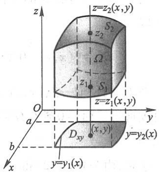

text_image

z=z₂(x,y)
S₂
z₂
Ω
z₁
S₁
z=z₁(x,y)
O
a
y
Dₓᵧ
(x,y)
y=y₂(x)
b
x
y=y₁(x)

图10-29

在这种情形下,积分区域  $\Omega$  可表示为

$$
\Omega = \{(x, y, z) \mid z _ {1} (x, y) \leqslant z \leqslant z _ {2} (x, y), (x, y) \in D _ {x y} \}.
$$

先将 x, y 看做定值, 将  $f(x, y, z)$  只看做 z 的函数, 在区间  $[z_{1}(x, y), z_{2}(x, y)]$  上对 z 积分. 积分的结果是 x, y 的函数, 记为  $F(x, y)$ , 即

$$
F (x, y) = \int_ {z _ {1} (x, y)} ^ {z _ {2} (x, y)} f (x, y, z)   \mathrm{d} z.
$$

然后计算 $F(x,y)$ 在闭区域 $D_{xy}$ 上的二重积分

$$
\iint_ {D _ {x y}} F (x, y) \mathrm{d} \sigma = \iint_ {D _ {x y}} \left[ \int_ {z _ {1} (x, y)} ^ {z _ {2} (x, y)} f (x, y, z) \mathrm{d} z \right] \mathrm{d} \sigma .
$$

假如闭区域

$$
D _ {x y} = \{(x, y) | y _ {1} (x) \leqslant y \leqslant y _ {2} (x), a \leqslant x \leqslant b \},
$$

把这个二重积分化为二次积分,于是得到三重积分的计算公式

$$
\iiint_ {\Omega} f (x, y, z) \mathrm{d} V = \int_ {a} ^ {b} \mathrm{d} x \int_ {y _ {1} (x)} ^ {y _ {2} (x)} \mathrm{d} y \int_ {z _ {1} (x, y)} ^ {z _ {2} (x, y)} f (x, y, z) \mathrm{d} z. \tag {3-2}
$$

公式(3-2)把三重积分化为先对z、次对y、最后对x的三次积分.

如果平行于 $x$ 轴或 $y$ 轴且穿过闭区域 $\Omega$ 内部的直线与 $\Omega$ 的边界曲面 $S$ 相交不多于两点,也可把闭区域 $\Omega$ 投影到 $yOz$ 面上或 $zOx$ 面上,这样便可把三重积分化为按其他顺序的三次积分.如果平行于坐标轴且穿过闭区域 $\Omega$ 内部的直线与边界曲面 $S$ 的交点多于两个,也可像处理二重积分那样,把 $\Omega$ 分成若干部分,使 $\Omega$ 上的三重积分化为各部分闭区域上的三重积分的和.

例1 计算三重积分 $\iiint_{\Omega} x \, \mathrm{d}x \, \mathrm{d}y \, \mathrm{d}z$，其中 $\Omega$ 为三个坐标面及平面 $x + 2y + z = 1$ 所围成的闭区域.

解 作闭区域  $\Omega$  如图 10-30 所示.

将  $\Omega$  投影到 xOy 面上, 得投影区域  $D_{xy}$  为三角形闭区域 OAB. 直线 OA, OB 及 AB 的方程依次为 y = 0, x = 0 及  $x + 2y = 1$ , 所以

$$
D _ {x y} = \left\{(x, y)   \Big |   0 \leqslant y \leqslant \frac {1 - x}{2}, 0 \leqslant x \leqslant 1 \right\}.
$$

在  $D_{xy}$  内任取一点  $(x,y)$ ，过此点作平行于 z 轴的直线，该直线通过平面 z=0 穿入  $\Omega$  内，然后通过平面 z=1-x-2y 穿出  $\Omega$  外.

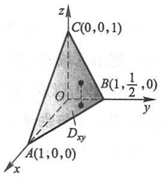

text_image

z
C(0,0,1)
O
B(1,½,0)
y
Dxy
A(1,0,0)
x

图10-30

于是,由公式(3-2)得

$$
\begin{array}{l} \iiint_ {\Omega} x \mathrm{d} x \mathrm{d} y \mathrm{d} z = \int_ {0} ^ {1} \mathrm{d} x \int_ {0} ^ {\frac {1 - x}{2}} \mathrm{d} y \int_ {0} ^ {1 - x - 2 y} x \mathrm{d} z = \int_ {0} ^ {1} x \mathrm{d} x \int_ {0} ^ {\frac {1 - x}{2}} (1 - x - 2 y) \mathrm{d} y \\ = \frac {1}{4} \int_ {0} ^ {1} (x - 2 x ^ {2} + x ^ {3}) \mathrm{d} x = \frac {1}{4 8}. \\ \end{array}
$$

有时,我们计算一个三重积分也可以化为先计算一个二重积分、再计算一个定积分,即有下述计算公式.

设空间闭区域

$$
\Omega = \{(x, y, z) \mid (x, y) \in D _ {z}, c _ {1} \leqslant z \leqslant c _ {2} \},
$$

其中 $D_{z}$ 是竖坐标为 $z$ 的平面截闭区域 $\Omega$ 所得到的一个平面闭区域（图10-31），则有

$$
\iiint_ {\Omega} f (x, y, z) \mathrm{d} V = \int_ {c _ {1}} ^ {c _ {2}} \mathrm{d} z \iint_ {D _ {z}} f (x, y, z) \mathrm{d} x \mathrm{d} y. \tag {3-3}
$$

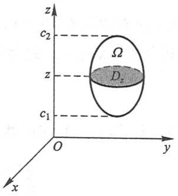

text_image

z
c₂
Ω
z
Dₓ
c₁
O
y
x

图10-31

例2 计算三重积分 $\iiint_{\Omega} z^2 \, \mathrm{d}x \, \mathrm{d}y \, \mathrm{d}z$，其中 $\Omega$ 是由椭球面 $\frac{x^2}{a^2} + \frac{y^2}{b^2} + \frac{z^2}{c^2} = 1$ 所围成的空间闭区域.

解 空间闭区域 $\Omega$ 可表示为

$$
\left\{(x, y, z) \left| \frac {x ^ {2}}{a ^ {2}} + \frac {y ^ {2}}{b ^ {2}} \leqslant 1 - \frac {z ^ {2}}{c ^ {2}}, - c \leqslant z \leqslant c \right. \right\},
$$

如图 10-32 所示. 由公式(3-3)得

$$
\begin{array}{l} \iiint_ {\Omega} z ^ {2} \mathrm{d} x \mathrm{d} y \mathrm{d} z = \int_ {- c} ^ {c} z ^ {2} \mathrm{d} z \iint_ {D _ {z}} \mathrm{d} x \mathrm{d} y \\ = \pi a b \int_ {- c} ^ {c} \left(1 - \frac {z ^ {2}}{c ^ {2}}\right) z ^ {2} \mathrm{d} z = \frac {4}{1 5} \pi a b c ^ {3}. \\ \end{array}
$$

## 2. 利用柱面坐标计算三重积分

设 $M(x,y,z)$ 为空间内一点，并设点 $M$ 在 $xOy$ 面上的投影 $P$ 的极坐标为 $(\rho, \theta)$，则这样的三个数 $\rho, \theta, z$ 就叫做点 $M$ 的柱面坐标（图10-33），这里规定 $\rho, \theta, z$ 的变化范围为

$$
\begin{array}{l} 0 \leqslant \rho <   + \infty , \\ 0 \leqslant \theta \leqslant 2 \pi , \\ - \infty <   z <   + \infty . \\ \end{array}
$$

三组坐标面分别为

$\rho=$ 常数, 即以 z 轴为轴的圆柱面;

θ=常数,即过z轴的半平面;

z=常数,即与xOy面平行的平面.

显然,点 M 的直角坐标与柱面坐标的关系为

$$
\left\{ \begin{array}{l} x = \rho \cos \theta , \\ y = \rho \sin \theta , \\ z = z. \end{array} \right. \tag {3-4}
$$

现在要把三重积分 $\iiint_{\Omega} f(x, y, z) \mathrm{d}V$ 中的变量变换为柱面坐标. 为此, 用三组坐标面 $\rho =$ 常数, $\theta =$ 常数, $z =$ 常数把 $\Omega$ 分成许多小闭区域, 除了含 $\Omega$ 的边界点的一些不规则小闭区域外, 这种小闭区域都是柱体. 今考虑由 $\rho, \theta$ 和 $z$ 各取得微小增量 $\mathrm{d}\rho, \mathrm{d}\theta$ 和 $\mathrm{d}z$ 所成的柱体的体积 (图10-34). 这个体积等于高与底面积的乘积. 现在高为 $\mathrm{d}z$ 、底面积在不计高阶无穷小时为 $\rho \mathrm{d}\rho \mathrm{d}\theta$ （即极坐标系中的面积元素）, 于是得

$$
\mathrm{d} V = \rho \mathrm{d} \rho \mathrm{d} \theta \mathrm{d} z,
$$

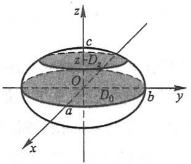

text_image

z
c
z - D₂
O
a
D₀
b
y
x

图10-32

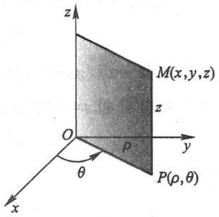

text_image

z
M(x,y,z)
z
O
y
P(ρ,θ)
θ
x

图10-33

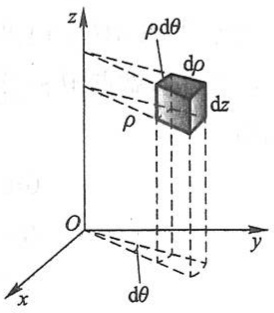

text_image

z
ρdθ
dρ
dz
ρ
O
y
x
dθ

图10-34

这就是柱面坐标系中的体积元素.再注意到关系式(3-4)，就有

$$
\iiint_ {\Omega} f (x, y, z) \mathrm{d} x \mathrm{d} y \mathrm{d} z = \iiint_ {\Omega} F (\rho , \theta , z) \rho \mathrm{d} \rho \mathrm{d} \theta \mathrm{d} z, \tag {3-5}
$$

其中  $F(\rho,\theta,z)=f(\rho\cos\theta,\rho\sin\theta,z)$ . (3-5) 式就是把三重积分的变量从直角坐标变换为柱面坐标的公式. 至于变量变换为柱面坐标后的三重积分的计算, 则可化为三次积分来进行. 化为三次积分时, 积分限是根据  $\rho,\theta$  和 z 在积分区域  $\Omega$  中的变化范围来确定的, 下面通过例子来说明.

例3 利用柱面坐标计算三重积分 $\iiint_{\Omega} z \, \mathrm{d}x \, \mathrm{d}y \, \mathrm{d}z$，其中 $\Omega$ 是由曲面 $z = x^2 + y^2$ 与平面 $z = 4$ 所围成的闭区域.

解 把闭区域  $\Omega$  投影到 xOy 面上, 得半径为 2 的圆形闭区域

$$
D _ {x y} = \{(\rho , \theta) | 0 \leqslant \rho \leqslant 2, 0 \leqslant \theta \leqslant 2 \pi \}.
$$

在 $D_{xy}$ 内任取一点 $(\rho, \theta)$, 过此点作平行于 $z$ 轴的直线, 此直线通过曲面 $z = x^2 + y^2$ 穿入 $\Omega$ 内, 然后通过平面 $z = 4$ 穿出 $\Omega$ 外. 因此闭区域 $\Omega$ 可用不等式

$$
\rho^ {2} \leqslant z \leqslant 4, \quad 0 \leqslant \rho \leqslant 2, \quad 0 \leqslant \theta \leqslant 2 \pi
$$

来表示.于是

$$
\begin{array}{l} \iiint_ {\Omega} z \mathrm{d} x \mathrm{d} y \mathrm{d} z = \iiint_ {\Omega} z \rho \mathrm{d} \rho \mathrm{d} \theta \mathrm{d} z = \int_ {0} ^ {2 \pi} \mathrm{d} \theta \int_ {0} ^ {2} \rho \mathrm{d} \rho \int_ {\rho^ {2}} ^ {4} z \mathrm{d} z \\ = \frac {1}{2} \int_ {0} ^ {2 \pi} \mathrm{d} \theta \int_ {0} ^ {2} \rho (1 6 - \rho^ {4}) \mathrm{d} \rho = \frac {1}{2} \cdot 2 \pi \left[ 8 \rho^ {2} - \frac {1}{6} \rho^ {6} \right] _ {0} ^ {2} = \frac {6 4}{3} \pi . \\ \end{array}
$$

## \*3. 利用球面坐标计算三重积分

设 $M(x,y,z)$ 为空间内一点，则点 $M$ 也可用这样三个有次序的数 $r, \varphi$ 和 $\theta$ 来确定，其中 $r$ 为原点 $O$ 与点 $M$ 间的距离，$\varphi$ 为有向线段 $\overrightarrow{OM}$ 与 $z$ 轴正向所夹的角，$\theta$ 为从 $z$ 轴

正向来看自 $x$ 轴按逆时针方向转到有向线段 $\overrightarrow{OP}$ 的角，这里 $P$ 为点 $M$ 在 $xOy$ 面上的投影（图10-35).这样的三个数 $r,\varphi$ 和 $\theta$ 叫做点 $M$ 的球面坐标，这里 $r,\varphi$ 和 $\theta$ 的变化范围为

$$
\begin{array}{l} 0 \leqslant r <   + \infty , \\ 0 \leqslant \varphi \leqslant \pi , \\ 0 \leqslant \theta \leqslant 2 \pi . \\ \end{array}
$$

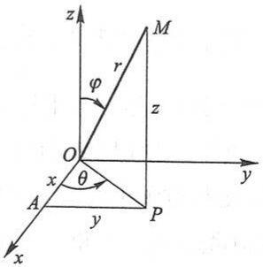

text_image

z
M
r
φ
z
O
x
θ
A
y
P
y
x

图10-35

三组坐标面分别为

r=常数,即以原点为球心的球面;

$\varphi=$ 常数, 即以原点为顶点、z轴为轴的圆锥面;

θ=常数,即过z轴的半平面.

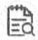

释疑解难

10-2

例题精讲

10-3

设点 $M$ 在 $xOy$ 面上的投影为 $P$, 点 $P$ 在 $x$ 轴上的投影为 $A$, 则 $OA = x, AP = y, PM = z$. 又

$$
O P = r \sin \varphi , \quad z = r \cos \varphi .
$$

因此,点 M 的直角坐标与球面坐标的关系为

$$
\left\{ \begin{array}{l} x = O P \cos \theta = r \sin \varphi \cos \theta , \\ y = O P \sin \theta = r \sin \varphi \sin \theta , \\ z = r \cos \varphi . \end{array} \right. \tag {3-6}
$$

为了把三重积分中的变量从直角坐标变换为球面坐标,用三组坐标面 r=常数, $\varphi=$ 常数, $\theta=$ 常数把积分区域  $\Omega$  分成许多小闭区域.考虑由 r, $\varphi$  和  $\theta$  各取得微小增量 dr, $d\varphi$  和  $d\theta$  所成的六面体的体积(图 10-36).不计高阶无穷小,可把这个六面体看做长方体,其经线方向的长为  $rd\varphi$ ,纬线方向的宽为  $r\sin\varphi d\theta$ ,向径方向的高为 dr,于是得

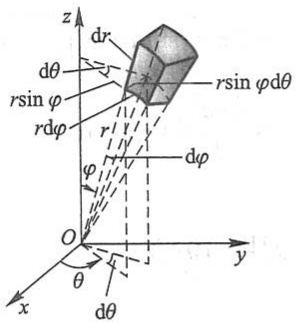

text_image

z
dr
rsin φdθ
r sin φ
r
φ
dφ
O
x
y
θ
dθ

图10-36

$$
\mathrm{d} V = r ^ {2} \sin \varphi \mathrm{d} r \mathrm{d} \varphi \mathrm{d} \theta ,
$$

这就是球面坐标系中的体积元素.再注意到关系式(3-6)，就有

$$
\iiint_ {\Omega} f (x, y, z) \mathrm{d} x \mathrm{d} y \mathrm{d} z = \iiint_ {\Omega} F (r, \varphi , \theta) r ^ {2} \sin \varphi \mathrm{d} r \mathrm{d} \varphi \mathrm{d} \theta , \tag {3-7}
$$

其中 $F(r, \varphi, \theta) = f(r\sin \varphi \cos \theta, r\sin \varphi \sin \theta, r\cos \varphi)$. (3-7)式就是把三重积分的变量从直角坐标变换为球面坐标的公式.

要计算变量变换为球面坐标后的三重积分, 可把它化为对 r、对  $\varphi$  及对  $\theta$  的三次积分.

若积分区域  $\Omega$  的边界曲面是一个包围原点在内的闭曲面, 其球面坐标方程为  $r = r(\varphi, \theta)$ , 则

$$
I = \iiint_ {\Omega} F (r, \varphi , \theta) r ^ {2} \sin \varphi \mathrm{d} r \mathrm{d} \varphi \mathrm{d} \theta = \int_ {0} ^ {2 \pi} \mathrm{d} \theta \int_ {0} ^ {\pi} \mathrm{d} \varphi \int_ {0} ^ {r (\varphi , \theta)} F (r, \varphi , \theta) r ^ {2} \sin \varphi \mathrm{d} r.
$$

当积分区域  $\Omega$  为球面 r=a 所围成时, 则

$$
I = \int_ {0} ^ {2 \pi} \mathrm{d} \theta \int_ {0} ^ {\pi} \mathrm{d} \varphi \int_ {0} ^ {a} F (r, \varphi , \theta) r ^ {2} \sin \varphi \mathrm{d} r.
$$

特别地，当 $F(r,\varphi ,\theta) = 1$ 时，由上式即得球的体积

$$
V = \int_ {0} ^ {2 \pi} \mathrm{d} \theta \int_ {0} ^ {\pi} \sin \varphi \mathrm{d} \varphi \int_ {0} ^ {a} r ^ {2} \mathrm{d} r = 2 \pi \cdot 2 \cdot \frac {a ^ {3}}{3} = \frac {4}{3} \pi a ^ {3},
$$

这是我们所熟知的结果.

例 4 求半径为 a 的球面与半顶角为  $\alpha$  的内接锥面所围成的立体(图 10-37)的体积.

解 设球面通过原点 O, 球心在 z 轴上, 又内接锥面的顶点在原点 O, 其轴与 z 轴重合, 则球面方程为 $r = 2a\cos \varphi$, 锥面方程为 $\varphi = \alpha$. 因为立体所占有的空间闭区域 $\Omega$ 可用不等式

$$
0 \leqslant r \leqslant 2 a \cos \varphi , \quad 0 \leqslant \varphi \leqslant \alpha , \quad 0 \leqslant \theta \leqslant 2 \pi
$$

来表示,所以

$$
\begin{array}{l} V = \iiint_ {\Omega} r ^ {2} \sin \varphi \mathrm{d} r \mathrm{d} \varphi \mathrm{d} \theta = \int_ {0} ^ {2 \pi} \mathrm{d} \theta \int_ {0} ^ {\alpha} \mathrm{d} \varphi \int_ {0} ^ {2 a \cos \varphi} r ^ {2} \sin \varphi \mathrm{d} r \\ = 2 \pi \int_ {0} ^ {\alpha} \sin \varphi \mathrm{d} \varphi \int_ {0} ^ {2 a \cos \varphi} r ^ {2} \mathrm{d} r = \frac {1 6 \pi a ^ {3}}{3} \int_ {0} ^ {\alpha} \cos^ {3} \varphi \sin \varphi \mathrm{d} \varphi \\ = \frac {4 \pi a ^ {3}}{3} (1 - \cos^ {4} \alpha). \\ \end{array}
$$

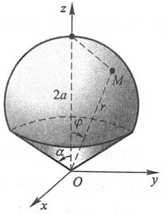

text_image

z
2a
M
r
φ
α
O
y
x

图10-37

## 习题10-3

1. 化三重积分 $I = \iiint_{\Omega} f(x, y, z) \, \mathrm{d}x \, \mathrm{d}y \, \mathrm{d}z$ 为三次积分，其中积分区域 $\Omega$ 分别是

(1) 由双曲抛物面 xy=z 及平面  $x+y-1=0, z=0$  所围成的闭区域；
(2) 由曲面  $z = x^{2} + y^{2}$  及平面 z = 1 所围成的闭区域；
(3) 由曲面  $z=x^{2}+2y^{2}$  及  $z=2-x^{2}$  所围成的闭区域；
(4) 由曲面 $cz = xy (c > 0), \frac{x^2}{a^2} + \frac{y^2}{b^2} = 1, z = 0$ 所围成的在第I卦限内的闭区域.

2. 设有一物体占有空间闭区域 $\Omega = \{(x, y, z) \mid 0 \leqslant x \leqslant 1, 0 \leqslant y \leqslant 1, 0 \leqslant z \leqslant 1\}$, 在点 $(x, y, z)$ 处的密度为 $\rho(x, y, z) = x + y + z$, 计算该物体的质量.
3. 如果三重积分 $\iiint_{\Omega} f(x, y, z) \, \mathrm{d}x \, \mathrm{d}y \, \mathrm{d}z$ 的被积函数 $f(x, y, z)$ 是三个函数 $f_1(x), f_2(y), f_3(z)$ 的乘积，即 $f(x, y, z) = f_1(x)f_2(y)f_3(z)$，积分区域 $\Omega = \{(x, y, z) \mid a \leqslant x \leqslant b, c \leqslant y \leqslant d, l \leqslant z \leqslant m\}$，证明这个三重积分等于三个定积分的乘积，即

$$
\iiint_ {\Omega} f _ {1} (x) f _ {2} (y) f _ {3} (z) \mathrm{d} x \mathrm{d} y \mathrm{d} z = \int_ {a} ^ {b} f _ {1} (x) \mathrm{d} x \int_ {c} ^ {d} f _ {2} (y) \mathrm{d} y \int_ {l} ^ {m} f _ {3} (z) \mathrm{d} z.
$$

4. 计算 $\iiint_{\Omega} xy^2 z^3 \, \mathrm{d}x \, \mathrm{d}y \, \mathrm{d}z$，其中 $\Omega$ 是由曲面 $z = xy$ 与平面 $y = x, x = 1$ 和 $z = 0$ 所围成的闭区域.

5. 计算 $\iiint_{\Omega} \frac{\mathrm{d}x \, \mathrm{d}y \, \mathrm{d}z}{(1 + x + y + z)^3}$, 其中 $\Omega$ 为平面 $x = 0, y = 0, z = 0, x + y + z = 1$ 所围成的四面体.

6. 计算 $\iiint_{\Omega} xyz \, \mathrm{d}x \, \mathrm{d}y \, \mathrm{d}z$，其中 $\Omega$ 为球面 $x^2 + y^2 + z^2 = 1$ 及三个坐标面所围成的在第 I 卦限内的闭区域.

7. 计算 $\iiint_{\Omega} xz \, \mathrm{d}x \, \mathrm{d}y \, \mathrm{d}z$，其中 $\Omega$ 是由平面 $z = 0, z = y, y = 1$ 以及抛物柱面 $y = x^2$ 所围成的闭区域。

8. 计算 $\iiint_{\Omega} z \, \mathrm{d}x \, \mathrm{d}y \, \mathrm{d}z$，其中 $\Omega$ 是由锥面 $z = \frac{h}{R} \sqrt{x^2 + y^2}$ 与平面 $z = h (R > 0, h > 0)$ 所围成的闭区域.

9. 利用柱面坐标计算下列三重积分:

(1) $\iiint_{\Omega} z \, \mathrm{d}V$，其中 $\Omega$ 是由曲面 $z = \sqrt{2 - x^2 - y^2}$ 及 $z = x^2 + y^2$ 所围成的闭区域；
(2) $\iiint_{\Omega}(x^{2}+y^{2})\mathrm{d}V$ ,其中 $\Omega$ 是由曲面 $x^{2}+y^{2}=2z$ 及平面z=2所围成的闭区域.

\*10. 利用球面坐标计算下列三重积分:

(1) $\iiint_{\Omega} (x^2 + y^2 + z^2) \, \mathrm{d}V$，其中 $\Omega$ 是由球面 $x^2 + y^2 + z^2 = 1$ 所围成的闭区域；
(2) $\iiint_{\Omega} z \, \mathrm{d}V$，其中闭区域 $\Omega = \{(x, y, z) | x^2 + y^2 + (z - a)^2 \leqslant a^2, x^2 + y^2 \leqslant z^2\}$.

11. 选用适当的坐标计算下列三重积分:

(1) $\iiint_{\Omega} xy \, \mathrm{d}V$, 其中 $\Omega$ 为柱面 $x^2 + y^2 = 1$ 及平面 $z = 1, z = 0, x = 0, y = 0$ 所围成的在第 I 卦限内的闭区域;
\* (2) $\iiint_{\Omega} \sqrt{x^2 + y^2 + z^2} \, \mathrm{d}V$, 其中 $\Omega$ 是由球面 $x^2 + y^2 + z^2 = z$ 所围成的闭区域;
(3) $\iiint_{\Omega} (x^2 + y^2) \, \mathrm{d}V$，其中 $\Omega$ 是由曲面 $4z^2 = 25(x^2 + y^2)$ 及平面 $z = 5$ 所围成的闭区域；
\* (4) $\iiint_{\Omega} (x^2 + y^2) \, \mathrm{d}V$, 其中闭区域 $\Omega = \{(x, y, z) | 0 < a \leqslant \sqrt{x^2 + y^2 + z^2} \leqslant A, z \geqslant 0\}$;
(5) $\iiint_{\Omega} (y^2 + z^2) \, \mathrm{d}V$，其中 $\Omega$ 是由抛物面 $x = y^2 + z^2$ 与圆锥面 $x = 2 - \sqrt{y^2 + z^2}$ 所围成的闭区域.

12. 利用三重积分计算下列由曲面所围成的立体的体积:

(1) $z=6-x^{2}-y^{2}$ 及 $z=\sqrt{x^{2}+y^{2}}$;
\* (2) $x^{2} + y^{2} + z^{2} = 2az$ ($a > 0$) 及 $x^{2} + y^{2} = z^{2}$ (含有 $z$ 轴的部分);
(3) $z=\sqrt{x^{2}+y^{2}}$ 及 $z=x^{2}+y^{2}$;
(4) $z=\sqrt{5-x^{2}-y^{2}}$ 及 $x^{2}+y^{2}=4z.$

\* 13. 求球体 $r \leqslant a$ 位于锥面 $\varphi = \frac{\pi}{3}$ 和 $\varphi = \frac{2}{3}\pi$ 之间的部分的体积.
14. 求上、下分别为球面  $x^{2}+y^{2}+z^{2}=2$  和抛物面  $z=x^{2}+y^{2}$  所围立体的体积.
\* 15. 球心在原点、半径为 $R$ 的球, 在其上任意一点的密度的大小与这点到球心的距离成正比, 求这球的质量.

## 第四节 重积分的应用

由前面的讨论可知,曲顶柱体的体积、平面薄片的质量可用二重积分计算,空间物体的质量可用三重积分计算.本节中我们将把定积分应用中的元素法推广到重积分的应用中,利用重积分的元素法来讨论重积分在几何、物理上的一些其他应用.

## 一、曲面的面积

设曲面 $S$ 由方程

$$
z = f (x, y)
$$

给出, D 为曲面 S 在 xOy 面上的投影区域, 函数  $f(x,y)$  在 D 上具有连续偏导数  $f_{x}(x,y)$  和  $f_{y}(x,y)$ . 要计算曲面 S 的面积 A.

在闭区域 D 上任取一直径很小的闭区域  $d\sigma$  （这小闭区域的面积也记作  $d\sigma$ ）. 在

$\mathrm{d}\sigma$ 上取一点 $P(x,y)$，曲面 $S$ 上对应地有一点 $M(x,y,f(x,y))$，点 $M$ 在 $xOy$ 面上的投影即点 $P$. 点 $M$ 处曲面 $S$ 的切平面设为 $T$（图10-38）. 以小闭区域 $\mathrm{d}\sigma$ 的边界为准线作母线平行于 $z$ 轴的柱面，这柱面在曲面 $S$ 上截下一小片曲面，在切平面 $T$ 上截下一小片平面. 由于 $\mathrm{d}\sigma$ 的直径很小，切平面 $T$ 上的那一小片平面的面积 $\mathrm{d}A$ 可以近似代替相应的那小片曲面的面积. 设点 $M$ 处曲面 $S$ 上的法线（方向朝上）与 $z$ 轴所成的角为 $\gamma$，则

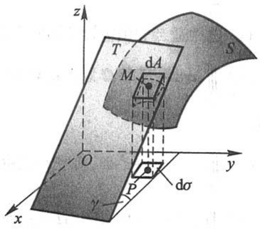

text_image

z
T
M
dA
S
O
y
P
dσ
x
γ

图10-38

$$
\mathrm{d} A = \frac {\mathrm{d} \sigma}{\cos \gamma} ①.
$$

因为

① 设两平面 $\Pi_1, \Pi_2$ 的夹角为 $\theta$（取锐角），$\Pi_1$ 上的闭区域 $D$ 在 $\Pi_2$ 上的投影区域为 $D_0$，则 $D$ 的面积 $A$ 与 $D_0$ 的面积 $\sigma$ 之间有关系

$$
A = \frac {\sigma}{\cos \theta}.
$$

事实上,先假定 D 是矩形闭区域,且其一边平行于平面  $\Pi_{1},\Pi_{2}$  的交线 l, 边长为 a, 另一边长为 b (图10-39), 则  $D_{0}$  也是矩形闭区域, 且边长分别为 a 及  $b\cos\theta$ , 从而

$$
\sigma = a b \cos \theta = A \cos \theta ,
$$

即

$$
A = \frac {\sigma}{\cos \theta}.
$$

在一般情况, 可把 D 分成上述类型的 m 个小矩形闭区域(不计含边界点的不规则部分), 则小矩形闭区域的面积  $A_{k}$  及其投影区域的面积

$\sigma_{k}$ 之间符合 $A_{k} = \frac{\sigma_{k}}{\cos\theta}$ （$k = 1,2,\dots ,m$），从而 $\sum_{k = 1}^{m}A_{k} = \frac{\sum_{k = 1}^{m}\sigma_{k}}{\cos\theta}$. 使各小闭区域的直径中的最大者趋于零，取极限便得 $A = \frac{\sigma}{\cos\theta}$.

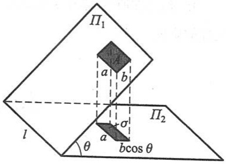

text_image

Π₁
a b
l
θ
a σ
bcos θ
Π₂

图10-39

$$
\cos \gamma = \frac {1}{\sqrt {1 + f _ {x} ^ {2} (x , y) + f _ {y} ^ {2} (x , y)}},
$$

所以

$$
\mathrm{d} A = \sqrt {1 + f _ {x} ^ {2} (x , y) + f _ {y} ^ {2} (x , y)} \mathrm{d} \sigma .
$$

这就是曲面 $S$ 的面积元素, 以它为被积表达式在闭区域 $D$ 上积分, 得

$$
A = \iint_ {D} \sqrt {1 + f _ {x} ^ {2} (x , y) + f _ {y} ^ {2} (x , y)}   \mathrm{d} \sigma .
$$

上式也可写成

$$
A = \iint_ {D} \sqrt {1 + \left(\frac {\partial z}{\partial x}\right) ^ {2} + \left(\frac {\partial z}{\partial y}\right) ^ {2}} \mathrm{d} x \mathrm{d} y.
$$

这就是计算曲面面积的公式.

设曲面的方程为 $x = g(y,z)$ 或 $y = h(z,x)$，可分别把曲面投影到 $yOz$ 面上（投影区域记作 $D_{yz}$）或 $zOx$ 面上（投影区域记作 $D_{zx}$），类似地可得

$$
A = \iint_ {D _ {y z}} \sqrt {1 + \left(\frac {\partial x}{\partial y}\right) ^ {2} + \left(\frac {\partial x}{\partial z}\right) ^ {2}} \mathrm{d} y \mathrm{d} z,
$$

或

$$
A = \iint_ {D _ {z x}} \sqrt {1 + \left(\frac {\partial y}{\partial z}\right) ^ {2} + \left(\frac {\partial y}{\partial x}\right) ^ {2}} \mathrm{d} z \mathrm{d} x.
$$

例 1 求半径为 a 的球的表面积.

解 取上半球面方程为 $z = \sqrt{a^2 - x^2 - y^2}$，则它在 $xOy$ 面上的投影区域 $D = \{(x, y) | x^2 + y^2 \leqslant a^2\}$.

由 $\frac{\partial z}{\partial x} = \frac{-x}{\sqrt{a^2 - x^2 - y^2}},\frac{\partial z}{\partial y} = \frac{-y}{\sqrt{a^2 - x^2 - y^2}}$ 得

$$
\sqrt {1 + \left(\frac {\partial z}{\partial x}\right) ^ {2} + \left(\frac {\partial z}{\partial y}\right) ^ {2}} = \frac {a}{\sqrt {a ^ {2} - x ^ {2} - y ^ {2}}}.
$$

因为这函数在闭区域 $D$ 上无界, 我们不能直接应用曲面面积公式. 所以先取区域 $D_{1} = \{(x, y) | x^{2} + y^{2} \leqslant b^{2}\}$ ($0 < b < a$) 为积分区域, 算出相应于 $D_{1}$ 上的球面面积 $A_{1}$ 后, 令 $b \to a$ 取 $A_{1}$ 的极限①就得半球面的面积.

$$
A _ {1} = \iint_ {D _ {1}} \frac {a}{\sqrt {a ^ {2} - x ^ {2} - y ^ {2}}} \mathrm{d} x \mathrm{d} y,
$$

<small>① 这极限就是函数 $\frac{a}{\sqrt{a^2 - x^2 - y^2}}$ 在闭区域 $D$ 上的所谓反常二重积分.</small>

利用极坐标,得

$$
A _ {1} = \iint_ {D _ {1}} \frac {a}{\sqrt {a ^ {2} - \rho^ {2}}} \rho \mathrm{d} \rho \mathrm{d} \theta = a \int_ {0} ^ {2 \pi} \mathrm{d} \theta \int_ {0} ^ {b} \frac {\rho \mathrm{d} \rho}{\sqrt {a ^ {2} - \rho^ {2}}} = 2 \pi a \int_ {0} ^ {b} \frac {\rho \mathrm{d} \rho}{\sqrt {a ^ {2} - \rho^ {2}}} = 2 \pi a (a - \sqrt {a ^ {2} - b ^ {2}}).
$$

图

释疑解难

10-3

于是

$$
\lim _ {b \to a} A _ {1} = \lim _ {b \to a} 2 \pi a (a - \sqrt {a ^ {2} - b ^ {2}}) = 2 \pi a ^ {2}.
$$

这就是半个球面的面积,因此整个球面的面积为

$$
A = 4 \pi a ^ {2}.
$$

例 2 设有一颗地球同步轨道通信卫星,距地面的高度为 h=36 000 km,运行的角速度与地球自转的角速度相同.试计算该通信卫星的覆盖面积与地球表面积的比值(地球半径 R=6 400 km).

解 取地心为坐标原点, 地心到通信卫星中心的连线为 z 轴, 建立坐标系, 如图 10-40 所示.

通信卫星覆盖的曲面 $\Sigma$ 是上半球面被半顶角为 $\alpha$ 的圆锥面所截得的部分. $\Sigma$ 的方程为

$$
z = \sqrt {R ^ {2} - x ^ {2} - y ^ {2}}, \quad x ^ {2} + y ^ {2} \leqslant R ^ {2} \sin^ {2} \alpha .
$$

于是通信卫星的覆盖面积为

$$
\begin{array}{l} A = \iint_ {D _ {x y}} \sqrt {1 + \left(\frac {\partial z}{\partial x}\right) ^ {2} + \left(\frac {\partial z}{\partial y}\right) ^ {2}} \mathrm{d} x \mathrm{d} y \\ = \iint_ {D _ {x y}} \frac {R}{\sqrt {R ^ {2} - x ^ {2} - y ^ {2}}} \mathrm{d} x \mathrm{d} y. \\ \end{array}
$$

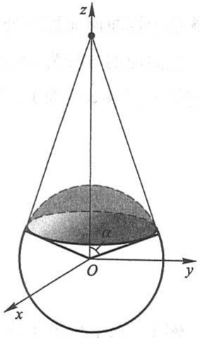

text_image

z
α
O
y
x

图10-40

其中 $D_{xy}$ 是曲面 $\Sigma$ 在 $xOy$ 面上的投影区域，$D_{xy} = \{(x,y) | x^2 + y^2 \leqslant R^2 \sin^2 \alpha\}$.

利用极坐标,得

$$
A = \int_ {0} ^ {2 \pi} \mathrm{d} \theta \int_ {0} ^ {R \sin \alpha} \frac {R}{\sqrt {R ^ {2} - \rho^ {2}}} \rho \mathrm{d} \rho = 2 \pi R \int_ {0} ^ {R \sin \alpha} \frac {\rho}{\sqrt {R ^ {2} - \rho^ {2}}} \mathrm{d} \rho = 2 \pi R ^ {2} (1 - \cos \alpha).
$$

由于  $\cos\alpha=\frac{R}{R+h}$ ，代入上式得

$$
A = 2 \pi R ^ {2} \left(1 - \frac {R}{R + h}\right) = 2 \pi R ^ {2} \cdot \frac {h}{R + h}.
$$

由此得这颗通信卫星的覆盖面积与地球表面积之比为

$$
\frac {A}{4 \pi R ^ {2}} = \frac {h}{2 (R + h)} = \frac {3 6 \times 1 0 ^ {3}}{2 (3 6 + 6 . 4) \times 1 0 ^ {3}} \approx 42.5 \%.
$$

由以上结果可知,卫星覆盖了全球三分之一以上的面积,故使用三颗相隔 $\frac{2}{3}\pi$ 角度的通信卫星就可以覆盖几乎地球全部表面.

\* 利用曲面的参数方程求曲面的面积

若曲面 $S$ 由参数方程

$$
\left\{ \begin{array}{l} x = x (u, v), \\ y = y (u, v), \quad (u, v) \in D \\ z = z (u, v) \end{array} \right.
$$

给出,其中 D 是一个平面有界闭区域,又  $x(u,v)$ ,  $y(u,v)$ ,  $z(u,v)$  在 D 上具有连续的一阶偏导数,且

$$
\frac {\partial (x , y)}{\partial (u , v)}, \quad \frac {\partial (y , z)}{\partial (u , v)}, \quad \frac {\partial (z , x)}{\partial (u , v)}
$$

不全为零,则曲面 S 的面积

$$
A = \iint_ {D} \sqrt {E G - F ^ {2}}   \mathrm{d} u \mathrm{d} v,
$$

其中

$$
E = x _ {u} ^ {2} + y _ {u} ^ {2} + z _ {u} ^ {2}, \quad F = x _ {u} x _ {v} + y _ {u} y _ {v} + z _ {u} z _ {v}, \quad G = x _ {v} ^ {2} + y _ {v} ^ {2} + z _ {v} ^ {2}.
$$

下面我们对例 2 用球面的参数方程按上述公式来进行计算.

$\Sigma$ 的参数方程为

$$
\left\{ \begin{array}{l} x = R \sin \varphi \cos \theta , \\ y = R \sin \varphi \sin \theta , \quad (\varphi , \theta) \in D _ {\varphi \theta}. \\ z = R \cos \varphi , \end{array} \right.
$$

这里 $D_{\varphi \theta} = \{(\varphi ,\theta)\mid 0\leqslant \varphi \leqslant \alpha ,0\leqslant \theta \leqslant 2\pi \}$

由于 $\sqrt{EG - F^2} = R^2\sin \varphi$ ，于是

$$
\begin{array}{l} A = \iint_ {D _ {\varphi \theta}} \sqrt {E G - F ^ {2}} \mathrm{d} \varphi \mathrm{d} \theta = \iint_ {D _ {\varphi \theta}} R ^ {2} \sin \varphi \mathrm{d} \varphi \mathrm{d} \theta \\ = R ^ {2} \int_ {0} ^ {2 \pi} \mathrm{d} \theta \int_ {0} ^ {\alpha} \sin \varphi \mathrm{d} \varphi = 2 \pi R ^ {2} (1 - \cos \alpha) = 2 \pi R ^ {2} \frac {h}{R + h}. \\ \end{array}
$$

## 二、质心

先讨论平面薄片的质心.

设在 xOy 平面上有 n 个质点, 它们分别位于点  $(x_{1}, y_{1}), (x_{2}, y_{2}), \cdots, (x_{n}, y_{n})$  处, 质量分别为  $m_{1}, m_{2}, \cdots, m_{n}$ . 由力学知道, 该质点系的质心的坐标为

$$
\overline {{x}} = \frac {M _ {y}}{M} = \frac {\sum_ {i = 1} ^ {n} m _ {i} x _ {i}}{\sum_ {i = 1} ^ {n} m _ {i}}, \quad \overline {{y}} = \frac {M _ {x}}{M} = \frac {\sum_ {i = 1} ^ {n} m _ {i} y _ {i}}{\sum_ {i = 1} ^ {n} m _ {i}},
$$

其中 $M = \sum_{i=1}^{n} m_i$ 为该质点系的总质量，

$$
M _ {y} = \sum_ {i = 1} ^ {n} m _ {i} x _ {i}, \quad M _ {x} = \sum_ {i = 1} ^ {n} m _ {i} y _ {i},
$$

分别为该质点系对 y 轴和 x 轴的静矩.

设有一平面薄片, 占有 $xOy$ 面上的闭区域 $D$, 在点 $(x,y)$ 处的面密度为 $\mu(x,y)$, 假定 $\mu(x,y)$ 在 $D$ 上连续. 现在要找该薄片的质心的坐标.

在闭区域 $D$ 上任取一直径很小的闭区域 $\mathrm{d}\sigma$ （这小闭区域的面积也记作 $\mathrm{d}\sigma$ ），$(x,y)$ 是这小闭区域上的一个点.因为 $\mathrm{d}\sigma$ 的直径很小，且 $\mu (x,y)$ 在 $D$ 上连续，所以薄片中相应于 $\mathrm{d}\sigma$ 的部分的质量近似等于 $\mu (x,y)\mathrm{d}\sigma$ ，这部分质量可近似看做集中在点$(x,y)$ 上，于是可写出静矩元素 $\mathrm{d}M_y$ 及 $\mathrm{d}M_x$ :

$$
\mathrm{d} M _ {y} = x \mu (x, y) \mathrm{d} \sigma , \quad \mathrm{d} M _ {x} = y \mu (x, y) \mathrm{d} \sigma .
$$

以这些元素为被积表达式,在闭区域 D 上积分,便得

$$
M _ {y} = \iint_ {D} x \mu (x, y) \mathrm{d} \sigma , \quad M _ {x} = \iint_ {D} y \mu (x, y) \mathrm{d} \sigma .
$$

又由第一节知道,薄片的质量为

$$
M = \iint_ {D} \mu (x, y) \mathrm{d} \sigma .
$$

所以,薄片的质心的坐标为

$$
\overline {{x}} = \frac {M _ {y}}{M} = \frac {\iint_ {D} x \mu (x , y) \mathrm{d} \sigma}{\iint_ {D} \mu (x , y) \mathrm{d} \sigma}, \quad \overline {{y}} = \frac {M _ {x}}{M} = \frac {\iint_ {D} y \mu (x , y) \mathrm{d} \sigma}{\iint_ {D} \mu (x , y) \mathrm{d} \sigma}.
$$

如果薄片是均匀的,即面密度为常量,那么上式中可把 $\mu$ 提到积分记号外面,并从分子、分母中约去,这样便得均匀薄片的质心的坐标为

$$
\overline {{x}} = \frac {1}{A} \iint_ {D} x \mathrm{d} \sigma , \quad \overline {{y}} = \frac {1}{A} \iint_ {D} y \mathrm{d} \sigma , \tag {4-1}
$$

其中 $A = \iint_{D} \mathrm{d}\sigma$ 为闭区域 $D$ 的面积. 这时薄片的质心完全由闭区域 $D$ 的形状所决定. 我们把均匀平面薄片的质心叫做这平面薄片所占的平面图形的形心. 因此, 平面图形 $D$ 的形心的坐标, 就可用公式(4-1)计算.

例3 求位于两圆 $\rho = 2\sin \theta$ 和 $\rho = 4\sin \theta$ 之间的均匀薄片的质心(图10-41).

解 因为闭区域 D 关于 y 轴对称, 所以质心  $C(\bar{x}, \bar{y})$  必位于 y 轴上, 于是  $\bar{x} = 0$ . 再按公式

$$
\bar {y} = \frac {1}{A} \iint_ {D} y \mathrm{d} \sigma
$$

计算 $\overline{y}$. 由于闭区域 $D$ 位于半径为 1 与半径为 2 的两圆之间, 所以它的面积等于这两个圆的面积之差, 即 $A = 3\pi$. 再利用极坐标计算积分

$$
\begin{array}{l} \iint_ {D} y \mathrm{d} \sigma = \iint_ {D} \rho^ {2} \sin \theta \mathrm{d} \rho \mathrm{d} \theta = \int_ {0} ^ {\pi} \sin \theta \mathrm{d} \theta \int_ {2 \sin \theta} ^ {4 \sin \theta} \rho^ {2} \mathrm{d} \rho \\ = \frac {5 6}{3} \int_ {0} ^ {\pi} \sin^ {4} \theta \mathrm{d} \theta = 7 \pi . \\ \end{array}
$$

因此  $\bar{y}=\frac{7\pi}{3\pi}=\frac{7}{3}$ ，所求质心是  $C\left(0,\frac{7}{3}\right)$ .

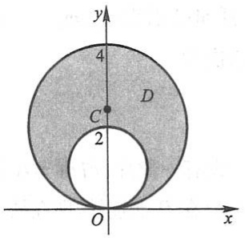

text_image

y
4
D
C
2
O
x

图10-41

类似地,占有空间有界闭区域  $\Omega$ 、在点  $(x,y,z)$  处的密度为  $\rho(x,y,z)$  （假定  $\rho(x,y,z)$  在  $\Omega$  上连续）的物体的质心坐标是

$$
\bar {x} = \frac {1}{M} \iiint_ {\Omega} x \rho (x, y, z) \mathrm{d} V, \quad \bar {y} = \frac {1}{M} \iiint_ {\Omega} y \rho (x, y, z) \mathrm{d} V, \quad \bar {z} = \frac {1}{M} \iiint_ {\Omega} z \rho (x, y, z) \mathrm{d} V,
$$

其中 $M = \iiint_{\Omega} \rho(x, y, z) \, \mathrm{d}V.$

\* 例 4 求均匀半球体的质心.

解 取半球体的对称轴为 z 轴, 原点取在球心上, 又设球半径为 a, 则半球体所占空间闭区域

$$
\Omega = \{(x, y, z) | x ^ {2} + y ^ {2} + z ^ {2} \leqslant a ^ {2}, z \geqslant 0 \}.
$$

显然,质心在z轴上,故 $\bar{x}=\bar{y}=0$ .

$$
\bar {z} = \frac {1}{M} \iiint_ {\Omega} z \rho \mathrm{d} V = \frac {1}{V} \iiint_ {\Omega} z \mathrm{d} V,
$$

其中  $V=\frac{2}{3}\pi a^{3}$  为半球体的体积.

$$
\begin{array}{l} \iiint_ {\Omega} z \mathrm{d} V = \iiint_ {\Omega} r \cos \varphi \cdot r ^ {2} \sin \varphi \mathrm{d} r \mathrm{d} \varphi \mathrm{d} \theta = \int_ {0} ^ {2 \pi} \mathrm{d} \theta \int_ {0} ^ {\frac {\pi}{2}} \cos \varphi \sin \varphi \mathrm{d} \varphi \int_ {0} ^ {a} r ^ {3} \mathrm{d} r \\ = 2 \pi \cdot \left[ \frac {\sin^ {2} \varphi}{2} \right] _ {0} ^ {\frac {\pi}{2}} \cdot \frac {a ^ {4}}{4} = \frac {\pi a ^ {4}}{4}. \\ \end{array}
$$

因此, $\bar{z}=\frac{3}{8}a$ ,质心为 $\left(0,0,\frac{3}{8}a\right)$ .

## 三、转动惯量

先讨论平面薄片的转动惯量.

设在 $xOy$ 平面上有 $n$ 个质点, 它们分别位于点

$$
(x _ {1}, y _ {1}), \quad (x _ {2}, y _ {2}), \quad \dots , \quad (x _ {n}, y _ {n})
$$

处,质量分别为  $m_{1}, m_{2}, \cdots, m_{n}$ . 由力学知道,该质点系对于 x 轴以及对于 y 轴的转动惯量依次为

$$
I _ {x} = \sum_ {i = 1} ^ {n} y _ {i} ^ {2} m _ {i}, \quad I _ {y} = \sum_ {i = 1} ^ {n} x _ {i} ^ {2} m _ {i}.
$$

设有一薄片, 占有 $xOy$ 面上的闭区域 $D$, 在点 $(x, y)$ 处的面密度为 $\mu(x, y)$, 假定 $\mu(x, y)$ 在 $D$ 上连续. 现在要求该薄片对于 $x$ 轴的转动惯量 $I_x$ 以及对于 $y$ 轴的转动惯量 $I_y$.

应用元素法. 在闭区域 $D$ 上任取一直径很小的闭区域 $\mathrm{d}\sigma$ （这小闭区域的面积也记作 $\mathrm{d}\sigma$, $(x,y)$ 是该小闭区域上的一个点. 因为 $\mathrm{d}\sigma$ 的直径很小, 且 $\mu(x,y)$ 在 $D$ 上连续, 所以薄片中相应于 $\mathrm{d}\sigma$ 部分的质量近似等于 $\mu(x,y)\mathrm{d}\sigma$, 这部分质量可近似看做集中在点 $(x,y)$ 上, 于是可写出薄片对于 $x$ 轴以及对于 $y$ 轴的转动惯量元素

$$
\mathrm{d} I _ {x} = y ^ {2} \mu (x, y) \mathrm{d} \sigma , \quad \mathrm{d} I _ {y} = x ^ {2} \mu (x, y) \mathrm{d} \sigma .
$$

以这些元素为被积表达式,在闭区域 D 上积分,便得

$$
I _ {x} = \iint_ {D} y ^ {2} \mu (x, y) \mathrm{d} \sigma , \quad I _ {y} = \iint_ {D} x ^ {2} \mu (x, y) \mathrm{d} \sigma .
$$

例 5 求半径为 a 的均匀半圆薄片（面密度为常量  $\mu$ ）对于其直径边的转动惯量.

解 取坐标系如图 10-42 所示, 则薄片所占闭区域

$$
D = \{(x, y) \mid x ^ {2} + y ^ {2} \leqslant a ^ {2}, y \geqslant 0 \},
$$

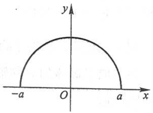

text_image

-a
O
a
x
y

图10-42

而所求转动惯量即半圆薄片对于 $x$ 轴的转动惯量 $I_{x}$.

$$
\begin{array}{l} I _ {x} = \iint_ {D} \mu y ^ {2} \mathrm{d} \sigma = \mu \iint_ {D} \rho^ {3} \sin^ {2} \theta \mathrm{d} \rho \mathrm{d} \theta = \mu \int_ {0} ^ {\pi} \mathrm{d} \theta \int_ {0} ^ {a} \rho^ {3} \sin^ {2} \theta \mathrm{d} \rho \\ = \mu \cdot \frac {a ^ {4}}{4} \int_ {0} ^ {\pi} \sin^ {2} \theta \mathrm{d} \theta = \frac {1}{4} \mu a ^ {4} \cdot \frac {\pi}{2} = \frac {1}{4} M a ^ {2}, \\ \end{array}
$$

其中 $M = \frac{1}{2}\pi a^2\mu$ 为半圆薄片的质量.

类似地,占有空间有界闭区域  $\Omega$ 、在点  $(x,y,z)$  处的密度为  $\rho(x,y,z)$  （假定  $\rho(x,y,z)$  在  $\Omega$  上连续）的物体对于 x 轴、y 轴和 z 轴的转动惯量为

$$
\begin{array}{l} I _ {x} = \iiint_ {\Omega} (y ^ {2} + z ^ {2}) \rho (x, y, z) \mathrm{d} V, \\ I _ {y} = \iiint_ {\Omega} (z ^ {2} + x ^ {2}) \rho (x, y, z) \mathrm{d} V, \\ I _ {z} = \iiint_ {\Omega} (x ^ {2} + y ^ {2}) \rho (x, y, z) \mathrm{d} V. \\ \end{array}
$$

\* 例6 求密度为 $\rho$ 的均匀球对于过球心的一条轴 $l$ 的转动惯量.

解 取球心为坐标原点,z 轴与轴 l 重合,又设球的半径为 a,则球所占空间闭区域

$$
\Omega = \{(x, y, z) \mid x ^ {2} + y ^ {2} + z ^ {2} \leqslant a ^ {2} \}.
$$

所求转动惯量即球对于 $z$ 轴的转动惯量为

$$
\begin{array}{l} I _ {z} = \iiint_ {\Omega} (x ^ {2} + y ^ {2}) \rho \mathrm{d} V \\ = \rho \iiint_ {\Omega} \left(r ^ {2} \sin^ {2} \varphi \cos^ {2} \theta + r ^ {2} \sin^ {2} \varphi \sin^ {2} \theta\right) r ^ {2} \sin \varphi \mathrm{d} r \mathrm{d} \varphi \mathrm{d} \theta \\ = \rho \iiint_ {\Omega} r ^ {4} \sin^ {3} \varphi \mathrm{d} r \mathrm{d} \varphi \mathrm{d} \theta = \rho \int_ {0} ^ {2 \pi} \mathrm{d} \theta \int_ {0} ^ {\pi} \sin^ {3} \varphi \mathrm{d} \varphi \int_ {0} ^ {a} r ^ {4} \mathrm{d} r \\ = \rho \cdot 2 \pi \cdot \frac {a ^ {5}}{5} \int_ {0} ^ {\pi} \sin^ {3} \varphi \mathrm{d} \varphi = \frac {2}{5} \pi a ^ {5} \rho \cdot \frac {4}{3} = \frac {2}{5} a ^ {2} M, \\ \end{array}
$$

其中  $M=\frac{4}{3}\pi a^{3}\rho$  为球的质量.

## 四、引力

下面讨论空间一物体对于物体外一点 $P_0(x_0, y_0, z_0)$ 处单位质量的质点的引力问题.

设物体占有空间有界闭区域 $\Omega$，它在点 $(x, y, z)$ 处的密度为 $\rho(x, y, z)$，并假定 $\rho(x, y, z)$ 在 $\Omega$ 上连续。在物体内任取一直径很小的闭区域 $\mathrm{d}V$（这闭区域的体积也记作 $\mathrm{d}V$），$(x, y, z)$ 为这一小块中的一点。把这一小块物体的质量 $\rho \mathrm{d}V$ 近似地看做集中在点 $(x, y, z)$ 处。于是按两质点间的引力公式，可得这一小块物体对位于 $P_0(x_0, y_0, z_0)$ 处的单位质量的质点的引力近似地为

$$
\begin{array}{l} \mathrm{d} \boldsymbol {F} = (\mathrm{d} F _ {x}, \mathrm{d} F _ {y}, \mathrm{d} F _ {z}) \\ = \left(G \frac {\rho (x , y , z) (x - x _ {0})}{r ^ {3}} \mathrm{d} V, G \frac {\rho (x , y , z) (y - y _ {0})}{r ^ {3}} \mathrm{d} V, G \frac {\rho (x , y , z) (z - z _ {0})}{r ^ {3}} \mathrm{d} V\right), \\ \end{array}
$$

其中 $\mathrm{d}F_{x},\mathrm{d}F_{y},\mathrm{d}F_{z}$ 为引力元素 $\mathrm{d}F$ 在三个坐标轴上的分量， $r = \sqrt{(x - x_0)^2 + (y - y_0)^2 + (z - z_0)^2},G$ 为引力常量.将 $\mathrm{d}F_x,\mathrm{d}F_y,\mathrm{d}F_z$ 在 $\Omega$ 上分别积分，即得

$$
\begin{array}{l} \mathbb {F} = (F _ {x}, F _ {y}, F _ {z}) \\ = \left(\iiint_ {\Omega} \frac {G \rho (x , y , z) (x - x _ {0})}{r ^ {3}} \mathrm{d} V, \iiint_ {\Omega} \frac {G \rho (x , y , z) (y - y _ {0})}{r ^ {3}} \mathrm{d} V, \iiint_ {\Omega} \frac {G \rho (x , y , z) (z - z _ {0})}{r ^ {3}} \mathrm{d} V\right). \\ \end{array}
$$

如果考虑平面薄片对薄片外一点 $P_{0}(x_{0},y_{0},z_{0})$ 处单位质量的质点的引力，设平面薄片占有 $xOy$ 平面上的有界闭区域 $D$ ，其面密度为 $\mu (x,y)$ ，那么只要将上式中的密度$\rho (x,y,z)$ 换成面密度 $\mu (x,y)$ ，将 $\Omega$ 上的三重积分换成 $D$ 上的二重积分，就可得到相

应的计算公式.

例7 设半径为 $R$ 的质量均匀的球占有空间闭区域 $\Omega = \{(x, y, z) | x^2 + y^2 + z^2 \leqslant R^2\}$. 求它对位于 $M_0(0, 0, a) (a > R)$ 处的单位质量的质点的引力.

解 设球的密度为  $\rho_{0}$ ，由球的对称性及质量分布的均匀性知  $F_{x}=F_{y}=0$ ，所求引力沿 z 轴的分量为

$$
\begin{array}{l} F _ {z} = \iiint_ {\Omega} G \rho_ {0} \frac {z - a}{\left[ x ^ {2} + y ^ {2} + (z - a) ^ {2} \right] ^ {\frac {3}{2}}} \mathrm{d} V \\ = G \rho_ {0} \int_ {- R} ^ {R} (z - a) \mathrm{d} z \iint_ {x ^ {2} + y ^ {2} \leqslant R ^ {2} - z ^ {2}} \frac {\mathrm{d} x \mathrm{d} y}{\left[ x ^ {2} + y ^ {2} + (z - a) ^ {2} \right] ^ {\frac {3}{2}}} \\ = G \rho_ {0} \int_ {- R} ^ {R} (z - a) \mathrm{d} z \int_ {0} ^ {2 \pi} \mathrm{d} \theta \int_ {0} ^ {\sqrt {R ^ {2} - z ^ {2}}} \frac {\rho \mathrm{d} \rho}{\left[ \rho^ {2} + (z - a) ^ {2} \right] ^ {\frac {3}{2}}} \\ = 2 \pi G \rho_ {0} \int_ {- R} ^ {R} (z - a) \left(\frac {1}{a - z} - \frac {1}{\sqrt {R ^ {2} - 2 a z + a ^ {2}}}\right) \mathrm{d} z \\ = 2 \pi G \rho_ {0} \left[ - 2 R + \frac {1}{a} \int_ {- R} ^ {R} (z - a) \mathrm{d} \sqrt {R ^ {2} - 2 a z + a ^ {2}} \right] \\ = 2 \pi G \rho_ {0} \left(- 2 R + 2 R - \frac {2 R ^ {3}}{3 a ^ {2}}\right) = - G \cdot \frac {4 \pi R ^ {3}}{3} \rho_ {0} \cdot \frac {1}{a ^ {2}} = - G \frac {M}{a ^ {2}}, \\ \end{array}
$$

其中 $M = \frac{4\pi R^3}{3}\rho_0$ 为球的质量.上述结果表明:质量均匀的球对球外一质点的引力如同球的质量集中于球心时两质点间的引力.

## 习题10-4

1. 求球面 $x^{2} + y^{2} + z^{2} = a^{2}$ 含在圆柱面 $x^{2} + y^{2} = ax$ 内部的那部分面积.
2. 求锥面 $z = \sqrt{x^2 + y^2}$ 被柱面 $z^2 = 2x$ 所割下部分的曲面面积.
3. 求底圆半径相等的两个直交圆柱面 $x^{2} + y^{2} = R^{2}$ 及 $x^{2} + z^{2} = R^{2}$ 所围立体的表面积.
4. 设 $\Sigma$ 为一确定球面 $x^{2} + y^{2} + z^{2} = R^{2}$ （$R$ 为正的常数），另有一球心在 $\Sigma$ 上、半径为 $r$ 的球面 $\Sigma_{1}$，问 $r$ 取何值时，球面 $\Sigma_{1}$ 在球面 $\Sigma$ 内部的那部分面积最大？

5. 设薄片所占的闭区域 $D$ 如下, 求均匀薄片的质心:

(1) D 由  $y=\sqrt{2px}$ ,  $x=x_{0}$ , y=0 所围成;
(2) D 是半椭圆形闭区域  $\left\{(x,y)\left|\frac{x^{2}}{a^{2}}+\frac{y^{2}}{b^{2}}\leqslant1,y\geqslant0\right.\right\}$ ;
(3) $D$ 是界于两个圆 $\rho = a\cos \theta, \rho = b\cos \theta (0 < a < b)$ 之间的闭区域.

6. 设平面薄片所占的闭区域 $D$ 由抛物线 $y = x^2$ 及直线 $y = x$ 所围成, 它在点 $(x, y)$ 处的面密度 $\mu(x, y) = x^2y$, 求该薄片的质心.

7. 设有一等腰直角三角形薄片, 腰长为 $a$, 各点处的面密度等于该点到直角顶点的距离的平方, 求这薄片的质心.

8. 利用三重积分计算下列由曲面所围立体的质心(设密度  $\rho=1$ ):

(1)  $z^{2}=x^{2}+y^{2},z=1;$

$^{*}$ (2)  $z=\sqrt{A^{2}-x^{2}-y^{2}}$ ,  $z=\sqrt{a^{2}-x^{2}-y^{2}}$  (A>a>0), z=0;

(3) $z=x^{2}+y^{2},x+y=a,x=0,y=0,z=0.$

\*9. 设球占有闭区域 $\Omega = \{(x, y, z) \mid x^2 + y^2 + z^2 \leqslant 2Rz\}$, 它在内部各点处的密度的大小等于该点到坐标原点的距离的平方. 试求这球的质心.

10. 设均匀薄片(面密度为常数 1)所占闭区域 D 如下, 求指定的转动惯量:

(1) $D=\left\{(x,y)\left|\frac{x^{2}}{a^{2}}+\frac{y^{2}}{b^{2}}\leqslant1\right.\right\}$ , 求  $I_{y}$ ;

(2) D 由抛物线  $y^{2}=\frac{9}{2}x$  与直线 x=2 所围成, 求  $I_{x}$  和  $I_{y}$ ;

(3) D 为矩形闭区域  $\{(x,y)\mid0\leqslant x\leqslant a,0\leqslant y\leqslant b\}$ ，求  $I_{x}$  和  $I_{y}$ .

11. 已知均匀矩形板(面密度为常量 $\mu$ )的长和宽分别为 b 和 h, 计算此矩形板对于通过其形心且分别与一边平行的两轴的转动惯量.

12. 一均匀物体(密度 $\rho$ 为常量)占有的闭区域 $\Omega$ 由曲面 $z=x^{2}+y^{2}$ 和平面z=0, $|x|=a$ , $|y|=a$ 所围成,

(1) 求物体的体积;

(2) 求物体的质心;

(3) 求物体关于 z 轴的转动惯量.

13. 求半径为 $a$ 、高为 $h$ 的均匀圆柱体对于过中心而平行于母线的轴的转动惯量（设密度 $\rho = 1$）.

14. 设面密度为常量 $\mu$ 的质量均匀的半圆环形薄片占有闭区域 $D = \{(x, y, 0) \mid R_1 \leqslant \sqrt{x^2 + y^2} \leqslant R_2, x \geqslant 0\}$, 求它对位于 $z$ 轴上点 $M_0(0, 0, a) (a > 0)$ 处单位质量的质点的引力 $\pmb{F}$.

15. 设均匀柱体密度为 $\rho_0$，占有闭区域 $\Omega = \{(x, y, z) | x^2 + y^2 \leqslant R^2, 0 \leqslant z \leqslant h\}$，求它对位于点 $M_0(0, 0, a) (a > h)$ 处的单位质量的质点的引力。

## \* 第五节 含参变量的积分

设 $f(x,y)$ 是矩形（闭区域）$R = [a,b]\times [c,d]$ ①上的连续函数.在 $[a,b]$ 上任意取定 $x$ 的一个值，于是 $f(x,y)$ 是变量 $y$ 在 $[c,d]$ 上的一个一元连续函数，从而积分

<small>① $[a,b]\times [c,d] = \{(x,y)\mid x\in [a,b],y\in [c,d]\}$ ，称为 $[a,b]$ 和 $[c,d]$ 的直积.</small>

$$
\int_ {c} ^ {d} f (x, y) \mathrm{d} y
$$

存在, 这个积分的值依赖于取定的 $x$ 值. 当 $x$ 的值改变时, 一般说来这个积分的值也跟着改变. 这个积分确定一个定义在 $[a, b]$ 上的 $x$ 的函数, 把它记作 $\varphi(x)$, 即

$$
\varphi (x) = \int_ {c} ^ {d} f (x, y) \mathrm{d} y \quad (a \leqslant x \leqslant b). \tag {5-1}
$$

这里变量 $x$ 在积分过程中是一个常量, 通常称它为参变量, 因此 (5-1) 式右端是一个含参变量 $x$ 的积分, 这积分确定 $x$ 的一个函数 $\varphi(x)$, 下面讨论关于 $\varphi(x)$ 的一些性质.

定理1 如果函数 $f(x,y)$ 在矩形 $R = [a,b]\times [c,d]$ 上连续，那么由积分(5-1)确定的函数 $\varphi (x)$ 在 $[a,b]$ 上也连续.

证 设 $x$ 和 $x + \Delta x$ 是 $[a, b]$ 上的两点，则

$$
\varphi (x + \Delta x) - \varphi (x) = \int_ {c} ^ {d} [ f (x + \Delta x, y) - f (x, y) ] \mathrm{d} y. \tag {5-2}
$$

由于 $f(x,y)$ 在闭区域 $R$ 上连续，从而一致连续.因此对于任意取定的 $\varepsilon >0$ ，存在 $\delta >0$ 使得对于 $R$ 内的任意两点 $(x_{1},y_{1})$ 及 $(x_{2},y_{2})$ ，只要它们之间的距离小于 $\delta$ ，即

$$
\sqrt {(x _ {2} - x _ {1}) ^ {2} + (y _ {2} - y _ {1}) ^ {2}} <   \delta ,
$$

就有

$$
\left| f (x _ {2}, y _ {2}) - f (x _ {1}, y _ {1}) \right| <   \varepsilon .
$$

因为点 $(x + \Delta x, y)$ 与 $(x, y)$ 的距离等于 $|\Delta x|$，所以当 $|\Delta x| < \delta$ 时，就有

$$
\left| f (x + \Delta x, y) - f (x, y) \right| <   \varepsilon ,
$$

于是由(5-2)式有

$$
\mid \varphi (x + \Delta x) - \varphi (x) \mid \leqslant \int_ {c} ^ {d} \mid f (x + \Delta x, y) - f (x, y) \mid \mathrm{d} y <   \varepsilon (d - c).
$$

所以 $\varphi (x)$ 在 $[a,b]$ 上连续.

既然函数 $\varphi(x)$ 在 $[a, b]$ 上连续, 那么它在 $[a, b]$ 上的积分存在, 这个积分可以写为

$$
\int_ {a} ^ {b} \varphi (x)   \mathrm{d} x = \int_ {a} ^ {b} \left[ \int_ {c} ^ {d} f (x, y)   \mathrm{d} y \right] \mathrm{d} x = \int_ {a} ^ {b} \mathrm{d} x \int_ {c} ^ {d} f (x, y)   \mathrm{d} y.
$$

右端积分是函数 $f(x,y)$ 先对 $y$ 后对 $x$ 的二次积分.当 $f(x,y)$ 在矩形 $R$ 上连续时，$f(x,y)$ 在 $R$ 上的二重积分 $\iint_{R} f(x,y) \, \mathrm{d}x \, \mathrm{d}y$ 是存在的，这个二重积分化为二次积分来计算时，如果先对 $y$ 后对 $x$ 积分，就是上面的这个二次积分.但二重积分 $\iint_{R} f(x,y) \, \mathrm{d}x \, \mathrm{d}y$ 也可化为先对 $x$ 后对 $y$ 的二次积分 $\int_{c}^{d} \left[ \int_{a}^{b} f(x,y) \, \mathrm{d}x \right] \, \mathrm{d}y$ ，因此有下面的定理2.

定理2 如果函数 $f(x,y)$ 在矩形 $R = [a,b]\times [c,d]$ 上连续，那么

$$
\int_ {a} ^ {b} \left[ \int_ {c} ^ {d} f (x, y) \mathrm{d} y \right] \mathrm{d} x = \int_ {c} ^ {d} \left[ \int_ {a} ^ {b} f (x, y) \mathrm{d} x \right] \mathrm{d} y. \tag {5-3}
$$

公式(5-3)也可写成

$$
\int_ {a} ^ {b} \mathrm{d} x \int_ {c} ^ {d} f (x, y) \mathrm{d} y = \int_ {c} ^ {d} \mathrm{d} y \int_ {a} ^ {b} f (x, y) \mathrm{d} x. \tag {$5-3^{\prime$}}
$$

下面考虑由积分(5-1)确定的函数  $\varphi(x)$  的微分问题.

定理3 如果函数 $f(x,y)$ 及其偏导数 $f_{x}(x,y)$ 都在矩形 $R = [a,b]\times [c,d]$ 上连续，那么由积分(5-1)确定的函数 $\varphi (x)$ 在 $[a,b]$ 上可微分，并且

$$
\varphi^ {\prime} (x) = \frac {\mathrm{d}}{\mathrm{d} x} \int_ {c} ^ {d} f (x, y) \mathrm{d} y = \int_ {c} ^ {d} f _ {x} (x, y) \mathrm{d} y. \tag {5-4}
$$

证 因为 $\varphi'(x) = \lim_{\Delta x \to 0} \frac{\varphi(x + \Delta x) - \varphi(x)}{\Delta x}$, 为了求 $\varphi'(x)$, 先利用公式 (5-2) 作出增量之比

$$
\frac {\varphi (x + \Delta x) - \varphi (x)}{\Delta x} = \int_ {c} ^ {d} \frac {f (x + \Delta x , y) - f (x , y)}{\Delta x} \mathrm{d} y. \tag {5-5}
$$

由拉格朗日中值定理以及 $f_{x}(x,y)$ 的一致连续性,可得

$$
\frac {f (x + \Delta x , y) - f (x , y)}{\Delta x} = f _ {x} (x + \theta \Delta x, y) = f _ {x} (x, y) + \eta (x, y, \Delta x), \tag {5-6}
$$

其中 $0 < \theta < 1, |\eta|$ 可小于任意给定的正数 $\varepsilon$，只要 $|\Delta x|$ 小于某个正数 $\delta$. 因此

$$
\left| \int_ {c} ^ {d} \eta (x, y, \Delta x) \mathrm{d} y \right| <   \int_ {c} ^ {d} \varepsilon \mathrm{d} y = \varepsilon (d - c) \quad (\mid \Delta x \mid <   \delta),
$$

这就是说

$$
\lim _ {\Delta x \to 0} \int_ {c} ^ {d} \eta (x, y, \Delta x)   \mathrm{d} y = 0.
$$

由(5-5)及(5-6)有

$$
\frac {\varphi (x + \Delta x) - \varphi (x)}{\Delta x} = \int_ {c} ^ {d} f _ {x} (x, y) \mathrm{d} y + \int_ {c} ^ {d} \eta (x, y, \Delta x) \mathrm{d} y,
$$

令  $\Delta x \rightarrow 0$  取上式的极限, 即得公式(5-4).

在积分(5-1)中积分限 c 与 d 都是常数.但在实际应用中还会遇到对于参变量 x 的不同的值,积分限也不同的情形,即以下的积分

$$
\Phi (x) = \int_ {\alpha (x)} ^ {\beta (x)} f (x, y) \mathrm{d} y. \tag {5-7}
$$

下面我们考虑这种更为广泛地依赖于参变量的积分的某些性质.

定理4 如果函数 $f(x,y)$ 在矩形 $R = [a,b]\times [c,d]$ 上连续，函数 $\alpha (x)$ 与 $\beta (x)$ 在区间 $[a,b]$ 上连续，且

$$
c \leqslant \alpha (x) \leqslant d, \quad c \leqslant \beta (x) \leqslant d \quad (a \leqslant x \leqslant b),
$$

那么由积分(5-7)确定的函数  $\Phi(x)$  在  $[a,b]$  上也连续.

证 设 $x$ 和 $x + \Delta x$ 是 $[a, b]$ 上的两点, 则

$$
\Phi (x + \Delta x) - \Phi (x) = \int_ {\alpha (x + \Delta x)} ^ {\beta (x + \Delta x)} f (x + \Delta x, y) \mathrm{d} y - \int_ {\alpha (x)} ^ {\beta (x)} f (x, y) \mathrm{d} y.
$$

因为

$$
\begin{array}{l} \int_ {\alpha (x + \Delta x)} ^ {\beta (x + \Delta x)} f (x + \Delta x, y) \mathrm{d} y \\ = \int_ {\alpha (x + \Delta x)} ^ {\alpha (x)} f (x + \Delta x, y) \mathrm{d} y + \int_ {\alpha (x)} ^ {\beta (x)} f (x + \Delta x, y) \mathrm{d} y + \int_ {\beta (x)} ^ {\beta (x + \Delta x)} f (x + \Delta x, y) \mathrm{d} y, \\ \end{array}
$$

所以

$$
\begin{array}{l} \Phi (x + \Delta x) - \Phi (x) \\ = \int_ {\alpha (x + \Delta x)} ^ {\alpha (x)} f (x + \Delta x, y) \mathrm{d} y + \int_ {\beta (x)} ^ {\beta (x + \Delta x)} f (x + \Delta x, y) \mathrm{d} y + \int_ {\alpha (x)} ^ {\beta (x)} [ f (x + \Delta x, y) - f (x, y) ] \mathrm{d} y. \tag {5-8} \\ \end{array}
$$

当 $\Delta x\to 0$ 时，上式右端最后一个积分的积分限不变，根据证明定理1时同样的理由，这个积分趋于零.又

$$
\begin{array}{l} \left| \int_ {\alpha (x + \Delta x)} ^ {\alpha (x)} f (x + \Delta x, y) \mathrm{d} y \right| \leqslant M | \alpha (x + \Delta x) - \alpha (x) |, \\ \left| \int_ {\beta (x)} ^ {\beta (x + \Delta x)} f (x + \Delta x, y) \mathrm{d} y \right| \leqslant M | \beta (x + \Delta x) - \beta (x) |, \\ \end{array}
$$

其中 $M$ 是 $|f(x,y)|$ 在矩形 $R$ 上的最大值. 根据 $\alpha(x)$ 与 $\beta(x)$ 在 $[a,b]$ 上连续的假定，由以上两式可见，当 $\Delta x \to 0$ 时，(5-8)式右端的前两个积分都趋于零. 于是，当 $\Delta x \to 0$ 时，

$$
\Phi (x + \Delta x) - \Phi (x) \rightarrow 0 \quad (a \leqslant x \leqslant b),
$$

所以函数  $\Phi(x)$  在  $[a,b]$  上连续.

关于函数 $\Phi(x)$ 的微分, 有下述定理:

定理5 如果函数 $f(x,y)$ 及其偏导数 $f_{x}(x,y)$ 都在矩形 $R = [a,b]\times [c,d]$ 上连续，函数 $\alpha (x)$ 与 $\beta (x)$ 都在区间 $[a,b]$ 上可微，且

$$
c \leqslant \alpha (x) \leqslant d, \quad c \leqslant \beta (x) \leqslant d \quad (a \leqslant x \leqslant b),
$$

那么由积分(5-7)确定的函数 $\Phi (x)$ 在 $[a,b]$ 上可微，且

$$
\begin{array}{l} \Phi^ {\prime} (x) = \frac {\mathrm{d}}{\mathrm{d} x} \int_ {\alpha (x)} ^ {\beta (x)} f (x, y) \mathrm{d} y \\ = \int_ {\alpha (x)} ^ {\beta (x)} f _ {x} (x, y) \mathrm{d} y + f [ x, \beta (x) ] \beta^ {\prime} (x) - f [ x, \alpha (x) ] \alpha^ {\prime} (x). \tag {5-9} \\ \end{array}
$$

证 由(5-8)式有

$$
\frac {\Phi (x + \Delta x) - \Phi (x)}{\Delta x}
$$

$$
= \int_ {\alpha (x)} ^ {\beta (x)} \frac {f (x + \Delta x , y) - f (x , y)}{\Delta x} \mathrm{d} y + \frac {1}{\Delta x} \int_ {\beta (x)} ^ {\beta (x + \Delta x)} f (x + \Delta x, y) \mathrm{d} y - \frac {1}{\Delta x} \int_ {\alpha (x)} ^ {\alpha (x + \Delta x)} f (x + \Delta x, y) \mathrm{d} y. \tag {5-10}
$$

当 $\Delta x\to 0$ 时，上式右端的第一个积分的积分限不变，根据证明定理3时同样的理由，有

$$
\int_ {\alpha (x)} ^ {\beta (x)} \frac {f (x + \Delta x , y) - f (x , y)}{\Delta x} \mathrm{d} y \rightarrow \int_ {\alpha (x)} ^ {\beta (x)} f _ {x} (x, y) \mathrm{d} y.
$$

对于(5-10)式右端的第二项,应用积分中值定理得

$$
\frac {1}{\Delta x} \int_ {\beta (x)} ^ {\beta (x + \Delta x)} f (x + \Delta x, y) \mathrm{d} y = \frac {1}{\Delta x} [ \beta (x + \Delta x) - \beta (x) ] f (x + \Delta x, \eta),
$$

其中  $\eta$  在  $\beta(x)$  与  $\beta(x+\Delta x)$  之间. 当  $\Delta x\to0$  时,

$$
\frac {1}{\Delta x} [ \beta (x + \Delta x) - \beta (x) ] \rightarrow \beta^ {\prime} (x), f (x + \Delta x, \eta) \rightarrow f [ x, \beta (x) ].
$$

于是

$$
\frac {1}{\Delta x} \int_ {\beta (x)} ^ {\beta (x + \Delta x)} f (x + \Delta x, y)   \mathrm{d} y \longrightarrow f [ x, \beta (x) ] \beta^ {\prime} (x).
$$

类似地可证, 当  $\Delta x \rightarrow 0$  时,

$$
\frac {1}{\Delta x} \int_ {\alpha (x)} ^ {\alpha (x + \Delta x)} f (x + \Delta x, y) \mathrm{d} y \longrightarrow f [ x, \alpha (x) ] \alpha^ {\prime} (x).
$$

因此，令 $\Delta x\to 0$ ，取(5-10)式的极限便得公式(5-9).

公式(5-9)称为莱布尼茨公式.

例1 设 $\Phi(x) = \int_{x}^{x^2} \frac{\sin(xy)}{y} \, \mathrm{d}y$，求 $\Phi'(x)$.

解 应用莱布尼茨公式, 得

$$
\begin{array}{l} \Phi^ {\prime} (x) = \int_ {x} ^ {x ^ {2}} \cos (x y) \mathrm{d} y + \frac {\sin x ^ {3}}{x ^ {2}} \cdot 2 x - \frac {\sin x ^ {2}}{x} \cdot 1 \\ = \left[ \frac {\sin (x y)}{x} \right] _ {x} ^ {x ^ {2}} + \frac {2 \sin x ^ {3}}{x} - \frac {\sin x ^ {2}}{x} = \frac {3 \sin x ^ {3} - 2 \sin x ^ {2}}{x}. \\ \end{array}
$$

例2 求 $I = \int_0^1\frac{x^b - x^a}{\ln x}\mathrm{d}x$ （ $0 <   a <   b$ ）.

解 因为

$$
\int_ {a} ^ {b} x ^ {y} \mathrm{d} y = \left[ \frac {x ^ {y}}{\ln x} \right] _ {a} ^ {b} = \frac {x ^ {b} - x ^ {a}}{\ln x},
$$

所以

$$
I = \int_ {0} ^ {1} \mathrm{d} x \int_ {a} ^ {b} x ^ {y} \mathrm{d} y.
$$

这里函数 $f(x,y) = x^{y}$ 在矩形 $R = [0,1]\times [a,b]$ 上连续，根据定理2，可交换积分次序，由此有

$$
I = \int_ {a} ^ {b} \mathrm{d} y \int_ {0} ^ {1} x ^ {y} \mathrm{d} x = \int_ {a} ^ {b} \left[ \frac {x ^ {y + 1}}{y + 1} \right] _ {0} ^ {1} \mathrm{d} y = \int_ {a} ^ {b} \frac {1}{y + 1} \mathrm{d} y = \ln \frac {b + 1}{a + 1}.
$$

例3 计算定积分 $I = \int_{0}^{1}\frac{\ln(1 + x)}{1 + x^2}\mathrm{d}x.$

解 考虑含参变量 $\alpha$ 的积分所确定的函数

$$
\varphi (\alpha) = \int_ {0} ^ {1} \frac {\ln (1 + \alpha x)}{1 + x ^ {2}} \mathrm{d} x.
$$

显然，$\varphi(0) = 0, \varphi(1) = I.$ 根据公式(5-4)得

$$
\varphi^ {\prime} (\alpha) = \int_ {0} ^ {1} \frac {x}{(1 + \alpha x) (1 + x ^ {2})} \mathrm{d} x.
$$

把被积函数分解为部分分式,得到

$$
\frac {x}{(1 + \alpha x) (1 + x ^ {2})} = \frac {1}{1 + \alpha^ {2}} \left(\frac {- \alpha}{1 + \alpha x} + \frac {x}{1 + x ^ {2}} + \frac {\alpha}{1 + x ^ {2}}\right).
$$

于是

$$
\begin{array}{l} \varphi^ {\prime} (\alpha) = \frac {1}{1 + \alpha^ {2}} \left(\int_ {0} ^ {1} \frac {- \alpha \mathrm{d} x}{1 + \alpha x} + \int_ {0} ^ {1} \frac {x \mathrm{d} x}{1 + x ^ {2}} + \int_ {0} ^ {1} \frac {\alpha \mathrm{d} x}{1 + x ^ {2}}\right) \\ = \frac {1}{1 + \alpha^ {2}} \left[ - \ln (1 + \alpha) + \frac {1}{2} \ln 2 + \alpha \cdot \frac {\pi}{4} \right], \\ \end{array}
$$

上式在 $[0,1]$ 上对 $\alpha$ 积分,得到

$$
\varphi (1) - \varphi (0) = - \int_ {0} ^ {1} \frac {\ln (1 + \alpha)}{1 + \alpha^ {2}} \mathrm{d} \alpha + \frac {1}{2} \ln 2 \int_ {0} ^ {1} \frac {\mathrm{d} \alpha}{1 + \alpha^ {2}} + \frac {\pi}{4} \int_ {0} ^ {1} \frac {\alpha}{1 + \alpha^ {2}} \mathrm{d} \alpha,
$$

即

$$
I = - I + \frac {\ln 2}{2} \cdot \frac {\pi}{4} + \frac {\pi}{4} \cdot \frac {\ln 2}{2} = - I + \frac {\pi}{4} \ln 2.
$$

从而

$$
I = \frac {\pi}{8} \ln 2.
$$

## \*习题10-5

1. 求下列含参变量的积分所确定的函数的极限:

(1) $\lim_{x\to 0}\int_{x}^{1 + x}\frac{\mathrm{d}y}{1 + x^2 + y^2};$

(2) $\lim_{x\to 0}\int_{-1}^{1}\sqrt{x^2 + y^2}\mathrm{d}y;$

(3) $\lim_{x\to 0}\int_{0}^{2}y^{2}\cos (xy)\mathrm{d}y.$

2. 求下列函数的导数:

(1) $\varphi (x) = \int_{\sin x}^{\cos x}(y^2\sin x - y^3)\mathrm{d}y;$

(2) $\varphi (x) = \int_0^x\frac{\ln(1 + xy)}{y}\mathrm{d}y;$

(3) $\varphi(x) = \int_{x^2}^{x^3}\arctan\frac{y}{x}\mathrm{d}y;$

(4) $\varphi (x) = \int_{x}^{x^2}\mathrm{e}^{-xy^2}\mathrm{d}y.$

3. 设 $F(x) = \int_{0}^{x}(x + y)f(y)\mathrm{d}y$，其中 $f(y)$ 为可微的函数，求 $F''(x)$.

4. 应用对参数的微分法, 计算下列积分:

(1) $I = \int_{0}^{\frac{\pi}{2}}\ln \frac{1 + a\cos x}{1 - a\cos x}\cdot \frac{\mathrm{d}x}{\cos x} (|a| < 1);$

(2) $I = \int_{0}^{\frac{\pi}{2}}\ln (\cos^{2}x + a^{2}\sin^{2}x)\mathrm{d}x$ (a>0).

5. 计算下列积分:

(1) $\int_0^1\frac{\arctan x}{x}\frac{\mathrm{d}x}{\sqrt{1 - x^2}};$

(2) $\int_0^1\sin \left(\ln \frac{1}{x}\right)\frac{x^b - x^a}{\ln x}\mathrm{d}x$ （ $0 <   a <   b$ ）.

## 总习题十

1. 填空:

(1) 积分  $\int_{0}^{2} dx \int_{x}^{2} e^{-y^{2}} dy$  的值是 \_\_\_\_;
(2) 设闭区域  $D = \{(x, y) \mid x^{2} + y^{2} \leqslant R^{2}\}$ ，则  $\iint_{D} \left( \frac{x^{2}}{a^{2}} + \frac{y^{2}}{b^{2}} \right) \, dx \, dy =$ \_\_\_\_ .

2. 以下各题中给出了四个结论,从中选出一个正确的结论:

（1）设有空间闭区域 $\Omega_{1} = \{(x,y,z)\mid x^{2} + y^{2} + z^{2}\leqslant R^{2},z\geqslant 0\} ,\Omega_{2} = \{(x,y,z)\mid x^{2} + y^{2} + z^{2}\leqslant R^{2},$ $x\geqslant 0,y\geqslant 0,z\geqslant 0\}$ ，则有（ ）；

(A) $\iiint_{\Omega_1} x \, \mathrm{d}V = 4 \iiint_{\Omega_2} x \, \mathrm{d}V$

(B) $\iiint_{\Omega_1} y \mathrm{~d} V = 4 \iiint_{\Omega_2} y \mathrm{~d} V$

(C) $\iiint_{\Omega_1} z \, \mathrm{d}V = 4 \iiint_{\Omega_2} z \, \mathrm{d}V$

(D) $\iiint_{\Omega_1} xyz \, \mathrm{d}V = 4 \iiint_{\Omega_2} xyz \, \mathrm{d}V$

（2）设有平面闭区域 $D = \{(x,y)\mid -a\leqslant x\leqslant a,x\leqslant y\leqslant a\}$ ， $D_{1} = \{(x,y)\mid 0\leqslant x\leqslant a,x\leqslant y\leqslant a\}$ ，则$\iint_{D}(xy + \cos x\sin y)\mathrm{d}x\mathrm{d}y = (\quad)$

(A) $2\iint_{D_{1}}\cos x\sin y\mathrm{d}x\mathrm{d}y$

(B) $2\iint_{D_1}xy\mathrm{d}x\mathrm{d}y$

(C) $4\iint_{D_1}(xy + \cos x\sin y)\mathrm{d}x\mathrm{d}y$

(D) 0

(3) 设  $f(x)$  为连续函数,  $F(t)=\int_{1}^{t}\mathrm{d}y\int_{y}^{t}f(x)\mathrm{d}x$ , 则  $F'(2)=(\quad)$ .

(A) $2f(2)$

(B) $f(2)$

(C) $-f(2)$

(D) 0

3. 计算下列二重积分:

(1) $\iint_{D}(1 + x)\sin y\mathrm{d}\sigma$ ，其中 $D$ 是顶点分别为 $(0,0),(1,0),(1,2)$ 和 $(0,1)$ 的梯形闭区域；

(2) $\iint_{D} (x^{2}-y^{2}) \, \mathrm{d}\sigma$, 其中 $D = \{(x,y) \mid 0 \leqslant y \leqslant \sin x, 0 \leqslant x \leqslant \pi\}$;
(3) $\iint_{D} \sqrt{R^2 - x^2 - y^2} \, \mathrm{d}\sigma$，其中 $D$ 是圆周 $x^2 + y^2 = Rx$ 所围成的闭区域；
(4) $\iint_{D}(y^{2} + 3x - 6y + 9)\mathrm{d}\sigma$ ，其中 $D = \{(x,y)\mid x^2 +y^2\leqslant R^2\}$

4. 交换下列二次积分的次序:

(1) $\int_0^4\mathrm{d}y\int_{-\sqrt{4 - y}}^{\frac{1}{2} (y - 4)}f(x,y)\mathrm{d}x;$
(2) $\int_0^1\mathrm{d}y\int_0^{2y}f(x,y)\mathrm{d}x + \int_1^3\mathrm{d}y\int_0^{3 - y}f(x,y)\mathrm{d}x;$
(3) $\int_{0}^{1}\mathrm{d}x\int_{\sqrt{x}}^{1+\sqrt{1-x^{2}}}f(x,y)\mathrm{d}y.$

5. 证明:

$$
\int_ {0} ^ {a} \mathrm{d} y \int_ {0} ^ {y} \mathrm{e} ^ {m (a - x)} f (x) \mathrm{d} x = \int_ {0} ^ {a} (a - x) \mathrm{e} ^ {m (a - x)} f (x) \mathrm{d} x.
$$

6. 把积分 $\iint_{D} f(x, y) \, \mathrm{d}x \, \mathrm{d}y$ 表示为极坐标形式的二次积分, 其中积分区域 $D = \{(x, y) \mid x^2 \leqslant y \leqslant 1, -1 \leqslant x \leqslant 1\}$.

7. 设 $f(x, y)$ 在闭区域 $D = \{(x, y) \mid x^2 + y^2 \leqslant y, x \geqslant 0\}$ 上连续，且

$$
f (x, y) = \sqrt {1 - x ^ {2} - y ^ {2}} - \frac {8}{\pi} \iint_ {D} f (x, y) \mathrm{d} x \mathrm{d} y,
$$

求 $f(x,y)$ .

8. 把积分 $\iiint_{\Omega} f(x, y, z) \, \mathrm{d}x \, \mathrm{d}y \, \mathrm{d}z$ 化为三次积分, 其中积分区域 $\Omega$ 是由曲面 $z = x^2 + y^2, y = x^2$ 及平面 $y = 1, z = 0$ 所围成的闭区域.

9. 计算下列三重积分:

(1) $\iiint_{\Omega} xy^2 \, \mathrm{d}V$，其中 $\Omega$ 是由 $z = 0, x + y - z = 0, x - y - z = 0$ 和 $x = 1$ 所围成的闭区域；
(2) $\iiint_{\Omega} z^2 \, \mathrm{d}x \, \mathrm{d}y \, \mathrm{d}z$，其中 $\Omega$ 是两个球:$x^2 + y^2 + z^2 \leqslant R^2$ 和 $x^2 + y^2 + z^2 \leqslant 2Rz (R > 0)$ 的公共部分；
(3) $\iiint_{\Omega} \frac{z \ln (x^2 + y^2 + z^2 + 1)}{x^2 + y^2 + z^2 + 1} \mathrm{d}V$，其中 $\Omega$ 是由球面 $x^2 + y^2 + z^2 = 1$ 所围成的闭区域；

(4) $\iiint_{\Omega} (y^2 + z^2) \, \mathrm{d}V$, 其中 $\Omega$ 是由 $xOy$ 面上曲线 $y^2 = 2x$ 绕 $x$ 轴旋转而成的曲面与平面 $x = 5$ 所围成的闭区域.

\* 10. 设函数 $f(x)$ 连续且恒大于零，

$$
F (t) = \frac {\iiint_ {\Omega (t)} f (x ^ {2} + y ^ {2} + z ^ {2}) \mathrm{d} V}{\iint_ {D (t)} f (x ^ {2} + y ^ {2}) \mathrm{d} \sigma}, \quad G (t) = \frac {\iint_ {D (t)} f (x ^ {2} + y ^ {2}) \mathrm{d} \sigma}{\int_ {- t} ^ {t} f (x ^ {2}) \mathrm{d} x},
$$

其中 $\Omega(t) = \{(x, y, z) \mid x^2 + y^2 + z^2 \leqslant t^2\}$, $D(t) = \{(x, y) \mid x^2 + y^2 \leqslant t^2\}$.

(1) 讨论  $F(t)$  在区间  $(0, +\infty)$  内的单调性；
(2) 证明当 t>0 时,  $F(t)>\frac{2}{\pi}G(t)$ .

11. 求平面 $\frac{x}{a}+\frac{y}{b}+\frac{z}{c}=1$ 被三坐标面所割出的有限部分的面积.
12. 在均匀的半径为 R 的半圆形薄片的直径上, 要接上一个一边与直径等长的同样材料的均匀矩形薄片, 为了使整个均匀薄片的质心恰好落在圆心上, 问接上去的均匀矩形薄片另一边的长度应是多少?
13. 求由抛物线  $y=x^{2}$  及直线 y=1 所围成的均匀薄片（面密度为常数  $\mu$ ）对于直线 y=-1 的转动惯量.
14. 设在 $xOy$ 面上有一质量为 $M$ 的质量均匀的半圆形薄片，占有平面闭区域 $D = \{(x, y) \mid x^2 + y^2 \leqslant R^2, y \geqslant 0\}$，过圆心 $O$ 垂直于薄片的直线上有一质量为 $m$ 的质点 $P, OP = a$。求半圆形薄片对质点 $P$ 的引力。
15. 求质量分布均匀的半个旋转椭球体 $\Omega = \left\{(x, y, z) \left| \frac{x^2 + y^2}{a^2} + \frac{z^2}{b^2} \leqslant 1, z \geqslant 0 \right.\right\}$ 的质心.
\* 16. 一球形行星的半径为 $R$, 其质量为 $M$, 其密度呈球对称分布, 并向着球心线性增加. 若行星表面的密度为零, 则行星中心的密度是多少?

第十章释疑解难

第十章例题精讲

# 第十一章

# 曲线积分与曲面积分

上一章已经把积分概念从积分范围为数轴上一个区间的情形推广到积分范围为平面或空间内的一个闭区域的情形.本章将把积分概念推广到积分范围为一段曲线弧或一片曲面①的情形(这样推广后的积分称为曲线积分和曲面积分),并阐明有关这两种积分的一些基本内容.

## 第一节 对弧长的曲线积分

## 一、对弧长的曲线积分的概念与性质

曲线形构件的质量 在设计曲线形构件时,为了合理使用材料,应该根据构件各部分受力情况,把构件上各点处的粗细程度设计得不完全一样.因此,可以认为这构件

的线密度(单位长度的质量)是变量.假设这构件所处的位置在xOy面内的一段曲线弧L上,它的端点是A,B,在L上任一点 $(x,y)$ 处,它的线密度为 $\mu(x,y)$ .现在要计算这构件的质量m（图11-1）.

如果构件的线密度为常量,那么这构件的质量就等于它的线密度与长度的乘积.现在构件上各点处的线密度是变量,就不能直接用上述方法来计算.为了克服这个困难,可以用 L 上的点  $M_{1}, M_{2}, \cdots, M_{n-1}$  把 L 分成 n 个小

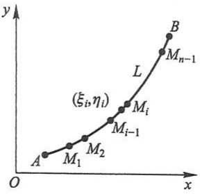

line

| Point | x | y |
| --- | --- | --- |
| A | ~0.2 | ~0.3 |
| M1 | ~0.4 | ~0.5 |
| M2 | ~0.6 | ~0.7 |
| Mi-1 | ~0.8 | ~1.0 |
| Mi | ~1.0 | ~1.3 |
| L | ~1.2 | ~1.6 |
| Mn-1 | ~1.4 | ~2.2 |
| B | ~1.6 | ~2.8 |

图11-1

段,取其中一小段构件 $\widehat{M_{i-1}M_i}$ 来分析.在线密度连续变化的前提下,只要这小段很短,就可以用这小段上任一点 $(\xi_{i},\eta_{i})$ 处的线密度代替这小段上其他各点处的线密度，从而得到这小段构件的质量的近似值为

<small>① 本章讨论的都是具有有限长度的曲线和具有有限面积的曲面.</small>

$$
\mu (\xi_ {i}, \eta_ {i}) \Delta s _ {i},
$$

其中 $\Delta s_{i}$ 表示 $\widehat{M_{i - 1}M_i}$ 的长度，于是整个曲线形构件的质量

$$
m \approx \sum_ {i = 1} ^ {n} \mu (\xi_ {i}, \eta_ {i}) \Delta s _ {i}.
$$

用 $\lambda$ 表示 $n$ 个小弧段的最大长度.为了计算 $m$ 的精确值,取上式右端之和当 $\lambda \rightarrow 0$ 时的极限,从而得到

$$
m = \lim _ {\lambda \to 0} \sum_ {i = 1} ^ {n} \mu (\xi_ {i}, \eta_ {i}) \Delta s _ {i}.
$$

这种和的极限在研究其他问题时也会遇到.现在引进下面的定义:

定义 设 L 为 xOy 面内的一条光滑曲线弧, 函数  $f(x,y)$  在 L 上有界. 在 L 上任意插入一点列  $M_{1}, M_{2}, \cdots, M_{n-1}$  把 L 分成 n 个小段. 设第 i 个小段的长度为  $\Delta s_{i}$ . 又  $(\xi_{i}, \eta_{i})$  为第 i 个小段上任意取定的一点, 作乘积  $f(\xi_{i}, \eta_{i}) \Delta s_{i} \quad (i=1,2,\cdots,n)$ , 并作和  $\sum_{i=1}^{n} f(\xi_{i}, \eta_{i}) \Delta s_{i}$ , 如果当各小弧段的长度的最大值  $\lambda \to 0$  时, 这和的极限总存在, 且与曲线弧 L 的分法及点  $(\xi_{i}, \eta_{i})$  的取法无关, 那么称此极限为函数  $f(x,y)$  在曲线弧 L 上对弧长的曲线积分或第一类曲线积分, 记作  $\int_{L} f(x,y) \, ds$ , 即

$$
\int_ {L} f (x, y) \mathrm{d} s = \lim _ {\lambda \to 0} \sum_ {i = 1} ^ {n} f (\xi_ {i}, \eta_ {i}) \Delta s _ {i},
$$

其中 $f(x,y)$ 叫做被积函数，$L$ 叫做积分弧段.

在第二目中我们将看到, 当 $f(x, y)$ 在光滑曲线弧 $L$ 上连续时, 对弧长的曲线积分 $\int_{L} f(x, y) \mathrm{d}s$ 是存在的. 以后我们总假定 $f(x, y)$ 在 $L$ 上是连续的.

根据这个定义,前述曲线形构件的质量 m 当线密度  $\mu(x,y)$  在 L 上连续时,就等于  $\mu(x,y)$  对弧长的曲线积分,即

$$
m = \int_ {L} \mu (x, y)   \mathrm{d} s.
$$

上述定义可以类似地推广到积分弧段为空间曲线弧 $\Gamma$ 的情形, 即函数 $f(x, y, z)$ 在曲线弧 $\Gamma$ 上对弧长的曲线积分

$$
\int_ {\Gamma} f (x, y, z) \mathrm{d} s = \lim _ {\lambda \to 0} \sum_ {i = 1} ^ {n} f (\xi_ {i}, \eta_ {i}, \zeta_ {i}) \Delta s _ {i}.
$$

如果 $L$ （或 $\Gamma$ )是分段光滑的①，我们规定函数在 $L$ （或 $\Gamma$ )上的曲线积分等于函数在光滑的各段上的曲线积分之和.例如,设 L 可分成两段光滑曲线弧  $L_{1}$  及  $L_{2}$  （记作  $L=L_{1}+L_{2}$ ），就规定

<small>① 就是说, $L$ (或 $\Gamma$) 可以分成有限段, 而每一段都是光滑的. 以后我们总假定 $L$ (或 $\Gamma$) 是光滑的或分段光滑的.</small>

$$
\int_ {L _ {1} + L _ {2}} f (x, y) \mathrm{d} s = \int_ {L _ {1}} f (x, y) \mathrm{d} s + \int_ {L _ {2}} f (x, y) \mathrm{d} s.
$$

如果 $L$ 是闭曲线, 那么函数 $f(x, y)$ 在闭曲线 $L$ 上对弧长的曲线积分记为 $\oint_{L} f(x, y) \mathrm{d}s$.

由对弧长的曲线积分的定义可知,它有以下性质:

性质 1 设  $\alpha,\beta$  为常数, 则

$$
\int_ {L} \left[ \alpha f (x, y) + \beta g (x, y) \right] \mathrm{d} s = \alpha \int_ {L} f (x, y) \mathrm{d} s + \beta \int_ {L} g (x, y) \mathrm{d} s.
$$

性质2 若积分弧段 $L$ 可分成两段光滑曲线弧 $L_{1}$ 和 $L_{2}$，则

$$
\int_ {L} f (x, y) \mathrm{d} s = \int_ {L _ {1}} f (x, y) \mathrm{d} s + \int_ {L _ {2}} f (x, y) \mathrm{d} s.
$$

性质3 设在 $L$ 上 $f(x,y)\leqslant g(x,y)$ ，则

$$
\int_ {L} f (x, y) \mathrm{d} s \leqslant \int_ {L} g (x, y) \mathrm{d} s.
$$

特别地,有

$$
\left| \int_ {L} f (x, y)   \mathrm{d} s \right| \leqslant \int_ {L} | f (x, y) |   \mathrm{d} s.
$$

## 二、对弧长的曲线积分的计算法

定理 设 $f(x,y)$ 在曲线弧 $L$ 上有定义且连续，$L$ 的参数方程为

$$
\left\{ \begin{array}{l l} x = \varphi (t), \\ y = \psi (t) \end{array} \right. (\alpha \leqslant t \leqslant \beta),
$$

若 $\varphi(t), \psi(t)$ 在 $[\alpha, \beta]$ 上具有一阶连续导数，且 $\varphi'^2(t) + \psi'^2(t) \neq 0$，则曲线积分 $\int_{L} f(x, y) \mathrm{d}s$ 存在，且

$$
\int_ {L} f (x, y) \mathrm{d} s = \int_ {\alpha} ^ {\beta} f [ \varphi (t), \psi (t) ] \sqrt {\varphi^ {\prime 2} (t) + \psi^ {\prime 2} (t)} \mathrm{d} t \quad (\alpha <   \beta). \tag {1-1}
$$

证 假定当参数 $t$ 由 $\alpha$ 变至 $\beta$ 时, $L$ 上的点 $M(x,y)$ 依点 $A$ 至点 $B$ 的方向描出曲线弧 $L$. 在 $L$ 上取一列点

$$
A = M _ {0}, M _ {1}, M _ {2}, \dots , M _ {n - 1}, M _ {n} = B,
$$

它们对应于一列单调增加的参数值

$$
\alpha = t _ {0} <   t _ {1} <   t _ {2} <   \dots <   t _ {n - 1} <   t _ {n} = \beta .
$$

根据对弧长的曲线积分的定义,有

$$
\int_ {L} f (x, y) \mathrm{d} s = \lim _ {\lambda \to 0} \sum_ {i = 1} ^ {n} f (\xi_ {i}, \eta_ {i}) \Delta s _ {i}.
$$

设点 $(\xi_{i},\eta_{i})$ 对应于参数值 $\tau_{i}$ ，即 $\xi_{i} = \varphi (\tau_{i}),\eta_{i} = \psi (\tau_{i})$ ，这里 $t_{i - 1}\leqslant \tau_i\leqslant t_i.$ 由于

$$
\Delta s _ {i} = \int_ {t _ {i - 1}} ^ {t _ {i}} \sqrt {\varphi^ {\prime 2} (t) + \psi^ {\prime 2} (t)} \mathrm{d} t,
$$

应用积分中值定理,有

$$
\Delta s _ {i} = \sqrt {\varphi^ {' 2} (\tau_ {i} ^ {\prime}) + \psi^ {' 2} (\tau_ {i} ^ {\prime})}   \Delta t _ {i},
$$

其中 $\Delta t_{i} = t_{i} - t_{i - 1},t_{i - 1}\leqslant \tau_{i}^{\prime}\leqslant t_{i}$ .于是

$$
\int_ {L} f (x, y) \mathrm{d} s = \lim _ {\lambda \rightarrow 0} \sum_ {i = 1} ^ {n} f [ \varphi (\tau_ {i}), \psi (\tau_ {i}) ] \sqrt {\varphi^ {\prime 2} (\tau_ {i} ^ {\prime}) + \psi^ {\prime 2} (\tau_ {i} ^ {\prime})} \Delta t _ {i}.
$$

由于函数 $\sqrt{\varphi'^2(t) + \psi'^2(t)}$ 在闭区间 $[\alpha, \beta]$ 上连续，我们可以把上式中的 $\tau_i'$ 换成 $\tau_i^{①}$，从而

$$
\int_ {L} f (x, y) \mathrm{d} s = \lim _ {\lambda \to 0} \sum_ {i = 1} ^ {n} f [ \varphi (\tau_ {i}), \psi (\tau_ {i}) ] \sqrt {\varphi^ {\prime 2} (\tau_ {i}) + \psi^ {\prime 2} (\tau_ {i})} \Delta t _ {i}.
$$

上式右端的和的极限就是函数 $f[\varphi(t), \psi(t)]\sqrt{\varphi'^2(t) + \psi'^2(t)}$ 在区间 $[\alpha, \beta]$ 上的定积分，因为这个函数在 $[\alpha, \beta]$ 上连续，所以这个定积分是存在的，因此上式左端的曲线积分 $\int_{L} f(x, y) \mathrm{d}s$ 也存在，并且有

$$
\int_ {L} f (x, y) \mathrm{d} s = \int_ {\alpha} ^ {\beta} f [ \varphi (t), \psi (t) ] \sqrt {\varphi^ {\prime 2} (t) + \psi^ {\prime 2} (t)} \mathrm{d} t \quad (\alpha <   \beta). \tag {1-1}
$$

公式(1-1)表明,计算对弧长的曲线积分 $\int_{L}f(x,y)\mathrm{d}s$ 时,只要把x,y,ds依次换为 $\varphi(t),\psi(t),\sqrt{\varphi'^{2}(t)+\psi'^{2}(t)}\mathrm{d}t$ ,然后从 $\alpha$ 到 $\beta$ 作定积分就行了,这里必须注意,定积分的下限 $\alpha$ 一定要小于上限 $\beta$ .这是因为,从上述推导中可以看出,由于小弧段的长度 $\Delta s_{i}$ 总是正的,从而 $\Delta t_{i}>0$ ,所以定积分的下限 $\alpha$ 一定小于上限 $\beta$ .

如果曲线弧 $L$ 由方程

$$
y = \psi (x) \quad (x _ {0} \leqslant x \leqslant X)
$$

给出,那么可以把这种情形看做是特殊的参数方程

$$
x = t, \quad y = \psi (t) \quad (x _ {0} \leqslant t \leqslant X)
$$

的情形,从而由公式(1-1)得出

$$
\int_ {L} f (x, y) \mathrm{d} s = \int_ {x _ {0}} ^ {X} f [ x, \psi (x) ] \sqrt {1 + \psi^ {\prime 2} (x)} \mathrm{d} x \quad (x _ {0} <   X). \tag {1-2}
$$

类似地,如果曲线弧 L 由方程

<small>① 它的证明要用到函数  $\sqrt{\varphi'^{2}(t)+\psi'^{2}(t)}$  在闭区间  $[\alpha,\beta]$  上的一致连续性, 这里从略.</small>

$$
x = \varphi (y) \quad (y _ {0} \leqslant y \leqslant Y)
$$

给出,那么有

$$
\int_ {L} f (x, y) \mathrm{d} s = \int_ {y _ {0}} ^ {Y} f [ \varphi (y), y ] \sqrt {1 + \varphi^ {\prime 2} (y)} \mathrm{d} y \quad (y _ {0} <   Y). \tag {1-3}
$$

公式(1-1)可推广到空间曲线弧 $\Gamma$ 由参数方程

$$
x = \varphi (t), \quad y = \psi (t), \quad z = \omega (t) \quad (\alpha \leqslant t \leqslant \beta)
$$

给出的情形,这时有

$$
\int_ {\Gamma} f (x, y, z) \mathrm{d} s = \int_ {\alpha} ^ {\beta} f [ \varphi (t), \psi (t), \omega (t) ] \sqrt {\varphi^ {\prime 2} (t) + \psi^ {\prime 2} (t) + \omega^ {\prime 2} (t)} \mathrm{d} t \quad (\alpha <   \beta). \tag {1-4}
$$

例1 计算 $\int_{L} \sqrt{y} \, \mathrm{d}s$，其中 $L$ 是抛物线 $y = x^2$ 上点 $O(0,0)$ 与点 $B(1,1)$ 之间的一段弧（图11-2）.

解 由于 $L$ 由方程 $y = x^{2}$ （$0 \leqslant x \leqslant 1$）给出，因此

$$
\int_ {L} \sqrt {y} \mathrm{d} s = \int_ {0} ^ {1} \sqrt {x ^ {2}} \sqrt {1 + (x ^ {2}) ^ {\prime 2}} \mathrm{d} x = \int_ {0} ^ {1} x \sqrt {1 + 4 x ^ {2}} \mathrm{d} x = \left[ \frac {1}{1 2} (1 + 4 x ^ {2}) ^ {3 / 2} \right] _ {0} ^ {1} = \frac {1}{1 2} (5 \sqrt {5} - 1).
$$

例 2 计算半径为 R、中心角为  $2\alpha$  的圆弧 L 对于它的对称轴的转动惯量 I（设线密度  $\mu=1$ ）.

解 取坐标系如图 11-3 所示, 则

$$
I = \int_ {L} y ^ {2} \mathrm{d} s.
$$

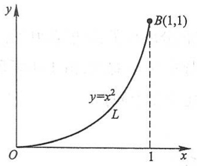

line

| Point | X | Y |
| --- | --- | --- |
| L | 0 | 0 |
| B(1,1) | 1 | 1 |

图11-2

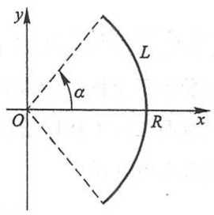

text_image

y
L
α
O
R
x

图11-3

为了便于计算,利用 L 的参数方程

$$
x = R \cos \theta , \quad y = R \sin \theta \quad (- \alpha \leqslant \theta \leqslant \alpha).
$$

于是

$$
\begin{array}{l} I = \int_ {L} y ^ {2} \mathrm{d} s = \int_ {- \alpha} ^ {\alpha} R ^ {2} \sin^ {2} \theta \sqrt {\left(- R \sin \theta\right) ^ {2} + \left(R \cos \theta\right) ^ {2}} \mathrm{d} \theta \\ = R ^ {3} \int_ {- \alpha} ^ {\alpha} \sin^ {2} \theta \mathrm{d} \theta = \frac {R ^ {3}}{2} \left[ \theta - \frac {\sin 2 \theta}{2} \right] _ {- \alpha} ^ {\alpha} = \frac {R ^ {3}}{2} (2 \alpha - \sin 2 \alpha) = R ^ {3} (\alpha - \sin \alpha \cos \alpha). \\ \end{array}
$$

例3 计算曲线积分 $\int_{\Gamma} (x^2 + y^2 + z^2) \, \mathrm{d}s$，其中 $\Gamma$ 为螺旋线 $x = a \cos t, y = a \sin t, z = kt$ 上相应于 $t$ 从0到 $2\pi$ 的一段弧.

解 $\int_{\Gamma}\left(x^{2} + y^{2} + z^{2}\right)\mathrm{d}s$

$$
\begin{array}{l} = \int_ {0} ^ {2 \pi} \left[ (a \cos t) ^ {2} + (a \sin t) ^ {2} + (k t) ^ {2} \right] \sqrt {(- a \sin t) ^ {2} + (a \cos t) ^ {2} + k ^ {2}} \mathrm{d} t \\ = \int_ {0} ^ {2 \pi} (a ^ {2} + k ^ {2} t ^ {2}) \sqrt {a ^ {2} + k ^ {2}} \mathrm{d} t = \sqrt {a ^ {2} + k ^ {2}} \left[ a ^ {2} t + \frac {k ^ {2}}{3} t ^ {3} \right] _ {0} ^ {2 \pi} \\ = \frac {2}{3} \pi \sqrt {a ^ {2} + k ^ {2}} (3 a ^ {2} + 4 \pi^ {2} k ^ {2}). \\ \end{array}
$$

## 习题11-1

1. 设在 $xOy$ 面内有一分布着质量的曲线弧 $L$, 在点 $(x, y)$ 处它的线密度为 $\mu(x, y)$. 用对弧长的曲线积分分别表达:

(1) 这曲线弧对 x 轴、对 y 轴的转动惯量  $I_{x}, I_{y}$ ;
(2) 这曲线弧的质心坐标  $\bar{x}, \bar{y}$ .

2. 利用对弧长的曲线积分的定义证明性质 3.

3. 计算下列对弧长的曲线积分:

(1) $\oint_{L} (x^{2} + y^{2})^{n} \mathrm{~d}s$, 其中 $L$ 为圆周 $x = a \cos t, y = a \sin t$ ($0 \leqslant t \leqslant 2\pi$);
(2) $\int_{L}(x+y)\mathrm{d}s$ ,其中L为连接(1,0)及(0,1)两点的直线段；
(3) $\oint_{L}x\mathrm{d}s$ ,其中L为由直线y=x及抛物线 $y=x^{2}$ 所围成的区域的整个边界;
(4) $\oint_{L} \mathrm{e}^{\sqrt{x^2 + y^2}} \, \mathrm{d}s$, 其中 $L$ 为圆周 $x^2 + y^2 = a^2$, 直线 $y = x$ 及 $x$ 轴在第一象限内所围成的扇形的整个边界;
(5) $\int_{\Gamma} \frac{1}{x^2 + y^2 + z^2} \, \mathrm{d}s$，其中 $\Gamma$ 为曲线 $x = e^t \cos t, y = e^t \sin t, z = e^t$ 上相应于 $t$ 从0变到2的这段弧；
(6) $\int_{\Gamma} x^2 y z \mathrm{~d}s$, 其中 $\Gamma$ 为折线 $ABCD$, 这里 $A, B, C, D$ 依次为点 $(0,0,0),(0,0,2),(1,0,2),(1,3,2)$;
(7) $\int_{L} y^{2} \mathrm{~d}s$, 其中 $L$ 为摆线的一拱 $x = a(t - \sin t)$, $y = a(1 - \cos t)$ ($0 \leqslant t \leqslant 2\pi$);
(8) $\int_{L}(x^{2} + y^{2})\mathrm{d}s$ ，其中 $L$ 为曲线 $x = a(\cos t + t\sin t),y = a(\sin t - t\cos t)$ （$0\leqslant t\leqslant 2\pi$）.

4. 求半径为 a、圆心角为  $2\varphi$  的均匀圆弧（线密度  $\mu=1$ ）的质心.

5. 设螺旋形弹簧一圈的方程为 $x = a\cos t, y = a\sin t, z = kt$，其中 $0 \leqslant t \leqslant 2\pi$，它的线密度 $\rho(x, y, z) = x^2 + y^2 + z^2$。求: