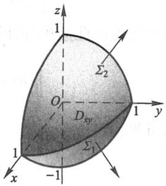
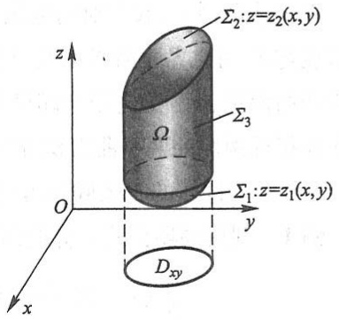
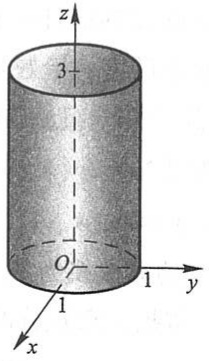
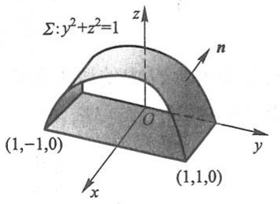
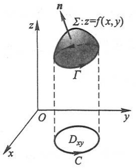
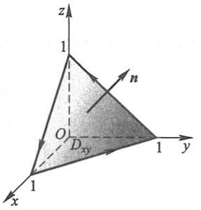
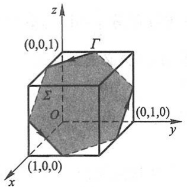
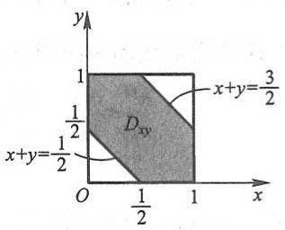
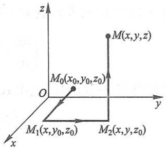
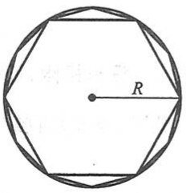

令各小块曲面的直径的最大值 $\lambda \rightarrow 0$ 取上式两端的极限, 就得到

$$
\iint_ {\Sigma} R (x, y, z) \mathrm{d} x \mathrm{d} y = \iint_ {D _ {x y}} R [ x, y, z (x, y) ] \mathrm{d} x \mathrm{d} y. \tag {5-3}
$$

这就是把对坐标的曲面积分化为二重积分的公式. 公式(5-3)表明, 计算曲面积分  $\iint_{\Sigma} R(x, y, z) \, dx \, dy$  时, 只需将其中变量 z 换为表示  $\Sigma$  的函数  $z(x, y)$ , 然后在  $\Sigma$  的投影区域  $D_{xy}$  上计算二重积分即可.

必须注意,公式(5-3)的曲面积分是取在曲面  $\Sigma$  上侧的,如果曲面积分取在  $\Sigma$  的下侧,这时  $\cos\gamma<0$ ,那么

$$
(\Delta S _ {i}) _ {x y} = - (\Delta \sigma_ {i}) _ {x y},
$$

从而有

$$
\iint_ {\Sigma} R (x, y, z) \mathrm{d} x \mathrm{d} y = - \iint_ {D _ {x y}} R [ x, y, z (x, y) ] \mathrm{d} x \mathrm{d} y. \tag {$5-3^{\prime$}}
$$

类似地,如果  $\Sigma$  由  $x=x(y,z)$  给出,那么有

$$
\iint_ {\Sigma} P (x, y, z) \mathrm{d} y \mathrm{d} z = \pm \iint_ {D _ {y z}} P [ x (y, z), y, z ] \mathrm{d} y \mathrm{d} z, \tag {5-4}
$$

等式右端的符号这样决定:积分曲面  $\Sigma$  是由方程  $x=x(y,z)$  所给出的曲面前侧,即  $\cos\alpha>0$ , 应取正号; 反之,  $\Sigma$  取后侧, 即  $\cos\alpha<0$ , 应取负号.

如果 $\Sigma$ 由 $y = y(z,x)$ 给出，那么有

$$
\iint_ {\Sigma} Q (x, y, z) \mathrm{d} z \mathrm{d} x = \pm \iint_ {D _ {z x}} Q [ x, y (z, x), z ] \mathrm{d} z \mathrm{d} x, \tag {5-5}
$$

等式右端的符号这样决定:积分曲面  $\Sigma$  是由方程  $y=y(z,x)$  所给出的曲面右侧,即  $\cos\beta>0$ , 应取正号; 反之,  $\Sigma$  取左侧, 即  $\cos\beta<0$ , 应取负号.

例1 计算曲面积分

$$
\iint_ {\Sigma} x ^ {2} \mathrm{d} y \mathrm{d} z + y ^ {2} \mathrm{d} z \mathrm{d} x + z ^ {2} \mathrm{d} x \mathrm{d} y,
$$

其中 $\Sigma$ 是长方体 $\Omega$ 的整个表面的外侧，$\Omega = \{(x, y, z) \mid 0 \leqslant x \leqslant a, 0 \leqslant y \leqslant b, 0 \leqslant z \leqslant c\}$.

解 把有向曲面 $\Sigma$ 分成以下六部分:

$\Sigma_{1}:z = c(0\leqslant x\leqslant a,0\leqslant y\leqslant b)$ 的上侧，

$\Sigma_{2}:z = 0(0\leqslant x\leqslant a,0\leqslant y\leqslant b)$ 的下侧，

$\Sigma_{3}:x = a(0\leqslant y\leqslant b,0\leqslant z\leqslant c)$ 的前侧，

$\Sigma_{4}:x = 0(0\leqslant y\leqslant b,0\leqslant z\leqslant c)$ 的后侧，

$\Sigma_{5}:y = b(0\leqslant x\leqslant a,0\leqslant z\leqslant c)$ 的右侧，

$\Sigma_6:y = 0$ （ $0\leqslant x\leqslant a,0\leqslant z\leqslant c)$ 的左侧.

除 $\Sigma_3, \Sigma_4$ 外，其余四片曲面在 $yOz$ 面上的投影为零，因此

$$
\iint_ {\Sigma} x ^ {2} \mathrm{d} y \mathrm{d} z = \iint_ {\Sigma_ {3}} x ^ {2} \mathrm{d} y \mathrm{d} z + \iint_ {\Sigma_ {4}} x ^ {2} \mathrm{d} y \mathrm{d} z.
$$

应用公式(5-4)就有

$$
\iint_ {\Sigma} x ^ {2} \mathrm{d} y \mathrm{d} z = \iint_ {D _ {y z}} a ^ {2} \mathrm{d} y \mathrm{d} z - \iint_ {D _ {y z}} 0 ^ {2} \mathrm{d} y \mathrm{d} z = a ^ {2} b c.
$$

类似地可得

$$
\iint_ {\Sigma} y ^ {2} \mathrm{d} z \mathrm{d} x = b ^ {2} a c, \iint_ {\Sigma} z ^ {2} \mathrm{d} x \mathrm{d} y = c ^ {2} a b.
$$

于是所求曲面积分为 $(a+b+c)abc$ .

例 2 计算曲面积分  $\iint_{\Sigma} xyz \, dx \, dy$ ，其中  $\Sigma$  是球面  $x^{2} + y^{2} + z^{2} = 1$  外侧在  $x \geqslant 0, y \geqslant 0$  的部分.

解 把 $\Sigma$ 分为 $\Sigma_{1}$ 和 $\Sigma_{2}$ 两部分（图11-24），$\Sigma_{1}$ 的方程为

$$
z _ {1} = - \sqrt {1 - x ^ {2} - y ^ {2}},
$$

$\Sigma_{2}$  的方程为

$$
z _ {2} = \sqrt {1 - x ^ {2} - y ^ {2}}.
$$

$$
\iint_ {\Sigma} x y z \mathrm{d} x \mathrm{d} y = \iint_ {\Sigma_ {2}} x y z \mathrm{d} x \mathrm{d} y + \iint_ {\Sigma_ {1}} x y z \mathrm{d} x \mathrm{d} y.
$$

text_image

z
1
Σ₂
O
Dₓᵧ
1
y
1
Σ₁
-1
x

图11-24

上式右端的第一个积分的积分曲面 $\Sigma_{2}$ 取上侧，第二个积分的积分曲面 $\Sigma_{1}$ 取下侧，因此分别应用公式(5-3)及(5-3')，就有

$$
\begin{array}{l} \iint_ {\Sigma} x y z \mathrm{d} x \mathrm{d} y = \iint_ {D _ {x y}} x y \sqrt {1 - x ^ {2} - y ^ {2}} \mathrm{d} x \mathrm{d} y - \iint_ {D _ {x y}} x y (- \sqrt {1 - x ^ {2} - y ^ {2}}) \mathrm{d} x \mathrm{d} y \\ = 2 \iint_ {D _ {x y}} x y \sqrt {1 - x ^ {2} - y ^ {2}} \mathrm{d} x \mathrm{d} y. \\ \end{array}
$$

其中 $D_{xy}$ 是 $\Sigma_1$ 及 $\Sigma_2$ 在 $xOy$ 面上的投影区域，就是位于第一象限内的扇形 $x^{2} + y^{2}\leqslant 1$ $(x\geqslant 0,y\geqslant 0)$ .利用极坐标计算这个二重积分如下:

$$
\begin{array}{l} 2 \iint_ {D _ {x y}} x y \sqrt {1 - x ^ {2} - y ^ {2}} \mathrm{d} x \mathrm{d} y = 2 \iint_ {D _ {x y}} \rho^ {2} \sin \theta \cos \theta \sqrt {1 - \rho^ {2}} \rho \mathrm{d} \rho \mathrm{d} \theta \\ = \int_ {0} ^ {\frac {\pi}{2}} \sin 2 \theta \mathrm{d} \theta \int_ {0} ^ {1} \rho^ {3} \sqrt {1 - \rho^ {2}} \mathrm{d} \rho = 1 \times \frac {2}{1 5} = \frac {2}{1 5}, \\ \end{array}
$$

从而

$$
\iint_ {\Sigma} x y z \mathrm{d} x \mathrm{d} y = \frac {2}{1 5}.
$$

## 三、两类曲面积分之间的联系

设有向曲面 $\Sigma$ 由方程 $z = z(x, y)$ 给出，$\Sigma$ 在 $xOy$ 面上的投影区域为 $D_{xy}$，函数 $z = z(x, y)$ 在 $D_{xy}$ 上具有一阶连续偏导数，$R(x, y, z)$ 在 $\Sigma$ 上连续。如果 $\Sigma$ 取上侧，那么由对坐标的曲面积分计算公式(5-3)有

$$
\iint_ {\Sigma} R (x, y, z) \mathrm{d} x \mathrm{d} y = \iint_ {D _ {x y}} R [ x, y, z (x, y) ] \mathrm{d} x \mathrm{d} y.
$$

另一方面,因上述有向曲面  $\Sigma$  的法向量的方向余弦为

$$
\cos \alpha = \frac {- z _ {x}}{\sqrt {1 + z _ {x} ^ {2} + z _ {y} ^ {2}}}, \quad \cos \beta = \frac {- z _ {y}}{\sqrt {1 + z _ {x} ^ {2} + z _ {y} ^ {2}}}, \quad \cos \gamma = \frac {1}{\sqrt {1 + z _ {x} ^ {2} + z _ {y} ^ {2}}},
$$

故由对面积的曲面积分计算公式有

$$
\iint_ {\Sigma} R (x, y, z) \cos \gamma \mathrm{d} S = \iint_ {D _ {x y}} R [ x, y, z (x, y) ] \mathrm{d} x \mathrm{d} y.
$$

由此可见,有

$$
\iint_ {\Sigma} R (x, y, z) \mathrm{d} x \mathrm{d} y = \iint_ {\Sigma} R (x, y, z) \cos \gamma \mathrm{d} S. \tag {5-6}
$$

如果 $\Sigma$ 取下侧, 那么由式(5-3')有

$$
\iint_ {\Sigma} R (x, y, z) \mathrm{d} x \mathrm{d} y = - \iint_ {D _ {x y}} R [ x, y, z (x, y) ] \mathrm{d} x \mathrm{d} y.
$$

但这时  $\cos\gamma=\frac{-1}{\sqrt{1+z_{x}^{2}+z_{y}^{2}}}$ ，因此(5-6)式仍成立.

类似地可推得

$$
\iint_ {\Sigma} P (x, y, z) \mathrm{d} y \mathrm{d} z = \iint_ {\Sigma} P (x, y, z) \cos \alpha \mathrm{d} S, \tag {5-7}
$$

$$
\iint_ {\Sigma} Q (x, y, z) \mathrm{d} z \mathrm{d} x = \iint_ {\Sigma} Q (x, y, z) \cos \beta \mathrm{d} S. \tag {5-8}
$$

合并(5-6)、(5-7)、(5-8)三式,得两类曲面积分之间的如下联系:

$$
\iint_ {\Sigma} P \mathrm{d} y \mathrm{d} z + Q \mathrm{d} z \mathrm{d} x + R \mathrm{d} x \mathrm{d} y = \iint_ {\Sigma} (P \cos \alpha + Q \cos \beta + R \cos \gamma) \mathrm{d} S, \tag {5-9}
$$

其中 $\cos \alpha, \cos \beta$ 与 $\cos \gamma$ 是有向曲面 $\Sigma$ 在点 $(x, y, z)$ 处的法向量的方向余弦.

两类曲面积分之间的联系也可写成如下的向量形式:

$$
\iint_ {\Sigma} A \cdot \mathrm{d} S = \iint_ {\Sigma} A \cdot n \mathrm{d} S \tag {5-10}
$$

或

$$
\iint_ {\Sigma} \boldsymbol {A} \cdot \mathrm{d} \boldsymbol {S} = \iint_ {\Sigma} A _ {n} \mathrm{d} S, \tag {$5-10^{\prime$}}
$$

其中 $A = (P, Q, R), n = (\cos \alpha, \cos \beta, \cos \gamma)$ 为有向曲面 $\Sigma$ 在点 $(x, y, z)$ 处的单位法向量，$\mathrm{d}S = n\mathrm{d}S = (\mathrm{d}y\mathrm{d}z, \mathrm{d}z\mathrm{d}x, \mathrm{d}x\mathrm{d}y)$ 称为有向曲面元，$A_{n}$ 为向量 $A$ 在向量 $n$ 上的投影.

例3 计算曲面积分 $\iint_{\Sigma}(z^2 + x) \, \mathrm{d}y \, \mathrm{d}z - z \, \mathrm{d}x \, \mathrm{d}y$，其中 $\Sigma$ 是旋转抛物面 $z = \frac{1}{2}(x^2 + y^2)$ 介于平面 $z = 0$ 及 $z = 2$ 之间的部分的下侧.

解法一 把 $\Sigma$ 分为 $\Sigma_{\text{前}}, \Sigma_{\text{后}}$ 两部分, 它们在 $yOz$ 面上的投影区域为 $D_{yz}$,

$$
\begin{array}{l} \iint_ {\Sigma} \left(z ^ {2} + x\right) \mathrm{d} y \mathrm{d} z = \iint_ {\Sigma_ {\text {前}}} \left(z ^ {2} + x\right) \mathrm{d} y \mathrm{d} z + \iint_ {\Sigma_ {\text {后}}} \left(z ^ {2} + x\right) \mathrm{d} y \mathrm{d} z \\ = \iint_ {D _ {y z}} (z ^ {2} + \sqrt {2 z - y ^ {2}}) \mathrm{d} y \mathrm{d} z - \iint_ {D _ {y z}} (z ^ {2} - \sqrt {2 z - y ^ {2}}) \mathrm{d} y \mathrm{d} z \\ = 2 \iint_ {D _ {y z}} \sqrt {2 z - y ^ {2}} \mathrm{d} y \mathrm{d} z = 2 \int_ {- 2} ^ {2} \mathrm{d} y \int_ {\frac {1}{2} y ^ {2}} ^ {2} \sqrt {2 z - y ^ {2}} \mathrm{d} z = 4 \pi . \\ \end{array}
$$

$$
\iint_ {\Sigma} z \mathrm{d} x \mathrm{d} y = - \iint_ {D _ {x y}} \frac {1}{2} (x ^ {2} + y ^ {2}) \mathrm{d} x \mathrm{d} y = - \int_ {0} ^ {2 \pi} \mathrm{d} \theta \int_ {0} ^ {2} \frac {1}{2} \rho^ {2} \cdot \rho \mathrm{d} \rho = - 4 \pi .
$$

故

$$
\iint_ {\Sigma} (z ^ {2} + x) \mathrm{d} y \mathrm{d} z - z \mathrm{d} x \mathrm{d} y = 4 \pi - (- 4 \pi) = 8 \pi .
$$

解法二 利用两类曲面积分之间的联系(5-9)，将对坐标 y, z 的曲面积分转化为对坐标 x, y 的曲面积分

$$
\iint_ {\Sigma} (z ^ {2} + x) \mathrm{d} y \mathrm{d} z = \iint_ {\Sigma} (z ^ {2} + x) \cos \alpha \mathrm{d} S = \iint_ {\Sigma} (z ^ {2} + x) \frac {\cos \alpha}{\cos \gamma} \mathrm{d} x \mathrm{d} y.
$$

在曲面  $\Sigma$  上,有

$$
\cos \alpha = \frac {x}{\sqrt {1 + x ^ {2} + y ^ {2}}}, \quad \cos \gamma = \frac {- 1}{\sqrt {1 + x ^ {2} + y ^ {2}}}.
$$

故

$$
\iint_ {\Sigma} (z ^ {2} + x) \mathrm{d} y \mathrm{d} z - z \mathrm{d} x \mathrm{d} y = \iint_ {\Sigma} [ (z ^ {2} + x) (- x) - z ] \mathrm{d} x \mathrm{d} y.
$$

再按对坐标的曲面积分的计算法,便得

$$
\iint_ {\Sigma} (z ^ {2} + x) \mathrm{d} y \mathrm{d} z - z \mathrm{d} x \mathrm{d} y = - \iint_ {D _ {x y}} \left\{\left[ \frac {1}{4} (x ^ {2} + y ^ {2}) ^ {2} + x \right] \cdot (- x) - \frac {1}{2} (x ^ {2} + y ^ {2}) \right\} \mathrm{d} x \mathrm{d} y.
$$

利用积分区域及被积函数的对称性可知

$$
\iint_ {D _ {x y}} \frac {1}{4} x (x ^ {2} + y ^ {2}) ^ {2} \mathrm{d} x \mathrm{d} y = 0,
$$

故

$$
\begin{array}{l} \iint_ {\Sigma} (z ^ {2} + x) \mathrm{d} y \mathrm{d} z - z \mathrm{d} x \mathrm{d} y = \iint_ {D _ {x y}} \left[ x ^ {2} + \frac {1}{2} (x ^ {2} + y ^ {2}) \right] \mathrm{d} x \mathrm{d} y \\ = \int_ {0} ^ {2 \pi} \mathrm{d} \theta \int_ {0} ^ {2} \left(\rho^ {2} \cos^ {2} \theta + \frac {1}{2} \rho^ {2}\right) \rho \mathrm{d} \rho = 8 \pi . \\ \end{array}
$$

例题精讲

11-5

## 习题11-5

1. 按对坐标的曲面积分的定义证明公式

$$
\iint_ {\Sigma} \left[ P _ {1} (x, y, z) \pm P _ {2} (x, y, z) \right] \mathrm{d} y \mathrm{d} z = \iint_ {\Sigma} P _ {1} (x, y, z) \mathrm{d} y \mathrm{d} z \pm \iint_ {\Sigma} P _ {2} (x, y, z) \mathrm{d} y \mathrm{d} z.
$$

2. 当 $\Sigma$ 为 $xOy$ 面内的一个闭区域时，曲面积分 $\iint_{\Sigma} R(x, y, z) \, \mathrm{d}x \, \mathrm{d}y$ 与二重积分有什么关系？

3. 计算下列对坐标的曲面积分:

(1) $\iint_{\Sigma} x^{2} y^{2} z \, \mathrm{d}x \, \mathrm{d}y$，其中 $\Sigma$ 是球面 $x^{2} + y^{2} + z^{2} = R^{2}$ 的下半部分的下侧；
(2) $\iint_{\Sigma} z \, \mathrm{d}x \, \mathrm{d}y + x \, \mathrm{d}y \, \mathrm{d}z + y \, \mathrm{d}z \, \mathrm{d}x$，其中 $\Sigma$ 是柱面 $x^2 + y^2 = 1$ 被平面 $z = 0$ 及 $z = 3$ 所截得的在第 I 卦限内的部分的前侧；
(3) $\iint_{\Sigma} [f(x, y, z) + x] \, \mathrm{d}y \, \mathrm{d}z + [2f(x, y, z) + y] \, \mathrm{d}z \, \mathrm{d}x + [f(x, y, z) + z] \, \mathrm{d}x \, \mathrm{d}y$，其中 $f(x, y, z)$ 为连续函数，$\Sigma$ 是平面 $x - y + z = 1$ 在第IV卦限部分的上侧；
(4) $\oint_{\Sigma} xz \, \mathrm{d}x \, \mathrm{d}y + xy \, \mathrm{d}y \, \mathrm{d}z + yz \, \mathrm{d}z \, \mathrm{d}x$，其中 $\Sigma$ 是平面 $x = 0, y = 0, z = 0, x + y + z = 1$ 所围成的空间区域的整个边界曲面的外侧.

4. 把对坐标的曲面积分

$$
\iint_ {\Sigma} P (x, y, z) \mathrm{d} y \mathrm{d} z + Q (x, y, z) \mathrm{d} z \mathrm{d} x + R (x, y, z) \mathrm{d} x \mathrm{d} y
$$

化成对面积的曲面积分,其中

(1)  $\Sigma$  是平面  $3x + 2y + 2\sqrt{3}z = 6$  在第 I 卦限的部分的上侧；
(2)  $\Sigma$  是抛物面  $z=8-(x^{2}+y^{2})$  在 xOy 面上方的部分的上侧.

5. 计算

$$
\iint_ {\Sigma} (3 z + 1) x \mathrm{d} y \mathrm{d} z - \mathrm{d} z \mathrm{d} x + z \mathrm{d} x \mathrm{d} y,
$$

其中  $\Sigma$  是由曲线  $\left\{\begin{aligned}z&=\sqrt{y-1},\\ x&=0\end{aligned}\right.$  ( $1\leqslant y\leqslant3$ ) 绕 y 轴旋转一周所成的旋转曲面的左侧.

## 第六节 高斯公式 \* 通量与散度

## 一、高斯公式

格林公式表达了平面闭区域上的二重积分与其边界曲线上的曲线积分之间的关系,而高斯(Gauss)公式表达了空间闭区域上的三重积分与其边界曲面上的曲面积分之间的关系,这个关系可陈述如下:

定理1 设空间闭区域 $\Omega$ 是由分片光滑的闭曲面 $\Sigma$ 所围成, 若函数 $P(x,y,z)$, $Q(x,y,z)$ 与 $R(x,y,z)$ 在 $\Omega$ 上具有一阶连续偏导数, 则有

$$
\iiint_ {\Omega} \left(\frac {\partial P}{\partial x} + \frac {\partial Q}{\partial y} + \frac {\partial R}{\partial z}\right) \mathrm{d} V = \oiint_ {\Sigma} P \mathrm{d} y \mathrm{d} z + Q \mathrm{d} z \mathrm{d} x + R \mathrm{d} x \mathrm{d} y, \tag {6-1}
$$

或

$$
\iiint_ {\Omega} \left(\frac {\partial P}{\partial x} + \frac {\partial Q}{\partial y} + \frac {\partial R}{\partial z}\right) \mathrm{d} V = \oiint_ {\Sigma} (P \cos \alpha + Q \cos \beta + R \cos \gamma) \mathrm{d} S, \tag {$6-1^{\prime$}}
$$

这里 $\Sigma$ 是 $\Omega$ 的整个边界曲面的外侧，$\cos \alpha, \cos \beta$ 与 $\cos \gamma$ 是 $\Sigma$ 在点 $(x, y, z)$ 处的法向量的方向余弦. 公式(6-1)或(6-1')叫做高斯公式.

证 由公式(5-9)可知, 公式(6-1)及(6-1')的右端是相等的, 因此这里只要证明公式(6-1)就可以了.

设闭区域 $\Omega$ 在 $xOy$ 面上的投影区域为 $D_{xy}$. 假定穿过 $\Omega$ 内部且平行于 $z$ 轴的直线与 $\Omega$ 的边界曲面 $\Sigma$ 的交点恰好是两个. 这样, 可设 $\Sigma$ 由 $\Sigma_1, \Sigma_2$ 和 $\Sigma_3$ 三部分组成 (图11-25), 其中 $\Sigma_1$ 和 $\Sigma_2$ 分别由方程 $z = z_1(x, y)$ 和 $z = z_2(x, y)$ 给定, 这里 $z_1(x, y) \leqslant z_2(x, y), \Sigma_1$ 取下侧, $\Sigma_2$ 取上侧, $\Sigma_3$ 是以

text_image

Σ₂:z=z₂(x,y)
Σ₃
Ω
Σ₁:z=z₁(x,y)
O
y
x
Dₓᵧ

图11-25

$D_{xy}$  的边界曲线为准线而母线平行于 z 轴的柱面上的一部分, 取外侧.

根据三重积分的计算法,有

$$
\begin{array}{l} \iiint_ {\Omega} \frac {\partial R}{\partial z} \mathrm{d} V = \iint_ {D _ {x y}} \left\{\int_ {z _ {1} (x, y)} ^ {z _ {2} (x, y)} \frac {\partial R}{\partial z} \mathrm{d} z \right\} \mathrm{d} x \mathrm{d} y \\ = \iint_ {D _ {x y}} \left\{R [ x, y, z _ {2} (x, y) ] - R [ x, y, z _ {1} (x, y) ] \right\} \mathrm{d} x \mathrm{d} y. \tag {6-2} \\ \end{array}
$$

根据曲面积分的计算法,有

$$
\begin{array}{l} \iint_ {\Sigma_ {1}} R (x, y, z) \mathrm{d} x \mathrm{d} y = - \iint_ {D _ {x y}} R [ x, y, z _ {1} (x, y) ] \mathrm{d} x \mathrm{d} y. \\ \iint_ {\Sigma_ {2}} R (x, y, z) \mathrm{d} x \mathrm{d} y = \iint_ {D _ {x y}} R [ x, y, z _ {2} (x, y) ] \mathrm{d} x \mathrm{d} y. \\ \end{array}
$$

因为  $\Sigma_{3}$  上任意一块曲面在 xOy 面上的投影为零, 所以直接根据对坐标的曲面积分的定义可知

$$
\iint_ {\Sigma_ {3}} R (x, y, z) \mathrm{d} x \mathrm{d} y = 0.
$$

把以上三式相加,得

$$
\iint_ {\Sigma} R (x, y, z) \mathrm{d} x \mathrm{d} y = \iint_ {D _ {x y}} \left\{R [ x, y, z _ {2} (x, y) ] - R [ x, y, z _ {1} (x, y) ] \right\} \mathrm{d} x \mathrm{d} y. \tag {6-3}
$$

比较(6-2)与(6-3)两式,得

$$
\iiint_ {\Omega} \frac {\partial R}{\partial z} \mathrm{d} V = \iint_ {\Sigma} R (x, y, z) \mathrm{d} x \mathrm{d} y.
$$

如果穿过  $\Omega$  内部且平行于 x 轴的直线以及平行于 y 轴的直线与  $\Omega$  的边界曲面  $\Sigma$  的交点也都恰好是两个,那么类似地可得

$$
\iiint_ {\Omega} \frac {\partial P}{\partial x} \mathrm{d} V = \oiint_ {\Sigma} P (x, y, z) \mathrm{d} y \mathrm{d} z, \quad \iiint_ {\Omega} \frac {\partial Q}{\partial y} \mathrm{d} V = \oiint_ {\Sigma} Q (x, y, z) \mathrm{d} z \mathrm{d} x,
$$

把以上三式两端分别相加,即得高斯公式(6-1).

在上述证明中,我们对闭区域  $\Omega$  作了这样的限制,即穿过  $\Omega$  内部且平行于坐标轴的直线与  $\Omega$  的边界曲面  $\Sigma$  的交点恰好是两点.如果  $\Omega$  不满足这样的条件,可以引进几张辅助曲面把  $\Omega$  分为有限个闭区域,使得每个闭区域满足这样的条件,并注意到沿辅助曲面相反两侧的两个曲面积分的绝对值相等而符号相反,相加时正好抵消,因此公

式(6-1)对于这样的闭区域仍然是正确的.

例 1 利用高斯公式计算曲面积分

$$
\oiint_ {\Sigma} (x - y) \mathrm{d} x \mathrm{d} y + (y - z) x \mathrm{d} y \mathrm{d} z,
$$

其中  $\Sigma$  为柱面  $x^{2}+y^{2}=1$  及平面 z=0, z=3 所围成的空间闭区域  $\Omega$  的整个边界曲面的外侧(图 11-26).

解 因 $P = (y - z)x, Q = 0, R = x - y,$

$$
\frac {\partial P}{\partial x} = y - z, \quad \frac {\partial Q}{\partial y} = 0, \quad \frac {\partial R}{\partial z} = 0,
$$

利用高斯公式把所给曲面积分化为三重积分,得

$$
\oiint_ {\Sigma} (x - y) \mathrm{d} x \mathrm{d} y + (y - z) x \mathrm{d} y \mathrm{d} z = \iiint_ {\Omega} (y - z) \mathrm{d} x \mathrm{d} y \mathrm{d} z = 0 - \iiint_ {\Omega} z \mathrm{d} x \mathrm{d} y \mathrm{d} z = - \frac {9 \pi}{2},
$$

text_image

z
3
O
1
y
x
1

图11-26

其中 $\iiint_{\Omega} y \, \mathrm{d}x \, \mathrm{d}y \, \mathrm{d}z = 0$ 由积分区域及被积函数的对称性得出.

例 2 利用高斯公式计算曲面积分

$$
\iint_ {\Sigma} (x ^ {2} \cos \alpha + y ^ {2} \cos \beta + z ^ {2} \cos \gamma) \mathrm{d} S,
$$

其中  $\Sigma$  为锥面  $x^{2}+y^{2}=z^{2}$  介于平面 z=0 及平面  $z=h\quad(h>0)$  之间的部分的下侧， $\cos\alpha,\cos\beta$  与  $\cos\gamma$  是  $\Sigma$  在点  $(x,y,z)$  处的法向量的方向余弦.

解 因曲面 $\Sigma$ 不是封闭曲面, 故不能直接利用高斯公式. 若设 $\Sigma_{1}$ 为 $z = h (x^{2} + y^{2} \leqslant h^{2})$ 的上侧, 则 $\Sigma$ 与 $\Sigma_{1}$ 一起构成一个封闭曲面, 记它们围成的空间闭区域为 $\Omega$, 利用高斯公式, 便得

$$
\begin{array}{l} \oiint_ {\Sigma + \Sigma_ {1}} (x ^ {2} \cos \alpha + y ^ {2} \cos \beta + z ^ {2} \cos \gamma) \mathrm{d} S \\ = 2 \iiint_ {\Omega} (x + y + z) \mathrm{d} V = 2 \iint_ {D _ {x y}} \mathrm{d} x \mathrm{d} y \int_ {\sqrt {x ^ {2} + y ^ {2}}} ^ {h} (x + y + z) \mathrm{d} z, \\ \end{array}
$$

其中 $D_{xy} = \{(x,y) | x^2 + y^2 \leqslant h^2\}$. 注意到

$$
\iint_ {D _ {x y}} \mathrm{d} x \mathrm{d} y \int_ {\sqrt {x ^ {2} + y ^ {2}}} ^ {h} (x + y) \mathrm{d} z = 0,
$$

即得

$$
\oiint_ {\Sigma + \Sigma_ {1}} (x ^ {2} \cos \alpha + y ^ {2} \cos \beta + z ^ {2} \cos \gamma) \mathrm{d} S = \iint_ {D _ {x y}} (h ^ {2} - x ^ {2} - y ^ {2}) \mathrm{d} x \mathrm{d} y = \frac {1}{2} \pi h ^ {4}.
$$

而

$$
\iint_ {\Sigma_ {1}} \left(x ^ {2} \cos \alpha + y ^ {2} \cos \beta + z ^ {2} \cos \gamma\right) \mathrm{d} S = \iint_ {\Sigma_ {1}} z ^ {2} \mathrm{d} S = \iint_ {D _ {x y}} h ^ {2} \mathrm{d} x \mathrm{d} y = \pi h ^ {4}.
$$

因此

$$
\iint_ {\Sigma} \left(x ^ {2} \cos \alpha + y ^ {2} \cos \beta + z ^ {2} \cos \gamma\right) \mathrm{d} S = \frac {1}{2} \pi h ^ {4} - \pi h ^ {4} = - \frac {1}{2} \pi h ^ {4}.
$$

例3 设函数 $u(x,y,z)$ 和 $v(x,y,z)$ 在闭区域 $\Omega$ 上具有一阶及二阶连续偏导数，证明

$$
\iiint_ {\Omega} u \Delta v \mathrm{d} x \mathrm{d} y \mathrm{d} z = \oiint_ {\Sigma} u \frac {\partial v}{\partial n} \mathrm{d} S - \iiint_ {\Omega} \left(\frac {\partial u}{\partial x} \frac {\partial v}{\partial x} + \frac {\partial u}{\partial y} \frac {\partial v}{\partial y} + \frac {\partial u}{\partial z} \frac {\partial v}{\partial z}\right) \mathrm{d} x \mathrm{d} y \mathrm{d} z,
$$

其中  $\Sigma$  是闭区域  $\Omega$  的整个边界曲面， $\frac{\partial v}{\partial n}$  为函数  $v(x,y,z)$  沿  $\Sigma$  的外法向量的方向导数，
符号  $\Delta=\frac{\partial^{2}}{\partial x^{2}}+\frac{\partial^{2}}{\partial y^{2}}+\frac{\partial^{2}}{\partial z^{2}}$  称为拉普拉斯(Laplace)算子.这个公式叫做格林第一公式.

证 因为方向导数

$$
\frac {\partial v}{\partial n} = \frac {\partial v}{\partial x} \cos \alpha + \frac {\partial v}{\partial y} \cos \beta + \frac {\partial v}{\partial z} \cos \gamma ,
$$

其中 $\cos \alpha, \cos \beta$ 与 $\cos \gamma$ 是 $\Sigma$ 在点 $(x, y, z)$ 处的外法向量的方向余弦. 于是曲面积分

$$
\begin{array}{l} \oiint_ {\Sigma} u \frac {\partial v}{\partial n} \mathrm{d} S = \oiint_ {\Sigma} u \left(\frac {\partial v}{\partial x} \cos \alpha + \frac {\partial v}{\partial y} \cos \beta + \frac {\partial v}{\partial z} \cos \gamma\right) \mathrm{d} S \\ = \oint_ {\Sigma} \left[ \left(u \frac {\partial v}{\partial x}\right) \cos \alpha + \left(u \frac {\partial v}{\partial y}\right) \cos \beta + \left(u \frac {\partial v}{\partial z}\right) \cos \gamma \right] \mathrm{d} S. \\ \end{array}
$$

利用高斯公式,即得

$$
\begin{array}{l} \iint_ {\Sigma} u \frac {\partial v}{\partial n} \mathrm{d} S = \iiint_ {\Omega} \left[ \frac {\partial}{\partial x} \left(u \frac {\partial v}{\partial x}\right) + \frac {\partial}{\partial y} \left(u \frac {\partial v}{\partial y}\right) + \frac {\partial}{\partial z} \left(u \frac {\partial v}{\partial z}\right) \right] \mathrm{d} x \mathrm{d} y \mathrm{d} z \\ = \iiint_ {\Omega} u \Delta v \mathrm{d} x \mathrm{d} y \mathrm{d} z + \iiint_ {\Omega} \left(\frac {\partial u}{\partial x} \frac {\partial v}{\partial x} + \frac {\partial u}{\partial y} \frac {\partial v}{\partial y} + \frac {\partial u}{\partial z} \frac {\partial v}{\partial z}\right) \mathrm{d} x \mathrm{d} y \mathrm{d} z, \\ \end{array}
$$

将上式右端第二个积分移至左端便得所要证明的等式.

## \* 二、沿任意闭曲面的曲面积分为零的条件

现在提出与第三节第二目所讨论的问题相类似的问题,这就是:在怎样的条件下,曲面积分

$$
\iint_ {\Sigma} P \mathrm{d} y \mathrm{d} z + Q \mathrm{d} z \mathrm{d} x + R \mathrm{d} x \mathrm{d} y
$$

与曲面 $\Sigma$ 无关而只取决于 $\Sigma$ 的边界曲线？这问题相当于在怎样的条件下，沿任意闭曲面的曲面积分为零？这问题可用高斯公式来解决.

先介绍空间二维单连通区域及一维单连通区域的概念.对空间区域 $G$, 如果 $G$ 内任一闭曲面所围成的区域全属于 $G$, 则称 $G$ 是空间二维单连通区域; 如果 $G$ 内任一闭曲线总可以张成一片完全属于 $G$ 的曲面, 则称 $G$ 为空间一维单连通区域. 例如球面所围成的区域既是空间二维单连通的, 又是空间一维单连通的; 环面所围成的区域是空间二维单连通的, 但不是空间一维单连通的; 两个同心球面之间的区域是空间一维单连通的, 但不是空间二维单连通的.

对于沿任意闭曲面的曲面积分为零的条件,我们有以下结论:

定理2 设 $G$ 是空间二维单连通区域, 若 $P(x, y, z), Q(x, y, z)$ 与 $R(x, y, z)$ 在 $G$ 内具有一阶连续偏导数, 则曲面积分

$$
\iint_ {\Sigma} P \mathrm{d} y \mathrm{d} z + Q \mathrm{d} z \mathrm{d} x + R \mathrm{d} x \mathrm{d} y
$$

在 $G$ 内与所取曲面 $\Sigma$ 无关而只取决于 $\Sigma$ 的边界曲线（或沿 $G$ 内任一闭曲面的曲面积分为零）的充分必要条件是

$$
\frac {\partial P}{\partial x} + \frac {\partial Q}{\partial y} + \frac {\partial R}{\partial z} = 0 \tag {6-4}
$$

在 $G$ 内恒成立.

证 若等式(6-4)在 $G$ 内恒成立, 则由高斯公式(6-1)立即可看出沿 $G$ 内的任意闭曲面的曲面积分为零, 因此条件(6-4)是充分的. 反之, 设沿 $G$ 内的任一闭曲面的曲面积分为零, 若等式(6-4)在 $G$ 内不恒成立, 就是说在 $G$ 内至少有一点 $M_0$ 使得

$$
\left(\frac {\partial P}{\partial x} + \frac {\partial Q}{\partial y} + \frac {\partial R}{\partial z}\right) _ {M _ {0}} \neq 0,
$$

仿照第三节第二目中所用的方法,就可得出 G 内存在着闭曲面使得沿该闭曲面的曲面积分不等于零,这与假设相矛盾.因此条件(6-4)是必要的.证毕.

## \*三、通量与散度

设有向量场

$$
A (x, y, z) = P (x, y, z) i + Q (x, y, z) j + R (x, y, z) k,
$$

其中函数 P, Q 与 R 均具有一阶连续偏导数,  $\Sigma$  是场内的一片有向曲面, n 是  $\Sigma$  在点  $(x, y, z)$  处的单位法向量, 则积分

$$
\iint_ {\Sigma} \boldsymbol {A} \cdot \boldsymbol {n} \mathrm{d} S
$$

称为向量场 A 通过曲面  $\Sigma$  向着指定侧的通量(或流量).

由两类曲面积分的关系,通量又可表达为

$$
\iint_ {\Sigma} \boldsymbol {A} \cdot \boldsymbol {n} \mathrm{d} S = \iint_ {\Sigma} \boldsymbol {A} \cdot \mathrm{d} S = \iint_ {\Sigma} P \mathrm{d} y \mathrm{d} z + Q \mathrm{d} z \mathrm{d} x + R \mathrm{d} x \mathrm{d} y.
$$

例 4 求向量场  $A = yzj + z^{2}k$  穿过曲面  $\Sigma$  流向上侧的通量, 其中  $\Sigma$  为柱面  $y^{2} + z^{2} = 1 (z \geqslant 0)$  被平面 x = 0 及 x = 1 截下的有限部分(图 11-27).

解 曲面 $\Sigma$ 上侧的法向量可以由

$$
f (x, y, z) = y ^ {2} + z ^ {2}
$$

的梯度 $\nabla f$ 得出，即

$$
\boldsymbol {n} = \frac {\nabla f}{| \nabla f |} = \frac {2 y \boldsymbol {j} + 2 z \boldsymbol {k}}{\sqrt {(2 y) ^ {2} + (2 z) ^ {2}}} = y \boldsymbol {j} + z \boldsymbol {k} \quad (y ^ {2} + z ^ {2} = 1).
$$

在曲面 $\Sigma$ 上，

$$
A \cdot n = y ^ {2} z + z ^ {3} = z (y ^ {2} + z ^ {2}) = z.
$$

因此，A 穿过  $\Sigma$  流向上侧的通量为

text_image

Σ: y²+z²=1
(1,-1,0)
(1,1,0)
x
y
n
z

图11-27

$$
\iint_ {\Sigma} \boldsymbol {A} \cdot \boldsymbol {n} \mathrm{d} S = \iint_ {\Sigma} z \mathrm{d} S = \iint_ {D _ {x y}} \sqrt {1 - y ^ {2}} \cdot \frac {1}{\sqrt {1 - y ^ {2}}} \mathrm{d} x \mathrm{d} y = \iint_ {D _ {x y}} \mathrm{d} x \mathrm{d} y = 2.
$$

下面我们来解释高斯公式

$$
\iiint_ {\Omega} \left(\frac {\partial P}{\partial x} + \frac {\partial Q}{\partial y} + \frac {\partial R}{\partial z}\right) \mathrm{d} V = \oint_ {\Sigma} P \mathrm{d} y \mathrm{d} z + Q \mathrm{d} z \mathrm{d} x + R \mathrm{d} x \mathrm{d} y \tag {6-1}
$$

的物理意义.

设在闭区域 $\Omega$ 上有稳定流动的、不可压缩的流体（假定流体的密度为1）的速度场

$$
\boldsymbol {v} (x, y, z) = P (x, y, z) \boldsymbol {i} + Q (x, y, z) \boldsymbol {j} + R (x, y, z) \boldsymbol {k},
$$

其中函数 $P, Q$ 与 $R$ 均具有一阶连续偏导数，$\Sigma$ 是闭区域 $\Omega$ 的边界曲面的外侧，$n$ 是曲面 $\Sigma$ 在点 $(x, y, z)$ 处的单位法向量，则由第五节第一目知道，单位时间内流体经过曲面 $\Sigma$ 流向指定侧的流体总质量就是

$$
\iint_ {\Sigma} \boldsymbol {v} \cdot \boldsymbol {n} \mathrm{d} S = \iint_ {\Sigma} v _ {n} \mathrm{d} S = \iint_ {\Sigma} P \mathrm{d} y \mathrm{d} z + Q \mathrm{d} z \mathrm{d} x + R \mathrm{d} x \mathrm{d} y.
$$

因此,高斯公式(6-1)的右端可解释为速度场 v 通过闭曲面  $\Sigma$  流向外侧的通量,即流体在单位时间内离开闭区域  $\Omega$  的总质量.由于我们假定流体是不可压缩且流动是稳定的,因此在流体离开  $\Omega$  的同时, $\Omega$  内部必须有产生流体的“源头”产生出同样多的流体来进行补充.所以高斯公式(6-1)的左端可解释为分布在  $\Omega$  内的源头在单位时间内所产生的流体的总质量.

为简便起见,把高斯公式(6-1)改写成

$$
\iiint_ {\Omega} \left(\frac {\partial P}{\partial x} + \frac {\partial Q}{\partial y} + \frac {\partial R}{\partial z}\right) \mathrm{d} V = \iint_ {\Sigma} v _ {n} \mathrm{d} S.
$$

以闭区域 $\Omega$ 的体积 $V$ 除上式两端, 得

$$
\frac {1}{V} \iiint_ {\Omega} \left(\frac {\partial P}{\partial x} + \frac {\partial Q}{\partial y} + \frac {\partial R}{\partial z}\right) \mathrm{d} V = \frac {1}{V} \oiint_ {\Sigma} v _ {n} \mathrm{d} S.
$$

上式左端表示 $\Omega$ 内的源头在单位时间单位体积内所产生的流体质量的平均值.应用积分中值定理于上式左端，得

$$
\left(\frac {\partial P}{\partial x} + \frac {\partial Q}{\partial y} + \frac {\partial R}{\partial z}\right) \Bigg | _ {(\xi , \eta , \zeta)} = \frac {1}{V} \oiint_ {\Sigma} v _ {n} \mathrm{d} S,
$$

这里 $(\xi, \eta, \zeta)$ 是 $\Omega$ 内的某个点. 令 $\Omega$ 缩向一点 $M(x, y, z)$, 取上式的极限, 得

$$
\frac {\partial P}{\partial x} + \frac {\partial Q}{\partial y} + \frac {\partial R}{\partial z} = \lim _ {\Omega \to M} \frac {1}{V} \oiint_ {\Sigma} v _ {n} \mathrm{d} S.
$$

上式左端称为速度场 v 在点 M 的通量密度或散度, 记作 div  $v(M)$ , 即

$$
\operatorname{div} \boldsymbol {v} (M) = \frac {\partial P}{\partial x} + \frac {\partial Q}{\partial y} + \frac {\partial R}{\partial z}.
$$

$\operatorname{div} \boldsymbol{v}(M)$ 在这里可看做稳定流动的不可压缩流体在点 $M$ 的源头强度. 在 $\operatorname{div} \boldsymbol{v}(M) > 0$的点处,流体从该点向外发散,表示流体在该点处有正源;在 $\text{div } v(M)<0$ 的点处,流体向该点汇聚,表示流体在该点处有吸收流体的负源(又称为汇或洞);在 $\text{div } v(M)=0$ 的点处,表示流体在该点处无源.

对于一般的向量场

$$
A (x, y, z) = P (x, y, z) i + Q (x, y, z) j + R (x, y, z) k,
$$

$\frac{\partial P}{\partial x} + \frac{\partial Q}{\partial y} + \frac{\partial R}{\partial z}$ 叫做向量场 $A$ 的散度，记作 $\operatorname{div} A$ ，即

$$
\operatorname{div} A = \frac {\partial P}{\partial x} + \frac {\partial Q}{\partial y} + \frac {\partial R}{\partial z}.
$$

利用向量微分算子 $\nabla,A$ 的散度div A也可表达为 $\nabla\cdot A$ ，即

$$
\operatorname{div} \boldsymbol {A} = \nabla \cdot \boldsymbol {A}.
$$

如果向量场 A 的散度 div A 处处为零,那么称向量场 A 为无源场.

例 5 求例 4 中的向量场 A 的散度.

解 $\operatorname{div} A = \nabla \cdot A = \frac{\partial}{\partial y}(yz) + \frac{\partial}{\partial z}(z^2) = z + 2z = 3z.$

利用向量场的通量和散度,高斯公式可以写成下面的向量形式

$$
\iiint_ {\Omega} \mathrm{div} A \mathrm{d} V = \iint_ {\Sigma} A _ {n} \mathrm{d} S \tag {6-5}
$$

或

$$
\iiint_ {\Omega} \nabla \cdot A \mathrm{d} V = \iint_ {\Sigma} A _ {n} \mathrm{d} S. \tag {$6-5^{\prime$}}
$$

高斯公式(6-5)表示:向量场A通过闭曲面 $\Sigma$ 流向外侧的通量等于向量场A的散度在闭曲面 $\Sigma$ 所围闭区域 $\Omega$ 上的积分.

## 习题11-6

1. 利用高斯公式计算曲面积分:

(1) $\iint_{\Sigma} x^{2} \mathrm{d}y \mathrm{~d}z + y^{2} \mathrm{~d}z \mathrm{~d}x + z^{2} \mathrm{~d}x \mathrm{~d}y$，其中 $\Sigma$ 为平面 $x = 0, y = 0, z = 0, x = a, y = a, z = a$ 所围成的立体的表面的外侧；

\* (2) $\iint_{\Sigma} x^3 \, \mathrm{d}y \, \mathrm{d}z + y^3 \, \mathrm{d}z \, \mathrm{d}x + z^3 \, \mathrm{d}x \, \mathrm{d}y$，其中 $\Sigma$ 为球面 $x^2 + y^2 + z^2 = a^2$ 的外侧；

\* (3) $\iint_{\Sigma} x z^{2} \mathrm{d}y \mathrm{d}z + (x^{2} y - z^{3}) \mathrm{d}z \mathrm{d}x + (2xy + y^{2} z) \mathrm{d}x \mathrm{d}y$，其中 $\Sigma$ 为上半球体 $0 \leqslant z \leqslant \sqrt{a^{2} - x^{2} - y^{2}}, x^{2} + y^{2} \leqslant a^{2}$ 的表面的外侧；

(4) $\oint_{\Sigma} x \, \mathrm{d}y \, \mathrm{d}z + y \, \mathrm{d}z \, \mathrm{d}x + z \, \mathrm{d}x \, \mathrm{d}y$，其中 $\Sigma$ 是界于 $z = 0$ 和 $z = 3$ 之间的圆柱体 $x^2 + y^2 \leqslant 9$ 的整个表面的

外侧；

(5) $\oint_{\Sigma} 4xz\mathrm{d}y\mathrm{d}z - y^2\mathrm{d}z\mathrm{d}x + yz\mathrm{d}x\mathrm{d}y$，其中 $\Sigma$ 是平面 $x = 0, y = 0, z = 0, x = 1, y = 1, z = 1$ 所围成的立方体的全表面的外侧.

\*2. 求下列向量 $A$ 穿过曲面 $\Sigma$ 流向指定侧的通量:

(1) $A=yzi+xzj+xyk,\Sigma$ 为圆柱 $x^{2}+y^{2}\leqslant a^{2}\quad(0\leqslant z\leqslant h)$ 的全表面,流向外侧;
(2) $A=(2x-z)i+x^{2}yj-xz^{2}k,\Sigma$ 为立方体 $0\leqslant x\leqslant a,0\leqslant y\leqslant a,0\leqslant z\leqslant a$ 的全表面，流向外侧；
(3) $A=(2x+3z)i-(xz+y)j+(y^{2}+2z)k,\Sigma$ 是以点 $(3,-1,2)$ 为球心，半径R=3的球面，流向外侧.

\*3. 求下列向量场 $A$ 的散度:

(1) $A=(x^{2}+yz)i+(y^{2}+xz)j+(z^{2}+xy)k;$
(2) $A=e^{xy}i+\cos(xy)j+\cos(xz^{2})k;$
(3)  $A = y^{2}i + xyj + xzk.$

4. 设 $u(x, y, z), v(x, y, z)$ 是两个定义在闭区域 $\Omega$ 上的具有二阶连续偏导数的函数，$\frac{\partial u}{\partial n}, \frac{\partial v}{\partial n}$ 依次表示 $u(x, y, z), v(x, y, z)$ 沿 $\Sigma$ 的外法线方向的方向导数。证明:

$$
\iiint_ {\Omega} (u \Delta v - v \Delta u) \mathrm{d} x \mathrm{d} y \mathrm{d} z = \oiint_ {\Sigma} \left(u \frac {\partial v}{\partial n} - v \frac {\partial u}{\partial n}\right) \mathrm{d} S,
$$

其中 $\Sigma$ 是空间闭区域 $\Omega$ 的整个边界曲面. 这个公式叫做格林第二公式.

\*5. 利用高斯公式推证阿基米德原理: 浸没在液体中的物体所受液体的压力的合力(即浮力)的方向铅直向上, 其大小等于该物体所排开的液体所受的重力.

## 第七节 斯托克斯公式 \* 环流量与旋度

## 一、斯托克斯公式

斯托克斯(Stokes)公式是格林公式的推广.格林公式表达了平面闭区域上的二重积分与其边界曲线上的曲线积分间的关系,而斯托克斯公式则把曲面  $\Sigma$  上的曲面积分与沿着  $\Sigma$  的边界曲线的曲线积分联系起来.这个联系可陈述如下:

定理1 设 $\Gamma$ 为分段光滑的空间有向闭曲线, $\Sigma$ 是以 $\Gamma$ 为边界的分片光滑的有向曲面, $\Gamma$ 的正向与 $\Sigma$ 的侧符合右手规则①, 若函数 $P(x,y,z), Q(x,y,z)$ 与 $R(x,y,z)$ 在曲面 $\Sigma$ (连同边界 $\Gamma$) 上具有一阶连续偏导数, 则有

$$
\iint_ {\Sigma} \left(\frac {\partial R}{\partial y} - \frac {\partial Q}{\partial z}\right) \mathrm{d} y \mathrm{d} z + \left(\frac {\partial P}{\partial z} - \frac {\partial R}{\partial x}\right) \mathrm{d} z \mathrm{d} x + \left(\frac {\partial Q}{\partial x} - \frac {\partial P}{\partial y}\right) \mathrm{d} x \mathrm{d} y = \oint_ {r} P \mathrm{d} x + Q \mathrm{d} y + R \mathrm{d} z. \tag {7-1}
$$

<small>① 就是说,当右手除拇指外的四指依  $\Gamma$  的绕行方向时,拇指所指的方向与  $\Sigma$  上法向量的方向相同.这时称  $\Gamma$  是有向曲面  $\Sigma$  的正向边界曲线.</small>

公式(7-1)叫做斯托克斯公式.

证 先假定 $\Sigma$ 与平行于 $z$ 轴的直线相交不多于一点，并设 $\Sigma$ 为曲面 $z = f(x, y)$ 的上侧，$\Sigma$ 的正向边界曲线 $\Gamma$ 在 $xOy$ 面上的投影为平面有向曲线 $C, C$ 所围成的闭区域为 $D_{xy}$（图11-28）.

我们设法把曲面积分

$$
\iint_ {\Sigma} \frac {\partial P}{\partial z} \mathrm{d} z \mathrm{d} x - \frac {\partial P}{\partial y} \mathrm{d} x \mathrm{d} y
$$

化为闭区域 $D_{xy}$ 上的二重积分，然后通过格林公式使它与曲线积分相联系.

text_image

Σ:z=f(x,y)
Γ
O
y
x
Dxy
C
z
n

图11-28

根据对面积的和对坐标的曲面积分间的关系,有

$$
\iint_ {\Sigma} \frac {\partial P}{\partial z} \mathrm{d} z \mathrm{d} x - \frac {\partial P}{\partial y} \mathrm{d} x \mathrm{d} y = \iint_ {\Sigma} \left(\frac {\partial P}{\partial z} \cos \beta - \frac {\partial P}{\partial y} \cos \gamma\right) \mathrm{d} S. \tag {7-2}
$$

由第九章第六节知道,有向曲面  $\Sigma$  的法向量的方向余弦为

$$
\cos \alpha = \frac {- f _ {x}}{\sqrt {1 + f _ {x} ^ {2} + f _ {y} ^ {2}}}, \quad \cos \beta = \frac {- f _ {y}}{\sqrt {1 + f _ {x} ^ {2} + f _ {y} ^ {2}}}, \quad \cos \gamma = \frac {1}{\sqrt {1 + f _ {x} ^ {2} + f _ {y} ^ {2}}},
$$

因此 $\cos \beta = -f_{\gamma}\cos \gamma$ ，把它代入(7-2)式得

$$
\iint_ {\Sigma} \frac {\partial P}{\partial z} \mathrm{d} z \mathrm{d} x - \frac {\partial P}{\partial y} \mathrm{d} x \mathrm{d} y = - \iint_ {\Sigma} \left(\frac {\partial P}{\partial y} + \frac {\partial P}{\partial z} f _ {y}\right) \cos \gamma \mathrm{d} S,
$$

即

$$
\iint_ {\Sigma} \frac {\partial P}{\partial z} \mathrm{d} z \mathrm{d} x - \frac {\partial P}{\partial y} \mathrm{d} x \mathrm{d} y = - \iint_ {\Sigma} \left(\frac {\partial P}{\partial y} + \frac {\partial P}{\partial z} f _ {y}\right) \mathrm{d} x \mathrm{d} y. \tag {7-3}
$$

上式右端的曲面积分化为二重积分时,应把  $P(x,y,z)$  中的 z 用  $f(x,y)$  来代替.因为由复合函数的微分法,有

$$
\frac {\partial}{\partial y} P [ x, y, f (x, y) ] = \frac {\partial P}{\partial y} + \frac {\partial P}{\partial z} f _ {y}.
$$

所以，(7-3)式可写成

$$
\iint_ {\Sigma} \frac {\partial P}{\partial z} \mathrm{d} z \mathrm{d} x - \frac {\partial P}{\partial y} \mathrm{d} x \mathrm{d} y = - \iint_ {D _ {x y}} \frac {\partial}{\partial y} P [ x, y, f (x, y) ] \mathrm{d} x \mathrm{d} y.
$$

根据格林公式,上式右端的二重积分可化为沿闭区域 $D_{xy}$ 的边界C的曲线积分

$$
- \iint_ {D _ {x y}} \frac {\partial}{\partial y} P [ x, y, f (x, y) ] \mathrm{d} x \mathrm{d} y = \oint_ {C} P [ x, y, f (x, y) ] \mathrm{d} x,
$$

于是

$$
\iint_ {\Sigma} \frac {\partial P}{\partial z} \mathrm{d} z \mathrm{d} x - \frac {\partial P}{\partial y} \mathrm{d} x \mathrm{d} y = \oint_ {C} P [ x, y, f (x, y) ] \mathrm{d} x.
$$

因为函数 $P[x,y,f(x,y)]$ 在曲线 $C$ 上点 $(x,y)$ 处的值与函数 $P(x,y,z)$ 在曲线 $\Gamma$ 上对应点 $(x,y,z)$ 处的值是一样的，并且两曲线上的对应小弧段在 $x$ 轴上的投影也一样，根据曲线积分的定义，上式右端的曲线积分等于曲线 $\Gamma$ 上的曲线积分 $\int_{\Gamma} P(x,y,z) \mathrm{d}x.$ 因此，我们证得

$$
\iint_ {\Sigma} \frac {\partial P}{\partial z} \mathrm{d} z \mathrm{d} x - \frac {\partial P}{\partial y} \mathrm{d} x \mathrm{d} y = \oint_ {\Gamma} P (x, y, z) \mathrm{d} x. \tag {7-4}
$$

如果 $\Sigma$ 取下侧, $\Gamma$ 也相应地改成相反的方向, 那么 (7-4) 式两端同时改变符号, 因此 (7-4) 式仍成立.

其次,如果曲面与平行于z轴的直线的交点多于一个,那么可作辅助曲线把曲面分成几部分,然后应用公式(7-4)并相加.因为沿辅助曲线而方向相反的两个曲线积分相加时正好抵消,所以对于这一类曲面公式(7-4)也成立.

同样可证

$$
\iint_ {\Sigma} \frac {\partial Q}{\partial x} \mathrm{d} x \mathrm{d} y - \frac {\partial Q}{\partial z} \mathrm{d} y \mathrm{d} z = \oint_ {\Gamma} Q \mathrm{d} y,
$$

$$
\iint_ {\Sigma} \frac {\partial R}{\partial y} \mathrm{d} y \mathrm{d} z - \frac {\partial R}{\partial x} \mathrm{d} z \mathrm{d} x = \oint_ {r} R \mathrm{d} z.
$$

把它们与公式(7-4)相加即得公式(7-1).证毕.

为了便于记忆,利用行列式记号把斯托克斯公式(7-1)写成

$$
\iint_ {\Sigma} \left| \begin{array}{c c c} \mathrm{d} y \mathrm{d} z & \mathrm{d} z \mathrm{d} x & \mathrm{d} x \mathrm{d} y \\ \frac {\partial}{\partial x} & \frac {\partial}{\partial y} & \frac {\partial}{\partial z} \\ P & Q & R \end{array} \right| = \oint_ {r} P \mathrm{d} x + Q \mathrm{d} y + R \mathrm{d} z,
$$

把其中的行列式按第一行展开,并把 $\frac{\partial}{\partial y}$ 与R的“积”理解为 $\frac{\partial R}{\partial y},\frac{\partial}{\partial z}$ 与Q的“积”理解为 $\frac{\partial Q}{\partial z}$ ,等等,于是这个行列式就“等于”

$$
\left(\frac {\partial R}{\partial y} - \frac {\partial Q}{\partial z}\right) \mathrm{d} y \mathrm{d} z + \left(\frac {\partial P}{\partial z} - \frac {\partial R}{\partial x}\right) \mathrm{d} z \mathrm{d} x + \left(\frac {\partial Q}{\partial x} - \frac {\partial P}{\partial y}\right) \mathrm{d} x \mathrm{d} y.
$$

这恰好是公式(7-1)左端的被积表达式.

利用两类曲面积分间的联系,可得斯托克斯公式的另一形式

$$
\iint_ {\Sigma} \left| \begin{array}{c c c} \cos \alpha & \cos \beta & \cos \gamma \\ \frac {\partial}{\partial x} & \frac {\partial}{\partial y} & \frac {\partial}{\partial z} \\ P & Q & R \end{array} \right| \mathrm{d} S = \oint_ {F} P \mathrm{d} x + Q \mathrm{d} y + R \mathrm{d} z,
$$

其中 $n = (\cos \alpha, \cos \beta, \cos \gamma)$ 为有向曲面 $\Sigma$ 在点 $(x, y, z)$ 处的单位法向量.

如果  $\Sigma$  是 xOy 面上的一块平面闭区域, 斯托克斯公式就变成格林公式. 因此, 格林公式是斯托克斯公式的一种特殊情形.

例1 利用斯托克斯公式计算曲线积分 $\oint_{\Gamma} z \mathrm{d}x + x \mathrm{d}y + y \mathrm{d}z$，其中 $\Gamma$ 为平面 $x + y + z = 1$ 被三个坐标面所截成的三角形的整个边界，它的正向与这个平面三角形 $\Sigma$ 上侧的法向量之间符合右手规则（图11-29）.

解 按斯托克斯公式,有

$$
\oint_ {\Gamma} z \mathrm{d} x + x \mathrm{d} y + y \mathrm{d} z = \iint_ {\Sigma} \mathrm{d} y \mathrm{d} z + \mathrm{d} z \mathrm{d} x + \mathrm{d} x \mathrm{d} y.
$$

text_image

z
1
O
Dxy
1
y
x
1
n

图11-29

而

$$
\iint_ {\Sigma} \mathrm{d} y \mathrm{d} z = \iint_ {D _ {y z}} \mathrm{d} \sigma = \frac {1}{2},
$$

$$
\iint_ {\Sigma} \mathrm{d} z \mathrm{d} x = \iint_ {D _ {z x}} \mathrm{d} \sigma = \frac {1}{2},
$$

$$
\iint_ {\Sigma} \mathrm{d} x \mathrm{d} y = \iint_ {D _ {x y}} \mathrm{d} \sigma = \frac {1}{2},
$$

其中 $D_{yz}, D_{zx}$ 与 $D_{xy}$ 分别为 $\Sigma$ 在 $yOz, zOx$ 与 $xOy$ 面上的投影区域，因此

$$
\oint_ {r} z \mathrm{d} x + x \mathrm{d} y + y \mathrm{d} z = \frac {3}{2}.
$$

例2 利用斯托克斯公式计算曲线积分

$$
I = \oint_ {\Gamma} (y ^ {2} - z ^ {2}) \mathrm{d} x + (z ^ {2} - x ^ {2}) \mathrm{d} y + (x ^ {2} - y ^ {2}) \mathrm{d} z,
$$

其中 $\Gamma$ 是用平面 $x + y + z = \frac{3}{2}$ 截立方体 $\{(x,y,z)\mid 0\leqslant x\leqslant 1,0\leqslant y\leqslant 1,0\leqslant z\leqslant 1\}$ 的表面所得的截痕，若从 $x$ 轴的正向看去，取逆时针方向（图11-30(a)).

text_image

(0,0,1)
Γ
Σ
O
(0,1,0)
y
(1,0,0)
x
z

(a)

text_image

y
1
x+y=3/2
Dxy
1/2
O
1/2
x
x

(b)

图11-30

解 取 $\Sigma$ 为平面 $x + y + z = \frac{3}{2}$ 的上侧被 $\Gamma$ 所围成的部分, $\Sigma$ 的单位法向量 $n = \frac{1}{\sqrt{3}} (1,1,1)$, 即 $\cos \alpha = \cos \beta = \cos \gamma = \frac{1}{\sqrt{3}}$. 按斯托克斯公式, 有

$$
I = \iint_ {\Sigma} \left| \begin{array}{c c c} \frac {1}{\sqrt {3}} & \frac {1}{\sqrt {3}} & \frac {1}{\sqrt {3}} \\ \frac {\partial}{\partial x} & \frac {\partial}{\partial y} & \frac {\partial}{\partial z} \\ y ^ {2} - z ^ {2} & z ^ {2} - x ^ {2} & x ^ {2} - y ^ {2} \end{array} \right| \mathrm{d} S = - \frac {4}{\sqrt {3}} \iint_ {\Sigma} (x + y + z) \mathrm{d} S.
$$

因为在 $\Sigma$ 上 $x + y + z = \frac{3}{2}$, 故

$$
I = - \frac {4}{\sqrt {3}} \times \frac {3}{2} \iint_ {\Sigma} \mathrm{d} S = - 2 \sqrt {3} \iint_ {D _ {x y}} \sqrt {3} \mathrm{d} x \mathrm{d} y = - 6 \sigma_ {x y},
$$

其中 $D_{xy}$ 为 $\Sigma$ 在 $xOy$ 平面上的投影区域（图11-30(b))，$\sigma_{xy}$ 为 $D_{xy}$ 的面积，因

$$
\sigma_ {x y} = 1 - 2 \times \frac {1}{8} = \frac {3}{4}
$$

故

$$
I = - \frac {9}{2}.
$$

## \* 二、空间曲线积分与路径无关的条件

在第三节中,利用格林公式推得了平面曲线积分与路径无关的条件.完全类似地,利用斯托克斯公式,可推得空间曲线积分与路径无关的条件.

首先我们指出,空间曲线积分与路径无关相当于沿任意闭曲线的曲线积分为零.关于空间曲线积分在什么条件下与路径无关的问题,有以下结论:

定理2 设空间区域 $G$ 是一维单连通区域, 若函数 $P(x, y, z), Q(x, y, z)$ 与 $R(x, y, z)$ 在 $G$ 内具有一阶连续偏导数, 则空间曲线积分 $\int_{\Gamma} P \mathrm{d}x + Q \mathrm{d}y + R \mathrm{d}z$ 在 $G$ 内与路径无关 (或沿 $G$ 内任意闭曲线的曲线积分为零) 的充分必要条件是

$$
\frac {\partial P}{\partial y} = \frac {\partial Q}{\partial x}, \quad \frac {\partial Q}{\partial z} = \frac {\partial R}{\partial y}, \quad \frac {\partial R}{\partial x} = \frac {\partial P}{\partial z} \tag {7-5}
$$

在 $G$ 内恒成立.

证 如果等式(7-5)在 $G$ 内恒成立, 那么由斯托克斯公式(7-1)立即可看出, 沿闭曲线的曲线积分为零, 因此条件是充分的. 反之, 设沿 $G$ 内任意闭曲线的曲线积分为零, 若 $G$ 内有一点 $M_0$ 使(7-5)式中的三个等式不完全成立, 例如 $\frac{\partial P}{\partial y} \neq \frac{\partial Q}{\partial x}$. 不妨假定

$$
\left(\frac {\partial Q}{\partial x} - \frac {\partial P}{\partial y}\right) _ {M _ {0}} = \eta > 0.
$$

过点 $M_0(x_0, y_0, z_0)$ 作平面 $z = z_0$，并在这个平面上取一个以 $M_0$ 为圆心、半径足够小的圆形闭区域 $K$，使得在 $K$ 上恒有

$$
\frac {\partial Q}{\partial x} - \frac {\partial P}{\partial y} \geqslant \frac {\eta}{2}.
$$

设 $\gamma$ 是 $K$ 的正向边界曲线. 因为 $\gamma$ 在平面 $z = z_0$ 上, 所以按定义有

$$
\oint_ {\gamma} P \mathrm{d} x + Q \mathrm{d} y + R \mathrm{d} z = \oint_ {\gamma} P \mathrm{d} x + Q \mathrm{d} y.
$$

又由(7-1)式有

$$
\oint_ {\gamma} P \mathrm{d} x + Q \mathrm{d} y + R \mathrm{d} z = \iint_ {K} \left(\frac {\partial Q}{\partial x} - \frac {\partial P}{\partial y}\right) \mathrm{d} x \mathrm{d} y \geqslant \frac {\eta}{2} \cdot \sigma ,
$$

其中 $\sigma$ 是 $K$ 的面积, 因为 $\eta > 0, \sigma > 0$, 从而

$$
\oint_ {\gamma} P \mathrm{d} x + Q \mathrm{d} y + R \mathrm{d} z > 0.
$$

这结果与假设矛盾,从而(7-5)式在G内恒成立.证毕.

应用定理 2 并仿照第三节定理 3 的证法,便可以得到

定理3 设区域 $G$ 是空间一维单连通区域，若函数 $P(x,y,z), Q(x,y,z)$ 与 $R(x,y,z)$ 在 $G$ 内具有一阶连续偏导数，则表达式 $P\mathrm{d}x + Q\mathrm{d}y + R\mathrm{d}z$ 在 $G$ 内成为某一函数 $u(x,y,z)$ 的全微分的充分必要条件是等式(7-5)在 $G$ 内恒成立；当条件(7-5)满足

时,这个函数(不计一常数之差)可用下式求出:

$$
u (x, y, z) = \int_ {(x _ {0}, y _ {0}, z _ {0})} ^ {(x, y, z)} P \mathrm{d} x + Q \mathrm{d} y + R \mathrm{d} z \tag {7-6}
$$

或用定积分表示为（按图11-31取积分路径，且此积分路径在 $G$ 内）

$$
\begin{array}{l} u (x, y, z) = \int_ {x _ {0}} ^ {x} P (x, y _ {0}, z _ {0}) \mathrm{d} x + \int_ {y _ {0}} ^ {y} Q (x, y, z _ {0}) \mathrm{d} y + \\ \int_ {z _ {0}} ^ {z} R (x, y, z) \mathrm{d} z. \tag {$7-6^{\prime$}} \\ \end{array}
$$

其中 $M_0(x_0,y_0,z_0)$ 为 $G$ 内某一定点，点 $M(x,y,z)\in G.$

text_image

z
M(x,y,z)
M₀(x₀,y₀,z₀)
O
y
x
M₁(x,y₀,z₀)
M₂(x,y,z₀)

图11-31

## \* 三、环流量与旋度

设有向量场

$$
A (x, y, z) = P (x, y, z) i + Q (x, y, z) j + R (x, y, z) k,
$$

其中函数 P, Q 与 R 均连续,  $\Gamma$  是 A 的定义域内的一条分段光滑的有向闭曲线,  $\tau$  是  $\Gamma$  在点  $(x, y, z)$  处的单位切向量, 则积分

$$
\oint_ {\Gamma} \boldsymbol {A} \cdot \boldsymbol {\tau} \mathrm{d} s
$$

称为向量场 A 沿有向闭曲线  $\Gamma$  的环流量.

由两类曲线积分的关系,环流量又可表达为

$$
\oint_ {\Gamma} \boldsymbol {A} \cdot \boldsymbol {\tau} \mathrm{d} s = \oint_ {\Gamma} \boldsymbol {A} \cdot \mathrm{d} \boldsymbol {r} = \oint_ {\Gamma} P \mathrm{d} x + Q \mathrm{d} y + R \mathrm{d} z.
$$

例3 求向量场 $A = (x^{2} - y)i + 4zj + x^{2}k$ 沿闭曲线 $\Gamma$ 的环流量, 其中 $\Gamma$ 为锥面 $z = \sqrt{x^2 + y^2}$ 和平面 $z = 2$ 的交线, 从 $z$ 轴正向看 $\Gamma$ 为逆时针方向.

解 $\Gamma$ 的向量方程为

$$
r = 2 \cos \theta i + 2 \sin \theta j + 2 k, \quad 0 \leqslant \theta \leqslant 2 \pi .
$$

于是

$$
\begin{array}{l} A = (x ^ {2} - y) i + 4 z j + x ^ {2} k = (4 \cos^ {2} \theta - 2 \sin \theta) i + 8 j + 4 \cos^ {2} \theta k, \\ \mathrm{d} \boldsymbol {r} = (- 2 \sin \theta \mathrm{d} \theta) \boldsymbol {i} + (2 \cos \theta \mathrm{d} \theta) \boldsymbol {j}, \\ \end{array}
$$

$$
\oint_ {\Gamma} \boldsymbol {A} \cdot \boldsymbol {\tau} \mathrm{d} s = \oint_ {\Gamma} \boldsymbol {A} \cdot \mathrm{d} \boldsymbol {r} = \int_ {0} ^ {2 \pi} (- 8 \cos^ {2} \theta \sin \theta + 4 \sin^ {2} \theta + 1 6 \cos \theta) \mathrm{d} \theta = 4 \pi.
$$

类似于由向量场 A 的通量可以引出向量场 A 在一点的通量密度(即散度)一样, 由向量场 A 沿一闭曲线的环流量可引出向量场 A 在一点的环量密度或旋度. 它是一个向量, 定义如下:

设有一向量场

$$
A (x, y, z) = P (x, y, z) i + Q (x, y, z) j + R (x, y, z) k,
$$

其中函数 $P, Q$ 与 $R$ 均具有一阶连续偏导数，则向量

$$
\left(\frac {\partial R}{\partial y} - \frac {\partial Q}{\partial z}\right) i + \left(\frac {\partial P}{\partial z} - \frac {\partial R}{\partial x}\right) j + \left(\frac {\partial Q}{\partial x} - \frac {\partial P}{\partial y}\right) k
$$

称为向量场 A 的旋度, 记作 rot A, 即

$$
\mathrm{rot} A = \left(\frac {\partial R}{\partial y} - \frac {\partial Q}{\partial z}\right) i + \left(\frac {\partial P}{\partial z} - \frac {\partial R}{\partial x}\right) j + \left(\frac {\partial Q}{\partial x} - \frac {\partial P}{\partial y}\right) k. \tag {7-7}
$$

利用向量微分算子 $\nabla$ ，向量场 $A$ 的旋度rot $A$ 可表示为 $\nabla \times A$ ，即

$$
\mathbf {r o t} A = \nabla \times A = \left| \begin{array}{c c c} i & j & k \\ \frac {\partial}{\partial x} & \frac {\partial}{\partial y} & \frac {\partial}{\partial z} \\ P & Q & R \end{array} \right|.
$$

若向量场 A 的旋度 rot A 处处为零, 则称向量场 A 为无旋场. 而一个无源且无旋的向量场称为调和场. 调和场是物理学中另一类重要的向量场, 这种场与调和函数有密切的关系.

例 4 求例 3 中的向量场 A 的旋度.

解

$$
\text {rot} A = \nabla \times A = \left| \begin{array}{c c c} i & j & k \\ \frac {\partial}{\partial x} & \frac {\partial}{\partial y} & \frac {\partial}{\partial z} \\ x ^ {2} - y & 4 z & x ^ {2} \end{array} \right| = - 4 i - 2 x j + k.
$$

设斯托克斯公式中的有向曲面 $\Sigma$ 在点 $(x,y,z)$ 处的单位法向量为

$$
n = \cos \alpha i + \cos \beta j + \cos \gamma k,
$$

则

$$
\mathrm{rot}   A \cdot n = \nabla \times A \cdot n = \left| \begin{array}{c c c} \cos \alpha & \cos \beta & \cos \gamma \\ \frac {\partial}{\partial x} & \frac {\partial}{\partial y} & \frac {\partial}{\partial z} \\ P & Q & R \end{array} \right|.
$$

于是,斯托克斯公式可以写成下面的向量形式

$$
\iint_ {\Sigma} \mathbf {r o t} A \cdot n \mathrm{d} S = \oint_ {\Gamma} A \cdot \tau \mathrm{d} s \tag {7-8}
$$

或

$$
\iint_ {\Sigma} (\mathbf {r o t} A) _ {n} \mathrm{d} S = \oint_ {\Gamma} A _ {\tau} \mathrm{d} s. \tag {$7-8^{\prime$}}
$$

斯托克斯公式(7-8)表示:向量场A沿有向闭曲线 $\Gamma$ 的环流量等于向量场A的旋度通过曲面 $\Sigma$ 的通量,这里 $\Gamma$ 的正向与 $\Sigma$ 的侧应符合右手规则.

最后,我们从力学角度来对 rot A 的含义作些解释.

设有刚体绕定轴 $l$ 转动, 角速度为 $\omega, M$ 为刚体内任意一点. 在定轴 $l$ 上任取一点 $O$ 为坐标原点, 作空间直角坐标系, 使 $z$ 轴与定轴 $l$ 重合, 则 $\omega = \omega k$, 而点 $M$ 可用向量 $r = \overrightarrow{OM} = (x, y, z)$ 来确定. 由力学知道, 点 $M$ 的线速度 $\pmb{v}$ 可表示为

$$
v = \omega \times r.
$$

由此有

$$
v = \left| \begin{array}{c c c} i & j & k \\ 0 & 0 & \omega \\ x & y & z \end{array} \right| = (- \omega y, \omega x, 0),
$$

而

$$
\text {rot} \boldsymbol {v} = \left| \begin{array}{c c c} i & j & k \\ \frac {\partial}{\partial x} & \frac {\partial}{\partial y} & \frac {\partial}{\partial z} \\ - \omega y & \omega x & 0 \end{array} \right| = (0, 0, 2 \omega) = 2 \omega .
$$

从速度场 v 的旋度与旋转角速度的这个关系, 可见“旋度”这一名词的由来.

## 习题11-7

1. 试对曲面 $\Sigma: z = x^2 + y^2, x^2 + y^2 \leqslant 1, P = y^2, Q = x, R = z^2$ 验证斯托克斯公式.

\*2. 利用斯托克斯公式, 计算下列曲线积分:

(1) $\oint_{\Gamma} y \mathrm{~d}x + z \mathrm{~d}y + x \mathrm{~d}z$，其中 $\Gamma$ 为圆周 $x^{2} + y^{2} + z^{2} = a^{2}, x + y + z = 0$，若从 $x$ 轴的正向看去，这圆周是取逆时针方向；

(2) $\oint_{\Gamma}(y - z)\mathrm{d}x + (z - x)\mathrm{d}y + (x - y)\mathrm{d}z$ ，其中 $\Gamma$ 为椭圆 $x^{2} + y^{2} = a^{2},\frac{x}{a} +\frac{z}{b} = 1(a > 0,b > 0)$ ，若从 $x$ 轴正向看去，这椭圆取逆时针方向；

(3) $\oint_{\Gamma} 3y \mathrm{~d}x - xz \mathrm{~d}y + yz^2 \mathrm{~d}z$，其中 $\Gamma$ 是圆周 $x^2 + y^2 = 2z, z = 2$，若从 $z$ 轴正向看去，这圆周取逆时针方向；

(4) $\oint_{\Gamma} 2y \mathrm{~d}x + 3x \mathrm{~d}y - z^2 \mathrm{~d}z$，其中 $\Gamma$ 是圆周 $x^2 + y^2 + z^2 = 9, z = 0$，若从 $z$ 轴正向看去，这圆周取逆时针方向.

\*3. 求下列向量场 $A$ 的旋度:

(1)  $A = (2z - 3y)i + (3x - z)j + (y - 2x)k;$
(2)  $A = (z + \sin y)i - (z - x\cos y)j$ ;
(3)  $A = x^{2} \sin y i + y^{2} \sin(xz) j + x y \sin(\cos z) k.$

\*4. 利用斯托克斯公式把曲面积分 $\iint_{\Sigma} \operatorname{rot} A \cdot n \, \mathrm{d}S$ 化为曲线积分, 并计算积分值, 其中 $A, \Sigma$ 及 $n$ 分别如下:

(1) $A=y^{2}i+xyj+xzk,\Sigma$ 为上半球面 $z=\sqrt{1-x^{2}-y^{2}}$ 的上侧,n是 $\Sigma$ 的单位法向量；
(2) $A=(y-z)i+yzj-xzk,\Sigma$ 为立方体 $\{(x,y,z)\mid0\leqslant x\leqslant2,0\leqslant y\leqslant2,0\leqslant z\leqslant2\}$ 的表面外侧去掉xOy面上的那个底面,n是 $\Sigma$ 的单位法向量.

\*5. 求下列向量场 $A$ 沿闭曲线 $\Gamma$ （从 $z$ 轴正向看 $\Gamma$ 依逆时针方向）的环流量:

(1) $A=-yi+xj+ck$  (c为常量), $\Gamma$ 为圆周 $x^{2}+y^{2}=1,z=0;$
(2) $A=(x-z)i+(x^{3}+yz)j-3xy^{2}k$ ,其中Γ为圆周 $z=2-\sqrt{x^{2}+y^{2}}$ ,z=0.

\* 6. 证明 $\operatorname{rot}(a + b) = \operatorname{rot} a + \operatorname{rot} b$.

\*7. 设 $u = u(x, y, z)$ 具有二阶连续偏导数, 求 $\operatorname{rot}(\operatorname{grad} u)$.

## 总习题十一

1. 填空:

(1) 第二类曲线积分  $\int_{\Gamma} P dx + Q dy + R dz$  化成第一类曲线积分是 \_\_\_\_ , 其中  $\alpha, \beta, \gamma$  为

有向曲线弧  $\Gamma$  在点  $(x,y,z)$  处的 \_\_\_\_ 的方向角；

(2) 第二类曲面积分  $\iint_{\Sigma} P \, dy \, dz + Q \, dz \, dx + R \, dx \, dy$  化成第一类曲面积分是 \_\_\_\_，其中  $\alpha, \beta$  与  $\gamma$  为有向曲面  $\Sigma$  在点  $(x, y, z)$  处的 \_\_\_\_ 的方向角.

2. 下题中给出了四个结论, 从中选出一个正确的结论:

设曲面 $\Sigma$ 是上半球面: $x^{2} + y^{2} + z^{2} = R^{2}$ ($z \geqslant 0$), 曲面 $\Sigma_{1}$ 是曲面 $\Sigma$ 在第 I 卦限中的部分, 则有 ( ).

(A) $\iint_{\Sigma} x \, \mathrm{d}S = 4 \iint_{\Sigma_1} x \, \mathrm{d}S$

(B) $\iint_{\Sigma} y \, \mathrm{d}S = 4 \iint_{\Sigma_1} x \, \mathrm{d}S$

(C) $\iint_{\Sigma} z \, \mathrm{d}S = 4 \iint_{\Sigma_1} x \, \mathrm{d}S$

(D) $\iint_{\Sigma} xyz \, \mathrm{d}S = 4 \iint_{\Sigma_1} xyz \, \mathrm{d}S$

3. 计算下列曲线积分:

(1) $\oint_{L} \sqrt{x^2 + y^2} \, \mathrm{d}s$, 其中 $L$ 为圆周 $x^2 + y^2 = ax$;
(2) $\int_{\Gamma} z \, \mathrm{d}s$，其中 $\Gamma$ 为曲线 $x = t \cos t, y = t \sin t, z = t (0 \leqslant t \leqslant t_0)$;
(3) $\int_{L}(2a - y)\mathrm{d}x + x\mathrm{d}y$ ，其中 $L$ 为摆线 $x = a(t - \sin t),y = a(1 - \cos t)$ 上对应 $t$ 从0到 $2\pi$ 的一段弧；
(4) $\int_{\Gamma}(y^2 -z^2)\mathrm{d}x + 2yz\mathrm{d}y - x^2\mathrm{d}z$ ，其中 $\varGamma$ 是曲线 $x = t,y = t^{2},z = t^{3}$ 上由 $t_1 = 0$ 到 $t_2 = 1$ 的一段弧；
(5) $\int_{L} (\mathrm{e}^{x} \sin y - 2y) \, \mathrm{d}x + (\mathrm{e}^{x} \cos y - 2) \, \mathrm{d}y$，其中 $L$ 为上半圆周 $(x - a)^{2} + y^{2} = a^{2}, y \geqslant 0$，沿逆时针方向；
(6) $\oint_{\Gamma} xyz \, \mathrm{d}z$，其中 $\Gamma$ 是用平面 $y = z$ 截球面 $x^2 + y^2 + z^2 = 1$ 所得的截痕，从 $z$ 轴的正向看去，沿逆时针方向.

4. 已知函数 $f(x)$ 具有连续导数, $f(0) = 1$, 且曲线积分

$$
\int_ {L} \left[ \mathrm{e} ^ {x} + f (x) \right] y \mathrm{d} x - f (x) \mathrm{d} y
$$

与路径无关,试确定 $f(x)$ ,并计算 $\int_{(0,0)}^{(1,1)}\left[\mathrm{e}^{x}+f(x)\right]y\mathrm{d}x-f(x)\mathrm{d}y$ 的值.

5. 计算下列曲面积分:

(1) $\iint_{\Sigma} \frac{\mathrm{d}S}{x^2 + y^2 + z^2}$, 其中 $\Sigma$ 是界于平面 $z = 0$ 及 $z = H$ 之间的圆柱面 $x^2 + y^2 = R^2$;
(2) $\iint_{\Sigma}(y^2 -z)\mathrm{d}y\mathrm{d}z + (z^2 -x)\mathrm{d}z\mathrm{d}x + (x^2 -y)\mathrm{d}x\mathrm{d}y$ ，其中 $\Sigma$ 为锥面 $z = \sqrt{x^2 + y^2}$ （$0\leqslant z\leqslant h$）的外侧；
(3) $\iint_{\Sigma} x \, \mathrm{d}y \, \mathrm{d}z + y \, \mathrm{d}z \, \mathrm{d}x + z \, \mathrm{d}x \, \mathrm{d}y$，其中 $\Sigma$ 为半球面 $z = \sqrt{R^2 - x^2 - y^2}$ 的上侧；
(4) $\iint_{\Sigma} xyz \, \mathrm{d}x \, \mathrm{d}y$，其中 $\Sigma$ 为球面 $x^2 + y^2 + z^2 = 1 (x \geqslant 0, y \geqslant 0)$ 的外侧；
(5) $\iint_{\Sigma} f(x) \, \mathrm{d}y \, \mathrm{d}z - [2f(y) + y^2] \, \mathrm{d}z \, \mathrm{d}x + [f(z) + z^3] \, \mathrm{d}x \, \mathrm{d}y,$ 其中函数 $f(x)$ 具有连续导数，$\Sigma$ 是立方体 $\Omega$:

$0 \leqslant x \leqslant a, 0 \leqslant y \leqslant a, 0 \leqslant z \leqslant a$ 的表面，并取外侧.

6. 证明: $\frac{xdx + ydy}{x^2 + y^2}$ 在整个 $xOy$ 面除去 $y$ 的负半轴及原点的区域 $G$ 内是某个二元函数的全微分, 并求出一个这样的二元函数.
7. 设在半平面 $x > 0$ 内有力 $F = -\frac{k}{\rho^3} (xi + yj)$ 构成力场, 其中 $k$ 为常数, $\rho = \sqrt{x^2 + y^2}$. 证明在此力场中场力所做的功与所取的路径无关.
8. 设函数 $f(x)$ 在 $(- \infty, +\infty)$ 内具有一阶连续导数，$L$ 是上半平面 $(y > 0)$ 内的有向分段光滑曲线，其起点为 $(a, b)$，终点为 $(c, d)$. 记

$$
I = \int_ {L} \frac {1}{y} [ 1 + y ^ {2} f (x y) ] \mathrm{d} x + \frac {x}{y ^ {2}} [ y ^ {2} f (x y) - 1 ] \mathrm{d} y,
$$

(1) 证明曲线积分 I 与路径无关;
(2) 当 ab = cd 时, 求 I 的值.

9. 求均匀曲面  $z = \sqrt{a^{2} - x^{2} - y^{2}}$  的质心的坐标.

10. 设 $u(x, y)$ 与 $v(x, y)$ 在闭区域 $D$ 上都具有二阶连续偏导数，分段光滑的曲线 $L$ 为 $D$ 的正向边界曲线。证明:

(1) $\iint_{D} v \Delta u \, \mathrm{d}x \, \mathrm{d}y = -\iint_{D} (\mathbf{grad} u \cdot \mathbf{grad} v) \, \mathrm{d}x \, \mathrm{d}y + \oint_{L} v \frac{\partial u}{\partial n} \, \mathrm{d}s;$
(2) $\iint_{D} (u \Delta v - v \Delta u) \, \mathrm{d}x \, \mathrm{d}y = \oint_{L} \left( u \frac{\partial v}{\partial n} - v \frac{\partial u}{\partial n} \right) \, \mathrm{d}s,$

其中 $\frac{\partial u}{\partial n}$ 与 $\frac{\partial v}{\partial n}$ 分别是u与v沿L的外法向量n的方向导数,符号 $\Delta=\frac{\partial^{2}}{\partial x^{2}}+\frac{\partial^{2}}{\partial y^{2}}$ 称为二维拉普拉斯算子.

\* 11. 求向量 $A = x i + y j + z k$ 通过闭区域 $\Omega = \{(x, y, z) \mid 0 \leqslant x \leqslant 1, 0 \leqslant y \leqslant 1, 0 \leqslant z \leqslant 1\}$ 的边界曲面流向外侧的通量.
12. 求力 $F = y i + z j + x k$ 沿有向闭曲线 $\Gamma$ 所做的功, 其中 $\Gamma$ 为平面 $x + y + z = 1$ 被三个坐标面所截成的三角形的整个边界, 从 $z$ 轴正向看去, 沿顺时针方向.

第十一章释疑解难

第十一章例题精讲

# 第十二章

# 无穷级数

无穷级数是高等数学的一个重要组成部分,它是表示函数、研究函数的性质以及进行数值计算的一种工具.本章先讨论常数项级数,介绍无穷级数的一些基本内容,然后讨论函数项级数,着重讨论如何将函数展开成幂级数和三角级数的问题.

## 第一节 常数项级数的概念和性质

## 一、常数项级数的概念

人们认识事物在数量方面的特性,往往有一个由近似到精确的过程.在这种认识过程中,会遇到由有限个数量相加到无穷多个数量相加的问题.

例如计算半径为 R 的圆面积 A, 具体做法如下: 作圆的内接正六边形, 算出这六边

形的面积 $a_1$，它是圆面积 $A$ 的一个粗糙的近似值。为了比较准确地计算出 $A$ 的值，我们以这个正六边形的每一边为底分别作一个顶点在圆周上的等腰三角形（图12-1），算出这六个等腰三角形的面积之和 $a_2$。那么 $a_1 + a_2$（即内接正十二边形的面积）就是 $A$ 的一个较好的近似值。同样地，在这正十二边形的每一边上分别作一个顶点在圆周上的等腰三角形，算出这十二个等腰三角形的面积之和 $a_3$。那么 $a_1 + a_2 + a_3$（即内接正二

text_image

R

图12-1

十四边形的面积)是 $A$ 的一个更好的近似值.如此继续下去，内接正 $3\times 2^{n}$ 边形的面积就逐步逼近圆面积:

$$
A \approx a _ {1}, A \approx a _ {1} + a _ {2}, A \approx a _ {1} + a _ {2} + a _ {3}, \dots , A \approx a _ {1} + a _ {2} + \dots + a _ {n}.
$$

如果内接正多边形的边数无限增多, 即 n 无限增大, 那么和  $a_{1} + a_{2} + \cdots + a_{n}$  的极限就是所要求的圆面积 A. 这时和式中的项数无限增多, 于是出现了无穷多个数量依次相加

的数学式子.

一般地,如果给定一个数列

$$
u _ {1}, u _ {2}, u _ {3}, \dots , u _ {n}, \dots ,
$$

那么由这数列构成的表达式

$$
u _ {1} + u _ {2} + u _ {3} + \dots + u _ {n} + \dots \tag {1-1}
$$

叫做(常数项)无穷级数,简称(常数项)级数,记为 $\sum_{i=1}^{\infty}u_{i}$ ,即

$$
\sum_ {i = 1} ^ {\infty} u _ {i} = u _ {1} + u _ {2} + u _ {3} + \dots + u _ {i} + \dots ,
$$

其中第 n 项  $u_{n}$  叫做级数的一般项.

上述级数的定义只是一个形式上的定义,怎样理解无穷级数中无穷多个数量相加呢?联系上面关于计算圆面积的例子,我们可以从有限项的和出发,观察它们的变化趋势,由此来理解无穷多个数量相加的含义.

作(常数项)级数(1-1)的前 $n$ 项的和

$$
s _ {n} = u _ {1} + u _ {2} + \dots + u _ {n} = \sum_ {i = 1} ^ {n} u _ {i}, \tag {1-2}
$$

$s_{n}$  称为级数(1-1)的部分和. 当 n 依次取 1,2,3,…时, 它们构成一个新的数列

$$
s _ {1} = u _ {1}, s _ {2} = u _ {1} + u _ {2}, s _ {3} = u _ {1} + u _ {2} + u _ {3}, \dots , s _ {n} = u _ {1} + u _ {2} + \dots + u _ {n}, \dots .
$$

根据这个数列有没有极限,我们引进无穷级数(1-1)的收敛与发散的概念.

定义 如果级数 $\sum_{i=1}^{\infty} u_i$ 的部分和数列 $\{s_n\}$ 有极限 $s$, 即

$$
\lim _ {n \to \infty} s _ {n} = s,
$$

那么称无穷级数 $\sum_{i=1}^{\infty} u_i$ 收敛, 这时极限 $s$ 叫做这级数的和, 并写成

$$
s = u _ {1} + u _ {2} + \dots + u _ {i} + \dots ;
$$

如果 $\{s_n\}$ 没有极限,那么称无穷级数 $\sum_{i=1}^{\infty} u_i$ 发散.

显然,当级数收敛时,其部分和 $s_{n}$ 是级数的和s的近似值,它们之间的差值

$$
r _ {n} = s - s _ {n} = u _ {n + 1} + u _ {n + 2} + \dots
$$

叫做级数的余项. 用近似值 $s_n$ 代替和 $s$ 所产生的误差是这个余项的绝对值, 即误差是 $|r_n|$.

从上述定义可知,级数与数列极限有着紧密的联系.给定级数  $\sum_{i=1}^{\infty}u_{i}$ , 就有部分和数列  $\{s_{n}\}$ ; 反之, 给定数列  $\{s_{n}\}$ , 就有以  $\{s_{n}\}$  为部分和数列的级数

$$
s _ {1} + (s _ {2} - s _ {1}) + \dots + (s _ {i} - s _ {i - 1}) + \dots = s _ {1} + \sum_ {i = 2} ^ {\infty} (s _ {i} - s _ {i - 1}) = \sum_ {i = 1} ^ {\infty} u _ {i},
$$

其中 $u_{1} = s_{1}, u_{n} = s_{n} - s_{n-1} (n \geqslant 2)$. 按定义, 级数 $\sum_{i=1}^{\infty} u_{i}$ 与数列 $\{s_n\}$ 同时收敛或同时发散, 且在收敛时, 有

$$
\sum_ {i = 1} ^ {\infty} u _ {i} = \lim _ {n \to \infty} s _ {n},
$$

即

$$
\sum_ {i = 1} ^ {\infty} u _ {i} = \lim _ {n \to \infty} \sum_ {i = 1} ^ {n} u _ {i}.
$$

例1 无穷级数

$$
\sum_ {i = 0} ^ {\infty} a q ^ {i} = a + a q + a q ^ {2} + \dots + a q ^ {i} + \dots \tag {1-3}
$$

叫做等比级数(又称为几何级数),其中  $a \neq 0, q$  叫做级数的公比.试讨论级数(1-3)的收敛性.

解 如果 $q \neq 1$ ，那么部分和

$$
s _ {n} = a + a q + \dots + a q ^ {n - 1} = \frac {a - a q ^ {n}}{1 - q} = \frac {a}{1 - q} - \frac {a q ^ {n}}{1 - q}.
$$

当 $|q| < 1$ 时，由于 $\lim_{n\to \infty}q^n = 0$ ，从而 $\lim_{n\to \infty}s_n = \frac{a}{1 - q}$ ，因此这时级数(1-3)收敛，其和为$\frac{a}{1 - q}$ .当 $|q| > 1$ 时，由于 $\lim_{n\to \infty}q^n = \infty$ ，从而 $\lim_{n\to \infty}s_n = \infty$ ，这时级数(1-3)发散.

如果 $|q| = 1$ ，那么当 $q = 1$ 时，$s_n = na \to \infty$ ，因此级数(1-3)发散；当 $q = -1$ 时，级数(1-3)成为

$$
a - a + a - a + \dots ,
$$

显然 $s_n$ 随着 $n$ 为奇数或为偶数而等于 $a$ 或等于0, 从而 $s_n$ 的极限不存在, 这时级数(1-3)也发散.

综合上述结果,我们得到:如果等比级数(1-3)的公比的绝对值 $|q|<1$ ,那么级数收敛;如果 $|q|\geqslant1$ ,那么级数发散.

例 2 证明级数  $1+2+3+\cdots+n+\cdots$  是发散的.

证 这级数的部分和为

$$
s _ {n} = 1 + 2 + 3 + \dots + n = \frac {n (n + 1)}{2}.
$$

显然， $\lim_{n\to \infty}s_n = \infty$ ，因此所给级数是发散的

例3 判定无穷级数 $\frac{1}{1\times 2} +\frac{1}{2\times 3} +\dots +\frac{1}{n(n + 1)} +\dots$

的收敛性.

例题精讲

12-1

解 由于

$$
u _ {n} = \frac {1}{n (n + 1)} = \frac {1}{n} - \frac {1}{n + 1},
$$

因此

$$
s _ {n} = \frac {1}{1 \times 2} + \frac {1}{2 \times 3} + \dots + \frac {1}{n (n + 1)} = \left(1 - \frac {1}{2}\right) + \left(\frac {1}{2} - \frac {1}{3}\right) + \dots + \left(\frac {1}{n} - \frac {1}{n + 1}\right) = 1 - \frac {1}{n + 1}.
$$

从而

$$
\lim _ {n \to \infty} s _ {n} = \lim _ {n \to \infty} \left(1 - \frac {1}{n + 1}\right) = 1,
$$

所以这级数收敛,它的和是1.

## 二、收敛级数的基本性质

根据无穷级数收敛、发散以及和的概念,可以得出收敛级数的几个基本性质.

性质1 如果级数 $\sum_{n=1}^{\infty} u_n$ 收敛于和 $s$, 那么级数 $\sum_{n=1}^{\infty} k u_n$ 也收敛, 且其和为 $ks$.

证 设级数 $\sum_{n=1}^{\infty} u_n$ 与级数 $\sum_{n=1}^{\infty} k u_n$ 的部分和分别为 $s_n$ 与 $\sigma_n$, 则

$$
\sigma_ {n} = k u _ {1} + k u _ {2} + \dots + k u _ {n} = k s _ {n},
$$

于是

$$
\lim _ {n \to \infty} \sigma_ {n} = \lim _ {n \to \infty} k s _ {n} = k \lim _ {n \to \infty} s _ {n} = k s.
$$

这就表明级数  $\sum_{n=1}^{\infty}ku_{n}$  收敛,且和为 ks.

由关系式 $\sigma_{n} = k s_{n}$ 知道, 如果 $\{s_n\}$ 没有极限且 $k \neq 0$, 那么 $\{\sigma_{n}\}$ 也不可能有极限. 因此我们得到如下结论: 级数的每一项同乘一个不为零的常数后, 它的收敛性不会改变.

性质2 如果级数 $\sum_{n=1}^{\infty} u_n$ 与 $\sum_{n=1}^{\infty} v_n$ 分别收敛于和 $s$ 与 $\sigma$, 那么级数 $\sum_{n=1}^{\infty} (u_n \pm v_n)$ 也收敛, 且其和为 $s \pm \sigma$.

证 设级数 $\sum_{n=1}^{\infty} u_n$ 与 $\sum_{n=1}^{\infty} v_n$ 的部分和分别为 $s_n$ 与 $\sigma_n$, 则级数 $\sum_{n=1}^{\infty} (u_n \pm v_n)$ 的部分和

$$
\tau_ {n} = (u _ {1} \pm v _ {1}) + (u _ {2} \pm v _ {2}) + \dots + (u _ {n} \pm v _ {n}) = (u _ {1} + u _ {2} + \dots + u _ {n}) \pm (v _ {1} + v _ {2} + \dots + v _ {n}) = s _ {n} \pm \sigma_ {n},
$$

于是

$$
\lim _ {n \to \infty} \tau_ {n} = \lim _ {n \to \infty} (s _ {n} \pm \sigma_ {n}) = s \pm \sigma .
$$

这就表明级数 $\sum_{n=1}^{\infty}\left(u_n\pm v_n\right)$ 收敛, 且其和为 $s\pm \sigma$.

性质 2 也说成: 两个收敛级数可以逐项相加与逐项相减.

性质 3 在级数中去掉、加上或改变有限项,不会改变级数的收敛性.

证 我们只需证明“在级数的前面部分去掉或加上有限项,不会改变级数的收敛性”,因为其他情形(即在级数中任意去掉、加上或改变有限项的情形)都可以看成在级数的前面部分先去掉有限项,然后再加上有限项的结果.

设将级数

$$
u _ {1} + u _ {2} + \dots + u _ {k} + u _ {k + 1} + \dots + u _ {k + n} + \dots
$$

的前 $k$ 项去掉, 则得级数

$$
u _ {k + 1} + u _ {k + 2} + \dots + u _ {k + n} + \dots ,
$$

于是新得的级数的部分和为

$$
\sigma_ {n} = u _ {k + 1} + u _ {k + 2} + \dots + u _ {k + n} = s _ {k + n} - s _ {k},
$$

其中 $s_{k + n}$ 是原来级数的前 $k + n$ 项的和.因为 $s_k$ 是常数，所以当 $n\to \infty$ 时， $\sigma_{n}$ 与 $s_{k + n}$ 或者同时具有极限，或者同时没有极限.

类似地,可以证明在级数的前面加上有限项,不会改变级数的收敛性.

性质4 如果级数 $\sum_{n=1}^{\infty} u_n$ 收敛, 那么对这级数的项任意加括号后所成的级数

$$
(u _ {1} + u _ {2} + \dots + u _ {n _ {1}}) + (u _ {n _ {1} + 1} + u _ {n _ {1} + 2} + \dots + u _ {n _ {2}}) + \dots + (u _ {n _ {k - 1} + 1} + u _ {n _ {k - 1} + 2} + \dots + u _ {n _ {k}}) + \dots \tag {1-4}
$$

仍收敛,且其和不变.

证 设级数 $\sum_{n=1}^{\infty} u_n$ 的部分和数列为 $\{s_n\}$, 加括号后所成的级数 (1-4) 的部分和数列为 $\{A_k\}$, 则

$$
A _ {1} = u _ {1} + u _ {2} + \dots + u _ {n _ {1}} = s _ {n _ {1}},
$$

$$
A _ {2} = (u _ {1} + u _ {2} + \dots + u _ {n _ {1}}) + (u _ {n _ {1} + 1} + u _ {n _ {1} + 2} + \dots + u _ {n _ {2}}) = s _ {n _ {2}},
$$

...

$$
A _ {k} = (u _ {1} + u _ {2} \dots + u _ {n _ {1}}) + (u _ {n _ {1} + 1} + u _ {n _ {1} + 2} + \dots + u _ {n _ {2}}) + \dots + (u _ {n _ {k - 1} + 1} + u _ {n _ {k - 1} + 2} + \dots + u _ {n _ {k}}) = s _ {n _ {k}},
$$

...

可见, 数列  $\{A_{k}\}$  是数列  $\{s_{n}\}$  的一个子数列. 由数列  $\{s_{n}\}$  的收敛性以及收敛数列与其子数列的关系可知, 数列  $\{A_{k}\}$  必定收敛, 且有

$$
\lim _ {k \to \infty} A _ {k} = \lim _ {n \to \infty} s _ {n},
$$

即加括号后所成的级数收敛,且其和不变.

注意 如果加括号后所成的级数收敛,那么不能断定去括号后原来的级数也收敛.例如,级数

$$
(1 - 1) + (1 - 1) + \dots
$$

收敛于零,但级数

$$
1 - 1 + 1 - 1 + \dots
$$

却是发散的.

根据性质 4 可得如下推论: 如果加括号后所成的级数发散, 那么原来级数也发散. 事实上, 倘若原来级数收敛, 则根据性质 4 知道, 加括号后的级数就应该收敛了.

性质5(级数收敛的必要条件) 如果级数 $\sum_{n=1}^{\infty} u_n$ 收敛, 那么它的一般项 $u_n$ 趋于零, 即

$$
\lim _ {n \to \infty} u _ {n} = 0.
$$

证 设级数 $\sum_{n=1}^{\infty} u_n$ 的部分和为 $s_n$, 且 $s_n \to s (n \to \infty)$, 则

$$
\lim _ {n \to \infty} u _ {n} = \lim _ {n \to \infty} (s _ {n} - s _ {n - 1}) = \lim _ {n \to \infty} s _ {n} - \lim _ {n \to \infty} s _ {n - 1} = s - s = 0.
$$

由性质 5 可知, 如果级数的一般项不趋于零, 那么该级数必定发散. 例如, 级数

$$
\frac {1}{2} - \frac {2}{3} + \frac {3}{4} - \dots + (- 1) ^ {n - 1} \frac {n}{n + 1} + \dots ,
$$

它的一般项 $u_{n} = (-1)^{n - 1}\frac{n}{n + 1}$ 当 $n\to \infty$ 时不趋于零，因此该级数是发散的.

注意 级数的一般项趋于零并不是级数收敛的充分条件.有些级数虽然一般项趋于零,但仍然是发散的.例如,调和级数

$$
1 + \frac {1}{2} + \frac {1}{3} + \dots + \frac {1}{n} + \dots , \tag {1-5}
$$

虽然它的一般项 $u_{n} = \frac{1}{n}\rightarrow 0(n\to \infty)$ ，但是它是发散的.现在我们用反证法证明如下:

假若级数(1-5)收敛,设它的部分和为 $s_{n}$ ,且 $s_{n}\rightarrow s(n\rightarrow\infty)$ .显然,对级数(1-5)的部分和 $s_{2n}$ ,也有 $s_{2n}\rightarrow s(n\rightarrow\infty)$ .于是

$$
s _ {2 n} - s _ {n} \longrightarrow s - s = 0 \quad (n \longrightarrow \infty).
$$

但另一方面

$$
s _ {2 n} - s _ {n} = \frac {1}{n + 1} + \frac {1}{n + 2} + \dots + \frac {1}{2 n} > \underbrace {\frac {1}{2 n} + \frac {1}{2 n} + \cdots + \frac {1}{2 n}} _ {n \text {项}} = \frac {1}{2},
$$

故

$$
s _ {2 n} - s _ {n} \not \to 0 \quad (n \to \infty) ,
$$

与假设级数(1-5)收敛矛盾.这矛盾说明级数(1-5)必定发散.

## \*三、柯西审敛原理

怎样判定一个级数的收敛性呢？我们有下述的柯西审敛原理.

定理(柯西审敛原理) 级数  $\sum_{n=1}^{\infty}u_{n}$  收敛的充分必要条件为: 对于任意给定的正数  $\varepsilon$ , 总存在正整数 N, 使得当 n > N 时, 对于任意的正整数 p, 都有

$$
\mid u _ {n + 1} + u _ {n + 2} + \dots + u _ {n + p} \mid <   \varepsilon
$$

成立.

证 设级数 $\sum_{n=1}^{\infty} u_n$ 的部分和为 $s_n$, 因为

$$
\mid u _ {n + 1} + u _ {n + 2} + \dots + u _ {n + p} \mid = \mid s _ {n + p} - s _ {n} \mid ,
$$

所以由数列的柯西极限存在准则(第一章第六节),即得本定理结论.

例 4 利用柯西审敛原理判定级数  $\sum_{n=1}^{\infty}\frac{1}{n^{2}}$  的收敛性.

解 因为对任何正整数 p,

$$
\begin{array}{l} \mid u _ {n + 1} + u _ {n + 2} + \dots + u _ {n + p} \mid = \frac {1}{(n + 1) ^ {2}} + \frac {1}{(n + 2) ^ {2}} + \dots + \frac {1}{(n + p) ^ {2}} \\ <   \frac {1}{n (n + 1)} + \frac {1}{(n + 1) (n + 2)} + \dots + \frac {1}{(n + p - 1) (n + p)} \\ = \left(\frac {1}{n} - \frac {1}{n + 1}\right) + \left(\frac {1}{n + 1} - \frac {1}{n + 2}\right) + \dots + \left(\frac {1}{n + p - 1} - \frac {1}{n + p}\right) \\ = \frac {1}{n} - \frac {1}{n + p} <   \frac {1}{n}, \\ \end{array}
$$

所以对于任意给定的正数 $\varepsilon$ ，取正整数 $N\geqslant \frac{1}{\varepsilon}$ ，则当 $n > N$ 时，对任何正整数 $p$ ，都有

$$
\mid u _ {n + 1} + u _ {n + 2} + \dots + u _ {n + p} \mid <   \varepsilon
$$

成立.按柯西审敛原理,级数  $\sum_{n=1}^{\infty}\frac{1}{n^{2}}$  收敛.

## 习题12-1

1. 写出下列级数的前五项:

(1) $\sum_{n=1}^{\infty} \frac{1 + n}{1 + n^2}$;

(2) $\sum_{n=1}^{\infty}\frac{1\times3\times\cdots\times(2n-1)}{2\times4\times\cdots\times(2n)};$

(3) $\sum_{n=1}^{\infty} \frac{(-1)^{n-1}}{5^n}$;

(4) $\sum_{n=1}^{\infty} \frac{n!}{n^n}$.

2. 根据级数收敛与发散的定义判定下列级数的收敛性:

(1) $\sum_{n=1}^{\infty} (\sqrt{n+1}-\sqrt{n})$;

(2) $\frac{1}{1\times3}+\frac{1}{3\times5}+\frac{1}{5\times7}+\cdots+\frac{1}{(2n-1)(2n+1)}+\cdots;$

(3)  $\sin\frac{\pi}{6}+\sin\frac{2\pi}{6}+\cdots+\sin\frac{n\pi}{6}+\cdots;$

(4) $\sum_{n=1}^{\infty} \ln \left(1 + \frac{1}{n}\right)$.

3. 设级数 $\sum_{n=1}^{\infty} u_n$ 满足条件: (1) $\lim_{n \to \infty} u_n = 0$; (2) $\sum_{k=1}^{\infty} (u_{2k-1} + u_{2k})$ 收敛. 证明: 级数 $\sum_{n=1}^{\infty} u_n$ 收敛.

4. 判定下列级数的收敛性:

(1) $-\frac{8}{9}+\frac{8^{2}}{9^{2}}-\frac{8^{3}}{9^{3}}+\cdots+(-1)^{n}\frac{8^{n}}{9^{n}}+\cdots;$

(2) $\frac{1}{3}+\frac{1}{6}+\frac{1}{9}+\cdots+\frac{1}{3n}+\cdots;$

(3) $\frac{1}{3}+\frac{1}{\sqrt{3}}+\frac{1}{\sqrt[3]{3}}+\cdots+\frac{1}{\sqrt[n]{3}}+\cdots;$

(4) $\frac{3}{2}+\frac{3^{2}}{2^{2}}+\frac{3^{3}}{2^{3}}+\cdots+\frac{3^{n}}{2^{n}}+\cdots;$

(5) $\left(\frac{1}{2}+\frac{1}{3}\right)+\left(\frac{1}{2^{2}}+\frac{1}{3^{2}}\right)+\left(\frac{1}{2^{3}}+\frac{1}{3^{3}}\right)+\cdots+\left(\frac{1}{2^{n}}+\frac{1}{3^{n}}\right)+\cdots.$

\*5. 利用柯西审敛原理判定下列级数的收敛性:

(1)  $\sum_{n=1}^{\infty}\frac{(-1)^{n+1}}{n};$

(2) $1+\frac{1}{2}-\frac{1}{3}+\frac{1}{4}+\frac{1}{5}-\frac{1}{6}+\cdots+\frac{1}{3n-2}+\frac{1}{3n-1}-\frac{1}{3n}+\cdots;$

(3) $\sum_{n=1}^{\infty} \frac{\sin nx}{2^n}$;

(4) $\sum_{n=0}^{\infty}\left(\frac{1}{3n+1}+\frac{1}{3n+2}-\frac{1}{3n+3}\right)$.

## 第二节 常数项级数的审敛法

## 一、正项级数及其审敛法

一般的常数项级数,它的各项可以是正数、负数或零.现在我们先讨论各项都是正数或零的级数,这种级数称为正项级数.这种级数特别重要,以后将看到许多级数的收敛性问题可归结为正项级数的收敛性问题.

设级数

$$
u _ {1} + u _ {2} + \dots + u _ {n} + \dots \tag {2-1}
$$

是一个正项级数 $(u_{n}\geqslant 0)$ ，它的部分和为 $s_n$ .显然，数列 $\{s_n\}$ 是一个单调增加数列

$$
s _ {1} \leqslant s _ {2} \leqslant \dots \leqslant s _ {n} \leqslant \dots .
$$

如果数列 $\{s_n\}$ 有界，即 $s_n$ 总不大于某一常数 $M$ ，根据单调有界的数列必有极限的准则，级数(2-1)必收敛于和 $s$ ，且 $s_n \leqslant s \leqslant M.$ 反之，如果正项级数(2-1)收敛于和 $s$ ，即 $\lim_{n \to \infty} s_n = s$ ，根据有极限的数列是有界数列的性质可知，数列 $\{s_n\}$ 有界.因此，我们得到如下重要的结论:

定理1 正项级数 $\sum_{n=1}^{\infty} u_n$ 收敛的充分必要条件是: 它的部分和数列 $\{s_n\}$ 有界.

由定理1可知,如果正项级数  $\sum_{n=1}^{\infty}u_{n}$  发散,那么它的部分和数列  $s_{n}\rightarrow+\infty(n\rightarrow\infty)$ ,
即  $\sum_{n=1}^{\infty}u_{n}=+\infty$ .

根据定理1,可得关于正项级数的一个基本的审敛法.

定理 2(比较审敛法) 设  $\sum_{n=1}^{\infty}u_{n}$  和  $\sum_{n=1}^{\infty}v_{n}$  都是正项级数, 且  $u_{n} \leqslant v_{n} (n=1,2,\cdots)$ . 若级数  $\sum_{n=1}^{\infty}v_{n}$  收敛, 则级数  $\sum_{n=1}^{\infty}u_{n}$  收敛; 反之, 若级数  $\sum_{n=1}^{\infty}u_{n}$  发散, 则级数  $\sum_{n=1}^{\infty}v_{n}$  发散.

证 设级数 $\sum_{n=1}^{\infty} v_n$ 收敛于和 $\sigma$, 则级数 $\sum_{n=1}^{\infty} u_n$ 的部分和

$$
s _ {n} = u _ {1} + u _ {2} + \dots + u _ {n} \leqslant v _ {1} + v _ {2} + \dots + v _ {n} \leqslant \sigma \quad (n = 1, 2, \dots),
$$

即部分和数列 $\{s_{n}\}$ 有界,由定理1知级数 $\sum_{n=1}^{\infty}u_{n}$ 收敛.

反之, 设级数 $\sum_{n=1}^{\infty} u_n$ 发散, 则级数 $\sum_{n=1}^{\infty} v_n$ 必发散. 因为若级数 $\sum_{n=1}^{\infty} v_n$ 收敛, 由上面已证明的结论, 将有级数 $\sum_{n=1}^{\infty} u_n$ 也收敛, 与假设矛盾.

注意到级数的每一项同乘不为零的常数 $k$ 以及去掉级数前面部分的有限项不会影响级数的收敛性, 我们可得如下推论:

推论 设 $\sum_{n=1}^{\infty} u_n$ 和 $\sum_{n=1}^{\infty} v_n$ 都是正项级数, 如果级数 $\sum_{n=1}^{\infty} v_n$ 收敛, 且存在正整数 $N$, 使当 $n \geqslant N$ 时有 $u_n \leqslant k v_n (k > 0)$ 成立, 那么级数 $\sum_{n=1}^{\infty} u_n$ 收敛; 如果级数 $\sum_{n=1}^{\infty} v_n$ 发散, 且当 $n \geqslant N$ 时有 $u_n \geqslant k v_n (k > 0)$ 成立, 那么级数 $\sum_{n=1}^{\infty} u_n$ 发散.

例1 讨论 $p$ 级数

$$
1 + \frac {1}{2 ^ {p}} + \frac {1}{3 ^ {p}} + \frac {1}{4 ^ {p}} + \dots + \frac {1}{n ^ {p}} + \dots \tag {2-2}
$$

的收敛性,其中常数p>0.

解 设 $p \leqslant 1$. 这时级数的各项不小于调和级数的对应项, 即 $\frac{1}{n^p} \geqslant \frac{1}{n}$, 但调和级数发散, 因此根据比较审敛法可知, 当 $p \leqslant 1$ 时级数 (2-2) 发散.

设 $p > 1$ .因为当 $k - 1\leqslant x\leqslant k$ 时，有 $\frac{1}{k^p}\leqslant \frac{1}{x^p}$ ，所以