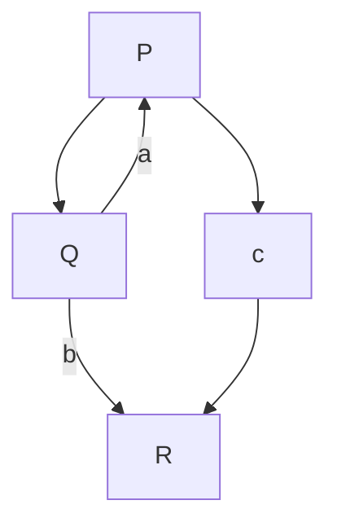
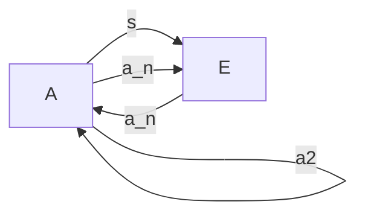
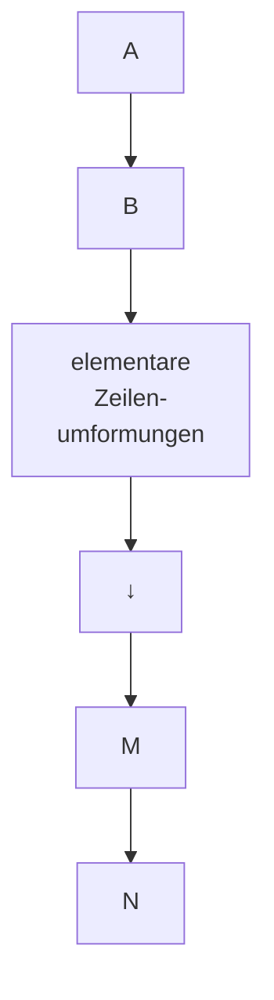
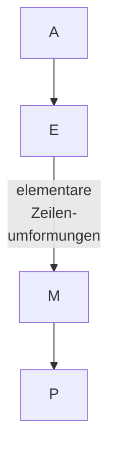
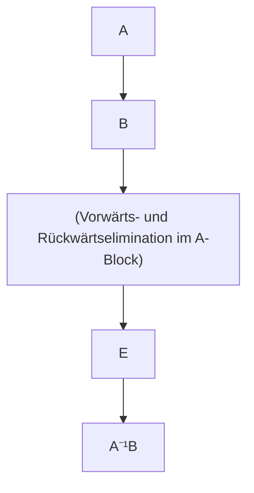
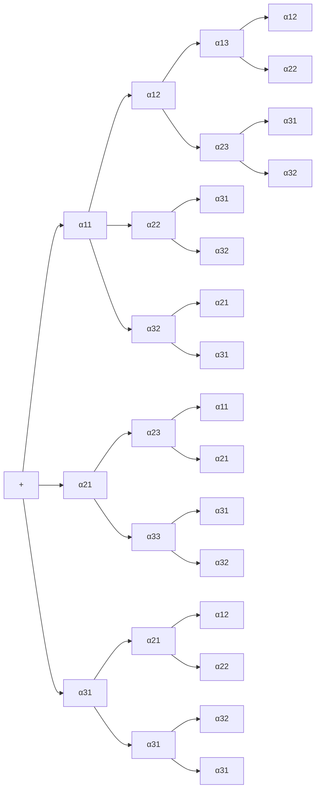
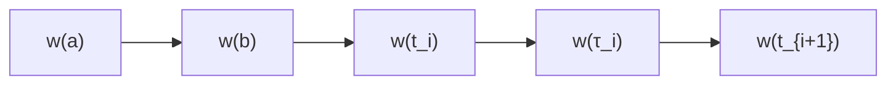
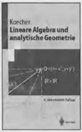

# Höhere Mathematik

MinerU 4.0.12 Advanced；FULL 视图保留页眉、页脚、页码和边栏。

Springer-Lehrbuch

---

## Springer

Berlin

Heidelberg

New York

Barcelona

Budapest

Hongkong

London

Mailand

Paris

Santa Clara

Singapur

Tokio

---

Kurt Meyberg · Peter Vachenauer

# Höhere Mathematik 1

Differential- und Integralrechnung
Vektor- und Matrizenrechnung

Vierte, korrigierte Auflage
Mit 450 Abbildungen


Springer

---

Professor Dr. Kurt Meyberg

Dr. Peter Vachenauer

Zentrum Mathematik

der Technischen Universität München

Arcisstraße 21

D-80333 München

e-mail:

(meyberg|vach)@mathematik.tu-muenchen.de

Mathematics Subject Classification (1991):

00A05, 00-01, 00A06

ISBN-13: 978-3-540-63688-5

e-ISBN-13: 978-3-642-97724-4

DOI: 10.1007/978-3-642-97724-4

Die Deutsche Bibliothek – CIP-Einheitsaufnahme

Meyberg, Kurt: Höhere Mathematik/Kurt Meyberg; Peter Vachenauer. – Berlin; Heidelberg; New York; Barcelona;

Budapest; Hongkong; London; Mailand; Paris; Santa Clara; Singapur; Tokio: Springer

(Springer-Lehrbuch)

1. Differential- und Integralrechnung, Vektor- und Matrizenrechnung. - 4. Aufl. - 1997

ISBN-13: 978-3-540-63688-5

Dieses Werk ist urheberrechtlich geschützt. Die dadurch begründeten Rechte, insbesondere die der Übersetzung, des Nachdrucks, des Vortrags, der Entnahme von Abbildungen und Tabellen, der Funksendung, der Mikroverfilmung oder der Vervielfältigung auf anderen Wegen und der Speicherung in Datenverarbeitungsanlagen, bleiben, auch bei nur auszugsweiser Verwertung, vorbehalten. Eine Vervielfältigung dieses Werkes oder von Teilen dieses Werkes ist auch im Einzelfall nur in den Grenzen der gesetzlichen Bestimmungen des Urheberrechtsgesetzes der Bundesrepublik Deutschland vom 9. September 1965 in der jeweils geltenden Fassung zulässig. Sie ist grundsätzlich vergütungspflichtig. Zuwiderhandlungen unterliegen den Strafbestimmungen des Urheberrechtsgesetzes.

© Springer-Verlag Berlin Heidelberg 1991, 1993, 1995, 1998

Datenkonvertierung: Universitätsdruckerei H. Stürtz AG, Würzburg

SPIN: 10652532

44/3143 - 5 4 3 2 1 0 - Gedruckt auf säurefreiem Papier

---

# Vorwort zur vierten Auflage

Für diese Auflage haben wir nur geringe Textänderungen vorgenommen und vor allem weitere hartnäckige Druckfehler beseitigt sowie den Text in mehreren Passagen verständlicher gestaltet. Auf viele dieser Stellen wurden wir wieder vor allem durch die freundlichen Hinweise aufmerksam gemacht, für die wir uns sehr herzlich bedanken möchten.

Auch in Zukunft werden wir uns über jeden wohlwollenden Verbesserungsvorschlag freuen und ihn im gegebenen Rahmen berücksichtigen.

München, im August 1997

Kurt Meyberg Peter Vachenauer

## Vorwort zur ersten Auflage

Dieses zweibändige Lehrbuch ist aus den Vorlesungen und Übungen der Verfasser zur Höheren Mathematik für Ingenieure der Fachrichtungen Maschinenbau und Elektrotechnik an der Technischen Universität München hervorgegangen. Es ist in erster Linie als kompakter Begleittext zur viersemestrigen Grundvorlesung für die Studenten der Ingenieurwissenschaften und anderer technischphysikalischer Studienfächer (etwa Physik, Technomathematik und Informatik) konzipiert.

Da die moderne Technik vom Ingenieur immer umfassendere und tiefere mathematische Kentnisse verlangt, gehen wir an einigen Stellen über den üblichen Vorlesungsstoff der Grundkurse hinaus oder stellen einige Themen gründlicher dar, als es in den Vorlesungen möglich ist. Das betrifft im vorliegenden Band insbesondere in Kapitel 6 den Ausflug in die abstrakte Welt der Vektorräume und in allen Kapiteln die stärkere Berücksichtigung der wichtigsten numerischen Aspekte. Damit ist dieses Buch auch für Studenten höherer Semester zur Fortbildung und für den Praktiker als Nachschlagewerk geeignet.

Die in Kapitel 1 dargestellte Vektorrechnung, insbesondere die Behandlung gebundener Vektoren, ist den Bedürfnissen der Technischen Mechanik angepaßt, sie kann für andere Fachrichtungen abgekürzt oder ausgelassen werden. Andererseits besteht die Notwendigkeit, die algebraischen und numerischen Methoden bereits in den Grundkursen stärker zu berücksichtigen. Die Lineare Algebra in Kapitel 6 ist unabhängig vom Vorhergehenden und kann vorgezogen, eventuell parallel mit den Kapiteln 2 – 5 behandelt werden.

Der Praktiker erwartet von der Mathematik nicht nur Erkenntnis, sondern Resultate. Wir berücksichtigen die für ihn besonders wichtige algorithmische Seite der Mathematik durch im Druck hervorgehobene Überblicke mit detaillierten Rechenschemata. Sie enthalten – in Schritten aufgegliedert – die Methoden zum Lösen konkreter Aufgaben und können nicht zuletzt als Repetitorium zur Prüfungsvorbereitung dienen.

---

VI

Vorwort zur ersten Auflage

Ferner fügen wir eine größere Zahl von Programmen ein, die auf erprobten numerischen Algorithmen fußen. Wir haben uns zur Darstellung dieser Programme für die Programmiersprache GfA-Basic entschieden, da diese einerseits die zugrundeliegenden Algorithmen besonders gut erkennen läßt, andererseits aufgrund ihrer Strukturierung vom etwas geübten Programmierer leicht in jede höhere Sprache übersetzt werden kann. In erster Linie ist aber an den Einsatz der Programme auf studienbegleitenden Taschen- oder Kleinrechnern gedacht.

Für den verständnisvollen Umgang mit den mathematischen Modellen der Physik und der Technik reicht die Fähigkeit im Anwenden fertiger Rezepte natürlich nicht aus. Unerläßlich ist auch die Kenntnis der mathematischen Grundlagen und vielfältigen Methoden, mit denen sie behandelt werden. Wir haben deshalb alle wesentlichen Beweise ausgeführt. Der Studienanfänger kann einen Teil dieser Beweise und die mit \* gekennzeichneten Abschnitte beim ersten Durcharbeiten auslassen; er sollte sich dafür verstärkt mit den zahlreichen ausführlich vorgerechneten Beispielen und den einfacheren Übungsaufgaben beschäftigen. Der etwas geübtere Leser wird die straffe Darstellung der anspruchsvolleren Beweise sicher schätzen. Für ihn sollten auch die schwierigeren Aufgaben eine Herausforderung bedeuten.

Die Verfasser sind den Kollegen und Mitarbeitern an der Technischen Universität München sehr dankbar, die durch ihre Hilfe, manch guten Rat und viele Gespräche über Inhalte und Darstellung der „Ingenieurmathematik“ zum Entstehen dieses Buches beigetragen haben. Insbesondere danken wir Prof. Dr.CHR. REINSCH, Prof. Dr. H.J. KROLL, Dr. S. WALCHER, Dipl. Math. M. BINDER, Dipl. Math. H. GRADL, Dipl. Math. R. NIEMCZYK, Dipl. Math. ST. SAUTTER und Dipl. Math. A. HUNDEMER, sie haben die Teile des Manuskripts gelesen, zahlreiche Druckfehler entdeckt und wertvolle Verbesserungsvorschläge beigetragen.

Die Druckqualität sollte zur guten Verständlichkeit bestmöglich, der Preis studentenfreundlich sein, daher wurden die Druckvorlagen mit der hochauflösenden TEX-Monotype-Variante der H. STUERTZ AG erzeugt. Daß sich dieser Entschluß trotz der anfangs zusätzlichen Pionierarbeit doch gelohnt hat, ist vor allem das Verdienst von Frau cand.math. I.ABOLD; sie hat den TEX-Quelltext mit Präzision, Geschmack und viel Einfallsreichtum erstellt und dabei nie ihre liebenswürdige Geduld verloren. Ihr gilt unser besonderer Dank.

Ein Teil der Abbildungen konnte von cand.ing. R. MATTUSCHAT auf einem 3D-CAD-Rechensytem am Lehrstuhl für Konstruktion im Maschinenbau erstellt werden. Wir danken Prof. Dr. K. EHRLENSPIEL für das freundliche Entgegenkommen. Ebenso dankend erwähnen wir die Studentinnen und Studenten T. ERIS, K. MATTUSCHAT und Frau cand.inf. A. SCHRAMM, die zusammen mit CHR. VACHENAUER die Skizzen für die übrigen Graphiken hingebungs- und kunstvoll auf den Bildschirm des ATARI-ST umsetzten.

Schließlich gilt unser Dank auch dem Springer-Verlag für die stets vorbildliche Zusammenarbeit, speziell Herrn Dr. J. HEINZE, der die verschiedenen Entstehungsphasen dieses Buches mit lebhaft förderndem Interesse, Geduld und fachmännischem Rat verfolgt hat.

München, im September 1989

Kurt Meyberg Peter Vachenauer

---

## Inhaltsverzeichnis

## Kapitel 1. Zahlen und Vektoren.... 1

## §1. Mengen und Abbildungen.... 1

1.1 Mengen - 1.2 Mengenoperationen - 1.3 Abbildungen

## §2. Die reellen Zahlen.... 3

2.1 Bezeichnungen – 2.2 Ungleichungen – 2.3 Intervalle – 2.4 Schranken – 2.5 Der Betrag – 2.6 Die vollständige Induktion – 2.7 Binomialkoeffizienten und die binomische Formel – Aufgaben

## §3. Die Ebene.... 11

3.1 Kartesische Koordinatensysteme - 3.2 Winkel - 3.3 Sinus, Cosinus - 3.4 Drehungen

## §4. Vektoren 17

4.1 Kartesische Koordinatensysteme im Raum – 4.2 Vektoren – 4.3 Die Addition von Vektoren – 4.4 Die skalaren Vielfachen eines Vektors – 4.5 Der Betrag – 4.6 Vektoren im Koordinatensystem

## §5. Produkte 22

5.1 Der Winkel zwischen zwei Vektoren - 5.2 Das Skalarprodukt - 5.3 Das Vektorprodukt - 5.4 Das Spatprodukt - Aufgaben

## §6. Geraden und Ebenen 34

6.1 Parameterdarstellungen einer Geraden – 6.2 Die Koordinatengleichungen einer Geraden – 6.3 Die Momentengleichung der Geraden – 6.4 Abstand Punkt-Gerade – 6.5 Abstand Gerade-Gerade – 6.6 Parameterdarstellungen einer Ebene – 6.7 Parameterfreie Darstellungen einer Ebene – 6.8 Die Gerade als Schnitt zweier Ebenen – 6.9 Die Winkel zwischen zwei Ebenen und zwischen einer Ebene und einer Geraden – Aufgaben

## §7. Gebundene Vektoren 47

7.1 Gebundene Vektoren - 7.2 Ein System gebundener Vektoren - 7.3 Die Reduktion eines Systems gebundener Vektoren - Aufgaben

## §8. Die komplexen Zahlen.... 53

8.1 Die Menge der komplexen Zahlen - 8.2 Die vier Grundrechenarten in $\mathbb{C}$ - 8.3 Die Konjugation und der Betrag komplexer Zahlen - 8.4 Anwendungen

---

VIII

Inhaltsverzeichnis

## Kapitel 2. Funktionen, Grenzwerte, Stetigkeit 58

## §1. Funktionen (Grundbegriffe) 58

1.1 Funktionen - 1.2 Monotonie - 1.3 Das Rechnen mit Funktionen

## §2. Polynome und rationale Funktionen 61

2.1 Polynome - 2.2 Polynomnullstellen - Faktorisierung - 2.3 Polynominterpolation - 2.4 Der Graph - 2.5 Rationale Funktionen, Polynomdivision - 2.6 Der Definitionsbereich D - 2.7 Ergänzung: Polynome über $\mathbb{C}$ - Aufgaben

## §3. Die Kreisfunktionen 75

3.1 Definition und einfache Eigenschaften – 3.2 Die Tangens- und Cotangensfunktion – 3.3 Die Polardarstellung komplexer Zahlen – 3.4 Anwendungen der De Moivre-Formeln – 3.5 Harmonische Schwingungen – Aufgaben

## §4. Zahlenfolgen und Grenzwerte 88

4.1 Folgen - 4.2 Definition des Grenzwerts; konvergente Zahlenfolgen

## §5. Rechenregeln für Grenzwerte und Konvergenzkriterien ..... 93

5.1 Rechenregeln – 5.2 Grenzwertbestimmung durch Abschätzung – 5.3 Monotone Folgen – 5.4 Die Exponentialfunktion – 5.5 Für Fortgeschrittene: Das Cauchy-Konvergenzkriterium – Aufgaben

## §6. Funktionengrenzwerte, Stetigkeit.... 103

6.1 Definitionen - 6.2 Die 6 elementaren Methoden der Grenzwertbestimmung - 6.3 Asymptoten - 6.4 Stetigkeit - Aufgaben

## Kapitel 3. Differentiation.... 112

## §1. Die Ableitung einer differenzierbaren Funktion 112

1.1 Die Definition der Ableitung – 1.2 Die geometrische Deutung der Ableitung: Tangentenanstieg – 1.3 Die analytische Deutung der Ableitung: Lineare Approximation – 1.4 Die physikalische Deutung der Ableitung: Geschwindigkeit – 1.5 Stetigkeit ist notwendig für Differenzierbarkeit – 1.6 Differentiationsregeln – 1.7 Die Differentiation der Polynome und der rationalen Funktionen – 1.8 Die Ableitung der Kreisfunktionen – 1.9 Die Kettenregel – 1.10 Höhere Ableitungen – Aufgaben

## §2. Anwendungen der Differentiation.... 121

2.1 Maxima und Minima einer Funktion – 2.2 Der Mittelwertsatz – 2.3 Wendepunkte – 2.4 Die Regeln von De L'Hospital – 2.5 Kurvendiskussion – 2.6 Nullstellen und Fixpunkte – 2.7 Kubische Splines – Aufgaben

---

Inhaltsverzeichnis

IX

§3. Umkehrfunktionen.... 139

3.1 Grundlagen - 3.2 $n$-te Wurzel, rationale Exponenten - 3.3 Arcussinus, Arcuscosinus, Arcustangens - Aufgaben

§4. Die Exponential- und Logarithmusfunktion ...... 147

4.1 Die $e$-Funktion - 4.2 Die Kurve $y = e^{x} - 4.3$ Exponentiell wachsende bzw. fallende Prozesse - 4.4 Der natürliche Logarithmus - 4.5 Allgemeine Exponentialfunktionen und Logarithmen - 4.6 Die Hyperbelfunktionen sinh, cosh, tanh - Aufgaben

Kapitel 4. Integration.... 161

§1. Das bestimmte Integral.... 161

1.1 Die Definition des bestimmten Integrals - 1.2 Die geometrische Deutung - 1.3 Elementare Integrationsregeln und der Mittelwertsatz - 1.4 Differentiation und Integration - Aufgaben

§2. Integrationsregeln.... 169

2.1 Linearität – 2.2 Partielle Integration – 2.3 Die Substitutionsmethode – 2.4 Symmetrien beachten – 2.5 Ausblicke – Aufgaben

§3. Die Integration der rationalen Funktionen.... 179

3.1 Die Partialbruchzerlegung - 3.2 Die Integration - 3.3 Die Integration von $R(e^x) - 3.4$ Die Integration von $R\left(x, \sqrt[k]{\frac{ax + b}{cx + e}}\right)$, $ae - bc \neq 0 - 3.5$ Die Integration von $R(\sin x, \cos x) - 3.6$ Trigonometrische und hyperbolische Substitutionen - Aufgaben

§4. Uneigentliche Integrale 185

4.1 Die Definition der uneigentlichen Integrale – 4.2 Ein Konvergenz-Test – 4.3 Ein an beiden Grenzen uneigentliches Integral – 4.4 Ausnahmestellen im Innern des Integrationsintervalls – Aufgaben

§5. Kurven, Längen- und Flächenmessung.... 190

5.1 Die Parameterdarstellung – 5.2 Tangente und Normale – 5.3 Kurvenlänge – 5.4 Krümmung und Krümmungskreis – 5.5 Die Polardarstellung einer ebenen Kurve – 5.6 Flächeninhalte – Aufgaben

§6. Weitere Anwendungen des Integrals.... 204

6.1 Abkürzende Redeweisen – 6.2 Das Volumen eines Rotationskörpers – 6.3 Die Mantelfläche – Aufgaben

§7. Numerische Integration.... 206

Aufgaben

---

X

Inhaltsverzeichnis

## Kapitel 5. Potenzreihen 212

## §1. Unendliche Reihen.... 212

1.1 Grundbegriffe - 1.2 Absolute Konvergenz - Aufgaben

## §2. Reihen von Funktionen.... 221

2.1 Gleichmäßige Konvergenz – 2.2 Gleichmäßig konvergente Funktionenreihen – Aufgaben

## §3. Potenzreihen.... 226

3.1 Der Konvergenzradius - 3.2 Berechnung des Konvergenzradius -
3.3 Die Differentiation und Integration von Potenzreihen - 3.4 Die Potenzreihendarstellung einiger Funktionen - 3.5 Die Binomialreihe -
3.6 Potenzreihen mit dem Zentrum  $a \neq 0 - 3.7$  Koeffizientenvergleich – Aufgaben

## §4. Der Satz von Taylor; Taylor-Reihen.... 237

4.1 Die Taylor-Formel - 4.2 Die Taylor-Reihe - 4.3 Methoden der Reihenentwicklung - Aufgaben

## §5. Anwendungen (an Beispielen) 244

5.1 Grenzwertberechnungen – 5.2 Näherungsformeln (Approximation) – 5.3 Die Reihendarstellung und Berechnung einer Integralfunktion mit nicht elementar integrierbarem Integranden – 5.4 Potenzreihenansatz zur Lösung einfacher Differentialgleichungen – Aufgaben

## Kapitel 6. Lineare Algebra.... 250

## §1. Lineare Gleichungssysteme und Matrizen.... 250

1.1 Was ist eine Matrix? – 1.2 Addition, Subtraktion und Multiplikation mit einem Zahlenfaktor – 1.3 Lineare Gleichungssysteme und Matrizen – 1.4 Das Gaußsche Lösungsverfahren – Aufgaben

## §2. Die Matrizenmultiplikation 265

2.1 „Zeile mal Spalte“ – 2.2 Die Multiplikation zweier Matrizen –
2.3 Rechenregeln – 2.4 Die Transponierte einer Matrix – 2.5 Invertierbare Matrizen – 2.6 Diagonal- und Dreiecksmatrizen – Aufgaben

## §3. Vektorräume.... 274

3.1 Der „abstrakte“ Vektorraum – 3.2 Unterräume, Linearkombinationen, lineare Hülle – 3.3 Basis und Dimension – Aufgaben

## §4. Elementarmatrizen und elementare Umformungen.... 286

4.1 Zeilenraum und Spaltenraum - 4.2 Elementarmatrizen - 4.3 Der Rang und die $P-Q$-Normalform - 4.4 Rechenverfahren - Aufgaben

---

Inhaltsverzeichnis

XI

§5. Determinanten 299

5.1 Einführung – 5.2 Definition der Determinante einer $n \times n$-Matrix – 5.3 Rechenregeln für Determinanten – 5.4 Die Entwicklung von det $A$ nach einer beliebigen Zeile oder Spalte – 5.5 Beispiele – 5.6 Anwendungen – Aufgaben

§6. Lineare Abbildungen und Eigenwerte 311

6.1 Lineare Abbildungen - 6.2 $V = W = \mathbb{R}^n$ - 6.3 Längen und Winkel im $\mathbb{R}^n$; Orthogonalität - 6.4 Speziell: Spiegelungen und Drehungen - 6.5 Das Schmidtsche Orthonormierungsverfahren - 6.6 Basiswechsel, Koordinatentransformation - 6.7 Eigenwerte, Eigenvektoren - 6.8 Die orthogonale Gruppe - Aufgaben

§7. Symmetrische Matrizen und quadratische Formen .... 339

7.1 Quadratische Formen - 7.2 Die Hauptachsentransformation - 7.3 Quadriken - 7.4 Die nichtorthogonale Diagonalisierung einer symmetrischen Matrix - 7.5 Positiv definite Matrizen - Aufgaben

Kapitel 7. Funktionen in mehreren Variablen: Differentiation..... 359

§1. Kurven im $\mathbb{R}^n$ ...... 360

1.1 Parameterdarstellungen – 1.2 Das begleitende Dreibein, Krümmung, Torsion – 1.3 Ergänzung: Der natürliche Parameter und die Frenetschen Formeln – Aufgaben

§2. Reellwertige Funktionen mehrerer reeller Veränderlicher .... 370

2.1 Grundlagen – 2.2 Grenzwerte und Stetigkeit – 2.3 Partielle Ableitungen, der Gradient – 2.4 Die totale Ableitung und lineare Approximation – 2.5 Einfache Anwendungen – 2.6 Die Richtungsableitung, der Anstieg und die Kettenregel – Aufgaben

§3. Anwendungen der Differentiation.... 391

3.1 Die Bedeutung des Gradienten – 3.2 Approximation höherer Ordnung; die Taylor-Formel – 3.3 Implizite Funktionen – 3.4 Lokale Minima und Maxima – 3.5 Ausgleichsrechnung – 3.6 Extremwertaufgaben mit Nebenbedingungen – Aufgaben

§4. Vektorwertige Funktionen 418

4.1 Die Differentiation – 4.2 Die Kettenregel – 4.3 Räumliche Skalaren- und Vektorfelder – 4.4 Gradient, Divergenz, Rotation, Laplace-Operator – Aufgaben

---

XII

Verzeichnis der Programme

## Kapitel 8. Funktionen in mehreren Variablen: Integration ..... 430

## §1. Parameterintegrale 430

1.1 Parameterintegrale - Aufgaben

## §2. Kurvenintegrale 435

2.1 Das Kurvenintegral einer skalaren Funktion - 2.2 Anwendungen - 2.3 Die Integration eines Vektorfeldes längs einer Kurve - 2.4 Anwendungen und Beispiele - 2.5 Das Potential eines Gradientenfeldes - 2.6 Die praktische Bestimmung eines Potentials ($n = 3$) - Aufgaben

## §3. Die Integration über ebene Bereiche.... 454

3.1 Der Flächeninhalt – 3.2 Definition und einfache Eigenschaften des Doppelintegrals – 3.3 Die Berechnung des Doppelintegrals in kartesischen Koordinaten – 3.4 Weitere Anwendungen und Beispiele – 3.5 Der Satz von Green – Aufgaben

## §4. Die Integration über Flächen im Raum 467

4.1 Parameterdarstellungen – 4.2 Beispiele – 4.3 Der Flächeninhalt – 4.4 Das Oberflächenintegral einer skalaren Funktion – 4.5 Die Transformationsformel für Gebietsintegrale – 4.6 Das Oberflächenintegral eines Vektorfeldes – 4.7 Der Satz von Stokes – Aufgaben

## §5. Die Integration über dreidimensionale Bereiche.... 488

5.1 Definition und einfache Eigenschaften des Dreifachintegrals – 5.2 Einfache Anwendungsbeispiele – 5.3 Die Transformationsformel für Volumenintegrale – 5.4 Der Divergenzsatz – 5.5 Einige Anwendungen der Integralsätze – 5.6 Orthogonale krummlinige Koordinaten – Aufgaben

## Literaturverzeichnis.... 505

## Anhang: Pascal-Programme 507

## Namen- und Sachverzeichnis 517

## Verzeichnis der Programme

1. Programm HORNER.... 63

Auswertung eines Polynoms mit dem Horner-Schema

2. Programm HORNER vollstaendig.... 63

Entwicklung eines Polynoms nach Potenzen von x - b

---

Verzeichnis der Programme

XIII

3. Programm NEWTON Interpolation.... 68
Berechnung und Auswertung des Newton Interpolationspolynoms
4. Programm BISECTION.... 109
Nullstellenbestimmung (f(x) = 0, x ∈ ℝ)
5. Programm NEWTON Verfahren.... 134
Nullstellenbestimmung (f(x) = 0, x ∈ ℝ)
6. Programm KUBISCHE SPLINE.... 136
Interpolation mit kubischer Spline-Funktion
7. Programm ROMBERG Integration.... 209
Berechnung von $\int_{a}^{b} f(x) dx$ mittels Romberg-Extrapolation
8. Programm Vollst. Ellipt. Integrale.... 211
Berechnung der vollständigen elliptischen Integrale $E(k)$ und $K(k)$ mit arithmetisch-geometrischem Mittel
9. Programm GAUSS.... 296
Lösung des linearen Gleichungssystems Ax = b mit verbesserter LR-Zerlegung, Berechnung der Determinante von A
10. Programm LEVERRIER.... 333
Berechnung der Koeffizienten des Polynoms $p(\lambda) = \det(\lambda E - A)$
11. Programm JACOBI.... 354
Berechnung aller Eigenwerte und Eigenvektoren einer symmetrischen Matrix
12. Programm BAIRSTOW.... 384
Berechnung aller komplexen Nullstellen eines reellen Polynoms
13. Procedure LINFIT.... 406
Bestimmung der Ausgleichslösung eines überbestimmten linearen Gleichungssystems
14. Programm NLSQ.... 407
Bestimmung der Ausgleichslösung eines überbestimmten nichtlinearen Gleichungssystems

---

## Inhalt von Band 2

## Kapitel 9. Gewöhnliche Differentialgleichungen

§1. Einführung
§2. Spezielle Differentialgleichungen 1. Ordnung
§3. Spezielle Differentialgleichungen 2. Ordnung
§4. Existenzsätze
§5. Numerische Lösung des Anfangswertproblems 1. Ordnung
§6. Die Laplace-Transformation
§7. Lösung mittels Potenzreihenansatz
§8. DGL-Systeme und DGLn höherer Ordnung
§9. Lineare DGL-Systeme mit konstanten Koeffizienten
§10. Stabilität, periodische Lösungen
§11. Rand- und Eigenwertprobleme

## Kapitel 10. Funktionentheorie

§1. Punktmengen in der komplexen Ebene
§2. Einige elementare Funktionen
§3. Gebrochen-lineare Funktionen
§4. Potenzreihen
§5. Differentiation, analytische Funktionen
§6. Integration
§7. Anwendungen der Cauchy-Integralformel
§8. Harmonische Funktionen und das Dirichlet-Problem
§9. Laurent-Reihen und Singularitäten
§10. Residuentheorie

## Kapitel 11. Fourier-Analysis

§1. Trigonometrische Polynome und Reihen
§2. Fourier-Reihen
§3. Konvergenz der Fourier-Reihe
§4. Anwendungen (an Beispielen)
§5. Diskrete Fourier-Analysis
§6. Die Fourier-Transformation

## Kapitel 12. Partielle Differentialgleichungen

§1. Einführung
§2. Partielle Differentialgleichungen 1. Ordnung
§3. Lineare und quasilineare PDGn 2. Ordnung
§4. Trennung der Variablen
§5. Lösungen mit Laplace- und Fourier-Transformation
§6. Lösungen mit Green-Funktion

---

Inhalt von Band 2

XV

## Kapitel 13. Variationsrechnung

§1. Funktionale und Variation
§2. Die Euler-Differentialgleichung für $I(y) = \int_{a}^{b} F(x, y, y') dx$
§3. Natürliche Randbedingungen, Transversalitätsbedingung
§4. Variationsaufgaben mit allgemeineren Funktionalen
§5. Variation mit Nebenbedingungen
§6. Variationsrechnung mit Funktionen in mehreren Variablen
§7. Das Wechselspiel Variationsaufgaben – Differentialgleichungen
§8. Direkte Methoden

---

# Bezeichnungen

## 1. Die griechischen Buchstaben.

| Alpha | $\alpha$ | A | Eta | $\eta$ | H | Ny | $\nu$ | N | Tau | $\tau$ | T |
| --- | --- | --- | --- | --- | --- | --- | --- | --- | --- | --- | --- |
| Beta | $\beta$ | B | Theta | $\vartheta$ | $\Theta$ | Xi | $\xi$ | $\Xi$ | Ypsilon | $\upsilon$ | $\Upsilon$ |
| Gamma | $\gamma$ | $\Gamma$ | Iota | $\iota$ | I | Omikron | o | O | Phi | $\varphi$ | $\Phi$ |
| Delta | $\delta$ | $\Delta$ | Kappa | $\kappa$ | K | Pi | $\pi$ | $\Pi$ | Chi | $\chi$ | X |
| Epsilon | $\varepsilon$ | E | Lambda | $\lambda$ | $\Lambda$ | Rho | $\rho$ | P | Psi | $\psi$ | $\Psi$ |
| Zeta | $\zeta$ | Z | My | $\mu$ | M | Sigma | $\sigma$ | $\Sigma$ | Omega | $\omega$ | $\Omega$ |

## 2. Wichtige Mengen.

| $\mathbb{N} = \{1,2,3,4,\ldots\}$ | Menge der natürlichen Zahlen ($\rightarrow$ S. 3), |
| --- | --- |
| $\mathbb{N}_0 = \mathbb{N} \cup \{0\}$, |  |
| $\mathbb{Z} = \{0,1,-1,2,-2,\ldots\}$ | Menge der ganzen Zahlen ($\rightarrow$ S. 3), |
| $\mathbb{Q} = \{ \frac{m}{n} ; m, n \in \mathbb{Z}, n \neq 0\}$ | Menge der rationalen Zahlen ($\rightarrow$ S. 3), |
| $\mathbb{R}$ | Menge der reellen Zahlen ($\rightarrow$ S. 3), |
| $\mathbb{R}^n$ | Menge der reellen Spaltenvektoren mit $n$Komponenten ($\rightarrow$ S. 251), |
| $\mathbb{R}_n$ | Menge der reellen Zeilenvektoren mit $n$Komponenten ($\rightarrow$ S. 251), |
| $\mathbb{R}^{m \times n}$ | Menge der reellen Matrizen mit $m$ Zeilenund $n$ Spalten ($\rightarrow$ S. 251), |
| $\mathbb{C} = \{ x + iy ; x, y \in \mathbb{R} \}$ | Menge der komplexen Zahlen ($\rightarrow$ S. 53), |
| $\mathbb{P}_n$ | Menge der reellen Polynome vom Grad $\leq n$($\rightarrow$ S. 276), |
| $\mathscr{C}^0(D, \mathbb{R})$ | Menge der auf $D \subseteq \mathbb{R}^n$ stetigen reellenFunktionen ($\rightarrow$ S. 377), |
| $\mathscr{C}^k(D, \mathbb{R})$ | Menge der auf $D \subseteq \mathbb{R}^n$ $k$-mal stetig partielldifferenzierbaren reellen Funktionen ($\rightarrow$ S. 377). |

---

# Kapitel 1

# Zahlen und Vektoren

## §1. Mengen und Abbildungen

1.1 Mengen. Zur Festlegung von Bezeichnungen erinnern wir zuerst an einige Begriffe aus der Mengenlehre. Von G. CANTOR stammt folgende Erklärung (1895):

Unter einer Menge verstehen wir jede Zusammenfassung von bestimmten wohlunterschiedenen Objekten unserer Anschauung oder unseres Denkens zu einem Ganzen.

Wir werden Mengen mit Großbuchstaben bezeichnen. Die Objekte der Menge A werden die Elemente von A genannt. Man schreibt  $a \in A$  (bzw.  $a \notin A$ ), wenn das Objekt a ein (bzw. kein) Element von A ist.

$$
A = \left\{a _ {1}, a _ {2}, \dots , a _ {n} \right\}
$$

kennzeichnet eine Menge mit endlich vielen Elementen (endliche Menge). Hierbei kommt es nicht auf die Reihenfolge der Elemente an. Die häufigste Beschreibung einer Menge X geschieht durch die Angabe einer Eigenschaft E, die genau allen Elementen von X zukommt. In diesem Fall schreibt man

$$
X = \left\{x ; x \text {hat die Eigenschaft} E \right\},
$$

bzw.  $X = \{ x \in A ; x \text{ hat die Eigenschaft } E \}$ ,

wenn besonders hervorgehoben werden soll, daß die in X zusammengefaßten Elemente sämtlich in der Grundmenge A liegen.

Zur Vermeidung von Fallunterscheidungen wird die leere Menge ∅ eingeführt; sie enthält kein Element.

B heißt Teilmenge von A, in Zeichen  $B \subseteq A$ , wenn jedes Element von B auch ein Element von A ist. Man nennt die Mengen gleich, i.Z. A = B, wenn sowohl  $B \subseteq A$  als auch  $A \subseteq B$  gilt. Beziehungen der Form  $B \subseteq A$  heißen (Mengen-)Inklusionen; die strikte Inklusion  $B \subsetneq A$  bedeutet  $B \subseteq A$  und es gibt wenigstens ein  $a \in A$  mit  $a \notin B$ .

1.2 Mengenoperationen. Für je zwei Mengen A und B sind der Durchschnitt  $A \cap B$ , die Vereinigung  $A \cup B$  und das Komplement  $A \setminus B$  definiert durch

$$
\begin{array}{l} A \cap B := \{x; x \in A \text {und} x \in B \}; \\ A \cup B := \{x; x \in A \text {oder} x \in B \}; \\ A \setminus B := \{x; x \in A \text {und} x \notin B \}. \\ \end{array}
$$

K. Meyberg et al., Höhere Mathematik

© Springer-Verlag Berlin Heidelberg 1998

---

2

1. Zahlen und Vektoren

(Das Zeichen := bzw. =: bedeutet Gleichheit per definitionem, wobei der Doppelpunkt bei dem zu definierenden Ausdruck steht.)


Abb. 1 - Venn-Diagramme

Zwei Mengen A und B, die kein gemeinsames Element besitzen, heißen disjunkt, d.h. für sie gilt  $A \cap B = \emptyset$ . Als direktes (oder kartesisches) Produkt der Mengen A und B bezeichnet man die Paarmenge

$$
A \times B := \left\{(a, b); a \in A, b \in B \right\},
$$

wobei es in $(a,b)$ auf die Reihenfolge der Elemente ankommt, d.h. $(a,b) = (a',b')$ genau dann, wenn $a = a'$ und $b = b'$. Entsprechend werden geordnete $n$-Tupel $(a_1,a_2,\ldots ,a_n)$ und $(b_{1},b_{2},\ldots ,b_{n})$ mit Elementen $a_i,b_i\in A_i$ $(i = 1,2,\dots,n)$ als gleich bezeichnet, wenn sie „komponentenweise“ übereinstimmen, also wenn $a_{i} = b_{i}$ gilt für $i = 1,2,\dots,n$. Das direkte Produkt der Mengen $A_{1},A_{2},\ldots ,A_{n}$ ist

$$
A _ {1} \times A _ {2} \times \dots \times A _ {n} := \left\{\left(a _ {1}, a _ {2}, \dots , a _ {n}\right); a _ {i} \in A _ {i} \quad (i = 1, 2, \dots , n) \right\}.
$$

Im Fall  $A_{1}=A_{2}=\cdots A_{n}=A$  schreibt man dafür  $A^{n}$ .

1.3 Abbildungen. $A$ und $B$ seien Mengen. Eine Abbildung (oder Funktion) $f$ von $A$ in (oder nach) $B$, in Zeichen $f: A \to B$ (oder elementweise $x \mapsto f(x)$, $x \in A$), ist eine Vorschrift, die jedem Element $x \in A$ genau ein Element $f(x) \in B$ zuordnet. Man nennt $A$ den Definitionsbereich und die Elemente von $A$ die Argumente der Abbildung $f$; $f(x)$ heißt das Bild von $x$ unter $f$ (oder Funktionswert von $f$ an der Stelle $x$). Gehören zu verschiedenen Argumenten stets verschiedene Bilder (d.h. $x_1 \neq x_2 \Rightarrow f(x_1) \neq f(x_2)$, bzw. äquivalent dazu: $f(x_1) = f(x_2) \Rightarrow x_1 = x_2$), dann heißt $f$ injektiv. Für jede Teilmenge $C \subseteq A$ bezeichnet man $f(C) := \{f(x); x \in C\}$ als Bild von $C$ unter $f$ und das ganze Bild $f(A)$ als Wertebereich von $f$. Im Fall $f(A) = B$ sagt man, $f$ ist eine Abbildung von $A$ auf $B$ oder $f$ ist surjektiv. Man nennt die Abbildung $f: A \to B$ bijektiv, wenn sie sowohl surjektiv als auch injektiv ist. Es ist also $f: A \to B$ genau dann bijektiv, wenn es zu jedem Element $y \in B$ genau ein $x \in A$ gibt mit $y = f(x)$. In diesem Fall existiert die mit $f^{-1}: B \to A$ bezeichnete Umkehrabbildung, mit der jedem $y \in B$ das durch $y = f(x)$ eindeutig bestimmte $x \in A$ zugeordnet wird. Die auf jeder Menge $A$ erklärte Abbildung $Id: A \to A$, $Id(x) := x$ für alle $x \in A$, heißt identische Abbildung (oder Identität) auf $A$.

Zwei Abbildungen $f: A \to B$ und $g: C \to D$ sind genau dann gleich, i.Z. $f = g$, wenn gilt $A = C$, $B = D$ und $f(x) = g(x)$ für alle $x \in A$. Durch

---

§2. Die reellen Zahlen

3

Einschränkung des Definitionsbereiches einer Abbildung $f: A \to B$ auf eine Teilmenge $A_0 \subseteq A$ gewinnt man die Restriktion

$$
f \mid A _ {0}: A _ {0} \rightarrow B, (f \mid A _ {0}) (x) := f (x) \text { für   alle } x \in A _ {0}.
$$


<details>
<summary>text_image</summary>

f: A → B
x
A
f(x)
B
</details>

Abb. 2 - $f: A \to B$

## §2. Die reellen Zahlen

2.1 Bezeichnungen. Die Menge aller reellen Zahlen wird mit R bezeichnet. Besonders gekennzeichnete Teilmengen von R sind

$$
\mathbb {N} = \{1, 2, 3, 4, \dots \} \quad (\text {Menge der natürlichen Zahlen}),
$$

$$
\mathbb {N} _ {0} = \mathbb {N} \cup \{0 \},
$$

$$
\mathbb {Z} = \{\dots , - 3, - 2, - 1, 0, 1, 2, 3, \dots \} \quad (\text {Menge der ganzen Zahlen}),
$$

$$
\mathbb {Q} = \left\{\frac {m}{n}; m, n \in \mathbb {Z}, n \neq 0 \right\} \quad (\text {Menge der rationalen Zahlen}).
$$

Neben den rationalen Zahlen, die man auch charakterisieren kann als diejenigen reellen Zahlen mit einer endlichen oder periodisch unendlichen Dezimalbruchdarstellung, gibt es in $\mathbb{R}$ die irrationalen Zahlen, die eine unendliche nichtperiodische Dezimalbruchdarstellung besitzen. Der periodische Dezimalbruch $c = 0.\overline{b_1b_2\ldots b_k} = 0.b_1b_2\ldots b_kb_1b_2\ldots b_kb_1b_1\ldots$ hat die „gewöhnliche“ Bruchdarstellung

$$
c = \frac {b _ {1} b _ {2} \dots b _ {k}}{\underbrace {9 9 \dots 9} _ {k - m a l}}; \text {denn} 1 0 ^ {k} c - c = b _ {1} b _ {2} \dots b _ {k}.
$$

Beispiele. Die Zahlen $\frac{16}{37}$, 0.12123, $0.17\overline{314} = 0.17314314$ ... sind rational, 0.12345 ..., 0.101001000 ..., $\sqrt{2} = 1.4142$ ... sind irrational. Es gilt

$$
0. \overline {{3 1 4}} = \frac {3 1 4}{9 9 9}, 0. 1 7 \overline {{3 1 4}} = \frac {1 7}{1 0 0} + \frac {3 1 4}{1 0 0 \cdot 9 9 9}.
$$

Zur Veranschaulichung von $\mathbb{R}$ dient die bekannte, von - nach + orientierte Zahlengerade, auf der jeder Punkt genau einer Zahl entspricht.

2.2 Ungleichungen. Unter einer Ungleichung (für Zahlen  $x, y \in R$ ) verstehen wir einen Größenvergleich der Form x < y (x ist kleiner als y, strikte Ungleichung) oder  $x \leq y$  (x ist kleiner oder gleich y, nicht strikte Ungleichung); eine andere Schreibweise hierfür ist y > x oder  $y \geq x$ . Die Ungleichung  $x \leq y$

---

4

1. Zahlen und Vektoren

(bzw. $x < y$) gibt eine Abschätzung der Zahl $x$ nach oben durch $y$ an, oder auch eine Abschätzung der Zahl $y$ nach unten durch $x$. In der Praxis (und in diesem Buch) wird überwiegend mit Ungleichungen der Form $x \leq y$ gearbeitet, ohne darauf zu achten, welcher der beiden hierin enthaltenen Fälle $x < y$ oder $x = y$ tatsächlich vorliegt; wesentlich ist die Aussage „$x$ ist nicht größer als $y$“.

Für Abschätzungen einer Summe und eines Produkts sind

$$
x \leq y, a \leq b \implies x + a \leq y + b,
$$

$$
x \leq y, 0 \leq a \implies x a \leq y a
$$

zu beachten. Ferner gilt

$$
x \leq y \iff - y \leq - x,
$$

$$
0 <   x \leq y \iff 0 <   \frac {1}{y} \leq \frac {1}{x}.
$$

Beispiel.  $-3a-2\leq5\leq-3a+4$   $\Longleftrightarrow$   $(-3a\leq7$  und  $1\leq-3a)$   $\Longleftrightarrow$

$$
- \frac {1}{3} \geq a \geq - \frac {7}{3}.
$$


2.3 Intervalle. Seien $a, b \in \mathbb{R}$ mit $a < b$. Die Menge $[a, b] := \{x \in \mathbb{R} ; a \leq x \leq b\}$ heißt abgeschlossenes Intervall mit Randpunkten $a, b$. Im offenen Intervall $(a, b) := \{x \in \mathbb{R} ; a < x < b\}$ sind $a, b$ nicht enthalten. Analog sind die halboffenen Intervalle $(a, b]$ und $[a, b)$ definiert.

Zur Vermeidung von Fallunterscheidungen ist es günstig, noch zwei Symbole  $-\infty,\infty$  (minus Unendlich, Unendlich) einzuführen und hierfür  $-\infty < x < \infty$  für alle  $x \in R$  festzulegen.  $(-\infty,a] := \{x \in \mathbb{R} ; x \leq a\}, (b,\infty) := \{x \in \mathbb{R} ; b < x\}$ . Analog  $(-\infty,a), [b,\infty)$ . Auch  $\mathbb{R} = (-\infty,\infty)$  fällt damit unter die offenen Intervalle. Das offene Intervall  $(a - \varepsilon, a + \varepsilon)$  (mit  $\varepsilon > 0$ ) heißt  $\varepsilon$ -Umgebung der Zahl (des Punktes)  $a \in R$ .

2.4 Schranken. Man nennt eine Menge $S$ reeller Zahlen nach oben beschränkt, wenn es eine Zahl $b \in \mathbb{R}$ gibt, so daß $S \subseteq (-\infty, b]$. In diesem Fall heißt $b$ eine obere Schranke von $S$. Ganz entsprechend nennt man $a \in \mathbb{R}$ eine untere Schranke von $S$, und $S$ nach unten beschränkt, wenn $S \subseteq [a, \infty)$. Die Menge $S \subseteq \mathbb{R}$ heißt beschränkt, wenn sie eine untere Schranke $a$ und eine obere Schranke $b$ besitzt. In diesem Fall gilt $S \subseteq [a, b]$.

Ist $S \subseteq \mathbb{R}$ nach oben beschränkt, so nennen wir die kleinste obere Schranke $s$ das Supremum von $S$, in Zeichen $s = \sup S$. Ebenso wie die anderen Schranken braucht sup $S$ nicht der Menge $S$ anzugehören; jedoch gibt es zu jeder beliebig kleinen Zahl $\varepsilon > 0$ ein $x \in S$ mit $s - \varepsilon < x \leq s$. Andernfalls würde $x \leq s - \varepsilon$ für alle $x \in S$ gelten und wir hätten die noch kleinere Schranke $s - \varepsilon$.

Beispiel 1. $\sup [a,b] = \sup (a,b) = b$


Beispiel 2. $\sup \{x\in \mathbb{Q};x^2 < 2\} = \sqrt{2}$


---

§2. Die reellen Zahlen

5

Es ist keineswegs selbstverständlich, daß die Menge der oberen Schranken von  $S \subseteq (-\infty, b]$  eine kleinste Zahl enthält. Dieses ist aber eine der Grundannahmen über die reellen Zahlen:

Das Vollständigkeitsaxiom. Jede nach oben beschränkte Menge reeller Zahlen besitzt ein Supremum.

Damit hat auch jede nach unten beschränkte Menge $U \subseteq \mathbb{R}$ eine größte untere Schranke (ein Infimum, i.Z. inf $U$). Man bestätigt leicht die Beziehung

$$
\inf U = - \sup \left\{- u; u \in U \right\}.
$$

Beispiel. $\inf \left\{1 + \frac{1}{n}; n \in \mathbb{N}\right\} = 1$.

2.5 Der Betrag $|a|$ einer reellen Zahl $a \in \mathbb{R}$ ist definiert durch

$$
\boxed | a | := \left\{ \begin{array}{c l} a, & \text {falls} a \geq 0 \\ - a, & \text {falls} a <   0. \end{array} \right.\}
$$

Die folgenden Rechenregeln für Beträge ergeben sich unmittelbar aus der Definition:

$$
- | a | \leq a \leq | a |, \quad | - a | = | a |,
$$

$$
| a b | = | a | | b |, \quad \left| \frac {a}{b} \right| = \frac {| a |}{| b |} \quad (\text {falls} b \neq 0),
$$

und $|a| \leq b \iff -b \leq a \leq b$.

Aus  $-|a| \leq a \leq |a|$  und  $-|b| \leq b \leq |b|$  folgt  $-(|a| + |b|) \leq a + b \leq |a| + |b|$ . Also gilt für alle  $a, b \in R$ :

$$
| a + b | \leq | a | + | b | \quad (\text {Dreiecksungleichung}). \tag {1}
$$

Es ist $|a - b|$ der Abstand der zu $a$ und $b$ gehörenden Punkte auf der Zahlengeraden; also gilt für alle $x, a, \varepsilon \in \mathbb{R}$, $\varepsilon > 0$:

$$
| x - a | \leq \varepsilon \iff a - \varepsilon \leq x \leq a + \varepsilon . \tag {2}
$$

$$
\mathbb {R} \quad a - \varepsilon \quad a \quad a + \varepsilon
$$

$$
\text {Abb. 3 - Das Intervall} \{x \in \mathbb {R}; | x - a | \leq \varepsilon \}.
$$

Wird für eine Zahl $a \in \mathbb{R}$ ein Näherungswert $\bar{a}$ angegeben, so bedeutet die Schreibweise $a = \bar{a} \pm \varepsilon$ dasselbe wie $|a - \bar{a}| \leq \varepsilon$.

Beispiel.  $\bar{a}=1.414215$  ist ein Näherungswert für  $a=\sqrt{2}$ . Es gilt  $\bar{a}^{2}\geq2$ , folglich  $\frac{2}{\bar{a}}\leq\sqrt{2}\leq\bar{a}$  und damit  $|\bar{a}-\sqrt{2}|\leq|\bar{a}-\frac{2}{\bar{a}}|\leq0.000003$  oder  $\sqrt{2}=1.414215\pm3\cdot10^{-6}$ .

---

6

1. Zahlen und Vektoren

2.6 Die vollständige Induktion. Die Gültigkeit einer Aussage  $A(n)$  für jede ganze Zahl  $n \geq n_{0}$  mit vollständiger Induktion nachzuweisen bedeutet:

1. Der Induktionsbeginn: Man zeigt, daß  $A(n)$  für  $n = n_{0}$  gilt.
2. Der Schluß von n auf  $n+1$ : Für ein beliebiges  $n \geq n_{0}$  setzt man die Gültigkeit von  $A(n)$  voraus (Induktionsvoraussetzung) und leitet daraus die Gültigkeit von  $A(n+1)$  ab.

Können beide Schritte ausgeführt werden, dann gilt $A(n)$ für alle $n \geq n_0$. Denn nach dem ersten Schritt gilt $A(n_0)$, nach dem zweiten Schritt $A(n_0 + 1)$ und ebenso (immer wieder Schluß von $n$ auf $n + 1$) $A(n_0 + 2)$, $A(n_0 + 3)$, ...

Beispiel 1.

$$
1 + 2 + \dots + n = \frac {n (n + 1)}{2} \qquad (n \in \mathbb {N}).
$$

Beweis mit vollständiger Induktion. Induktionsbeginn $n = 1: 1 = \frac{1 \cdot 2}{2}$. Schluß von $n$ auf $n + 1$: Sei $n \in \mathbb{N}$ (beliebig) und die Formel richtig für dieses $n$. Dann folgt $1 + 2 + \cdots + n + (n + 1) = \frac{n(n + 1)}{2} + n + 1 = \frac{(n + 1)(n + 2)}{2}$. Das ist die zu beweisende Formel für $n + 1$. Sie gilt also für alle $n \in \mathbb{N}$.

Beispiel 2. Die Bernoulli-Ungleichung. Für $h \in \mathbb{R}$ und alle $n \in \mathbb{N}$ gilt

(3) $(1+h)^{n}\geq1+nh,\quad\text{falls }h\geq-1.$

Beweis mit vollständiger Induktion. Induktionsbeginn $n = 1: (1 + h)^{1} \geq 1 + 1 \cdot h$. Schluß von $n$ auf $n + 1$:

Aus  $(1+h)^{n} \geq 1 + nh$  (Induktionsvoraussetzung) und  $1 + h \geq 0$  folgt

$$
(1 + h) ^ {n + 1} \geq (1 + n h) (1 + h) \geq 1 + (n + 1) h.
$$

Definition durch Rekursion. Diese Methode beruht auf dem Prinzip der vollständigen Induktion: Eine Größe $A_{n}$ wird für alle $n \in \mathbb{N}_{0}$ dadurch definiert, daß man

1.  $A_{0}$  festlegt,
2.  $A_{k}$  für  $k \leq n$  als bekannt ansieht und  $A_{n+1}$  durch diese ausdrückt.

Beispiel 3. Die Potenzen $a^n$ für eine beliebige Basiszahl $a \in \mathbb{R}$ und Exponenten $n \in \mathbb{N}_0$ werden definiert durch $a^0 := 1$; $a^{n+1} := a^n a$.

Beispiel 4. Die Fakultäten. Zu $n \in \mathbb{N}_0$ wird $n!$ (lies: $n$ Fakultät) definiert durch $0! := 1$; $(n+1)! := n!(n+1)$. Demnach gilt

$$
n! = \left\{ \begin{array}{c l} n (n - 1) (n - 2) \dots 2 \cdot 1 & , n \geq 1, \\ 1 & , n = 0. \end{array} \right.
$$

---

§2. Die reellen Zahlen

7

So ist etwa $6! = 1 \cdot 2 \cdot 3 \cdot 4 \cdot 5 \cdot 6 = 720$, $9! = 362880$. Die Fakultäten werden mit wachsendem $n$ schnell sehr groß.

Als Permutationen einer Menge A bezeichnet man die bijektiven Abbildungen von A auf sich. Ist A endlich mit den n verschiedenen Elementen  $\{a_{1},\ldots,a_{n}\}$ , so interpretiert man eine Permutation von A als Zuordnung der  $a_{i}$  zu den n verschiedenen Plätzen

$$
\begin{array}{c} (\quad * \quad , \quad * \quad , \quad \dots \quad , \quad *) \\ \uparrow \quad \uparrow \quad \uparrow \\ 1. \text {Platz} \quad 2. \text {Platz} \quad \text {n - ter Platz} \end{array}
$$

so daß auf jeden Platz genau ein Element kommt; etwa  $(a_{1}, a_{2}, \ldots, a_{n})$  oder  $(a_{3}, a_{1}, a_{2}, a_{4}, \ldots, a_{n})$ . Für jedes  $n \in N$  gilt:

(4) Jede n-elementige Menge besitzt genau n! verschiedene Permutationen.

Beweis mit vollständiger Induktion. Induktionsbeginn: (4) gilt für $n = 1$. Schluß von $n$ auf $n + 1$: Es gibt (nach Induktionsvoraussetzung) $n!$ Permutationen von $\{a_1, \ldots, a_{n+1}\}$ mit $a_1$ an der ersten Stelle. Ebensoviele mit $a_1$ an der zweiten Stelle, etc.; das sind insgesamt $n!(n + 1) = (n + 1)!$ verschiedene Permutationen.

Beispiel 5. Das Summen- und Produktzeichen. Für die Summe und das Produkt der Zahlen $a_{m}, a_{m+1}, \ldots, a_{n} \in \mathbb{R}$ (mit $m \leq n$) schreibt man

$$
\boxed {a _ {m} + a _ {m + 1} + \dots + a _ {n} = \sum_ {k = m} ^ {n} a _ {k}, \quad a _ {m} \cdot a _ {m + 1} \dots a _ {n} = \prod_ {k = m} ^ {n} a _ {k}.}
$$

Die Definition durch Rekursion ersetzt die Pünktchen:

$$
\sum_ {k = m} ^ {m} a _ {k} := a _ {m}, \quad \sum_ {k = m} ^ {n + 1} a _ {k} := \left(\sum_ {k = m} ^ {n} a _ {k}\right) + a _ {n + 1}.
$$

Man beachte die Unabhängigkeit vom Summationsindex, $\sum_{k=m}^{n} a_k = \sum_{i=m}^{n} a_i$, ferner $\sum_{k=m}^{n} a_k = \sum_{k=m}^{l} a_k + \sum_{k=l+1}^{n} a_k \quad (m \leq l \leq n)$. Analoges gilt für das Produktzeichen. Z. B. ist $\sum_{k=1}^{n} k = \frac{n(n+1)}{2} \quad (\rightarrow \text{Bsp. 1}), \quad \prod_{k=1}^{n} k = n!$ $(\rightarrow \text{Bsp. 3})$ und es gilt die geometrische Summenformel:

$$
\boxed {\sum_ {k = 0} ^ {n} q ^ {k} = 1 + q + q ^ {2} + \dots + q ^ {n} = \left\{ \begin{array}{c l} \frac {1 - q ^ {n + 1}}{1 - q} & , \text {falls} q \neq 1, \\ n + 1 & , \text {falls} q = 1. \end{array} \right.} \tag {5}
$$

---

8

1. Zahlen und Vektoren

Zum Beweis multipliziere man die Gleichung im Falle  $q \neq 1$  mit 1 - q durch.

Mit vollständiger Induktion erhält man aus der Dreiecksungleichung (1):

$$
\left| \sum_ {k = m} ^ {n} a _ {k} \right| \leq \sum_ {k = m} ^ {n} \left| a _ {k} \right|. \tag {6}
$$

2.7 Binomialkoeffizienten und die binomische Formel. Für zwei ganze Zahlen $n, k$ mit $0 \leq k \leq n$ bezeichnet man die ganze Zahl - lies: $n$ über $k$-

$$
\boxed {\binom {n} {k} := \frac {n !}{k ! (n - k) !} = \frac {n (n - 1) \cdot \dots \cdot (n - k + 1)}{k !}} \tag {7}
$$

als Binomialkoeffizient. Der Name rührt von der binomischen Formel her (→ Satz 2.2), die Bedeutung beruht auf

Satz 2.1. Eine Menge mit n Elementen besitzt  $\binom{n}{k}$  verschiedene k-elementige Teilmengen. Mit anderen Worten: Es gibt  $\binom{n}{k}$  Möglichkeiten, aus insgesamt n Objekten genau k auszuwählen.

Beweis. Man findet sämtliche $k$-elementigen Teilmengen der Menge $S = \{a_1, a_2, \ldots, a_n\}$ - die $a_i$ paarweise verschieden - wenn man aus allen $n!$ Anordnungen nur jeweils die ersten $k$ Elemente nimmt. Die durch die Anordnung (Permutation) $(a_{i_1}, a_{i_2}, \ldots, a_{i_k}, \ldots, a_{i_n})$ bestimmte Teilmenge $\{a_{i_1}, \ldots, a_{i_k}\}$ von $S$ tritt dabei $k!(n-k)!$ - mal auf.

Beispiel 1. Im Lotto „6 aus 49“ gibt es

$$
\binom {4 9} {6} = \frac {4 9 \cdot 4 8 \cdot 4 7 \cdot 4 6 \cdot 4 5 \cdot 4 4}{1 \cdot 2 \cdot 3 \cdot 4 \cdot 5 \cdot 6} = 1 3 9 8 3 8 1 6
$$

verschiedene Möglichkeiten 6 „Richtige“ zu ziehen (→ Aufg. 9).

Aus der Definition (7) liest man sofort die Beziehung

$$
\binom{n}{k} = \binom{n}{n - k}
$$

und einfache Sonderfälle ab:

$$
\binom {n} {0} = \binom {n} {n} = 1, \quad \binom {n} {1} = \binom {n} {n - 1} = n, \quad \binom {n} {2} = \binom {n} {n - 2} = \frac {n (n - 1)}{2}.
$$

Ebenso bestätigt man mit (7) die Rekursionsformel

$$
\binom {n + 1} {k} = \binom {n} {k - 1} + \binom {n} {k}. \tag {8}
$$

Damit lassen sich die Binomialkoeffizienten durch Additionen berechnen:

---

§2. Die reellen Zahlen

9

Beginnend mit $n = 1$ schreibt man die Zahlen $\binom{n}{0}, \binom{n}{1}, \ldots, \binom{n}{n}$ in eine Zeile; dabei ist erstes und letztes Element durch $\binom{n}{0} = \binom{n}{n} = 1$ bestimmt.

Die Zahlen $\binom{n+1}{k}$ der nächsten Zeile werden „auf Lücke“ gesetzt (→ Schema). Man beginnt mit der etwas nach links versetzten $1 = \binom{n+1}{0}$ und berechnet die folgenden Zahlen nach (8) als Summe der beiden darüber stehenden Zahlen. Die Zeile wird mit $1 = \binom{n+1}{n+1}$ abgeschlossen. Auf diese Weise entsteht das sogenannte Pascal-Dreieck.

$$
\begin{array}{l} \binom{1}{k}: \quad 1 \quad 1 \\ \binom {2} {k}: \quad 1 \quad 2 \quad 1 \\ \binom {3} {k}: \quad 1 \quad 3 \quad 3 \quad 1 \\ \binom {4} {k}: \quad 1 \quad 4 \quad 6 \quad 4 \quad 1 \\ \(\binom {5} {k}: \quad 1 \quad 5 \quad 10 \quad 10 \quad 5 \quad 1 + \\ \(\binom {6} {k}: \quad 1 \quad 6 \quad 1 5 \quad 2 0 \quad 1 5 \quad 6 \quad 1 \\ \end{array}
$$

Satz 2.2. Die binomische Formel. Für beliebige Zahlen $a, b \in \mathbb{R}$ und jede ganze Zahl $n \geq 0$ gilt

$$
(a + b) ^ {n} = \sum_ {k = 0} ^ {n} \binom {n} {k} a ^ {n - k} b ^ {k} .
$$

Beweis. Beim Ausmultiplizieren kommt $b^k$ so oft vor, wie man $k$ Faktoren aus $n$ Faktoren auswählen kann, also $\binom{n}{k}$-mal ($\rightarrow$ Satz 2.1). $a^{n-k}$ stammt aus den anderen $n-k$ Faktoren.

Beispiel 2. $(a + b)^{5} = a^{5} + 5a^{4}b + 10a^{3}b^{2} + 10a^{2}b^{3} + 5ab^{4} + b^{5}$.

Beispiel 3.  $(1+x)^{n}=\sum_{k=0}^{n}\binom{n}{k}x^{k}=1+nx+\frac{n(n-1)}{2}x^{2}+\cdots+nx^{n-1}+x^{n}.$  ☐

Beispiel 4. $2^{n} = (1 + 1)^{n} = \sum_{k=0}^{n}\binom{n}{k} = \binom{n}{0} + \binom{n}{1} + \cdots +\binom{n}{n}.$

Diese Formel hat eine schöne Anwendung: Eine Menge mit n Elementen hat  $2^{n}$  verschiedene Teilmengen ( $\rightarrow$  Satz 2.1, die leere Menge wird als 0-elementige Menge mitgezählt). □

## Aufgaben

1. Man schreibe $\sum_{k=1}^{n} 47 \cdot 10^{-2k}$ als Dezimalbruch. Welchen Bruch liefert die Summenformel der geometrischen Reihe?

---

10

1. Zahlen und Vektoren

2. Man ermittle sämtliche reellen Lösungen und skizziere die zugehörigen Bereiche auf dem Zahlenstrahl:

a) $\sqrt{2x - 4} -\sqrt{x - 1} = 1$ ;

b) $3 - x < 4 - 2x$;

c) $x^{3} - x^{2} < 2x - 2$;

d) $||x| - |-5| < 1$;

3. Skizziere die Bereiche der  $(x,y)$ -Ebene, für welche

a) $|x| \leq |y|$;

b) $|x| + |y| \leq 1$.

4. Welche reellen Zahlen x erfüllen

a) $|x + 1| - |x - 1| = 1$;

b) $\frac{1}{x} < \frac{1}{x + 1}$;

c) $6x^{2} - 13x + 6 < 0$ ;

d) $\sqrt{7x + 15} -\sqrt{10 - 2x} = \sqrt{1 + 5x}$ ?

5. Man skizziere die Bereiche der  $(x, y)$ -Ebene:

a) $|x| + |y| = 2$;

b) $|x| \leq 5$ und $|y| \leq 5$;

c) $|x| \leq 5$ oder $|y| \leq 5$.

6. a) Man berechne den Wert des Binomialkoeffizienten  $\begin{pmatrix}753\\750\end{pmatrix}$ .

b) Verifiziere am Pascalschen Dreieck  $\binom{6}{3} = \binom{2}{2} + \binom{3}{2} + \binom{4}{2} + \binom{5}{2}$  und beweise mittels vollständiger Induktion die Rekursionsformel

$$
\binom {n + k} {k} = \binom {k - 1} {k - 1} + \binom {k} {k - 1} + \dots + \binom {n + k - 1} {k - 1}.
$$

7. Man bestätige mittels vollständiger Induktion für  $n \in N$ :

a) $\sum_{k=0}^{n} a^{k} b^{n-k} = \frac{a^{n+1} - b^{n+1}}{a - b}$, falls $a \neq b$.

b) $\sum_{k=1}^{n} k^2 = \frac{n(n+1)(2n+1)}{6}$.

8. Hypothekenrechnung.

Ein Darlehen über 100 TDM wird am Ende eines jeden Jahres konstant mit der Rate A getilgt und die Restschuld mit 7% verzinst. Wie groß muß die Annuität A sein, wenn das Darlehen nach genau 20 Jahren zurückbezahlt sein soll?

9. Die 5 Grundaufgaben der Kombinatorik.

Aus einem Alphabet mit n verschiedenen Buchstaben sollen Worte der Länge k gebildet werden. Man zeige: Abhängig davon, ob Buchstaben wiederholt auftreten dürfen und ob man nach der Reihenfolge der Buchstaben unterscheidet, ist die Anzahl der verschiedenen Möglichkeiten wie folgt gegeben:

a) Variationen (nach Reihenfolge wird unterschieden):

$n^{k}$ , mit Wiederholung,

$n(n-1)\cdots(n-k+1)$ , ohne Wiederholung  $(k\leq n)$ ,

$\frac{k!}{k_{1}!\cdots k_{n}!}$ , mit festgelegter Auswahl: der r-te Buchstabe kommt  $k_{r}$ -mal vor,  $0 \leq k_{r} \leq k$ ,  $r = 1, \ldots, n$ ,  $k_{1} + \cdots + k_{n} = k$ .

b) Kombinationen (nach Reihenfolge wird nicht unterschieden):

$\binom{n+k-1}{k}$ , mit Wiederholung,

$\binom{n}{k}$ , ohne Wiederholung  $(k \leq n)$ .

(Hilfe im Fall von Wiederholungen: Man setze im Alphabet zwischen die Buchstaben je ein „|“ und über jeden für das Wort ausgewählten Buchstaben ein „ד. Wie viele verschiedene  $(n-1+k)$ -stellige Muster  $||\times\times\ldots|\times|\times$  gibt es?)

---

§3. Die Ebene

11

10. Beim Rommé spielt man mit 110 Karten; sechs davon sind Joker. Zu Beginn eines Spieles erhält jeder Spieler genau 12 Karten in die Hand; in wieviel Prozent aller möglichen Fälle sind darunter (a) genau zwei bzw. (b) mindestens ein Joker?

11. Zählprobleme der Statistik.

Zur Beantwortung der Frage, ob in mehr als 60% aller Fälle von vier Geschwistern mindestens zwei im gleichen Monat geboren sind, bieten sich zwei Lösungswege an:

a) Man unterscheidet die Individuen und zählt die Variationen, wie sich 12 Geburtsmonate auf 4 Personen verteilen lassen ( $\rightarrow$ Aufg. 9a).
b) Man unterscheidet die Personen nicht und zählt die möglichen 4-elementigen Kombinationen aus dem „Alphabet“ der 12 Monate (→ Aufg. 9b).

Sind die Variationen in a) oder die Kombinationen in b) gleich wahrscheinlich?

12. Die polynomische Formel. Man zeige mit Aufg. 9a für $k, n \in \mathbb{N}$

$$
(a _ {1} + a _ {2} + \dots + a _ {n}) ^ {k} = \sum_ {k _ {1} + \dots + k _ {n} = k} \frac {k !}{k _ {1} ! \cdots k _ {n} !} a _ {1} ^ {k _ {1}} \dots a _ {n} ^ {k _ {n}}.
$$

## §3. Die Ebene

3.1 Kartesische Koordinatensysteme. In einer Ebene E, die wir uns o.E. als Zeichenebene vorstellen, entsteht ein kartesisches Koordinatensystem

(→ Abb. 4, benannt nach RENÉ DESCARTES, 1596 – 1650) durch Vorgabe eines Punktes O und zweier aufeinander senkrecht stehender Zahlengeraden, der x- und der y-Achse, deren Nullpunkt jeweils in O liegt. Dabei muß die y-Achse durch eine positive Drehung (gegen den Uhrzeigersinn) aus der x-Achse hervorgehen.

Fällt man für einen (beliebigen) Punkt $P_{0} \in E$ die Lote auf die Achsen, so bestimmen die beiden Fußpunkte die x- bzw. y-Koordinate $x_{0}$ bzw. $y_{0}$


<details>
<summary>scatter</summary>

| Point | x-Achse | y-Achse |
| --- | --- | --- |
| \(P_{0}\) | \(x_{0}\) | \(y_{0}\) |
</details>

Abb. 4 – Ein kartesisches Koordinatensystem

von  $P_{0}$  und man schreibt  $P_{0} = (x_{0}, y_{0})$ . Der Punkt  $O = (0, 0)$  heißt Nullpunkt oder Ursprung des Koordinatensystems.

Nach Festlegung eines kartesischen Koordinatensystems gibt es zu jedem Zahlenpaar  $(x,y)\in\mathbb{R}^{2}$  genau einen Punkt  $X\in E$  mit  $X=(x,y)-$  und umgekehrt. Man kann somit Teilmengen von  $R^{2}$  (etwa Lösungsmengen von Gleichungen oder Ungleichungen) als Punktmengen in E veranschaulichen und umgekehrt geometrische Gebilde (Kurven oder Gebiete in E) durch Funktionen, Gleichungen oder Ungleichungen beschreiben.

---

12

1. Zahlen und Vektoren

Beispiel 1. Der Graph einer Funktion. Sei $I \subseteq \mathbb{R}$ und $f : I \to \mathbb{R}$ eine Funktion. Die Punktmenge

$$
G _ {f} := \{(x, y); x \in I, y = f (x) \} = \{(x, f (x)); x \in I \}
$$

in der mit einem kartesischen Koordinatensystem versehenen Ebene heißt der Graph der Funktion $f$ oder die Kurve $y = f(x)$. Der Graph der Funktion $y = f(x - x_0) + y_0$ entsteht aus $G_f$ durch die Parallelverschiebung der Ebene, die den Punkt $(0,0)$ nach $(x_0, y_0)$ bringt. Dabei bleibt das Koordinatensystem fest. Die folgenden Kapitel bringen zahlreiche konkrete Beispiele.


<details>
<summary>line</summary>

| Feature | Description |
| --- | --- |
| Function | y = f(x) |
| X-axis | x |
| Y-axis | y |
| Curve | Wertebereich f(D) |
| Definition | Definitionsbereich D |
</details>

Abb. 5a - Die Kurve $y = f(x)$


<details>
<summary>line</summary>

| Point | X | Y |
| --- | --- | --- |
| 1 | 0 | 0 |
| 2 | (x₀, y₀) | ~0.3 |
| 3 | — | ~0.5 |
| 4 | — | ~0.6 |
| 5 | — | ~0.9 |
</details>

Abb. 5b - Die Kurve $y = f(x - x_0) + y_0$

Beispiel 2. Kurven – Lösungsmengen von Gleichungen. Sei $C \subseteq E$ eine Kurve und – nach Wahl eines kartesischen Koordinatensystems – $X = (x, y)$ ein (beliebiger) Punkt auf $C$. Wird die zwischen $x$ und $y$ bestehende Abhängigkeit auf die Form $F(x, y) = 0$ gebracht, d.h.

$$
C = \left\{(x, y); F (x, y) = 0 \right\},
$$

dann nennt man  $F(x,y)=0$  die Gleichung der Kurve C.

a) Die Gerade durch die Punkte  $A = (a_{1}, a_{2})$  und  $B = (b_{1}, b_{2})$  ( $A \neq B$ ) hat die Gleichung

$$
(b _ {2} - a _ {2}) (x - a _ {1}) - (b _ {1} - a _ {1}) (y - a _ {2}) = 0.
$$

b) Der Kreis um  $A = (a_{1}, a_{2})$  mit dem Radius r hat die Gleichung

$$
(x - a _ {1}) ^ {2} + (y - a _ {2}) ^ {2} = r ^ {2}.
$$

c) Es ist

$$
\frac {x ^ {2}}{a ^ {2}} + \frac {y ^ {2}}{b ^ {2}} = 1, \quad \frac {x ^ {2}}{a ^ {2}} - \frac {y ^ {2}}{b ^ {2}} = 1, \quad y ^ {2} - 2 p x = 0
$$

die „Normalgleichung“ einer Ellipse, einer Hyperbel bzw. einer Parabel (a > 0, b > 0, p ≠ 0; → Kap. 6, §7).

□

---

§3. Die Ebene

13


<details>
<summary>text_image</summary>

y
b
a x
-a y
a x
y
45°
2p x
</details>

Abb. 6 - Ellipse, Hyperbel, Parabel

## Beispiel 3. Gebiete - Lösungsmengen von Ungleichungen.

a) Das Gebiet (die Halbebene) unterhalb (oberhalb) der Geraden  $3x + 2y = 2$  ist die Lösungsmenge der Ungleichung  $3x + 2y < 2$  ( $3x + 2y > 2$ ). Wenn die Gerade zum Gebiet gehört, ist < durch ≤ (bzw. > durch ≥) zu ersetzen.
b) Die Ungleichung  $\frac{x^{2}}{3} + \frac{y^{2}}{5} < 1$  (bzw. > 1) besitzt als Lösungsmenge das Innere (bzw. Äußere) der Ellipse  $\frac{x^{2}}{3} + \frac{y^{2}}{5} = 1$ .
c) Wegen $|x - y| \leq 3 \iff -3 \leq x - y \leq 3$ besteht die Lösungsmenge der Ungleichung $|x - y| \leq 3$ aus dem Durchschnitt der beiden Halbebenen $x - y \leq 3$ (alle Punkte oberhalb und auf der Geraden $x - y = 3$) und $-3 \leq x - y$ (alle Punkte unterhalb und auf der Geraden $y = x + 3$).

□


<details>
<summary>text_image</summary>

3x+2y=2
y
1
3x+2y>2
-3x+2y<2
x
1
y
y=x+3
y=x-3
1y-x1≤3
x
</details>

Abb. 7 – Lösungsmengen von Ungleichungen.

Regeln: 1. Zur Lösung einer Ungleichung der Form $F(x,y) < 0$ bestimme man zuerst die Kurve $F(x,y) = 0$; die Lösungsmenge liegt ganz auf einer Seite dieser Kurve (vorausgesetzt, $F$ ist stetig, $\rightarrow$ Kap. 7).

2. Die Lösung eines Systems von Ungleichungen  $F_{1}(x,y) < 0$ ,  $F_{2}(x,y) < 0$ , ...,  $F_{n}(x,y) < 0$  ist der Durchschnitt der einzelnen Lösungsmengen; sie wird stückweise berandet von den Kurven  $F_{i}(x,y) = 0 \quad (i = 1, \ldots, n)$  (ebenfalls unter der Voraussetzung, daß die  $F_{i}$  stetig sind).

---

14

1. Zahlen und Vektoren

3.2 Winkel. Der Winkel  $\alpha$  entstehe durch Drehung eines Zeigers um einen Punkt der Ebene. Die Länge des zugehörigen Einheitskreisbogens sei  $\ell$  ( $\rightarrow$  Abb. 8).


Abb. 8 – Das Bogenmaß eines Winkels

Wir nennen $\ell$, bzw. $-\ell$, das Bogenmaß von $\alpha$ und schreiben $\alpha = \ell$, bzw. $\alpha = -\ell$, wenn die Drehung im positiven Sinn (gegen Uhrzeigersinn), bzw. im Uhrzeigersinn, erfolgt. Ein Winkel von $a^o$ besitzt bei positiver Orientierung das Bogenmaß $x = \frac{\pi}{180} a$ mit der Kreiszahl

$$
\pi = 3. 1 4 1 5 9 2 6 5 3 5 8 9 7 9 3 2 3 8 4 6 2 6 4 3 \dots \approx \frac {2 2}{7}.
$$

$2\pi$ ist der Umfang des Einheitskreises. Der zu $\alpha = \ell$ gehörende Kreisbogen mit dem Radius $r$ hat die Länge $\ell r$ ($\rightarrow$ Kap. 4, §5). Mit jeder vollen Umdrehung wird der Winkel (genauer: das Bogenmaß des Winkels) um $2\pi$ vergrößert oder verkleinert.

3.3 Sinus, Cosinus. Wird in der mit kartesischen  $(x,y)$ -Koordinaten ver-

sehenen Ebene der vom Ursprung zum Punkt (1,0) weisende Zeiger um den Winkel  $\alpha$  gedreht ( $\alpha$  im Bogenmaß,  $\alpha > 0$ : gegen den Uhrzeigersinn bzw.  $\alpha < 0$ : im Uhrzeigersinn), dann bewegt sich die Spitze auf dem Einheitskreis (um O) bis zu einem Punkte P, dessen Koordinaten mit  $\cos \alpha$ ,  $\sin \alpha$  bezeichnet werden:  $P = (\cos \alpha, \sin \alpha)$ .

Die derart für alle $\alpha\in\mathbb{R}$ erklärten Funktionen $\alpha\mapsto\cos\alpha,\quad\alpha\mapsto\sin\alpha$ heißen Cosinus- bzw. Sinusfunktion.

Wir benötigen diese „Kreisfunktionen“ vorerst nur für Dreiecksberechnungen und für die Darstellung von Drehungen der Ebene; die weiterführende Behandlung erfolgt in Kap 2, §3.


<details>
<summary>text_image</summary>

y
P = (cos α, sin α)
sin α
α
cos α
1
x
</details>

Abb. 9 - $x(\alpha) = \cos \alpha$, $y(\alpha) = \sin \alpha$

---

§3. Die Ebene

15

Hat der sich drehende Zeiger die Länge r, dann liegt nach der Drehung um  $\alpha$  aufgrund der Ähnlichkeit der Dreiecke  $\Delta ORP$  und  $\Delta OSQ$  die Spitze in  $Q = (a, b)$  mit

(1) $a = r\cos \alpha, b = r\sin \alpha.$

Diese Formeln sind Grundlage aller Dreiecksberechnungen, sie bedeuten, etwas anders gelesen, daß im rechtwinkligen Dreieck  $\Delta OSQ$  mit der Hypotenuse r, den Katheten a (Ankathete), b (Gegenkathete) die Beziehungen


<details>
<summary>text_image</summary>

Q=(a,b)
r
P
sin α
cos α
O
R 1
S
b
a
</details>

Abb. 10 - $a = r\cos \alpha$, $b = r\sin \alpha$

(2) $\frac{a}{r} = \cos \alpha, \quad \frac{b}{r} = \sin \alpha$

gelten (wobei zur Dreiecksberechnung die Winkel positiv gemessen werden). Für den anderen Winkel $\beta = \star OQS$ gilt dementsprechend $\cos \beta = \frac{b}{r}$, $\sin \beta = \frac{a}{r}$.

In einem beliebigen Dreieck  $\Delta ABC$  ( $\rightarrow$  Abb. 11) gelten

der Cosinussatz:

$$
a ^ {2} = b ^ {2} + c ^ {2} - 2 b c \cos \alpha ;
$$

(3) der Sinussatz:

$$
\frac {\sin \alpha}{a} = \frac {\sin \beta}{b} = \frac {\sin \gamma}{c}.
$$


<details>
<summary>text_image</summary>

C
b
γ
a
h_c
β
A
α
c
B
</details>

Abb. 11 - Cosinus-, Sinussatz

Zum Beweis des Sinussatzes betrachte man eine Höhe, etwa  $h_{c}$ . Hierfür gilt  $b \sin \alpha = h_{c} = a \sin \beta$ , etc. Den Cosinussatz beweisen wir in 5.2.

Anhand der Definition und (2) sind leicht einige Funktionswerte anzugeben:

| x | 0 | $\frac{\pi}{6}$ | $\frac{\pi}{4}$ | $\frac{\pi}{3}$ | $\frac{\pi}{2}$ |
| --- | --- | --- | --- | --- | --- |
| cos x | 1 | $\frac{1}{2}\sqrt{3}$ | $\frac{1}{2}\sqrt{2}$ | $\frac{1}{2}$ | 0 |
| sin x | 0 | $\frac{1}{2}$ | $\frac{1}{2}\sqrt{2}$ | $\frac{1}{2}\sqrt{3}$ | 1 |


Abb. 12 – Einige Sinus-, Cosinuswerte

---

16

1. Zahlen und Vektoren

## 3.4 Drehungen.

① Drehung des Koordinatensystems. Das kartesische  $(x', y')$ -Koordinatensystem entstehe aus dem  $(x, y)$ -System durch eine Drehung um den Ursprung mit dem Winkel  $\alpha (\rightarrow$  Abb. 13). Hat ein Punkt X im ursprünglichen System die Koordinaten  $(x, y)$  und im gedrehten System die Darstellung  $X = (x', y')$ , so gelten die Transformationsformeln

$$
\begin{array}{l l} x = x ^ {\prime} \cos \alpha - y ^ {\prime} \sin \alpha & x ^ {\prime} = x \cos \alpha + y \sin \alpha \\ y = x ^ {\prime} \sin \alpha + y ^ {\prime} \cos \alpha & y ^ {\prime} = - x \sin \alpha + y \cos \alpha \\ X \text {im ursprünglichen System;} & X \text {im gedrehten System} \end{array} \tag {4}
$$

## Beweis.

$$
O Q = x ^ {\prime}, Q X = y ^ {\prime},
$$

$$
x = O S - R S = x ^ {\prime} \cos \alpha - y ^ {\prime} \sin \alpha ,
$$

$$
y = R T + T X = x ^ {\prime} \sin \alpha + y ^ {\prime} \cos \alpha .
$$

Eine Drehung um $-\alpha$ führt vom $(x', y')$-System zum $(x, y)$-System zurück; deshalb ergibt sich das rechte Formelpaar aus dem linken durch Vertauschung von $x$ mit $x'$, $y$ mit $y'$ und der Substitution $\alpha$ durch $-\alpha$ (und umgekehrt). Man beachte dabei $\cos(-\alpha) = \cos \alpha$, $\sin(-\alpha) = -\sin \alpha$.


<details>
<summary>text_image</summary>

y
x
T
Q
x'
y'
O
x
R
S
x
</details>

Abb. 13 - Koordinatendrehung

Beispiel. Drehung des Koordinatensystems um  $\alpha = \frac{\pi}{6}$  (Linksdrehung). Der Punkt  $X = (x, y)$  hat im gedrehten System die Darstellung  $X = (x', y')$  mit

$$
x ^ {\prime} = \frac {1}{2} \sqrt {3} x + \frac {1}{2} y, \quad y ^ {\prime} = - \frac {1}{2} x + \frac {1}{2} \sqrt {3} y.
$$

Speziell: $M = (2,3)$ erhält die neuen Koordinaten $M = (\sqrt{3} + \frac{3}{2}, -1 + \frac{3}{2}\sqrt{3})$. Deshalb besitzt der Kreis $(x - 2)^2 + (y - 3)^2 = 25$ im gedrehten Koordinatensystem die Darstellung

$$
(x ^ {\prime} - (\sqrt {3} + \frac {3}{2})) ^ {2} + (y ^ {\prime} - (\frac {3}{2} \sqrt {3} - 1)) ^ {2} = 2 5.
$$

Die „Umkehrformeln“

$$
x = \frac {1}{2} \sqrt {3} x ^ {\prime} - \frac {1}{2} y ^ {\prime}, \quad y = \frac {1}{2} x ^ {\prime} + \frac {1}{2} \sqrt {3} y ^ {\prime}
$$

ergeben für die Parabel  $y = x^{2}$  im neuen System die Darstellung

$$
\frac {3}{4} x ^ {\prime 2} - \frac {1}{2} \sqrt {3} x ^ {\prime} y ^ {\prime} + \frac {1}{4} y ^ {\prime 2} - \frac {1}{2} x ^ {\prime} - \frac {\sqrt {3}}{2} y ^ {\prime} = 0.
$$

□

---

§4. Vektoren

17

⑥ Drehung der Ebene. Wir halten nun das kartesische Koordinatensystem fest und bilden jeden Punkt $X = (x, y)$ durch eine Drehung mit Winkel $\alpha$ um den Ursprung auf $X' = (x', y')$ ab. Dieser Bildpunkt besitzt in dem Koordinatensystem, das sich mit derselben Drehung aus dem $(x, y)$-System ergibt, die Koordinaten $(x, y)$; demnach folgt aus (4) durch Vertauschung von $x$ mit $x'$ und $y$ mit $y'$:

Die Drehung der Ebene um den Winkel  $\alpha$  (bei festem Koordinatensystem)

$$
(x, y) \mapsto (x ^ {\prime}, y ^ {\prime}) \tag {5}
$$

$$
x ^ {\prime} = x \cos \alpha - y \sin \alpha
$$

$$
y ^ {\prime} = x \sin \alpha + y \cos \alpha .
$$

Beispiel. Durch Drehung um $\alpha = \frac{\pi}{6}$ geht der Punkt $M = (2,3)$ über in $M' = (\sqrt{3} - \frac{3}{2}, 1 + \frac{3}{2}\sqrt{3})$, der Kreis $(x - 2)^2 + (y - 3)^2 = 25$ in den Kreis $\left(x - (\sqrt{3} - \frac{3}{2})\right)^2 + \left(y - (1 + \frac{3}{2}\sqrt{3})\right)^2 = 25$ und die Parabel $C: y = x^2$ in die Parabel $C'$ mit der Gleichung $\frac{3}{4}x^2 + \frac{1}{2}\sqrt{3}xy + \frac{1}{4}y^2 + \frac{1}{2}x - \frac{1}{2}\sqrt{3}y = 0$.


<details>
<summary>text_image</summary>

y
M'
O
C'
M
C
x'
30°
1
x
</details>

Abb. 14 - Drehung einer Parabel

## §4. Vektoren

4.1 Kartesische Koordinatensysteme im Raum bestehen aus drei sich in einem Punkt O (Nullpunkt oder Ursprung) rechtwinklig schneidenden Zahlengeraden gleicher Längeneinheit und jeweils mit dem Nullpunkt im Schnittpunkt O. Man bezeichnet sie als x-, y- und z-Achse, derart, daß diese Achsen ein Rechtssystem bilden; d.h. die Drehung der positiven x-Achse um 90° in die positive y-Achse, zusammen mit einer Verschiebung in Richtung der positiven z-Achse muß eine Rechtsschraubung darstellen (→ Abbn. 15, 29).

Die drei durch je zwei Achsen bestimmten Ebenen heißen Koordinatenebenen, bzw.  $(x,y)$ -Ebene,  $(y,z)$ -Ebene und  $(z,x)$ -Ebene. Die Koordinaten  $x_{0}$ ,  $y_{0}$ ,  $z_{0}$  eines Punktes  $P_{0}$  gewinnt man aus den Schnittpunkten der entsprechenden Achsen mit den zu den Koordinatenebenen parallelen Ebenen durch  $P_{0}$

---

18

1. Zahlen und Vektoren

(→ Abb. 15). Man schreibt $P_{0}=(x_{0},y_{0},z_{0})$. Zu jedem Koordinatentripel gibt es genau einen Punkt des Raumes – und umgekehrt.


Abb. 15 – Ein kartesisches Koordinatensystem im Raum

4.2 Vektoren. Zu je zwei Punkten P und Q des Raumes gibt es genau eine Parallelverschiebung (des Raumes), die P nach Q bringt (abbildet). Diese Verschiebung wird mit  $\overrightarrow{PQ}$  bezeichnet und heißt „Vektor von P nach Q“. Das Wort „Vektor“ bedeutet so viel wie „Träger“;  $\overrightarrow{PQ}$ , „trägt“ P nach Q. Der Vektor  $\overrightarrow{PQ}$  wird dargestellt durch einen Pfeil, der von P nach Q zeigt (seine Länge ist der Abstand des Punktes P von Q). Wird unter  $\overrightarrow{PQ}$  ein anderer Punkt R nach S verschoben, dann hat offenbar  $\overrightarrow{RS}$  dieselbe Wirkung wie  $\overrightarrow{PQ}$ ; d.h.  $\overrightarrow{PQ} = \overrightarrow{RS}$ . Zwei gleich lange und gleich gerichtete Pfeile im Raum stellen somit denselben Vektor dar. Anstelle „der Pfeil  $\vec{a}$  repräsentiert einen Vektor“ sagt man kurz „ $\vec{a}$  ist ein Vektor“ und berücksichtigt, daß  $\vec{a}$  im Raum frei parallel verschoben werden kann und nicht an einen festen Anfangspunkt gebunden ist.

Den zu  $\vec{a}$  gleich langen, aber entgegengesetzt gerichteten Vektor bezeichnen wir mit  $-\vec{a}$ ; er macht die durch  $\vec{a}$  bewirkte Parallelverschiebung rückgängig. Für  $\vec{a} = \overrightarrow{PQ}$  gilt  $-\vec{a} = \overrightarrow{QP}$ .


Abb. 16 - Die zu $\vec{a}$, $\vec{b}$ entgegengesetzten Vektoren $-\vec{a}$, $-\vec{b}$.

Zur Vermeidung von Fallunterscheidungen wird der Nullvektor $\vec{0}$ eingeführt. $\vec{0}$ bezeichnet die „Verschiebung“ des Raumes, bei der gar nichts bewegt wird; d.h. $\vec{0} = \overrightarrow{PP}$ für jeden Punkt $P$.

4.3 Die Addition von Vektoren. Führt man zwei Parallelverschiebungen, erst $\vec{a} = \overrightarrow{PQ}$, dann $\vec{b} = \overrightarrow{QR}$, hintereinander aus, so ergibt sich wieder eine Parallelverschiebung, nämlich $\vec{c} = \overrightarrow{PR}$ ($\rightarrow$ Abb. 17a). Wir nennen $\vec{c}$ die Summe von $\vec{a}$ und $\vec{b}$ und schreiben $\vec{c} = \vec{a} + \vec{b}$.

---

§4. Vektoren

19

Haben die Pfeile  $\vec{a}$ ,  $\vec{b}$  gleichen Anfangspunkt, so gewinnt man die Summe  $\vec{a}+\vec{b}$  (geometrisch) nach der Parallelogrammregel ( $\rightarrow$  Abb. 17b).


<details>
<summary>flowchart</summary>


</details>

Abb. 17a - $\overrightarrow{PQ} +\overrightarrow{QR} = \overrightarrow{PR}$


<details>
<summary>text_image</summary>

a
b
a + b
b
</details>

Abb. 17b - Parallelogrammregel

Offenbar gelten für beliebige Vektoren  $\vec{a}$ ,  $\vec{b}$ ,  $\vec{c}$  die folgenden Rechenregeln:

$$
\begin{array}{c c} \vec {a} + \vec {0} = \vec {a}, & \vec {a} + (- \vec {a}) = \vec {0}, \\ \vec {a} + \vec {b} = \vec {b} + \vec {a} & (\text {Kommutativgesetz}), \\ \vec {a} + (\vec {b} + \vec {c}) = (\vec {a} + \vec {b}) + \vec {c} & (\text {Assoziativgesetz}). \end{array} \tag {1}
$$

Die Summe  $\vec{a}_{1} + \vec{a}_{2} + \cdots + \vec{a}_{n}$  ist derjenige Vektor  $\vec{s} (\rightarrow$  Abb. 18a), der vom Anfangspunkt zum Endpunkt der aus  $\vec{a}_{1}, \vec{a}_{2}, \ldots, \vec{a}_{n}$  gebildeten Vektorkette zeigt. Die Differenz von Vektoren wird erklärt durch

$$
\vec {a} - \vec {b} := \vec {a} + (- \vec {b}).
$$


<details>
<summary>flowchart</summary>


</details>

Abb. 18a - $\vec{s} = \sum \vec{a}_i$


<details>
<summary>text_image</summary>

a-b
-b
a
b
a+b
</details>

Abb. 18b - Vektordifferenz

Die Rechenregeln (1) garantieren, daß wir mit „+“ und „-“ so umgehen dürfen, wie wir es vom Rechnen mit Zahlen gewöhnt sind.

4.4 Die skalaren Vielfachen eines Vektors. Zu einer reellen Zahl $\alpha \geq 0$ und einem Vektor $\vec{a}$ bezeichnet $\alpha\vec{a}$ (das $\alpha$-fache von $\vec{a}$) denjenigen Vektor, der dieselbe Richtung hat wie $\vec{a}$, aber die $\alpha$-fache Länge. Im Fall $\alpha < 0$ setzt man $\alpha\vec{a} := -(|\alpha|\vec{a})$. Sonderfälle dieser Festlegung sind $0\vec{a} = \vec{0}$ und $\alpha\vec{0} = \vec{0}$ für jede Zahl $\alpha$ und jeden Vektor $\vec{a}$. Für die auf diese Weise erklärte Multiplikation eines Vektors mit einem Skalar (einer Zahl) gelten offensichtlich die

---

20

1. Zahlen und Vektoren

Rechenregeln $(\alpha, \beta \in \mathbb{R})$ :

$$
\begin{array}{c} \alpha (\beta \vec {a}) = (\alpha \beta) \vec {a}, \\ \alpha (\vec {a} + \vec {b}) = \alpha \vec {a} + \alpha \vec {b}, \\ (\alpha + \beta) \vec {a} = \alpha \vec {a} + \beta \vec {a}. \end{array} \tag {2}
$$


<details>
<summary>text_image</summary>

1.5 ā
đ̄
0.5 ā
-2 ā
- Ł
-0.75 ā
</details>

Abb. 19 - Skalare Vielfache

4.5 Der Betrag. Die Länge eines Vektors  $\vec{a}$  (das ist für  $\vec{a} = \overrightarrow{PQ}$  die Länge der Strecke  $\overrightarrow{PQ}$ ) nennt man seinen Betrag und schreibt dafür  $|\vec{a}|$  (oft auch  $||\vec{a}||$ ). Der Nullvektor hat keine positive Länge, d.h.  $|\vec{0}| = 0$ . Die Rechenregeln

$$
\begin{array}{c c} \boxed {| \alpha \vec {a} | = | \alpha | | \vec {a} |,} & \text {insbesondere} | - \vec {a} | = | \vec {a} |, \\ | \vec {a} + \vec {b} | \leq | \vec {a} | + | \vec {b} | & (\text {Dreiecksungleichung}) \end{array} \tag {3}
$$

folgen direkt aus den Definitionen. Die Dreiecksungleichung liest man aus der Abb. 17 ab. In (3) bedeutet  $|\alpha|$  den Betrag der reellen Zahl  $\alpha (\rightarrow 2.5)$ .

Ein Vektor vom Betrag 1 heißt Einheitsvektor.

Zu jedem Vektor $\vec{a} \neq \vec{0}$ gehört der Einheitsvektor in Richtung $\vec{a}: \quad \vec{a}_0 := \frac{1}{|\vec{a}|} \vec{a}$.

4.6 Vektoren im Koordinatensystem. Wir legen im Raum ein kartesisches Koordinatensystem mit Ursprung O fest. Dadurch werden gleichzeitig drei ausgezeichnete Vektoren gegeben, nämlich die Einheitsvektoren  $\vec{e}_{1}$ ,  $\vec{e}_{2}$ ,  $\vec{e}_{3}$  (oft auch i, j, k oder  $\vec{e}_{x}$ ,  $\vec{e}_{y}$ ,  $\vec{e}_{z}$  bezeichnet) in Richtung der positiven x-, y-, bzw. z-Achse ( $\rightarrow$  Abb. 20). Wir nennen ( $\vec{e}_{1}, \vec{e}_{2}, \vec{e}_{3}$ ) eine kartesische Basis und bezeichnen das Koordinatensystem mit

$$
(O; \vec {e} _ {1}, \vec {e} _ {2}, \vec {e} _ {3}).
$$

Der Vektor $\vec{a} = \overrightarrow{OA}$ heißt Ortsvektor des Punktes $A = (a_{1}, a_{2}, a_{3})$; er ist, wie die Abb. 20 zeigt, eindeutig zerlegbar als Summe $\vec{a} = a_{1}\vec{e}_{1} + a_{2}\vec{e}_{2} + a_{3}\vec{e}_{3}$. Abkürzend schreibt man (bei festgelegtem Koordinatensystem)

$$
\vec {a} = \left( \begin{array}{c} a _ {1} \\ a _ {2} \\ a _ {3} \end{array} \right): \Longleftrightarrow \vec {a} = a _ {1} \vec {e} _ {1} + a _ {2} \vec {e} _ {2} + a _ {3} \vec {e} _ {3} = \overrightarrow {O A} \quad \text {mit} \quad A = (a _ {1}, a _ {2}, a _ {3}). \tag {4}
$$

---

§4. Vektoren

21

Man nennt $a_{i}\vec{e}_{i}$ die Komponente von $\vec{a}$ in $\vec{e}_{i}$-Richtung ($i = 1,2,3$) und die Zahlen $a_{i} \in \mathbb{R}$ die Koordinaten des Vektors $\vec{a}$ (bezüglich $(O; \vec{e}_{1}, \vec{e}_{2}, \vec{e}_{3})$).


<details>
<summary>text_image</summary>

Z
A=(a₁,a₂,a₃)
a₁e₁
a₂e₂
a₃e₃
X
Y
</details>

Abb. 20 - $\vec{a} = a_{1}\vec{e}_{1} + a_{2}\vec{e}_{2} + a_{3}\vec{e}_{3}$

Für einen Vektor  $\vec{a}$  in allgemeiner Lage, etwa  $\vec{a} = \overrightarrow{PQ}$  mit  $P = (p_{1}, p_{1}, p_{3})$  und  $Q = (q_{1}, q_{2}, q_{3})$  gilt

$$
\begin{array}{l} \overrightarrow {P Q} = \overrightarrow {O Q} - \overrightarrow {O P} = q _ {1} \vec {e} _ {1} + q _ {2} \vec {e} _ {2} + q _ {3} \vec {e} _ {3} - p _ {1} \vec {e} _ {1} - p _ {2} \vec {e} _ {2} - p _ {3} \vec {e} _ {3} \\ = (q _ {1} - p _ {1}) \vec {e} _ {1} + (q _ {2} - p _ {2}) \vec {e} _ {2} - (q _ {3} - p _ {3}) \vec {e} _ {3}. \\ \end{array}
$$

Das ergibt die Koordinatendarstellung

$$
\boxed {\vec {a} = \overrightarrow {P Q} = \left( \begin{array}{l} q _ {1} - p _ {1} \\ q _ {2} - p _ {2} \\ q _ {3} - p _ {3} \end{array} \right), \text {falls} P = (p _ {1}, p _ {2}, p _ {3}), Q = (q _ {1}, q _ {2}, q _ {3}).} \tag {5}
$$

Die Summe von Vektoren und die skalaren Vielfachen lassen sich aus der Koordinatendarstellung (4) bzw. (5) sehr einfach berechnen:

$$
\vec {a} = \sum_ {i = 1} ^ {3} a _ {i} \vec {e} _ {i}, \vec {b} = \sum_ {i = 1} ^ {3} b _ {i} \vec {e} _ {i} \implies \vec {a} + \vec {b} = \sum_ {i = 1} ^ {3} (a _ {i} + b _ {i}) \vec {e} _ {i}, \alpha \vec {a} = \sum_ {i = 1} ^ {3} (\alpha a _ {i}) \vec {e} _ {i}, \alpha \in \mathbb {R}.
$$

Folglich gilt

$$
\boxed { \begin{array}{l} \left( \begin{array}{c} a _ {1} \\ a _ {2} \\ a _ {3} \end{array} \right) + \left( \begin{array}{c} b _ {1} \\ b _ {2} \\ b _ {3} \end{array} \right) = \left( \begin{array}{c} a _ {1} + b _ {1} \\ a _ {2} + b _ {2} \\ a _ {3} + b _ {3} \end{array} \right), \alpha \left( \begin{array}{c} a _ {1} \\ a _ {2} \\ a _ {3} \end{array} \right) = \left( \begin{array}{c} \alpha a _ {1} \\ \alpha a _ {2} \\ \alpha a _ {3} \end{array} \right). \end{array} } \tag {6}
$$

Mit dem Satz von Pythagoras liest man direkt aus Abb. 20 ab:

$$
\boxed {| \vec {a} | = \sqrt {a _ {1} ^ {2} + a _ {2} ^ {2} + a _ {3} ^ {2}}, \text {falls} \vec {a} = a _ {1} \vec {e} _ {1} + a _ {2} \vec {e} _ {2} + a _ {3} \vec {e} _ {3}.} \tag {7}
$$

Beispiel. Für $\vec{a} = \begin{pmatrix} 2 \\ 0 \\ -3 \end{pmatrix}$, $\vec{b} = \begin{pmatrix} 0.5 \\ -1 \\ 6 \end{pmatrix}$ ist $\vec{a} + \vec{b} = \begin{pmatrix} 2.5 \\ -1 \\ 3 \end{pmatrix}$, $5\vec{a} = \begin{pmatrix} 10 \\ 0 \\ -15 \end{pmatrix}$,

---

22

1. Zahlen und Vektoren

$$
2 \vec {a} - 3 \vec {b} = \left( \begin{array}{c} 2. 5 \\ 3 \\ - 2 4 \end{array} \right) \text {und} | \vec {a} | = \sqrt {1 3}, | \vec {b} | = \sqrt {3 7 . 2 5}, | \vec {a} + \vec {b} | = \sqrt {1 6 . 2 5}.
$$

Hinweis: Den Koordinatenwechsel, also den Übergang von einem kartesischen Koordinatensystem zu einem anderen, behandeln wir in Kap. 6, 6.6.

## §5. Produkte

5.1 Der Winkel zwischen zwei Vektoren. Trägt man zwei von 0 verschiedene Vektoren $\vec{a}$, $\vec{b}$ von einem Punkt $P$ aus ab, so bezeichnet man den kleineren der beiden positiv gemessenen Winkel, den die Pfeile $\vec{a}$ und $\vec{b}$ im Scheitel $P$ bilden, als Winkel zwischen $\vec{a}$ und $\vec{b}$, i.Z. $\star(\vec{a},\vec{b})$, mit $0 \leq \star(\vec{a},\vec{b}) \leq \pi$:


<details>
<summary>text_image</summary>

Mathematical diagram showing vector transformations with labeled arrows and a point in a circle, likely from algebraic or geometric context.
</details>

Abb. 21 - ✝(a,b)

Aus Abb. 21 liest man direkt als Rechenregeln ab:

a)  $\nmid(\vec{a},\vec{b})=\nmid(\vec{b},\vec{a})$ ,
b)  $\nmid(\vec{a},t\vec{a})=0,\text{ falls }t>0,$
c)  $\not\prec(\vec{a},t\vec{a})=\pi,$  falls t<0,
d) $\nmid (-\vec{a},\vec{b}) = \pi -\nmid (\vec{a},\vec{b}).$

Man nennt $\vec{a}$ orthogonal (senkrecht) zu $\vec{b}$, i.Z. $\vec{a} \perp \vec{b}$, wenn $\not\asymp (\vec{a}, \vec{b}) = \frac{\pi}{2}$. Obwohl zwischen dem Nullvektor $\vec{0}$ und $\vec{a}$ kein Winkel erklärt wird, sagt man dennoch – zur Vermeidung von Fallunterscheidungen ($\rightarrow$ 5.2 (3)) – $\vec{0}$ ist orthogonal zu jedem beliebigen Vektor; d.h. $\vec{0} \perp \vec{a}$ für alle $\vec{a}$.


<details>
<summary>text_image</summary>

a
b
(a, b)=0
a
b
(a, b)=π
a
b
(a, b)=π/2
a
y
π-y
-b
</details>

Abb. 22 - Verschiedene Winkel

---

§5. Produkte

23

## 5.2 Das Skalarprodukt  $\vec{a} \cdot \vec{b}$  der Vektoren  $\vec{a}$  und  $\vec{b}$  ist definiert durch

$$
\vec {a} \cdot \vec {b} := \left\{ \begin{array}{c l} | \vec {a} | | \vec {b} | \cos \nmid (\vec {a}, \vec {b}) & , \text {falls} \vec {a} \neq 0 \text {und} \vec {b} \neq 0 \\ 0 & , \text {falls} \vec {a} = \vec {0} \text {oder} \vec {b} = \vec {0} \end{array} \right.
$$

Das Skalarprodukt  $\vec{a}\cdot\vec{b}$ , auch inneres Produkt genannt, ist eine Zahl (= Skalar). Andere gebräuchliche Schreibweisen für  $\vec{a}\cdot\vec{b}$  sind  $\vec{a}\vec{b}$ ,  $<\vec{a},\vec{b}>$  oder  $s(\vec{a},\vec{b})$ .

Beispiele. Die Vektoren $\vec{e}_{i}$ einer kartesischen Basis ($\rightarrow$ 4.6) sind stets Einheitsvektoren und paarweise orthogonal, d.h.

$$
\vec {e} _ {1} \cdot \vec {e} _ {1} = \vec {e} _ {2} \cdot \vec {e} _ {2} = \vec {e} _ {3} \cdot \vec {e} _ {3} = 1, \tag {1}
$$

$$
\vec {e} _ {1} \cdot \vec {e} _ {2} = \vec {e} _ {2} \cdot \vec {e} _ {3} = \vec {e} _ {3} \cdot \vec {e} _ {1} = 0.
$$

Wegen $|\vec{e}_i| = 1$ gilt für einen beliebigen
Vektor $\vec{a} = a_1\vec{e}_1 + a_2\vec{e}_2 + a_3\vec{e}_3$ stets

$$
\begin{array}{l} \vec {a} \cdot \vec {e} _ {i} = | \vec {a} | \cos \nmid (\vec {a}, \vec {e} _ {i}) \tag {2} \\ = a _ {i} \quad (i = 1, 2, 3) . \\ \end{array}
$$

(2)

Dies liest man mit $\varphi_{i}=\star(\vec{a},\vec{e}_{i})$ direkt aus Abb. 23 ab. Damit erhält man


<details>
<summary>text_image</summary>

|a|cos φ₃
φ₃
φ₂
φ₁
e₃
a
e₂
e₁
|a|cos φ₂
|a|cos φ₁
</details>

Abb. 23 - Richtungscosinus

$$
\vec {a} = (\vec {a} \cdot \vec {e} _ {1}) \vec {e} _ {1} + (\vec {a} \cdot \vec {e} _ {2}) \vec {e} _ {2} + (\vec {a} \cdot \vec {e} _ {3}) \vec {e} _ {3}.
$$

Die Faktoren $\cos \angle (\vec{a},\vec{e}_i)$ nennt man Richtungscosinus von $\vec{a}$, sie sind nach (2) genau die Kooordinaten des Einheitsvektors in Richtung $\vec{a}$, insbesondere gilt

$$
\cos^ {2} \nmid (\vec {a}, \vec {e} _ {1}) + \cos^ {2} \nmid (\vec {a}, \vec {e} _ {2}) + \cos^ {2} \nmid (\vec {a}, \vec {e} _ {3}) = 1.
$$

Rechenregeln für das Skalarprodukt:

a) $\vec{a} \cdot \vec{b} = \vec{b} \cdot \vec{a}$ (Kommutativgesetz),

b) $(\alpha \vec{a})\cdot \vec{b} = \vec{a}\cdot (\alpha \vec{b}) = \alpha (\vec{a}\cdot \vec{b})$ (für $\alpha \in \mathbb{R}$),

(3) c) $(\vec{a} +\vec{b})\cdot \vec{c} = \vec{a}\cdot \vec{c} +\vec{b}\cdot \vec{c}$ (Distributivgesetz),

d) $\vec{a} \cdot \vec{b} = 0 \iff \vec{a}$ orthogonal zu $\vec{b}$ (Orthogonalitätstest),

e) $|\vec{a}| = \sqrt{\vec{a} \cdot \vec{a}}$.

Beweis. a), b), d) und e) ergeben sich direkt aus der Definition. c) ist für $\vec{c} = \vec{0}$ trivial erfüllt. Im Falle $\vec{c} \neq \vec{0}$ legen wir o. E. die positive $x$-Achse in Richtung $\vec{c}$, dann ist $\vec{c} = \alpha \vec{e}_1$ mit $\alpha > 0$ und mit (2), (3b) und §4 (6) ergibt sich direkt

$$
\vec {a} \cdot \vec {c} = \alpha a _ {1}, \quad \vec {b} \cdot \vec {c} = \alpha b _ {1}, \quad (\vec {a} + \vec {b}) \cdot \vec {c} = \alpha (a _ {1} + b _ {1}).
$$

---

24

1. Zahlen und Vektoren

Wegen (3b) und (3c) darf man Skalarprodukte wie gewohnt ausmultiplizieren (man sagt, das Skalarprodukt ist linear in beiden Faktoren):

$$
\begin{array}{l} (a _ {1} \vec {u} _ {1} + a _ {2} \vec {u} _ {2} + \dots + a _ {n} \vec {u} _ {n}) \cdot (b _ {1} \vec {v} _ {1} + b _ {2} \vec {v} _ {2} + \dots + b _ {m} \vec {v} _ {m}) = \tag {4} \\ = a _ {1} b _ {1} (\vec {u} _ {1} \cdot \vec {v} _ {1}) + \dots + a _ {n} b _ {m} (\vec {u} _ {n} \cdot \vec {v} _ {m}). \\ \end{array}
$$

Beachte. Im allg. ist  $(\vec{a} \cdot \vec{b})\vec{c}$  verschieden von  $\vec{a}(\vec{b} \cdot \vec{c}) = (\vec{b} \cdot \vec{c})\vec{a}$ . Der eine Vektor ist parallel zu  $\vec{c}$ , der andere parallel zu  $\vec{a}$ .

Anwendung. Beweis des Cosinussatzes ( $\rightarrow$  §3 (3),  $\rightarrow$  Abb. 11). Im Dreieck  $\Delta ABC$  gilt  $\overrightarrow{BC} = \overrightarrow{AC} - \overrightarrow{AB}$  und  $\alpha = \not\preceq (\overrightarrow{AB}, \overrightarrow{AC})$ . Mit (3c) und (3e) folgt

$$
\begin{array}{l} a ^ {2} = | \overrightarrow {B C} | ^ {2} = | \overrightarrow {A C} - \overrightarrow {A B} | ^ {2} = (\overrightarrow {A C} - \overrightarrow {A B}) \cdot (\overrightarrow {A C} - \overrightarrow {A B}) \\ = | \overrightarrow {A C} | ^ {2} + | \overrightarrow {A B} | ^ {2} - 2 \overrightarrow {A B} \cdot \overrightarrow {A C} = b ^ {2} + c ^ {2} - 2 b c \cos \alpha . \\ \end{array}
$$

Die Koordinatendarstellung $\vec{a} = \sum a_i\vec{e}_i = \begin{pmatrix} a_1 \\ a_2 \\ a_3 \end{pmatrix}, \quad \vec{b} = \sum b_i\vec{e}_i = \begin{pmatrix} b_1 \\ b_2 \\ b_3 \end{pmatrix}$ der Vektoren $\vec{a}$, $\vec{b}$ bezüglich einer kartesischen Basis ($\vec{e}_1, \vec{e}_2, \vec{e}_3$) ermöglicht mit (1) und (4) einfache Berechnungen von $\vec{a} \cdot \vec{b}$ und $\cos \star (\vec{a}, \vec{b})$:

a) $\vec{a} \cdot \vec{b} = a_{1}b_{1} + a_{2}b_{2} + a_{3}b_{3},$ $|\vec{a}| = \sqrt{a_1^2 + a_2^2 + a_3^2}$,

b) $\cos \angle (\vec{a},\vec{b}) = \frac{\vec{a}\cdot\vec{b}}{|\vec{a}||\vec{b}|} = \frac{a_1b_1 + a_2b_2 + a_3b_3}{\sqrt{a_1^2 + a_2^2 + a_3^2}\sqrt{b_1^2 + b_2^2 + b_3^2}},$ falls $\vec{a},\vec{b}\neq \vec{0}$

(5) insbesondere die Richtungscosinus

c) $\cos \star (\vec{a},\vec{e}_i) = \frac{a_i}{\sqrt{a_1^2 + a_2^2 + a_3^2}}$ $(i = 1,2,3)$

für die Basisvektoren $\vec{e}_1 = \begin{pmatrix} 1 \\ 0 \\ 0 \end{pmatrix}$, $\vec{e}_2 = \begin{pmatrix} 0 \\ 1 \\ 0 \end{pmatrix}$, $\vec{e}_3 = \begin{pmatrix} 0 \\ 0 \\ 1 \end{pmatrix}$.

Beispiele. 1. In kartesischen Koordinaten berechnen wir mit (5) für

$$
\vec {a} = \left( \begin{array}{c} 2 \\ - 4 \\ 0 \end{array} \right), \vec {b} = \left( \begin{array}{c} 6 \\ 3 \\ 4 \end{array} \right), \vec {c} = \left( \begin{array}{c} 1 \\ 0 \\ - 1 \end{array} \right):
$$

$\vec{a} \cdot \vec{b} = 2 \cdot 6 - 4 \cdot 3 + 0 \cdot 4 = 0$ ; also sind $\vec{a}$ und $\vec{b}$ orthogonal.

$\vec{a} \cdot \vec{c} = 2 \cdot 1 + (-4) \cdot 0 + 0 \cdot (-1) = 2$ und $|\vec{a}| = \sqrt{20}$, $|\vec{c}| = \sqrt{2}$. Damit ergibt sich $\cos \nmid (\vec{a}, \vec{c}) = \frac{2}{\sqrt{20} \sqrt{2}} = \frac{1}{\sqrt{10}}$; d.h. im Bogenmaß $\nmid (\vec{a}, \vec{c}) = 1.2490458\ldots$.

$\cos \nmid (\vec{b},\vec{e}_1) = \frac{6}{\sqrt{61}},\quad \cos \nmid (\vec{b},\vec{e}_2) = \frac{3}{\sqrt{61}},\quad \cos \nmid (\vec{b},\vec{e}_3) = \frac{4}{\sqrt{61}};\mathrm{d.h.}\mathrm{im}\mathrm{Bo}-$ genmaB $\nmid (\vec{b},\vec{e}_1) = 0.694738\dots ,\nmid (\vec{b},\vec{e}_2) = 1.17655\dots ,\nmid (\vec{b},\vec{e}_3) = 1.03311\dots .$

---

§5. Produkte

25

2. Sehnen- und Tangentenwinkel am Kreis. Die Gleichung  $x^{2} + y^{2} - 1 = 2ay$  bestimmt für jedes  $a \in R$  einen Kreis durch die Punkte  $A = (-1,0)$  und  $B = (1,0)$  mit Mittelpunkt  $M = (0,a)$ . Ist  $C = (x,y)$  ein weiterer Punkt auf dem Kreis, so ergibt sich mit (5b) für den Winkel  $\gamma$  im  $\Delta ABC$  ( $\rightarrow$  Abb. 24a)

$$
\cos \gamma = \frac {(x - 1) (x + 1) + y ^ {2}}{\sqrt {(x + 1) ^ {2} + y ^ {2}} \cdot \sqrt {(x - 1) ^ {2} + y ^ {2}}} = \frac {x ^ {2} + y ^ {2} - 1}{\sqrt {(x ^ {2} + y ^ {2} - 1) ^ {2} + 4 y ^ {2}}}.
$$

Mit  $x^{2} + y^{2} - 1 = 2ay$  erhält man die konstanten Werte

$$
\cos \gamma = \frac {a}{\sqrt {1 + a ^ {2}}}, \text {falls} y > 0 \quad \text {und} \quad \cos \gamma = \frac {- a}{\sqrt {1 + a ^ {2}}}, \text {falls} y <   0.
$$

Daraus liest man zweierlei ab:

— Auf jedem Kreisbogen über AB ist der Peripheriewinkel γ konstant.
— Gegenüberliegende Winkel in einem Kreissehnenviereck ergänzen sich zu π.

Der Vektor $\vec{t} = \frac{1}{|\overrightarrow{AB}|^2}\overrightarrow{AB} +\frac{1}{|\overrightarrow{BC}|^2}\overrightarrow{BC} = \frac{y}{(x - 1)^2 + y^2}\left( \begin{array}{c}a\\ 1 \end{array} \right)$ hat stets die

Richtung der Kreistangente in $B$, da $\overrightarrow{MB} \cdot \vec{t} = 0$. Der Winkel zwischen der Tangente in $B$ und der Sehne $\overline{AB}$ ist damit ebenfalls $\gamma$.


<details>
<summary>text_image</summary>

y
C
γ
M
-1
a
A
π-γ
B
x
t
γ
</details>

Abb. 24a - Sehnen-, Tangentenwinkel


<details>
<summary>text_image</summary>

e₃
ψ
x
φ
e₁
e₂
</details>

Abb. 24b - Kugelkoordinaten

3. Die Kugelkoordinaten $(r, \psi, \varphi)$ eines Vektor $\vec{x}$ sind bezüglich einer kartesischen Basis $(\vec{e}_1, \vec{e}_2, \vec{e}_3)$ wie folgt definiert $(\rightarrow \text{Abb. 24b})$: $r := |\vec{x}|$, $\psi := \nmid (\vec{x}, \vec{e}_3)$, $\varphi := \text{Winkel der Drehung von } \vec{e}_1$ in Richtung $x_1\vec{e}_1 + x_2\vec{e}_2$, $(0 \leq \varphi < 2\pi)$.

Wegen (5c) ist $r \cos \psi = x_3$ und $r \sin \psi = r \sqrt{1 - \cos^2 \psi} = |x_1 \vec{e}_1 + x_2 \vec{e}_2|$, d.h.

$$
x _ {1} = r \sin \psi \cos \varphi , x _ {2} = r \sin \psi \sin \varphi , x _ {3} = r \cos \psi.
$$

Anwendung: Orthogonale Zerlegung. Vom Ort unabhängige Kräfte werden in der Physik als Vektoren dargestellt. Bewegt sich ein Massenpunkt unter der Kraft  $\vec{K}$  vom Punkt P zum Punkt Q, so ist

$$
A = \vec {K} \cdot \vec {s} = | \vec {K} |   | \vec {s} |   \cos \nmid (\vec {K}, \vec {s}) \quad \text {mit} \quad \vec {s} := \overrightarrow {P Q}
$$

die dabei geleistete Arbeit. Stellt man K als Summe einer Kraftkomponente  $\vec{K}_{\hat{s}}$  in Richtung  $\vec{s}$  und einer dazu senkrechten Komponente  $\vec{K}_{\hat{s}}^{\perp}$  dar, so ist A alleine durch  $\vec{K}_{\hat{s}}$  bestimmt. Man definiert daher allgemein:

---

26

1. Zahlen und Vektoren

Orthogonale Zerlegung von  $\vec{a}$  längs  $\vec{b}$ , falls  $\vec{b} \neq \vec{0}$ .

$$
\vec {a} = \vec {a} _ {\vec {b}} + \vec {a} _ {\vec {b}} ^ {\perp} \quad \text {mit den Komponenten}
$$

(6)

$$
\begin{array}{l} \vec {a} _ {\vec {b}} := \frac {\vec {a} \cdot \vec {b}}{| \vec {b} | ^ {2}} \vec {b} \quad \text {in Richtung} \vec {b} \text {und} \\ \vec {a} _ {\vec {b}} ^ {\perp} := \vec {a} - \frac {\vec {a} \cdot \vec {b}}{| \vec {b} | ^ {2}} \vec {b} \quad \text {orthogonal zu} \vec {b} \quad (\rightarrow (1 2)). \\ \end{array}
$$


<details>
<summary>text_image</summary>

a
a\u2081b
a\u2081b
b
</details>


<details>
<summary>text_image</summary>

a
a⊥
b
a
b
</details>

Abb. 25 - Orthogonale Zerlegung

Beweis. Offenbar weist $\vec{a}_{\vec{b}}$ in Richtung $\vec{b}$ und es gilt $\vec{a} = \vec{a}_{\vec{b}} + \vec{a}_{\vec{b}}^{\perp}$. Der Orthogonalitätstest (3d) zeigt $\vec{a}_{\vec{b}}^{\perp} \perp \vec{b}$; denn $\vec{a}_{\vec{b}}^{\perp} \cdot \vec{b} = \vec{a} \cdot \vec{b} - \frac{\vec{a} \cdot \vec{b}}{|\vec{b}|^{2}} (\vec{b} \cdot \vec{b}) = 0$.

## Beispiele.

1. In jeder kartesischen Basis  $(\vec{e}_{1},\vec{e}_{2},\vec{e}_{3})$  gilt für  $\vec{a}=a_{1}\vec{e}_{1}+a_{2}\vec{e}_{2}+a_{3}\vec{e}_{3}$  einfach  $\vec{a}_{\vec{e}_{1}}=a_{1}\vec{e}_{1}$  und  $\vec{a}_{\vec{e}_{1}}^{\perp}=a_{2}\vec{e}_{2}+a_{3}\vec{e}_{3}$ . Analog für  $\vec{e}_{2}$  und  $\vec{e}_{3}$ .
2. $\vec{a} = \begin{pmatrix} 2 \\ 3 \\ 1 \end{pmatrix}, \vec{b} = \begin{pmatrix} -1 \\ 0 \\ 1 \end{pmatrix} \implies \vec{a}_{\vec{b}} = \frac{-1}{2}\vec{b} = \begin{pmatrix} 0.5 \\ 0 \\ -0.5 \end{pmatrix}, \vec{a}_{\vec{b}}^{\perp} = \vec{a} -\vec{a}_{\vec{b}} = \begin{pmatrix} 1.5 \\ 3 \\ 1.5 \end{pmatrix}.$
3. Keilnut-Reibung. Durch Ausformung einer keilförmigen Nut läßt sich

die Haftreibung zwischen zwei Maschinenteilen erhöhen: Die Belastung $\vec{K}$ ruft senkrecht zu den Berührflächen die Gegenkräfte $\vec{k}$ und $\vec{h}$ hervor. Für die orthogonalen Zerlegungen von $\vec{k}$ und $\vec{h}$ längs $\vec{K}$ gelten die Gleichgewichtsbedingungen:

in Richtung  $\vec{K}:\vec{k}_{\vec{K}}+\vec{h}_{\vec{K}}+\vec{K}=\vec{0}$ ,
orthogonal zu  $\vec{K}:\vec{k}_{\vec{K}}^{\perp}+\vec{h}_{\vec{K}}^{\perp}=\vec{0}$ .


<details>
<summary>text_image</summary>

K
k
α
β
h
</details>

Abb. 26 - Keilnut

Mit den Winkeln  $\alpha$ ,  $\beta$  aus Abb. 26 heißt dies

$$
| \vec {k} | \sin \alpha + | \vec {h} | \sin \beta = | \vec {K} | \quad \text {bzw.} \quad | \vec {k} | \cos \alpha - | \vec {h} | \cos \beta = 0.
$$

Löst man dies nach $|\vec{k}|$ und $|\vec{h}|$ auf, so ergibt sich sich mit dem Reibungskoeffizienten $\mu$ für die Keilnut-Reibungszahl $\mu'$

---

§5. Produkte

27

$$
\mu^ {\prime} := \mu \frac {| \vec {k} | + | \vec {h} |}{| \vec {K} |} = \mu \frac {\cos \alpha + \cos \beta}{\sin (\alpha + \beta)}
$$

(→ Kap. 2, 3(5)). Für $\alpha = \beta$ erhält man $\mu' = \frac{\mu}{\sin \alpha} > \mu$, falls $\alpha \neq 0$.

□

5.3 Das Vektorprodukt  $\vec{a} \times \vec{b}$  zweier Vektoren  $\vec{a}$  und  $\vec{b}$  ist der Vektor mit folgenden Eigenschaften:

a)  $\vec{a} \times \vec{b} = \vec{0}$ , falls  $\vec{a} = \vec{0}$  oder  $\vec{b} = \vec{0}$  oder  $\vec{a}$  parallel zu  $\vec{b}$ .
b) In allen anderen Fällen ist  $\vec{a} \times \vec{b}$  derjenige Vektor,

① der senkrecht auf  $\vec{a}$  und  $\vec{b}$  steht,
② mit dem  $(\vec{a},\vec{b},\vec{a}\times\vec{b})$  ein Rechtssystem darstellt ( $\rightarrow$  Abb. 28, Rechte-Hand-Regel) und
③ dessen Betrag gleich dem Flächeninhalt F des von  $\vec{a}$ ,  $\vec{b}$  aufgespannten Parallelogramms ist ( $\rightarrow$  Abb. 27).


<details>
<summary>text_image</summary>

F = |a||b| sin φ
a⃗
b⃗
a⃗×b⃗
</details>

Abb. 27 - Vektorprodukt


<details>
<summary>text_image</summary>

a
b
a×b
</details>

Abb. 28 - Rechte-Hand-Regel

Zur Festlegung der Richtung von  $\vec{a} \times \vec{b}$  hat man zwei Hilfsmittel:

Die Rechte-Hand-Regel: Die ausgestreckte rechte Hand mit Zeigefinger in $\vec{a}$-Richtung wird über den kleineren Winkel in Richtung $\vec{b}$ geschlossen; der abgespreizte Daumen zeigt in Richtung $\vec{a} \times \vec{b}$. M.a.W.: Weist von der rechten Hand der gestreckte Zeigefinger in Richtung $\vec{a}$ und der abgewinkelte Mittelfinger in Richtung $\vec{b}$, so zeigt der zum Zeigefinger rechtwinklig abgespreizte Daumen in Richtung $\vec{a} \times \vec{b}$ ($\rightarrow$ Abb. 28).

Die Schraubregel: Eine aus der  $\vec{a}$ -Richtung über den kleineren Winkel in  $\vec{b}$ -Richtung gedrehte Rechtsschraube mit Drehachse senkrecht zu  $\vec{a}$ ,  $\vec{b}$  verschiebt sich in Richtung  $\vec{a} \times \vec{b}$  ( $\rightarrow$  Abb. 29a).

Für den Betrag des Vektors $\vec{a} \times \vec{b}$ gilt laut Definition

$$
| \vec {a} \times \vec {b} | = | \vec {a} |   | \vec {b} |   \sin \nless (\vec {a}, \vec {b}). \tag {7}
$$

---

28

1. Zahlen und Vektoren

Beispiele. Für die Vektoren  $\vec{e}_{1}$ ,  $\vec{e}_{2}$ ,  $\vec{e}_{3}$  einer kartesischen Basis gilt stets

$$
\vec {e} _ {1} \times \vec {e} _ {1} = \vec {0}, \quad \vec {e} _ {1} \times \vec {e} _ {2} = \vec {e} _ {3}, \quad \vec {e} _ {1} \times \vec {e} _ {3} = - \vec {e} _ {2},
$$

$$
\vec {e} _ {2} \times \vec {e} _ {1} = - \vec {e} _ {3}, \quad \vec {e} _ {2} \times \vec {e} _ {2} = \vec {0}, \quad \vec {e} _ {2} \times \vec {e} _ {3} = \vec {e} _ {1}, \tag {8a}
$$

$$
\vec {e} _ {3} \times \vec {e} _ {1} = \vec {e} _ {2}, \quad \vec {e} _ {3} \times \vec {e} _ {2} = - \vec {e} _ {1}, \quad \vec {e} _ {3} \times \vec {e} _ {3} = \vec {0},
$$

$$
\vec {e} _ {3} \times \vec {b} = - b _ {2} \vec {e} _ {1} + b _ {1} \vec {e} _ {2}, \quad \text {falls} \vec {b} = b _ {1} \vec {e} _ {1} + b _ {2} \vec {e} _ {2} + b _ {3} \vec {e} _ {3}. \tag {8b}
$$

Beweis. (8a) folgt direkt aus der Definition und der Rechte-Hand-Regel. Für (8b) betrachte man die zu $\vec{e}_3$ senkrechte Komponente von $\vec{b}$, d.i. $b_1\vec{e}_1 + b_2\vec{e}_2$ ($\rightarrow$ Abb. 29b), sie besitzt die Länge $|\vec{b}|\sin \times (\vec{e}_3,\vec{b})$ und geht durch eine Drehung um $\alpha = +\frac{\pi}{2}$ in der $(x_1,x_2)$-Ebene in den Vektor $-b_2\vec{e}_1 + b_1\vec{e}_2$ über ($\rightarrow$ 3.4 (5)). Dieser Vektor erfüllt wegen (7) die Forderungen ①, ②, ③.


<details>
<summary>text_image</summary>

a⃗×b⃗
b⃗
</details>

Abb. 29a - Schraubregel


<details>
<summary>text_image</summary>

b
e₃
b₁e₁+b₂e₂
-b₂e₁+b₁e₂
</details>

Abb. 29b - Konstruktion von $\vec{e}_3 \times \vec{b}$

Beachte. Die $\times$-Multiplikation ist nicht assoziativ, da i.a. $\vec{a} \times (\vec{b} \times \vec{c}) \neq (\vec{a} \times \vec{b}) \times \vec{c}$. So ist z.B. $-\vec{e}_2 = \vec{e}_1 \times \vec{e}_3 = \vec{e}_1 \times (\vec{e}_1 \times \vec{e}_2) \neq (\vec{e}_1 \times \vec{e}_1) \times \vec{e}_2 = \vec{0}$.

Rechenregeln für das Vektorprodukt:

a) $\vec{a} \times \vec{a} = \vec{0}$, $\vec{a} \times \vec{b} = -(\vec{b} \times \vec{a})$,

b) $\alpha (\vec{a}\times \vec{b}) = (\alpha \vec{a})\times \vec{b} = \vec{a}\times (\alpha \vec{b})$ (für $\alpha \in \mathbb{R}$),

c) $\vec{a} \times (\vec{b} + \vec{c}) = \vec{a} \times \vec{b} + \vec{a} \times \vec{c}$

(9)  $(\vec{a} + \vec{b}) \times \vec{c} = \vec{a} \times \vec{c} + \vec{b} \times \vec{c}$  (Distributivgesetze),

d) $\vec{a} \times \vec{b} = \vec{0} \iff \vec{a} = \vec{0}$ oder $\vec{b} = \vec{0}$ oder $\vec{a}$, $\vec{b}$ parallel (Parallelitätstest),

e) $|\vec{a}\times \vec{b}|^2 = |\vec{a}|^2 |\vec{b}|^2 -(\vec{a}\cdot \vec{b})^2$

Beweis. a), b), d) und e) ergeben sich leicht aus der Definition, wobei für e) nur  $(\sin\varphi)^{2}=1-(\cos\varphi)^{2}$  zu beachten ist. Wegen  $\vec{a}\times\vec{b}=-(\vec{b}\times\vec{a})$  braucht nur eines der Distributivgesetze nachgewiesen zu werden. O.E. wählen wir  $\vec{a}=\alpha\vec{e}_{3}$  mit  $\alpha\geq0$  in einer kartesischen Basis  $(\vec{e}_{1},\vec{e}_{2},\vec{e}_{3})$ . Damit kann man c) explizit mit b) und (8b) nachrechnen.

---

§5. Produkte

29

Aufgrund des Distributivgesetzes lassen sich Produkte in gewohnter Weise ausmultiplizieren (das Vektorprodukt ist in jedem Faktor linear):

$$
(a _ {1} \vec {u} _ {1} + \dots + a _ {n} \vec {u} _ {n}) \times (b _ {1} \vec {v} _ {1} + \dots + b _ {m} \vec {v} _ {m}) = a _ {1} b _ {1} (\vec {u} _ {1} \times \vec {v} _ {1}) + \dots + a _ {n} b _ {m} (\vec {u} _ {n} \times \vec {v} _ {m}).
$$

Insbesondere erhält man in einer kartesischen Basis  $(\vec{e}_{1},\vec{e}_{2},\vec{e}_{3})$  mit (8a) für  $\vec{a}=a_{1}\vec{e}_{1}+a_{2}\vec{e}_{2}+a_{3}\vec{e}_{3}$  und  $\vec{b}=b_{1}\vec{e}_{1}+b_{2}\vec{e}_{2}+b_{3}\vec{e}_{3}$

$$
\vec {a} \times \vec {b} = (a _ {2} b _ {3} - a _ {3} b _ {2}) \vec {e} _ {1} + (a _ {3} b _ {1} - a _ {1} b _ {3}) \vec {e} _ {2} + (a _ {1} b _ {2} - a _ {2} b _ {1}) \vec {e} _ {3}.
$$

In anderer Schreibweise:

(10)

$$
\left( \begin{array}{c} a _ {1} \\ a _ {2} \\ a _ {3} \end{array} \right) \times \left( \begin{array}{c} b _ {1} \\ b _ {2} \\ b _ {3} \end{array} \right) = \left( \begin{array}{c} a _ {2} b _ {3} - a _ {3} b _ {2} \\ a _ {3} b _ {1} - a _ {1} b _ {3} \\ a _ {1} b _ {2} - a _ {2} b _ {1} \end{array} \right).
$$

Als Gedächtnisstütze schreibt man (10) oft in Form einer formalen 3-reihigen Determinante, die nach der Regel von SARRUS auszuwerten ist (→ Kap. 6, 5.1):

$$
\left( \begin{array}{c} a _ {1} \\ a _ {2} \\ a _ {3} \end{array} \right) \times \left( \begin{array}{c} b _ {1} \\ b _ {2} \\ b _ {3} \end{array} \right) = \left| \begin{array}{c c c} \vec {e} _ {1} & a _ {1} & b _ {1} \\ \vec {e} _ {2} & a _ {2} & b _ {2} \\ \vec {e} _ {3} & a _ {3} & b _ {3} \end{array} \right|.
$$

Zwei nützliche Identitäten bestätigt man leicht mit (10) (→ Aufg. 2):

a) $\vec{a}\times (\vec{b}\times \vec{c}) = (\vec{a}\cdot \vec{c})\vec{b} - (\vec{a}\cdot \vec{b})\vec{c}$ (Grassmann)

b) $(\vec{a}\times \vec{b})\cdot (\vec{c}\times \vec{d}) = (\vec{a}\cdot \vec{c})(\vec{b}\cdot \vec{d}) - (\vec{b}\cdot \vec{c})(\vec{a}\cdot \vec{d})$ (Lagrange)

Speziell ergibt sich durch Vergleich von (11a) mit (6) für  $\vec{b} \neq \vec{0}$  eine Produktform für die orthogonale Komponente von  $\vec{a}$  längs  $\vec{b}$ :

$$
\vec {a} _ {\vec {b}} ^ {\perp} = \frac {1}{| \vec {b} | ^ {2}} b \times (\vec {a} \times b)  . \tag {12}
$$

Beispiel 1. Der Flächeninhalt eines Dreiecks $ABC$ ist $F = \frac{1}{2} \left| \overrightarrow{AB} \times \overrightarrow{AC} \right|$.

Für  $A = (1, 2, 3)$ ,  $B = (-2, 0, 4)$ ,  $C = (-1, -1, 2)$  ergibt sich mit (9e)

$$
F = \frac {1}{2} \left| \left( \begin{array}{c} - 3 \\ - 2 \\ 1 \end{array} \right) \times \left( \begin{array}{c} - 2 \\ - 3 \\ - 1 \end{array} \right) \right| = \frac {1}{2} \sqrt {1 4 \cdot 1 4 - 1 1 ^ {2}} = \frac {1}{2} \sqrt {7 5} = 4. 3 3 0 1 2 7 \dots . \quad \square
$$

Beispiel 2. Das Moment einer Einzelkraft $\vec{K}$, die im Punkt $A$ angreift, ist in bezug auf den Ursprung durch $\vec{m}_O := \overrightarrow{OA} \times \vec{K}$ gegeben (Einheit ist Nm, $\to \S7$).

Für  $A = (1, 2, 3)$  und  $\vec{K} = \begin{pmatrix} -1 \\ 0 \\ 4 \end{pmatrix}$  erhält man  $\vec{m}_{O} = \begin{pmatrix} 8 \\ -7 \\ 2 \end{pmatrix}$ .

---

30

1. Zahlen und Vektoren

5.4 Das Spatprodukt. Eine Kombination aus Skalarprodukt und Vektorprodukt ist das aus je drei Vektoren gebildete Spatprodukt

$$
[ \vec {a}, \vec {b}, \vec {c} ] := \vec {a} \cdot (\vec {b} \times \vec {c}).
$$

Satz 5.1. Der von den Vektoren $\vec{a}$, $\vec{b}$, $\vec{c}$ aufgespannte Spat ($\rightarrow$ Abb. 30a, auch Parallelflach oder Parallelepiped genannt) hat das Volumen

$$
V = | \left[ \vec {a}, \vec {b}, \vec {c} \right] |.
$$

Beweis. Die Grundfläche mit den Kanten $\vec{b}$, $\vec{c}$ hat den Flächeninhalt $F = |\vec{b} \times \vec{c}|$ ($\rightarrow$ Def. des $\times$-Produkts). Die Höhe $h$ des Spats bezüglich dieser Grundfläche beträgt $h = |\vec{a}_{\vec{b} \times \vec{c}}|$ mit der Komponente von $\vec{a}$ in Richtung des auf der Grundfläche senkrecht stehenden Vektors $\vec{b} \times \vec{c}$. Mit (6) ergibt sich $h = \left|\frac{\vec{a} \cdot (\vec{b} \times \vec{c})}{|\vec{b} \times \vec{c}|^2} \vec{b} \times \vec{c}\right|$ und damit $V = F \cdot h = |\vec{a} \cdot (\vec{b} \times \vec{c})|$.


<details>
<summary>text_image</summary>

b × c
h
a
F
b
c
</details>

Abb. 30a - Spat


<details>
<summary>text_image</summary>

b x c
h
a
b
c
</details>

Abb. 30b - Tetraeder

## Folgerungen.

① Das Volumen eines Tetraeders mit den Kanten  $\vec{a}$ ,  $\vec{b}$ ,  $\vec{c}$  beträgt

$$
V _ {T e t r} = \frac {1}{6} V _ {S p a t} = \frac {1}{6} | [ \vec {a}, \vec {b}, \vec {c} ] |.
$$

② TEST für lineare Unabhängigkeit.

Die Vektoren  $\vec{a}, \vec{b}, \vec{c}$  sind nicht parallel zu einer Ebene (man sagt, sie sind linear unabhängig)  $\Longleftrightarrow [\vec{a}, \vec{b}, \vec{c}] \neq 0.$

③ TEST für Rechtssystem.

$(\vec{a},\vec{b},\vec{c})$ ist ein Rechtssystem $\Longleftrightarrow [\vec{a},\vec{b},\vec{c}] > 0.$

Beweis. ① „Tetraedervolumen = $\frac{1}{3} \cdot$ Grundfläche $\cdot$ Höhe“ ($\rightarrow$ Abb. 30b).
② Nur dann bilden  $\vec{a}$ ,  $\vec{b}$ ,  $\vec{c}$  die Kanten eines echten Spats mit Volumen  $\neq 0$ .
③ An einer Skizze erkennt man, daß  $(\vec{a},\vec{b},\vec{c})$  genau dann ein Rechtssystem ist,

---

§5. Produkte

31

wenn der Winkel zwischen $\vec{a}$ und $\vec{b} \times \vec{c}$ spitz ist, d.h. wenn $0 \leq \nmid (\vec{a}, \vec{b} \times \vec{c}) \leq \frac{\pi}{2}$ gilt. Das ist gleichbedeutend mit $\vec{a} \cdot (\vec{b} \times \vec{c}) = |\vec{a}| |\vec{b} \times \vec{c}|\cos \nmid (\vec{a}, \vec{b} \times \vec{c}) > 0$.

Für  $\vec{a} = \sum a_{i}\vec{e}_{i}$ ,  $\vec{b} = \sum b_{i}\vec{e}_{i}$  und  $\vec{c} = \sum c_{i}\vec{e}_{i}$  (in kartesischen Koordinaten) erhält man mit (10) und (5a)

$$
[ \vec {a}, \vec {b}, \vec {c} ] = a _ {1} (b _ {2} c _ {3} - b _ {3} c _ {2}) + a _ {2} (b _ {3} c _ {1} - b _ {1} c _ {3}) + a _ {3} (b _ {1} c _ {2} - b _ {2} c _ {1}). \tag {13}
$$

Dies ist der Wert einer dreireihigen Determinante (→ Kap. 6, §5), nämlich

$$
[ \vec {a}, \vec {b}, \vec {c} ] = \left| \begin{array}{c c c} a _ {1} & b _ {1} & c _ {1} \\ a _ {2} & b _ {2} & c _ {2} \\ a _ {3} & b _ {3} & c _ {3} \end{array} \right| .
$$

Beispiel 1. Für die Vektoren $\vec{a} = \begin{pmatrix} 1 \\ 2 \\ 3 \end{pmatrix}$, $\vec{b} = \begin{pmatrix} -2 \\ 0 \\ -2 \end{pmatrix}$, $\vec{c} = \begin{pmatrix} 2 \\ -1 \\ -2 \end{pmatrix}$ ergibt sich aus (13) $[\vec{a},\vec{b},\vec{c}] = -12$. $\vec{a}$, $\vec{b}$, $\vec{c}$ spannen einen Spat mit Volumen $V_{Spat} = 12$ und ein Tetraeder mit Volumen $V_{Tetr} = 2$ auf.

Beispiel 2. Für $\vec{v}_1 = \frac{\sqrt{2}}{4}\left( \begin{array}{c} -1 \\ \sqrt{3} \\ 2 \end{array} \right)$, $\vec{v}_2 = -\frac{1}{2}\left( \begin{array}{c}\sqrt{3} \\ 1 \\ 0 \end{array} \right)$, $\vec{v}_3 = \frac{\sqrt{2}}{4}\left( \begin{array}{c}1 \\ -\sqrt{3} \\ 2 \end{array} \right)$ gilt $|\vec{v}_i| = 1$, $\vec{v}_i \cdot \vec{v}_j = 0$, für $i \neq j$ und $[\vec{v}_1, \vec{v}_2, \vec{v}_3] = 1$. $\vec{v}_1$, $\vec{v}_2$, $\vec{v}_3$ bilden ein Rechtssystem, sie stellen die Basisvektoren eines gedrehten kartesischen Koordinatensystems dar ($\rightarrow$ Kap. 6, 6.6).

Beispiel 3. Nichtorthogonale Zerlegung (→ Abb. 31). Die drei Stäbe eines Tragbockes führen von der Spitze S in Richtung der drei Einheitsvektoren $\vec{a} = \vec{e}_1$, $\vec{b} = \frac{1}{\sqrt{2}} \begin{pmatrix} 1 \\ -1 \\ 0 \end{pmatrix}$, $\vec{c} = \frac{1}{\sqrt{11}} \begin{pmatrix} 1 \\ 1 \\ -3 \end{pmatrix}$. In S zieht die Kraft $\vec{K} = 60\mathrm{N} \begin{pmatrix} 0 \\ 1 \\ -1 \end{pmatrix}$ und ruft in A, B, C die Lagerreaktionen $\vec{K}_A = \alpha \vec{a}$, $\vec{K}_B = \beta \vec{b}$, $\vec{K}_C = \gamma \vec{c}$ hervor. $\alpha, \beta, \gamma$ ergeben sich aus der Gleichgewichtsbedingung

$$
\vec {K} + \vec {K} _ {A} + \vec {K} _ {B} + \vec {K} _ {C} = \vec {K} + \alpha \vec {a} + \beta \vec {b} + \gamma \vec {c} = \vec {0}.
$$

Multipliziert man diese Gleichung der Reihe nach mit $\vec{b} \times \vec{c}$, $\vec{c} \times \vec{a}$, $\vec{a} \times \vec{b}$ skalar durch, so verschwinden je zwei Summanden ($\rightarrow$ Definition von $\times$ ①)

$$
(\vec {b} \times \vec {c}) \cdot \vec {K} + \alpha (\vec {b} \times \vec {c}) \cdot \vec {a} = 0 \quad \Longrightarrow \quad \alpha = - \frac {[ \vec {K} , \vec {b} , \vec {c} ]}{[ \vec {a} , \vec {b} , \vec {c} ]} = - 2 0   \mathrm{N},
$$

$$
(\vec {c} \times \vec {a}) \cdot \vec {K} + \beta (\vec {c} \times \vec {a}) \cdot \vec {b} = 0 \quad \Longrightarrow \quad \beta = - \frac {[ \vec {K} , \vec {c} , \vec {a} ]}{[ \vec {b} , \vec {c} , \vec {a} ]} = 4 0 \sqrt {2}   \mathrm{N},
$$

$$
(\vec {a} \times \vec {b}) \cdot \vec {K} + \gamma (\vec {a} \times \vec {b}) \cdot \vec {c} = 0 \quad \Longrightarrow \quad \gamma = - \frac {[ \vec {K} , \vec {a} , \vec {b} ]}{[ \vec {c} , \vec {a} , \vec {b} ]} = - 2 0 \sqrt {1 1} \mathrm{N}. \quad \square
$$

---

32

1. Zahlen und Vektoren


<details>
<summary>text_image</summary>

K
→
→
→
→
A
C
B
</details>

Abb. 31 - Tragbock


<details>
<summary>text_image</summary>

D
C
z
y
x
A
B
</details>

Abb. 32 - Würfel

Beispiel 4. Das größte Quadrat in einem Würfel. Im Würfel $W$ ($\rightarrow$ Abb. 32) mit den 8 Ecken $(\pm 1, \pm 1, \pm 1)$ sind auf den Würfelkanten 4 Punkte ausgewählt $(-1 \leq a, b \leq 1)$: $A = (1, a, -1)$, $B = (b, 1, -1)$, $C = (-1, -a, 1)$, $D = (-b, -1, 1)$. Die vier Punkte liegen stets in einer Ebene, da

$$
\begin{array}{l} [ \overrightarrow {A B}, \overrightarrow {B C}, \overrightarrow {C D} ] = \left[ \left( \begin{array}{c} b - 1 \\ 1 - a \\ 0 \end{array} \right), \left( \begin{array}{c} - 1 - b \\ - a - 1 \\ 2 \end{array} \right), \left( \begin{array}{c} - b + 1 \\ - 1 + a \\ 0 \end{array} \right) \right] \\ = 2 (b - 1) (1 - a) + 2 (1 - a) (1 - b) = 0. \\ \end{array}
$$

ABCD ist stets ein Parallelogramm, da  $\overrightarrow{AB} = -\overrightarrow{CD}$  und  $\overrightarrow{AD} = \overrightarrow{BC}$ . Der Flächeninhalt ist

$$
F = | \overrightarrow {A B} \times \overrightarrow {B C} | = 2 \sqrt {(1 - a) ^ {2} + (1 - b) ^ {2} + (1 - a b) ^ {2}}.
$$

ABCD ist eine Raute, wenn  $\overrightarrow{AC} \cdot \overrightarrow{BD} = 0$ , dh.  $1 + a + b = 0$ . ABCD ist ein Quadrat, wenn zusätzlich  $|\overrightarrow{AC}| = |\overrightarrow{BD}|$ , d.h.  $a^{2} = b^{2}$ ; das ist nur dann der Fall, wenn  $a = b = -\frac{1}{2}$ . Dieses Quadrat hat den Flächeninhalt  $\frac{9}{2}$ . ☐

## Aufgaben.

1. $P_{1}, P_{2}, \ldots, P_{6}$ seien die Ecken eines regulären Sechsecks im Raum.

a) Man suche Bedingungen, welche die Länge und die gegenseitige Lage der Vektoren  $\overrightarrow{P_{1}P_{2}}$  und  $\overrightarrow{P_{2}P_{3}}$  bestimmen!
b) Man bestimme  $P_{3}, P_{4}, P_{5}$  und  $P_{6}$  für den Fall, daß

$$
P _ {1} = O, P _ {2} = (\sqrt {3}, 1, 0) \text {und} \vec {e} _ {1} \perp \overrightarrow {P _ {2} P _ {3}}.
$$


<details>
<summary>flowchart</summary>


</details>

2. Man rechne (11) explizit mittels (10) für den Fall $\vec{a} = \vec{e}_3$, $\vec{b} = \alpha \vec{e}_1 + \beta \vec{e}_2$ nach. Welche trivialen Fälle bleiben dann noch zu diskutieren?

---

§5. Produkte

33

3. Man bestätige  $[\vec{a},\vec{b},\vec{c}]=[ \vec{b},\vec{c},\vec{a}] = [\vec{c},\vec{a},\vec{b}]$  und  $[\vec{b},\vec{a},\vec{c}] = -[\vec{a},\vec{b},\vec{c}]$ .

4. Im Würfel mit den 8 Ecken (±1, ±1, ±1) bestimme man die Einheitsvektoren $\vec{d}_1, \ldots, \vec{d}_4$ in Richtung der vier Raumdiagonalen, für welche $\vec{e}_3 \cdot \vec{d}_i > 0$ ($i = 1, 2, 3, 4$) und berechne alle Winkel, die zwischen den $\vec{d}_i$ möglich sind.

5. Man berechne für die Vektoren des $\mathbb{R}^3$

$$
\vec {x} = \left( \begin{array}{c} 0 \\ 1 \\ 2 \end{array} \right), \quad \vec {y} = \left( \begin{array}{c} 2 \\ 1 \\ 0 \end{array} \right), \quad \vec {z} = \left( \begin{array}{c} 3 \\ 0 \\ 4 \end{array} \right)
$$


<details>
<summary>text_image</summary>

z
y
x
d₄
d₃
d₁
d₂
</details>

a) die orthogonale Zerlegung von  $\vec{x}$  längs  $\vec{y}$  bzw. längs  $\vec{z}$ ,

b) folgende Ausdrücke und gebe eine geometrische Deutung:

$$
(\vec {x} \cdot \vec {y}) \vec {y};
$$

$$
(\vec {x} + \vec {y}) \times (\vec {x} - \vec {y});
$$

$$
(\vec {x} \times \vec {y}) \times \vec {z} - \vec {x} \times (\vec {y} \times \vec {z});
$$

$$
[ \vec {x}, \vec {y}, \vec {z} ];
$$

$$
(\vec {x} + \vec {y} + 2 \vec {z}) \cdot \vec {z};
$$

$$
(4 \vec {x} \cdot \vec {y}) \vec {z} - (\vec {y} \cdot 3 \vec {z}) \vec {x} .
$$

6. Ein Massenpunkt P bewegt sich mit konstanter Winkelgeschwindigkeit  $\omega$  auf einer Kreisbahn (Mittelpunkt O, Radius r). Der Ortsvektor  $\vec{x}$ , der Geschwindigkeitsvektor  $\vec{v}$  und der Winkelgeschwindigkeitsvektor  $\vec{\omega}$  ( $|\vec{\omega}| = \omega$ ) bilden ein Rechtssystem, der Beschleunigungsvektor ist  $\vec{a} = -\omega^{2}\vec{x}$ .

Man zeige mit  $|\vec{v}| = \omega r$

$$
\vec {v} = \vec {\omega} \times \vec {x}, \quad \vec {a} = \vec {\omega} \times (\vec {\omega} \times \vec {x}).
$$


<details>
<summary>text_image</summary>

ω
0
x
P
v
</details>

7. Die 5 regulären konvexen Polyeder (konvexe Polyeder mit kongruenten Seitenflächen).

| Polyeder | Seitenflächen | Kanten | Ecken |
| --- | --- | --- | --- |
| Tetraeder | 4 gleichseitige Dreiecke | 6 | 4 |
| Würfel | 6 Quadrate | 12 | 8 |
| Oktaeder | 8 gleichseitige Dreiecke | 12 | 6 |
| Dodekaeder | 12 reguläre Fünfecke | 30 | 20 |
| Ikosaeder | 20 gleichseitige Dreiecke | 30 | 12 |


Ist das Oktaeder mit den Ecken  $(\pm1,0,0)$ ,  $(0,\pm1,0)$ ,  $(0,0,\pm1)$  und das Tetraeder mit den Ecken  $(1,1,1)$ ,  $(1,-1,-1)$ ,  $(-1,-1,1)$ ,  $(-1,1,-1)$  regulär? Man berechne die Volumeninhalte.

---

34

1. Zahlen und Vektoren

## §6. Geraden und Ebenen

## 6.1 Parameterdarstellungen einer Geraden.

Ein Punkt $X$ liegt genau dann

auf der Geraden $g$ durch $A$ in Richtung $\vec{c}$, $\vec{c} \neq 0$ ($\rightarrow$ Abb. 33), wenn $\overrightarrow{AX}$ parallel ist zu $\vec{c}$; d.h., wenn es eine Zahl $t \in \mathbb{R}$ gibt mit $\overrightarrow{AX} = t\vec{c}$. Man sagt hierzu: $g$ hat die

$$
\boxed { \begin{array}{c} \text {Punkt - Richtungsgleichung} \\ \overrightarrow {A X} = t \vec {c}, t \in \mathbb {R}. \end{array} } \tag {1}
$$


<details>
<summary>text_image</summary>

τc
A
S
P̅A
X
P̅X
P
mₚ
</details>

Abb. 33 - Gerade durch A längs  $\vec{c}$

Die in (1) auftretende Variable $t$ nennt man einen Parameter; zu jedem Parameterwert $t = t_0$ gehört genau ein Punkt $X_0$ auf $g$ mit $\overrightarrow{AX_0} = t_0\vec{c} -$ und umgekehrt.

Wegen  $\overrightarrow{AX} = \overrightarrow{PX} - \overrightarrow{PA}$  läßt sich g in bezug auf einen beliebigen Punkt P darstellen durch

$$
\boxed {\overrightarrow {P X} = \overrightarrow {P A} + t \vec {c}, t \in \mathbb {R}.} \tag {2}
$$

Wird nun im Raum ein kartesisches Koordinatensystem  $(O;\vec{e}_{1},\vec{e}_{2},\vec{e}_{3})$  festgelegt und wird  $\vec{c}=c_{1}\vec{e}_{1}+c_{2}\vec{e}_{2}+c_{3}\vec{e}_{3}$  durch 2 verschiedene Punkte  $A=(a_{1},a_{2},a_{3})$ ,  $B=(b_{1},b_{2},b_{3})$  bestimmt – d.h.  $c_{i}=b_{i}-a_{i}$ , i=1,2,3 – dann geht (2) – mit P=O – über in

$$
\boxed {\overrightarrow {O X} = \overrightarrow {O A} + t \vec {c} = \overrightarrow {O A} + t (\overrightarrow {O B} - \overrightarrow {O A}), t \in \mathbb {R}} \tag {3}
$$

und ein Komponentenvergleich ergibt für die Geradenpunkte  $X = (x_{1}, x_{2}, x_{3})$  die drei Gleichungen

$$
\begin{array}{l l} \text {(4a)} & x _ {i} = a _ {i} + t c _ {i}, t \in \mathbb {R} \quad (i = 1, 2, 3) \quad \text {Punkt - Richtungs - Gl.} \\ \text {bzw.} & \\ \text {(4b)} & x _ {i} = a _ {i} + t (b _ {i} - a _ {i}), t \in \mathbb {R} \quad (i = 1, 2, 3) \quad \text {Zwei Punkte - Gl.} \end{array}
$$

Jede der Formeln (1)-(4b) nennt man eine Parameterdarstellung von $g$.

Beispiel. Die Gerade g durch  $A = (1,0,-1)$  in Richtung  $\vec{c} = \vec{e}_{1} + \vec{e}_{2} + 2\vec{e}_{3}$  hat eine Parameterdarstellung

$$
\left( \begin{array}{c} x _ {1} \\ x _ {2} \\ x _ {3} \end{array} \right) = \left( \begin{array}{c} 1 \\ 0 \\ - 1 \end{array} \right) + t \left( \begin{array}{c} 1 \\ 1 \\ 2 \end{array} \right), t \in \mathbb {R}.
$$

---

§6. Geraden und Ebenen

35

In Komponenten lautet sie:

$$
x _ {1} = 1 + t, \quad x _ {2} = t, \quad x _ {3} = - 1 + 2 t.
$$

Zu den Parameterwerten $t = 1, -1, 5$ gehören die Geradenpunkte $B_1 = (2, 1, 1)$, $B_2 = (0, -1, -3)$, $B_3 = (6, 5, 9)$. Demnach besitzt $g$ ebenfalls die Parameterdarstellung (Zwei-Punkte-Gleichung in Komponenten)

$$
x _ {1} = 6 - 6 t, x _ {2} = 5 - 6 t, x _ {3} = 9 - 1 2 t.
$$

6.2 Die Koordinatengleichungen einer Geraden. Löst man jede der Gleichungen aus (4b) nach t auf und setzt die Ausdrücke gleich, so erhält man für die Gerade durch  $A = (a_{1}, a_{2}, a_{3})$  und  $B = (b_{1}, b_{2}, b_{3})$  eine parameterfreie Darstellung mit zwei Gleichungen:

## Koordinatengleichungen der Geraden durch $A, B$

a) $\frac{x_1 - a_1}{b_1 - a_1} = \frac{x_2 - a_2}{b_2 - a_2} = \frac{x_3 - a_3}{b_3 - a_3}$, falls $a_i \neq b_i$ ($i = 1, 2, 3$),
b) $\frac{x_1 - a_1}{b_1 - a_1} = \frac{x_2 - a_2}{b_2 - a_2}, x_3 = a_3,$ falls $b_{3} = a_{3}, b_{1} \neq a_{1}, b_{2} \neq a_{2},$

(5) $\frac{x_3 - a_3}{b_3 - a_3} = \frac{x_1 - a_1}{b_1 - a_1}, x_2 = a_2,$ falls $b_{2} = a_{2}, b_{3} \neq a_{3}, b_{1} \neq a_{1},$

$$
\frac {x _ {2} - a _ {2}}{b _ {2} - a _ {2}} = \frac {x _ {3} - a _ {3}}{b _ {3} - a _ {3}}, x _ {1} = a _ {1}, \quad \text {falls} b _ {1} = a _ {1}, b _ {2} \neq a _ {2}, b _ {3} \neq a _ {3},
$$

c) $x_{1} = a_{1}, x_{2} = a_{2}$, falls $b_{1} = a_{1}, b_{2} = a_{2}, b_{3} \neq a_{3}$,

$x_{3} = a_{3}, x_{1} = a_{1}$, falls $b_{3} = a_{3}, b_{1} = a_{1}, b_{2} \neq a_{2}$,

$x_{2} = a_{2}, x_{3} = a_{3}$, falls $b_{2} = a_{2}, b_{3} = a_{3}, b_{1} \neq a_{1}$.

Aus der parameterfreien Zwei-Punkte-Form für $g$ findet man über $t := \frac{x_i - a_i}{b_i - a_i}$ mit dem Index $i$, für den $b_i \neq a_i$ gilt, zur Parameterform (4b) zurück.

Beispiel 1. Die Gerade $x_{1}=4-9t$, $x_{2}=2$, $x_{3}=1+t$ ($t\in\mathbb{R}$) hat die zwei Koordinatengleichungen

$$
\frac {4 - x _ {1}}{9} = x _ {3} - 1, x _ {2} = 2.
$$

Beispiel 2. Die Gerade mit den Koordinatengleichungen $\frac{x_1 - 3}{5} = \frac{x_2 + 1}{7}$, $x_3 = 4$ besitzt die Parameterdarstellung

$$
x _ {1} = 3 + 5 t, x _ {2} = - 1 + 7 t, x _ {3} = 4;
$$

sie geht durch die Punkte  $(3,-1,4)$  und  $(8,6,4)$ .

□

---

36

1. Zahlen und Vektoren

6.3 Die Momentengleichung der Geraden g durch A in Richtung  $\vec{c}$  ( $\rightarrow$  Abb. 33) lautet für einen beliebigen Bezugspunkt P :

(6)

Momentengleichung

$$
\overrightarrow {P X} \times \vec {c} = \vec {m} _ {P} \quad \text {mit} \quad \vec {m} _ {P} = \overrightarrow {P A} \times \vec {c}.
$$

Es ist nämlich $\overrightarrow{AX} = \overrightarrow{PX} - \overrightarrow{PA}$ genau dann parallel zu $\vec{c}$, wenn $\overrightarrow{AX} \times \vec{c} = (\overrightarrow{PX} - \overrightarrow{PA}) \times \vec{c} = \vec{0}$ gilt ($\rightarrow$ §5 (9d)).

Die Darstellung (6) ist insbesondere dann zweckmäßig, wenn $g$ die Wirkungslinie der Kraft $\vec{c}$ ist, die bezüglich $P$ das Moment $\vec{m}_P = \overrightarrow{PA} \times \vec{c}$ besitzt ($\to \S7$). Nach §5 (12) ist

$$
\overrightarrow {P S} = \frac {1}{| \vec {c} | ^ {2}} \vec {c} \times (\overrightarrow {P A} \times \vec {c}) = \frac {1}{| \vec {c} | ^ {2}} \vec {c} \times \vec {m} _ {P} \tag {7}
$$

der Lotvektor von P auf g und demnach

$$
\overrightarrow {P X} = \frac {1}{| \vec {c} | ^ {2}} \vec {c} \times \vec {m} _ {P} + t \vec {c}, t \in \mathbb {R},
$$

eine Parameterdarstellung der durch die Momentengleichung (6) dargestellten Geraden g.

Beispiel. Im kartesischen Koordinatensystem  $(O;\vec{e}_{1},\vec{e}_{2},\vec{e}_{3})$  hat die durch

$$
\left( \begin{array}{c} x _ {1} \\ x _ {2} \\ x _ {3} \end{array} \right) \times \left( \begin{array}{c} 1 \\ 2 \\ 3 \end{array} \right) = \left( \begin{array}{c} - 1 \\ - 1 \\ 1 \end{array} \right)
$$

bestimmte Gerade $g$ die Richtung $\vec{c} = \begin{pmatrix} 1 \\ 2 \\ 3 \end{pmatrix}$. Ferner ist $\overrightarrow{OS} = \frac{1}{|\vec{c}|^2} \vec{c} \times \vec{m} = \frac{1}{14} \begin{pmatrix} 1 \\ 2 \\ 3 \end{pmatrix} \times \begin{pmatrix} -1 \\ -1 \\ 1 \end{pmatrix} = \frac{1}{14} \begin{pmatrix} 5 \\ -4 \\ 1 \end{pmatrix}$ der Lotvektor vom Ursprung $O$ auf $g$, insbesondere $S = \frac{1}{14}(5, -4, 1)$ ein Geradenpunkt. Demnach lautet eine Parameter-darstellung von $g: x_1 = \frac{5}{14} + t$, $x_2 = -\frac{2}{7} + 2t$, $x_3 = \frac{1}{14} + 3t$.

6.4 Abstand Punkt-Gerade. Der Lotvektor vom Punkt $P$ auf die Gerade $g$ durch $A$ in Richtung $\vec{c}$ ist $\overrightarrow{PS} = \frac{1}{|\vec{c}|^2}\vec{c} \times (\overrightarrow{PA} \times \vec{c})$ ($\rightarrow$ Abb. 33 und (7)), sein Betrag gibt den Abstand $d$ des Punktes $P$ von $g$ an; also gilt

(8)

$$
\boxed {d = \frac {| \overrightarrow {P A} \times \vec {c} |}{| \vec {c} |} .}
$$

---

§6. Geraden und Ebenen

37

Beispiel. Der Abstand des Punktes  $P = (15, -2, 6)$  von der Geraden g :  $x_{1} = 1 + t$ ,  $x_{2} = 1 - t$ ,  $x_{3} = 2$  beträgt

$$
\begin{array}{l} d = \frac {1}{\sqrt {1 ^ {2} + 1 ^ {2}}} \left| \left( \begin{array}{c} - 1 4 \\ 3 \\ - 4 \end{array} \right) \times \left( \begin{array}{c} 1 \\ - 1 \\ 0 \end{array} \right) \right| \\ = \frac {1}{\sqrt {2}} \sqrt {(- 4) ^ {2} + (- 4) ^ {2} + 1 1 ^ {2}} = \sqrt {\frac {1 5 3}{2}} \approx 8. 7 4 6. \\ \end{array}
$$

6.5 Abstand Gerade-Gerade. Der Abstand d der beiden Geraden

$$
g _ {1}: \quad \overrightarrow {O X} = \overrightarrow {O A} + t \vec {u},
$$

$$
g _ {2}: \quad \overrightarrow {O X} = \overrightarrow {O B} + t \vec {v} \quad (t \in \mathbb {R}, \vec {u}, \vec {v} \neq \vec {0})
$$

ist gegeben durch

a) $d = \frac{|\overrightarrow{AB} \times \vec{u}|}{|\vec{u}|}$, falls $\vec{u}, \vec{v}$ parallel sind, b) $d = \frac{|\overrightarrow{AB}, \vec{u}, \vec{v}|}{|\vec{u} \times \vec{v}|}$, falls $\vec{u} \times \vec{v} \neq \vec{0}$.

Beweis. Im ersten Fall wird der Abstand mit (8) berechnet. Im andern Fall ($\vec{u}$, $\vec{v}$ nicht parallel) ist $d$ der Betrag der Komponente von $\overrightarrow{AB}$ in Richtung des Vektors $\vec{n} := \vec{u} \times \vec{v}$, der auf $\vec{u}$ und $\vec{v}$ senkrecht steht ($\rightarrow$ Abb. 34). Mit Formel (6) aus §5 - für $\vec{a} = \overrightarrow{AB}$, $\vec{b} = \vec{u} \times \vec{v}$ - folgt die Behauptung.


<details>
<summary>text_image</summary>

B
g₂
AB
d
A
v
u
g₁
</details>

Abb. 34 - Abstand zweier Geraden

Beispiel. Die Geraden

$$
g _ {1}: \quad x _ {1} = 2 + 3 t, x _ {2} = 4, x _ {3} = - 1 + t
$$

$$
g _ {2}: \quad x _ {1} = t, x _ {2} = 1 + t, x _ {3} = 5 - 3 t
$$

haben den Abstand

$$
d = \frac {1}{| \vec {u} \times \vec {v} |} | [ \overrightarrow {A B}, \vec {u}, \vec {v} ] | = \frac {1}{\left| \left( \begin{array}{c} 3 \\ 0 \\ 1 \end{array} \right) \times \left( \begin{array}{c} 1 \\ 1 \\ - 3 \end{array} \right) \right|} \left| \left| \begin{array}{c c c} - 2 & 3 & 1 \\ - 3 & 0 & 1 \\ 6 & 1 & - 3 \end{array} \right| \right| = \frac {1 0}{\sqrt {1 1 0}}. \quad \square
$$

Folgerung aus (9): Die nicht parallelen Geraden  $g_{1}$ ,  $g_{2}$  schneiden sich genau

---

38

1. Zahlen und Vektoren

dann, wenn $d = 0$, d.h. $[\overrightarrow{AB}, \vec{u}, \vec{v}] = 0$ ist. Der eindeutig bestimmte Schnittpunkt $X_S$ erfüllt $\overrightarrow{OX_S} = \overrightarrow{OA} + t_1\vec{u} = \overrightarrow{OB} + t_2\vec{v}$ mit gewissen Zahlen $t_1, t_2 \in \mathbb{R}$. Multipliziert man diese Beziehung vektoriell mit $\vec{u}$ bzw. $\vec{v}$ durch, so ergibt sich $t_1\vec{u} \times \vec{v} = \overrightarrow{AB} \times \vec{v}$ und $t_2\vec{u} \times \vec{v} = \overrightarrow{AB} \times \vec{u}$. Da $\vec{u} \times \vec{v} \neq \vec{0}$ ist, kann hieraus leicht $t_1$ und $t_2$ abgelesen werden; damit ist $X_S$ bestimmt.

Beispiel. Für die beiden Geraden $g_1 : x_1 = 0$, $x_2 = 2t$, $x_3 = 1 + t$ und $g_2 : x_1 = 1 + t$, $x_2 = 2$, $x_3 = 3 + t$ gilt $\vec{u} \times \vec{v} = \begin{pmatrix} 2 \\ 1 \\ -2 \end{pmatrix}$, $\overrightarrow{AB} = \begin{pmatrix} 1 \\ 2 \\ 2 \end{pmatrix}$. Damit ist $[\overrightarrow{AB}, \vec{u}, \vec{v}] = 0$, $t_1 = 1$, $t_2 = -1$ und $X_S = (0, 2, 2)$ der Schnittpunkt.

## 6.6 Parameterdarstellungen einer Ebene. Wir betrachten die Ebene E

mit dem „Aufpunkt“ A und den (von 0 verschiedenen und nicht parallelen) Richtungsvektoren $\vec{u}$, $\vec{v}$ ($\rightarrow$ Abb. 35). Ein Raumpunkt X liegt genau dann auf E, wenn sich der Vektor $\overrightarrow{AX}$ darstellen läßt in der Form $\overrightarrow{AX} = t\vec{u} + s\vec{v}$ mit Zahlen $t, s \in \mathbb{R}$. D.h. man hat (mit den beiden Parametern $t, s \in \mathbb{R}$) die


<details>
<summary>text_image</summary>

F
A
A
X
S
P
C
C1
</details>

Abb. 35 - Die Ebene E

$$
\text {Parameterdarstellung von} E \quad \overrightarrow {A X} = t \vec {u} + s \vec {v} \quad (t, s \in \mathbb {R}). \tag {10}
$$

Wird ein kartesisches Koordinatensystem  $(O;\vec{e}_{1},\vec{e}_{2},\vec{e}_{3})$  festgelegt, so daß  $A=(a_{1},a_{2},a_{3})$ ,  $\vec{u}=u_{1}\vec{e}_{1}+u_{2}\vec{e}_{2}+u_{3}\vec{e}_{3}$ ,  $\vec{v}=v_{1}\vec{e}_{1}+v_{2}\vec{e}_{2}+v_{3}\vec{e}_{3}$ , dann ist (10) äquivalent zu den 3 Koordinatengleichungen

$$
x _ {i} = a _ {i} + t u _ {i} + s v _ {i} \quad (i = 1, 2, 3; t, s \in \mathbb {R}). \tag {10a}
$$

Werden $\vec{u}$ und $\vec{v}$ durch die drei verschiedenen Punkte $A = (a_{1}, a_{2}, a_{3})$, $B = (b_{1}, b_{2}, b_{3})$, $C = (c_{1}, c_{2}, c_{3})$ bestimmt, $\vec{u} = \overrightarrow{AB}$, $\vec{v} = \overrightarrow{AC}$ (d.h. $u_{i} = b_{i} - a_{i}$, $v_{i} = c_{i} - a_{i}$), dann geht (10a) über in die

Drei-Punkte-Gleichung der Ebene E

$$
x _ {i} = a _ {i} + t (b _ {i} - a _ {i}) + s (c _ {i} - a _ {i}) \quad (i = 1, 2, 3; t, s \in \mathbb {R}) \tag {10b}
$$

mit $A = (a_{1}, a_{2}, a_{3})$, $B = (b_{1}, b_{2}, b_{3})$, $C = (c_{1}, c_{2}, c_{3})$.

---

§6. Geraden und Ebenen

39

6.7 Parameterfreie Darstellungen einer Ebene. Ein Punkt X liegt genau dann auf E (E wie in 6.6, → Abb. 35), wenn die Vektoren  $\overrightarrow{AX}$ ,  $\vec{u} = \overrightarrow{AB}$ ,  $\vec{v} = \overrightarrow{AC}$  zu E parallel sind; genau in diesem Fall gilt ( $\rightarrow$  5.4)

(11)

$$
\left[ \overrightarrow {A X}, \overrightarrow {A B}, \overrightarrow {A C} \right] = 0.
$$

Dieses ist eine parameterfreie Drei-Punkte-Formel für $E$ in Determinantenform. (11) bedeutet, daß $\overrightarrow{AX} \cdot (\overrightarrow{AB} \times \overrightarrow{AC}) = 0$. $\vec{n} := \overrightarrow{AB} \times \overrightarrow{AC}$ steht also senkrecht auf $E$; man nennt ihn daher einen Normalenvektor von $E$ und

(12)

$$
\overrightarrow {A X} \cdot \vec {n} = 0 \quad (A \text {Aufpunkt,} \vec {n} \text {Normalenvektor von} E)
$$

eine Normalengleichung von $E$. In kartesischen Koordinaten entsteht hieraus für $X = (x_1, x_2, x_3)$, $A = (a_1, a_2, a_3)$ und $\vec{n} = n_1 \vec{e}_1 + n_2 \vec{e}_2 + n_3 \vec{e}_3$ die

$$
\begin{array}{l} \text {Koordinatendarstellung von E} \\ n _ {1} x _ {1} + n _ {2} x _ {2} + n _ {3} x _ {3} = c \quad \text {mit} c := a _ {1} n _ {1} + a _ {2} n _ {2} + a _ {3} n _ {3} = \overrightarrow {O A} \cdot \vec {n}. \end{array} \tag {13}
$$

Wird $E$ wie in (12) bzw. (13) durch einen Aufpunkt $A$ und einen Normalenvektor $\vec{n}$ gegeben und ist $P$ ein

beliebiger Raumpunkt, dann stimmt der Lotvektor  $\overrightarrow{PS}$  von P auf E überein mit der Komponente von  $\overrightarrow{PA}$  in Richtung  $\vec{n}$ .

Also gilt (→ §5 (6))

$$
\overrightarrow {P S} = \frac {\overrightarrow {P A} \cdot \vec {n}}{| \vec {n} | ^ {2}} \vec {n}. \tag {14}
$$

Insbesondere ist der


<details>
<summary>text_image</summary>

P
S
d
P
n
</details>

Abb. 36 - Der Abstand P von E

(15)

Abstand des Punktes P von der Ebene E

$$
d = | \overrightarrow {P S} | = \frac {| \overrightarrow {P A} \cdot \vec {n} |}{| \vec {n} |}.
$$

Ist $|\vec{n}| = 1$, so gibt bereits $d = |\overrightarrow{PA} \cdot \vec{n}|$ den Abstand von $P$ und $E$. Man nennt die Darstellung (13) nach O. L. HESSE (1811–1874, 1868 TH München)

HESSE-Normalform der Ebene E

$$
n _ {1} x _ {1} + n _ {2} x _ {2} + n _ {3} x _ {3} = c, \quad \text {wenn} n _ {1} ^ {2} + n _ {2} ^ {2} + n _ {3} ^ {2} = 1 \text {und} c \geq 0.
$$

---

40

1. Zahlen und Vektoren

Man gelangt von einer beliebigen Koordinatendarstellung (13) von $E$ nach Division durch $\pm\sqrt{n_{1}^{2}+n_{2}^{2}+n_{3}^{2}}$ zur HESSE-Normalform.

Ist  $n_{1}x_{1} + n_{2}x_{2} + n_{3}x_{3} = c$  in HESSE-Normalform, so gilt:

1. Der Normalenvektor  $\vec{n}=n_{1}\vec{e}_{1}+n_{2}\vec{e}_{2}+n_{3}\vec{e}_{3}$  weist, wird er in einem Punkt von E angetragen, vom Nullpunkt weg.
2. Es ist $c$ der Abstand des Nullpunkts von $E$.
3. Ein beliebiger Punkt $P$ hat von $E$ den Abstand $d = |c - \overrightarrow{OP} \cdot \vec{n}|$.
4. Falls $O \notin E$, gilt

$$
c - \overrightarrow {O P} \cdot \vec {n} > 0 \iff O, P \text {liegen auf derselben Seite von} E,
$$

$$
c - \overrightarrow {O P} \cdot \vec {n} <   0 \iff E \text {trennt} O \text {und} P.
$$

Beweis. Formel (14) mit $P = O$ zeigt $\overrightarrow{OS} = (\overrightarrow{OA} \cdot \vec{n})\vec{n} = c\vec{n}$, woraus man sofort 1. und 2. abliest. Die anderen beiden Behauptungen ergeben sich ebenfalls aus (14) ($\rightarrow$ Abb. 36): $\overrightarrow{PS} = [(\overrightarrow{OA} - \overrightarrow{OP}) \cdot \vec{n}] \vec{n} = (c - \overrightarrow{OP} \cdot \vec{n}) \cdot \vec{n}$.

Bringt man die Koordinatendarstellung (13) einer nicht durch den Nullpunkt gehenden Ebene auf die Form

$$
a _ {1} x _ {1} + a _ {2} x _ {2} + a _ {3} x _ {3} = 1 \quad (A c h s e n a b s c h n i t t s f o r m),
$$

so kann man daraus sofort die „Achsenabschnitte“ (d.h. die Durchstoßpunkte der Achsen durch $E$, $\rightarrow$ Abb. 37) ablesen:

$$
A _ {1} = (\frac {1}{a _ {1}}, 0, 0),
$$

$$
A _ {2} = (0, \frac {1}{a _ {2}}, 0),
$$

$$
A _ {3} = (0, 0, \frac {1}{a _ {3}}),
$$

sofern alle  $a_{i} \neq 0$ . Im Fall  $a_{1} = 0$  ist E parallel zur  $x_{1}$ -Achse;
entsprechendes gilt für  $a_{2} = 0$ ,  $a_{3} = 0$


<details>
<summary>text_image</summary>

A₃
A₂
A₁
</details>

Abb. 37 - Die Achsenabschnitte von $E$

Schließlich sei noch bemerkt, daß man aus einer (beliebigen) Koordinatendarstellung $n_{1}x_{1} + n_{2}x_{2} + n_{3}x_{3} = c$ der Ebene $E$ leicht eine Parameterdarstellung findet. Ist etwa $n_{3} \neq 0$, dann kann man $x_{1} = t$, $x_{2} = s$ (beliebig aus $\mathbb{R}$) wählen und $x_{3}$ aus $x_{3} = \frac{1}{n_{3}}(c - n_{1}t - n_{2}s)$ berechnen. Das ergibt bereits die Parameterdarstellung

$$
\left( \begin{array}{c} x _ {1} \\ x _ {2} \\ x _ {3} \end{array} \right) = \left( \begin{array}{c} 0 \\ 0 \\ \frac {c}{n _ {3}} \end{array} \right) + t \left( \begin{array}{c} 1 \\ 0 \\ - \frac {n _ {1}}{n _ {3}} \end{array} \right) + s \left( \begin{array}{c} 0 \\ 1 \\ - \frac {n _ {2}}{n _ {3}} \end{array} \right)
$$

---

§6. Geraden und Ebenen

41

der Ebene; sie enthält den Aufpunkt $A = (0,0,\frac{c}{n_3})$ und die Richtungsvektoren $\vec{u} = \vec{e}_1 - \frac{n_1}{n_3}\vec{e}_3$, $\vec{v} = \vec{e}_2 - \frac{n_2}{n_3}\vec{e}_3$.

Beispiel. Gegeben sei $E$ durch $3x_{1} - 5x_{2} + \sqrt{2} x_{3} = -5$.

Die HESSESche Normalform hiervon ist  $-\frac{1}{2}x_{1}+\frac{5}{6}x_{2}-\frac{\sqrt{2}}{6}x_{3}=\frac{5}{6}$ .

Der Abstand des Ursprungs von $E$ beträgt $\frac{5}{6}$. Der Punkt $P = (4, 5, 6)$ hat von $E$ den Abstand $|d|$ mit $d = c - \overrightarrow{OP} \cdot \vec{n} = \frac{5}{6} - (-\frac{4}{2} + \frac{25}{6} - \frac{6\sqrt{2}}{6}) = 0.08088 \ldots$. Weil $d > 0$, liegen $O$ und $P$ auf derselben Seite von $E$. Ferner ist $x_1 = t$, $x_2 = s$, $x_3 = \frac{1}{2}\sqrt{2}(-5 - 3t + 5s) \quad (s, t \in \mathbb{R})$ eine Parameterdarstellung von $E$; diese liefert den Aufpunkt $A = (0, 0, -\frac{5}{2}\sqrt{2})$ und die Richtungsvektoren

$$
\vec {u} = \left( \begin{array}{c} 1 \\ 0 \\ - \frac {3}{2} \sqrt {2} \end{array} \right), \vec {v} = \left( \begin{array}{c} 0 \\ 1 \\ \frac {5}{2} \sqrt {2} \end{array} \right).
$$

6.8 Die Gerade als Schnitt zweier Ebenen. Eine Gerade g kann man auffassen als Schnittgerade zweier nicht paralleler Ebenen

$$
E _ {1}: \quad n _ {1} x _ {1} + n _ {2} x _ {2} + n _ {3} x _ {3} = c _ {1},
$$

$$
E _ {2}: \quad m _ {1} x _ {1} + m _ {2} x _ {2} + m _ {3} x _ {3} = c _ {2}.
$$

Das Vektorprodukt der beiden Normalenvektoren $\vec{n}=\sum n_{i}\vec{e}_{i},\quad\vec{m}=\sum m_{i}\vec{e}_{i}$ ist parallel zu beiden Ebenen, zeigt also in Richtung der Schnittgeraden. Kennt man einen Punkt $A$ auf $g$, dann besitzt man sofort mit

$$
\overrightarrow {O X} = \overrightarrow {O A} + t (\vec {n} \times \vec {m})
$$

eine Parameterdarstellung der Schnittgeraden $g$.

Man beachte, daß sowohl (5) als auch die sich aus (6) durch Komponentenvergleich ergebenden Gleichungen – nach Umformung – die Gerade g als Schnittgerade von Ebenen beschreiben.

6.9 Die Winkel zwischen zwei Ebenen und zwischen einer Ebene und einer Geraden. Die Winkel zwischen zwei sich schneidenden Ebenen stimmen überein mit den beiden Winkeln, welche die dazu senkrecht verlaufenden Normalenrichtungen einschließen. Sind also  $\vec{n}_{1}$ ,  $\vec{n}_{2}$  Normalenvektoren der Ebenen  $E_{1}$ ,  $E_{2}$ , dann sind  $\varphi_{1}$ , eindeutig bestimmt durch

$$
\cos \varphi_ {1} = \frac {| \vec {n} _ {1} \cdot \vec {n} _ {2} |}{| \vec {n} _ {1} | | \vec {n} _ {2} |}, \quad 0 \leq \varphi_ {1} \leq \frac {\pi}{2}, \tag {16}
$$

und $\varphi_{2}=\pi-\varphi_{1}$ die beiden (positiv gemessenen) Winkel zwischen $E_{1}$ und $E_{2}$. In der Regel wird nur $\varphi_{1}$ als „der Winkel zwischen $E_{1}$ und $E_{2}$“ bezeichnet.

---

42

1. Zahlen und Vektoren

Als Winkel zwischen einer Geraden g in Richtung $\vec{c}$ und einer Ebene E mit Normalenvektor $\vec{n}$ bezeichnet man den Winkel zwischen $\vec{c}$ und der zu $\vec{n}$ orthogonalen Komponente $\frac{1}{|\vec{n}|^2}\vec{n} \times (\vec{c} \times \vec{n})$ ($\rightarrow$ §5 (12)) von $\vec{c}$. Für diesen Winkel $\varphi$ gilt (Skizze!) $\varphi = \frac{\pi}{2} - \star (\vec{c}, \vec{n})$ und somit ($\rightarrow$ Kap. 2, §3 (4))


<details>
<summary>text_image</summary>

n
φ
g
</details>

Abb. 38 - Winkel Gerade-Ebene

(17)

Winkel zwischen Gerade und Ebene

$$
\sin \varphi = \frac {| \vec {n} \cdot \vec {c} |}{| \vec {n} | \cdot | \vec {c} |}.
$$

Beispiel 1. Sphärische Trigonometrie. Auf der Einheitskugel $\{X;|\overrightarrow{OX}|=1\}$ im Raum sind durch drei Punkte $A$, $B$, $C$ mit den Ortsvektoren $\vec{a}$, $\vec{b}$, $\vec{c}$ die drei Ecken eines sphärischen Dreiecks gegeben.

Die Seiten $a, b, c$ des Dreiecks sind diejenigen Großkreisbögen $BC, CA, AB$, für die $0 \leq a, b, c \leq \pi$ erfüllt ist. Daher gilt

(18)

$$
\cos a = \vec {b} \cdot \vec {c}, \quad \cos b = \vec {c} \cdot \vec {a}, \quad \cos c = \vec {a} \cdot \vec {b},
$$

$$
\sin a = | \vec {b} \times \vec {c} |, \quad \sin b = | \vec {c} \times \vec {a} |, \quad \sin c = | \vec {a} \times \vec {b} |.
$$

Die Winkel $\alpha, \beta, \gamma$ des Dreiecks sind als Schnittwinkel der Großkreisebenen durch $a, b, c$ bestimmt,

$$
\alpha = \nmid (O A B, O A C), \quad \beta = \nmid (O B C, O B A), \quad \gamma = \nmid (O C A, O C B),
$$

daher ergibt sich mit der LAGRANGE-Identität (→ §5, (11b)) aus (16):

$$
\cos \alpha = \frac {(\vec {a} \times \vec {b}) \cdot (\vec {a} \times \vec {c})}{| \vec {a} \times \vec {b} | \cdot | \vec {a} \times \vec {c} |} = \frac {(\vec {a} \cdot \vec {a}) (\vec {b} \cdot \vec {c}) - (\vec {b} \cdot \vec {a}) (\vec {a} \cdot \vec {c})}{| \vec {a} \times \vec {b} |   | \vec {a} \times \vec {c} |} .
$$


<details>
<summary>text_image</summary>

C
a
b
Q
c
A
B
</details>


<details>
<summary>text_image</summary>

O
b
a
c
ā
α
A
B
C
b'
β
r
</details>

Abb. 39 – Sphärische Dreiecke

---

§6. Geraden und Ebenen

43

Setzt man  $\vec{a} \cdot \vec{a} = 1$  und (18) ein, so erhält man den

1. Cosinussatz der sphärischen Trigonometrie
 $\cos a = \cos c \cos b + \cos \alpha \sin c \sin b$ .

Analog bestätigt man vektoriell den

2. Cosinussatz der sphärischen Trigonometrie
 $\cos \alpha = -\cos \beta \cos \gamma + \cos a \sin \gamma \sin \beta$ .

und den

Sinussatz der sphärischen Trigonometrie

$$
\frac {\sin a}{\sin \alpha} = \frac {\sin b}{\sin \beta} = \frac {\sin c}{\sin \gamma}
$$


## Beispiel 2. Grundaufgaben des CAD.

Von der Einheitskugel mit Mittelpunkt (0,0,1) soll ein Schrägriß in der Ebene  $x_{3}=0$  bestimmt werden, indem man parallel zur Richtung  $\vec{e}_{1}+\vec{e}_{2}-2\vec{e}_{3}$  beleuchtet. Die Abbildungsgleichung ergibt sich aus der Parameterdarstellung des Lichtstrahls durch den Punkt  $X=(x,y,z)$ :


<details>
<summary>text_image</summary>

z
(x,y,z)
y
x
(ξ,η,0)
</details>

Abb. 40 - Schrägriß

$\begin{pmatrix} x_{1} \\ x_{2} \\ x_{3} \end{pmatrix} = \begin{pmatrix} x \\ y \\ z \end{pmatrix} + t \begin{pmatrix} 1 \\ 1 \\ -2 \end{pmatrix}, t \in \mathbb{R}$. Dieser trifft die Ebene $x_{3} = 0$ für $t = \frac{z}{2}$ in dem Bildpunkt mit den Koordinaten $x_{1} = \xi, x_{2} = \eta, x_{3} = 0$, wobei

$$
\xi = x + \frac {z}{2}, \qquad \eta = y + \frac {z}{2}.
$$

Diese beiden Gleichungen stellen eine lineare Abbildung des  $R^{3}$  in den  $R^{2}$  dar ( $\rightarrow$  Kap. 6). Um den Umriß des Schattens zu bestimmen, bringen wir den Projektionsstrahl mit der Kugel  $x^{2} + y^{2} + (z - 1)^{2} = 1$  zum Schnitt

$$
(\xi + t) ^ {2} + (\eta + t) ^ {2} + (- 2 t - 1) ^ {2} = 1
$$

und erhalten eine quadratische Gleichung für t :

$$
6 t ^ {2} + (2 \xi + 2 \eta + 4) t + (\xi^ {2} + \eta^ {2}) = 0.
$$

In Umrißpunkten trifft der Lichtstrahl die Kugel genau in einem Punkt, daher muß in diesen Punkten die Diskriminante  $(2\xi + 2\eta + 4)^{2} - 4 \cdot 6 \cdot (\xi^{2} + \eta^{2})$

---

44

1. Zahlen und Vektoren

verschwinden. Diese Bedingung stellt bereits die Gleichung des Umrisses dar:

$$
5 \xi^ {2} + 5 \eta^ {2} - 2 \xi \eta - 4 \xi - 4 \eta - 4 = 0.
$$

Das ist eine Ellipse mit Mittelpunkt  $\left(\frac{1}{2},\frac{1}{2}\right)$ , deren Achsen um  $45^{\circ}$  gedreht sind und deren Brennpunkt im Nullpunkt liegt (DANDELIN-Kugel). ☐

## Darstellungen und Umrechnungen für Ebenen im Raum

Darstellungen: ( $X = (x, y, z)$  Punkt auf der Ebene,  $\vec{x} := \overrightarrow{OX}$ )

① Parameterdarstellung :

$$
\begin{array}{l} \vec {x} = \vec {a} + t \vec {b} + s \vec {c}, \quad t, s \in \mathbb {R}; \quad \vec {b} \times \vec {c} \neq \vec {0} \\ \vec {a} = \overrightarrow {O A}, A \text {Aufpunkt}; \vec {b}, \vec {c} \text {Richtungsvektoren} \\ \end{array}
$$


<details>
<summary>text_image</summary>

n
A
x
x₀
O
x
</details>

② Koordinatengleichung :

(a) $ax + by + cz + d = 0$; $(a, b, c) \neq (0, 0, 0)$
b) $\vec{n} \cdot (\vec{x} - \vec{x}_0) = 0$; $\vec{n} \neq \vec{0}$
(c) $\vec{n}_0\cdot \vec{x} = d_0$ ; $|\vec{n}_0| = 1$ , $d_0\geq 0$ (HESSE-Normalform)

## Umrechnung :

$$
\text {①} \rightarrow \text {②}: \left(\begin{array}{c}a\\b\\c\end{array}\right) = \vec {n} = \vec {b} \times \vec {c}; \vec {x} _ {0} = \vec {a}; d = - \vec {n} \cdot \vec {x} _ {0};.
$$

②a → ① : Nach x auflösen, falls $a \neq 0$ (nach y für $b \neq 0$ bzw. nach z für $c \neq 0$) und y, z (x, z bzw. x, y) als Parameter s, t nehmen.
Für die Ebene x - y = 5 z.B.:

$$
\begin{array}{r c l} x - y = 5 & & x = 5 + t \\ y = t & \Rightarrow & y = \quad t \\ z = s & & z = \quad s \end{array} \quad \Rightarrow \quad \vec {x} = \left( \begin{array}{c} 5 \\ 0 \\ 0 \end{array} \right) + t \left( \begin{array}{c} 1 \\ 1 \\ 0 \end{array} \right) + s \left( \begin{array}{c} 0 \\ 0 \\ 1 \end{array} \right)
$$

$$
\textcircled {2 a} \rightarrow \textcircled {2 b}: \vec {n} = \left(\begin{array}{c}a\\b\\c\end{array}\right); \quad \vec {x} _ {0} = \left(\begin{array}{c}- d / a\\0\\0\end{array}\right), \vec {x} _ {0} = \left(\begin{array}{c}0\\- d / b\\0\end{array}\right), \vec {x} _ {0} = \left(\begin{array}{c}0\\0\\- d / c\end{array}\right),
$$

(jeweils für den Fall  $a \neq 0$ ,  $b \neq 0$ ,  $c \neq 0$ )

$$
\textcircled {2 b} \rightarrow \textcircled {2 a}: d = - \vec {n} \cdot \vec {x} _ {0}; \left(\begin{array}{c}a\\b\\c\end{array}\right) = \vec {n}.
$$

$$
\textcircled {2 b} \rightarrow \textcircled {2 c}: d _ {0} = | \vec {n} \cdot \vec {x} _ {0} | / | \vec {n} |; \vec {n} _ {0} = (s g n (\vec {n} \cdot \vec {x} _ {0}) / | \vec {n} |) \cdot \vec {n}.
$$

$$
\text {②a} \rightarrow \text {②c}: d _ {0} = | d | / \sqrt {a ^ {2} + b ^ {2} + c ^ {2}}; \vec {n} _ {0} = (- (\operatorname{sgn} (d)) / \sqrt {a ^ {2} + b ^ {2} + c ^ {2}}) \left(\begin{array}{c}a\\b\\c\end{array}\right).
$$

$$
② \mathrm{c} \rightarrow ② \mathrm{a}: \text {Skalarprodukt explizit ausrechnen - (nicht relevant) .}
$$

$$
② \mathrm{c} \rightarrow ② \mathrm{b}: \vec {n} = \vec {n} _ {0}, \vec {x} _ {0} \text {wie in} ② \mathrm{a} \rightarrow ② \mathrm{b} \text {bestimmen - (nicht relevant) .}
$$

---

§6. Geraden und Ebenen

45

## Darstellungen und Umrechnungen für Geraden im Raum

Darstellungen: ( $X = (x, y, z)$  Punkt auf der Geraden g,  $\vec{x} := \overrightarrow{OX}$ )

① Parameterdarstellung :

$$
\vec {x} = \vec {a} + t \vec {b}, t \in \mathbb {R}; \vec {b} \neq \vec {0}
$$

$\vec{a} = \overrightarrow{OA}, A = (a_{1}, a_{2}, a_{3})$  Aufpunkt ;  $\vec{b}$  Richtungsvektor

② Koordinatengleichungen :

$$
g: \left\{ \begin{array}{l l} \vec {n} _ {1} \cdot \vec {x} = d _ {1} & ; \quad \vec {n} _ {1} \neq \vec {0} \\ \vec {n} _ {2} \cdot \vec {x} = d _ {2} & ; \quad \vec {n} _ {2} \neq \vec {0}, \vec {n} _ {1} \times \vec {n} _ {2} \neq \vec {0} \end{array} \right.
$$

(Darstellung als Schnitt zweier Ebenen)


<details>
<summary>text_image</summary>

g
k
l₀
0
m
</details>

③ Momentengleichung :

$$
\vec {x} \times \vec {k} = \vec {m}; \vec {k} \neq \vec {0} \text {mit} \vec {k} \cdot \vec {m} = 0
$$

( g ist Wirkungslinie der Kraft  $\vec{k}$  mit Moment  $\vec{m}$  bzgl. O )

oder

$\overrightarrow{PX} \times \vec{k} = \vec{m}_P$ mit Moment $\vec{m}_P = \vec{m} - \overrightarrow{OP} \times \vec{k}$ bzgl. $P$

## Umrechnung:

① → ② : $b_1 \neq 0$, $b_2 \neq 0$ und $b_3 \neq 0 \Rightarrow g: \frac{x - a_1}{b_1} = \frac{y - a_2}{b_2} = \frac{z - a_3}{b_3} (= t)$.

$$
b _ {1} = 0, b _ {2} \neq 0 \text {und} b _ {3} \neq 0 \Rightarrow g: \frac {y - a _ {2}}{b _ {2}} = \frac {z - a _ {3}}{b _ {3}}, x = a _ {1}.
$$

$$
b _ {1} = 0, b _ {2} = 0 \text {und} b _ {3} \neq 0 \Rightarrow g: x = a _ {1}, y = a _ {2}.
$$

(Analog die anderen Möglichkeiten)

② → ① : $\vec{b} = \vec{n}_1 \times \vec{n}_2$. Für $\vec{a}$ setze man in ②

x = 0, falls  $b_{1} \neq 0$ ; y = 0, falls  $b_{2} \neq 0$ ; z = 0, falls  $b_{3} \neq 0$  und löse ② auf nach y, z (x, z bzw. x, y)

$$
g: \left\{ \begin{array}{l} 3 x + 7 y + 9 z - 5 = 0 \\ 2 x + 4 y + 8 z - 6 = 0 \end{array} \right. \Rightarrow \vec {b} = \left( \begin{array}{c} 3 \\ 7 \\ 9 \end{array} \right) \times \left( \begin{array}{c} 2 \\ 4 \\ 8 \end{array} \right) = \left( \begin{array}{c} 2 0 \\ - 6 \\ - 2 \end{array} \right).
$$

$$
b _ {3} \neq 0 \Rightarrow z = 0 \Rightarrow \left\{ \begin{array}{l} 3 x + 7 y = 5 \\ 2 x + 4 y = 6 \end{array} \Rightarrow \vec {a} = \left( \begin{array}{c} 1 1 \\ - 4 \\ 0 \end{array} \right) \right..
$$

① → ③ : $\vec{k} = \vec{b}$; $\vec{m} = \vec{a} \times \vec{b}$.

③ → ① : $\vec{b} = \vec{k}$ ; $\vec{a} = \vec{l}_O$, wobei allg. $\vec{l}_P = \frac{1}{|\vec{k}|^2} (\vec{k} \times \vec{m}_P)$ das Lot von $P$ auf $g$.

② → ③ : $\vec{k} = \vec{n}_1 \times \vec{n}_2$ ; $\vec{m} = d_2\vec{n}_1 - d_1\vec{n}_2$.

( Beachte: $\vec{m} = \vec{x}\times (\vec{n}_1\times \vec{n}_2) = (\vec{x}\cdot \vec{n}_2)\vec{n}_1 - (\vec{x}\cdot \vec{n}_1)\vec{n}_2$ )

③ → ② : Produkt ausschreiben, 2 der 3 skalaren Gleichungen sind nicht vom Typ 0 = 0, sie bestimmen eine Darstellung ② .

$$
\vec {x} \times \left( \begin{array}{c} 1 \\ 2 \\ 3 \end{array} \right) = \left( \begin{array}{c} - 1 \\ - 1 \\ 1 \end{array} \right) \Rightarrow \left( \begin{array}{c} 3 y - 2 z \\ z - 3 x \\ 2 x - y \end{array} \right) = \left( \begin{array}{c} - 1 \\ - 1 \\ 1 \end{array} \right) \Rightarrow g: \left\{ \begin{array}{l} 3 y - 2 z + 1 = 0 \\ z - 3 x + 1 = 0 \end{array} . \right.
$$

---

46

1. Zahlen und Vektoren

## Aufgaben

1. Die kartesischen Koordinaten der Ecken eines Tetraeders $\Delta$ im $\mathbb{R}^3$ seien

$$
A _ {1} = (1, 1, 1), A _ {2} = (1, - 1, - 1), A _ {3} = (- 1, - 1, 1), A _ {4} = (- 1, 1, - 1).
$$

Man bestimme

a) das Volumen des Tetraeders $\Delta$,
b) eine Parameterdarstellung der Höhe durch  $A_{4}$ ,
c) eine Gleichung für die Ebene $E$ durch $A_{1}, A_{2}, A_{3}$,
d) das gemeinsame Lot und den Abstand der Kanten $\overline{A_{1}A_{2}}$, $\overline{A_{3}A_{4}}$.


<details>
<summary>text_image</summary>

A₁
A₂
A₃
A₄
a
b
c
</details>

2. Man bestimme das gemeinsame Lot und den kürzesten Abstand der beiden Geraden im  $R^{3}$ :

$$
\vec {x} \times \left( \begin{array}{c} 0 \\ 0 \\ 1 \end{array} \right) = \left( \begin{array}{c} 2 \\ - 2 \\ 0 \end{array} \right) \quad \text {und} \quad \vec {x} = t \left( \begin{array}{c} 2 \\ - 1 \\ 2 \end{array} \right), t \in \mathbb {R}.
$$

3. Im  $R^{3}$  sind die Ebene E : x = y und die Gerade g : 10 - 2x = -5y = 10z gegeben.

- Man bestimme eine Parameterdarstellung für $E$.
- Unter welchem Winkel trifft die Gerade g auf die Ebene E ?

4. Im $\mathbb{R}^3$ sollen sich die beiden Geraden $g_1$ und $g_2$ schneiden:

$$
g _ {1} : x - 1 = \frac {y + 1}{2} = - \frac {z + 1}{\lambda}; \quad g _ {2} : x + 2 = y - 1 = z.
$$

a) Wie groß muß λ sein ?
b) Welche Koordinaten hat der Schnittpunkt ?
c) In welcher Ebene liegen $g_{1}$ und $g_{2}$?
d) Wie groß ist der Schnittwinkel zwischen  $g_{1}$  und  $g_{2}$ ?

5. Gesucht ist die Gerade im Raum, die durch den Punkt O geht und mit den drei Ebenen

$$
3 x - 4 y = 0, \quad y = 0, \quad z = 0
$$

gleiche Winkel einschließt. Wie groß ist dieser Winkel ?

6. Die Gerade $g_1$ trifft die Punkte $(1, -1, 1)$ und $(-1, -1, -1)$, die Gerade $g_2$ geht durch $(-1, 1, 1)$ und $(1, 1, -1)$. Man berechne die Schnittpunkte mit der Ebene $x_3 = c$ und deren Verbindungsgerade $g_c$. Man bestätige, daß jede dieser Geraden $g_c$ auf der Fläche $F : x_1 + x_2x_3 = 0$ liegt. Auf $F$ liegt eine zweite Geradenschar, welche?


<details>
<summary>text_image</summary>

g₁
z
y
x
g₂
</details>

---

§7. Gebundene Vektoren

47

7. a) Welche Entfernung $a$ auf der Erdkugel haben NEW YORK (41° n.B., 74° w.B.) und LISSABON (38° n.B., 9° w.B.) ?
(Hilfe: Berechne die Ortsvektoren von NY und L im skizzierten Ko-ordinatensystem mit Erdradius R = 6367 km)
b) Unter welchem Winkel γ schneidet der Großkreisbogen von New York nach Lissabon den Meridian in New York?


<details>
<summary>text_image</summary>

z
N
δ
a
NY
L
38°
41°
65°
x
y
</details>

8. Man bestimme den Schattenriß des Würfels $\{(x,y,z)\in\mathbb{R}^{3}\mid x|\leq1,|y|\leq1,0\leq z\leq2\}$ unter der Projektion (18) ($\rightarrow$ Abb. 40).

## §7. Gebundene Vektoren

\* 7.1 Gebundene Vektoren. Die bisher betrachteten Vektoren sind „frei“ in dem Sinne, daß sie im ganzen Raum parallel verschiebbar sind; in der Mechanik beschreibt man damit räumlich homogene Kräfte und Momente. Zur Darstellung von „Einzelkräften“, die punktförmig an einem starren Körper angreifen und nur längs ihrer Wirkungslinie verschoben werden dürfen, benötigt man den Begriff des – an eine Gerade – gebundenen Vektors im Raum:

Definition. Unter einem gebundenen Vektor versteht man ein Paar  $(\vec{k}, g)$  mit einem freien Vektor  $\vec{k}$  und einer Geraden g, die -falls  $\vec{k} \neq \vec{0}$  - in Richtung  $\vec{k}$  verläuft. Der Nullvektor  $\vec{k} = \vec{0}$  zusammen mit einer beliebigen Geraden heißt gebundener Nullvektor.

Im Hinblick auf die ausschließliche Anwendung in der Mechanik nennen wir  $\vec{k}$  Kraftvektor, g Wirkungslinie und jeden Punkt A der Geraden g Angriffspunkt des gebundenen Vektors. Ist P ein beliebiger Punkt des Raumes und A ein Angriffspunkt, so heißt


<details>
<summary>text_image</summary>

P
A
k
m
g
</details>

Abb. 41 - Gebundener Vektor

$$
\vec {m} _ {P} := \overrightarrow {P A} \times \vec {k} \tag {1}
$$

das Moment des gebundenen Vektors im Punkt P. Die Momentengleichung der Wirkungslinie lautet (→ 6.3)

$$
\overrightarrow {P X} \times \vec {k} = \vec {m} _ {p}.
$$

---

48

1. Zahlen und Vektoren

## Definition.

1. Als Wirkung des gebundenen Vektors im Punkt $P$ definieren wir das geordnete Paar „freier“ Vektoren $(\vec{k},\vec{m}_{P})$.
2. Zwei gebundene Vektoren sind gleich, wenn es einen Punkt P gibt, in dem sie die gleiche Wirkung, d.h. den gleichen Kraftvektor und das gleiche Moment besitzen.

Kennt man die Wirkung  $(\vec{k},\vec{m}_{P})$  im Punkt P, so erhält man die Wirkung in einem beliebigen anderen Punkt Q durch

$$
(\vec {k}, \vec {m} _ {Q}) = (\vec {k}, \vec {m} _ {P} - \overrightarrow {P Q} \times \vec {k}). \tag {2}
$$

Beweis. Ist A ein Angriffspunkt des gebundenen Vektors, so gilt

$$
\vec {m} _ {Q} = \overrightarrow {Q A} \times \vec {k} = (\overrightarrow {P A} - \overrightarrow {P Q}) \times \vec {k} = \vec {m} _ {P} - \overrightarrow {P Q} \times \vec {k}.
$$

Beispiel. Der Kraftvektor $\vec{k} = \begin{pmatrix} 1 \\ -1 \\ 1 \end{pmatrix}$ greife im Punkt $A = (0,1,2)$ an; dann ist seine Wirkung im Punkt $O = (0,0,0)$:

$$
\left(\binom{1}{- 1}, \binom{0}{1} \times \binom{1}{- 1}\right) = \left(\binom{1}{- 1}, \binom{3}{2} _ {- 1}\right).
$$

Für die Wirkung im Punkt  $P = (-1, -1, -1)$  ergibt sich

$$
\left(\left( \begin{array}{c} 1 \\ - 1 \\ 1 \end{array} \right), \left( \begin{array}{c} 3 \\ 2 \\ - 1 \end{array} \right) - \left( \begin{array}{c} - 1 \\ - 1 \\ - 1 \end{array} \right) \times \left( \begin{array}{c} 1 \\ - 1 \\ 1 \end{array} \right)\right) = \left(\left( \begin{array}{c} 1 \\ - 1 \\ 1 \end{array} \right), \left( \begin{array}{c} 5 \\ 2 \\ - 3 \end{array} \right)\right).
$$

\* 7.2 Ein System gebundener Vektoren ist eine endliche Menge gebundener Vektoren. In der Mechanik beschreibt man damit in der Regel ein System von Einzelkräften, die an einem starren Körper angreifen (Kraftsystem).

## Definition.

1. Ein System von zwei gebundenen Vektoren heißt Vektorwinder.
2. Besteht das System aus n gebundenen Vektoren und sind  $(\vec{k}_{1},\vec{m}_{1P})$ , ...,  $(\vec{k}_{n},\vec{m}_{nP})$  deren Wirkungen im Punkt P, so ist nach dem Superpositionsprinzip die Wirkung des Systems im Punkt P das Vektorpaar

$$
(\vec {k}, \vec {m} _ {P}) := (\sum_ {i = 1} ^ {n} \vec {k} _ {i}, \sum_ {i = 1} ^ {n} \vec {m} _ {i P}). \tag {3}
$$

$\vec{k}$ heißt resultierender Kraftvektor, $\vec{m}_{P}$ Moment des Systems im Punkt P. Die Addition von Wirkungen in einem Punkt P ist erklärt durch

$$
(\vec {k} _ {1}, \vec {m} _ {1 P}) + (\vec {k} _ {2}, \vec {m} _ {2 P}) := (\vec {k} _ {1} + \vec {k} _ {2}, \vec {m} _ {1 P} + \vec {m} _ {2 P}).
$$

---

§7. Gebundene Vektoren

49

3. Zwei Systeme von gebundenen Vektoren heißen äquivalent, wenn es einen Punkt P gibt, in welchem beide Systeme die gleiche Wirkung besitzen.

Für die Wirkung des Systems in einem anderen Punkt $Q$ erhält man mit (2) und §5(8c) sofort

$$
(\vec {k}, \vec {m} _ {Q}) = (\vec {k}, \vec {m} _ {P} - \overrightarrow {P Q} \times \vec {k}). \tag {4}
$$

Satz 7.1. Zwei Systeme von gebundenen Vektoren sind genau dann äquivalent, wenn sie in jedem Punkt P jeweils das gleiche Moment besitzen.

Beweis. Seien  $(\vec{k},\vec{m}_{P})$  und  $(\vec{k}^{\prime},\vec{m}_{P}^{\prime})$  die Wirkungen der Systeme im Punkt P, dann folgt aus  $\vec{k}=\vec{k}^{\prime}$  und  $\vec{m}_{P}=\vec{m}_{P}^{\prime}$  für einen beliebigen Punkt Q

$$
\vec {m} _ {Q} = \vec {m} _ {P} - \overrightarrow {P Q} \times \vec {k} = \vec {m} _ {P} ^ {\prime} - \overrightarrow {P Q} \times \vec {k} ^ {\prime} = \vec {m} _ {Q} ^ {\prime}.
$$

Umgekehrt folgt aus $\vec{m}_{Q}=\vec{m}_{Q}^{\prime}$ für jeden Punkt $Q$ sofort $\vec{m}_{P}=\vec{m}_{P}^{\prime}$ und damit $\overrightarrow{PQ}\times(\vec{k}-\vec{k}^{\prime})=\vec{0}$. Dies ist für beliebiges $\overrightarrow{PQ}$ nur möglich, falls $\vec{k}=\vec{k}^{\prime}$. □

Satz 7.2. Jedes System von gebundenen Vektoren ist äquivalent zu einem Vektorwinder.

Beweis. Sei P ein beliebiger Punkt, dann stellt  $(\vec{k},\vec{m}_{P})$  nur dann die Wirkung eines gebundenen Vektors dar, wenn

$$
\vec {k} \cdot \vec {m} _ {P} = 0 \quad \text {und} \quad (\vec {k} = \vec {0} \Rightarrow \vec {m} _ {P} = \vec {0}). \tag {5}
$$

Für die Wirkung eines Kraftsystems ist (5) im allg. nicht erfüllt, daher zerlegen wir die Wirkung

$$
(\vec {k}, \vec {m} _ {P}) = (\vec {l}, \vec {m} _ {P}) + (\vec {k} - \vec {l}, \vec {0}), \tag {6}
$$

wobei $\vec{l} \neq \vec{0}$ senkrecht zu $\vec{m}_{P}$ aber sonst beliebig gewählt ist. $(\vec{k} - \vec{l}, \vec{0})$ ist Wirkung eines gebundenen Vektors mit Angriffspunkt $P$.

Definition. Ein Vektorwinder mit der Wirkung  $(\vec{0},\vec{m}_{P})$  im Punkt P heißt freies Moment.

Aus der Zerlegung

$$
(\vec {0}, \vec {m} _ {P}) = (\vec {l}, \vec {m} _ {P}) + (- \vec {l}, \vec {0})
$$

mit  $\vec{l} \neq \vec{0}$  und  $\vec{l} \cdot \vec{m}_{P} = 0$  erkennt man, daß ein freies Moment stets einem Paar von gebundenen Vektoren äquivalent ist, deren Kraftvektoren gleichen Betrag und entgegengesetzte Richtung besitzen (Kräftepaar). Die Bezeichnung „frei“ rechtfertigt

Satz 7.3. Ein freies Moment hat in jedem Punkt die gleiche Wirkung.

---

50

1. Zahlen und Vektoren

Beweis. Wegen $\vec{k} = \vec{0}$ ist $\overrightarrow{QP} \times \vec{k} = \vec{0}$, d.h. mit (4) ist $\vec{m}_Q = \vec{m}_P$ für alle Punkte $Q$.

## \* 7.3 Die Reduktion eines Systems gebundener Vektoren.

(a) Reduktion im Punkt $P$: Die Darstellung (6) eines Vektorwinders ist nicht eindeutig, daher bevorzugt man in der Mechanik eine eindeutiger Zerlegung der Wirkung in $P$

$$
(\vec {k}, \vec {m} _ {P}) = (\vec {k}, \vec {0}) + (\vec {0}, \vec {m} _ {P}). \tag {7}
$$

Ist $(\vec{k},\vec{m}_{P})$ die Wirkung eines Systems gebundener Vektoren in $P$ so heißt (7) Reduktion des Systems in $P$. Für ein Kraftsystem ist $(\vec{k},\vec{0})$ die Wirkung der resultierenden Kraft mit Angriffspunkt $P$, $(\vec{0},\vec{m}_{P})$ das resultierende Moment in $P$. Äquivalente Systeme besitzen in jedem Punkt des Raumes jeweils die gleiche Reduktion.

⑥ Reduktion zur Vektorschraube. Hat ein System gebundener Vektoren in einem Punkt A die Wirkung  $(\vec{k},\vec{m}_{A})$  mit  $\vec{k}\neq\vec{0}$  und  $\vec{m}_{A}=p\vec{k}$ , so sagt man, das System wirkt in A als Vektorschraube mit Steigungsparameter p.

Satz 7.4. Ein System gebundener Vektoren, das in einem (beliebigen) Punkt P die Wirkung $(\vec{k},\vec{m}_{P})$ mit $\vec{k}\neq \vec{0}$ besitzt, wirkt in jedem Punkt der Geraden

$$
g: \quad \overrightarrow {P X} = \frac {1}{| \vec {k} | ^ {2}} \vec {k} \times \vec {m} _ {P} + t \vec {k}, \quad t \in \mathbb {R} \tag {8}
$$

als Vektorschraube mit dem Steigungsparameter

$$
p = \frac {1}{| \vec {k} | ^ {2}} \vec {k} \cdot \vec {m} _ {P}.
$$

Man nennt g die Achse des Systems, sie ist eindeutig bestimmt.

Beweis. Wir zerlegen $\vec{m}_{P}$ orthogonal längs $\vec{k}$ ($\rightarrow$ §5 (6)),

$$
\vec {m} _ {P} = \vec {m} _ {\vec {k}} + \vec {m} _ {\vec {n}} \quad \text {mit} \quad \vec {m} _ {\vec {k}} = \frac {\vec {k} \cdot \vec {m} _ {P}}{| \vec {k} | ^ {2}} \vec {k}. \tag {9}
$$

Das Moment in einem Punkt A besitzt gemäß (4) die Zerlegung

$$
\vec {m} _ {A} = \vec {m} _ {P} - \overrightarrow {P A} \times \vec {k} = \vec {m} _ {\vec {k}} + (\vec {m} _ {\vec {n}} - \overrightarrow {P A} \times \vec {k}),
$$

woraus man einerseits ersieht, daß $\vec{m}_{\vec{k}}$ unabhängig ist von $P$ und andererseits, daß $\vec{m}_A$ genau dann parallel ist zu $\vec{k}$, wenn $A$ auf der Geraden $\overrightarrow{PX} \times \vec{k} = \vec{m}_{\vec{n}}$ liegt. Wegen $\vec{k} \times \vec{m}_{\vec{n}} = \vec{k} \times \vec{m}_P$ besitzt diese (eindeutig bestimmte) Gerade $g$ die angegebene Parameterdarstellung ($\rightarrow$ 6.3). Für jeden Punkt $A$ auf $g$ gilt $\vec{m}_A = \vec{m}_{\vec{k}} = p\vec{k}$ mit $p = \frac{\vec{k} \cdot \vec{m}_P}{|\vec{k}|^2}$ ($\rightarrow$ Abb. 42a).

---

§7. Gebundene Vektoren

51

Die Reduktion eines Systems gebundener Vektoren zur Vektorschraube:

1. Schritt: Wahl eines Bezugspunktes $P$.
2. Schritt: Berechnung der Wirkungen  $(\vec{k}_{i},\vec{m}_{iP})$  in P mit (1).
3. Schritt: Berechnung der Wirkung des Systems in $P$ mit (3).
4. Schritt: Ist  $\vec{k} = \vec{0}$ , so ist das System äquivalent zu einem freien Moment.
Falls $\vec{k} \neq \vec{0}$, dann wirkt das System in jedem Punkt der Achse (8) als Vektorschraube mit Steigungsparameter $p = \frac{1}{|\vec{k}|^2} \vec{k} \cdot \vec{m}_P$. Mit (9) gilt

$$
(\vec {k}, \vec {m} _ {P}) = (\vec {k}, \vec {m} _ {\vec {n}}) + (\vec {0}, \vec {m} _ {\vec {k}}).
$$


<details>
<summary>text_image</summary>

L
A
g
1/|k-1|^2 k × m_P
P
m_P
m_n
m_k
k
</details>

Abb. 42a - Vektorschraube


<details>
<summary>text_image</summary>

z
mₖ
L
M₁
M₂
k₁
Q₁
Q₂
x
y
k
k₂
</details>

Abb. 42b - Reduktion eines Kraftsystems

Beispiel. Gegeben ist das System zweier gebundener Vektoren mit Kraftvektoren $\vec{k}_{1}=\begin{pmatrix}2\\0\\0\end{pmatrix},\vec{k}_{2}=\begin{pmatrix}0\\0\\-2\end{pmatrix}$ und den Angriffspunkten $Q_{1}=(0,-1,0)$, $Q_{2}=(1,0,0)$ ($\rightarrow$ Abb. 42b). Im Punkt $O=(0,0,0)$ sind die Wirkungen

$$
\begin{array}{l} \left(\left( \begin{array}{c} 2 \\ 0 \\ 0 \end{array} \right), \left( \begin{array}{c} 0 \\ - 1 \\ 0 \end{array} \right) \times \left( \begin{array}{c} 2 \\ 0 \\ 0 \end{array} \right)\right) = \left(\left( \begin{array}{c} 2 \\ 0 \\ 0 \end{array} \right), \left( \begin{array}{c} 0 \\ 0 \\ 2 \end{array} \right)\right) , \\ \left(\left( \begin{array}{c} 0 \\ 0 \\ - 2 \end{array} \right), \left( \begin{array}{c} 1 \\ 0 \\ 0 \end{array} \right) \times \left( \begin{array}{c} 0 \\ 0 \\ - 2 \end{array} \right)\right) = \left(\left( \begin{array}{c} 0 \\ 0 \\ - 2 \end{array} \right), \left( \begin{array}{c} 0 \\ 2 \\ 0 \end{array} \right)\right) . \\ \end{array}
$$

---

52

1. Zahlen und Vektoren

Das System hat in O die Wirkung

$$
\left(\left( \begin{array}{c} 2 \\ 0 \\ 0 \end{array} \right) + \left( \begin{array}{c} 0 \\ 0 \\ - 2 \end{array} \right), \left( \begin{array}{c} 0 \\ 0 \\ 2 \end{array} \right) + \left( \begin{array}{c} 0 \\ 2 \\ 0 \end{array} \right)\right) = \left(\left( \begin{array}{c} 2 \\ 0 \\ - 2 \end{array} \right), \left( \begin{array}{c} 0 \\ 2 \\ 2 \end{array} \right)\right).
$$

Mit $\vec{m}_{\vec{k}} = \frac{-4}{8}\left( \begin{array}{c}2\\ 0\\ -2 \end{array} \right) = \left( \begin{array}{c} - 1\\ 0\\ 1 \end{array} \right)$ lautet die Reduktion zur Vektorschraube

$$
(\vec {\mathbf {k}}, \vec {\mathbf {m}} _ {\mathrm{P}}) = \left(\left( \begin{array}{c} 2 \\ 0 \\ - 2 \end{array} \right), \left( \begin{array}{c} 1 \\ 2 \\ 1 \end{array} \right)\right) + \left(\vec {0}, \left( \begin{array}{c} - 1 \\ 0 \\ 1 \end{array} \right)\right) .
$$

Der Lotvektor von $O$ auf die Achse ist $\frac{1}{8}\begin{pmatrix}2\\ 0\\ -2\end{pmatrix}\times\begin{pmatrix}1\\ 2\\ 1\end{pmatrix}=\begin{pmatrix}1/2\\ -1/2\\ 1/2\end{pmatrix}$, die Parameterdarstellung der Achse ist

$$
\overrightarrow {O A} = \left( \begin{array}{c} 1 / 2 \\ - 1 / 2 \\ 1 / 2 \end{array} \right) + \mathfrak {t} \left( \begin{array}{c} 2 \\ 0 \\ - 2 \end{array} \right), \quad \mathfrak {t} \in \mathbb {R}.
$$

Der Steigungsparameter ist  $p = \frac{-4}{8} = -\frac{1}{2} < 0$ , daher liegt eine Linksschraube vor.

## Aufgaben

1. In den Ecken  $P_{1} = (0,0,2)$ ,  $P_{2} = (0,1,0)$ ,  $P_{3} = (-1,0,0)$  einer dreieckigen Platte wirken in Abhängigkeit von  $\alpha$  die Einzelkräfte

$$
\vec {k} _ {1} = \left( \begin{array}{c} \alpha \\ - \alpha \\ 1 \end{array} \right), \quad \vec {k} _ {2} = \left( \begin{array}{c} \alpha \\ \alpha \\ - 1 \end{array} \right), \quad \vec {k} _ {3} = \left( \begin{array}{c} \alpha \\ \alpha \\ 1 \end{array} \right).
$$


<details>
<summary>text_image</summary>

k₁
P₁
g₁
k₂
P₂
g₂
k₃
g₃
P₃
</details>

a) Für welche Werte von  $\alpha$  ist das Kraftsystem äquivalent zu einer Einzelkraft, wie lautet diese?
b) Man reduziere das Kraftsystem für jedes $\alpha$ auf eine Vektorschraube. Für welche $\alpha$ ist der Drehsinn positiv?

2. Darstellung eines freien Moments als Hebel. Man rechne nach, daß ein freies Moment mit der Wirkung (0, m) stets äquivalent ist zu einem Kräftepaar mit den Kraftvektoren

$$
\vec {k} _ {1} = \vec {m} \times \vec {e}, \quad \vec {k} _ {2} = - \vec {m} \times \vec {e}
$$


<details>
<summary>text_image</summary>

m
k₁
O
e
A
k₂
</details>

und den Angriffspunkten $O$ und $A$, wobei $\vec{e} = \overrightarrow{OA}$, $|\vec{e}| = 1$ und $\vec{e} \cdot \vec{m} = 0$.

---

§8. Die komplexen Zahlen

53

## §8. Die komplexen Zahlen

8.1 Die Menge der komplexen Zahlen. In der mit einem kartesischen  $(x,y)$ -Koordinatensystem versehenen Ebene stellen die Punkte der x-Achse die reellen Zahlen dar. Wir gehen dazu über, auch alle anderen Punkte der Ebene als „Zahlen“ aufzufassen. Dazu schreiben wir den Punkt  $z = (x,y)$

(genauer: das den Punkt repräsentierende Zahlenpaar) in der Form

$$
z = x + i y
$$

und nennen ihn eine komplexe Zahl mit Realteil Re z := x und Imaginärteil Im z := y. Die x-Achse heißt reelle Achse, die y-Achse wird imaginäre Achse genannt. Abkürzend schreibt man  $x = x + i0 = (x, 0)$  (das sind die reellen Zahlen auf der reellen Achse) und  $iy = 0 + iy = (0, y)$


<details>
<summary>text_image</summary>

y
imaginäre Achse
ix
iz=-y+ix
iy
z=x+iy
i
1
x
reelle Achse
x
</details>

Abb. 43 - Komplexe Ebene

(das sind die sogenannten rein imaginären Zahlen auf der imaginären Achse). Die Menge aller komplexen Zahlen wird mit C bezeichnet.

$$
\mathbb {C} := \left\{x + i y; x, y \in \mathbb {R} \right\}.
$$

Zwei komplexe Zahlen  $z = x + iy$  und  $w = u + iv$  (mit  $x, y, u, v \in R$ ) sind genau dann gleich, wenn x = u und y = v gilt. Ist nichts anderes gesagt, so sind in  $z = x + iy$  die Zahlen x, y reell. Es ist üblich, den vom Ursprung O nach z weisenden Zeiger (Ortsvektor) ebenfalls mit z zu bezeichnen. Die Ebene, deren Punkte als komplexe Zahlen aufgefaßt werden, heißt komplexe Zahlenebene.

8.2 Die vier Grundrechenarten in $\mathbb{C}$. Die Summe und die Differenz komplexer Zahlen ist durch

$$
(x + i y) + (u + i v) := (x + u) + i (y + v)
$$

$$
(x + i y) - (u + i v) := (x - u) + i (y - v)
$$

definiert. Sie entspricht der Vektor-Summe bzw. Differenz der zugehörigen Zeiger ( $\rightarrow$  §4).

Die Zahl $ix \in \mathbb{C}$ entsteht aus $x \in \mathbb{R} \subseteq \mathbb{C}$ ($\rightarrow$ Abb. 43) durch eine positive Drehung (gegen Uhrzeigersinn) des zugehörigen Zeigers um den Winkel $\frac{\pi}{2}$. Die Multiplikation in $\mathbb{C}$ wird nun so erklärt, daß generell der Zeiger $i \cdot z$ aus $z$ durch eine positive Drehung um $\frac{\pi}{2}$ hervorgeht. Wenn das überhaupt möglich ist, wird man $i^2 = i \cdot i = -1$ festlegen müssen. Deshalb wird das Produkt zweier

---

54

1. Zahlen und Vektoren

komplexer Zahlen definiert durch

$$
\begin{array}{c} (x + i y) \cdot (u + i v) := (x u - y v) + i (x v + y u), \\ \text {insbesondere} i ^ {2} = - 1. \end{array}
$$

Beachte: Addition, Subtraktion und Multiplikation werden formal wie gewohnt ausgeführt; dabei ist nur $i^{2} = -1$ zu beachten. Die Ergebnisse werden in die Form $a + ib$ ($a, b \in \mathbb{R}$) gebracht. Wegen $i(x + iy) = -y + ix$ stellt $z \mapsto iz$ wie gewünscht die positive Drehung um den Nullpunkt um $\frac{\pi}{2}$ dar ($\rightarrow$ Abb. 43). Die Potenzen $z^{n}$ ($z \in \mathbb{C}$, $n = 0, 1, 2, \ldots$) sind wie üblich durch $z^{0} := 1$, $z^{1} := z$, $z^{n+1} := z^{n}z$ erklärt. Auch in $\mathbb{C}$ gilt die binomische Formel ($\rightarrow$ Satz 2.2)

$$
(z + w) ^ {n} = \sum_ {k = 0} ^ {n} \binom {n} {k} z ^ {k} w ^ {n - k} \quad (n \in \mathbb {N}).
$$

Beispiel. $(3 + 0.5i)(2 - 4i) + (i - 1)^{3} = 6 + i - 12i - 2i^{2} + i^{3} - 3i^{2} + 3i - 1 = 10 - 9i$

Die Division durch $w \in \mathbb{C}$, $w \neq 0$, ist in $\mathbb{C}$ wie folgt erklärt. Man schreibt $q = \frac{z}{w} (= z : w)$, wenn $wq = z$ gilt. Für $z = x + iy$ und $w = u + iv \neq 0$ berechnet man

$$
\frac {x + i y}{u + i v} = \frac {(x + i y) (u - i v)}{(u + i v) (u - i v)} = \frac {x u + y v}{u ^ {2} + v ^ {2}} + \frac {y u - x v}{u ^ {2} + v ^ {2}} i.
$$

Beachte: Durch die Erweiterung mit u - iv wird der Nenner reell.

Beispiele. $\frac{1}{4 - 5i} = \frac{4 + 5i}{(4 - 5i)(4 + 5i)} = \frac{4}{41} +\frac{5}{41} i;$

$$
\frac {8 - i}{7 - i} = \frac {(8 - i) (7 + i)}{4 9 + 1} = \frac {5 7}{5 0} + \frac {1}{5 0} i.
$$

Durch $z^{-n} := \frac{1}{z^n}$ ($z \neq 0, n \in \mathbb{N}$) sind die Potenzen mit negativen Exponenten erklärt. Man verifiziert leicht, daß in $\mathbb{C}$ die üblichen, aus $\mathbb{R}$ bekannten Rechengesetze gelten; etwa $zw = wz$, $z(ws) = (zw)s$, $z(w + s) = zw + zs$, $z^{m+n} = z^m z^n$ ($z \neq 0; m, n \in \mathbb{Z}$) und andere. Auch in $\mathbb{C}$ ist eine Division durch 0 nicht möglich.

## 8.3 Die Konjugation und der Betrag komplexer Zahlen.

Man nennt  $\bar{z}=x-iy$  ( $x,y\in R$ ) die zu  $z=x+iy$  konjugierte komplexe Zahl.

Beispiele.  $\bar{i} = -i, \bar{2} = 2, \overline{4 + 2i} = 4 - 2i, \overline{3 - 2i} = 3 + 2i.$

Für den Übergang $z \mapsto \bar{z}$ zu konjugiert komplexen Zahlen (das ist die Spiegelung an der rellen Achse) gelten die folgenden Rechenregeln:

---

§8. Die komplexen Zahlen

55

$$
\overline {{z + w}} = \overline {{z}} + \overline {{w}}; \overline {{z w}} = \overline {{z}} \overline {{w}}; (\frac {\overline {{z}}}{\overline {{w}}}) = \frac {\overline {{z}}}{\overline {{w}}} \quad (w \neq 0);
$$

$$
\overline {{\bar {z}}} = z; \operatorname{Re} z = \frac {1}{2} (z + \bar {z}); \operatorname{Im} z = \frac {1}{2 i} (z - \bar {z}).
$$

Die Länge des Zeigers  $z = x + iy$  wird mit  $|z|$  bezeichnet und heißt Betrag der komplexen Zahl. Man rechnet leicht nach:

$$
| z | = \sqrt {x ^ {2} + y ^ {2}} = \sqrt {z \bar {z}}, \quad \text {falls} z = x + i y;
$$

$$
| z w | = | z | | w |; \left| \frac {z}{w} \right| = \frac {| z |}{| w |} \quad (w \neq 0); | \bar {z} | = | z |.
$$

Ferner gilt die Dreiecksungleichung  $|z + w| \leq |z| + |w|$ , die sich leicht mit vollständiger Induktion auf n Summanden verallgemeinern läßt.

$$
\left| \sum_ {k = 1} ^ {n} z _ {k} \right| \leq \sum_ {k = 1} ^ {n} \left| z _ {k} \right|. \tag {1}
$$

Beispiele. $|i| = |-i| = 1$; $|2 + 3i| = \sqrt{4 + 9} = \sqrt{13}$;

$$
| (2 + 3 i) (1 + i) | = | 2 + 3 i | | 1 + i | = \sqrt {1 3} \sqrt {2} = \sqrt {2 6}.
$$

8.4 Anwendungen: a Quadratische Gleichungen. Ursprünglich wurden die komplexen Zahlen zur einheitlichen Behandlung der quadratischen Gleichungen

$$
a x ^ {2} + b x + c = 0 \quad (\text {mit} a, b, c \in \mathbb {R}, a \neq 0) \tag {2}
$$

eingeführt. Die Gleichung $x^{2} + 1 = 0$ hat offenbar in $\mathbb{R}$ keine Lösung, wohl aber in $\mathbb{C}$, nämlich $x = \pm \sqrt{-1} = \pm i$, und es gilt $x^{2} + 1 = (x - i)(x + i)$.

Allgemein gilt: Die Gleichung (2) besitzt in C die beiden (nicht notwendig verschiedenen) Lösungen

$$
x _ {1} = - \frac {b}{2 a} + \frac {1}{2 a} \sqrt {b ^ {2} - 4 a c}, \quad x _ {2} = - \frac {b}{2 a} - \frac {1}{2 a} \sqrt {b ^ {2} - 4 a c}, \tag {3}
$$

wobei $\sqrt{d}$ die positive Quadratwurzel von $d\in\mathbb{R}$ bezeichnet, sofern $d>0$, andernfalls $\sqrt{d}=i\sqrt{-d}$. Ferner bestätigt man leicht durch Nachrechnen

$$
a x ^ {2} + b x + c = a (x - x _ {1}) (x - x _ {2}).
$$

Beispiele. 1. Für die quadratische Gleichung $x^{2} + \sqrt{2}x + 1 = 0$ ergeben sich mit (3) die beiden Lösungen: $x_{1} = \frac{\sqrt{2}}{2}(-1 + i)$ und $x_{2} = \frac{\sqrt{2}}{2}(-1 - i)$.

2. Damit hat  $x^{4} + 1 = (x^{2} + \sqrt{2}x + 1)(x^{2} - \sqrt{2}x + 1) = 0$  die vier komplexen Lösungen:

$$
x _ {1} = \frac {\sqrt {2}}{2} (1 + i), x _ {2} = \frac {\sqrt {2}}{2} (1 - i), x _ {3} = \frac {\sqrt {2}}{2} (- 1 + i) \text {und} x _ {4} = \frac {\sqrt {2}}{2} (- 1 - i).\quad \square
$$

---

56

1. Zahlen und Vektoren

Bemerkung. Bei der numerischen Lösung einer quadratischen Gleichung per Computer sollte man (wegen der Rechnung mit endlich vielen Dezimalstellen) auf die mögliche Auslöschung führender Stellen achten. Dies tritt immer dann auf, falls $b^{2} - 4ac > 0$ und $|ac|$ sehr klein ist, und zwar in (3) bei $x_{1}$, falls $b > 0$, bzw. $x_{2}$, falls $b < 0$ ($\rightarrow$ Kap. 7, 2.5, Procedure Quadr-Gleichg).

⑥ Netzwerke mit Wechselstrom.. In Wechselstromkreisen hat man Spannungen $u(t)$ und Ströme $j(t)$, die zeitlich sinus- bzw. cosinusförmigen Verlauf besitzen,

$$
u (t) = u _ {0} \cos (\omega t + \alpha), j (t) = j _ {0} \cos (\omega t + \beta).
$$

Diese reellen Augenblickswerte faßt man auf als Realteile der komplexen Augenblickswerte

$$
U (t) = u _ {0} [ \cos (\omega t + \alpha) + i \sin (\omega t + \alpha) ],
$$

$$
I (t) = j _ {0} [ \cos (\omega t + \beta) + i \sin (\omega t + \beta) ].
$$

Der Vorteil dieser Betrachtungsweise ergibt sich bei den linearen Grundelementen, bei denen der Widerstand unabhängig von der Stromstärke ist (Ohmscher Widerstand, Kapazität, Induktivität). Für diese kann man nämlich in der komplexen Schreibweise einheitlich das Ohmsche Gesetz

$$
U (t) = Z I (t)
$$

beweisen mit einem konstanten komplexen Widerstand Z, der wie folgt erklärt ist:


<details>
<summary>text_image</summary>

Widerstand R Z = R
Kapazität C Z = 1 / iωC = -1 / ωC i
Induktivität L Z = iωL .
</details>

Ein lineares Netzwerk ist ein Stromkreis, der diese drei Elemente in irgendeiner Zusammensetzung enthält. Mit den KIRCHHOFFschen Regeln ergibt sich für die Zusammenschaltung zweier komplexer Widerstände $Z_1$, $Z_2$ als Gesamtwider-

stand (Ersatzwiderstand): Z bei

Reihenschaltung

$$
Z = Z _ {1} + Z _ {2},
$$

Parallelschaltung

$$
\frac {1}{Z} = \frac {1}{Z _ {1}} + \frac {1}{Z _ {2}}, Z = \frac {Z _ {1} Z _ {2}}{Z _ {1} + Z _ {2}}.
$$


Abb. 44 – Schaltungen

Zum komplexen Widerstand Z heißen Re Z Wirkwiderstand, Im Z Blindwiderstand und |Z| Scheinwiderstand oder Impedanz.

---

§8. Die komplexen Zahlen

57

Beispiel. An der elektrischen Schaltung (→ Abb. 45) mit $R_{1}=48\Omega$, $R_{2}=22\Omega$, $C=20\mu F$, $L=155mH$ wird eine Wechselspannung $U_{i}$ von $U_{eff}=220V$ und 50Hz angelegt. Der komplexe Widerstand des Stromkreises ist

$$
\begin{array}{l} Z = \frac {\left(R _ {1} - \frac {i}{\omega C}\right) (R _ {2} + i \omega L)}{\left(R _ {1} - \frac {i}{\omega C}\right) + (R _ {2} + i \omega L)} \\ = \frac {\left[ R _ {1} ^ {2} R _ {2} + R _ {1} R _ {2} ^ {2} + R _ {1} L ^ {2} \omega^ {2} + \frac {R _ {2}}{\omega^ {2} C ^ {2}} \right] + i \left[ R _ {1} ^ {2} \omega L - \frac {R _ {2} ^ {2}}{\omega C} + \frac {L}{\omega C ^ {2}} - \frac {\omega L ^ {2}}{C} \right]}{(R _ {1} + R _ {2}) ^ {2} + \left(\omega L - \frac {1}{\omega C}\right) ^ {2}} \\ \approx (4 3. 5 6 + i   5 2. 1 1) \Omega . \\ \end{array}
$$

Damit fließt der Effektivstrom  $I_{eff} = \frac{U_{eff}}{|Z|} \approx 3.24A$ , da  $|Z| \approx 67.92\Omega$ .

Legt man eine Wechselspannung mit der Frequenz 104.41Hz an, so verhält sich der Stromkreis wie ein ohmscher (reeller) Widerstand; denn für

$$
\omega^ {2} L C = \frac {L - C R _ {2} ^ {2}}{L - C R _ {1} ^ {2}}
$$

verschwindet Im Z ; dh.  $Z \approx 126\Omega$ .


<details>
<summary>text_image</summary>

L
R₂
C
R₁
U
</details>

Abb. 45 - Stromkreis

In späteren Kapiteln werden zahlreiche weitere Anwendungen der komplexen Zahlen behandelt ( $\rightarrow$  Kap. 2, §3, Kap. 3, 1.10, Kap. 6, §1 und Band 2, Kap. 10).

---

# Kapitel 2

# Funktionen, Grenzwerte, Stetigkeit

## §1. Funktionen (Grundbegriffe)

1.1 Funktionen. Bis auf weiteres diskutieren wir nur reelle Funktionen einer reellen Veränderlichen $f: D \to \mathbb{R}$, $x \mapsto f(x)$, mit der Variablen (oder dem Argument) $x \in D \subseteq \mathbb{R}$. Jede solche Funktion wird durch den Graph (die Kurve) $y = f(x)$ veranschaulicht, er (sie) besteht aus denjenigen Punkten $(x, y)$-einer mit kartesischen $(x, y)$-Koordinaten versehenen Ebene - mit $x \in D$ und $y = f(x)$ ($\rightarrow$ Abb. 5).

Funktionen (bzw. die Zuordnungsvorschrift) werden vorgegeben durch:

a) Tabellen, etwa bei Versuchsreihen der Meßwert  $m(t)$  zur Zeit t ;
b) einen Text, in dem die Zuordnungsvorschrift verbal formuliert wird;
c) eine Formel, etwa  $f(x) = x^{2}$ . Wenn nicht näher spezifiziert wird, ist D die Menge aller x, für welche die angegebene Formel sinnvoll ist;
d) einen Graphen; beispielsweise bei den Aufzeichnungen eines Meßgerätes oder Rechners mit graphischer Ausgabe. Jedoch sind so erklärte Funktionen nur innerhalb der Meßgenauigkeit festgelegt.

## Beispiel 1. Lineare Funktionen.

$f(x) = ax + b$ mit $x \in \mathbb{R}$ und Konstanten $a, b \in \mathbb{R}$ hat als Graph die Gerade durch $(0, b)$ und $(- \frac{b}{a}, 0)$, falls $a \neq 0$. Im Fall $a = 0$ ist $f$ eine konstante Funktion $f(x) = b$ für alle $x \in \mathbb{R}$, ihr Graph ist die zur $x$-Achse parallele Gerade $y = b$.


<details>
<summary>line</summary>

| X | y=ax+b | y=b |
| --- | --- | --- |
| -b/a | 0 | — |
| 0 | b | b |
| 1 | — | b |
</details>

Abb. 46 - Lineare Funktion

## Beispiel 2. Quadratische Funktionen.

a) Der Graph der Funktion $f:\mathbb{R}\to\mathbb{R}$, $f(x)=x^{2}$, ist die Normalparabel. In Abb. 47 sind zu verschiedenen $a$-Werten die Parabeln $y=ax^{2}$ eingetragen.
b) Der Graph der quadratischen Funktion  $f(x) = ax^{2} + bx + c$  (mit  $a \neq 0$ ) ist ebenfalls eine Parabel, deren Normalform (damit auch der Scheitel) mittels quadratischer Ergänzung bestimmt wird:


<details>
<summary>contour</summary>

| Function | Description |
| --- | --- |
| Curve 1 | \(y=4x^{2}\) |
| Curve 2 | \(y=x^{2}\) |
| Curve 3 | \(y=1/4x^{2}\) |
</details>

Abb. 47 - Quadratische Funktion

K. Meyberg et al., Höhere Mathematik

© Springer-Verlag Berlin Heidelberg 1998

---

§1. Funktionen (Grundbegriffe)

59

$$
\begin{array}{l} y = a x ^ {2} + b x + c \\ = a (x ^ {2} + \frac {2 b}{2 a} x + \frac {b ^ {2}}{4 a ^ {2}} - \frac {b ^ {2}}{4 a ^ {2}}) + c \\ = a (x - x _ {0}) ^ {2} + y _ {0} \quad \text {mit} \quad x _ {0} = - \frac {b}{2 a}, y _ {0} = c - \frac {b ^ {2}}{4 a}. \\ \end{array}
$$

Es handelt sich also um eine verschobene Parabel $y = ax^2$, deren Scheitel im Punkt $(x_0, y_0)$ liegt. In der Mechanik tritt beispielsweise eine quadratische Funktion auf im einfachen „Weg-Zeit-Gesetz“ $s(t) = \frac{1}{2}bt^2 + vt + s_0$ oder beim schrägen Wurf $y = x \tan \varphi - \frac{g}{2v^2 \cos^2 \varphi} x^2$.

Beispiel 3. Die Wurzelfunktion

$f(x) = \sqrt{x}$ ist definiert auf

$$
D = \mathbb {R} _ {+} = \{x \in \mathbb {R}; x \geq 0 \}.
$$

Es ist  $y = \sqrt{x}$  die eindeutig bestimmte Zahl  $y \geq 0$ , die  $y^{2} = x$  erfüllt. So berechnet man etwa mit der Erdbeschleunigung g beim freien Fall die Fallzeit t aus der Fallhöhe h :

$$
t = \sqrt {2 h / g} . \quad \square
$$


<details>
<summary>line</summary>

| X | Y |
| --- | --- |
| 0 | 0 |
| 1 | 1 |
</details>

Abb. 48 - Wurzelfunktion

Viele Funktionen besitzen gewisse Symmetrie-Eigenschaften. Sei $D \subseteq \mathbb{R}$ symmetrisch zum Nullpunkt ($x \in D \Rightarrow -x \in D$). Man nennt eine Funktion $f : D \to \mathbb{R}$ gerade (bzw. ungerade), wenn $f(-x) = f(x)$ (bzw. $f(-x) = -f(x)$) für alle $x \in D$ gilt. Beispielsweise sind $f(x) = x^{2n}$, $g(x) = \cos x$ gerade und $p(x) = x^{2n+1}$, $q(x) = \sin x$ ungerade ($n \in \mathbb{N}$).


<details>
<summary>contour</summary>

| Point | X-coordinate | Y-coordinate |
| --- | --- | --- |
| f(-x) | -x | 0 |
| f(x) | x | 0 |
</details>

Abb. 49a - Gerade Funktion


<details>
<summary>line</summary>

| Point | Description |
| --- | --- |
| f(x) | Linear function value at x = 0 |
| -f(x) | Derivative function value at x = -x |
</details>

Abb. 49b - Ungerade Funktion

1.2 Monotonie. Ein für weiterführende Untersuchungen ( $\rightarrow$  Konvergenz, Umkehrfunktion) wichtiger Begriff ist die Monotonie.

---

60

2. Funktionen, Grenzwerte, Stetigkeit

Definition. Man nennt eine Funktion $f: D \to \mathbb{R}$ (mit $D \subseteq \mathbb{R}$)

a) monoton wachsend (bzw. monoton fallend), wenn für alle  $x_{1}, x_{2} \in D$  mit  $x_{2} > x_{1}$  die Ungleichung  $f(x_{2}) \geq f(x_{1})$  (bzw.  $f(x_{2}) \leq f(x_{1})$ ) gilt.
b) streng (oder strikt, echt) monoton wachsend (bzw. streng monoton fallend), wenn für alle $x_{1}, x_{2} \in D$ mit $x_{2} > x_{1}$ die strikte Ungleichung $f(x_{2}) > f(x_{1})$ (bzw. $f(x_{2}) < f(x_{1})$) gilt.

Der Graph einer monoton wachsenden Funktion ist (bei wachsendem x) ansteigend oder zumindest nicht fallend; der Graph einer monoton fallenden Funktion ist nirgends ansteigend.


Abb. 50 - Monotone Funktionen

Beispiele. $f(x) = x^2$ ist auf $\mathbb{R}_- = \{x \in \mathbb{R} ; x \leq 0\}$ strikt monoton fallend und auf $\mathbb{R}_+ = \{x \in \mathbb{R} ; x \geq 0\}$ strikt monoton wachsend. Die Sinusfunktion ($\to \S3$) ist auf dem Intervall $[-\frac{\pi}{2}, \frac{\pi}{2}]$ strikt monoton wachsend und auf $[\frac{\pi}{2}, \frac{3\pi}{2}]$ strikt monoton fallend.

1.3 Das Rechnen mit Funktionen. Zu Funktionen $f: D \to \mathbb{R}$, $g: D \to \mathbb{R}$ (mit gleichem Definitionsbereich) definiert man die Summe $f + g$, die Differenz $f - g$, das Produkt $fg$ und das $a$-fache $af$ (mit Zahlenfaktor $a \in \mathbb{R}$) „punktweise“ durch $(f \pm g)(x) := f(x) \pm g(x)$, $(af)(x) := af(x)$, $x \in D$. Der Quotient $\frac{f}{g}(x) := \frac{f(x)}{g(x)}$ ist nur erklärt für die $x \in D$ mit $g(x) \neq 0$. Mit dem Produkt sind auch die Potenzen $f^n$ von $f: D \to \mathbb{R}$ erklärt, nämlich $f^n(x) := f(x)^n$ ($n \in \mathbb{N}$).

Beispiele. Mit $f(x) = x^2 + 1$, $g(x) = \sin x$ entstehen

$(2f + 3g)(x) = 2x^{2} + 2 + 3\sin x, \quad g^{5}(x) = \sin^{5}x = (\sin x)^{5} \text{ und } \frac{f^{2}}{4f - 5g}(x) = \frac{x^{4} + 2x^{2} + 1}{4x^{2} + 4 - 5\sin x}$ (diese Funktion ist nur definiert für die $x \in \mathbb{R}$ mit $4x^{2} + 4 \neq 5\sin x$).

Zu Funktionen $f: I \to \mathbb{R}$ und $g: D \to \mathbb{R}$ mit $g(D) \subseteq I$ kann man die Komposition $h = f \circ g$ bilden, definiert durch $h(x) := f(g(x))$, $x \in D$. (In $f(x)$ wird $x$ ersetzt durch $g(x)$.)

---

§2. Polynome und rationale Funktionen

61

Beispiel. Mit $f(x) = \sin x$, $g(x) = x^3 + 5$ entsteht $f(g(x)) = \sin (x^3 + 5)$, $g(f(x)) = (\sin x)^3 + 5$.

## §2. Polynome und rationale Funktionen

2.1 Polynome. Eine Funktion $f: \mathbb{R} \to \mathbb{R}$ heißt ein Polynom vom Grad $n$, wenn es Zahlen $a_0, a_1, \ldots, a_n \in \mathbb{R}$ gibt, $a_n \neq 0$, so daß

$$
f (x) = a _ {0} + a _ {1} x + a _ {2} x ^ {2} + \dots + a _ {n} x ^ {n} = \sum_ {k = 0} ^ {n} a _ {k} x ^ {k} \tag {1}
$$

für alle $x \in \mathbb{R}$ gilt. Die $a_k$ heißen Koeffizienten des Polynoms. Das Nullpolynom $f(x) = 0$ (für alle $x \in \mathbb{R}$) hat keinen Grad; jedoch wird in der Sprechweise „$f$ ist ein Polynom vom Grad $\leq n$“ das Nullpolynom eingeschlossen. Das Rechnen mit Polynomen in der Summendarstellung (1) ist sehr übersichtlich; man addiert und multipliziert in der üblichen Weise und ordnet die Ergebnisse jeweils nach wachsenden (oder fallenden) $x$-Potenzen. Insbesondere

$$
\sum_ {k = 0} ^ {n} a _ {k} x ^ {k} \pm \sum_ {k = 0} ^ {n} b _ {k} x ^ {k} = \sum_ {k = 0} ^ {n} (a _ {k} \pm b _ {k}) x ^ {k}.
$$

In $f(x) = \sum_{k=0}^{n} a_k x^k$ sind die Koeffizienten $a_k$ eindeutig bestimmt; denn es gilt:

Satz 2.1. Koeffizientenvergleich.

$$
\sum_ {k = 0} ^ {n} a _ {k} x ^ {k} = \sum_ {k = 0} ^ {n} b _ {k} x ^ {k} \iff a _ {k} = b _ {k} \qquad (0 \leq k \leq n).
$$

Beweis. Aus  $a_{0} + a_{1}x + \cdots + a_{n}x^{n} = b_{0} + b_{1}x + \cdots + b_{n}x^{n}$ folgt mit x = 0 sofort  $a_{0} = b_{0}$ . Damit folgt weiter  $a_{1} + a_{2}x + \cdots + a_{n}x^{n-1} = b_{1} + b_{2}x + \cdots + b_{n}x^{n-1}$ für alle  $x \neq 0$ , die aber beliebig klein werden können. Deshalb gilt auch  $a_{1} = b_{1}$ , etc.

Beispiel 1. Es gilt

$$
x ^ {4} + 3 x ^ {2} + 7 x + 2 = \alpha x ^ {4} + (3 \beta + u) x ^ {3} + 3 x ^ {2} + \gamma x + w
$$

genau dann, wenn  $\alpha = 1$ ,  $3\beta + u = 0$ ,  $\gamma = 7$ , w = 2.

Beispiel 2. In einer Faktorisierung

$$
x ^ {3} + a x ^ {2} + b x + c = (x - x _ {1}) (x - x _ {2}) (x - x _ {3})
$$

---

62

2. Funktionen, Grenzwerte, Stetigkeit

gilt notwendig

$$
a = - (x _ {1} + x _ {2} + x _ {3}), \quad b = x _ {1} x _ {2} + x _ {2} x _ {3} + x _ {3} x _ {1}, \quad c = - x _ {1} x _ {2} x _ {3},
$$

was man durch Ausmultiplizieren und Koeffizientenvergleich bestätigt.

Wird ein Funktionswert eines Polynoms aus der Summendarstellung (1) berechnet, $f(x_0) = \sum_{k=0}^{n} a_k x_0^k$, benötigt man dafür $2n - 1$ Multiplikationen und $n$ Additionen; berechnet man jedoch die Werte aus der Horner-Darstellung (W. G. HORNER, 1756-1837)

$$
f (x) = (\dots ((a _ {n} x + a _ {n - 1}) x + a _ {n - 2}) x + \dots + a _ {1}) x + a _ {0} \tag {2}
$$

\- von innen nach außen – so wird der Rechenaufwand auf $n$ Multiplikationen und $n$ Additionen reduziert. Das spart nicht nur Zeit, sondern hält auch Rundungsfehler klein und vermeidet unnötig große Zwischenergebnisse. Die Berechnung der Funktionswerte nach (2) beinhaltet gleichzeitig die Division durch Polynome der Form $x - b$:

Satz 2.2. Sei $f(x) = a_n x^n + \cdots + a_1 x + a_0$, $a_n \neq 0$, $n \geq 1$ und $b \in \mathbb{R}$. Für die Zahlen $c_n := a_n$, $c_{n-1} := c_n b + a_{n-1}$, $c_{n-2} := c_{n-1} b + a_{n-2}, \ldots, c_{n-k} := c_{n-k+1} b + a_{n-k}, \ldots, c_0 := c_1 b + a_0$ gilt

$$
c _ {0} = f (b) \text {und} f (x) = (x - b) (c _ {n} x ^ {n - 1} + c _ {n - 1} x ^ {n - 2} + \dots + c _ {2} x + c _ {1}) + f (b). \tag {3}
$$

Beweis.  $f(b) = c_{0}$  ersieht man aus (2). Die Zerlegung (3) bestätigt man durch Ausrechnen der rechten Seite; man beachte dabei  $a_{n} = c_{n}$ ,  $a_{n-1} = c_{n-1} - c_{n}b, \ldots, a_{0} = f(b) - bc_{1}$ . ☐

Die Berechnung der  $c_{i}$  erfolgt auf dem PC nach dem Programm Horner oder bei Handrechnung nach dem Horner-Schema:

$$
\begin{array}{c c c c c c} a _ {n} & a _ {n - 1} & a _ {n - 2} & \dots & a _ {1} & a _ {0} \\ \hline + & a _ {n} b & c _ {n - 1} b & \dots & c _ {2} b & c _ {1} b \\ \hline c _ {n} = a _ {n} & c _ {n - 1} & c _ {n - 2} & \dots & c _ {1} & f (b) \end{array}
$$

Beispiel. $f(x) = 6x^{6} - 3x^{5} + 2x^{2} + 4$, $b = 2$ (,,fehlende“ Koeffizienten sind mit Nullen aufzufüllen!)

$$
\begin{array}{c c c c c c c c} & 6 & - 3 & 0 & 0 & 2 & 0 & 4 \\ \hline + & & 1 2 & 1 8 & 3 6 & 7 2 & 1 4 8 & 2 9 6 \\ \hline 6 & & 9 & & 1 8 & & 3 6 & & 7 4 & & 1 4 8 & & 3 0 0 \end{array} . ^ {2} \nearrow
$$

Also gilt

$$
f (2) = 3 0 0 \text {und} f (x) = (x - 2) (6 x ^ {5} + 9 x ^ {4} + 1 8 x ^ {3} + 3 6 x ^ {2} + 7 4 x + 1 4 8) + 3 0 0.
$$

□

---

§2. Polynome und rationale Funktionen

63

```txt
' Programm HORNER
' -----------------
Input "Polynomgrad ",N
Dim A(N),C(N)
For I=N To O Step -l
    Print I;".Koeffizient"
    Input A(I)
Next I
```

Wendet man dieses Schema auf das Polynom  $c_{n}x^{n-1} + \cdots + c_{1}$  an und fährt rekursiv wie in Programm HORNER vollständig fort, so erhält man alle Koeffizienten  $p_{k}$  des umgeordneten Polynoms

$$
f (x) = p _ {n} (x - b) ^ {n} + p _ {n - 1} (x - b) ^ {n - 1} + \dots + p _ {0}.
$$

```vba
' Programm HORNER vollstaendig
' --------------------------------------------------------------- Next K
Input "Polynomgrad ",N
Dim A(N),C(N)
For I=N To O Step -l
    Print I;".Koeffizient"
    Input A(I)
Next I
Input "b= ",B
For K=O To N
    C(K)=A(K)
```

Beispiel. $6x^{6} - 3x^{5} + 2x^{2} + 4 = 6(x - 2)^{6} + 69(x - 2)^{5} + 330(x - 2)^{4}+$

$$
+ 8 4 0 (x - 2) ^ {3} + 1 2 0 2 (x - 2) ^ {2} + 9 2 0 (x - 2) + 3 0 0. \quad \square
$$

2.2 Polynomnullstellen – Faktorisierung. Als Nullstelle einer Funktion  $f : D \to R$  bezeichnet man jede Lösung der Gleichung  $f(x) = 0$  in D. In praktischen Anwendungen sind die Werte technischer Größen sehr oft als Nullstellen von Polynomen bestimmt: Resonanzfrequenzen, Widerstandsanpassung, Umriß von Flächen.

Eine Zahl $b \in \mathbb{R}$ ist nach (3) genau dann eine Nullstelle des Polynoms $f$, wenn $f(x)$ den Linearfaktor $x - b$ enthält, d.h. wenn es ein Polynom $h$ gibt mit $f(x) = (x - b)h(x)$. Der Faktor $x - b$ kann durchaus mehrfach vorkommen, nämlich dann, wenn auch $h(b) = 0$ gilt und deshalb $h(x)$ von der Form $h(x) = (x - b)h_1(x)$ ist.

Man nennt $b \in \mathbb{R}$ eine $l$-fache Nullstelle von $f$ und $l$ die Vielfachheit von $b$, wenn der Faktor $x - b$ genau $l$-mal in $f(x)$ aufgeht; d.h. wenn es ein Polynom $g$ gibt mit

$$
f (x) = (x - b) ^ {l} g (x) \quad \text {und} \quad g (b) \neq 0 . \tag {4}
$$

Jede weitere Nullstelle  $c \neq b$  von f ist auch Nullstelle von g, also gilt analog  $g(x) = (x - c)^{k} g_{1}(x)$ ,  $g_{1}(c) \neq 0$ , etc.

---

64

2. Funktionen, Grenzwerte, Stetigkeit

Beispiel.  $x^{5}-5x^{4}+14x^{3}-22x^{2}+17x-5=(x-1)^{3}(x^{2}-2x+5)$ ; x=1 ist eine dreifache Nullstelle. □

Satz 2.3. a) Sind $b_1, b_2, \ldots, b_r$ die verschiedenen reellen Nullstellen des Polynoms $f(x) = \sum_{k=0}^{n} a_k x^k$, Grad $f \geq 1$, der jeweiligen Vielfachheit $l_1, \ldots, l_r$, dann gilt die Produktdarstellung

$$
f (x) = (x - b _ {1}) ^ {l _ {1}} (x - b _ {2}) ^ {l _ {2}} \dots (x - b _ {r}) ^ {l _ {r}} q (x) \tag {5}
$$

mit einem Polynom q vom Grad  $n - l_{1} - l_{2} - \cdots - l_{r}$ , das in R keine Nullstelle besitzt.

b) Jedes Polynom vom Grad n,  $n \geq 1$ , hat höchstens n Nullstellen.

Beweis. a): (5) ergibt sich durch wiederholte Anwendung der Formel (4). Die Behauptung b) bestätigt man mit einem Gradvergleich: Grad  $f = n = l_{1} + l_{2} + \cdots + l_{r} + Grad q$ , bzw. Anzahl der Nullstellen  $= l_{1} + l_{2} + \cdots + l_{r} = n - Grad q \leq n$ .

Beispiel. $f(x) = (x - 1)^2 (x + 4)^3 (x - 17)(x^2 + 1)(x^2 + x + 4)$ hat die 2-fache (doppelte). Nullstelle $x = 1$, die 3-fache Nullstelle $x = -4$ und die einfache Nullstelle $x = 17$. Das Polynom $(x^2 + 1)(x^2 + x + 4)$ hat in $\mathbb{R}$ keine Nullstelle.

Regel: Kennt man eine Nullstelle b des Polynoms f, so wird zunächst die Faktorisierung  $f(x) = (x - b)h(x)$  (mit dem Horner-Schema) hergestellt. Dadurch wird die Suche nach den anderen Nullstellen von f erleichtert; die Gleichung  $h(x) = 0$  ist häufig einfacher zu lösen.

Beispiel. $f(x) = x^4 + 2x^3 - 3x^2 - 4x + 4$ hat offenbar die Nullstelle $x_1 = 1$. Mit „Horner“ erhält man $f(x) = (x - 1)(x^3 + 3x^2 - 4)$. Der Faktor $h(x) = x^3 + 3x^2 - 4$ hat ebenfalls die Nullstelle 1, $h(x) = (x - 1)(x^2 + 4x + 4)$. Also gilt $f(x) = (x - 1)^2(x + 2)^2$; $f$ hat die doppelte Nullstelle $x_1 = 1$ und die doppelte Nullstelle $x_2 = -2$.

Die Nullstellen eines quadratischen Polynoms bestimmt man mit der bekannten Formel (3) aus Kap. 1, §8, wobei darauf zu achten ist, ob nur reelle oder auch komplexe Nullstellen gesucht sind. Ähnliche Formeln, aber wesentlich komplizierter, gibt es für Polynome vom Grad 3, 4 (man findet sie in den einschlägigen Formelsammlungen).

Für allgemeine Polynome vom Grad ≥ 5 gibt es nachweislich keine entsprechenden Formeln. Ein allgemeingültiges Näherungsverfahren zur Nullstellenbestimmung wird erst in Kap. 3, §2 behandelt. Dagegen lassen sich die rationalen Nullstellen eines Polynoms mit rationalen Koeffizienten sehr leicht bestimmen. Zuerst verwandelt man die Gleichung $a_{n}x^{n} + \cdots + a_{1}x + a_{0} = 0$ mit $a_{i} \in \mathbb{Q}$ in

---

§2. Polynome und rationale Funktionen

65

eine Gleichung mit ganzzahligen Koeffizienten, indem man mit dem Hauptnener der  $a_{i}$  durchmultipliziert. Hierauf wendet man dann folgenden Satz an:

Satz 2.4. Rationale Nullstellen. Die rationalen Nullstellen eines Polynoms $f(x) = a_{n}x^{n} + \cdots + a_{1}x + a_{0}$ mit $a_{i} \in \mathbb{Z}$ findet man unter den Brüchen $\frac{a}{b} (a, b \in \mathbb{Z})$, in denen $a$ ein Teiler von $a_{0}$ und $b$ ein Teiler von $a_{n}$ ist.

Beweis. Sei  $\frac{a}{b}$  (in gekürzter Bruchdarstellung) eine Nullstelle von f. Aus  $0 = a_{n}(\frac{a}{b})^{n} + a_{n-1}(\frac{a}{b})^{n-1} + \cdots + a_{1}\frac{a}{b} + a_{0}$  entsteht  $0 = a_{n}a^{n} + a_{n-1}a^{n-1}b + \cdots + a_{1}ab^{n-1} + a_{0}b^{n}$ . Hieraus sieht man:  $a_{n}a^{n}$  ist Vielfaches von b und  $a_{0}b^{n}$  Vielfaches von a. Weil a und b als teilerfremd vorausgesetzt sind, muß b Teiler von  $a_{n}$  und a Teiler von  $a_{0}$  sein.

Beispiel. Die rationalen Nullstellen von $f(x) = 12x^4 - 4x^3 + 6x^2 + x - 1$ liegen in der Menge $\{\pm 1, \pm \frac{1}{2}, \pm \frac{1}{3}, \pm \frac{1}{4}, \pm \frac{1}{6}, \pm \frac{1}{12}\}$. Man findet durch Einsetzen $f(\frac{1}{3}) = 0$ und $f(x) = (4x^3 + 2x + 1)(3x - 1)$.

2.3 Polynominterpolation. Die Interpolation in der einfachsten Form befaßt sich mit dem Problem, zu verschiedenen Meßpunkten  $(x_{i}, y_{i})$ ,  $0 \leq i \leq n$  und  $x_{i} \neq x_{j}$  für  $i \neq j$ , eine „schöne“, dem Problem angepaßte und/oder leicht handhabbare Funktion f zu bestimmen, deren Graph  $y = f(x)$  durch diese Punkte geht. Wir sagen, f interpoliert diese Punkte. Diese Aufgabe ist für  $n + 1$  Punkte und Polynome vom Grad  $\leq n$  eindeutig lösbar. Es gilt


<details>
<summary>line</summary>

| X | Y |
| --- | --- |
| x1 | y1 |
| x2 | y2 |
| x3 | ~0.8 |
| x4 | ~0.6 |
| x5 | ~0.3 |
</details>

Abb. 51 - Interpolation

Satz 2.5. Zu $n+1$ beliebigen Stützpunkten $(x_{i},y_{i})$- mit $x_{i}\neq x_{j}$ für $i\neq j$- gibt es genau ein Polynom $p_{n}$ vom Grad $\leq n$ mit $p_{n}(x_{i})=y_{i}$ für $0\leq i\leq n$.

Beweis. Der Ansatz  $p_{n}(x)=a_{n}x^{n}+a_{n-1}x^{n-1}+\cdots+a_{1}x+a_{0}$  mit noch unbekannten Koeffizienten  $a_{i}\in R$  und  $p_{n}(x_{i})=y_{i}$  entspricht einem System von  $n+1$  linearen Gleichungen

$$
a _ {n} x _ {i} ^ {n} + a _ {n - 1} x _ {i} ^ {n - 1} + \dots + a _ {1} x _ {i} + a _ {0} = y _ {i} \quad (0 \leq i \leq n),
$$

das eindeutig nach  $a_{0}, a_{1}, \ldots, a_{n}$  aufgelöst werden kann ( $\rightarrow$  Kap. 6, 5.5).

Das im Beweis angegebene Konstruktionsverfahren des interpolierenden Polynoms  $p_{n}$  ist zwar (mit der nötigen Algebra) recht einsichtig, jedoch für prakti-

---

66

2. Funktionen, Grenzwerte, Stetigkeit

sche Rechnungen wenig geeignet. Besser ist das

Newton-Interpolationsverfahren (Isaac NEWTON, 1642-1727). Hierbei wird das interpolierende Polynom $p_n(x)$ angesetzt in der Newton- oder Interpolationsform

$$
\boxed { \begin{array}{c} p _ {n} (x) = \alpha_ {0} + \alpha_ {1} (x - x _ {0}) + \alpha_ {2} (x - x _ {0}) (x - x _ {1}) + \dots \\ + \alpha_ {n} (x - x _ {0}) (x - x _ {1}) \dots (x - x _ {n - 1}). \end{array} } \tag {6}
$$

Die Forderung  $p_{n}(x_{i}) = y_{i} \quad (0 \leq i \leq n)$  ergibt ein Gleichungssystem für  $\alpha_{0}, \alpha_{1}, \ldots, \alpha_{n}$  der Form

$$
\begin{array}{l} y _ {0} = \alpha_ {0} \\ y _ {1} = \alpha_ {0} + \alpha_ {1} (x _ {1} - x _ {0}) \\ y _ {2} = \alpha_ {0} + \alpha_ {1} (x _ {2} - x _ {0}) + \alpha_ {2} (x _ {2} - x _ {0}) (x _ {2} - x _ {1}) \\ y _ {n} = \alpha_ {0} + \alpha_ {1} (x _ {n} - x _ {0}) + \dots + \alpha_ {n} (x _ {n} - x _ {0}) (x _ {n} - x _ {1}) \dots (x _ {n} - x _ {n - 1}), \\ \end{array}
$$

:

das schrittweise von oben nach unten gelöst wird:  $\alpha_{0}=y_{0}$ ,  $\alpha_{1}=\frac{y_{1}-y_{0}}{x_{1}-x_{0}}$ , etc. Eine systematische Darstellung dieses Lösungswegs wurde bereits von NEWTON im Schema der dividierten Differenzen angegeben:

$$
\begin{array}{c c c c c c c c} x _ {0} & y _ {0} & & & & \\ & & > y _ {0, 1} & & & \\ x _ {1} & y _ {1} & & > y _ {0, 1, 2} & & \\ & & > y _ {1, 2} & & > y _ {0, 1, 2, 3} \\ x _ {2} & y _ {2} & & > y _ {1, 2, 3} \\ & & > y _ {2, 3} & & & \dots > y _ {0, 1, 2, \dots , n} \\ \vdots & \vdots & & & > \dots \\ & & & > y _ {n - 2, n - 1, n} \\ & & > y _ {n - 1, n} & & \\ x _ {n} & y _ {n} & & \end{array}
$$

Man entwickelt dieses Schema spaltenweise von links nach rechts. Neben den „Stützwerten“ $y_i$ stehen die ersten dividierten Differenzen

$$
y _ {0, 1} = \frac {y _ {1} - y _ {0}}{x _ {1} - x _ {0}}, \quad y _ {1, 2} = \frac {y _ {2} - y _ {1}}{x _ {2} - x _ {1}}, \dots , \quad y _ {n - 1, n} = \frac {y _ {n} - y _ {n - 1}}{x _ {n} - x _ {n - 1}}.
$$

In der nächsten Spalte stehen die zweiten dividierten Differenzen

$$
y _ {0, 1, 2} = \frac {y _ {1 , 2} - y _ {0 , 1}}{x _ {2} - x _ {0}}, \quad y _ {1, 2, 3} = \frac {y _ {2 , 3} - y _ {1 , 2}}{x _ {3} - x _ {1}}, \dots , \quad y _ {n - 2, n - 1, n} = \frac {y _ {n - 1 , n} - y _ {n - 2 , n - 1}}{x _ {n} - x _ {n - 2}},
$$

dann die dritten dividierten Differenzen

$$
y _ {0, 1, 2, 3} = \frac {y _ {1 , 2 , 3} - y _ {0 , 1 , 2}}{x _ {3} - x _ {0}}, \quad y _ {1, 2, 3, 4} = \frac {y _ {2 , 3 , 4} - y _ {1 , 2 , 3}}{x _ {4} - x _ {1}}, \text {etc.}
$$

Mit etwas Rechnung (bzw. vollständiger Induktion) bestätigt man  $\alpha_{i}=y_{0,1,\ldots,i}$ ;

---

§2. Polynome und rationale Funktionen

67

diese Koeffizienten stehen auf der obersten Schrägzeile. D.h.

$$
p _ {n} (x) = y _ {0} + y _ {0, 1} \left(x - x _ {0}\right) + y _ {0, 1, 2} \left(x - x _ {0}\right) \left(x - x _ {1}\right) + \dots
$$

$$
+ y _ {0, 1, \dots , n} (x - x _ {0}) (x - x _ {1}) \dots (x - x _ {n - 1})
$$

ist das eindeutig bestimmte Polynom vom Grad $\leq n$ mit $p_n(x_i) = y_i$ $(0 \leq i \leq n)$.

Bemerkungen. 1. Das Newton-Verfahren erlaubt den schnellen Übergang von $n+1$ zu $n+2$ Stützstellen. Von den $x_i$ wird keine Anordnung vorausgesetzt. Wird zu den durch $p_n(x)$ interpolierten Punkten $(x_i, y_i)$ ($0 \leq i \leq n$) ein weiterer Punkt $(x_{n+1}, y_{n+1})$ hinzugenommen, braucht das vorhandene Differenzenschema nur durch eine weitere untere Schrägzeile ergänzt zu werden. $p_{n+1}(x) = p_n(x) + y_{0,1,2,\dots,n+1}(x - x_0)(x - x_1) \cdots (x - x_n)$ ist das gesuchte neue Interpolationspolynom.

2. Das Differenzenschema, bzw. die Koeffizienten des interpolierenden Polynoms  $p_{n}(x)$  sind besonders einfach bei äquidistanten Stützstellen  $x_{i}=x_{0}+ih\ (0\leq i\leq n)$  zu berechnen, vgl. Programm NEWTON Interpolation.

Beispiel. Für die Fließgrenze $F$ (in 100kg/cm$^{2}$) eines kohlenstoffarmen Stahles in Abhängigkeit von der Temperatur $T$ (in 100C$^{\circ}$) ergibt ein Versuch folgende Tabelle:

$$
\begin{array}{c c c c c c c} T & 1 & 2 & 3 & 4 & 5 & 6 \\ \hline F & 3 0 & 2 7 & 2 5 & 2 4 & 2 1 & 1 9 \end{array}
$$

Zu bestimmen ist ein Polynom $p(x) = \sum_{k=0}^{4} a_k x^k$ mit $p(T_i) = F_i$, $0 \leq i \leq 4$.

Das Newton-Schema

$$
\begin{array}{c c c c c c} 1 & 3 0 & & & \\ & & - 3 & & \\ 2 & 2 7 & & \frac {1}{2} & \\ & & - 2 & & 0 \\ 3 & 2 5 & & \frac {1}{2} & & - \frac {1}{8} \\ & & - 1 & & - \frac {1}{2} \\ 4 & 2 4 & & - 1 \\ & & - 3 & & \\ 5 & 2 1 & & \end{array}
$$

gibt das Polynom in Interpolationsform:

$$
p (x) = 3 0 - 3 (x - 1) + \frac {1}{2} (x - 1) (x - 2) - \frac {1}{8} (x - 1) (x - 2) (x - 3) (x - 4),
$$

das in Summendarstellung  $p(x) = -\frac{1}{8}x^{4} + \frac{5}{4}x^{3} - \frac{31}{8}x^{2} + \frac{7}{4}x + 31$  lautet. Dieses Polynom weicht beim 6. Meßwert erheblich ab:  $p_{4}(6) = 10$ . ☐

---

68

2. Funktionen, Grenzwerte, Stetigkeit

<div class="docvortex-algorithm" style="white-space: pre-wrap; font-family:monospace;">
' Programm NEWTON Interpolation
' ---------------------------------------------------------
Input "Grad= ";N
Input "Step= ";H
Input "XO = ";Z
Dim F(N)
For I=O To N
    Print "F"+Str$(I)+"=" "
    Input F(I)
Next I
' -- Koeffizienten --
For I=1 To N
    For K=N To I Step -1
</div>

## Darstellungsformen der Polynome; Rechenvorteile:

1) Summendarstellung

$$
f (x) = a _ {n} x ^ {n} + a _ {n - 1} x ^ {n - 1} + \dots + a _ {1} x + a _ {0};
$$

übersichtliches Rechnen, Koeffizientenvergleich.

2) Horner-Form

$$
f (x) = (\dots (a _ {n} x + a _ {n - 1}) x + \dots + a _ {1}) x + a _ {0};
$$

Berechnung von $f(b)$ und der Zerlegung

$$
f (x) = (x - b) (c _ {n} x ^ {n - 1} + \dots + c _ {1}) + f (b).
$$

3) Produktdarstellung

$$
f (x) = (x - b _ {1}) ^ {l _ {1}} \dots (x - b _ {r}) ^ {l _ {r}} q (x);
$$

Nullstellen mit Vielfachheit.

4) Newton-Form

$$
f (x) = y _ {0} + y _ {0, 1} (x - x _ {0}) + \dots + y _ {0, 1, \dots , n} (x - x _ {0}) \dots (x - x _ {n - 1});
$$

die Kurve $y = f(x)$ geht durch $(x_i, y_i)$ ($0 \leq i \leq n$).

5) Taylor-Form (→ Kap. 5, Satz 4.5)

Entwicklung um Stelle $x = b$.

2.4 Der Graph eines Polynoms  $f(x) = a_{n}x^{n} + \cdots + a_{1}x + a_{0}$  (mit  $a_{n} \neq 0$ ,  $n \geq 1$ ) nähert sich wegen

$$
f (x) = a _ {n} x ^ {n} (1 + \frac {a _ {n - 1}}{a _ {n} x} + \dots + \frac {a _ {0}}{a _ {n} x ^ {n}})
$$

für große $|x|$-Werte der Kurve $y = a_n x^n$. Die grundsätzliche Gestalt des Graphen von $f(x)$ ist also für große $|x|$-Werte durch das Vorzeichen von $a_n$ und dadurch bestimmt, ob $n$ gerade oder ungerade ist ($\rightarrow$ Abb. 52).

Ist $b$ eine Nullstelle von $f$, so zeigt die Zerlegung $f(x) = (x - b)^l g(x)$ mit

---

§2. Polynome und rationale Funktionen

69

$g(b) \neq 0$, daß sich die Kurve $y = f(x)$ beim Durchgang von $x$ durch $b$ so verhält wie die Kurve $f_{1}(x) = (x - b)^{l}g(b)$; d.h.

\- Vorzeichenwechsel, falls $l$ ungerade, - kein Vorzeichenwechsel, falls $l$ gerade.


Abb. 52 - Polynome, qualitativer Verlauf

## 2.5 Rationale Funktionen, Polynomdivision. Der Quotient zweier Polynome

$$
f (x) = \frac {p (x)}{q (x)} = \frac {a _ {n} x ^ {n} + \cdots + a _ {1} x + a _ {0}}{b _ {m} x ^ {m} + \cdots + b _ {1} x + b _ {0}} \quad (\text {mit} \quad a _ {n} \neq 0, b _ {m} \neq 0)
$$

heißt rationale Funktion. Die Polynome sind spezielle rationale Funktionen  $(q(x)=1)$ , sie werden deshalb auch ganz rationale Funktionen genannt.

Beispiel. Die Van-der-Waals-Zustandsgleichung für den Druck p, das Volumen V und die Temperatur T eines realen Gases lautet

$$
\left(p + \frac {a}{V ^ {2}}\right) (V - b) = R T \quad (\text {konstantes} a, b, R).
$$

Bei konstanter Temperatur ist der Druck eine rationale Funktion des Volumens:

$$
p = p (V) = \frac {R T V ^ {2} - a V + a b}{V ^ {2} (V - b)}.
$$


Satz 2.6. Jede rationale Funktion

$$
\frac {p (x)}{q (x)} = \frac {a _ {n} x ^ {n} + \cdots + a _ {1} x + a _ {0}}{b _ {m} x ^ {m} + \cdots + b _ {1} x + b _ {0}} \quad (a _ {n} \neq 0, b _ {m} \neq 0)
$$

mit Zählergrad ≥ Nennergrad läßt sich darstellen in der Form

$$
\frac {p (x)}{q (x)} = h (x) + \frac {r (x)}{q (x)}, \tag {7}
$$

mit einem Polynom  $h(x)$  (dem ganzen Anteil der rationalen Funktion) und einem Restpolynom  $r(x)$  mit  $r(x)=0$  oder Grad r<Grad q.

Beweis und Rechenverfahren. Polynomdivision mit Rest. Man beginnt mit der offenbar gültigen Zerlegung

$$
\frac {p (x)}{q (x)} = \frac {a _ {n}}{b _ {m}} x ^ {n - m} + \frac {p _ {1} (x)}{q (x)} \tag {8}
$$

mit dem Polynom  $p_{1}(x) := p(x) - \frac{a_{n}}{b_{m}} x^{n-m} q(x)$ , welches (wenn es von Null ver-

---

70

2. Funktionen, Grenzwerte, Stetigkeit

schieden ist) einen kleineren Grad als $p$ hat. Ist $p_1(x) = 0$ (Nullpolynom) oder Grad $p_1 < \text{Grad } q$, dann ist die Division mit Rest bereits beendet. Andernfalls $(p_1(x) = c_k x^k + \cdots + c_0, c_k \neq 0 \text{ und } k \geq \text{Grad } q)$ wiederholt man den Rechenschritt (8) für $\frac{p_1(x)}{q(x)}$ und erhält

$$
\frac {p (x)}{q (x)} = \frac {a _ {n}}{b _ {m}} x ^ {n - m} + \frac {c _ {k}}{b _ {m}} x ^ {k - m} + \frac {p _ {2} (x)}{q (x)}
$$

mit $p_2(x) = p_1(x) - \frac{c_k}{b_m} x^{k - m}q(x)$; etc.

Zusatz: Mit einem Koeffizientenvergleich sieht man leicht, daß die Zerlegung (7) eindeutig ist.

Beispiel. Die Polynomdivision mit Rest verläuft nach folgendem Muster:

$$
\begin{array}{l} (x ^ {1 2} + x ^ {6} + x + 1): (2 x ^ {4} + 3) = \frac {1}{2} x ^ {8} - \frac {3}{4} x ^ {4} + \frac {1}{2} x ^ {2} + \frac {9}{8} + \frac {- \frac {3}{2} x ^ {2} + x - \frac {1 9}{8}}{2 x ^ {4} + 3} \\ - x ^ {1 2} - \frac {3}{2} x ^ {8} \quad \uparrow \\ - \overline {{\frac {3}{2} x ^ {8} + x ^ {6} + x + 1}} \quad (= p _ {1} (x)) \quad \frac {a _ {n}}{b _ {m}} x ^ {n - m} \\ \frac {\frac {3}{2} x ^ {8} + \frac {9}{4} x ^ {4}}{x ^ {6} + \frac {9}{4} x ^ {4} + x + 1} \quad (= p _ {2} (x)) \\ \frac {x ^ {6} - \frac {3}{2} x ^ {2}}{\frac {9}{4} x ^ {4} - \frac {3}{2} x ^ {2} + x + 1} \\ - \frac {9}{4} x ^ {4} - \frac {2 7}{8} \\ - \overline {{\frac {3}{2} x ^ {2} + x - \frac {1 9}{8}}} \quad (= r (x)) \\ \end{array}
$$

$$
\begin{array}{l} - x ^ {1 2} - \frac {3}{2} x ^ {8} \quad \uparrow \\ - \overline {{\frac {3}{2} x ^ {8} + x ^ {6} + x + 1}} \quad (= p _ {1} (x)) \quad \frac {a _ {n}}{b _ {m}} x ^ {n - m} \\ \end{array}
$$


Das Polynom $d(x)$ heißt Teiler des Polynoms $p(x)$, wenn es ein Polynom $p_{0}(x)$ gibt mit $p(x)=d(x)p_{0}(x)$. Ebenso wie für rationale Zahlen ist es auch für die rationalen Funktionen wichtig, die gemeinsamen Teiler des Zählers und des Nenners zu kürzen. Die Berechnung eventuell vorhandener gemeinsamer Polynomteiler von $p(x)$ und $q(x)$ basiert auf der folgenden Beobachtung in (7):

Falls Grad $p \geq \text{Grad } q$ und $\frac{p(x)}{q(x)} = h(x) + \frac{r(x)}{q(x)}$, dann ist $d(x)$ genau dann ein gemeinsamer Teiler von $p(x)$ und $q(x)$, wenn $d(x)$ gemeinsamer Teiler von $q(x)$ und $r(x)$ ist.

Beweis. Aus $p(x) = d(x)p_0(x)$, $q(x) = d(x)q_0(x)$ folgt $r(x) = p(x) - h(x)q(x) = d(x)(p_0(x) - h(x)q_0(x))$. Und umgekehrt, aus $q(x) = d(x)q_0(x)$, $r(x) = d(x)r_0(x)$ folgt $p(x) = d(x)(h(x)q_0(x) + r_0(x))$.

---

§2. Polynome und rationale Funktionen

71

Mittels Polynomdivision wird also die Bestimmung der gemeinsamen Teiler von p und q auf die Bestimmung der gemeinsamen Teiler der Polynome kleineren Grades q und r reduziert. Dieser Reduktionsschritt muß gegebenenfalls mehrfach wiederholt werden (Euklidischer Algorithmus für Polynome).

Beispiel. Für die rationale Funktion

$$
f (x) = \frac {x ^ {4} - 2 x ^ {3} - 2 x ^ {2} - 2 x - 3}{x ^ {4} - 3 x ^ {3} - 7 x ^ {2} + 1 5 x + 1 8}
$$

suchen wir die gekürzte Bruchdarstellung. Die gemeinsamen Teiler der Polynome  $p(x) = x^{4} - 2x^{3} - 2x^{2} - 2x - 3$  und  $q(x) = x^{4} - 3x^{3} - 7x^{2} + 15x + 18$  bestimmen wir mit dem Euklidischen Algorithmus:

$$
\frac {p (x)}{q (x)} = 1 + \frac {r (x)}{q (x)} \quad \text {mit} \quad r (x) = x ^ {3} + 5 x ^ {2} - 1 7 x - 2 1,
$$

$$
\frac {q (x)}{r (x)} = x - 8 + \frac {r _ {1} (x)}{r (x)} \quad \text {mit} \quad r _ {1} (x) = 5 0 (x ^ {2} - 2 x - 3),
$$

$$
\frac {r (x)}{r _ {1} (x)} = \frac {1}{5 0} (x + 7).
$$

Also ist $r_{1}(x)=50(x^{2}-2x-3)$ der (dem Grad nach) größte gemeinsame Teiler von $r,r_{1}$, also auch von $q,r$ und von $p,q$. Wir kürzen $x^{2}-2x-3$:

$$
f (x) = \frac {x ^ {2} + 1}{(x + 2) (x - 3)}.
$$

2.6 Der Definitionsbereich D einer rationalen Funktion $f(x) = \frac{p(x)}{q(x)}$ liegt erst endgültig fest, wenn $p$ und $q$ keinen gemeinsamen Teiler mehr besitzen. Dies sei jetzt der Fall; dann haben $p$ und $q$ keine gemeinsamen Nullstellen und es ist $D = \{x \in \mathbb{R} ; q(x) \neq 0\}$. Eine $l$-fache Nullstelle des Nenners, $q(x) = (x - b)^l q_1(x)$ mit $q_1(b) \neq 0$, heißt $l$-facher Pol von $f$. Der Graph $y = f(x)$ hat in der Nähe von $x = b$ angenähert die Gestalt $y = \frac{p(b)}{q_1(b)} \cdot \frac{1}{(x - b)^l}$, $x \neq b$. Das Verhalten für große $|x|$-Werte ersieht man aus

$$
f (x) = \frac {a _ {n} x ^ {n} + \cdots + a _ {0}}{b _ {m} x ^ {m} + \cdots + b _ {0}} = \frac {a _ {n} x ^ {n} (1 + \cdots + \frac {a _ {0}}{a _ {n} x ^ {n}})}{b _ {m} x ^ {m} (1 + \cdots + \frac {b _ {0}}{b _ {m} x ^ {m}})} \approx \frac {a _ {n}}{b _ {m}} x ^ {n - m}.
$$


<details>
<summary>contour</summary>

| X | Y |
| --- | --- |
| -1 | 0 |
| 0 | 1 |
| 1 | 1 |
</details>

Abb. 53 - Pol 1. und 2. Ordnung

---

72

2. Funktionen, Grenzwerte, Stetigkeit

\* 2.7 Ergänzung: Polynome über C sehen formal genau so aus wie über R; es sind Funktionen der Form

$$
f (z) = a _ {n} z ^ {n} + a _ {n - 1} z ^ {n - 1} + \dots + a _ {1} z + a _ {0} \quad (z \in \mathbb {C})
$$

mit eindeutig bestimmten Koeffizienten $a_{i} \in \mathbb{C}$ ($i = 0, \ldots, n$). Das Rechnen mit „komplexen“ Polynomen (Addition, Multiplikation, Werteberechnung mit dem Horner-Schema, Division mit Rest, Euklidischer Algorithmus) verläuft zu den bisher für reelle Koeffizienten dargestellten Verfahren vollständig analog.

Es gibt zahlreiche (beliebig viele) Polynome mit reellen Koeffizienten, die in $\mathbb{R}$ keine Nullstellen besitzen, etwa $x^{2} + 1$, $x^{2} + x + 1$. Im Gegensatz dazu gilt der (aus historischen Gründen so genannte)

Satz 2.7. Fundamentalsatz der Algebra. Zu jedem Polynom $f(z)=a_{n}z^{n}+\cdots+a_{0}$ mit $a_{i}\in\mathbb{C}, n\geq1, a_{n}\neq0$, gibt es eine Zahl $w\in\mathbb{C}$ mit $f(w)=0$. D.h., jedes nicht konstante Polynom mit komplexen Koeffizienten hat in $\mathbb{C}$ eine Nullstelle.

Ein Beweis dieses wichtigen Satzes wird mit den Mitteln der Funktionentheorie erst in Band 2 erbracht.

Ist nun $f(z) = \sum_{k=0}^{n} a_k z^k \neq const$ und $w_1 \in \mathbb{C}$ eine Nullstelle von $f$, dann läßt sich, wie in 2.2 ausgeführt wurde, der Linearfaktor $z - w_1$ wenigstens einmal abspalten: $f(z) = (z - w_1)^{l_1} g(z)$, $l_1 \geq 1$, $g(w_1) \neq 0$. $l_1$ heißt Vielfachheit von $w_1$. Falls $g(z) \neq const$, gilt (aus gleichem Grund) $g(z) = (z - w_2)^{l_2} g_1(z)$, etc. Deshalb lautet eine andere Version des Fundamentalsatzes

Satz 2.8. Der Faktorisierungssatz. Jedes komplexe Polynom $f(z) = \sum_{k=0}^{n} a_k z^k$ ($n \geq 1$, $a_k \in \mathbb{C}$, $a_n \neq 0$) besitzt die

$$
\boxed { \begin{array}{l} \text {Faktorisierung über} \mathbf {C}: \\ f (z) = a _ {n} (z - w _ {1}) ^ {l _ {1}} (z - w _ {2}) ^ {l _ {2}} \dots (z - w _ {k}) ^ {l _ {k}} \end{array} } \tag {9}
$$

mit den verschiedenen Nullstellen $w_i \in \mathbb{C}$ der Vielfachheit $l_i$ ($i = 1, \ldots, k$), $l_1 + l_2 + \cdots + l_k = n$. Ein Polynom vom Grad $n \geq 1$ besitzt also genau $n$ Nullstellen in $\mathbb{C}$, wobei jede Nullstelle so oft gezählt wird, wie ihre Vielfachheit angibt.

Jedes Polynom mit reellen Koeffizienten kann als reelles Polynom (Definitionsbereich ist R) oder als komplexes Polynom (mit Definitionsbereich C) aufgefaßt werden. Für diese gilt:

Satz 2.9. Mit jeder Nullstelle w eines Polynoms f mit reellen Koeffizienten ist auch die konjugiert komplexe Zahl  $\overline{w}$  eine Nullstelle von f ; d.h. die nicht reellen Nullstellen von f treten stets als konjugierte Paare w und  $\overline{w}$  auf.

Beweis. Für $a_k \in \mathbb{R}$ gilt $\overline{a_k} = a_k$, daher folgt $a_n \overline{w^n} + \cdots + a_1 \overline{w} + a_0 = \overline{a_n w^n + \cdots + a_1 w + a_0} = 0$.

---

§2. Polynome und rationale Funktionen

73

## Satz 2.10. Faktorisierungssatz für relle Polynome.

Jedes reelle Polynom $f(x) = \sum_{k=0}^{n} a_k x^k$ ($n \geq 1$, $a_k \in \mathbb{R}$, $a_n \neq 0$) besitzt die

Faktorisierung über $\mathbb{R}$ :

$$
f (x) = a _ {n} (x - b _ {1}) ^ {l _ {1}} \dots (x - b _ {r}) ^ {l _ {r}} (x ^ {2} + c _ {1} x + d _ {1}) ^ {k _ {1}} \dots (x ^ {2} + c _ {s} x + d _ {s}) ^ {k _ {s}}
$$

mit den reellen Nullstellen $b_i$ der Vielfachheit $l_i$ ($i = 1, \ldots, r$) und den quadratischen Polynomen $x^2 + c_i x + d_i$ der Vielfachheit $k_i$ ($i = 1, \ldots, s$), die in $\mathbb{R}$ keine Nullstelle haben.

Beweis. Man braucht nur in der Faktorisierung (9) die zu jedem nicht reellen Nullstellenpaar $w_i, \overline{w_i}$ gehörigen Faktoren $(x - w_i)(x - \overline{w_i})$ auszumultiplizieren: $(x - w_i)(x - \overline{w_i}) = x^2 + c_i x + d_i$ mit $c_i := -(w_i + \overline{w_i}) = -2 \operatorname{Re} w_i \in \mathbb{R}$ und $d_i := w_i \overline{w_i} = |w_i|^2 \in \mathbb{R}$.

Beispiel. Die komplexe Faktorisierung von  $x^{4} + 1$  lautet ( $\rightarrow 3.4$ )

$$
x ^ {4} + 1 = (x + w) (x - w) (x + \overline {{w}}) (x - \overline {{w}}) \text {mit} w = \frac {1}{2} \sqrt {2} (1 + i).
$$

Die reelle Faktorisierung dagegen ist  $x^{4}+1=(x^{2}-\sqrt{2}x+1)(x^{2}+\sqrt{2}x+1)$ . ☐

Diese Faktorisierung wird im Verfahren von BAIRSTOW zur numerischen Bestimmung aller Nullstellen eines reellen Polynoms verwendet ( $\rightarrow$  Kap. 7, 2.5).

## Aufgaben

1. Die folgenden Ausdrücke bestimmen jeweils eine Funktion. Man vereinfache, bestimmte den maximalen Definitionsbereich und skizziere den Graphen

a) $\frac{\sqrt{\frac{x + 2}{x - 2}} + \sqrt{\frac{x - 2}{x + 2}}}{\sqrt{\frac{x + 2}{x - 2}} - \sqrt{\frac{x - 2}{x + 2}}};$

b) $\frac{1}{\sqrt{\frac{\frac{x^3 - 1}{x + 1} \cdot \frac{x}{x^3 + 1}}{\frac{(x + 1)^2 - x}{(x - 1)^2 + x} \cdot \left(1 - \frac{1}{x}\right)}}}$;

c) $\left[\frac{(\sqrt{x^3} - \sqrt{8})(\sqrt{x} + \sqrt{2})}{x + \sqrt{2x} + 2}\right]^2 + \sqrt{(x^2 + 2)^2 - 8x}$.

2. Für die Funktion $f(x) = \frac{2 - x}{x - 1}$ bestimme man

a) den maximalen Definitionsbereich und den zugehörigen Bildbereich,
b) die Intervalle, auf welchen f monoton fällt bzw. wächst,
c) die Intervalle, auf welchen $f < 0$.

Man zeige: $\frac{u + v}{2} = 1 \Rightarrow \frac{f(u) + f(v)}{2} = -1$.

Welche Symmetrie des Graphen von $f$ drückt sich hierin aus? Man skizziere den Graphen.

---

74

2. Funktionen, Grenzwerte, Stetigkeit

3. Mittels Polynomdivision berechne man den ganzen Anteil von

a) $q(x) = \frac{x^7 - 3x^3 + 1}{x^2 + x + 1}$,

b) $q(x) = \frac{x^9 - x^7 - 3x^3 + 1}{x^3 + x^2 + 1}$.

4. Man betrachte die Funktionen

$$
\begin{array}{l} a (x) = \sqrt {x + 1 0 0 0} - \sqrt {x}, x \geq 0; \\ b (x) = \sqrt {x + \sqrt {x}} - \sqrt {x}, x \geq 0; \\ c (x) = \sqrt {x + \frac {x}{1 0 0 0}} - \sqrt {x}, x \geq 0. \\ \end{array}
$$

a) Man bestätige, daß für  $0 \leq x \leq 10^{6}$  gilt

$$
a (x) > b (x) > c (x),
$$

und berechne direkt mit dem Taschenrechner  $a(10^{99})$ ,  $b(10^{99})$ ,  $c(10^{99})$ .

b) Man forme die Funktion auf Bruchdarstellung um, so daß bei Rechnung mit endlich vielen Dezimalstellen keine Auslöschung mehr auftritt und bestätige für  $x > 10^{99}$

$$
a (x) <   b (x) <   c (x).
$$

5. a) Für das Polynom $p(x) = 7x^{7} + 3x^{3} + 200x^{2} - 50x + 20$ bestimme man mittels Hornerschema den Funktionswert $p(-2)$ und den ganzen Anteil von $\frac{p(x)}{(x + 2)}$.

b) Wie lautet die Entwicklung von $p(x)$ nach Potenzen von $(x + 2)$?

c) Wie lautet die Newton-Form von $p(x)$ über den Stützstellen $x_0 = 0$, $x_1 = 1, \ldots, x_6 = 6$.

6. a) Mit Hilfe eines Taschenrechners bestimme man den Wert von

$$
q (t) = t ^ {2} - 1 2 3 4 5 6 7 8 t - 1 2 3 4 5 6 7 8
$$

an der Stelle t = 12345679 auf dreierlei Art:

- mit der Tastenfolge $t \boxed{y^x} 2$ für $t^2$,
- mit der Tastenfolge $t \boxed{*} t$ für $t^{2}$,
- mit dem Horner-Schema.

Welcher Wert ist richtig?

b) Warum liefert die einfache Auflösungsformel bei zehnstelliger Rechnung nur eine der Nullstellen des Polynoms  $x^{2}-1234567x+2=0$  auf acht Dezimalstellen genau?

\- Mit der Beziehung $x_1x_2 = 2$ (VIETA) leite man einen Algorithmus ohne Auslöschung her.

7. Einer vierstelligen Wertetafel für die Fehlerfunktion  $y = \text{erf}(x)$  entnimmt man

$$
\begin{array}{c c c c c} x & 0 & 0. 5 & 1 & 1. 5 \\ \hline y & 0 & 0. 4 6 1 3 & 0. 7 4 6 8 & 0. 8 5 6 1 \end{array}
$$

Man stelle dazu das Newton-Interpolations-polynom 3. Grades $p_{3}(x)$ auf, berechne damit $p_{3}(0.9)$ und vergleiche mit dem Wert $\operatorname{erf}(0.9)=0.7062$.


<details>
<summary>line</summary>

| X | Y |
| --- | --- |
| 0 | 0 |
| ~2.5 | 1 |
</details>

---

§3. Die Kreisfunktionen

75

8. a) Zu folgender Wertetabelle bestimme man das interpolierende Polynom  $p_{6}(x)$  in Newton-Form.

$$
\begin{array}{c c c c c c c c} \mathrm{x} & - 3 & - 2 & - 1 & 0 & 1 & 2 & 3 \\ \hline \mathrm{y} & 0 & 0 & 0 & - 1 & 0 & 0 & 0 \end{array}
$$

b) Wie lautet die Produktdarstellung für  $p_{6}(x)$ , wie die Summendarstellung?


<details>
<summary>contour</summary>

| X | Y |
| --- | --- |
| -3 | 0 |
| -2 | 0 |
| -1 | 0 |
| 0 | -1 |
| 1 | 0 |
| 2 | 0 |
| 3 | 0 |
</details>

9. Welche ganzzahligen Werte kommen als Nullstellen  $x_{0}$  für das Polynom

$$
p (x) = x ^ {4} + 9 x ^ {3} + 2 9 x ^ {2} + 3 9 x + 1 8
$$

in Frage? Man spalte sukzessive mit Hilfe des Horner-Schemas für jede Nullstelle  $x_{0}$  den Linearfaktor  $x-x_{0}$  ab und gebe schließlich für  $p(x)$  die Produktdarstellung.

10. Für einen Bleiakkumulator (12 V, 40 Ah) gilt bei 4 A Ladestrom:

| Q (Ladezustand %) | 20 | 30 | 40 | 50 | 60 | 70 | 80 | 90 | 100 |
| --- | --- | --- | --- | --- | --- | --- | --- | --- | --- |
| U (Batt. Spannung V) | 12.57 | 12.69 | 12.97 | 13.11 | 13.20 | 13.29 | 13.41 | 13.61 | 14.77 |

Mit Hilfe von Programm NEWTON Interpolation bestimme man das zugehörige Interpolationspolynom und skizziere es für 0 < Q < 100.

Ist das Polynom für Q < 20 und Q > 100 realistisch?

11. Zur Darstellung elektrostatischer Potentiale benötigt man die sogenannten LEGENDRE-Polynome $P_{n}(x)$, die man rekursiv definiert:

$$
P _ {0} (x) = 1; \quad P _ {1} (x) = x;
$$

$$
(n + 1) P _ {n + 1} (x) = (2 n + 1) x P _ {n} (x) - n P _ {n - 1} (x),
$$

$$
n = 1, 2, 3, \dots .
$$

Man bestimme  $P_{2}(x),\ldots, P_{5}(x)$  und berechne mit einem Rechner  $P_{10}(0.33)$ .


<details>
<summary>text_image</summary>

1
y
P₀
-1
P₁
1 x
P₂
P₃
P₄
</details>

## §3. Die Kreisfunktionen

Die Kreis- oder Winkelfunktionen, auch trigonometrische Funktionen genannt, spielen nicht nur in der Geometrie (Dreiecksberechnung) eine wichtige Rolle, sie dienen im besonderen Maße zur Beschreibung und Berechnung aller erdenklichen periodischen Vorgänge (Schwingungen).

3.1 Definition und einfache Eigenschaften. Je nach Zielsetzung gibt es verschiedene (natürlich äquivalente) Definitionen der Kreisfunktionen. Wir bevorzugen hier die anschaulich geometrische Definition, die für die Anwendungen auf Drehbewegungen zugeschnitten ist.

Sei $x \in \mathbb{R}$. Wird im $(u,v)$-Koordinatensystem der von $(0,0)$ nach $(1,0)$ weisende Zeiger um den Winkel $x$ gedreht (gegen Uhrzeigersinn, falls $x \geq 0$, sonst im Uhrzeigersinn), dann fällt die Zeigerspitze auf einen Punkt $P$ ($\rightarrow$ Abb. 9 mit

---

76

2. Funktionen, Grenzwerte, Stetigkeit

$\alpha = x)$, dessen Koordinaten mit $u = \cos x$, $v = \sin x$ bezeichnet werden;

$$
P = (\cos x, \sin x) .
$$

Die derart definierten Funktionen $x \mapsto \cos x$, $x \mapsto \sin x$ ($x \in \mathbb{R}$) heißen Cosinus- bzw. Sinusfunktion. Hat der Zeiger die Länge $r$, so fällt nach der Drehung die Spitze auf $Q = (u', v')$, $u' = r \cos x$, $v' = r \sin x$ ($\rightarrow$ Kap. 1, 3.3).

Der Definition entnimmt man sofort folgende Eigenschaften:

(1)

a) $-1 \leq \cos x \leq 1, -1 \leq \sin x \leq 1.$
b) $\cos (-x) = \cos x$; $\cos$ ist gerade. $\sin (-x) = -\sin x$; $\sin$ ist ungerade.
c) $(\cos x)^2 + (\sin x)^2 = 1$.
d)  $\cos(x + 2k\pi) = \cos x$ ,  $\sin(x + 2k\pi) = \sin x$  ( $k \in Z$ )
d.h. cos und sin sind  $2\pi$ -periodisch.

Die Nullstellen der Sinusfunktion im Intervall  $[0,2\pi]$  sind 0,  $\pi$ ,  $2\pi$ ; wegen (1d) unterscheiden sich alle anderen Nullstellen hiervon nur um Vielfache von  $2\pi$ . Entsprechendes gilt für die Cosinusfunktion:

(2)

$$
\sin x = 0 \iff x \in \{0, \pm \pi , \pm 2 \pi , \pm 3 \pi , \dots \}
$$

$$
\cos x = 0 \Longleftrightarrow x \in \{\pm \frac {\pi}{2}, \pm \frac {3}{2} \pi , \pm \frac {5}{2} \pi , \dots \}
$$

Wegen der  $2\pi$ -Periodizität (1d) entstehen die Graphen  $y = \sin x$ ,  $y = \cos x$  aus den über einem Intervall der Breite  $2\pi$  liegenden Teilgraphen durch eine Verschiebung nach links oder rechts um ganzzahlige Vielfache von  $2\pi$ .


Abb. 54 - $y = \sin x$, $y = \cos x$

---

§3. Die Kreisfunktionen

77

Satz 3.1. Das Additionstheorem. Für alle $x, y \in \mathbb{R}$ gilt

$$
\begin{array}{l} \cos (x + y) = \cos x \cos y - \sin x \sin y, \\ \sin (x + y) = \sin x \cos y + \cos x \sin y. \end{array} \tag {3}
$$

Beweis. Man wende die Drehformel (4) aus Kap. 1, §3 auf die Drehung um den Winkel $y$ an, bei der $P = (\cos x, \sin x)$ übergeht in $P' = (\cos(x + y), \sin(x + y))$.

Der Spezialfall $y = \frac{\pi}{2}$ bzw. $y = -\frac{\pi}{2}$ ergibt

$$
\boxed {\sin (x + \frac {\pi}{2}) = \cos x, \quad \cos (x - \frac {\pi}{2}) = \sin x,} \tag {4}
$$

was besagt, daß die Kurve  $y = \cos x$  mit der nach links um  $\frac{\pi}{2}$  verschobenen Sinuskurve übereinstimmt, bzw. daß eine reine Sinusschwingung nichts anderes ist als eine um  $\frac{\pi}{2}$  phasenverschobene Cosinusschwingung ( $\rightarrow 3.5$ ).

In den Formelsammlungen findet man zahlreiche trigonometrische Identitäten (Formeln); sie lassen sich alle aus dem Additionstheorem ableiten.

$$
\begin{array}{l} \text {a)} \quad \cos (x - y) = \cos x \cos y + \sin x \sin y, \\ \sin (x - y) = \sin x \cos y - \cos x \sin y; \\ \text {b)} \quad \sin x + \sin y = 2 \sin \frac {x + y}{2} \cos \frac {x - y}{2}, \\ \sin x - \sin y = 2 \sin \frac {x - y}{2} \cos \frac {x + y}{2}, \\ \cos x + \cos y = 2 \cos \frac {x + y}{2} \cos \frac {x - y}{2}, \\ \cos x - \cos y = - 2 \sin \frac {x + y}{2} \sin \frac {x - y}{2}; \\ \text {c)} \quad \cos (2 x) = \cos^ {2} x - \sin^ {2} x = 2 \cos^ {2} x - 1, \\ \sin (2 x) = 2 \sin x \cos x, \\ 1 + \cos x = 2 \cos^ {2} \frac {x}{2}, \\ 1 - \cos x = 2 \sin^ {2} \frac {x}{2}; \\ (\text {Formeln der Winkelverdopplung und -halbierung}). \end{array} \tag {5}
$$

Beachte.  $f^{n}(x) := [f(x)]^{n}$ , d.h.  $\sin^{2} x = (\sin x)^{2}$ ,  $\cos^{2} x = (\cos x)^{2}$ , etc.

Beweis. a): In (3) wird y durch -y ersetzt.

b): Mit $x = \frac{x + y}{2} + \frac{x - y}{2}$ folgt aus (3) $\sin x = \sin \frac{x + y}{2} \cos \frac{x - y}{2} + \cos \frac{x + y}{2} \sin \frac{x - y}{2}$. Ebenso $\sin y = \sin \frac{y + x}{2} \cos \frac{y - x}{2} + \cos \frac{y + x}{2} \sin \frac{y - x}{2}$. Addition bzw. Subtraktion führt mit (1b) auf die zwei Formeln für sin. Ersetzt man hierin $x, y$ durch $x + \frac{\pi}{2}, y + \frac{\pi}{2}$, so erhält man die Formeln für cos.

---

78

2. Funktionen, Grenzwerte, Stetigkeit

c): Die ersten beiden Formeln ergeben sich sofort aus (3) mit y = x und (1c). Ersetzt man hierin x durch  $\frac{x}{2}$ , dann erhält man die restlichen Gleichungen. □

Weitere Formeln, insbesondere komplizerte und solche, die bei der Überlagerung harmonischer Schwingungen auftreten, behandelt man besser nach Übergang ins Komplexe mit den De Moivre-Formeln (→ Satz 3.2).

## 3.2 Die Tangens- und Cotangensfunktion sind definiert durch

$$
\begin{array}{l} \boxed {\tan x := \frac {\sin x}{\cos x}, \quad x \neq (2 k + 1) \frac {\pi}{2} \quad (k \in \mathbb {Z}),} \\ \cot x := \frac {\cos x}{\sin x}, \quad x \neq k \pi \quad (k \in \mathbb {Z}). \end{array}
$$

Für jedes x stellen tan x und cot x Tangentenabschnitte am Einheitskreis dar (→ Abb. 55) und es gilt:

| x | tan x | cot x |
| --- | --- | --- |
| 0 | 0 | nicht def. |
| $\frac{\pi}{6}$ | $\frac{1}{3}\sqrt{3}$ | $\sqrt{3}$ |
| $\frac{\pi}{4}$ | 1 | 1 |
| $\frac{\pi}{3}$ | $\sqrt{3}$ | $\frac{1}{3}\sqrt{3}$ |
| $\frac{\pi}{2}$ | nicht def. | 0 |


<details>
<summary>text_image</summary>

cot x
sin x
x
cos x
1
tan x
</details>

Abb. 55 - tan, cot am Kreis

Die Eigenschaften beider Funktionen ergeben sich sofort aus (1) - (5):

(6)

a) $\tan (-x) = -\tan x, \quad \cot (-x) = -\cot x$  
$\tan und \cot sind ungerade$;
b)  $\tan(x+\pi)=\tan x,\quad\cot(x+\pi)=\cot x$ 
 $\tan \text{ und } \cot \text{sind } \pi\text{-periodisch};$
c)  $\tan(x+y)=\frac{\tan x+\tan y}{1-\tan x\tan y}$  für alle „zulässigen“ x,y
Additionstheorem .

Die geometrische Bedeutung beider Funktionen liest man im rechtwinkligen Dreieck $\Delta OSQ$ ($\rightarrow$ Abb. 10) mit $a = r\cos\alpha$, $b = r\sin\alpha$ für $\alpha > 0$ ab:

$$
\tan \alpha = \frac {b}{a} = \frac {\text {Gegenkathete}}{\text {Ankathete}}, \quad \cot \alpha = \frac {a}{b} = \frac {\text {Ankathete}}{\text {Gegenkathete}}.
$$

---

§3. Die Kreisfunktionen

79


<details>
<summary>contour</summary>

| X | Y |
| --- | --- |
| -n | 0 |
| -n/2 | 0 |
| n/4 | 1 |
| n/2 | 0 |
| n | 0 |
</details>

Abb. 56a - y = tan x,


<details>
<summary>contour</summary>

| Point | X | Y |
| --- | --- | --- |
| Left Asymptote | \(-\pi\) | >1 |
| Horizontal Asymptote | \(-\pi/2\) | 0 |
| Vertical Asymptote | \(\pi/4\) | 1 |
| Right Asymptote | \(\pi/2\) | 0 |
| Horizontal Asymptote | \(\pi\) | >1 |
</details>

Abb. 56b - y = cot x

3.3 Die Polardarstellung komplexer Zahlen. In Kap. 1, §8 wurden die komplexen Zahlen $\mathbf{C} = \{z = x + iy ; x, y \in \mathbb{R}\}$ in kartesischen Koordinaten mit

$$
\text {der Addition} (x + i y) + (u + i v) = (x + u) + i (y + v)
$$

$$
\text {und der Multiplikation} (x + i y) \cdot (u + i v) = (x u - y v) + i (x v + y u)
$$

eingeführt.  $z \mapsto iz$  stellt eine Drehung um  $\frac{\pi}{2}$  dar, speziell ist  $i^{2} = -1$ ,  $i(x + iy) =$

$$
- y + i x (\rightarrow \text {Abb.} 4 3).
$$

Die komplexe Zahl  $z = x + iy \neq 0$  ist auch eindeutig bestimmt durch den

$$
\text {Betrag} \quad | z | := \sqrt {x ^ {2} + y ^ {2}}
$$

( = Länge der Strecke von 0 nach z )
und durch die Phase oder das

$$
\text {Argument} \arg z := \varphi
$$

(= Winkel zwischen positiver reeller Achse und Strahl von 0 nach z). Für z = 0 ist arg z nicht erklärt. Die Phase φ ist keineswegs eindeutig, bei jeder vollen Umdrehung vermehrt oder vermindert sie sich um 2π.


<details>
<summary>text_image</summary>

y
|z|
z=x+iy
ψ
|w|
|z|
x
W
Z̅
</details>

Abb. 57 - $z = |z|e^{i\varphi}$

Der Hauptwert von arg z ist die Phase von z, für die  $-\pi < \varphi \leq \pi$ .

Man kann also $z = x + iy \neq 0$ festlegen durch $x = \operatorname{Re} z$, $y = \operatorname{Im} z$ oder durch $r = |z|$ und $\varphi = \arg z$. Wegen $x = r \cos \varphi$, $y = r \sin \varphi$ ($\rightarrow$ Abb. 57) ergibt sich die sog. Polardarstellung

$$
z = r (\cos \varphi + i \sin \varphi) \quad \text { mit } \quad r = | z | \quad \text { und } \quad \varphi = \arg z . \tag {7}
$$

Mit der von L. EULER (1707–1783) eingeführten Abkürzung

$$
e ^ {i \varphi} := \cos \varphi + i \sin \varphi
$$

wird daraus $z = |z|e^{i\varphi}$.

---

80

2. Funktionen, Grenzwerte, Stetigkeit

## Bemerkungen.

1. Vorerst ist  $e^{i\varphi} = \cos \varphi + i \sin \varphi$  nur als eine zweckmäßige, durch die folgenden Rechenregeln gerechtfertigte Abkürzung anzusehen. Zusammenhänge mit der komplexen e-Funktion ergeben sich später.
2. Die komplexen Zahlen $e^{i\varphi} = \cos \varphi + i \sin \varphi$ haben den Betrag $r = 1$, sie liegen auf dem Einheitskreis um den Nullpunkt (→ Abb. 58).
3. Wächst $\varphi = \omega t + \alpha$ linear mit der Zeit $t$, so stellt $z(t) = e^{i(\omega t + \alpha)}$ die Bewegung eines auf dem Einheitskreis mit konstanter Winkelgeschwindigkeit $\omega$ kreisenden Punktes dar, der sich zur Zeit $t = 0$ in $e^{i\alpha}$ befindet ($\rightarrow$ Abb. 61).

Umrechnungsformeln. Bezeichnet arccos den Hauptwert des Arcuscosinus (→ Kap. 3, 3.3), d.h.

$$
\varphi = \operatorname{arc} \cos u \iff \cos \varphi = u \quad \text {und} \quad 0 \leq \varphi \leq \pi ,
$$

so gilt

Kartesische Darstellung $\longleftrightarrow$ Polardarstellung

a) Gegeben $z = x + iy \neq 0$ ($x, y \in \mathbb{R}$).

Mit $r = \sqrt{x^2 + y^2}$ und

$$
\varphi = \left\{ \begin{array}{c l} \arccos \frac {x}{r} & , \text {falls} y \geq 0 \\ - \arccos \frac {x}{r} & , \text {falls} y <   0 \end{array} \right.
$$

gilt $z = r e^{i\varphi}$

b) Gegeben $z = r e^{i\varphi}$.

Mit $x = r\cos \varphi, y = r\sin \varphi$

gilt $z = x + iy$

Beispiele.  $e^{i\pi/2} = i$ ;  $e^{i\pi} = -1$ ;  $e^{2\pi i} = 1$ ;  $1 + i = \sqrt{2}e^{i\pi/4}$ ;  $1 + \sqrt{3}i = 2e^{i\pi/3}$ ;  $4 - 3.5i = \frac{1}{2}\sqrt{113}e^{-i0.71883}$ .

Satz 3.2. Formeln von De Moivre (1667–1754). Für alle $\varphi, \psi \in \mathbb{R}$ gilt

(8)

a) $e^{i\varphi}e^{i\psi} = \dot{e}^{i(\varphi +\psi)}$

b) $(e^{i\varphi})^n = e^{in\varphi}$ $(n\in \mathbb{N})$

c) $\overline{e^{i\varphi}} = e^{-i\varphi} = \frac{1}{e^{i\varphi}}$ .

Beweis. a): Mit (3) gilt: $e^{i\varphi}e^{i\psi} = (\cos \varphi + i\sin \psi)(\cos \psi + i\sin \varphi)$
$= (\cos \varphi \cos \psi - \sin \varphi \sin \psi) + i(\cos \varphi \sin \psi + \sin \varphi \cos \psi) = \cos (\varphi + \psi) + i\sin (\varphi + \psi)$
$= e^{i(\varphi + \psi)}$.

b) folgt aus a) mit  $\psi = \varphi$ ,  $\psi = 2\varphi, \ldots$  (vollständige Induktion).

c): $\overline{e^{i\varphi}} = \overline{\cos\varphi + i\sin\varphi} = \cos\varphi - i\sin\varphi = \cos(-\varphi) + i\sin(-\varphi) = e^{-i\varphi}$, außerdem folgt aus a) $e^{i\varphi}e^{i(-\varphi)} = e^{i0} = 1$.

---

§3. Die Kreisfunktionen

81

## 3.4 Anwendungen der De-Moivre-Formeln.

① Die Multiplikation und Division komplexer Zahlen gestaltet sich in der Polar-darstellung mit den Formeln (8) besonders vorteilhaft:

Für $z = |z|e^{i\varphi}$, $w = |w|e^{i\psi} \neq 0$ und $n \in \mathbb{Z}$ gilt

$$
\boxed {\mathbf {a}) z w = | z | | w | e ^ {i (\varphi + \psi)}, \quad \mathbf {b}) z ^ {n} = | z | ^ {n} e ^ {i n \varphi}, \quad \mathbf {c}) \frac {z}{w} = \frac {| z |}{| w |} e ^ {i (\varphi - \psi)}.} \tag {9}
$$

Beispiel. $(1 + i)^{14}(1 + \sqrt{3} i)^7 = (\sqrt{2} e^{i\frac{\pi}{4}})^{14}(2e^{i\frac{\pi}{3}})^7 = 2^{14}e^{i(\frac{7}{2} +\frac{7}{3})\pi} = -2^{14}e^{\frac{5\pi}{6} i}.$ □

## Geometrische Deutung der Formeln (9)

a) Die Multiplikation mit  $w = e^{i\psi}$  bewirkt eine Drehung um den Nullpunkt mit dem Winkel  $\psi (\rightarrow$  Abb. 58). Die Drehung erfolgt gegen den Uhrzeigersinn, falls  $\psi > 0$ , bzw. im Uhrzeigersinn, falls  $\psi < 0$ .
b) Die Multiplikation mit $w = |w|e^{i\psi}$ stellt eine Drehungstreckung dar, falls $w \neq 0$ und $w \neq 1$. Das ist eine Drehung um den Winkel $\psi$ verbunden mit einer Streckung im Verhältnis $1: |w|$.


Abb. 58 - $e^{i(\varphi + \psi)} = e^{i\varphi} \cdot e^{i\psi}$

Abb. 59 - Kreisteilung $n = 9$

② Die n-ten Wurzeln von  $a \in C$ . Jede komplexe Nullstelle des Polynoms  $p(x) = x^{n} - a$  mit  $n \in N$ , d.h. jede komplexe Lösung z der Gleichung

$$
z ^ {n} - a = 0,
$$

heißt n-te Wurzel von a.  $\sqrt[n]{a}$  bezeichnet die Menge dieser Nullstellen.

Für $a = 1$ spricht man von den $n$-ten Einheitswurzeln. Mit $\zeta_k := e^{i\frac{2\pi k}{n}}$ gilt

$$
\sqrt [ n ]{1} = \left\{\zeta_ {0}, \zeta_ {1}, \zeta_ {2}, \dots , \zeta_ {n - 1} \right\} = \left\{1, e ^ {i \frac {2 \pi}{n}}, e ^ {i \frac {4 \pi}{n}}, \dots , e ^ {i \frac {2 \pi (n - 1)}{n}} \right\}. \tag {10}
$$

Diese n Zahlen erfüllen alle wegen (8) die Gleichung  $z^{n}=1$ , sie liegen auf dem Einheitskreis, bilden die Ecken eines regelmäßigen n-Ecks und gehen nachein-

---

82

2. Funktionen, Grenzwerte, Stetigkeit

ander durch eine Drehung um den Winkel $\frac{2\pi}{n}$ aus der 1 hervor ($\rightarrow$ Abb. 59). Wegen Satz 2.8 kann es keine weiteren Nullstellen von $z^n - 1$ geben.

Für $a = |a|e^{i\varphi}$ mit $-\pi < \varphi \leq \pi$ bildet man zunächst die reelle Wurzel ${}^n\sqrt{|a|}$ und erhält mit (10) und $w := {}^n\sqrt{|a|}e^{i\frac{\varphi}{n}}$ als $n$-te Wurzel von $a$:

$$
\boxed { \begin{array}{c} \sqrt [ n ]{a} = \left\{w, \zeta_ {1} w, \dots \zeta_ {n - 1} w \right\}. \end{array} }
$$

③ Trigonometrische Formeln kann man sehr einsichtig aus Formeln für  $e^{i\varphi}$  über einen Vergleich entsprechender Realteile (bzw. Imaginärteile) herleiten.

## Beispiel.

Mit (8) ist $\cos 3\varphi + i\sin 3\varphi = (\cos \varphi + i\sin \varphi)^{3} = \cos^{3}\varphi + 3i\cos^{2}\varphi\sin \varphi + 3\cos \varphi(i\sin \varphi)^{2} + i^{3}\sin^{3}\varphi = (\cos^{3}\varphi - 3\cos \varphi\sin^{2}\varphi) + i(3\cos^{2}\varphi\sin \varphi - \sin^{3}\varphi)$. Wegen $\cos^{2}\varphi + \sin^{2}\varphi = 1$ gilt daher

$$
\cos 3 \varphi = 4 \cos^ {3} \varphi - 3 \cos \varphi , \quad \sin 3 \varphi = 3 \sin \varphi - 4 \sin^ {3} \varphi.
$$

3.5 Harmonische Schwingungen. Eine Funktion $f: \mathbb{R} \to \mathbb{R}$ heißt periodisch mit der Periode $2l$, wenn $f(x + 2l) = f(x)$ für alle $x \in \mathbb{R}$ gilt. Die Sinus- und Cosinusfunktion sind $2\pi$-periodisch. In der Abb. 61 sind zwei weitere periodische Funktionen dargestellt.


Abb. 60 - Periodische Funktionen

Definition. Als Schwingung bezeichnet man einen Vorgang, der durch eine periodische Funktion des „Zeitparameters“ $t \in \mathbb{R}$ beschrieben wird. Eine durch

$$
s (t) = A \cos (\omega t + \alpha), \quad t \in \mathbb {R}, \tag {11}
$$

mit festen $A, \omega, \alpha \in \mathbb{R}$ dargestellte Schwingung heißt rein oder harmonisch. A heißt Amplitude (Schwingungsweite), $\omega t + \alpha$ die Phase, $\alpha$ die Nullphase und $\omega$ die Kreisfrequenz der Schwingung. Die Schwingungsdauer (Periode) beträgt $T = \frac{2\pi}{\omega}$, die Schwingungszahl oder Frequenz $v = \frac{1}{T} = \frac{\omega}{2\pi}$.

Man deutet $s(t)$ als „Auslenkung“ zur Zeit $t$, d.i. bei einer geradlinigen Schwingung eines Massenpunktes die momentane Entfernung aus der Gleichgewichtslage. Wegen $\cos(\omega t + \alpha) = \sin(\omega t + \alpha + \frac{\pi}{2})$ kann jede harmonische Schwingung auch als „reine Sinusschwingung“ dargestellt werden. Man achte dabei aber auf die veränderte Phase.

---

§3. Die Kreisfunktionen

83

Beispiel. Spannung  $U(t) = U_{0} \cos \omega t$  und Stromstärke  $I(t) = I_{0} \cos (\omega t + \alpha)$  eines Wechselstroms sind harmonische Schwingungen. □

Komplexe Darstellung. Wegen der De-Moivre-Formeln (8) vereinfacht sich die Behandlung harmonischer Schwingungen ganz erheblich, indem man $s(t) = A \cos(\omega t + \alpha)$ (bzw. $s(t) = A \sin(\omega t + \alpha)$) als Realteil (bzw. Imaginärteil) der komplexen Kreisbewegung

$$
z (t) := A \cos (\omega t + \alpha) + i A \sin (\omega t + \alpha)
$$

$$
\begin{array}{l} = A e ^ {i (\omega t + \alpha)} = (A e ^ {i \alpha}) e ^ {i \omega t} \tag {12} \\ = a e ^ {i \omega t}. \\ \end{array}
$$

auffaßt. Man nennt (12) die komplexe Form und den Faktor  $a := Ae^{i\alpha}$  die komplexe Amplitude der Schwingung.

Zeigerdiagramm. In der komplexen Zahlenebene beschreibt $z(t) = ae^{i(\omega t + \alpha)}$, $t \in \mathbb{R}$, die Bewegung eines mit konstanter Winkelgeschwindigkeit $\omega$ um den Nullpunkt kreisenden Zeigers der Länge $|a| = A$, der für $t = 0$ nach $a = Ae^{i\alpha}$ weist.

$s(t) = A \cos(\omega t + \alpha)$  ist die Projektion des Zeigers auf die x-Achse.


<details>
<summary>text_image</summary>

z(t₁)
ωt₁
α
a=Aeⁱᵝα
x
-A
s(t₁)
s(0)
A
s
t₁
t
</details>

Abb. 61 - Kreisbewegung

Die Überlagerung von Schwingungen erfolgt nach dem Superpositionsprinzip, wonach sich die Wirkungen, d.h. die momentanen Auslenkungen zu jeder Zeit addieren. Bei harmonischen Schwingungen führt dies in der komplexen Darstellung auf die vektorielle Addition der zugehörigen Zeiger. Drehen sich die Zeiger alle mit derselben Winkelgeschwindigkeit  $\omega$ , so gilt dies auch für den resultierenden Zeiger ( $\rightarrow$  Abb. 62). Laufen die Zeiger mit unterschiedlicher Frequenz um, so ist die Überlagerung im allg. nicht mehr periodisch.

Satz 3.3. Die Überlagerung zweier gleichfrequenter harmonischer Schwingungen ist wieder eine harmonische Schwingung derselben Frequenz. Es gilt

$$
A _ {1} \cos (\omega t + \alpha_ {1}) + A _ {2} \cos (\omega t + \alpha_ {2}) = A \cos (\omega t + \alpha)
$$

mit $A = \sqrt{(A_1\cos\alpha_1 + A_2\cos\alpha_2)^2 + (A_1\sin\alpha_1 + A_2\sin\alpha_2)^2}$ und

$$
\alpha = \left\{ \begin{array}{c l} \arccos \frac {A _ {1} \cos \alpha_ {1} + A _ {2} \cos \alpha_ {2}}{A} & , f a l l s A _ {1} \sin \alpha_ {1} + A _ {2} \sin \alpha_ {2} \geq 0, A \neq 0, \\ - \arccos \frac {A _ {1} \cos \alpha_ {1} + A _ {2} \cos \alpha_ {2}}{A} & , f a l l s A _ {1} \sin \alpha_ {1} + A _ {2} \sin \alpha_ {2} <   0, A \neq 0, \\ b e l i e b i g & , f a l l s A = 0. \end{array} \right.
$$

---

84

2. Funktionen, Grenzwerte, Stetigkeit

Beweis. Für die komplexe Darstellung der Überlagerung ergibt sich mit (8)

$$
A _ {1} e ^ {i (\omega t + \alpha_ {1})} + A _ {2} e ^ {i (\omega t + \alpha_ {2})} = (A _ {1} e ^ {i \alpha_ {1}} + A _ {2} e ^ {i \alpha_ {2}}) e ^ {i \omega t} = (A e ^ {i \alpha}) e ^ {i \omega t}.
$$

Betrag $A$ und Argument $\alpha$ des komplexen Zeigers $A_{1}e^{i\alpha_{1}} + A_{2}e^{i\alpha_{2}} = (A_{1}\cos \alpha_{1} + A_{2}\cos \alpha_{2}) + i(A_{1}\sin \alpha_{1} + A_{2}\sin \alpha_{2})$ ergeben sich mit den Formeln aus 3.3.


<details>
<summary>text_image</summary>

y
A₂ e^{iα₂}
A e^{iα}
α₂
α
α₁
x
A₁ e^{iα₁}
</details>

Abb. 62a - Addition von zwei Zeigern


<details>
<summary>text_image</summary>

y
A
/2 sin δ/2
n+1/2 δ
δ
n/2 δ
δ
A
x
n δ
</details>

Abb. 62b - n + 1 Zeiger gleicher Länge

## Beispiele.

1.  $c \cos \omega t + d \sin \omega t = A \cos(\omega t + \alpha)$  mit  $A = \sqrt{c^{2} + d^{2}}$  und  $\alpha = \arg(c - id)$ .
2. In der Wellenoptik (→ Beugung am Spalt, 6.4, Aufgabe 10) benötigt man die Amplitude und Nullphase der Überlagerung von $n+1$ Schwingungen mit gleicher Amplitude $A$, gleicher Frequenz $\omega$ und den Nullphasen $0,\delta,2\delta,\ldots n\delta$. Diese lassen sich am Zeigerdiagramm (→ Abb. 62b) ablesen oder in komplexer Darstellung berechnen:

$$
\begin{array}{l} z (t) = A e ^ {i \omega t} + A e ^ {i (\omega t + \delta)} + \dots + A e ^ {i (\omega t + n \delta)} \\ = A e ^ {i \omega t} \left[ 1 + e ^ {i \delta} + (e ^ {i \delta}) ^ {2} + \dots + (e ^ {i \delta}) ^ {n} \right] \\ = A e ^ {i \omega t} \frac {1 - \left(e ^ {i \delta}\right) ^ {n + 1}}{1 - e ^ {i \delta}} = A e ^ {i \omega t} \frac {e ^ {i \frac {n + 1}{2} \delta} \left(e ^ {- i \frac {n + 1}{2} \delta} - e ^ {i \frac {n + 1}{2} \delta}\right)}{e ^ {i \frac {\delta}{2}} \left(e ^ {- i \frac {\delta}{2}} - e ^ {i \frac {\delta}{2}}\right)} \\ = A e ^ {i \omega t} \frac {e ^ {i \frac {n + 1}{2} \delta} (- 2 i \sin \frac {n + 1}{2} \delta)}{e ^ {i \frac {\delta}{2}} (- 2 i \sin \frac {\delta}{2})} = \left(A \frac {\sin \frac {n + 1}{2} \delta}{\sin \frac {\delta}{2}}\right) e ^ {i (\omega t + \frac {n}{2} \delta)}. \\ \end{array}
$$

Die Überlagerung hat die Amplitude  $A\frac{\sin\frac{n+1}{2}\delta}{\sin\frac{\delta}{2}}$  und die Nullphase  $\frac{n}{2}\delta$ .

Mit  $\omega = 0$  und A = 1 erhält man

$$
\sin \delta + \sin 2 \delta + \dots + \sin n \delta = \frac {\sin \frac {n + 1}{2} \delta \sin \frac {n}{2} \delta}{\sin \frac {\delta}{2}}. \tag {13}
$$

Wegen  $\omega_{1}=\frac{\omega_{1}+\omega_{2}}{2}+\frac{\omega_{1}-\omega_{2}}{2}$ ,  $\omega_{2}=\frac{\omega_{1}+\omega_{2}}{2}-\frac{\omega_{1}-\omega_{2}}{2}$  läßt sich die Superposition zweier komplexer Schwingungen stets als Produkt darstellen:

---

§3. Die Kreisfunktionen

85

$$
\boxed {a _ {1} e ^ {i \omega_ {1} t} + a _ {2} e ^ {i \omega_ {2} t} = \left[ a _ {1} e ^ {i \frac {\left(\omega_ {1} - \omega_ {2}\right)}{2} t} + a _ {2} e ^ {- i \frac {\left(\omega_ {1} - \omega_ {2}\right)}{2} t} \right] e ^ {i \frac {\omega_ {1} + \omega_ {2}}{2} t}} \tag {14}
$$

Man spricht hier von einer modulierten Schwingung mit modulierter (komplexer) Amplitude

$$
a (t) = a _ {1} e ^ {i \frac {\omega_ {1} - \omega_ {2}}{2} t} + a _ {2} e ^ {- i \frac {\omega_ {1} - \omega_ {2}}{2} t}.
$$

Eine modulierte Schwingung ist im allg. nicht periodisch. Ist jedoch das Verhältnis der beiden Kreisfrequenzen $\omega_{1}$, $\omega_{2}$ rational, d.h. $\frac{\omega_{1}}{\omega_{2}} = \frac{n_{1}}{n_{2}}$ (mit $n_{1}, n_{2} \in \mathbb{N}$), dann besitzen die beiden Schwingungen $z_{1}(t) = a_{1}e^{i\omega_{1}t}$ und $z_{2}(t) = a_{2}e^{i\omega_{2}t}$ eine gemeinsame Periode $T := \frac{2\pi n_{1}}{\omega_{1}} = \frac{2\pi n_{2}}{\omega_{2}}$; denn wegen $e^{i\omega_{1}T} = e^{i2\pi n_{1}} = 1$ gilt $e^{i\omega_{1}(t+T)} = e^{i\omega_{1}t}$, ebenso $e^{i\omega_{2}(t+T)} = e^{i\omega_{2}t}$. In diesem Fall stellt die Überlagerung tatsächlich eine (nicht notwendig harmonische) Schwingung mit Periode $T$ dar.


<details>
<summary>line</summary>

| t | Value (Smooth Curve) | Value (Irregular Wave) |
| --- | --- | --- |
| 0 | 2 | 2 |
| \(2\pi\) | ~\(1/4\pi\) | ~\(1/4\pi\) |
</details>

Abb. 63 - $s(t) = \cos t + \cos 4t$

Unterscheiden sich die beiden Kreisfrequenzen $\omega_{1}$ und $\omega_{2}$ nur sehr wenig, d.h. ist $\Omega := |\omega_{1} - \omega_{2}|$ im Verhältnis zu $\omega_{1}$ sehr klein, dann beschreibt die Überlagerung (14) eine „hochfrequente Schwingung“ mit Kreisfrequenz $\approx \omega_{1}$, deren Amplitude sich zwischen dem minimalen Wert $a := \left| |a_{1}| - |a_{2}| \right|$ und dem maximalen Wert $A := |a_{1}| + |a_{2}|$ periodisch mit der „Niederfrequenz“ $\Omega$ ändert. Ein solches Pulsieren der Amplitude vom Wert $a$ über $A$ bis $a$ nennt man Schwebung, $\frac{\Omega}{2\pi}$ heißt Schwebungsfrequenz. Im Falle $a_{1} = a_{2}$ ist die hochfrequente Schwingung harmonisch und ihre Kreisfrequenz $\frac{\omega_{1} + \omega_{2}}{2}$.


<details>
<summary>line</summary>

| Time (t) | Value (s) |
| --- | --- |
| 0 | 2 |
| \(\pi\) | 0 |
</details>

Abb. 64 - $s(t) = \cos 10t + \cos 11t$

---

86

2. Funktionen, Grenzwerte, Stetigkeit

Man beachte: Bis hierher wurde nur die Superposition gleichgerichteter harmonischer Schwingungen betrachtet. Die Schwingungen erfolgen (ausschließlich) entweder parallel zur x-Achse oder zur y-Achse. Etwas anders ist der Sachverhalt bei der Überlagerung ebener Schwingungen mit verschiedenen Schwingungsrichtungen. Die Überlagerung von

$$
\begin{array}{l} \mathbf {s} _ {1} (t) = s _ {1} (t) \binom{a _ {1}}{a _ {2}} \quad \text {(Schwingung längs} \mathbf {a} = \binom{a _ {1}}{a _ {2})} \quad \text {und} \\ \mathbf {s} _ {2} (t) = s _ {2} (t) \binom{b _ {1}}{b _ {2}} \quad \text {(Schwingung längs} \mathbf {b} = \binom{b _ {1}}{b _ {2}}) \\ \end{array}
$$

wird durch

$$
\mathbf {s} (t) = \binom{s _ {1} (t) a _ {1} + s _ {2} (t) b _ {1}}{s _ {1} (t) a _ {2} + s _ {2} (t) b _ {2}}
$$

dargestellt. Dieses ist eine Kurve der Ebene. Die sich aus der Überlagerung von

$$
\mathbf {s} _ {1} (t) = (A _ {1} \cos (\omega_ {1} t + \alpha_ {1})) \mathbf {e} _ {1},
$$

$$
\mathbf {s} _ {2} (t) = (A _ {2} \cos (\omega_ {2} t + \alpha_ {2})) \mathbf {e} _ {2}
$$

ergebenden Kurven

$$
\mathbf {s} (t) = \binom{A _ {1} \cos (\omega_ {1} t + \alpha_ {1})}{A _ {2} \cos (\omega_ {2} t + \alpha_ {2})}
$$

heißen Lissajous-Figuren (benannt nach J. A. LISSAJOUS, 1822–1880).


<details>
<summary>natural_image</summary>

Symmetrical parabolic curve plotted on Cartesian coordinate system (x, y axes), no text or labels present
</details>

Abb. 65 - $x(t) = \sin t, y(t) = \sin (2t - \frac{\pi}{4})$

## Aufgaben

1. Man bestätige

$$
\sin 4 \varphi = 8 \cos^ {3} \varphi \sin \varphi - 4 \cos \varphi \sin \varphi
$$

$$
\cos 4 \varphi = 8 \cos^ {4} \varphi - 8 \cos^ {2} \varphi + 1
$$

$$
\sin^ {4} \varphi = \frac {1}{8} (\cos 4 \varphi - 4 \cos 2 \varphi + 3)
$$

$$
\cos^ {4} \varphi = \frac {1}{8} (\cos \varphi + 4 \cos 2 \varphi + 3)
$$

und berechne damit  $\sin\frac{\pi}{16}$ ,  $\cos\frac{\pi}{16}$  und  $\tan\frac{\pi}{16}$ .

2. Man rechne mittels der Beziehung  $2\cos\alpha=e^{i\alpha}+e^{-i\alpha}$  nach :

$$
\left(2 \cos \alpha\right) ^ {5} = 2 \cos 5 \alpha + 4 0 \cos^ {3} \alpha - 1 0 \cos \alpha .
$$

Setze  $\alpha = \frac{\pi}{5}$  und bestimme die Werte für  $\cos(\frac{\pi}{5})$  und  $\sin(\frac{\pi}{5})$  mit Hilfe der Faktorisierung  $x^{5} - 5x^{3} + 5x + 2 = (x^{2} - x - 1)^{2}(x + 2)$ .

---

§3. Die Kreisfunktionen

87

3. Eine kubische Gleichung  $x^{3}+ax^{2}+bx+c=0$  wird mit  $z:=x+\frac{a}{3}$  in eine Gleichung ohne quadratischen Anteil umgeformt:

(\*) $z^3 -pz + q = 0$

a) Man zeige, daß im Fall $4p^3 - 27q^2 > 0$ mit $r = \sqrt{\left(\frac{p}{3}\right)^3}$ und $\varphi$ definiert durch $\cos \varphi = \frac{-q}{2r}$ die Zahlen $z_k = 2\sqrt[3]{r} \cos \frac{\varphi + 2k\pi}{3} \quad (k = 0,1,2)$ Lösungen der Gleichung (\*) sind.

b) Man berechne die Lösungen von  $x^{3} + 9x^{2} + 23x + 14 = 0$ .

4. Man bestätige mit vollständiger Induktion nach n, daß für sin α ≠ 0

$$
\cos \alpha + \cos 3 \alpha + \dots + \cos (2 n - 1) \alpha = \frac {\sin (2 n \alpha)}{2 \sin \alpha}.
$$

5. Man bestimme – nach Umformung in Produkt- oder Polynomdarstellung – sämtliche Lösungen im Intervall  $0 \leq x < 2\pi$  von

a)  $\sin 2x - \cos 2x = 1$ ,

b) $\sin x + \sin 2x + \sin 3x = 0$.

6. Die drei Spannungen in einer Drehstromleitung mit Null-Leiter $Mp$ sind

$$
R = U \sin \omega t; S = U \sin \left(\omega t + \frac {2 \pi}{3}\right);
$$

$$
T = U \sin \left(\omega t + \frac {4 \pi}{3}\right) .
$$


<details>
<summary>chemical</summary>

Simple Y-shaped molecular structure with labeled atoms R, S, T and central Mφ
</details>

a) Wie lauten diese Spannungen in komplexer Darstellung ?
Zeige, daß stets  $R + S + T = 0$ .

b) Bestimme Amplitude und Phase von S - R, T - S, R - T.

7. a) Man berechne Real- und Imaginärteil sowie Betrag und Argument von

$$
\left(\frac {2 + i}{1 - (1 + i) ^ {2}}\right) ^ {9}; \qquad \left(\frac {1 + i}{1 - i}\right) ^ {9 9}; \qquad (\frac {1}{2} (1 + i \sqrt {3})) ^ {n}, \quad n = 0, 1, 2, \dots
$$

b) Man skizziere als Punktmengen in $\mathbb{C}$

$$
\begin{array}{l} \left\{z \in \mathbb {C}; z = 3 - i + 5 e ^ {i t}, 0 \leq t \leq \pi \right\}; \quad \left\{z \in \mathbb {C}; | z - 1 - i | \leq 3 \right\}; \\ \{z \in \mathbb {C}; z ^ {5} = 1 \}. \\ z = t e ^ {i t}, t \geq 0; \quad \operatorname{Re} (\frac {1}{z}) = 1; \quad \operatorname{Im} (z ^ {2}) \leq 2; \quad \arg (1 + z ^ {2}) = 0; \\ | (1 + i) z + (1 - i) | = 5. \\ \end{array}
$$

8. Mittels komplexer Darstellung berechne man die Amplitude $A$ und die Nullphase $\varphi$ von

$$
s (t) = A \sin (\omega t + \varphi) = \sin (\omega t + \varphi_ {1}) + 2 \sin \omega t
$$

für  $\varphi_{1}=2$  und  $\omega=10$ . Für welche Werte von  $\varphi_{1}$  ist A maximal bzw. minimal?

---

88

2. Funktionen, Grenzwerte, Stetigkeit

9. Die amplitudenmodulierte Schwingung

$$
S (t) = A \cdot \left(1 + m \cos (2 \pi n t)\right) \cdot \cos (2 \pi N t), \quad t \in \mathbb {R}
$$

ist eine additive Überlagerung von reinen Schwingungen. Welche Frequenzen treten in dieser Superposition auf ? (N Trägerfrequenz, n Modulationsfrequenz, m Modulationsgrad)


<details>
<summary>natural_image</summary>

Pure sine wave diagram without any text, numbers, or symbols
</details>

Unterdrückt man die Trägerschwingung (Doppelseitenband (DSB) - Modulation im Stereosignal), so erhält man

$$
s (t) = S (t) - A \cos (2 \pi N t) .
$$

- Man bestimme sämtliche Nullstellen von $S(t)$ und $s(t)$ für $0 < m < 1$.
- Für welche Werte von $N, n$ haben $S(t)$ und $s(t)$ dieselben Nullstellen? Stimmen in diesem Falle auch die Vorzeichenwechsel überein?
- Man skizziere $s(t)$ und $S(t)$ für $A=4$, $m=0.5$, $n=1$, $N=5$ und begründe: Aus $s(t)$ kann die Trägerfrequenz $\omega=2\pi N$ nicht decodiert werden. (Deshalb wird ein Pilotton geringer Intensität zusätzlich übertragen.)

## §4. Zahlenfolgen und Grenzwerte

Die charakteristische Methode der Analysis ist die Bildung von Grenzwerten. Wir führen den Grenzwertbegriff anhand reeller Zahlenfolgen ein und übertragen anschließend die dabei gewonnenen Erkenntnisse auf Grenzwerte von Funktionen.

4.1 Folgen. Unter einer Folge reeller Zahlen (oder reellen Zahlenfolge) versteht man eine auf $\mathbb{N}_{0}=\{0,1,2,\ldots\}$ erklärte reellwertige Funktion; d.h. jedem $n\in\mathbb{N}_{0}$ ist ein $a_{n}\in\mathbb{R}$ zugeordnet. Man schreibt hierfür

$$
(a _ {n}) _ {n \in \mathbb {N}} \text {oder} (a _ {n}) _ {n \geq 0}, \text {oder auch} a _ {0}, a _ {1}, a _ {2}, \dots
$$

Die Zahlen $a_{n}$ heißen die Glieder der Folge. Die direkte Vorschrift $n \mapsto a_{n}$ bezeichnen wir als explizites Bildungsgesetz der Folge (es handelt sich meist um eine Formel, mit der $a_{n}$ aus $n$ direkt zu berechnen ist). Demgegenüber ist die rekursive Definition der $a_{n}$ ($\rightarrow$ Kap. 1, 2.6) als implizites Berechnungsgesetz zu verstehen.

Bemerkung. Das erste Glied einer Folge braucht nicht immer  $a_{0}$  zu sein. Durch Umbenennung, etwa  $b_{0} := a_{5}$ ,  $b_{1} := a_{6}, \ldots$ ,  $b_{n} := a_{5+n}$ , erreicht man, daß auch  $a_{5}, a_{6}, a_{7}, \ldots$  eine Folge im Sinne der Definition darstellt; wir bezeichnen sie mit  $(a_{n})_{n \geq 5}$  (allgemein:  $(a_{n})_{n \geq n_{0}}$ ).

---

§4. Zahlenfolgen und Grenzwerte

89

## Beispiele.

$a_{n}$ explizit definiert:

1. $a_{n}:= c$ $(n\geq 0,c\in \mathbb{R}$ konstant); $c,c,c,c,\ldots$
2. $a_{n}:= n, \quad n\geq 0; \quad 0,1,2,3,\ldots$
3. $a_{n}:= a_{0} + nd$ $(n\geq 0,d\in \mathbb{R})$ ; $a_0,a_0 + d,a_0 + 2d,\ldots$
Es handelt sich hier um eine arithmetische Folge:  $a_{n+1} - a_n = d$  (konstant).

4. $a_{n}:= a_{0}q^{n}\quad (n\geq 0,q\neq 0$ konstant); $\quad a_0,a_0q,a_0q^2,\dots$

Dieses ist eine geometrische Folge:  $\frac{a_{n+1}}{a_{n}} = q$  (falls  $a_{0} \neq 0$ ).

5.  $a_{n} := (-1)^{n} \frac{4n^{2} + 2n + 1}{3n^{3} + 6} \quad (n \geq 0)$ .

$a_{n}$ rekursiv definiert:

6. $a_0 := 1$, $a_{n+1} = (n + 1)a_n$ ($n \geq 1$),

7. $a_0 := 2$, $a_{n+1} = \frac{1}{2}(a_n + \frac{2}{a_n})$ ($n \geq 1$),

8.  $a_{0} := 1$ ,  $a_{n+1} = \sin a_{n} \quad (n \geq 1)$ .

Eine Zahlenfolge heißt beschränkt, wenn sämtliche Folgenglieder in einem endlichen Intervall liegen, wenn also $K_1 \leq a_n \leq K_2$ oder $|a_n| \leq K$ gilt für alle $n \geq 0$ mit gewissen Konstanten $K_1, K_2$ bzw. $K$. Jede solche Konstante $K_1$ bzw. $K_2$ heißt untere bzw. obere Schranke der Folge $(a_n)_{n \geq 0}$.

Von den im Beispiel genannten Folgen sind 1., 4. (falls $|q| \leq 1$), 5., 7. und 8. beschränkt, die anderen Folgen sind nicht beschränkt.

## 4.2 Definition des Grenzwerts; konvergente Zahlenfolgen.

Definition. Man sagt, die reelle Zahlenfolge  $(a_{n})_{n\geq0}$ , strebt (oder konvergiert) gegen den Grenzwert  $a\in R$ , und man schreibt  $\lim_{n\to\infty}a_{n}=a$  (kurz  $\lim a_{n}=a$ ) oder  $a_{n}\to a$  für  $n\to\infty$  (kurz  $a_{n}\to a$ ), wenn es zu jeder beliebig kleinen vorgegebenen Schranke  $\epsilon>0$  einen Index  $n_{0}\in N$  gibt, so daß gilt

$$
\left| a _ {n} - a \right| <   \epsilon \text {   für   alle   } n \geq n _ {0}.
$$

Anschaulich:  $(a_{n})_{n\geq0}$  konvergiert gegen den Grenzwert a, wenn in jedem noch so kleinen Intervall mit Mittelpunkt a („ε-Umgebung“) ab einem genügend großen Index – der i.a. von der Wahl der Intervallbreite abhängt – schließlich alle Folgenglieder  $a_{n}$  ( $n\geq n_{0}$ ) liegen.


<details>
<summary>text_image</summary>

a₁₂ a₀ a₁₉ a₂₀ a₁₈ a₅ a₁₇
a-ε a a+ε
</details>

Abb. 66 - $a_{n} \in (a - \epsilon, a + \epsilon)$ für alle $n \geq n_{0} = 18$

Von einer Zahlenfolge, die einen Grenzwert besitzt (d.h. die gegen einen Grenzwert strebt) sagt man, sie konvergiert oder sie ist konvergent. Jede gegen 0 konvergierende Folge heißt Nullfolge. Nicht konvergente Folgen heißen divergent.

---

90

2. Funktionen, Grenzwerte, Stetigkeit

Satz 4.1. Für jede konvergente Zahlenfolge $(a_{n})_{n\geq 0}$ gilt

a) Eindeutigkeit des Grenzwerts:

Ist $\lim a_{n} = a$ und $\lim a_{n} = b$, so gilt $a = b$.

b) Konvergente Zahlenfolgen sind beschränkt, d.h.,

es gibt eine Konstante K mit  $|a_{n}| \leq K$  für alle  $n \in N$ .

Beweis. a): Im Fall  $a \neq b$  würden gleichzeitig schließlich alle Folgenglieder beliebig nahe sowohl bei a als auch bei b liegen; das ist unmöglich.

b): Jede ε-Umgebung des Grenzwerts und die endlich vielen Folgenglieder außerhalb dieser ε-Umgebung fallen zusammen in ein endliches Intervall.

Definition. Man sagt, eine Folge  $(a_{n})_{n\geq0}$  divergiert (bestimmt) gegen den uneigentlichen Grenzwert  $\infty$  (oder strebt gegen  $\infty$ ) i.Z.

$$
\lim _ {n \to \infty} a _ {n} = \infty \text {oder} a _ {n} \to \infty (f i r n \to \infty),
$$

wenn die Zahlen $a_{n}$ in positiver Richtung über alle Schranken wachsen; d.h., wenn zu jedem noch so großen K die Ungleichung $a_{n} > K$ für schließlich alle $a_{n}$ (ab einem Index $n_{0}$) gilt. Analog ist $\lim_{n\to \infty}a_n = -\infty$ ($bzw.\ a_n \to -\infty$) definiert.


<details>
<summary>text_image</summary>

a₅ a₁ a₃₀ a₉₉ a₃ a₂ a₁₀₁ a₁₀₀ a₁₀₂
K
</details>

Abb. 67 - $a_{n} > K$ für schließlich alle $a_{n}$ (hier ab $n_{0} = 100$)

Beispiel 1.

$$
\boxed {\lim _ {n \to \infty} \frac {1}{n} = 0  .}
$$


Beispiel 2. Die geometrische Folge. Für jede reelle Zahl x gilt

(1)

$$
\boxed \lim _ {n \rightarrow \infty} x ^ {n} = \left\{\begin{array}{c l}0&, \text {falls} | x | <   1,\\\infty&, \text {falls} x > 1,\\\text {unbestimmt}&, \text {falls} x \leq - 1.\end{array}\right.\}
$$

Beweis. Die Aussagen sind anschaulich klar. Zur Einübung der Definition beweisen wir den ersten Fall: Für $x=0$ ist alles klar, für $0<|x|<1$ setzen wir $|x|=\frac{1}{1+p}$ mit $p>0$ und erhalten

$$
| x | ^ {n} = \frac {1}{(1 + p) ^ {n}} = \frac {1}{1 + n p + \cdots + p ^ {n}} <   \frac {1}{n p}.
$$

Nun sei $\epsilon > 0$ (beliebig klein aber fest) vorgegeben. Wählt man $n_0 \in \mathbb{N}$ mit $n_0 > \frac{1}{\epsilon p} = \frac{|x|}{\epsilon(1 - |x|)}$, so ist $|x^n - 0| = |x^n| < \epsilon$ für alle $n \geq n_0$.

---

§4. Zahlenfolgen und Grenzwerte

91

Beispiel 3. Die geometrische Reihe. Mit der geometrischen Summenformel ( $\rightarrow$ Kap. 1, §2(5)) gilt für jede reelle Zahl x

$$
s _ {n} = 1 + x + \dots + x ^ {n} = \left\{ \begin{array}{c l} \frac {1 - x ^ {n + 1}}{1 - x} & , \text {falls} x \neq 1 \\ n + 1 & , \text {falls} x = 1 \end{array} \right..
$$

Daher konvergiert die Folge  $(s_{n})_{n\geq0}$  wegen (1) für  $|x|<1$  gegen den Grenzwert  $\frac{1}{1-x}$ . Sie divergiert bestimmt für  $x\geq1$  gegen  $\infty$  und hat für  $x\leq-1$  keinen

Grenzwert. Statt  $\lim_{n\to\infty}s_n$  schreibt man  $1+x+x^2+\cdots$  oder  $\sum_{n=0}^{\infty}x^n$ , so daß

$$
\boxed {\begin{array}{c}\sum_ {n = 0} ^ {\infty} x ^ {n} := 1 + x + x ^ {2} + x ^ {3} + \dots + x ^ {n} + \dots\\:= \lim _ {N \rightarrow \infty} \sum_ {n = 0} ^ {N} x ^ {n} = \left\{\begin{array}{c l}\frac {1}{1 - x}&, \text {falls} | x | <   1\\\infty&, \text {falls} x \geq 1\\\text {unbestimmt}&, \text {falls} x \leq - 1\end{array}\right.\end{array}} \tag {2}
$$

Mit  $x = \frac{p}{q}$  und  $|p| < |q|$  ergibt sich  $1 + \frac{p}{q} + (\frac{p}{q})^{2} + \cdots = \frac{1}{1 - \frac{p}{q}} = \frac{q}{q - p}$ , speziell  $1 + \frac{1}{2} + \frac{1}{4} + \frac{1}{8} + \cdots = 2$ .

Anwendung. Die Eisblume. 1906 hat HELGE VON KOCH (1870–1924) eine beeindruckende Figur mit endlichem Flächeninhalt untersucht, deren Rand ein Fraktal ist und keine endliche Länge besitzt. Die Konstruktion veranschaulicht eine auf einem winterlichen Fenster wachsende Eisblume.


Abb. 68 - Die Von-Koch-Eisblume

Ausgangsfigur $T_{0}$ ist ein gleichseitiges Dreieck mit Seitenlänge $a$. In diskreten Schritten bilden sich daraus rekursiv die Figuren $T_{1}, T_{2}, \ldots, T_{n}, \ldots$ nach dem Gesetz: Ersetze jedes geradlinige Berandungsstück durch vier Strecken, indem über

---

92

2. Funktionen, Grenzwerte, Stetigkeit

dem mittleren Drittel ein gleichseitiges Dreieck aufgesetzt wird (→ Abb. 68).

Für die Figur  $T_{n}$  gilt: Umfang  $U_{n}=\frac{4}{3}U_{n-1}=\cdots=(\frac{4}{3})^{n}U_{0}=(\frac{4}{3})^{n}3a$ ,

Anzahl der Randstrecken  $K_{n}=4K_{n-1}=\cdots=4^{n}K_{0}=4^{n}\cdot3$ ,

Flächeninhalt der zuletzt aufgesetzten Dreiecke  $\Delta_{n}=\frac{1}{9}\Delta_{n-1}=\cdots=(\frac{1}{9})^{n}\frac{\sqrt{3}}{4}a^{2}$ ,

Flächeninhalt $F_{n} = \frac{\sqrt{3}}{4} a^{2} + \sum_{i=0}^{n-1} \left( 4^{i} \cdot 3 \cdot \left( \frac{1}{9} \right)^{i+1} \frac{\sqrt{3}}{4} \right) a^{2} = \left( 1 + \frac{1}{3} \sum_{i=0}^{n-1} \left( \frac{4}{9} \right)^{i} \right) \frac{\sqrt{3}}{4} a^{2}$.

Mit (1) und (2) ergibt sich für die von-Koch-Eisblume  $T_{\infty}$ :

$$
U _ {\infty} = \lim _ {n \to \infty} U _ {n} = \infty \text {und} F _ {\infty} = \lim _ {n \to \infty} F _ {n} = \left(1 + \frac {1}{3} \frac {9}{9 - 4}\right) \frac {\sqrt {3}}{4} a ^ {2} = \frac {2}{5} \sqrt {3} a ^ {2}.
$$

Beispiel 4. Die harmonische Reihe. Die Folge  $s_{n}=1+\frac{1}{2}+\cdots+\frac{1}{n}$  ( $n\geq1$ ) wächst für  $n\to\infty$  über alle Grenzen, denn

$$
\begin{array}{l} s _ {2 ^ {k + 1}} = 1 + \frac {1}{2} + \left(\frac {1}{3} + \frac {1}{4}\right) + \left(\frac {1}{5} + \dots + \frac {1}{8}\right) + \dots + \left(\frac {1}{2 ^ {k} + 1} + \dots + \frac {1}{2 ^ {k + 1}}\right) \\ \geq 1 + \frac {1}{2} + 2 \cdot \frac {1}{4} + 4 \cdot \frac {1}{8} + \dots + 2 ^ {k} \cdot \frac {1}{2 ^ {k + 1}} = \frac {k + 3}{2}. \text {Es gilt also} \\ \end{array}
$$

$$
\boxed {1 + \frac {1}{2} + \frac {1}{3} + \frac {1}{4} + \dots = \sum_ {n = 1} ^ {\infty} \frac {1}{n} = \infty .} \tag {3}
$$

Beachte. Diese Folge  $(s_{n})_{n\geq1}$  wächst nur sehr langsam. Die numerische Berechnung der Folgenglieder für große Indices,  $s_{1000}=7.4854$ ,  $s_{5000}=9.094508$ ,  $s_{10000}=9.787605$ , kann zur falschen Vermutung  $s_{n}\rightarrow10$  führen.

Definition. Ist  $(a_{n})_{n\geq0}$  eine Folge und  $n_{0}<n_{1}<n_{2}<\cdots$  eine aufsteigende Indexfolge, dann heißt die Folge  $a_{n_{0}},a_{n_{1}},a_{n_{2}},\ldots$  Teilfolge der Folge  $(a_{n})_{n\geq0}$ .

## Beispiele.

1.  $a_{0}, a_{3}, a_{5}, a_{7}, \ldots$  und  $a_{6}, a_{12}, a_{18}, a_{24}, \ldots$  sind Teilfolgen von  $(a_{n})_{n \geq 0}$ .

2. Die gestrichene harmonische Reihe. Streicht man in der harmonischen Reihe (3) jeden Summanden, dessen Nenner n in Dezimaldarstellung eine 0 enthält, so ergibt sich eine konvergente Teilfolge der divergenten Folge  $(s_{n})_{n\geq1}$  aus Beispiel 4:

$$
\begin{array}{l} (\frac {1}{1} + \dots + \frac {1}{9}) + (\frac {1}{1 1} + \dots + \frac {1}{1 9} + \frac {1}{2 1} + \dots + \frac {1}{9 9}) + (\frac {1}{1 1 1} + \dots + \frac {1}{9 9 9}) + \dots \\ \leq 9 \cdot 1 + 9 ^ {2} \cdot \frac {1}{1 0} + 9 ^ {3} \cdot \frac {1}{1 0 0} + \dots = 9 \sum_ {n = 0} ^ {\infty} (\frac {9}{1 0}) ^ {n} = 9 0. \\ \end{array}
$$

Aus den Definitionen folgt direkt:

Jede Teilfolge einer konvergenten Folge konvergiert gegen denselben Grenzwert.

Beispiel. $\lim_{n\to \infty}\frac{1}{n} = 0\Rightarrow \lim_{n\to \infty}\frac{1}{n^2} = 0.$

---

§5. Rechenregeln für Grenzwerte und Konvergenzkriterien

93

## §5. Rechenregeln für Grenzwerte und Konvergenzkriterien

5.1 Rechenregeln. Aus gegebenen Folgen  $(a_{n})_{n\geq0}$ ,  $(b_{n})_{n\geq0}$  werden durch Addition, Subtraktion, Multiplikation und Division neue Folgen gewonnen:

$$
c _ {n} := a _ {n} + b _ {n}; d _ {n} := a _ {n} - b _ {n}; e _ {n} := a _ {n} b _ {n}; f _ {n} := \frac {a _ {n}}{b _ {n}} \quad (\text {sofern} b _ {n} \neq 0).
$$

Wiederholte Anwendung dieser Operationen kann bereits zu recht komplizierten Folgen führen. Eine vorgegebene Folge ist in der Regel zuerst daraufhin zu analysieren, aus welchen einfachen (bzw. bekannten) Folgen sie sich zusammensetzt.

Satz 5.1. Grenzwertregeln. Sind $(a_n)_{n \geq 0}$, $(b_n)_{n \geq 0}$ konvergente Zahlenfolgen mit $\lim_{n \to \infty} a_n = a$ und $\lim_{n \to \infty} b_n = b$ dann gilt:

a) $\lim_{n\to \infty}(a_n\pm b_n) = a\pm b,$
b) $\lim_{n\to \infty}(a_n b_n) = ab$ , insbesondere $\lim (ca_n) = ca$ ($c\in \mathbb{R}$) ,
c) ist $a \neq 0$, dann gibt es $n_1 \in \mathbb{N}$ mit $a_n \neq 0$ für alle $n \geq n_1$ und für die Folgen $(a_n)_{n \geq n_1}$, $(b_n)_{n \geq n_1}$ gilt $\lim_{n \to \infty} \frac{1}{a_n} = \frac{1}{a}$, $\lim_{n \to \infty} \frac{b_n}{a_n} = \frac{b}{a}$,
d) $\lim_{n\to \infty}|a_n| = |a|$,
e) $\lim_{n\to \infty}\sqrt{a_n} = \sqrt{a}$ (falls alle $a_{n}\geq 0$).

Beweis. Wir geben nur die wesentlichen Beweisschritte an. Aus $|a_n - a| \to 0$ und $|b_n - b| \to 0$ ergibt sich mit der Dreiecksungleichung ($\to$ Kap. 1, 2.5)

a): $|a_{n} + b_{n} - (a + b)| \leq |a_{n} - a| + |b_{n} - b| \to 0$;
b):  $|a_{n}b_{n}-ab|=|a_{n}b_{n}-a_{n}b+a_{n}b-ab|\leq|a_{n}||b_{n}-b|+|b||a_{n}-a|\to0$ , dabei ist zu beachten, daß die  $a_{n}$  beschränkt sind ( $\rightarrow$  Satz 4.1).

c): Ist $a \neq 0$, dann enthält das Intervall $(a - \frac{|a|}{2}, a + \frac{|a|}{2})$ nicht den Nullpunkt, aber ab einem Index $n_1$ sämtliche Folgenglieder $a_n$, $n \geq n_1$. Für diese $a_n$ gilt $|\frac{1}{a_n} - \frac{1}{a}| = |\frac{a - a_n}{aa_n}| \leq const |a_n - a| \to 0$.

d) folgt aus $||a_n| - |a|| \leq |a_n - a|$.
e): Sind alle $a_{n} \geq 0$, so ist auch $a \geq 0$.

1. Fall: $a = 0$. Wähle $\epsilon > 0$ (beliebig klein) dazu $n_0 \in \mathbb{N}$, so daß $a_n < \epsilon^2$ gilt für alle $n \geq n_0$. Für diese $n$ gilt auch $\sqrt{a_n} < \epsilon$; d.h. $\sqrt{a_n} \to 0$.

2. Fall: $a > 0$. In diesem Fall gilt

$$
| \sqrt {a _ {n}} - \sqrt {a} | = \frac {| \sqrt {a _ {n}} - \sqrt {a} | | \sqrt {a} _ {n} + \sqrt {a} |}{| \sqrt {a _ {n}} + \sqrt {a} |} = \frac {| a _ {n} - a |}{| \sqrt {a _ {n}} + \sqrt {a} |} \leq \frac {| a _ {n} - a |}{\sqrt {a}} \to 0.
$$

## Beispiele.

1. $\lim_{n\to \infty}\frac{n + 1}{n} = \lim_{n\to \infty}\left(1 + \frac{1}{n}\right) = 1 + \lim_{n\to \infty}\frac{1}{n} = 1.$
2. Aus $\lim_{n\to \infty}\frac{n + 1}{n} = 1$ , $\lim_{n\to \infty}\left(\frac{4}{5}\right)^n = 0$ , $\lim_{n\to \infty}\frac{2n + 1}{n^2} = \lim_{n\to \infty}\left(\frac{2}{n} +\frac{1}{n^2}\right) = 0$ folgt

---

94

2. Funktionen, Grenzwerte, Stetigkeit

$$
\lim _ {n \to \infty} \left[ \frac {2 n + 1}{n ^ {2}} + \left(\frac {4}{5}\right) ^ {n} \frac {n}{n + 1} \right] = 0.
$$

3. $\lim_{n\to \infty}\sqrt{\frac{6n^4 + 3n^2 + 2}{7n^4 + 12n^3 + 6}} = \lim_{n\to \infty}\sqrt{\frac{6 + \frac{3}{n^2} + \frac{2}{n^4}}{7 + \frac{12}{n} + \frac{6}{n^4}}} = \sqrt{\frac{6}{7}}.$

Eine Warnung: Aus der Existenz von $\lim_{n\to \infty}(a_n\pm b_n)$ folgt i.a. nicht die Konvergenz der einzelnen Folgen $(a_{n})_{n\geq 0}$ bzw. $(b_{n})_{n\geq 0}$. Ebenfalls folgt aus $|a_n|\to |a|$ i.a. keineswegs $a_{n}\rightarrow a$, was man sofort mit den Gegenbeispielen $a_{n}:= (-1)^{n}$, $b_{n}:= (-1)^{n + 1}$ belegen kann.

5.2 Grenzwertbestimmung durch Abschätzung. Eine wichtige Methode, Information über den noch unbekannten (möglichen) Grenzwert einer Folge  $(a_{n})_{n\geq0}$  zu bekommen, besteht darin, für die Folgenglieder  $a_{n}$  „geeignete“ Abschätzungen der Form  $b_{n} \leq a_{n} \leq c_{n}$  mit leichter zugänglichen Folgen  $(b_{n})_{n\geq0}$ ,  $(c_{n})_{n\geq0}$  zu ermitteln.

Satz 5.2. Das Vergleichskriterium. Lassen sich für $n \geq n_1$ die Glieder der Zahlenfolge $(a_n)_{n \geq 0}$ nach oben und unten abschätzen durch $b_n \leq a_n \leq c_n$ mit $\lim_{n \to \infty} b_n = \lim_{n \to \infty} c_n = c$, dann ist die Folge $(a_n)_{n \geq 0}$ konvergent und es gilt $\lim_{n \to \infty} a_n = c$.

Beweis. Zu jedem $\epsilon > 0$ gilt $c - \epsilon \leq b_n \leq a_n \leq c_n \leq c + \epsilon$ für alle hinreichend großen $n$, also $a_n \to c$.

## Beispiele.

1. $\lim_{n\to \infty}\frac{(\sin n)^2}{n} = 0$ ; denn für alle $n\geq 1$ gilt $0\leq \frac{(\sin n)^2}{n}\leq \frac{1}{n}$

2.  $\lim_{n\to\infty}\frac{n}{2^{n}}=0$ ; denn für n>3 gilt  $n^{2}\leq2^{n}$  (einfacher Beweis mit vollständiger Induktion) und damit  $0\leq\frac{n}{2^{n}}\leq\frac{1}{n}$ .

3. $\lim_{n\to \infty}\sqrt[n]{n} = 1$

Beweis. Für  $a_{n} := \sqrt[n]{n} - 1$  gilt

$$
n = (a _ {n} + 1) ^ {n} = 1 + n a _ {n} + \frac {n (n - 1)}{2} a _ {n} ^ {2} + \dots + a _ {n} ^ {n} \quad (\rightarrow \text {Kap. 1, Satz 2.2})
$$

$$
\geq 1 + \frac {n (n - 1)}{2} a _ {n} ^ {2}
$$

und damit $0 \leq a_{n}^{2} \leq \frac{2}{n}$ (für $n \geq 2$). Es folgt $a_{n}^{2} \to 0$ und darum $a_{n} \to 0$ ($\rightarrow$ Satz 5.1e).

Satz 5.3. Limesbildung erhält schwache Ungleichungen. Sind $(a_n)_{n \geq 0}$ und $(b_n)_{n \geq 0}$ konvergente Folgen mit $a_n \leq b_n$ für alle $n \geq n_1$, dann gilt $\lim_{n \to \mathscr{X}} a_n \leq \lim_{n \to \mathscr{X}} b_n$.

Beweis. Für  $c_{n} := b_{n} - a_{n} \geq 0$  ist  $\lim_{n \to \infty} c_{n} \geq 0$  nachzuweisen. Wäre  $\lim_{n \to \infty} c_{n} < 0$ , dann müßten die  $c_{n}$  ab einem Index N negativ sein, das ist ein Widerspruch.☐

---

§5. Rechenregeln für Grenzwerte und Kovergenzkriterien

95

Vorsicht! Limesbildung erhält strikte Ungleichungen i.a. nicht: Aus $\lim a_{n}=a$, $\lim b_{n}=b$ und $a_{n}<b_{n}$ für alle $n\geq n_{1}$ folgt i.a. nicht $a<b$ sondern nur $a\leq b$. Man erkennt dies beispielsweise an $a_{n}:=0$, $b_{n}:=\frac{1}{n}$.

5.3 Monotone Folgen. Gemäß 1.2 heißt eine Zahlenfolge  $(a_{n})_{n\geq0}$  genau dann monoton wachsend (bzw. monoton fallend), wenn  $a_{n+1}\geq a_{n}$  (bzw.  $a_{n+1}\leq a_{n}$ ) für alle  $n\geq0$  gilt.

Beispiele.  $a_{n} := n$ ,  $b_{n} := 1 + \frac{1}{2} + \frac{1}{3} + \cdots + \frac{1}{n}$ ,  $c_{n} := 1 + \frac{1}{1!} + \frac{1}{2!} + \cdots + \frac{1}{n!}$  sind monoton wachsende Folgen.

Die Folge  $d_{n} := \left(1 - \frac{1}{n}\right)\left(1 - \frac{2}{n}\right) \cdots \left(1 - \frac{n-1}{n}\right)$ ,  $n \geq 2$ , ist monoton fallend.☐

Beachte:  $a_{n}$  monoton wachsend  $\Longleftrightarrow -a_{n}$  monoton fallend.

Satz 5.4. Das Monotoniekriterium. Jede monoton wachsende oder monoton fallende beschränkte Zahlenfolge ist konvergent.

Beweis. Sei  $(a_{n})_{n\geq0}$  monoton wachsend,  $a:=\sup\{a_{n}; n\geq0\}$  die kleinste obere Schranke der  $a_{n}$  ( $\rightarrow$  Kap. 1, 2.4) und  $\epsilon>0$  (beliebig klein). Da  $a-\epsilon$  keine obere Schranke der Folge ist, gibt es wenigstens ein Folgenglied  $a_{N}$  mit  $a-\epsilon<a_{N}\leq a$ . Aufgrund der Monotonie gilt dann  $a-\epsilon<a_{N}\leq a_{n}\leq a$  für alle  $n\geq N$ , also  $a_{n}\to a$ . Der Fall  $a_{n}$  monoton fallend wird analog behandelt, jedoch mit  $a:=\inf\{a_{n}; n\geq0\}$ , oder man geht zu  $-a_{n}$  über. ☐

Beispiel 1. Die Folge  $a_{n} := 1 + \frac{1}{2^{2}} + \frac{1}{3^{2}} + \cdots + \frac{1}{n^{2}} = \sum_{k=1}^{n} \frac{1}{k^{2}}, n \geq 1,$

ist monoton wachsend und beschränkt, denn für n > 1 gilt

$$
0 \leq \frac {1}{n ^ {2}} \leq \frac {1}{n (n - 1)} = \frac {1}{n - 1} - \frac {1}{n}
$$

und damit

$$
0 \leq a _ {n} \leq 1 + \left(1 - \frac {1}{2}\right) + \left(\frac {1}{2} - \frac {1}{3}\right) + \dots + \left(\frac {1}{n - 1} - \frac {1}{n}\right) = 2 - \frac {1}{n} \leq 2.
$$

Mit dem Monotoniekriterium existiert $\lim_{n\to \infty}a_n$ ; mittels Fourier-Reihen ($\rightarrow$ Bd. 2, Kap. 11, §1) zeigt man

$$
\boxed {\sum_ {k = 1} ^ {\infty} \frac {1}{k ^ {2}} := \lim _ {n \rightarrow \infty} \left(1 + \frac {1}{2 ^ {2}} + \frac {1}{3 ^ {2}} + \dots + \frac {1}{n ^ {2}}\right) = \frac {\pi^ {2}}{6}}
$$

mit der Kreiszahl $\pi = 3.14\ldots$

□

---

96

2. Funktionen, Grenzwerte, Stetigkeit

Beispiel 2. Die Folge  $b_{n} := 1 + \frac{1}{1!} + \frac{1}{2!} + \cdots + \frac{1}{n!} = \sum_{k=0}^{n} \frac{1}{k!}, n \geq 0$ , ist monoton wachsend. Sie ist auch beschränkt und damit konvergent, denn aus

$$
0 <   \frac {1}{k !} = \frac {1}{1 \cdot 2 \cdot 3 \cdots k} \leq \frac {1}{1 \cdot 2 \cdot 2 \cdots 2} = \frac {1}{2 ^ {k - 1}} \quad (k \geq 2)
$$

ergibt sich für  $n \geq 2$  die Abschätzung

$$
2 \leq 1 + \frac {1}{1 !} + \frac {1}{2 !} + \dots + \frac {1}{n !} \leq 1 + 1 + \frac {1}{2} + \dots + \frac {1}{2 ^ {n - 1}} \leq 1 + \sum_ {k = 0} ^ {\infty} \left(\frac {1}{2}\right) ^ {k} = 3.
$$

Durch den Grenzwert dieser Folge ist die Eulersche Zahl e definiert:

$$
e := \sum_ {k = 0} ^ {\infty} \frac {1}{k !} = \lim _ {n \to \infty} \left(\sum_ {k = 0} ^ {n} \frac {1}{k !}\right). \tag {1}
$$

Die Ungleichung $2 \leq b_{n} \leq 3$ gilt für alle $n \geq 1$, sie bleibt mit Satz 5.3 auch in der Grenze $n \to \infty$ erhalten, daher erhält man (ohne Rechnung) die grobe Abschätzung $2 \leq e \leq 3$. Die außerordentlich rasche Konvergenz der Folge $(b_{n})_{n \geq 0}$ verdeutlicht eine 11-stellige Rechnung:

$$
\begin{array}{l} b _ {0} = 1 \quad b _ {7} = 2. 7 1 8 2 5 3 9 6 8 3 \\ b _ {1} = 2 \quad b _ {8} = 2. 7 1 8 2 7 8 7 6 9 9 \\ b _ {2} = 2. 5 \quad b _ {9} = 2. 7 1 8 2 8 1 5 2 5 6 \\ b _ {3} = 2. 6 6 6 6 6 6 6 6 6 7 \quad b _ {1 0} = 2. 7 1 8 2 8 1 8 0 1 1 \\ b _ {4} = 2. 7 0 8 3 3 3 3 3 3 3 \quad b _ {1 1} = 2. 7 1 8 2 8 1 8 2 6 2 \\ b _ {5} = 2. 7 1 6 6 6 6 6 6 6 7 \quad b _ {1 2} = 2. 7 1 8 2 8 1 8 2 8 3 \\ \end{array}
$$

$$
b _ {6} = 2. 7 1 8 0 5 5 5 5 5 6 \quad b _ {1 3} = 2. 7 1 8 2 8 1 8 2 8 4. \quad \square
$$

Beispiel 3. Die Folge $c_{n}:=\left(1+\frac{1}{n}\right)^{n}, n\geq1$.

Anwendung: In der Zinsrechnung ist  $c_{n}$  der Faktor, um den sich ein Kapital beim Zinssatz 100% in einem Jahr erhöht, wenn n-mal aufgezinst wird:

$$
\begin{array}{l} \text {Jährlich} \quad : c _ {1} = (1 + 1) ^ {1} = 2, \\ \text {monatlich} \quad : \quad c _ {1 2} \quad = (1 + \frac {1}{1 2}) ^ {1 2} \quad = 2. 6 1 3 0 3 5 2 9 0 2 2 \dots , \\ \text {täglich} \quad : c _ {3 6 5} = \left(1 + \frac {1}{3 6 5}\right) ^ {3 6 5} = 2. 7 1 4 5 6 7 4 8 2 0 2 \dots , \\ \text {jede Minute}: c _ {5 2 5 6 0 0} = (1 + \frac {1}{5 2 5 6 0 0}) ^ {5 2 5 6 0 0} = 2. 7 1 8 2 7 9 2 4 2 5 7 \dots . \\ \end{array}
$$

(Diese Werte liefert das Programmpaket MAPLE V mit variabler Stellenanzahl.)

1. Behauptung. Die Folge  $c_{n}$  ist monoton wachsend.

Beweis. Mit der Bernoulli-Ungleichung (→ Kap. 1, §2) folgt

$$
\begin{array}{l} \frac {c _ {n}}{c _ {n - 1}} = \frac {(n + 1) ^ {n}}{n ^ {n}} \frac {(n - 1) ^ {n - 1}}{n ^ {n - 1}} = \frac {n}{n - 1} \frac {(n + 1) ^ {n} (n - 1) ^ {n}}{n ^ {2 n}} = \frac {n}{n - 1} \left(1 - \frac {1}{n ^ {2}}\right) ^ {n} \\ \geq \frac {n}{n - 1} \left(1 - \frac {1}{n}\right) = 1, \quad \text {das bedeutet} c _ {n} \geq c _ {n - 1}. \\ \end{array}
$$

---

§5. Rechenregeln für Grenzwerte und Kovergenzkriterien

97

Tip: Man versuche stets, die Frage nach der Monotonie einer Folge  $(a_{n})_{n\geq0}$  über  $a_{n+1}-a_{n}\geq0$  (bzw.  $\leq0$ ) oder -falls  $a_{n}>0-\frac{a_{n+1}}{a_{n}}\geq1$  (bzw.  $\leq1$ ) zu beantworten.

2. Behauptung. Es gilt  $c_{n} \leq e$ ,  $n \geq 1$ , mit der Eulerschen Zahl e.

Beweis. Für  $n \geq k \geq 1$  gilt

$$
\begin{array}{l} \binom {n} {k} \frac {1}{n ^ {k}} = \frac {n (n - 1) \cdots (n - k + 1)}{k ! n ^ {k}} \quad (\rightarrow \text {Kap.} 1, 2. 7) \\ = \frac {1}{k !} \left(1 - \frac {1}{n}\right) \left(1 - \frac {2}{n}\right) \dots \left(1 - \frac {k - 1}{n}\right) \leq \frac {1}{k !} \\ \end{array}
$$

und deshalb

$$
c _ {n} = \left(1 + \frac {1}{n}\right) ^ {n} = \sum_ {k = 0} ^ {n} \binom {n} {k} \frac {1}{n ^ {k}} \leq \sum_ {k = 0} ^ {n} \frac {1}{k !} \leq e.
$$

Nach dem Monotoniekriterium besitzt die Folge  $c_{n}$  einen Grenzwert  $\leq e$ .

3. Behauptung.  $\lim_{n\to\infty}c_{n}=e$ .

Beweis. Sei  $N \geq 1$  beliebig aber fest gewählt, so gilt für alle n > N

$$
c _ {n} \geq \sum_ {k = 0} ^ {N} \binom {n} {k} \frac {1}{n ^ {k}} = \sum_ {k = 0} ^ {N} \frac {1}{k !} \left(1 - \frac {1}{n}\right) \dots \left(1 - \frac {k - 1}{n}\right) \geq \sum_ {k = 0} ^ {N} \frac {1}{k !} \left(1 - \frac {N}{n}\right) ^ {N}.
$$

Die Ungleichung bleibt auch für  $n \rightarrow \infty$  bestehen ( $\rightarrow$  Satz 5.3), d.h. mit  $b_{N}$  aus Bsp. 2 gilt

$$
\lim _ {n \to \infty} \left(1 + \frac {1}{n}\right) ^ {n} \geq \lim _ {n \to \infty} \sum_ {k = 0} ^ {N} \frac {1}{k !} \left(1 - \frac {N}{n}\right) ^ {N} = \sum_ {k = 0} ^ {N} \frac {1}{k !} = b _ {N}.
$$

Dies gilt für jedes $N \geq 1$ und damit ist - wieder wegen Satz $5.3 - \lim_{n \to \infty} c_n \geq \lim_{N \to \infty} b_N = e$. Wegen Behauptung 2 müssen beide Grenzwerte gleich sein.

$$
\begin{array}{l}\text {Die Euler - Zahl}\\e = \lim _ {n \rightarrow \infty} \left(1 + \frac {1}{n}\right) ^ {n} = \lim _ {n \rightarrow \infty} \sum_ {k = 0} ^ {n} \frac {1}{k !} = 1 + \frac {1}{1 !} + \frac {1}{2 !} + \frac {1}{3 !} + \dots\\e = 2. 7 1 8 2 8 1 8 2 8 4 5 9 0 4 5 2 3 5 3 6 0 2 8 7 \dots .\end{array}\tag {2}
$$

Bemerkung. Beide Folgen streben zwar gegen e, jedoch ist die Folge der Summen  $\sum_{k=0}^{n}\frac{1}{k!}=1+\frac{1}{1!}+\frac{1}{2!}+\cdots+\frac{1}{n!}$  zur näherungsweisen Berechnung der Eulerschen Zahl viel besser geeignet als die Folge der Produkte  $\left(1+\frac{1}{n}\right)^{n}$ , denn diese konvergiert außerordentlich langsam.

---

98

2. Funktionen, Grenzwerte, Stetigkeit

Beispiel 4. Von der durch

$$
a _ {0} := 1, \quad a _ {n + 1} := \frac {6 (1 + a _ {n})}{7 + a _ {n}}
$$

rekursiv definierten Folge zeigt man leicht, daß sie beschränkt  $(0 < a_{n} < 2)$  und monoton wachsend ist.

Der noch unbekannte Grenzwert sei $a$. In diesem Fall (und vielen ähnlich gearteten Fällen) führt die Rekursionsformel auf eine $a$ bestimmende Gleichung. Aus $a_n \to a$, also auch $a_{n+1} \to a$, und den Rechenregeln für Grenzwerte folgt $a = \frac{6(1 + a)}{7 + a}$; d.h., $a = 2$ oder $a = -3$. Wegen $a_n \geq 0$ ist $a \geq 0$, daher bleibt nur $\lim_{n \to \infty} a_n = 2$.

5.4 Die Exponentialfunktion. Im vorhergehenden Abschnitt wurde am Beispiel der Zahl e gezeigt, daß wichtige Zahlen als Grenzwerte von Zahlenfolgen definiert sind. Dasselbe trifft auch für Funktionen zu. Von L. EULER wurde die e-Funktion (oder Exponentialfunktion)  $x \mapsto e^{x}$  eingeführt; sie ist einer der fundamentalen Bausteine der Analysis. Für jedes  $x \in R$  sei

$$
\boxed {e ^ {x} := \lim _ {n \to \infty} \left(1 + \frac {x}{n}\right) ^ {n}, x \in \mathbb {R}.}
$$

Damit das eine sinnvolle Definition ist, muß gezeigt werden, daß für jedes $x \in \mathbb{R}$ die Folge $a_{n} := (1 + \frac{x}{n})^{n}$, $n \geq 1$, konvergiert. Für Konvergenzbetrachtungen dürfen wir o.E. zusätzlich $n \geq |x|$ annehmen. Für diese $n$ sind alle $a_{n}$ positiv und es gilt $a_{n} \leq a_{n+1}$, was man ebenso beweist wie die Monotonie der Folge $(1 + \frac{1}{n})^{n}$ ($\rightarrow$ 5.3, Beisp. 3).

Nun wird eine Fallunterscheidung  $x \leq 0$ , x > 0 vorgenommen.

1. Fall.  $x \leq 0$ .

Für $n > -x$ und $x \leq 0$ gilt $0 < 1 + \frac{x}{n} \leq 1$, also auch $0 \leq (1 + \frac{x}{n})^n \leq 1$. Mit dem Monotoniekriterium folgt die Konvergenz gegen einen Grenzwert $\neq 0$.

2. Fall. x > 0.

Die Konvergenz der Folge $b_n := (1 - \frac{x}{n})^n$ ist gesichert ($\rightarrow$ 1. Fall). Für die Folge $a_n b_n = (1 - \frac{x^2}{n^2})^n$ gilt (für $n > x$) nach der Bernoulli-Ungleichung die Abschätzung $1 \geq a_n b_n \geq 1 - \frac{x^2}{n}$, woraus (mit dem Vergleichskriterium) $a_n b_n \to 1$ folgt. Die Grenzwertregeln ergeben nun

$$
\lim _ {n \to \infty} a _ {n} = \lim _ {n \to \infty} \frac {a _ {n} b _ {n}}{b _ {n}} = \frac {\lim a _ {n} b _ {n}}{\lim b _ {n}} = \frac {1}{\lim b _ {n}}.
$$

Also hat auch in diesem Fall  $a_{n}$  einen Grenzwert.

Bemerkung. Was der Wert  $e^{x}$  mit der x-ten Potenz der Zahl e zu tun hat, wird erst in Kap. 3, §4 vollständig geklärt werden. Statt  $e^{x}$  schreibt man häufig

---

§5. Rechenregeln für Grenzwerte und Konvergenzkriterien

99

$\exp x, \exp x := e^{x} := \lim_{n \to \infty} (1 + \frac{x}{n})^{n}$. Eine andere Darstellungsform, die wegen der schnelleren Konvergenz zur Berechnung von $e^{x}$ besser geeignet ist, besprechen wir in Kap. 5.

\* 5.5 Für Fortgeschrittene: Das Cauchy-Konvergenzkriterium (A.L. CAUCHY, 1789-1857). Damit sind Rückschlüsse auf das Konvergenzverhalten einer Zahlenfolge aus den Abständen der Folgenglieder möglich:

Satz 5.4. Cauchy-Kriterium. Eine Zahlenfolge $(a_n)_{n\geq0}$ ist genau dann konvergent, wenn für alle hinreichend großen Indizes m,n die Differenzbeträge (Abstände) $|a_m - a_n|$ beliebig klein werden; d.h. wenn es zu jeder (noch so kleinen) positiven Zahl $\epsilon$ einen Index $N_\epsilon$ gibt, derart daß

$$
| a _ {m} - a _ {n} | <   \epsilon \quad \text { gilt   für   alle } \quad m, n \geq N _ {\epsilon}.
$$

Die angegebene Bedingung ist notwendig; denn wenn alle Folgenglieder schließlich in der  $\frac{\epsilon}{2}$ -Umgebung vom Grenzwert liegen, haben diese voneinander höchstens den Abstand  $\epsilon$ . Es ist sicher einleuchtend, daß die genannte Bedingung auch hinreichend für die Konvergenz ist. Zum (nicht ganz einfachen) Beweis wird das Vollständigkeitsaxiom benötigt. Wir lassen ihn aus.

Beispiel. Die alternierende harmonische Reihe. Im Gegensatz zur harmonischen Reihe ( $\rightarrow$ §4, Beispiel 4) ist die Summenfolge

$$
a _ {n} := 1 - \frac {1}{2} + \frac {1}{3} - \frac {1}{4} + \dots + (- 1) ^ {n - 1} \frac {1}{n} = \sum_ {k = 1} ^ {n} (- 1) ^ {k + 1} \frac {1}{k}
$$

(bei wechselnden („alternierenden“) Vorzeichen) konvergent.

Beweis. Wir untersuchen für m > n, also  $m = n + k$ , die Differenz

$a_{n+k} - a_n = (-1)^n\left[\frac{1}{n+1} - \frac{1}{n+2} + \frac{1}{n+3} - \cdots + (-1)^{k-1}\frac{1}{n+k}\right].$ Den Ausdruck innerhalb der Klammern kann man in der Form

$\left(\frac{1}{n+1}-\frac{1}{n+2}\right)+\cdots+\left(\frac{1}{n+k-1}-\frac{1}{n+k}\right)$ , falls k gerade,

bzw.

$(\frac{1}{n + 1} - \frac{1}{n + 2}) + \cdots + (\frac{1}{n + k - 2} - \frac{1}{n + k - 1}) + \frac{1}{n + k},$ falls $k$ ungerade,

schreiben. In jedem Fall ist er positiv. Also gilt

$$
\begin{array}{l} \left| a _ {n + k} - a _ {n} \right| = \frac {1}{n + 1} - \frac {1}{n + 2} + \dots + (- 1) ^ {k - 1} \frac {1}{n + k} \\ = \frac {1}{n + 1} - (\frac {1}{n + 2} - \frac {1}{n + 3}) - (\frac {1}{n + 4} - \frac {1}{n + 5}) - \dots \tag {3} \\ <   \frac {1}{n + 1}. \\ \end{array}
$$

□

---

100

2. Funktionen, Grenzwerte, Stetigkeit

Bemerkung. Der noch unbekannte Grenzwert sei $a$. Aus (3) folgt für $k \to \infty$ die Abschätzung $|a - a_n| < \frac{1}{n + 1}$. Also wird $a$ durch das Folgenglied $a_n$ mit einer Genauigkeit von $\pm \frac{1}{n + 1}$ approximiert, $a = a_n \pm \frac{1}{n + 1}$. Die Folge $a_n$ konvergiert sehr langsam gegen $a = \ln 2$, ($\rightarrow$ Kap. 5, 2.4).

## Aufgaben

1. a) Man suche ein Bildungsgesetz nachstehender drei Folgen, prüfe auf Monotonie, Beschränktheit, Konvergenz und bestimme ggf. den Limes:

$$
- 3, - 2, - 1, 0, \frac {1}{4}, \frac {3}{9}, \frac {5}{1 6}, \frac {7}{2 5}, \frac {9}{3 6}, \dots ; \quad 0, - 1, \frac {1}{2}, - 2, \frac {1}{4}, - 3, \frac {1}{8}, - 4, \frac {1}{1 6}, \dots ;
$$

$$
\sqrt {5}, \sqrt {5 \sqrt {5}}, \sqrt {5 \sqrt {5 \sqrt {5}}}, \dots .
$$

b) Gibt es eine konvergente Folge  $(a_{n})_{n\geq0}$ , die alle ganzen Zahlen als Werte annimmt?

2. Man berechne die Grenzwerte

a) $\lim_{n\to \infty}\frac{(n - 1)^3}{2n^3 + 3n + 1}$;

b) $\lim_{n\to \infty}\sum_{k = 1}^{n}\frac{1}{k(k + 1)};$

c) $\lim_{n\to \infty}\frac{1}{n^3}\sum_{i = 1}^{n}i(i + 1)$.

3. Die Folge  $(a_{n})_{n\geq0}$  genügt der Rekursion :

$$
a _ {n + 1} = f (a _ {n}) = \frac {3}{4 - a _ {n}}; \quad n = 0, 1, 2, \dots .
$$

a) Man berechne die beiden Fixpunkte a der Rekursion, das sind die beiden Lösungen der Gleichung $x = f(x)$, und bestimme für beide Werte $a$

$$
\lambda (a _ {n}) := \frac {a _ {n + 1} - a}{a _ {n} - a} = \frac {f (a _ {n}) - f (a)}{a _ {n} - a} \quad \text {sowie} \quad \lambda := \lim _ {x \to a} \lambda (x) \quad .
$$

Welcher der Fixpunkte ist anziehend, d.h.  $|\lambda| < 1$ , welcher abstoßend, d.h.  $|\lambda| > 1$ ?

b) Man zeige, daß für den anziehenden Fixpunkt a gilt:

$a_0 < 3, a_0 \neq 1 \Rightarrow 0 < \lambda(a_n) < 1 \Rightarrow (a_n)_{n \geq 0}$ ist monoton und beschränkt
$\Rightarrow \lim_{n \to \infty} a_n = a$.

4. Analog zu Aufgabe 3 untersuche man die beiden Folgen auf Monotonie und Beschränktheit und berechne den Limes:

a) $a_0 = 1$; $a_{n + 1} = \frac{1}{1 + a_n}$, $n = 0,1,2,\dots$.
b) $a_0 = 1; a_{n+1} = \sqrt{1 + a_n}, n = 0, 1, 2, \ldots$

und zeige

$$
1 + \frac {1}{1 + \frac {1}{1 + \ddots}} = \sqrt {1 + \sqrt {1 + \sqrt {1 + \dots}}}
$$

---

§5. Rechenregeln für Grenzwerte und Konvergenzkriterien

101

5. Man berechne jeweils den Limes für  $n \rightarrow \infty$ :

$$
a _ {n} = \frac {1}{n + 1} \left(\frac {n ^ {3} + 3 n - 1}{n ^ {2}} + 3 n\right);
$$

$$
a _ {n} = \sqrt {n + \sqrt {n}} - \sqrt {n - \sqrt {n}};
$$

$$
a _ {n} = \frac {1}{n + 2} \sum_ {i = 1} ^ {n} i - \frac {n}{2};
$$

$$
a _ {n} = n \left(\sqrt {5} - \sqrt {5 - \frac {2}{n}}\right).
$$

6. n gleich große, übereinandergestapelte Bretter der Länge 2m sollen nach einer Seite hin soweit wie möglich verschoben werden, ohne daß der Stapel umkippt. Man numeriere die Bretter von oben nach unten und berechne über die Rechenregeln für Schwerpunkte die maximale Verschiebung  $s_{n}$  des obersten Brettes gegenüber dem n-ten.


<details>
<summary>text_image</summary>

n-1.
n.
2
1.
2m
sn
</details>

Berechne  $s_{50}$  und  $s_{100}$ . Was ergibt sich für  $s_{n}$  in der Grenze  $n \to \infty$ ?

7. Mit einem programmierbaren Rechner vergleiche man für $x = 1,2,-10$ und $n = 10,100,1000,\ldots$ die Konvergenz von $a_{n}(x) = \left(1 + \frac{x}{n}\right)^{n}$ und $b_{n}(x) = 1 + \frac{x}{1!} +\ldots +\frac{x^{n}}{n!}$ gegen den Grenzwert $e^{x}$.

( $a_{n}$  auch als Produkt berechnen!)

8. Beim Evakuieren eines Behälters vom Volumen $V$ mittels einer Pumpe vom Hubraum $K$ kann der Druck wegen des Volumens $S$ der Anschlußrohre nicht beliebig klein gemacht werden.

Man bestimme (mit dem Boyle-Mariotte-Gesetz) den Druck  $p_{n}$  im Rezipienten nach n Pumpschritten, wenn zu Beginn überall der Außendruck  $p_{0}$  herrscht.

Ablauf eines Schrittes:


<details>
<summary>text_image</summary>

V
H₂
S
A
B
K
H₁
</details>

$H_{1}$  schließen,  $H_{2}$  öffnen, Kolben von A nach B,

$H_{2}$  schließen,  $H_{1}$  öffnen, Kolben von B nach A,

Was ergibt sich für $\lim_{n\to \infty}p_n$?

9. Ein Kondensator  $K_{1}$  (Kapazität  $C_{1}$ ) mit Spannung  $K_{0}$  und Ladung  $Q_{0}$  soll mit Hilfe eines Kondensators  $K_{2}$  (Kapazität  $C_{2}$ ) sukzessive entladen werden:

n. Schritt:  $K_{1}$  und  $K_{2}$  parallel legen (Spannungsausgleich), Verbindungen lösen,  $K_{2}$  kurzschließen (Entladen).


<details>
<summary>text_image</summary>

C₁
C₂
</details>

a) Mit dem Kondensatorgesetz $Q = C \cdot U$ berechne man Ladung $Q_n$ und Spannung $U_n$ von $K_1$ nach dem $n$-ten Entladungsschritt.
b) Man gebe an, wie groß N mindestens sein muß, damit  $U_{n} < \frac{U_{0}}{100}$ .
(Wähle z.B.  $C_{1}=100\mu F$ ,  $C_{2}=5\mu F$ )
c) Man zeige, daß  $Q_{n}$  und  $U_{n}$  konvergieren und berechne den Grenzwert.

---

102

2. Funktionen, Grenzwerte, Stetigkeit

10. Man zeige: Aus $\lim_{n\to \infty}a_n = a$ folgt stets $\lim_{n\to \infty}\frac{a_1 + \cdots + a_n}{n} = a$. Die Umkehrung ist im allg. falsch; man gebe dafür ein Beispiel.

11. Man zeige:

a) Die Folge $d_{n} := (1 + \frac{1}{n})^{n+1}$, $n \geq 1$, ist monoton fallend.
b) Für  $n = 1, 2, \cdots$  gilt

$$
1 + \frac {1}{1 !} + \frac {1}{2 !} + \dots + \frac {1}{n !} \leq (1 + \frac {1}{n}) ^ {n + 1}.
$$

12. Die Vermehrung einer Population mit beschränktem Lebensraum hängt sehr empfindlich von der freien Wachstumsrate r ab, wie bereits das einfachste Modell von P.F.VERHULST (1845) zeigt:

Die (auf die größtmögliche Populationszahl bezogene) relative Anzahl $x_{n}$ von Individuen in der n-ten Generation genügt für $0 \leq r \leq 4$ dem rekursiven Entwicklungsgesetz:

$$
x _ {n + 1} = r \cdot x _ {n} \cdot (1 - x _ {n}), \quad n = 0, 1, 2, \dots .
$$

a) Man zeige: $0 \leq x_0 \leq 1 \Rightarrow 0 \leq x_n \leq \frac{r}{4}, n = 1,2,\dots$.
b) Man bestimme die beiden Fixpunkte und bestätige, daß für  $0 \leq r < 3$  stets ein Fixpunkt anziehend ist; ferner zeige man für  $0 < x_{0} < 1$  analog wie in Aufgabe 3:

— Für  $0 \leq r \leq 1$  stirbt die Population stets monoton aus.
— Für  $1 < r \leq 2$  strebt  $x_{n}$  schließlich monoton gegen ein positives Gleichgewicht.
— Für  $2 < r < 2\sqrt{2}$  strebt  $x_{n}$  schließlich oszillierend gegen ein positives Gleichgewicht.

c) Mit dem Anfangswert  $x_{0}=0.1$  und den zwei Werten r=3.2 bzw. r=4 berechne man die Folgenglieder  $x_{n}$  für  $n=1,2,\ldots,20$  und überprüfe am Graphen von  $n\mapsto x_{n}$ :

— Für 3 < r < 1 + $\sqrt{6}$ ≈ 3.4495 pendelt die Bevölkerungszahl schließlich zyklisch zwischen zwei verschiedenen positiven Werten.
— Für  $3.57 < r \leq 4$  verhält sich die beschränkte Folge  $(x_{n})_{n \geq 0}$  total chaotisch, d.h. scheinbar indeterministisch.


<details>
<summary>contour</summary>

| X | Y |
| --- | --- |
| 0 | 0 |
| 1 | ~0.5 |
| 2 | ~1.5 |
| 3 | ~2.5 |
| 3.4495 | ~2.8 |
</details>

---

§6. Funktionengrenzwerte, Stetigkeit

103

## §6. Funktionengrenzwerte, Stetigkeit

6.1 Definitionen. Gegeben seien $I \subseteq \mathbb{R}$ ein Intervall, $a \in I \cup \{-\infty, \infty\}$ und $f : I \setminus \{a\} \to \mathbb{R}$. Auch wenn $f$ an der Stelle $x = a$ erklärt ist, interessiert dieser Wert im Moment nicht. Wir fragen vielmehr nach dem Verhalten der Funktionswerte $f(x)$, wenn sich das Argument $x (x \neq a)$ der Stelle $x = a$ nähert:

Definition. $f(x)$ hat für $x$ gegen $a$ den rechtsseitigen Grenzwert (bzw. linksseitigen Grenzwert) $c$, in Zeichen $\lim_{x\to a+}f(x)=c$ ($bzw.\ \lim_{x\to a-}f(x)=c$), wenn für jede Zahlenfolge $(x_n)_{n\geq 0}$ aus $I$ mit $x_n\to a$ und $a<x_n$ für alle $n$ ($bzw.\ x_n\to a$ und $x_n<a$ für alle $n$) die Zahlenfolge $(f(x_n))_{n\geq 0}$ gegen $c$ strebt.

$f(x)$ hat für $x$ gegen $a$ den Grenzwert $c$, in Zeichen $\lim_{x\to a}f(x) = c$, wenn gilt $\lim_{x\to a+}f(x) = \lim_{x\to a-}f(x) = c$.

Diese Definiton gilt nicht nur für endliche Werte $a$ und $c$, sondern auch für $a, c \in \{-\infty, \infty\}$. Dabei ist aber für $a = \infty$ nur ein linksseitiger Grenzwert und für $a = -\infty$ nur ein rechtsseitiger Grenzwert möglich; man schreibt

$$
\lim _ {x \to \infty} f (x) = c \quad \lim _ {x \to - \infty} f (x) = c,
$$

d.h. in diesen Fällen schreibt man kein nachgestelltes „+“ bzw. „-“. Ferner sind folgende Schreibweisen üblich:

$$
\begin{array}{l} \lim _ {x \to a} f (x) = c \iff f (x) \to c \text {   für   } x \to a ; \\ \lim _ {x \to a +} f (x) = c \iff f (x) \to c \text {   für   } x \to a, a <   x \iff f (a +) = c ; \\ \lim _ {x \to a -} f (x) = c \iff f (x) \to c \text {   für   } x \to a, x <   a \iff f (a -) = c. \\ \end{array}
$$

Für  $\lim_{x\to a}f(x)=c$  sagt man auch, daß bei der Annäherung von x gegen a die Funktionswerte  $f(x)$  gegen c streben (entsprechend bei der Annäherung von rechts  $(a<x)$  bzw. links  $(x<a)$ ).

Beispiel 1. Die Entier-Funktion. Zu $x \in \mathbb{R}$ bezeichnet $[x]$ die größte ganze Zahl, die kleiner oder gleich $x$ ist. Zum Beispiel $[0.5] = 0$, $[3.8] = 3$, $[-2.7] = -3$. Für jede ganze Zahl $m \in \mathbb{Z}$ gilt

$$
\lim _ {x \to m -} [ x ] = m - 1, \lim _ {x \to m +} [ x ] = m.\quad \square
$$


<details>
<summary>scatter</summary>

| X | Y |
| --- | --- |
| 0 | -1 |
| 1 | 1 |
| 2 | 2 |
| 3 | 3 |
</details>

Abb. 69 - y = [x]

Beispiel 2. Die für alle  $x \neq 0$  erklärte Funktion  $f(x) = \sin \frac{1}{x}$  hat für

---

104

2. Funktionen, Grenzwerte, Stetigkeit

$x \rightarrow 0$ weder einen linksseitigen noch einen rechtsseitigen Grenzwert. Dagegen gilt für die ebenfalls für $x \neq 0$ erklärte Funktion $g(x) = x \sin \frac{1}{x}$

$\lim_{x\to 0}g(x) = \lim_{x\to 0}x\sin{\frac{1}{x}} = 0.$


<details>
<summary>contour</summary>

| X | Y |
| --- | --- |
| \(-1/\pi\) | ~0.2 |
| 0 | ~0.9 |
| \(1/\pi\) | ~0.2 |
</details>

Abb. 70 - $y = \sin \frac{1}{x}$


<details>
<summary>contour</summary>

| X-axis | Y-axis (Solid Curve) | Y-axis (Dashed Line 1) | Y-axis (Dashed Line 2) |
| --- | --- | --- | --- |
| \(-1/\pi\) | ~0.5 | — | — |
| 0 | 0 | 0 | 0 |
| \(1/\pi\) | ~0.5 | — | — |
</details>

Abb. 71 - $y = x \sin \frac{1}{x}$

Beispiele 3. $\lim_{x\to 0 + }\frac{1}{x} = \infty ,\lim_{x\to 0 - }\frac{1}{x} = -\infty ,\lim_{x\to 2 - }\frac{2x}{x^2 - 4} = -\infty ,\lim_{x\to 2 + }\frac{2x}{x^2 - 4} = \infty ,$

$$
\lim _ {x \to \infty} \frac {x ^ {2} - 4}{2 x} = \lim _ {x \to \infty} (\frac {1}{2} x - \frac {2}{x}) = \infty .
$$

6.2 Die 6 elementaren Methoden der Grenzwertbestimmung. Die Grenzwert-Regeln und Konvergenz-Sätze für Folgen lassen sich leicht auf Funktionengrenzwerte übertragen:

a Grenzwert-Arithmetik, Grenzwert-Regeln.

Satz 6.1. Aus $\lim_{x\to a}f(x) = c$, $\lim_{x\to a}g(x) = d$ und $c,d\in \mathbb{R}$ folgt

a) $\lim_{x\to a}[f(x)\pm g(x)] = c\pm d,$
b) $\lim_{x\to a}f(x)g(x) = cd$ , insbesondere $\lim_{x\to a}\alpha f(x) = \alpha c (\alpha \in \mathbb{R})$
c) $\lim_{x\to a}\frac{f(x)}{g(x)} = \frac{c}{d}$ (falls $d\neq 0$ ).

Diese Regeln gelten auch für  $a = \pm\infty$  (aber nur für endliche Grenzwerte c, d).

Beispiel 1. Aus $\lim_{x\to 2}x = 2$ folgt

$$
\lim _ {x \to 2} \frac {x ^ {3} + 3 x + 5}{x ^ {2} - 2 x + 1} = \frac {2 ^ {3} + 3 \cdot 2 + 5}{2 ^ {2} - 2 \cdot 2 + 1} = 1 9.
$$

Beispiel 2. Aus $\lim_{x\to 0}\frac{\sin x}{x} = 1$ , $\lim_{x\to 0}\frac{\sqrt{1 + x} - 1}{x} = \frac{1}{2}$ (s.u.) und $\lim_{x\to 0}(x - 5)^2 = 25$ folgt

$$
\lim _ {x \to 0} \frac {(\sqrt {x + 1} - 1) \sin x}{x ^ {2} (x - 5) ^ {2}} = \frac {1}{5 0}.
$$

---

§6. Funktionengrenzwerte, Stetigkeit

105

b Funktionsterme umformen (kürzen oder erweitern).

Beispiel 1.

$$
\lim _ {x \to 1} \frac {x ^ {n} - 1}{x - 1} = \lim _ {x \to 1} (x ^ {n - 1} + x ^ {n - 2} + \dots + x + 1) = n.
$$

Beispiel 2.

$$
\lim _ {x \to 0} \frac {\sqrt {x + 1} - 1}{x} = \lim _ {x \to 0} \frac {(\sqrt {x + 1} - 1) (\sqrt {x + 1} + 1)}{x (\sqrt {x + 1} + 1)} = \lim _ {x \to 0} \frac {1}{\sqrt {x + 1} + 1} = \frac {1}{2}.
$$


Beispiel 3. Für $x \neq 0$ gilt

$$
\begin{array}{l} \frac {\cos x - 1}{x} = \frac {(\cos x - 1) (\cos x + 1)}{x (\cos x + 1)} = \frac {\cos^ {2} x - 1}{x (\cos x + 1)} = - \frac {\sin^ {2} x}{x (\cos x + 1)} \\ = - \frac {\sin x}{x} \cdot \frac {1}{\cos x + 1} \cdot \sin x. \\ \end{array}
$$

Für $x \to 0$ strebt auf der rechten Seite der erste Faktor gegen 1 ($\to$ (2)), der zweite gegen $\frac{1}{2}$ und der dritte gegen 0. Also gilt

$$
\lim _ {x \to 0} \frac {\cos x - 1}{x} = 0. \tag {1}
$$


© Funktionsterme „einschnüren“.

Satz 6.2. Vergleichskriterium. Wenn $g(x) \leq f(x) \leq h(x)$ für alle $x$ in der Nähe von $a$ gilt (bzw. für alle hinreichend großen $x$) und wenn $g(x) \to c$, $h(x) \to c$ für $x \to a$ (bzw. $x \to \infty$), dann gilt auch $\lim_{x \to a} f(x) = c$ (bzw. $\lim_{x \to \infty} f(x) = c$).

Beispiel. Für die Flächeninhalte der drei skizzierten Figuren gilt:

Kleines Dreieck:  $\frac{1}{2}\sin x\cos x$ ,

Kreissektor:  $\frac{x}{2\pi} \cdot 1^{2}\pi = \frac{x}{2}$ ,

großes Dreieck:  $\frac{1}{2} \tan x$ .

Damit ist $\sin x\cos x\leq x\leq \tan x$ , d.h.

$$
\cos x \leq \frac {\sin x}{x} \leq \frac {1}{\cos x}.
$$

Aus $\lim_{x\to 0}\cos x = 1$ folgt mit Satz 6.2


<details>
<summary>text_image</summary>

sin x
x
cos x
1
tan x
</details>

Abb. 72 - Flächenvergleich

$$
\boxed {\lim _ {x \to 0} \frac {\sin x}{x} = 1.} \tag {2}
$$


---

106

2. Funktionen, Grenzwerte, Stetigkeit

(d) Monotoniekriterium anwenden (→ Satz 5.4), Anwendung in Kap. 4, §1.
(e) L'Hospital-Regel anwenden (→ Kap. 3, Satz 2.9).
f Reihendarstellungen anwenden (→ Kap. 5, §5).

6.3 Asymptoten. a) Man nennt die Gerade x = a eine vertikale Asymptote der Kurve  $y = f(x)$ , wenn beim Grenzübergang  $x \to a$ , x < a oder  $x \to a$ , x > a die Funktionswerte  $f(x)$  gegen  $\infty$  oder  $-\infty$  streben.

b) Die Gerade $y = c$ heißt horizontale Asymptote der Kurve $y = f(x)$, wenn $\lim_{x \to \infty} f(x) = c$ oder $\lim_{x \to -\infty} f(x) = c$ gilt.

c) Als schräge Asymptote der Kurve $y = f(x)$ bezeichnet man die Gerade $y = px + q$, falls $p \neq 0$ und $f(x) - (px + q) \to 0$ für $x \to \infty$ oder $x \to -\infty$. Mit den Grenzwert-Regeln sieht man, daß diese Bedingung gleichbedeutend ist mit $\frac{f(x)}{x} \to p$ und $f(x) - px \to q$ (für $x \to \infty$ oder $x \to -\infty$). Deshalb erfolgt die Bestimmung einer schrägen Asymptote in zwei Schritten:

1. Schritt: Man prüft, ob $\frac{f(x)}{x}$ für $x \to \infty$ oder $x \to -\infty$ gegen eine Konstante $p \neq 0$ strebt. Ist dies der Fall, dann

2. Schritt: Mit dieser Zahl $p$ die Funktion $f(x) - px$ für $x \to \infty$ bzw. $x \to -\infty$ untersuchen. Falls $\lim_{x \to \infty} (f(x) - px) = q$ (bzw. $\lim_{x \to -\infty} (f(x) - px) = q$), dann ist $y = px + q$. Asymptote der Kurve $y = f(x)$.

Beispiel. Die Kurve $y = f(x)$ mit $f(x) = \frac{x(x - 1)}{x + 1}$ hat die vertikale Asymptote $x = -1$ und die schräge Asymptote $y = x - 2$, denn für $x \to \infty$ (und $x \to -\infty$) gilt $\frac{f(x)}{x} = \frac{x - 1}{x + 1} \to 1$ und $f(x) - x = -2\frac{x}{x + 1} \to -2$.

Bemerkung: Die schräge Asymptote erkennt man auch aus der Darstellung  $f(x) = x - 2 + \frac{2}{x + 1}$  (Polynomdivision).


<details>
<summary>contour</summary>

| X | Y (Curve) | Y (Dashed Line) |
| --- | --- | --- |
| -1 | — | 0 |
| 0 | 0 | 0 |
| 1 | 0 | 1 |
</details>

Abb. 73 - $y = \frac{x(x - 1)}{x + 1}$

6.4 Stetigkeit. Sei $I \subseteq \mathbb{R}$ ein Intervall. Man nennt eine Funktion $f: I \to \mathbb{R}$ in $x_0 \in I$ stetig, wenn bei der Annäherung $x \to x_0$ die Funktionswerte $f(x)$ gegen $f(x_0)$ streben. Also

$$
\boxed {f \text {in} x _ {0} \text {stetig}: \Longleftrightarrow \lim _ {x \rightarrow x _ {0}} f (x) = f \left(x _ {0}\right).}
$$

Ist  $x_{0}$  ein Randpunkt von I, so ist  $x \rightarrow x_{0}$  nur als einseitige Annäherung,

---

§6. Funktionengrenzwerte, Stetigkeit

107

d.h.  $\lim_{x\to x_{0}}f(x)$  als einseitiger Grenzwert zu verstehen. Die Funktion f heißt auf I stetig, wenn sie in jedem Punkt  $x_{0}\in I$  stetig ist. Die Stetigkeit von  $f:I\to R$  auf I bedeutet anschaulich, daß der Graph  $y=f(x)$  über I eine zusammenhängende Linie darstellt (ohne Lücken und Sprünge); er kann aber durchaus eine oder mehrere Spitzen besitzen.

## Beispiele.

1. Die Entier-Funktion $f(x) = [x]$ ($\rightarrow$ 6.1) ist in allen offenen Intervallen $(m, m+1)$ mit $m \in \mathbb{Z}$ stetig und hat in allen $x = m \in \mathbb{Z}$ Unstetigkeitsstellen (Sprungstellen).
2.  $f(x) = \frac{1}{x}$  ist stetig in allen Punkten  $x \neq 0$ . Da  $f(0)$  nicht definiert ist, stellt sich die Frage nach der Stetigkeit in x = 0 überhaupt nicht.
3.  $f(x) = |x|$  ist überall stetig (mit einer Spitze in x = 0).

Stetige Fortsetzung. Ist eine Funktion $f$ in $x_{0} \in I$ zunächst nicht definiert und existiert der Grenzwert $\lim_{x \to x_{0}} f(x) = c$, dann wird diese Definitionslücke durch die Festsetzung $f(x_{0}) := c$ behoben. $f(x)$ ist damit in $x_{0}$ stetig.

Beispiele. Die Definitionslücken der Funktionen

$$
f (x) = \frac {\sin x}{x}, x \neq 0, g (x) = \frac {\sqrt {x ^ {2} + 1} - 1}{x ^ {2}}, x \neq 0, h (x) = \frac {x ^ {n} - 1}{x - 1}, x \neq 1,
$$

werden mit  $f(0) := 1$ ,  $g(0) := \frac{1}{2}$  und  $h(1) := n$  behoben ( $\rightarrow$  6.2). Danach sind f, g, h auf ganz R stetig.

Die Definitionslücke x = 0 von sin  $\frac{1}{x}$  läßt sich nicht stetig beheben.

Die Spaltfunktion sinc  $x := \frac{\sin x}{x}$  tritt in der Intensitätsverteilung von Licht der Wellenlänge  $\lambda$  auf, wenn es senkrecht auf einen Spalt der Breite a auftrifft und in alle Richtungen  $\beta$  gebeugt wird ( $\rightarrow$  Aufg. 10):

$$
I (\beta) = I _ {0} \operatorname{sinc} ^ {2} \left(\frac {\pi a}{\lambda} \sin \beta\right). \quad \square
$$


<details>
<summary>contour</summary>

| X | Y (Solid Line) | Y (Dashed Line 1) | Y (Dashed Line 2) |
| --- | --- | --- | --- |
| 0 | 0 | ~-0.5 | ~-0.8 |
| \(\pi/2\) | 1 | ~0.5 | ~-0.8 |
| \(\pi\) | 0 | ~-0.5 | ~-0.8 |
| \(3\pi/2\) | -1 | ~0.5 | ~-0.8 |
| \(\pi\) | -1 | ~-0.5 | ~-0.8 |
</details>

Abb. 74 - $y = \frac{\sin x}{x}$

Aus den Grenzwertregeln von Satz 6.1 folgt

## Satz 6.3. Rechenregeln für stetige Funktionen.

a) Sind $f$ und $g$ auf einem Intervall $I \subseteq \mathbb{R}$ stetig, so gilt das auch für $f + g$, $\alpha f (\alpha \in \mathbb{R})$ und $fg$. Ferner ist $\frac{f}{g}$ stetig in allen $x \in I$ mit $g(x) \neq 0$.
b) Sind $f: I \to \mathbb{R}$, $g: D \to \mathbb{R}$ stetig mit $g(D) \subseteq I$, dann ist auch die Komposition $h: D \to \mathbb{R}$, $h(x) = f(g(x))$ auf $D$ stetig.

---

108

2. Funktionen, Grenzwerte, Stetigkeit

Zum Beweis von Teil b) ist nur zu beachten, daß mit  $x \to x_{0} \in D$  zunächst  $g(x)$  gegen  $g(x_{0})$  strebt, dann auch  $f(g(x)) \to f(g(x_{0}))$ . ☐

Die Tragweite dieses einfachen Satzes wird bereits in den folgenden Anwendungen deutlich.

## Satz 6.4.

a) Jedes Polynom  $p(x)=a_{n}x^{n}+\cdots+a_{1}x+a_{0}$  ist auf ganz R stetig.

b) Jede rationale Funktion $f(x) = \frac{p(x)}{q(x)}$ ist in allen $x \in \mathbb{R}$ mit $q(x) \neq 0$ stetig.

Beweis. Offenbar ist  $g(x) = x$  überall stetig. Dann sind auch  $g^{2}(x) = x^{2}, \ldots, g^{n}(x) = x^{n}$  und  $a_{0} + a_{1}g + \cdots + a_{n}g^{n}$  stetig. ☐

Ein Beispiel einer „etwas verschachtelten“ Funktion, die mit Satz 6.3 als stetig erkannt wird – da die einzelnen Bestandteile stetig sind – ist etwa

$$
f (x) = \frac {\sqrt {x ^ {5} + 6 x + \sin^ {4} x} + \sin (x ^ {2})}{\sqrt {\sqrt {x} + \cos^ {2} (3 x ^ {4} + 1)} \cdot x ^ {2}} \quad (x \geq 0).
$$

Die folgenden Eigenschaften einer stetigen Funktion (über einem abgeschlossenen Intervall) werden mehrfach als wichtige Beweismittel benötigt.

Satz 6.5. Für jede auf einem abgeschlossenen Intervall $a \leq x \leq b$ stetige Funktion $f$ gilt:

a) Schrankensatz. Es gibt eine Schranke $K$ mit $|f(x)| < K$ für alle $x \in [a, b]$ (Man sagt, $f$ ist auf $[a, b]$ beschränkt).
b) Satz vom Maximum und Minimum. Es gibt stets Werte $x_0, x_1$ in $[a, b]$, so da$\beta$ $f(x_0) \leq f(x) \leq f(x_1)$ für alle $x \in [a, b]$ (f nimmt auf $[a, b]$ sein Minimum und sein Maximum an).

c) Zwischenwertsatz. Zu jeder Zahl $c$ zwischen dem Minimum $f(x_0)$ und dem Maximum $f(x_1)$ (d.h. $f(x_0) \leq c \leq f(x_1)$) gibt es wenigstens ein $\overline{x} \in [a, b]$ mit $f(\overline{x}) = c$ (jeder Wert zwischen dem Minimum und dem Maximum wird angenommen).

d) Die gleichmäßige Stetigkeit. Zu jeder beliebig kleinen Zahl $\varepsilon > 0$ gibt es eine von $\varepsilon$ abhängige Schranke $\delta > 0$, so daß zwei Funktionswerte sich um höchstens $\varepsilon$ unterscheiden, sobald die Argumente aus einem Teilintervall der Breite $\delta$ stammen, i.Z.

$$
| x - x ^ {\prime} | \leq \delta \implies | f (x) - f (x ^ {\prime}) | \leq \varepsilon .
$$

Der Beweis dieses (bis auf d)) so einleuchtenden Satzes ist nicht einfach; er benötigt wesentlich das Vollständigkeitsaxiom und andere hier nicht behandelte Eigenschaften der reellen Zahlen (Satz von der Intervallschachtelung). Wir lassen ihn aus.

Als einfache Folgerung aus dem Zwischenwertsatz notieren wir

---

§6. Funktionengrenzwerte, Stetigkeit

109

## Satz 6.6. $f(a)f(b)$-Nullstellen-Test.

a) Ist $f : [a, b] \to \mathbb{R}$ stetig und haben $f(a)$ und $f(b)$ entgegengesetzte Vorzeichen ($f(a)f(b) < 0$), dann gibt es wenigstens eine Nullstelle $\overline{x}$ im Innern von $[a, b]$ (also $a < \overline{x} < b$ mit $f(\overline{x}) = 0$).
b) Jedes Polynom mit einem ungeraden Grad ( $\geq 1$ ) hat in R wenigstens eine Nullstelle.

## Anwendung: Das Bisektionsverfahren.

Wenn durch diesen Test die Existenz einer Nullstelle im Intervall  $[a, b]$  gesichert ist, kann diese durch das Bisektionsverfahren mit beliebig vorgegebener Genauigkeit eingegrenzt werden.

Man wähle  $a_{1} := \frac{a + b}{2}$ . Ist das Produkt  $f(a_{1})f(b) \leq 0$ , so liegt eine Nullstelle in  $[a_{1}, b]$ , sonst in  $[a, a_{1}]$ . Nun halbiere man das betreffende Teilintervall und fahre so fort, bis die Länge des letzten Intervalls unter der vorgegebenen Genauigkeit liegt.


<details>
<summary>line</summary>

| Point | Description |
| --- | --- |
| a | x-intercept of the curve |
| a + b/2 | Intermediate point on the curve |
| \(\xi\) | x-intercept of the curve |
| b | x-intercept of the curve |
| f > 0 | y-intercept of the curve |
| f < 0 | y-intercept of the curve |
</details>

Abb. 75 – Bisektionsverfahren

```txt
' Programm BISEKTION
' --------------------------------------------------- C=(A+B)*0.5
Eps=1.OE-06 Fc=Fn F(C)
Input "A= ",A If Fc*Fa<=0 Then
Input "B= ",B B=C
Fa=Fn F(A) Fb=Fc
Fb=Fn F(B) Else
If Fa*Fb>0 Then A=C
 Print "f(a)f(b) positiv!" Fa=Fc
End Endif
Endif Return
Repeat
  Gosub Bisect Defn F(X)=X*(X*X*X*X+1)+1
Until Abs(A-B)<Eps
print
print "Nullstelle im Intervall:"
print "[";A;",";B;."]
End
```

Beispiel.  $f(x) = x^{5} + x + 1$ . Mit a = -1 und b = 0 ist  $f(a)f(b) < 0$ . Mit dem Programm BISEKTION erhält man eine Nullstelle im Intervall (-0.75487 804413, -0.75487 709045). □

---

110

2. Funktionen, Grenzwerte, Stetigkeit

## Aufgaben

1. Man bestimme – falls vorhanden – die Grenzwerte

$$
\lim _ {x \to x} \frac {x}{x + \sin x} \quad ; \quad \lim _ {x \to 0} \frac {| x |}{x} \quad ; \quad \lim _ {x \to - \frac {\pi}{2}} \frac {\sin | x |}{x + \frac {\pi}{2}} \quad ;
$$

$$
\lim _ {x \to 0} \frac {1 - \cos x}{x ^ {2}} \quad ; \quad \lim _ {x \to 0} \frac {e ^ {- x ^ {2}} - 1 + x ^ {2}}{x ^ {4}} \quad ; \quad \lim _ {x \to \infty} \frac {e ^ {x} + x ^ {- x}}{e ^ {x} - e ^ {- x}} \quad ;
$$

$$
\lim _ {x \to 0} \frac {4 x ^ {3} - 2 x ^ {2} + x}{3 x ^ {2} + 2 x}; \quad \lim _ {x \to 2} \frac {x ^ {2} - 5 x + 6}{x ^ {2} - 1 2 x + 2 0}; \quad \lim _ {x \to 1} \left(\frac {1}{1 - x} - \frac {3}{1 - x ^ {3}}\right);
$$

$$
\lim _ {x \rightarrow 0} \frac {\sqrt {1 + x} - 1}{x}; \quad \lim _ {x \rightarrow \infty} \frac {\sqrt {x ^ {2} + 1}}{x + 1}; \quad \lim _ {x \rightarrow \infty} x \left(\sqrt {x ^ {2} + 1} - x\right);
$$

$$
\lim _ {x \to 0} \frac {\sin (\sin x)}{x} \quad ; \quad \lim _ {x \to 0} \frac {\sin x}{\sqrt {x}} \quad ; \quad \lim _ {x \to \frac {\pi}{2}} \left(\frac {\pi}{2} - x\right) \tan x
$$

2. Man berechne  $\lim_{x\to0}\frac{\sin x}{x}$  für  $\alpha$  im Gradmaß, d.h.  $\alpha=\frac{180}{\pi}x$ , und bestimme damit  $\lim_{x\to0}\frac{h\cdot x}{a}$  für gleichschenklige Dreiecke.

3. Für die Funktion $f(x) = \frac{x}{x - 1}$, $x \neq 1$, ermittle man - abhängig von $\epsilon > 0$ und $x_0 \neq 1$ - ein $\delta$, so daß für alle $x$ mit $|x - x_0| < \delta$ gilt: $|f(x) - f(x_0)| < \epsilon$. Wie groß ist $\delta$ für $\epsilon = 0.01$ und $x_0 = 2$, $x_0 = 1.1$, $x_0 = 0.999$?

4. An einer Gleichspannungsquelle mit konstantem Innenwiderstand  $R_{i}$  mißt man bei offenen Klemmen die Spannung E. Die Spannung U, die sich im Betrieb einstellt, hängt vom Lastwiderstand  $R_{L}$  ab.

a) Skizziere und diskutiere $U = U(R_L)$, $0 < R_L < \infty$. Bei welchem $R_L$ ist $U$ maximal? (Spannungsanpassung).
b) Skizziere und diskutiere die Ausgangsleistung $N = U \cdot I = N(R_L)$, $0 < R_L < \infty$. Welche Leistung kann höchstens abgegeben werden? (Leistungsanpassung).


<details>
<summary>text_image</summary>

I
R
I
A
U
V
RL
</details>

5. a) Ist die Funktion $\{x\} := |[x + \frac{1}{2}] - x|$ stetig? (Skizze!)
Begründe die Antwort über $\{x + n\} = \{x\}$, $n$ ganzzahlig.
b) Mit dem Zwischenwertsatz zeige man: Für eine stetige Funktion $f : [a, b] \to [a, b]$ gibt es stets ein $x_0 \in [a, b]$ mit $f(x_0) = x_0$.

6. Die Abbildung durch eine Linse genügt der Beziehung

$$
\frac {1}{b} + \frac {1}{g} = \frac {1}{f}.
$$

(b Bild-, g Gegenstands-, f Brennweite)

a) Man bestimme  $b = b(g)$  als Funktion von g.
b) Wo ist  $b(g)$  stetig, welche Asymptoten besitzt es?


<details>
<summary>text_image</summary>

g
l
b
</details>


<details>
<summary>line</summary>

| X-axis | Y-axis |
| --- | --- |
| \(x_{0}\) | \(C-\epsilon\) |
| \(x_{0}-\delta\) | \(C\) |
| N/A | \(C+\epsilon\) |
</details>

---

§6. Funktionengrenzwerte, Stetigkeit

111

7. Man bestimme (soweit möglich) den größtmöglichen Definitionsbereich, die Nullstellen, die Pole, die Symmetrie zu den Achsen, das Verhalten für  $x \rightarrow \pm\infty$ , die Asymptoten und die Bereiche mit f < 0, f > 0. Schließlich ist eine sorgfältige Skizze des Graphen von f anzufertigen:

a) $f(x) = \frac{x^4}{(x^2 - 1)|x|}$ ，

b) $f(x) = |x^{2} - 1| + |x| - 1$ .

8. a) Für welche $x$ ist $f(x) = \frac{1 + 2\cos x}{1 - 2\cos x}$ stetig? Berechne $\lim_{x \to \pi} f(x)$.

b) Wo ist  $\frac{1-\sqrt{\cos x}}{1-\cos\sqrt{x}}$  nicht definiert, welcher Grenzwert ergibt sich für  $x\to0$ ?

9. Gegeben ist die Funktion $f(x) = x^4 - x - 10$. Man erstelle eine Vorzeichentabelle für $x = 0, 1, 2, \ldots$ und ermittle die Anzahl der positiven Nullstellen von $f(x)$. Mit dem Bisektionsverfahren bestimme man diese Nullstellen auf $10^{-2}$ genau.

10. Beugung am Spalt

Man denke sich in einem Spalt der Breite $a$ im Abstand $\frac{a}{n}$ voneinander $n+1$ punktförmige Lichtquellen angeordnet, die in alle Richtungen kohärentes Licht der Wellenlänge $\lambda$ und der Amplitude $\frac{A}{n+1}$ abstrahlen.

Beobachtet man die Schwingungen in den Punkten  $A_{0}, A_{1}, \ldots, A_{n}$ , so ergibt sich als Phasenverschiebung zwischen zwei benachbarten Strahlen

$$
\delta = \frac {2 \pi a}{n \lambda} \sin \beta
$$

und als gesamte Phasendifferenz  $\Delta = n\delta$ . Die Amplitude  $A_{n}$  und die Nullphase  $\alpha_{n}$  der Gesamtstrahlung in Richtung  $\beta$  kann man direkt aus Beispiel 2 von 3.5 übernehmen:

$$
A _ {n} (\delta) = \frac {A}{n + 1} \frac {\sin \frac {n + 1}{2} \delta}{\sin \frac {\delta}{2}}, \quad \alpha_ {n} (\delta) = \frac {n}{2} \delta = \frac {\Delta}{2}.
$$


<details>
<summary>text_image</summary>

A₀
β
Aₙ
a
a sin β
</details>

a) Man erweitere Zähler und Nenner mit  $\frac{\delta}{2}$  und berechne für festes n

$$
A _ {n} (0) := \lim _ {\delta \to 0} A _ {n} (\delta).
$$

b) Für die Abhängigkeit der Amplitude  $A_{n}$  von der Phasendifferenz  $\Delta$  ergibt sich in der Grenze  $n \to \infty$  genau die Spaltfunktion. Man bestätige

$$
A (\Delta) := \lim _ {n \rightarrow \infty} A _ {n} \left(\frac {\Delta}{n}\right) = \left\{\begin{array}{c l}A \frac {\sin (\Delta / 2)}{\Delta / 2}&, \text {falls} \Delta \neq 0,\\A&, \text {falls} \Delta = 0.\end{array}\right.
$$

---

## Kapitel 3

## Differentiation

Die Differentialrechnung wurde – unabhängig voneinander – von GOTTFRIED WILHELM LEIBNIZ (1646-1716) und ISAAC NEWTON (1642-1727) entwickelt. Sie stellt eines der vielseitigsten Hilfsmittel in der mathematischen Behandlung der Naturwissenschaften (einschließlich der Technik) dar.

## §1. Die Ableitung einer differenzierbaren Funktion

1.1 Die Definition der Ableitung. Die Funktion $f$ sei auf dem Intervall $I \subseteq \mathbb{R}$ definiert und $x_0 \in I$. Man sagt, $f$ ist in $x_0$ differenzierbar, wenn der „Differenzenquotient“ $\frac{\Delta f(x)}{\Delta x} := \frac{f(x) - f(x_0)}{x - x_0} = \frac{1}{h}[f(x_0 + h) - f(x_0)]$ für $x \to x_0$, bzw. $h \to 0$ einen endlichen Grenzwert besitzt. Dieser Grenzwert (sofern er existiert) wird mit $f'(x_0)$ bezeichnet. Ferner sagt man, $f$ ist auf $I$ differenzierbar, wenn $f'(x)$ in jedem Punkt $x \in I$ existiert. In diesem Fall ist $x \mapsto f'(x)$ eine auf $I$ erklärte Funktion, die man die Ableitung von $f$ nennt und mit $f'$ bezeichnet. Für $f'(x)$ schreibt man auch $f(x)', \frac{df(x)}{dx}, \frac{d}{dx}f(x)$. Den Übergang von $f$ zu $f'$ nennt man differenzieren oder ableiten.

$$
f ^ {\prime}: I \to \mathbb {R}, f ^ {\prime} (x) := \lim _ {h \to 0} \frac {1}{h} [ f (x + h) - f (x) ] = \frac {d f (x)}{d x} = \frac {d}{d x} f (x).
$$

## Beispiele.

(1)

Funktion

a ) $f(x) = c$ (konstant)

b) $f(x) = ax + b$

c) $f(x) = x^{n}$

d) $f(x) = \sqrt{x}$

Ableitung

$f^{\prime}(x) = 0$

$f^{\prime}(x) = a$

$f^{\prime}(x) = nx^{n - 1}\quad (n\in \mathbb{N})$

$f^{\prime}(x) = \frac{1}{2}\frac{1}{\sqrt{x}}\quad (x > 0)$

Beweis. a) ist ein Sonderfall von b). Für $f(x)=ax+b$ und alle $x_{0}\in\mathbb{R}$ gilt $f^{\prime}(x_{0})=\lim_{x\to x_{0}}\frac{f(x)-f(x_{0})}{x-x_{0}}=\lim_{x\to x_{0}}a=a$. c): Mit der binomischen Formel folgt

$$
\lim _ {h \to 0} \frac {(x + h) ^ {n} - x ^ {n}}{h} = \lim _ {h \to 0} (n x ^ {n - 1} + \frac {n (n - 1)}{2} x ^ {n - 2} h + \dots + n x h ^ {n - 2} + h ^ {n - 1}) = n x ^ {n - 1}.
$$

d): $\frac{\sqrt{x} - \sqrt{x_0}}{x - x_0} = \frac{1}{\sqrt{x} + \sqrt{x_0}} \rightarrow \frac{1}{2\sqrt{x_0}}$ für $x \to x_0$, $x_0 > 0$.

K. Meyberg et al., Höhere Mathematik

© Springer-Verlag Berlin Heidelberg 1998

---

§1. Die Ableitung einer differenzierbaren Funktion

113

Beachte. Wegen $\lim_{x\to 0 + }\frac{\sqrt{x} - \sqrt{0}}{x - 0} = \lim_{x\to 0 + }\frac{1}{\sqrt{x}} = \infty$ ist die Wurzelfunktion in $x = 0$ nicht differenzierbar, obwohl der Graph in $x = 0$ eine (senkrechte) Tangente besitzt $(\rightarrow 1.2)$.

1.2 Die geometrische Deutung der Ableitung: Tangentenanstieg. Wir be-

trachten bezüglich kartesischer  $(x,y)$ -Koordinaten die Kurve  $y = f(x)$  in der Nähe von  $x = x_{0}$ . Es ist  $\tan \varphi = \frac{\Delta y}{\Delta x} = \frac{\Delta f(x)}{\Delta x}$  der Anstieg der Sekante durch  $(x_{0}, f(x_{0}))$  und  $(x, f(x))$ . Der Grenzwert  $f'(x_{0}) = \lim_{\Delta x \to 0} \frac{\Delta y}{\Delta x}$  (sofern er existiert) gibt dann den Anstieg der Kurventangente in  $(x_{0}, f(x_{0}))$  an. D.h.: Ist f in  $x_{0}$  differenzierbar, dann lautet


<details>
<summary>text_image</summary>

y
f(x₀)
A
φ
Δy
dy
Δx
x₀
x
x
</details>

Abb. 76 - Sekante, Tangente

$$
\begin{array}{c} \text {die Tangente an den Graph} y = f (x) \text {in} (x _ {0}, f (x _ {0})) \\ y = f ^ {\prime} (x _ {0}) (x - x _ {0}) + f (x _ {0}). \end{array} \tag {2}
$$

1.3 Die analytische Deutung der Ableitung: Lineare Approximation. Zu einer gegebenen differenzierbaren Funktion $f: I \to \mathbb{R}$ wird diejenige Gerade $g(x) = m(x - x_0) + f(x_0)$ durch $(x_0, f(x_0))$ gesucht, die $f$ in der Nähe von $x_0$ am besten approximiert. Unter „bester Approximation“ verstehen wir hier die Bedingung $\lim_{x \to x_0} \frac{f(x) - g(x)}{x - x_0} = 0$, die besagt, daß der relative Fehler nahe $x_0$ klein ist und mit $x \to x_0$ gegen 0 strebt. Wir tragen $g(x) = m(x - x_0) + f(x_0)$ ein und erkennen, daß beste Approximation bei $m = f'(x_0)$ vorliegt. D.h.,

$$
\begin{array}{c} f (x) \approx f ^ {\prime} \left(x _ {0}\right) \left(x - x _ {0}\right) + f \left(x _ {0}\right) \quad \text {bzw.} \quad f \left(x _ {0} + h\right) \approx f \left(x _ {0}\right) + f ^ {\prime} \left(x _ {0}\right) h \\ \text {ist nahe} x _ {0} \text {die beste lineare Approximation an} f. \end{array} \tag {3}
$$

Beispiel. Für  $f(x) = \sqrt{x}$  ergibt sich nahe  $x_{0} > 0$

$$
\sqrt {x _ {0} + h} \approx \sqrt {x _ {0}} + \frac {1}{2 \sqrt {x _ {0}}} h.
$$

Mit  $x_{0}=1.96$ , h=0.04 liefert das bereits einen recht guten Näherungswert für  $\sqrt{2}\approx1.4+\frac{1}{2.8}\cdot0.04=1.4142857\ldots$ . Der auf 7 Stellen genaue Wert ist  $\sqrt{2}=1.41421356\ldots$

---

114

3. Differentiation

1.4 Die physikalische Deutung der Ableitung: Geschwindigkeit. Sei  $s = s(t)$  die von einem Massenpunkt bei geradliniger Bewegung zur Zeit t zurückgelegte Strecke, o.E. mit  $s(0) = 0$ . Der Differenzenquotient  $\frac{\Delta s}{\Delta t}$  gibt die Durchschnittsgeschwindigkeit im Zeitintervall t bis  $t_{0}$  (bzw.  $t_{0}$  bis t) an. Die momentane Geschwindigkeit zum Zeitpunkt  $t_{0}$  ergibt sich aus dem Grenzübergang  $t \rightarrow t_{0}$ :

$$
v (t _ {0}) = \dot {s} (t _ {0}) = \lim _ {t \to t _ {0}} \frac {s (t) - s (t _ {0})}{t - t _ {0}}.
$$

Bemerkung. Wird das Argument einer Funktion $f$ nicht mit $x$, sondern mit $t$ bezeichnet, dann schreibt man für die Ableitung $\dot{f}(t)$.

Beispiel. Das Weg-Zeit-Gesetz eines bewegten Massenpunktes sei  $s(t) = at^{2} + bt + c$  (mit Konstanten  $a, b, c \in R$ ). Seine Geschwindigkeit zur Zeit t ist dann  $v(t) = \dot{s}(t) = 2at + b$  ( $\rightarrow$  (5)). □

Der Geschwindigkeitsbegriff läßt sich natürlich auch auf alle anderen zeitlich variablen Prozesse übertragen: Wachstumsgeschwindigkeit, Zerfallsgeschwindigkeit, Reaktionsgeschwindigkeit, etc.

1.5 Stetigkeit ist notwendig für Differenzierbarkeit. Es ist zwecklos, die Ableitung einer Funktion an einer Unstetigkeitsstelle zu suchen, es gilt nämlich

Satz 1.1. Jede in $x_0 \in I$ differenzierbare Funktion $f: I \to \mathbb{R}$ ist dort notwendig auch stetig.

Beweis. Ist $f$ in $x_0$ differenzierbar, so gilt $\lim_{x \to x_0} [f(x) - f(x_0) - f'(x_0)(x - x_0)] = 0$. Wegen $\lim_{x \to x_0} f'(x_0)(x - x_0) = 0$ folgt dann $\lim_{x \to x_0} [f(x) - f(x_0)] = 0$, also $\lim_{x \to x_0} f(x) = f(x_0)$.

Man beachte aber, daß Stetigkeit keineswegs hinreichend ist für Differenzierbarkeit. So ist etwa die Funktion $f(x) = |x|$ in der Spitze $x = 0$ stetig, aber nicht differenzierbar. Der linksseitige Grenzwert (bei $x \to 0-$) des Differenzenquotienten $\frac{|x|}{x}$ ist vom rechtsseitigen Grenzwert ($x \to 0+$) verschieden. Auch $g(x) = \sqrt{x}$ ist in $x = 0$ stetig, aber nicht differenzierbar ($\to 1.1$).

1.6 Differentiationsregeln. Mit den folgenden Regeln gelingt es, die Ableitung zusammengesetzter Funktionen aus den Ableitungen ihrer einzelnen „Bausteine“ zu ermitteln.

---

§1. Die Ableitung einer differenzierbaren Funktion

115

Satz 1.2. Sind Funktionen $f, g: I \to \mathbb{R}$ in $x \in I$ differenzierbar, dann gilt:

a) $[f(x) + g(x)]' = f'(x) + g'(x)$,

b) $[cf(x)]' = cf'(x)$ für alle $c \in \mathbb{R}$,

c) $\left[f(x)g(x)\right]^{\prime} = f^{\prime}(x)g(x) + f(x)g^{\prime}(x)$ (Produktregel),

(4) d) $\left(\frac{f(x)}{g(x)}\right)' = \frac{f'(x)g(x) - f(x)g'(x)}{g(x)^2} \quad (falls g(x) \neq 0;$

Quotientenregel),

insbesondere

$$
\left(\frac {1}{g (x)}\right) ^ {\prime} = - \frac {g ^ {\prime} (x)}{g (x) ^ {2}} \quad (f a l l s g (x) \neq 0).
$$

Beweis (mit den Grenzwertregeln Kap. 2, Satz 5.1). Sind $f, g$ in $x_0$ differenzierbar, dann gilt für $x \to x_0$:

a) $\frac{\Delta(f(x) + g(x))}{\Delta x} = \frac{\Delta f(x)}{\Delta x} + \frac{\Delta g(x)}{\Delta x} \longrightarrow f'(x_0) + g'(x_0)$.
c) $\frac{\Delta f(x)g(x)}{\Delta x} = f(x)\frac{\Delta g(x)}{\Delta x} +g(x)\frac{\Delta f(x)}{\Delta x}\longrightarrow f(x_0)g'(x_0) + g(x_0)f'(x_0).$
b) ist ein Sonderfall von c).
d) $\frac{\Delta\frac{1}{g(x)}}{\Delta x} = \frac{\frac{1}{g(x)} - \frac{1}{g(x_0)}}{x - x_0} = -\frac{g(x) - g(x_0)}{x - x_0} \cdot \frac{1}{g(x)g(x_0)} \longrightarrow \frac{g'(x_0)}{g(x_0)^2}$.

Wegen  $\frac{f(x)}{g(x)} = f(x) \cdot \frac{1}{g(x)}$  folgt aus diesem Spezialfall mit der Produktregel die allgemeine Quotientenregel.

Eine Mehrfachanwendung dieser Differentiationsregeln ergibt für $n$ in $x$ differenzierbare Funktionen $f_{i}$ und konstante Faktoren $c_{i}$ ($i = 1,2,\ldots,n$) die Formeln

4e)  $[c_{1}f_{1}(x)+\cdots+c_{n}f_{n}(x)]' = c_{1}f_{1}' + \cdots + c_{n}f_{n}'(x)$
4f) $[f_1(x)f_2(x)\dots f_n(x)]' = f_1'(x)f_2(x)\dots f_n(x) + f_1(x)f_2'(x)f_3(x)\dots f_n(x) + \dots +$

$$
f _ {1} (x) \dots f _ {n - 1} (x) f _ {n} ^ {\prime} (x).
$$

## 1.7 Die Differentiation der Polynome und der rationalen Funktionen.

Jedes Polynom ist überall differenzierbar.

$$
\boxed { \begin{array}{l} p (x) = a _ {n} x ^ {n} + a _ {n - 1} x ^ {n - 1} + \dots + a _ {1} x + a _ {0}, \text {dann ist} \\ p ^ {\prime} (x) = n a _ {n} x ^ {n - 1} + (n - 1) a _ {n - 1} x ^ {n - 2} + \dots + 2 a _ {2} x + a _ {1}. \end{array} } \tag {5}
$$

Beweis. Mit (4e) und (1c,a).

Beispiel.  $(4x^{7}+3x^{5}+2x^{3}+3)'=28x^{6}+15x^{4}+6x^{2}$

□

□

---

116

3. Differentiation

Jede rationale Funktion $f(x) = \frac{p(x)}{q(x)}$ kann man nun, falls $q(x) \neq 0$, mit (5) und der Quotientenregel differenzieren. Insbesondere folgt so

$$
\boxed {\left(\frac {1}{x ^ {n}}\right) ^ {\prime} = - \frac {n}{x ^ {n + 1}} (n \in \mathbb {N}, x \neq 0), \quad \text {speziell} \left(\frac {1}{x}\right) ^ {\prime} = - \frac {1}{x ^ {2}}.} \tag {6}
$$

1.8 Die Ableitung der Kreisfunktionen. Die Sinus- und die Cosinusfunktion sind auf R differenzierbar. Es gilt

$$
\begin{array}{l l} \text {a)} & \sin^ {\prime} x = \cos x, \\ \text {b)} & \cos^ {\prime} x = - \sin x, \\ \text {c)} & \tan^ {\prime} x = \frac {1}{(\cos x) ^ {2}} \quad (x \neq (2 k + 1) \frac {\pi}{2}), \\ \text {d)} & \cot^ {\prime} x = - \frac {1}{(\sin x) ^ {2}} \quad (x \neq k \pi). \end{array} \tag {7}
$$

Beweis. a): Mit dem Additionstheorem (→ Kap. 2, §3) und den bekannten Grenzwerten $\lim_{h\to 0}\frac{\sin h}{h} = 1$, $\lim_{h\to 0}\frac{\cos h - 1}{h} = 0$ (→ Kap. 2, §6) folgt

$$
\begin{array}{l} \frac {d}{d x} \sin x = \lim _ {h \to 0} \frac {1}{h} \left[ \sin (x + h) - \sin x \right] \\ = \lim _ {h \to 0} \frac {1}{h} \left[ \sin x \cos h + \cos x \sin h - \sin x \right] \\ = \lim _ {h \to 0} \left[ \sin x \frac {\cos h - 1}{h} + \cos x \frac {\sin h}{h} \right] = \cos x. \\ \end{array}
$$

b) analog; c) und d) mit der Quotientenregel.

Beispiel.  $\left[(x^{2}+5\sin x)\cos x\right]'=(2x+5\cos x)\cos x-(x^{2}+5\sin x)\sin x=2x\cos x-x^{2}\sin x+5\cos 2x$ .

1.9 Die Kettenregel. Die Komposition  $x \mapsto f(g(x))$  zweier differenzierbarer Funktionen ist ebenfalls differenzierbar und es gilt

$$
\boxed {\frac {d}{d x} f (g (x)) = f ^ {\prime} (g (x)) \cdot g ^ {\prime} (x).} \tag {8}
$$

Beweis.

$$
\frac {\Delta f (g (x))}{\Delta x} = \frac {\Delta f (g (x))}{\Delta g (x)} \cdot \frac {\Delta g (x)}{\Delta x} \longrightarrow f ^ {\prime} (g (x)) g ^ {\prime} (x).
$$

Bemerkung. In  $f(g(x))$  heißt f die äußere, g die innere Funktion. Dement-

---

§1. Die Ableitung einer differenzierbaren Funktion

117

sprechend liest man die rechte Seite von (8) als

„Ableitung der äußeren Funktion an der Stelle $g(x)$ multipliziert mit der Ableitung $g'(x)$ der inneren Funktion“.

Die Differentiation einer „geschachtelten“ Funktion  $x \mapsto h(x)$  geschieht demnach in mehreren Schritten:

1. Schritt: Das Erkennen der äußeren Funktion $f$ und der inneren Funktion $g$, so daß $h(x) = f(g(x))$.
2. Schritt: Die Differentiation von $f$ an der Stelle $g(x)$; d.h., man bildet $f'(x)$ und ersetzt $x$ durch $g(x)$.
3. Schritt: Das Nachdifferenzieren. Darunter versteht man die Multiplikation von  $f'(g(x))$  mit der Ableitung  $g'$  der inneren Funktion. Insgesamt:  $h'(x) = f'(g(x)) \cdot g'(x)$ .

Bei mehrfacher Schachtelung ist entsprechend oft nachzudifferenzieren:

$$
h (x) = f \left(p \big (q (x) \big)\right) \Rightarrow h ^ {\prime} (x) = f ^ {\prime} \Big (p \big (q (x) \big) \Big) p ^ {\prime} \big (q (x) \big) q ^ {\prime} (x).
$$

## Beispiele.

1. In  $h(x) = (x^{4} + 6x + 5)^{3}$  ist  $f(x) = x^{3}$  die äußere und  $g(x) = x^{4} + 6x + 5$  die innere Funktion. Die Ableitung (2. und 3. Schritt zusammen):

$$
h ^ {\prime} (x) = 3 (x ^ {4} + 6 x + 5) ^ {2} \cdot (4 x ^ {3} + 6).
$$

2. In $h(x) = \cos f(x)$ ist cos die äußere und $f$ die innere Funktion: $h'(x) = -(sin f(x)) \cdot f'(x) = -f'(x) sin f(x)$. Speziell $\frac{d}{dx} \cos(ax + b) = -a sin(ax + b)$. Ebenso $\frac{d}{dx} \sin(ax + b) = a cos(ax + b)$.

3. Die Funktion  $h(x) = [\sin(x^{4} + 2x)^{2}]^{5}$  ist mehrfach geschachtelt mit der äußeren Funktion  $f(x) = x^{5}$  und der geschachtelten inneren Funktion  $g(x) = \sin(x^{4} + 2x)^{2}$ . Die Ableitung:

$$
h ^ {\prime} (x) = 5 g (x) ^ {4} \cdot g ^ {\prime} (x) = 5 [ \sin (x ^ {4} + 2 x) ^ {2} ] ^ {4} \cdot \cos (x ^ {4} + 2 x) ^ {2} \cdot 2 (x ^ {4} + 2 x) \cdot (4 x ^ {3} + 2). \tag {$\square$}
$$

1.10 Höhere Ableitungen. Die Ableitung der Ableitung von $f$ bezeichnen wir, falls sie existiert, mit $f''$ und für $\frac{d}{dx}(\frac{d}{dx}f(x))$ schreiben wir $\frac{d^2}{dx^2}f(x)$. Wir definieren allgemein

$$
\begin{array}{l} f ^ {(0)} (x) := f (x), f ^ {(1)} (x) := f ^ {\prime} (x), f ^ {(2)} (x) := f ^ {\prime \prime} (x) = \frac {d ^ {2}}{d x ^ {2}} f (x), \dots , f ^ {(n)} (x) := \\ \frac {d}{d x} f ^ {(n - 1)} (x) = \frac {d ^ {n}}{d x ^ {n}} f (x) \quad (n = 0, 1, 2, \dots). \end{array}
$$

Man sagt, $f$ ist $n$-mal differenzierbar (bzw. stetig differenzierbar), wenn die $n$-te Ableitung $f^{(n)}(x)$ existiert (bzw. existiert und stetig ist). Man beachte, daß eine differenzierbare Funktion nicht notwendig auch zweimal differenzierbar ist. Dazu betrachte man $f(x)=x|x|$ mit der Ableitung $f'(x)=2|x|$.

Beispiel 1. Für das Polynom $p(x) = 3x^6 + 2x^4 - 7x + 1$ gilt $p'(x) = 18x^5 +$

---

118

3. Differentiation

$8x^{3}-7$ ,  $p''(x)=90x^{4}+24x^{2}$ ,  $p^{(3)}(x)=360x^{3}+48x$ ,  $p^{(4)}(x)=1080x^{2}+48$ ,  $p^{(5)}(x)=2160x$ ,  $p^{(6)}(x)=2160$ ,  $p^{(7)}(x)=0$ . Allgemein gilt: Die n-te Ableitung eines Polynoms vom Grad k, k<n, verschwindet (d.h., sie ist Null):

$$
p (x) = a _ {k} x ^ {k} + \dots + a _ {0}, k <   n \Rightarrow \frac {d ^ {n}}{d x ^ {n}} p (x) = 0.
$$

Beispiel 2. Ein nach $s(t) = A \cos(\omega t + \alpha)$ schwingender linearer Oszillator hat die Geschwindigkeit $v(t) = \dot{s}(t) = -\omega A \sin(\omega t + \alpha)$ und die Beschleunigung $b(t) = \dot{v}(t) = -\omega^2 A \cos(\omega t + \alpha) = -\omega^2 s(t)$. Er erfüllt das Hooke-Gesetz: „Die rücktreibende Kraft $mb$ ist proportional zur Auslenkung $s$“.

Beispiel 3. Die Spitze eines Zeigers der Länge r, der mit konstanter Winkelgeschwindigkeit ω um den Nullpunkt kreist, läßt sich in der komplexen Ebene durch

$$
z (t) = a e ^ {i \omega t} = a (\cos \omega t + i \sin \omega t), \quad t \in \mathbb {R},
$$

mit $z(0) = a \in \mathbb{C}$ (Anfangslage zur Zeit $t = 0$) und $|a| = r$ darstellen ($\rightarrow$ Kap. 2, 3.3). Die Ableitung nach $t$, $\dot{z}(t) := \frac{d}{dt} x(t) + i \frac{d}{dt} y(t)$, gibt die Bahngeschwindigkeit an. Mit (7a,b) und der Kettenregel ergibt sich

$$
\dot {z} (t) = a (- \omega \sin \omega t + i \omega \cos \omega t) = a i \omega e ^ {i \omega t} = i \omega z (t).
$$

Der Zeiger  $\dot{z}$  eilt dem Zeiger z um  $\frac{\pi}{2}$  voraus. Die Geschwindigkeit hat den Betrag  $v = |\dot{z}| = |i\omega z| = \omega r$ .

Mit a = 1 lautet diese Differentiationsregel

$$
\boxed {\frac {d}{d t} e ^ {i \omega t} = i \omega e ^ {i \omega t}, \quad t \in \mathbb {R}.} \tag {9}
$$

Wir betrachten einen Wechselstrom mit komplexer Spannung $U(t) = U_0 e^{i\omega t}$ und komplexer Stromstärke $I(t) = I_0 e^{i\omega t}$ in den Grundelementen ($\rightarrow$ Kap. 1, §8).

① Ohmscher Widerstand (mit Widerstand R),
② Kondensator (mit Kapazität C),
③ Induktionsspule (mit Induktivität L).

Für diese drei Elemente gilt einheitlich das

$$
\text {Ohmsche Gesetz} \quad U (t) = Z \cdot I (t)
$$

mit $Z = R$ (Fall ①), $Z = \frac{1}{i\omega C}$ (Fall ②), $Z = i\omega L$ (Fall ③).

Beweis. Zu ① : Man wendet das reelle Ohmsche Gesetz auf Realteil und Imaginärteil an und erhält U = RI .

Zu ② : Im Kondensator ist die Stromstärke proportional zur Änderungsgeschwindigkeit der Spannung; d.h. mit (9), $I(t) = C \frac{d}{dt} U(t) = i\omega CU(t)$. Mit

---

§1. Die Ableitung einer differenzierbaren Funktion

119

$Z := \frac{1}{i\omega C}$ wird daraus $U = ZI$ .

Zu ③ : In der Spule ist die induzierte Spannung proportional zur Änderungsgeschwindigkeit des Stroms; d.h mit (9), $U = L \frac{d}{dt} I(t) = i\omega LI(t) = ZI(t)$ mit $Z := i\omega L$.

## Aufgaben

1. Man bilde die Ableitung

$$
\begin{array}{l} x ^ {3} \cos x, \quad \cos^ {3} x, \quad \cos (x ^ {3}), \\ \frac {(x + 2)}{x \sqrt {x}}, \quad \frac {\sqrt {1 + f (x) ^ {2}}}{1 + f (x)}, \quad | x ^ {3} |, \\ \sqrt {x \sqrt {x \sqrt {x}}} \quad , \quad x ^ {3} \sqrt {x} (x ^ {3} - \frac {2}{x} + 6) + (\sqrt {x} ^ {3} - 2) ^ {7} + 2 6, \quad \frac {(a ^ {2} + x ^ {2}) ^ {2}}{(a ^ {3} + x ^ {3}) ^ {2}}, \\ \frac {x}{x + \sqrt {a ^ {2} + x ^ {2}}} \quad , \quad \sqrt {a + x} \cdot \sqrt {a ^ {2} - x ^ {2}} \quad , \quad \frac {x ^ {2}}{\cos x} \quad , \\ \frac {x}{4} \cos \frac {\pi}{3}, \quad \tan \sqrt {2 - \sin^ {2} x}, \quad \frac {1}{\tan | x |}, \\ \cos (\sin (\cos x)) \quad , \qquad \sin^ {2} (x ^ {2}) - \cos \sqrt {x} + \cot (\tan x) \quad . \\ \end{array}
$$

2. Für welche  $x \in R$  sind folgende Funktionen differenzierbar?

a) $f(x) = \frac{x^3 - 2x^2 + x}{x^2 - 1}$，
b) $f(x) = |x^{2} - 1| + |x| - 1$
c) $f(x) = \sqrt{\frac{3|x|}{x} + \frac{5}{2}}$.

Man berechne für diese x den Wert von  $f'(x)$  und stelle die Tangentengleichung an die Kurve  $y = f(x)$  im Punkt  $(2, f(2))$  auf.

3. Man bestätige durch vollständige Induktion die LEIBNIZ-Regel

$$
(f (x) g (x)) ^ {(n)} = \sum_ {k = 0} ^ {n} \binom {n} {k} f ^ {(k)} (x) g ^ {(n - k)} (x), \quad (n = 0, 1, 2, \dots)
$$

und berechne damit  $f^{(10)}(x)$  für  $f(x) = x \sin x$ .

4. Meridianschnitt eines Springbrunnens

Vom Ursprung des  $(x, y)$ -Koordinatensystems aus fliegen Wasserteilchen mit (betragsmäßig) gleicher Anfangsgeschwindigkeit v nach allen Richtungen  $\alpha$  in die obere Halbebene  $(0 < \alpha < \pi)$ . Für die Tröpfchenbahn gilt  $(t : Zeit; g : Erdbeschleunigung)$

$$
x (t) = (v \cos \alpha) t ;
$$

$$
y (t) = (v \sin \alpha) t - \frac {1}{2} g t ^ {2}.
$$


<details>
<summary>text_image</summary>

Diagram showing a parabolic grid pattern with x and y axes, labeled with origin and directional arrows
</details>

---

120

3. Differentiation

a) Wie lautet die  $(x,y)$ -Gleichung der Bahnkurve? (Man eliminiere t!)
b) Bestimme aus  $\dot{y}(t)=0$  den Scheitel  $(x_{S},y_{S})$  und die positive Nullstelle  $(x_{N},0)$  der Kurve. Für welche  $\alpha$  ist  $x_{N}$  bzw.  $y_{S}$  maximal?
c) Auf welcher Kurve E liegen die Scheitelpunkte aller Bahnen?
(Gefragt ist die  $(x, y)$ -Gleichung und eine Skizze!)
d) Die Hüllfläche des Springbrunnens ist ein Drehparaboloid. Man bestimme die  $(x,y)$ -Gleichung des Meridians P.
Hilfe: Jedes Tröpfchen trifft die Fläche höchstens einmal.

5. Für die LEGENDRE-Polynome (→ Kap. 2, §2, Aufg.11) gilt die Darstellung von RODRIGUES

$$
P _ {n} (x) = \frac {1}{2 ^ {n} n !} [ (x ^ {2} - 1) ^ {n} ] ^ {(n)}, \quad n = 0, 1, 2, \dots .
$$

a) Man bestimme die Koeffizienten von  $P_{n}(x)$ .

b) $P_{n}(x)$ genügt der Legendre-Differentialgleichung:

$$
[ (x ^ {2} - 1) \cdot P _ {n} ^ {\prime} ] ^ {\prime} = n (n + 1) P _ {n} .
$$

Zum Nachweis wende man die Leibniz-Regel an auf

$$
[ (n + 1) 2 x \cdot (x ^ {2} - 1) ^ {n} ] ^ {(n + 1)} \quad \text {und} \quad [ (x ^ {2} - 1) \cdot (x ^ {2} - 1) ^ {n} ] ^ {(n + 2)}
$$

und bestätige

$$
P _ {n + 1} ^ {\prime} = x P _ {n} ^ {\prime} + (n + 1) P _ {n}; \quad P _ {n + 1} ^ {\prime} = \frac {x ^ {2} - 1}{2 (n + 1)} P _ {n} ^ {\prime \prime} + \frac {(n + 2) x}{n + 1} P _ {n} ^ {\prime} + \frac {n + 2}{2} P _ {n}.
$$

6. Logarithmische Ableitung

Sei stets  $(f_{1} \cdot f_{2} \cdots f_{n})(x) > 0$ . Man stelle  $\frac{(f_{1} \cdot f_{2} \cdots f_{n})'}{f_{1} \cdot f_{2} \cdots f_{n}}$  durch  $\frac{f_{1}'}{f_{1}}$ ,  $\cdots$ ,  $\frac{f_{n}'}{f_{n}}$  dar.

7. Man berechne $y(1)$ und $y'(1)$ aus

$$
x ^ {2} y (x) ^ {3} - 3 (x ^ {2} + 1) ^ {2} = x ^ {3} y (x) - 6
$$

und stelle die Tangentengleichung im Punkt  $(1,y(1))$  auf.

8. Eine differenzierbare aber nicht stetig differenzierbare Funktion

$$
f (x) = \left\{ \begin{array}{c c} x ^ {2} \sin \frac {1}{x} & , x \neq 0 \\ 0 & , x = 0 \end{array} \right..
$$

Man berechne - soweit vorhanden - die Grenzwerte

$$
f ^ {\prime} (0) = \lim _ {h \to 0} \frac {1}{h} (f (h) - f (0)) \quad \text {und} \quad \lim _ {x \to 0} f ^ {\prime} (x) .
$$


<details>
<summary>contour</summary>

| X | Y |
| --- | --- |
| \(-1/\pi\) | ~0.5 |
| 0 | 0 |
| \(1/\pi\) | ~0.5 |
</details>

---

§2. Anwendungen der Differentiation

121

## §2. Anwendungen der Differentiation

2.1 Maxima und Minima einer Funktion. Man sagt, eine auf $D \subseteq \mathbb{R}$ erklärte Funktion $f$ hat in $a \in D$ ein globales (oder absolutes) Maximum, wenn $f(x) \leq f(a)$ für alle $x \in D$ gilt. In diesem Fall heißt $a$ eine globale Maximalstelle und $f(a)$ das globale Maximum von $f$. Die Zahl $b \in D$ heißt lokale (oder relative) Maximalstelle von $f$, dementsprechend $f(b)$ ein lokales (oder relatives) Maximum, wenn es ein (evtl. kleines) Intervall $I$ mit Mittelpunkt $b$ gibt, so daß $f(x) \leq f(b)$ für alle $x \in I \cap D$. Ganz analog sind globales und lokales Minimum, globale und lokale Minimalstelle definiert. „global“ bezieht sich immer auf den ganzen Definitionsbereich, „lokal“ nur auf die unmittelbare Umgebung des betreffenden Punktes. Jedes Minimum und jedes Maximum heißt auch ein Extremum. Man beachte:

$x_{0}$ Minimalstelle von $f \iff x_{0}$ Maximalstelle von -f.


<details>
<summary>line</summary>

| Point Type | X-coordinate | Y-coordinate |
| --- | --- | --- |
| Global Minimum | ~0.35 | ~0.15 |
| Global Maximum | b | y |
</details>

Abb. 77 - Funktion mit 5 lokalen und 2 globalen Extremstellen

Bezüglich der Lage von Extremalstellen gilt:

Satz 2.1. Ist f eine auf dem offenen Intervall I differenzierbare Funktion, so gilt

$$
x _ {0} \in I \quad \text {lokale Extremstelle von} f \quad \Rightarrow \quad f ^ {\prime} (x _ {0}) = 0.
$$

Beweis. Wir nehmen an, $x_0$ sei eine Maximalstelle in $(x_0 - \varepsilon, x_0 + \varepsilon) (\varepsilon > 0)$. Mit $\frac{f(x) - f(x_0)}{x - x_0} \geq 0$ für $x_0 - \varepsilon < x < x_0$ gilt $f'(x_0) = \lim_{x \to x_0^-} \frac{\Delta f(x)}{\Delta x} \geq 0$. Ebenso $f'(x_0) = \lim_{x \to x_0^+} \frac{\Delta f(x)}{\Delta x} \leq 0$ und folglich $f'(x_0) = 0$.

Die Bedingung  $f'(x_{0}) = 0$  (der Graph  $y = f(x)$  hat in  $(x_{0}, f(x_{0}))$  eine waagerechte Tangente) ist zwar notwendig für ein Extremum, aber noch nicht hinreichend. Beispielsweise hat  $f(x) = x^{3}$  in x = 0 eine waagerechte Tangente  $(f'(0) = 0)$  aber kein Extremum.

Der Satz gibt auch keine Auskunft über Extremalstellen an den Intervallenden, an Spitzen oder an anderen Stellen, in denen f nicht differenzierbar ist. Das bedeutet:

---

122

3. Differentiation

<div class="docvortex-algorithm" style="white-space: pre-wrap; font-family:monospace;">
Die Kandidaten für Extremalstellen von $f: I \to \mathbb{R}$ sind:
a) die Randpunkte von $I$ (das sind höchstens zwei Zahlen);
b) die Punkte aus $I$, in denen $f$ nicht differenzierbar ist;
c) die stationären Punkte aus dem Innern von $I$
($x \in I$ heißt stationärer Punkt, wenn $f'(x) = 0$ gilt).
</div>

Jeder dieser Kandidaten ist dann auf Extremaleigenschaften zu überprüfen. Der größte bzw. kleinste Funktionswert an den Stellen aus a), b), c) liefert das globale Maximum bzw. Minimum von f. Hinweis: Die Extremalstellen echt monotoner Funktionen findet man bereits aus a).

Beispiel 1. Aus einer rechtwinkligen Blechplatte der Seitenlängen 16 cm und 10 cm soll eine quaderförmige oben offene Wanne mit maximalem Volumen geformt werden.


<details>
<summary>text_image</summary>

10 cm
16 cm
</details>

Abb. 78 - Blechzuschnitt

Lösung. Das Volumen des aus der Platte geformten Quaders der Höhe x ist  $V(x) = (10 - 2x)(16 - 2x)x = 4x^{3} - 52x^{2} + 160x \quad (0 \leq x \leq 5)$ . Wegen  $V(0) = V(5) = 0$  sind die Randpunkte keine Maximalstellen, diese sind unter den stationären Punkten aus (0,5) zu suchen. Punkte aus b) kommen nicht vor.  $V'(x) = 12x^{2} - 104x + 160 = 0$  hat in (0,5) nur eine Lösung x = 2. Dieses ist dann die Maximalstelle; das maximale Volumen beträgt  $V(2) = 144cm^{3}$ . ☐

Beispiel 2. Nach dem FERMATSchen Prinzip ist der Lichtweg

$$
w (x) = l _ {1} + l _ {2} = \sqrt {a ^ {2} + x ^ {2}} + \sqrt {b ^ {2} + (c - x) ^ {2}}
$$

eines von $A = (0, a)$ über den (noch unbekannten) Reflexionspunkt $X = (x, 0)$ nach $B = (c, b)$ gehenden Lichtstrahls minimal. Die Minimalstellen von $w$ - die es mit Sicherheit gibt - sind unter den stationären Stellen $w'(x) = \frac{x}{\sqrt{a^2 + x^2}} - \frac{(c - x)}{\sqrt{b^2 + (c - x)^2}} = 0$ zu suchen. Man


<details>
<summary>text_image</summary>

y
l₁
a
α
x
l₂
β
c
b
x
</details>

Abb. 79 - Lichtreflexion

findet so den eindeutig bestimmten Reflexionspunkt mit  $x = \frac{ca}{a + b}$  und erhält außerdem wegen  $\cos \alpha = \frac{x}{l_{1}}$  und  $\cos \beta = \frac{c - x}{l_{2}}$  das Spiegelungsgesetz  $\cos \alpha = \cos \beta$  (bzw.  $\alpha = \beta$ ).

---

§2. Anwendungen der Differentiation

123

## 2.2 Der Mittelwertsatz. Die folgenden Beobachtungen bilden das Fundament weiterführender Überlegungen.

Satz 2.2. Der Mittelwertsatz. Ist die Funktion f auf dem abgeschlossenen Intervall [a,b] stetig und auf dem offenen Intervall (a,b) differenzierbar, dann gibt es (wenigstens) einen inneren Punkt  $x_{0} \in (a,b)$  mit

$$
f ^ {\prime} (x _ {0}) = \frac {f (b) - f (a)}{b - a}.
$$

Beweis. Die Funktion $F(x) = f(x) - (x - b)\frac{f(b) - f(a)}{b - a}$ hat in $[a, b]$ wenigstens eine Extremalstelle $x_0$ ($\rightarrow$ Satz vom Maximum und Minimum, Kap. 2, Satz 6.5). Wegen $F(a) = F(b)$ liegt diese Extremalstelle $x_0$ in $(a, b)$, somit gilt $F'(x_0) = 0$ ($\rightarrow$ Satz 2.1).

## Bemerkungen.

1. Anschaulich bedeutet der Mittelwertsatz, daß für mindestens ein  $x_{0} \in (a, b)$  die Kurventangente parallel zur Sehne AB ist.
2. Nach dem Mittelwertsatz wird bei der durch  $s = f(t)$  beschriebenen geradlinigen Bewegung zu mindestens einem Zeitpunkt  $t_{0}$  im Zeitintervall  $a \leq t \leq b$  die durchschnittliche Geschwindigkeit  $\bar{v} = \frac{f(b) - f(a)}{b - a}$  tatsächlich erreicht;  $v(t_{0}) = \dot{f}(t_{0}) = \bar{v}$ .


<details>
<summary>line</summary>

| Point | X-coordinate | Y-coordinate |
| --- | --- | --- |
| A | a | ~0.2 |
| x0 | x0 | ~0.6 |
| b | b | ~0.5 |
</details>

Abb. 80 - Mittelwertsatz

Als erste Anwendung des Mittelwertsatzes stellen wir einige Eigenschaften der Funktion $f$, bzw. des Graphen $y = f(x)$ zusammen, die man an $f'$ ablesen kann.

Satz 2.3. Für eine auf dem Intervall I differenzierbare Funktion f gilt:

a)  $f'(x) > 0 \text{ auf } I \implies f \text{ ist auf } I \text{ echt monoton wachsend (der Graph steigt);}$
b)  $f'(x) < 0$  auf I  $\Longrightarrow$  f ist auf I echt monoton fallend (der Graph fällt);
c)  $f'(x) \geq 0$  auf I  $\Longleftrightarrow$  f ist auf I monoton wachsend;
d)  $f'(x) \leq 0$  auf I  $\Longleftrightarrow$  f ist auf I monoton fallend;
e)  $f'(x) = 0 \text{ auf } I \iff f \text{ ist auf } I \text{ konstant.}$

---

124

3. Differentiation

Beweis. a): Zu zwei Zahlen $x_1, x_2 \in I$ mit $x_2 > x_1$ gibt es nach dem Mittelwertsatz – und der Voraussetzung – ein $x_0$ zwischen $x_1, x_2$ mit $\frac{f(x_2) - f(x_1)}{x_2 - x_1} = f'(x_0) > 0$. Das zeigt $f(x_2) - f(x_1) > 0$, also $f(x_2) > f(x_1)$. Die anderen Aussagen werden in der „$\Longrightarrow$“ Richtung völlig analog bewiesen. Zum Beweis der Behauptung „$\Longleftarrow$“ benötigt man nur die Definitionen. So gilt beispielsweise $\frac{f(x) - f(x_0)}{x - x_0} \geq 0 \quad (x, x_0 \in I)$ für


<details>
<summary>line</summary>

| Point | Condition |
| --- | --- |
| 1 | f' > 0 |
| 2 | f' > 0 |
| 3 | f' > 0 |
| 4 | f' > 0 |
| 5 | f' < 0 |
| 6 | f' < 0 |
| 7 | f' < 0 |
</details>

Abb. 81 - Monotoniebereiche

monoton wachsendes $f$ und deshalb $f'(x_0) = \lim_{x \to x_0} \frac{\Delta f(x)}{\Delta x} \geq 0$. e) erhält man auch als einfache Folgerung aus c) und d).

Für zwei auf einem Intervall $I$ differenzierbare Funktionen $f$ und $g$ folgt nach Teil e) des Satzes (mit $f - g$ anstelle $f$):

$$
\begin{array}{l} f ^ {\prime} (x) = g ^ {\prime} (x) \text {auf} I \iff f (x) = g (x) + c \text {auf} I \\ \text {(mit einer Konstanten} c \in \mathbb {R}). \end{array} \tag {2}
$$

Die Konstante $c$ aus $f(x) = g(x) + c$ läßt sich mit jedem $x_0 \in I$ bestimmen: $c = f(x_0) - g(x_0)$.

Beispiel 1. Ein sich mit der Geschwindigkeit $\dot{s}(t) = v(t) = at + b$ geradlinig bewegender Massenpunkt erfüllt ein Weg-Zeit-Gesetz der Form $s(t) = \frac{1}{2}at^2 + bt + c$ mit $c = s(0)$. Denn offenbar hat $s_0(t) = \frac{1}{2}at^2 + bt$ dieselbe Ableitung wie $s(t)$, was (nach (2)) $s(t) = s_0(t) + c$ nach sich zieht.

Beispiel 2. Für die auf $I = (-\infty, \infty)$ definierte Funktion $f(x) = \frac{x}{\sqrt{1 + x^2}}$ gilt $f'(x) = \frac{1}{(\sqrt{1 + x^2})^3} > 0$; folglich ist $f$ echt monoton wachsend.

Beispiel 3. Behauptung: Jede lineare Pendelbewegung, für die das HOOKESche Gesetz gilt (die rücktreibende Kraft ist proportional zur Auslenkung), ist eine harmonische Schwingung.

Beweis. Bezeichnet $s = s(t)$ die Auslenkung zur Zeit $t$, dann gibt $\ddot{s}$ die (zur Kraft proportionale) Beschleunigung an, und das Hookesche Gesetz erscheint in der Form $\ddot{s}(t) = -\omega^{2}s(t)$, bzw.

$$
\ddot {s} (t) + \omega^ {2} s (t) = 0.
$$

---

§2. Anwendungen der Differentiation

125

Wir multiplizieren mit 2s und erhalten nach der Kettenregel

$\frac{d}{dt} (\dot{s} (t)^2 +\omega^2 s(t)^2) = 0$ und deshalb $(\rightarrow$ Satz 2.3 e)

$$
\dot {s} (t) ^ {2} + \omega^ {2} s (t) ^ {2} = c \quad (\text {mit einer Konstanten} c \in \mathbb {R}).
$$

1. Fall.  $s(0) = \dot{s}(0) = 0$ . In diesem Fall ist c = 0, also auch  $s(t) = \dot{s}(t) = 0$  für alle t.
2. Fall.  $s(0)$ ,  $\dot{s}(0)$  beliebig. Für die Funktion  $s_{0}(t) := s(t) - s(0)\cos\omega t - \frac{1}{\omega}\dot{s}(0)\sin\omega t$  verifiziert man leicht  $\ddot{s}_{0}(t) + \omega^{2}s_{0}(t) = 0$  und  $s_{0}(0) = \dot{s}_{0}(0) = 0$ .
Also gilt $s_0(t) = 0$ für alle $t$ ($\rightarrow$ Fall 1), bzw. $s(t) = s(0)\cos\omega t + \frac{1}{\omega}\dot{s}(0)\sin\omega t$.

Der Satz 2.3 hilft auch, die Extremalstellen unter den stationären Punkten ( $f'(x) = 0$ ) herauszufinden:

## Satz 2.4. 1. Extremwert-Test.

Eine auf dem offenen Intervall  $(a,b)$  differenzierbare Funktion f hat im stationären Punkt  $x_{0} \in (a,b)$  ein lokales Maximum (bzw. lokales Minimum), wenn die Ableitung  $f'(x)$  unmittelbar links von  $x_{0}$  (d.h. in  $(x_{0} - \varepsilon, x_{0})$  mit kleinem  $\varepsilon > 0$ ) positiv, rechts von  $x_{0}$  negativ (bzw. links negativ, rechts positiv) ist.

Beweis. Ist unmittelbar links von  $x_{0}$  die Ableitung positiv, dann wächst dort die Funktion; rechts neben  $x_{0}$  fällt sie wieder, also ist  $x_{0}$  lokale Maximalstelle.

□

Beispiel. Die stationären Punkte der Funktion  $f(x) = x^{2}\sqrt{1 - x^{2}}$ ,  $|x| < 1$ , also die Lösungen der Gleichung

$$
f ^ {\prime} (x) = \frac {2 x - 3 x ^ {3}}{\sqrt {1 - x ^ {2}}} = 0, \text {sind}
$$

$$
x _ {1} = 0, x _ {2} = \sqrt {\frac {2}{3}}, x _ {3} = - \sqrt {\frac {2}{3}}.
$$


<details>
<summary>text_image</summary>

y
f' > 0
x₀
f' < 0
x
</details>

Abb. 82 - Lokales Maximum

Offenbar ist $f(0) = 0$ das globale Minimum. Bei $x_2 = \sqrt{\frac{2}{3}}$ hat die Ableitung $f'(x)$ denselben Vorzeichenwechsel wie der Faktor $2 - 3x^2$, also von $+$ nach $-.$ Demnach gehört zu $x_2$ ein lokales Maximum. Da $f$ gerade ist $(y = f(x))$ liegt symmetrisch zur $y$-Achse), handelt es sich bei $x_3 = -\sqrt{\frac{2}{3}}$ ebenfalls um eine lokale Maximalstelle.

Wenn die zweite Ableitung  $f''$  nicht zu kompliziert ist, kann man die stationären Punkte auch mit dem folgenden Test auf eine Extremaleigenschaft untersuchen.

---

126

3. Differentiation

## Satz 2.5. 2. Extremwert-Test.

Ist $f$ auf $(a,b)$ zweimal stetig differenzierbar und $x_0 \in (a,b)$ ein stationärer Punkt, dann gilt:

a)  $f''(x_{0}) < 0 \implies f \text{ hat in } x_{0} \text{ ein lokales Maximum,}$
b)  $f''(x_{0}) > 0 \implies f \text{ hat in } x_{0} \text{ ein lokales Minimum.}$

Beweis. Aus  $f''(x_{0}) < 0$  und der Stetigkeit von  $f''$  folgt  $f'' < 0$  auf einem (evtl. sehr kleinem) Intervall mit Mittelpunkt  $x_{0}$ . Nach Satz 2.3b ist  $f'$  dort echt monoton fallend und hat wegen  $f'(x_{0}) = 0$  in  $x_{0}$  einen Vorzeichenwechsel von + nach -. Mit Satz 2.4 folgt die Behauptung. □

Bemerkung. Auch der zweite Extremwert-Test ist nur für innere Punkte des Intervalls zulässig. Außerdem gibt er keine Auskunft über innere Punkte mit  $f'(x) = f''(x) = 0$  ( $\rightarrow$  Kap. 5, Satz 4.3).

Beispiel. Wir betrachten die Funktion $f(x) = x + 2\sin x$ im Intervall $[-2\pi, 2\pi]$ mit den beiden globalen Extrema $f(-2\pi) = -2\pi$ (Minimum), $f(2\pi) = 2\pi$ (Maximum) an den Intervallenden. Die zweite Ableitung $f''(x) = -2\sin x$ ist an den stationären Punkten (das sind Lösungen von $f'(x) = 1 + 2\cos x = 0$) $x_1 = \frac{2}{3}\pi$, $x_2 = -\frac{4}{3}\pi$ negativ, also liegen dort lokale Maxima. Die anderen beiden stationären Punkte $x_3 = -\frac{2}{3}\pi$, $x_4 = \frac{4}{3}\pi$ sind lokale Minimalstellen.

2.4 Wendepunkte. Auch das Krümmungsverhalten der Kurve  $y = f(x)$  kann man am Vorzeichen von  $f''$  erkennen. Ist nämlich  $f'' > 0$  auf einem Intervall, dann wächst dort  $f'$  echt monoton ( $\rightarrow$  Satz 2.3); was offenbar nur bei einem linksgekrümmten Graphen möglich ist ( $\rightarrow$  Abb. 83). Also gilt:

## Satz 2.6. Krümmungs-Test.

a)  $f'' > 0 \implies \text{Die Kurve } y = f(x) \text{ ist konvex von unten (Linkskrümmung).}$
b)  $f'' < 0 \implies \text{Die Kurve } y = f(x) \text{ ist konvex von oben (Rechtskrümmung).}$

Diejenigen Punkte, in denen  $y = f(x)$  von einer Linkskrümmung in eine Rechtskrümmung oder von Rechtskrümmung in Linkskrümmung übergeht, heißen Wendepunkte.

Die Kandidaten für Wendepunkte von $f: I \to \mathbb{R}$ sind:

a) die Punkte aus I, in denen  $f''$  nicht existiert;
b) die Punkte aus I, in denen  $f'' = 0$ .

## Satz 2.7. Wendepunkt-Test.

$f''(x_0) = 0, f'''(x_0) \neq 0 \implies f$ hat in $x_0$ einen Wendepunkt.

---

§2. Anwendungen der Differentiation

127

Beweis. Nach Satz 2.5 ist  $x_{0}$  Extremalstelle von  $f'$ , also ein Wendepunkt. ☐

Beispiel. Die kritische Temperatur  $T_{0}$ , oberhalb der man ein Gas nicht mehr verflüssigen kann, wird mit der Zustandsgleichung nach VAN DER WAALS

$$
\left(p + \frac {a}{V ^ {2}}\right) (V - b) = R T
$$

so bestimmt, daß die Kurve

$$
p = p (V) = \frac {R T _ {0}}{V - b} - \frac {a}{V ^ {2}}
$$

einen Wendepunkt mit horizontaler Tangente besitzt. Aus  $p'(V) = p''(V) = 0$  ergeben sich die Bedingungen

$$
\frac {R T _ {0}}{(V - b) ^ {2}} = \frac {2 a}{V ^ {3}}, \frac {R T _ {0}}{(V - b) ^ {3}} = \frac {3 a}{V ^ {4}}
$$

und als Lösungen das kritische Volumen $V = V_{0} = 3b$ und die kritische Temperatur $T_{0} = \frac{8a}{27bR}$. Daß es sich tatsächlich um einen Wendepunkt handelt, ersieht man nun aus $p'''(V_{0}) = -\frac{a}{81b^{5}} \neq 0$.


Abb. 83 - Konvexitätsbereiche

2.4 Die Regeln von De L'Hospital. Die folgende Verallgemeinerung des Mittelwertsatzes ( $\rightarrow$  2.2) bildet die Grundlage einiger nützlicher, dem Marquis DE L'HOSPITAL (1661-1704) zugeschriebener Regeln zur Berechnung von Grenzwerten der Form  $\lim_{x\to x_{0}}\frac{f(x)}{g(x)}$  mit  $f(x_{0})=g(x_{0})=0$ ; wir nennen sie vom Typ  $\frac{0}{0}$  (bzw. mit  $f(x)\to\infty$ ,  $g(x)\to\infty$  für  $x\to x_{0}$  vom Typ  $\frac{\infty}{\infty}$ ).

## Satz 2.8. Verallgemeinerter Mittelwertsatz.

Sind $f, g$ im offenen Intervall $a < x < b$ differenzierbar, in $a \leq x \leq b$ stetig und $g'(x) \neq 0$ in $a < x < b$, dann gibt es wenigstens eine Stelle $\xi$, $a < \xi < b$, mit

$$
\frac {f (b) - f (a)}{g (b) - g (a)} = \frac {f ^ {\prime} (\xi)}{g ^ {\prime} (\xi)}.
$$

Beweis. Zunächst beachte man, daß wegen der Voraussetzung  $g'(x) \neq 0$  notwendig  $g(b) \neq g(a)$  gilt ( $\rightarrow$  Satz 2.2). Damit ist die Funktion

$$
F (x) := f (x) - \frac {f (b) - f (a)}{g (b) - g (a)} g (x)
$$

erklärt. Wegen $F(a) = F(b)$ gibt es nach dem Mittelwertsatz ein $\xi$ zwischen $a$ und $b$ mit $F'(\xi) = 0$.

---

128

3. Differentiation

## Satz 2.9. L'Hospital-Regel.

Sind $f, g$ auf dem Intervall $a < x < b$ differenzierbare Funktionen, $g'(x) \neq 0$, mit den beiden folgenden Eigenschaften

a) $f(x)\to 0,g(x)\to 0$ oder $f(x)\to \infty ,g(x)\to \infty$ für $x\to b - (\rightarrow$ Kap.2,6.1),

b) $\lim_{x\to b-}\frac{f'(x)}{g'(x)} = L$ mit $L\in\mathbb{R}\cup\{-\infty,\infty\}$,

dann gilt

$$
\boxed {\lim _ {x \to b -} \frac {f (x)}{g (x)} = \lim _ {x \to b -} \frac {f ^ {\prime} (x)}{g ^ {\prime} (x)}.} \tag {3}
$$

Entsprechendes gilt für die Grenzprozesse $x \to a+$, $x \to \infty$, $x \to -\infty$.

Beweis. 1. Fall (Typ $\frac{0}{0}$). Für die linksseitige Annäherung $x \to b-$, gelte $f(x) \to 0$, $g(x) \to 0$. Durch $f(b) = g(b) = 0$ setzen wir $f$ und $g$ auf $(a, b]$ stetig fort. Nach dem verallgemeinerten Mittelwertsatz gibt es dann zu jedem $x$, $a < x < b$, ein $\xi$ zwischen $x$ und $b$ mit $\frac{f(x)}{g(x)} = \frac{f'(\xi)}{g'(\xi)}$. Das zeigt bereits (3); denn mit $x \to b$ strebt auch $\xi$ gegen $b$.

2. Fall (Typ $\frac{\infty}{\infty}$). $f(x) \to \infty$, $g(x) \to \infty$ für $x \to b-$. Nach Satz 2.8 gibt es für je zwei Stellen $z, x$ mit $a < z < x < b$ ein $\xi \in (z, x)$ so daß gilt

$$
\frac {f ^ {\prime} (\xi)}{g ^ {\prime} (\xi)} = \frac {f (x) - f (z)}{g (x) - g (z)} = \frac {f (x)}{g (x)} \cdot \frac {1 - \frac {f (z)}{f (x)}}{1 - \frac {g (z)}{g (x)}}.
$$

Mit $z$ gehen wir so nahe an $b$ heran, daß sich $\frac{f'(\xi)}{g'(\xi)}$ von $\lim_{x\to b}\frac{f'(x)}{g'(x)}$ beliebig wenig unterscheidet ($\rightarrow$ Kap. 2, §5); im Fall $\lim_{x\to b}\frac{f'(x)}{g'(x)} = \infty$ bedeutet das $\frac{f'(x)}{g'(x)} > N$ zu beliebig vorgegebener Grenze $N > 0$. Nun halten wir $z$ fest und wählen $x$ so nahe bei $b$, daß der Quotient $(1 - \frac{f(z)}{f(x)}) / (1 - \frac{g(z)}{g(x)})$ beliebig nahe bei 1, und damit $\frac{f(x)}{g(x)}$ beliebig nahe bei $\frac{f'(\xi)}{g'(\xi)}$ liegt. Das zeigt die Behauptung.

Die anderen Fälle. Der Beweis verläuft völlig analog für die rechtsseitigen Grenzwerte  $x \rightarrow a$ . Die Fälle  $x \rightarrow \infty$ ,  $x \rightarrow -\infty$  werden über die Substitution  $y = \frac{1}{x}$ ,  $y \rightarrow 0$ , auf die bereits bewiesenen Fälle zurückgeführt. ☐

Es kommt häufig vor, daß man den zur Anwendung der L'Hospital-Regeln benötigten Wert  $\lim_{x\to b}\frac{f'(x)}{g'(x)}$  selbst erst mit dieser Regel ermittelt, sofern  $f'$ ,  $g'$  anstelle f, g die Voraussetzungen des Satzes erfüllen. Das läßt sich gegebenenfalls fortsetzen auf höhere Ableitungen.

---

§2. Anwendungen der Differentiation

129

Beispiel 1. $\lim_{x\to 3}\frac{x^3 - x^2 - 5x - 3}{3x^2 - 7x - 6} = \lim_{x\to 3}\frac{3x^2 - 2x - 5}{6x - 7} = \frac{16}{11}$.

Beispiel 2. Die Molwärme eines zweiatomigen Gases ist bei festem Volumen als Funktion der absoluten Temperatur T gegeben durch

$$
c (T) = R \frac {(T _ {0} / T) ^ {2} e ^ {T _ {0} / T}}{(e ^ {T _ {0} / T} - 1) ^ {2}}
$$

mit der Gaskonstanten R und der charakteristischen Temperatur  $T_{0}$ . Es interessieren die Grenzwerte  $T \rightarrow 0$  und  $T \rightarrow \infty$ . Zur Vereinfachung der Schreibweise setzen wir  $x := \frac{T_{0}}{T}$ . Die L'Hospital-Regel ergibt

$$
\begin{array}{l} \lim _ {T \to 0 +} c (T) = \lim _ {x \to \infty} R \frac {x ^ {2} e ^ {x}}{(e ^ {x} - 1) ^ {2}} = \lim _ {x \to \infty} R \frac {2 x + x ^ {2}}{2 (e ^ {x} - 1)} \\ = \lim _ {x \to \infty} R \frac {2 + 2 x}{2 e ^ {x}} = \lim _ {x \to \infty} R \frac {1}{e ^ {x}} = 0. \\ \end{array}
$$

$$
\lim _ {T \to \infty} c (T) = \lim _ {x \to 0 +} R \frac {x ^ {2} e ^ {x}}{(e ^ {x} - 1) ^ {2}} = \lim _ {x \to 0 +} R \frac {1 + x}{e ^ {x}} = R.
$$

(Die hier als bekannt vorausgesetzten Eigenschaften der $e$-Funktion sind $(e^x)' = e^x, \lim_{x \to \infty} e^x = \infty, \to \S 4.$)

Beispiel 3. Der Beweis der Grenzwertformel $\lim_{x\to 0}\frac{\sin x}{x} = 1$ mit der L'Hospital-Regel ($\lim_{x\to 0}\frac{\sin x}{x} = \lim_{x\to 0}\frac{\cos x}{1} = 1$) ist erstaunlich einfach; man bedenke aber, daß diese Formel bereits zum Nachweis von $(\sin x)' = \cos x$ benötigt wurde.

Bemerkung. Häufig ist zur Grenzwertberechnung nach der L'Hospital-Regel eine vorhergehende Umformung nützlich, etwa

$$
f (x) g (x) = f (x) \Big / \left(\frac {1}{g (x)}\right), \quad f (x) - g (x) = f (x) g (x) \left(\frac {1}{g (x)} - \frac {1}{f (x)}\right).
$$

Beispiel 4. (Zur ln-Funktion vgl. § 4)

$$
\lim _ {x \to \infty} \left[ x \ln \frac {x + 1}{x - 1} \right] = \lim _ {x \to \infty} \frac {\ln (x + 1) - \ln (x - 1)}{\frac {1}{x}} = \lim _ {x \to \infty} \frac {\frac {1}{x + 1} - \frac {1}{x - 1}}{- \frac {1}{x ^ {2}}} = 2.
$$

Beispiel 5.

$$
\begin{array}{l} \lim _ {x \to 0} \left(\frac {1}{x} - \frac {1}{\sin x}\right) = \lim _ {x \to 0} \frac {\sin x - x}{x \sin x} = \lim _ {x \to 0} \frac {\cos x - 1}{x \cos x + \sin x} \\ = \lim _ {x \to 0} \frac {- \sin x}{2 \cos x - x \sin x} = 0. \\ \end{array}
$$

□

---

130

3. Differentiation

2.5 Kurvendiskussion. Um eine Vorstellung zu bekommen, was sich bei einem durch  $y = f(x)$  beschriebenen Vorgang abspielt, ist es in jedem Fall nützlich, den Verlauf der Kurve  $y = f(x)$  zu diskutieren und zu zeichnen (Kurvendiskussion). Mit den bisher entwickelten Hilfsmitteln geschieht das unter folgenden Gesichtspunkten:

Diskussion der Kurve $y = f(x)$.

① Definitionsbereich und evtl. Wertebereich von f festlegen.
② Symmetrie testen: $f$ gerade oder ungerade? ($\rightarrow$ Kap. 2, §1)
③ Stetigkeit prüfen, Polstellen berechnen (→ Kap. 2 §6, Satz 2.9).
④ Nullstellen von f, Vorzeichen von y bestimmen ( $\rightarrow$  2.6).
⑤  $f'$  berechnen, Nullstellen von  $f'$  bestimmen.
⑥ Extremalstellen, Monotoniebereiche ermitteln (→ Sätze 2.3, 2.4, 2.5).
⑦  $f''$  berechnen, Nullstellen von  $f''$  bestimmen.
⑧ Wendepunkte, Konvexitätsbereiche bestimmen (→ Sätze 2.6, 2.7).
⑨ Verhalten für  $x \rightarrow \pm\infty$  untersuchen, schräge und horizontale Asymptoten berechnen ( $\rightarrow$  Kap. 2 §6, Satz 2.9).
⑩ Eine Skizze des Graphen anfertigen.

Beispiel. $y = \cos^3 x + \sin^3 x, 0 \leq x \leq 2\pi$.

①③ klar.

④ :

Nullstellen von $f: \cos^3 x = -\sin^3 x \iff \cos x = -\sin x \iff x = \frac{3}{4}\pi, \frac{7}{4}\pi$.

Vorzeichen von $y: \quad x \mid 0 \leq x < \frac{3}{4}\pi \mid \frac{3}{4}\pi < x < \frac{7}{4}\pi \mid \frac{7}{4}\pi < x \leq 2\pi$  
    $y \mid + \mid - \mid +$

⑤，⑥:

1. Ableitung:  $y' = 3 \cos^{2} x \cdot (-\sin x) + 3 \sin^{2} x \cos x = 3 \sin x \cos x (\sin x - \cos x)$ 

$y' = 0 : x = \frac{\pi}{2}, \frac{3}{2} \pi ; 0 ; \pi ; \frac{\pi}{4}, \frac{5}{4} \pi.$

Vorzeichen von  $y'$ :

| x | $0 \leq x < \frac{\pi}{4}$ | $\frac{\pi}{4} < x < \frac{\pi}{2}$ | $\frac{\pi}{2} < x < \pi$ | $\pi < x < \frac{5}{4}\pi$ | $\frac{5}{4}\pi < x < \frac{3}{2}\pi$ | $\frac{3}{2}\pi < x \leq 2\pi$ |
| --- | --- | --- | --- | --- | --- | --- |
| $y'$ | - | + | - | + | - | + |
| y | ↘ | ↗ | ↘ | ↗ | ↘ | ↗ |

<table><tr><td rowspan="4">Extrema:</td><td>x</td><td>0</td><td> $\frac{\pi}{4}$ </td><td> $\frac{\pi}{2}$ </td><td> $\pi$ </td><td> $\frac{5}{4}\pi$ </td><td> $\frac{3}{2}\pi$ </td><td> $2\pi$ </td></tr><tr><td>y</td><td>1</td><td> $\frac{1}{\sqrt{2}}$ </td><td>1</td><td>-1</td><td> $-\frac{1}{\sqrt{2}}$ </td><td>-1</td><td>1</td></tr><tr><td>Typ</td><td>Max.</td><td>Min.</td><td>Max.</td><td>Min.</td><td>Max.</td><td>Min.</td><td>Max.</td></tr><tr><td></td><td>glob.</td><td>lok.</td><td>glob.</td><td>glob.</td><td>lok.</td><td>glob.</td><td>glob.</td></tr></table>

---

§2. Anwendungen der Differentiation

131

⑦，⑧:

2. Ableitung:

$$
\begin{array}{l} y ^ {\prime \prime} = 3 [ \cos^ {2} x (\sin x - \cos x) - \sin^ {2} x (\sin x - \cos x) + \sin x \cos x (\cos x + \sin x) ] \\ = 3 (\sin x + \cos x) (3 \sin x \cos x - 1) \\ \end{array}
$$

$$
y ^ {\prime \prime} = 0: \sin x = - \cos x \text {oder} \sin 2 x = \frac {2}{3}.
$$

$$
a = \frac {3}{4} \pi ; b = \frac {7}{4} \pi ; c \approx . 1 1 6 1 4 \pi ; d \approx . 3 8 3 8 6 \pi ; e = c + \pi ; f = d + \pi.
$$

Vorzeichen von  $y''$ :

| x | $0 \leq x < c$ | $c < x < d$ | $d < x < a$ | $a < x < e$ | $e < x < f$ | $f < x < b$ | $b < x \leq 2\pi$ |
| --- | --- | --- | --- | --- | --- | --- | --- |
| $y''$ | - | + | - | + | - | + | - |
| y | ~ | ~ | ~ | ~ | ~ | ~ | ~ |

Wendepunkte: $\begin{array}{c|c|c|c|c|c|c} x & .11614\pi & .38386\pi & \frac{3}{4}\pi & 1.11614\pi & 1.38386\pi & \frac{7}{4}\pi \\ \hline y & .86066\ldots & .86066\ldots & 0 & -.86066\ldots & -.86066\ldots & 0 \end{array}$

⑨ entfällt
10


<details>
<summary>line</summary>

| Point | Interval (x) |
| --- | --- |
| c | 0~\(1/4\pi\) |
| \(1/4\pi\) | \(1/4 \to 1/2\pi\) |
| d | \(1/2 \to 1/2\pi\) |
| a | \(a \to \pi\) |
| \(\pi\) | \(\pi\) |
| e | \(e \to 5/4\pi\) |
| \(5/4\pi\) | \(5/4 \to 3/2\pi\) |
| f | \(3/2 \to 2\pi\) |
| \(3/2\pi\) | \(3/2 \to 2\pi\) |
| b | \(2\pi\) |
</details>

Abb. 84 - $y = \cos^3 x + \sin^3 x$

Bemerkung. Mit den üblichen trigonometrischen Identitäten zeigt man:

$$
\begin{array}{l} y = \sin^ {3} x + \cos^ {3} x = \frac {1}{4} (\cos 3 x - \sin 3 x) + \frac {3}{4} (\cos x + \sin x) \\ = \frac {1}{2 \sqrt {2}} [ 3 \cos (x - \frac {\pi}{4}) - \cos (3 (x - \frac {\pi}{4})) ]. \\ \end{array}
$$

Es liegt also eine Überlagerung von zwei harmonischen Schwingungen der Form  $y = A_{1} \cos \omega_{1} t + A_{2} \cos \omega_{2} t$  mit  $A_{1}: A_{2} = 3:1$  und  $\omega_{1}: \omega_{2} = 1:3$  vor. ☐

2.6 Nullstellen und Fixpunkte. In vielen praktischen Rechnungen benötigt man die Nullstellen einer stetigen bzw. differenzierbaren Funktion $f$. Nur in wenigen Fällen gelingt eine explizite formale Lösung der Gleichung $f(x)=0$. Ist dies nicht möglich, so bestimmt man Näherungslösungen durch die Konstruktion einer Folge $x_{n}, n=0,1,2,\ldots$, die gegen eine Nullstelle konvergiert. Manchmal ist es günstiger, die Nullstellenbestimmung als Fixpunktproblem zu sehen. Dabei heißt eine Zahl $x^{*}\in[a,b]$ ein Fixpunkt der auf $[a,b]$ erklärten Funktion $f$, wenn $f(x^{*})=x^{*}$ gilt. Es hängt vom Standpunkt ab, ob man Fixpunkte oder Nullstellen sucht. Denn jeder Fixpunkt von $f$ ist Lösung

---

132

3. Differentiation

von  $f(x)-x=0$ , und umgekehrt ist jede Nullstelle von f ein Fixpunkt von  $g, g(x):=f(x)+x$ . Grundlage der Fixpunktberechnung ist

Satz 2.10. Direkte Fixpunktiteration. Hat eine auf [a,b] stetig differenzierbare Funktion f folgende beiden Eigenschaften:

a) $a \leq f(x) \leq b$ für alle $x \in [a, b]$,

b) es gibt eine Konstante K mit  $|f'(x)| \leq K < 1$  für alle  $x \in [a, b]$ , dann gilt:

1. Existenz. Es gibt genau ein  $x^{*} \in [a, b]$  mit  $f(x^{*}) = x^{*}$ .

2. Berechnung. Die Iterationsfolge

$$
x _ {n + 1} := f (x _ {n}) \quad (n = 0, 1, 2, 3, \dots) \tag {4}
$$

mit beliebigem Startwert  $x_{0} \in [a, b]$  konvergiert gegen den Fixpunkt  $x^{*}$ .

3. Abschätzung. $|x_{n} - x^{*}| \leq \frac{K}{1 - K} |x_{n} - x_{n-1}| \quad (n = 1, 2, 3, \ldots)$.


<details>
<summary>text_image</summary>

y
y=f(x)
x_{n+1}=f(x_n)
|f'(x)|≤K<1
a
x_1
x^*
x_2
x_0
b
x
</details>

Abb. 85a - Konvergente Iteration


<details>
<summary>line</summary>

| Point | X-coordinate | Y-coordinate |
| --- | --- | --- |
| Intersection (x*, x*) | x* | x* |
| Intersection (x1, x*) | x1 | x1 |
| Intersection (x0, x*) | x0 | x0 |
</details>

Abb. 85b - Divergente Iteration

Beweis. 1. Die Existenz eines Fixpunktes: Falls $f(a) = a$ oder $f(b) = b$, dann ist nichts mehr zu zeigen. Im Fall $a < f(a)$, $f(b) < b$ hat $F(x) := f(x) - x$ wegen $F(a) > 0$ und $F(b) < 0$ in $(a, b)$ wenigstens eine Nullstelle $x^*$ ($\rightarrow$ Zwischenwertsatz, Kap. 2, Satz 6.5), $f(x^*) = x^*$. Eindeutigkeit des Fixpunktes: Gäbe es zwei verschiedene Fixpunkte $x^*, z$, so gäbe es nach dem Mittelwertsatz ein $\xi$ zwischen $x^*$ und $z$ mit $1 = \frac{x^* - z}{x^* - z} = \frac{f(x^*) - f(z)}{x^* - z} = f'(\xi)$, im Widerspruch zur Voraussetzung $|f'(x)| < 1$.

2. Aus der Definition der  $x_{n}$ , dem Mittelwertsatz und der Voraussetzung b) folgt für den Fixpunkt  $x^{*}$

$$
| x _ {n} - x ^ {*} | = | f (x _ {n - 1}) - f (x ^ {*}) | = | f ^ {\prime} (\xi) | | x _ {n - 1} - x ^ {*} | \leq K | x _ {n - 1} - x ^ {*} |,
$$

folglich $|x_{n} - x^{*}| \leq K^{2}|x_{n-2} - x^{*}| \leq \ldots \leq K^{n}|x_{0} - x^{*}|$. Wegen $K^{n} \to 0$ (mit $n \to \infty$) zeigt das $|x_{n} - x^{*}| \to 0$, bzw. $\lim_{n \to \infty} x_{n} = x^{*}$.

3. Aus der zuvor bewiesenen Ungleichung $|x_n - x^*| \leq K|x_{n-1} - x^*|$ folgt $|x_n - x^*| \leq K|x_{n-1} - x_n + x_n - x^*| \leq K|x_n - x_{n-1}| + K|x_n - x^*|$, damit die Behauptung.

□

---

§2. Anwendungen der Differentiation

133

Bemerkung. Die Ungleichung in Punkt 3 ist eine „a posteriori Abschätzung“, mit der man aus zwei berechneten Werten auf den Abstand zum Fixpunkt schließen kann.

Beispiel. Gesucht wird eine Lösung der Gleichung $x = e^{x^2 - 2}$. Die Funktion $f(x) = e^{x^2 - 2}$ erfüllt über $[0, \frac{1}{2}]$ die Voraussetzung des Fixpunktsatzes, nämlich $0 \leq e^{x^2 - 2} \leq \frac{1}{2}$ für $0 \leq x \leq \frac{1}{2} (\rightarrow \S 4)$ und $|f'(x)| = |2xe^{x^2 - 2}| \leq \frac{2}{e} = K < 1$. Wir setzen die zum Fixpunkt $x^*$ führende Iteration mit dem Startwert $x_0 = 0.25$ in Gang: $x_1 = 0.144063656$, $x_2 = 0.138173428, \ldots, x_5 = 0.137934839$, $x_6 = 0.137934826$. Die a posteriori Abschätzung für den Näherungswert $x_6$ ergibt $|x_6 - x^*| \leq \frac{2}{e - 2} |x_6 - x_5| = 3.59\mathrm{E} - 8$.

Das Newton-Verfahren verwendet zur Näherungslösung von $f(x)=0$ nicht die naheliegende Fixpunktiteration für $g(x):=x+f(x)$, sondern für $F(x)=x-\frac{f(x)}{f'(x)}$ (vorausgesetzt $f'(x)\neq0$ auf $[a,b]$). Denn im Gegensatz zur direkten Fixpunktiteration (4) konvergiert die zugehörige Iterationsfolge

$$
x _ {n + 1} := x _ {n} - \frac {f (x _ {n})}{f ^ {\prime} (x _ {n})}, \quad x _ {0} \in [ a, b ] \tag {5}
$$

unter schwächeren Voraussetzungen an $f$, sofern nur der Startwert $x_0$ hinreichend nahe bei der Nullstelle liegt. (Ist beispielsweise $f$ zweimal stetig differenzierbar, $f(x^*) = 0$, $f'(x^*) \neq 0$, dann erfüllt $F$ in einem $x^*$ enthaltenden Teilintervall die Voraussetzung des Fixpunktsatzes 2.10). Außerdem strebt im Konvergenzfall die Iterationsfolge (5) schneller gegen die Nullstelle, denn es liegt „quadratische Konvergenz“ vor:

$$
\left| x _ {n + 1} - x ^ {*} \right| \leq \left| x _ {n} - x ^ {*} \right| ^ {2} M ; \quad M = \frac {\operatorname{Maxvon} \left| f ^ {\prime \prime} (x) \right| \text {auf} [ a , b ]}{\operatorname{Minvon} \left| f ^ {\prime} (x) \right| \text {auf} [ a , b ]}.
$$

Dies bedeutet: Ist $x_{n}$ hinreichend nahe bei $x^{*}$, so verdoppelt sich in jedem folgenden Schritt die Anzahl der richtigen Nachkommastellen der Dezimalbruchdarstellung von $x_{n+1}$.

Beweis. Aus  $f(x^{*}) = 0$  und dem Mittelwertsatz folgt

$$
\begin{array}{l} | x _ {n + 1} - x ^ {*} | = | x _ {n} - \frac {f (x _ {n}) - f (x ^ {*})}{f ^ {\prime} (x _ {n})} - x ^ {*} | \\ \leq | x _ {n} - x ^ {*} | | 1 - \frac {f ^ {\prime} (\xi)}{f ^ {\prime} (x _ {n})} | \quad (\text {mit} \xi \text {zwischen} x ^ {*} \text {und} x _ {n}) \\ \leq | x _ {n} - x ^ {*} | ^ {2} \left| \frac {f ^ {\prime \prime} (\eta)}{f ^ {\prime} (x _ {n})} \right| \quad \text {(mit} \eta \text {zwischen} \xi \text {und} x _ {n}\left. \right). \\ \end{array}
$$

Geometrische Deutung des Newton-Verfahrens (→ Abb. 86):

Die Kurventangente $y(x) = f'(x_n)(x - x_n) + f(x_n)$ schneidet die $x$-Achse in $x_{n+1} = x_n - \frac{f(x_n)}{f'(x_n)}$. In günstigen Fällen liegt $x_{n+1}$ näher an der Nullstelle als $x_n$.

---

134

3. Differentiation

Natürlich kann das Newton-Verfahren durchaus divergente Folgen liefern; das kann an der Funktion liegen oder am ungünstig gewählten Startwert  $x_{0}$ . In der Praxis wird die Ableitung  $f'(x)$  sehr oft durch Differenzenquotienten approximiert und die Folge  $x_{n}$  ( $n = 1, 2, \ldots$ ) mit einem  $x_{0}$  möglichst nahe der Nullstelle berechnet. Sobald sich von einem Index m an die Zahlen  $x_{m}, x_{m+1}, x_{m+2}$  nicht mehr wesentlich unterscheiden, nimmt man  $x_{m+2}$  als Näherungslösung der Gleichung  $f(x) = 0$ .


<details>
<summary>line</summary>

| Point | X-coordinate | Y-coordinate |
| --- | --- | --- |
| x | 0 | 0 |
| x_{n+2} | ~0.5 | ~0.5 |
| x_{n+1} | ~0.7 | ~0.8 |
| x_n | ~0.9 | ~1.0 |
</details>

Abb. 86 - Newton-Verfahren

```txt
'Programm NEWTON-Verfahren
'________________-
Input "Startwert";X
Eps=1E-5
Repeat
  Dx=Eps
  If Abs(X)>Eps Then
    Dx=X*Eps
  Endif
  Gosub Funktion
  Fl=F
  X=X+Dx
  Gosub Funktion

Dx=-F*Dx/(F-Fl)
X=X+Dx
Xa=Abs(X)
If XA<=1 Then
XA=1
Endif
Until Abs(Dx)<Eps*Xa Or Abs(F)<Eps
Print X
End
'________________-
Procedure Funktion
F=((X+1)*X+2)*X+1
Return
```

Beispiel. Das Polynom $f(x) = x^{3} + x^{2} + 2x + 1$ hat in $[-1,0]$ genau eine Nullstelle ($f(0) = 1$, $f(-1) = -1$, $f'(x) \neq 0$). Für

$$
x _ {n + 1} = x _ {n} - \frac {f (x _ {n})}{f ^ {\prime} (x _ {n})} = x _ {n} - \frac {x _ {n} ^ {3} + x _ {n} ^ {2} + 2 x _ {n} + 1}{3 x _ {n} ^ {2} + 2 x _ {n} + 2} \quad (n = 1, 2, 3, 4)
$$

erhält man in 10-stelliger Rechnung mit dem Startwert $x_0 = -0.5$ die Werte $x_1 = -0.5714285714$, $x_2 = -0.569841298$, $x_3 = -0.569840291$, $x_4 = x_3$. Das zeigt bereits $f(x^*) = 0$ mit $x^* \approx x_4 = -0.569840291$. Nach Abfaktorisierung des Linearfaktors $x - x_4$ ($\rightarrow$ Horner-Schema, Kap. 2, 2.1),

$$
x ^ {2} + 0. 4 3 0 1 5 9 7 0 9 x + 1. 7 5 4 8 7 7 6 6 6 = 0,
$$

ergeben sich aus der Lösungsformel für quadratische Gleichungen Näherungswerte für die beiden anderen (komplexen) Nullstellen $z = -0.215079854 + i 1.30714 1279$ und $\bar{z} = -0.215079854 - i 1.30714 1279$.

---

§2. Anwendungen der Differentiation

135

\* 2.7 Kubische Splines. Die Interpolation von Meßpunkten $(x_0, y_0), \ldots, (x_n, y_n)$ durch ein Polynom $p(x)$ vom Grad $\leq n$ mit $y_i := p(x_i)$ ($\to$ Kap. 2, §2) hat den Nachteil, daß die Kurve $y = p(x)$ zwischen den Meßpunkten möglicherweise zu sehr schwankt ($\to$ Abb. 87). Es ist das Ziel dieses Abschnitts, eine Kurve $y = f(x)$ zu bestimmen, die möglichst „sanft“ durch die Punkte hindurchgeht.

Definition. Zu  $n + 1$  Stützpunkten  $(x_{i}, y_{i})$   $(i = 0, 1, \ldots, n)$  mit

$$
x _ {0} <   x _ {1} <   x _ {2} <   \dots <   x _ {n}
$$

heißt die Funktion $s: [x_0, x_n] \to \mathbb{R}$ eine kubische Spline-Funktion (durch diese Punkte), wenn sie folgende 3 Eigenschaften besitzt:

①  $s(x_{i}) = y_{i} \quad (i = 0, 1, \ldots, n)$ ,
② s ist zweimal stetig differenzierbar in  $(x_{0}, x_{n})$ ,
③ s ist über jedem Teilintervall  $x_{i} \leq x < x_{i+1}$  ein Polynom vom Grad  $\leq 3$  (die Koeffizienten hängen vom jeweiligen Teilintervall ab).

## Die Bestimmung einer Spline-Funktion.

① Der Ansatz. Zu den gegebenen Punkten  $(x_{i}, y_{i})$  mit  $x_{0} < x_{1} < \cdots < x_{n}$  betrachten wir n Polynome

$$
s _ {i} (x) = y _ {i} + b _ {i} (x - x _ {i}) + c _ {i} (x - x _ {i}) ^ {2} + d _ {i} (x - x _ {i}) ^ {3} \quad (i = 0, 1, \dots , n - 1)
$$

mit noch unbekannten Koeffizienten  $b_{i}$ ,  $c_{i}$ ,  $d_{i}$  und setzen

$$
s (x) = s _ {i} (x), \quad \text { falls } x _ {i} \leq x <   x _ {i + 1}.
$$

Hierfür gilt bereits  $s(x_{i}) = s_{i}(x_{i}) = y_{i} \quad (0 \leq i \leq n - 1)$ .

⑥ Die Berechnung der Koeffizienten. Die Forderung nach dem stetigen Übergang an den Stellen $x_{1},\ldots,x_{n-1}$ und $s(x_{n})=y_{n}$ bedeutet $s_{i}(x_{i+1})=s_{i+1}(x_{i+1})=y_{i+1}$ ($0\leq i\leq n-1$). Die zweimalige stetige Differenzierbarkeit ist gewährleistet, sofern

$$
s _ {i} ^ {\prime} (x _ {i + 1}) = \lim _ {x \to x _ {i + 1} -} s ^ {\prime} (x) = \lim _ {x \to x _ {i + 1} +} s ^ {\prime} (x) = s _ {i + 1} ^ {\prime} (x _ {i + 1})
$$

und ebenso $s_i''(x_{i+1}) = s_{i+1}''(x_{i+1})$ für $0 \leq i \leq n-2$ erfüllt sind. Diese Bedingungen, zusammen mit $c_n = \frac{1}{2}s''(x_n) = \lim_{x \to x_n^-} \frac{1}{2}s_{n-1}''(x) = c_{n-1} + 3d_{n-1}(x_n - x_{n-1})$ und $h_i := x_{i+1} - x_i$,

ergeben folgende Gleichungen:

$$
d _ {i} = \frac {c _ {i + 1} - c _ {i}}{3 h _ {i}} \quad (0 \leq i \leq n - 1) \tag {6}
$$

$$
b _ {i} = \frac {y _ {i + 1} - y _ {i}}{h _ {i}} - \frac {(2 c _ {i} + c _ {i + 1})}{3} h _ {i} \quad (0 \leq i \leq n - 1) \tag {7}
$$

$$
h _ {i - 1} c _ {i - 1} + 2 (h _ {i - 1} + h _ {i}) c _ {i} + h _ {i} c _ {i + 1} = 3 [ \frac {y _ {i + 1} - y _ {i}}{h _ {i}} - \frac {y _ {i} - y _ {i - 1}}{h _ {i - 1}} ] \quad (1 \leq i \leq n - 1) . \tag {8}
$$

Gibt man $c_{0}, c_{n} \in \mathbb{R}$ beliebig vor, dann ist das lineare Gleichungssystem (8) eindeutig nach den anderen Koeffizienten $c_{1}, \ldots, c_{n-1}$ auflösbar ($\rightarrow$ Kap. 6, §1). Damit werden aus (6) und (7) die $b_{i}$ und $d_{i}$ berechnet.

---

136

3. Differentiation

c Zurück zum Ansatz: Mit den in b bestimmten Koeffizienten $b_{i}, c_{i}, d_{i}$ ($0 \leq i \leq n-1$) bildet man wie in a angegeben, die Funktion $s$; dieses ist eine kubische Spline-Funktion.
(d) Ergänzung. Wahl von $c_0$ und $c_n$. Liegen keine weiteren Bedingungen vor, erleichtert die Wahl $c_0 = c_n = 0$ die Rechnungen. In diesem Fall mündet die Kurve mit Krümmung 0 ($\rightarrow$ Kap. 4, §5(8)) in die Endpunkte $(x_0, y_0)$, $(x_n, y_n)$ ein. Diese sog. natürliche kubische Spline-Funktion $s_0$ ist unter allen zweimal stetig differenzierbaren Funktionen $g$, die $(x_0, y_0), \ldots, (x_n, y_n)$ interpolieren, die „glatteste“ in dem Sinne, daß gilt

$$
\int_ {x _ {0}} ^ {x _ {n}} s _ {0} ^ {\prime \prime} (x) ^ {2} d x \leq \int_ {x _ {0}} ^ {x _ {n}} g ^ {\prime \prime} (x) ^ {2} d x.
$$

Die natürliche Spline-Funktion  $y = s_{0}(x)$  stellt daher angenähert die Gestalt eines reibungsfrei durch die Punkte  $(x_{i}, y_{i})$  ( $i = 0, \ldots, n$ ) gelegten elastischen Stabes dar.

```txt
'Programm KUBISCHE SPLINE
'--------------------------------------------------- S=D(I)
Input "Punktezahl=";N R=S/B(I)
N=N-1 Next I
Dim X(N),Y(N),B(N),C(N),D(N) For I=M To 1 Step -l
For I=O To N C(I)=(D(I)*C(I+1)-C(I))/B(I)
    Print "X"+Str$(I)+"="; Next I
    Input X(I) For I=O To M
    Print "Y"+Str$(I)+"="; S=D(I)
    Input Y(I) R=C(I+1)-C(I)
Next I D(I)=R/S
'------Koeffizienten------- C(I)=C(I)*3
M=N-1 B(I)=(Y(I+1)-Y(I))/S-(C(I)+R)*S
S=O Next I
For I=O To M Next I
    D(I)=X(I+1)-X(I) Print "s(x) for x="; X
    R=(Y(I+1)-Y(I))/D(I) Q=Sgn(X(N)-X(O))
    C(I)=R-S K=-1
    S=R Repeat
Next I I=K
S=O K=K+1
R=O Until (Q*X<Q*X(K)) Or (K=N)
C(O)=O Q=X-X(I)
C(N)=O Y=((D(I)*Q+C(I))*Q+B(I))*Q+Y(I)
For I=1 To M Print Y
    C(I)=C(I)+R*C(I-1) End
    B(I)=(X(I-1)-X(I+1))*2-R*S
```

---

§2. Anwendungen der Differentiation

137

Bemerkung. Die Auflösung des linearen Gleichungssystems für die  $c_{i}$  erfolgt mit dem GAUSS-Algorithmus ( $\rightarrow$  Kap. 6, §1).

Beispiel. Den Unterschied zur Polynominterpolation erkennt man sehr deutlich, wenn die zu interpolierenden Funktionswerte abschnittsweise auf einer Geraden liegen. Für n = 8 und

$$
\begin{array}{c c c c c c c c c c} x _ {i} & - 4 & - 3 & - 2 & - 1 & 0 & 1 & 2 & 3 & 4 \\ \hline y _ {i} & 0 & 0 & 0 & 0 & 1 & 0 & 0 & 0 & 0 \end{array}
$$

ergibt die Interpolation mit einer natürlichen kubischen Spline-Funktion  $(c_{0}=c_{8}=0)$  und die Newton-Interpolation sehr unterschiedliche Funktionen:


<details>
<summary>contour</summary>

| X | Y |
| --- | --- |
| 0 | 1 |
| ~0.5 | ~0.8 |
| ~1.0 | ~0.2 |
| ~1.5 | ~0.1 |
| ~2.0 | ~0.05 |
| ~2.5 | ~0.02 |
| ~3.0 | ~0.01 |
| ~3.5 | ~0.005 |
| ~4.0 | ~0.002 |
| ~4.5 | ~0.001 |
| ~5.0 | ~0.0005 |
| ~5.5 | ~0.0002 |
| ~6.0 | ~0.0001 |
| ~6.5 | ~0.00005 |
| ~7.0 | ~0.00002 |
| ~7.5 | ~0.00001 |
| ~8.0 | ~0.000005 |
| ~8.5 | ~0.000002 |
| ~9.0 | ~0.000001 |
| ~9.5 | ~0.0000005 |
| 10 | 0 |
</details>

Abb. 87a Interpolierende Spline-Funktion


<details>
<summary>contour</summary>

| X | Y |
| --- | --- |
| 0 | -1 |
| 0.5 | 0 |
| 1 | 1 |
| 1.5 | 0 |
| 2 | -1 |
</details>

Abb. 87b Interpolierendes Polynom


## Aufgaben

1. Man diskutiere gemäß 2.5 die Funktionen $f(x), x \in \mathbb{R}$

$$
\begin{array}{l} \frac {x ^ {3} - 2 x ^ {2} + x}{x ^ {2} - 1}, \quad \frac {x ^ {4}}{(x ^ {2} - 1) | x |}, \quad | x ^ {2} - 1 | + | x | - 1, \\ \tan x \cdot (\cos^ {2} x - \sin^ {2} x), \quad \frac {| x - 1 |}{1 + | x |}, \quad \sin x \sqrt {1 - k ^ {2} \sin^ {2} x} (0 <   k <   1). \\ \end{array}
$$

2. Man berechne die lokalen und globalen Extrema von

a) $f(x) = \sqrt{(x - a)^2 + (x - b)^2 + (x - c)^2}$,
b) $g(x) = |x - a| + |x - b| + |x - c|$,

im Intervall  $a \leq x \leq b$  für a < c < b.

3. Man berechne die lokalen und globalen Extrema der Funktion $f(x)$ auf [-4, 4]

$$
f (x) = \left\{ \begin{array}{c l} 3 - (x + 3) ^ {2} & , - 4 \leq x \leq - 2 \\ 3 + (x + 1) ^ {3} & , - 2 \leq x <   0 \\ | (x - 1) (x - 3) | & , 0 \leq x \leq 4. \end{array} \right.
$$

4. Die Funktion

$$
P (\varphi) = \frac {\sin^ {2} \varphi}{(1 - \beta \cos \varphi) ^ {5}}
$$

(mit einer Konstanten  $\beta$ ,  $0 < \beta < 1$ ) tritt bei der Energieberechnung eines beschleunigten relativistischen Teilchens auf. Man bestimme ihre Extremalstellen.

---

138

3. Differentiation

5. Man wende den Mittelwertsatz auf  $(x^{2}-1)^{n}$  an und zeige, daß das Legendre-Polynom ( $\rightarrow$  1, Aufg. 5)

$$
P _ {n} (x) = \frac {1}{2 ^ {n} n !} [ (x ^ {2} - 1) ^ {n} ] ^ {(n)}, \qquad n = 0, 1, 2, \dots ,
$$

in -1 < x < 1 genau n paarweise verschiedene Nullstellen besitzt.

6. Aus dem Kreis mit Radius R ist ein Sektor so auszuschneiden, daß der aus dem restlichen Teil geformte Kreiskegelmantel ein maximales Volumen bestimmt.

7. Je n von  $N (= n \cdot m)$  gleichen Spannungsquellen (Leerlaufspannung E, innerer Widerstand r) werden für eine Stromversorgung in m Blöcken parallelgeschaltet.


<details>
<summary>text_image</summary>

m = 2
n = 3
R
</details>

Man berechne die Stomstärke $I$, die durch den Lastwiderstand $R$ fließt, als Funktion $I(n)$ von $n \in \mathbb{N}$. Über die Funktion $I(x)$, $x \in \mathbb{R}$, bestimme man das optimale $n$, so daß $I$ in Abhängigkeit von $N$, $r$ und $R$ maximal wird.

8. Eine WHEATSTONE-Widerstands-Meßbrücke hat die Daten: Meßdraht: Länge $l = 10\mathrm{cm}$; spez. Widerstand $\rho = 15\frac{\Omega}{\mathrm{cm}}$; Vergleichsrheostat $R = 100\Omega$. Im Gleichgewicht ist der Strom durch $R_{i}$ Null, d.h.

$$
Z \cdot (l - x) = R \cdot x.
$$


<details>
<summary>text_image</summary>

Z
R
Rᵢ
x
l-x
</details>

a) Man skizziere und diskutiere $Z = Z(x)$, $0 \leq x < l$, sowie $x = x(Z)$.
b) Wie genau muß man x ablesen, wenn Z auf ±0.5Ω genau bestimmt sein soll?
Wähle hierzu x = 0.5cm und x = 9.5cm!
c) Für welche x wird – bei bekannter Ablesegenauigkeit ±Δx

\- der maximale absolute Fehler $|\Delta Z|$ bzw.

\- der maximale relative Fehler $|\frac{\Delta Z}{Z}|$ minimal?

d) Das Anzeigegerät soll bei kleiner Verstimmung aus dem Gleichgewicht maximale Leistung aus der Brücke ziehen. Wie groß muß dazu der Innenwiderstand  $R_{i}$  sein? (Innenwiderstand der Stromquelle ist Null)

- Skizziere und diskutiere das optimale $R_{i}$ als Funktion von $x$.
- Bei welcher Stellung $x$ ist das optimale $R_{i}$ am größten?

9. Auf einer 30m langen Brücke steht, 21m vom linken Auflager entfernt, ein Auto mit 3m Radstand und gleichen Achslasten $F = 7200\mathrm{N}$. Die Brücke hat eine konstante spez. Längenbelastung $q_{0} = 14400\mathrm{N / m}$ und die Biegesteifigkeit $EI = 6 \cdot 10^{9}\mathrm{Nm}^{2}$.


<details>
<summary>text_image</summary>

w
21 m
F
3 m
F
6 m
x
</details>

Mit x und w in m lautet die Biegelinie (Spline-Funktion mit Polynomen 4. Grades)

$$
w (x) = \left\{ \begin{array}{l l} w _ {I} (x) = a x ^ {4} + b x ^ {3} + c x ^ {2} + d x + e & , 0 \leq x <   2 1, \\ w _ {I I} = A x ^ {4} + B x ^ {3} + C x ^ {2} + D x + E & , 2 1 \leq x <   2 4, \\ w _ {I I I} (x) = \alpha x ^ {4} + \beta x ^ {3} + \gamma x ^ {2} + \delta x + \epsilon & , 2 4 \leq x <   3 0. \end{array} \right.
$$

---

§3. Umkehrfunktionen

139

so daß  $w(x)$ ,  $w'(x)$  und  $w''(x)$  stetig für  $0 \leq x \leq 30$ .

$$
w (0) = w ^ {\prime \prime} (0) = w (3 0) = w ^ {\prime \prime} (3 0) = 0
$$

(Auflager ohne Spannung)

$$
E I w ^ {(4)} (x) = q _ {0}, x \neq 2 1, x \neq 2 4
$$

(Biegegleichung)

$$
\lim _ {\epsilon \to 0 +} [ w _ {I I} ^ {\prime \prime \prime} (2 1 + \epsilon) - w _ {I} ^ {\prime \prime \prime} (2 1 - \epsilon) ] = \frac {F}{E I}
$$

$$
\lim _ {\epsilon \to 0 +} [ w _ {I I I} ^ {\prime \prime \prime} (2 4 + \epsilon) - w _ {I I} ^ {\prime \prime \prime} (2 4 - \epsilon) ] = \frac {F}{E I}
$$

(Querkraft springt bei Punktlasten)

a) Bestimme die 15 Koeffizienten und skizziere $w$, $w'$, $w''$, $w'''$, $w^{(4)}$.
b) Bestimme die Nullstelle von  $w'$  mittels Newton-Verfahren. Wie groß ist die maximale Durchbiegung der Brücke?
c) An welcher Stelle ist das Belastungsmoment  $|EIw''|$  maximal?

10. Man berechne die Grenzwerte

$$
\lim _ {x \to 0} \left(\frac {1}{\sin^ {2} x} - \frac {1}{x ^ {2}}\right) \quad ,
$$

$$
\lim _ {x \to 0} \left(\sqrt {\cos a x} - \sqrt {\cos b x}\right) \cdot \frac {1}{x ^ {2}},
$$

$$
\lim _ {x \to 0} \frac {e ^ {- x} - 1}{x},
$$

$$
\lim _ {x \to 0} \frac {e ^ {- x ^ {2}} - 1 + x ^ {2}}{x ^ {4}},
$$

$$
\lim _ {x \to 0} \frac {\ln (1 - x) + x ^ {2}}{(1 + x) ^ {5} - 1 + x ^ {2}},
$$

$$
\lim _ {x \to 0} \frac {\ln^ {2} (1 + x) - \sin^ {2} x}{1 - e ^ {- x ^ {2}}} \quad ,
$$

$$
\lim _ {x \to \infty} \frac {\ln (a + b e ^ {x})}{\sqrt {c + d x}} \quad (b, d > 0) \quad ,
$$

$$
\lim _ {x \to \infty} \left[ \ln \left(1 + \frac {1}{x}\right) - \frac {1}{x + 1} \right].
$$

Hilfe: L'Hospital-Regel und  $(e^{x})' = e^{x}$  und  $(\ln |x|)' = \frac{1}{x}$ ,  $x \neq 0$  ( $\rightarrow$   $\S4$ ).

11. Mit dem Newton-Verfahren bestimme man $\pi$ auf 6 Stellen genau aus der Gleichung

$$
\tan \frac {x}{4} - \cot \frac {x}{4} = 0.
$$

## §3. Umkehrfunktionen

Wir erweitern den Vorrat elementarer Funktionen und beschäftigen uns mit dem häufig auftretenden Problem, eine Gleichung der Form  $y = f(x)$  nach x aufzulösen.

3.1 Grundlagen. Sei $f$ eine auf $I \subseteq \mathbb{R}$ erklärte Funktion und $D \subseteq I$. Man sagt, $f$ ist über $D$ umkehrbar, wenn zu jedem $y \in f(D)$ die Gleichung $y = f(x)$ genau eine Lösung $x \in D$ besitzt. In diesem Fall gibt es eine Umkehrfunktion $g: f(D) \to D$, sie ordnet jedem $y \in f(D)$ die durch $y = f(x)$ eindeutig bestimmte Zahl $x \in D$ zu; d.h.,

$$
x = g (y) \iff y = f (x). \tag {1}
$$

Besitzt $f$ über $D$ die Umkehrfunktion $g: f(D) \to D$, dann gilt defini-

---

140

3. Differentiation

tionsgemäß laut (1):

$$
f (g (y)) = y \text {fur alle} y \in f (D), \tag {2}
$$

$$
g (f (x)) = x \text {fur alle} x \in D.
$$

Diese Beziehungen zeigen u.a., daß  $g(y) = x$  eindeutig durch  $y = f(g(y)) = f(x)$  gelöst wird. Also ist auch g über  $f(D)$  umkehrbar mit Umkehrfunktion f.

Bemerkung. Die Umkehrfunktion zu $f : I \to f(I)$ wird in anderen Lehrbüchern häufig mit $f^{-1}$ bezeichnet:

$$
f ^ {- 1}: f (I) \to I, f ^ {- 1} (x) = y \iff x = f (y).
$$

Beispielsweise  $\sin^{-1}x = \arcsin x$ ,  $\cosh^{-1}x = \operatorname{arcosh}x$  ( $\rightarrow$  3.3, 4.6). Dabei besteht aber die Gefahr, daß  $f^{-1}(x)$  mit  $f(x)^{-1} = \frac{1}{f(x)}$  verwechselt wird.

Beispiel 1. Die lineare Funktion $f(x) = ax + b$ (mit $a \neq 0$) ist über ganz $\mathbb{R}$ umkehrbar; die Umkehrfunktion ist $y \mapsto g(y) = \frac{1}{a}(y - b)$, $y \in \mathbb{R}$.

Beispiel 2. Die Gleichung $y = x^2$ ($y \geq 0$) hat i.a. zwei Lösungen; deshalb ist die Quadratfunktion über $\mathbb{R}$ nicht umkehrbar. Über $\mathbb{R}_+ = \{x \in \mathbb{R}; x \geq 0\}$ hat sie aber die Umkehrfunktion $g_1(y) = \sqrt{y}$ und über $\mathbb{R}_- = \{x \in \mathbb{R}; x \leq 0\}$ die Umkehrfunktion $g_2(y) := -\sqrt{y}$.

Wird die Umkehrfunktion durch explizites Auflösen der Gleichung  $y = f(x)$  in der Form  $x = g(y)$  berechnet, ist zum Schluß zweckmäßigerweise x mit y zu vertauschen. Wir erhalten die übliche Darstellung  $y = g(x)$ , in der wir g mit anderen Funktionen, deren Argumente einheitlich mit x bezeichnet wurden, vergleichen oder kombinieren können. Vielfach schöpft man aber die nötigen Informationen über die Umkehrfunktion g aus anderen Quellen (vgl. dazu den folgenden Satz), dann kann g die wichtige Rolle eines „Gleichungslösers“ übernehmen:

$$
y = f (x) \quad \stackrel {{\Longrightarrow}} {{(\text {beidseitig} g \text {anwenden})}} \quad g (y) = g (f (x)) = x.
$$

## Satz 3.1. Hauptsatz über Umkehrfunktionen.

a) Existenz. 1) Jede strikt monotone Funktion $f: D \to \mathbb{R}$ ist umkehrbar.
2) Jede über einem Intervall I stetig differenzierbare Funktion mit $f'(x) \neq 0$ für alle $x \in I$ ist (über I) umkehrbar.
b) Der Graph. Ist $f$ über $D$ umkehrbar mit Umkehrfunktion $g: f(D) \to \mathbb{R}$, dann liegen die Graphen $y = f(x)$, $y = g(x)$ symmetrisch zur Geraden $y = x$.
c) Die Ableitung. Die Umkehrfunktion $g: f(I) \to \mathbb{R}$ einer über einem Intervall $I \subseteq \mathbb{R}$ umkehrbaren und differenzierbaren Funktion $f$ ist in allen $x \in f(I)$ mit $f'(g(x)) \neq 0$ differenzierbar und es gilt

---

§3. Umkehrfunktionen

141

$$
g ^ {\prime} (x) = \frac {1}{f ^ {\prime} (g (x))}. \tag {3}
$$

Beweis. a1): Ist $f$ auf $D$ strikt monoton, dann folgt aus $x_1 < x_2$ sofort $f(x_1) < f(x_2)$ oder $f(x_2) < f(x_1)$. Deshalb gibt es zu jedem $y \in f(D)$ genau ein $x \in D$ mit $y = f(x)$.

2): Die Ableitung  $f'(x)$  ist über I stets positiv oder stets negativ; andernfalls gäbe es nach dem Zwischenwertsatz ( $\rightarrow$  Kap. 2, Satz 6.5) eine Nullstelle. Demnach ist f strikt monoton ( $\rightarrow$  Satz 2.3) und somit umkehrbar.
b): Man beachte zunächst, daß im kartesischen  $(x,y)$ - Koordinatensystem ein Punkt  $(a,b)$  bei der Spiegelung an der  $45^{o}$ -Achse y = x in  $(b,a)$  übergeht ( $\rightarrow$  Abb. 88). Wird demnach der Graph

$G_{f} = \{(x, f(x)) ; x \in D\}$  an dieser Achse gespiegelt, so entsteht  $\{(f(x), x) ; x \in D\} = \{(y, g(y)) ; y \in f(D)\} = G_{g}$ .

c): Die Differenzierbarkeit von g ersieht man aus der Symmetrie der Graphen  $y = f(x)$ ,  $y = g(x)$ . Beidseitige Differentiation der Identität  $f(g(x)) = x \quad (\rightarrow (2))$  ergibt mit der Kettenregel  $f'(g(x))g'(x) = 1$ . ☐


<details>
<summary>text_image</summary>

y = f⁻¹(x)
(x, x)
y = x
y = f(x)
(x, y)
x
</details>

Abb. 88 - Umkehrfunktion

Beispiel. Die Funktion $f(x) = x^5 + x$ ($x \in \mathbb{R}$) hat eine überall positive Ableitung $f'(x) = 5x^4 + 1$; sie ist demzufolge umkehrbar. Da die Gleichung $x^5 + x = y$ mit „formalen“ Manipulationen nicht nach $x$ auflösbar ist, kann man vorerst noch nicht viel über die Umkehrfunktion $g$ sagen. Immerhin kennt man nach (3) die Ableitung $g'(x) = \frac{1}{5g(x)^4 + 1}$, damit auch $g''(x), g'''(x), \ldots$, was eine Reihendarstellung von $g$ ermöglicht ($\rightarrow$ Kap. 5).

3.2 n-te Wurzel, rationale Exponenten. Zu  $n \in N$  betrachten wir die Potenzfunktion  $f_{n}(x) = x^{n}$ ,  $x \in R$ .

1. Fall: $n$ gerade, $n = 2k$. In diesem Fall ist $f_n$ nicht über ganz $\mathbb{R}$ umkehrbar, $y = x^{2k} = (-x)^{2k}$. Wegen $f_n'(x) > 0$ für $x > 0$, ist aber $f_n$ über $\mathbb{R}_+ = \{x \in \mathbb{R}; x \geq 0\}$ umkehrbar ($\rightarrow$ Satz 3.1). Demnach hat die Gleichung $y = x^n$ zu jedem $y \in f(\mathbb{R}_+) = \mathbb{R}_+$ in $\mathbb{R}_+$ genau eine Lösung, sie heißt $n$-te Wurzel von $y$, i.Z. $x = \sqrt[n]{y}$. Es ist $g_n : \mathbb{R}_+ \to \mathbb{R}_+$, $g_n(x) = \sqrt[n]{x}$ die Umkehrfunktion von $f_n : x \mapsto x^n$ über $\mathbb{R}_+$.
2. Fall: $n$ ungerade, $n = 2k + 1$. Mit einem ungeraden Exponenten $n$ ist die Potenzfunktion über ganz $\mathbb{R}$ strikt monoton wachsend, $f_n'(x) = (2k + 1)x^{2k} > 0$ für $x \neq 0$ ($\rightarrow$ Satz 2.3). Demnach ist zu jeder ungeraden Zahl $n \in \mathbb{N}$ die $n$-te

---

142

3. Differentiation

Wurzel für alle  $x \in R$  erklärt.

$$
y = \sqrt [ n ]{x} \iff y ^ {n} = x \left\{ \begin{array}{l l} x \geq 0 & , n \in \mathbb {N} \text {gerade} \\ x \in \mathbb {R} & , n \in \mathbb {N} \text {ungerade}. \end{array} \right.
$$

Für jede nichtnegative reelle Zahl $x \geq 0$, jedes $n \in \mathbb{N}$ und $m \in \mathbb{Z}$ setzt man

$$
x ^ {\frac {1}{n}} := \sqrt [ n ]{x}, \quad x ^ {\frac {m}{n}} := (x ^ {\frac {1}{n}}) ^ {m}. \tag {4}
$$

Damit ist nun die Potenzfunktion $f_{\alpha}(x) := x^{\alpha} \ (x \geq 0)$ für jeden rationalen Exponenten $\alpha \in \mathbb{Q}$ erklärt. Zur Vermeidung von Fallunterscheidungen wird einheitlich der Definitionsbereich $\mathbb{R}_{+} = \{ x \in \mathbb{R} ; x \geq 0 \}$ festgelegt. Aus der Definition ergeben sich leicht die Potenzregeln

$$
x ^ {\alpha} x ^ {\beta} = x ^ {\alpha + \beta}, \quad (x ^ {\alpha}) ^ {\beta} = x ^ {\alpha \beta}, \quad x ^ {\alpha} y ^ {\alpha} = (x y) ^ {\alpha} \tag {5}
$$

(für alle $x, y \geq 0$, $\alpha, \beta \in \mathbb{Q}$).

Für einen beliebigen rationalen Exponenten $\alpha\in\mathbb{Q}$ gilt die Ableitungsformel

$$
\frac {a}{d x} (x ^ {\alpha}) = \alpha x ^ {\alpha - 1} \quad (x > 0) . \tag {6}
$$

Beweis. Formel (3) mit $f(x) = x^n$, $g(x) = \sqrt[n]{x} = x^{\frac{1}{n}}$ zeigt (für $n \in \mathbb{N}$) zuerst einmal $\frac{d}{dx}(x^{\frac{1}{n}}) = \frac{1}{n(x^{\frac{1}{n}})^{n-1}} = \frac{1}{n} x^{\frac{1}{n}-1}$. Mit der Kettenregel folgt nun $\frac{d}{dx} x^{\frac{m}{n}} = \frac{d}{dx}(x^{\frac{1}{n}})^m = m(x^{\frac{1}{n}})^{m-1} \cdot \frac{1}{n} x^{\frac{1}{n}-1} = \frac{m}{n} x^{\frac{m}{n}-1}$.

Beispiel. Die Funktion

$$
y (h) = h (a ^ {2} + h ^ {2}) ^ {- 3 / 2}, (h \geq 0),
$$

gibt die Beleuchtungsstärke der Lampe B im Punkt A an. In welcher Höhe h ist B zu befestigen, damit es in A möglichst hell wird?


<details>
<summary>text_image</summary>

h
a
A
</details>

Abb. 89 – Beleuchtungsstärke

Lösung. Wegen $y(0) = 0$, $y(h) \to 0$ (für $h \to \infty$) und $y(h) > 0$ ($h \neq 0$) muß es zwischen $h = 0$ und $h = \infty$ wenigstens eine Maximalstelle geben; diese ist nach 2.2 unter den stationären Stellen zu suchen. $y'(h) = \frac{a^2 - 2h^2}{(a^2 + h^2)^{5/2}} = 0$ besitzt für $h \geq 0$ nur die Lösung $h_1 = \frac{a}{\sqrt{2}}$, dies ist eine Maximalstelle.

---

§3. Umkehrfunktionen

143

3.3 Arcussinus, Arcuscosinus, Arcustangens. Die Kreisfunktionen sin, cos und tan sind sicherlich nicht global (d.h. über dem gesamten Definitionsbereich) umkehrbar. So hat etwa die Gleichung  $\sin x = \frac{1}{2}$  unendlich viele Lösungen  $x_{k} = \frac{\pi}{6} + 2k\pi$ ,  $k = 0, \pm1, \pm2, \ldots$ . Über gewissen Teilintervallen sind sie aber strikt monoton und deshalb dort umkehrbar ( $\rightarrow$  Satz 3.1).

① Die Sinusfunktion ist über dem Grundintervall  $-\frac{\pi}{2} \leq x \leq \frac{\pi}{2}$  strikt monoton wachsend; die zugehörige Umkehrfunktion, definiert auf  $[-1,1]$  mit Werten in  $\left[-\frac{\pi}{2}, \frac{\pi}{2}\right]$ , heißt Arcussinus-Funktion (i.Z. arcsin). Sie ist definiert durch

$$
\begin{array}{c}\arcsin : [ - 1, 1 ] \rightarrow \left[ - \frac {\pi}{2}, \frac {\pi}{2} \right]\\y = \arcsin x \iff \sin y = x \quad \text {und} \quad - \frac {\pi}{2} \leq y \leq \frac {\pi}{2}.\end{array}
$$

Der Graph $y = \arcsin x$ ($-1 \leq x \leq 1$) ergibt sich aus dem Sinusbogen $y = \sin x$, $-\frac{\pi}{2} \leq x \leq \frac{\pi}{2}$, durch Spiegelung an der Achse $y = x$ ($\rightarrow$ Satz 3.1 und Abb. 90a). arcsin löst Gleichungen der Form $y = \sin x$ für $x \in \left[-\frac{\pi}{2}, \frac{\pi}{2}\right]$ nach $x$ auf. So erhält man etwa aus dem Brechungsgesetz $\sin \alpha = n \sin \beta$ (mit dem Brechungsindex $n$) den Winkel $\alpha$ als Funktion von $\beta$ in der Form $\alpha = \arcsin(n \sin \beta)$.

arcsin ist im offenen Intervall  $(-1,1)$  differenzierbar. Es gilt

$$
\boxed {\frac {d}{d x} \arcsin x = \frac {1}{\sqrt {1 - x ^ {2}}}, \quad - 1 <   x <   1.} \tag {7}
$$

Beweis. Formel (3) liefert zunächst $\frac{d}{dx}\arcsin x = \frac{1}{\cos(\arcsin x)}$. Nun ist $\cos y = \sqrt{1 - (\sin y)^2}$, falls $-\frac{\pi}{2} \leq y \leq \frac{\pi}{2}$, daher ergibt sich (7) wegen $\sin(\arcsin x) = x$.

Über dem Intervall  $(2k-1)\frac{\pi}{2} \leq x \leq (2k+1)\frac{\pi}{2}$ ,  $k \in Z$ , nennt man die Umkehrfunktion der Sinusfunktion den k-ten Zweig vom Arcussinus.

$$
\begin{array}{l} \arcsin_ {k} x: [ - 1, 1 ] \rightarrow \left[ (2 k - 1) \frac {\pi}{2}, (2 k + 1) \frac {\pi}{2} \right] \\ \arcsin_ {k} x = \left\{ \begin{array}{l l} k \pi + \arcsin x & , \text {falls} k \text {gerade}, \\ k \pi - \arcsin x & , \text {falls} k \text {ungerade}. \end{array} \right. \\ \end{array}
$$

Solange keine Verwechslungen zu befürchten sind, nennen wir den nullten Zweig des Arcussinus, den Hauptzweig oder Hauptwert, kurz „den“ Arcussinus.

② Die Cosinusfunktion cos ist über jedem Intervall $k\pi \leq x \leq (k+1)\pi$, $k \in \mathbb{Z}$, strikt monoton und besitzt daher dort eine Umkehrfunktion, den $k$-ten Zweig vom Arcuscosinus. Den nullten Zweig, den Hauptzweig oder den Hauptwert,

---

144

3. Differentiation

nennen wir kurz „den“ Arcuscosinus.

$$
\boxed {\begin{array}{c}\arccos : [ - 1, 1 ] \rightarrow [ 0, \pi ]\\\arccos x = y \iff x = \cos y \quad \text {und} \quad 0 \leq y \leq \pi .\end{array}}
$$

Die Ableitungsformel

$$
\boxed {\frac {d}{d x} \arccos x = - \frac {1}{\sqrt {1 - x ^ {2}}} \quad (- 1 <   x <   1)} \tag {8}
$$

findet man ganz analog wie (7).


<details>
<summary>contour</summary>

| X | Y |
| --- | --- |
| \(-\pi/2\) | \(-\pi/2\) |
| 0 | 0 |
| \(\pi/2\) | \(\pi/2\) |
</details>

Abb. 90a $y = \arcsin x$


<details>
<summary>contour</summary>

| Point | X | Y |
| --- | --- | --- |
| Leftmost point | -1 | \(\pi\) |
| Rightmost point | 1 | \(\pi/2\) |
</details>

Abb. 90b $y = \arccos x$

Beispiel 1. Ein Schrank der Breite $b$ und der Länge $l$ soll durch eine Tür der Breite $B$ in einen Gang der Breite $L$ geschoben werden ($l > B > L > b$). Der Winkel $\varphi$, bei dem sich der Schrank wie skizziert verkantet, ist $\varphi = \arccos \frac{L}{l}$. Solange $b \leq B \cos \varphi$, d.h. $bl \leq BL$ gilt, gleitet der Schrank durch die Tür ($\rightarrow$ Aufg. 7).


<details>
<summary>text_image</summary>

L
φ
φ
ℓ
B
b
</details>

Abb. 91 - Verkanteter Schrank

Beispiel 2. Aus der für alle $n \in \mathbb{N}$ gültigen Beziehung

$$
\cos (n + 1) y + \cos (n - 1) y = 2 \cos n y \cos y
$$

(→ Additionstheorem), erhält man sofort mit vollständiger Induktion, daß es zu jedem $n \in \mathbb{N}$ ein Polynom $p_n(x)$ vom Grad $n$ gibt mit $\cos ny = p_n(\cos y)$. Demnach ist (mit $\cos y = x$ für $y = \arccos x$)

$$
T _ {n} (x) := \cos (n \arccos x), \quad | x | <   1,
$$

ein Polynom in x vom Grad n (TSCHEBYSCHEV-Polynom).

---

§3. Umkehrfunktionen

145

Mit den üblichen Differentiationsregeln und (8) bestätigt man leicht

$$
(x ^ {2} - 1) T _ {n} ^ {\prime \prime} (x) + x T _ {n} ^ {\prime} (x) - n ^ {2} T _ {n} (x) = 0
$$

für alle x,  $|x| < 1$ . Die Polynome  $T_{n}$  oszillieren mit ihren Werten zwischen -1 und +1. Es gilt

$$
T _ {1} (x) = x; \quad T _ {2} (x) = - 1 + 2 x ^ {2};
$$

$$
T _ {3} (x) = - 3 x + 4 x ^ {3};
$$

$$
T _ {4} (x) = 1 - 8 x ^ {2} + 8 x ^ {4}.
$$


<details>
<summary>text_image</summary>

T₁
T₂
T₃
T₄
T₅
-1
x
y
1
</details>

Abb. 92 - Tschebyschev-Polynome

③ Desgleichen besitzen die Tangens- und Cotangensfunktion über den offenen Intervallen  $((2k-1)\frac{\pi}{2},(2k+1)\frac{\pi}{2})$  bzw.  $(2k\pi,(2k+1)\pi)$ ,  $k=0,\pm1,\pm2,\ldots$ , jeweils eine Umkehrfunktion. Wir behandeln nur die Hauptwerte  $(k=0)$ .  $\tan:(-\frac{\pi}{2},\frac{\pi}{2})\to\mathbb{R}$  ist strikt monoton, also umkehrbar. Die Umkehrfunktion heißt Arcustangens.

$$
\boxed {\begin{array}{c}\arctan : \mathbb {R} \rightarrow \left(- \frac {\pi}{2}, \frac {\pi}{2}\right)\\\arctan x = y \iff \tan y = x \quad \text {und} \quad - \frac {\pi}{2} <   y <   \frac {\pi}{2}.\end{array}}
$$

Der Arcuscotangens arccot : $\mathbb{R} \to \mathbb{R}$ ist Umkehrfunktion von cot : $(0, \pi) \to \mathbb{R}$, d.h.

$$
\begin{array}{c}\text {arccot:} \mathbb {R} \rightarrow (0, \pi)\\\operatorname{arccot} x = y \iff \cot y = x \quad \text {und} \quad 0 <   y <   \pi .\end{array}
$$

Die Ableitungen ergeben sich wieder aus (3):

$$
\boxed {\frac {d}{d x} \arctan x = \frac {1}{1 + x ^ {2}}, \quad \frac {d}{d x} \operatorname{arccot} x = - \frac {1}{1 + x ^ {2}} \quad (x \in \mathbb {R}).} \tag {9}
$$


<details>
<summary>contour</summary>

| X | Y |
| --- | --- |
| 0 | \(-\pi/2\) |
| 1 | \(\pi/2\) |
</details>

Abb. 93 $y = \arctan x$


<details>
<summary>contour</summary>

| X | Y |
| --- | --- |
| 0 | \(\pi\) |
| 1 | \(\pi/2\) |
</details>

Abb. 94 $y = \operatorname{arccot} x$

---

146

3. Differentiation

Beispiel. Wir suchen denjenigen Punkt $X = (x,0)$ mit $x \geq 0$, von dem aus die Strecke von (1,1) nach (2,2) unter maximalem Winkel $\varphi$ erscheint. Aus $\varphi = \alpha - \beta$, $\cot \alpha = \frac{x - 2}{2}$, $\cot \beta = x - 1$ folgt $\varphi = \varphi(x) = \operatorname{arccot}[(x-2)/2] - \operatorname{arccot}(x-1)$. Wegen $\varphi(0) = \varphi(\infty) = 0$ und $\varphi(x) \geq 0$ existiert eine Maximalstelle $x_0$, für die nach 2.1 $\varphi'(x_0) = 0$ sein muß.


<details>
<summary>text_image</summary>

y
(2,2)
(1,1)
α
φ
β
x
</details>

Abb. 95 - Maximales $\varphi$

Die positive Lösung  $x_{0}=2$  von  $0=\varphi'(x)=-\frac{1/2}{1+(x-2)^{2}/4}+\frac{1}{1+(x-1)^{2}}$  ist die gesuchte Maximalstelle. Von  $X_{0}=(2,0)$  aus erscheint die Strecke unter dem maximalen Winkel  $\varphi(2)=\frac{\pi}{4}$ . ☐

## Aufgaben

1. a) Für die Umkehrfunktion $g$ von $f(x) = x^5 + x$ berechne man $g'(0), \ldots, g^{(4)}(0)$. b) Man zeige, daß $f(x) = \tan x - x$ im Intervall $(-\frac{\pi}{2}, \frac{\pi}{2})$ umkehrbar ist und bestätige, daß Umkehrfunktion $g(x)$ die Gleichung $g'(x) = (g(x) + x)^{-2}$ erfüllt.

2. Man berechne die Ableitungen

$$
\arcsin \sqrt {\frac {1 + x ^ {2}}{1 - x ^ {2}}} \quad , \qquad \arctan \frac {x ^ {2}}{\sqrt {x ^ {2} + x + 1}} \quad ,
$$

$$
\sin (2 \arctan x) \quad , \quad x \sqrt {1 - x ^ {2}} + \arcsin x \quad ,
$$

$$
\arcsin (\sin | x |) \quad , \quad \arctan x + \operatorname{arccot} x \quad .
$$

3. Man stelle $\arcsin x$ und $\arccos(-x)$ als Funktion von $\arccos x$ dar.

4. Man differenziere und skizziere den Graphen von

$$
f (x) = \arcsin \frac {2 x}{1 + x ^ {2}}, \quad g (x) = 2 \arctan x
$$

und drücke damit  $f(x)$  durch  $g(x)$  aus.

5. Wie viele verschiedene Werte nimmt die Funktion

$$
F (x) = \arctan x + \arctan \alpha - \arctan \frac {x + \alpha}{1 - \alpha x}
$$

für $\alpha x \neq 1'$ an? Man berechne diese in Abhängigkeit von $\alpha$.

6. Man diskutiere gemäß 2.5 die Funktion $f(x)$, $x \in \mathbb{R}$,

a) $f(x) = \arccos \left|\frac{6x}{9 + x^2}\right|$, b) $f(x) = \arctan \left|\frac{1 + x}{1 - x}\right|$.

7. Ein geradlinig begrenzter Kanal der Breite 10 m mündet rechtwinklig in einen 5 m breiten Bach. Vom Kanal aus sollen Baumstämme in den Bach geflößt werden.

---

§3. Umkehrfunktionen

147

a) Man berechne die Länge $\ell(\varphi)$ eines einzelnen Baumstammes (von vernachlässigbarer Dicke), der sich beim Winkel $\varphi$ verkanet und skizziere $\ell=\ell(\varphi)$ für $0^{o}<\varphi<90^{o}$. Wie lang darf ein Stamm höchstens sein, ohne zu verkanten?
b) Man berechne die Breite $b(\varphi)$ eines 11 m langen Floßes, das sich beim Winkel $\varphi$ verkanet und skizziere $b = b(\varphi)$ für $0^o \leq \varphi \leq 90^o$. Wie breit darf das Floß höchstens sein, ohne zu verkanen? Differenzierbarkeit von $b(\varphi)$ beachten!


<details>
<summary>text_image</summary>

5m
10m
b
φ
L
</details>

Aufg. 7


<details>
<summary>text_image</summary>

Polarkreis
Erdachse
Sonnenlicht
</details>

Aufg. 8

8. Längster Tag im Jahr. Man rechne nach: Bei Sommersonnenwende ist die Sonnenscheindauer in einem Ort mit der geographischen Breite 9 höchstens

$$
f (\vartheta) = 1 2 \left[ 1 + \frac {2}{\pi} \arcsin (\cot \vartheta_ {0} \tan \vartheta) \right] \text {Stunden, falls} | \vartheta | \leq \vartheta_ {0}.
$$

$\vartheta_{0}=66^{0}30'$ bezeichnet die geographische Breite des nördlichen Polarkreises.

9. Das skizzierte Schubkurbelgetriebe hat den Kurbelradius $r$ und die Pleuellänge $\ell$ ($\ell > 2r$). Man wähle $M = (0,0)$ und bestimme

a) die Lage s des Kreuzkopfes B als Funktion  $s = s(\varphi)$ ;
b) den Winkel $\varphi_{m}$, für den sich $B$ in der Mitte der beiden Ruhelagen $T_{1}$ und $T_{2}$ befindet,
c) die Konstanten $a, b, c$ der Approximation $S(\varphi) = a + b \cos \varphi + c \cos 2\varphi$, so daß $S(0) = s(0)$, $S'(0) = s'(0)$, $S''(0) = s''(0)$, $S(\pi) = s(\pi)$;
d) die maximale Kreuzkopfgeschwindigkeit und die maximale Kreuzkopfbeschleunigung aus der Approximation $s = S(\varphi)$.
e) Für $r = 1$, $\ell = 5$ skizziere man $S, S', S''$ und berechne das Maximum von $|s - S|$ (Approximationsfehler).


<details>
<summary>text_image</summary>

B
v
l
A
r
φ
M
s
Hub
T₁
T₂
</details>

---

148

3. Differentiation

10. Mit dem Brechungsgesetz von SNELLIUS  $\frac{\sin\theta}{\sin\alpha}=R$  ergibt sich für den Streuwinkel  $\varphi$  eines Lichtstrahls in einem Wassertröpfchen mit kreisförmigem Querschnitt

$$
\varphi = f (\theta) = 2 \theta - 4 \arcsin (\frac {\sin \theta}{R}).
$$


<details>
<summary>text_image</summary>

2α
α
θ
α'
θ
φ
</details>

Man rechne dies explizit nach!

Man diskutiere $f(\theta)$ und $f'(\theta)$ für $0 \leq \theta \leq \frac{\pi}{2}$ und bestimme näherungsweise $\theta_0$ mit $f'(\theta_0) = 0$ für $R = 1.331$ (rotes Licht).

( $\theta_{0}$ bestimmt den Winkel mit stärkster Streuintensität und bei einem Regenbogen die Höhe über dem Erdboden.)

## §4. Die Exponential- und Logarithmusfunktion

4.1 Die e-Funktion. Eine in der Theorie und der Praxis gleichermaßen besonders wichtige Funktion ist die von L. EULER eingeführte Exponentialfunktion, kurz e-Funktion genannt (→ Kap. 2, §5):

$$
e ^ {x} := \exp (x) := \lim _ {n \to \infty} \left(1 + \frac {x}{n}\right) ^ {n} \qquad (x \in \mathbb {R}) .
$$

Satz 4.1. Die wichtigsten Eigenschaften der e-Funktion.

a) Positivität.  $e^{0}=1$ ,  $e^{x}>0$  für alle  $x\in R$ .

b) Die Ableitung. Die e-Funktion ist überall differenzierbar und es gilt

$$
\boxed {\frac {d}{d x} e ^ {x} = e ^ {x} \quad (x \in \mathbb {R}).} \tag {1}
$$

c) Charakterisierung durch eine Differentialgleichung. Jede auf einem Intervall $I \subseteq \mathbb{R}$ differenzierbare Funktion, welche $f'(x) = af(x)$ ($x \in I$) erfüllt, ist von der Form $f(x) = ce^{ax}$, mit einer Konstanten $c \in \mathbb{R}$.

d) Die Funktionalgleichung der e-Funktion.

$$
\boxed { \begin{array}{l l} e ^ {x + y} = e ^ {x} e ^ {y} & (x, y \in \mathbb {R}), \\ e ^ {- x} = \frac {1}{e ^ {x}} & (x \in \mathbb {R}). \end{array} }
$$

Beweis. a): Aus der Definition sieht man sofort  $e^{0}=1$  und  $e^{x}\geq0$  für alle x. Daß tatsächlich  $e^{x}>0$  gilt, folgt aus der Stetigkeit (Folgerung aus b)) und aus der Beziehung  $e^{x}e^{-x}=1$  (Sonderfall y=-x in d)).

---

§4. Die Exponential- und Logarithmusfunktion

149

b): Es ist naheliegend, (1) folgendermaßen zu beweisen:

$$
\frac {d}{d x} e ^ {x} = \frac {d}{d x} \lim _ {n \to \infty} \left(1 + \frac {x}{n}\right) ^ {n} = \lim _ {n \to \infty} \frac {d}{d x} \left(1 + \frac {x}{n}\right) ^ {n} = \lim _ {n \to \infty} \left(1 + \frac {x}{n}\right) ^ {n - 1} = e ^ {x}.
$$

Das ist zwar richtig, es muß aber begründet werden, daß im vorliegenden Fall die Grenzübergänge $\frac{d}{dx}$ und $\lim_{n\to\infty}$ vertauscht werden dürfen. Das ist nicht ganz einfach ($\rightarrow$ Kap. 5, §2). Wir beweisen (1) wie folgt: Nach dem Mittelwertsatz gibt es zu jedem $n\in\mathbb{N}$ ein $\xi_{n}$ zwischen $x$ und $x+h$, so daß gilt

$$
\left(1 + \frac {x + h}{n}\right) ^ {n} = \left(1 + \frac {x}{n}\right) ^ {n} + h \left(1 + \frac {\xi_ {n}}{n}\right) ^ {n - 1}.
$$

Mit den Grenzwert-Regeln (→ Kap. 2, Satz 5.1) folgt hieraus

$$
\lim _ {n \to \infty} \left(1 + \frac {\xi_ {n}}{n}\right) ^ {n} = \frac {1}{h} (e ^ {x + h} - e ^ {x}) .
$$

Nehmen wir zunächst 0 < h < 1 an, also  $x \leq \xi_{n} \leq x + h \leq x + 1$ , dann gilt für hinreichend große n

$$
\left(1 + \frac {x}{n}\right) ^ {n} \leq \left(1 + \frac {\xi_ {n}}{n}\right) ^ {n} \leq \left(1 + \frac {x + h}{n}\right) ^ {n} \leq \left(1 + \frac {x + 1}{n}\right) ^ {n},
$$

woraus bei  $n \rightarrow \infty$  (mit dem soeben ermittelten Grenzwert)

$$
e ^ {x} \leq \frac {1}{h} (e ^ {x + h} - e ^ {x}) \leq e ^ {x + h} \leq e ^ {x + 1}
$$

entsteht. Hieraus erkennt man zuerst (nach Multiplikation mit $h$)

$\lim_{h\to 0 + }(e^{x + h} - e^x) = 0$ und dann $\lim_{h\to 0 + }\frac{1}{h} (e^{x + h} - e^x) = e^x$ . Völlig analog verläuft die linksseitige Annäherung $h\to 0-$ . Damit ist (1) bewiesen.

c): Aus  $(e^{x}e^{-x})' = e^{x}e^{-x} - e^{x}e^{-x} = 0$  folgt  $e^{x}e^{-x} = c_{1}$  mit einer Konstanten  $c_{1} \in R$  ( $\rightarrow$  Satz 2.3e), die sich leicht mit der Wahl x = 0 zu  $c_{1} = 1$  bestimmen läßt. Also gilt

$$
e ^ {x} e ^ {- x} = 1. \tag {2}
$$

Nun gehen wir aus von $f$ mit $f' = af$ und betrachten die Funktion $g(x) := f(x)e^{-ax}$. Da $g'(x) = f'(x)e^{-ax} + f(x)(-ae^{ax}) = e^{-ax}(f'(x) - af(x)) = 0$, folgt $g(x) = f(x)e^{-ax} = c$ mit einer Konstanten $c$, woraus mit (2) die Behauptung $f(x) = ce^{ax}$ folgt.

d): Für jedes  $y \in R$  erfüllt  $f(x) := e^{x+y}$  die Bedingung  $f' = f$ . Deshalb gibt es (nach Teil c)) eine Konstante  $c = c(y)$  mit  $e^{x+y} = c(y)e^{x}$  für alle x. Die Wahl x = 0 zeigt  $c(y) = e^{y}$ . ☐

Daß es sich bei  $\exp(x)=\lim_{n\to\infty}(1+\frac{x}{n})^{n}$  tatsächlich um die x-te Potenz der Euler-

---

150

3. Differentiation

zahl $e = \lim_{n\to \infty}\left(1 + \frac{1}{n}\right)^n = 2.71828\ldots$ handelt, folgt aus

$$
\exp (r x) = [ \exp x ] ^ {r} \quad (\text {fur} x \in \mathbb {R}, r \in \mathbb {Q}). \tag {3}
$$

Beweis. Aus der Funktionalgleichung (→ Satz 4.1d) erhält man leicht mit vollständiger Induktion $\exp(nx) = [\exp x]^{n}$ ($n \in \mathbb{N}$) und damit $\exp x = \exp(n\frac{x}{n}) = (\exp\frac{x}{n})^{n}$, bzw. $\exp(\frac{x}{n}) = (\exp x)^{\frac{1}{n}}$. Für $m, n \in \mathbb{N}$ folgt dann $\exp(\frac{m}{n}x) = (\exp\frac{x}{n})^{m} = (\exp x)^{\frac{m}{n}}$. Diese Beziehung zusammen mit $\exp(-x) = \frac{1}{\exp x}$ zeigt die Gültigkeit von (3) für alle $r \in \mathbb{Q}$.

Der Sonderfall $x = 1$ in (3) zeigt, daß $\exp(r) = e^{r}$ die $r$-te Potenz der Zahl $e = \exp(1)$ ist. Für eine beliebige Zahl $x$ und jede Folge rationaler Zahlen $r_{n} \to x$ ergibt sich nun aufgrund der Stetigkeit der $e$-Funktion

$$
e ^ {x} = \exp (x) = \lim _ {n \to \infty} \exp (r _ {n}) = \lim _ {n \to \infty} e ^ {r _ {n}},
$$

womit die Exponentialschreibweise nachträglich gerechtfertigt ist.

## 4.2 Die Kurve  $y = e^{x}$ . ( $\rightarrow$  Abb. 96)

Die $e$-Funktion ist wegen $(e^{x})^{\prime} = e^{x} > 0$ überall echt monoton wachsend ($\rightarrow$ Satz 2.3), ihr Graph linksgekrümmt ($\rightarrow$ Satz 2.6). Ferner gilt

$$
\begin{array}{l} \boxed { \begin{array}{l} a) \lim _ {x \to \infty} e ^ {x} = \infty , \quad \lim _ {x \to - \infty} e ^ {x} = 0, \\ b) \lim _ {x \to \infty} \frac {e ^ {x}}{x ^ {n}} = \infty (n \in \mathbb {N}). \end{array} } \end{array} \tag {4}
$$

Beweis. a): Für $x > 0$ gilt $(1 + \frac{x}{n})^n \geq 1 + x$ ($\rightarrow$ Bernoullische Ungleichung) für alle $n \in \mathbb{N}$, also auch $e^x \geq 1 + x$. Mit $x \to \infty$ wächst $e^x$ über alle Grenzen. Die andere Behauptung folgt aus $\lim_{x \to -\infty} e^x = \lim_{x \to \infty} e^{-x} = \lim_{x \to \infty} \frac{1}{e^x}$.

b): Der Grenzwert (vom Typ  $\frac{\infty}{\infty}$ ) kann mit der L'Hospital-Regel ( $\rightarrow$  Satz 2.9) bestimmt werden:

$$
\lim _ {x \to \infty} \frac {e ^ {x}}{x ^ {n}} = \lim _ {x \to \infty} \frac {e ^ {x}}{n x ^ {n - 1}} = \dots = \lim _ {x \to \infty} \frac {e ^ {x}}{n !} = \infty .
$$

Die Grenzwertformel (4b) besagt, daß die e-Funktion mit  $x \rightarrow \infty$  schneller anwächst als jede noch so hohe x-Potenz.

---

§4. Die Exponential- und Logarithmusfunktion

151

## 4.3 Exponentiell wachsende bzw. fallende Prozesse.

In zahlreichen Wachstums- oder Abnahmeprozessen aus der Natur, Technik und anderen Bereichen kann man – aufgrund entsprechender Hypothesen und Versuche – davon ausgehen, daß die den Prozess zur Zeit t beschreibende Größe $u(t)$ einer Differentialgleichung der Form $\dot{u}(t) = au(t)$ genügt, welche besagt, daß die Wachstumsgeschwindigkeit (oder Abnahme-geschwindigkeit, falls $a < 0$) $\dot{u}(t) = \frac{du(t)}{dt}$ stets im gleichen Verhältnis zur vorhandenen „Menge“ $u(t)$ steht.


<details>
<summary>line</summary>

| X | Y |
| --- | --- |
| -1 | ~0.2 |
| 0 | 1 |
</details>

Abb. 96 - $y = e^{x}$

Nach Satz 4.1 c) verläuft jeder derartige Prozess „exponentiell“, d.h. es gilt $u(t) = ce^{at}$ mit einer Konstanten $c$, die man in der Regel mit $t = 0$ (sonst $t = t_0$) zu $c = u(0)$ bestimmt.

Beispiel 1. Radioaktiver Zerfall. Aufgrund von Beobachtungen geht man davon aus, daß für $N(t)$ Atome eines zerfallenden Stoffes die Anzahl $\Delta N$ der Zerfälle in einem kleinen Zeitintervall $\Delta t$ gegeben ist durch $\Delta N = -kN\Delta t$. Mit der (vernünftigen) Annahme, daß die Funktion $N$ differenzierbar ist, ergibt sich hieraus $\dot{N}(t) = -kN(t)$. ($k > 0$ ist die - vom Material abhängige - Zerfallskonstante.) Satz 4.1 c) führt sofort zum Zerfallsgesetz

$$
N (t) = N (0) e ^ {- k t}.
$$

Die Halbwertszeit $T$ ist definiert durch $N(T) = \frac{1}{2} N(0)$, d.h. $e^{-kT} = \frac{1}{2}$, bzw. $e^{kT} = 2$. Mit der Logarithmusfunktion heißt dies: $T = \frac{1}{k} \ln 2$.

Beispiel 2. Das Newtonsche Abkühlungsgesetz. Eine Substanz der Temperatur $T(t)$ wird in ein Medium der Temperatur $U(t)$ eingetaucht. Für die Temperaturdifferenz $P(t):=T(t)-U(t)$ fand I. Newton (in zahlreichen Versuchen) $\frac{dP}{dt}=\lambda P$. („Die Abkühlungsgeschwindigkeit ist proportional zur Temperaturdifferenz.“) Folglich gilt $P(t)=P(0)e^{\lambda t}$, bzw.

$$
T (t) = (T (0) - U (0)) e ^ {\lambda t} + U (t).
$$

Beispiel 3. Exponentielle Sättigung. Aus dem Ohmschen Gesetz ergibt sich für die Stromstärke $I(t)$ beim Einschalten eines Gleichstroms die Beziehung

$$
L \frac {d I}{d t} + I R = E
$$

mit dem Anfangswert  $I(0) = 0$ . Für die Funktion  $u(t) := I(t) - \frac{E}{R}$  gilt dann

---

152

3. Differentiation

$$
\dot {u} (t) = \dot {I} (t) = \frac {E}{L} - \frac {R}{L} I (t) = - R / L u (t). \text {Es folgt} u (t) = u (0) e ^ {- \frac {R}{L} t}, \text {bzw.}
$$

$$
I (t) = \frac {E}{R} (1 - e ^ {- \frac {R}{L} t}) .
$$

4.4 Der natürliche Logarithmus. Da die $e$-Funktion über $\mathbb{R}$ strikt monoton wächst, besitzt sie eine auf $\exp(\mathbb{R}) = (0,\infty)$ definierte Umkehrfunktion, den natürlichen Logarithmus ln.

$$
\ln : (0, \infty) \to \mathbb {R}, \quad y = \ln x \iff e ^ {y} = x.
$$

Insbesondere gilt (→ §3 (2))

$$
\ln (e ^ {x}) = x \text { für   alle } x \in \mathbb {R}; \quad e ^ {\ln x} = x \text { für   alle } x > 0. \tag {5}
$$

Die Graphen $y = \ln x$, $y = e^x$ liegen symmetrisch zu $y = x$ ($\to$ Satz 3.1). Aus der Definition und der Abb. 97

liest man sofort ab:

$$
\begin{array}{l} \ln 1 = 0, \\ \ln x <   0, \text {falls} 0 <   x <   1, \\ \ln x > 0, \text {falls} x > 1, \\ \ln \text {ist echt monoton wachsend,} \\ \lim _ {x \to \infty} \ln x = \infty , \\ \lim _ {x \to 0 +} \ln x = - \infty , \\ \text {der Graph} y = \ln x \text {ist konvex von oben.} \\ \end{array}
$$

Ferner gilt:


<details>
<summary>line</summary>

| X | Y |
| --- | --- |
| 1 | 1 |
</details>

Abb. 97 - $y = \ln x$

Satz 4.2. a) Die ln-Funktion ist überall differenzierbar; für alle x > 0 gilt

$$
\frac {d}{d x} \ln x = \frac {1}{x}. \tag {6}
$$

b) Die Funktionalgleichung der ln-Funktion.

$$
\ln (x y) = \ln x + \ln y \quad \ln \frac {x}{y} = \ln x - \ln y \quad (x, y > 0).
$$

Beweis. a): Die Differentiationsregel (3) aus § 3 ergibt in diesem Fall

$$
\frac {d}{d x} \ln x = \frac {1}{\exp^ {\prime} (\ln x)} = \frac {1}{\exp (\ln x)} = \frac {1}{x}.
$$

b): Für $x, y \in (0, \infty)$ sei $u := \ln x$, $v := \ln y$, dann gilt $x = e^u$, $y = e^v$ und $\ln(xy) = \ln(e^u e^v) = \ln(e^{u+v}) = u + v = \ln x + \ln y$. Der Sonderfall $x = \frac{1}{y}$ zeigt $\ln \frac{1}{y} = -\ln y$.

---

§4. Die Exponential- und Logarithmusfunktion

153

Die In-Funktion wächst mit  $x \rightarrow \infty$  wesentlich schwächer gegen  $\infty$  als jede n-te Wurzelfunktion, denn es gilt

$$
\lim _ {x \to \infty} \frac {\ln x}{\sqrt [ n ]{x}} = 0,
$$

was man leicht mit der L'Hospital-Regel nachweisen kann.

Beispiel 1. Für die Zerfallskonstante $k$ und die Reichweite $R$ von $\alpha$-Teilchen gilt das Gesetz von GEIGER und NUTTAL:

$$
\ln k = a + b \ln R \quad (\text {mit gewissen Konstanten} a, b).
$$

Aus $kT = \ln 2$ ($\rightarrow$ 4.3) folgt $\ln k + \ln T = \ln(kT) = \ln(\ln 2)$ und damit eine Beziehung $\ln(\ln 2) = a + b \ln R + \ln T$ zwischen Reichweite und Halbwertszeit.

Beispiel 2. Das psychophysische Grundgesetz von WEBER und FECHNER. Ein Reiz der Intensität R verursacht eine Empfindung der Intensität  $E(R)$ . Versuche ergeben  $\Delta E = a \frac{\Delta R}{R}$  mit einer Konstanten a.  $\Delta R \rightarrow 0$  führt auf  $\frac{dE}{dR} = a \cdot \frac{1}{R}$ , also auf  $E(R) = a \ln R + c$  ( $\rightarrow$  (6) und §2 (2)). Als Reizschwelle bezeichnet man den Wert  $R_{0}$  mit  $E(R_{0}) = 0$  und  $E(R) > 0$  falls  $R > R_{0}$ . Damit ergibt sich  $c = -a \ln R_{0}$  und  $E(R) = a \ln R - a \ln R_{0} = a \ln \frac{R}{R_{0}}$ . Das langsame Anwachsen der ln-Funktion verlangt in Bereichen hoher Intensität eine ganz erhebliche Änderung von R, um  $E(R)$  merklich zu beeinflussen.

4.5 Allgemeine Exponentialfunktionen und Logarithmen. Sei $a > 0$. Die Formel $(e^x)^r = e^{rx} \to (3)$ mit $x = \ln a$ ergibt $a^r = e^{r\ln a}$ für jede rationale Zahl $r \in \mathbb{Q}$. Aus diesem Grund definiert man die Potenzen $a^x$ für beliebige $x \in \mathbb{R}$ durch

$$
a ^ {x} := e ^ {x \ln a}, (a > 0). \tag {7}
$$

Man nennt $x \mapsto a^{x}$ ($x \in \mathbb{R}$) die Exponentialfunktion zur Basis $a$. Sämtliche Eigenschaften dieser Funktion leitet man aus der Definition (7) und den Eigenschaften der In-Funktion und der $e$-Funktion her. Insbesondere $a^{x} = \lim_{n \to \infty} a^{r_{n}}$ für jede Folge rationaler Zahlen $r_{n} \to x$. Ferner:

$$
\begin{array}{l} \boxed { \begin{array}{c} a ^ {x} a ^ {y} = a ^ {x + y}; \quad (a b) ^ {x} = a ^ {x} b ^ {x}; \quad (a ^ {x}) ^ {y} = a ^ {x y}; \\ \ln (a ^ {x}) = x \ln a \quad (x, y \in \mathbb {R}, a, b > 0); \\ \frac {d}{d x} a ^ {x} = a ^ {x} \ln a, (x \in \mathbb {R}, a > 0). \end{array} } \end{array} \tag {8}
$$

Für jede reelle Zahl $\alpha\in\mathbb{R}$ ist nach (7) die Potenzfunktion $f(x)=x^{\alpha}=e^{\alpha\ln x}$ für alle $x>0$ definiert. Mit (1), (6) und der Kettenregel berechnen wir die Ableitung: $f'(x)=e^{\alpha\ln x}\frac{\alpha}{x}=\alpha x^{\alpha-1}$. Damit ist endlich die Differentiationsregel

---

154

3. Differentiation

(9)

$$
\boxed {\frac {d}{d x} (x ^ {\alpha}) = \alpha x ^ {\alpha - 1}}
$$

für alle $\alpha \in \mathbb{R}$ bewiesen.

Beispiel 1. Das POISSON-Gasgesetz. Experimentell stellt man fest, daß zwischen dem Druck $p$ und dem Volumen $V$ eines Gases bei einem reversiblen adiabatischen Prozess die Beziehung $\frac{\Delta p}{p} + \gamma \frac{\Delta V}{V} = 0$ besteht (mit einer vom Gas abhängigen Konstanten $\gamma$). Nach Multiplikation mit $\frac{1}{\Delta t}$ wird daraus beim Grenzübergang $\Delta t \to 0$

$$
0 = \frac {\dot {p}}{p} + \gamma \frac {\dot {V}}{V} = \frac {d}{d t} (\ln p + \gamma \ln V) = \frac {d}{d t} \ln (p V ^ {\gamma}).
$$

Es folgt $\ln(pV^{\gamma}) = c$, bzw. $p(t)V(t)^{\gamma} = C$ ($= e^{c}$, konstant).

Beispiel 2. Die allgemeine Höhenformel

$$
p = p _ {0} \left(1 - \frac {\gamma - 1}{\gamma} \frac {\rho_ {0}}{p _ {0}} g h\right) ^ {\frac {\gamma}{\gamma - 1}}
$$

beschreibt den Zusammenhang zwischen dem Druck $p$ und der Höhe $h$ in einem gasgefüllten Behälter. Uns interessiert der Grenzwert $\gamma \to 1$ (Annäherung an ein ideales Gas). Mit $x := \frac{\gamma}{\gamma - 1}$ und $a := -\frac{\rho_0}{p_0}gh$ wird dieser Grenzübergang in $p = p_0 \lim_{x \to \infty} (1 + \frac{a}{x})^x$ beschrieben. Mit der L'Hospital-Regel finden wir $\lim_{x \to \infty} x \ln(1 + \frac{a}{x}) = a$ und damit $\lim_{x \to \infty} (1 + \frac{a}{x})^x = \lim_{x \to \infty} e^{x \ln(1 + a/x)} = e^a$. Demzufolge geht mit $\gamma \to 1$ die allgemeine Höhenformel in die barometrische Höhenformel $p = p_0 e^{-\frac{\rho_0}{p_0}gh}$ über.

Zu jeder Basis $a > 0$ ist die Exponentialfunktion $f(x) = a^x = e^{x\ln a}$ umkehrbar, denn zu jedem $y \in f(\mathbb{R}) = (0, \infty)$ ist die Gleichung $y = e^{x\ln a}$ eindeutig nach $x$ auflösbar: $x = \frac{\ln y}{\ln a}$. Nach Vertauschung von $x$ mit $y$ ($\rightarrow$ 3.1) ergibt sich die explizite Form der Umkehrfunktion $\log_a$ - sie heißt Logarithmus zur Basis $a$ -

$$
\log_ {a} x = \frac {\ln x}{\ln a}, \quad x \in (0, \infty), \tag {10}
$$

aus der man sofort die Rechenregeln abliest (→ Satz 4.2):

$$
\log_ {a} (x y) = \log_ {a} x + \log_ {a} y, \quad \frac {d}{d x} \log_ {a} x = \frac {1}{x \ln a}.
$$

Beachte. Wegen  $a^{x}=e^{x\ln a}$  steht hinter jeder allgemeinen Exponentialfunktion die e-Funktion, und hinter jedem allgemeinen Logarithmus  $\log_{a}$  der natürliche Logarithmus ln. Auch so kompliziert aussehende Funktionen wie etwa

---

§4. Die Exponential- und Logarithmusfunktion

155

$h(x) = f(x)^{g(x)}$ (alle $f(x) > 0$) sind einfache Kompositionen aus $f, g, \exp$ und $\ln : h(x) = e^{g(x)\ln f(x)}$.

4.6 Die Hyperbelfunktionen sinh, cosh, tanh. Die Funktionen sinus hyperbolicus, cosinus hyperbolicus und tangens hyperbolicus sind für alle  $x \in R$  definiert durch

$$
\begin{array}{l} \boxed {\sinh x := \frac {e ^ {x} - e ^ {- x}}{2}} \\ \cosh x := \frac {e ^ {x} + e ^ {- x}}{2} \\ \tanh x := \frac {\sinh x}{\cosh x} = \frac {e ^ {x} - e ^ {- x}}{e ^ {x} + e ^ {- x}}. \end{array} \tag {11}
$$

Diese recht einfachen Kombinationen aus  $e^{x}$  und  $e^{-x}$  haben ihrer praktischen Bedeutung wegen einen eigenen Namen bekommen.

Beispiel. Ein homogenes, nur durch das Eigengewicht belastetes Seil hat die Form einer Kettenlinie

$$
y (x) = a \cosh (\frac {x - b}{a}) + c.
$$

Hierin sind $a, b, c$ konstant, $a > 0$ ($\rightarrow$ Aufg. 7 und Band 2).


Abb. 98 - Hyperbelfunktionen

In den Rechenregeln besteht eine Analogie zu den Kreisfunktionen. Mit (11) und den Rechenregeln für die e-Funktion verifiziert man leicht

a)  $\sinh(-x) = -\sinh(x)$ ,  $\cosh(-x) = \cosh x$ ,
c)  $\cosh^{2}x - \sinh^{2}x = 1$ .

b) $\sinh (x + y) = \sinh x\cosh y + \cosh x\sinh y,$ $\cosh (x + y) = \cosh x\cosh y + \sinh x\sinh y,$

Aus der Formel (12 c) erklärt sich der Zusatz „hyperbolicus“ im Namen. Ein Punkt mit den kartesischen Koordinaten  $x = \cosh t$ ,  $y = \sinh t$  liegt auf der Hyperbel  $x^{2} - y^{2} = 1$ . Auch die Differentiation dieser „Hyperbelfunktionen“ bereitet keine Mühe:

---

156

3. Differentiation

$$
\sinh^ {\prime} x = \cosh x, \cosh^ {\prime} x = \sinh x, \tanh ^ {\prime} x = \frac {1}{\cosh^ {2} x}. \tag {13}
$$

Beispiel 1. Für die Kettenlinie gilt $y'' = a\sqrt{1 + y'^2}$.

Beispiel 2. Ein Fallschirmspringer hat nach $t$ Sekunden den Fallweg $s(t) = \frac{v_0^2}{g} \ln(\cosh \frac{gt}{v_0})$ zurückgelegt. Seine Geschwindigkeit ist $v(t) = \dot{s} = v_0 \tanh \frac{gt}{v_0}$. Wegen $\lim_{t \to \infty} \tanh t = 1$ gilt $\lim_{t \to \infty} v(t) = v_0$. Das Bewegungsgesetz lautet

$$
v = g (1 - (\frac {v}{v _ {0}}) ^ {2}) .
$$

Die Funktion sinh ist über R echt monoton wachsend, also umkehrbar. Die Umkehrfunktion wird mit arsinh bezeichnet und area sinus hyperbolicus genannt. Der hyperbolische cosinus ist sowohl über  $[0,\infty)$  als auch über  $(-\infty,0]$  umkehrbar (aber nicht über ganz R). Wegen der Symmetrie genügt es, die zu dem „Zweig“ über  $[0,\infty)$  gehörende Umkehrfunktion zu untersuchen, sie heißt area cosinus hyperbolicus (i.Z. arcosh). Die expliziten Darstellungen

$$
\boxed { \begin{array}{l l} \operatorname{arsinh} x = \ln (x + \sqrt {x ^ {2} + 1}) & , \quad - \infty <   x <   \infty \\ \operatorname{arcosh} x = \ln (x + \sqrt {x ^ {2} - 1}) & , \quad 1 \leq x <   \infty \end{array} } \tag {14}
$$

dieser Funktionen gewinnt man durch Auflösen der Gleichungen $y = \frac{e^x - e^{-x}}{2}$, bzw. $y = \frac{e^x + e^{-x}}{2}$ nach $x$ (mit anschließender Vertauschung von $x$ und $y \to 3.1$): Aus $y = \frac{e^x - e^{-x}}{2}$ folgt die quadratische Gleichung $(e^x)^2 - 2ye^x - 1 = 0$ für $e^x$, somit $e^x = y + \sqrt{y^2 + 1}$. Die zweite formale Lösung der quadratischen Gleichung ist wegen $e^x > 0$ sinnlos. Es folgt $x = \operatorname{arsinh} y = \ln(y + \sqrt{y^2 + 1})$. Die andere Gleichung in (14) folgt analog.

Die Umkehrfunktion des hyperbolischen Tangens

$$
\operatorname{artanh} x = \frac {1}{2} \ln \frac {1 + x}{1 - x} \quad (- 1 <   x <   1)
$$

spielt in den Anwendungen keine so große Rolle. Mit (14), (6) und der Kettenregel berechnet man die Ableitung:

$$
\boxed { \begin{array}{l} \frac {d}{d x} \operatorname{arsinh} x = \frac {1}{\sqrt {x ^ {2} + 1}} \quad (x \in \mathbb {R}), \\ \frac {d}{d x} \operatorname{arcosh} x = \frac {1}{\sqrt {x ^ {2} - 1}} \quad (x > 1). \end{array} } \tag {15}
$$

---

§4. Die Exponential- und Logarithmusfunktion

157

<table><tr><td colspan="3">Die elementaren Funktionen und ihre Ableitungen</td></tr><tr><td> $f$ </td><td> $f'$ </td><td>Bemerkungen</td></tr><tr><td> $x^{\alpha}$ </td><td> $\alpha x^{\alpha-1}$ </td><td>Def. Bereich abh. von  $\alpha$ </td></tr><tr><td> $\sin x$ </td><td> $\cos x$ </td><td></td></tr><tr><td> $\cos x$ </td><td> $-\sin x$ </td><td></td></tr><tr><td> $\tan x$ </td><td> $\frac{1}{\cos^{2}x}$ </td><td> $x \neq (2k+1)\frac{\pi}{2}, k \in \mathbb{Z}$ </td></tr><tr><td> $\cot x$ </td><td> $-\frac{1}{\sin^{2}x}$ </td><td> $x \neq k\pi, k \in \mathbb{Z}$ </td></tr><tr><td> $\arcsin x$ </td><td> $\frac{1}{\sqrt{1-x^{2}}}$ </td><td> $|x| < 1$ </td></tr><tr><td> $\arccos x$ </td><td> $-\frac{1}{\sqrt{1-x^{2}}}$ </td><td> $|x| < 1$ </td></tr><tr><td> $\arctan x$ </td><td> $\frac{1}{1+x^{2}}$ </td><td></td></tr><tr><td> $\operatorname{arccot} x$ </td><td> $-\frac{1}{1+x^{2}}$ </td><td></td></tr><tr><td> $e^{x}$ </td><td> $e^{x}$ </td><td></td></tr><tr><td> $a^{x}$ </td><td> $a^{x}\ln a$ </td><td> $a^{x}=e^{x\ln a}, a>0$ </td></tr><tr><td> $\ln |x|$ </td><td> $\frac{1}{x}$ </td><td> $x \neq 0$ </td></tr><tr><td> $\log_{a}x$ </td><td> $\frac{1}{x\ln a}$ </td><td> $\log_{a}x=\frac{\ln x}{\ln a}, x,a>0$ </td></tr><tr><td> $\sinh x$ </td><td> $\cosh x$ </td><td></td></tr><tr><td> $\cosh x$ </td><td> $\sinh x$ </td><td></td></tr><tr><td> $\tanh x$ </td><td> $\frac{1}{\cosh^{2}x}$ </td><td></td></tr><tr><td> $\operatorname{arsinh} x$ </td><td> $\frac{1}{\sqrt{x^{2}+1}}$ </td><td></td></tr><tr><td> $\operatorname{arcosh} x$ </td><td> $\frac{1}{\sqrt{x^{2}-1}}$ </td><td> $x>1$ </td></tr></table>

---

158

3. Differentiation

## Aufgaben

1. Man diskutiere gemäß 2.5 die Funktionen $f(x)$, $x \in \mathbb{R}$,

$$
f (x) = x ^ {4} e ^ {x}, \quad f (x) = \ln | x - \sqrt {x ^ {2} - 1} |,
$$

$$
f (x) = x ^ {x} \quad , \quad f (x) = x ^ {1 / x} \quad ,
$$

$$
f (x) = \ln (e ^ {3 x} + e ^ {x} - 1), \quad f (x) = \frac {1}{2} \ln | \frac {1 + 5 x ^ {3}}{1 - 5 x ^ {3}} |,
$$

$$
f (x) = e ^ {\arctan x ^ {3}} \quad , \quad f (x) = \frac {e ^ {a x}}{1 + e ^ {a x}} \quad .
$$

2. Man bestimme die Grenzwerte

$$
\lim _ {x \to + \infty} x ^ {2} [ \ln (1 + \frac {1}{x}) - \frac {1}{x + 1} ] \quad \lim _ {x \to - \infty} \frac {\sinh x}{\cosh x},
$$

$$
\lim _ {x \to 0} \frac {e ^ {a x} - e ^ {b x}}{e ^ {x} - 1} \quad \lim _ {x \to + \infty} \frac {e ^ {a x} - e ^ {b x}}{e ^ {x} - 1},
$$

Saubere Fallunterscheidung hinsichtlich $a, b!$

$$
\lim _ {x \to 0 +} (\frac {1}{x}) ^ {x} \quad \lim _ {x \to 1} x ^ {1 / (1 - x)},
$$

$$
\begin{array}{l} \lim _ {x \to 0} (\cos x) ^ {1 / x ^ {2}} \\ \quad \quad \quad \quad \quad \quad \quad \quad \quad \quad \quad \quad \quad \quad \quad \quad \quad \quad \quad \lim _ {x \to \infty} (e ^ {a x} - b x) ^ {1 / x} \end{array} ,
$$

$$
\lim _ {x \to + \infty} (\frac {2 a + x}{a + x}) ^ {x} \quad \lim _ {x \to 0} (\frac {1}{x ^ {2}} - \frac {1}{\sinh^ {2} x}).
$$

3. Man zeige, daß die von A.EINSTEIN eingeführte Funktion strikt monoton fällt:

$$
f (x) = x ^ {2} \frac {e ^ {x}}{(e ^ {x} - 1) ^ {2}}, \quad x > 0.
$$

4. Man berechne die Ableitung von  $f(x)$  für

$$
f (x) = x ^ {(x ^ {x})} \quad f (x) = (x ^ {x}) ^ {x} \quad f (x) = x ^ {1 0 ^ {x}}.
$$

5. Die Strahlungsdichte eines schwarzen Strahlers ist nach M.PLANCK

$$
E (\lambda) = A \cdot \lambda^ {- 5} (e ^ {1. 4 4 / \lambda T} - 1) ^ {- 1}, \quad 0 <   \lambda <   \infty .
$$

(T : Temperatur in °K ; λ Wellenlänge in cm ; A konstant)

Man bestimme die globalen Maximalstellen $\lambda_{m}$ (für festes $T$) und die Konstante $K$ des Verschiebungsgesetzes von WIEN $\lambda_{m} \cdot T = K$.

Wie groß ist  $\lambda_{m}$  bei Sonnentemperatur  $T = 6.000^{\circ}K$ ?

(Hilfe: Setze  $x = \frac{1.44}{\lambda_{m} \cdot T}$  und wende das Newton-Verfahren an.)

6. a) Man verbessere die Näherung  $x_{0}=0.6$  für die Lösung der Gleichung  $f(x)=x\cdot e^{x}-1=0$  durch einen Newton-Schritt.

b) Man begründe, warum es mit dem Newton-Verfahren besser ist, die Gleichung in der Form $g(x) = x - e^{-x} = 0$ zu lösen.

(Hilfe: Betrachte die Quotienten  $f''/f'$  und  $g''/g'$ )

Wie lautet in diesem Falle das rekursive Bildungsgesetz  $x_{n+1} = r(x_n)$  für die Folge der Näherungswerte des Verfahrens?

---

§4. Die Exponential- und Logarithmusfunktion

159

7. Hängt ein Seil nur unter der Last seines Gewichtes G, so beschreibt es eine Kettenlinie:

$$
y (x) = b + a \cosh \left(\frac {x + c}{a}\right), \quad a > 0.
$$

Die Spannkraft S ist in jedem Punkt des Seiles tangential gerichtet, ihre Horizontalkomponente ist über die gesamte Länge  $\ell$  des Seiles hinweg konstant:  $H = a \cdot \frac{G}{\ell}$ .


<details>
<summary>text_image</summary>

y
A
ℓ
B
S
H
x
</details>

a) Man rechne nach:

$y(x)$ genügt der Differentialgleichung $ay'' = \sqrt{1 + y'^2}$.

b) Ein Seil, 100 N/m schwer, soll zwischen den Punkten A (0 m, 100 m) und B (300 m, 192.8 m) hängen, so daß es in A horizontal einmündet.

\- Man ermittle die drei Bestimmungsgleichungen für $a, b, c$, löse nach $a$ auf und bestätige:

$$
\xi = \frac {3 0 0}{a} \quad \text {erfüllt} \quad \text {die} \quad \text {Gleichung} \quad 1 + \frac {9 2 . 8}{3 0 0} \xi = \cosh \xi .
$$

Diese Gleichung ist mit dem Newton-Verfahren zu lösen!

- Wie groß sind somit die Spannkräfte in $A$ und $B$?
- Bestimme daraus das Gewicht $G$ und schließlich die nötige Seillänge $\ell$.

8. Man bestätige für $a, b > 0$ die Beziehungen $\ln_a x = \frac{\ln_b x}{\ln_b a} = \ln_a e \cdot \ln x, x > 0$.

Als Dämpfungsmaß zwischen Eingangs- und Ausgangsspannung eines elektrischen Schaltkreises definiert man die Einheit Dezibel (dB):  $a = 20 \cdot \ln_{10} \frac{U_{2}}{U_{1}}$ . In welchem Verhältnis stehen  $U_{1}$  und  $U_{2}$ , wenn a = 3, 6, 20, 40 oder 60 dB?

9. Man drücke die möglichen Umkehrfunktionen von  $y = \operatorname{sech} x := \frac{1}{\cosh x}$  durch die In-Funktion aus und skizziere sie.

10. Als (linear) gedämpfte Schwingung bezeichnet man für a > 0

$$
g (x) = e ^ {- a x} \cdot \sin (\omega x + \varphi), \quad x \geq 0.
$$

- Man bestimme Nullstellen, Extrema und Wendepunkte von $g(x)$.
- Für welche $x$ berührt $g(x)$ die Kurven $y = \pm e^{-ax}$?
- Man skizziere die Graphen $y = g(x)$, $y = e^{-ax}$, $y = -e^{-ax}$ für $a = \omega = 1$, $\varphi = \frac{\pi}{4}$.

11. Bei einer Silizium-Gleichrichterdiode Typ 1N4001 gilt zwischen Spannung U und Stromstärke I die Beziehung


$$
I = I (U) = I _ {S} \cdot \left(e ^ {U / U _ {T}} - 1\right), \quad - 1 0 0 V <   U <   1. 5 V, \quad I \leq 8 A.
$$

Bei  $T = 25^{\circ}C$  ist  $U_{T} = 47mV$  und  $I_{S} = 30nA$ .

- Skizziere die Kennlinie im $(U,I)$-Koordinatensystem.
- Wie nimmt die Spannung $U$ zu, wenn sich der Strom $I$ verzehnfacht?
- Berechne den Gleichstromwiderstand $R = \frac{U}{I}$ und den differentiellen Widerstand $r = \frac{dU}{dI}$ bei $I = 2A$.

---

160

3. Differentiation

12. Wachstumsgesetze (→ 4.3). Man bestätige:

a) Ist $T$ die Zeit, in der sich $N(t)$ jeweils verdoppelt, so gilt für unbeschränktes

exponentielles Wachstum:  $N(t) = N(0) 2^{t/T}$  und  $\frac{\dot{N}(t)}{N(t)} = \frac{\ln 2}{T}$ .

b) Besitzt $N(t)$ eine Sättigungsgrenze $N_{\infty} := \lim_{t \to \infty} N(t)$ und wächst das Verhältnis „besetzter zu freier Lebensraum“ $\frac{N(t)}{N_{\infty} - N(t)}$ exponentiell mit der Verdoppelungszeit $T$, so gilt das logistische Gesetz:

$$
N (t) = N (0)   2 ^ {t / T} \frac {N _ {\infty}}{N _ {\infty} + N (0) (2 ^ {t / T} - 1)} \quad \text {und} \quad \frac {\dot {N} (t)}{N (t)} = \frac {\ln 2}{T} \left(1 - \frac {N (t)}{N _ {\infty}}\right) \quad .
$$

Für $0 < N(t) < \frac{1}{2} N_{\infty}$ ist $\ddot{N}(t) > 0$, für $\frac{1}{2} N_{\infty} < N(t) < N_{\infty}$ ist $\ddot{N}(t) < 0$ (beschleunigtes bzw. gebremstes Wachstum).

c) Erdbevölkerung: Jahr | 1850 | 1900 | 1950 | 1960 | 1970
Mrd. Menschen | 1.171 | 1.608 | 2.423 | 2.982 | 3.632

Ist zwischen 1850 und 1950 das Modell a) mit $T \approx 100$ Jahren akzeptabel?

Ab 1950 nimmt man Modell b) mit $T = 28$ Jahren. Was ergibt sich für $N_{\infty}$?

13. TSCHEBYSCHEV-Polynome (→ 3.3, Bsp. 2) lassen sich auf ganz R fortsetzen:

$$
T _ {n} (x) := \left\{ \begin{array}{l l} \cos (n \arccos x) & , \text {falls} 0 \leq x \leq 1 \\ \cosh (n \operatorname{arcosh} x) & , \text {falls} 1 <   x \end{array} , \quad n = 0, 1, 2, \dots . \right.
$$

a) Man bestimme alle $n$ Nullstellen $x_{k}$ und alle $n+1$ Extremstellen $\xi_{k}$ von $T_{n}(x)$ in $|x|\leq1$ ($k=0,1,2,\ldots n$) und lese die Alternanteneigenschaft ab:

$$
T _ {n} (\xi_ {k + 1}) = - T _ {n} (\xi_ {k}), \quad k = 0, 1, \dots , n - 1.
$$

b) Mit  $\cos n\varphi = \frac{1}{2}(e^{in\varphi} + e^{-in\varphi})$ ,  $\cosh n\varphi = \frac{1}{2}(e^{n\varphi} + e^{-n\varphi})$  und der Funktionalgleichung der Exponentialfunktion ( $\rightarrow 4.1$ ) bestätige man

$$
T _ {n + 1} (x) = 2 x T _ {n} (x) - T _ {n - 1} (x) \quad \text {(Rekursionsformel)}
$$

$$
T _ {n} (x) = \frac {1}{2} \left[ \left(x + \sqrt {x ^ {2} - 1}\right) ^ {n} + \left(x - \sqrt {x ^ {2} - 1}\right) ^ {n} \right].
$$

c) Tschebyschev-Polynome treten bei Tschebyschev-Filtern der Elektrotechnik im Nenner der Übertragungsfunktion auf:

$$
\left| \frac {U _ {2}}{U _ {1}} \right| ^ {2} (\omega) = f _ {n} (\omega) := \frac {1 + \epsilon^ {2}}{1 + \epsilon^ {2} T _ {n} ^ {2} (\omega)}.
$$

Man bestimme mittels b) die explizite Darstellung sowie die Extremstellen von  $f_{4}(\omega)$  (gleichmäßige Welligkeit in  $0 \leq \omega \leq 1$ , steiler Abfall für  $\omega > 1$ ).


<details>
<summary>line</summary>

| t | Value |
| --- | --- |
| 0 | N(0) |
</details>

Aufg. 12 — Logistische Funktion


<details>
<summary>line</summary>

| \(\omega\) | Value |
| --- | --- |
| 0 | 1 |
| ~0.25 | Peak |
| ~0.5 | 1 |
| 1 | \(1 + \epsilon^{2}\) |
| >1 | Decay toward 0 |
</details>

Aufg. 13 — Funktion $f_{4}(\omega)$

---

## Kapitel 4

## Integration

Mit der Integration wird das Umkehrproblem gelöst, aus der Ableitung  $f'$  die ursprüngliche Funktion f zu rekonstruieren. Die wesentliche, zur Lösung führende Idee stammt aus dem Mittelwertsatz der Differentialrechnung ( $\rightarrow$  Kap. 3, §2): Zu jeder Zerlegung  $a = x_{0} < x_{1} < \cdots < x_{n-1} < x_{n} = x$  des Intervalls [a, x], auf dem f differenzierbar ist, gibt es Zwischenpunkte  $\xi_{i} \in [x_{i-1}, x_{i}]$ , so daß gilt

$$
f (x _ {i}) - f (x _ {i - 1}) = f ^ {\prime} (\xi_ {i}) (x _ {i} - x _ {i - 1}) \quad (i = 1, 2, \dots , n) .
$$

Summation dieser Gleichungen ergibt

$$
f (x) - f (x _ {0}) = \sum_ {i = 1} ^ {n} f ^ {\prime} (\xi_ {i}) (x _ {i} - x _ {i - 1}).
$$

Da man die  $\xi_{i}$  nicht kennt, ersetzt man sie durch beliebige Zwischenpunkte aus  $[x_{i-1}, x_{i}]$ , und erreicht so bei hinreichend feiner Zerlegung des Grundintervalls  $[a, x]$  durch die entsprechende Summe eine gute Approximation von  $f(x) - f(x_{0})$ . Es wird sich zeigen, daß der auf diesen Ideen beruhende Integralbegriff das geeignete Mittel ist zur Berechnung von Bogenlängen, Flächen- und Rauminhalten, Arbeit, Potentialen, Momenten, magnetischem Fluß, Zirkulation und vielem anderen.

## §1. Das bestimmte Integral

1.1 Die Definition des bestimmten Integrals. Sei f eine auf dem Intervall  $[a,b]$  definierte, beschränkte Funktion, die an höchstens endlich vielen Stellen nicht stetig ist (derartige Funktionen nennt manstückweise stetig). Durch Einfügen von n-1 Teilpunkten

$$
a = x _ {0} <   x _ {1} <   \dots <   x _ {n - 1} <   x _ {n} = b
$$

wird $[a,b]$ in $n$ Teilintervalle $[x_{i-1},x_i]$ zerlegt, sodann wird in jedem Teilintervall irgendein Zwischenpunkt $\xi_i$ mit $x_{i-1} \leq \xi_i \leq x_i$ ausgewählt und schließlich die Summe

$$
Z _ {n} := \sum_ {i = 1} ^ {n} f (\xi_ {i}) (x _ {i} - x _ {i - 1}) \tag {1}
$$

berechnet. Man nennt  $Z_{n}$  eine Zwischensumme oder Riemannsche Summe von f (nach B. RIEMANN, 1826-1866).


<details>
<summary>area</summary>

| X-axis Point | Description |
| --- | --- |
| a | Start of the shaded area |
| x_{1-1} | Intermediate point on the shaded area |
| \(\xi_1\) | Intermediate point on the shaded area |
| x_1 | End of the shaded area |
| b | End of the shaded area |
</details>

Abb. 99 - Riemann-Summe

K. Meyberg et al., Höhere Mathematik

© Springer-Verlag Berlin Heidelberg 1998

---

162

4. Integration

Man kann zeigen, daß  $\lim_{n\to\infty}Z_n$  existiert, sofern nur die maximale Intervallbreite der einzelnen Unterteilungen mit  $n\to\infty$  gegen Null strebt. Außerdem ist dieser Grenzwert unabhängig davon, wie die Teilpunkte und die Zwischenpunkte gewählt werden. Der für alle derartigen Teilungsfolgen gemeinsame Grenzwert wird mit  $\int_a^b f(x)dx$  bezeichnet und heißt das bestimmte Integral von f über [a,b], die Randpunkte heißen Integrationsgrenzen.

$$
\boxed {\int_ {a} ^ {b} f (x) d x := \lim _ {n \to \infty} \sum_ {i = 1} ^ {n} f (\xi_ {i}) (x _ {i} - x _ {i - 1}).} \tag {2}
$$

Um die Konvergenz der Folge  $(Z_{n})_{n\geq1}$  einzusehen, setzen wir vereinfachend f als stetig voraus und eine Folge immer feiner werdender Unterteilungen von  $[a,b]$ , in der die  $(n+1)$ -te Unterteilung aus der n-ten durch Hinzunahme weiterer Teilpunkte entsteht. Hierzu bilden wir für  $n=1,2,3,\ldots$  mit

$m_{i} := \text{Minimum von } f \text{ auf } [x_{i-1}, x_{i}] \, ,$
$M_{i} := \text{Maximum von } f \text{ auf } [x_{i-1}, x_{i}] \, ,$
die Untersummen

$$
s _ {n} := \sum_ {i = 1} ^ {n} m _ {i} (x _ {i} - x _ {i - 1}),
$$

und die Obersummen

$$
S _ {n} := \sum_ {i = 1} ^ {n} M _ {i} (x _ {i} - x _ {i - 1}).
$$

Mit globalem Minimum $m$ und globalem Maximum $M$ von $f$ auf $[a,b]$ gilt $m \leq m_i \leq f(\xi_i) \leq M_i \leq M$ und deshalb


Abb. 100 - Unter- und Obersummen

$$
m (b - a) \leq s _ {n} \leq Z _ {n} \leq S _ {n} \leq M (b - a). \tag {3}
$$

Man sieht leicht, daß die Folge  $(s_{n})_{n\geq1}$  der Untersummen monoton wächst und die Folge der Obersummen  $(S_{n})_{n\geq1}$  monoton fällt. Weil beide Folgen beschränkt sind  $(\rightarrow(3))$ , konvergieren sie  $(\rightarrow\text{Monotonie-Kriterium},\text{Kap. 2},\text{Satz 5.4})$ . Aufgrund der Stetigkeit von f gilt für beliebig kleines  $\epsilon>0$  die Abschätzung  $0\leq M_{i}-m_{i}\leq\epsilon$  für alle i, sobald nur sämtliche Teilintervalle hinreichend klein sind  $(\rightarrow\text{Kap. 2},\text{Satz 6.5d})$ . Damit sieht man  $S_{n}-s_{n}\rightarrow0$  (mit  $n\rightarrow\infty$ ) und es folgt  $\lim_{n\to\infty}s_{n}=\lim_{n\to\infty}S_{n}$ . Mit dem Vergleichskriterium  $(\rightarrow\text{Kap. 2},\text{Satz 6.2})$  folgt

$$
\lim _ {n \to \infty} s _ {n} = \lim _ {n \to \infty} Z _ {n} = \lim _ {n \to \infty} S _ {n}.
$$

Beachte: Das bestimmte Integral  $\int_{a}^{b}f(x)dx$  ist eine Zahl; die „Integra-

---

§1. Das bestimmte Integral

163

tionsvariable“ kann beliebig bezeichnet werden:

$$
\int_ {a} ^ {b} f (x) d x = \int_ {a} ^ {b} f (t) d t = \int_ {a} ^ {b} f (u) d u.
$$

Zur Vermeidung von Fallunterscheidungen setzt man

$$
\int_ {a} ^ {a} f (x) d x := 0; \quad \int_ {b} ^ {a} f (x) d x := - \int_ {a} ^ {b} f (x) d x, \quad \text {falls} a <   b.
$$

## 1.2 Die geometrische Deutung.

1) Ist $f$ über $[a,b]$ stetig, $f(x) \geq 0$ für alle $x \in [a,b]$, dann ist die Riemannsche Summe $Z_n = \sum_{i=1}^{n} f(\xi_i)(x_i - x_{i-1})$ eine Summe von Rechteckflächen, die den Flächeninhalt $I$ des von der Kurve $y = f(x)$, der $x$-Achse und den Geraden $x = a$, $x = b$ begrenzten Flächenstücks approximiert. Je feiner die Zerlegung ist, um so genauer ist die Approximation. Also gilt ($\rightarrow$ (2))

$$
I = \int_ {a} ^ {b} f (x) d x. \tag {4}
$$

(Genau genommen wird hierdurch erst der Flächeninhalt definiert.)

2) Verläuft die Kurve  $y = f(x)$  ganz unterhalb der x-Achse ( $f(x) \leq 0$  für alle  $x \in [a, b]$ ), kann man mit (4) den entsprechenden Flächeninhalt berechnen:


<details>
<summary>text_image</summary>

y
y = f (x)
I
-I
x
y = -f (x)
</details>

Abb. 101 - Flächeninhalt mit Formel (4)

$$
I = \int_ {a} ^ {b} - f (x) d x = - \int_ {a} ^ {b} f (x) d x; \quad \mathrm{d.h.} \int_ {a} ^ {b} f (x) d x = - I.
$$

3) Begrenzt $y = f(x)$ Flächenstücke oberhalb und unterhalb der $x$-Achse, dann ist $\int_{a}^{b} f(x) dx$ die Summe der mit einem Vorzeichen versehenen Flächeninhalte; „+“ für die oberhalb der $x$-Achse liegenden Teile, „-“ für die unterhalb der $x$-Achse liegenden Teile.


<details>
<summary>text_image</summary>

y
x
</details>

Abb. 102 - Flächen zwischen $y = 0$ und $y = f(x)$, mit Vorzeichen

---

164

4. Integration

Beispiel 1,2. $\int_{a}^{b}c dx = c(b - a)$ ， $\int_{a}^{b}x dx = \frac{1}{2} (b^{2} - a^{2})$

Beispiel 3. Für die in der Abb. 103 skizzierte stückweise lineare Funktion $f$ gilt

$$
\int_ {- 2} ^ {4} f (x) d x = - I _ {1} + I _ {2} - I _ {3} = - I _ {3} = - 1.
$$


Abb. 103 - Zu den Beispielen 1, 2 und 3

1.3 Elementare Integrationsregeln und der Mittelwertsatz. Sämtliche betrachteten Funktionen seien auf dem abgeschlossenen Intervall  $[a,b]$  stückweise stetig. Aus (2) ergeben sich direkt die folgenden Regeln:

$$
\begin{array}{l} \left| \int_ {a} ^ {b} [ \alpha f (x) + \beta g (x) ] d x = \alpha \int_ {a} ^ {b} f (x) d x + \beta \int_ {a} ^ {b} g (x) d x \quad (\alpha , \beta \in \mathbb {R}) \right.; (5) \\ \left| \int_ {a} ^ {b} f (x) d x = \int_ {a} ^ {c} f (x) d x + \int_ {c} ^ {b} f (x) d x \quad (a \leq c \leq b); \right. (6) \\ f (x) \leq g (x) \quad (a \leq x \leq b) \Rightarrow \int_ {a} ^ {b} f (x) d x \leq \int_ {a} ^ {b} g (x) d x. (7) \\ \end{array}
$$

Satz 1.1. Integralabschätzungen. Ist die Funktion f stetig auf [a, b], so gilt

$$
m \leq f (x) \leq M \quad (a \leq x \leq b) \Rightarrow m (b - a) \leq \int_ {a} ^ {b} f (x) d x \leq M (b - a); \tag {8}
$$

$$
\left| \int_ {a} ^ {b} f (x) d x \right| \leq \int_ {a} ^ {b} | f (x) | d x \quad (a \leq b). \tag {9}
$$

Beweis. (8) folgt aus (7) und der bekannten Formel  $\int_{a}^{b} c dx = c(b - a)$ .

Zu (9): Für alle x gilt  $-|f(x)| \leq f(x) \leq |f(x)|$ , daher folgt mit (7) die Ungleichung  $-\int_{a}^{b}|f(x)|dx \leq \int_{a}^{b}f(x)dx \leq \int_{a}^{b}|f(x)|dx$ .

---

§1. Das bestimmte Integral

165

Es folgt eine für die weitere Theorie wichtige Anwendung.

## Satz 1.2. Mittelwertsatz der Integralrechnung.

Sind die Funktionen $f, g$ auf $[a, b]$ stetig, $g(x) \geq 0$ für alle $x \in [a, b]$, dann gibt es wenigstens eine Stelle $\xi \in [a, b]$ mit

$$
\int_ {a} ^ {b} f (x) g (x) d x = f (\xi) \int_ {a} ^ {b} g (x) d x.
$$

Beweis. Mit dem Minimum $m$ und dem Maximum $M$ von $f$ auf $[a, b]$ gilt $mg(x) \leq f(x)g(x) \leq Mg(x)$ und damit $m\int_{a}^{b} g(x) dx \leq \int_{a}^{b} f(x)g(x) dx \leq M\int_{a}^{b} g(x) dx$. Deshalb ist $\int_{a}^{b} f(x)g(x) dx$ darstellbar in der Form $c\int_{a}^{b} g(x) dx$, mit einer Zahl $c$ zwischen $m$ und $M$, zu der es nach dem Zwischenwertsatz ($\rightarrow$ Kap. 2, Satz 6.5c) wenigstens eine Stelle $\xi \in [a, b]$ gibt mit $c = f(\xi)$.

Der Spezialfall $g(x) = 1$ zeigt

$$
\int_ {a} ^ {b} f (x) d x = f (\xi) (b - a) \text {mit geeignetem} \xi \in [ a, b ]. \tag {10}
$$

Beispiel. Die spezifische Wärme $c$ eines Körpers hängt von seiner Temperatur $T$ ab, $c = c(T)$. Unter der mittleren spezifischen Wärme im Temperaturbereich $T_1 \leq T \leq T_2$ versteht man das Integralmittel $\bar{c} := \frac{1}{T_2 - T_1} \int_{T_1}^{T_2} c(T) dT$, welches nach (10) an wenigstens einer Stelle $\overline{T} \in [T_1, T_2]$ „angenommen“ wird; $\bar{c} = c(\overline{T})$.

1.4 Differentiation und Integration. Der in der Einleitung zu diesem Kapitel skizzierte Weg, aus  $f = F'$  die Funktion F zu konstruieren, führt auch zu einer einfachen Methode, bestimmte Integrale auszuwerten.

Definition. Man nennt eine auf dem Intervall I differenzierbare Funktion F eine Stammfunktion von f, wenn  $F'(x) = f(x)$  für alle  $x \in I$  gilt.

## Satz 1.3. Hauptsatz der Differential- und Integralrechnung.

Ist f eine auf dem Intervall I stetige Funktion,  $a, b \in I$ , dann gilt:

a) Existenz von Stammfunktionen. Die durch

$$
F _ {a} (x) := \int_ {a} ^ {x} f (t) d t \quad (x \in I)
$$

definierte Integralfunktion ist eine Stammfunktion von f ; d.h.

$$
\boxed {\frac {d}{d x} \left(\int_ {a} ^ {x} f (t) d t\right) = f (x).} \tag {11}
$$

Jede andere Stammfunktion von $f$ hat die Form $F(x) = F_{a}(x) + c$, $c \in \mathbb{R}$.

---

166

4. Integration

b) Integralberechnung. Mit einer beliebigen Stammfunktion F von f gilt

$$
\left| \int_ {a} ^ {b} f (x) d x = F (x) \Big | _ {a} ^ {b} := F (b) - F (a). \right. \tag {12}
$$

Beweis. a): Aus (6) und (10) folgt

$$
\begin{array}{l} F _ {a} (x + h) - F _ {a} (x) = \int_ {a} ^ {x + h} f (t) d t - \int_ {a} ^ {x} f (t) d t \\ = \int_ {x} ^ {x + h} f (t) d t = f (\xi_ {h}) h \\ \end{array}
$$

mit einer Zahl $\xi_{h}$, die mit $h\to0$ gegen $x$ strebt. Deshalb gilt

$$
F _ {a} ^ {\prime} (x) = \lim _ {h \to 0} \frac {1}{h} [ F _ {a} (x + h) - F _ {a} (x) ] = \lim _ {h \to 0} f (\xi_ {h}) = f (x) .
$$

Jede weitere Funktion $F$ mit $F' = f = F_a'$ hat nach Kap. 3, §2 (2) die Form $F(x) = F_a(x) + c$ mit $c \in \mathbb{R}$.

b): Nach Teil a) gilt $F(x) = \int_{a}^{x} f(t) dt + c$ für $x \in I$. Mit $x = a$ folgt $F(a) = c$, bzw. $\int_{a}^{x} f(t) dt = F(x) - F(a)$ für alle $x \in I$, insbesondere für $x = b$.

Berechnung des bestimmten Integrals. $\int_{a}^{b}f(x)dx$

1. Schritt: Man bestimmt eine Stammfunktion $F$ von $f$ (Probe: $F'(x) = f(x)$).
2. Schritt: Man berechnet $\int_{a}^{b} f(x) dx = F(x) \bigg|_{a}^{b} = F(b) - F(a)$.

Wir befassen uns im folgenden mit den Methoden, zur stetigen Funktion $f$ eine Stammfunktion explizit zu ermitteln.

Definition. Die Menge aller Stammfunktionen von $f$ wird mit $\int f(x)dx$ bezeichnet und heißt unbestimmtes Integral von $f$.

$\int f(x) dx$ besteht nach Teil a) des Hauptsatzes aus allen Funktionen der Form $F(x) + c$ mit $c \in R$ und einer (festen) Stammfunktion $F$ von $f$. Man schreibt dafür $\int f(x) dx = F(x) + c$. Definitionsgemäß gilt

$$
\int f (x) d x = F (x) + c \iff F ^ {\prime} (x) = f (x). \tag {13}
$$

Aus jeder Differentiationsformel  $F' = f$  ist demnach sofort das unbestimmte

---

§1. Das bestimmte Integral

167

Integral von $f$ abzulesen; so findet man zunächst die folgenden Grundintegrale. Die Differentiationsformeln entnehmen wir Kap. 3.

| $F(x)$ | $F'(x) = f(x)$ | $\int f(x) dx = F(x) + c$ | Bemerkg. |
| --- | --- | --- | --- |
| $\frac{1}{n+1} x^{n+1}$ | $x^n$ | $\int x^n dx = \frac{1}{n+1} x^{n+1} + c$ | $n \neq -1$ |
| $\ln \|x\|$ | $\frac{1}{x}$ | $\int \frac{1}{x} dx = \ln \|x\| + c$ | $x \neq 0$ |
| $-\cos x$ | $\sin x$ | $\int \sin x dx = -\cos x + c$ |  |
| $\sin x$ | $\cos x$ | $\int \cos x dx = \sin x + c$ |  |
| $\tan x$ | $\frac{1}{\cos^2 x}$ | $\int \frac{1}{\cos^2 x} dx = \tan x + c$ | $x \neq (2k+1)\pi$ |
| $\cot x$ | $-\frac{1}{\sin^2 x}$ | $\int \frac{1}{\sin^2 x} dx = -\cot x + c$ | $x \neq 2k\pi$ |
| $\arcsin x$ | $\frac{1}{\sqrt{1-x^2}}$ | $\int \frac{dx}{\sqrt{1-x^2}} = \arcsin x + c$ | $\|x\| < 1$ |
| $\arctan x$ | $\frac{1}{1+x^2}$ | $\int \frac{dx}{1+x^2} = \arctan x + c$ |  |
| $\frac{1}{2} \ln \frac{1+x}{1-x}$ | $\frac{1}{1-x^2}$ | $\int \frac{dx}{1-x^2} = \frac{1}{2} \ln \frac{1+x}{1-x} + c$ | $\|x\| < 1$ |
| $\frac{1}{a} e^{ax}$ | $e^{ax}$ | $\int e^{ax} dx = \frac{1}{a} e^{ax} + c$ | $a \neq 0$ |
| $\cosh x$ | $\sinh x$ | $\int \sinh x dx = \cosh x + c$ |  |
| $\sinh x$ | $\cosh x$ | $\int \cosh x dx = \sinh x + c$ |  |
| $\ln (x + \sqrt{1+x^2})$ | $\frac{1}{\sqrt{1+x^2}}$ | $\int \frac{dx}{\sqrt{1+x^2}} = \ln (x + \sqrt{1+x^2}) + c$ |  |
| $\ln \|x + \sqrt{x^2-1}\|$ | $\frac{1}{\sqrt{x^2-1}}$ | $\int \frac{dx}{\sqrt{x^2-1}} = \ln \|x + \sqrt{x^2-1}\| + c$ | $\|x\| > 1$ |

Beispiel 1. Die von der Gravitationskraft $K(x) = \gamma \frac{mM}{x^2}$ längs $[a, b]$ geleistete Arbeit beträgt

$$
A = \int_ {a} ^ {b} K (x) d x = \gamma m M \int_ {a} ^ {b} \frac {d x}{x ^ {2}} = \gamma m M \left(- \frac {1}{x}\right) \Big | _ {a} ^ {b} = \gamma m M \left(\frac {1}{a} - \frac {1}{b}\right). \quad \square
$$

---

168

4. Integration

## Beispiel 2.

$$
\int_ {a} ^ {b} \frac {1}{x} d x = \ln | b | - \ln | a | = \ln \frac {| b |}{| a |},
$$

vorausgesetzt,  $[a,b]$  enthält nicht den Nullpunkt. Insbesondere ergibt sich so die Integraldarstellung der In-Funktion:

$$
\boxed {\ln x = \int_ {1} ^ {x} \frac {d t}{t} \quad (x > 0).}
$$

## Beispiel 3.

$$
\int_ {0} ^ {\pi / 2} \sin x d x = - \cos x \bigg | _ {0} ^ {\pi / 2} = 1.
$$

Beispiel 4. $\int_{a}^{b}\frac{dx}{1 + x^{2}} = \arctan b - \arctan a$. Speziell erhält man die Integraldarstellung des Arcustangens:

$$
\boxed {\arctan x = \int_ {0} ^ {x} \frac {d t}{1 + t ^ {2}} \quad (x \in \mathbb {R}).}
$$

## Aufgaben

1. a) Man berechne $F'(x)$ und $F''(x)$ von $F(x) = \int_{0}^{x} \sqrt{1 - t^8} dt$, $-1 \leq x \leq 1$.
b) Mit einfachen Unter- und Obersummen bestätige man

$$
0. 4 9 6 <   F (0. 5) <   0. 5 0 0; \quad 0. 7 3 3 <   F (1) <   1. 0 0.
$$

2. Man berechne die Integrale durch Rationalmachen des Nenners

$$
\int_ {1} ^ {2} \frac {x ^ {2} - 3 x + 4}{\sqrt {x}} d x, \quad \int_ {0} ^ {1} \frac {d x}{\sqrt {x} + \sqrt {x + 1}}.
$$

3. Man bestätige für zweimal stetig differenzierbares  $f(x)$

$$
\int_ {a} ^ {b} x f ^ {\prime \prime} (x) d x = b f ^ {\prime} (b) - f (b) + f (a) - a f ^ {\prime} (a).
$$

4. Für  $\alpha,\beta:[a,b]\to[a,b]$  differenzierbar und f auf [a,b] stetig berechne man

$$
\frac {d}{d x} \bigg (\int_ {\alpha (x)} ^ {\beta (x)} f (t)   d t \bigg)  .
$$

5. Was ist falsch an

$$
\int_ {- 1} ^ {2} \frac {d x}{x ^ {2}} = - \left. \frac {1}{x} \right| _ {- 1} ^ {2} = \frac {1}{2}?
$$

---

§2. Integrationsregeln

169

6. Man berechne mit Polynomdivision

$$
\int \frac {x ^ {2} - x + 1}{x - 2} d x, \quad \int \frac {x ^ {4}}{x - 1} d x.
$$

7. (Faßregel von J. KEPLER, 1571 - 1630) Man bestätige, daß der Flächeninhalt $S$ des Bereiches, der von der $x$-Achse, den Geraden $x = a$ und $x = b$ und der kubischen Parabel $y = p(x) = \alpha x^3 + \beta x^2 + \gamma x + \delta$ begrenzt wird, gegeben ist durch

$$
S = \frac {b - a}{6} (y _ {0} + 4 y _ {1} + y _ {2}) ,
$$

wenn  $y_{0}=p(a)$ ,  $y_{1}=p(\frac{a+b}{2})$  und  $y_{2}=p(b)$ .

8. Man diskutiere die Kurve

$$
y = F (x) = \int_ {0} ^ {x} t (t - 1) e ^ {- t ^ {2}} d t.
$$

9. Ein biegeweches Seil nimmt bei einer spezifischen Längenbelastung  $q(x)$  die Form der Seilkurve

$$
y (x) = c \int_ {0} ^ {x} \left(\int_ {0} ^ {u} q (t) d t\right) d u
$$

an. Man berechne die Seilkurve

a) für eine Hängebrücke mit konstantem  $q(x)=q_{0}$ ,
b) für die Kettenlinie (Seil unter Eigenlast)  $q(x) = \cosh x$ ,
c) für  $q(x)=\left\{\begin{array}{ll}q_{1}&,0<x\leq1\\ q_{2}&,1<x\end{array},q_{1}\neq q_{2}\right.$


<details>
<summary>text_image</summary>

y
x
</details>

## §2. Integrationsregeln

Die 3 Regeln der Differentiation (Linearität, Produktregel und Kettenregel) ergeben mit §1 (13) Regeln zur Berechnung unbestimmter Integrale.

2.1 Linearität. Aus  $F'(x) = f(x)$ ,  $G'(x) = g(x)$  folgt für alle  $a, b \in R$   $af(x) + bg(x) = aF'(x) + bG'(x) = (aF(x) + bG(x))'$ . Das bedeutet für das Integral  $\int(af(x) + bg(x)) dx = aF(x) + bG(x) + c$ ; man schreibt dafür

$$
\boxed {\int (a f (x) + b g (x)) d x = a \int f (x) d x + b \int g (x) d x.} \tag {1}
$$

Beispiel.

$$
\begin{array}{l} \int (a _ {n} x ^ {n} + \dots + a _ {1} x + a _ {0}) d x = a _ {n} \int x ^ {n} d x + \dots + a _ {1} \int x d x + a _ {0} \int d x \\ = \frac {a _ {n}}{n + 1} x ^ {n + 1} + \dots + \frac {a _ {1}}{2} x ^ {2} + a _ {0} x + c. \\ \end{array}
$$


---

170

4. Integration

2.2 Partielle Integration. Für je zwei auf einem Intervall $I$ stetig differenzierbare Funktionen $u, v$ ist $uv$ wegen $(uv)' = u'v + uv'$ eine Stammfunktion von $u'v + uv'$. Nach §1 (13) bedeutet das $u(x)v(x) + c = \int(u'(x)v(x) + u(x)v'(x)) dx = \int u'(x)v(x) dx + \int u(x)v'(x) dx$, bzw.

$$
\int u ^ {\prime} (x) v (x) d x = u (x) v (x) - \int u (x) v ^ {\prime} (x) d x. \tag {2}
$$

Für das bestimmte Integral lautet die entsprechende Formel

$$
\int_ {a} ^ {b} u ^ {\prime} (x) v (x) d x = \left. u (x) v (x) \right| _ {a} ^ {b} - \int_ {a} ^ {b} u (x) v ^ {\prime} (x) d x. \tag {3}
$$

Die Berechnung eines Integrals mit Formel (2) bzw. (3) nennt man partielle Integration. Sie gestattet, Integrale der Form  $\int f(x)g(x)dx$  mit dem Ansatz  $f(x)=u'(x)$ ,  $g(x)=v(x)$  auf das oft leichter berechenbare Integral  $\int u(x)v'(x)dx$  zurückzuführen.

## Beispiel 1.

$$
\int x e ^ {x} d x = x e ^ {x} - \int e ^ {x} d x = (x - 1) e ^ {x} + c ;
$$

(Ansatz: $u'(x) = e^x$, $v(x) = x$; $u(x) = e^x$, $v'(x) = 1$)

## Beispiel 2.

$$
\int x ^ {2} \sin x d x = - x ^ {2} \cos x + 2 \int x \cos x d x,
$$

(Ansatz: $u'(x) = \sin x$, $v(x) = x^2$; $u(x) = -\cos x$, $v'(x) = 2x$)

$$
\int x \cos x d x = x \sin x - \int \sin x d x = x \sin x + \cos x + c ;
$$

insgesamt:

$$
\int x ^ {2} \sin x d x = - x ^ {2} \cos x + 2 x \sin x + 2 \cos x + c.
$$

## Beispiel 3.

$$
\begin{array}{l} \int e ^ {a x} \sin b x d x = \frac {1}{a} e ^ {a x} \sin b x - \frac {b}{a} \int e ^ {a x} \cos b x d x \\ = \frac {1}{a} e ^ {a x} \sin b x - \frac {b}{a} \left[ \frac {1}{a} e ^ {a x} \cos b x + \frac {b}{a} \int e ^ {a x} \sin b x d x \right], (a \neq 0). \\ \end{array}
$$

Zweimalige partielle Integration (beide Male mit  $u'(x) = e^{ax}$ ) führt wieder zum gleichen Integral, jedoch auf der rechten Seite mit einem anderen Faktor als auf

---

§2. Integrationsregeln

171

der linken Seite. Man kann deshalb die Gleichung nach dem gesuchten Integral auflösen und erhält

$$
\int e ^ {a x} \sin (b x) d x = \frac {a e ^ {a x} \sin (b x) - b e ^ {a x} \cos (b x)}{a ^ {2} + b ^ {2}} + c.
$$

So ist beispielsweise im Zeitintervall $0 \leq t \leq \pi$ das Integralmittel der Auslenkung eines nach $y(t) = e^{-3t} \sin 2t$ schwingenden Punktes

$$
\overline {{y}} = \frac {1}{\pi} \int_ {0} ^ {\pi} y (t) d t = \left. \frac {e ^ {- 3 t} (- 3 \sin 2 t - 2 \cos 2 t)}{1 3 \pi} \right| _ {0} ^ {\pi} = \frac {2}{1 3 \pi} (1 - e ^ {- 3 \pi}). \tag {$\square$}
$$

Beispiel 4. Mit dem Ansatz $u'(x) = 1$ erhält man

$$
\int v (x) d x = x v (x) - \int x v ^ {\prime} (x) d x;
$$

speziell

$$
\int \ln x d x = x \ln x - x + c ,
$$

$$
\int \arcsin x d x = x \arcsin x + \sqrt {1 - x ^ {2}} + c.
$$

Beispiel 5. Bei Integralen der Form

$$
\begin{array}{l} S _ {n} := \int_ {a} ^ {b} (\sin x) ^ {n} d x, \quad C _ {n} := \int_ {a} ^ {b} (\cos x) ^ {n} d x, \\ A _ {n} := \int_ {a} ^ {b} x ^ {n} \sin x d x, \quad B _ {n} := \int_ {a} ^ {b} x ^ {n} \cos x d x, \\ E _ {n} := \int_ {a} ^ {b} x ^ {n} e ^ {x} d x, \quad L _ {n} := \int_ {a} ^ {b} (\ln x) ^ {n} d x \\ \end{array}
$$

liefert die sich anbietende partielle Integration jeweils eine Rekursionsformel. Wir erläutern das am Beispiel

$$
S _ {n} := \int_ {0} ^ {\pi / 2} (\sin x) ^ {n} d x \quad (n = 0, 1, 2, \dots).
$$

Aus der Definition liest man sofort  $S_{0} = \frac{\pi}{2}$ ,  $S_{1} = 1$  ab. Für  $n \geq 2$  ergibt eine partielle Integration (mit  $u'(x) = \sin x$ ,  $v(x) = (\sin x)^{n-1}$ )

$$
\begin{array}{l} S _ {n} (x) = - (\cos x) (\sin x) ^ {n - 1} \bigg | _ {0} ^ {\pi / 2} + \int_ {0} ^ {\pi / 2} (n - 1) (\cos x) ^ {2} (\sin x) ^ {n - 2} d x \\ = (n - 1) \int_ {0} ^ {\pi / 2} (1 - (\sin x) ^ {2}) (\sin x) ^ {n - 2} d x = (n - 1) (S _ {n - 2} - S _ {n}). \\ \end{array}
$$

Das bedeutet

$$
S _ {n} = \frac {n - 1}{n} S _ {n - 2} \quad (n \geq 2) .
$$

---

172

4. Integration

Aus dieser Rekursionsformel ergibt sich $S_{n} = \frac{n - 1}{n} S_{n - 2} = \frac{n - 1}{n} \cdot \frac{n - 3}{n - 2} S_{n - 4} = \frac{n - 1}{n} \frac{n - 3}{n - 2} \frac{n - 5}{n - 4} S_{n - 6}$, etc., schließlich (wegen $S_{0} = \frac{\pi}{2}$, $S_{1} = 1$) für gerades $n$, $n = 2k$,

$$
S _ {2 k} = \frac {(2 k - 1) (2 k - 3) \cdots 3 \cdot 1}{2 k (2 k - 2) \cdots 4 \cdot 2} \cdot \frac {\pi}{2}
$$

und für ungerades n,  $n = 2k + 1$ ,

$$
S _ {2 k + 1} = \frac {2 k (2 k - 2) \cdots 4 \cdot 2}{(2 k + 1) (2 k - 1) \cdots 5 \cdot 3} \cdot 1.
$$

Bemerkung. Aus diesen beiden Formeln folgt eine interessante bereits 1656 von J. WALLIS angegebene Darstellung der Kreiszahl $\pi$.

Wegen $0 \leq \sin x \leq 1$ im Intervall $[0, \frac{\pi}{2}]$ gilt dort $(\sin x)^{2k+1} \leq (\sin x)^{2k} \leq (\sin x)^{2k-1}$ $(k = 1, 2, 3, \ldots)$ und damit $S_{2k+1} \leq S_{2k} \leq S_{2k-1}$, bzw.

$$
1 \leq \frac {S _ {2 k}}{S _ {2 k + 1}} \leq \frac {S _ {2 k - 1}}{S _ {2 k + 1}}.
$$

Hierin werden die oben berechneten Werte für die  $S_{n}$  eingetragen. Nach einfacher Umformung erhält man  $1 \leq (2k+1)\left[\frac{(2k-1)(2k-3)\cdots3\cdot1}{2k(2k-2)\cdots4\cdot2}\right]^{2}\frac{\pi}{2} \leq \frac{2k+1}{2k}$ . Mit dem Vergleichskriterium ( $\rightarrow$  Kap. 2, Satz 6.2) folgt

$$
\frac {\pi}{2} = \lim _ {k \to \infty} \frac {1}{2 k + 1} \left[ \frac {2 \cdot 4 \cdot \cdots \cdot 2 k}{3 \cdot 5 \cdots (2 k - 1)} \right] ^ {2}.
$$

2.3 Die Substitutionsmethode. Aus der Kettenregel $\frac{d}{dx} F(g(x)) = F'(g(x))g'(x)$ folgt mit §1(13) und $F'(x) = f(x)$

$$
\boxed {\int f (g (x)) g ^ {\prime} (x) d x = F (g (x)) + c.} \tag {4}
$$

Für das bestimmte Integral erhält man damit

$$
\boxed {\int_ {a} ^ {b} f (g (x)) g ^ {\prime} (x) d x = F (g (b)) - F (g (a)) = \int_ {g (a)} ^ {g (b)} f (t) d t.} \tag {5}
$$

Es gibt zwei Versionen der Substitutionsmethode; beide haben das Ziel, Integrale mit Hilfe von (4) bzw. (5) auszuwerten.

---

§2. Integrationsregeln

173

1. Version: Berechnung von $\int f(g(x))g'(x)dx$.

1. Schritt: Substitution $g(x) = t$ und $g'(x)dx = dt$.
2. Schritt: Berechnung der Stammfunktion $\int f(t)dt = F(t) + c$.
3. Schritt: Rücksubstitution $t = g(x)$, $F(t) = F(g(x))$.

Insgesamt:

$$
\int f (g (x)) g ^ {\prime} (x) d x = \int f (t) d t = F (t) + c = F (g (x)) + c.
$$

## Beispiel 1.

$$
\int \frac {g ^ {\prime} (x)}{g (x)} d x = \int \frac {d t}{t} = \ln | t | + c = \ln | g (x) | + c \tag {6}
$$

(für jede stetig differenzierbare Funktion g ohne Nullstellen).

## Beispiel 2.

$$
\int \frac {(\ln x) ^ {2}}{x} d x = \int t ^ {2} d t = \frac {1}{3} t ^ {3} + c = \frac {1}{3} (\ln x) ^ {3} + c.
$$

## Beispiel 3.

$$
\int e ^ {\sin x} \cos x d x = \int e ^ {t} d t = e ^ {t} + c = e ^ {\sin x} + c.
$$

## Beispiel 4.

$$
\begin{array}{l} \int \sin (k x + \varphi) d x = \frac {1}{k} \int \sin (k x + \varphi) k d x \quad (k \neq 0) \\ = \frac {1}{k} \int \sin t d t = - \frac {1}{k} \cos t + c = - \frac {1}{k} \cos (k x + \varphi) + c. \\ \end{array}
$$

Für jede ganze Zahl  $k \neq 0$  folgt damit (oder bereits direkt aus (5))

$$
\int_ {0} ^ {2 \pi} \sin (k x + \varphi) d x = 0
$$

mit den beiden Spezialfällen ( $\varphi = 0$ ,  $\varphi = -\pi$ )

$$
\int_ {0} ^ {2 \pi} \sin (k x) d x = 0, \quad \int_ {0} ^ {2 \pi} \cos (k x) d x = 0 \quad (k \neq 0, \text {ganz}). \tag {7}
$$

---

174

4. Integration

Aus den trigonometrischen Identitäten (→ Kap. 2, §3(5))

$$
\sin m x \sin n x = \frac {1}{2} [ \cos (m - n) x - \cos (m + n) x ],
$$

$$
\sin m x \cos n x = \frac {1}{2} [ \sin (m + n) x + \sin (m - n) x ] ,
$$

$$
\cos m x \cos n x = \frac {1}{2} [ \cos (m + n) x + \cos (m - n) x ]
$$

folgen nun mit (7) die wichtigen Orthogonalitätsrelationen der Sinus- und Cosinusfunktion:

Für ganze Zahlen  $m, n \geq 0$  gilt

$$
\int_ {0} ^ {2 \pi} \sin m x \sin n x d x = \left\{ \begin{array}{l l} 0 & , \text {falls} m = n = 0 \\ 0 & , \text {falls} m \neq n \\ \pi & , \text {falls} m = n \neq 0 \end{array} \right. \tag {8a}
$$

$$
\int_ {0} ^ {2 \pi} \cos m x \cos n x d x = \left\{ \begin{array}{l l} 2 \pi & , \text {falls} m = n = 0 \\ 0 & , \text {falls} m \neq n \\ \pi & , \text {falls} m = n \neq 0 \end{array} \right. \tag {8b}
$$

$$
\int_ {0} ^ {2 \pi} \sin m x \cos n x d x = 0 . \tag {8c}
$$

□

2. Version: Berechnung von $\int f(x)dx$.

1. Schritt: Substitution $x = g(t)$, $dx = g'(t) dt$ mit einer geeigneten, umkehrbaren Funktion $g$.

2. Schritt: Berechnung $\int f(g(t))g'(t)dt = H(t) + c$.

3. Schritt: Auflösung  $x = g(t)$  nach t, d.h.  $t = h(x)$ , dann ist

$$
\int f (x) d x = H (h (x)) + c.
$$

Beispiel 1. $F(x) = \int \frac{e^{3x}}{e^{2x} - 1} dx$

1. Schritt: Die Substitution $x = \ln t$, $dx = \frac{1}{t} dt$ führt auf

$$
F (\ln t) = \int \frac {t ^ {2}}{t ^ {2} - 1} d t.
$$

2. Schritt: Die Integralberechnung:

$$
\int \frac {t ^ {2}}{t ^ {2} - 1} d t = \int (1 + \frac {1}{t ^ {2} - 1}) d t
$$

---

§2. Integrationsregeln

175

$$
= \int d t + \int \frac {d t}{t ^ {2} - 1} = t + \frac {1}{2} \ln \left| \frac {t - 1}{t + 1} \right| + c \quad (\rightarrow \text {Tabelle}).
$$

3. Schritt: Die Rücksubstitution  $t = e^{x}$  bringt

$$
F (x) = e ^ {x} + \frac {1}{2} \ln \left| \frac {e ^ {x} - 1}{e ^ {x} + 1} \right| + c.
$$

Beispiel 2. $F(x) = \int \sqrt{1 - x^2} dx$ ($|x| \leq 1$).

1. Schritt: Die Substitution $x = \sin t$, $dx = \cos t dt$ $(- \frac{\pi}{2} \leq x \leq \frac{\pi}{2})$ führt auf

$$
F (\sin t) = \int \sqrt {1 - \sin^ {2} t} \cos t d t = \int \cos^ {2} t d t \quad (\cos t \geq 0 \text {über} [ - \frac {\pi}{2}, \frac {\pi}{2} ]).
$$

2. Schritt: $\int \cos^2 t dt = \frac{1}{2} (t + \sin t\cos t) + c$ ($\rightarrow$ Aufgabe 1)

3. Schritt: Die Rücksubstitution  $t = \arcsin x$  führt auf

$$
F (x) = \int \sqrt {1 - x ^ {2}} d x = \frac {1}{2} (\arcsin x + x \sqrt {1 - x ^ {2}}) + c.
$$

Hinweis: Zur Berechnung eines bestimmten Integrals  $\int_{\alpha}^{\beta} f(x) dx$  mit der Substitutionsmethode ist es häufig günstiger, direkt von (5) in der Form

$$
\int_ {x} ^ {\beta} f (x) d x = \int_ {a} ^ {b} f (g (t)) g ^ {\prime} (t) d t = F (g (t)) \Big | _ {a} ^ {b}
$$

auszugehen, wobei $a, b$ aus $\alpha = g(a)$, $\beta = g(b)$ zu bestimmen sind. Durch die im 1.Schritt ebenfalls vorzunehmende Substitution der Grenzen ($\alpha$ durch $a$, $\beta$ durch $b$) erspart man sich die Rücksubstitution.

Beispiel.  $I = \int_{0}^{1} \frac{dx}{(1 + x^{2})^{2}}$ .

Die Substitution $x = \tan t$, $dx = \frac{1}{\cos^2 t} dt$ und die neuen Grenzen 0, $\frac{\pi}{4}$ (mit $0 = \tan 0$, $1 = \tan \frac{\pi}{4}$) ergeben

$$
\begin{array}{l} I = \int_ {0} ^ {\pi / 4} \frac {d t}{\cos^ {2} t \left(1 + \frac {\sin^ {2} t}{\cos^ {2} t}\right) ^ {2}} = \int_ {0} ^ {\pi / 4} \cos^ {2} t d t = \frac {1}{2} (t + \sin t \cos t) \Big | _ {0} ^ {\pi / 4} \\ = \frac {\pi}{8} + \frac {1}{4}. \\ \end{array}
$$

2.4 Symmetrien beachten. Häufig lassen sich bestimmte Integrale leichter auswerten, wenn Symmetrie-Eigenschaften des Integranden erkannt und berücksichtigt werden. Für eine gerade Funktion f mit  $f(-x) = f(x)$  gilt

$$
\int_ {- a} ^ {a} f (x) d x = 2 \int_ {0} ^ {a} f (x) d x,
$$

---

176

4. Integration

und für eine ungerade Funktion g mit  $g(-x) = -g(x)$  gilt

$$
\int_ {- a} ^ {a} g (x)   d x = 0 ,
$$


<details>
<summary>text_image</summary>

f(-x) = f(x)
-a	a	x
y
</details>

Abb. 104a - Gerade Symmetrie


<details>
<summary>text_image</summary>

-a
g(-x) = -g(x)
a x
y
</details>

Abb. 104b - Ungerade Symmetrie

was man sofort aufgrund der geometrischen Deutung ( $\rightarrow$  1.2) einsieht, aber auch mittels der Substitution x = -t, dx = -dt leicht bestätigen kann.

## Beispiele.

$$
\int_ {- \pi / 2} ^ {\pi / 2} \cos x d x = 2 \int_ {0} ^ {\pi / 2} \cos x d x = 2; \quad \int_ {- 5} ^ {5} (\sinh x) d x = 0.
$$

## 2.5 Ausblicke. Man sagt,

„die Differentiation gehört zum Handwerk, die Integration zur Kunst“.

Die Ableitung einer Funktion, die sich aus den bisher behandelten „elementaren“ Funktionen zusammensetzt, kann man mit den bekannten Regeln direkt berechnen. Anders verhält es sich bei der Integration. Man kann zwar mit geschickten Ansätzen und zum Teil „trickreichen“ Substitutionen neben den Grundintegralen noch zahlreiche weitere Integrale berechnen ( $\rightarrow$  §3); doch sehr viele Integranden widersetzen sich allen Tricks, sie besitzen (nachweislich) keine aus den elementaren Funktionen zusammengesetzte Stammfunktion. In diesen Fällen liefert das Integral  $F(x) = \int_{a}^{x} f(t) dt$  neue, noch nicht erfaßte Funktionen. Dazu gehören etwa ( $\rightarrow$  §7 und Kap. 5, §5):

a) Der Integralsinus

$$
\mathrm{Si} x := \int_ {0} ^ {x} \frac {\sin t}{t} d t \quad (0 \leq x <   \infty) .
$$

Wegen  $\lim_{t\to0}\frac{\sin t}{t}=1$  ist der Integrand bei t=0 durch 1 zu ersetzen.

b) Die Fehlerfunktion

$$
\Phi (x) := \frac {2}{\sqrt {\pi}} \int_ {0} ^ {x} e ^ {- t ^ {2}} d t \quad (0 \leq x <   \infty).
$$

---

§2. Integrationsregeln

177

c) Die elliptischen Integrale und deren Umkehrfunktionen (die elliptischen Funktionen).

$$
F (x, k) := \int_ {0} ^ {x} \frac {d t}{\sqrt {1 - k ^ {2} \sin^ {2} t}} \quad (0 \leq x <   \infty)
$$

$$
E (x, k) := \int_ {0} ^ {x} \sqrt {1 - k ^ {2} \sin^ {2} t} d t \quad (0 \leq x <   \infty)
$$

Für die Konstante k ist  $0 \leq k^{2} < 1$  vorausgesetzt.

## Aufgaben

1. Man berechne durch partielle Integration

$$
\int \sin^ {2} x d x, \quad \int \cos^ {2} x d x
$$

und gebe je eine Rekursionsformel für

$$
\int \sin^ {n} x d x, \quad \int \cos^ {n} x d x.
$$

2. Man berechne die Integrale

$$
\begin{array}{l} \int_ {0} ^ {\pi} \cos (3 t - 5) d t, \quad \int_ {- \pi} ^ {\pi} \frac {\cos x}{5 + \sin^ {2} x} d x, \\ \int \frac {x ^ {2}}{\sqrt {1 - x ^ {6}}} d x, \quad \int x ^ {2} \cos x d x, \\ \int \frac {\sin 2 x}{3 + \sin^ {2} x} d x, \quad \int \frac {d x}{\sqrt {1 - x ^ {2}} \arcsin x}. \\ \end{array}
$$

3. Es sei  $E_{n} := \int_{0}^{1} x^{n} e^{x} dx$ ,  $n = 0, 1, 2, \ldots$ .

a) Man berechne  $E_{0}$ ,  $E_{1}$ ,  $E_{2}$  und stelle  $E_{n}$  rekursiv durch  $E_{n-1}$  dar.
b) Mit einem Taschenrechner berechne man damit  $E_{16}$ . Ist dieser Wert zuverlässig?
c) Man zeige: Die Folge der  $E_{n}$  fällt monoton und es gilt

$$
\frac {e}{n + 2} <   E _ {n} <   \frac {e}{n + 1}.
$$

d) Man setze  $E_{25}=0$ , berechne daraus über die Rekursionsformel rückwärts  $E_{16}$  mit einem Taschenrechner (Rückwärtsrekursion).

4. a) Man bestätige über das Symmetrieverhalten der Funktion  $(x - \frac{\pi}{2})f(\sin x)$ :

$$
\int_ {0} ^ {\pi} x f (\sin x) d x = \frac {\pi}{2} \int_ {0} ^ {\pi} f (\sin x) d x.
$$

b) Mit der Substitution $t = \pi - x$ berechne man $\int_{0}^{\pi} \frac{x \sin x}{1 + \cos^{2} x} dx$.

5. a) Man berechne mittels partieller Integration  $(u'(x)=1)$

$$
\int \sqrt {1 - x ^ {2}} d x, \quad \int \sqrt {1 + x ^ {2}} d x, \quad \int \sqrt {x ^ {2} - 1} d x.
$$

---

178

4. Integration

b) Man berechne den Flächeninhalt $F$ der schraffierten Sektoren als Funktion von $x$ und stelle $x$ als Funktion von $F$ dar. (Interpretation von „area“ bei $\operatorname{arcosh} x$)


6. Eine zweistufige Rakete für kleine Satelliten hat die Kenndaten:

|  | Leermasse | Treibstoffmasse | Verbrauch | Schubkraft F |
| --- | --- | --- | --- | --- |
| 1. Stufe | 5000kg | 125000kg | 1000kg/s | $2.45 \cdot 10^{6}$ N |
| 2. Stufe | 2000kg | 16000kg | 80kg/s | $2.48 \cdot 10^{5}$ N |

Die Rakete wird vertikal gestartet; ist der Treibstoff der 1. Stufe verbraucht, so wird deren Hülle abgestoßen. Setzt man vereinfachend $g = 9,81 \, \text{m/s}^2$ (unabhängig von der Höhe) für den Flug konstant, so gilt für die Beschleunigung der Rakete

$$
\ddot {h} (t) = \dot {v} (t) = b (t) = \frac {F}{m (t)} - g.
$$

a) Bestimme die Funktion  $m(t)$  (= Gesamtmasse zur Zeit t).
b) Welche Geschwindigkeit v hat die Rakete 125 s bzw. 325 s nach dem Start?
c) Welche Höhe h wird nach 125s bzw. 325s erreicht?
d) Skizziere  $m(t)$ ,  $b(t)$ ,  $v(t)$  und  $h(t)$  für  $0 \leq t \leq 325$  s.

7. Mittels partieller Integration rechne man für die LEGENDRE-Polynome (→ Kap. 2, §2, Aufg. 11, Kap. 3, §1, Aufg. 5)

$$
P _ {n} (x) = \frac {1}{2 ^ {n} n !} \frac {d ^ {n}}{d x ^ {n}} (x ^ {2} - 1) ^ {n}, \quad n = 0, 1, 2, \dots
$$

die Orthogonalitätsrelation nach

$$
\int_ {- 1} ^ {1} P _ {n} (x) P _ {m} (x) d x = \left\{ \begin{array}{c l} 0 & , n \neq m \\ \frac {2}{2 n + 1} & , n = m \end{array} \right..
$$

8. Für einen Wechselstrom  $J(t)$  mit der Periode T definiert man drei Mittelwerte:

$$
\begin{array}{l} \text {Effektivwert} \quad J _ {\text {eff}} := \left(\frac {1}{T} \int_ {0} ^ {T} J ^ {2} (t) d t\right) ^ {1 / 2} \\ \text {Integralmittel} \quad \bar {J} := \frac {1}{T} \int_ {0} ^ {T} J (t) d t \\ \text {Gleichrichtwert} \quad | \bar {J} | := \frac {1}{T} \int_ {0} ^ {T} | J (t) |   d t . \\ \end{array}
$$

Berechne die drei Mittelwerte

---

§3. Die Integration der rationalen Funktionen

179

a) für den sinusförmigen Strom  $J(t) = J_{0} \sin \frac{2\pi t}{T}$ ,
b) für den „Sägezahn“-Strom:
c) für den „Batterie-Ladestrom“

$$
J (t) = \max \{0, \frac {1}{R} (| U _ {0} \sin \frac {2 \pi t}{T} | - U _ {B}) \}
$$

mit $U_{B} = 14\mathrm{V}$ ， $U_{0} = 20\mathrm{V}$ ， $R = 0.5\Omega$

und  $\frac{1}{T}=50hz$ .


<details>
<summary>line</summary>

| Time (t) | Current I(t) | Signal (Uo - UB)/R |
| --- | --- | --- |
| 0 | 0 | 0 |
| Peak | Io | — |
| Trough | — | — |
| End | 0 | — |
</details>

9. a) Mit der Substitution  $\cos x = \cos^{2}\varphi$  bestätige man

$$
\int_ {0} ^ {\pi / 2} \frac {d x}{\sqrt {\cos x}} = \sqrt {2} F (\frac {\pi}{2}, \sqrt {1 / 2}).
$$

b) Man substituiere  $\sin t = \cos^{2}\psi$  und zeige

$$
\int_ {0} ^ {x} \sqrt {\sin t} d t = 2 \sqrt {2} \Big (E (\frac {\pi}{2}, k) - E (\varphi , k) \Big) - \sqrt {2} \Big (F (\frac {\pi}{2}, k) - F (\varphi , k) \Big)
$$

mit $k^2 = \frac{1}{2}$, $\sin x = \cos^2\varphi$.

c) Man substituiere  $x = \sin t$  und bestätige

$$
\int_ {0} ^ {1} \frac {d x}{\sqrt {1 - x ^ {2}} \sqrt {1 - k ^ {2} x ^ {2}}} = F (\frac {\pi}{2}, k) \quad 0 \leq k ^ {2} <   1.
$$

## §3. Die Integration der rationalen Funktionen

3.1 Die Partialbruchzerlegung. Für die Integration einer echt gebrochen rationalen Funktion ist deren Zerlegung in eine Summe sogenannter Partialbrüche (oder Stammbrüche) wichtig. Wir gehen aus von einer rationalen Funktion  $f(x) = \frac{p(x)}{q(x)}$  mit Polynomen  $p(x), q(x)$  ohne gemeinsamen Polynomfaktor ( $\rightarrow$  Kap. 2, §2), Grad  $p(x) < \text{Grad } q(x)$ , und erstellen die Partialbruchzerlegung wie folgt:

1. Schritt: Die Produktdarstellung von  $q(x)$  herstellen.

$$
q (x) = c (x - b _ {1}) ^ {k _ {1}} (x - b _ {2}) ^ {k _ {2}} \dots (x - b _ {r}) ^ {k _ {r}} q _ {1} (x) ^ {l _ {1}} \dots q _ {s} (x) ^ {l _ {s}}
$$

mit den paarweise verschiedenen reellen Nullstellen $b_i$ der Vielfachheit $k_i$ und verschieden quadratischen Polynomen $q_j(x)$, die in $\mathbb{R}$ keine Nullstelle besitzen ($\rightarrow$ Kap. 2, Satz 2.3).

2. Schritt : Der Partialbruchansatz.

Die zu jedem Linearfaktor $x-b$ von $q(x)$ ($b\in\{b_{1},\ldots,b_{r}\}$) der Vielfachheit $k$ und zu jedem quadratischen Faktor $Q\in\{q_{1},\ldots,q_{s}\}$ der Vielfachheit $l$ gebilde-

---

180

4. Integration

ten Funktionen der Form

$$
\frac {A _ {1}}{x - b}, \quad \frac {A _ {2}}{(x - b) ^ {2}}, \dots , \quad \frac {A _ {k}}{(x - b) ^ {k}},
$$

$$
\frac {B _ {1} x + C _ {1}}{Q (x)}, \quad \frac {B _ {2} x + C _ {2}}{Q (x) ^ {2}}, \dots , \quad \frac {B _ {l} x + C _ {l}}{Q (x) ^ {l}}
$$

(mit Koeffizienten $A_i, B_j, C_j \in \mathbb{R}$) nennt man Partialbrüche von $\frac{p(x)}{q(x)}$. Im Partialbruchansatz wird nun $\frac{p(x)}{q(x)}$ als Summe all dieser Partialbrüche mit noch unbekannten Koeffizienten $A_i, B_j, C_j$ dargestellt. (Die Existenz der Partialbruchzerlegung wird mit Mitteln der Funktionentheorie gezeigt werden, $\rightarrow$ Bd. 2.)

3. Schritt: Koeffizientenberechnung (Einsetzmethode, Koeffizientenvergleich). Man multipliziert die Ansatzgleichung mit  $q(x)$  und erhält auf beiden Seiten ein Polynom. Nun ergeben sich Bestimmungsgleichungen für die Unbekannten  $A_{i}, B_{j}, C_{j}, \ldots$  des Partialbruchansatzes durch Gleichsetzen der Koeffizienten entsprechender x-Potenzen links und rechts ( $\rightarrow$  Kap. 2, Satz 2.1) oder durch Einsetzen spezieller x-Werte (etwa  $x = b_{1}, b_{2}, \ldots$ ).

Beispiel 1. Für $f(x) = \frac{x^2 + x + 1}{(x - 1)^3(x - 2)}$ lautet der Partialbruchansatz

$$
f (x) = \frac {A _ {1}}{x - 1} + \frac {A _ {2}}{(x - 1) ^ {2}} + \frac {A _ {3}}{(x - 1) ^ {3}} + \frac {B}{x - 2}
$$

(jeweils nur bis zu der Potenz, mit welcher der entsprechende Faktor im Nenner vorkommt). Multiplikation mit dem Nennerpolynom  $(x-1)^{3}(x-2)$  führt auf

$$
x ^ {2} + x + 1 = A _ {1} (x - 1) ^ {2} (x - 2) + A _ {2} (x - 1) (x - 2) + A _ {3} (x - 2) + B (x - 1) ^ {3}.
$$

Einsetzmethode: Die speziellen Werte $x = 1$, $x = 2$, $x = 3$, $x = 0$ ergeben die Bestimmungsgleichungen $3 = -A_{3}$, $7 = B$, $13 = 4A_{1} + 2A_{2} + A_{3} + 8B$, $1 = -2A_{1} + 2A_{2} - 2A_{3} - B$. Daraus folgt $A_{1} = -7$, $A_{2} = -6$, $A_{3} = -3$, $B = 7$,

$$
\frac {x ^ {2} + x + 1}{(x - 1) ^ {3} (x - 2)} = - \frac {7}{x - 1} - \frac {6}{(x - 1) ^ {2}} - \frac {3}{(x - 1) ^ {3}} + \frac {7}{x - 2}.
$$

Koeffizientenvergleich: Zuerst wird die rechte Seite obiger Gleichung nach fallenden x-Potenzen geordnet.

$$
\begin{array}{l} x ^ {2} + x + 1 = (A _ {1} + B) x ^ {3} + (- 4 A _ {1} + A _ {2} - 3 B) x ^ {2} + (5 A _ {1} - 3 A _ {2} + A _ {3} + 3 B) x \\ + (- 2 A _ {1} + 2 A _ {2} - 2 A _ {3} - B). \\ \end{array}
$$

Der Koeffizientenvergleich ergibt $A_1 + B = 0$, $-4A_1 + A_2 - 3B = 1$, $5A_1 - 3A_2 + A_3 + 3B = 1$, $-2A_1 + 2A_2 - 2A_3 - B = 1$.

Beispiel 2. Der Partialbruchansatz für

$$
f (x) = \frac {x + 1}{(x - 1) ^ {2} (x ^ {2} + 1) ^ {3}}
$$

---

§3. Die Integration der rationalen Funktionen

181

lautet

$$
f (x) = \frac {A _ {1}}{x - 1} + \frac {A _ {2}}{(x - 1) ^ {2}} + \frac {B _ {1} x + C _ {1}}{x ^ {2} + 1} + \frac {B _ {2} x + C _ {2}}{(x ^ {2} + 1) ^ {2}} + \frac {B _ {3} x + C _ {3}}{(x ^ {2} + 1) ^ {3}}.
$$

Nach Multiplikation mit dem Nennerpolynom  $(x-1)^{2}(x^{2}+1)^{3}$  entsteht die Polynomgleichung

$$
\begin{array}{l} x + 1 = A _ {1} (x - 1) (x ^ {2} + 1) ^ {3} + A _ {2} (x ^ {2} + 1) ^ {3} + (B _ {1} x + C _ {1}) (x - 1) ^ {2} (x ^ {2} + 1) ^ {2} \\ + (B _ {2} x + C _ {2}) (x - 1) ^ {2} (x ^ {2} + 1) + (B _ {3} x + C _ {3}) (x - 1) ^ {2}, \\ \end{array}
$$

aus der man durch Einsetzen spezieller x-Werte ( $x = 1, 2, 0, \ldots$ ) oder über einen Koeffizientenvergleich die  $A_{i}, B_{j}, C_{j}$  bestimmt. Man erhält

$$
\frac {x + 1}{(x - 1) ^ {2} (x ^ {2} + 1) ^ {3}} = \frac {1}{8} \left(\frac {2}{(x - 1) ^ {2}} - \frac {5}{x - 1} + \frac {5 x + 3}{x ^ {2} + 1} + \frac {6 x + 2}{(x ^ {2} + 1) ^ {2}} + \frac {4 x - 4}{(x ^ {2} + 1) ^ {3}}\right). \text {口}
$$

Bemerkung: Häufig führt eine Kombination aus Einsetzmethode und Koeffizientenvergleich am schnellsten zum Ziel.

3.2 Die Integration einer gebrochen rationalen Funktion  $R(x)$  geschieht in mehreren Schritten:

1. Schritt: Mittels Polynomdivision (→ Kap. 2, §2) wird $R(x)$ dargestellt in der Form

$$
R (x) - g (x) + \frac {p (x)}{q (x)}
$$

mit dem ganzen Polynomanteil $g(x)$, den Polynomen $p(x), q(x)$ ohne gemeinsamen Polynomfaktor und Grad $p(x) < \text{Grad } q(x)$.

Falls p = 0, kann sofort integriert werden, sonst geht es weiter mit dem

2. Schritt: Die Partialbruchzerlegung von $\frac{p(x)}{q(x)}$ erstellen ($\rightarrow 3.1$).

3. Schritt: Die Integration des ganzen Anteils  $g(x)$  (mühelos, → 2.1) und der Partialbrüche; dieses geschieht mit den folgenden Formeln, die man durch Differenzieren bestätigen kann.

$$
\int \frac {d x}{x - a} = \ln | x - a | + c \tag {1}
$$

$$
\int \frac {d x}{(x - a) ^ {k}} = - \frac {1}{k - 1} \frac {1}{(x - a) ^ {k - 1}} + c \quad (k > 1). \tag {2}
$$

In den Formeln (3)-(6) wird  $p^{2}-4q<0$ , in (5) und (6) k>1 vorausgesetzt.

$$
\int \frac {d x}{x ^ {2} + p x + q} = \frac {2}{\sqrt {4 q - p ^ {2}}} \arctan \frac {2 x + p}{\sqrt {4 q - p ^ {2}}} + c \tag {3}
$$

$$
\int \frac {a x + b}{x ^ {2} + p x + q} d x = \frac {a}{2} \ln | x ^ {2} + p x + q | + (b - \frac {a p}{2}) \int \frac {d x}{x ^ {2} + p x + q} \tag {4}
$$

$$
\begin{array}{l} \int \frac {d x}{(x ^ {2} + p x + q) ^ {k}} = \frac {2 x + p}{(k - 1) (4 q - p ^ {2}) (x ^ {2} + p x + q) ^ {k - 1}} \tag {5} \\ + \frac {2 (2 k - 3)}{(k - 1) (4 q - p ^ {2})} \int \frac {d x}{(x ^ {2} + p x + q) ^ {k - 1}} \\ \end{array}
$$

---

182

4. Integration

$$
\int \frac {a x + b}{(x ^ {2} + p x + q) ^ {k}} d x = - \frac {a}{2 (k - 1) (x ^ {2} + p x + q) ^ {k - 1}} \tag {6}
$$

$$
+ (b - \frac {a p}{2}) \int \frac {d x}{(x ^ {2} + p x + q) ^ {k}}.
$$

Die Rekursionsformel (5) ist gegebenenfalls mehrfach anzuwenden, bis das quadratische Polynom im Nenner nur noch einfach vorkommt.

4. Schritt: Das Integral $\int R(x)dx$ als Summe der Teilintegrale darstellen.

## Beispiel.

$$
R (x) = \frac {3 x ^ {5} - 2 x ^ {4} + 4 x ^ {3} + 4 x ^ {2} - 7 x + 6}{(x - 1) ^ {2} (x ^ {2} + 1) ^ {2}}
$$

1. Schritt entfällt, da Zählergrad <Nennergrad und weder x - 1 noch  $x^{2} + 1$  gekürzt werden kann.

2. Schritt: Die Partialbruchzerlegung ergibt

$$
R (x) = \frac {1}{x - 1} + \frac {2}{(x - 1) ^ {2}} + \frac {2 x + 1}{x ^ {2} + 1} + \frac {4}{(x ^ {2} + 1) ^ {2}}.
$$

3. Schritt: Die Integration der Partialbrüche.

$$
\int \frac {d x}{x - 1} = \ln | x - 1 | + c,
$$

$$
\int \frac {2 d x}{(x - 1) ^ {2}} = - \frac {2}{x - 1} + c,
$$

$$
\int \frac {2 x + 1}{x ^ {2} + 1} d x = \int \frac {2 x}{x ^ {2} + 1} d x + \int \frac {d x}{x ^ {2} + 1} = \ln | x ^ {2} + 1 | + \arctan x + c,
$$

$$
\int \frac {4 d x}{(x ^ {2} + 1) ^ {2}} = \frac {2 x}{x ^ {2} + 1} + 2 \int \frac {d x}{x ^ {2} + 1} = \frac {2 x}{x ^ {2} + 1} + 2 \arctan x + c.
$$

4. Schritt :

$$
\int R (x) d x = - \frac {2}{x - 1} + \frac {2 x}{x ^ {2} + 1} + \ln | x - 1 | + \ln | x ^ {2} + 1 | + 3 \arctan x + c.
$$

Ein 5. Schritt, zur Probe die rechte Seite zu differenzieren, beruhigt das Gemüt!

□

Ergänzung: Im folgenden geben wir einige weitere Funktionstypen an, deren Integration mit einer passenden Substitution ebenfalls auf diesem Wege durchführbar ist.

3.3 Die Integration von $R(e^x)$. In einem Integral der Form $\int R(e^{ax}) dx$ mit einer rationalen Funktion $R$ führt die Substitution $e^{ax} = t$, d.h. $x = \frac{1}{a} \ln t$, $dx = \frac{1}{at} dt$, auf $\int R(e^{ax}) dx = \int R(t) \frac{1}{at} dt$.

---

§3. Die Integration der rationalen Funktionen

183

Beispiel.

$$
\int \frac {d x}{e ^ {x} + e ^ {- x}} = \int \frac {1}{t + \frac {1}{t}} \frac {1}{t} d t = \arctan t + c = \arctan e ^ {x} + c.
$$

3.4 Die Integration von $R\left(x, \sqrt[k]{\frac{ax + b}{cx + e}}\right)$, $ae - bc \neq 0$. Mit $R(x, y)$ soll ein rationaler Ausdruck in $x$ und $y$ bezeichnet werden; d.h. $R(x, y)$ entsteht aus $x, y$ und Konstanten allein durch Addition, Subtraktion, Multiplikation und Division. $R(x, f(x))$ bedeutet, daß $y$ in $R(x, y)$ durch $f(x)$ ersetzt wurde.

Ein Integral vom Typ $\int R\left(x, \sqrt[k]{\frac{ax + b}{cx + e}}\right) dx$ (mit $ae - bc \neq 0$) wird mit der Substitution $t = \sqrt[k]{\frac{ax + b}{cx + e}}$, d.h. $x = \frac{et^k - b}{a - ct^k}$, $dx = k(ae - bc)\frac{t^{k-1}}{(a - ct^k)^2} dt$, zum Integral einer in $t$ rationalen Funktion.

Beispiel.

$$
\begin{array}{l} \int \frac {1 - \sqrt {x}}{x + \sqrt {x}} d x = \int \frac {1 - t}{t ^ {2} + t} 2 t d t = 2 \int \frac {1 - t}{1 + t} d t \\ = 4 \ln | t + 1 | - 2 t + c = 4 \ln (\sqrt {x} + 1) - 2 \sqrt {x} + c. \\ \end{array}
$$

3.5 Die Integration von  $R(\sin x, \cos x)$  mit rationalem Ausdruck  $R(x, y)$  wird über die Substitution

$$
x = 2 \arctan t, \quad d x = \frac {2}{1 + t ^ {2}} d t \quad \text {und daraus folgend}
$$

$$
\sin x = \frac {2 t}{1 + t ^ {2}}, \quad \cos x = \frac {1 - t ^ {2}}{1 + t ^ {2}} \quad (- \pi <   x <   \pi),
$$

ebenfalls auf die Integration einer rationalen Funktion zurückgeführt.

Beispiel.

$$
\int \frac {d x}{\cos x} = \int \frac {1 + t ^ {2}}{1 - t ^ {2}} \frac {2 d t}{1 + t ^ {2}} = \ln \left| \frac {1 + t}{1 - t} \right| + c = \ln \left| \frac {1 + \tan \frac {x}{2}}{1 - \tan \frac {x}{2}} \right| + c.
$$

3.6 Trigonometrische und hyperbolische Substitutionen. Integrale der Form $\int R(x, \sqrt{ax^2 + bx + c}) dx$, $a \neq 0$, lassen sich mit einer linearen Substitution $u = \alpha x + \beta$, $dx = \frac{1}{\alpha} du$ in eine der folgenden Normalformen umwandeln.

$$
\int R (u, \sqrt {u ^ {2} + 1}) d u, \quad \int R (u, \sqrt {u ^ {2} - 1}) d u, \quad \int R (u, \sqrt {1 - u ^ {2}}) d u
$$

Die Substitution  $u = \sinh t$ , bzw.  $u = \cosh t$ , bzw.  $u = \sin t$  führt weiter auf Integrale des in 3.3 und 3.5 behandelten Typs.

---

184

4. Integration

## Beispiel.

$$
\begin{array}{l} \int \sqrt {4 x ^ {2} + 1 2 x + 5} d x = 2 \int \sqrt {\left(\frac {2 x + 3}{2}\right) ^ {2} - 1} d x \\ = 2 \int \sqrt {u ^ {2} - 1} d u; \quad u = \frac {2 x + 3}{2} = \cosh t, d u = \sinh t d t \\ = u \sqrt {u ^ {2} - 1} - \ln (u + \sqrt {u ^ {2} - 1}) + c \\ = \frac {2 x + 3}{2} \sqrt {\left(\frac {2 x + 3}{2}\right) ^ {2} - 1} - \ln \left[ \frac {2 x + 3}{2} + \sqrt {\left(\frac {2 x + 3}{2}\right) ^ {2} - 1} \right] + c. \\ \end{array}
$$


## Aufgaben

1. Man berechne die Integrale

$$
\begin{array}{l} \int \frac {x ^ {2} - 2 x + 3}{x ^ {2} - 3 x + 2} d x, \quad \int \frac {x + 1}{x ^ {3} + x ^ {2} + x} d x, \quad \int \frac {1 2 x ^ {5}}{(1 + x ^ {4}) ^ {2}} d x, \\ \int \frac {x ^ {4} - 5 x ^ {3} - 3 0 x ^ {2} - 3 6 x}{(x + 1) ^ {3} (x ^ {2} - 4)} d x, \quad \int \frac {x ^ {4} + 3 x ^ {2} + x + 1}{(x + 1) (x ^ {2} + 1) ^ {2}} d x. \\ \end{array}
$$

2. Man berechne

$$
\begin{array}{l} \int \frac {d x}{\cosh x + 1}, \quad \int \frac {3 e ^ {x} + 4 e ^ {- x} + 2}{1 - e ^ {2 x}} d x, \\ \int_ {0} ^ {\pi} \frac {d x}{1 + \sin x}, \quad \int \frac {d x}{3 \sin x + 4 \cos x}, \\ \int \frac {x}{(x ^ {4} - 2 x ^ {2} + 2) \arctan (x ^ {2} - 1)} d x \quad (\text {Subst.} y = x ^ {2} - 1). \\ \end{array}
$$

3. Für das Integral $\int \frac{x^4}{x + \sqrt{x^2 - 1}} dx$ gibt es mindestens 8 verschiedene Lösungswege. Man suche möglichst viele davon.

4. Man berechne durch die angegebene Substitution

$$
\int \sqrt {\tan x} d x \qquad (t = \tan x),
$$

$$
\int \frac {\cos x + \sin x}{\sqrt {\sin 2 x}} d x \quad (t = \frac {\pi}{4} - x).
$$

5. Man zeige: Gilt $q(x) = (x - x_1) \cdots (x - x_n)$ mit $x_i \neq x_j$ für $i \neq j$ und ist zusätzlich Grad $p < \text{Grad } q$, dann lautet die Partialbruchzerlegung

$$
\frac {p (x)}{q (x)} = \sum_ {i = 1} ^ {n} \frac {p (x _ {i})}{q ^ {\prime} (x _ {i})} \frac {1}{x - x _ {i}}.
$$

---

§4. Uneigentliche Integrale

185

## §4. Uneigentliche Integrale

4.1 Die Definition der uneigentlichen Integrale. Die Funktion $f$ sei auf dem rechts offenen Intervall $a \leq x < b$ erklärt und auf jedem abgeschlossenen Teilintervall $[a, c]$, $c < b$, stückweise stetig, $b \in \mathbb{R} \cup \{\infty\}$. Durch die Definition

$$
\boxed {\int_ {a} ^ {b} f (x) d x := \lim _ {c \rightarrow b -} \int_ {a} ^ {c} f (x) d x, \quad b z w. \int_ {a} ^ {\infty} f (x) d x := \lim _ {c \rightarrow \infty} \int_ {a} ^ {c} f (x) d x} \tag {1}
$$

wird der Integralbegriff erweitert auf

a) Integranden  $f(x)$ , die bei der Annäherung  $x \rightarrow b-$  nicht beschränkt sind;
b) unbeschränkte Integrationsintervalle  $[a,\infty)$ .

In diesen beiden Fällen nennt man die in (1) definierten Integrale uneigentlich (uneigentlich an der oberen Grenze). Bei entsprechenden Verhältnissen sind die an der unteren Grenze uneigentlichen Integrale definiert durch

$$
\int_ {a} ^ {b} f (x) d x := \lim _ {c \to a +} \int_ {c} ^ {b} f (x) d x; \quad \int_ {- \infty} ^ {b} f (x) d x := \lim _ {c \to - \infty} \int_ {c} ^ {b} f (x) d x.
$$

Soll betont werden, daß keine Ausnahmesituation vorliegt, dann nennt man die bisher betrachteten bestimmten Integrale eigentlich. Man sagt, ein uneigentliches Integral konvergiert (bzw. divergiert), wenn der zugehörige Grenzwert existiert (bzw. nicht existiert).

## Beispiel 1.

$$
\int_ {1} ^ {\infty} \frac {d x}{x} = \lim _ {c \to \infty} \int_ {1} ^ {c} \frac {d x}{x} = \lim _ {c \to \infty} \ln c = \infty \quad (\text {divergiert}),
$$

$$
\int_ {0} ^ {1} \frac {d x}{x} = \lim _ {c \to 0 +} \int_ {c} ^ {1} \frac {d x}{x} = \lim _ {c \to 0 +} (- \ln c) = \infty \quad (\text {divergiert}).
$$

Beispiel 2. Sei $\alpha \in \mathbb{R}$, $\alpha \neq 1$.

$$
\int_ {1} ^ {\infty} \frac {d x}{x ^ {\alpha}} = \lim _ {c \to \infty} \frac {1}{\alpha - 1} \left[ 1 - \frac {1}{c ^ {\alpha - 1}} \right] = \left\{ \begin{array}{l l} \frac {1}{\alpha - 1}, & \text {falls} \alpha > 1 \quad (\text {konvergiert}) \\ \infty , & \text {falls} \alpha <   1 \quad (\text {divergiert}) \end{array} , \right.
$$

$$
\int_ {0} ^ {1} \frac {d x}{x ^ {\alpha}} = \lim _ {c \to 0 +} \frac {1}{\alpha - 1} \left[ \frac {1}{c ^ {\alpha - 1}} - 1 \right] = \left\{ \begin{array}{c l l} \infty , & \text {falls} \alpha > 1 & (\text {divergiert}) \\ \frac {1}{1 - \alpha}, & \text {falls} \alpha <   1 & (\text {konvergiert}) \end{array} . \right.
$$

---

186

4. Integration


<details>
<summary>text_image</summary>

y
1
y=1/x
1
x
</details>

Abb. 105a - $\int_{1}^{\infty}\frac{dx}{x} = \infty$


<details>
<summary>text_image</summary>

y
1
y=1/x^{1.2}
1
x
</details>

Abb. 105b - $\int_{1}^{\infty}\frac{dx}{x^{1.2}} = 5$

Beispiel 3. $\int_{0}^{\infty}\cos x dx = \lim_{c\to \infty}\sin c$ divergiert.

4.2 Ein Konvergenz-Test. Aufgrund der klaren Verhältnisse bei der Funktion  $f(x) = \frac{1}{x^{\alpha}}$  (bei festem  $\alpha > 0, \rightarrow$  Beispiele 1 u. 2) wird sie gerne als Vergleichs-funktion gewählt.

## Satz 4.1. Vergleichskriterium.

Ist f auf  $[a,\infty)$  und g auf  $(0,b]$  stetig und sind  $\alpha,K\in R$ , dann gilt:

$$
| f (x) | \leq K \frac {1}{x ^ {\alpha}}, a \leq x <   \infty , 1 <   \alpha \quad \Rightarrow \quad \int_ {a} ^ {\infty} f (x) d x k o n v e r g i e r t,
$$

$$
| g (x) | \leq K \frac {1}{x ^ {\alpha}}, 0 <   x \leq b, 0 <   \alpha <   1 \Rightarrow \int_ {0} ^ {b} g (x) d x \text {konvergiert.}
$$

Beweis. Die monoton wachsende Funktion $F(c) := \int_{a}^{c} |f(x)| dx$ ist nach oben durch $K \int_{a}^{\infty} \frac{1}{x^{\alpha}} dx$ beschränkt und hat deshalb für $c \to \infty$ einen Grenzwert ($\to$ Kap. 2, 5.4 Monotoniekriterium).

Anschaulich: Nach der Voraussetzung liegt der Graph $y = |f(x)|$ zwischen den beiden Kurven $y = 0$ und $y = \frac{K}{x^{\alpha}}$ ($x \geq a$). Laut Beispiel 2 ist der gesamte Flächeninhalt zwischen diesen Kurven endlich. Also ist auch die schraffierte Fläche endlich, $\int_{a}^{\infty}|f(x)| dx < \infty$.

Dieselben Überlegungen mit  $f(x) + |f(x)|$  anstelle von  $|f(x)|$  zeigen, daß  $\int_{a}^{\infty}(f(x) + |f(x)|)dx$  konvergiert. Deshalb konvergiert schließlich


<details>
<summary>text_image</summary>

y
y = f(x)
y = k/x^∞
x
</details>

Abb. 106 - Vergleichskriterium

$\int_{a}^{\infty}f(x)dx = \int_{a}^{\infty}(f(x) + |f(x)|)dx - \int_{a}^{\infty}|f(x)|dx$ . Teil b) wird analog bewiesen. □

---

§4. Uneigentliche Integrale

187

Beispiel.  $\int_{0}^{\infty}\frac{\sin x}{x}dx$ . Zunächst einmal, wegen  $\lim_{x\to0}\frac{\sin x}{x}=1$  ist der Integrand bei x=0 durch 1 zu ersetzen. Das Integral ist an der unteren Grenze eigentlich. Mit  $\int_{0}^{c}f(x)dx=\int_{0}^{1}f(x)dx+\int_{1}^{c}f(x)dx$  braucht nur die Konvergenz des zweiten Summanden gezeigt zu werden.

Mit partieller Integration erhält man  $\int_{1}^{c}\frac{1}{x}\sin x dx = -\frac{1}{x}\cos x\bigg|_{1}^{c} - \int_{1}^{c}\frac{\cos x}{x^{2}} dx$ . Mit  $c \to \infty$  strebt der erste Summand gegen  $\cos 1$ ; für den zweiten Summanden liefert das Vergleichskriterium die Konvergenz.

Also konvergiert $\int_{0}^{\mathcal{L}}\frac{\sin x}{x} dx$ . Es gilt $\int_{0}^{\mathcal{L}}\frac{\sin x}{x} dx = \frac{\pi}{2}$ ($\rightarrow$ Band 2).

4.3 Ein an beiden Grenzen uneigentliches Integral ist wie folgt definiert:

$$
\begin{array}{l} \int_ {a} ^ {b} f (x) d x := \int_ {a} ^ {c} f (x) d x + \int_ {c} ^ {b} f (x) d x \quad (\text {mit} a <   c <   b) \\ = \lim _ {u \to a +} \int_ {u} ^ {c} f (x) d x + \lim _ {v \to b -} \int_ {c} ^ {v} f (x) d x. \\ \end{array}
$$

Im Fall  $a = -\infty$ ,  $b = \infty$  bedeutet das

$$
\begin{array}{l} \int_ {- \mathcal {L}} ^ {\mathcal {L}} f (x) d x := \int_ {- \mathcal {L}} ^ {\mathcal {C}} f (x) d x + \int_ {c} ^ {\mathcal {L}} f (x) d x \\ = \lim _ {u \to - \mathscr {X}} \int_ {u} ^ {c} f (x) d x + \lim _ {v \to \mathscr {X}} \int_ {c} ^ {v} f (x) d x. \\ \end{array}
$$

Es wird ausdrücklich darauf hingewiesen, daß auf der rechten Seite die beiden Grenzwerte unabhängig voneinander zu bestimmen sind; nur wenn beide Grenzwerte existieren, dann konvergiert  $\int_{a}^{b} f(x) dx$  bzw.  $\int_{-\mathcal{L}}^{\mathcal{L}} f(x) dx$ .

## Beispiel 1.

$$
\begin{array}{l} \int_ {- \infty} ^ {\infty} \frac {d x}{1 + x ^ {2}} = \int_ {- \infty} ^ {0} \frac {d x}{1 + x ^ {2}} + \int_ {0} ^ {\infty} \frac {d x}{1 + x ^ {2}} = 2 \int_ {0} ^ {\infty} \frac {d x}{1 + x ^ {2}} \\ = 2 \lim _ {v \to \infty} \arctan v = \pi . \\ \end{array}
$$

Beispiel 2. Die Energiedichte $U_{\mathrm{v}}$ einer monochromatischen Strahlung eines schwarzen Körpers der (absoluten) Temperatur $T$ wird nach dem Strahlungsgesetz von M. PLANCK berechnet:

$$
U _ {v} = \frac {8 \pi h}{c ^ {2}} \frac {v ^ {3}}{e ^ {\frac {h v}{k T}} - 1}
$$

(mit der Lichtgeschwindigkeit c, den Konstanten h und k). Die Integration

---

188

4. Integration

über alle Frequenzen ergibt die gesamte Energiedichte

$$
U = \int_ {0} ^ {\infty} U _ {v} d v = \frac {8 \pi}{c ^ {2}} \frac {k ^ {4} T ^ {4}}{h ^ {3}} \int_ {0} ^ {\infty} \frac {x ^ {3}}{e ^ {x} - 1} d x \quad (x = \frac {h v}{k T}).
$$

Das an beiden Grenzen uneigentliche Integral ist konvergent, da die beiden Teil-integrale nach Satz 4.1 konvergieren. Mit einer Potenzreihenentwicklung erhält man den Wert:

$$
\int_ {0} ^ {\infty} \frac {x ^ {3}}{e ^ {x} - 1} d x = \frac {\pi^ {4}}{1 5}
$$

(→ Kap. 5, §5, Aufg. 9). Insbesondere folgt damit das $T^4$-Gesetz von J. STEFAN und L. BOLTZMANN: $U = aT^4$ (mit einer Konstanten $a$).

Beispiel 3. Die Gamma-Funktion. Zu den besonders wichtigen „höheren“ Funktionen gehört die Gamma-Funktion

$$
\Gamma : (0, \infty) \to \mathbb {R}, \Gamma (x) := \int_ {0} ^ {\infty} e ^ {- t} t ^ {x - 1} d t.
$$

Dieses ist ein an beiden Grenzen uneigentliches Integral, dessen Konvergenz wie folgt nachgewiesen wird:

a) Das Integral $\int_{0}^{1} e^{-t} t^{x-1} dt$ ist an der unteren Grenze nur uneigentlich für $0 < x < 1$. In diesem Fall garantiert wegen $e^{-t} t^{x-1} \leq t^{x-1} = t^{-\alpha}$, $\alpha := 1 - x < 1$, das Vergleichskriterium ($\rightarrow$ Satz 4.1) die Konvergenz.
b) Die Konvergenz von $\int_{1}^{\infty} e^{-t} t^{x-1} dt$ folgt ebenfalls aus Satz 4.1, da wegen $\frac{t^2 t^{x-2}}{e^t} \to 0$ mit $t \to \infty$, ($\rightarrow$ Kap. 3, §4(4)) für alle hinreichend großen $t$ die Abschätzung $e^{-t} t^{x-2} \leq t^{-2}$ gilt.

Mit partieller Integration ($u' = e^{-t}$, $v = t^{x-1}$) bestätigt man leicht die Funktionalgleichung der Gamma-Funktion.

$$
\Gamma (x + 1) = x \Gamma (x) \quad (x > 0),
$$

aus der mit $\Gamma(1) = \int_{0}^{\infty} e^{-t} dt = 1$ speziell

$$
\Gamma (n + 1) = n \Gamma (n) = n (n - 1) \Gamma (n - 1) = \dots = n! \Gamma (1) = n!
$$

für alle  $n \in N$  folgt.

4.4 Ausnahmestellen im Innern des Integrationsintervalls. Besitzt der In- tegrand im Innern des Definitionsintervalls endlich viele Ausnahmestellen  $a = x_{0} < x_{1} < \cdots < x_{n-1} < x_{n} = b$  (Unstetigkeitsstellen oder Lücken), dann setzt

---

§4. Uneigentliche Integrale

189

man

$$
\int_ {a} ^ {b} f (x) d x := \sum_ {i = 1} ^ {n} \int_ {x _ {i - 1}} ^ {x _ {i}} f (x) d x,
$$

wobei die Summanden der rechten Seite eigentliche oder uneigentliche Integrale der zuvor behandelten Art sind.

Gelegentlich arbeitet man auch mit dem Cauchyschen Hauptwert

$$
C H W \int_ {a} ^ {b} f (x) d x := \lim _ {\varepsilon \to 0 +} \left(\int_ {a} ^ {c - \varepsilon} f (x) d x + \int_ {c + \varepsilon} ^ {b} f (x) d x\right),
$$

wenn $f$ nur in $c$ eine Ausnahmestelle (Singularität) hat. Es ist durchaus möglich, daß das uneigentliche Integral $\int_{a}^{b} f(x) dx = \int_{a}^{c} f(x) dx + \int_{c}^{b} f(x) dx$ nicht konvergiert, dagegen der $CHW$ existiert.

Beispiel.  $\int_{0}^{3}\frac{dx}{x-1}=\int_{0}^{1}\frac{dx}{x-1}+\int_{1}^{3}\frac{dx}{x-1}$  konvergiert nicht, dagegen ergibt sich für den  $CHW\int_{0}^{3}\frac{dx}{x-1}=\lim_{\varepsilon\to0+}(\ln\varepsilon+\ln2-\ln\varepsilon)=\ln2$ . ☐

## Aufgaben

1. Man untersuche, ob folgende Integrale eigentlich oder uneigentlich sind, teile falls nötig den Integrationbereich auf, teste auf Konvergenz und berechne ihren Wert, falls möglich:

$$
\begin{array}{l} \int_ {0} ^ {\infty} x e ^ {- x ^ {2}} d x, \quad \int_ {0} ^ {2} \frac {2 x d x}{(x ^ {2} - 1) ^ {2}}, \quad \int_ {0} ^ {\infty} \frac {\sin^ {2} x}{x} d x, \\ \int_ {0} ^ {\infty} x ^ {n} e ^ {- x} d x, \quad \int_ {2} ^ {\infty} \frac {x d x}{\sqrt {1 + x ^ {4}}}, \quad \int_ {1} ^ {\infty} \frac {d x}{x ^ {2} \sqrt {x ^ {2} - 1}}, \\ \int_ {1} ^ {\infty} \frac {\ln x}{x ^ {2}} d x, \quad \int_ {2} ^ {\infty} \frac {d x}{\sqrt [ 3 ]{x ^ {3} + 1}}, \quad \int_ {1} ^ {e} \frac {d x}{x \ln x}. \\ \end{array}
$$

2. Man bestimme den Inhalt der Fläche zwischen der Kurve  $y = xe^{-x^{2}/2}$ ,  $x \geq 0$ , und ihrer Asymptote.

3. Man ermittle den Bereich des Parameters $p$, für welchen das Integral

$$
\int_ {1} ^ {\infty} \left(\frac {x}{2 x ^ {2} + 2 p} - \frac {p}{x + 1}\right) d x
$$

konvergiert.

4. Man bestätige

$$
\int_ {2} ^ {\infty} \frac {d x}{x (\ln x) ^ {\alpha}} = \left\{ \begin{array}{l l} \text {konvergent} & \text {fur} \alpha > 1 \\ \text {divergent} & \text {fur} \alpha \leq 1 \end{array} \right..
$$

5. Man bestätige

a) $\int_{0}^{\infty} e^{-st} \cos \omega t dt = \frac{s}{s^{2} + \omega^{2}}$, $\int_{0}^{\infty} e^{-st} \sin \omega t dt = \frac{\omega}{s^{2} + \omega^{2}}$ (s > 0),

---

190

4. Integration

b) $\int_{0}^{\infty} t^{x-1} e^{-\alpha t} dt = \frac{1}{a^x} \Gamma(x) \quad (a > 0)$,

c) $\int_{0}^{\infty}\frac{dx}{(a^{2} + x^{2})(b^{2} + x^{2})} = \frac{\pi}{2ab(a + b)}\quad (a\neq -b),$

d) $\int_{0}^{\infty}\frac{\sin^{2}x}{x^{2}} dx = \int_{0}^{\infty}\frac{\sin x}{x} dx$

(Tip: $2\sin^2 x = 1 - \cos 2x$, partiell integrieren).

6. Mit dem Wert $\Gamma\left(\frac{1}{2}\right)=\sqrt{\pi}$ zeige man

a) $\Gamma(n + \frac{1}{2}) = \frac{(2n)!}{4^n n!}\sqrt{\pi},$

b) $\int_{-\infty}^{\infty} e^{-x^2 / 2} dx = \sqrt{2\pi}$ (Subst. $t = \frac{1}{2} x^2$, $x > 0$).

7. Die Hermite-Polynome $H_{n}(x)$ (CH. HERMITE, 1822 - 1901) sind erklärt durch

$$
H _ {n} (x) = (- 1) ^ {n} e ^ {x ^ {2}} \frac {d ^ {n}}{d x ^ {n}} (e ^ {- x ^ {2}}).
$$

Man bestätige für ein beliebiges Polynom  $p(x)$  vom Grad n-1, daß

$$
\int_ {- \infty} ^ {\infty} e ^ {- x ^ {2}} H _ {n} (x) p (x)   d x = 0 ,
$$

d.h. die  $H_{n}$  bilden ein Orthogonalsystem ( $\rightarrow$  Kap. 6, 6.3 und Band 2) bzgl. des Skalarproduktes

$$
<   f, g > := \int_ {- \infty} ^ {\infty} e ^ {- x ^ {2}} f (x) g (x) d x.
$$

8. Fließt durch den zwischen  $x_{1}$  und  $x_{2}$  (auf der x-Achse) eingespannten elektrischen Leiter der Strom I, so gilt für das magnetische Feld H im Punkt  $P(0,a)$  nach dem Gesetz von BIOT u. SAVART

$$
H = \frac {I}{4 \pi} \int_ {x _ {1}} ^ {x _ {2}} \frac {a}{(a ^ {2} + x ^ {2}) ^ {3 / 2}} d x.
$$

Wie groß ist $H$ für $x_{1} \to -\infty$ und $x_{2} \to \infty$.

## §5. Kurven, Längen- und Flächenmessung

Mit den Mitteln der Differential- und Integralrechnung sollen nun geometrische Eigenschaften ebener Kurven analytisch untersucht werden. Kurven im Raum werden in Kap. 7, §1 behandelt.

5.1 Die Parameterdarstellung. Die allgemeinste und für unsere Zwecke günstigste Beschreibung einer ebenen Kurve erfolgt mit zwei differenzierbaren Funktionen  $x(t), y(t)$  ( $a \leq t \leq b$ ). In einem festen kartesischen Koordinatensystem durchläuft der sich mit t stetig verändernde Punkt

$$
P (t) = (x (t), y (t)), a \leq t \leq b,
$$

---

§5. Kurven, Längen- und Flächenmessung

191

eine Kurve. Man nennt die vektorwertige Funktion

$$
\mathbf {r} (t) = \vec {r} (t) = \binom{x (t)}{y (t)} \tag {1}
$$

bzw. das System der beiden Gleichungen

$$
x = x (t), y = y (t) \quad (a \leq t \leq b), \tag {2}
$$


<details>
<summary>text_image</summary>

y
r̃(t)
x
</details>

Abb. 107 - Ebene Kurve

eine Parameterdarstellung dieser Kurve, t den Parameter und [a,b] das Parameterintervall. Man sagt, daß die Kurve mit wachsendem t in positiver Richtung durchlaufen wird.

Deutet man t als Zeit, so beschreibt die Parameterdarstellung (2) die Bewegung eines Massenpunktes auf der Kurve. Damit ist klar, daß eine Kurve unendlich viele verschiedene Parameterdarstellungen besitzt; es können auf ihr ganz verschiedene Bewegungen stattfinden.

Ein Graph  $y = f(x)$  ( $a \leq x \leq b$ ) besitzt die Parameterdarstellung

$$
x = t, y = f (t) \quad (a \leq t \leq b) \tag {3}
$$

oder auch $x = g(t)$, $y = f(g(t))$ mit einer auf $[\alpha, \beta]$ differenzierbaren Funktion $g$ mit $g([\alpha, \beta]) = [a, b]$.

Von einer Parameterdarstellung $x = x(t)$, $y = y(t)$ kann man i.a. nur stückweise zu einer expliziten Darstellung $y = f(x)$ oder $x = h(y)$ übergehen; nämlich dann, wenn wenigstens eine der beiden Gleichungen nach $t$ aufgelöst werden kann $(t = t(x) \Rightarrow y = y(t(x)) =: f(x))$.

Beispiel 1. Die Gerade durch die Punkte  $(x_{0}, y_{0})$ ,  $(x_{1}, y_{1})$  besitzt die Parameterdarstellung ( $\rightarrow$  Kap. 1, §6)

$$
x = x _ {0} + t (x _ {1} - x _ {0}), \quad y = y _ {0} + t (y _ {1} - y _ {0}) \quad (t \in \mathbb {R}).
$$

Beispiel 2. Der Kreis um  $(x_{0}, y_{0})$  mit dem Radius r ( $\rightarrow$  Abb. 108)

$$
x = x _ {0} + r \cos t, \quad y = y _ {0} + r \sin t \quad (0 \leq t \leq 2 \pi).
$$

Beispiel 3. Die Ellipse $\frac{x^2}{a^2} +\frac{y^2}{b^2} = 1$ ($\rightarrow$ Abb. 109) hat die Parameterdarstellung

$$
x = a \cos t, \quad y = b \sin t \quad (0 \leq t \leq 2 \pi).
$$


<details>
<summary>text_image</summary>

y
\vec{r}(t)
t
(x₀,y₀)
x
</details>

Abb. 108 - Kreis


<details>
<summary>text_image</summary>

(a cost, a sint)
(a cost, b sint)
b
t
a
x
y
</details>

Abb. 109 - Ellipse

---

192

4. Integration

Beispiel 4. Zykloiden. Rollt ein Kreis K mit dem Radius r ohne zu gleiten auf der x-Achse, dann beschreibt ein mit K fest verbundener Punkt P, der vom Kreismittelpunkt den Abstand a hat, eine Zykloide (oder Radkurve). Sie besitzt die Parameterdarstellung

$$
x = r t - a \sin t, y = r - a \cos t \tag {4}
$$

mit dem Rollwinkel $t$ ($0 \leq t < \infty$) als Parameter, wobei wir von der in der Abb. 110 gezeigten Nullage

ausgehen. Denn nach dem Abrollen um den Winkel $t$ liegt der Kreismittelpunkt in $x_{M}=rt$, $y_{M}=r$ und $P$ ist nach $P_{t}=(x(t),y(t))$ gewandert:

$$
x (t) = x _ {M} - a \sin t = r t - a \sin t,
$$

$$
y (t) = y _ {M} - a \cos t = r - a \cos t.
$$


<details>
<summary>text_image</summary>

y
t = 0
P_t
a = r
t
r
2πr
x
P
</details>

Abb. 110 - Zykloide

Rollt der Kreis (mit dem Punkt $P$) nicht auf der $x$-Achse sondern auf dem Kreis $x^{2} + y^{2} = \rho^{2}$, dann ist die Bahn des Punktes $P$ eine Epizykloide mit der Parameterdarstellung

$$
x = (\rho + r) \cos t - a \cos \frac {\rho + r}{r} t ,
$$

$$
y = (\rho + r) \sin t - a \sin \frac {\rho + r}{r} t.
$$

Im Sonderfall $\rho = r = a$ entsteht die

Herzlinie (Kardioide)  $x = a(2 \cos t - \cos 2t)$ ,  $y = a(2 \sin t - \sin 2t)$ .


<details>
<summary>text_image</summary>

a=r=ρ/2
y
ρ
x
</details>

Abb. 111 - Epizykloide


<details>
<summary>text_image</summary>

a=r=ρ
y
ρ
x
</details>

Abb. 112 - Cardioide

Beim Abrollen im Innern der ρ-Kreise entsteht die Hypozykloide

$$
x = (\rho - r) \cos t + a \cos \frac {\rho - r}{r} t ,
$$

$$
y = (\rho - r) \sin t - a \sin \frac {\rho - r}{r} t ,
$$

die für  $a = r = \frac{\rho}{4}$  die Astroide ergibt.

---

§5. Kurven, Längen- und Flächenmessung

193


<details>
<summary>text_image</summary>

a = r = \frac{\rho}{3}\ny\n\rho\nx
</details>

Abb. 113 - Hypozykloide


<details>
<summary>text_image</summary>

a=r=ρ/4
y
ρ
x
</details>

Abb. 114 - Astroide


5.2 Tangente und Normale. Zu jeder Parameterdarstellung  $\mathbf{r}(t)=\begin{pmatrix}x(t)\\y(t)\end{pmatrix}$

einer Kurve K definiert man

$$
\begin{array}{l} \dot {\mathbf {r}} (t) := \lim _ {h \to 0} \frac {1}{h} \left[ \mathbf {r} (t + h) - \mathbf {r} (t) \right] \\ = \binom{\dot {x} (t)}{\dot {y} (t)} \\ \end{array}
$$

(wobei der Punkt die Ableitung nach $t$ bedeutet). Als Grenzvektor von „Sekantenvektoren“ ($\rightarrow$ Abb. 115) ist dieser Vektor parallel zur Kurventangente im Punkt $(x(t), y(t))$.


<details>
<summary>text_image</summary>

y
\vec{r}(t)
\vec{r}(t+h)
\Delta\vec{r}
\vec{r}(t)
x
</details>

Abb. 115 - Sekantenvektor

Beschreibt  $\mathbf{r}(t)$  die Bewegung eines Massenpunktes, dann gibt  $\dot{\mathbf{r}}(t)$  die Geschwindigkeit dieses Punktes (zur Zeit t) an.

Ist in einem Kurvenpunkt  $(x(t), y(t))$  der Vektor  $\dot{\mathbf{r}}(t) = \begin{pmatrix} \dot{x}(t) \\ \dot{y}(t) \end{pmatrix}$  vom Null-

vektor verschieden, dann weist er in die positive Tangentenrichtung. Der hieraus durch eine positive Drehung (entgegen Uhrzeigersinn) um 90° entstandene Vektor  $\mathbf{n}(t):=\begin{pmatrix}-\dot{y}(t)\\ \dot{x}(t)\end{pmatrix}$  gibt die positive Normalenrichtung in diesem Punkt an. Demnach besitzen Tangente und Normale (in diesem Kurvenpunkt zur Zeit t) die Parameterdarstellungen


<details>
<summary>text_image</summary>

y
n̂(t)
r̂(t)
r̂(t)
x
</details>

Abb. 116 - Normalenrichtung

Tangente :  $x = x(t) + \lambda \dot{x}(t)$ ,  $y = y(t) + \lambda \dot{y}(t)$ ,

Normale :  $x = x(t) - \lambda \dot{y}(t)$ ,  $y = y(t) + \lambda \dot{x}(t)$

$(\lambda \in \mathbb{R} \text{ ist der Geradenparameter, } t \text{ fester Parameter des Kurvenpunktes}).$

---

194

4. Integration

5.3 Kurvenlänge. Die Parameterdarstellung  $x = x(t)$ ,  $y = y(t)$  ( $a \leq t \leq b$ ) einer Kurve heißt regular, wenn die Funktionen  $t \mapsto x(t)$ ,  $t \mapsto y(t)$  über [a, b] stetig differenzierbar sind und  $\dot{x}(t)^{2} + \dot{y}(t)^{2} \neq 0$  für  $a \leq t \leq b$  gilt, dabei sind  $\dot{x}(a)$  und  $\dot{x}(b)$  als einseitige Ableitungen zu verstehen.

Satz 5.1. a) Die Länge eines Kurvenbogens mit regulärer Parameterdarstellung $x = x(t)$, $y = y(t)$, $\dot{x}(t)^{2} + \dot{y}(t)^{2} \neq 0$, $a \leq t \leq b$, beträgt

$$
L = \int_ {a} ^ {b} \sqrt {\dot {x} (t) ^ {2} + \dot {y} (t) ^ {2}} d t. \tag {5}
$$

b) Der Graph  $y = f(x)$  einer stetig differenzierbaren Funktion  $f : [a, b] \to R$  hat die Länge

$$
L = \int_ {a} ^ {b} \sqrt {1 + f ^ {\prime} (x) ^ {2}} d x. \tag {6}
$$

Beweis. a): Wir zerlegen das Parameterintervall  $[a,b]$  durch äquidistante Zwischenpunkte  $a = t_{0} < t_{1} < \cdots < t_{n} = b$ ,  $t_{i+1} - t_{i} = \Delta t$ , in n Teilintervalle. Über jedem dieser Intervalle  $[t_{i}, t_{i} + \Delta t]$  wird der Kurvenbogen ersetzt durch die Sehne der Länge

$$
\begin{array}{l} \Delta s = \sqrt {(\Delta x) ^ {2} + (\Delta y) ^ {2}} \\ = \sqrt {\dot {x} (\xi_ {i}) ^ {2} + \dot {y} (\eta_ {i}) ^ {2}} \Delta t \\ \end{array}
$$

mit  $\xi_{i}$ ,  $\eta_{i}$  zwischen  $t_{i}$  und  $t_{i} + \Delta t$  ( $\rightarrow$  Mittelwertsatz). Summation und der Grenzübergang  $\Delta t \rightarrow 0$  (bzw.  $n \rightarrow \infty$ ) ergeben die Behauptung.


<details>
<summary>text_image</summary>

y
Δy
Δs
Δx
r̂(t₁)
r̂(t₁+Δt)
x
</details>

Abb. 117 - Bogenlänge

b) ist ein Spezialfall von a), denn es ist $x = t$, $y = f(t)$ eine stetig differenzierbare Parameterdarstellung der Kurve $y = f(x)$.

Beispiel 1. Der Zykloidenbogen $x = r(t - \sin t)$, $y = r(1 - \cos t)$ ($0 \leq t \leq 2\pi$) hat nach (5) die Länge

$$
r \int_ {0} ^ {2 \pi} \sqrt {(1 - \cos t) ^ {2} + \sin^ {2} t} d t = 2 r \int_ {0} ^ {2 \pi} \sin \frac {t}{2} d t = 8 r.
$$

Beispiel 2. Der Bogen der Normalparabel $y = x^2$ über $[0, x]$ hat nach (6) die Länge

$$
L (x) = \int_ {0} ^ {x} \sqrt {1 + 4 t ^ {2}} d t = \frac {1}{4} \left[ 2 x \sqrt {1 + 4 x ^ {2}} + \ln \left(2 x + \sqrt {1 + 4 x ^ {2}}\right) \right]
$$

(→ §2, Aufg. 5).

□

---

§5. Kurven, Längen- und Flächenmessung

195

5.4 Krümmung und Krümmungskreis. Es sei $x = x(t)$, $y = y(t)$ mit $a \leq t \leq b$ eine zweimal differenzierbare Parameterdarstellung einer Kurve mit $\dot{x}(t)^2 + \dot{y}(t)^2 \neq 0$ für alle $t$. Mit $\varphi(t)$ bezeichnen wir den positiv gemessenen Winkel zwischen der positiven $x$-Achse und der Richtung des Tangentenvektors $\left( \begin{array}{c} \dot{x}(t) \\ \dot{y}(t) \end{array} \right)$; $s(t) := \int_{a}^{t} \sqrt{\dot{x}(\tau)^2 + \dot{y}(\tau)^2} d\tau$ ist die Länge des Kurvenbogens über dem Parameterintervall $[a, t]$ ($\rightarrow (5)$). Die Änderung $\Delta\varphi$ der

Tangentenrichtung über dem Intervall  $[t, t + \Delta t]$ , bezogen auf die Änderung der Bogenlänge, also  $\frac{\Delta\varphi}{\Delta s}$ , ist offenbar ein gutes Maß für die durchschnittliche Krümmung der Kurve über diesem Teilintervall. Man nennt

$$
\kappa := \lim _ {\Delta t \to 0} \frac {\Delta \varphi (t)}{\Delta s (t)} = \frac {\dot {\varphi} (t)}{\dot {s} (t)}
$$

die Krümmung der Kurve im Punkt $P = (x(t), y(t))$. ($\rightarrow$ L'Hospital-Regel)


<details>
<summary>text_image</summary>

y
P(t)
Δs
P(t + Δt)
Δρ
ρ + Δρ
x
</details>

Abb. 118 - Krümmung

Satz 5.2. a) Die Krümmung einer Kurve mit zweimal stetig differenzierbarer Parameterdarstellung $x = x(t)$, $y = y(t)$, $a \leq t \leq b$, für die überall $\dot{x}(t)^2 + \dot{y}(t)^2 \neq 0$ gilt, beträgt im Kurvenpunkt $P(t) = (x(t), y(t))$

$$
\kappa (t) = \frac {\dot {x} (t) \ddot {y} (t) - \dot {y} (t) \ddot {x} (t)}{\sqrt {(\dot {x} (t) ^ {2} + \dot {y} (t) ^ {2}) ^ {3}}} \tag {7}
$$

b) Die Krümmung des Graphen $y = f(x)$ einer zweimal differenzierbaren Funktion $f : [a, b] \to \mathbb{R}$ im Punkt $(x, f(x))$ beträgt

$$
\kappa (x) = \frac {f ^ {\prime \prime} (x)}{\sqrt {(1 + f ^ {\prime} (x) ^ {2}) ^ {3}}}.\tag {8}
$$

Beweis. a): Für $s(t) = \int_{a}^{t} \sqrt{\dot{x}(\tau)^{2} + \dot{y}(\tau)^{2}} d\tau$ gilt $\dot{s}(t) = \sqrt{\dot{x}(t)^{2} + \dot{y}(t)^{2}} (\rightarrow \S1(11))$. Aus $\sin \varphi(t) = \frac{\dot{y}(t)}{\sqrt{\dot{x}(t)^{2} + \dot{y}(t)^{2}}}$, $\cos \varphi(t) = \frac{\dot{x}(t)}{\sqrt{\dot{x}(t)^{2} + \dot{y}(t)^{2}}}$ folgt $\dot{\varphi} = \frac{\dot{x}\ddot{y} - \dot{y}\ddot{x}}{\dot{x}^{2} + \dot{y}^{2}}$. Mit diesen Werten ergibt sich für $\kappa = \frac{\dot{\varphi}}{\dot{s}}$ die angegebene Formel. b) ist ein Spezialfall von a); die Parameterdarstellung $x = t$, $y = f(t)$ erfüllt die gestellten Voraussetzungen.

Wegen  $\dot{s}=\sqrt{\dot{x}^{2}+\dot{y}^{2}}>0$  haben  $\kappa$  und  $\dot{\varphi}$  dasselbe Vorzeichen. Kap. 3, Satz 2.3 zeigt:

---

196

4. Integration

$\kappa > 0 \Rightarrow \varphi$ nimmt zu $\Rightarrow$ die Kurve ist (bzgl. der positiven Richtung) linksgekrümmt.

$\kappa < 0 \Rightarrow \varphi$ nimmt ab $\Rightarrow$ die Kurve ist (bzgl. der positiven Richtung) rechtsgekrümmt.

Man beachte, daß sich bei entgegengesetzter Durchlaufrichtung das Vorzeichen von  $\kappa$  ändert.


<details>
<summary>natural_image</summary>

Two curved lines with arrows pointing inward, no text or symbols present
</details>

Abb. 119a - $\kappa > 0$; Linkskrümmung


<details>
<summary>natural_image</summary>

Two curved arrows pointing inward on separate lines, no text or symbols present
</details>

Abb. 119b - $\kappa < 0$; Rechtskrümmung

Beispiel 1. Die Krümmung der Ellipse $x = a \cos t$, $y = b \sin t$ ($0 \leq t \leq 2\pi$) im Punkt $(x(t), y(t))$:

$$
(\dot {x}, \dot {y}) = (- a \sin t, b \cos t), (\ddot {x}, \ddot {y}) = (- a \cos t, - b \sin t),
$$

$$
\kappa = \frac {\dot {x} \ddot {y} - \dot {y} \ddot {x}}{\sqrt {(\dot {x} ^ {2} + \dot {y} ^ {2}) ^ {3}}} = \frac {a b}{\sqrt {(a ^ {2} \sin^ {2} t + b ^ {2} \cos^ {2} t) ^ {3}}};
$$

Insbesondere hat ein gegen Uhrzeigersinn umlaufender Kreis mit dem Radius r in jedem Punkt die Krümmung  $\kappa=\frac{1}{r}$ . ☐

Beispiel 2. Die Krümmung der Normalparabel  $y = x^{2}$  beträgt

$$
\kappa = \frac {y ^ {\prime \prime}}{\sqrt {(1 + y ^ {\prime 2}) ^ {3}}} = \frac {2}{\sqrt {(1 + 4 x ^ {2}) ^ {3}}}.
$$

Einen durch den Kurvenpunkt $P = (x(t), y(t))$ gehenden Kreis nennt man den zu $P$ gehörigen Krümmungskreis der Kurve, wenn er dort dieselbe Krümmung und dieselbe Tangentenrichtung wie die Kurve besitzt. Der Radius $r$ des Krümmungskreises, der sogenannte Krümmungsradius der Kurve in $P$, beträgt nach Bsp. 1, falls $\kappa \neq 0$,

$$
r = \frac {1}{| \kappa |}.
$$

Der Mittelpunkt des Krümmungskreises  $(x_{M}, y_{M})$  liegt auf der Normalen im Abstand  $\frac{1}{|\kappa|}$  von P. Unter Berücksichtigung der Orientierung (bzw. des Vorzeichens von  $\kappa$ ) ergibt sich

---

§5. Kurven, Längen- und Flächenmessung

197

$$
x _ {M} = x (t) - \frac {1}{\kappa} \frac {\dot {y} (t)}{\sqrt {\dot {x} (t) ^ {2} + \dot {y} (t) ^ {2}}} = x (t) - \dot {y} (t) \frac {\dot {x} (t) ^ {2} + \dot {y} (t) ^ {2}}{\dot {x} (t) \ddot {y} (t) - \dot {y} (t) \ddot {x} (t)}
$$

$$
y _ {M} = y (t) + \frac {1}{\kappa} \frac {\dot {x} (t)}{\sqrt {\dot {x} (t) ^ {2} + \dot {y} (t) ^ {2}}} = y (t) + \dot {x} (t) \frac {\dot {x} (t) ^ {2} + \dot {y} (t) ^ {2}}{\dot {x} (t) \ddot {y} (t) - \dot {y} (t) \ddot {x} (t)}
$$

Durchläuft $t$ das Parameterintervall, dann beschreibt $(x_{M}, y_{M})$ eine Kurve, die sogenannte Evolute der gegebenen Kurve.

Beispiel. Die Evolute der Parabel $x = t$, $y = t^2$ hat die Parameterdarstellung

$$
x _ {M} = x - \dot {y} \frac {\dot {x} ^ {2} + \dot {y} ^ {2}}{\dot {x} \ddot {y} - \dot {y} \ddot {x}} = - 4 t ^ {3}, y _ {M} = y + \dot {x} \frac {\dot {x} ^ {2} + \dot {y} ^ {2}}{\dot {x} \ddot {y} - \dot {y} \ddot {x}} = 3 t ^ {2} + \frac {1}{2},
$$

aus der man durch Elimination von t die explizite Darstellung

$y_{M} = 3(\frac{x_{M}}{4})^{\frac{2}{3}} + \frac{1}{2}$ erhält, eine nach W. NEIL (1637 -1670) benannte Parabel. □


<details>
<summary>text_image</summary>

(x,y)
r
(x_M,y_M)
</details>

Abb. 120 - Krümmungskreis


<details>
<summary>text_image</summary>

y = x^2
</details>

Abb. 121 - Evolute der Parabel

5.5 Die Polardarstellung einer ebenen Kurve. Der Polardarstellung komplexer Zahlen (→ Kap. 2, §3) entspricht in der reellen Ebene die Darstellung der Punkte in Polarkoordinaten. Jeder Punkt $P = (x, y)$ der mit kartesischen Koordinaten versehenen Ebene ist eindeutig bestimmt durch den Abstand $r$ des Punktes $P$ vom Ursprung und durch den Polar-

winkel (oder Drehwinkel) $\varphi$ derjenigen Drehung, die $(r,0)$ nach $(x,y)$ bringt ($\rightarrow$ Abb. 122). Man nennt $r,\varphi$ die Polarkoordinaten des Punktes $P$. Der Ursprung (d.i. der $Pol$) hat die Polarkoordinaten $r = 0$, $\varphi$ beliebig. Man beachte auch, daß $r,\varphi$ und $r,\varphi + 2k\pi$ ($k$ ganz) denselben Punkt beschreiben. Es bestehen die folgenden Beziehungen ($\rightarrow$ Kap. 2, §3):


<details>
<summary>text_image</summary>

y
φ
0
r
x
</details>

Abb. 122 - Polarkoordinaten

---

198

4. Integration

$$
\boxed { \begin{array}{l l} \text {a)} & x = r \cos \varphi , y = r \sin \varphi , \\ \text {b)} & r = \sqrt {x ^ {2} + y ^ {2}}, \varphi = \left\{ \begin{array}{c c} \arccos \frac {x}{r} & , \text {falls} y \geq 0 \\ 2 \pi - \arccos \frac {x}{r} & , \text {falls} y <   0 \\ \text {unbestimmt} & , \text {falls} r = 0 \end{array} \right. \end{array} } \tag {9}
$$

Die Spitze eines um den Nullpunkt kreisenden Zeigers, der mit dem Drehwinkel $\varphi$ auch seine Länge verändert, $r = r(\varphi)$, liegt auf einer Kurve. Die Polarkoordinaten der Kurvenpunkte sind $r(\varphi)$, $\varphi$ ($\alpha \leq \varphi \leq \beta$).

$$
r = r (\varphi), \quad \alpha \leq \varphi \leq \beta ,
$$

heißt Polardarstellung der Kurve; die Achse, von der aus φ gemessen wird, hier die x-Achse, heißt Polarachse.


<details>
<summary>text_image</summary>

y
r = r(φ)
β
φ
α
r(0)
x
</details>

Abb. 123 - Polardarstellung einer Kurve

Parameterdarstellung der Kurve $r = r(\varphi)$, $\alpha \leq \varphi \leq \beta$:

(10) $x = r(\varphi)\cos \varphi ,y = r(\varphi)\sin \varphi$

mit dem Polarwinkel  $\varphi$ ,  $\alpha \leq \varphi \leq \beta$ , als Parameter.

Mit dieser Parameterdarstellung kann man Tangenten, Normalen, Bogenlänge, Krümmung etc. berechnen. Insbesondere ergibt sich aus (10) und (5):

$$
\begin{array}{l} \text {Bogenlänge der Kurve} r = r (\varphi), \alpha \leq \varphi \leq \beta : \\ L = \int_ {\alpha} ^ {\beta} \sqrt {r (\varphi) ^ {2} + \left(\frac {d r (\varphi)}{d \varphi}\right) ^ {2}} d \varphi . \end{array} \tag {11}
$$

Beispiel 1. $r = c$ (const.) ist die Polardarstellung eines Kreises um O.

## Beispiel 2. Archimedische Spirale.

$r = a\varphi \ (a > 0, 0 \leq \varphi < \infty)$ ist die Polardarstellung einer Spirale. Die Bogenlänge nach einem Umlauf beträgt

$$
\begin{array}{l} L = \int_ {0} ^ {2 \pi} \sqrt {(a \varphi) ^ {2} + a ^ {2}} d \varphi \\ = \frac {a}{2} \left[ 2 \pi \sqrt {1 + (2 \pi) ^ {2}} \right. \\ \left. + \ln (2 \pi + \sqrt {1 + (2 \pi) ^ {2}}) \right] \quad \square \\ \end{array}
$$


<details>
<summary>text_image</summary>

r = φ
2π 4π x
y
</details>

Abb. 124 - Archimedes Spirale

---

§5. Kurven, Längen- und Flächenmessung

199

Beispiel 3. Herzlinie. Durch $r = a(1 + \cos \varphi)$ ($a > 0$, $0 \leq \varphi \leq 2\pi$) ist eine Epizykloide ($\rightarrow$ 5.1, Bsp. 4) bestimmt, denn mit (10) ist

$$
x = \frac {a}{2} + \frac {a}{2} (2 \cos \varphi + \cos 2 \varphi), \quad y = \frac {a}{2} (2 \sin \varphi + \sin 2 \varphi), \quad 0 \leq \varphi \leq 2 \pi.
$$

Die Kurve hat den Umfang $L = a \int_{0}^{2\pi} \sqrt{(1 + \cos \varphi)^{2} + \sin^{2} \varphi} d\varphi = 8a$.

## 5.6 Flächeninhalte.

Ⓐ Die Fläche zwischen zwei Graphen.

Satz 5.3. Sind $f, g : [a, b] \to \mathbb{R}$ stetig, $a < b$, dann beträgt der Inhalt der von den vier Kurven $y = f(x)$, $y = g(x)$, $x = a$, $x = b$ berandeten Fläche

$$
F = \int_ {a} ^ {b} \left| f (x) - g (x) \right| d x . \tag {12}
$$

Beweis. Ein Streifen über x der Breite  $\Delta x$  hat angenähert den Flächeninhalt  $|f(x)-g(x)|\Delta x$ . Die Summation und der Grenzübergang  $\Delta x\to0$  zeigen die Behauptung ( $\rightarrow1.2$ , Abb. 125). ☐

Beispiel. Die Fläche zwischen den beiden Parabeln  $4y = x^{2}$  und  $y^{2} = 4x$  über [0,4] beträgt  $F = \int_{0}^{4} \left( 2\sqrt{x} - \frac{1}{4}x^{2} \right) dx = \left[ 2 \cdot \frac{2}{3}x^{\frac{3}{2}} - \frac{1}{4} \cdot \frac{1}{3}x^{3} \right]_{0}^{4} = \frac{16}{3}$ . ☐


<details>
<summary>text_image</summary>

4x = y²
F
4y = x²
ΔF
Δx
4
4
</details>

Abb. 125 - Fläche zwischen Parabeln


<details>
<summary>text_image</summary>

K
r = r(φ)
ΔF
φ + Δφ
F
φ
φ = α
O
</details>

Abb. 126 — Sektorfläche

B Sektorflächen in Polarkoordinaten.

Satz 5.4. Ist $r : [\alpha, \beta] \to \{r \in \mathbb{R} ; r \geq 0\}$ stetig, $\alpha < \beta$, dann beträgt der Inhalt der in Polarkoordinaten von den drei Kurven $r = r(\varphi)$, $\varphi = \alpha$ und $\varphi = \beta$ berandeten Sektorfläche ($\rightarrow$ Abb. 126)

$$
F = \frac {1}{2} \int_ {\alpha} ^ {\beta} r (\varphi) ^ {2} d \varphi . \tag {13}
$$

---

200

4. Integration

Beweis. Die Sektorfläche zwischen den Winkeln $\varphi$ und $\varphi+\Delta\varphi$ hat angenähert den Flächeninhalt eines Kreissektors mit Radius $r(\varphi)$, d.i. $\Delta F=\frac{\Delta\varphi}{2\pi}r(\varphi)^{2}\pi=\frac{1}{2}r(\varphi)^{2}\Delta\varphi$. Summation und Grenzübergang $\Delta\varphi\to0$ ergeben wie in 1.1 die Behauptung.

Beispiel. Bei einem Umlauf  $(0 \leq \varphi \leq 2\pi)$  begrenzt die Archimedische Spirale  $r = a\varphi$  eine Sektorfläche mit dem Inhalt  $F = \frac{1}{2} \int_{0}^{2\pi} a^{2} \varphi^{2} d\varphi = \frac{4}{3} a^{2} \pi^{3}$ . ☐

© Sektorflächen in Parameterdarstellung.

Satz 5.5. Leibniz-Sektorformel. Ist $x = x(t)$, $y = y(t)$, $a \leq t \leq b$, eine stückweise stetig differenzierbare Parameterdarstellung eines ebenen Kurvenstücks $K$, das von jedem Ursprungsstrahl höchstens einmal getroffen wird (jedem Polarwinkel $\varphi$ entspricht höchstens ein Parameterwert $t$), dann beträgt der Inhalt der durch $K$ begrenzten Sektorfläche ($\rightarrow$ Abb. 126)

$$
\boxed {F = \frac {1}{2} \left| \int_ {a} ^ {b} [ x (t) \dot {y} (t) - y (t) \dot {x} (t) ] d t \right|.} \tag {14}
$$

Beweis. Die Substitution $\varphi = \varphi(t) = \arctan \frac{y(t)}{x(t)}$, $\frac{d\varphi}{dt} = \frac{1}{1 + (y/x)^2} \frac{x\dot{y} - y\dot{x}}{x^2}$ ist umkehrbar, daher ergibt sich (14) aus (13) mit der Substitutionsregel.

Beispiel. Der Inhalt der Ellipse $x = a \cos t$, $y = b \sin t$ ($0 \leq t \leq 2\pi$) beträgt $F = \frac{1}{2} \int_{0}^{2\pi} [ab \cos^2 t + ab \sin^2 t] dt = ab\pi$.

Bemerkung. Man kann (14) auch mit einer Dreieckszerlegung der Sektorfläche herleiten: Das Dreieck mit den Ecken  $(0,0)$ ,  $(x,y)$ ,  $(x+\Delta x,y+\Delta y)$  hat den Inhalt  $\Delta F = \frac{1}{2} \det\left(\begin{array}{cc}x & x + \Delta x \\ y & y + \Delta y\end{array}\right) = \frac{1}{2}(x\Delta y - y\Delta x)$ , wenn der Polarwinkel von  $(x,y)$  nach  $(x + \Delta x,y + \Delta y)$  zunimmt ( $\rightarrow$  Kap. 6, 5.1).

Satz 5.6. Formel (14) gilt auch für den Inhalt $F$ einer Fläche, die von einer geschlossenen, überschneidungsfreien Kurve mit stückweise stetig differenzierbarer Parameterdarstellung $x = x(t)$, $y = y(t)$, $a \leq t \leq b$, berandet wird.

Beweis. Wir nehmen zuerst an, daß es einen Punkt $P = (u, v)$ in der Fläche gibt, so daß die von $P$ ausgehenden Strahlen die Randkurve in nur einem Punkt schneiden. Dann ist $x_{P}(t) := x(t) - u$, $y_{P}(t) := y(t) - v$ eine Parameterdarstellung der Kurve in einem kartesischen Koordinatensystem mit Ursprung $P$, auf die die Flächenformel (14) anwendbar ist. Wegen $\int_{a}^{b}(x_{P}\dot{y}_{P} - y_{P}\dot{x}_{P})dt =$

---

§5. Kurven, Längen- und Flächenmessung

201

$= \int_{a}^{b} (x \dot{y} - y \dot{x}) dt - u \int_{a}^{b} \dot{y} dt + v \int_{a}^{b} \dot{x} dt$ und $y(a) = y(b)$, $x(a) = x(b)$ folgt für diesen Fall die Behauptung. Der allgemeine Fall läßt sich (was hier nicht ausgeführt wird) durch eine geeignete Zerlegung der Fläche auf diesen Sonderfall zurückführen (für Fortgeschrittene → Kap. 8, 3.5).

Beispiel. Die von der Astroide $x = R \cos^3 t + 2$, $y = R \sin^3 t + 3$ ($0 \leq t \leq 2\pi$) begrenzte Fläche hat den Inhalt $F = \frac{1}{2} \int_0^{2\pi} (x\dot{y} - y\dot{x}) dt = \frac{3}{8}\pi R^2 = 6\pi r^2$ wegen $R = 4r$; das ist der 6-fache Inhalt des kleinen, im Innern abrollenden Kreises ($\rightarrow 5.2, \rightarrow$ Abb. 114).

## Aufgaben

1. Man berechne für die ebene geschlossene Schlinge; mit der Parameterdarstellung

$$
x = 3 t ^ {2} - 1, \quad y = 3 t ^ {3} - t; \qquad | t | \leq \frac {1}{\sqrt {3}}
$$

den Inhalt der von γ umrandeten Fläche und den Umfang.


<details>
<summary>text_image</summary>

-1
y
x
</details>

2. a) Man stelle die durch die Gleichung

$$
x ^ {3} + y ^ {3} - 3 x y = 0
$$

beschriebene Kurve in Polarkoordinaten dar, skizziere die Kurve und berechne den Flächeninhalt der Schlinge. (Blatt des DESCARTES)

b) Bestimme die Bogenlänge der in Polarkoordinaten gegebene Kurve

$$
r = a \sin^ {3} \frac {\varphi}{3}, \quad 0 \leq \varphi <   2 \pi , \quad a > 0.
$$

3. a) Bestimme die Polardarstellung  $r = r(\varphi)$

für die Ellipse $E: x^{2} + 4y^{2} = 4$,

für die Hyperbel $H: x^{2} - 4y^{2} = 4$.

b) Liegt der Pol  $\rho = 0$  im Brennpunkt, so hat ein Kegelschnitt nach KEPLER die Polardarstellung

$$
\rho = \frac {p}{1 + \epsilon \cos \psi} \quad (p > 0, \epsilon \geq 0).
$$

Wie lautet die  $(\xi,\eta)$ -Gleichung. Man berechne p und  $\epsilon$  für die Ellipse E und bestimme mit dieser Darstellung den Flächeninhalt von E.


---

202

4. Integration

## 4. Die Lemniskate

hat in Polarkoordinaten die Darstellung

$$
r ^ {2} = \cos 2 \varphi ; \quad 0 \leq \varphi \leq 2 \pi .
$$

a) Man berechne den Inhalt der umschlossenen Fläche.
b) Man zeige für die Bogenlänge $\ell$:

Das Integral (11) ist uneigentlich.


<details>
<summary>text_image</summary>

y
r
φ
1 x
</details>

Substituiert man  $\sqrt{2}\sin\varphi=\sin\psi$ , so erhält man ein eigentliches Integral

$$
\ell = 2 \sqrt {2} \cdot K \left(\frac {1}{\sqrt {2}}\right) \approx 2 \sqrt {2} \cdot 1. 8 5 4 0 7 4 6 7 9.
$$

$K(k)$ bezeichnet ein vollständiges elliptisches Integral ( $\rightarrow$ §7, Aufg. 1, 2).

5. LISSAJOUS-Figuren in der Ebene haben die Form (→ Kap. 1, 3.5)

$$
x (t) = a \sin (\omega_ {1} t + \alpha_ {1}), \quad y (t) = b \cos (\omega_ {2} t + \alpha_ {2})
$$

Man wähle  $\alpha_{1} = \alpha_{2} = 0$  (bzw.  $\alpha_{1} = 0$ ,  $\alpha_{2} = \frac{\pi}{2}$ ), und skizziere die LISSAJOUS-

Figuren für $\omega_{2}=\omega_{1}$, $\omega_{2}=2\omega_{1}$, $\omega_{2}=\frac{3}{2}\omega_{1}$.

Welche Werte liefert die Sektorenformel für die Flächeninhalte?

6. a) Man gebe für die Gerade  $y = ax + b$  die Polardarstellung  $r = r(\varphi)$ .
b) Man berechne den Flächeninhalt des $n$-Blattes $r = |\cos n\varphi|$ $(0 \leq \varphi \leq 2\pi)$.

7. Für die allgemeine Polardarstellung einer Kurve $r = r(t)$, $\varphi = \varphi(t)$, $a \leq t \leq b$, bestätige man die Formeln für die Bogenlänge $s$ und die Sektorfläche $F$:

$$
s = \int_ {a} ^ {b} \sqrt {\dot {r} ^ {2} + r ^ {2} \dot {\varphi} ^ {2}} d t, \quad F = \frac {1}{2} \int_ {a} ^ {b} r ^ {2} (t) \dot {\varphi} (t) d t.
$$

Wie lautet die Formel für die Krümmung? Teste die Ergebnisse für die Kurven $\varphi = t$, $r = t$, $0 \leq t \leq 1$ und $\varphi = \cosh t$, $r = e^t$, $-\infty < t < \infty$.

8. Ebene Bewegung in Polarkoordinaten

$$
\mathbf {x} (t) = \binom{x (t)}{y (t)} = r (t) \binom{\cos \varphi (t)}{\sin \varphi (t)}.
$$

Man drücke $\dot{\mathbf{x}}$, $\ddot{\mathbf{x}}$ und $v = |\dot{\mathbf{x}}|$ durch $\dot{r}$, $\ddot{r}$, $\dot{\varphi}$ und $\ddot{\varphi}$ aus, führe die vom Ort abhängige Basis


<details>
<summary>text_image</summary>

y
eφ
r
φ
x
er
</details>

$$
\mathbf {e} _ {r} := \binom{\cos \varphi}{\sin \varphi}, \quad \mathbf {e} _ {\varphi} := \binom{- \sin \varphi}{\cos \varphi}
$$

ein und bestätige für die Radial- und Transversalkomponenten von Ort, Geschwindigkeit und Beschleunigung:

$$
\mathbf {x} = r \mathbf {e} _ {r}, \quad \dot {\mathbf {x}} = \dot {r} \mathbf {e} _ {r} + r \dot {\varphi} \mathbf {e} _ {\varphi}, \quad \ddot {\mathbf {x}} = (\ddot {r} - r \dot {\varphi} ^ {2}) \mathbf {e} _ {r} + (2 \dot {r} \dot {\varphi} + r \ddot {\varphi}) \mathbf {e} _ {\varphi}.
$$

9. Man bestimme für die Kurve in Parameterform

$$
x = 6 \cos t + 2 \cos 3 t, \quad y = 6 \sin t + 2 \sin 3 t \quad (0 \leq t \leq 2 \pi)
$$

---

§5. Kurven, Längen- und Flächenmessung

203

a) den Inhalt der begrenzten Fläche,
b) die Gleichung der Tangente im Punkt mit  $t = \frac{\pi}{2}$ ,
c) die $t$-Werte, für welche die Tangente parallel zur $x$-Achse oder zur Geraden $y = x$ verläuft,
d) die Bogenlänge,
e) eine sorgfältige Skizze.

10. In Scheitelpunkten einer Kurve ist die Krümmung extremal. Man bestimme die Krümmungskreise in den Scheitelpunkten von

$$
y = e ^ {- x ^ {2}}, \quad y = \frac {6 4}{1 6 + x ^ {2}}, \quad y = \ln x.
$$

11. Man bestimme die Evolute

a) der Ellipse  $4x^{2} + 9y^{2} = 36$ ,
b) der Hyperbel xy = 4,
c) der Zykloide $x = t - \sin t$, $y = 1 - \cos t$ ($t \in \mathbb{R}$).

12. Ein Teilchen fliegt frei in einem zentralen Kraftfeld vom Punkt  $P_{0}(r=\sqrt{2}-1,\varphi=0)$  aus längs der ebenen Kurve

$$
\varphi = \varphi (r) = \int_ {\sqrt {2} - 1} ^ {r} \frac {d \rho}{\rho \sqrt {\rho^ {2} + 2 \rho - 1}}, \quad r \geq \sqrt {2} - 1, \tag {1}
$$

ins Unendliche (r, φ : Polarkoordinaten). Die Flugzeit ist

$$
t = t (r) = \int_ {\sqrt {2} - 1} ^ {r} \frac {\rho d \rho}{\sqrt {\rho^ {2} + 2 \rho - 1}}, \quad r \geq \sqrt {2} - 1. \tag {2}
$$

a) Für den Teilchenflug (1), (2) berechne man $\varphi'(r)$, $t'(r)$ und bestimme daraus $v = \sqrt{\dot{x}^2 + \dot{y}^2}$ mit Aufg. 8 als Funktion von $r$.
Wie groß ist $\lim_{r\to \infty}v(r)$?
b) Man führe die Integration in (1) durch und löse auf nach  $r = r(\varphi)$ .
c) Welche Richtung hat die Asymptote an die Flugbahn und wie lange dauert der Flug; d.h. wie groß ist $\lim_{r\to \infty}\varphi (r)$ und $\lim_{r\to \infty}t(r)$?

13. Für die horizontale Richtcharakteristik einer Antenne mit vier  $\frac{\lambda}{2}$ -Dipolen (im  $\frac{\lambda}{2}$ -Abstand übereinander) hat man die Formel ( $\varphi$ Polarwinkel)

$$
C (\varphi) = \left| \frac {\cos (\frac {\pi}{2} \sin \varphi) \sin (4 \frac {\pi}{2} \sin \varphi)}{4 \cos \varphi \sin (\frac {\pi}{2} \sin \varphi)} \right|.
$$

a) Man setze  $C(\varphi)$  stetig auf  $[0,2\pi]$  fort, bestimme die Nullstellen und berechne  $C'(\varphi)$ .

b) Mit Hilfe eines Rechners berechne man Lage und Amplitude der „Keulen der Charakteristik“ und skizziere  $r = C(\varphi)$ .


<details>
<summary>text_image</summary>

Diagram of a 3D coordinate system with x, y, z axes and an elliptical surface, showing geometric relationships and angles.
</details>

---

204

4. Integration

## §6. Weitere Anwendungen des Integrals

6.1 Abkürzende Redeweisen. Um schneller zu weiteren Resultaten zu gelangen, führt man einige abkürzende Bezeichnungen und Redeweisen ein. Zur Berechnung einer reellen Größe $G$ mit Hilfe der Integralrechnung wird diese in kleine Bestandteile $dG$, die man Elemente nennt, zerlegt. Die Summation aller Elemente $dG$ wird ebenfalls Integration genannt und man schreibt $G = \int dG$. Die Kunst des Integrierens besteht darin, für die Elemente $dG$ eine von einem Parameter $x$ abhängige Annäherung der Form $dG \approx f(x)\Delta x$, $a \leq x \leq b$, anzugeben, die so beschaffen ist, daß die Riemannsche Summe $\sum f(x)\Delta x$ beim Grenzübergang $\Delta x \to 0$ gegen $G$ konvergiert. Man erhält demnach $G = \int_{a}^{b} f(x) dx$. Als Kurzform für diesen Rechengang schreibt man $dG = f(x) dx$, woraus durch Integration $G = \int_{a}^{b} f(x) dx$ folgt. In diesem Zusammenhang ist es üblich, eine kleine Parameterdifferenz $\Delta x$ mit $dx$ zu bezeichnen, wenn beabsichtigt ist, im Verlauf der Rechnung den Grenzübergang $\Delta x \to 0$ durchzuführen. Statt $\Delta f(x) \approx f'(x)\Delta x$ ($\to$ Kap. 3, 1.3) schreibt man $df(x) = f'(x) dx$. So wird beispielsweise das Längenelement $ds$ einer in kartesischen Koordinaten durch $x = x(t)$, $y = y(t)$ ($a \leq t \leq b$) gegebenen Kurve in der Form

$$
d s = \sqrt {\dot {x} (t) ^ {2} + \dot {y} (t) ^ {2}} d t \tag {1}
$$

dargestellt (→ 5.3); speziell für den Graph $y = f(x)$:

$$
d s = \sqrt {1 + f ^ {\prime} (x) ^ {2}} d x . \tag {2}
$$

6.2 Das Volumen eines Rotationskörpers. Von einem dreidimensionalen Körper sei (nach Wahl eines geeigneten kartesischen Koordinatensystems)

für jedes $x \in [a, b]$ der Flächeninhalt $F = F(x)$ des Querschnitts bekannt ($\rightarrow$ Abb. 127). Das Volumen $\Delta V$ einer dünnen Scheibe der Dicke $\Delta x$ beträgt näherungsweise $F(x)\Delta x$. In Kurzform: $dV = F(x)dx$; die Integration ergibt

$$
V = \int d V = \int_ {a} ^ {b} F (x) d x . \tag {3}
$$

Speziell - mit $F(x) = \pi f(x)^{2}-$ gilt


<details>
<summary>text_image</summary>

y
Δx
z
F(x)
x
</details>

Abb. 127 - Volumen Drehkörper

Satz 6.1. Ein durch Drehung der Kurve (der Kontur) $y = f(x)$, $a \leq x \leq b$, um die $x$-Achse erzeugter Rotationskörper hat das Volumen

$$
V = \pi \int_ {a} ^ {b} f (x) ^ {2} d x. \tag {4}
$$

---

§6. Weitere Anwendungen des Integrals

205

Beispiel 1. Ein Kreiskegel entsteht (nach passender Wahl des Koordinatensystems) durch Rotation der Kontur $y = \frac{r}{h} x$ um die $x$-Achse. Das Volumen ergibt sich mit (4) zu

$$
V = \pi \frac {r ^ {2}}{h ^ {2}} \int_ {0} ^ {h} x ^ {2} d x = \pi r ^ {2} \frac {h}{3}.
$$

(Allgemein: Volumen einer Pyramide = Grundfläche mal  $\frac{1}{3}$  Höhe.) ☐


<details>
<summary>text_image</summary>

y
z
h
r
x
</details>

Abb. 128 - Kreiskegel

Beispiel 2. Torus. Wird aus dem Rotationskörper, der durch Drehung des oberen Kreisbogens $y_1 = R + \sqrt{r^2 - x^2}$ (um die $x$-Achse) entsteht, der „innere“

Körper entfernt, der sich durch Dre-

hung von  $y_{2}=R-\sqrt{r^{2}-x^{2}}$  ergibt, so erhält man den in Abb. 129 gezeigten Torus (Reifen) mit dem Volumen

$$
\begin{array}{l} V = \pi \int_ {- r} ^ {r} (y _ {1} ^ {2} - y _ {2} ^ {2}) d x \\ = 4 \pi R \int_ {- r} ^ {r} \sqrt {r ^ {2} - x ^ {2}} d x \\ = 2 \pi^ {2} r ^ {2} R. \\ \end{array}
$$


<details>
<summary>text_image</summary>

y
r R
x
z
y
r R
x
</details>

Abb. 129 - Torus

6.3 Die Mantelfläche des Drehkörpers mit der Kontur $y = f(x)$, $a \leq x \leq b$, berechnen wir wie folgt: die Mantelfläche $dM$ einer dünnen Scheibe der Dicke $dx$ wird angenähert durch die Mantelfläche eines Zylinders mit dem Radius $f(x)$ und der Mantelhöhe $ds = \sqrt{1 + f'(x)^2} dx$ ($\rightarrow$ Abb. 130 und (2)). Das bedeutet

$$
d M = 2 \pi f (x) \sqrt {1 + f ^ {\prime} (x) ^ {2}} d x;
$$

die Integration ergibt


<details>
<summary>text_image</summary>

y
ΔS
if(x)
x
z
x
</details>

Abb. 130 - Mantel Drehkörper

$$
M = 2 \pi \int_ {a} ^ {b} f (x) \sqrt {1 + f ^ {\prime} (x) ^ {2}} d x. \tag {5}
$$

---

206

4. Integration

Beispiel. Die Mantelfläche des in 6.2, Beisp. 2, betrachteten Torus berechnen wir aus $M = M_{1} + M_{2}$ mit den beiden aus $y_{i} = R + (-1)^{i}\sqrt{r^{2} - x^{2}}$ ($i = 1,2$) erzeugten Mantelflächen

$$
M = 2 \pi \int_ {- r} ^ {r} (y _ {1} + y _ {2}) \sqrt {1 + y _ {1} ^ {\prime 2}} d x = 4 \pi R \int_ {- r} ^ {r} \sqrt {1 + y _ {1} ^ {\prime 2}} d x = 4 \pi^ {2} r R.
$$

(In der Rechnung wurden  $y_{1}^{\prime2} = y_{2}^{\prime2}$ ,  $y_{1} + y_{2} = 2R$  und  $\int_{-r}^{r}\sqrt{1 + y_{i}^{\prime2}}dx = \pi r$  (i = 1, 2) - Länge des Halbkreisbogens - berücksichtigt.) ☐

Bemerkung. (4) und (5) sind Spezialfälle der GULDIN-Regel (→ Kap. 8, §4).

## Aufgaben

1. Man berechne das Volumen der Körper, die man durch Rotation erhält

a) Hyperbel  $xy = a^{2}$  ( $0 < a \leq x < \infty$ ) um x-Achse,
b) Kardioide $r = a(1 + \cos \varphi)$ um Polarachse ($dV = \frac{2\pi}{3} r^3 \sin \varphi d\varphi$).

2. Man berechne das Volumen des Körpers, der von den Flächen $x^{2} + y^{2} = ax$, $x - z = 0$, $x + z = 0$ begrenzt wird, indem man Schnitte senkrecht zur $x$-Achse legt.

3. Man berechne die Mantelfläche der Körper, die man durch Rotation erhält

a)  $y = \sin x \quad (0 \leq x \leq \pi)$  um x-Achse,
b)  $y^{2}=2px$  ( $0\leq x\leq a$ ) um x-Achse,
c) $r = a(1 + \cos \varphi)$ um Polarachse

$$
(d M = 2 \pi r \sqrt {r ^ {2} + r ^ {\prime 2}} \sin \varphi d \varphi).
$$

4. Ein Becher besitzt die Form eines geraden Kreiszylinder mit Radius r, seine Achse ist um den Winkel  $\alpha$  gegen die Waagerechte geneigt. Er ist mit soviel Wasser gefüllt, daß auf dem Boden ein Kreisabschnitt mit dem Zentriwinkel  $2\varphi$  benetzt ist.

— Man berechne das Wasservolumen V .


<details>
<summary>text_image</summary>

r
α
2φ
H
</details>

Hilfe: Man lege – abhängig von der Höhe $h$ – Schnitte senkrecht zur Achse, bestimme den Flächeninhalt $S(h)$, drücke $h$ und $S(h)$ durch den sich mit $h$ ändernden Zentriwinkel $2\psi$ aus und berechne $V = \int_{0}^{H} S(h) dh$ als Integral über $\psi$.

## §7. Numerische Integration

\* Unter numerischer Integration (auch numerische Quadratur genannt) versteht man die näherungsweise Berechnung eines bestimmten Integrals, gestützt auf endlich viele Funktionswerte $y_i = f(\xi_i)$ ($i = 1, 2, \ldots, n$), in der Form

$$
\int_ {a} ^ {b} f (x)   d x \approx \sum_ {i = 1} ^ {n} g _ {i} f (\xi_ {i})
$$

---

§7. Numerische Integration

207

mit „Gewichtsfaktoren“  $g_{i}$ . Über die Güte der Approximation muß eine Abschätzung des Restgliedes Auskunft geben:

$$
R := \int_ {a} ^ {b} f (x) d x - \sum_ {i = 1} ^ {n} g _ {i} f (\xi_ {i})
$$

Die primitive Methode der Approximation des Integrals  $\int_{a}^{b}f(x)dx$  durch Riemann-Summen  $Z_{n}=\sum_{i=1}^{n}f(\xi_{i})(x_{i}-x_{i-1})$  ( $\rightarrow$  5.1) spielt in der Praxis keine große Rolle, da i.a. die Konvergenz  $Z_{n}\to\int_{a}^{b}f(x)dx$  nicht besonders schnell ist. Bei der Approximation des Integrals nach der Trapez-Regel geht man von einer äquidistanten Teilung des Grundintervalls  $a=x_{0}<x_{1}<\cdots<x_{n}=b$  aus (Schrittweite  $h:=\frac{b-a}{n}$ , Stützstellen  $x_{i}:=a+ih$  ( $i=0,1,\ldots,n$ )) und ersetzt die Kurve  $y=f(x)$  über jedem Teilintervall  $[x_{i-1},x_{i}]$  durch die  $(x_{i-1},f(x_{i-1})),(x_{i},f(x_{i}))$  verbindende Sehne. Mit  $y_{i}:=f(x_{i})$  ergibt sich so die Approximation

$$
\int_ {a} ^ {b} f (x) d x \approx h \left(\frac {y _ {0}}{2} + y _ {1} + \dots + y _ {n - 1} + \frac {y _ {n}}{2}\right). \tag {1}
$$

Anschaulich: Die Fläche unter der Kurve wird durch eine Summe von Trapezflächen approximiert.

Für praktische Rechnungen ist die Schrittweite  $h_{n} := \frac{b - a}{2^{n}}$  besonders günstig. Sie erlaubt eine schnelle Berechnung der Näherungssummen:


<details>
<summary>text_image</summary>

y
x
</details>

Abb. 131 - Trapezsumme

$$
T _ {0} := h _ {0} [ \frac {f (a)}{2} + \frac {f (b)}{2} ],
$$

$$
T _ {n} := h _ {n} \left[ \frac {f (a)}{2} + f (a + h _ {n}) + \dots + f (a + (2 ^ {n} - 1) h _ {n}) + \frac {f (b)}{2} \right], \quad n = 1, 2, \dots .
$$

Um von  $T_{n}$  nach  $T_{n+1}$  zu gelangen, braucht man nur die bei der Schrittweitenhalbierung  $h_{n+1} = \frac{h_{n}}{2}$  neu hinzugekommenen Teilpunkte zu berücksichtigen.

$$
M _ {n} := h _ {n} \left[ f \left(a + \frac {h _ {n}}{2}\right) + f \left(a + 3 \frac {h _ {n}}{2}\right) + \dots + f \left(a + (2 ^ {n + 1} - 1) \frac {h _ {n}}{2}\right) \right] \quad \text {liefert}
$$

$$
T _ {n + 1} = \frac {1}{2} [ T _ {n} + M _ {n} ].
$$

Deshalb berechnet man in der Praxis der Reihe nach  $T_{0}$ ,  $M_{0}$ ,  $T_{1} = \frac{1}{2}(T_{0} + M_{0})$ ,  $M_{1}$ ,  $T_{2} = \frac{1}{2}(T_{1} + M_{1})$ ,  $M_{2}, \ldots$ , so weit, bis sich  $T_{n}$  und  $T_{n+1}$  nicht mehr merklich unterscheiden.

---

208

4. Integration

Bei gehobenen Ansprüchen bestimmt man n aus der Restgliedabschätzung

$$
\left| \int_ {a} ^ {b} f (x) d x - T _ {n} \right| \leq \frac {(b - a) ^ {3}}{3} \frac {M}{4 ^ {n + 1}}
$$

mit $M = \max\{ |f''(x)| ; a \leq x \leq b \}$ (die hier nicht bewiesen wird): Man gibt eine Genauigkeitsschranke $\varepsilon$ (etwa $\varepsilon = 10^{-7}$) vor und bestimmt das kleinste $n$ mit

$$
\frac {(b - a) ^ {3}}{3} \frac {M}{4 ^ {n + 1}} <   \varepsilon .
$$

Mit diesem $n$ gilt dann $\int_{a}^{b}f(x)dx = T_{n}\pm \varepsilon$.

Romberg-Extrapolation. Für praktische Rechnungen mit hoher Genauigkeit konvergiert die Folge $T_{n}$ ($n = 0,1,2,\ldots$) noch zu langsam. Außerdem verfälschen die beim Einsatz eines Rechners unvermeidlichen Rundungsfehler für große $n$ das Ergebnis. Deshalb berechnet man $T_{0}, T_{1}, T_{2}, \ldots, T_{n}$ für nur wenige $n$ und führt anschließend die sogenannte Romberg-Extrapolation durch, die zu einem wesentlich besseren Ergebnis führt. Die Idee ist einfach: Man bildet aus den $T_{n}$ andere Folgen, die i.a. schneller gegen den Integralwert konvergieren. Aus $T_{n,0} := T_{n}$ ($n = 0,1,2,\ldots$) berechnet man

$$
T _ {n, 1} := \frac {4 T _ {n , 0} - T _ {n - 1 , 0}}{4 - 1} \quad (n = 1, 2, 3, \dots), \qquad \text {damit}
$$

$$
T _ {n, 2} := \frac {4 ^ {2} T _ {n , 1} - T _ {n - 1 , 1}}{4 ^ {2} - 1} \quad (n = 2, 3, 4, \dots) \quad \text {etc; allgemein}
$$

$$
T _ {n, k} := \frac {4 ^ {k} T _ {n , k - 1} - T _ {n - 1 , k - 1}}{4 ^ {k} - 1} \quad (n = k, k + 1, \dots) .
$$

Ohne Beweis:

Ist der Integrand $f$ in $[a,b]$ genügend oft differenzierbar, so ist $T_{n,k}$ eine bessere Approximation des Integrals als $T_{n,k-1}$.

Beispiel. Es wird  $\int_{1}^{10}\frac{\ln x}{x}dx=\frac{1}{2}(\ln10)^{2}=2.650947928\ldots$  aus  $T_{0},\ldots,T_{6}$  mit anschließender Romberg-Extrapolation berechnet:

| n | $T_n$ | $T_{n,1}$ | $T_{n,2}$ | $T_{n,3}$ | $T_{n,4}$ | $T_{n,5}$ | $T_{n,6}$ |
| --- | --- | --- | --- | --- | --- | --- | --- |
| 0 | 1.036163292 |  |  |  |  |  |  |
| 1 | 1.912875540 | 2.205112956 |  |  |  |  |  |
| 2 | 2.366921161 | 2.518269702 | 2.539146818 |  |  |  |  |
| 3 | 2.559871380 | 2.624188120 | 2.631249348 | 2.632711293 |  |  |  |
| 4 | 2.625551439 | 2.647444792 | 2.648995237 | 2.649276917 | 2.649341880 |  |  |
| 5 | 2.644362875 | 2.650633354 | 2.650845924 | 2.650875300 | 2.650881569 | 2.650883074 |  |
| 6 | 2.649285546 | 2.650926437 | 2.650945976 | 2.650947564 | 2.650947847 | 2.650947912 | 2.650947928 |

Wie man sieht, kommt  $T_{6,5}$  dem wahren Wert ausreichend nahe.

□

---

§7. Numerische Integration

209

## Bemerkungen.

1. Die Werte $T_{n,1}$ ($n = 1,2,3,\ldots$) des Romberg-Extrapolationsschemas erhält man auch nach der sogenannten Simpson-Regel: Man ersetze den Integranden $f(x)$ über dem Teilintervall $[x_i, x_{i+2}]$ ($i = 0,2,\ldots,2^n - 2$) durch die Parabel $g_i(x) = \alpha_i x^2 + \beta_i x + \gamma_i$, die durch die aufeinanderfolgenden Punkte $(x_i, f(x_i)), (x_{i+1}, f(x_{i+1}))$, $(x_{i+2}, f(x_{i+2}))$ geht.

Die Approximation

$$
\int_ {a} ^ {b} f (x) d x \approx T _ {1, 1} = \frac {b - a}{6} \left[ f (a) + 4 f (\frac {a + b}{2}) + f (b) \right]
$$

wird Keplersche Faßregel genannt (→ §1, Aufg. 7).

2. Es gibt sehr schnell konvergierende Verfahren, die keine äquidistanten Stützstellen verwenden, deren Behandlung jedoch nicht so elementar ist.

```vba
' Programm ROMBERG Integration
' --------------------------------------------------
Dim I(7)
E=1.OE-07
Print "Grenzen A= ,B= ";
Input A,B
H=B-A
N=1
X=A
' X=A+E, falls uneigentlich
Gosub Funktion
Fl=F
X=B
' x=B-E, falls uneigentlich
Gosub Funktion
I(0)=H*(Fl+F)/2
For K=1 To 7
    S=0
    H=H/2
    N=2*N
    Q=1
    For J=1 To N-1 Step 2
        X=A+J*H
        Gosub Funktion
        S=S+F
Next J
I(K)=I(K-1)/2+S*H
For J=K-1 To O Step -l
    Q=4*Q
    I(J)=I(J+1)+(I(J+1)-I(J))/(Q-1)
Next J
Print I(0)
Ia=Abs(I(0))
If Ia<1 Then
    Ia=1
Endif
Exit If Abs(I(1)-I(0))<E*Ia
Next K
Print I(0)
End
' --------------------------------------------------
Procedure Funktion
    F=Log(x)/x
Return
```

---

210

4. Integration

## Aufgaben

1. Ist $l$ die Länge des mathematischen Pendels und $\alpha$ der maximale Auslenkwinkel, so ergibt sich die Schwingungsdauer $T$ ($\rightarrow$ Band 2) mit $g = 9.80655\mathrm{m/s}^2$ aus dem vollständigen elliptischen Integral

$$
K (k) = \int_ {0} ^ {\pi / 2} \frac {d x}{\sqrt {1 - k ^ {2} \sin^ {2} x}}
$$

$$
T = 4 \sqrt {\frac {l}{g}} K (\sin \frac {\alpha}{2}). \tag {1}
$$

Eine gebräuchliche Näherung für kleine α ist

$$
T = 2 \pi \sqrt {\frac {l}{g}}. \tag {2}
$$

a) Man bestimme die für eine Standuhr mit 2-Sekunden-Pendel nötige Länge l aus (2) und aus (1) mit  $\alpha = 4^{\circ}$ . Dazu berechne man  $K(k)$  näherungsweise mit der Simpson-Regel für 2 und 4 Teilpunkte.
b) Wie groß ist die Gangabweichung pro Woche, wenn l nach (2) bestimmt ist?
c) (Mit PC) Man berechne $K(k)$ für $k = \sin 89.5^{\circ}$ mit Programm Romberg und vergleiche mit dem Tabellenwert 6.127778830.
Warum ergibt sich eine so große Abweichung?

2. Das vollständige elliptische Integral

$$
I (a, b) = \int_ {0} ^ {\pi / 2} \frac {d x}{\sqrt {a ^ {2} \cos^ {2} x + b ^ {2} \sin^ {2} x}} \quad (0 <   b <   a)
$$

läßt sich nach C.F. GAUSS über die beiden Folgen ausdrücken

$$
\begin{array}{l} a _ {0} = a, \quad a _ {1} = \frac {1}{2} (a _ {0} + b _ {0}), \quad a _ {2} = \frac {1}{2} (a _ {1} + b _ {1}), \dots , \\ b _ {0} = b, \quad b _ {1} = \sqrt {a _ {0} b _ {0}} \quad , \quad b _ {2} = \sqrt {a _ {1} b _ {1}} \quad , \dots , \\ \end{array}
$$

die gegen einen gemeinsamen Grenzwert, das sog. arithmetisch-geometrische Mittel $M(a,b)$ von $a$ und $b$ konvergieren:

$$
I (a, b) = \frac {\pi}{2} \cdot \frac {1}{M (a , b)}.
$$

(Dies führt zu einem außerordentlich schnellen und genauen numerischen Verfahren.)

a) Für $a_1 = \frac{1}{2}(a + b)$, $b_1 = \sqrt{ab}$ zeige man mit der Substitution

$$
\sin x = \frac {2 a \sin \psi}{(a + b) + (a - b) \sin^ {2} \psi}
$$

$$
\int_ {0} ^ {\pi / 2} \frac {d x}{\sqrt {a ^ {2} \cos^ {2} x + b ^ {2} \sin^ {2} x}} = \int_ {0} ^ {\pi / 2} \frac {d \psi}{\sqrt {a _ {1} ^ {2} \cos^ {2} \psi + b _ {1} ^ {2} \sin^ {2} \psi}}.
$$

b) Unter Berücksichtigung von $\lim_{n\to \infty}a_n = \lim_{n\to \infty}b_n = M(a,b)$ folgt aus a)

$$
I (a, b) = I (M (a, b), M (a, b)) = M (a, b) ^ {- 1} \cdot \frac {\pi}{2}.
$$

c) Teste das nachfolgende Programm in Aufgabe 1c.

---

§7. Numerische Integration

211

## Numerische Berechnung der vollständigen elliptischen Integrale

$$
K (k) = \int_ {0} ^ {\pi / 2} \frac {d x}{\sqrt {1 - k ^ {2} \sin^ {2} x}}, \quad E (k) = \int_ {0} ^ {\pi / 2} \sqrt {1 - k ^ {2} \sin^ {2} x} d x \quad (0 \leq k <   1)
$$

'Programm Vollst.Ellipt.Integrale

<div class="docvortex-algorithm" style="white-space: pre-wrap; font-family:monospace;">
' ---------------------------------------------------------- C=(A-B)/2
Input "k";K          E=E+D*C*C
If K&lt;1 Then         A=Al
    A=1                     B=Bl
    B=Sqr(1-K*K)        D=2*D
    C=K                      Until C&lt;1.OE-09
    D=2                     Print "K(k)=";Pi/2/A
    E=C*C                  Print "E(k)=";Pi/2/A*(1-E/2)
    Repeat                       Else
        Al=(A+B)/2          Print "Fail"
        Bl=Sqr(A*B)           Endif
                                      End
</div>

3. Die Kontur Z des Wankelmotors hat die Form einer Hypozykloide. Sie ist die Bahn des Punktes A, wenn der Läuferkreis  $K_{L}$  auf dem (mit dem Gehäuse G starr verbundenen) Kreis  $K_{G}$  abrollt.

a) Man bestimme die Parameterdarstellung  $x(t), y(t)$  von Z mit dem Winkel t gemäß Skizze.

Für welche Werte von $a/b$ liegen die Punkte $B$ und $C$ ebenfalls auf $Z$?

(Rollbedingung:  $at = b\varphi$ .

Berührbedingung: $O, M_{L}, P$ auf einer Geraden.)

b) Für $a = 3$, $b = 2$, $d = 7$ bestätige man

$$
x (t) = - \sin \frac {3}{2} t + 7 \sin \frac {1}{2} t,
$$

$$
y (t) = 7 \cos \frac {1}{2} t - \cos \frac {3}{2} t, \quad 0 \leq t \leq 4 \pi .
$$

Man bestimme den Flächeninhalt $F$ und den Umfang $U$ von $Z$, indem man $U$ auf ein elliptisches Integral $E(\sqrt{0.84})$ zurückführt und entweder den Tabellenwert 1.1507... oder obiges Programm verwendet.


<details>
<summary>text_image</summary>

A
y
K_G K_L
d
M_L
t φ
a
b
P
C x
Z
B
G
</details>

---

## Kapitel 5

## Potenzreihen

Eine besonders wirkungsvolle Methode zur Lösung zahlreicher Probleme ist die Darstellung einer Funktion $f$ als unendliche Reihe $f(x)=\sum_{k=0}^{\infty}f_{k}(x)$ mit geeigneten, wohlbekannten Funktionen $f_{k}$; etwa als

Potenzreihe mit $f_{k}(x) = a_{k}x^{k}$, oder als

Fourier-Reihe mit  $f_{k}(x)=a_{k}\cos kx+b_{k}\sin kx$ .

Eine besondere Rolle spielen dabei die Potenzreihen: sie sind von einfacher Bauart, lassen sich leicht manipulieren (d.h. addieren, multiplizieren, differenzieren, integrieren, ...) und haben vielseitige, weitreichende Anwendungen.

Bevor wir uns mit Potenzreihen befassen können, ist zu klären, was man unter einer unendlichen Summe  $a_{0} + a_{1} + a_{2} + \cdots$  von Zahlen  $a_{i} \in R$  versteht.

## §1. Unendliche Reihen

1.1 Grundbegriffe. Die aus einer Zahlenfolge  $a_{0}, a_{1}, a_{2}, \ldots$  gebildete Summenfolge  $(s_{n})_{n \geq 0}$  mit

$$
s _ {n} := \sum_ {k = 0} ^ {n} a _ {k} = a _ {0} + a _ {1} + \dots + a _ {n} \quad (n \geq 0)
$$

heißt unendliche Reihe, sie wird mit  $\sum_{k=0}^{\infty}a_{k}$  (bzw. mit  $a_{0}+a_{1}+a_{2}+\cdots$ ) bezeichnet.
D.h.

$$
a _ {0} + a _ {1} + a _ {2} + \dots = \sum_ {k = 0} ^ {\infty} a _ {k} := (s _ {n}) _ {n \geq 0}.
$$

Die Zahlen $a_{i}$ heißen Glieder der Reihe und die Summen $s_{n} = \sum_{k=0}^{n} a_{k}$ deren Partialsummen. Der Definition entsprechend sagt man, die Reihe konvergiert (bzw. divergiert), wenn $(s_{n})_{n \geq 0}$ konvergiert (bzw. divergiert).

Im Fall $\lim_{n\to \infty}s_n = \lim_{n\to \infty}\left(\sum_{k = 0}^{n}a_k\right) = s$ (mit $s\in \mathbb{R}\cup \{-\infty ,\infty \}$) nennt man $s$ den Wert (oder die Summe) der unendlichen Reihe und schreibt

$$
\sum_ {k = 0} ^ {\infty} a _ {k} = s,
$$

K. Meyberg et al., Höhere Mathematik

© Springer-Verlag Berlin Heidelberg 1998

---

§1. Unendliche Reihen

213

wobei man sich der dadurch hervorgerufenen Doppeldeutigkeit des Symbols $\sum_{k=0}^{\infty} a_k$ durchaus bewußt ist.

Die beiden Bedeutungen des Symbols $\sum_{k=0}^{\infty} a_k$:

a)  $\sum_{k=0}^{L} a_{k}$  (alleinstehend) bezeichnet die Folge der Partialsummen

$$
s _ {n} = a _ {0} + a _ {1} + \dots + a _ {n} \quad (n \geq 0).
$$

b) Die Gleichung $\sum_{k=0}^{\infty} a_k = s$ bedeutet $\lim_{n \to \infty} \sum_{k=0}^{n} a_k = s$.

## Beispiele.

1) Die geometrische Reihe  $\sum_{k=0}^{\infty} q^{k} = 1 + q + q^{2} + q^{3} + \cdots$  besitzt die Glieder  $a_{k} = q^{k} \quad (k \geq 0)$  und für  $|q| < 1$  die Summe  $\frac{1}{1 - q}$ . In Kap. 2, §4 wurde gezeigt:

$$
\boxed {\sum_ {k = 0} ^ {\infty} q ^ {k} = \left\{ \begin{array}{c l} \frac {1}{1 - q} & , \text {falls} | q | <   1 \\ \infty & , \text {falls} q \geq 1 \\ (\text {unbestimmt}) \text {divergent} & , \text {falls} q \leq - 1 \end{array} \right.} \tag {1}
$$

2) Die harmonische Reihe  $\sum_{k=1}^{\infty}\frac{1}{k}=1+\frac{1}{2}+\frac{1}{3}+\cdots$  hat die Glieder  $a_{k}=\frac{1}{k}\quad(k\geq1)$  und den Wert  $\infty$  ( $\rightarrow$  Kap. 2, §4).
3) Die alternierende harmonische Reihe  $\sum_{k=1}^{\infty}(-1)^{k+1}\frac{1}{k}=1-\frac{1}{2}+\frac{1}{3}-\frac{1}{4}+-\cdots$  hat die Glieder  $a_{k}=(-1)^{k+1}\frac{1}{k}$  ( $k\geq1$ ); sie konvergiert ( $\rightarrow$  Kap2., §5) gegen den Grenzwert  $\ln 2$  ( $\rightarrow$  §4); d.h.,  $\sum_{k=1}^{\infty}(-1)^{k+1}\frac{1}{k}=\ln 2$ . ☐

Der Konvergenznachweis durch Berechnung der Summe, wie im Fall der geometrischen Reihe, ist die Ausnahme. Die Berechnung der Summe ist i.a. schwierig und erfordert spezielle Methoden. In der Regel gelingt es aber, die Konvergenz oder Divergenz anhand der folgenden Tests (Kriterien) nachzuweisen.

Das Cauchy-Konvergenzkriterium (→ Kap. 2, Satz 5.4) auf Reihen übertragen lautet:

---

214

5. Potenzreihen

Satz 1.1. Die Reihe $\sum_{k=0}^{\infty} a_k$ ist genau dann konvergent, wenn es zu jeder noch so kleinen Zahl $\epsilon > 0$ einen Index $N_\epsilon$ gibt, so daß gilt

$$
\left| s _ {n} - s _ {m} \right| = \left| a _ {m + 1} + a _ {m + 2} + \dots + a _ {n} \right| <   \epsilon \text {fur alle} m, n \geq N _ {\epsilon} (o. E. n > m).
$$

Als unmittelbare Folgerung ergibt sich eine notwendige Konvergenzbedingung:

Satz 1.2. Die Glieder einer konvergenten unendlichen Reihe bilden eine Nullfolge.

Beweis. In Satz 1.1 nehme man $m = n - 1: |s_n - s_{n-1}| = |a_n| < \epsilon$ für alle $n > N_\epsilon$; d.h. $a_n \to 0$.

Beispiel. Jeder Versuch, für  $\sum_{k=1}^{\infty}\frac{k^{k}}{k!}$  einen endlichen Grenzwert zu bestimmen, muß scheitern;  $\left(\frac{k^{k}}{k!}\right)_{k\geq1}$  ist keine Nullfolge. ☐

Die Bedingung  $\lim_{n\to\infty}a_{n}=0$  ist zur Konvergenz der Reihe notwendig, aber i.a. nicht hinreichend, wie das Beispiel der harmonischen Reihe zeigt.

Für alternierende Reihen (das sind solche, in denen aufeinanderfolgende Reihenglieder verschiedene Vorzeichen haben) ist diese Bedingung beinahe auch hinreichend (→ Aufg. 5). Es gilt:

## Satz 1.3. Leibniz-Kriterium für alternierende Reihen.

Für jede monoton fallende Nullfolge  $a_{0}, a_{1}, a_{2}, \ldots$  konvergiert die alternierende Reihe

$$
\sum_ {k = 0} ^ {\infty} (- 1) ^ {k} a _ {k} = a _ {0} - a _ {1} + a _ {2} - a _ {3} + \dots .
$$

$k=0$
Für die Approximation der Summe $s$ durch die Partialsummen $s_n = \sum_{k=0}^{n} (-1)^k a_k$ gilt die Fehlerabschätzung

$$
| s - s _ {n} | \leq a _ {n + 1} \quad (n = 0, 1, 2, \dots).
$$

Beweis. Der Beweis mit dem Cauchy-Kriterium (Satz 1.1) verläuft völlig analog zu dem in Kap. 2, §5 ausgeführten Spezialfall $a_{k} = \frac{1}{k}$ (alternierende harmonische Reihe).

Beispiel. Die Sinusfunktion besitzt die Reihendarstellung

$\sin x = x - \frac{x^3}{3!} + \frac{x^5}{5!} - \frac{x^7}{7!} + -\cdots \quad (\rightarrow \S 3). \text{ Für } x = \frac{1}{10} \text{ ergibt das}$

$$
\sin \frac {1}{1 0} = \frac {1}{1 0} - \frac {1}{3 ! 1 0 ^ {3}} + \frac {1}{5 ! 1 0 ^ {5}} - + \dots = 0. 0 9 9 8 3 3 4 1 6 \pm \epsilon
$$

mit dem Fehler  $\epsilon = |s - s_{3}| < a_{4} = \frac{1}{7!10^{7}} < 10^{-10}$ .

---

§1. Unendliche Reihen

215

Beachte: Die angegebene Abschätzung gilt i.a. nur für konvergente alternierende Reihen. Für  $\sum_{k=1}^{\infty}\frac{1}{k^{2}}=1+\frac{1}{2^{2}}+\frac{1}{3^{2}}+\cdots=\frac{\pi^{2}}{6}$  ( $\rightarrow$  Kap. 2, §5) beispielsweise berechnet man  $s_{200}=1.639946548$ , was vom Summenwert s=1.644934067 „wesentlich“ weiter entfernt ist als  $\frac{1}{(201)^{2}}=2.475186258E-05$ .

Die Rechenregeln für Folgen sind leicht auf Reihen zu übertragen. So gilt insbesondere:

Satz 1.4. Rechenregeln für konvergente Reihen. Für alle $c \in \mathbb{R}$ gilt

$$
\sum_ {k = 0} ^ {\infty} a _ {k} = a, \quad \sum_ {k = 0} ^ {\infty} b _ {k} = b (a, b \in \mathbb {R}) \Rightarrow \sum_ {k = 0} ^ {\infty} (a _ {k} \pm b _ {k}) = a \pm b, \quad \sum_ {k = 0} ^ {\infty} (c a _ {k}) = c a.
$$

Beispiel. Aus $\sum_{k=1}^{\infty} \frac{1}{k^{2}} = \frac{\pi^{2}}{6}$ und $\sum_{k=1}^{\infty} \frac{(-1)^{k}}{k+1} = \ln 2 - 1$ folgt $\sum_{k=1}^{\infty} \left( \frac{1}{k^{2}} + \frac{(-1)^{k}}{k+1} \right) = \frac{\pi^{2}}{6} + \ln 2 - 1$.

Eine Warnung. Elementare Manipulationen, die bei endlichen Summen den Summenwert nicht ändern, sind bei unendlichen Reihen („unendlichen Summen“) nicht uneingeschränkt erlaubt.

(a) Klammern fortzulassen ist i.a. nicht erlaubt.

Beispiel. Die Reihe  $\sum_{k=0}^{\infty}a_{k}$  mit  $a_{k}=(1-1)=0$  ist konvergent, der Grenzwert  $\sum_{k=0}^{\infty}a_{k}=(1-1)+(1-1)+\cdots=0$ . Durch Fortlassen der Klammern entsteht hieraus die divergente Reihe  $1-1+1-1+-\cdots=\sum_{k=0}^{\infty}b_{k}$  mit  $b_{k}=(-1)^{k}$  ( $k=0,1,\ldots$ ) und den Partialsummen  $s_{n}=0$ , falls n ungerade,  $s_{n}=1$ , falls n gerade. ☐

b Klammern zu setzen ist i.a. ebenfalls nicht erlaubt.

Man betrachte das vorhergehende Beispiel: Aus der divergenten Reihe entsteht durch Klammerung die konvergente Reihe  $\sum_{k=0}^{\infty}a_{k}$ . Jedoch gilt:

Satz 1.5. In einer konvergenten Reihe darf man beliebig Klammern setzen:

$$
s = a _ {0} + a _ {1} + a _ {2} + \dots = (a _ {0} + \dots + a _ {k _ {1}}) + (a _ {k _ {1} + 1} + \dots + a _ {k _ {2}}) + \dots
$$

---

216

5. Potenzreihen

Beweis. Die Partialsummen  $s_{n}^{\prime} = (a_{0} + \cdots + a_{k_{1}}) + \cdots + (a_{k_{n-1}+1} + \cdots + a_{k_{n}})$  der „geklammerten“ Reihe bilden eine Teilfolge der konvergenten Folge  $s_{n} = a_{0} + a_{1} + \cdots + a_{n}, n \geq 0$ ; sie konvergieren deshalb gegen denselben Grenzwert s ( $\rightarrow$  Kap. 2, §4). □

© Eine Umordnung der Glieder (Summanden) ist ohne Zusatzvoraussetzungen nicht erlaubt.

Beispiel. Für die alternierende harmonische Reihe (s.o.) gilt mit Satz 1.4:

$$
\begin{array}{l} \ln 2 = 1 - \frac {1}{2} + \frac {1}{3} - \frac {1}{4} + \frac {1}{5} - \frac {1}{6} + \frac {1}{7} - \frac {1}{8} + \frac {1}{9} - \frac {1}{1 0} + \frac {1}{1 1} \dots \\ + \frac {1}{2} \ln 2 = 0 + \frac {1}{2} + 0 - \frac {1}{4} + 0 + \frac {1}{6} + 0 - \frac {1}{8} + 0 + \frac {1}{1 0} + 0 \dots \\ \frac {3}{2} \ln 2 = 1 + 0 + \frac {1}{3} - \frac {1}{2} + \frac {1}{5} + 0 + \frac {1}{7} - \frac {1}{4} + \frac {1}{9} + 0 + \frac {1}{1 1} \dots \\ \end{array}
$$

Läßt man die Nullen weg, so entsteht die Reihe in der letzten Zeile durch Umordnung aus der Reihe in der ersten Zeile.

1.2 Absolute Konvergenz. Die Sachlage vereinfacht sich, wenn alle Reihenglieder  $\geq 0$  sind.

Definition. Die Reihe  $\sum_{k=0}^{\infty}a_{k}$  heißt absolut konvergent, wenn die Reihe der Beträge  $\sum_{k=0}^{\infty}|a_{k}|=|a_{0}|+|a_{1}|+|a_{2}|+\cdots$  konvergiert.

Reihen, die zwar konvergieren, aber nicht absolut konvergieren, nennt man bedingt konvergent.

Die alternierende harmonische Reihe ist ein Beispiel für bedingte Konvergenz. Es gilt

Satz 1.6. Jede absolut konvergente Reihe ist konvergent (im gewöhnlichen Sinn).

Beweis. Ist  $\sum_{k=0}^{\infty}|a_{k}|$  konvergent, dann gibt es ( $\rightarrow$  Satz 1.1, Cauchy-Kriterium) zu  $\epsilon > 0$  einen Index  $N_{\epsilon}$ , so daß  $|a_{m}| + |a_{m+1}| + \cdots + |a_{n}| < \epsilon$  für  $m, n \geq N_{\epsilon}$ , n > m. Aufgrund der Dreiecksungleichung gilt  $|a_{m} + a_{m+1} + \cdots + a_{n}| \leq |a_{m}| + |a_{m+1}| + \cdots + |a_{n}| < \epsilon$  für  $m, n \geq N_{\epsilon}$ , was wiederum nach Satz 1.1 die Konvergenz der Reihe  $\sum_{k=0}^{\infty} a_{k}$  nach sich zieht.

Die wesentlichen Kriterien für absolute Konvergenz basieren auf der folgenden Beobachtung.

---

§1. Unendliche Reihen

217

Satz 1.7. Die Reihe  $\sum_{k=0}^{\infty}a_{k}$  ist genau dann absolut konvergent, wenn die Folge der Partialsummen  $S_{n} := |a_{0}| + |a_{1}| + \cdots + |a_{n}|$  (d.h. die Reihe  $\sum_{k=0}^{\infty}|a_{k}|$ ) beschränkt ist.

Beweis. Da die Folge  $(S_{n})_{n\geq0}$  offenbar monoton wächst, folgt die Behauptung sofort aus dem Monotoniekriterium ( $\rightarrow$  Kap. 2, §5). ☐

## Beispiel.

$$
\boxed {\sum_ {k = 1} ^ {\infty} \frac {1}{k ^ {\alpha}} \quad \left\{ \begin{array}{l l} \text {konvergiert}, & \text {falls} \alpha > 1 \\ \text {divergiert}, & \text {falls} \alpha \leq 1 \end{array} \right.} \tag {2}
$$

Beweis. 1. Fall $\alpha > 1$. Zu $n \in \mathbb{N}$ wird $m \in \mathbb{N}$ so gewählt, daß $n \leq 2^m - 1$ gilt. Es folgt

$$
\begin{array}{l} s _ {n} \leq s _ {2 ^ {m} - 1} = 1 + \left(\frac {1}{2 ^ {\alpha}} + \frac {1}{3 ^ {\alpha}}\right) + \dots + \left(\frac {1}{(2 ^ {m - 1}) ^ {\alpha}} + \dots + \frac {1}{(2 ^ {m} - 1) ^ {\alpha}}\right) \\ \leq 1 + \frac {2}{2 ^ {\alpha}} + \frac {4}{4 ^ {\alpha}} + \dots + \frac {2 ^ {m - 1}}{(2 ^ {m - 1}) ^ {\alpha}} \leq \sum_ {m = 0} ^ {\infty} \left(\frac {1}{2 ^ {\alpha - 1}}\right) ^ {m} = \frac {2 ^ {\alpha - 1}}{2 ^ {\alpha - 1} - 1}. \\ \end{array}
$$

2. Fall  $\alpha \leq 1$ . In diesem Fall sind die Partialsummen größer oder gleich den entsprechenden Partialsummen der harmonischen Reihe  $\sum_{k=1}^{\infty} \frac{1}{k}$  und es gilt  $\sum_{k=1}^{\infty} \frac{1}{k^{\alpha}} = \infty$  (falls  $\alpha \leq 1$ ).

Beachte:  $\sum_{k=1}^{\infty}\frac{1}{k^{1}}=\infty$ , aber  $\sum_{k=1}^{\infty}\frac{1}{k^{1+\epsilon}}$  hat für jedes noch so kleine  $\epsilon>0$  einen endlichen Wert. Die Konvergenz ist für kleine  $\epsilon$  aber sehr langsam.

Als einfache Folgerung aus Satz 1.7 ergibt sich das nützliche Vergleichskriterium:

## Satz 1.8. Vergleichskriterium oder Majorantenkriterium.

Besteht für die Reihenglieder die Abschätzung

$$
\boxed { \begin{array}{c} 0 \leq | a _ {k} | \leq b _ {k} \quad f u r k \geq k _ {0}, d a n n g i l t \\ \text {a)} \quad \sum_ {k = 0} ^ {\infty} b _ {k} \quad k o n v e r g e n t \Rightarrow \sum_ {k = 0} ^ {\infty} a _ {k} \quad a b s o l u t k o n v e r g e n t, \\ \text {b)} \quad \sum_ {k = 0} ^ {\infty} | a _ {k} | = \infty \Rightarrow \sum_ {k = 0} ^ {\infty} b _ {k} = \infty . \end{array} }
$$

---

218

5. Potenzreihen

Beweis. a): Es genügt, die Konvergenz der „Restreihe“ $\sum_{k=k_0}^{\infty}|a_k|$ nachzuweisen, deren Partialsummen nach Voraussetzung durch $\sum_{k=0}^{\infty}b_k$ beschränkt sind. Mit Satz 1.7 folgt die Behauptung. b) ist unmittelbar klar.

Eine Reihe  $\sum_{k=0}^{\infty}b_{k}$ , die den Voraussetzungen des Satzes 1.8 genügt, heißt eine Majorante der Reihe  $\sum_{k=0}^{\infty}a_{k}$ .

Beispiel. $\sum_{k=1}^{\infty} \frac{\sin(k^3 + 3)}{2k^3 + 2k + 1}$ ist absolut konvergent; denn es gilt

$$
\left| \frac {\sin (k ^ {3} + 3)}{2 k ^ {3} + 2 k + 1} \right| \leq \frac {1}{2 k ^ {3}} \quad (k \geq 1) \text {und} \frac {1}{2} \sum_ {k = 1} ^ {\infty} \frac {1}{k ^ {3}} \text {konvergiert} (\rightarrow (2)).
$$

Ein Vergleich mit der geometrischen Reihe führt zu einem besonders anwendungsfreundlichen Konvergenz-Test.

Satz 1.9. Das Quotientenkriterium. Ist $a_{k} \neq 0$ für alle $k \geq k_{0}$ und konvergiert die Folge der Quotienten $\frac{a_{k+1}}{a_{k}}$, dann gilt:

a) $\lim_{k\to \infty}\left|\frac{a_{k + 1}}{a_k}\right| < 1 \Rightarrow \sum_{k = 0}^{\infty}a_k$ ist absolut konvergent,

b) $\lim_{k\to \infty}\left|\frac{a_{k + 1}}{a_k}\right| > 1 \Rightarrow \sum_{k = 0}^{\infty}a_k$ konvergiert nicht.

Beweis. a): Nach Voraussetzung gibt es eine Zahl $q$, $0 \leq q < 1$, so daß $\left|\frac{a_{k+1}}{a_k}\right| \leq q$ für alle $k$ ab einem $k_1$. Für diese $k$, $k = k_1 + l$, folgt

$$
| a _ {k _ {1} + l} | \leq q | a _ {k _ {1} + (l - 1)} | \leq \dots \leq q ^ {l} | a _ {k _ {1}} |.
$$

Das Majorantenkriterium (mit $b_{k_1 + l} := |a_{k_1}|q^l$) bestätigt die Behauptung.

b): In diesem Fall ist  $(a_{k})_{k\geq0}$  keine Nullfolge und deshalb die Reihe nicht konvergent ( $\rightarrow$  Satz 1.2).

Bemerkung. An der divergenten harmonischen Reihe mit $\frac{a_{k+1}}{a_k} = \frac{k}{k+1} \to 1$ erkennt man, daß in a) die Bedingung $< 1$ nicht durch $\leq 1$ ersetzt werden darf. Falls $\lim_{k \to \infty} \left| \frac{a_{k+1}}{a_k} \right| = 1$, dann ist Satz 1.9 nicht anwendbar.

---

§1. Unendliche Reihen

219

Beispiele. Die folgenden Reihen konvergieren für jedes $x \in \mathbb{R}$ absolut:

1.  $\sum_{k=0}^{\infty}\frac{x^{k}}{k!}=1+x+\frac{x^{2}}{2!}+\frac{x^{3}}{3!}+\frac{x^{4}}{4!}+\cdots.$
2.  $\sum_{k=0}^{\infty}(-1)^{k}\frac{x^{2k+1}}{(2k+1)!}=x-\frac{x^{3}}{3!}+\frac{x^{5}}{5!}-\frac{x^{7}}{7!}+-\cdots.$
3.  $\sum_{k=0}^{\infty}(-1)^{k}\frac{x^{2k}}{(2k)!}=1-\frac{x^{2}}{2!}+\frac{x^{4}}{4!}-\frac{x^{6}}{6!}+-\cdots.$

Beweis. Mit dem Quotientenkriterium:

1. Mit $a_{k} = \frac{x^{k}}{k!}$ wird $\left|\frac{a_{k+1}}{a_{k}}\right| = \left|\frac{x}{k+1}\right| \to 0$ für $k \to \infty$.
2. Mit $a_k = (-1)^k \frac{x^{2k+1}}{(2k+1)!}$ wird $\left| \frac{a_{k+1}}{a_k} \right| = \left| \frac{x^2}{(2k+2)(2k+3)} \right| \to 0$ für $k \to \infty$.
3. analog.

Ohne Beweis zwei nur für absolut konvergente Reihen gültige Rechenregeln:

Satz 1.10. Cauchy-Produkt. Für absolut konvergente Reihen $\sum_{k=0}^{\infty} a_k$ und $\sum_{k=0}^{\infty} b_k$ gilt die Produktformel

$$
\begin{array}{l} \left(\sum_ {k = 0} ^ {\infty} a _ {k}\right) \left(\sum_ {k = 0} ^ {\infty} b _ {k}\right) = \sum_ {n = 0} ^ {\infty} \left(\sum_ {k = 0} ^ {n} a _ {k} b _ {n - k}\right) \\ = a _ {0} b _ {0} + (a _ {0} b _ {1} + a _ {1} b _ {0}) + (a _ {0} b _ {2} + a _ {1} b _ {1} + a _ {2} b _ {0}) + \dots . \\ \end{array}
$$

Beispiel.

$$
\begin{array}{l} \left(\sum_ {k = 0} ^ {\infty} \frac {x ^ {k}}{k !}\right) \left(\sum_ {k = 0} ^ {\infty} \frac {y ^ {k}}{k !}\right) = \sum_ {n = 0} ^ {\infty} \left(\sum_ {k = 0} ^ {n} \frac {x ^ {k} y ^ {n - k}}{k ! (n - k) !}\right) = \sum_ {n = 0} ^ {\infty} \frac {1}{n !} \left(\sum_ {k = 0} ^ {n} \binom {n} {k} x ^ {k} y ^ {n - k}\right) = \\ = \sum_ {n = 0} ^ {\infty} \frac {(x + y) ^ {n}}{n !}. \text {Das ist die Beziehung} e ^ {x + y} = e ^ {x} \cdot e ^ {y} (\rightarrow \S 3 (5) \text {und Kap.} 3, \\ \end{array}
$$

4.1).

Satz 1.11. Umordnungssatz. Ist die Reihe $\sum_{k=0}^{\infty} a_k$ absolut konvergent mit Summenwert $s$, dann konvergiert jede aus $\sum_{k=0}^{\infty} a_k$ durch Umordnung der Glieder entstandene Reihe ebenfalls gegen $s$.

Beispiel.  $1 - \frac{1}{4} + \frac{1}{9} - \frac{1}{16} + \frac{1}{25} - \frac{1}{36} + \frac{1}{49} - +\cdots = 1 + \frac{1}{9} - \frac{1}{4} + \frac{1}{25} + \frac{1}{49} - \frac{1}{16} + -\cdots.$

---

220

5. Potenzreihen

## Aufgaben

1. Man untersuche, ob folgende Reihen konvergieren:

a)  $\frac{1}{2} + \frac{3}{4} + \frac{4}{5} + \frac{5}{6} + \cdots$ ;

b)  $\frac{2}{3} + \frac{4}{9} + \frac{6}{27} + \frac{8}{81} + \cdots$ ;

c)  $1 + \frac{1 \cdot 2}{1 \cdot 3} + \frac{1 \cdot 2 \cdot 3}{1 \cdot 3 \cdot 5} + \cdots$ ;

d)  $1 + \frac{1}{100} + \frac{1}{200} + \frac{1}{300} + \cdots$ ;

e)  $1 + \frac{2}{2!} + \frac{4}{3!} + \frac{8}{4!} + \cdots$ ;

f) $1 - \frac{1}{\sqrt{2}} +\frac{1}{\sqrt{3}} -\frac{1}{\sqrt{4}} +\dots .$

2. Die beiden Reihen

$$
\sum_ {n = 0} ^ {\infty} q ^ {n} \quad \text {und} \quad \sum_ {n = 0} ^ {\infty} \frac {q ^ {n}}{1 + q ^ {n}} \qquad (q > 0)
$$

sind entweder beide konvergent oder beide divergent. Man begründe dies mit dem Vergleichskriterium.

3. Man zeige mit dem Quotientenkriterium, daß die Reihe $\sum_{k=1}^{\infty} k q^{k-1}$ für $|q| < 1$ konvergiert.

4. a) Warum konvergiert die Reihe

$$
\sum_ {n = 0} ^ {\infty} \left(\frac {(- 1) ^ {n}}{2 n + 1} \cdot \frac {n}{n + 2}\right) \text {?}
$$

b) Ab welchem Index  $N_{0}$  unterscheiden sich die Partialsummen  $s_{N}$  vom Grenzwert der Reihe sicher um weniger als  $\frac{1}{100}$ ?

5. Für die Reihe $\sum_{n=1}^{\infty} a_n$ mit $a_n = \frac{1}{n} + \frac{(-1)^n}{\sqrt{n}}$ zeige man:

a) Die Reihe ist alternierend und  $\lim_{n\to\infty}a_{n}=0$ .
b) Die Reihe divergiert.

Warum ist das Leibniz-Kriterium nicht anwendbar?

6. Man untersuche auf Konvergenz

a) $\sum_{n=1}^{\infty} \frac{\sqrt{n+1}-\sqrt{n}}{\sqrt{n}};$

b) $1 + \frac{3}{2 \cdot 3} + \frac{3^2}{2^2 \cdot 5} + \frac{3^3}{2^3 \cdot 7} + \cdots$;

c) $\sum_{n=1}^{\infty} \frac{\sqrt{n+3}-\sqrt{n}}{\sqrt[3]{n}};$

d) $\frac{1}{2} + \frac{3!}{2 \cdot 4} + \frac{5!}{2 \cdot 4 \cdot 6} + \frac{7!}{2 \cdot 4 \cdot 6 \cdot 8} + \cdots$.

7. Man untersuche, ob die folgende Reihe konvergiert und bestimme gegebenenfalls ihren Summenwert

$$
\frac {1}{1 \cdot 2 \cdot 3} + \frac {1}{2 \cdot 3 \cdot 4} + \frac {1}{3 \cdot 4 \cdot 5} + \dots .
$$

8. Man untersuche, für welche p die folgenden Reihen konvergieren

a) $\sum_{n=1}^{\infty} n^{p} (\sqrt{n+1} - 2\sqrt{n} + \sqrt{n-1})$;

b) $\sum_{n=1}^{\infty} \frac{(n!)^p}{(3n)!}$.

---

§2. Reihen von Funktionen

221

9. Für welche positiven u, v konvergiert die Reihe

$$
\sum_ {n = 1} ^ {\infty} \frac {(1 + u) (2 + u) \cdots (n + u)}{(1 + v) (2 + v) \cdot (n + v)} \quad
$$

a) Dazu betrachte man zunächst die zwei Fälle $v - u = 1$ und $v - u = 2$ und kürze geeignet.
b) Die Konvergenz für $v - u > 1$ zeige man mit dem verschärften Quotientenkriterium von E. KUMMER (1810 - 1893): Ist $a_n > 0$ ($n \geq 1$) und gibt es eine Folge positiver Zahlen $(c_n)_{n \geq 1}$, so daß $c_n - c_{n+1} \frac{a_{n+1}}{a_n} \geq a > 0$, dann konvergiert die Reihe $\sum_{n=1}^{\infty} a_n$.

(Tip: Wähle  $c_{n}=n-v$ )

## §2. Reihen von Funktionen

\* 2.1 Gleichmäßige Konvergenz. Ausgehend von einer auf einem Intervall $I \subseteq \mathbb{R}$ erklärten Funktionenfolge (Funktionensystem) $f_0, f_1, f_2, \cdots$ bildet man zu jedem $x \in I$ die Zahlenfolge $f_0(x), f_1(x), f_2(x), \ldots$ und bezeichnet im Fall der Konvergenz den Grenzwert mit $f(x)$. Man sagt, die Funktionenfolge $(f_k)_{k \geq 0}$ konvergiert auf $I$ punktweise gegen $f$, wenn für jedes $x \in I$ der Grenzwert $f(x) = \lim_{k \to \infty} f_k(x)$ existiert. Die Konvergenzgeschwindigkeit bzw. die Güte der Approximation von $f(x)$ durch $f_k(x)$ ($k \geq k_0$) ist i.a. von Punkt zu Punkt verschieden; dadurch gehen oft gemeinsame Eigenschaften aller $f_k$ bei der Grenzwertbildung verloren.

Definition. Eine Funktionenfolge $f_{0}, f_{1}, f_{2}, \ldots$ konvergiert gleichmäßig auf $I$ gegen die Funktion $f: I \to \mathbb{R}$, wenn sich zu jeder beliebig kleinen Fehlerschranke $\epsilon > 0$ ein für alle $x \in I$ gemeinsamer Index $N = N_{\epsilon}$ finden läßt, so daß gilt

$$
n \geq N \implies | f (x) - f _ {n} (x) | <   \epsilon \quad \text { für   alle } x \in I.
$$

Anschaulich: Für $n \geq N$ liegen alle Graphen $y = f_n(x)$ im „$\epsilon$-Schlauch“ um $y = f(x)$.


Die Bedeutung der gleichmäßigen Konvergenz zeigt sich in den folgenden Sätzen.

---

222

5. Potenzreihen

Satz 2.1. Die Stetigkeit der Grenzfunktion. Sind alle Funktionen $f_{n}$ ($n \geq 0$) auf dem Intervall I stetig und konvergiert die Folge der $f_{n}$ auf I gleichmäßig gegen $f$, dann ist auch die Grenzfunktion $f$ stetig.

Beweis. Sei $\epsilon > 0$; wegen der gleichmäßigen Konvergenz gibt es einen Index $N$, so daß $R_{N}(x) := |f_{N}(x) - f(x)| < \epsilon$ für alle $x \in I$. Damit erhält man für beliebige $x, x_{0} \in I$ die Abschätzung

$$
\begin{array}{l} | f (x) - f (x _ {0}) | = | f (x) - f _ {N} (x) + f _ {N} (x) - f (x _ {0}) + f _ {N} (x _ {0}) - f _ {N} (x _ {0}) | \\ \leq R _ {N} (x) + | f _ {N} (x) - f _ {N} (x _ {0}) | + R _ {N} (x _ {0}) \\ \leq | f _ {N} (x) - f _ {N} (x _ {0}) | + 2 \epsilon \\ \end{array}
$$

Da $f_{N}$ stetig ist ergibt sich deshalb für $x \to x_{0}$ auch $f(x) \to f(x_{0})$.

Satz 2.2. Die Integration der Grenzfunktion. Konvergiert die Folge stetiger Funktionen $f_n$, $n \geq 0$, auf dem Intervall $I$ gleichmäßig gegen $f : I \to \mathbb{R}$, dann gilt für alle $a, b \in I$

$$
\int_ {a} ^ {b} (\lim _ {n \to \mathscr {X}} f _ {n} (x)) d x = \int_ {a} ^ {b} f (x) d x = \lim _ {n \to \mathscr {X}} \int_ {a} ^ {b} f _ {n} (x) d x.
$$

Beweis. Sei $\epsilon > 0$ und $N \in \mathbb{N}$ so gewählt, daß für alle $n \geq N$ und alle $x \in I$ die Abschätzung $|f(x) - f_n(x)| < \frac{\epsilon}{b-a}$ gilt (o.E. $b \neq a$). Mit der Integralabschätzung ($\rightarrow$ Kap. 4, §1(9)) folgt dann für $n \geq N$

$$
\left| \int_ {a} ^ {b} f (x) d x - \int_ {a} ^ {b} f _ {n} (x) d x \right| \leq \int_ {a} ^ {b} | f (x) - f _ {n} (x) | d x <   \epsilon .
$$

Satz 2.3. Die Differentiation der Grenzfunktion. Sind alle Funktionen $f_n$, $n \geq 0$, auf $I$ stetig differenzierbar, konvergiert die Folge $f_n(x)$, $n \geq 0$, punktweise gegen $f(x)$ und konvergiert die Folge der Ableitungen $f_n'$, $n \geq 0$, auf $I$ gleichmäßig, dann ist auch die Grenzfunktion $f$ differenzierbar und es gilt

$$
f ^ {\prime} (x) = (\lim _ {n \to \infty} f _ {n} (x)) ^ {\prime} = \lim _ {n \to \infty} f _ {n} ^ {\prime} (x) .
$$

Beweis. Die Grenzfunktion $g(x) := \lim_{n \to \infty} f_n'(x)$ ist nach Satz 2.1 stetig. Satz 2.2 und der Hauptsatz der Differential- und Integralrechnung ($\rightarrow$ Kap. 4, Satz 1.3) ergeben für $a, x \in I$

$$
\int_ {a} ^ {x} g (t) d t = \lim _ {n \to \infty} \int_ {a} ^ {x} f _ {n} ^ {\prime} (t) d t = \lim _ {n \to \infty} [ f _ {n} (x) - f _ {n} (a) ] = f (x) - f (a).
$$

Durch Ableiten folgt  $f'(x) = g(x) = \lim_{n \to \infty} f_n'(x)$ .

In den folgenden Abbildungen mit speziellen Funktionenfolgen ( $\rightarrow$  Aufgaben 1., 2., 3.) ist zu erkennen, daß die punktweise Konvergenz allein die erwähnten

---

§2. Reihen von Funktionen

223

Eigenschaften der Grenzfunktion i.a. nicht erzwingt.


Abb. 133 - Gegenbeispiele 1, 2 und 3

Gegenbeispiel 1. $f_{n}(x) = x^{n}$, $0 \leq x \leq 1$.

Die  $f_{n}$  sind stetig, aber die Grenzfunktion ist in x = 1 nicht stetig.


Gegenbeispiel 2. $g_{n}(x) = \frac{2x}{\pi}\arctan nx, - 1\leq x\leq 1$

Alle $g_n$ sind differenzierbar, aber die Grenzfunktion $g(x) = \lim_{n \to \infty} g_n(x) = |x|$ ist in $x = 0$ nicht differenzierbar.

Gegenbeispiel 3. Der Graph von $h_n$ hat die Knickpunkte $(0,0)$, $(\frac{1}{n},n)$ und $(\frac{2}{n},0)$. Für die Grenzfunktion $h(x) = \lim_{n\to \infty}h_n(x) = 0$ gilt

$$
0 = \int_ {0} ^ {1} h (x) d x \neq \lim _ {n \to \infty} \int_ {0} ^ {1} h _ {n} (x) d x = 1.
$$

\* 2.2 Gleichmäßig konvergente Funktionenreihen. Von besonderer Bedeutung ist die gleichmäßige Konvergenz bei der Darstellung einer Funktion $f$ als unendliche Reihe, $f(x) = \sum_{k=0}^{\infty} f_k(x)$. Natürlich sagt man, die Reihe $\sum_{k=0}^{\infty} f_k(x)$ konvergiert auf $I$ gleichmäßig gegen $f(x)$, wenn die Folge der Partialsummen $s_n := f_0 + f_1 + \cdots + f_n$ auf $I$ gleichmäßig gegen $f$ konvergiert.

Die Sätze 2.1, 2.2, und 2.3 werden in der folgenden Weise übertragen:

Satz 2.4. Konvergiert die Reihe $\sum_{k=0}^{\infty} f_k(x)$ stetiger Funktionen $f_k$ auf $I$ gleichmäßig gegen $f$, dann ist

$$
f (x) = \sum_ {k = 0} ^ {\infty} f _ {k} (x)
$$

ebenfalls stetig und für alle  $a, b \in I$  gilt

$$
\int_ {a} ^ {b} \left(\sum_ {k = 0} ^ {\infty} f _ {k} (x)\right) d x = \int_ {a} ^ {b} f (x) d x = \sum_ {k = 0} ^ {\infty} \left(\int_ {a} ^ {b} f _ {k} (x) d x\right).
$$

---

224

5. Potenzreihen

Satz 2.5. Sind alle Funktionen $f_{k}$ ($k \geq 0$) auf $I$ stetig differenzierbar, konvergiert die Reihe $\sum_{k=0}^{\infty} f_{k}(x)$ auf $I$ punktweise gegen $f(x)$ und konvergiert die Reihe $\sum_{k=0}^{\infty} f_{k}'(x)$ der Ableitungen auf $I$ gleichmäßig, dann gilt

$$
f ^ {\prime} (x) = \left(\sum_ {k = 0} ^ {\infty} f _ {k} (x)\right) ^ {\prime} = \sum_ {k = 0} ^ {\infty} f _ {k} ^ {\prime} (x) .
$$

Die gleichmäßige Konvergenz ergibt sich meist aus

Satz 2.6. M-Test. Gilt für jede Funktion der auf dem Intervall $I \subseteq \mathbb{R}$ definierten Funktionenfolge $(f_k)_{k \geq 0}$ eine Abschätzung

$|f_{k}(x)| \leq M_{k}$  (const.) für alle  $x \in I$  und für die Zahlenreihe  $\sum_{k=0}^{\infty} M_{k} < \infty$ , dann ist die Funktionenreihe  $\sum_{k=0}^{\infty} f_{k}(x)$  auf I gleichmäßig und absolut konvergent.

Beweis. Nach dem Majorantenkriterium (→ Satz 1.8) ist die Reihe punktweise konvergent. Sei $f(x):=\sum_{k=0}^{\infty}f_{k}(x)$ der jeweilige Summenwert. Da es zu $\epsilon>0$ ein $N_{\epsilon}$ gibt, so daß $\sum_{k=n+1}^{\infty}M_{k}=\left|\sum_{k=0}^{\infty}M_{k}-\sum_{k=0}^{n}M_{k}\right|\leq\epsilon$, falls $n>N_{\epsilon}$, folgt für alle $n\geq N_{\epsilon}$ und alle $x\in I$ die einheitliche Abschätzung

$$
\left| f (x) - \sum_ {k = 0} ^ {n} f _ {k} (x) \right| = \left| \sum_ {k = n + 1} ^ {\infty} f _ {k} (x) \right| \leq \sum_ {k = n + 1} ^ {\infty} | f _ {k} (x) | \leq \sum_ {k = n + 1} ^ {\infty} M _ {k} <   \epsilon . \tag {$\square$}
$$

Beispiel 1. Die Reihe $\sum_{k=1}^{\infty} \frac{\cos kx}{k^2}$ konvergiert gleichmäßig (und absolut) auf $\mathbb{R}$; denn $\left| \frac{\cos kx}{k^2} \right| \leq \frac{1}{k^2}$ (für alle $x$) und $\sum_{k=1}^{\infty} \frac{1}{k^2}$ ist konvergent.

Beispiel 2. Mit $\{x\}$ werde der Abstand der reellen Zahl $x$ zur nächsten ganzen Zahl bezeichnet. Da $x \mapsto \{x\}$ stetig ist, sind für jedes $k \geq 0$ die

Funktionen $f_{k}(x):=\frac{1}{10^{k}}\{10^{k}x\}$ stetig. Mit $|f_{k}(x)|\leq\frac{1}{10^{k}}$ (für alle $x$) ist die Reihe $\sum_{k=0}^{\infty}\frac{1}{10^{k}}\{10^{k}x\}$ nach dem M-Test gleichmäßig auf $\mathbb{R}$ konvergent und stellt mit Satz 2.4 eine auf $\mathbb{R}$ stetige Funktion dar.


<details>
<summary>text_image</summary>

y
1
x
</details>

Abb. 134 - $y = \{x\}$

Es läßt sich zeigen, daß diese Funktion trotzdem nirgends differenzierbar ist. □

---

§2. Reihen von Funktionen

225

## Aufgaben

1. Für folgende Folgen stetiger Funktionen  $f_{n}, g_{n}, h_{n}$  ( $n \in N$ ) bestimme man die Grenzfunktion, untersuche auf gleichmäßige Konvergenz und Stetigkeit bzw. Differenzierbarkeit der Grenzfunktion. Eine sorgfältige Skizze ist empfohlen.

a) $f_{n}(x) = x^{n}, 0 \leq x \leq 1$ (Gegenbeispiel 1).

b) $g_{n}(x) = \frac{2x}{\pi}\arctan (nx), - 1\leq x\leq 1$ (Gegenbeispiel 2).

c)  $f_{n}(x) = \left\{ \begin{array}{cc} n^{2}x & , 0 \leq x \leq 1/n \\ 2n - n^{2}x & , 1/n \leq x \leq 2/n \\ 0 & , 2/n \leq x \leq 1 \end{array} \right.$  (Gegenbeispiel 3).

2. Gegen welche Funktion  $f(x)$  konvergiert die Funktionenfolge

$$
f _ {n} (x) = n x e ^ {- n x}, \quad 0 \leq x \leq 1
$$

Ist die Konvergenz gleichmäßig? (Dazu betrachte man das Maximum von $f_n$!) Gilt

$$
\lim _ {n \to \mathscr {L}} \int_ {0} ^ {1} f _ {n} (x) d x = \int_ {0} ^ {1} \lim _ {n \to \mathscr {L}} f _ {n} (x) d x \text {?}
$$

3. Man wiederhole Aufg. 2 für die Folge $f_{n}(x) = \frac{x}{n^{2}} e^{-x / n}, 0 \leq x \leq a$. Gilt

$$
\lim _ {n \to \mathscr {L}} \lim _ {a \to \mathscr {L}} \int_ {0} ^ {a} f _ {n} (x) d x = \int_ {0} ^ {\mathscr {L}} \lim _ {n \to \mathscr {L}} f _ {n} (x) d x \text {?}
$$

4. Man betrachte $f(x) = \sum_{k=0}^{\infty} \frac{x^2}{(1 + x^2)^k}$ und $g(x) = \sum_{k=1}^{\infty} x^k (1 - x)$.

a) Für welche x sind f und g erklärt, für welche x stetig?
b) In welchen Intervallen darf gliedweise differenziert und integriert werden?

5. Man zeige,  $\sum_{n=1}^{\infty}\frac{1}{x^{2}+n^{2}}$  konvergiert in jedem abgeschlossenen Intervall gleichmäßig.

6. Das Konvergenzkriterium von P.G.L. DIRICHLET (1805 - 1859) lautet:

Ist $(a_{n})_{n\geq1}$ eine monoton fallende Nullfolge und sind die Summen $\sum_{k=1}^{n}b_{k}$ beschränkt, so konvergiert die Reihe $\sum_{n=1}^{\gamma}a_{n}b_{n}$.

Man zeige damit, daß die Reihe

$$
a _ {1} \sin x + a _ {2} \sin 2 x + a _ {3} \sin 3 x + \dots
$$

unter der Bedingung

$$
a _ {1} \geq a _ {2} \geq a _ {3} \geq \dots \geq a _ {n} \geq 0, \quad a _ {n} \rightarrow 0
$$

im Intervall  $[a,b]$  mit  $0 < a, b < \pi$  gleichmäßig konvergiert.

(Hilfe: Man verwende Formel (13) von Kap. 2, §3)

---

226

5. Potenzreihen

## §3. Potenzreihen

Eine unendliche Reihe der Form

$$
\sum_ {k = 0} ^ {\infty} a _ {k} x ^ {k}
$$

mit $x \in \mathbb{R}$ (variabel) und $a_k \in \mathbb{R}$ (konstant) nennt man eine Potenzreihe, die Zahlen $a_k$ ($k \geq 0$) heißen Koeffizienten der Potenzreihe. Es handelt sich also um eine Funktionenreihe $\sum_{k=0}^{\infty} f_k(x)$ mit $f_k(x) = a_k x^k$ ($k = 0, 1, 2, \ldots$).

Beispiele. 1. Die geometrische Reihe  $\sum_{k=0}^{\infty}x^{k}=1+x+x^{2}+\cdots$  hat die Koeffizienten  $a_{k}=1\ (k\geq0)$ .

2. Die Reihe  $\sum_{k=0}^{\infty}(-1)^{k}\frac{x^{2k+1}}{(2k+1)!}=x-\frac{x^{3}}{3!}+\frac{x^{5}}{5!}-\frac{x^{7}}{7!}+-\cdots$  hat die Koeffizienten  $a_{0}=0,\quad a_{1}=1,\quad a_{2}=0,\quad a_{3}=-\frac{1}{3!},\quad a_{4}=0,\quad a_{5}=\frac{1}{5!},\quad a_{6}=0,\quad a_{7}=-\frac{1}{7!},\ldots$   $(a_{2k}=0,\quad a_{2k+1}=(-1)^{k}\frac{1}{(2k+1)!})$ .

Beachte: Fehlende x-Potenzen haben Koeffizienten 0.

Es ist das Ziel, eine Funktion $f$ auf einem Intervall $I$ durch eine Potenzreihe darzustellen, $f(x) = \sum_{k=0}^{\infty} a_k x^k (x \in I)$.

3.1 Der Konvergenzradius. An einer Potenzreihe interessieren zu allererst die Menge

$$
M := \left\{x \in \mathbb {R}; \sum_ {k = 0} ^ {\infty} a _ {k} x ^ {k} \text {konvergiert} \right\}
$$

und die Zahl

$$
R := \left\{ \begin{array}{c l} \sup \{| x |  ,   x \in M   \} & , \text {falls} M \text {beschränkt ist} \\ \infty & , \text {falls} M \text {unbeschränkt ist}. \end{array} \right.
$$

Man nennt R den Konvergenzradius der Potenzreihe. Es gibt die drei Möglichkeiten

$$
R = 0, \quad 0 <   R <   \infty , \quad R = \infty .
$$

Beispiel 1. Die Reihe $\sum_{k=0}^{\infty} k! x^{k}$ hat den Konvergenzradius $R = 0$, sie konvergiert nur für $x = 0$ (für $x \neq 0$ ist $k! x^{k}$ keine Nullfolge). Also ist $M = \{0\}$, $R = \sup M = 0$.

---

§3. Potenzreihen

227

Beispiel 2. Die geometrische Reihe $\sum_{k=0}^{\infty} x^{k}$ hat den Konvergenzradius $R = 1$, denn für diese Reihe ist $M = \{x; |x| < 1\}$ und $R = \sup \{|x|; |x| < 1\} = 1$.

Beispiel 3. Die Reihe $\sum_{k=0}^{\infty} \frac{x^{k}}{k!}$ konvergiert für alle $x \in \mathbb{R}$ ($\rightarrow$ §1), demnach ist $M$ unbeschränkt und $R = \infty$.

Satz 3.1. Die Konvergenz der Potenzreihen. Für eine Potenzreihe $\sum_{k=0}^{\infty} a_k x^k$ mit dem Konvergenzradius $R$ gilt

a) $R = 0 \iff$ Die Reihe konvergiert nur für $x = 0$.

b) Ist $R > 0$ und $\rho \in \mathbb{R}$ mit $0 < \rho < R$, dann konvergieren die Reihen $\sum_{k=0}^{\infty} a_k x^k$ und $\sum_{k=1}^{\infty} k a_k x^{k-1}$ absolut und gleichmäßig auf dem abgeschlossenen Intervall $-\rho \leq x \leq \rho$.

c) Für alle x mit  $|x| > R$  ist die Reihe  $\sum_{k=0}^{\infty} a_{k} x^{k}$  divergent.

Beweis. Für a) ist nichts zu beweisen.

b): Zu $\rho < R$ gibt es gemäß der Definition des Supremums ein $x_0 \in M$ mit $\rho < |x_0| \leq R$. Nach Satz 1.2 gibt es eine Konstante $C$, so daß $|a_k x_0^k| \leq C$ für alle $k \geq 0$ gilt. Für $|x| \leq \rho$ und alle $k$ folgt dann

$$
| a _ {k} x ^ {k} | = | a _ {k} | | x _ {0} | ^ {k} \left| \frac {x}{x _ {0}} \right| ^ {k} \leq C q ^ {k} \quad \text {mit} q := \left| \frac {\rho}{x _ {0}} \right| <   1.
$$

Nach dem M-Test ist  $\sum_{k=0}^{\infty}a_{k}x^{k}$  auf  $-\rho \leq x \leq \rho$  absolut und gleichmäßig konvergent.

Ebenso sieht man $|ka_k x^{k-1}| \leq C k q^{k-1}$. Für $\sum_{k=1}^{\infty} k a_k x^{k-1}$ folgt die absolute und gleichmäßige Konvergenz auf $-\rho \leq x \leq \rho$ wiederum mit dem M-Test ($\to \S 1$, Aufg. 3).

c) folgt direkt aus der Definition von $R$.

Aufgrund dieses Satzes ist die Konvergenzmenge $M$ fallweise das offene, halboffene oder abgeschlossene Intervall (sofern $M \neq \{0\}$):

$$
M = (- R, R); \quad M = [ - R, R); \quad M = (- R, R ]; \quad M = [ - R, R ].
$$

Man nennt M das Konvergenzintervall der Potenzreihe. Ob in den Randpunkten x = -R, x = R Konvergenz oder Divergenz vorliegt, ist fallweise zu entscheiden.

---

228

5. Potenzreihen

3.2 Berechnung des Konvergenzradius. Für zahlreiche Potenzreihen kann man den Konvergenzradius R aus den Koeffizienten der Reihe berechnen:

①  $a_{k} \neq 0$  für  $k \geq k_{0}$  und  $\lim_{k \to \infty} \left| \frac{a_{k}}{a_{k+1}} \right|$  existiert oder ist  $\infty$ , dann gilt

$$
R = \lim _ {k \to \infty} \left| \frac {a _ {k}}{a _ {k + 1}} \right|. \tag {1}
$$

② (regelmäßige Lücken): In regelmäßigen Abständen seien ein oder mehrere Koeffizienten Null; d.h.  $\sum_{k=0}^{\infty}a_{k}x^{k}=x^{r}(a_{r}+a_{r+l}x^{l}+a_{r+2l}x^{2l}+\cdots)=x^{r}\sum_{n=0}^{\infty}b_{n}x^{ln}$ , alle  $b_{n}\neq0$ . Falls auch  $\lim_{n\to\infty}\left|\frac{b_{n}}{b_{n+1}}\right|$  existiert oder  $\infty$  ist, dann folgt mit der Substitution  $y:=x^{l}$  aus ①

$$
R = \sqrt [ l ]{\lim _ {n \to \infty} \left| \frac {b _ {n}}{b _ {n + 1}} \right|}. \tag {2}
$$

③ (allgemeiner Fall): Gelingt die R-Bestimmung nicht mit (1) oder (2), versuche man es mit der folgenden allgemeingültigen Formel:

(3)  $R = \sup B$ , mit  $B := \{ r \geq 0 ; \text{die Folge } (|a_n|r^n)_{n \geq 0} \text{ ist beschränkt} \}$ , wobei man natürlich  $R = \infty$  setzt, wenn B nach oben unbeschränkt ist.

Beweis. ① Nach dem Quotientenkriterium konvergiert (divergiert) die Reihe, falls $\lim_{k\to \infty}\left|\frac{a_{k + 1}x^{k + 1}}{a_kx^k}\right| < 1$ ($>1$). D.h., sie konvergiert, falls $|x| < \lim_{k\to \infty}\left|\frac{a_k}{a_{k + 1}}\right|$ und divergiert, falls $|x| > \lim_{k\to \infty}\left|\frac{a_k}{a_{k + 1}}\right|$.

③ Für $|x| < R$ ist $\sum_{n=0}^{\infty} |a_n x^n|$ konvergent, insbesondere die Folge $(|a_n||x|^n)_{n \geq 0}$ beschränkt ($\to$ Satz 1.2); also gilt $R \leq \sup B$. Ist nun $r \in B$ und $|x| < r$, dann sieht man wie im Beweis zu Satz 3.1 (mit $r$ anstelle $|x_0|$), daß $\sum_{n=0}^{\infty} a_n x^n$ konvergiert. Das bedeutet $r \leq R$ für alle $r \in B$ und somit $\sup B \leq R$. Insgesamt folgt $R = \sup B$.

Beispiel 1. Die Reihe $\sum_{k=1}^{\infty} \frac{k^k}{k!} x^k$ (mit $a_k = \frac{k^k}{k!}$) hat den Konvergenzradius

$$
R = \lim _ {k \to \infty} \left| \frac {a _ {k}}{a _ {k + 1}} \right| = \lim _ {k \to \infty} \frac {k ^ {k} (k + 1) !}{k ! (k + 1) ^ {k + 1}} = \lim _ {k \to \infty} (\frac {k}{k + 1}) ^ {k} = \frac {1}{e} \quad (\rightarrow \text {Kap. 2, §5}).
$$

D.h., die Reihe konvergiert für jedes $x \in (-\frac{1}{e}, \frac{1}{e})$ und divergiert für alle $x$ außerhalb $[-\frac{1}{e}, \frac{1}{e}]$. Speziell: die Reihe $\sum_{k=1}^{\infty} \frac{(0.36k)^k}{k!}$ konvergiert, die Reihe

---

§3. Potenzreihen

229

$\sum_{k=1}^{\infty} \frac{(0.37k)^{k}}{k!}$ divergiert. (Die Reihe konvergiert im Randpunkt $x = -\frac{1}{e}$ und divergiert für $x = \frac{1}{e}$.)

Beispiel 2. Die Potenzreihen

$$
\sum_ {k = 0} ^ {\infty} x ^ {k} \quad (a _ {k} = 1), \quad \sum_ {k = 1} ^ {\infty} \frac {x ^ {k}}{k} \quad (a _ {k} = \frac {1}{k}), \quad \sum_ {k = 1} ^ {\infty} \frac {x ^ {k}}{k ^ {2}} \quad (a _ {k} = \frac {1}{k ^ {2}})
$$

haben nach (1) den Konvergenzradius $R = 1$. In den Randpunkten $x = -1$, $x = 1$ ist ihr Konvergenzverhalten sehr verschieden:

$$
\begin{array}{l} \sum_ {k = 0} ^ {\infty} x ^ {k} \text {divergiert für} x = 1 \text {und} x = - 1, \\ \sum_ {k = 1} ^ {\infty} \frac {x ^ {k}}{k} \text {konvergiert für} x = - 1 \text {und divergiert für} x = 1, \\ \sum_ {k = 1} ^ {\infty} \frac {x ^ {k}}{k ^ {2}} \text {konvergiert für} x = 1 \text {und} x = - 1. \\ \end{array}
$$

□

Beispiel 3. Die Reihe mit regelmäßigen Lücken

$$
\begin{array}{l} \sum_ {k = 1} ^ {\infty} (- 1) ^ {k + 1} \frac {x ^ {2 k + 1}}{5 ^ {k} \cdot k} = \frac {x ^ {3}}{5} - \frac {x ^ {5}}{2 \cdot 5 ^ {2}} + \frac {x ^ {7}}{3 \cdot 5 ^ {3}} - \dots \\ = x ^ {3} \left(\frac {1}{5} - \frac {x ^ {2}}{2 \cdot 5 ^ {2}} + \frac {x ^ {4}}{3 \cdot 5 ^ {3}} - \dots\right) \\ = x ^ {3} \left(\frac {1}{5} - \frac {y}{2 \cdot 5 ^ {2}} + \frac {y ^ {2}}{3 \cdot 5 ^ {3}} - \frac {y ^ {3}}{4 \cdot 5 ^ {4}} + \dots\right) \quad (y = x ^ {2}) \\ \end{array}
$$

hat nach (2) den Konvergenzradius

$$
R = \sqrt {\lim _ {n \to \infty} \frac {(n + 1) \cdot 5 ^ {n + 1}}{n \cdot 5 ^ {n}}} = \sqrt {5}.
$$

□

Beispiel 4. Die Koeffizientenfolge der Potenzreihe

$$
\sum_ {k = 0} ^ {\infty} x ^ {k ^ {2}} = 1 + x + x ^ {4} + x ^ {9} + x ^ {1 6} + \dots
$$

weist immer größer werdende Lücken auf. Zur Bestimmung von R sind weder (1) noch (2) anwendbar; aber (3) führt sehr schnell zum Ziel. Offenbar ist für  $r \geq 0$  die Folge  $1, r, r^{4}, r^{9}, \ldots$  genau dann beschränkt, wenn  $r \leq 1$ . D.h.  $R = \sup B = 1$ . ☐

---

230

5. Potenzreihen

3.3 Die Differentiation und Integration von Potenzreihen. Sei $\sum_{k=0}^{\infty} a_k x^k$ eine

Potenzreihe mit Konvergenzradius R > 0 und Summe  $f(x)$ , falls  $|x| < R$ . Man sagt, die Funktion f wird auf  $(-R, R)$  durch die Potenzreihe dargestellt.

Satz 3.2. Die Differentiation einer Potenzreihe. Eine durch eine Potenzreihe dargestellte Funktion f ist im offenen Konvergenzintervall -R < x < R, R > 0, beliebig oft differenzierbar. Die Ableitungen erhält man durch gliedweise Differentiation:

$$
\begin{array}{l} f ^ {\prime} (x) = \sum_ {k = 1} ^ {\infty} k a _ {k} x ^ {k - 1} = a _ {1} + 2 a _ {2} x + 3 a _ {3} x ^ {2} + 4 a _ {4} x ^ {3} + \dots \tag {4} \\ f ^ {\prime \prime} (x) = \sum_ {k = 2} ^ {\infty} k (k - 1) a _ {k} x ^ {k - 2} = 2 a _ {2} + 2 \cdot 3 a _ {3} x + 3 \cdot 4 a _ {4} x ^ {2} + \dots , \\ \end{array}
$$

etc. Die abgeleiteten Reihen  $\sum_{k=1}^{\infty}ka_{k}x^{k-1},\sum_{k=2}^{\infty}k(k-1)a_{k}x^{k-2},\cdots$  haben sämtlich den Konvergenzradius R.

Beweis. Jedes $x \in (-R, R)$ liegt in einem abgeschlossenen Teilintervall $|x| \leq \rho < R$, in dem $\sum_{k=0}^{\infty} a_k x^k$ und die Reihe der Ableitungen $\sum_{k=0}^{\infty} ka_k x^{k-1}$ gleichmäßig konvergieren ($\rightarrow$ Satz 3.1). Mit Satz 2.5 folgt $f'(x) = \sum_{k=0}^{\infty} ka_k x^{k-1}$. Speziell gilt auch $R \leq R_1$, wenn $R_1$ den Konvergenzradius der Ableitung bezeichnet. Andererseits ist für $|x| < R_1$ die Reihe $\sum_{k=1}^{\infty} ka_k x^k = x \sum_{k=1}^{\infty} ka_k x^{k-1}$ absolut konvergent und deshalb konvergiert wegen $|a_k x^k| \leq |ka_k x^k|$ auch die Reihe $\sum_{k=1}^{\infty} a_k x^k$; d.h. $R_1 \leq R$, also insgesamt $R = R_1$.

Beispiel. Die geometrische Reihe liefert mit (4)

$$
\frac {1}{1 - x} = \sum_ {k = 0} ^ {\infty} x ^ {k} \quad = 1 + x + x ^ {2} + x ^ {3} + \dots , | x | <   1
$$

$$
\frac {1}{(1 - x) ^ {2}} = \sum_ {k = 1} ^ {\infty} k x ^ {k - 1} \quad = 1 + 2 x + 3 x ^ {2} + 4 x ^ {3} + \dots , | x | <   1
$$

$$
\frac {1}{(1 - x) ^ {3}} = \frac {1}{2} \sum_ {k = 2} ^ {\infty} k (k - 1) x ^ {k - 2} = \frac {1}{2} (2 + 2 \cdot 3 x + 3 \cdot 4 x ^ {2} + \dots), | x | <   1
$$

□

---

§3. Potenzreihen

231

Satz 3.3. Die Integration einer Potenzreihe. Für alle $a, b$ aus dem offenen Konvergenzintervall $(-R, R)$ der Potenzreihe $f(x) = \sum_{k=0}^{\infty} a_k x^k$ gilt

$$
\int_ {a} ^ {b} f (x) d x = \sum_ {k = 0} ^ {\infty} \int_ {a} ^ {b} a _ {k} x ^ {k} d x = \sum_ {k = 0} ^ {\infty} \frac {a _ {k}}{k + 1} (b ^ {k + 1} - a ^ {k + 1}).
$$

Insbesondere ist (mit a = 0, b = x)

$$
F (x) := \sum_ {k = 0} ^ {\infty} \frac {a _ {k}}{k + 1} x ^ {k + 1}
$$

eine Stammfunktion von $f$ auf $(-R,R)$; der Konvergenzradius von $F$ ist ebenfalls $R$.

Der Beweis ergibt sich aus den Sätzen 3.1 und 2.4. Wegen $F' = f$ haben die beiden Reihen nach Satz 3.2 denselben Konvergenzradius. $\square$

3.4 Die Potenzreihendarstellung einiger Funktionen. Als erste Anwendung der Sätze 3.2, 3.3 ergibt sich:

a) $e^{x} = \sum_{k=0}^{\infty} \frac{1}{k!} x^{k} = 1 + x + \frac{x^{2}}{2!} + \frac{x^{3}}{3!} + \cdots, x \in \mathbb{R}$

b) $\sin x = \sum_{k=0}^{\infty} \frac{(-1)^k}{(2k+1)!} x^{2k+1} = x - \frac{x^3}{3!} + \frac{x^5}{5!} - \frac{x^7}{7!} \pm \cdots, x \in \mathbb{R}$

(5) c)  $\cos x = \sum_{k=0}^{\infty} \frac{(-1)^{k}}{(2k)!} x^{2k}$   $= 1 - \frac{x^{2}}{2!} + \frac{x^{4}}{4!} - \frac{x^{6}}{6!} \pm \cdots, x \in R$

d)  $\ln(1+x)=\sum_{k=0}^{\infty}\frac{(-1)^{k}}{k+1}x^{k+1}$   $=x-\frac{x^{2}}{2}+\frac{x^{3}}{3}-\frac{x^{4}}{4}\pm\cdots,|x|<1$

e) $\arctan x = \sum_{k=0}^{\infty} \frac{(-1)^k}{2k+1} x^{2k+1} = x - \frac{x^3}{3} + \frac{x^5}{5} - \frac{x^7}{7} \pm \cdots, |x| < 1$

Beweis. a):  $e(x) := \sum_{k=0}^{\infty} \frac{x^{k}}{k!}$  besitzt den Konvergenzradius  $R = \infty (\rightarrow 3.1)$ , stellt also eine auf ganz IR definierte, differenzierbare Funktion dar. Die Ableitung wird mit (4) berechnet:  $e'(x) = \sum_{k=1}^{\infty} \frac{k}{k!} x^{k-1} = 1 + x + \frac{x^{2}}{2!} + \frac{x^{3}}{3!} + \cdots = e(x)$ . Nach Kap. 3, §4.1 folgt  $e(x) = ce^{x}$  mit  $c = e(0) = 1$ .

b): Die Reihe  $s(x) := \sum_{k=0}^{\infty} \frac{(-1)^{k}}{(2k+1)!} x^{2k+1} = x - \frac{x^{3}}{3!} + \frac{x^{5}}{5!} - \frac{x^{7}}{7!} + \cdots$  hat den Konvergenzradius  $R = \infty (\rightarrow 3.1)$  und stellt demnach auf ganz R eine beliebig

---

232

5. Potenzreihen

oft differenzierbare Funktion dar. Für die nach (4) berechnete zweite Ableitung erkennt man  $s''(x)=\left(1-\frac{x^{2}}{2!}+\frac{x^{4}}{4!}-\frac{x^{6}}{6!}+\cdots\right)'=-x+\frac{x^{3}}{3!}-\frac{x^{5}}{5!}+-\cdots=-s(x)$ . Nach Kap. 3, 2.2 folgt  $s(x)=s(0)\cos x+s'(0)\sin x=\sin x$ .

c) ergibt sich durch Differentiation aus b).
d) und e) erhält man durch gliedweise Integration der speziellen geometrischen Reihen (x = -t, bzw.  $x = -t^{2}$ )  $\frac{1}{1 + t} = \sum_{k=0}^{\infty} (-t)^{k}$  bzw.  $\frac{1}{1 + t^{2}} = \sum_{k=0}^{\infty} (-1)^{k} t^{2k}$ . □

Bemerkung. Mit der Taylor-Formel (→ Satz 4.1) kann man leicht zeigen, daß (5d) und (5e) auch noch für x = 1 gelten. Damit erhält man

$$
\ln 2 = 1 - \frac {1}{2} + \frac {1}{3} - \frac {1}{4} + \frac {1}{5} - + \dots , \quad \frac {\pi}{4} = 1 - \frac {1}{3} + \frac {1}{5} - \frac {1}{7} + \frac {1}{9} - + \dots .
$$

3.5 Die Binomialreihe stellt die Verallgemeinerung der binomischen Formel  $(1+x)^{n}=1+nx+\frac{n(n-1)}{2}x^{2}+\cdots+x^{n},\;n\in\mathbb{N}\;\mathrm{dar:}$

$$
\begin{array}{l} \text {Für alle} x \text {mit} | x | <   1 \text {und alle} \alpha \in \mathbb {R} \text {gilt} \\ (1 + x) ^ {\alpha} = \sum_ {k = 0} ^ {\infty} \binom {\alpha} {k} x ^ {k} = 1 + \alpha x + \frac {\alpha (\alpha - 1)}{2 !} x ^ {2} + \frac {\alpha (\alpha - 1) (\alpha - 2)}{3 !} x ^ {3} + \dots \\ \text {wobei} \binom {\alpha} {k} := \frac {\alpha (\alpha - 1) (\alpha - 2) \cdots (\alpha - k + 1)}{k !}. \end{array} \tag {6}
$$

Beweis. Nach (1) hat die Reihe $g(x) := \sum_{k=0}^{\infty} \binom{\alpha}{k} x^k$ den Konvergenzradius 1. Für $-1 < x < 1$ weist man durch gliedweise Differentiation $(1+x)g'(x) = \alpha g(x)$ nach. Für $h(x) := \frac{g(x)}{(1+x)^{\alpha}}$ ergibt sich damit $h'(x) = 0$, also $h(x) = const$. $h(0) = 1$ zeigt $h(x) = 1$, bzw. $g(x) = (1+x)^{\alpha}$.

Formel (6) ist recht vielseitig; sie enthält zahlreiche interessante Spezialfälle:

1.  $\alpha = n \in N$ . Hierfür gilt  $\binom{\alpha}{k} = \binom{n}{k} = \frac{n(n-1)(n-2)\cdots(n-k+1)}{k!} = 0$ , falls k > n (der Zähler enthält den Faktor  $(n-n) = 0$ ), und (6) ist in der Tat die zuvor erwähnte binomische Formel.

2. Für  $\alpha = \frac{1}{2}$  lauten die „Binomialkoeffizienten“  $\begin{pmatrix} \frac{1}{2} \\ 0 \end{pmatrix} = 1$ ,  $\begin{pmatrix} \frac{1}{2} \\ 1 \end{pmatrix} = \frac{1}{2}$ ,  $\begin{pmatrix} \frac{1}{2} \\ 2 \end{pmatrix} = \frac{\frac{1}{2} (\frac{1}{2} - 1)}{2!} = -\frac{1}{8}$  und für  $k \geq 2$   $\begin{pmatrix} \frac{1}{2} \\ k \end{pmatrix} = \frac{\frac{1}{2} (\frac{1}{2} - 1) (\frac{1}{2} - 2) \cdots (\frac{1}{2} - k + 1)}{k!} =$

---

§3. Potenzreihen

233

$$
= (- 1) ^ {k - 1} \frac {1 \cdot 3 \cdot 5 \cdots (2 k - 3)}{2 \cdot 4 \cdots (2 k)}. \text {Deshalb gilt}
$$

$$
\sqrt {1 + x} = 1 + \frac {1}{2} x - \frac {1}{8} x ^ {2} + \frac {1}{1 6} x ^ {3} - \frac {5}{1 2 8} x ^ {4} + \dots , \text {falls} | x | <   1. \tag {7}
$$

3. Für  $\alpha = -\frac{1}{2}$  ist  $\binom{-\frac{1}{2}}{0} = 1$  und  $\binom{-\frac{1}{2}}{k} = (-1)^{k} \frac{1 \cdot 3 \cdot 5 \cdots (2k - 1)}{2 \cdot 4 \cdot 6 \cdots (2k)}$  (für  $k \geq 1$ ), also gilt

$$
\boxed {\frac {1}{\sqrt {1 + x}} = 1 - \frac {1}{2} x + \frac {3}{8} x ^ {2} - \frac {5}{1 6} x ^ {3} + \frac {3 5}{1 2 8} x ^ {4} + \dots , \text {falls} | x | <   1.} \tag {8}
$$

3.6 Potenzreihen mit dem Zentrum  $a \neq 0$ . Eine unendliche Reihe der Form

$$
\sum_ {k = 0} ^ {\infty} a _ {k} (x - a) ^ {k} \tag {9}
$$

heißt Potenzreihe mit dem Zentrum (oder Entwicklungspunkt) $a$, die Zahlen $a_k$ heißen ihre Koeffizienten. Die bisher betrachteten Potenzreihen haben das Zentrum $a = 0$. Für theoretische Überlegungen genügt es, sich auf den Fall $a = 0$ zu beschränken; denn die Potenzreihe (9) mit dem Zentrum $a$ geht durch die Substitution $z := x - a$ in die Potenzreihe $\sum_{k=0}^{\infty} a_k z^k$ mit dem Zentrum 0 über. Als Konvergenzradius der Reihe (9) bezeichnet man den Konvergenzradius $R$ der entsprechenden Reihe mit Zentrum 0. Wegen $|x - a| < R \iff a - R < x < a + R$ gilt für den Konvergenzradius von (9):

$$
\boxed { \begin{array}{l l} 1. & x \in (a - R, a + R) \Longrightarrow \sum_ {k = 0} ^ {\infty} a _ {k} (x - a) ^ {k} \text {konvergiert}, \\ 2. & x \notin [ a - R, a + R ] \Longrightarrow \sum_ {k = 0} ^ {\infty} a _ {k} (x - a) ^ {k} \text {divergiert}. \end{array} }
$$

Ganz offensichtlich ist es bereits wegen des größeren Spielraums für die Variable x von Bedeutung, eine Funktion f als Potenzreihe mit beliebigem Zentrum a darzustellen,  $f(x) = \sum_{k=0}^{\infty} a_k (x - a)^k$ . Ist  $f(x)$  aus  $f(x - a)$  durch elementare Umformungen berechenbar, dann kann man diese Darstellung aus der mit dem Zentrum 0 gewinnen, andernfalls ist nach dem im nächsten Paragraphen beschriebenen Verfahren ( $\rightarrow 4.3$ ) vorzugehen.

---

234

5. Potenzreihen

## Beispiele.

1. Wegen  $e^{x}=e^{a}e^{x-a}$  folgt die Darstellung der e-Funktion als Potenzreihe mit Zentrum a direkt aus (5):

$$
e ^ {x} = \sum_ {k = 0} ^ {\infty} \frac {e ^ {a}}{k !} (x - a) ^ {k}, \quad x \in \mathbb {R}.
$$

2. Ebenso

$$
\begin{array}{l} \sin x = \sin (x - a + a) = \sin (x - a) \cos a + \cos (x - a) \sin a \\ = \sin a + (\cos a) (x - a) - \frac {\sin a}{2 !} (x - a) ^ {2} - \frac {\cos a}{3 !} (x - a) ^ {3} + \dots , \quad x \in \mathbb {R}. \square \\ \end{array}
$$

3.7 Koeffizientenvergleich. Falls eine Funktion $f$ über $(a - R, a + R)$, $R > 0$, als Potenzreihe $f(x) = \sum_{k=0}^{\infty} a_k (x - a)^k$ mit Zentrum $a$ darstellbar ist, kann man mit (4) sofort die Koeffizienten berechnen: In der $n$-ten Ableitung

$$
\begin{array}{l} f ^ {(n)} (x) = \sum_ {k = n} ^ {\infty} k (k - 1) \dots (k - n + 1) a _ {k} (x - a) ^ {k - n} \\ = n (n - 1) \dots 1 a _ {n} + (n + 1) n \dots 2 a _ {n + 1} (x - a) + \dots \\ \end{array}
$$

setzt man x = a und erhält  $f^{(n)}(a) = n!a_{n}$ . Also gilt

## Satz 3.4. Eindeutigkeits-Satz für Potenzreihen.

Aus $f(x) = \sum_{k=0}^{\infty} a_k (x - a)^k = \sum_{k=0}^{\infty} b_k (x - a)^k$ für alle $x \in (a - R, a + R)$, $R > 0$, folgt

$$
a _ {k} = b _ {k} = \frac {f ^ {(k)} (a)}{k !} \quad (k = 0, 1, 2, \dots). \tag {10}
$$

Die beiden wichtigsten Interpretationen des Satzes 3.4 sind:

a) Wenn es überhaupt möglich ist, $f$ über $(a - R, a + R)$ als Potenzreihe darzustellen, dann nur als Taylor-Reihe $f(x) = \sum_{k=0}^{\infty} \frac{f^{(k)}(a)}{k!}(x - a)^k$ ($\rightarrow$ §4).

b) Wird eine Funktion f auf zwei verschiedene Weisen als Potenzreihe mit Zentrum a dargestellt, dann sind die Koeffizienten entsprechender  $(x-a)$ -Potenzen gleich. Durch diesen sogenannten Koeffizientenvergleich gelangt man häufig zu nicht-trivialen Beziehungen.

Beispiel 1. Für $\alpha, \beta \in \mathbb{R}$ und alle $n \in \mathbb{N}$ gilt

$$
\binom{\alpha + \beta}{n} = \sum_ {k = 0} ^ {n} \binom{\alpha}{k} \binom{\beta}{n - k}.
$$

---

§3. Potenzreihen

235

Beweis. Mit (6) und der Produktformel von Cauchy (→ Satz 1.10) folgt

$$
\begin{array}{l} \sum_ {n = 0} ^ {\infty} \binom {\alpha + \beta} {n} x ^ {n} = (1 + x) ^ {\alpha + \beta} = (1 + x) ^ {\alpha} (1 + x) ^ {\beta} \\ = \left(\sum_ {n = 0} ^ {\infty} \binom {\alpha} {n} x ^ {n}\right) \cdot \left(\sum_ {n = 0} ^ {\infty} \binom {\beta} {n} x ^ {n}\right) = \sum_ {n = 0} ^ {\infty} \left(\sum_ {k = 0} ^ {n} \binom {\alpha} {k} \binom {\beta} {n - k}\right) x ^ {n}. \\ \end{array}
$$

Ein Koeffizientenvergleich liefert die Behauptung.

Anwendung. Lineare Differenzengleichungen. Von einer Folge  $(a_{k})_{k\geq0}$  (in der Praxis meist Meßwerte zu diskreten Zeitpunkten) seien zunächst nur n Startwerte  $a_{0}$ ,  $a_{1}$  bis  $a_{n-1}$  bekannt und die nachfolgenden Glieder rekursiv durch

$$
a _ {k} + \alpha_ {1} a _ {k - 1} + \alpha_ {2} a _ {k - 2} + \dots + \alpha_ {n} a _ {k - n} = 0 \quad (k \geq n) \tag {11}
$$

bestimmt (alle Koeffizienten $\alpha_{1},\ldots,\alpha_{n}\in\mathbb{R}$). Zur Lösung dieser sogenannten Differenzengleichung betrachtet man die erzeugende Funktion der Folge $(a_{k})_{k\geq0}$, das ist die Potenzreihe mit den Folgengliedern als Koeffizienten

$$
f (x) := \sum_ {k = 0} ^ {\infty} a _ {k} x ^ {k}. \tag {12}
$$

Ist $A := \max \{|\alpha_i|; 1 \leq i \leq n\} > 0$, dann besitzt diese Reihe einen Konvergenzradius $R \geq \frac{1}{nA} > 0$. Dies folgt mit 3.2 (3) aus der Abschätzung

$$
| a _ {k} | \leq C (n A) ^ {k + 1 - n}, k \geq n, C := \max \{| a _ {i} |; 0 \leq i \leq n - 1 \}, \tag {13}
$$

die man mit vollständiger Induktion zeigt, indem man in (11) die Dreiecksungleichung anwendet. Mit Satz 1.4 kann man wie folgt aufsummieren:

$$
\begin{array}{l} f (x) = a _ {0} + \quad a _ {1} x + \quad a _ {2} x ^ {2} + \dots + \quad a _ {k} x ^ {k} + \dots \\ \alpha_ {1} x f (x) = \quad \alpha_ {1} a _ {0} x + \alpha_ {1} a _ {1} x ^ {2} + \dots + \alpha_ {1} a _ {k - 1} x ^ {k} + \dots \\ \begin{array}{c} \vdots = \\ + \alpha_ {n} x ^ {n} f (x) = \\ \hline (1 + \alpha_ {1} x + \dots + \alpha_ {n} x ^ {n}) f (x) = A _ {0} + A _ {1} x + A _ {2} x ^ {2} + \dots + A _ {k} x ^ {k} + \dots \end{array} \quad \begin{array}{c} \vdots \\ \vdots \\ \alpha_ {n} a _ {k - n} x ^ {k} + \dots \end{array} \\ \end{array}
$$

Wegen (11) gilt  $A_{k}=0$  für  $k\geq n$ , daher ist  $f(x)$  eine rationale Funktion:

$$
f (x) = \frac {A _ {0} + A _ {1} x + \cdots + A _ {n - 1} x ^ {n - 1}}{1 + \alpha_ {1} x + \cdots \alpha_ {n} x ^ {n}} \quad \text {mit} \tag {14}
$$

$$
A _ {0} = a _ {0}, A _ {1} = \alpha_ {1} a _ {0} + a _ {1}, \dots , A _ {n - 1} = \alpha_ {n - 1} a _ {0} + \alpha_ {n - 2} a _ {1} + \dots + a _ {n - 1}.
$$

Diese rationale Funktion wird in konkreten Fällen zunächst in Partialbrüche zerlegt. Stellt man dann noch jeden einzelnen Teilbruch mit der geometrischen Reihe  $\frac{1}{x-a} = -\frac{1}{a}\sum_{k=0}^{\infty}\left(\frac{x}{a}\right)^{k}, |x| < |a|$ , und ihren Ableitungen dar, so erhält man eine zweite Potenzreihendarstellung von  $f(x)$ . Der Koeffizientenvergleich

---

236

5. Potenzreihen

mit (12) gibt schließlich eine explizite Formel für die Folgenglieder  $a_{k}$  ( $k \geq 0$ ).

Beispiel 2. Die Fibonacci-Zahlen (LEONARDO DA PISA, genannt FIBONACCI, ca. 1170-1250) sind erklärt durch die Rekursion

$$
a _ {0} := 0, \quad a _ {1} := 1, \quad a _ {k} := a _ {k - 1} + a _ {k - 2} \quad (k \geq 2).
$$

Die ersten 11 Folgenglieder sind 0,1,1,2,3,5,8,13,21,34,55. In (11) ist n = 2 und  $\alpha_{1} = \alpha_{2} = -1$  zu setzen, daher ergibt sich mit (14) als erzeugende Funktion

$$
f (x) = \sum_ {k = 0} ^ {\infty} a _ {k} x ^ {k} = \frac {x}{1 - x - x ^ {2}} \quad \left(| x | <   \frac {1}{2}\right).
$$

Mit den Nullstellen des Nenners  $x_{1} = -\frac{1}{2}(1 - \sqrt{5})$  und  $x_{2} = -\frac{1}{2}(1 + \sqrt{5})$  gilt

$$
f (x) = \frac {1}{x _ {1} - x _ {2}} \left(\frac {x _ {2}}{x - x _ {2}} - \frac {x _ {1}}{x - x _ {1}}\right) = \frac {1}{\sqrt {5}} \sum_ {k = 0} ^ {\infty} \left[ \left(\frac {1}{x _ {1}}\right) ^ {k} - \left(\frac {1}{x _ {2}}\right) ^ {k} \right] x ^ {k}.
$$

Der Koeffizientenvergleich liefert hieraus die explizite Darstellung

$$
a _ {k} = \frac {1}{\sqrt {5}} \left[ \left(\frac {1 + \sqrt {5}}{2}\right) ^ {k} - \left(\frac {1 - \sqrt {5}}{2}\right) ^ {k} \right], \quad k = 0, 1, 2, \dots .
$$


## Aufgaben

1. Man bestimme den Konvergenzbereich und untersuche das Verhalten am Rande:

a) $f(x) = \sum_{n=0}^{\infty}(-1)^{n}\frac{x^{2n+1}}{2n+1}$;

b) $\sum_{n=1}^{\infty} \frac{3^n x^n}{\sqrt{(3n-2) \cdot 2^n}};$

c) $\sum_{n=1}^{\infty} \frac{(2n)^{n} x^{n}}{n!}$;

d) $\sum_{n=1}^{\infty}(-1)^{n}\frac{x^{2n}}{3^{n}(n+1)\sqrt{n+1}};$

e) $\sum_{n=1}^{\infty}(-1)^{n}3^{2n}(x-1)^{2n+1}$;

f) $\sum_{n=1}^{\infty} n! x^n$;

g) $\sum_{n=1}^{\infty} \frac{n^n x^n}{(n!)^2}$;

h) $\sum_{n=1}^{\infty} \frac{x^{5n+1}}{1 + 2^n}$.

Bezeichne $s_m(x)$ die $m$-te Partialsumme von a), so bestimme man ein (von $m$ abhängiges) $N \in \mathbb{N}$, so daß $|f(1) - s_m(1)| < 10^{-2}$ für alle $m > N$ gilt.

2. Man bestimme durch Multiplikation der entsprechenden geometrischen Reihen die Potenzreihenentwicklung von  $\frac{1}{1-x} \cdot \frac{1}{1+x^{2}}$  samt Konvergenzbereich.

3. Man bestimme den Konvergenzradius von  $y(x) = 1 - \frac{x^{3}}{2 \cdot 3} + \frac{x^{6}}{2 \cdot 3 \cdot 5 \cdot 6} - \frac{x^{9}}{2 \cdot 3 \cdot 5 \cdot 6 \cdot 8 \cdot 9} \pm \cdots$  und zeige:  $y(x)$  erfüllt die Differentialgleichung  $y'' + xy = 0$ .

4. Man bestätige  $\sum_{n=1}^{\infty}n^{2}x^{n}=\frac{x+x^{2}}{(1-x)^{3}}$  für  $|x|<1$ .

5. Man löse die Differenzengleichung  $a_{k}-5a_{k-1}+6a_{k-2}=0$  (k>1),  $a_{0}=0$ ,  $a_{1}=1$ .

---

§4. Der Satz von Taylor; Taylor-Reihen

237

## §4. Der Satz von Taylor; Taylor-Reihen

4.1 Die Taylor-Formel. In diesem Paragraphen befassen wir uns mit der Approximation einer hinreichend oft differenzierbaren Funktion $f$ durch das sogenannte $n$-te Taylor-Polynom $T_{n}(x,a):=\sum_{k=0}^{n}\frac{f^{(k)}(a)}{k!}(x-a)^{k}$ (nach B. TAYLOR, 1685-1731) und klären damit u.a. die noch offene Frage, unter welchen Bedingungen eine gegebene Funktion durch eine Potenzreihe darstellbar ist.

Satz 4.1. Taylor-Formel. Für jede auf dem offenen Intervall $I \subseteq \mathbb{R}$ $(n + 1)$-mal stetig differenzierbare Funktion $f$ und $a, x \in I$ gilt

$$
\begin{array}{l} f (x) = f (a) + \frac {f ^ {\prime} (a)}{1 !} (x - a) + \dots + \frac {f ^ {(n)} (a)}{n !} (x - a) ^ {n} + R _ {n + 1} (x, a) \\ \text {mit dem Restglied} \\ R _ {n + 1} (x, a) = \frac {1}{n !} \int_ {a} ^ {x} (x - t) ^ {n} f ^ {(n + 1)} (t) d t \quad (\text {nach CAUCHY}), \\ b z w. \\ R _ {n + 1} (x, a) = \frac {f ^ {(n + 1)} (\xi)}{(n + 1) !} (x - a) ^ {n + 1} \quad \begin{array}{l} \text {mit} \xi \text {zwischen x und a} \\ (\text {nach LAGRANGE}). \end{array} \end{array} \tag {1}
$$

Beweis. Wegen $f(x) = f(a) + \int_{a}^{x} f'(t) dt$ gilt die Formel für $n = 0$. Ist $f$ 2-mal stetig differenzierbar, folgt hieraus mittels partieller Integration ($u = t - x$, $v = f'$) $f(x) = f(a) + f'(a)(x - a) + \int_{a}^{x}(x - t)f''(t)dt$. Weitere partielle Integration ergibt $f(x) = f(a) + f'(a)(x - a) + \frac{f''(a)}{2!}(x - a)^2 + \frac{1}{2!}\int_{a}^{x}(x - t)^2 f'''(t)dt$. Man sieht, daß fortlaufende partielle Integration zur angegebenen Formel führt. Die Darstellung des Restgliedes nach Lagrange ist nun eine Konsequenz des Mittelwertsatzes der Integralrechnung ($\rightarrow$ Kap. 4, Satz 1.2)

$$
\frac {1}{n !} \int_ {a} ^ {x} f ^ {(n + 1)} (t) (x - t) ^ {n} d t = \frac {1}{n !} f ^ {(n + 1)} (\xi) \int_ {a} ^ {x} (- t) ^ {n} d t = \frac {f ^ {(n + 1)} (\xi)}{(n + 1) !} (x - a) ^ {n + 1}. \quad \square
$$

Deutung der Taylor-Formel. Sind die Werte einer Funktion $f: I \to \mathbb{R}$ und ihrer ersten $n$ Ableitungen in einem Punkt $x = a$ aus dem Innern des Intervalls $I$ bekannt, dann wird mit

$$
p (x) = T _ {n} (x, a) = \frac {f ^ {(n)} (a)}{n !} (x - a) ^ {n} + \dots + f ^ {\prime} (a) (x - a) + f (a)
$$

ein Polynom bestimmt, das die Funktion in einer Umgebung des Punktes $x = a$ gut approximiert. Die Kurven $y = p(x)$ und $y = f(x)$ gehen beide durch $(a, f(a))$, sie haben dort dieselbe Steigung, dieselbe Krümmung ($\rightarrow$ Kap. 3, §2)

---

238

5. Potenzreihen

und alle Eigenschaften gemeinsam, die sich aus den Ableitungen bis zur Ordnung n ergeben:  $p^{(k)}(a) = f^{(k)}(a) \quad (1 \leq k \leq n)$ .

Die Bedeutung der Taylor-Formel besteht darin, daß der bei dieser Approximation gemachte Fehler  $|f(x)-T_{n}(x,a)|=|R_{n+1}(x,a)|$  durch die Kenntnis des Restgliedes abgeschätzt werden kann.

Beispiele. 1.  $e^{x}=1+x+\frac{x^{2}}{2!}+\cdots+\frac{x^{n}}{n!}+\frac{e^{\xi}}{(n+1)!}x^{n+1}$ . So ergibt sich etwa für  $|x|\leq1$  die Abschätzung

$$
\left| e ^ {x} - 1 - x - \dots - \frac {x ^ {n}}{n !} \right| = \frac {e ^ {\xi}}{(n + 1) !} | x | ^ {n + 1} \leq \frac {e}{(n + 1) !} | x | ^ {n + 1}.
$$

Bei einem tolerierten Fehler, etwa  $\pm10^{-7}$ , ist n (in Abhängigkeit von x) so zu bestimmen, daß  $\frac{e}{(n+1)!}|x|^{n+1} \leq \frac{1}{10^{7}}$  gilt. Für  $x = \frac{1}{10}$  ist das bereits für n = 5 erfüllt (d.h.  $e^{\frac{1}{10}} = 1 + \frac{1}{10} + \frac{1}{10^{2} \cdot 2!} + \cdots + \frac{1}{10^{5} \cdot 5!} \pm 10^{-7}$ ), für x = 1 sind mehr Summanden zu berücksichtigen, man muß bis n = 10 gehen:  $e = 1 + \frac{1}{1!} + \cdots + \frac{1}{10!} \pm 10^{-7}$ .

Im Fall $|x| > 1$ zerlegt man $x = x_0 + x_1$ mit $x_0 \in \mathbb{Z}$, $|x_1| < 1$ und berechnet $e^x = e^{x_0}e^{x_1}$.

2. $\left|\sin x - x + \frac{x^3}{3!} -\frac{x^5}{5!} +\frac{x^7}{7!}\right| = \left|\frac{\sin\xi}{8!} x^8\right|\leq \frac{1}{8!}|x|^8.$

Man beachte, daß die in Satz 1.3 angegebene Abschätzung des Summenwertes einer alternierenden Reihe unter Umständen schärfer ist (→ Aufg. 5). □


<details>
<summary>contour</summary>

| n | Curve Description |
| --- | --- |
| 3 | Peak at x=0, trough at x=-1 |
| 7 | Trough at x=-1, peak at x=0 |
| 11 | Trough at x=-1, peak at x=0 |
| 15 | Trough at x=-1, peak at x=0 |
| 19 | Trough at x=-1, peak at x=0 |
| 23 | Trough at x=-1, peak at x=0 |
| 27 | Trough at x=-1, peak at x=0 |
| 31 | Trough at x=-1, peak at x=0 |
| 35 | Trough at x=-1, peak at x=0 |
| 39 | Trough at x=-1, peak at x=0 |
| 43 | Trough at x=-1, peak at x=0 |
| 47 | Trough at x=-1, peak at x=0 |
| 51 | Trough at x=-1, peak at x=0 |
| 55 | Trough at x=-1, peak at x=0 |
| 59 | Trough at x=-1, peak at x=0 |
| 61 | Trough at x=-1, peak at x=0 |
</details>

Abb. 135 - Taylor-Polynome von sin x

Einfache Folgerungen aus der Taylor-Formel:

Satz 4.2. Jede auf einem offenen Intervall I  $(n+1)$ -mal differenzierbare Funktion mit  $f^{(n+1)}(x)=0$  für alle  $x\in I$  ist ein Polynom vom Grad  $\leq n$ .

Beweis. Aus der Restgliedformel nach Lagrange ersieht man  $R_{n+1}(x,a)=0$ , deshalb gilt  $f(x)=T_{n}(x,a)$  (mit einem  $a\in I$ ). ☐

---

§4. Der Satz von Taylor; Taylor-Reihen

239

Satz 4.3. 3. Extremwert-Test. Ist die Funktion f auf dem Intervall I n-mal stetig differenzierbar und  $a \in I$  mit

$$
f ^ {\prime} (a) = f ^ {\prime \prime} (a) = \dots = f ^ {(n - 1)} (a) = 0, \quad f ^ {(n)} (a) \neq 0, d a n n g i l t:
$$

a) a Extremalstelle $\iff n$ gerade;
b) n gerade,  $f^{(n)}(a) < 0 \Longrightarrow a$  lokale Maximalstelle,
$n$ gerade, $f^{(n)}(a) > 0 \Longrightarrow a$ lokale Minimalstelle.

Beweis. Da  $f^{(n)}(\xi)$  und  $f^{(n)}(a)$  für  $\xi$  nahe a dasselbe Vorzeichen haben, liest man alles aus der in diesem Fall besonders einfachen Taylor-Formel ab:

$$
f (x) - f (a) = \frac {f ^ {(n)} (\xi)}{n !} (x - a) ^ {n}.
$$

Ist $n$ ungerade, dann hat die rechte Seite, so auch die linke, für $x < a$ und $x > a$ verschiedene Vorzeichen. Ist $n$ gerade, dann gilt stets $(x - a)^{n} > 0$ (für $x \neq a$) und aus $f^{(n)}(a) < 0$ folgt $f(x) < f(a)$ für alle $x$ nahe bei $a$, $x \neq a$. $\square$

Beispiel. Für  $f(x) = x^{4} - 8x^{3} + 24x^{2} - 32x + 19$  gilt  $f'(2) = f''(2) = f'''(2) = 0$ ,  $f^{(4)}(2) = 24 > 0$ ; also ist x = 2 eine lokale Minimalstelle. ☐

4.2 Die Taylor-Reihe. Es sei $f$ eine auf dem offenen Intervall $I \subseteq \mathbb{R}$ beliebig oft differenzierbare Funktion $f$ und $a \in I$. Die unendliche Reihe

$$
T _ {f} (x, a) := \sum_ {k = 0} ^ {\infty} \frac {f ^ {(k)} (a)}{k !} (x - a) ^ {k}
$$

heißt Taylor-Reihe von f mit Zentrum (oder Entwicklungspunkt) a.

Gilt $f(x) = \sum_{k=0}^{\infty} \frac{f^{(k)}(a)}{k!} (x - a)^k$ für $a - R < x < a + R$, so sagt man:

f läßt sich um (den Entwicklungspunkt) a als Taylor-Reihe darstellen bzw.
f läßt sich um a in eine Taylor-Reihe entwickeln.

Nach Satz 3.4 gilt:

Eine konvergente Potenzreihe mit Summe

$$
f (x) = \sum_ {k = 0} ^ {\infty} a _ {k} (x - a) ^ {k}, \quad | x - a | <   R,
$$

ist bereits die Taylor-Reihe von $f$ um $a$;

$$
a _ {k} = \frac {f ^ {(k)} (a)}{k !} \quad (k = 0, 1, 2, \dots).
$$

Speziell: Das Polynom  $p(x) = a_{n}x^{n} + \cdots + a_{1}x + a_{0}$  ( $a_{k} = 0$  für k > n) ist bereits die Taylor-Entwicklung von  $p(x)$  um den Punkt 0;  $a_{k} = \frac{p^{(k)}(0)}{k!}$  ( $0 \leq k \leq n$ ).

---

240

5. Potenzreihen

Gegenbeispiel. Es ist durchaus möglich, daß die Taylor-Reihe von $f$ um $a$ nur für $x = a$ konvergiert oder eine von $f(x)$ verschiedene Summe besitzt. Etwa für

$$
f (x) := \left\{ \begin{array}{c l} e ^ {- 1 / x ^ {2}} & , \text {falls} x \neq 0 \\ 0 & , \text {falls} x = 0 \end{array} \right.
$$

stellt die Taylor-Reihe  $T_{f}(x,0)=0$  (wegen  $f^{(k)}(0)=0$  für alle  $k\geq0$ ) eine von f verschiedene Funktion dar. □

Satz 4.4. Darstellung einer Funktion als Taylor-Reihe. Ist $f$ auf dem Intervall $I$ beliebig oft differenzierbar und $a \in I$, dann konvergiert die Taylor-Reihe genau für diejenigen $x \in I$ gegen $f(x)$,

$$
f (x) = \sum_ {k = 0} ^ {\infty} \frac {f ^ {(k)} (a)}{k !} (x - a) ^ {k},
$$

für die das Restglied $R_{n}(x,a) = \frac{f^{(n)}(\xi)}{n!} (x - a)^{n}$ mit $n \to \infty$ gegen 0 strebt. Dies ist sicher dann der Fall, wenn es Konstanten $A$, $B$ gibt, so daß für alle $x \in I$ und alle $n \in \mathbb{N}$ die Abschätzung $|f^{(n)}(x)| \leq AB^{n}$ gilt.

Beweis. Die Taylor-Formel (1) lautet $f(x) - T_{n}(x,a) = R_{n + 1}(x,a)$ mit der $n$-ten Partialsumme $T_{n}(x,a)$ der Taylor-Reihe. Also gilt

$$
f (x) = \lim _ {n \to \infty} T _ {n} (x, a) \iff \lim _ {n \to \infty} R _ {n} (x, a) = 0.
$$

Besteht die angegebene Abschätzung, so gilt

$|R_{n}(x,a)| \leq A \frac{B^{n}}{n!} (x-a)^{n} \to 0$ (für $n \to \infty$); denn die Glieder der konvergenten Reihe $e^{B(x-a)} = \sum_{n=0}^{\infty} \frac{B^{n}(x-a)^{n}}{n!}$ bilden eine Nullfolge.

Satz 4.5. Die Taylor-Form eines Polynoms. Jedes Polynom $p(x) = a_{n}x^{n} + \cdots + a_{1}x + a_{0}$ läßt sich um jeden Punkt $a \in \mathbb{R}$ in die Taylor-Form

$$
p (x) = \frac {p ^ {(n)} (a)}{n !} (x - a) ^ {n} + \frac {p ^ {(n - 1)} (a)}{(n - 1) !} (x - a) ^ {n - 1} + \dots + p ^ {\prime} (a) (x - a) + p (a) \tag {2}
$$

„entwickeln“. Dieses ist die einzige Möglichkeit,  $p(x)$  als Potenzreihe mit Zentrum a darzustellen.

Beweis. Aus  $p^{(n+1)}(x)=0$  für alle x folgt  $R_{n+1}(x,a)=0$  und  $p(x)=T_{n}(x,a)$  für alle x. □

Mit der Taylor-Entwicklung (2) des Polynoms $p(x) = \sum_{k=0}^{n} a_k x^k$ um $a$ lassen sich sämtliche Funktionswerte berechnen, sobald man für eine einzige Stelle $x = a$ die Werte $p(a), p'(a), p''(a), \ldots, p^{(n)}(a)$ kennt.

---

§4. Der Satz von Taylor; Taylor-Reihen

241

Beispiel. Von einem geradlinig, gleichförmig beschleunigten Massenpunkt (allgemeines Weg-Zeit-Gesetz $s(t) = bt^2 + vt + c$) kennt man dessen Lage $s(a)$, Geschwindigkeit $\dot{s}(a)$ und Beschleunigung $\ddot{s}(a)$ zur Zeit $t = a$. Der Punkt bewegt sich nach dem Weg-Zeit-Gesetz $s(t) = \frac{\ddot{s}(a)}{2}(t - a)^2 + \dot{s}(a)(t - a) + s(a)$. □

## 4.3 Methoden der Reihenentwicklung.

① Mit der Taylor-Formel (1) und dem Nachweis $R_n(x, a) \to 0$ ($\to$ Satz 4.4). Dieses Verfahren ist schwerfällig. Es ist oft günstiger, nach Ⓑ– Ⓔ zu verfahren.
B Bekannte Reihen differenzieren oder integrieren.

Beispiel. (vgl. auch 3.4, 3.5). Aus $\frac{1}{\sqrt{1 - x^2}} = 1 + \frac{1}{2} x^2 + \frac{1 \cdot 3}{2 \cdot 4} x^4 + \frac{1 \cdot 3 \cdot 5}{2 \cdot 4 \cdot 6} x^6 + \cdots$ (für $|x| < 1$) ($\rightarrow$ §3(8)) folgt durch Integration

$$
\arcsin x = x + \frac {1}{2 \cdot 3} x ^ {3} + \frac {1 \cdot 3}{2 \cdot 4 \cdot 5} x ^ {5} + \frac {1 \cdot 3 \cdot 5}{2 \cdot 4 \cdot 6 \cdot 7} x ^ {7} + \dots , \text {falls} | x | <   1.
$$


© Als Summe und/oder Produkt von Funktionen mit bekannter Reihenentwicklung darstellen.

## Beispiele.

1.  $\cosh x = \frac{1}{2}(e^{x} + e^{-x}) = \frac{1}{2}\left(1 + x + \frac{x^{2}}{2!} + \frac{x^{3}}{3!} + \cdots + 1 - x + \frac{x^{2}}{2!} - \frac{x^{3}}{3!} + \cdots\right).$

Dies ergibt - analog für $\sinh x = \frac{1}{2}(e^{x} - e^{-x})$:

$$
\cosh x = 1 + \frac {x ^ {2}}{2 !} + \frac {x ^ {4}}{4 !} + \frac {x ^ {6}}{6 !} + \dots , x \in \mathbb {R}.
$$

$$
\sinh x = x + \frac {x ^ {3}}{3 !} + \frac {x ^ {5}}{5 !} + \frac {x ^ {7}}{7 !} + \dots , x \in \mathbb {R}.
$$

2.  $\frac{\cos x}{1-x}=\cos x\cdot\frac{1}{1-x}=(1-\frac{x^{2}}{2!}+\frac{x^{4}}{4!}-+\cdots)(1+x+x^{2}+\cdots)$

$$
= 1 + x + (1 - \frac {1}{2 !}) x ^ {2} + (1 - \frac {1}{2 !}) x ^ {3} + (1 - \frac {1}{2 !} + \frac {1}{4 !}) x ^ {4} + \dots , | x | <   1.
$$

3. $e^{-x}\sin x + \frac{1}{\sqrt{1 + x}} = \left(\sum_{k = 0}^{\infty}\frac{(-x)^k}{k!}\right)\left(\sum_{k = 0}^{\infty}(-1)^k\frac{x^{2k + 1}}{(2k + 1)!}\right) + \sum_{k = 0}^{\infty}\binom{-\frac{1}{2}}{k}x^k$

$$
= (1 - x + \frac {x ^ {2}}{2} - \frac {x ^ {3}}{3 !} + \dots) (x - \frac {x ^ {3}}{3 !} + \dots) + 1 - \frac {1}{2} x + \frac {3}{8} x ^ {2} - \frac {5}{1 6} x ^ {3} + \dots
$$

$$
= 1 + \frac {1}{2} x - \frac {5}{8} x ^ {2} + \frac {1}{4 8} x ^ {3} + \dots , \quad | x | <   1.
$$


---

242

5. Potenzreihen

(D) Unbestimmter Ansatz.

Beispiel.

$$
f (x) := \left\{ \begin{array}{c l} \frac {x}{e ^ {x} - 1} & , \text {falls} x \neq 0 \\ 1 & , \text {falls} x = 0 \end{array} \right..
$$

Man setzt an  $\frac{x}{e^{x}-1}=\sum_{k=0}^{\infty}\frac{B_{k}}{k!}x^{k}$  und erhält aus

$$
\begin{array}{l} x = (B _ {0} + \frac {B _ {1}}{1 !} x + \frac {B _ {2}}{2 !} x ^ {2} + \frac {B _ {3}}{3 !} x ^ {3} + \dots) (x + \frac {x ^ {2}}{2 !} + \frac {x ^ {3}}{3 !} + \dots) \\ = B _ {0} x + (B _ {1} + \frac {B _ {0}}{2 !}) x ^ {2} + (\frac {B _ {2}}{2 !} + \frac {B _ {1}}{2 !} + \frac {B _ {0}}{3 !}) x ^ {3} + \dots \\ \end{array}
$$

durch Koeffizientenvergleich

$$
B _ {0} = 1, B _ {1} + \frac {B _ {0}}{2} = 0, \frac {B _ {2}}{2 !} + \frac {B _ {1}}{2 !} + \frac {B _ {0}}{3 !} = 0, \dots .
$$

Man berechnet damit $B_0 = 1$, $B_1 = -\frac{1}{2}$, $B_2 = \frac{1}{6}$, $B_3 = 0$, $B_4 = -\frac{1}{30}, \ldots$. Es bleibt, den Konvergenzradius $R$ der so bestimmten Reihe

$$
1 - \frac {1}{2 \cdot 1 !} x + \frac {1}{6 \cdot 2 !} x ^ {2} - \frac {1}{3 0 \cdot 4 !} x ^ {4} + \dots
$$

zu ermitteln. Das ist gar nicht so einfach. In Band 2 zeigen wir $R = 2\pi$. Übrigens, die $B_{k}$ heißen Bernoulli-Zahlen (nach J. BERNOULLI, 1654–1705). $\square$

⑤ Potenzreihen in Potenzreihen einsetzen.

Es wird eine Potenzreihenentwicklung der Funktion $h(x) := f(g(x))$ bestimmt, für den Fall, daß $f(x) = \sum_{k=0}^{\infty} a_k x^k \quad (|x| < R_1)$, $g(x) = \sum_{n=0}^{\infty} b_n x^n \quad (|x| < R_2)$ bekannt sind. Man kann zeigen:

Werden die Potenzen $g(x)^k = \left( \sum_{n=0}^{\infty} b_n x^n \right)^k$ nach dem Cauchy-Produkt berechnet (→ Satz 1.10),

$$
g (x) ^ {k} = \sum_ {n = 0} ^ {\infty} b _ {k n} x ^ {n},
$$

dann

$$
f (g (x)) = \sum_ {k = 0} ^ {\infty} a _ {k} \left(\sum_ {n = 0} ^ {\infty} b _ {k n} x ^ {n}\right)
$$

nach steigenden x-Potenzen geordnet, so erhält man die in einer Umgebung von 0 konvergierende Potenzreihenentwicklung von  $h(x)$ :

$$
h (x) = f (g (x)) = \sum_ {n = 0} ^ {\infty} \left(\sum_ {k = 0} ^ {\infty} a _ {k} b _ {k n}\right) x ^ {n}.
$$

---

§4. Der Satz von Taylor; Taylor-Reihen

243

Beispiel. $f(x) = e^{x}$, $g(x) = e^{x}$, $h(x) = f(g(x)) = e^{e^{x}}$. Aus $f(x) = \sum_{k=0}^{\infty} \frac{x^{k}}{k!}$ und

$$
g (x) ^ {k} = (e ^ {x}) ^ {k} = e ^ {k x} = \sum_ {n = 0} ^ {\infty} \frac {k ^ {n} x ^ {n}}{n !} \text { folgt }
$$

$$
\begin{array}{l} h (x) = \sum_ {k = 0} ^ {\infty} \frac {1}{k !} \left(\sum_ {n = 0} ^ {\infty} \frac {k ^ {n} x ^ {n}}{n !}\right) = \sum_ {n = 0} ^ {\infty} \left(\sum_ {k = 0} ^ {\infty} \frac {k ^ {n}}{k !}\right) \frac {x ^ {n}}{n !} \\ = e + e x + \left(\sum_ {k = 0} ^ {\infty} \frac {k ^ {2}}{k !}\right) \frac {x ^ {2}}{2 !} + \left(\sum_ {k = 0} ^ {\infty} \frac {k ^ {3}}{k !}\right) \frac {x ^ {3}}{3 !} + \dots . \\ \end{array}
$$

Bemerkungen. 1. Unabhängig von der allgemeinen Theorie kann man die Konvergenz der Reihen $\sum_{k=0}^{\infty} \frac{k^n}{k!}$ leicht mit dem Quotientenkriterium nachweisen.

2. Der Eindeutigkeitssatz (→ Satz 3.4) zeigt

$$
h ^ {(n)} (0) = \sum_ {k = 0} ^ {\infty} \frac {k ^ {n}}{k !} \qquad (n = 0, 1, 2, \dots),
$$

speziell

$$
\sum_ {k = 0} ^ {\infty} \frac {k ^ {2}}{k !} = 2 e, \sum_ {k = 0} ^ {\infty} \frac {k ^ {3}}{k !} = 5 e, \sum_ {k = 0} ^ {\infty} \frac {k ^ {4}}{k !} = 1 5 e.
$$

## Aufgaben

1. Man entwickle das Polynom $x^4 - 5x^3 + 5x^2 + x + 2$ nach Potenzen von $(x - 2)$.

2. Man gebe die Taylor-Reihe im Entwicklungspunkt $a = 0$:

a)  $\sqrt[3]{1+x}$ ;
b) $\ln (1 - x + x^2)$;
c)  $\ln\frac{a+x}{a-x}$ ;
d) $\frac{1}{1 - x} \cdot \ln \left(\frac{1}{1 - x}\right)$.

3. a) Man bestimme die Taylor-Reihe um $a = 0$ für $f(x) = \frac{1}{1 - x}$ und gebe die Darstellung des allgemeinen Restgliedes in der Lagrangeschen Form.
b) Welche Darstllung liefert die Summenformel der geometrischen Reihe?

4. Aus der Binomialreihe leite man mittels Differentiation die Taylor-Reihe von arsinh x um a = 0 her.

5. Algorithmus zur Berechnung von sin x für einen 8-stelligen Digitalrechner

a) Bestimme ein $y$ mit $-\frac{\pi}{2} \leq y < \frac{3\pi}{2}$, so daß $\sin y = \sin x$.
b) Bestimme $z$ mit $-\frac{\pi}{2} \leq z \leq \frac{\pi}{2}$, so daß $\sin z = \sin y$.
c) Setze $u = \frac{z}{3}$, $-\frac{\pi}{6} \leq u \leq \frac{\pi}{6}$, und stelle $\sin z$ durch $\sin u$ dar.

---

244

5. Potenzreihen

d) In $-\frac{\pi}{6} \leq u \leq \frac{\pi}{6}$ stelle man $\sin u$ auf 7 Nach-Komma-Stellen dar durch das passende Taylor-Polynom.

Wie viele Glieder der Taylor-Reihe sind zu berücksichtigen?

6. Man bestimme die ersten fünf Glieder der Taylor-Reihe um $a = 0$ von

a) $g(x) = (1 + \sin x)^x$.

b) $h(x) = \ln \cosh x$.

7. Durch den Ansatz

$$
\frac {1}{\cos x} = E _ {0} - \frac {E _ {2}}{2 !} x ^ {2} + \frac {E _ {4}}{4 !} x ^ {4} - + \dots + \frac {(- 1) ^ {n} E _ {2 n}}{(2 n) !} x ^ {2 n} + \dots , \quad | x | <   \frac {\pi}{2},
$$

sind die Euler-Zahlen  $E_{2n}$  erklärt. Man bestätige die Rekursionsformel

$$
\frac {E _ {2 n}}{0 ! (2 n) !} + \frac {E _ {2 n - 2}}{2 ! (2 n - 2) !} + \dots + \frac {E _ {0}}{(2 n) ! 0 !} = 0
$$

und berechne damit  $E_{0}, E_{2}, \ldots, E_{10}$ .

8. Man entwickel nach Potenzen von x und bestimmte den Konvergenzbereich:

a) $f(x) = \frac{1}{x^3 + 3}$;

b) $g(x) = \sqrt[3]{2 + x^2}$.

9. Gegeben ist die Funktion $y(x) = \frac{(1 + x)^2}{\sqrt{1 - x^3}}$, $-1 \leq x < 1$.

a) Bestimme die Taylor-Polynome 1., 2. und 3. Grades im Punkte $a = 0$ und skizziere sie zusammen mit $y(x)$.
b) Mit Hilfe des Restgliedes in Lagrange-Form gebe man eine Schranke für den relativen Fehler, wenn man  $y(x)$  für  $|x| \leq 0.5$  durch das Taylor-Polynom 2. Grades um a = 0 ersetzt.

10. Man bestätige, daß

$$
\sin (\mu \arcsin x) = \frac {\mu}{1} x - \frac {\mu (\mu^ {2} - 1)}{3 !} x ^ {3} + \frac {\mu (\mu^ {2} - 1) (\mu^ {2} - 3 ^ {2})}{5 !} x ^ {5} \pm \dots , \quad | x | <   1.
$$

## §5. Anwendungen (an Beispielen)

## 5.1 Grenzwertberechnungen.

$$
\frac {x \ln (1 - x)}{\sin^ {2} x} = \frac {x (- x - \frac {x ^ {2}}{2} - \frac {x ^ {3}}{3} - \cdots)}{(x - \frac {x ^ {3}}{3 !} + \cdots) (x - \frac {x ^ {3}}{3 !} + \cdots)} \quad (\text {fur} | x | <   1, \rightarrow \S 3 (5))
$$

Man kann  $x^{2}$  ( $x \neq 0$ ) kürzen und erhält  $\lim_{x \to 0} \frac{x \ln(1 - x)}{\sin^{2} x} = -1$ .

Bemerkung. Diese Methode hat gegenüber der L'Hospital-Regel den Vorteil, daß man keine Ableitungen berechnen muß (sie können gelegentlich recht kompliziert werden) und daß man einen guten Einblick in das Konvergenzverhalten bekommt.

---

§5. Anwendungen (an Beispielen)

245

## 5.2 Näherungsformeln (Approximation).

Beispiel 1. Nach A. EINSTEIN beträgt die Energie eines „relativistischen“ Teilchens der Masse  $m = \frac{m_{0}}{\sqrt{1 - (\frac{v}{c})^{2}}}$  ( $m_{0}$  Ruhemasse, v Geschwindigkeit,

c Lichtgeschwindigkeit)  $E = mc^{2}$ . Die kinetische Energie ist definiert als  $E_{kin} := mc^{2} - m_{0}c^{2}$ . Aus

$$
\frac {1}{\sqrt {1 - x ^ {2}}} = 1 + \frac {1}{2} x ^ {2} + \frac {3}{8} x ^ {4} + \frac {5}{1 6} x ^ {6} + \dots \quad (\text {falls} | x | <   1, \rightarrow \S 3 (8))
$$

ergibt sich (mit  $x = \frac{v}{c}$ ) die Näherungsformel

$$
E _ {k i n} = \frac {1}{2} m _ {0} v ^ {2} + \frac {3}{8} m _ {0} v ^ {2} (\frac {v}{c}) ^ {2} \quad (+ \text {Terme   höherer   Ordnung}).
$$

Beispiel 2. Für den Fall mit Luftwiderstand gilt das Weg-Zeit-Gesetz

$$
s (t) = \frac {v _ {0} ^ {2}}{g} \ln \cosh \frac {g t}{v _ {0}}
$$

mit der Grenzgeschwindigkeit  $v_{0}=\lim_{t\to\infty}v(t)$ .

Aus

$$
\ln \cosh x = \frac {x ^ {2}}{2 !} - \frac {2 x ^ {4}}{4 !} + \dots \quad (\rightarrow \text {Aufgabe 6, §4})
$$

ergibt sich die Näherungsformel für kleine Werte von t

$$
s (t) \approx \frac {v _ {0} ^ {2}}{g} \left(\frac {g ^ {2} t ^ {2}}{2 v _ {0} ^ {2}} - \frac {g ^ {4} t ^ {4}}{1 2 v _ {0} ^ {4}}\right).
$$

## 5.3 Die Reihendarstellung und Berechnung einer Integralfunktion mit nicht elementar integrierbarem Integranden.

Beispiel 1. Eine Entwicklung der Fehlerfunktion (→ Kap. 8, 4.5)

$$
\Phi (x) = \int_ {0} ^ {x} e ^ {- t ^ {2}} d t
$$

ergibt sich aus der gliedweisen Integration der Reihe $e^{-t^2} = \sum_{k=0}^{\infty} (-1)^k \frac{t^{2k}}{k!}$ ($t \in \mathbb{R}$):

$$
\Phi (x) = \int_ {0} ^ {x} e ^ {- t ^ {2}} d t = \sum_ {k = 0} ^ {\infty} (- 1) ^ {k} \frac {x ^ {2 k + 1}}{k ! (2 k + 1)}, x \in \mathbb {R}. \tag {1}
$$

Diese Reihendarstellung gestattet die Berechnung der Funktionswerte bis zu jeder gewünschten Genauigkeit, wobei man aber bei der Approximation des Funktionswertes durch die n-te Partialsumme n umso größer wählen muß, je weiter sich x vom Nullpunkt entfernt.

---

246

5. Potenzreihen

Beispiel 2. Zur Berechnung des elliptischen Integrals

$$
F (\varphi , k) = \int_ {0} ^ {\varphi} \frac {d t}{\sqrt {1 - k ^ {2} \sin^ {2} t}} \quad (0 \leq k ^ {2} <   1)
$$

wird zuerst der Integrand als Reihe dargestellt, dann gliedweise integriert. Mit $x = -k^{2}\sin^{2}t$ ergibt sich aus §3(8)

$$
\frac {1}{\sqrt {1 - k ^ {2} \sin^ {2} t}} = 1 + \frac {1}{2} k ^ {2} \sin^ {2} t + \frac {1 \cdot 3}{2 \cdot 4} k ^ {4} \sin^ {4} t + \frac {1 \cdot 3 \cdot 5}{2 \cdot 4 \cdot 6} k ^ {6} \sin^ {6} t + \dots
$$

$$
F (\varphi , k) = \varphi + \frac {1}{2} k ^ {2} \int_ {0} ^ {\varphi} \sin^ {2} t d t + \frac {1 \cdot 3}{2 \cdot 4} k ^ {4} \int_ {0} ^ {\varphi} \sin^ {4} t d t + \dots .
$$

Speziell für  $\varphi=\frac{\pi}{2}$  erhält man für das vollständige elliptische Integral  $K(k):=F(\frac{\pi}{2},k)$  die Reihe

$$
K (k) = \frac {\pi}{2} \left[ 1 + \left(\frac {1}{2}\right) ^ {2} k ^ {2} + \left(\frac {1 \cdot 3}{2 \cdot 4}\right) ^ {2} k ^ {4} + \left(\frac {1 \cdot 3 \cdot 5}{2 \cdot 4 \cdot 6}\right) ^ {2} k ^ {6} + \dots \right], | k | <   1. \tag {2}
$$

Ebenso verfährt man zur Berechnung des Integralsinus Si  $x = \int_{0}^{x} \frac{\sin t}{t} dt$ , der FRESNEL-Integrale  $\int_{0}^{x} \cos(t^{2}) dt$ ,  $\int_{0}^{x} \sin(t^{2}) dt$  (die in der Optik eine Rolle spielen) und anderer, nicht elementar integrierbarer Funktionen ( $\rightarrow$  Aufg. 4). ☐

## 5.4 Potenzreihenansatz zur Lösung einfacher Differentialgleichungen.

Beispiel. Wir suchen die Auslenkung  $s = s(t)$  aus der Nullage eines Schwingers, der die Bewegungsgleichung

$$
\ddot {s} (t) + t ^ {2} s (t) = 0
$$

erfüllt, der zur Zeit $t = 0$ durch $s = 0$ geht und dort die Geschwindigkeit $v_0$ hat (o.E. $v_0 = 1$),

$$
s (0) = 0, \dot {s} (0) = 1.
$$

Deutung dieser Bewegungsgleichung: Die rücktreibende Kraft ist zu jedem Zeitpunkt proportional zur Auslenkung. Aber der Proportionalitätsfaktor ist nicht konstant (wie beim Hookeschen Gesetz) sondern hat die Form  $mt^{2}$ . Insgesamt nimmt die rücktreibende Kraft mit t (zum Quadrat) zu und mit kleiner werdender Auslenkung ab. Mit dem Ansatz

$$
s (t) = \sum_ {k = 1} ^ {\infty} a _ {k} t ^ {k} = a _ {1} t + a _ {2} t ^ {2} + a _ {3} t ^ {3} + \dots \quad (\text {beachte} s (0) = 0)
$$

---

§5. Anwendungen (an Beispielen)

247

erhält man aus

$$
\begin{array}{l} \ddot {s} + t ^ {2} s = 2 a _ {2} + 2 \cdot 3 a _ {3} t + 3 \cdot 4 a _ {4} t ^ {2} + \dots + (n + 1) (n + 2) a _ {n + 2} t ^ {n} + \dots \\ + a _ {1} t ^ {3} + a _ {2} t ^ {4} + \dots + a _ {n - 2} t ^ {n} + \dots = 0 \\ \end{array}
$$

durch Koeffizientenvergleich

$2a_{2}=0,2\cdot3a_{3}=0,3\cdot4a_{4}=0,4\cdot5a_{5}+a_{1}=0,\ldots;$ allgemein

$$
(n + 1) (n + 2) a _ {n + 2} + a _ {n - 2} = 0.
$$

Wegen  $a_{1} = \dot{s}(0) = 1$ ,  $a_{2} = a_{3} = a_{4} = 0$  folgt damit

$$
a _ {1} = 1
$$

$$
a _ {5} = - \frac {1}{5 \cdot 4}
$$

$$
a _ {9} = \frac {1}{9 \cdot 8 \cdot 5 \cdot 4}
$$

$$
a _ {1 3} = - \frac {1}{1 3 \cdot 1 2 \cdot 9 \cdot 8 \cdot 5 \cdot 4}, \text { etc. }
$$

$$
s (t) = t - \frac {1}{4 \cdot 5} t ^ {5} + \frac {1}{4 \cdot 5 \cdot 8 \cdot 9} t ^ {9} - \frac {1}{4 \cdot 5 \cdot 8 \cdot 9 \cdot 1 2 \cdot 1 3} t ^ {1 3} + \dots
$$

Bei der Berechnung der Werte  $s(t)$  müssen mit wachsendem t immer mehr Reihenglieder berücksichtigt werden.


<details>
<summary>line</summary>

| t | s |
| --- | --- |
| 0 | 0 |
| ~0.25 | ~0.8 |
| ~0.5 | ~-0.8 |
| ~0.75 | ~0.6 |
| ~1.0 | ~-0.6 |
| ~1.25 | ~0.4 |
| ~1.5 | ~-0.4 |
| ~1.75 | ~0.3 |
| ~2.0 | ~-0.3 |
| ~2.25 | ~0.2 |
| ~2.5 | ~-0.2 |
| ~2.75 | ~0.1 |
| ~3.0 | ~-0.1 |
</details>

Abb. 136 - Nichtlineare Schwingung


## Aufgaben

1. Mit den Taylor-Reihen berechne man die Grenzwerte

a) $\lim_{x\to 0}\left(\frac{1}{\sin x} -\frac{1}{e^x - 1}\right),$

b) $\lim_{x\to 0}\frac{1 - \cos 2x}{x\sin x},$

c) $\lim_{x\to 1}(1 - x)\tan \frac{\pi}{2} x,$

d) $\lim_{n\to \infty}\sin (2\pi \cdot e\cdot n!$,

e) $\lim_{n\to \infty}n\cdot \sin (2\pi \cdot e\cdot n!)$

2. Das Potential eines Dipols ist bestimmt als Grenzwert  $h \rightarrow 0$  zweier Punktladungen mit entgegengesetzt gleich großer Ladung q im Abstand 2h

$$
V (x, y, z) = \lim _ {h \to 0} \left(\frac {q}{\sqrt {(x - h) ^ {2} + y ^ {2} + z ^ {2}}} - \frac {q}{\sqrt {(x + h) ^ {2} + y ^ {2} + z ^ {2}}}\right) \cdot \frac {1}{2 h}.
$$

Man berechne V über die Taylor-Reihen.

---

248

5. Potenzreihen

3. Für die Oberfläche eines Drehellipsoids mit den Halbachsen $a$ und $b = a\sqrt{1 + \epsilon^2}$ gilt ($\rightarrow$ Aufg. 3, Kap. 8, §4)

$$
0 = 2 a ^ {2} \pi \left(1 + (\frac {1}{\epsilon} + \epsilon) \arctan \epsilon\right).
$$

Man gebe damit eine Näherungsformel für  $\epsilon > 0$  in Form einer Reihenentwicklung nach  $\epsilon$  (Anwendung in der Vermessungskunde: Oberfläche des Geoids).

4. a) Man gebe die Taylor-Reihe um $a = 0$ samt Konvergenzbereich für die Funktionen

$$
\mathrm{Si} (x) = \int_ {0} ^ {x} \frac {\sin t}{t} d t
$$

(Integralsinus)


<details>
<summary>line</summary>

| X | Y |
| --- | --- |
| 0 | 0 |
| \(\pi\) | \(\pi/2\) |
| \(2\pi\) | \(\pi/2\) |
</details>

und

$$
J _ {0} (x) = \frac {1}{\pi} \int_ {0} ^ {\pi} \cos (x \sin \theta) d \theta
$$

(Besselfunktion)

(Mittelwert einer frequenzmodulierten Schwingung in Abhängigkeit des Frequenzhubes x ).


<details>
<summary>line</summary>

| X | Y |
| --- | --- |
| 0 | 1 |
| ~10 | ~0.25 |
| ~20 | ~0.15 |
| ~30 | ~0.12 |
| ~40 | ~0.1 |
| ~50 | ~0.09 |
| ~60 | ~0.08 |
| ~70 | ~0.07 |
| ~80 | ~0.06 |
| ~90 | ~0.05 |
| ~100 | ~0.04 |
</details>

b) Wieviele Summanden sind nötig, um Si(π) bzw. $J_0(1)$ auf fünf Dezimalstellen nach dem Komma genau zu bestimmen? Berechne damit Si(π) und $J_0(1)$ in dieser Genauigkeit.

c) Man bestätige:  $J_{0}(x)$  genügt der gewöhnlichen Differentialgleichung

$$
x ^ {2} y ^ {\prime \prime} + x y ^ {\prime} + x ^ {2} y = 0.
$$

5. In der räumlichen Potentialtheorie tritt die Entwicklung

$$
\frac {1}{\sqrt {1 - 2 x z + z ^ {2}}} = \sum_ {n = 0} ^ {\infty} P _ {n} (x) z ^ {n}
$$

auf. Man bestimme die Faktoren $P_{0}$, $P_{1}$, $P_{2}$ und vergleiche mit den LEGENDRE-Polynomen ($\rightarrow$ Aufg. 11, Kap. 2, §2).

6. Für die Schwingungsdauer des mathematischen Pendels hat man (→ Aufg. 1, Kap. 4, §7) eine zweite Darstellung

$$
T = 4 \sqrt {\frac {l}{g}} \int_ {0} ^ {x} \frac {d \varphi}{\sqrt {2 (\cos \varphi - \cos \alpha)}}
$$

wobei  $\alpha$  den maximalen Auslenkungswinkel bezeichnet. Man entwickel den Integranden nach Potenzen von  $\cos\varphi$ , führe die Integration nach  $\varphi$  durch und gebe eine Reihenapproximation für T als Funktion von  $\alpha$ .

7. Ein $L = 200 \, \text{m}$ langes Stück einer Eisenbahnschiene soll ausgewechselt werden. Das Ersatzteil ist um $2 \, \text{cm}$ zu lang. Auf welche maximale Höhe $h$ knickt das ungekürzte Stück beim Einbau aus, und welche Gegenkraft $F$ entsteht an den Stoßstellen?

Die exakte Theorie der Knicklinie liefert für $L,\ell,h,\alpha,F$ (vgl. Skizze) die vier Gleichungen

---

§5. Anwendungen (an Beispielen)

249

$$
\frac {L k}{h} = K (k) = \int_ {0} ^ {\pi / 2} \frac {d \psi}{\sqrt {1 - k ^ {2} \sin^ {2} \psi}};
$$

$$
\frac {\ell k}{h} = K _ {1} (k) = \int_ {0} ^ {\pi / 2} \frac {1 - 2 k ^ {2} \sin^ {2} \psi}{\sqrt {1 - k ^ {2} \sin^ {2} \psi}} d \psi ;
$$


<details>
<summary>text_image</summary>

F
α
L
h
ℓ
F
</details>

$$
F = \left(\frac {2 k}{h}\right) ^ {2} E J \quad (E J = B i e g e s t e i f i g k e i t); \quad k = \sin \frac {\alpha}{2}.
$$

a) Man verwende für $K(k)$ die Entwicklung (2) und entwickel $K_1(k)$ analog nach $k$. Wie groß ist für $0 \leq k \leq 0.02$ der Fehler höchstens, wenn man die Reihen jeweils nach $k^4$ abbricht (Grobe Restgliedabschätzung!). Diese Polynomapproximationen seien $\overline{K}(k)$ und $\overline{K}_1(k)$.
b) Man löse $L \cdot \overline{K}_1(k) = \ell \cdot \overline{K}(k)$ nach $k$ auf und berechne $h$ und $F$ aus $k, \ell$ und $L$ für $EJ = 3 \cdot 10^5 \mathrm{Nm}^2$.

8. Man bestimme mittels Potenzreihenansatz $y(x) = \sum_{n=0}^{\infty} a_n x^n$ und Koeffizientenvergleich eine zweiparametrige Schar von Lösungen der linearen Differentialgleichung

$$
(x ^ {2} - 1) y ^ {\prime \prime} (x) = 6 y (x) .
$$

Für welche Werte von  $y(0)$  und  $y'(0)$  ist  $y(x)$  ein Polynom?

9. a) Mit der geometrischen Reihe bestätige man die Reihenentwicklungen

$$
F _ {1} (x) := \frac {1}{x} \int_ {0} ^ {x} \frac {d \xi}{1 - \xi} = \sum_ {k = 0} ^ {\infty} \frac {x ^ {k}}{k + 1}, 0 <   x <   1
$$

$$
F _ {n + 1} (x) := \frac {1}{x} \int_ {0} ^ {x} F _ {n} (\xi) d \xi = \sum_ {k = 0} ^ {\infty} \frac {x ^ {k}}{(k + 1) ^ {n + 1}}, \quad 0 <   x <   1, \quad n = 1, 2, \dots .
$$

b) Mittels wiederholter partieller Integration berechne man explizit $F_{1}(x),\ldots F_{4}(x)$ und leite für die folgenden an beiden Grenzen uneigentlichen Integrale ab:

$$
\int_ {0} ^ {1} \frac {\ln x}{x - 1} d x = \lim _ {x \to 1} F _ {2} (x) = \sum_ {k = 1} ^ {\infty} \frac {1}{k ^ {2}} = \frac {\pi^ {2}}{6} \quad (\rightarrow \mathrm{Kap.~2,~5.3}),
$$

$$
\int_ {0} ^ {1} \frac {\ln^ {3} x}{x - 1} d x = 3! \lim _ {x \to 1} F _ {4} (x) = 3! \sum_ {k = 1} ^ {\infty} \frac {1}{k ^ {4}} = \frac {\pi^ {4}}{1 5} \quad (\rightarrow \text {Kap.} 1 1, 3. 1).
$$

c) Man leite mittels geeigneter Substitution hieraus die Werte ab:

$$
\int_ {0} ^ {\infty} \frac {x}{e ^ {x} - 1} d x = \frac {\pi^ {2}}{6}, \quad \int_ {0} ^ {\infty} \frac {x ^ {3}}{e ^ {x} - 1} d x = \frac {\pi^ {4}}{1 5} \quad (\rightarrow \text {Kap.} 4, 4. 3).
$$

---

## Kapitel 6

## Lineare Algebra

Zur sachgerechten mathematischen Behandlung zahlloser Probleme der Technik, etwa zur Netzwerkberechnung in der Elektrotechnik oder zur Berechnung von Fachwerken in der Statik, zur Lösung (Optimierung) von Transportproblemen, zur qualitativen und quantitativen Diskussion mechanischer dynamischer Systeme (Differentialgleichungssysteme) bedient man sich der Matrizenrechnung. Eine zeitgemäße Darstellung dieses Kalküls erfordert einige Begriffe aus der Theorie „abstrakter“ Vektorräume, ohne die auch die höhere Ingenieurmathematik heute nicht mehr auskommt. Die Grundlagen sollen aber weitgehend recht „konkret“ dargestellt werden. Im Vordergrund steht die Anwendung von Matrizen bei linearen Gleichungssystemen, linearen Abbildungen, Koordinatentransformationen und quadratischen Funktionen.

## §1. Lineare Gleichungssysteme und Matrizen

1.1 Was ist eine Matrix? Eine Matrix vom Typ  $m \times n$  (oder eine  $m \times n$ -Matrix) ist ein rechteckiges Zahlenschema der Form

$$
A = \left( \begin{array}{c c c c} \alpha_ {1 1} & \alpha_ {1 2} & \dots & \alpha_ {1 n} \\ \alpha_ {2 1} & \alpha_ {2 2} & \dots & \alpha_ {2 n} \\ \vdots & \ddots & & \vdots \\ \alpha_ {m 1} & \alpha_ {m 2} & \dots & \alpha_ {m n} \end{array} \right). \tag {1}
$$

Die Zahlen $\alpha_{ij} \in \mathbb{R}$ heißen Komponenten (oder Elemente) der Matrix $A$. Wir schreiben abkürzend

$$
A = (\alpha_ {i j}) _ {m \times n} \tag {2}
$$

oder nur $A = (\alpha_{ij})$, wenn der Typ feststeht.

Die  $m \times 1$ -Matrizen (bzw.  $1 \times n$ -Matrizen) heißen Spaltenmatrizen oder Spaltenvektoren (bzw. Zeilenmatrizen oder Zeilenvektoren), sie haben die Form

$$
\mathbf {s} = \left( \begin{array}{c} \alpha_ {1} \\ \alpha_ {2} \\ \vdots \\ \alpha_ {m} \end{array} \right), \quad \text {bzw.} \mathbf {z} = (\alpha_ {1}, \alpha_ {2}, \dots , \alpha_ {n}).
$$

(Bei nur einer Zeile oder Spalte benötigt man i.a. keinen zusätzlichen Zeilenindex oder Spaltenindex.) Die Matrix  $A = (\alpha_{ij})_{m \times n}$  besteht aus m Zeilenvektoren (mit je n Komponenten)

$$
\mathbf {z} _ {i} := (\alpha_ {i 1}, \alpha_ {i 2}, \dots , \alpha_ {i n}) \quad (1 \leq i \leq m)
$$

K. Meyberg et al., Höhere Mathematik

© Springer-Verlag Berlin Heidelberg 1998

---

§1. Lineare Gleichungssysteme und Matrizen

251

bzw. aus n Spaltenvektoren (mit je m Komponenten)

$$
\mathbf {s} _ {j} := \left( \begin{array}{c} \alpha_ {1 j} \\ \alpha_ {2 j} \\ \vdots \\ \alpha_ {m j} \end{array} \right) \qquad (1 \leq j \leq n).
$$

Je nachdem, ob wir die Zeilen oder die Spalten von A hervorheben wollen, schreiben wir

$$
A = \left( \begin{array}{c} \mathbf {z} _ {1} \\ \mathbf {z} _ {2} \\ \vdots \\ \mathbf {z} _ {m} \end{array} \right) (\text {Zeilendarstellung}), \text {bzw.} A = (\mathbf {s} _ {1}, \mathbf {s} _ {2}, \dots , \mathbf {s} _ {n}) (\text {Spaltendarstellung}).
$$

Die  $(i,j)$ -Komponente  $\alpha_{ij}$  gehört dem i-ten Zeilenvektor  $z_{i}$  und dem j-ten Spaltenvektor  $s_{j}$  an. Man sagt,  $\alpha_{ij}$  steht im Schnittpunkt der i-ten Zeile mit der j-ten Spalte (i Zeilenindex, j Spaltenindex). Man kann zur Verdeutlichung die Komponenten einer Matrix durch Kommata trennen, man muß es aber nicht.

Zwei Matrizen $A = (\alpha_{ij})$, $B = (\beta_{ij})$ heißen gleich, i.Z. $A = B$, wenn sie vom gleichen Typ $m \times n$ sind und wenn außerdem $\alpha_{ij} = \beta_{ij}$ gilt für alle $i,j$ mit $1 \leq i \leq m$, $1 \leq j \leq n$.

Beispiel. Die Matrix $A = \begin{pmatrix} 1 & 3 & 5 \\ 2 & 0 & 4 \end{pmatrix}$ ist vom Typ $2 \times 3$, sie hat die Zeilenvektoren $\mathbf{z}_1 = (1,3,5)$, $\mathbf{z}_2 = (2,0,4)$ und die Spaltenvektoren $\mathbf{s}_1 = \begin{pmatrix} 1 \\ 2 \end{pmatrix}$, $\mathbf{s}_2 = \begin{pmatrix} 3 \\ 0 \end{pmatrix}$, $\mathbf{s}_3 = \begin{pmatrix} 5 \\ 4 \end{pmatrix}$. Es gilt $A = \begin{pmatrix} x & x & f \\ y & u & v \end{pmatrix}$ genau dann, wenn $x = 1$, $y = 2$, $x = 3$, $u = 0$, $f = 5$, $v = 4$ (Komponentenvergleich). Man beachte ferner $A \neq \begin{pmatrix} 1 & 3 & 5 & 0 \\ 2 & 0 & 4 & 0 \end{pmatrix}$.

Die Menge aller  $m \times n$ -Matrizen mit Komponenten aus R bezeichnen wir mit  $R^{m \times n}$ , ferner  $R^{n} := R^{n \times 1}$  (Spaltenvektoren),  $R_{n} := R^{1 \times n}$  (Zeilenvektoren).

1.2 Addition, Subtraktion und Multiplikation mit einem Zahlenfaktor. Für $A = (\alpha_{ij})$, $B = (\beta_{ij})$ aus $\mathbb{R}^{m \times n}$ und jede Zahl $\lambda \in \mathbb{R}$ sind die Summe

---

252

6. Lineare Algebra

$A + B$  und das λ-fache λA komponentenweise definiert:

$$
\left( \begin{array}{c c c c} \alpha_ {1 1} & \alpha_ {1 2} & \dots & \alpha_ {1 n} \\ \alpha_ {2 1} & \alpha_ {2 2} & \dots & \alpha_ {2 n} \\ \vdots & \vdots & & \vdots \\ \alpha_ {m 1} & \alpha_ {m 2} & \dots & \alpha_ {m n} \end{array} \right) + \left( \begin{array}{c c c c} \beta_ {1 1} & \beta_ {1 2} & \dots & \beta_ {1 n} \\ \beta_ {2 1} & \beta_ {2 2} & \dots & \beta_ {2 n} \\ \vdots & \vdots & & \vdots \\ \beta_ {m 1} & \beta_ {m 2} & \dots & \beta_ {m n} \end{array} \right)
$$

$$
\begin{array}{r l} & := \left( \begin{array}{c c c} \alpha_ {1 1} + \beta_ {1 1}, & \alpha_ {1 2} + \beta_ {1 2}, & \dots , \alpha_ {1 n} + \beta_ {1 n} \\ \alpha_ {2 1} + \beta_ {2 1}, & \alpha_ {2 2} + \beta_ {2 2}, & \dots , \alpha_ {2 n} + \beta_ {2 n} \\ \vdots & \vdots & \vdots \\ \alpha_ {m 1} + \beta_ {m 1}, & \alpha_ {m 2} + \beta_ {m 2}, & \dots , \alpha_ {m n} + \beta_ {m n} \end{array} \right) \end{array} \tag {3}
$$

$$
\lambda \left( \begin{array}{c c c c} \alpha_ {1 1} & \alpha_ {1 2} & \dots & \alpha_ {1 n} \\ \alpha_ {2 1} & \alpha_ {2 2} & \dots & \alpha_ {2 n} \\ \vdots & \vdots & & \vdots \\ \alpha_ {m 1} & \alpha_ {m 2} & \dots & \alpha_ {m n} \end{array} \right) := \left( \begin{array}{c c c c} \lambda \alpha_ {1 1}, & \lambda \alpha_ {1 2}, & \dots , & \lambda \alpha_ {1 n} \\ \lambda \alpha_ {2 1}, & \lambda \alpha_ {2 2}, & \dots , & \lambda \alpha_ {2 n} \\ \vdots & \vdots & & \vdots \\ \lambda \alpha_ {m 1}, & \lambda \alpha_ {m 2}, & \dots , & \lambda \alpha_ {m n} \end{array} \right)
$$

Beispiel. $\left( \begin{array}{ccc}4 & 3 & 2\\ 1 & 0 & \alpha \end{array} \right) + \left( \begin{array}{ccc}6 & -3 & -1\\ 2 & \beta & \alpha \end{array} \right) = \left( \begin{array}{ccc}10 & 0 & 1\\ 3 & \beta & 2\alpha \end{array} \right)$

$$
0. 5 \left( \begin{array}{c c c} 4 & 3 & 2 \\ 1 & 0 & \alpha \end{array} \right) = \left( \begin{array}{c c c} 2 & \frac {3}{2} & 1 \\ \frac {1}{2} & 0 & \frac {\alpha}{2} \end{array} \right)  .
$$

Für die  $n \times 1$ -Matrizen (Spaltenvektoren) und die  $1 \times n$ -Matrizen (Zeilenvektoren) sehen diese Verknüpfungen wie folgt aus:

$$
\left( \begin{array}{c} \alpha_ {1} \\ \alpha_ {2} \\ \vdots \\ \alpha_ {n} \end{array} \right) + \left( \begin{array}{c} \beta_ {1} \\ \beta_ {2} \\ \vdots \\ \beta_ {n} \end{array} \right) = \left( \begin{array}{c} \alpha_ {1} + \beta_ {1} \\ \alpha_ {2} + \beta_ {2} \\ \vdots \\ \alpha_ {n} + \beta_ {n} \end{array} \right), \quad \lambda \left( \begin{array}{c} \alpha_ {1} \\ \alpha_ {2} \\ \vdots \\ \alpha_ {n} \end{array} \right) = \left( \begin{array}{c} \lambda \alpha_ {1} \\ \lambda \alpha_ {2} \\ \vdots \\ \lambda \alpha_ {n} \end{array} \right), \tag {4}
$$

$$
(\alpha_ {1}, \alpha_ {2}, \dots , \alpha_ {n}) + (\beta_ {1}, \beta_ {2}, \dots , \beta_ {n}) = (\alpha_ {1} + \beta_ {1}, \alpha_ {2} + \beta_ {2}, \dots , \alpha_ {n} + \beta_ {n})
$$

$$
\lambda (\alpha_ {1}, \alpha_ {2}, \dots , \alpha_ {n}) = (\lambda \alpha_ {1}, \lambda \alpha_ {2}, \dots , \lambda \alpha_ {n}).
$$

Aus

$$
\begin{array}{l} \mathbf {a} = \left( \begin{array}{c} \alpha_ {1} \\ \alpha_ {2} \\ \alpha_ {3} \\ \vdots \\ \alpha_ {n} \end{array} \right) = \left( \begin{array}{c} \alpha_ {1} \\ 0 \\ 0 \\ \vdots \\ 0 \end{array} \right) + \left( \begin{array}{c} 0 \\ \alpha_ {2} \\ 0 \\ \vdots \\ 0 \end{array} \right) + \dots + \left( \begin{array}{c} 0 \\ 0 \\ \vdots \\ 0 \\ \alpha_ {n} \end{array} \right) \\ = \alpha_ {1} \left( \begin{array}{c} 1 \\ 0 \\ 0 \\ \vdots \\ 0 \end{array} \right) + \alpha_ {2} \left( \begin{array}{c} 0 \\ 1 \\ 0 \\ \vdots \\ 0 \end{array} \right) + \dots + \alpha_ {n} \left( \begin{array}{c} 0 \\ 0 \\ \vdots \\ 0 \\ 1 \end{array} \right) \\ \end{array}
$$

sieht man, daß sich jeder Spaltenvektor $\mathbf{a} \in \mathbb{R}^{n}$ eindeutig darstellen läßt in der Form

$$
\mathbf {a} = \alpha_ {1} \mathbf {e} _ {1} + \dots + \alpha_ {n} \mathbf {e} _ {n}
$$

---

§1. Lineare Gleichungssysteme und Matrizen

253

mit den Vektoren

$$
\mathbf {e} _ {1} := \left( \begin{array}{c} 1 \\ 0 \\ 0 \\ \vdots \\ 0 \end{array} \right), \quad \mathbf {e} _ {2} := \left( \begin{array}{c} 0 \\ 1 \\ 0 \\ \vdots \\ 0 \end{array} \right), \dots , \quad \mathbf {e} _ {n} := \left( \begin{array}{c} 0 \\ 0 \\ \vdots \\ 0 \\ 1 \end{array} \right).
$$

Das System  $(\mathbf{e}_{1},\ldots,\mathbf{e}_{n})$  der  $e_{i}\in R^{n}$  heißt natürliche Basis des  $R^{n}$ . Völlig analog hierzu wird das aus

$$
\mathbf {e} _ {1} ^ {\prime} := (1, 0, 0, \dots , 0), \quad \mathbf {e} _ {2} ^ {\prime} := (0, 1, 0, \dots , 0), \dots , \quad \mathbf {e} _ {n} ^ {\prime} := (0, \dots , 0, 1)
$$

bestehende System  $(\mathbf{e}_{1}^{\prime},\ldots,\mathbf{e}_{n}^{\prime})$  von Zeilenvektoren des  $R_{n}$  die natürliche Basis des  $R_{n}$  genannt.

(4) zeigt, daß die Matrizenaddition und die Multiplikation mit Skalaren (Zahlenfaktoren) spaltenweise ausgeführt werden kann:

Für $A = (\mathbf{a}_1, \mathbf{a}_2, \ldots, \mathbf{a}_n)$ und $B = (\mathbf{b}_1, \mathbf{b}_2, \ldots, \mathbf{b}_n)$ aus $\mathbb{R}^{m \times n}$ (mit den Spaltenvektoren $\mathbf{a}_i, \mathbf{b}_i \in \mathbb{R}^m$) gilt

$$
A + B = (\mathbf {a} _ {1} + \mathbf {b} _ {1}, \mathbf {a} _ {2} + \mathbf {b} _ {2}, \dots , \mathbf {a} _ {n} + \mathbf {b} _ {n}) ,
$$

$$
\lambda A = (\lambda \mathbf {a} _ {1}, \lambda \mathbf {a} _ {2}, \dots , \lambda \mathbf {a} _ {n}).
$$

(Analog für Zeilen). Zu jeder Matrix $A = (\alpha_{ij})_{m \times n}$ bezeichnet man $(-1)A = (-\alpha_{ij})$ mit $-A$ und erklärt damit die Differenz zweier $m \times n$-Matrizen

$$
B - A := B + (- A) .
$$

Die Matrix

$$
\mathbf {0} := \left( \begin{array}{c c c} 0, 0, \dots , 0 \\ 0, 0, \dots , 0 \\ \vdots & & \vdots \\ 0, 0, \dots , 0 \end{array} \right) \in \mathbb {R} ^ {m \times n},
$$

deren sämtliche Komponenten Null sind, heißt Nullmatrix (vom Typ  $m \times n$ ). Die Nullmatrix  $0 \in R^{n}$  (bzw.  $0 \in R_{n}$ ) wird auch – den sonstigen Bezeichnungen angepaßt – Nullvektor genannt.

Es ist klar, daß sich die Rechengesetze für Zahlen auf Addition, Subtraktion und λ-fache von Matrizen übertragen. Man bestätigt leicht die folgenden grundlegenden Rechenregeln:

a) $A + B = B + A$ für alle $A, B \in \mathbb{R}^{m \times n}$

b)  $(A + B) + C = A + (B + C)$  für alle  $A, B, C \in R^{m \times n}$

c) $A + \mathbf{0} = A$ für alle $A$ und der Nullmatrix $\mathbf{0} \in \mathbb{R}^{m \times n}$

d) $A + (-A) = \mathbf{0}$ für alle $A\in \mathbb{R}^{m\times n}$

(5) e) $(\lambda \mu)A = \lambda (\mu A)$ für alle $\lambda, \mu \in \mathbb{R}, A \in \mathbb{R}^{m \times n}$

f) $1A = A$ für alle $A \in \mathbb{R}^{m \times n}$

g) $(\lambda + \mu)A = \lambda A + \mu A$ für alle $\lambda, \mu \in \mathbb{R}$, $A, B \in \mathbb{R}^{m \times n}$

h) $\hat{\lambda}(A + B) = \hat{\lambda} A + \hat{\lambda} B$ für alle $\lambda \in \mathbb{R}$, $A, B \in \mathbb{R}^{m \times n}$.

---

254

6. Lineare Algebra

1.3 Lineare Gleichungssysteme und Matrizen. Augenfällig ist das Auftreten von Matrizen in linearen Gleichungssystemen. Ein lineares Gleichungssystem mit m linearen Gleichungen für n Unbekannte  $x_{1},\ldots,x_{n}$  hat die Form

$$
\alpha_ {1 1} x _ {1} + \alpha_ {1 2} x _ {2} + \dots + \alpha_ {1 n} x _ {n} = \beta_ {1}
$$

$$
\alpha_ {2 1} x _ {1} + \alpha_ {2 2} x _ {2} + \dots + \alpha_ {2 n} x _ {n} = \beta_ {2}
$$

(6)

$$
\begin{array}{c c c} \cdot & \cdot & \cdot \\ \cdot & \cdot & \cdot \\ \cdot & \cdot & \cdot \end{array}
$$

$$
\alpha_ {m 1} x _ {1} + \alpha_ {m 2} x _ {2} + \dots + \alpha_ {m n} x _ {n} = \beta_ {m}
$$

mit den Koeffizienten  $\alpha_{ij} \in R$  und den Absolutgliedern  $\beta_{i} \in R$ .

(Kommt eine Unbekannte in einer Gleichung nicht vor, dann hat sie dort den Koeffizienten 0.) Für (6) schreibt man

$$
\left( \begin{array}{c c c c} \alpha_ {1 1} & \alpha_ {1 2} & \dots & \alpha_ {1 n} \\ \alpha_ {2 1} & \alpha_ {2 2} & \dots & \alpha_ {2 n} \\ \vdots & \vdots & & \vdots \\ \alpha_ {m 1} & \alpha_ {m 2} & \dots & \alpha_ {m n} \end{array} \right) \left( \begin{array}{c} x _ {1} \\ x _ {2} \\ \vdots \\ x _ {n} \end{array} \right) = \left( \begin{array}{c} \beta_ {1} \\ \beta_ {2} \\ \vdots \\ \beta_ {m} \end{array} \right) \tag {7}
$$

oder kurz

(8) $A\mathbf{x} = \mathbf{b}$

mit der Koeffizientenmatrix $A = (\alpha_{ij}) \in \mathbb{R}^{m \times n}$, dem Spaltenvektor $\mathbf{x}$ mit den unbekannten Komponenten $x_i$ und dem Spaltenvektor $\mathbf{b}$ der rechten Seite. In der $i$-ten Zeile der Koeffizientenmatrix stehen die Koeffizienten der $i$-ten Gleichung, die $j$-te Spalte von $A$ „gehört“ zur Unbekannten $x_j$ (dort stehen die Koeffizienten von $x_j$) ($1 \leq i \leq m$, $1 \leq j \leq n$).

Das lineare Gleichungssystem (6) bzw. (8) heißt homogen, wenn $\mathbf{b} = \mathbf{0}$ (d.h. $\beta_{1} = \beta_{2} = \cdots = \beta_{m} = 0$) gilt, andernfalls inhomogen.

Beispiel 1. Im abgebildeten Netzwerk mit bekannten Widerständen $R_{i}\Omega$ gelten nach den KIRCHHOFFSchen Gesetzen für die gerichteten Gleichströme die

folgenden Bedingungen

$$
I _ {1} \quad + I _ {2} \quad = I
$$

$$
I _ {2} \quad - I _ {3} \quad - I _ {4} \quad = 0
$$

$$
I _ {1} \quad + I _ {3} \quad - I _ {5} = 0
$$

$$
- R _ {1} I _ {1} + R _ {2} I _ {2} + R _ {3} I _ {3} \quad = 0
$$

$$
- R _ {3} I _ {3} + R _ {4} I _ {4} - R _ {5} I _ {5} = 0
$$


<details>
<summary>flowchart</summary>

```mermaid
graph LR
  Input["I"] --> Node1((" ))
  Node1 --> R2["R2"]
  Node1 --> R1["R1"]
  Node1 --> I1["I1"]
  R2 --> I2["I2"]
  R1 --> I3["I3"]
  I1 --> I3
  I2 --> R3["R3"]
  I3 --> R3
  R3 --> R4["R4"]
  R3 --> I4["I4"]
  R4 --> I5["I5"]
  I4 --> Output["I"]
  I5 --> Output
  Output --> Input
```
</details>

Abb. 137 - Stromkreis 1

Die Koeffizientenmatrix hiervon lautet („fehlende“ Koeffizienten sind Null)

$$
A = \left( \begin{array}{c c c c c} 1 & 1 & 0 & 0 & 0 \\ 0 & 1 & - 1 & - 1 & 0 \\ 1 & 0 & 1 & 0 & - 1 \\ - R _ {1} & R _ {2} & R _ {3} & 0 & 0 \\ 0 & 0 & - R _ {3} & R _ {4} & - R _ {5} \end{array} \right) .
$$

---

§1. Lineare Gleichungssysteme und Matrizen

255

Beispiel 2. Für die Bewegung eines Massenpunktes P seien die kartesischen Koordinaten des Geschwindigkeitsvektors  $\dot{x}, \dot{y}, \dot{z}$  in Abhängigkeit von den Ortskoordinaten x, y, z gegeben:

$$
\begin{array}{l} \dot {x} (t) = 2 x (t) + 3 y (t) - z (t) \\ \dot {y} (t) = \quad x (t) + y (t) \\ \dot {z} (t) = - 3 x (t) + 5 y (t) + 7 z (t). \\ \end{array}
$$

Diejenigen Punkte, in denen die Geschwindigkeit  $\dot{x} = v_{1}$ ,  $\dot{y} = v_{2}$ ,  $\dot{z} = v_{3}$  erreicht wird, berechnet man aus dem linearen Gleichungssystem

$$
\left( \begin{array}{c c c} 2 & 3 & - 1 \\ 1 & 1 & 0 \\ - 3 & 5 & 7 \end{array} \right) \left( \begin{array}{c} x \\ y \\ z \end{array} \right) = \left( \begin{array}{c} v _ {1} \\ v _ {2} \\ v _ {3} \end{array} \right) .
$$

Ein Spaltenvektor $\mathbf{c} \in \mathbb{R}^{n}$ mit den Komponenten $c_{1}, c_{2}, \ldots, c_{n} \in \mathbb{R}$ heißt eine Lösung des Systems (6) bzw. (8), wenn für $x_{i} = c_{i}$ ($1 \leq i \leq n$) die $m$ Gleichungen in (6) tatsächlich erfüllt sind; bzw. - was dasselbe ist - wenn $A\mathbf{c} = \mathbf{b}$ gilt. Häufig wird eine Lösung in der Form $x_{1} = c_{1}$, $x_{2} = c_{2}, \ldots, x_{n} = c_{n}$ angegeben. Ein homogenes System $A\mathbf{x} = \mathbf{0}$ besitzt stets mindestens eine Lösung, nämlich die Nullösung (oder triviale Lösung) $x_{1} = x_{2} = \cdots = x_{n} = 0$.

Nicht jedes System ist lösbar. Es treten die drei folgenden Fälle auf:

(A) Das Gleichungssystem besitzt keine Lösung.

Beispiel.

$$
3 x _ {1} + 2 x _ {2} = 1
$$

$$
3 x _ {1} + 2 x _ {2} = 2
$$


(B) Das Gleichungssystem besitzt genau eine Lösung.

Beispiel.

$$
3 x _ {1} + 2 x _ {2} = 1
$$

$$
3 x _ {1} + x _ {2} = 5 \quad (x _ {1} = 3, x _ {2} = - 4)
$$


© Das Gleichungssystem besitzt unendlich viele Lösungen.

Beispiel. $3x_{1} + 2x_{2} = 1$

Für jede Zahl $\lambda$ ist $x_{1} = \frac{1}{3}(1 - 2\lambda)$, $x_{2} = \lambda$ eine Lösung.


Zwei lineare Gleichungssysteme $A\mathbf{x}=\mathbf{b}$, $B\mathbf{x}=\mathbf{c}$ für $x_{1},\ldots,x_{n}$ (nicht notwendig mit derselben Anzahl von Gleichungen) heißen äquivalent, wenn sie dieselbe Lösungsmenge besitzen.

Ein nach CARL FRIEDRICH GAUSS (1777–1855) benanntes Lösungsverfahren basiert auf der Beobachtung, daß bei folgenden Umformungen das Gleichungssystem (6) in ein dazu äquivalentes übergeht:

① Vertauschung zweier Gleichungen.
② Multiplikation einer Gleichung mit einer Zahl  $\alpha \neq 0$ .
③ Addition (bzw. Subtraktion) des Vielfachen einer Gleichung zu (bzw. von) einer anderen.

Da diese Umformungen mit Umformungen vom gleichen Typ rückgängig gemacht werden können, ändern sie nichts an der Lösungsmenge.

---

256

6. Lineare Algebra

Diese Umformungen werden übersichtlicher, wenn sie an der sogenannten erweiterten Koeffizientenmatrix

$$
(A | \mathbf {b}) := \left( \begin{array}{c c c c c} \alpha_ {1 1} & \alpha_ {1 2} & \dots & \alpha_ {1 n} & \beta_ {1} \\ \alpha_ {2 1} & \alpha_ {2 2} & \dots & \alpha_ {2 n} & \beta_ {2} \\ \vdots & \vdots & & \vdots & \vdots \\ \alpha_ {m 1} & \alpha_ {m 2} & \dots & \alpha_ {m n} & \beta_ {m} \end{array} \right) \tag {9}
$$

ausgeführt werden. Man erweitert A um die von den anderen Koeffizienten durch einen senkrechten Strich getrennte Spalte der Absolutglieder.

Die den Gleichungsumformungen ①, ②, ③ entsprechenden Veränderungen der Matrix (A|b) heißen elementare Zeilenumformungen, das sind:

① Vertauschen zweier Zeilen.
② Multiplikation einer Zeile mit einer Zahl  $\alpha \neq 0$ .
③ Addition (bzw. Subtraktion) des  $\alpha$ -fachen einer Zeile zu einer anderen.

Also gilt

Entsteht $(B|\mathbf{c})$ aus $(A|\mathbf{b})$ durch endlich viele elementare Zeilenumformungen, dann sind $A\mathbf{x} = \mathbf{b}$ und $B\mathbf{x} = \mathbf{c}$ äquivalent.

## 1.4 Das Gauß'sche Lösungsverfahren.

1) Das homogene System Ax = 0. In diesem Fall formen wir nur die „einfache“ Koeffizientenmatrix

$$
A = \left( \begin{array}{c c c c} \alpha_ {1 1} & \alpha_ {1 2} & \dots & \alpha_ {1 n} \\ \alpha_ {2 1} & \alpha_ {2 2} & \dots & \alpha_ {2 n} \\ \vdots & \vdots & & \vdots \\ \alpha_ {m 1} & \alpha_ {m 2} & \dots & \alpha_ {m n} \end{array} \right)
$$

um, die rechte Seite des Gleichungssystems bleibt ja bei den Umformungen ①, ②, ③ konstant gleich 0 (Nullvektor). Das Gauß-Verfahren (die sogenannte Gauß'sche Elimination) besteht aus zwei Teilen

a der Vorwärtselimination,
b der Rückwärtssubstitution.

(a) Die Vorwärtselimination. Man bringt durch eventuelle Zeilenvertauschung eine Zahl ≠ 0 an die erste Stelle der ersten Spalte und annulliert die darunterstehenden Zahlen durch Subtraktion eines passenden Vielfachen der neuen ersten Zeile von der zweiten, dritten, ... D.h., ist – nach eventuell vorhergehender Zeilenvertauschung - $\alpha_{11} \neq 0$, dann subtrahiert man das $\frac{\alpha_{21}}{\alpha_{11}}$-fache der ersten Zeile von der zweiten, das $\frac{\alpha_{31}}{\alpha_{11}}$-fache der ersten Zeile von der dritten, etc.

---

§1. Lineare Gleichungssysteme und Matrizen

257

Auf diese Weise entsteht aus A eine Matrix B der Form

$$
B = \left(\boxed { \begin{array}{c} \blacksquare \\ 0 \\ 0 \\ \vdots \\ 0 \end{array} } \begin{array}{c} * \dots * * * \dots * \\ 0 \dots 0 * * \dots * \\ 0 \dots 0 * * \dots * \\ \vdots & \vdots & \vdots & \vdots & \vdots \\ 0 \dots 0 * * \dots * \end{array} \right) = \left( \begin{array}{c c c c c} \blacksquare * * * \dots * \\ & & & & \\ & & & A _ {1} & \\ & & & & \end{array} \right)
$$

mit einer  $(m-1)\times n$ -Matrix  $A_{1}$ , deren vordere s Spalten Null sind,  $s\geq1$  (beim ersten Eliminationsschritt können unter Umständen auch in anderen Spalten unterhalb der ersten Zeile lauter Nullen entstehen). An der ■-Stelle steht eine Zahl  $\neq0$ , über die an den \*-Stellen stehenden Zahlen wird nichts Näheres gesagt. Im Fall  $A_{1}=0$  (Nullmatrix) ist die Elimination bereits beendet. Andernfalls  $(A_{1}\neq0)$  wiederholt man im 2. Eliminationsschritt denselben Rechenschritt an der ersten von Null verschiedenden Spalte von  $A_{1}$  (die erste Zeile von B bleibt unverändert), etc., bis man nach höchstens m-1-Eliminationsschritten zu einer Matrix M gelangt, die eine sogenannte Zeilenstufenform besitzt:

$$
M = \left( \begin{array}{c c c c c c c c c c} \boxed {\blacksquare} & * & * & * & * & * & \dots & * & \dots & * \\ 0 & 0 & \blacksquare & * & * & * & \dots & * & \dots & * \\ \vdots & & 0 & \blacksquare & * & * & & \vdots & & \vdots \\ & & \vdots & 0 & 0 & \blacksquare & & \\ 0 & & 0 & \dots & 0 & \boxed {\blacksquare} & * & \dots & * \\ 0 & & 0 & & & 0 & 0 & \dots & 0 \\ \vdots & & \vdots & & & \vdots & \vdots & & \vdots \\ 0 & & 0 & \dots & & 0 & 0 & \dots & 0 \end{array} \right) \quad \left\{ \begin{array}{l} r \\ m - r \end{array} \right. \tag {10}
$$

Es stehen an den ■-Stellen Zahlen ≠ 0, an den \*-Stellen irgendwelche sich aus der Rechnung ergebenden Zahlen, an allen anderen Stellen in M nur die Null.

## Kennzeichen der Zeilenstufenform:

- In jeder Zeile stehen links vor ■ nur Nullen.
- Liest man von oben nach unten, so rückt ■ pro Zeile um mindestens eine Stelle nach rechts.

Das homogene Gleichungssystem $M\mathbf{x} = \mathbf{0}$ ist äquivalent zu $A\mathbf{x} = \mathbf{0}$.

$^{b}$ Die Rückwärtssubstitution erläutern wir zuerst an einem Beispiel. Aus $A$ sei durch Vorwärtselimination (elementare Zeilenumformungen) die folgende Matrix entstanden:

$$
M = \left( \begin{array}{c c c c c} x _ {1} & x _ {2} & x _ {3} & x _ {4} & x _ {5} \\ \downarrow & \downarrow & \downarrow & \downarrow & \downarrow \\ \boxed {1} & - 2 & 3 & 4 & 2 \\ 0 & 0 & \boxed {2} & 1 & - 4 \\ 0 & 0 & 0 & \boxed {- 1} & 3 \\ 0 & 0 & 0 & 0 & 0 \end{array} \right)
$$

---

258

6. Lineare Algebra

Das Gleichungssystem $M\mathbf{x} = \mathbf{0}$ lautet explizit

$$
x _ {1} - 2 x _ {2} + 3 x _ {3} + 4 x _ {4} + 2 x _ {5} = 0
$$

(11) $2x_{3} + x_{4} - 4x_{5} = 0$

$$
- x _ {4} + 3 x _ {5} = 0
$$

Es beschreibt nur die Abhängigkeit der zu den ■-Stellen gehörenden Unbekannten  $x_{1}$ ,  $x_{3}$ ,  $x_{4}$  (man nennt sie die abhängigen Variablen) von  $x_{2}$ ,  $x_{5}$ , die man nun, da sie keiner weiteren Bedingung unterworfen sind, als unabhängige Variable (oder freie Parameter) ansieht, die jeden beliebigen Wert annehmen können. Wir setzen

$$
x _ {2} = \lambda_ {1}, \quad x _ {5} = \lambda_ {2} \quad (\lambda_ {i} \in \mathbb {R} \text {variabel}),
$$

bringen im Gleichungssystem $M\mathbf{x}=0$ die freien Variablen auf die rechte Seite

$$
\begin{array}{l} x _ {1} + 3 x _ {3} + 4 x _ {4} = 2 x _ {2} - 2 x _ {5} = 2 \lambda_ {1} - 2 \lambda_ {2} \\ 2 x _ {3} + x _ {4} = 4 x _ {5} \quad = \quad 4 \lambda_ {2} \\ x _ {4} = 3 x _ {5} \quad = \quad 3 \lambda_ {2} \\ \end{array}
$$

und berechnen daraus der Reihe nach (von unten nach oben)  $x_{4}$ ,  $x_{3}$ ,  $x_{1}$  in Abhängigkeit von  $\lambda_{1}$ ,  $\lambda_{2}$ .

$$
x _ {4} = 3 \lambda_ {2}, x _ {3} = \frac {1}{2} \lambda_ {2}, x _ {1} = 2 \lambda_ {1} - 1 5. 5 \lambda_ {2}.
$$

Die derart bestimmte (parameterabhängige) Lösung

$$
\left( \begin{array}{c} x _ {1} \\ x _ {2} \\ x _ {3} \\ x _ {4} \\ x _ {5} \end{array} \right) = \left( \begin{array}{c} 2 \lambda_ {1} - 1 5. 5 \lambda_ {2} \\ \lambda_ {1} \\ 0. 5 \lambda_ {2} \\ 3 \lambda_ {2} \\ \lambda_ {2} \end{array} \right) = \lambda_ {1} \left( \begin{array}{c} 2 \\ 1 \\ 0 \\ 0 \\ 0 \end{array} \right) + \lambda_ {2} \left( \begin{array}{c} - 1 5. 5 \\ 0 \\ 0. 5 \\ 3 \\ 1 \end{array} \right)
$$

$(\lambda_{1},\lambda_{2}\in\mathbb{R})$ heißt allgemeine Lösung, jede spezielle Wahl der Parameter $\lambda_{1}$, $\lambda_{2}$ ergibt eine spezielle (oder partikuläre) Lösung. So ergibt etwa $\lambda_{1}=1$, $\lambda_{2}=0$ die spezielle Lösung $x_{1}=2$, $x_{2}=1$, $x_{3}=x_{4}=x_{5}=0$.

## Allgemein:

- Die in (10) zu den Spalten ohne ■ -Stelle gehörenden Unbekannten sind die freien Variablen, sie werden der Reihe nach gleich $\lambda_{1}, \lambda_{2}, \ldots, \lambda_{n-r}$ gesetzt.
- Im (10) zugeordneten Gleichungssystem bringt man die freien Variablen auf die rechte Seite, ersetzt sie durch den ihnen zugewiesenen „Wert“ $\lambda_i$ und berechnet der Reihe nach von unten nach oben die zu ■ -Stellen gehörenden abhängigen Variablen (in Abhängigkeit von $\lambda_1, \lambda_2, \ldots, \lambda_{n-r}$). Die derart bestimmte Lösung heißt allgemeine Lösung des Systems, jede spezielle Wahl für die $\lambda_1, \ldots, \lambda_{n-r}$ ergibt eine spezielle (oder partikuläre) Lösung.

## Beispiel.

$$
\begin{array}{l} x _ {1} - 4 x _ {2} + 2 x _ {3} \quad = 0 \\ 2 x _ {1} - 3 x _ {2} - x _ {3} - 5 x _ {4} = 0 \\ 3 x _ {1} - 7 x _ {2} + x _ {3} - 5 x _ {4} = 0 \\ x _ {2} - x _ {3} - x _ {4} = 0 \\ \end{array}
$$

---

§1. Lineare Gleichungssysteme und Matrizen

259

Die Gauß-Elimination führt von der Koeffizientenmatrix

$$
A = \left( \begin{array}{c c c c} 1 & - 4 & 2 & 0 \\ 2 & - 3 & - 1 & - 5 \\ 3 & - 7 & 1 & - 5 \\ 0 & 1 & - 1 & - 1 \end{array} \right) \quad \text {zu} \quad M = \left( \begin{array}{c c c c} \framebox {1} & - 4 & 2 & 0 \\ 0 & \framebox {1} & - 1 & - 1 \\ 0 & 0 & 0 & 0 \\ 0 & 0 & 0 & 0 \end{array} \right) .
$$

Die Unbekannten $x_{3}$, $x_{4}$ sind frei wählbar: $x_{3} = \lambda_{1}$, $x_{4} = \lambda_{2}$. Die Rückwärts-substitution ergibt

$$
x _ {2} = x _ {3} + x _ {4} = \lambda_ {1} + \lambda_ {2}, \quad x _ {1} = 4 x _ {2} - 2 x _ {3} = 2 \lambda_ {1} + 4 \lambda_ {2}.
$$

Die allgemeine Lösung lautet

$$
\left( \begin{array}{c} x _ {1} \\ x _ {2} \\ x _ {3} \\ x _ {4} \end{array} \right) = \lambda_ {1} \left( \begin{array}{c} 2 \\ 1 \\ 1 \\ 0 \end{array} \right) + \lambda_ {2} \left( \begin{array}{c} 4 \\ 1 \\ 0 \\ 1 \end{array} \right) \qquad (\lambda_ {1}, \lambda_ {2} \in \mathbb {R}).
$$

Spezielle Parameterwerte ergeben spezielle Lösungen.

Man nennt die Anzahl der von Null verschiedenen Zeilen (also die Anzahl der ■-Stellen) in der aus A mittels Gauß-Elimination erzielten Zeilenstufen-matrix M (→ (10)) den Rang von A, i.Z. Rang A. In §4 wird gezeigt, daß Rang A nur von der Matrix A und nicht von den speziellen Eliminationsschritten abhängt.

Satz 1.1. n - Rang A Variable frei wählbar. Sei $A \in \mathbb{R}^{m \times n}$.

a) Das homogene Gleichungssystem $A\mathbf{x} = \mathbf{0}$ hat genau dann als einzige Lösung $x_1 = \cdots = x_n = 0$, wenn Rang $A = n$ gilt ( $n = \text{Anzahl der Unbekannten}$ ).
b) Die allgemeine Lösung des linearen Gleichungssystems $A\mathbf{x} = \mathbf{0}$ enthält $n - \text{Rang } A$ freie Variable.
c) Ist die Anzahl der Gleichungen kleiner als die Anzahl der Unbekannten  $(m < n)$ , dann besitzt Ax = 0 von Null verschiedene Lösungen.

Beweis. b): Es gibt n - Rang A Spalten in M ohne ■ -Stelle. Jede der zu diesen Spalten gehörenden Variablen ist „frei“.

a): Gibt es in jeder Spalte eine ■ -Stelle (d.h. Rang A = n), dann gibt es keine freie Variable, die Rückwärtssubstitution zeigt  $x_{n} = 0$ ,  $x_{n-1} = 0$ ,  $\ldots$ ,  $x_{1} = 0$ .
c): Aus Rang $A \leq m$ ($\rightarrow$ (10)) und $m < n$ folgt $n - \text{Rang } A \geq n - m \geq 1$. Also enthält die allgemeine Lösung von $A\mathbf{x} = 0$ wenigstens eine freie Variable, etwa $x_k = \lambda$. Die Wahl $\lambda = 1$ ergibt die von Null verschiedene Lösung $x_1 = *, \ldots, x_k = 1, \ldots, x_n = *$.

2) Das inhomogene lineare Gleichungssystem Ax = b.

In diesem Fall besteht der Lösungsweg aus drei Teilen:

(a) der Vorwärtselimination an der erweiterten Matrix  $(A|\mathbf{b})$ ,
⑥ einer Lösbarkeitsentscheidung,
© der Rückwärtssubstitution.

---

260

6. Lineare Algebra

(a) Die erweiterte Koeffizientenmatrix  $(A|b)$  wird mittels Gauß'scher Elimination  $(\rightarrow\mathbf{1})$  in  $(M|\mathbf{d})$  umgewandelt, mit M in Zeilenstufenform.

$$
(M | \mathbf {d}) = \left( \begin{array}{c c c c c c c c c c} \boxed {\bullet} & * & * & * & * & * & \dots & * & \dots & * \\ \hline 0 & 0 & \boxed {\bullet} & * & * & * & \dots & * & \dots & * \\ \vdots & & 0 & 0 & \boxed {\bullet} & * & & \vdots & & \vdots \\ & & \vdots & & 0 & 0 \end{array} \right| \begin{array}{l} \delta_ {1} \\ \vdots \\ \delta_ {r} \\ \delta_ {r + 1} \\ \vdots \\ \delta_ {m} \end{array} \tag {12}
$$

⑥ Die Lösbarkeitsentscheidung. Ist eine der Zahlen $\delta_{r+1},\ldots,\delta_{m}$ in (12) von Null verschieden, etwa nach Zeilenvertauschung $\delta_{r+1}\neq0$, dann ist $M\mathbf{x}=\mathbf{d}$, also auch $A\mathbf{x}=\mathbf{b}$, nicht lösbar. Denn die $(r+1)$-te Gleichung in $M\mathbf{x}=\mathbf{d}$ gibt den Widerspruch

$$
0 x _ {1} + \dots + 0 x _ {n} = \delta_ {r + 1} \neq 0.
$$

Im Fall  $\delta_{r+1}=\cdots=\delta_{m}=0$  berechnet man die Lösungen mittels

(c) Rückwärtssubstitution, völlig analog wie im homogenen Fall. Dieser Schritt kann dadurch vereinfacht werden, daß man zuerst die spezielle (partikuläre) Lösung $\mathbf{v}_{0} \in \mathbb{R}^{n}$ berechnet, in der die freien Variablen sämtlich den Wert Null haben, und dann die allgemeine Lösung des homogenen Systems $M\mathbf{x} = \mathbf{0}$ bestimmt. Denn es gilt

Satz 1.2. Sei $A \in \mathbb{R}^{m \times n}$, $\mathbf{b} \in \mathbb{R}^m$.

a) Lösbarkeitstest. Das inhomogene lineare Gleichungssystem $A\mathbf{x} = \mathbf{b}$ ist genau dann lösbar, wenn gilt

$$
\operatorname{Rang} (A | \mathbf {b}) = \operatorname{Rang} A.
$$

b) Struktur der Lösungsmenge. Ist das System Ax = b lösbar, dann läßt sich die allgemeine Lösung darstellen in der Form

$$
\mathbf {v} = \mathbf {v} _ {0} + \mathbf {u}
$$

mit einer speziellen Lösung  $v_{0}$  und der allgemeinen Lösung u des zugehörigen homogenen Systems.

c) Anzahl der freien Variablen. Ist $A\mathbf{x} = \mathbf{b}$ lösbar, dann enthält die allgemeine Lösung ($n - \text{Rang } A$) freie Variable ($n = \text{Anzahl der Unbekannten}$).

Beweis. a): Die Bedingung  $\delta_{r+1} = \cdots = \delta_{m} = 0 (\rightarrow (12))$  ist gleichbedeutend damit, daß die aus A und  $(A|b)$  erzielten Zeilenstufenmatrizen eine gleiche Anzahl von ■-Stellen besitzen, also mit Rang A = Rang  $(A|b)$ .

b): Mit $A\mathbf{u} = \mathbf{0}$ und $A\mathbf{v}_0 = \mathbf{b}$ gilt auch $A(\mathbf{v}_0 + \mathbf{u}) = \mathbf{b}$ und andererseits folgt aus $A\mathbf{v} = \mathbf{b}$, $A\mathbf{v}_0 = \mathbf{b}$, daß die Differenz $\mathbf{u} := \mathbf{v} - \mathbf{v}_0$ das homogene System $A\mathbf{x} = \mathbf{0}$ löst. c) folgt aus Teil b) und Satz 1.1.

---

§1. Lineare Gleichungssysteme und Matrizen

261

Beispiel 1. Die KIRCHHOFFschen Regeln für elektrische Stromkreise lauten:

$$
\text {Die Summe der} \left\{ \begin{array}{c} \text {Teilströme in jedem Knoten} \\ \text {Teilspannungen in jeder Masche} \end{array} \right\} \text {ist Null}.
$$

Um das lineare Gleichungssystem für die fünf Teilströme des skizzierten Gleichstromkreises für  $R = 300\Omega$ , U = V = 300V, W = 200V zu bestimmen, wählen wir die Stromrichtung wie skizziert.

Von den drei Knotenbedingungen lauten zwei:  $I_{1}+I_{3}-I_{2}-I_{5}=0$  und  $I_{3}+I_{4}-I_{5}=0$ . Dazu nehmen wir drei Maschenbedingungen:  $I_{3}R-W+I_{5}R=0$ ,  $3RI_{1}-U-V+RI_{2}=0$  und  $V+W-I_{3}R-I_{2}R+2I_{4}R=0$ . Alle weiteren möglichen Bedingungen


<details>
<summary>text_image</summary>

U
=
-
R
=
+
V
R
J4
R
J1
R
J2
J3
W
II
R
R
J5
</details>

Abb. 138 - Stromkreis 2

hängen linear von diesen 5 Gleichungen ab. Mit den gegebenen Zahlenwerten erhält man für die fünf Ströme in der Maßeinheit Ampère das Gleichungssystem

$$
\left( \begin{array}{c c c c c c} 1 & - 1 & 1 & 0 & - 1 & 0 \\ 0 & 0 & 1 & 1 & - 1 & 0 \\ 0 & 0 & 3 0 0 & 0 & 3 0 0 & 2 0 0 \\ 9 0 0 & 3 0 0 & 0 & 0 & 0 & 6 0 0 \\ 0 & 3 0 0 & 3 0 0 & - 6 0 0 & 0 & 5 0 0 \end{array} \right).
$$

Der Eliminationsschritt ⓐ liefert

$$
\left( \begin{array}{c c c c c c} 1 & - 1 & 1 & 0 & - 1 & 0 \\ 0 & 1 & 1 & - 2 & 0 & 5 / 3 \\ 0 & 0 & 1 & 1 & - 1 & 0 \\ 0 & 0 & 0 & 1 & - 2 & - 2 / 3 \\ 0 & 0 & 0 & 0 & 1 & 8 / 3 9 \end{array} \right).
$$

Das Gleichungssystem hat also eine eindeutige Lösung

$$
(I _ {1}, I _ {2}, I _ {3}, I _ {4}, I _ {5}) = \frac {1}{3 9} (1 7, 2 7, 1 8, - 1 0, 8) .
$$

Beispiel 2. Auf das skizzierte ebene Fachwerk mit 4 Stäben und 4 Knoten wirken zwei Kräfte $\overrightarrow{P}$ und $\overrightarrow{Q}$ ein, sie rufen in jedem Stabende eine Reaktion in Richtung des Stabes hervor; in den festen Auflagern ③ und ④ sind $\overrightarrow{A}$ bzw. $\overrightarrow{B}$ die Reaktionen. Die Gleichgewichtsbedingungen lauten


<details>
<summary>text_image</summary>

A
y
③
②
2
Q
B
3
1
4
④
①
P
x
</details>

Abb. 139 - Ebenes Fachwerk

Die Summe aller  $\left\{\begin{array}{c}auf\ einen\ Knoten\\ in\ einem\ Stab\end{array}\right\}$  wirkenden Kräfte ist Null.

---

262

6. Lineare Algebra

Sie liefern ein lineares Gleichungssystem für die Komponenten der Lagerreaktionen und die skalaren Stabkräfte  $S_{i}$  ( $S_{i} > 0 : Zugstab, S_{i} < 0 : Druckstab$ ):

Knoten ① :  $S_{1}\left(\begin{array}{c}0\\-1\end{array}\right)+S_{4}\left(\begin{array}{c}1\\0\end{array}\right)+\vec{P}=\vec{0}$

Knoten ② :  $S_{1}\begin{pmatrix}0\\ 1\end{pmatrix}$  +  $S_{2}\begin{pmatrix}1\\ 0\end{pmatrix}$  +  $\vec{Q}=\vec{0}$

Knoten ③ : $S_2 \begin{pmatrix} -1 \\ 0 \end{pmatrix} + S_3 \begin{pmatrix} 0 \\ 1 \end{pmatrix} + \vec{A} = \vec{0}$

Knoten ④ :  $S_{3}\left(\begin{array}{c}0\\-1\end{array}\right)+S_{4}\left(\begin{array}{c}-1\\0\end{array}\right)+\vec{B}=\vec{0}$

d.h. $\left( \begin{array}{ccccccc|c}0 & 0 & 0 & 1 & 0 & 0 & 0 & 0 & -P_{1}\\ -1 & 0 & 0 & 0 & 0 & 0 & 0 & 0 & -P_{2}\\ 0 & 1 & 0 & 0 & 0 & 0 & 0 & 0 & -Q_{1}\\ 1 & 0 & 0 & 0 & 0 & 0 & 0 & 0 & -Q_{2}\\ 0 & -1 & 0 & 0 & 1 & 0 & 0 & 0 & 0\\ 0 & 0 & 1 & 0 & 0 & 1 & 0 & 0 & 0\\ 0 & 0 & 0 & -1 & 0 & 0 & 1 & 0 & 0\\ 0 & 0 & -1 & 0 & 0 & 0 & 0 & 1 & 0 \end{array} \right)\quad \text{mit dem Unbekanntenvektor}\quad \mathbf{x} = (S_1, S_2, S_3, S_4, A_1, A_2, B_1, B_2).$

Elimination liefert hieraus

$$
\left(\begin{array}{c c c c c c c c}1&0&0&0&0&0&0&0\\0&1&0&0&0&0&0&0\\0&0&1&0&0&1&0&0\\0&0&0&1&0&0&0&0\\0&0&0&0&1&0&0&0\\0&0&0&0&0&1&0&1\\0&0&0&0&0&0&1&0\\0&0&0&0&0&0&0&0\end{array}\right)\begin{array}{c}P _ {2}\\- Q _ {1}\\0\\- P _ {1}\\- Q _ {1}\\0\\- P _ {1}\\P _ {2} + Q _ {2}\end{array}\left. \right)
$$

Der Rang der Matrix A des Systems ist stets 7. Man hat also zwei Fälle zu unterscheiden:

a)  $P_{2} + Q_{2} \neq 0$ : Rang  $(A|\mathbf{b}) = 8 > \text{Rang } A$ , das System ist nicht lösbar: Die Resultante von  $\overrightarrow{P}$  und  $\overrightarrow{Q}$  besitzt eine Komponente  $\neq 0$  in y-Richtung, die nicht auf die Lager übertragen werden kann;

das Stabwerk ist kinematisch unbestimmt.

b)  $P_{2} + Q_{2} = 0$ : Rang  $(A|\mathbf{b}) = 7 = \text{Rang } A$ . Es existiert eine einparametrige Lösungsschar:

$$
\left( \begin{array}{c} A _ {1} \\ A _ {2} \\ B _ {1} \\ B _ {2} \end{array} \right) = \left( \begin{array}{c} - Q _ {1} \\ 0 \\ - P _ {1} \\ 0 \end{array} \right) + \lambda \left( \begin{array}{c} 0 \\ - 1 \\ 0 \\ 1 \end{array} \right); \quad \left( \begin{array}{c} S _ {1} \\ S _ {2} \\ S _ {3} \\ S _ {4} \end{array} \right) = \left( \begin{array}{c} P _ {2} \\ - Q _ {1} \\ 0 \\ - P _ {1} \end{array} \right) + \lambda \left( \begin{array}{c} 0 \\ 0 \\ 1 \\ 0 \end{array} \right)
$$

$A_{1}$ ,  $B_{1}$ ,  $S_{1}$ ,  $S_{2}$  und  $S_{4}$  sind eindeutig bestimmt; wegen der festen Einspannung kann  $S_{3}$  und  $A_{2}$  nicht eindeutig aus  $\overrightarrow{P}$  und  $\overrightarrow{Q}$  bestimmt werden;

das Stabwerk ist statisch unbestimmt.

□

---

§1. Lineare Gleichungssysteme und Matrizen

263

## Aufgaben

1. Man löse die linearen Gleichungssysteme

a) $5x - 7y = 3$

$$
- 1 0 x + 1 4 y = - 6
$$

b) $2x - z = 1$

$$
2 x + 4 y - z = 1
$$

$$
- x + 8 y + 3 z = 2
$$

c) $x + 2y + 3z = 4$

$$
4 x + 5 y + 6 z = 0
$$

$$
7 x + 8 y + 9 z = 4
$$

d) $x_{1} + 2x_{2} + x_{3} + x_{4} = 0$

$$
2 x _ {1} + x _ {2} + x _ {3} + 2 x _ {4} = 0
$$

$$
x _ {1} + 2 x _ {2} + 2 x _ {3} + x _ {4} = 0
$$

$$
x _ {1} + x _ {2} + x _ {3} + x _ {4} = 0
$$

e) $x_{1} + x_{3} - x_{4} + 4x_{5} = 2$

$$
2 x _ {1} + x _ {2} + x _ {3} + x _ {4} - x _ {5} = 5
$$

$$
x _ {1} + 2 x _ {2} + 3 x _ {3} + 8 x _ {4} + x _ {5} = 1
$$

$$
3 x _ {1} - 3 x _ {2} + x _ {3} - 1 8 x _ {4} + 9 x _ {5} = 8.
$$

2. Man bestimme - abhängig von $x$ - sämtliche Lösungen des linearen Gleichungssystems im $\mathbb{R}^{4}$:

a) $\left( \begin{array}{ccc|c}1 & 1 & 3 / 2 & 2 & 0\\ 2 & 3 & 7 / 2 & 3 & 0\\ 3 & 2 & x + 4 & 6x + 7 & 0\\ 4 & 5 & 7 & 30 & 0 \end{array} \right),$

b)

$$
x _ {1} + x _ {2} + x _ {3} + x _ {4} = \alpha
$$

$$
x _ {1} - x _ {2} - x _ {3} - x _ {4} = \alpha - 4
$$

$$
x _ {1} + x _ {2} - x _ {3} - x _ {4} = \alpha + 1
$$

$$
3 x _ {1} + x _ {2} + x _ {3} - x _ {4} = \quad 0 \quad .
$$

3. Im skizzierten Quadrat ist in den 8 Kästchen mit \* eine reelle Zahl einzusetzen, so daß die 3 Zeilensummen, die 3 Spaltensummen und die Diagonalsummen den Wert 15 haben.

| * | 9 | * |
| --- | --- | --- |
| * | * | * |
| * | * | * |

4. Für welche Werte von $t$ schneiden sich die vier Ebenen im $\mathbb{R}^3$:

$$
y + z = 0; \quad 2 x - y + z = 0; \quad x + y = 2 t; \quad 2 (x - y) + t (z + 1) = 0
$$

5. Man schreibe das lineare Gleichungssystem $\sum_{i=1}^{n}(i-k)x_i = 1, k = 1,2,\ldots,n$ in Matrizenform explizit aus und bestimme durch Gauss-Elimination die allgemeine Lösung für $n = 1, n = 2, n = 3$.

6. Man bestimme reelle Zahlen  $x_{i}$   $(0 \leq i \leq n+1)$ , für die gilt

$$
x _ {0} = 0, \quad x _ {i - 1} - 2 x _ {i} + x _ {i + 1} = 0 \quad (1 \leq i \leq n), \quad x _ {n + 1} = 1.
$$

7. Dimensionsanalyse des Strömungswiderstandes eines Schiffes.

Im cgs - Maßsystem gilt für die Einheiten:

Dichte des Wassers    ρ : cm⁻³ g¹ sec⁰ ,
Schiffsgeschwindigkeit   v : cm¹ g⁰ sec⁻¹ ,
benetzte Oberfläche    O : cm² g⁰ sec⁰ ,
Schiffsmasse         m : cm⁰ g¹ sec⁰ ,
Bremsverzögerung     b : cm¹ g⁰ sec⁻² .


<details>
<summary>natural_image</summary>

Abstract diagram with wavy lines and a shaded oval shape (no text or symbols)
</details>

Welche Formeln des Typs

$$
\rho^ {\alpha} v ^ {\beta} O ^ {\gamma} m ^ {\delta} b ^ {\epsilon} = K
$$

sind vom Maßsystem her möglich, wenn K eine dimensionslose Zahl sein soll?

Welche Formeln ergeben sich für die Widerstandskraft $W = mb$?

---

264

6. Lineare Algebra

8. a) Für das skizzierte Fachwerk mit 7 Stäben und 5 Knoten stelle man (→ Beisp. 2) das lineare Gleichungssystem für die 10 skalaren Größen $S_{1},\ldots,S_{7},A_{1},B_{1},B_{2}$ auf $(A_{2}=0)$.

b) Wie lautet die Lösung für  $P_{1} = 10N$ ,  $P_{2} = 20N$ ,  $P_{3} = 30N$ .
c) Man löse das Gleichungssystem für allgemeine Lasten $P_{1}$, $P_{2}$, $P_{3}$ und lese die $7 \times 3$-Matrix $E$ der Einflußzahlen ab, so daß


<details>
<summary>text_image</summary>

A
y
h
4
6
7
3
2
1
P3
3
2
1
P1
h
5
4
x
B
P2
</details>

$$
\left( \begin{array}{c} S _ {1} \\ \vdots \\ S _ {7} \end{array} \right) = E \left( \begin{array}{c} P _ {1} \\ P _ {2} \\ P _ {3} \end{array} \right) .
$$

9. Der Massenausgleich 2. Ordnung einer k-Zylindermaschine liefert für die Impulse (I 1), (I 2) und die Momente (M 1), (M 2) der 1. und 2. Ordnung die Bedingungen: (Kurbelwinkel $\alpha_i$, Massen $m_i > 0$, Massenschwerpunkt in $z = 0$; $z_i \neq z_j$ für $i \neq j$, $k > 1$.)

(I1) $\sum_{i=1}^{k} m_i \sin \alpha_i = 0, \sum_{i=1}^{k} m_i \cos \alpha_i = 0.$

(M1) $\sum_{i=1}^{k} m_i z_i \sin \alpha_i = 0, \sum_{i=1}^{k} m_i z_i \cos \alpha_i = 0.$

(I2) $\sum_{i=1}^{k} m_i \sin 2\alpha_i = 0, \sum_{i=1}^{k} m_i \cos 2\alpha_i = 0.$

(M2) $\sum_{i=1}^{k} m_i z_i \sin 2x_i = 0$, $\sum_{i=1}^{k} m_i z_i \cos 2x_i = 0$.


<details>
<summary>text_image</summary>

z1
z2
z3
z4
z5
z6
m1
m2
m3
m4
m5
m6
α1
α2, α5
α3
α4
y
k=6
</details>

a) Wie lautet die Matrix $A$ des homogenen linearen Gleichungssystems, das die Vektoren $\mathbf{m} = (m_1, \ldots, m_k)$ und $\mathbf{m}\mathbf{z} = (m_1 z_1, \ldots, m_k z_k)$ erfüllen müssen? Warum ist $\mathbf{m}\mathbf{z}$ nie ein Vielfaches von $\mathbf{m}$? Welchen Rang darf $A$ bei Massenausgleich höchstens haben?
b) Bestimme A, Rang A und löse Ax = 0 für die 2 Fälle:

4 Zylinder: Zündfolge 1 - 3 - 4 - 2, $\alpha_{1} = \alpha_{4} = 0$; $\alpha_{2} = \alpha_{3} = 180^{o}$;

6 Zylinder: Zündfolge 1 -5 -3 -6 -2 -4, $\alpha_{1} = \alpha_{6} = 0$; $\alpha_{5} = \alpha_{2} = 120^{o}$; $\alpha_{3} = \alpha_{4} = 240^{o}$.

Ist in beiden Fällen Massenausgleich zweiter Ordnung möglich?

c) Gibt es für den üblichen Aufbau einer Vierzylindermaschine

$$
m _ {1} = \dots = m _ {4} = m, \quad z _ {1} = - z _ {4} = 3 z _ {2} = - 3 z _ {3}
$$

---

§2. Die Matrizenmultiplikation

265

Kurbelwinkel  $\alpha_{i}$ , so daß Massenausgleich zweiter Ordnung vorliegt?

10. Für den skizzierten Wechselstromkreis stelle man das komplexwertige lineare Gleichungssystem für die 3 Teilströme $i_{1}$, $i_{2}$, $i_{3}$ auf und löse es für die aufgeprägten Quellströme $i_{a}$ und $i_{b}$.


<details>
<summary>text_image</summary>

iₐ
i₃
C
R
i₁
L
i₂
i_b
</details>

11. Numerische Problematik bei linearen Gleichungssystemen

a) Man löse  $\left(\begin{array}{cc}1044.005 & 696 \\ 174 & 116\end{array}\right)\left(\begin{array}{c}x \\ y\end{array}\right)=\left(\begin{array}{c}696 \\ 116\end{array}\right)$ .
b) Man „löse“ mit dem Taschenrechner

$$
\left( \begin{array}{c c} 1 0 4 4. 0 0 4 5 & 6 9 6. 0 0 2 8 \\ 1 7 4. 0 0 0 8 & 1 1 6. 0 0 0 5 \end{array} \right) \binom{x}{y} = \binom{6 9 6. 0 0 3 4}{1 1 6. 0 0 0 6}.
$$

c) Die Lösung von b) erfüllt gleichzeitig die beiden linearen Gleichungssysteme

$$
\left( \begin{array}{c c} 1 0 4 4 & 6 9 6 \\ 1 7 4 & 1 1 6 \end{array} \right) \binom{x}{y} = \binom{6 9 6}{1 1 6}; \quad \left( \begin{array}{c c} 4 5 & 2 8 \\ 8 & 5 \end{array} \right) \binom{x}{y} = \binom{3 4}{6}.
$$

Man bestätige dies, bestimme diese gemeinsame Lösung und löse damit b).

## §2. Die Matrizenmultiplikation

2.1 „Zeile mal Spalte“. Das Produkt ab eines Zeilenvektors  $a \in R_{n}$  und eines Spaltenvektors  $b \in R^{n}$  (beide mit n Komponenten  $\alpha_{1}, \alpha_{2}, \ldots, \alpha_{n}$  bzw.  $\beta_{1}, \beta_{2}, \ldots, \beta_{n}$ ) ist definiert durch

$$
\mathbf {a} \mathbf {b} = \left(\alpha_ {1}, \alpha_ {2}, \dots , \alpha_ {n}\right) \left( \begin{array}{c} \beta_ {1} \\ \beta_ {2} \\ \vdots \\ \beta_ {n} \end{array} \right) := \alpha_ {1} \beta_ {1} + \alpha_ {2} \beta_ {2} + \dots + \alpha_ {n} \beta_ {n} = \sum_ {i = 1} ^ {n} \alpha_ {i} \beta_ {i} \tag {1}
$$

Beachte: Das Produkt „Zeile mal Spalte“ ist eine Zahl.

$$
\text {Beispiel 1.} \quad (2, 3, 0, 5, 1) \left( \begin{array}{c} 0 \\ 1 \\ 4 \\ 1 \\ 0 \end{array} \right) = 2 \cdot 0 + 3 \cdot 1 + 0 \cdot 4 + 5 \cdot 1 + 1 \cdot 0 = 8.
$$

Beispiel 2. Eine lineare Gleichung  $\alpha_{1}x_{1}+\alpha_{2}x_{2}+\cdots+\alpha_{n}x_{n}=\beta$  schreibt man kurz als Produkt  $a x=\beta$ , mit dem Zeilenvektor  $\mathbf{a}=(\alpha_{1},\ldots,\alpha_{n})$  und dem Spaltenvektor der Unbekannten x.

---

266

6. Lineare Algebra

Man verifiziert mühelos die folgenden Rechengesetze:

$$
(\mathbf {a} _ {1} + \mathbf {a} _ {2}) \mathbf {b} = \mathbf {a} _ {1} \mathbf {b} + \mathbf {a} _ {2} \mathbf {b}, \quad \mathbf {a} (\mathbf {b} _ {1} + \mathbf {b} _ {2}) = \mathbf {a b} _ {1} + \mathbf {a b} _ {2}
$$

(2) $\alpha (\mathbf{ab}) = (\alpha \mathbf{a})\mathbf{b} = \mathbf{a}(\alpha \mathbf{b}),$

für alle $\mathbf{a},\mathbf{a}_{1},\mathbf{a}_{2}\in\mathbb{R}_{n}$ (Zeilen), $\mathbf{b},\mathbf{b}_{1},\mathbf{b}_{2}\in\mathbb{R}^{n}$ (Spalten), $\alpha\in\mathbb{R}$.

2.2 Die Multiplikation zweier Matrizen. Das Produkt einer  $m \times n$ -Matrix

$$
A = (\alpha_ {i j}) _ {m \times n} = \left( \begin{array}{c} {\bf z} _ {1} \\ {\bf z} _ {2} \\ \vdots \\ {\bf z} _ {m} \end{array} \right) \qquad (\text {Zeilendarstellung,} \to 1. 1)
$$

mit einer  $n \times r$ -Matrix

$$
B = (\beta_ {i j}) _ {n \times r} = (\mathbf {s} _ {1}, \mathbf {s} _ {2}, \dots , \mathbf {s} _ {r}) \quad \text {(Spaltendarstellung,} \to 1. 1)
$$

ist definiert durch

$$
A B := \left( \begin{array}{c c c c} \mathbf {z} _ {1} \mathbf {s} _ {1} & \mathbf {z} _ {1} \mathbf {s} _ {2} & \dots & \mathbf {z} _ {1} \mathbf {s} _ {r} \\ \mathbf {z} _ {2} \mathbf {s} _ {1} & \mathbf {z} _ {2} \mathbf {s} _ {2} & \dots & \mathbf {z} _ {2} \mathbf {s} _ {r} \\ \vdots & \vdots & & \vdots \\ \mathbf {z} _ {m} \mathbf {s} _ {1} & \mathbf {z} _ {m} \mathbf {s} _ {2} & \dots & \mathbf {z} _ {m} \mathbf {s} _ {r} \end{array} \right) \in \mathbb {R} ^ {m \times r}. \tag {3}
$$

Die $i$-te Zeile von $AB$ ist $(\mathbf{z}_i\mathbf{s}_1, \mathbf{z}_i\mathbf{s}_2, \ldots, \mathbf{z}_i\mathbf{s}_r)$ ($1 \leq i \leq m$), die $j$-te Spalte
$\begin{pmatrix} \mathbf{z}_1\mathbf{s}_j \\ \mathbf{z}_2\mathbf{s}_j \\ \vdots \\ \mathbf{z}_m\mathbf{s}_j \end{pmatrix}$ ($1 \leq j \leq r$). Demnach berechnet sich die $(i,j)$-Komponente von $AB = (c_{ij})_{m \times r}$ nach der Vorschrift „$i$-te Zeile mal $j$-te Spalte“:

$$
c _ {i j} = \mathbf {z} _ {i} \mathbf {s} _ {j} = (\alpha_ {i 1}, \alpha_ {i 2}, \dots , \alpha_ {i n}) \left( \begin{array}{c} \beta_ {1 j} \\ \beta_ {2 j} \\ \vdots \\ \beta_ {n j} \end{array} \right) = \sum_ {k = 1} ^ {n} \alpha_ {i k} \beta_ {k j} \quad \left( \begin{array}{c} 1 \leq i \leq m \\ 1 \leq j \leq r \end{array} \right). \tag {4}
$$

Beachte: $AB$ ist nur erklärt für $A \in \mathbb{R}^{m \times n}$ und $B \in \mathbb{R}^{n \times r}$, d.h., Spaltenzahl von $A = \text{Zeilenzahl von } B$". In diesem Fall liegt $AB$ in $\mathbb{R}^{m \times r}$.

Man sagt kurz: „m × n mal n × r ergibt m × r“.

## Beispiel.

$$
\left( \begin{array}{c c c c c} 4 & 3 & 0 & 1 & 2 \\ 2 & 1 & 4 & 0 & 1 \\ 0 & 0 & 4 & 1 & 0 \\ 2 & 0 & 1 & 0 & 4 \end{array} \right) \left( \begin{array}{c c c} 1 & 2 & 0 \\ 0 & 4 & 2 \\ 3 & 0 & 1 \\ 1 & 1 & 3 \\ 0 & 0 & 4 \end{array} \right) = \left( \begin{array}{c c c} 5 & 2 1 & 1 7 \\ 1 4 & 8 & 1 0 \\ 1 3 & 1 & 7 \\ 5 & 4 & 1 7 \end{array} \right).
$$

---

§2. Die Matrizenmultiplikation

267


<details>
<summary>text_image</summary>

S₁ | ... | ↓ Sⱼ | ... | Sᵣ
Z₁ Z₁S₁ ↓ Z₁Sᵣ
⋮
→ Zᵢ → ⇒ ZᵢSⱼ
⋮
Zₘ ZₘS₁ ZₘSᵣ
</details>


<details>
<summary>text_image</summary>

r
n B
n
m A AB
</details>

Abb. 140 - Schema der Matrizenmultiplikation.

Die in (3) enthaltenen Sonderfälle $r = 1$ bzw. $m = 1$ stellen wir gesondert heraus:

Für $A \in \mathbb{R}^{m \times n}$, $\mathbf{s} \in \mathbb{R}^n$ bzw. $B \in \mathbb{R}^{n \times r}$, $\mathbf{z} \in \mathbb{R}_n$ gilt

$$
A \mathbf {s} = \left( \begin{array}{c} \mathbf {z} _ {1} \mathbf {s} \\ \mathbf {z} _ {2} \mathbf {s} \\ \vdots \\ \mathbf {z} _ {m} \mathbf {s} \end{array} \right), \quad \mathbf {z} B = (\mathbf {z s} _ {1}, \mathbf {z s} _ {2}, \dots , \mathbf {z s} _ {r}). \tag {5}
$$

Damit ergibt sich die übersichtliche Spalten- bzw. Zeilendarstellung des Produkts (→ (3))

$$
A B = (A \mathbf {s} _ {1}, A \mathbf {s} _ {2}, \dots , A \mathbf {s} _ {r}) = \left( \begin{array}{c} \mathbf {z} _ {1} B \\ \mathbf {z} _ {2} B \\ \vdots \\ \mathbf {z} _ {m} B \end{array} \right), \tag {6}
$$

wenn A die Zeilen  $z_{i}$  ( $1 \leq i \leq m$ ) und B die Spalten  $s_{j}$  ( $1 \leq j \leq r$ ) hat.

2.3 Rechenregeln. Das für  $A = (\alpha_{ij})_{m \times n}$  und den Spaltenvektor  $x \in R^{n}$  mit (5) und (1) explizit berechnete Produkt Ax lautet

$$
\left( \begin{array}{c c c c} \alpha_ {1 1} & \alpha_ {1 2} & \dots & \alpha_ {1 n} \\ \alpha_ {2 1} & \alpha_ {2 2} & \dots & \alpha_ {2 n} \\ \vdots & \vdots & & \vdots \\ \alpha_ {m 1} & \alpha_ {m 2} & \dots & \alpha_ {m n} \end{array} \right) \left( \begin{array}{c} x _ {1} \\ x _ {2} \\ \vdots \\ x _ {n} \end{array} \right) = \left( \begin{array}{c} \alpha_ {1 1} x _ {1} + \alpha_ {1 2} x _ {2} + \dots + \alpha_ {1 n} x _ {n} \\ \alpha_ {2 1} x _ {1} + \alpha_ {2 2} x _ {2} + \dots + \alpha_ {2 n} x _ {n} \\ \vdots \\ \alpha_ {m 1} x _ {1} + \alpha_ {m 2} x _ {2} + \dots + \alpha_ {m n} x _ {n} \end{array} \right) \tag {7}
$$

In der bisher nur als Abkürzung verstandenen Schreibweise $A\mathbf{x} = \mathbf{b}$ für ein lineares Gleichungssystem, erhält die linke Seite jetzt mit (7) die richtige Deutung. Die rechte Seite in (7) kann man auch schreiben als $x_{1}\mathbf{a}_{1} + \cdots + x_{n}\mathbf{a}_{n}$ mit den Spaltenvektoren $\mathbf{a}_{i}$ von $A$. Also gilt für $A = (\mathbf{a}_{1}, \ldots, \mathbf{a}_{n}) \in \mathbb{R}^{m \times n}$, $\mathbf{x} \in \mathbb{R}^{n}$ die nützliche Multiplikationsformel

$$
A \mathbf {x} = x _ {1} \mathbf {a} _ {1} + x _ {2} \mathbf {a} _ {2} + \dots + x _ {n} \mathbf {a} _ {n}. \tag {8}
$$

---

268

6. Lineare Algebra

Hierin $\mathbf{x} = \mathbf{e}_i$ (d.h. $x_{i} = 1$, $x_{j} = 0$ für $j \neq i$) eingetragen, zeigt

$$
A \mathbf {e} _ {i} = \mathbf {a} _ {i} \quad (i \text {-te Spalte von} A, \quad 1 \leq i \leq n) . \tag {9a}
$$

Ebenso erhält man

$$
\mathbf {e} _ {i} ^ {\prime} A = \mathbf {z} _ {i} \quad (i - \text {te Zeile von} A, \quad 1 \leq i \leq m), \tag {9b}
$$

wobei  $\mathbf{e}_{i}^{\prime}=(0,\ldots,0,1,0,\ldots,0)$  mit 1 an der i-ten Stelle.

Die Matrix

$$
E _ {n} := \left( \begin{array}{c c c c} 1 & 0 & \dots & 0 \\ 0 & 1 & \ddots & \vdots \\ \vdots & \ddots & \ddots & 0 \\ 0 & \dots & 0 & 1 \end{array} \right) \in \mathbb {R} ^ {n \times n}
$$

heißt $n \times n$-Einheitsmatrix, sie hat die Spaltendarstellung $E_n = (\mathbf{e}_1, \ldots, \mathbf{e}_n)$ mit den Vektoren $\mathbf{e}_i$ der natürlichen Basis des $\mathbb{R}^n$. Besteht keine Unklarheit über $n$, dann schreiben wir kurz $E$ statt $E_n$.

Satz 2.1. Rechenregeln. Für alle Matrizen $A, A_1, A_2 \in \mathbb{R}^{m \times n}$, $B, B_1, B_2 \in \mathbb{R}^{n \times r}$, $C \in \mathbb{R}^{r \times s}$ gilt:

a) $(A_{1} + A_{2})B = A_{1}B + A_{2}B$ ， $A(B_{1} + B_{2}) = AB_{1} + AB_{2}$
b)  $\alpha(AB)=(\alpha A)B=A(\alpha B)\quad(\alpha\in\mathbb{R})$ ,
c)  $A(BC) = (AB)C$ ,
d) $E_{m}A = AE_{n} = A$

Aber im allgemeinen

e) $AB\neq BA$

Beweis. Direktes Nachrechnen (wird vereinfacht mit (3), (2), (6) und (9)).


Wiederum gewährleisten diese Rechenregeln, daß man im wesentlichen wie gewohnt mit Matrizen rechnen kann. Wegen c) kann man in einem Matrizenprodukt mit mehr als zwei Faktoren auf Klammerungen verzichten:  $ABC := (AB)C = A(BC)$ ,  $ABCD := (AB)(CD) = ((AB)C)D = \cdots$ . Das Matrizenprodukt ist aber nicht kommutativ; d.h., im allgemeinen gilt  $AB \neq BA$ , selbst wenn beide Produkte erklärt sind ( $\rightarrow$  Aufg. 1). Für die aus lauter Nullen bestehende Matrix 0 (vom geeigneten Typ) gilt selbstverständlich 0A = A0 = 0. Ferner gilt:

$$
(\alpha_ {1} A _ {1} + \dots \alpha_ {k} A _ {k}) (\beta_ {1} B _ {1} + \dots + \beta_ {l} B _ {l}) = \alpha_ {1} \beta_ {1} A _ {1} B _ {1} + \dots + \alpha_ {k} \beta_ {l} A _ {k} B _ {l}
$$

für alle  $A_{i} \in R^{m \times n}$ ,  $B_{j} \in R^{n \times r}$ ,  $\alpha_{i}, \beta_{j} \in R$ .

Auch für die Potenzen  $A^{k}$  einer (quadratischen)  $n \times n$ -Matrix

$$
A ^ {0} := E, A ^ {k + 1} := A ^ {k} A \quad (\mathrm{d.h.} A ^ {k} = A A \dots A, k \mathrm{mal})
$$

gelten die üblichen Rechenregeln $A^{k}A^{l}=A^{k+l}$, $(A^{k})^{l}=A^{kl}$ für $k,l\in\mathbb{N}_{0}$.

---

§2. Die Matrizenmultiplikation

269

2.4 Die Transponierte einer Matrix. Jeder  $m \times n$ -Matrix  $A = (\alpha_{ij})$  zugeordnet ist die transponierte Matrix  $A^{T}$  (die Transponierte von A), deren i-te Zeile aus den Koeffizienten der i-ten Spalte von A besteht ( $1 \leq i \leq n$ ). Explizit: zu

$$
A = \left( \begin{array}{c c c c} \framebox {\alpha_ {1 1}} & \framebox {\alpha_ {1 2}} & \dots & \framebox {\alpha_ {1 n}} \\ \framebox {\alpha_ {2 1}} & \framebox {\alpha_ {2 2}} & \dots & \framebox {\alpha_ {2 n}} \\ \vdots & \vdots & & \vdots \\ \framebox {\alpha_ {m 1}} & \framebox {\alpha_ {m 2}} & \dots & \framebox {\alpha_ {m n}} \end{array} \right)
$$

ist die Transponierte  $A^{T}$  definiert durch

$$
A ^ {T} := \left( \begin{array}{c c c c} \boxed {\alpha_ {1 1}, \alpha_ {2 1}, \dots \alpha_ {m 1}} \\ \boxed {\alpha_ {1 2}, \alpha_ {2 2}, \dots \alpha_ {m 2}} \\ \vdots & \vdots & & \vdots \\ \boxed {\alpha_ {1 n}, \alpha_ {2 n}, \dots \alpha_ {m n}} \end{array} \right) \leftarrow \begin{array}{l} ① \\ ② \\ \text {n} \end{array}
$$

Beachte: Die Transponierte einer  $m \times n$ -Matrix ist eine  $n \times m$ -Matrix.

Speziell:

$$
(\alpha_ {1}, \alpha_ {2}, \dots , \alpha_ {n}) ^ {T} = \left( \begin{array}{c} \alpha_ {1} \\ \alpha_ {2} \\ \vdots \\ \alpha_ {n} \end{array} \right), \quad \left( \begin{array}{c} \beta_ {1} \\ \beta_ {2} \\ \vdots \\ \beta_ {n} \end{array} \right) ^ {T} = (\beta_ {1}, \beta_ {2}, \dots , \beta_ {n}).
$$

Aus den Spalten von A werden die Zeilen von  $A^{T}$ , dabei werden gleichzeitig aus den Zeilen von A die Spalten von  $A^{T}$ .

## Beispiele.

$$
(1, 2, 3, 4) ^ {T} = \left( \begin{array}{c} 1 \\ 2 \\ 3 \\ 4 \end{array} \right), \left( \begin{array}{c} 1 \\ 0 \\ x \end{array} \right) ^ {T} = (1, 0, x), \left( \begin{array}{c c c c} 1 & 2 & 3 & 4 \\ 0 & 1 & 0 & x \\ \beta & x & 2 & 4 \end{array} \right) ^ {T} = \left( \begin{array}{c c c} 1 & 0 & \beta \\ 2 & 1 & x \\ 3 & 0 & 2 \\ 4 & x & 4 \end{array} \right). \tag {$\square$}
$$

Es gelten folgende Rechenregeln:

$$
\begin{array}{l l l} \text {a)} & (A + B) ^ {T} = A ^ {T} + B ^ {T} & \text {fur alle} A, B \in \mathbb {R} ^ {m \times n} \\ \text {b)} & (\alpha A) ^ {T} = \alpha A ^ {T} & \text {fur alle} A \in \mathbb {R} ^ {m \times n}, \alpha \in \mathbb {R} \\ \text {c)} & (A ^ {T}) ^ {T} = A & \text {fur alle} A \in \mathbb {R} ^ {m \times n} \\ \text {d)} & (A B) ^ {T} = B ^ {T} A ^ {T} & \text {fur alle} A \in \mathbb {R} ^ {m \times n}, B \in \mathbb {R} ^ {n \times p} \end{array} \tag {10}
$$

Beweis. a), b), c) sind direkt aus der Definition ersichtlich, d) ist mit (3) leicht nachzurechnen; dabei ist zu beachten

---

270

6. Lineare Algebra

$$
\mathbf {z} \mathbf {s} = (\alpha_ {1}, \dots , \alpha_ {n}) \left( \begin{array}{c} \beta_ {1} \\ \vdots \\ \beta_ {n} \end{array} \right) = \sum \alpha_ {i} \beta_ {i} = (\beta_ {1}, \dots , \beta_ {n}) \left( \begin{array}{c} \alpha_ {1} \\ \vdots \\ \alpha_ {n} \end{array} \right) = \mathbf {s} ^ {T} \mathbf {z} ^ {T}.
$$

Definition. Eine  $n \times n$ -Matrix A heißt symmetrisch, wenn  $A^{T} = A$  gilt, sie heißt schiefsymmetrisch, falls  $A^{T} = -A$ .

Für $A = (\alpha_{ij}) \in \mathbb{R}^{n \times n}$ ist $(\alpha_{i1}, \alpha_{i2}, \ldots, \alpha_{in})$ die $i$-te Zeile von $A$ und $(\alpha_{1i}, \alpha_{2i}, \ldots, \alpha_{ni})$ die $i$-te Zeile von $A^T$ (entstanden aus der $i$-ten Spalte von $A$). Also gilt

$$
A ^ {T} = A \quad \Longleftrightarrow \alpha_ {i j} = \alpha_ {j i} \quad (1 \leq i \leq n, 1 \leq j \leq n),
$$

$$
A ^ {T} = - A \iff \alpha_ {i j} = - \alpha_ {j i} \quad (1 \leq i \leq n, 1 \leq j \leq n).
$$

Insbesondere gilt  $\alpha_{ii}=0$  für die Diagonalelemente einer schiefsymmetrischen Matrix.

Für jede Matrix $A \in \mathbb{R}^{n \times n}$ sind nach (10) die Matrizen $A + A^T$, $AA^T$ symmetrisch und $A - A^T$ schiefsymmetrisch.

Die Einheitsmatrix ist symmetrisch.

Eine symmetrische Matrix $A = A^{T} = (\alpha_{ij})$ ist wegen $\alpha_{ij} = \alpha_{ji}$ symmetrisch zu der durch $\alpha_{11},\ldots,\alpha_{nn}$ bestimmten Diagonalen.

## Beispiele.

$$
\left( \begin{array}{c c c} 1 & 2 & 3 \\ 2 & 4 & 6 \\ 3 & 6 & 5 \end{array} \right), \left( \begin{array}{c c c c} 1 & 2 & - 1 & 5 \\ 2 & 2 & 0 & 3 \\ - 1 & 0 & 3 & - 7 \\ 5 & 3 & - 7 & - 1 \end{array} \right) \quad (\text {symmetrisch})
$$

$$
\left( \begin{array}{r r r} 0 & 1 & 2 \\ - 1 & 0 & 3 \\ - 2 & - 3 & 0 \end{array} \right), \left( \begin{array}{c c c c} 0 & 1 & - 3 & - 5 \\ - 1 & 0 & - 4 & 0 \\ 3 & 4 & 0 & 2 \\ 5 & 0 & - 2 & 0 \end{array} \right) \quad \text {(schiefsymmetrisch)}
$$

Symmetrische Matrizen spielen in der Theorie der quadratischen Formen eine wichtige Rolle ( $\rightarrow$  §7). Wir werden in §4 die Transponierte einer Matrix heranziehen, um Ergebnisse über Zeilen einer Matrix auf entsprechende Aussagen für Spalten (und umgekehrt) zu übertragen.

2.5 Invertierbare Matrizen. In diesem Abschnitt betrachten wir „quadratische“ $n \times n$-Matrizen. Mit $E$ bezeichnen wir stets die Einheitsmatrix $E = (\mathbf{e}_1, \ldots, \mathbf{e}_n)$.

Definition. Eine  $n \times n$ -Matrix A heißt invertierbar, wenn es eine  $n \times n$ -Matrix B gibt, so daß gilt AB = BA = E. In diesem Fall ist die Matrix B eindeutig bestimmt, sie wird meist mit  $A^{-1}$  bezeichnet (d.h.  $A^{-1} := B$ ), und heißt inverse Matrix oder die Inverse von A.

Die Eindeutigkeit der Inversen liefert der

---

§2. Die Matrizenmultiplikation

271

Satz 2.2. Wenn es zur Matrix $A \in \mathbb{R}^{n \times n}$ zwei Matrizen $B, C \in \mathbb{R}^{n \times n}$ gibt mit $BA = AC = E$, dann ist $A$ invertierbar und $B = C = A^{-1}$.

Beweis. $B = BE = B(AC) = (BA)C = EC = C$. Also gilt $BA = AB = E$ und es gibt zu $A$ keine andere Matrix mit dieser Eigenschaft; d.h. es ist $B = A^{-1}$.

□

Beispiele. 1. Die Einheitsmatrix $E = EE$ ist invertierbar, $E^{-1} = E$.

2. Für  $A = \begin{pmatrix} a & b \\ c & d \end{pmatrix} \in R^{2 \times 2}$  mit  $ad - bc \neq 0$  und  $B = \frac{1}{ad - bc} \begin{pmatrix} d & -b \\ -c & a \end{pmatrix}$

gilt $AB = BA = E$, also ist $A$ invertierbar, $A^{-1} = B$.

## Satz 2.3.

a) Die Inverse einer invertierbaren  $n \times n$ -Matrix A ist invertierbar;  $(A^{-1})^{-1} = A$ .
b) Das Produkt AB zweier invertierbarer  $n \times n$ -Matrizen ist invertierbar;  $(AB)^{-1} = B^{-1} A^{-1}$ .
c) Die Transponierte $A^T$ einer $n \times n$-Matrix ist genau dann invertierbar, wenn $A$ invertierbar ist. In diesem Fall gilt $(A^T)^{-1} = (A^{-1})^T$.

Beweis. a), b): Zu den Matrizen $A^{-1}$, $AB$ erfüllen $A$ bzw. $B^{-1}A^{-1}$ die Bedingung $AA^{-1} = A^{-1}A = E$, $B^{-1}A^{-1}(AB) = (AB)B^{-1}A^{-1} = E$. Sie sind deshalb nach Satz 2.2 die eindeutig bestimmten Inversen von $A^{-1}$ und $AB$.

c) folgt durch Transponieren von  $AA^{-1} = A^{-1}A = E$  bzw. von  $A^{T}(A^{T})^{-1} = (A^{T})^{-1}A^{T} = E$  mit (10d).

Für endlich viele invertierbare  $n \times n$ -Matrizen  $A_{1}, \ldots, A_{k}$  folgt damit

$$
(A _ {1} A _ {2} \dots A _ {k}) ^ {- 1} = A _ {k} ^ {- 1} \dots A _ {2} ^ {- 1} A _ {1} ^ {- 1}. \tag {11}
$$

(Man beachte in (11) die Änderung der Reihenfolge.)

Die Bedeutung der invertierbaren Matrizen für lineare Gleichungssysteme ergibt sich daraus, daß jede Matrizengleichung

$$
A X = B \quad \text { mit } B, X \in \mathbb {R} ^ {n \times k}
$$

mit einer invertierbaren  $n \times n$ -Matrix A eine eindeutig bestimmte Lösung  $X = A^{-1}B$  besitzt. (Man multipliziere die Gleichung beidseitig von links mit  $A^{-1}$ .)

Satz 2.4. Für eine $n \times n$-Matrix A sind folgende Aussagen äquivalent (d.h., ist eine der Aussagen wahr, so gilt das auch für alle anderen):

a) A ist invertierbar.
b) Es gibt eine  $n \times n$ -Matrix B mit AB = E.
c) Es gibt eine $n \times n$-Matrix $C$ mit $CA = E$.
d) $A\mathbf{x} = \mathbf{0}\Rightarrow \mathbf{x} = \mathbf{0}$
e) Rang $A = n$.

---

272

6. Lineare Algebra

Beweis. $a) \Rightarrow c)$: Man nehme $C = A^{-1}$.

$c) \Rightarrow d): A\mathbf{x} = 0 \Rightarrow CA\mathbf{x} = E\mathbf{x} = \mathbf{x} = 0.$

$d) \Rightarrow e)$ : Satz 1.1.

$e) \Rightarrow b)$: Nach Satz 1.2 ist jedes lineare Gleichungssystem $A\mathbf{x} = \mathbf{b}$ mit $\mathbf{b} \in \mathbb{R}^n$ eindeutig lösbar; insbesondere gibt es zu den Vektoren $\mathbf{e}_i$ der natürlichen Basis des $\mathbb{R}^n$ genau einen Vektor $\mathbf{b}_i$ mit $A\mathbf{b}_i = \mathbf{e}_i$. Also gilt für die $n \times n$-Matrix $B = (\mathbf{b}_1, \ldots, \mathbf{b}_n)$ die Gleichung $AB = (A\mathbf{b}_1, \ldots, A\mathbf{b}_n) = (\mathbf{e}_1, \ldots, \mathbf{e}_n) = E$.

$b) \Rightarrow a)$: Aus $AB = E$ folgt $B^{T}A^{T} = E$. Der bereits bewiesene Schluß „, c) $\Rightarrow e)$ $\Rightarrow b)$ “ garantiert die Existenz einer $n \times n$-Matrix $D$ mit $A^{T}D = E$. Also ist $A^{T}$ und damit $A$ invertierbar ($\rightarrow$ Satz 2.2, Satz 2.3). Am Beweisschema

$$
a) \Rightarrow c) \Rightarrow d) \Rightarrow e) \Rightarrow b) \Rightarrow a)
$$

erkennt man, daß tatsächlich sämtliche Aussagen äquivalent sind.


2.6 Diagonal- und Dreiecksmatrizen. In einer quadratischen  $n \times n$ -Matrix  $A = (\alpha_{ij})$  nennt man die Zahlen  $\alpha_{ii}$  ( $1 \leq i \leq n$ ) Diagonalelemente; man sagt, sie stehen auf der Diagonalen von A. Unterhalb der Diagonalen stehen  $\alpha_{ij}$  mit i > j, oberhalb die Zahlen  $\alpha_{ij}$  mit i < j. Man nennt A eine untere (bzw. obere) Dreiecksmatrix, wenn sie höchstens auf und unterhalb (bzw. oberhalb) der Diagonalen von Null verschiedene Elemente hat.

$$
A = \left( \begin{array}{c c c c} \boxed {\alpha_ {1 1}} & \alpha_ {1 2} & \dots & \alpha_ {1 n} \\ \alpha_ {2 1} & \alpha_ {2 2} & & \\ \vdots & & \ddots & \vdots \\ \alpha_ {n 1} & \dots & & \boxed {\alpha_ {n n}} \end{array} \right)
$$

Die Diagonale von $A$.

$$
A = \left( \begin{array}{c c c c} \alpha_ {1 1} & \alpha_ {1 2} & \dots & \alpha_ {1 n} \\ \hline 0 & \alpha_ {2 2} & & \\ \vdots & & \ddots & \vdots \\ 0 & \dots & 0 & \alpha_ {n n} \end{array} \right)
$$

Eine obere Dreiecksmatrix.

$$
A = \left( \begin{array}{c c c c} \framebox {\alpha_ {1 1}} & 0 & \dots & 0 \\ \alpha_ {2 1} & \alpha_ {2 2} & & \vdots \\ \vdots & & \ddots & 0 \\ \alpha_ {n 1} & \alpha_ {n 2} & \dots & \alpha_ {n n} \end{array} \right)
$$

Eine untere Dreiecksmatrix.

Die Transponierte einer oberen Dreiecksmatrix ist eine untere Dreiecksmatrix (und umgekehrt).

Satz 2.5. Eine (untere oder obere) Dreiecksmatrix ist genau dann invertierbar, wenn sämtliche Diagonalelemente von Null verschieden sind.

---

§2. Die Matrizenmultiplikation

273

Beweis. Mit einer Dreiecksmatrix A hat das homogene Gleichungssystem  $Ax = 0$  genau dann nur die triviale Lösung x = 0, wenn alle Diagonalelemente  $\neq 0$  sind. Die Behauptung folgt nun aus Satz 2.4. ☐

Spezielle Dreiecksmatrizen sind die Diagonalmatrizen

$$
\operatorname{Diag} \left(\alpha_ {1}, \alpha_ {2}, \dots , \alpha_ {n}\right) := \left( \begin{array}{c c c c} \alpha_ {1} & 0 & \dots & 0 \\ 0 & \alpha_ {2} & \ddots & \vdots \\ \vdots & \ddots & \ddots & 0 \\ 0 & \dots & 0 & \alpha_ {n} \end{array} \right) .
$$

Sind alle  $\alpha_{i} \neq 0$ , dann gilt

$$
\mathrm{Diag} \left(\alpha_ {1}, \dots , \alpha_ {n}\right) ^ {- 1} = \mathrm{Diag} \left(\frac {1}{\alpha_ {1}}, \frac {1}{\alpha_ {2}}, \dots , \frac {1}{\alpha_ {n}}\right).
$$

Die Berechnung der Inversen anderer Matrizen erfolgt in §4.4.

Zum vertieften Studium der Matrizen werden einige Begriffe und Ergebnisse der im nächsten Paragraphen dargestellten Theorie der Vektorräume benötigt.

## Aufgaben

1. Für $a = (1,2,5,0,6,3)$, $b = (2,1,1,8,4,-1)$, $c = (1,0,2,-1,0,2)$ berechne man die Produkte $ab^{T}$, $a^{T}b$, $(ac^{T})b$, $a(c^{T}b)$.

2. Man prüfe, ob AB = BA, falls

$$
A = \left( \begin{array}{c c c c} 0 & 9 & - 1 5 & 1 2 \\ 0 & 0 & - 6 & 6 \\ 0 & 0 & 0 & 1 0 \\ 0 & 0 & 0 & 0 \end{array} \right), \qquad B = \left( \begin{array}{c c c c} 1 & - 3 & - 1 & 2 2 \\ 0 & 1 & 2 & - 2 \\ 0 & 0 & 1 & 0 \\ 0 & 0 & 0 & 1 \end{array} \right),
$$

und berechne $A^T B^T$, $B^T A^T$, $(AB)^T$, $A^2$, $B^2$, $A^3$, $B^3$.

3. Welche Matrizen $B = \begin{pmatrix} a & b \\ c & d \end{pmatrix}$ sind mit $A = \begin{pmatrix} 1 & 2 \\ 0 & 3 \end{pmatrix}$ vertauschbar. d.h. wann gilt $AB = BA$?

Dazu löse man das  $4 \times 4$ -Gleichungssystem für a, b, c, d.

4. In  $R^{3\times3}$  bestimme man für die Matrix  $A=\begin{pmatrix}1&2&3\\1&2&3\\3&1&0\end{pmatrix}$

a) alle  $B \neq 0$  mit AB = 0,
b) alle  $C \neq 0$  mit CA = 0,
c) alle D mit AD = DA.

5. Man bestätige durch vollständige Induktion nach n :

$$
\left( \begin{array}{c c c} 1 & 1 & 0 \\ 0 & 1 & 1 \\ 0 & 0 & 1 \end{array} \right) ^ {n} = \left( \begin{array}{c c c} 1 & n & \frac {1}{2} n (n - 1) \\ 0 & 1 & n \\ 0 & 0 & 1 \end{array} \right) .
$$

---

274

6. Lineare Algebra

6. Für $A = \left( \begin{array}{cccc}\lambda & 1 & 0 & \cdots & 0\\ 0 & \lambda & 1 &  & \vdots \\ 0 & 0 & \lambda & \ddots & 0\\ \vdots &  & \ddots & \ddots & 1\\ 0 & \cdots & 0 & 0 & \lambda \end{array} \right)\in \mathbb{R}^{n\times n}$ zeige man explizit daß

$$
A B = B A \quad \Longleftrightarrow \quad B = \beta_ {0} E + \beta_ {1} A + \dots + \beta_ {n - 1} A ^ {n - 1}.
$$

7. Man berechne die Inverse von  $\begin{pmatrix}1&0&0\\0&2&0\\0&0&3\end{pmatrix}$  und  $\begin{pmatrix}1&1&0\\0&1&1\\0&0&1\end{pmatrix}$  und bestimme da-
mit ein  $A \in R^{3 \times 3}$  mit  $\begin{pmatrix}1&0&0\\0&2&0\\0&0&3\end{pmatrix}A\begin{pmatrix}1&1&0\\0&1&1\\0&0&1\end{pmatrix} = \begin{pmatrix}1&2&3\\4&5&1\\2&3&4\end{pmatrix}$ .

8. Man rechnne nach, daß  $E - N \in R^{n \times n}$  eine Inverse der Form  $E + N + \cdots + N^{k-1}$  besitzt, wenn  $N^{k} = 0$  ist. Wie lautet  $(E - N)^{-1}$  für

$$
N = \left( \begin{array}{c c c c c} 0 & 1 & 0 & \dots & 0 \\ 0 & 0 & 1 & & \vdots \\ 0 & 0 & 0 & \ddots & 0 \\ \vdots & & \ddots & \ddots & 1 \\ 0 & \dots & 0 & 0 & 0 \end{array} \right) \quad ?
$$

9. Man rechnen nach, daß für $A = \begin{pmatrix} 2 & 0 & 1 \\ 3 & 1 & 2 \\ 0 & 1 & 1 \end{pmatrix}$ gilt: $A^3 - 4A^2 + 3A = E$ und bestimme daraus $A^{-1}$ als Polynom in $A$.

10. Man zeige für  $A, B \in R^{n \times n}$

$$
E - A B \quad \text {invertierbar} \iff E - B A \quad \text {invertierbar}.
$$

## §3. Vektorräume

3.1 Der „abstrakte“ Vektorraum. Immer wieder trifft man in der Mathematik auf Mengen, deren Elemente man addieren und mit einem Zahlenfaktor multiplizieren kann; etwa die räumlichen („geometrischen“) Vektoren, die  $m \times n$ -Matrizen (mit den Sonderfällen  $m = 1, n = 1$ ) oder die Menge aller auf einem Intervall definierten Funktionen  $f : I \to R$ . Man beobachtet, daß für diese Rechenoperationen dieselben grundlegenden Regeln gelten, die auch das Rechnen mit Vektoren des Anschauungsraumes beherrschen ( $\rightarrow$ §1 (5)). Zur einheitlichen Herleitung der sich daraus ergebenden Konsequenzen wurde der Begriff des (abstrakten) Vektorraumes eingeführt.

---

§3. Vektorräume

275

Definition. Eine nichtleere Menge $V$, in der man zu je zwei Elementen $\mathbf{a}, \mathbf{b} \in V$ eine Summe $\mathbf{a} + \mathbf{b} \in V$ und zu jedem Element $\mathbf{a} \in V$ und zu jedem Zahlenfaktor $\lambda \in \mathbb{R}$ das $\lambda$-fache $\lambda a \in V$ bilden kann, heißt ein $\mathbb{R}$-Vektorraum (oder Vektorraum über $\mathbb{R}$, bzw. linearer Raum über $\mathbb{R}$), wenn folgende acht Rechengesetze (die Vektorraum-Axiome) erfüllt sind:

(V.1) Die Addition ist kommutativ; d.h. für alle $\mathbf{a},\mathbf{b}\in V$ gilt $\mathbf{a} + \mathbf{b} = \mathbf{b} + \mathbf{a}$.
(V.2) Die Addition ist assoziativ; d.h. für alle $\mathbf{a},\mathbf{b},\mathbf{c}\in V$ gilt $(\mathbf{a} + \mathbf{b}) + \mathbf{c} =$ $\mathbf{a} + (\mathbf{b} + \mathbf{c})$ .
(V.3) Es gibt ein Element $\mathbf{0} \in V$, Nullelement oder Nullvektor genannt, mit $\mathbf{a} + \mathbf{0} = \mathbf{a}$ für alle $\mathbf{a} \in V$.
(V.4) Zu jedem $\mathbf{a} \in V$ gibt es genau ein mit $-\mathbf{a}$ bezeichnetes Element in $V$ mit $\mathbf{a} + (-\mathbf{a}) = 0$.
(V.5) $1\mathbf{a} = \mathbf{a}$ für alle $\mathbf{a}$ (Zahlenfaktor $1 \in \mathbb{R}$).
(V.6) $\lambda (\mu \mathbf{a}) = (\lambda \mu)\mathbf{a}$ für alle $\hat{\lambda},\mu \in \mathbb{R}$, $\mathbf{a}\in V$.
(V.7) $\lambda (\mathbf{a} + \mathbf{b}) = \lambda \mathbf{a} + \lambda \mathbf{b}$ für alle $\lambda \in \mathbb{R}$, $\mathbf{a},\mathbf{b}\in V$.
(V.8) $(\lambda + \mu)\mathbf{a} = \lambda \mathbf{a} + \mu \mathbf{a}$ für alle $\lambda, \mu \in \mathbb{R}, \mathbf{a} \in V$.

Die Elemente eines Vektorraumes nennt man Vektoren; statt $\mathbf{a} + (-\mathbf{b})$ schreibt man $\mathbf{a} - \mathbf{b}$ (Differenz).

Die Axiome (V.1)–(V.8) garantieren, daß man mit Summen, Differenzen und Vielfachen wie gewohnt rechnen darf. Wegen (V.2) kann man in endlichen Summen  $a_{1}+a_{2}+\cdots+a_{n}$  auf Klammern verzichten und aus den Distributivgesetzen (V.7), (V.8) folgt  $(\lambda_{1}+\lambda_{2}+\cdots+\lambda_{k})(\mathbf{a}_{1}+\mathbf{a}_{2}+\cdots+\mathbf{a}_{n})=\lambda_{1}\mathbf{a}_{1}+\cdots+\lambda_{k}\mathbf{a}_{n}$

$(\lambda_{i}\in\mathbb{R},\mathbf{a}_{j}\in V)$. Außerdem gelten die Vorzeichenregeln

$$
- \mathbf {a} = (- 1) \mathbf {a}, \quad - (- \mathbf {a}) = \mathbf {a}, \quad - (\mathbf {a} + \mathbf {b}) = (- \mathbf {a}) + (- \mathbf {b}) = - \mathbf {a} - \mathbf {b}, \quad \text {etc.}
$$

Mit den Einzelheiten wollen wir uns nicht aufhalten. Das Nullelement wird überall einheitlich mit 0 bezeichnet. Bei Gefahr der Verwechslung schreibt man  $0_{V}$  für den Nullvektor in V. So gilt

$$
\lambda \mathbf {a} = \mathbf {0} _ {V} \iff \lambda = 0 \text {oder} \mathbf {a} = \mathbf {0} _ {V}.
$$

Beispiel 1. Ein Vergleich von (5), §1, mit (V.1)–(V.8) zeigt, daß die Menge aller  $m \times n$ -Matrizen, zusammen mit der komponentenweisen Addition und skalaren Multiplikation ein R-Vektorraum ist. Insbesondere sind

$$
\mathbb {R} _ {n} = \left\{\left(\alpha_ {1}, \dots , \alpha_ {n}\right); \alpha_ {i} \in \mathbb {R} \right\} \quad \text {(Zeilenvektorraum)}
$$

$\operatorname{mit}\left(\alpha_{1},\dots,\alpha_{n}\right)+\left(\beta_{1},\dots,\beta_{n}\right)=\left(\alpha_{1}+\beta_{1},\dots,\alpha_{n}+\beta_{n}\right),$

$$
\lambda (\alpha_ {1}, \dots , \alpha_ {n}) = (\lambda \alpha_ {1}, \dots , \lambda \alpha_ {n}) \quad (\lambda \in \mathbb {R})
$$

und

$$
\mathbb {R} ^ {n} = \left\{\left( \begin{array}{c} \alpha_ {1} \\ \alpha_ {2} \\ \vdots \\ \alpha_ {n} \end{array} \right); \alpha_ {i} \in \mathbb {R} \right\} \quad (\text {Spaltenvektorraum})
$$

---

276

6. Lineare Algebra

mit

$$
\left( \begin{array}{c} \alpha_ {1} \\ \alpha_ {2} \\ \vdots \\ \alpha_ {n} \end{array} \right) + \left( \begin{array}{c} \beta_ {1} \\ \beta_ {2} \\ \vdots \\ \beta_ {n} \end{array} \right) = \left( \begin{array}{c} \alpha_ {1} + \beta_ {1} \\ \alpha_ {2} + \beta_ {2} \\ \vdots \\ \alpha_ {n} + \beta_ {n} \end{array} \right), \quad \lambda \left( \begin{array}{c} \alpha_ {1} \\ \alpha_ {2} \\ \vdots \\ \alpha_ {n} \end{array} \right) = \left( \begin{array}{c} \lambda \alpha_ {1} \\ \lambda \alpha_ {2} \\ \vdots \\ \lambda \alpha_ {n} \end{array} \right) \qquad (\lambda \in \mathbb {R})
$$

$\mathbb{R}$-Vektorräume. $\mathbb{R}^{3}$ (mit diesen Verknüpfungen) ist ein mathematisches Modell des Raumes der „geometrischen“ Vektoren ($\rightarrow$ Kap. 1, §4).

Beispiel 2. $\mathbb{P}_n := \left\{\alpha_0 + \alpha_1 x + \cdots + \alpha_n x^n; \alpha_i \in \mathbb{R} \quad (i = 0, \dots, n)\right\}$,

die Menge aller reellen Polynome vom Grad ≤ n ist mit der üblichen Addition und skalaren Multiplikation von Polynomen ein Vektorraum (mit dem Nullvektor $p(x) = 0$ für alle x, und dem zu $q(x) = \alpha_0 + \alpha_1 x + \cdots + \alpha_n x^n$, „entgegengesetzten“ Vektor $-q(x) = -\alpha_0 - \alpha_1 x - \cdots - \alpha_n x^n$). □

Beispiel 3. Für jedes Intervall $I \subseteq \mathbb{R}$ ist

$$
\mathscr {C} ^ {0} (I) := \left\{f: I \to \mathbb {R}; f \text {stetig} \right\},
$$

die Menge aller auf $I$ stetigen reellen Funktionen, mit der üblichen "punktweisen" Addition $f + g$ und skalaren Multiplikation $\lambda f$ von Funktionen

$$
(f + g) (x) := f (x) + g (x), \quad (\lambda f) (x) := \lambda f (x)
$$

ein Vektorraum mit Nullvektor 0,  $0(x) = 0$  für alle  $x \in I$ , und dem zu jedem  $f \in \mathcal{C}^{0}(I)$  entgegengesetzten Vektor -f,  $(-f)(x) = -f(x)$  für alle  $x \in I$ . ☐

3.2 Unterräume, Linearkombinationen, lineare Hülle. Im folgenden sei $V$ ein $\mathbb{R}$-Vektorraum (etwa $\mathbb{R}^n$, $\mathbb{P}_n$ oder $\mathcal{C}^0(I)$).

Definition. Eine nichtleere Teilmenge $U \subseteq V$ heißt Unterraum (oder linearer Teilraum) von $V$, wenn mit je zwei Elementen $\mathbf{u}, \mathbf{v} \in U$ auch deren Summe $\mathbf{u} + \mathbf{v}$ in $U$ liegt und wenn mit jedem $\mathbf{u} \in U$ und $\lambda \in \mathbb{R}$ das $\lambda$-fache $\lambda\mathbf{u}$ ebenfalls in $U$ liegt. D.h., wenn gilt:

(U.1) $\mathbf{u},\mathbf{v}\in U\Longrightarrow \mathbf{u} + \mathbf{v}\in U$
(U.2) $\mathbf{u} \in U$, $\lambda \in \mathbb{R} \Longrightarrow \lambda \mathbf{u} \in U$.

Ein Unterraum „erbt“ vom umfassenden Vektorraum die Addition und skalare Multiplikation (man sagt, er ist „abgeschlossen“ bezüglich dieser Operationen) und ist damit selbst ein R-Vektorraum. Denn mit  $a \in U$  liegt nach (U.2) der Vektor  $-\mathbf{a} = (-1)\mathbf{a}$  in U, und auch  $\mathbf{a} + (-\mathbf{a}) = \mathbf{0} \in U$  nach (U.1). Alle anderen Vektorraumgesetze sind für Elemente aus U ebenfalls erfüllt, da sie ja nach Voraussetzung für alle Elemente aus V gelten. Hierin liegt einer der Gründe, sich beim Studium der Vektorräume nicht nur auf  $R^{n}$  zu beschränken, meistens werden Unterräume des  $R^{n}$  von Bedeutung sein und für diese soll die Theorie angewendet werden.

---

§3. Vektorräume

277

Beispiel 1. Jeder Vektorraum $V$ besitzt die „trivialen“ Unterräume $U = \{\mathbf{0}\}$ (Nullraum) und $U = V$.

Beispiel 2. Zu jedem Vektor $\mathbf{v} \in V$ ist

$$
\mathbb {R} \mathbf {v} := \{\alpha \mathbf {v}; \alpha \in \mathbb {R} \}
$$

ein Unterraum von $V$. Im Spezialfall $V = \mathbb{R}^3$ besteht $\mathbb{R}\mathbf{v}$ aus allen zu $\mathbf{v}$ parallelen Vektoren (einschließlich des Nullvektors).

Beispiel 3. $U := \left\{\begin{array}{l}\left( \begin{array}{c}\alpha_{1}\\ \alpha_{2}\\ \alpha_{3}\\ \alpha_{4} \end{array} \right) \in \mathbb{R}^{4}; 2\alpha_{1} + 3\alpha_{2} + \alpha_{4} = 0\end{array} \right\}$ ist Unterraum von $\mathbb{R}^4$.

Vorsicht: $U := \left\{\begin{array}{l}\left( \begin{array}{c}\alpha_{1}\\ \alpha_{2}\\ \alpha_{3}\\ \alpha_{4} \end{array} \right) \in \mathbb{R}^{4}; 2\alpha_{1} + 3\alpha_{2} + \alpha_{4} = 1\end{array} \right\}$ ist kein Unterraum. □

Beispiel 4. Für jede $m \times n$-Matrix $A \in \mathbb{R}^{m \times n}$ ist

$$
\text {Kern} A := \left\{\mathbf {x} \in \mathbb {R} ^ {n}; A \mathbf {x} = \mathbf {0} \right\},
$$

die Lösungsmenge eines homogenen Gleichungssystems, ein Unterraum von $\mathbb{R}^{n}$.

Beweis. Wegen $\mathbf{0} \in \operatorname{Kern} A$ ist die Menge nicht leer. Sind $\mathbf{u}, \mathbf{v} \in \operatorname{Kern} A$ und $\lambda \in \mathbb{R}$ dann gilt $A(\mathbf{u} + \mathbf{v}) = A\mathbf{u} + A\mathbf{v} = \mathbf{0} + \mathbf{0} = \mathbf{0}$ und $A(\lambda \mathbf{u}) = \lambda(A\mathbf{u}) = \lambda\mathbf{0} = \mathbf{0}$, also liegen auch $\mathbf{u} + \mathbf{v}$ und $\lambda\mathbf{u}$ in Kern $A$.

Definition. Jede aus endlich vielen Vektoren  $v_{1}, v_{2}, \ldots, v_{k} \in V$  gebildete Summe der Form

$$
\sum_ {i = 1} ^ {k} \alpha_ {i} \mathbf {v} _ {i} = \alpha_ {1} \mathbf {v} _ {1} + \alpha_ {2} \mathbf {v} _ {2} + \dots + \alpha_ {k} \mathbf {v} _ {k}
$$

mit den Koeffizienten  $\alpha_{i} \in R$  heißt eine Linearkombination der  $v_{i}$ . Eine solche Linearkombination wird trivial genannt, wenn sämtliche  $\alpha_{i}$  gleich Null sind. Die Menge aller Linearkombinationen der  $v_{i}$ ,

$$
\operatorname{Lin} (\mathbf {v} _ {1}, \dots , \mathbf {v} _ {k}) := \left\{\sum_ {i = 1} ^ {k} \alpha_ {i} \mathbf {v} _ {i}; \alpha_ {i} \in \mathbb {R} \quad (1 \leq i \leq k) \right\},
$$

heißt lineare Hülle der  $v_{i}$ .

Ohne Mühe sieht man, daß die lineare Hülle Lin( $v_{1},\ldots,v_{k}$ ) ein Unterraum von V ist, denn

$$
(\sum_ {i = 1} ^ {k} \alpha_ {i} \mathbf {v} _ {i}) + (\sum_ {i = 1} ^ {k} \beta_ {i} \mathbf {v} _ {i}) = \sum_ {i = 1} ^ {k} (\alpha_ {i} + \beta_ {i}) \mathbf {v} _ {i}, \quad \lambda (\sum_ {i = 1} ^ {k} \alpha_ {i} \mathbf {v} _ {i}) = \sum_ {i = 1} ^ {k} (\lambda \alpha_ {i}) \mathbf {v} _ {i}.
$$

---

278

6. Lineare Algebra

Beispiel. Für die Vektoren $\mathbf{v}_1 = \begin{pmatrix} 1 \\ 1 \\ 0 \\ 0 \end{pmatrix}$, $\mathbf{v}_2 = \begin{pmatrix} 1 \\ 0 \\ -1 \\ 1 \end{pmatrix}$, $\mathbf{v}_3 = \begin{pmatrix} 1 \\ 2 \\ 3 \\ 0 \end{pmatrix}$ aus $\mathbb{R}^4$ gilt

$$
\begin{array}{l} \operatorname{Lin} (\mathbf {v} _ {1}, \mathbf {v} _ {2}, \mathbf {v} _ {3}) = \{\alpha \mathbf {v} _ {1} + \beta \mathbf {v} _ {2} + \gamma \mathbf {v} _ {3}; \alpha , \beta , \gamma \in \mathbb {R} \} \\ = \{\left( \begin{array}{c} \alpha + \beta + \gamma \\ \alpha + 2 \gamma \\ - \beta + 3 \gamma \\ \beta \end{array} \right); \alpha , \beta , \gamma \in \mathbb {R} \}\ . \\ \end{array}
$$

Dieses ist ein Unterraum von $\mathbb{R}^4$.

□

Im nächsten Paragraphen werden uns insbesondere die lineare Hülle der Zeilenvektoren (Zeilenraum) und die lineare Hülle der Spaltenvektoren (Spaltenraum) einer  $m \times n$ -Matrix interessieren.

Definition. Man sagt, ein Unterraum U von V wird von den Vektoren  $v_{1}, v_{2}, \ldots, v_{k}$  erzeugt, oder  $(\mathbf{v}_{1}, \mathbf{v}_{2}, \ldots, \mathbf{v}_{k})$  ist ein Erzeugendensystem von U, wenn

$$
U = \mathrm{Lin} (\mathbf {v} _ {1}, \mathbf {v} _ {2}, \dots , \mathbf {v} _ {k}).
$$

Beispiel 1. Die Vektoren $\mathbf{e}_1 = (1,0,0,0)$, $\mathbf{e}_2 = (0,1,0,0)$, $\mathbf{e}_3 = (0,0,1,0)$, $\mathbf{e}_4 = (0,0,0,1)$ erzeugen den Vektorraum $\mathbb{R}_4$. Derselbe Vektorraum wird aber auch erzeugt von den Vektoren $\mathbf{e}_1 + \mathbf{e}_2$, $\mathbf{e}_1 - \mathbf{e}_2$, $\mathbf{e}_1 + \mathbf{e}_2 + \mathbf{e}_3$, $\mathbf{e}_1 - \mathbf{e}_2 + \mathbf{e}_4$ (aber auch von zahllosen anderen Systemen). Allgemein: Die Vektoren $\mathbf{e}_i$ ($1 \leq i \leq n$) der natürlichen Basis des $\mathbb{R}_n$ erzeugen $\mathbb{R}_n$ (analog für $\mathbb{R}^n$).

Beispiel 2. Der Unterraum

$$
\left\{\left( \begin{array}{c} x \\ y \\ z \end{array} \right) \in \mathbb {R} ^ {3}; 3 x + y + z = 0 \right\} \subseteq \mathbb {R} ^ {3} \quad (\text {eine Ebene durch den Nullpunkt})
$$

wird erzeugt von den Vektoren $\mathbf{u}_1 = \begin{pmatrix} -1 \\ 3 \\ 0 \end{pmatrix}$, $\mathbf{u}_2 = \begin{pmatrix} -1 \\ 0 \\ 3 \end{pmatrix}$.

Beispiel 3. Der Vektorraum

$$
\{f \in \mathscr {C} ^ {0} (\mathbb {R}); f ^ {\prime \prime} (x) + f (x) = 0 \text {fur alle} x \in \mathbb {R} \}
$$

wird erzeugt von den Funktionen $f_1(x) = \sin x$, $f_2(x) = \cos x$; denn nach Kap. 3, 2.2, Beispiel 3 ist jede differenzierbare Funktion $f: \mathbb{R} \to \mathbb{R}$, welche die Gleichung $f'' + f = 0$ erfüllt, eine Linearkombination aus sin und cos.

Beachte. Wegen  $v_{1} = 1v_{1} + 0v_{2} + \cdots + 0v_{k}$ ,  $v_{2} = 0v_{1} + 1v_{2} + \cdots + 0v_{k}$ , etc., liegen die Vektoren  $v_{i}$  selbst in der von ihnen erzeugten linearen Hülle,  $v_{i} \in \text{Lin}(v_{1}, \ldots, v_{k})$ .

---

§3. Vektorräume

279

Es stellt sich nun die Frage, unter welchen Voraussetzungen zur Erzeugung von  $U = \text{Lin}(\mathbf{v}_{1}, \mathbf{v}_{2}, \ldots, \mathbf{v}_{k})$  tatsächlich sämtliche Vektoren  $v_{i}$  benötigt werden.

Definition. a) Endlich viele Vektoren  $v_{1}, v_{2}, \ldots, v_{k}$  des R-Vektorraumes V heißen linear abhängig, wenn es Zahlen  $\alpha_{1}, \alpha_{2}, \ldots, \alpha_{k} \in R$  gibt, die nicht sämtlich gleich Null sind, so daß gilt  $\alpha_{1}v_{1} + \alpha_{2}v_{2} + \cdots + \alpha_{k}v_{k} = 0$ .

b) Die Vektoren  $v_{1}, v_{2}, \ldots, v_{k}$  heißen linear unabhängig, wenn sie nicht linear abhängig sind; d.h.,

$$
\alpha_ {1} \mathbf {v} _ {1} + \alpha_ {2} \mathbf {v} _ {2} + \dots + \alpha_ {k} \mathbf {v} _ {k} = 0 \Rightarrow \alpha_ {1} = \alpha_ {2} = \dots = \alpha_ {k} = 0.
$$

Um die Vektoren $\mathbf{v}_{1},\ldots,\mathbf{v}_{k}\in V$ auf lineare Unabhängigkeit bzw. lineare Abhängigkeit zu überprüfen, ist (mit noch unbekannten $x_{i}\in\mathbb{R}$) die Gleichung

$$
x _ {1} \mathbf {v} _ {1} + x _ {2} \mathbf {v} _ {2} + \dots + x _ {k} \mathbf {v} _ {k} = 0 \tag {1}
$$

zu betrachten. Laut Definition gilt:

(a)  $v_{1}, \ldots, v_{k}$  linear abhängig

$$
\begin{array}{r l} \Longleftrightarrow & (1) \text {besitzt eine Lösung} x _ {1} = \alpha_ {1}, \dots , x _ {k} = \alpha_ {k} \text {mit} \\ & \text {wenigstens einem} \alpha_ {i} \neq 0. \end{array}
$$

b  $v_{1},\ldots,v_{k}$  linear unabhängig

$$
\Longleftrightarrow (1) \text {ist nur durch} x _ {1} = \dots = x _ {k} = 0 \text {lösbar}.
$$

Die Sonderfälle k = 1, k = 2:

$$
\mathbf {v} \in V \text {linear unabhängig} \iff (\alpha \mathbf {v} = 0 \Rightarrow \alpha = 0) \iff \mathbf {v} \neq 0
$$

u, v linear abhängig  $\Longleftrightarrow$  es gibt  $\alpha, \beta \in R$ , nicht beide gleich Null, mit

$$
\begin{array}{l} \alpha \mathbf {u} + \beta \mathbf {v} = 0 \\ \Longleftrightarrow \mathbf {u} = - \frac {\beta}{\alpha} \mathbf {v} (\text {falls} \alpha \neq 0) \text {oder} \mathbf {v} = - \frac {\alpha}{\beta} \mathbf {u} (\text {falls} \beta \neq 0). \\ \end{array}
$$


<details>
<summary>text_image</summary>

b
a
a
b
</details>

Abb. 141a - linear abhängig


<details>
<summary>text_image</summary>

b
a
</details>

Abb. 141b - linear unabhängig

Allgemein gilt: Die Vektoren  $v_{1},\ldots,v_{k}\in V$  sind genau dann linear abhängig, wenn einer von ihnen als Linearkombination der anderen darstellbar ist.

Beweis. Aus  $\alpha_{1}v_{1}+\cdots+\alpha_{k}v_{k}=0$  mit mindestens einem Koeffizienten  $\alpha_{i}\neq0$  folgt

$$
\mathbf {v} _ {i} = - \frac {1}{\alpha_ {i}} (\alpha_ {1} \mathbf {v} _ {1} + \dots + \alpha_ {i - 1} \mathbf {v} _ {i - 1} + \alpha_ {i + 1} \mathbf {v} _ {i + 1} + \dots + \alpha_ {k} \mathbf {v} _ {k}).
$$

Ist umgekehrt  $v_{i} = \beta_{1}v_{1} + \cdots + \beta_{i-1}v_{i-1} + \beta_{i+1}v_{i+1} + \cdots + \beta_{k}v_{k}$  ( $v_{i}$  fehlt auf der rechten Seite), dann gilt

$$
0 = \beta_ {1} \mathbf {v} _ {1} + \dots + \beta_ {i - 1} \mathbf {v} _ {i - 1} - 1 \mathbf {v} _ {i} + \beta_ {i + 1} \mathbf {v} _ {i + 1} + \dots + \beta_ {k} \mathbf {v} _ {k}.
$$

Der Koeffizient bei  $v_{i}$  ist  $\neq 0$ , also sind die Vektoren linear abhängig.

---

280

6. Lineare Algebra

Ferner ergeben sich aus der Definition leicht die folgenden Eigenschaften:

a) Jedes endliche System von Vektoren, das linear abhängige Vektoren enthält, ist linear abhängig.
(2) b) Jedes endliche System von Vektoren, das den Nullvektor enthält, ist linear abhängig.
c) Jedes Teilsystem eines Systems linear unabhängiger Vektoren ist linear unabhängig.

Beweis. a) Sind (nach eventueller Änderung der Reihenfolge) in  $v_{1}, v_{2}, \ldots, v_{k}$  die ersten l Vektoren linear abhängig,  $\alpha_{1}v_{1} + \cdots + \alpha_{l}v_{l} = 0$  mit wenigstens einem Koeffizienten  $\alpha_{i} \neq 0$ , dann gilt auch  $\alpha_{1}v_{1} + \cdots + \alpha_{l}v_{l} + 0v_{l+1} + \cdots + 0v_{k} = 0$  (nicht alle Koeffizienten  $\neq 0$ ).

b) ist ein Sonderfall von a), 10 = 0.

c) Wäre ein Teilsystem linear abhängig, dann würde das nach a) auch für das gesamte System gelten.

Beispiel 1. Die Vektoren $\mathbf{v}_{1}=(1,2,3)$, $\mathbf{v}_{2}=(0,2,1)$, $\mathbf{v}_{3}=(1,4,4)$ des $\mathbb{R}_{3}$ sind linear abhängig. Es gilt $\mathbf{v}_{1}+\mathbf{v}_{2}-\mathbf{v}_{3}=(0,0,0)$ bzw. $\mathbf{v}_{3}=\mathbf{v}_{1}+\mathbf{v}_{2}$, was anschaulich besagt, daß $\mathbf{v}_{3}$ parallel zu der von $\mathbf{v}_{1},\mathbf{v}_{2}$ aufgespannten Ebene liegt. □

Beispiel 2. Die Vektoren $\mathbf{e}_{1},\mathbf{e}_{2},\ldots,\mathbf{e}_{n}$ der natürlichen Basis des $\mathbb{R}^{n}$ (bzw. des $\mathbb{R}_{n},\to1.1$) sind linear unabhängig. Denn die Gleichung

$$
x _ {1} \mathbf {e} _ {1} + \dots + x _ {n} \mathbf {e} _ {n} = \left( \begin{array}{c} x _ {1} \\ x _ {2} \\ \vdots \\ x _ {n} \end{array} \right) = \left( \begin{array}{c} 0 \\ 0 \\ \vdots \\ 0 \end{array} \right)
$$

hat als einzige Lösung  $x_{1}=x_{2}=\cdots=x_{n}=0$ .

Satz 3.1. a) In einer Matrix in Zeilenstufenform (→ (10), §1) sind die von Null verschiedenen Zeilenvektoren linear unabhängig.

b) In einer Matrix in (analoger) Spaltenstufenform sind die von Null verschiedenen Spalten linear unabhängig.


<details>
<summary>text_image</summary>

0
* * * * * * *
* * * * * *
* * * * *
* ****
</details>


<details>
<summary>text_image</summary>

0
* * * * * * * * * * * * * * * * * * * * * * * * * * * * * * * * * * * * * * * * * * * * * * * * * * * * * * * * * * * * * * * * * * * * * * * * * * * * * * * * * * * * * * * * * * * * * * * * * * * * * *
*   **   ***   ****   ***   ****   ***   ****   ***   ****   ***   ****   ***   ****   ***   ****   ***   ****   ***   ****   ***   ****   ***   ****   ***   ****   ***   ****   ***   ****   ***   ****   ***   ****   ***   ****   ***   ****   ***   ****   ***   ****   ***   ****   ***   ****   ***   ****   ***   ****   ***   ****   ***   **    **    **    **    **    **    **    **    **    **    **    **    **    **    **    **    **    **    **    **    **    **    **    **    **    **    **    **    **    **    **    **    **    **    **    **    **    **    **    **    **    **    **    **    **    **    **    **    **    **    **  0
</details>

Beweis. a): Sind  $\mathbf{z}_{1} = (0, \ldots, 0, \alpha_{1i}, \ldots, \alpha_{1n})$ ,  $\mathbf{z}_{2} = (0, \ldots, 0, \alpha_{2j}, \ldots, \alpha_{2n}), \ldots$ ,  $\mathbf{z}_{r} = (0, \ldots, 0, \alpha_{rs}, \ldots, \alpha_{rn})$  die von Null verschiedenen Zeilen der Zeilenstufenmatrix ( $1 \leq i < j < \cdots < s \leq n$ ,  $\alpha_{1i} \neq 0$ ,  $\alpha_{2j} \neq 0, \ldots, \alpha_{rs} \neq 0$ ), dann folgt aus

$$
x _ {1} \mathbf {z} _ {1} + x _ {2} \mathbf {z} _ {2} + \dots + x _ {r} \mathbf {z} _ {r} = \mathbf {0} \quad (\text {Nullvektor in} \mathbb {R} _ {n})
$$

---

§3. Vektorräume

281

komponentenweise  $x_{1}\alpha_{1i}=0$ , also  $x_{1}=0$ ; dann  $x_{2}\alpha_{2j}=0$ , also  $x_{2}=0$ , etc.,  $x_{3}=\cdots=x_{r}=0$ .

b) folgt aus a) durch Übergang zur Transponierten.

In einer  $n \times n$ -Matrix  $A = (\mathbf{a}_{1}, \ldots, \mathbf{a}_{n})$  sind die Spaltenvektoren  $a_{i} \in R^{n}$  genau dann linear unabhängig, wenn  $Ax = x_{1}a_{1} + \cdots + x_{n}a_{n} = 0$  ( $\rightarrow$  (8), §2) nur die Lösung x = 0 besitzt.

Das ist genau dann der Fall, wenn A invertierbar ist (→ Satz 2.4). Also gilt:

Satz 3.2. Für eine $n \times n$-Matrix A sind die folgenden Aussagen äquivalent:

a) A ist invertierbar.
b) Die Spalten von A sind linear unabhängig.
c) Die Zeilen von A sind linear unabhängig.

Zur Äquivalenz von c) mit a) beachte man nur, daß die Zeilen von A zu Spalten von  $A^{T}$  werden ( $\rightarrow$  Satz 2.4).

Nun sei wieder V ein beliebiger R-Vektorraum.

Satz 3.3. Für Vektoren $\mathbf{v}_{1},\ldots,\mathbf{v}_{k},\mathbf{w}\in V$ gilt:

a) Lin $(\mathbf{v}_1, \ldots, \mathbf{v}_k, \mathbf{w}) = \operatorname{Lin}(\mathbf{v}_1, \ldots, \mathbf{v}_k) \iff \mathbf{w} \in \operatorname{Lin}(\mathbf{v}_1, \ldots, \mathbf{v}_k)$.
b) Die Vektoren $\mathbf{v}_{1},\ldots,\mathbf{v}_{k}$ sind linear unabhängig $\Longleftrightarrow$ Zur Erzeugung von Lin $(\mathbf{v}_{1},\ldots,\mathbf{v}_{k})$ kann kein $\mathbf{v}_{i}$ ($1\leq i\leq k$) weggelassen werden (in diesem Fall nennt man $(\mathbf{v}_{1},\ldots,\mathbf{v}_{k})$ ein minimales Erzeugendensystem).

Beweis. a) „⇒“: $\mathbf{w} \in \operatorname{Lin}\left(\mathbf{v}_1, \ldots, \mathbf{v}_k, \mathbf{w}\right) = \operatorname{Lin}\left(\mathbf{v}_1, \ldots, \mathbf{v}_k\right)$.

„←“: Falls $\mathbf{w}=\alpha_{1}\mathbf{v}_{1}+\cdots+\alpha_{k}\mathbf{v}_{k}$, dann gilt

$$
\lambda_ {1} \mathbf {v} _ {1} + \dots + \lambda_ {k} \mathbf {v} _ {k} + \mu \mathbf {w} = \sum_ {i = 1} ^ {k} \lambda_ {i} \mathbf {v} _ {i} + \mu \sum_ {i = 1} ^ {k} \alpha_ {i} \mathbf {v} _ {i} = \sum_ {i = 1} ^ {k} (\lambda_ {i} + \mu \alpha_ {i}) \mathbf {v} _ {i}
$$

für alle $\lambda_{i},\mu\in\mathbb{R}$. Also ist jede Linearkombination von $\mathbf{v}_{1},\ldots,\mathbf{v}_{k},\mathbf{w}$ bereits eine Linearkombination von $\mathbf{v}_{1},\ldots,\mathbf{v}_{k}$; $\mathbf{w}$ wird zur Erzeugung der linearen Hülle nicht benötigt.

b): Nach a) kann man genau dann ein  $v_{i} \in \{v_{1}, \ldots, v_{k}\}$  zur Erzeugung der Hülle weglassen, wenn sich  $v_{i}$  als Linearkombination der anderen darstellen läßt. Das ist genau dann der Fall, wenn  $v_{1}, \ldots, v_{i}, \ldots, v_{k}$  linear abhängig sind. ☐

## 3.3 Basis und Dimension.

Definition. Ein System (n-Tupel)  $(\mathbf{v}_{1},\mathbf{v}_{2},\ldots,\mathbf{v}_{n})$  von Vektoren aus V heißt eine Basis des R-Vektorraumes V, wenn gilt:

(B.1) Die Vektoren  $v_{1}, v_{2}, \ldots, v_{n}$  sind linear unabhängig.
(B.2) Die $\mathbf{v}_i$ erzeugen $V$, d.h. $V = \mathrm{Lin}(\mathbf{v}_1, \mathbf{v}_2, \ldots, \mathbf{v}_n)$.

Die Bedeutung einer Basis ergibt sich aus folgender Eigenschaft:

---

282

6. Lineare Algebra

Satz 3.4 Ist $(\mathbf{v}_1, \mathbf{v}_2, \ldots, \mathbf{v}_n)$ eine Basis von $V$, dann gibt es zu jedem Vektor $\mathbf{a} \in V$ genau ein $n$-Tupel reeller Zahlen $(\alpha_1, \alpha_2, \ldots, \alpha_n)$ mit

$$
\mathbf {a} = \alpha_ {1} \mathbf {v} _ {1} + \alpha_ {2} \mathbf {v} _ {2} + \dots + \alpha_ {n} \mathbf {v} _ {n}.
$$

Ferner sind je m Vektoren aus V linear abhängig, falls m > n.

Beweis. Nach (B.2) ist jeder Vektor $\mathbf{a} \in V$ als Linearkombination $\mathbf{a} = \sum_{i=1}^{n} \alpha_i \mathbf{v}_i$ der $\mathbf{v}_i$ darstellbar. Diese Darstellung ist eindeutig; denn aus $\mathbf{a} = \sum \alpha_i \mathbf{v}_i = \sum \beta_i \mathbf{v}_i$ folgt $\sum (\alpha_i - \beta_i) \mathbf{v}_i = 0$ und deshalb $\alpha_i - \beta_i = 0$ bzw. $\alpha_i = \beta_i$ für $i = 1, 2, \ldots, n$ (nach (B.1)).

Nun nehmen wir m Vektoren  $w_{1}, w_{2}, \ldots, w_{m}$  aus V, m > n, stellen diese eindeutig dar in der Form

$$
\begin{array}{l} \mathbf {w} _ {1} = \alpha_ {1 1} \mathbf {v} _ {1} + \alpha_ {2 1} \mathbf {v} _ {2} + \dots + \alpha_ {n 1} \mathbf {v} _ {n} \\ \mathbf {w} _ {2} = \alpha_ {1 2} \mathbf {v} _ {1} + \alpha_ {2 2} \mathbf {v} _ {2} + \dots + \alpha_ {n 2} \mathbf {v} _ {n} \\ \begin{array}{c}\bullet \\ \bullet \\ \bullet \end{array} \\ \mathbf {w} _ {m} = \alpha_ {1 m} \mathbf {v} _ {1} + \alpha_ {2 m} \mathbf {v} _ {2} + \dots + \alpha_ {n m} \mathbf {v} _ {n} \\ \end{array}
$$

und bestimmen dazu reelle Zahlen $\lambda_{1},\ldots,\lambda_{m}$, die nicht sämtlich Null sind, so daß gilt:

$$
\begin{array}{l} \alpha_ {1 1} \lambda_ {1} + \alpha_ {1 2} \lambda_ {2} + \dots + \alpha_ {1 m} \lambda_ {m} = 0 \\ \alpha_ {2 1} \lambda_ {1} + \alpha_ {2 2} \lambda_ {2} + \dots + \alpha_ {2 m} \lambda_ {m} = 0 \\ \begin{array}{c c} \cdot & \cdot \\ \cdot & \cdot \\ \cdot & \cdot \end{array} \\ \alpha_ {n 1} \lambda_ {1} + \alpha_ {n 2} \lambda_ {2} + \dots + \alpha_ {n m} \lambda_ {m} = 0. \\ \end{array}
$$

Wegen $m > n$ ist das stets möglich ($\rightarrow$ Satz 1.1). Mit diesen Zahlen $\lambda_{i}$ gilt

$$
\begin{array}{l} \lambda_ {1} \mathbf {w} _ {1} + \dots + \lambda_ {m} \mathbf {w} _ {m} = (\alpha_ {1 1} \lambda_ {1} + \dots + \alpha_ {1 m} \lambda_ {m}) \mathbf {v} _ {1} + \dots + (\alpha_ {n 1} \lambda_ {1} + \dots + \alpha_ {n m} \lambda_ {m}) \mathbf {v} _ {n} \\ = 0 \mathbf {v} _ {1} + \dots + 0 \mathbf {v} _ {n} = 0. \\ \end{array}
$$

Also sind die Vektoren  $w_{1},\ldots,w_{m}$  (m>n) linear abhängig.

Beispiel 1.  $V = R^{2}$  (Vektoren einer Ebene) anschaulich:


<details>
<summary>text_image</summary>

v₁
v₂
</details>

Abb. 142a - Basis in $\mathbb{R}^2$


<details>
<summary>text_image</summary>

V₁
V₃
V₂
</details>

Abb. 142b - Keine Basis in $\mathbb{R}^2$

□

Beispiel 2. Die natürliche Basis $(\mathbf{e}_1, \mathbf{e}_2, \ldots, \mathbf{e}_n)$ des $\mathbb{R}^n$ (bzw. $\mathbb{R}_n, \to 1.1$) ist eine

---

§3. Vektorräume

283

Basis im Sinne der obigen Definition. Wesentlich allgemeiner gilt:

Satz 3.5. Die Zeilen (bzw. Spalten) einer invertierbaren $n \times n$-Matrix bilden eine Basis des $\mathbb{R}_n$ (bzw. $\mathbb{R}^n$).

Beweis. Sei $A = (\mathbf{a}_1, \ldots, \mathbf{a}_n)$ mit den Spalten $\mathbf{a}_i \in \mathbb{R}^n$ invertierbar. Nach Satz 3.2 sind $\mathbf{a}_1, \mathbf{a}_2, \ldots, \mathbf{a}_n$ linear unabhängig. Also gilt (B.1). Nun sei $\mathbf{v} \in \mathbb{R}^n$ (beliebig). Mit $(\alpha_1, \ldots, \alpha_n)^T := A^{-1}\mathbf{v}$ zeigt Formel (8), §2

$$
\mathbf {v} = A (A ^ {- 1} \mathbf {v}) = \alpha_ {1} \mathbf {a} _ {1} + \dots + \alpha_ {n} \mathbf {a} _ {n}.
$$

Damit ist auch (B.2) nachgewiesen.

Beispiel 3. Die Polynome $1, x + 1, (x + 1)^2, \ldots, (x + 1)^n$ bilden eine Basis des $\mathbb{R}$-Vektorraumes $\mathbb{P}_n$ aller Polynome vom Grad $\leq n$. Denn es gilt

1. Aus  $\alpha_{0}\cdot1+\alpha_{1}(x+1)+\cdots+\alpha_{n}(x+1)^{n}=0$  für alle x folgt  $\alpha_{0}=\alpha_{1}=\cdots=\alpha_{n}=0$  (also gilt (B.1)).
2. Jedes $p \in \mathbb{P}_n$ läßt sich nach Kap. 5, §3 in der Form $p(x) = \sum_{i=0}^{\infty} x_i (x+1)^i$ darstellen (das ist (B.2)).

Definition. Ein Vektorraum $V$ heißt endlichdimensional oder endlich erzeugt, wenn es endlich viele Vektoren $\mathbf{w}_{1},\ldots,\mathbf{w}_{r}\in V$ mit $V=\mathrm{Lin}(\mathbf{w}_{1},\mathbf{w}_{2},\ldots,\mathbf{w}_{r})$ gibt.

Im folgenden werden fundamentale Eigenschaften endlichdimensionaler Vektorräume zusammengestellt.

Satz 3.6. Basisergänzungssatz. In einem endlichdimensionalen Vektorraum $V \neq \{0\}$ bilden linear unabhängige Vektoren $\mathbf{v}_1, \ldots, \mathbf{v}_k$ bereits eine Basis $(\mathbf{v}_1, \ldots, \mathbf{v}_k)$, oder man kann sie durch Hinzunahme weiterer Vektoren $\mathbf{u}_1, \ldots, \mathbf{u}_l$ zu einer Basis $(\mathbf{v}_1, \ldots, \mathbf{v}_k, \mathbf{u}_1, \ldots, \mathbf{u}_l)$ von $V$ ergänzen.

Beweis. Sei $V = \text{Lin}(\mathbf{w}_1, \ldots, \mathbf{w}_r)$. Offenbar gilt dann auch $V = \text{Lin}(\mathbf{v}_1, \ldots, \mathbf{v}_k, \mathbf{w}_1, \ldots, \mathbf{w}_r)$ ($\to$ Satz 3.3). Nun lassen wir all die $\mathbf{w}_i$ weg, die zur Erzeugung dieser linearen Hülle nicht benötigt werden. Das sind entweder alle, in diesem Fall gilt bereits $V = \text{Lin}(\mathbf{v}_1, \ldots, \mathbf{v}_k)$ und $(\mathbf{v}_1, \ldots, \mathbf{v}_k)$ ist eine Basis von $V$, oder es gilt – wenn wir die verbleibenden $\mathbf{w}_i$ mit $\mathbf{u}_1, \ldots, \mathbf{u}_l$ bezeichnen – $V = \text{Lin}(\mathbf{v}_1, \ldots, \mathbf{v}_k, \mathbf{u}_1, \ldots, \mathbf{u}_l)$, worin kein weiterer Vektor $\mathbf{u}_j$ weggelassen werden kann.

Behauptung:  $(\mathbf{v}_{1},\ldots,\mathbf{v}_{k},\mathbf{u}_{1},\ldots,\mathbf{u}_{l})$  ist eine Basis von V.

Beweis. Da nach Konstruktion (B.2) erfüllt ist, braucht nur (B.1) nachgewiesen zu werden: Nehmen wir an,  $v_{1},\ldots,v_{k},u_{1},\ldots,u_{l}$  wären linear abhängig. Dann gäbe es Zahlen  $\alpha_{i},\beta_{j}$ , nicht alle gleich Null, mit

$$
\alpha_ {1} \mathbf {v} _ {1} + \dots + \alpha_ {k} \mathbf {v} _ {k} + \beta_ {1} \mathbf {u} _ {1} + \dots + \beta_ {l} \mathbf {u} _ {l} = 0. \tag {3}
$$

Hierin müßte aufgrund der linearen Unabhängigkeit der  $v_{i}$  wenigstens ein  $\beta_{j}$  von Null verschieden sein. In diesem Fall könnte man (3) nach dem entsprechenden  $u_{j}$  auflösen und  $u_{j}$  bei der Erzeugung von  $\operatorname{Lin}(\mathbf{v}_{1},\ldots,\mathbf{v}_{k},\mathbf{u}_{1},\ldots,\mathbf{u}_{l})$  weglassen ( $\rightarrow$  Satz 3.3). Das ist aber nach Konstruktion nicht mehr möglich. ☐

---

284

6. Lineare Algebra

Satz 3.7. Basislänge = Dimension. Jeder endlich erzeugte Vektorraum $V \neq \{\mathbf{0}\}$ besitzt eine (endliche) Basis $(\mathbf{v}_1, \ldots, \mathbf{v}_n)$. Ist $(\mathbf{w}_1, \ldots, \mathbf{w}_m)$ ebenfalls eine Basis von $V$, dann gilt $m = n$. Die gemeinsame „Länge“ $n$ aller Basen von $V$ heißt die Dimension von $V$, abgekürzt Dim $V$. Zur Vermeidung von Fallunterscheidungen setzt man Dim $\{\mathbf{0}\} = 0$.

Beweis. $V$ enthält nach Voraussetzung wenigstens einen Vektor $\mathbf{v} = \mathbf{v}_1 \neq 0$. Satz 3.6 mit $k = 1$ zeigt die Existenz einer Basis $(\mathbf{v}_1, \ldots, \mathbf{v}_n)$ von $V$. Nach Satz 3.4 sind je $n + 1$ Vektoren aus $V$ linear abhängig. Ist nun $(\mathbf{w}_1, \ldots, \mathbf{w}_m)$ eine weitere Basis, so gilt deshalb $m \leq n$. Ein Rollentausch (beginne mit der Basis $(\mathbf{w}_1, \ldots, \mathbf{w}_m)$ und nehme dann die Basis $(\mathbf{v}_1, \ldots, \mathbf{v}_n)$ hinzu) zeigt $n \leq m$. Insgesamt $m = n$.

## Beispiele.

$$
\mathrm{Dim} \mathbb {R} ^ {n} = \mathrm{Dim} \mathbb {R} _ {n} = n,
$$

$$
\mathrm{Dim} \mathbb {P} _ {n} = n + 1 \quad (\rightarrow 3. 1, \text {Bsp.} 2),
$$

$$
\text {Dim} \{f: \mathbb {R} \rightarrow \mathbb {R}; f \text {zweimal stetig differenzierbar}
$$

$$
\text {mit} f ^ {\prime \prime} + f = 0 \} = 2. \tag {4}
$$

$$
\mathrm{Dim} \left\{\left( \begin{array}{c} x \\ y \\ z \end{array} \right) \in \mathbb {R} ^ {3}; 3 x + y + z = 0 \right\} = 2.
$$

In jedem der Beispiele ist eine Basis entsprechender Länge bekannt.

□

Folgerung. Ist $r$ die Maximalzahl linear unabhängiger Vektoren aus $\mathbf{v}_{1},\mathbf{v}_{2},\ldots,\mathbf{v}_{k}$, dann gilt

$$
r = \mathrm{Dim} \operatorname{Lin} \left(\mathbf {v} _ {1}, \mathbf {v} _ {2}, \dots , \mathbf {v} _ {k}\right).
$$

Beweis. Nach eventueller Umnumerierung seien $\mathbf{v}_{1},\ldots,\mathbf{v}_{r}$ linear unabhängig und $\mathbf{v}_{1},\ldots,\mathbf{v}_{r},\mathbf{v}_{j}$ (für $r+1\leq j\leq k$) linear abhängig. Aus Satz 3.3 folgt Lin $(\mathbf{v}_{1},\ldots,\mathbf{v}_{k})=\operatorname{Lin}(\mathbf{v}_{1},\ldots,\mathbf{v}_{r})$; $(\mathbf{v}_{1},\ldots,\mathbf{v}_{r})$ ist eine Basis dieser linearen Hülle und deshalb gilt $r=\operatorname{Dim}\operatorname{Lin}(\mathbf{v}_{1},\ldots,\mathbf{v}_{k})$. □

Satz 3.8. In einem $\mathbb{R}$-Vektorraum $V$ der Dimension $n$ gilt:

a) Je n linear unabhängige Vektoren aus $V$ bilden bereits eine Basis von $V$.
b) Jedes Erzeugendensystem von $V$ mit $n$ Elementen ist eine Basis von $V$.
c) Je  $n + 1$  Vektoren aus V sind linear abhängig.

Beweis. a): Es braucht nur (B.2) nachgewiesen zu werden. Das geschieht wie im Beweis von Satz 3.5.

b): Sei $V = \operatorname{Lin}(\mathbf{w}_1, \ldots, \mathbf{w}_n)$. Durch Fortlassen der $\mathbf{w}_i$, die zur Erzeugung nicht benötigt werden, entsteht eine Basis der Länge $n$ ($\rightarrow$ Satz 3.3, Satz 3.7). Also darf kein $\mathbf{w}_i$ weggelassen werden.

c): → Satz 3.4.

---

§3. Vektorräume

285

Beispiel. Je 4 Vektoren des $\mathbb{R}^{3}$, 7 Vektoren des $\mathbb{R}_{6},\ldots,n+1$ Vektoren des $\mathbb{R}^{n}$ sind linear abhängig (ohne Rechnung!).

Satz 3.9. Dimension der Unterräume. Jeder Unterraum U eines endlichdimensionalen Vektorraums V ist endlichdimensional; im Fall  $U \neq V$  gilt

$$
\mathrm{Dim} U <   \mathrm{Dim} V.
$$

Beweis. Sei $U \neq \{0\}$ und $(\mathbf{u}_1, \ldots, \mathbf{u}_r)$ ein System mit der größtmöglichen Anzahl linear unabhängiger Vektoren aus $U$. Nach Satz 3.8 c) gilt $r \leq n$. Für jeden beliebigen Vektor $\mathbf{u} \in U$ sind die $r + 1$ Vektoren $\mathbf{u}_1, \ldots, \mathbf{u}_r, \mathbf{u}$ linear abhängig und deshalb $\mathbf{u}$ als Linearkombination der $\mathbf{u}_i$ darstellbar; d.h. $U = \text{Lin}(\mathbf{u}_1, \ldots, \mathbf{u}_r)$. Folglich ist $(\mathbf{u}_1, \ldots, \mathbf{u}_r)$ eine Basis von $U$, $r = \text{Dim } U \leq n = \text{Dim } V$. Im Fall $r = n$ ist das nach Satz 3.8 a) bereits eine Basis von $V$, also $U = V$.

Mit Satz 3.9 ist gesichert, daß die Sätze 3.6–3.8 für jeden Unterraum eines endlichdimensionalen Vektorraumes V anwendbar sind.

Beispiel. Sei $A \in \mathbb{R}^{n \times n}$, $A \neq \mathbf{0}$. Nach Satz 3.9 besitzt der Unterraum Kern $A := \{ \mathbf{x} \in \mathbb{R}^n : A\mathbf{x} = \mathbf{0} \}$ des $\mathbb{R}^n$ wenigstens eine Basis $(\mathbf{u}_1, \ldots, \mathbf{u}_k)$ mit $k < n$ Vektoren. Jede andere Basis von Kern $A$ besteht nach Satz 3.7 ebenfalls aus $k$ linear unabhängigen Lösungsvektoren von $A\mathbf{x} = \mathbf{0}$. Ein einfaches Verfahren zur Berechnung einer Basis von Kern $A$ wird in 4.4 angegeben.

## Aufgaben

1. Welche der folgenden Mengen sind lineare Teilräume des  $R^{n}$ :

a) $\{\mathbf{x};x_1 = a\},\quad a\in \mathbb{R};$ b) $\{\mathbf{x};x_1 = 0\} \cup \{\mathbf{x};x_2 = 0\}$
c) $\{\mathbf{x};x_1\geq 0\}$ d) $\{\mathbf{x};x_1 = 0\} \cap \{\mathbf{x};x_2 = 0\}$
e) $\{\mathbf{x};x_1\cdot x_2 = 0\}$ ; f) $\{\mathbf{x};|x| = 1\}$ ?

2. Es seien $U$, $V$ Unterräume des $\mathbb{R}^{10}$ mit $\mathrm{Dim} U = 5$, $\mathrm{Dim} V = 7$. Welche Möglichkeiten gibt es für $\mathrm{Dim} \mathrm{Lin}(\mathbf{u}_1, ..., \mathbf{u}_r, \mathbf{v}_1, ..., \mathbf{v}_s)$, für $\mathbf{u}_i \in U$, $\mathbf{v}_j \in V$ ($1 \leq i \leq r \leq 5$, $1 \leq j \leq s \leq 7$)? Man gebe für jede Möglichkeit explizit ein Beispiel an.

3. Die Vektoren $\mathbf{a} = (1, -2, 5, -3)^T$, $\mathbf{b} = (2, 3, 1, -4)^T$ und $\mathbf{c} = (3, 8, -3, -5)^T$ erzeugen einen linearen Teilraum $W$ des $\mathbb{R}^4$. Bestimme die Dimension von $W$. Man vervollständige diese Basis zu einer Basis des $\mathbb{R}^4$.

4. Durch die vier Polynome wird ein Vektorraum $V$ erzeugt

$p(t) = t^3 - 2t^2 + 4t + 1$, $r(t) = t^3 + 6t - 5$,

$q(t) = 2t^{3} - 3t^{2} + 9t - 1,$ $s(t) = 2t^3 -5t^2 +7t + 5.$

Man bestimme Dim V und gebe eine Basis für V an.

5. Für welche  $\alpha,\beta\in R$  sind die Vektoren des  $R_{3}$  linear unabhängig?

a)  $(\alpha^{2},1,\beta)$ ,  $(\beta,-1,1)$ ;
b)  $(x,0,1)$ ,  $(0,x,2)$ ,  $(3,2,\beta)$ .

---

286

6. Lineare Algebra

6. Man gebe jeweils 3 verschiedene Basen der folgenden Vektorräume an:

a)  $R^{3}$ ;
b) $V = \{(\alpha, \beta, \gamma) \in \mathbb{R}^3; 2\alpha + 3\beta = 0\}$;
c) $V = \{p(x)\in \mathbb{P}_n;p(1) = 0\}$

## §4. Elementarmatrizen und elementare Umformungen

4.1 Zeilenraum und Spaltenraum. Sei A eine  $m \times n$ -Matrix mit den Zeilen  $z_{1}, \ldots, z_{m} \in R_{n}$  und den Spalten  $a_{1}, \ldots, a_{n} \in R^{m}$ . Man nennt

$$
\mathrm{Lin} \left(\mathbf {z} _ {1}, \dots , \mathbf {z} _ {m}\right) = \{\sum_ {i = 1} ^ {m} \lambda_ {i} \mathbf {z} _ {i}; \lambda_ {i} \in \mathbb {R} \}
$$

den Zeilenraum von A und

$$
\operatorname{Lin} \left(\mathbf {a} _ {1}, \dots , \mathbf {a} _ {n}\right) = \{\sum_ {i = 1} ^ {n} \lambda_ {i} \mathbf {a} _ {i}; \lambda_ {i} \in \mathbb {R} \}
$$

den Spaltenraum von A. Nach der Folgerung zu Satz 3.7 ist die Dimension des Zeilenraumes (Spaltenraumes) gleich der Maximalzahl linear unabhängiger Zeilen (Spalten) von A. Da beim Transponieren aus den Zeilen Spalten und aus den Spalten Zeilen werden, spiegeln sich alle Eigenschaften des Zeilenraumes (Spaltenraumes) von A wieder im Spaltenraum (Zeilenraum) von  $A^{T}$ . Wegen

$$
A \mathbf {x} = \sum_ {i = 1} ^ {n} x _ {i} \mathbf {a} _ {i} (\text {fur} \mathbf {x} \in \mathbb {R} ^ {n}, \rightarrow (8), \S 2) \text {gilt:}
$$

$$
\begin{array}{l} \text {Spaltenraum von} A = \left\{A \mathbf {x}; \mathbf {x} \in \mathbb {R} ^ {n} \right\}, \tag {1} \\ \text {Zeilenraum von} A = \left\{\mathbf {y} ^ {T} A; \mathbf {y} \in \mathbb {R} ^ {m} \right\}. \\ \end{array}
$$

Satz 4.1. Für alle $A \in \mathbb{R}^{m \times n}$ und alle invertierbaren Matrizen $P \in \mathbb{R}^{m \times m}$, $Q \in \mathbb{R}^{n \times n}$ gilt:

A und AQ haben denselben Spaltenraum, A und PA denselben Zeilenraum.

Beweis. Wegen $A\mathbf{x} = (AQ)(Q^{-1}\mathbf{x}) = AQ\mathbf{x}'$ mit $\mathbf{x}' = Q^{-1}\mathbf{x}$ liegt jedes Element des Spaltenraumes von $A$ im Spaltenraum von $AQ$ und umgekehrt ($\rightarrow$ (1)). Der analoge Schluß mit $\mathbf{y}^T A = \mathbf{y}^TP^{-1}PA$ liefert die Behauptung für den Zeilenraum.

4.2 Elementarmatrizen. Zeilen- und Spaltenraum einer Matrix werden mit elementaren Zeilen- bzw. Spaltenumformungen vom Typ ①, ②, ③ untersucht.

Typ ① : Vertauschung zweier Zeilen (Spalten).
Typ ②: Multiplikation einer Zeile (Spalte) mit Zahlenfaktor ≠ 0.
Typ ③ : Addition des Vielfachen einer Zeile (Spalte) zu einer anderen.

---

§4. Elementarmatrizen und elementare Umformungen

287

Hinter diesen Umformungen verbergen sich Multiplikationen mit besonderen invertierbaren Matrizen, den sogenannten Elementarmatrizen.

Definition. Eine  $m \times m$ -Matrix  $\tilde{E}$  heißt Elementarmatrix vom Typ ⓘ, wenn sie aus der  $m \times m$ -Einheitsmatrix E durch eine elementare Zeilenumformung vom Typ ⓘ hervorgeht. Wir sagen,  $\tilde{E}$  gehört zu dieser Umformung.

Beispiele (für $m = 3$).

$$
\begin{array}{l} \left(\begin{array}{c}{\mathbf {e} _ {1}}\\{\mathbf {e} _ {2}}\\{\mathbf {e} _ {3}}\end{array}\right) = \left(\begin{array}{c c c}1&0&0\\0&1&0\\0&0&1\end{array}\right) \quad (\text {Typ} \quad ②; \mathbf {e} _ {1} \rightarrow 1 \mathbf {e} _ {1}). \\ \left(\begin{array}{c}{\mathbf {e} _ {1}}\\{\alpha \mathbf {e} _ {2}}\\{\mathbf {e} _ {3}}\end{array}\right) = \left(\begin{array}{c c c}1&0&0\\0&\alpha&0\\0&0&1\end{array}\right) (\alpha \neq 0) \quad \text {(Typ ② ;} \mathbf {e} _ {2} \rightarrow \alpha \mathbf {e} _ {2}). \\ \left(\begin{array}{c}\mathbf {e} _ {2}\\\mathbf {e} _ {1}\\\mathbf {e} _ {3}\end{array}\right) = \left(\begin{array}{c c c}0&1&0\\1&0&0\\0&0&1\end{array}\right) \quad (\text {Typ} \quad ①; \mathbf {e} _ {1} \rightarrow \mathbf {e} _ {2}, \mathbf {e} _ {2} \rightarrow \mathbf {e} _ {1}). \\ \left(\begin{array}{c}\mathbf {e} _ {1} + \alpha \mathbf {e} _ {3}\\\mathbf {e} _ {2}\\\mathbf {e} _ {3}\end{array}\right) = \left(\begin{array}{c c c}1&0&\alpha\\0&1&0\\0&0&1\end{array}\right) \quad (\text {Typ} ③; \mathbf {e} _ {1} \rightarrow \mathbf {e} _ {1} + \alpha \mathbf {e} _ {3}). \\ \end{array}
$$


Satz 4.2. a) Entsteht $\tilde{A}$ aus $A \in \mathbb{R}^{m \times n}$ durch eine elementare Zeilenumformung (bzw. Spaltenumformung), dann gilt

$$
\tilde {A} = \tilde {E} A \quad (\text {bzw.} \tilde {A} = A \tilde {E} ^ {T}) \tag {2}
$$

mit der zugehörigen Elementarmatrix $\tilde{E}$.

b) Die Elementarmatrizen sind invertierbar, die Inversen sind ebenfalls Elementarmatrizen.

c) Entsteht $M$ bzw. $N$ aus $A \in \mathbb{R}^{m \times n}$ durch endlich viele elementare Zeilen- bzw. Spaltenumformungen, dann gibt es invertierbare Matrizen $P \in \mathbb{R}^{m \times m}$, $Q \in \mathbb{R}^{n \times n}$ mit

$$
M = P A, \quad N = A Q. \tag {3}
$$

P ist Produkt von Elementarmatrizen, ebenso Q.

Beweis. a): $\tilde{A}$ entstehe aus $A$ (mit den Zeilen $\mathbf{z}_i$) durch die Zeilenumformung $\mathbf{z}_i \to \mathbf{z}_i + \alpha \mathbf{z}_j$ ($x \in \mathbb{R}, i \neq j$) vom Typ ③. Die Formeln (6) und (9) aus §2 zeigen, wenn $\mathbf{e}_1, \ldots, \mathbf{e}_m$ die Zeilen der $m \times m$-Einheitsmatrix $E$ bezeichnen,

$$
\tilde {A} = \left( \begin{array}{c} \mathbf {z} _ {1} \\ \vdots \\ \mathbf {z} _ {i} + \alpha \mathbf {z} _ {j} \\ \vdots \\ \mathbf {z} _ {m} \end{array} \right) = \left( \begin{array}{c} \mathbf {e} _ {1} A \\ \vdots \\ \mathbf {e} _ {i} A + \alpha \mathbf {e} _ {j} A \\ \vdots \\ \mathbf {e} _ {m} A \end{array} \right) = \left( \begin{array}{c} \mathbf {e} _ {1} \\ \vdots \\ \mathbf {e} _ {i} + \alpha \mathbf {e} _ {j} \\ \vdots \\ \mathbf {e} _ {m} \end{array} \right) A = \tilde {E} A.
$$

---

288

6. Lineare Algebra

Analog für die anderen Typen. Entsteht dagegen $\tilde{A}$ aus $A$ durch eine Spaltenumformung, dann entsteht $\tilde{A}^{T}$ aus $A^{T}$ durch die gleichartige Zeilenumformung, also $\tilde{A}^{T} = \tilde{E} A^{T}$, bzw. $\tilde{A} = A\tilde{E}^{T}$ ($\rightarrow$ (10), §2).

b): Eine Elementarmatrix $Z$ kann mit einer elementaren Zeilenumformung in $E$ zurückverwandelt werden; $\tilde{Z} = E$. Nach (2) gilt $E = \tilde{E} Z$, also $Z^{-1} = \tilde{E}$.
c) ergibt sich durch Mehrfachanwendung von (2).

Beziehung (3) zusammen mit Satz 4.1 ergibt die

Folgerung. Der Zeilenraum einer Matrix ändert sich nicht bei elementaren Zeilenumformungen, der Spaltenraum nicht bei elementaren Spaltenumformungen.

Wird nun die Matrix A nach dem Gauß-Verfahren (Vorwärtselimination, → §1) mit elementaren Zeilenumformungen umgewandelt in eine Matrix M in Zeilenstufenform und in ganz analoger Weise mit Spaltenumformungen (Vorwärtselimination mit den Spalten von links nach rechts) in eine Matrix N in Spaltenstufenform,

$$
M = \left( \begin{array}{c c} \square & * * * * * * * \\ & \square & * * * * * * \\ & & \square & * * * * * \\ & 0 & & \square \\ & & & \end{array} \right) \Bigg \} _ {r}, \quad N = \left(\underbrace {\square} _ {p} \quad 0 \quad n - p\right) \tag {4}
$$

dann bilden nach Satz 3.1 und obiger Folgerung die von Null verschiedenen Zeilen von M (bzw. Spalten von N) eine Basis des Zeilenraumes von A (bzw. Spaltenraumes von A). Insbesondere gilt

$$
\begin{array}{l} r = \text {Dimension des Zeilenraumes} A \\ = \text {Maximalzahl linear unabhängiger Zeilen von} A, \\ \end{array}
$$

(5)

$$
p = \text {Dimension des Spaltenraumes von} A
$$

$$
= \text {Maximalzahl linear unabhängiger Spalten}.
$$

Damit erhält die in §1 gegebene Definition

$$
\text {,,Rang} A = \text {Anzahl der \blacksquare -Stellen in} M ^ {\prime \prime}
$$

eine neue Fassung:

$$
\text {Rang} A = \text {Dimension des Zeilenraumes von} A
$$

Ferner gibt es nach Satz 4.2 invertierbare Matrizen P, Q mit M = PA, N = AQ.

---

§4. Elementarmatrizen und elementare Umformungen

289

4.3 Der Rang und die P-Q-Normalform.  $\begin{pmatrix} E_{s} & 0 \\ 0 & 0 \end{pmatrix} \in R^{m \times n}$  bezeichnet die Matrix, die an den ersten s Diagonalstellen eine 1 und sonst nur Nullen hat.

Satz 4.3. Für jede $m \times n$-Matrix A gilt

a) „Zeilenrang = Spaltenrang“.

$$
\begin{array}{l} \text {Rang} A = \text {Dimension des Zeilenraumes von} A \\ = \text {Dimension des Spaltenraumes von} A. \\ \end{array}
$$

b) Die Dimensionsformel. Rang $A + \mathrm{Dim}(\mathrm{Kern}A) = n$.

c) Die P-Q-Normalform. Es gibt invertierbare Matrizen $P \in \mathbb{R}^{m \times m}$, $Q \in \mathbb{R}^{n \times n}$, derart daß

$$
P A Q = \left( \begin{array}{c c} E _ {r} & 0 \\ 0 & 0 \end{array} \right), \qquad r = \operatorname{Rang} A.
$$

d) Eine Basis von Kern A. Sind $P \in \mathbb{R}^{m \times m}$, $Q = (\mathbf{q}_1, \ldots, \mathbf{q}_n) \in \mathbb{R}^{n \times n}$ invertierbare Matrizen mit $PAQ = \begin{pmatrix} E_s & 0 \\ 0 & 0 \end{pmatrix}$, dann gilt $s = r$ und die letzten $n - r$ Spalten $\mathbf{q}_{r+1}, \ldots, \mathbf{q}_n$ von $Q$ bilden eine Basis von Kern A.

Beweis. c): Offenbar kann man die Matrix M = PA aus (4) mit elementaren Spaltenumformungen, was nach Satz 4.2 der Multiplikation von rechts mit einer invertierbaren Matrix Q entspricht, umwandeln in

$$
P A Q = \left( \begin{array}{c c} E _ {r} & 0 \\ 0 & 0 \end{array} \right), \qquad r = \operatorname{Rang} A.
$$

$$
\begin{array}{l} \Longleftrightarrow \quad \left( \begin{array}{c c} E _ {s} & 0 \\ 0 & 0 \end{array} \right) \left( \begin{array}{c} y _ {1} \\ \vdots \\ y _ {n} \end{array} \right) = \mathbf {0} \quad \text {mit} \quad \mathbf {y} := Q ^ {- 1} \mathbf {x} \\ \Longleftrightarrow \quad y _ {1} = \dots = y _ {s} = 0 \quad \text {und} \quad y _ {s + 1}, \dots , y _ {n} \in \mathbb {R} \text {beliebig} \\ \Longleftrightarrow \quad \mathbf {x} = Q (y _ {s + 1} \mathbf {e} _ {s + 1} + \dots + y _ {n} \mathbf {e} _ {n}) = y _ {s + 1} \mathbf {q} _ {s + 1} + \dots + y _ {n} \mathbf {q} _ {n} \\ \end{array}
$$

d): $\mathbf{x} \in \operatorname{Kern} A \iff A\mathbf{x} = \mathbf{0} \iff PAQ(Q^{-1}\mathbf{x}) = \mathbf{0}$

(→ (9), §2). Also erzeugen die linear unabhängigen Vektoren  $q_{s+1}, \ldots, q_{n}$  den Unterraum Kern A und bilden deshalb eine Basis von Kern A (→ Satz 3.2). Insbesondere ist Dim (Kern A) = n - s, d.h. s ist eindeutig bestimmt durch s = n - Dim (Kern A). In Verbindung mit c) ergibt dies r = n - Dim (Kern A) (das ist Teil b) und s = r.

a): Mit N = AQ aus (4) wird durch elementare Zeilenumformungen

$$
P A Q = \left( \begin{array}{c c} E _ {p} & 0 \\ 0 & 0 \end{array} \right), \qquad p = \text {Dim (Spaltenraum)}
$$

---

290

6. Lineare Algebra

mit einer invertierbaren Matrix P. Nach dem soeben bewiesenen Teil c) gilt p = Rang A. Damit ist alles bewiesen. □

Folgerungen. Für $A \in \mathbb{R}^{m \times n}$ gilt

$$
\text {Rang} A ^ {T} = \text {Rang} A, \tag {6}
$$

$$
\text {Rang} (P A Q) = \text {Rang} A \quad \text {fur alle invertierbaren} \tag {7}
$$

$$
P \in \mathbb {R} ^ {m \times n}, Q \in \mathbb {R} ^ {n \times n}.
$$

Beweis. Da die Zeilen von  $A^{T}$  aus den (transponierten) Spalten von A bestehen, gilt

$$
\begin{array}{l} \text {Rang} A ^ {T} = \text {Maximalzahl linear unabhängiger Spalten von} A \\ = \operatorname{Rang} A. \\ \end{array}
$$

Eine „P-Q-Normalform“ $P_1(PAQ)Q_1 = \begin{pmatrix} E_s & 0 \\ 0 & 0 \end{pmatrix}$ mit $s = \text{Rang } PAQ$ ist wegen $(P_1P)A(QQ_1) = P_1(PAQ)Q_1$ auch eine „P-Q-Normalform“ von $A$, also gilt $s = r = \text{Rang } A$.

Formel (7) bildet die Grundlage schneller Rangberechnungen; sie besagt (nach Satz 4.2):

Der Rang einer Matrix ändert sich nicht sowohl bei elementaren Zeilen- als auch bei elementaren Spaltenumformungen.

Beispiel. Die Matrix

$$
\mathrm{A} = \left( \begin{array}{c c c c} 1 & - 1 & 2 & 3 \\ 2 & 2 & 0 & 2 \\ 4 & 1 & - 1 & - 1 \\ 1 & 2 & 3 & 0 \end{array} \right)
$$

hat, wie man schnell mit elementaren Zeilen- und Spaltenumformungen feststellt, den Rang 4. Demnach bilden die Zeilen eine Basis des  $R_{4}$  und die Spalten eine Basis des  $R^{4}$ . A ist invertierbar. ☐

4.4 Rechenverfahren. Aus zwei Matrizen  $A = (\alpha_{ij}) \in \mathbb{R}^{m \times n}$ ,  $B = (\beta_{ij}) \in \mathbb{R}^{m \times k}$  gleicher Zeilenzahl bilden wir eine  $m \times (n + k)$ -Matrix

$$
(A, B) := \left( \begin{array}{c c c c c c} \alpha_ {1 1} & \dots & \alpha_ {1 n} & \beta_ {1 1} & \dots & \beta_ {1 k} \\ \vdots & & \vdots & \vdots & & \vdots \\ \alpha_ {m 1} & \dots & \alpha_ {m n} & \beta_ {m 1} & \dots & \beta_ {m k} \end{array} \right). \tag {8}
$$

Umgekehrt kann man eine Matrix durch eine (gedachte) Trennung zwischen zwei Spalten auf diese Weise in zwei „Blöcke“ zerlegen.

Ganz analog ist für Matrizen  $A \in R^{m \times n}$ ,  $C \in R^{k \times n}$  gleicher Spaltenzahl die Matrix  $\begin{pmatrix} A \\ C \end{pmatrix}$  definiert. Wiederholung solcher Zusammensetzungen bzw. Tren-

---

§4. Elementarmatrizen und elementare Umformungen

291

nung zwischen Spalten und/oder Zeilen führt auf die sogenannten Blockmatrizen

$$
\left( \begin{array}{c c c} A _ {1 1} & \dots & A _ {1 k} \\ \vdots & & \vdots \\ A _ {l 1} & \dots & A _ {l k} \end{array} \right)  ,
$$

wobei die nebeneinander stehenden Matrizen  $A_{i1},\ldots,A_{ik}$  gleich viele Zeilen und die untereinander angeordneten Matrizen  $A_{1j},\ldots,A_{lj}$  gleich viele Spalten haben ( $1 \leq i \leq l, 1 \leq j \leq k$ ).

Besitzen $A$, $B$ die Spaltendarstellungen $A = (\mathbf{a}_1, \ldots, \mathbf{a}_n)$, $B = (\mathbf{b}_1, \ldots, \mathbf{b}_k)$, so ist $(A, B) = (\mathbf{a}_1, \ldots, \mathbf{a}_n, \mathbf{b}_1, \ldots, \mathbf{b}_k)$ (entsprechend für Zeilen) und nach der Multiplikationsformel (6), §2, gilt für alle $P \in \mathbb{R}^{m \times m}$, $Q \in \mathbb{R}^{n \times n}$

$$
P (A, B) = (P A, P B),
$$

(9) $\left( \begin{array}{c}A\\ C \end{array} \right)Q = \left( \begin{array}{c}AQ\\ CQ \end{array} \right).$

## A) Rechenverfahren, die nur Zeilenumformungen erfordern:

An zwei Matrizen gleicher Zeilenzahl $A \in \mathbb{R}^{m \times n}$, $B \in \mathbb{R}^{m \times k}$ werden wie im nebenstehenden Schema gleichzeitig dieselben elementaren Zeilenumformungen ausgeführt, bis man zu $(M, N)$ gelangt. Dann gibt es nach Satz 4.2 eine invertierbare $m \times m$-Matrix $P$ mit $(M, N) = P(A, B) = (PA, PB)$, d.h.


<details>
<summary>flowchart</summary>


</details>

(10) $M = PA, N = PB$.

Mit einer speziellen Wahl der Anfangs- und/oder Enddaten kann eine explizite Darstellung von P erreicht werden.

Ⓐ Berechnung von P mit M = PA (→ Satz 4.2).

Mit $B = E \in \mathbb{R}^{m \times m}$ zeigt (10)

$$
M = P A, \quad N = P.
$$

D.h., dieselben elementaren Zeilenumformungen, die A in M umwandeln, führen gleichzeitig von E zur invertierbaren  $m \times m$ -Matrix P mit

$$
M = P A, \text {bzw.} \quad A = P ^ {- 1} M.
$$


<details>
<summary>flowchart</summary>


</details>

P ist ein Produkt von Elementarmatrizen.

---

292

6. Lineare Algebra

## Beispiel.

<table><tr><td colspan="4">A</td><td colspan="3">E</td><td>Protokoll</td></tr><tr><td>1</td><td>-4</td><td>2</td><td>0</td><td>1</td><td>0</td><td>0</td><td></td></tr><tr><td>2</td><td>-3</td><td>-1</td><td>-5</td><td>0</td><td>1</td><td>0</td><td></td></tr><tr><td>3</td><td>-7</td><td>1</td><td>-5</td><td>0</td><td>0</td><td>1</td><td></td></tr><tr><td>1</td><td>-4</td><td>2</td><td>0</td><td>1</td><td>0</td><td>0</td><td></td></tr><tr><td>0</td><td>5</td><td>-5</td><td>-5</td><td>-2</td><td>1</td><td>0</td><td> $\mathbf{z}_{2} - 2\mathbf{z}_{1}$ </td></tr><tr><td>0</td><td>5</td><td>-5</td><td>-5</td><td>-3</td><td>0</td><td>1</td><td> $\mathbf{z}_{3} - 3\mathbf{z}_{1}$ </td></tr><tr><td>1</td><td>-4</td><td>2</td><td>0</td><td>1</td><td>0</td><td>0</td><td></td></tr><tr><td>0</td><td>1</td><td>-1</td><td>-1</td><td> $-\frac{2}{5}$ </td><td> $\frac{1}{5}$ </td><td>0</td><td> $\frac{1}{5}\mathbf{z}_{2}$ </td></tr><tr><td>0</td><td>0</td><td>0</td><td>0</td><td>-1</td><td>-1</td><td>1</td><td> $\mathbf{z}_{3} - \mathbf{z}_{2}$ </td></tr><tr><td colspan="4">= M</td><td colspan="3">= P</td><td></td></tr></table>

Also gilt  $(PA = M)$ :

$$
\left( \begin{array}{r r r} 1 & 0 & 0 \\ - 2 / 5 & 1 / 5 & 0 \\ - 1 & - 1 & 1 \end{array} \right) \left( \begin{array}{r r r r} 1 & - 4 & 2 & 0 \\ 2 & - 3 & - 1 & - 5 \\ 3 & - 7 & 1 & - 5 \end{array} \right) = \left( \begin{array}{r r r r} 1 & - 4 & 2 & 0 \\ 0 & 1 & - 1 & - 1 \\ 0 & 0 & 0 & 0 \end{array} \right).
$$


Berechnung der Inversen (Zeilenverfahren, Gauß-Jordan-Verfahren)

Jede invertierbare Matrix $A \in \mathbb{R}^{n \times n}$ läßt sich allein durch elementare Zeilenumformungen in die $n \times n$-Einheitsmatrix $E$ umwandeln. Denn mit $A$ ist auch die mittels Vorwärtselimination aus $A$ entstandene Zeilenstufenmatrix

$$
M _ {1} = \left( \begin{array}{c c c} \blacksquare & & * \\ 0 & \ddots & \blacksquare \end{array} \right)
$$

invertierbar (Rang A = Rang  $M_{1}$  = n), alle Diagonalelemente sind ≠ 0

(→ Satz 3.1). Die Rückwärtselimination (von unten nach oben) und Normierung der Diagonalstellen zu 1 führt von $M_{1}$ zu $E$.

Nach Ⓐ - mit M = E - ergibt sich
E = PA, also  $P = A^{-1}$ .

Da mit P auch  $A = P^{-1}$  ein Produkt von Elementarmatrizen ist, haben wir außerdem das nützliche Beweismittel:

<table><tr><td>A</td><td>E</td></tr><tr><td></td><td>|</td></tr><tr><td colspan="2">Gauß-Elimination(Vorwärts- und Rückwärtselimination im 1.Block)</td></tr><tr><td></td><td>↓</td></tr><tr><td>E</td><td> $A^{-1}$ </td></tr></table>

Satz 4.4. Jede invertierbare $n \times n$-Matrix ist darstellbar als Produkt von $n \times n$-Elementarmatrizen.

---

§4. Elementarmatrizen und elementare Umformungen

293

Beispiel.

<table><tr><td colspan="3">A</td><td colspan="3">E</td><td>Protokoll</td></tr><tr><td>1</td><td>2</td><td>3</td><td>1</td><td>0</td><td>0</td><td></td></tr><tr><td>2</td><td>1</td><td>0</td><td>0</td><td>1</td><td>0</td><td></td></tr><tr><td>1</td><td>0</td><td>2</td><td>0</td><td>0</td><td>1</td><td></td></tr><tr><td>1</td><td>2</td><td>3</td><td>1</td><td>0</td><td>0</td><td></td></tr><tr><td>0</td><td>-3</td><td>-6</td><td>-2</td><td>1</td><td>0</td><td> $\mathbf{z}_{2} - 2\mathbf{z}_{1}$ </td></tr><tr><td>0</td><td>-2</td><td>-1</td><td>-1</td><td>0</td><td>1</td><td> $\mathbf{z}_{3} - \mathbf{z}_{1}$ </td></tr><tr><td>1</td><td>2</td><td>3</td><td>1</td><td>0</td><td>0</td><td></td></tr><tr><td>0</td><td>-3</td><td>-6</td><td>-2</td><td>1</td><td>0</td><td></td></tr><tr><td>0</td><td>0</td><td>3</td><td> $\frac{1}{3}$ </td><td> $-\frac{2}{3}$ </td><td>1</td><td> $\mathbf{z}_{3} - \frac{2}{3}\mathbf{z}_{2}$ </td></tr><tr><td>1</td><td>2</td><td>0</td><td> $\frac{2}{3}$ </td><td> $\frac{2}{3}$ </td><td>-1</td><td> $\mathbf{z}_{1} - \mathbf{z}_{3}$ </td></tr><tr><td>0</td><td>1</td><td>0</td><td> $\frac{4}{9}$ </td><td> $\frac{1}{9}$ </td><td> $-\frac{2}{3}$ </td><td> $-\frac{1}{3}(\mathbf{z}_{2} + 2\mathbf{z}_{3})$ </td></tr><tr><td>0</td><td>0</td><td>1</td><td> $\frac{1}{9}$ </td><td> $-\frac{2}{9}$ </td><td> $\frac{1}{3}$ </td><td> $\frac{1}{3}\mathbf{z}_{3}$ </td></tr><tr><td>1</td><td>0</td><td>0</td><td> $-\frac{2}{9}$ </td><td> $\frac{4}{9}$ </td><td> $\frac{1}{3}$ </td><td> $\mathbf{z}_{1} - 2\mathbf{z}_{2}$ </td></tr><tr><td>0</td><td>1</td><td>0</td><td> $\frac{4}{9}$ </td><td> $\frac{1}{9}$ </td><td> $-\frac{2}{3}$ </td><td></td></tr><tr><td>0</td><td>0</td><td>1</td><td> $\frac{1}{9}$ </td><td> $-\frac{2}{9}$ </td><td> $\frac{1}{3}$ </td><td></td></tr></table>

Damit gilt:

$$
\left( \begin{array}{c c c} 1 & 2 & 3 \\ 2 & 1 & 0 \\ 1 & 0 & 2 \end{array} \right) ^ {- 1} = \left( \begin{array}{c c c} - \frac {2}{9} & \frac {4}{9} & \frac {1}{3} \\ \frac {4}{9} & \frac {1}{9} & - \frac {2}{3} \\ \frac {1}{9} & - \frac {2}{9} & \frac {1}{3} \end{array} \right)  .
$$


© Matrixgleichungen (Gauß-Verfahren).

Das in Ⓑ beschriebene Verfahren liefert bei allgemeiner rechter Seite $B \in \mathbb{R}^{n \times k}$ die eindeutig bestimmte Lösung $X = A^{-1}B$ der Matrixgleichung $AX = B$ ($X, B \in \mathbb{R}^{n \times k}$, $A \in \mathbb{R}^{n \times n}$ invertierbar). Denn mit $M = E$ zeigt (10) $N = A^{-1}B$.


<details>
<summary>flowchart</summary>


</details>

⑭ Die LR-Zerlegung.

Bringt man eine invertierbare $n \times n$-Matrix $A$ nach $\textcircled{A}$ nur mit Vorwärtselimination (Zeilenumformungen vom Typ $\textcircled{3}$) auf eine obere Dreiecksmatrix $M$, und kommt man dabei ohne Zeilenvertauschungen aus, dann beobachtet man auf der rechten Seite (des Rechenschemas) nur Veränderungen unterhalb der Diagonalen; d.h. $P$ ist eine untere Dreiecksmatrix mit lauter Einsen auf der Diagonalen. Es ist eine einfache Übung nachzuweisen (etwa anhand $\textcircled{B}$), daß auch $P^{-1}$ dieselbe Gestalt hat. Die Formel $A = P^{-1}M$ ($\rightarrow$ $\textcircled{A}$) besagt in diesem Fall:

---

294

6. Lineare Algebra

A besitzt eine Produktzerlegung A = LR in eine untere Dreiecksmatrix  $L = P^{-1}$  (mit lauter Einsen auf der Diagonalen) und eine obere Dreiecksmatrix R = M (mit Diagonalelementen ≠ 0).

Diese sogenannte LR- oder Dreieckszerlegung ist sehr vorteilhaft für die Auflösung der Matrixgleichung AX = B, insbesondere dann, wenn diese für verschiedene rechte Seiten zu lösen ist: Man berechnet zuerst die Matrix Y (vom gleichen Typ wie X) mit LY = B und damit X aus RX = Y. Diese Rechnungen gestalten sich aufgrund der Dreiecksform von L und R recht einfach. (→ Programm GAUSS)

In der Praxis wird die LR-Zerlegung sehr oft direkt aus dem Ansatz A = LR bestimmt. (→ Aufgabe 5)

Beispiel. An dem zu Ⓑ angegebenen Beispiel kann man bereits nach der Vorwärtselimination $A = P^{-1}M$ ablesen:

$$
\left( \begin{array}{l l l} 1 & 2 & 3 \\ 2 & 1 & 0 \\ 1 & 0 & 2 \end{array} \right) = \left( \begin{array}{c c c} 1 & 0 & 0 \\ - 2 & 1 & 0 \\ \frac {1}{3} & - \frac {2}{3} & 1 \end{array} \right) ^ {- 1} \left( \begin{array}{c c c} 1 & 2 & 3 \\ 0 & - 3 & - 6 \\ 0 & 0 & 3 \end{array} \right) = \left( \begin{array}{l l l} 1 & 0 & 0 \\ 2 & 1 & 0 \\ 1 & \frac {2}{3} & 1 \end{array} \right) \left( \begin{array}{c c c} 1 & 2 & 3 \\ 0 & - 3 & - 6 \\ 0 & 0 & 3 \end{array} \right) \quad \square
$$

## B) Rechenverfahren, die nur Spaltenumformungen erfordern,

verlaufen nach folgendem Schema an  $A \in R^{m \times n}$  und  $C \in R^{k \times n}$ :

$$
\frac {A}{C} \left|\begin{array}{l l}&\text {elementare Spaltenumformungen}\\&\text {an A und gleichzeitig an C}\end{array}\right.\rightarrow \left|\begin{array}{c}M\\\hline N\end{array}\right..
$$

Nach Satz 4.2 gibt es eine invertierbare $n \times n$-Matrix $Q$ gleicher Spaltenzahl mit $\binom{M}{N} = \binom{A}{C} Q = \binom{AQ}{CQ} (\rightarrow (9))$, also $M = AQ$, $N = CQ$.

So berechnet man etwa die „Transformationsmatrix“ Q nach diesem Schema mit C = E (der  $n \times n$ -Einheitsmatrix).

⑤ Eine Basis für Kern A (Spaltenverfahren).

Sei $A \in \mathbb{R}^{m \times n}$. Wir bestimmen für den Lösungsraum Kern $A$ des homogenen linearen Gleichungssystems $Ax = 0$ wie folgt eine Basis:

$$
\frac {A}{E} \left|\begin{array}{l}\text {Vorwärtselimination für Spalten (von links}\\\text {nach rechts) im A - Block; diese Spalten-}\\\text {umformungen gleichzeitig an E ausführen}\end{array}\rightarrow \left|\begin{array}{c}N\\\hline Q\end{array}\right.\right.
$$

mit $N = (\mathbf{v}_1, \ldots, \mathbf{v}_r, \mathbf{0}, \ldots, \mathbf{0})$ in Spaltenstufenform $(\rightarrow(4)$, mit $\mathbf{v}_i \neq \mathbf{0}$, $r = \text{Rang } A$) und $Q = (\mathbf{q}_1, \ldots, \mathbf{q}_r, \mathbf{q}_{r+1}, \ldots, \mathbf{q}_n)$ (Spaltendarstellung). Nach Satz 4.3 gilt:

$$
(\mathbf {q} _ {r + 1}, \mathbf {q} _ {r + 2}, \dots , \mathbf {q} _ {n}) \quad \text {ist eine Basis von Kern A} . \tag {11}
$$

Die allgemeine Lösung von  $Ax = 0 \cdot lautet \quad x = \lambda_{1} q_{r+1} + \cdots + \lambda_{n-r} q_{n} \quad (\lambda_{i} \in R)$ .

---

§4. Elementarmatrizen und elementare Umformungen

295

Beispiel. Für die Matrix

$$
A = \left( \begin{array}{c c c c} 3 & 6 & 9 & - 3 \\ 0 & 2 & 6 & 1 0 \\ 1 5 & 3 4 & 5 8 & 3 \\ - 9 & - 1 0 & - 3 & 4 9 + \alpha \end{array} \right)
$$

ist in Abhängigkeit von  $\alpha$  eine Basis von Kern A zu bestimmen:

$$
\begin{array}{c c c c}3&6&9&- 3\\0&2&6&1 0\\1 5&3 4&5 8&3\\- 9&- 1 0&- 3&4 9 + \alpha\\\hline 1&0&0&0\\0&1&0&0\\0&0&1&0\\0&0&0&1\end{array}\rightarrow\begin{array}{c c c c}3&0&0&0\\0&2&6&1 0\\1 5&4&1 3&1 8\\- 9&8&2 4&4 0 + \alpha\\\hline 1&- 2&- 3&1\\0&1&0&0\\0&0&1&0\\0&0&0&1\end{array}\rightarrow\begin{array}{c c c c}3&0&0&0\\0&2&0&0\\1 5&4&1&- 2\\- 9&8&0&\alpha\\\hline 1&- 2&3&1 1\\0&1&- 3&- 5\\0&0&1&0\\0&0&0&1\end{array}\rightarrow\begin{array}{c c c c}3&0&0&0\\0&2&0&0\\1 5&4&1&0\\- 9&8&0&\alpha\\\hline 1&- 2&3&1 7\\0&1&- 3&- 1 1\\0&0&1&2\\0&0&0&1\end{array}
$$

Fall 1: $\alpha \neq 0 \Rightarrow \operatorname{Rang} A = 4$; Kern $A = \{\mathbf{0}\}$.

Fall 2: $\alpha = 0 \Rightarrow \operatorname{Rang} A = 3$; Dim Kern $A = 1$.

$$
\text {Kern} A = \left\{t \left( \begin{array}{c} 1 7 \\ - 1 1 \\ 2 \\ 1 \end{array} \right); t \in \mathbb {R} \right\}.
$$

Eine Mischung aus dem Gauß-Verfahren (→ §1) und dem vorstehenden Spaltenverfahren zur Lösung von Ax = 0 ergibt eine übersichtlich strukturierte Lösung der inhomogenen linearen Gleichung $Ax = b$ ($A \in \mathbb{R}^{m \times n}$, $b \in \mathbb{R}^m$, $b \neq 0$): Man beginnt mit dem Gauß-Verfahren; d.h., (A|b) wird mit elementaren Zeilenumformungen umgewandelt zu (M|d) mit M in Zeilenstufenform. $Mx = d$ besitzt genau dieselben Lösungen wie $Ax = b$. Im Fall der Lösbarkeit (Rang M = Rang (M|d)) berechnet man zuerst die spezielle (partikuläre) Lösung $v_0$, in der die freien Variablen den Wert Null haben. Dann bestimmt man mit dem Spaltenverfahren eine Basis $(u_1, \ldots, u_{n-r})$ von Kern M (= Kern A), was wegen der Dreiecksform von M recht einfach ist. Damit wird die allgemeine Lösung von $Ax = b$ dargestellt in der Form (→ Satz 1.2)

$$
\mathbf {x} = \mathbf {v} _ {0} + \lambda_ {1} \mathbf {u} _ {1} + \dots + \lambda_ {n - r} \mathbf {u} _ {n - r} \quad (\lambda_ {i} \in \mathbb {R}, r = \operatorname{Rang} A).
$$

Im nachfolgenden Programm GAUSS ist das Prinzip der LR-Zerlegung realisiert, wobei aber zusätzlich Zeilenvertauschungen vorgenommen (und gespeichert) werden, so daß in jedem Gauß-Eliminationsschritt das betragsgrößte Element einer Restspalte zum ■-Element (Pivot-Element) wird. Um bestmögliche numerische Ergebnisse zu erzielen, wird das Gleichungssystem zunächst äquilibriert, indem jede Gleichung durch die Länge des entsprechenden Zeilenvektors von A dividiert wird. Mit der fertigen „LR-Zerlegung“ kann die Rückwärtssubstitution mit verschiedenen rechten Seiten wiederholt werden.

---

296

6. Lineare Algebra

```vba
' Programm GAUSS
' -------------------          ' ---- Zeilenvertauschung ---
Print "DIMENSION N=";              D=-D
Input N                      For J=0 To M
M=N-1                          Y=A(K,J)
Dim A(M,M),B(M),C(M)           A(K,J)=A(L,J)
Print "A ZEILENWEISE:"         A(L,J)=Y
For I=1 To N                  Next J
    For J=1 To N               C(L)=C(K)
        Print "A"+Str$(I)+Str$(J); Endif
        Input A(I-1,J-1)          ' -------------------
Next J                        C(K)=L
Next I                        D=D*A(K,K)
' ---- Zeilen skalieren ---- Exit If X<1.0E-09
For I=0 To M                   U=K
    Y=0                         X=A(K,K)
    For S=0 To M               If K<M Then
        Y=A(I,S)*A(I,S)+Y       For J=K+1 To M
Next S                          Y=-A(K,J)
If Y=0 Then                     V=J
    Print " A singulaer"       Gosub Scalar2
    End                       A(K,J)=-Y/X
Else                           Next J
    C(I)=1/Sqr(Y)      Endif
Endif                          Next K
Next I                        If Abs(D)<1.0E-09 Then
' ------ LR-Zerlegung ------   Print "A SINGULAER"
D=1                          End
For K=0 To M               Endif
    L=K                         Print "D=";D
    X=0                         ' -------------------
    V=K                         Repeat
    For I=K To M             Print "RECHTE SEITE"
        Y=-A(I,K)         For I=1 To N
        U=I                          Print "B"+Str$(I);
        Gosub Scalar2       Input B(I-1)
        A(I,K)=-Y           Next I
        Y=Abs(Y*C(I))      For I=0 To M
        If Y>X Then          Y=C(I)
            X=Y                          If I<>Y Then
                L=I                          X=B(I)
        Endif                          B(I)=B(Y)
Next I                        B(Y)=X
If L<>K Then          Endif
                            Next I
```

---

§4. Elementarmatrizen und elementare Umformungen

297

<div class="docvortex-algorithm" style="white-space: pre-wrap; font-family:monospace;">
U=O
For I=O To M
    Y=B(I)
    V=I-1
    Gosub Scalar1
    B(I)=-Y/A(I,I)
Next I
V=M
For I=M To O Step -l
    Y=B(I)
    U=I+1
    Gosub Scalar1
    B(I)=-Y
Next I
Print "ERGEBNIS"
For I=1 To N
    Print "X"+Str$(I)+"=";B(I-1)
Next I
Print "Neue rechte Seite (j/n)"
Input R$
Until R\$="n"
</div>

## Aufgaben

1. Für die folgenden Matrizen bestimme man

a) den Rang r (Zeilen- u. Spaltenumformungen!),
b) eine Basis des Zeilenraumes,
c) eine Basis des Spaltenraumes,
d) Matrizen P, Q, so daß  $PAQ = \begin{pmatrix} E_{r} & 0 \\ 0 & 0 \end{pmatrix}$ :

$$
\left( \begin{array}{c c c} 1 & 2 & 3 \\ 4 & 5 & 6 \\ 7 & 8 & 9 \end{array} \right) \qquad \left( \begin{array}{c c c c c} 1 & 3 & 1 & - 2 & - 3 \\ 1 & 4 & 3 & - 1 & - 4 \\ 2 & 3 & - 4 & - 7 & - 3 \\ 3 & 8 & 1 & - 7 & - 8 \end{array} \right) \qquad \left( \begin{array}{c c c c c} 1 & - 1 & 2 & 3 & 0 \\ 0 & 1 & 0 & 1 & 1 \\ 1 & 0 & 1 & 0 & 1 \\ 0 & 0 & 0 & 1 & 0 \\ 0 & 1 & 0 & 0 & 1 \end{array} \right).
$$

2. Mittels Zeilenverfahren Ⓑ berechne – falls möglich – die Inversen von

$$
\left( \begin{array}{c c c} 1 & 0 & - 1 \\ 3 & 1 & - 3 \\ 1 & 2 & - 2 \end{array} \right) \quad \left( \begin{array}{c c c c} 1 & 3 & - 1 & 4 \\ 2 & 5 & - 1 & 3 \\ 0 & 4 & - 3 & 1 \\ - 3 & 1 & - 5 & - 2 \end{array} \right) \quad \left( \begin{array}{c c c c c} 1 / 2 & 1 / 3 & 1 / 4 & 1 / 5 & 1 / 6 \\ 1 / 3 & 1 / 4 & 1 / 5 & 1 / 6 & 1 / 7 \\ 1 / 4 & 1 / 5 & 1 / 6 & 1 / 7 & 1 / 8 \\ 1 / 5 & 1 / 6 & 1 / 7 & 1 / 8 & 1 / 9 \\ 1 / 6 & 1 / 7 & 1 / 8 & 1 / 9 & 1 / 1 0 \end{array} \right)
$$

und stelle die 3 × 3-Matrix als Produkt von Elementarmatrizen dar.

3. Man löse die Matrixgleichung AX = B gemäß Verfahren ©, analog dazu BY = A und berechne schließlich zur Kontrolle XY für

$$
\text {a)} \quad A = \left( \begin{array}{c c c} 1 & 3 & - 1 \\ 2 & 5 & - 1 \\ 0 & 4 & - 3 \end{array} \right), B = \left( \begin{array}{c c c} 1 & 3 & 1 \\ 1 & 4 & 3 \\ 2 & 3 & - 4 \end{array} \right);
$$

---

298

6. Lineare Algebra

$$
\text {b)} A = \left( \begin{array}{r r r r} 1 & 2 & - 2 & 1 \\ 2 & 5 & - 2 & 2 \\ - 2 & - 4 & 3 & 0 \\ 1 & 3 & 0 & 2 \end{array} \right), B = \left( \begin{array}{r r r r} 1 & 0 & - 1 & 0 \\ 2 & - 1 & - 2 & 3 \\ - 1 & 2 & 2 & - 4 \\ 0 & 1 & 2 & - 5 \end{array} \right).
$$

4. a) Mittels Zeilenumformungen bestimme man gemäß Ⓓ für A eine untere Dreiecksmatrix P und eine obere Dreiecksmatrix R, so daß PA = R und leite daraus die LR-Zerlegung von A ab:

$$
A = \left( \begin{array}{c c c c} 3 & 6 & 9 & - 3 \\ 0 & 2 & 6 & 1 0 \\ 1 5 & 3 4 & 5 8 & 3 \\ - 9 & - 1 0 & - 3 & 5 0 \end{array} \right) = \mathrm{LR} = \left( \begin{array}{c c c} 1 & & 0 \\ * & & 1 \end{array} \right) \left( \begin{array}{c c c} * & & * \\ & \ddots & \\ 0 & & * \end{array} \right) .
$$

b) Man bestätige, daß  $A = \begin{pmatrix} 2 & 6 & 13 \\ 0 & 0 & 4 \\ 0 & 3 & 16 \end{pmatrix}$  invertierbar ist aber keine LR-Zerlegung besitzt!

5. a) Man bestimme die LR-Zerlegung:

$$
\begin{array}{l} H = \left( \begin{array}{l l l l} 1 / 2 & 1 / 3 & 1 / 4 & 1 / 5 \\ 1 / 3 & 1 / 4 & 1 / 5 & 1 / 6 \\ 1 / 4 & 1 / 5 & 1 / 6 & 1 / 7 \\ 1 / 5 & 1 / 6 & 1 / 7 & 1 / 8 \end{array} \right) = \mathrm{LR} = (*) ((*)) \\ = \left( \begin{array}{c c c c} 1 & & 0 \\ l _ {2 1} & 1 & & \\ l _ {3 1} & l _ {3 2} & 1 & \\ l _ {4 1} & l _ {4 2} & l _ {4 3} & 1 \end{array} \right) \left( \begin{array}{c c c c} r _ {1 1} & r _ {1 2} & r _ {1 3} & r _ {1 4} \\ & r _ {2 2} & r _ {2 3} & r _ {2 4} \\ & & r _ {3 3} & r _ {3 4} \\ & 0 & & r _ {4 4} \end{array} \right) \\ \end{array}
$$

— durch Zeilenverfahren Ⓓ ,
— direkt aus (\*): LR ausmultiplizieren und auflösen nach $r_{11}, l_{21}, l_{31}, \ldots$.

6. Man bestimme – abhängig von  $\alpha$  – mittels Spaltenverfahren Ⓔ eine Basis von Kern A für die Matrizen A

$$
\left( \begin{array}{c c c c} 1 & 1 & 2 & 3 \\ 2 & 3 & 3 & 7 \\ 4 & 5 & 3 0 & 1 4 \\ 3 & 2 & 6 \alpha + 7 & 2 \alpha + 8 \end{array} \right), \qquad \left( \begin{array}{c c c c} 1 & 1 & 1 & 1 \\ 2 & 0 & 2 & 6 \\ 3 & 2 & 1 & - 1 \\ 0 & 0 & 1 & \alpha \\ 5 & - 1 & 1 & 5 \end{array} \right).
$$

7. Man zeige für eine invertierbare Matrix A

a) $A = A^{T} \Rightarrow A^{-1} = (A^{-1})^{T}$,
b) $A = -A^{T} \Rightarrow A^{-1} = -(A^{-1})^{T}$.

8. Es seien $A \in \mathbb{R}^{m \times n}$ und $B \in \mathbb{R}^{n \times m}$ mit $AB = 0$. Man beweise oder widerlege mit einem Beispiel:

a) Es gilt auch BA = 0,
b) Rang $A = n \Rightarrow B = 0$,
c) Rang $A = m \Rightarrow B = 0$.

9. Man zeige, daß jede invertierbare Matrix allein durch elementare Zeilenumformungen vom Typ ③ auf die Form $\mathrm{Diag}(1,\dots,1,d)$ mit $d\neq 0$ gebracht werden kann.

---

§5. Determinanten

299

10. Pseudo-Inverse einer Matrix $A \in \mathbb{R}^{m \times n}$ nennt man eine Matrix $A^{+} \in \mathbb{R}^{n \times m}$, für welche

(i) $A^{+}AA^{+} = A^{+}$
(ii) $AA^{+}A = A$ .

a) Man zeige: Für $A = \begin{pmatrix} E_r & 0 \\ 0 & 0 \end{pmatrix}$ ist $A^T$ eine Pseudo-Inverse.
b) Man bestätige: Sind $P \in \mathbb{R}^{m \times m}$, $Q = \in \mathbb{R}^{n \times n}$ invertierbar und $A^+$ Pseudo-Inverse von $A$, so ist $B^+ = Q^{-1} A^+ P^{-1}$ Pseudoinverse von $B = PAQ$.
c) Man bestimme eine Pseudoinverse für  $\begin{pmatrix}0&1\\0&0\end{pmatrix}$  und  $\begin{pmatrix}1&0&1\\2&3&8\end{pmatrix}$ .

## §5. Determinanten

5.1 Einführung. Determinanten wurden bereits 1678 von G. W. LEIBNIZ eingeführt, sie waren aber – aufgrund ihrer komplizierten Berechnung – für lange Zeit als magisches Rechenmittel verrufen und nur den Könnern vorbehalten. Man kann mit ihnen elementargeometrische Größen äußerst elegant beschreiben, die Lösung eines linearen Gleichungssystems mit invertierbarer Koeffizientenmatrix direkt als Funktion der Koeffizienten darstellen und schließlich den Test „Rang A < n“ bei einer  $n \times n$ -Matrix auf eine bloße Nullabfrage zurückführen.

2-reihige Determinanten. Das von zwei Vektoren $\mathbf{a}=\begin{pmatrix}\alpha_{1}\\ \alpha_{2}\end{pmatrix},\mathbf{b}=\begin{pmatrix}\beta_{1}\\ \beta_{2}\end{pmatrix}$ der $(x,y)$-Ebene erzeugte Parallelogramm hat nach Kap. 1, §5.3 den Flächeninhalt

$$
F = \left| \left( \begin{array}{c} \alpha_ {1} \\ \alpha_ {2} \\ 0 \end{array} \right) \times \left( \begin{array}{c} \beta_ {1} \\ \beta_ {2} \\ 0 \end{array} \right) \right| = | \alpha_ {1} \beta_ {2} - \alpha_ {2} \beta_ {1} |.
$$


<details>
<summary>text_image</summary>

y
b
F
e₂
a
x
e₁
</details>

Abb. 143 - Parallelogrammfläche

Es ist $F = \alpha_{1}\beta_{2} - \alpha_{2}\beta_{1} \geq 0$, wenn die Drehung von $\mathbf{a}$ nach $\mathbf{b}$ über den kleineren Winkel positiv (gegen den Uhrzeigersinn) erfolgt, andernfalls gilt $-F = \alpha_{1}\beta_{2} - \alpha_{2}\beta_{1} \leq 0$. Die Zahl

$$
\det A := \alpha_ {1} \beta_ {2} - \alpha_ {2} \beta_ {1} \tag {1}
$$

heißt Determinante der  $2 \times 2$ -Matrix  $A = \begin{pmatrix} \alpha_{1} & \beta_{1} \\ \alpha_{2} & \beta_{2} \end{pmatrix}$ . Man berechnet sie nach dem Schema +

$$
\det \left( \begin{array}{c c} \alpha_ {1} & \beta_ {1} \\ \times & \\ \alpha_ {2} & \beta_ {2} \end{array} \right) = \alpha_ {1} \beta_ {2} - \alpha_ {2} \beta_ {1}.
$$

---

300

6. Lineare Algebra

Es ist det  $A = \pm F = 0$  genau dann, wenn a, b parallel sind (oder einer der beiden der Nullvektor ist). Damit ist gezeigt:

$$
\begin{array}{l} \binom{\alpha_ {1}}{\alpha_ {2}}, \binom{\beta_ {1}}{\beta_ {2}} \text {linear abhängig} \Longleftrightarrow \det \left( \begin{array}{c c} \alpha_ {1} & \beta_ {1} \\ \alpha_ {2} & \beta_ {2} \end{array} \right) = 0 \\ A = \left( \begin{array}{c c} \alpha_ {1} & \beta_ {1} \\ \alpha_ {2} & \beta_ {2} \end{array} \right) \text {invertierbar} \iff \det A \neq 0 \\ \end{array}
$$

bzw., äquivalent dazu

Beispiel.  $\det\begin{pmatrix}1&3\\2&5\end{pmatrix}=1\cdot5-2\cdot3=-1\neq0$ . Die Matrix ist invertierbar;
 $\left(\begin{array}{cc}1 & 3 \\ 2 & 5\end{array}\right)^{-1}=(-1)\begin{pmatrix}5 & -3 \\ -2 & 1\end{pmatrix}.$

Ferner: Der Flächeninhalt des von  $\begin{pmatrix}1\\2\end{pmatrix}$  und  $\begin{pmatrix}3\\5\end{pmatrix}$  aufgespannten Parallelogramms beträgt  $F = |\det A| = 1$ .

3-reihige Determinanten. Ein Spat mit den bezüglich einer kartesischen Basis dargestellten Kanten

$$
\mathbf {a} _ {1} = \left( \begin{array}{c} \alpha_ {1 1} \\ \alpha_ {2 1} \\ \alpha_ {3 1} \end{array} \right), \mathbf {a} _ {2} = \left( \begin{array}{c} \alpha_ {1 2} \\ \alpha_ {2 2} \\ \alpha_ {3 2} \end{array} \right), \mathbf {a} _ {3} = \left( \begin{array}{c} \alpha_ {1 3} \\ \alpha_ {2 3} \\ \alpha_ {3 3} \end{array} \right)
$$

hat nach Kap. 1, §5.4 das Volumen

$$
\begin{array}{l} V = | [ \mathbf {a} _ {1}, \mathbf {a} _ {2}, \mathbf {a} _ {3} ] | \tag {2} \\ = | \alpha_ {1 1} (\alpha_ {2 2} \alpha_ {3 3} - \alpha_ {3 2} \alpha_ {2 3}) - \alpha_ {2 1} (\alpha_ {1 2} \alpha_ {3 3} - \alpha_ {3 2} \alpha_ {1 3}) + \alpha_ {3 1} (\alpha_ {1 2} \alpha_ {2 3} - \alpha_ {2 2} \alpha_ {1 3}) | \\ \end{array}
$$

Die bisher als Spatprodukt bekannte Zahl

$$
\det A := [ \mathbf {a} _ {1}, \mathbf {a} _ {2}, \mathbf {a} _ {3} ]
$$

heißt auch Determinante der 3 × 3-Matrix

$$
A = \left( \begin{array}{c c c} \alpha_ {1 1} & \alpha_ {1 2} & \alpha_ {1 3} \\ \alpha_ {2 1} & \alpha_ {2 2} & \alpha_ {2 3} \\ \alpha_ {3 1} & \alpha_ {3 2} & \alpha_ {3 3} \end{array} \right) .
$$

Es gilt $V = \det A > 0$, wenn $(\mathbf{a}_1, \mathbf{a}_2, \mathbf{a}_3)$ ein Rechtssystem ist. $V = \det A = 0$ genau dann, wenn der Spat entartet ist, d.h. wenn $\mathbf{a}_1, \mathbf{a}_2, \mathbf{a}_3$ linear abhängig sind. In anderen Worten:

$$
\begin{array}{c} \text {Rang} A <   3 \iff \det A = 0, \text {bzw.} \\ \text {Rang} A = 3 \iff A \text {invertierbar} \iff \det A \neq 0. \end{array}
$$

Die auf der rechten Seite von (2) eingeklammerten Faktoren erkennt man als Determinanten gewisser  $2 \times 2$ -Matrizen. D.h.,

---

§5. Determinanten

301

$$
\det A = \alpha_ {1 1} \det \left( \begin{array}{l l} \alpha_ {2 2} & \alpha_ {2 3} \\ \alpha_ {3 2} & \alpha_ {3 3} \end{array} \right) - \alpha_ {2 1} \det \left( \begin{array}{l l} \alpha_ {1 2} & \alpha_ {1 3} \\ \alpha_ {3 2} & \alpha_ {3 3} \end{array} \right) + \alpha_ {3 1} \det \left( \begin{array}{l l} \alpha_ {1 2} & \alpha_ {1 3} \\ \alpha_ {2 2} & \alpha_ {2 3} \end{array} \right) \tag {3}
$$

Anschaulich:


<details>
<summary>text_image</summary>

det = - +
</details>

Abb. 144 - 3 × 3-Determinante

Für $3 \times 3$-Matrizen gibt es die nach dem französischen Mathematiker P. F. SARRUS (1798 - 1861) benannte Regel:


<details>
<summary>flowchart</summary>


</details>

Man schreibt die ersten beiden Spalten noch einmal rechts neben A, addiert die längs der ↘-Diagonalen zu bildenden Produkte und subtrahiert die längs ↗ berechneten Produkte. Man erhält

$$
\begin{array}{l} \det A = \alpha_ {1 1} \alpha_ {2 2} \alpha_ {3 3} + \alpha_ {1 2} \alpha_ {2 3} \alpha_ {3 1} + \alpha_ {1 3} \alpha_ {2 1} \alpha_ {3 2} - \alpha_ {3 1} \alpha_ {2 2} \alpha_ {1 3} \\ - \alpha_ {3 2} \alpha_ {2 3} \alpha_ {1 1} - \alpha_ {3 3} \alpha_ {2 1} \alpha_ {1 2} . \\ \end{array}
$$

Beispiel.

$$
A = \left( \begin{array}{c c c} 0 & - 2 & 3 \\ - 2 & 1 & - 2 \\ 3 & 6 & 5 \end{array} \right) \quad \begin{array}{c} 0 \\ - 2 \\ 3 \end{array} \begin{array}{c} - 2 \\ 1 \\ 6 \end{array} \begin{array}{c} - 2 \\ - 2 \\ 5 \end{array} \begin{array}{c} 3 \\ - 2 \\ 3 \end{array} \begin{array}{c} 0 \\ - 2 \\ 1 \\ 6 \end{array}
$$

det $A = 0 + 12 - 36 - 9 - 0 - 20 = -53$. Die Matrix ist invertierbar, die Spalten bilden eine Basis des $\mathbb{R}^3$, aber kein Rechtssystem. Der von den Spalten (in kartesischen Koordinaten) aufgespannte Spat hat das Volumen $V = |\det A| = 53$.

Bemerkung. Die Regel von SARRUS läßt sich nicht auf die in 5.2 definierten n-reihigen Determinanten mit n > 3 übertragen.

5.2 Definition der Determinante einer  $n \times n$ -Matrix. Als Verallgemeinerung der beiden Sonderfälle n = 2, n = 3 ergibt sich für beliebiges  $n \in N$  die folgende

---

302

6. Lineare Algebra

(4)

Rekursive Definition der Determinante det $A$, $A = (\alpha_{ij}) \in \mathbb{R}^{n \times n}$.

Für $n = 1$, d.h. $A = (\alpha_{11})$, ist $\det A := \alpha_{11}$.

Für $n \geq 2$ ist (Entwicklung von det $A$ nach der ersten Spalte)

$$
\det A := \alpha_ {1 1} \det A _ {1 1} - \alpha_ {2 1} \det A _ {2 1} + \alpha_ {3 1} \det A _ {3 1}
$$

$$
- + \dots + (- 1) ^ {n + 1} \alpha_ {n 1} \det A _ {n 1},
$$

wobei $A_{i1}$ die $(n-1)\times(n-1)$-Matrix bezeichnet, die aus $A$ durch Entfernen (Streichen) der ersten Spalte und der $i$-ten Zeile entsteht $(1\leq i\leq n)$.

Für det A ist ebenfalls die Bezeichnung  $|A|$  üblich.

Die folgende Abbildung veranschaulicht (4):


<details>
<summary>text_image</summary>

det A = 
det A₁₁ - 
det A₂₁ + 
det A₃₁ - + ... (-1)ⁿ⁺¹ 
det Aₙ₁
</details>

Abb. 145 - Entwicklung nach der 1. Spalte

Beispiel.

$$
A = \left( \begin{array}{c c c c} 1 & 2 & 0 & 1 \\ 3 & - 2 & 1 & 0 \\ 0 & 6 & 3 & - 2 \\ 2 & 4 & 3 & 1 \end{array} \right), A _ {1 1} = \left( \begin{array}{c c c} - 2 & 1 & 0 \\ 6 & 3 & - 2 \\ 4 & 3 & 1 \end{array} \right)
$$

$$
A _ {2 1} = \left( \begin{array}{c c c} 2 & 0 & 1 \\ 6 & 3 & - 2 \\ 4 & 3 & 1 \end{array} \right), A _ {3 1} = \left( \begin{array}{c c c} 2 & 0 & 1 \\ - 2 & 1 & 0 \\ 4 & 3 & 1 \end{array} \right), A _ {4 1} = \left( \begin{array}{c c c} 2 & 0 & 1 \\ - 2 & 1 & 0 \\ 6 & 3 & - 2 \end{array} \right)
$$

$\operatorname{det} A = 1 \cdot \operatorname{det} A_{11} - 3 \cdot \operatorname{det} A_{21} + 0 \cdot \operatorname{det} A_{31} - 2 \cdot \operatorname{det} A_{41}$

$$
= - 3 2 - 3 \cdot 2 4 - 2 \cdot (- 1 6) = - 7 2.
$$

Bemerkung. Wendet man (4) rekursiv in (4) auf det  $A_{i1}$  ( $1 \leq i \leq n$ ) an, so ergibt sich zum Schluß die sogenannte vollständige Entwicklung der Determinante

$$
\det A = \sum_ {i = (i _ {1}, \dots , i _ {n})} (- 1) ^ {\epsilon (i)} \alpha_ {i _ {1} 1} \alpha_ {i _ {2} 2} \dots \alpha_ {i _ {n} n},
$$

wobei sich die Summe über alle Permutationen  $i = (i_{1}, \ldots, i_{n})$  der Zahlen  $1, 2, \ldots, n$  erstreckt, und  $\epsilon(i)$  gleich der Anzahl der Vertauschungen ist, die erforderlich sind, um  $(i_{1}, \ldots, i_{n})$  in die natürliche Reihenfolge zu bringen.

Die vollständige Entwicklung besteht aus $n!$ Summanden. Da mit wachsendem $n$ die Fakultät $n!$ rapide ansteigt ($7!=5040$), sucht man nach Eigenschaften, die eine schnellere Berechnung von det $A$, etwa durch Rückführung auf den folgenden Spezialfall, erlauben.

---

§5. Determinanten

303

Satz 5.1. Für eine obere Dreiecksmatrix gilt

$$
\det \left( \begin{array}{c c c c} \alpha_ {1 1} & * & \dots & * \\ 0 & \alpha_ {2 2} & \ddots & \vdots \\ \vdots & \ddots & \ddots & * \\ 0 & \dots & 0 & \alpha_ {n n} \end{array} \right) = \alpha_ {1 1} \alpha_ {2 2} \dots \alpha_ {n n}.
$$

Speziell: $\det E = 1$, $\det (\alpha E) = \alpha^n$ ($E \in \mathbb{R}^{n \times n}$).

Beweis. Wegen  $\alpha_{21}=\cdots=\alpha_{n1}=0$  reduziert sich (4) auf

$\operatorname*{det} A = \alpha_{11} \operatorname*{det}\left( \begin{array}{c} \alpha_{22} \\ 0 \end{array} \cdot \begin{array}{c} * \\ \alpha_{nn} \end{array} \right) = \alpha_{11} \alpha_{22} \operatorname*{det}\left( \begin{array}{c} \alpha_{33} \\ 0 \end{array} \cdot \begin{array}{c} * \\ \alpha_{nn} \end{array} \right) = \cdots = \alpha_{11} \alpha_{22} \dots \alpha_{nn}.$

## Beispiele.

$$
\det \left( \begin{array}{c c c c} 3 & 4 & 0 & 2 \\ 0 & 1 & 4 & 5 \\ 0 & 0 & - 2 & 6 \\ 0 & 0 & 0 & 1 \end{array} \right) = - 6; \quad \det \left( \begin{array}{c c c c c} 7 & 3 & 4 & 2 & 1 \\ 0 & 0 & 2 & 4 & 1 \\ 0 & 0 & 5 & - 1 & 2 \\ 0 & 0 & 0 & 4 & 3 \\ 0 & 0 & 0 & 0 & 6 \end{array} \right) = 0.
$$

5.3 Rechenregeln für Determinanten. Der folgende Satz enthält die grundlegenden Eigenschaften der Determinante.

Satz 5.2. a) det ist linear in jeder Zeile. Damit ist gemeint:

1. Ein gemeinsamer Faktor einer Zeile von A kann aus det A herausgezogen werden.
2. Besteht eine Zeile von A aus einer Summe,  $z_{i} = a + b$ , dann besitzt det A die entsprechende Summenzerlegung. In Formeln:

$$
\det \left( \begin{array}{c} \mathbf {z} _ {1} \\ \vdots \\ \alpha \mathbf {z} _ {i} \\ \vdots \\ \mathbf {z} _ {n} \end{array} \right) = \alpha \det \left( \begin{array}{c} \mathbf {z} _ {1} \\ \vdots \\ \mathbf {z} _ {i} \\ \vdots \\ \mathbf {z} _ {n} \end{array} \right), \quad \det \left( \begin{array}{c} \mathbf {z} _ {1} \\ \vdots \\ \mathbf {a} + \mathbf {b} \\ \vdots \\ \mathbf {z} _ {n} \end{array} \right) = \det \left( \begin{array}{c} \mathbf {z} _ {1} \\ \vdots \\ \mathbf {a} \\ \vdots \\ \mathbf {z} _ {n} \end{array} \right) + \det \left( \begin{array}{c} \mathbf {z} _ {1} \\ \vdots \\ \mathbf {b} \\ \vdots \\ \mathbf {z} _ {n} \end{array} \right).
$$

b) det ist alternierend. Das bedeutet: Entsteht $\tilde{A}$ aus $A \in \mathbb{R}^{n \times n}$ durch Vertauschung zweier Zeilen, dann gilt det $\tilde{A} = -\det A$; insbesondere det $A = 0$, falls $A$ zwei gleiche Zeilen enthält.

Beweis. a) beweist man leicht mit vollständiger Induktion  $(n = 1, 2, \ldots)$  und der Rekursionsformel (4).

b): Wegen der alternierenden Vorzeichen erkennt man an (4) (ebenfalls mit vollständiger Induktion), daß sich bei Vertauschung zweier benachbarter Zeilen das Vorzeichen ändert. Da man die Vertauschung zweier beliebiger Zeilen von A stets durch eine ungerade Anzahl von Vertauschungen benachbarter Zeilen erzielen kann, ist nun alles bewiesen. Sind zwei Zeilen von A gleich, so gilt mit einer Vertauschung dieser beiden Zeilen det A = -det A ; das ist nur mit det A = 0 möglich.

---

304

6. Lineare Algebra

Satz 5.3. Die Rechenregeln für Determinanten. Für alle $A, B \in \mathbb{R}^{n \times n}$ gilt:

a) Die Änderung bei elementaren Zeilen- bzw. Spaltenumformungen. Entsteht $\tilde{A}$ aus A durch eine elementare Zeilen- oder Spaltenumformung vom Typ ⓘ, dann ändert sich die Determinante wie folgt:

$$
\begin{array}{l} \begin{array}{l} \text {Typ} \quad ①: \quad \det \tilde {A} = - \det A, \\ \text {Typ} \quad ②: \quad \det \tilde {A} = \alpha \det A \quad (\text {Faktor} \alpha \neq 0), \end{array} \tag {5} \\ \text {Typ} \quad ③: \quad \det \tilde {A} = \det A. \\ \end{array}
$$

b) Symmetrie in Zeilen und Spalten.

$$
\det A ^ {T} = \det A ;
$$

insbesondere gilt Satz 5.2 entsprechend für Spalten.

c) Multiplikationssatz.

(6) $\operatorname{det}(AB) = (\operatorname{det} A)(\operatorname{det} B)$.

d) Invertierbarkeits-Test. A invertierbar $\iff$ det $A \neq 0$;

äquivalent dazu: Rang A < n  $\Longleftrightarrow$  det A = 0.

Beweis. a): Für die Zeilenumformungen vom Typ ① und ② stehen die Formeln in Satz 5.2. Für Typ ③ ($\mathbf{z}_i \to \mathbf{z}_i + \alpha \mathbf{z}_j$) verwendet man die Linearität in der $i$-ten Zeile und det $\begin{pmatrix} \dot{\mathbf{z}}_j \\ \vdots \\ \mathbf{z}_j \\ \vdots \end{pmatrix} = 0$. Die Gültigkeit dieser Formeln bei Spaltenumformungen ergibt sich rückwirkend, sobald b) bewiesen ist.

d): Mit elementaren Zeilenumformungen läßt sich $A$ in eine obere Dreiecksmatrix $M$ umwandeln. Nach (5) gilt $\det M = \gamma \det A$ mit $\gamma \neq 0$. Damit: $A$ invertierbar $\iff$ sämtliche Diagonalelemente in $M$ sind $\neq 0$ ($\rightarrow 4.4$ Ⓑ)) $\iff$ $\det M \neq 0$ ($\rightarrow$ Satz 5.1) $\iff$ $\det A \neq 0$.

c): (5) (für Zeilenumformungen) zeigt für $A = E$ wegen det $E = 1$, daß es sich bei den Koeffizienten jeweils um die Determinante der zugehörigen Elementarmatrix $\tilde{E}$ handelt ($\tilde{A} = \tilde{E}A, \to \text{Satz } 4.2$); deshalb läßt sich (5) in der einheitlichen Form

(7) $\operatorname{det}(\tilde{E} A) = \operatorname{det}\tilde{E} \cdot \operatorname{det}A$

angeben. Also gilt (6) für Elementarmatrizen, damit auch für alle endlichen Produkte von Elementarmatrizen und deshalb ( $\rightarrow$  Satz 4.4) für alle invertierbaren A, B.

Ist A oder B nicht invertierbar, so auch AB nicht und es gilt det AB = det A det B = 0.

b): Ist $A$ nicht invertierbar, so gilt nach d) $\det A = 0 = \det A^T$. Wegen Satz 4.4 und (6) braucht nur noch $\det \tilde{E} = \det \tilde{E}^T$ für jede Elementarmatrix nachgewiesen zu werden. Das geschieht direkt: Für $\tilde{E}$ vom Typ ① oder

---

§5. Determinanten

305

② gilt  $\tilde{E}^{T} = \tilde{E}$ , für  $\tilde{E}$  vom Typ ③ ist auch  $\tilde{E}^{T}$  eine Elementarmatrix vom Typ ③, hierfür gilt det  $\tilde{E} = 1 = \det \tilde{E}^{T}$  ( $\rightarrow$  (5)). □

Folgerungen aus dem Multiplikationssatz.

a)  $\det(AB) = \det(BA)$
b) $\operatorname{det}(A^k) = (\operatorname{det} A)^k \quad (k \in \mathbb{N})$
c) $\det (A^{-1}) = (\det A)^{-1}$, falls $A$ invertierbar
d) $\det (C^{-1}AC) = \det A$ , für alle invertierbaren $C\in \mathbb{R}^{n\times n}$
e) Der Kästchensatz. Für eine Blockmatrix (→ 4.4) der Form

$$
A = \left( \begin{array}{c c} B & C \\ 0 & D \end{array} \right) \quad \text {bzw.} \quad A = \left( \begin{array}{c c} B & 0 \\ C & D \end{array} \right)
$$

mit $k \times k$-Matrix $B$, $(n-k) \times (n-k)$-Matrix $D$, 0 Nullmatrix und $C$ jeweils vom passenden Typ gilt

$$
\det A = \det B \det D.
$$

Beweis. a):  $\det(AB) = \det A \det B = \det B \det A = \det(BA)$ .

b):  $\det(A^{k}) = (\det A)(\det A^{k-1}) = \cdots = (\det A)^{k}$ .
c): $1 = \det E = \det A^{-1}A = (\det A^{-1})(\det A)$.
d): $\operatorname{det}(C^{-1}AC) = \operatorname{det}(AC)C^{-1} = \operatorname{det}A$.
e): Man rechnet leicht

$$
\left( \begin{array}{c c} B & C \\ 0 & D \end{array} \right) = \left( \begin{array}{c c} E & 0 \\ 0 & D \end{array} \right) \left( \begin{array}{c c} B & C \\ 0 & E \end{array} \right)
$$

nach, mit jeweils $E$ vom passenden Typ. Der zweite Faktor kann mit elementaren Zeilenumformungen vom Typ ③ (welche die Determinante nicht ändern) in $\begin{pmatrix} B & 0 \\ 0 & E \end{pmatrix}$ umgewandelt werden. Aus det $\begin{pmatrix} B & 0 \\ 0 & E \end{pmatrix} = \det B$, det $\begin{pmatrix} E & 0 \\ 0 & D \end{pmatrix} = \det D$ (einfache Übung) und dem Multiplikationssatz folgt nun die Behauptung.

5.4 Die Entwicklung von det A nach einer beliebigen Zeile oder Spalte. Die Matrix  $\tilde{A} = (\mathbf{a}_{j}, \mathbf{a}_{1}, \ldots, \mathbf{a}_{j-1}, \mathbf{a}_{j+1}, \ldots, \mathbf{a}_{n})$  entsteht aus  $A = (\mathbf{a}_{1}, \ldots, \mathbf{a}_{j}, \ldots, \mathbf{a}_{n})$  durch j - 1 sukzessive Vertauschungen benachbarter Spalten. Also gilt det  $\tilde{A} = (-1)^{j-1}$  det A. Entwickelt man andererseits erneut det  $\tilde{A}$  mit (4), dann ergibt sich die sogenannte Entwicklung von det A nach der j-ten Spalte:

$$
\det A = \sum_ {i = 1} ^ {n} (- 1) ^ {i + j} \alpha_ {i j} \det A _ {i j}
$$

wobei  $A_{ij}$  die  $(n-1)\times(n-1)$ -Matrix bezeichnet, die aus A durch Streichen der

---

306

6. Lineare Algebra

i-ten Zeile und j-ten Spalte entsteht. Wegen det  $A^{T} = \det A$  hat man ebenso die Entwicklung von det A nach der i-ten Zeile:

$$
\boxed {\det A = \sum_ {j = 1} ^ {n} (- 1) ^ {i + j} \alpha_ {i j} \det A _ {i j}.}
$$

5.5 Beispiele. Zur Berechnung von det A (für n > 3) ist es zweckmäßig, zuerst mit elementaren Umformungen möglichst viele Nullen zu erzeugen. Dabei sind die Regeln (5) zu beachten.

Beispiel 1. (→ (8e))

$$
\det \left( \begin{array}{c c c c c} 1 & 3 & - 5 & 1 & 4 \\ 4 & 2 & 2 & 0 & - 3 \\ 0 & 0 & 1 & 2 & 3 \\ 0 & 0 & 0 & 4 & 5 \\ 0 & 0 & 0 & 0 & - 6 \end{array} \right) = \det \left( \begin{array}{c c} 1 & 3 \\ 4 & 2 \end{array} \right) \det \left( \begin{array}{c c c} 1 & 2 & 3 \\ 0 & 4 & 5 \\ 0 & 0 & - 6 \end{array} \right) = 2 4 0. \quad \square
$$

Beispiele 2.  $\det\begin{pmatrix}1&2&3\\2&1&1\\3&3&4\end{pmatrix}=0$   $(\mathbf{z}_{3}=\mathbf{z}_{1}+\mathbf{z}_{2})$ ;

$\operatorname*{det}\left(\begin{array}{ccc}0 & 2 & 3\\ 0 & 1 & 4\\ 1 & 2 & -1 \end{array}\right) = +\alpha_{31}\operatorname*{det}A_{31} = 1\cdot \operatorname*{det}\left( \begin{array}{cc}2 & 3\\ 1 & 4 \end{array} \right) = 5;$

$\operatorname*{det}\left(\begin{array}{ccc}1 & 2 & 3 & 4\\ 0 & 4 & 1 & 2\\ 0 & 1 & 3 & -1\\ -1 & 2 & 0 & 1 \end{array}\right) = \operatorname*{det}\left(\begin{array}{c|cc}1 & 2 & 3 & 4\\ \hline 0 & 4 & 1 & 2\\ 0 & 1 & 3 & -1\\ 0 & 4 & 3 & 5 \end{array}\right) = \operatorname*{det}\left(\begin{array}{ccc}4 & 1 & 2\\ 1 & 3 & -1\\ 4 & 3 & 5 \end{array}\right) = 45,$

die Matrix ist invertierbar; sowohl Zeilen als auch Spalten sind linear unabhängig.

Beispiel 3. (Die Vandermonde-Determinante)

$$
\begin{array}{l} = (y - x) (z - x) \det \left( \begin{array}{c c} 1 & y + x \\ 1 & z + x \end{array} \right) = (y - x) (z - x) \det \left( \begin{array}{c c} 1 & y \\ 1 & z \end{array} \right) \\ = (y - x) (z - x) (z - y) . \\ \end{array}
$$

$\operatorname*{det}\left( \begin{array}{ccc}1 & x & x^2\\ 1 & y & y^2\\ 1 & z & z^2 \end{array} \right) = \operatorname*{det}\left( \begin{array}{ccc}1 & x & x^2\\ 0 & y - x & y^2 -x^2\\ 0 & z - x & z^2 -x^2 \end{array} \right) = \operatorname*{det}\left( \begin{array}{ccc}y - x & y^2 -x^2\\ z - x & z^2 -x^2 \end{array} \right)$

Analog

$$
\det \left( \begin{array}{c c c} 1 & x _ {1}, \dots , & x _ {1} ^ {n - 1} \\ 1 & x _ {2}, \dots , & x _ {2} ^ {n - 1} \\ \vdots & \vdots & \vdots \\ 1 & x _ {n}, \dots , & x _ {n} ^ {n - 1} \end{array} \right) = \prod_ {1 \leq i <   j \leq n} (x _ {j} - x _ {i}).
$$

wobei auf der rechten Seite das Produkt über alle Differenzen  $x_{j}-x_{i}$  mit i<j

---

§5. Determinanten

307

zu bilden ist. Diese Determinante ist genau dann $\neq 0$, wenn die $x_{1},\ldots ,x_{n}$ paarweise verschieden sind.

Diese nach A. VANDERMONDE (1735–1796) benannte Determinante bzw. Matrix tritt beispielsweise bei der Polynominterpolation auf, wenn man die Koeffizienten des Polynoms  $p(x) = a_{0} + a_{1}x + \cdots + a_{n-1}x^{n-1}$  mit  $p(x_{i}) = y_{i} \quad (1 \leq i \leq n)$  aus dem Gleichungssystem  $a_{0} + x_{i}a_{1} + x_{i}^{2}a_{2} + \cdots + x_{i}^{n-1}a_{n-1} = y_{i} \quad (1 \leq i \leq n)$  berechnet.

Beispiel 4. Mit Rechenschema Ⓓ zur LR-Zerlegung (→ 4.4) berechnet man

$$
A = \left( \begin{array}{c c c} 1 & 2 & 3 \\ 2 & 1 & 0 \\ 1 & 0 & 2 \end{array} \right) = \left( \begin{array}{c c c} 1 & & 0 \\ & 1 & \\ * & & 1 \end{array} \right) \left( \begin{array}{c c c} 1 & & * \\ & - 3 & \\ 0 & & 3 \end{array} \right)
$$

also gilt $\det A = \det L\det R = \det R = -9$

## 5.6 Anwendungen.

① Die Cramer-Regel (G. CRAMER, 1704 - 1752). Mit einer invertierbaren Matrix $A = (\mathbf{a}_1, \ldots, \mathbf{a}_n) \in \mathbb{R}^{n \times n}$ und $\mathbf{b} \in \mathbb{R}^n$ hat das Gleichungssystem $Ax = \mathbf{b}$ die Lösung

$$
x _ {i} = \frac {1}{\det A} \det (\mathbf {a} _ {1}, \dots , \mathbf {a} _ {i - 1}, \mathbf {b}, \mathbf {a} _ {i + 1}, \dots , \mathbf {a} _ {n}) \tag {9}
$$

(die i-te Spalte von A wird durch b ersetzt),  $1 \leq i \leq n$ .

Beweis. Wir tragen $\mathbf{b}=Ax=\sum x_{i}\mathbf{a}_{i}$ anstelle von $\mathbf{a}_{1}$ ein und verwenden die Linearität von det in der ersten Spalte:

$$
\begin{array}{l} \det (\mathbf {b}, \mathbf {a} _ {2}, \dots , \mathbf {a} _ {n}) = \det (x _ {1} \mathbf {a} _ {1} + \dots + x _ {n} \mathbf {a} _ {n}, \mathbf {a} _ {2}, \dots , \mathbf {a} _ {n}) \\ = \sum_ {i = 1} ^ {n} x _ {i} \det (\mathbf {a} _ {i}, \mathbf {a} _ {2}, \dots , \mathbf {a} _ {n}) \\ = x _ {1} \det (\mathbf {a} _ {1}, \dots , \mathbf {a} _ {n}) = x _ {1} \det A, \\ \end{array}
$$

die anderen Summanden sind Null, weil jeweils zwei gleiche Spalten vorhanden sind;  $x_{2},\ldots,x_{n}$  ebenso. ☐

Man sollte (9) nicht zur vollständigen Auflösung eines Systems mit vielen Unbekannten verwenden (Rechenaufwand)! Die Formel ist aber gut geeignet zur Berechnung einzelner Unbekannter und besonders günstig zur Weiterverarbeitung, wenn im Gleichungssystem zusätzliche Parameter enthalten sind.

---

308

6. Lineare Algebra

## Beispiele.

$$
\begin{array}{l} 1. \quad 2 x + 3 y = \quad 3 \\ 5 x - 7 y = - 1 \end{array} \Longrightarrow x = \frac {\det \left( \begin{array}{c c} 3 & 3 \\ - 1 & - 7 \end{array} \right)}{\det \left( \begin{array}{c c} 2 & 3 \\ 5 & - 7 \end{array} \right)} = \frac {1 8}{2 9}, \quad y = \frac {\det \left( \begin{array}{c c} 2 & 3 \\ 5 & - 1 \end{array} \right)}{\det \left( \begin{array}{c c} 2 & 3 \\ 5 & - 7 \end{array} \right)} = \frac {1 7}{2 9}.
$$

2. Man benötigt nur  $x_{2}$  aus folgendem  $4 \times 4$ -Gleichungssystem:

$$
\begin{array}{r l} 5 x _ {1} + 3 x _ {2} + 2 x _ {3} & = 4 \\ - 3 x _ {1} + 5 x _ {2} + 6 x _ {3} - 5 x _ {4} & = 1 \\ 3 x _ {2} + x _ {3} - x _ {4} & = 0 \\ 5 x _ {1} + 3 x _ {2} + 4 x _ {3} + x _ {4} & = 0 \end{array} \implies x _ {2} = \frac {\det \left( \begin{array}{c c c c} 5 & 4 & 2 & 0 \\ - 3 & 1 & 6 & - 5 \\ 0 & 0 & 1 & - 1 \\ 5 & 0 & 4 & 1 \end{array} \right)}{\det \left( \begin{array}{c c c c} 5 & 3 & 2 & 0 \\ - 3 & 5 & 6 & - 5 \\ 0 & 3 & 1 & - 1 \\ 5 & 3 & 4 & 1 \end{array} \right)} = - \frac {9 5}{1 5 6}.
$$


② Die Adjunkte von $A$. Sei zunächst $A \in \mathbb{R}^{n \times n}$ invertierbar und $A^{-1} = (\beta_{ij}) = (\mathbf{b}_1, \ldots, \mathbf{b}_n)$, dann erfüllt $\mathbf{b}_j$ wegen $AA^{-1} = (Ab_1, \ldots, Ab_n) = E = (\mathbf{e}_1, \ldots, \mathbf{e}_n)$ das Gleichungssystem $Ab_j = \mathbf{e}_j$. Bestimmt man die $i$-te Komponente $\beta_{ij}$ von $\mathbf{b}_j$ mit der Cramer-Regel (9) und entwickelt den Zähler nach der $i$-ten Spalte ($\rightarrow$ 5.4), dann ergibt sich

$$
\beta_ {i j} = \frac {1}{\det A} \det (\mathbf {a} _ {1}, \dots , \mathbf {a} _ {i - 1}, \mathbf {e} _ {j}, \mathbf {a} _ {i + 1}, \dots , \mathbf {a} _ {n}) = \frac {1}{\det A} (- 1) ^ {i + j} \det A _ {j i}.
$$

Man beachte die Änderung der Indexreihenfolge ( $A_{ij}$  ist die Matrix, die aus A durch Streichen der i-ten Zeile und j-ten Spalte entsteht).

Man nennt $A^{*} := (\alpha_{ij}^{*})$ mit $\alpha_{ij}^{*} = (-1)^{i+j} \det A_{ji}$ die Adjunkte von $A$. Sie stellt bis auf einen Faktor die inverse Matrix von $A$ dar:

$$
A ^ {- 1} = \frac {1}{\det A} A ^ {*} = \frac {1}{\det A} \left((- 1) ^ {i + j} \det A _ {j i}\right) _ {i j}. \tag {10}
$$

Beachte.  $A^{*}$  ist auch im Falle det A = 0 definiert. In numerischen Rechnungen mit großem n sind in jedem Falle die Verfahren aus 4.4 vorzuziehen.

③ Flächeninhalte und Volumina ( $\rightarrow$  5.1). Ein Tetraeder im  $R^{3}$  mit den Eckpunkten  $A_{i} = (x_{i}, y_{i}, z_{i})$   $(1 \leq i \leq 4)$  hat das Volumen  $V = \frac{1}{6} |\det(\mathbf{a}, \mathbf{b}, \mathbf{c})|$  mit  $a = \overrightarrow{A_{1}A_{2}}$ ,  $b = \overrightarrow{A_{1}A_{3}}$ ,  $c = \overrightarrow{A_{1}A_{4}}$ .

Eine leichte Umformung der Determinante ergibt eine „4-Punkte-Formel“

$$
V = \frac {1}{6} \left| \det \left( \begin{array}{c c c c} 1 & x _ {1} & y _ {1} & z _ {1} \\ 1 & x _ {2} & y _ {2} & z _ {2} \\ 1 & x _ {3} & y _ {3} & z _ {3} \\ 1 & x _ {4} & y _ {4} & z _ {4} \end{array} \right) \right|.
$$

---

§5. Determinanten

309

④ Kegelschnitte. Ein Kegelschnitt in der  $(x,y)$ -Ebene hat eine Gleichung der Form

$$
a _ {1} x ^ {2} + a _ {2} y ^ {2} + a _ {3} x y + a _ {4} x + a _ {5} y + a _ {6} = 0,
$$

in der nicht alle Koeffizienten $a_{i}$ Null sind. Da ein Koeffizient zu 1 normiert werden kann, sind im allgemeinen zur Bestimmung der Koeffizienten 5 verschiedene Punkte auf der Kurve erforderlich. Die Punkte $A_{i} = (x_{i}, y_{i})$ $(1 \leq i \leq 5)$ und der „allgemeine“ Punkt $X = (x, y)$ auf dem Kegelschnitt liefern ein lineares Gleichungssystem

$$
\begin{array}{l} a _ {1} x ^ {2} + a _ {2} y ^ {2} + a _ {3} x y \quad + a _ {4} x \quad + a _ {5} y \quad + a _ {6} = 0 \\ a _ {1} x _ {1} ^ {2} + a _ {2} y _ {1} ^ {2} + a _ {3} x _ {1} y _ {1} + a _ {4} x _ {1} + a _ {5} y _ {1} + a _ {6} = 0 \\ \begin{array}{c c c} \cdot & & \cdot \\ \cdot & & \cdot \\ \cdot & & \cdot \end{array} \\ a _ {1} x _ {5} ^ {2} + a _ {2} y _ {5} ^ {2} + a _ {3} x _ {5} y _ {5} + a _ {4} x _ {5} + a _ {5} y _ {5} + a _ {6} = 0 \\ \end{array}
$$

für  $a_{1},\ldots,a_{6}$ . Da dieses eine von Null verschiedene Lösung besitzt, muß die Determinante der Koeffizientenmatrix Null sein. Das ergibt die sogenannte

5-Punkte-Gleichung für den allgemeinen Kegelschnitt

$$
\det \left( \begin{array}{c c c c c c} x ^ {2} & y ^ {2} & x y & x & y & 1 \\ x _ {1} ^ {2} & y _ {1} ^ {2} & x _ {1} y _ {1} & x _ {1} & y _ {1} & 1 \\ \vdots & \vdots & \vdots & \vdots & \vdots & \vdots \\ x _ {5} ^ {2} & y _ {5} ^ {2} & x _ {5} y _ {5} & x _ {5} & y _ {5} & 1 \end{array} \right) = 0.
$$

Bemerkung. Spezielle Kegelschnitte sind durch weniger als 5 Punkte festgelegt. So hat beispielsweise ein Kreis die Gleichung  $a(x^{2} + y^{2}) + bx + cy + d = 0$ , er ist durch 3 verschiedene Punkte festgelegt. Genau wie zuvor ergibt sich:

$$
\det \left( \begin{array}{c c c c} x ^ {2} + y ^ {2} & x & y & 1 \\ x _ {1} ^ {2} + y _ {1} ^ {2} & x _ {1} & y _ {1} & 1 \\ x _ {2} ^ {2} + y _ {2} ^ {2} & x _ {2} & y _ {2} & 1 \\ x _ {3} ^ {2} + y _ {3} ^ {2} & x _ {3} & y _ {3} & 1 \end{array} \right) = 0
$$

ist die Gleichung des Kreises durch die Punkte  $(x_{i}, y_{i})$ , i = 1, 2, 3.

Beispiel. Der Kreis durch die Punkte  $(0,0)$ ,  $(1,3)$ ,  $(2,-1)$  hat die Gleichung

$$
\det \left( \begin{array}{c c c c} x ^ {2} + y ^ {2} & x & y & 1 \\ 0 & 0 & 0 & 1 \\ 1 0 & 1 & 3 & 1 \\ 5 & 2 & - 1 & 1 \end{array} \right) = - \det \left( \begin{array}{c c c} x ^ {2} + y ^ {2} & x & y \\ 5 & 2 & - 1 \\ 1 0 & 1 & 3 \end{array} \right) = 0,
$$

also: $7(x^{2} + y^{2}) - 25x - 15y = 0$.

Weitere, besonders wichtige Anwendungen werden in den folgenden Paragraphen behandelt.

---

310

6. Lineare Algebra

## Aufgaben

1. Man berechne die Determinanten der Matrizen

$$
\left( \begin{array}{c c} r \cos \alpha & - r \sin \alpha \\ r \sin \alpha & r \cos \alpha \end{array} \right)  , \qquad \left( \begin{array}{c c c} 1 / 2 & 1 / 3 & 1 / 4 \\ 1 / 3 & 1 / 4 & 1 / 5 \\ 1 / 4 & 1 / 5 & 1 / 6 \end{array} \right)  , \qquad \left( \begin{array}{c c c c} 1 & 1 & 1 & 1 \\ 2 & a & a & a \\ 2 & 3 & b & b \\ 2 & 3 & 4 & c \end{array} \right)  ,
$$

a) mittels Entwicklung nach der ersten Zeile;
b) mittels elementarer Umformungen bis zur oberen Dreiecksgestalt.

2. Man berechne die Determinante der Matrizen

$$
\left( \begin{array}{c c c c} 1 & 0 & - 1 & 2 \\ 2 & 1 & 2 & 1 \\ - 3 & 1 & 0 & 1 \\ 2 & 2 & 0 & - 1 \end{array} \right), \quad \left( \begin{array}{c c c c} 1 / 2 & 1 / 3 & 1 / 4 & 1 / 5 \\ 1 / 3 & 1 / 4 & 1 / 5 & 1 / 6 \\ 1 / 4 & 1 / 5 & 1 / 6 & 1 / 7 \\ 1 / 5 & 1 / 6 & 1 / 7 & 1 / 8 \end{array} \right), \quad \left( \begin{array}{c c c c c c} 2 & 0 & 0 & 0 & 0 & 1 \\ 1 & 2 & 0 & 0 & 0 & 1 \\ 3 & 1 & 2 & 0 & 0 & 1 \\ 0 & 3 & 1 & 2 & 0 & 1 \\ - 5 & 0 & 3 & 1 & 2 & 1 \\ 1 & 1 & 1 & 1 & 1 & 1 \end{array} \right).
$$

3. Man löse mit der Cramer-Regel Ax = b mit

$$
A = \left( \begin{array}{c c c c} 2 & - 1 & 0 & 1 \\ 2 & 2 & 0 & 1 \\ - 4 & - 4 & 3 & 0 \\ - 2 & 2 & 1 & 0 \end{array} \right), \quad \mathbf {b} = \left( \begin{array}{c} 3 \\ 4 \\ 1 \\ 2 \end{array} \right).
$$

4. Man beweise

$$
\text {a)} \det \left( \begin{array}{c c c c c c c c} 1 & 2 & 3 & 4 & \dots & n - 2 & n - 1 & n \\ 2 & 3 & 4 & & \dots & n - 1 & n & 1 \\ 3 & 4 & & & \dots & n & 1 & 2 \\ \vdots & & & & & & & \vdots \\ n & 1 & 2 & & \dots & n - 3 & n - 2 & n - 1 \end{array} \right) = (- 1) ^ {\frac {n (n - 1)}{2}} \frac {(n + 1) n ^ {n - 1}}{2}.
$$

$$
\text {b)} \det \left( \begin{array}{c c c c c} 1 & 1 & 1 & \dots & 1 \\ 1 & 2 & 3 & \dots & n \\ 1 & 2 ^ {2} & 3 ^ {2} & \dots & n ^ {2} \\ \vdots & & & & \vdots \\ 1 & 2 ^ {n - 1} & 3 ^ {n - 1} & \dots & n ^ {n - 1} \end{array} \right) = 1! 2! 3! \dots (n - 1)!.
$$

5. Man gebe für die Gleichungen einer Ebene durch 3 Punkte im $\mathbb{R}^3$ eine Darstellung mittels $4\times 4$-Determinate.
6. Man beweise für zwei Spaltenvektoren $\mathbf{a},\mathbf{b}\in\mathbb{R}^{n}$

$$
\det (E + \mathbf {a b} ^ {T}) = 1 + \mathbf {a} ^ {T} \mathbf {b} \quad \text {und} \quad \det (\alpha E + \mathbf {a b} ^ {T}) = \alpha^ {n - 1} (\alpha + \mathbf {a} ^ {T} \mathbf {b}), \alpha \in \mathbb {R}.
$$

7. a) Für die Fläche eines ebenen Dreiecks mit den Seiten $a, b, c$ gilt bekanntlich die HERON-Formel:

$$
F = \sqrt {s (s - a) (s - b) (s - c)} \quad \text { mit } \quad s = \frac {1}{2} (a + b + c) .
$$

Man rechne nach, daß hierfür die folgende Formel gilt:

---

§6. Lineare Abbildungen und Eigenwerte

311

$$
F ^ {2} = - \frac {1}{1 6} \det \left( \begin{array}{c c c c} 0 & a ^ {2} & b ^ {2} & 1 \\ a ^ {2} & 0 & c ^ {2} & 1 \\ b ^ {2} & c ^ {2} & 0 & 1 \\ 1 & 1 & 1 & 0 \end{array} \right) .
$$

b) Für das Volumen $V$ des Tetraeders mit den Kantenlängen $a, b, c, p, q, r$ (Reihenfolge aus der Skizze) gilt:

$$
V ^ {2} = \frac {1}{2 ^ {5} \cdot 3 ^ {2}} \det \left( \begin{array}{c c c c c} 0 & a ^ {2} & b ^ {2} & c ^ {2} & 1 \\ a ^ {2} & 0 & r ^ {2} & q ^ {2} & 1 \\ b ^ {2} & r ^ {2} & 0 & p ^ {2} & 1 \\ c ^ {2} & q ^ {2} & p ^ {2} & 0 & 1 \\ 1 & 1 & 1 & 1 & 0 \end{array} \right) .
$$


<details>
<summary>text_image</summary>

a
F
b
c
</details>


<details>
<summary>text_image</summary>

a
b
c
q
r
p
</details>

Welchen Inhalt hat der Tetraeder mit den Kantenlängen

$a = 1cm; b = 2cm; c = 3cm; p = 4cm; q = 3cm$ und $r = 2cm$?

8. Seien $y_i : \mathbb{R} \to \mathbb{R}$ ($i = 1,2,3$) dreimal differenzierbar und Lösungen der linearen Differentialgleichung $y_i'''(x) + a_1(x)y_i''(x) + a_2(x)y_i'(x) + a_3(x)y_i(x) = 0$

und $W(x) := \det \left( \begin{array}{cc} y_1(x) & y_2(x) & y_3(x) \\ y_1'(x) & y_2'(x) & y_3'(x) \\ y_1''(x) & y_2''(x) & y_3''(x) \end{array} \right)$ die sog. WRONSKI-Determinante.

Man zeige $\frac{d}{dx} W(x) = -a_1(x)W(x)$.

## §6. Lineare Abbildungen und Eigenwerte

Nach den linearen Gleichungssystemen behandeln wir nun als zweiten wichtigen Anwendungsbereich der Matrizen die linearen Abbildungen. Im  $R^{n}$  sind das die Zuordnungen  $x \mapsto Ax$  ( $x \in R^{n}$  und fester  $n \times n$ -Matrix A). Im Hinblick auf allgemeine Anwendungen ist es aber erforderlich, die grundlegenden Begriffe und Bezeichnungen in beliebigen Vektorräumen und unabhängig von speziellen Basen zu formulieren.

6.1 Lineare Abbildungen. Seien $V, W$ Vektorräume über $\mathbb{R}$. Mit einer Abbildung $f: V \to W$ („von $V$ in $W$“) wird jedem Vektor $\mathbf{v} \in V$ ein eindeutig bestimmter Vektor $\mathbf{w} = f(\mathbf{v}) \in W$, das sogenannte $f$-Bild von $\mathbf{v}$ zugeordnet.

Definition. Eine Abbildung  $f : V \rightarrow W$  heißt linear, wenn gilt:

(L.1) $f$ ist homogen; d.h. $f(\alpha \mathbf{v}) = \alpha f(\mathbf{v})$ für alle $\alpha \in \mathbb{R}$, $\mathbf{v} \in V$,

(L.2) $f$ ist additiv; d.h. $f(\mathbf{u} + \mathbf{v}) = f(\mathbf{u}) + f(\mathbf{v})$ für alle $\mathbf{u},\mathbf{v}\in V$.

Andere Bezeichnungen für eine lineare Abbildung sind: lineare Transformation, linearer Operator, Vektorraumhomomorphismus.

Gleichwertig mit (L.1), (L.2) ist

$$
f (\alpha_ {1} \mathbf {v} _ {1} + \dots + \alpha_ {n} \mathbf {v} _ {n}) = \alpha_ {1} f (\mathbf {v} _ {1}) + \dots + \alpha_ {n} f (\mathbf {v} _ {n}) \tag {1}
$$

---

312

6. Lineare Algebra

für alle $\alpha_{i}\in\mathbb{R},\;\mathbf{v}_{i}\in V\quad(1\leq i\leq n;n\in\mathbb{N})$,

was besagt, daß das f-Bild jeder Linearkombination gleich der entsprechenden Linearkombination der einzelnen f-Bilder ist.

Beispiele. Lineare Abbildungen sind:

1. Die Nullabbildung  $0: V \rightarrow V$ ,  $0(\mathbf{v}) := \mathbf{0}$ .
2. Die identische Abbildung $\operatorname{Id}: V \to V$, $\operatorname{Id}(\mathbf{v}) := \mathbf{v}$.
3. Die Projektion  $p_{i}: R^{n} \rightarrow R$ ,  $p_{i}(x) := x_{i}$  (i-te Komponente von x).
4. Die Multiplikation mit einer festen  $m \times n$ -Matrix A

$$
l: \mathbb {R} ^ {n} \to \mathbb {R} ^ {m}, \quad l (\mathbf {x}) := A \mathbf {x}.
$$

5. Der Differentiationsoperator $\frac{d}{dx}:\mathcal{C}^{1}(I)\to\mathcal{C}^{0}(I),\quad\frac{d}{dx}f(x):=f^{\prime}(x).\quad\mathcal{C}^{0}(I)$ bzw. $\mathcal{C}^{1}(I)$ bezeichnet den Vektorraum aller auf dem Intervall $I\subseteq\mathbb{R}$ stetigen bzw. stetig differenzierbaren Funktionen.

6. Das Integral $f \mapsto \int_{a}^{b} f(x) dx$, $f \in \mathscr{C}^0(a, b)$.

Keine linearen Abbildungen sind:

7. Die Parallelverschiebung $t_a : V \to V$, $t_a(\mathbf{v}) := \mathbf{v} + \mathbf{a}$ (mit festem Vektor $\mathbf{a} \neq 0$).

8.  $f : R_{2} \to R_{2}$ ,  $f(x, y) := (x^{2}, x + y)$  (quadratisch in der 1. Komponente).

Lineare Abbildungen in der Technik:

9. Die Werkstoffbeanspruchung eines elastischen Körpers, auf den von außen Kräfte wirken, wird in der linearen Elastostatik durch den Spannungstensor S beschrieben. Dieser bestimmt für jeden inneren Punkt P eine lineare Abbildung, die den Normalenrichtungen n von (idealisierten) Schnittebenen E


<details>
<summary>text_image</summary>

E
t
n
P
</details>

Abb. 146 - Dreiachsiger Spannungszustand

durch $P$ den Spannungsvektor $\mathbf{t} \in \mathbb{R}^3$ zuordnet, d.h. in kartesischen Koordinaten:

$$
\mathbf {t} = S \mathbf {n} \quad \text {mit} \quad S = \left( \begin{array}{c c c} \sigma_ {x} & \tau_ {x y} & \tau_ {x z} \\ \tau_ {x y} & \sigma_ {y} & \tau_ {y z} \\ \tau_ {x z} & \tau_ {y z} & \sigma_ {z} \end{array} \right) .
$$

Für $|\mathbf{n}| = 1$ ist $\mathbf{t} := \lim_{\Delta A \to 0} \frac{1}{\Delta A} \mathbf{k}_{\Delta A}$, wenn $\mathbf{k}_{\Delta A}$ die Kraft bezeichnet, die auf ein Flächenstück in $E$ mit Schwerpunkt $P$ und Flächeninhalt $\Delta A$ wirkt ($\rightarrow$ Aufg. 7, §7).

10. Für einen linearen elektrischen Vierpol (→ Abb. 147) gilt zwischen Ein- und Ausgang die Beziehung

$$
\binom{u _ {1}}{i _ {1}} = A \binom{u _ {2}}{i _ {2}}
$$

---

§6. Lineare Abbildungen und Eigenwerte

313

mit der Kettenmatrix

$$
A = \left( \begin{array}{c c} \frac {R _ {2} + R _ {3}}{R _ {2}} & R _ {3} \\ \frac {R _ {1} + R _ {2} + R _ {3}}{R _ {1} R _ {2}} & \frac {R _ {1} + R _ {3}}{R _ {1}} \end{array} \right). \quad \square
$$


<details>
<summary>text_image</summary>

i₁
u₁
R₁
R₃
R₂
i₂
u₂
</details>

Abb. 147 - Vierpol

Man verifiziert leicht, daß zu linearen Abbildungen $f, g : V \to W$ und $\alpha \in \mathbb{R}$ auch die Summe $f + g : V \to W$, $(f + g)(\mathbf{v}) := f(\mathbf{v}) + g(\mathbf{v})$, und das $\alpha$-fache $\alpha f : V \to W$, $(\alpha f)(\mathbf{v}) := \alpha f(\mathbf{v})$, linear sind. Mit dieser Addition und skalaren Multiplikation ist die Menge aller linearen Abbildungen von $V$ in $W$

$$
\mathrm{Hom} (V, W) := \{f ; f: V \to W \text {linear} \}
$$

selbst wieder ein $\mathbb{R}$-Vektorraum (Raum der Homomorphismen).

Auch sieht man leicht ein, daß die Hintereinanderausführung („Komposition“) zweier linearer Abbildungen insgesamt ebenfalls linear ist; d.h., für zwei lineare Abbildungen $f:V\to W$, $g:U\to V$ ist auch

$$
f \circ g: U \to W, \quad (f \circ g) (\mathbf {u}) := f (g (\mathbf {u})),
$$

linear.

Ist $V$ ein endlichdimensionaler $\mathbb{R}$-Vektorraum und $B = (\mathbf{v}_1, \mathbf{v}_2, \ldots, \mathbf{v}_n)$ eine Basis von $V$, dann läßt sich jeder Vektor $\mathbf{v} \in V$ eindeutig in der Form $\mathbf{v} = \alpha_1 \mathbf{v}_1 + \cdots + \alpha_n \mathbf{v}_n$ mit $\alpha_i \in \mathbb{R}$ darstellen. Man nennt

$$
\mathbf {v} _ {B} := \left( \begin{array}{c} \alpha_ {1} \\ \vdots \\ \alpha_ {n} \end{array} \right) \in \mathbb {R} ^ {n} \quad (\text {falls} \mathbf {v} = \sum_ {i = 1} ^ {n} \alpha_ {i} \mathbf {v} _ {i}) \tag {2}
$$

den Koordinatenvektor von $\mathbf{v} \in V$ bezüglich $B$. Die lineare Abbildung $\mathbf{v} \mapsto \mathbf{v}_B$ (von $V$ in $\mathbb{R}^n$) heißt Koordinatenabbildung bzgl. $B$. Mit ihr überträgt man Probleme aus $V$ zur rechnerischen Behandlung in den $\mathbb{R}^n$ und umgekehrt mit der (inversen) Abbildung $(\alpha_1, \ldots, \alpha_n)^T \to \alpha_1 \mathbf{v}_1 + \cdots + \alpha_n \mathbf{v}_n$ nach $V$ zurück.

6.2 $V = W = \mathbb{R}^n$. Von nun an betrachten wir nur noch lineare Abbildungen des $\mathbb{R}^n$ in sich. Diese lassen sich in einfacher Weise durch Matrizen beschreiben. Es wurde bereits erwähnt, daß mit einer festen $n \times n$-Matrix $A$ die Abbildung $\mathbf{x} \mapsto A\mathbf{x}$ linear ist. Jede lineare Abbildung des $\mathbb{R}^n$ sieht so aus!

## Satz 6.1. Darstellung einer linearen Abbildung in der natürlichen Basis.

Gegeben sei eine lineare Abbildung $f: \mathbb{R}^{n} \to \mathbb{R}^{n}$. Mit der Matrix $F = (f(\mathbf{e}_{1}), \ldots, f(\mathbf{e}_{n}))$, deren Spalten aus den Bildern der natürlichen Basisvektoren bestehen, gilt

$$
f (\mathbf {x}) = F \mathbf {x}.
$$

Man nennt F die Abbildungsmatrix von f bezüglich der natürlichen Basis.

Beweis. Für  $x = x_{1}e_{1} + \cdots + x_{n}e_{n}$  folgt mit (1) und der Multiplikationsformel (8) aus §2 bereits die Behauptung:  $f(\mathbf{x}) = x_{1}f(\mathbf{e}_{1}) + \cdots + x_{n}f(\mathbf{e}_{n}) = F\mathbf{x}$ . ☐

---

314

6. Lineare Algebra

Man beachte: Wegen $A = (A\mathbf{e}_1, A\mathbf{e}_2, \ldots, A\mathbf{e}_n)$ ist die Matrix $A \in \mathbb{R}^{n \times n}$ die Abbildungsmatrix der linearen Abbildung $l : \mathbb{R}^n \to \mathbb{R}^n$, $l(\mathbf{x}) = A\mathbf{x}$, bzgl. der natürlichen Basis. Die Darstellung in einer anderen Basis erfolgt in 6.4.

Beispiel. Die Abbildung $f:\mathbb{R}^{3}\to\mathbb{R}^{3}$, $f((x,y,z)^{T})=(x,y+2z,z)^{T}$ ist linear, sie besitzt bezüglich $(\mathbf{e}_{1},\mathbf{e}_{2},\mathbf{e}_{3})$ die Abbildungsmatrix

$$
F = (f (\mathbf {e} _ {1}), f (\mathbf {e} _ {2}), f (\mathbf {e} _ {3})) = \left( \begin{array}{c c c} 1 & 0 & 0 \\ 0 & 1 & 2 \\ 0 & 0 & 1 \end{array} \right), \text {d.h.} f (\mathbf {x}) = \left( \begin{array}{c c c} 1 & 0 & 0 \\ 0 & 1 & 2 \\ 0 & 0 & 1 \end{array} \right) \mathbf {x}.
$$

f beschreibt eine Scherung des  $R^{3}$ , bei der alle Vektoren mit z = 0 auf sich abgebildet werden. Allgemein bezeichnet man die lineare Abbildung

$$
f: \mathbb {R} ^ {3} \to \mathbb {R} ^ {3}, f (\mathbf {x}) = \mathbf {x} + (\mathbf {b} \cdot \mathbf {x}) \mathbf {a},
$$

als Scherung in Richtung a senkrecht zu b, wenn a, b zwei Vektoren des  $R^{3}$  mit  $a \cdot b = 0$  bezeichnen. Die Abbildungsmatrix lautet  $E + ab^{T}$ . ☐


<details>
<summary>text_image</summary>

b
Δ x (b·x) a
f(x)
a
</details>

Abb. 148 - Scherung

Sind $f, g: \mathbb{R}^n \to \mathbb{R}^n$ lineare Abbildungen mit den Abbildungsmatrizen $F = (f(\mathbf{e}_1), \ldots, f(\mathbf{e}_n))$, $G = (g(\mathbf{e}_1), \ldots, g(\mathbf{e}_n))$, dann gehört zur zusammengesetzten linearen Abbildung $f \circ g: \mathbb{R}^n \to \mathbb{R}^n$, $(f \circ g)(\mathbf{x}) = f(g(\mathbf{x}))$ (erst $g$, dann $f$ anwenden), die Abbildungsmatrix $FG$ (das Matrizenprodukt). Denn nach Satz 6.1 gilt $f(g(\mathbf{x})) = Fg(\mathbf{x}) = F(G\mathbf{x}) = (FG)\mathbf{x}$. Ebenso verifiziert man sofort, daß zu $f + g$ und $\alpha f$ die Abbildungsmatrizen $F + G$ und $\alpha F$ gehören.

Eine lineare Abbildung $f: \mathbb{R}^{n} \to \mathbb{R}^{n}$ heißt invertierbar (oder umkehrbar), wenn es zu jedem $\mathbf{y} \in \mathbb{R}^{n}$ genau ein $\mathbf{x} \in \mathbb{R}^{n}$ gibt mit $f(\mathbf{x}) = \mathbf{y}$ (vgl. Kap. 1, §1). Man sieht sofort wegen $f(\mathbf{x}) = F\mathbf{x}$, daß $f$ genau dann invertierbar ist, wenn die Abbildungsmatrix $F$ invertierbar ist. In diesem Fall hat die zu $f$ inverse Abbildung $f^{-1}: \mathbb{R}^{n} \to \mathbb{R}^{n}$ ($f(\mathbf{x})$ wird unter $f^{-1}$ wieder auf $\mathbf{x}$ abgebildet) die Abbildungsmatrix $F^{-1}$; d.h. $f^{-1}(\mathbf{x}) = F^{-1}\mathbf{x}$.

Geometrische Eigenschaften der linearen Abbildung $f:\mathbb{R}^{n}\to\mathbb{R}^{n}$ spiegeln sich in algebraischen Eigenschaften der Abbildungsmatrix $F$, $f(\mathbf{x})=F\mathbf{x}$, wieder:

Die Änderung des Volumens. Zu n Vektoren  $b_{1},\ldots,b_{n}$  des  $R^{n}$  bezeichnet man die Menge aller Linearkombinationen

$$
\lambda_ {1} \mathbf {b} _ {1} + \dots + \lambda_ {n} \mathbf {b} _ {n} \quad \text {mit} \quad 0 \leq \lambda_ {i} \leq 1 (i = 1, \dots , n)
$$

als $n$-Spat (mit den Kanten $\mathbf{b}_{1},\ldots,\mathbf{b}_{n}$). Ein 2-Spat ist ein (evtl. ausgeartetes) Parallelogramm, ein 3-Spat mit linear unabhängigen Kanten stellt einen „gewöhnlichen“ Spat dar. In Übereinstimmung mit den Verhältnissen in $\mathbb{R}^{2}$, $\mathbb{R}^{3}$ ($\rightarrow$ §5.1) nennt man $V = |\det(\mathbf{b}_{1},\ldots,\mathbf{b}_{n})|$ das Volumen des von $\mathbf{b}_{1},\ldots,\mathbf{b}_{n}$ aufgespannten $n$-Spats.

Unter einer linearen Abbildung  $f : R^{n} \rightarrow R^{n}$  mit der Abbildungsmatrix F

---

§6. Lineare Abbildungen und Eigenwerte

315

wird der von $\mathbf{b}_{1},\ldots,\mathbf{b}_{n}\in\mathbb{R}^{n}$ aufgespannte $n$-Spat abgebildet auf den $n$-Spat mit den Kanten $f(\mathbf{b}_{1}),\ldots,f(\mathbf{b}_{n})$. Wegen $f(\mathbf{b}_{i})=F\mathbf{b}_{i}$ und den Formeln (8, §2), (6, §5) ergibt sich für das Volumen $V_{1}$ des Bildspats

$$
\begin{array}{l} V _ {1} = | \det (f (\mathbf {b} _ {1}), \dots , f (\mathbf {b} _ {n})) | = | \det (F \mathbf {b} _ {1}, \dots , F \mathbf {b} _ {n}) | \\ = | \det F (\mathbf {b} _ {1}, \dots , \mathbf {b} _ {n}) | = | \det F \det (\mathbf {b} _ {1}, \dots , \mathbf {b} _ {n}) | = | \det F | \cdot V. \\ \end{array}
$$

Demnach ist $|\det F|$ der Volumenverzerrungsfaktor der linearen Abbildung $f$. Man nennt $f$ volumentreu, wenn $|\det F| = 1$ gilt. Die im obigen Beispiel betrachtete Scherung ist volumentreu ($\rightarrow$ §5, Aufg. 6).

## 6.3 Längen und Winkel im $\mathbb{R}^{n}$; Orthogonalität.

Definition. Seien $\mathbf{x},\mathbf{y}\in \mathbb{R}^n$ , $\mathbf{x} = (x_1,\dots,x_n)^T$ , $\mathbf{y} = (y_{1},\dots,x_{n})^{T}$ . Die Zahl

$$
\mathbf {x} \cdot \mathbf {y} := \mathbf {x} ^ {T} \mathbf {y} = x _ {1} y _ {1} + x _ {2} y _ {2} + \dots + x _ {n} y _ {n}
$$

heißt Skalarprodukt (oder inneres Produkt) der Vektoren x, y, und

$$
| \mathbf {x} | := \sqrt {\mathbf {x} \cdot \mathbf {x}} = \sqrt {x _ {1} ^ {2} + x _ {2} ^ {2} + \cdots + x _ {n} ^ {2}}
$$

heißt Betrag (oder Länge) des Vektors x.

x ist normiert (oder Einheitsvektor), wenn  $|x| = 1$ .

Beispiele. $\mathbf{x} = \begin{pmatrix} 2 \\ 0 \\ 1 \\ 4 \end{pmatrix}, \mathbf{y} = \begin{pmatrix} -1 \\ 3 \\ 5 \\ -3 \end{pmatrix} \Rightarrow \mathbf{x} \cdot \mathbf{y} = 2 \cdot (-1) + 0 \cdot 3 + 1 \cdot 5 + 4 \cdot (-3) = -9,$

$|x| = \sqrt{2^2 + 1^2 + 4^2} = \sqrt{21} \approx 4.582576$, $|y| = \sqrt{1 + 9 + 25 + 9} \approx 6.633250$. Die Vektoren $e_i$ der natürlichen Basis sind Einheitsvektoren; zu jedem Vektor $x \neq 0$ ist $\frac{1}{|x|}x$ normiert.

Rechenregeln (wie in $\mathbb{R}^2$, $\mathbb{R}^3$): Für alle $\mathbf{x}, \mathbf{y}, \mathbf{z} \in \mathbb{R}^n$ und alle $\alpha \in \mathbb{R}$ gilt:

a)  $x \cdot y = y \cdot x$ ,

b) $\alpha (\mathbf{x}\cdot \mathbf{y}) = (\alpha \mathbf{x})\cdot \mathbf{y} = \mathbf{x}\cdot (\alpha \mathbf{y}),$

c) $\mathbf{x} \cdot (\mathbf{y} + \mathbf{z}) = \mathbf{x} \cdot \mathbf{y} + \mathbf{x} \cdot \mathbf{z}$,

d) $\mathbf{x} \cdot \mathbf{x} > 0$ für alle $\mathbf{x} \neq \mathbf{0}$, (3)

e)  $|x| = 0 \iff x = 0$ ,

f) $|\alpha \mathbf{x}| = |\alpha ||\mathbf{x}|$,

g)  $|x \cdot y| \leq |x||y|$  (CAUCHY-SCHWARZsche Ungleichung),

h) $|\mathbf{x} + \mathbf{y}| \leq |\mathbf{x}| + |\mathbf{y}|$ (Dreiecksungleichung).

Beweis g): Die Ungleichung ist erfüllt für $\mathbf{y} = \mathbf{0}$. Sei also $\mathbf{y} \neq \mathbf{0}$. Für alle $\lambda \in \mathbb{R}$ folgt aus a)-d) $0 \leq (\mathbf{x} - \lambda \mathbf{y}) \cdot (\mathbf{x} - \lambda \mathbf{y}) = \mathbf{x} \cdot \mathbf{x} - 2\lambda (\mathbf{x} \cdot \mathbf{y}) + \lambda^2 \mathbf{y} \cdot \mathbf{y}$.

---

316

6. Lineare Algebra

Die Wahl $\lambda = \frac{\mathbf{x} \cdot \mathbf{y}}{|\mathbf{y}|^2}$ ergibt $0 \leq (\mathbf{x} \cdot \mathbf{x})(\mathbf{y} \cdot \mathbf{y}) - (\mathbf{x} \cdot \mathbf{y})^2$, das ist die Behauptung. h): Mit g) folgt

$$
\begin{array}{l} | \mathbf {x} + \mathbf {y} | ^ {2} = (\mathbf {x} + \mathbf {y}) \cdot (\mathbf {x} + \mathbf {y}) = | \mathbf {x} | ^ {2} + 2 \mathbf {x} \cdot \mathbf {y} + | \mathbf {y} | ^ {2} \\ \leq | \mathbf {x} | ^ {2} + 2 | \mathbf {x} | | \mathbf {y} | + | \mathbf {y} | ^ {2} = (| \mathbf {x} | + | \mathbf {y} |) ^ {2}. \\ \end{array}
$$

Aufgrund der Ungleichung (3g) gilt für  $x \neq 0$ ,  $y \neq 0$  stets  $-1 \leq \frac{x \cdot y}{|x||y|} \leq 1$ , deshalb gibt es genau einen Winkel  $\varphi$  mit  $0 \leq \varphi \leq \pi$  und  $\cos \varphi = \frac{x \cdot y}{|x||y|}$ .

Definition. Für $\mathbf{x},\mathbf{y}\neq\mathbf{0}$ nennt man $\nmid(\mathbf{x},\mathbf{y}):=\varphi=\arccos\frac{\mathbf{x}\cdot\mathbf{y}}{|\mathbf{x}||\mathbf{y}|}\quad(0\leq\varphi\leq\pi)$ den Winkel zwischen $\mathbf{x}$ und $\mathbf{y}$. Ferner nennt man $\mathbf{x},\mathbf{y}\in\mathbb{R}^{n}$ orthogonal, wenn $\mathbf{x}\cdot\mathbf{y}=0$ gilt. Der Nullvektor ist orthogonal zu allen Vektoren des $\mathbb{R}^{n}$.

## Definition.

a) Eine lineare Abbildung $f: \mathbb{R}^{n} \to \mathbb{R}^{n}$ heißt orthogonal, wenn sie das Skalarprodukt invariant läßt; d.h. wenn für alle $\mathbf{x}, \mathbf{y} \in \mathbb{R}^{n}$ gilt:

$$
f (\mathbf {x}) \cdot f (\mathbf {y}) = \mathbf {x} \cdot \mathbf {y}.
$$

b) Eine Matrix $A \in \mathbb{R}^{n \times n}$ heißt orthogonal, wenn gilt:

$$
A ^ {T} A = E \quad (\text {also} A ^ {T} = A ^ {- 1}).
$$

c) Eine Basis $B = (\mathbf{b}_1, \ldots, \mathbf{b}_n)$ heißt orthogonal, wenn die Vektoren $\mathbf{b}_i$ paarweise orthogonal sind; d.h., wenn für $i \neq j$ gilt

$$
\mathbf {b} _ {i} \cdot \mathbf {b} _ {j} = 0.
$$

Die Basis B heißt orthonormal, wenn sie orthogonal ist und alle Basisvektoren normiert sind; d.h.,

$$
\mathbf {b} _ {i} \cdot \mathbf {b} _ {j} = 0 \quad f u r \quad i \neq j \quad \text {und} \quad | \mathbf {b} _ {i} | = 1.
$$

## Beispiele.

1. Die natürliche Basis  $(\mathbf{e}_{1},\ldots,\mathbf{e}_{n})$  ist eine Orthonormalbasis des  $R^{n}$ .
2. Sind $\mathbf{a},\mathbf{b}\in\mathbb{R}^{3}$ orthonormal, $\mathbf{a}\cdot\mathbf{b}=0$, $|\mathbf{a}|=|\mathbf{b}|=1$, dann ist $(\mathbf{a},\mathbf{b},\mathbf{c})$ mit $\mathbf{c}:=\mathbf{a}\times\mathbf{b}$ stets eine orthonormales Rechtssystem des $\mathbb{R}^{3}$ ($\rightarrow$ Kap. 1, §4).

Den Zusammenhang zwischen diesen drei Orthogonalitätsbegriffen klärt

Satz 6.2. Für eine Matrix $A \in \mathbb{R}^{n \times n}$ sind äquivalent:

a) A ist orthogonal.
b)  $(Ax)\cdot(Ay)=\mathbf{x}\cdot\mathbf{y}$  für alle  $x,y\in R^{n}$ .
c) Die Spalten von A bilden eine orthonormale Basis des $\mathbb{R}^{n}$.

Insbesondere ist eine lineare Abbildung $f: \mathbb{R}^{n} \to \mathbb{R}^{n}$ genau dann orthogonal, wenn die Abbildungsmatrix $F = (f(\mathbf{e}_{1}), \ldots, f(\mathbf{e}_{n}))$ orthogonal ist.

---

§6. Lineare Abbildungen und Eigenwerte

317

Beweis. a) $\Rightarrow$ b): Aus $A^T A = E$ folgt

$$
(A \mathbf {x}) \cdot (A \mathbf {y}) = (A \mathbf {x}) ^ {T} (A \mathbf {y}) = \mathbf {x} ^ {T} A ^ {T} A \mathbf {y} = \mathbf {x} ^ {T} E \mathbf {y} = \mathbf {x} ^ {T} \mathbf {y} = \mathbf {x} \cdot \mathbf {y}.
$$

b) $\Rightarrow$ c): Für $\mathbf{x} = \mathbf{e}_i$, $\mathbf{y} = \mathbf{e}_j$ und $\mathbf{a}_i := A\mathbf{e}_i$ (i-te Spalte von $A$) ergibt sich

$$
\mathbf {a} _ {i} \cdot \mathbf {a} _ {j} = \mathbf {e} _ {i} ^ {T} \mathbf {e} _ {j} = \left\{ \begin{array}{l l} 1 & , \text {falls} i = j \\ 0 & , \text {falls} i \neq j \end{array} \right..
$$

c) $\Rightarrow$ a): Aus $\mathbf{a}_i \cdot \mathbf{a}_i = \mathbf{a}_i^T \mathbf{a}_i = 1$ und $\mathbf{a}_i \cdot \mathbf{a}_j = \mathbf{a}_i^T \mathbf{a}_j = 0$ (falls $i \neq j$) folgt mit der Produktformel (4, §2) für die Matrix $A$ die Gleichung $A^T A = E$.

## Bemerkungen.

1. Für eine orthogonale Matrix $A$ ist die Inverse sehr einfach zu berechnen. Es gilt (definitionsgemäß!) $A^{-1} = A^{T}$.

2. $A^T A = E \iff AA^T = E$ ($\rightarrow$ (10), §2) $\iff$ Die Zeilen von $A$ sind orthogonal; wobei das Skalarprodukt (und jeder damit verbundene Begriff) für Zeilenvektoren $\mathbf{x}, \mathbf{y} \in \mathbb{R}_n$ durch $\mathbf{x} \cdot \mathbf{y} := \mathbf{xy}^T$ definiert ist.

3. $A \in \mathbb{R}^{n \times n}$ orthogonal $\Rightarrow$ det $A = \pm 1$.

Denn aus $A^T A = E$ folgt $1 = \det E = \det A^T \det A = (\det A)^2$.

4. Jede orthogonale lineare Abbildung  $f : R^{n} \rightarrow R^{n}$  ist

volumentreu, da  $|\det F| = 1$  (F Abbildungsmatrix von f) ( $\rightarrow$  Bem 3.),

längentreu , da  $|f(\mathbf{x})| = \sqrt{f(\mathbf{x}) \cdot f(\mathbf{x})} = \sqrt{\mathbf{x} \cdot \mathbf{x}} = |\mathbf{x}|$ ,

winkeltreu , da  $\cos\angle(f(\mathbf{x}),f(\mathbf{y}))=\frac{f(\mathbf{x})\cdot f(\mathbf{y})}{|f(\mathbf{x})||f(\mathbf{y})|}=\frac{\mathbf{x}\cdot\mathbf{y}}{|\mathbf{x}||\mathbf{y}|}=\cos\angle(\mathbf{x},\mathbf{y})$ .

6.4 Speziell: Spiegelungen und Drehungen sind neben den Parallelverschiebungen die wichtigsten längentreuen Abbildungen. Sie sind nur dann linear, wenn sie den Ursprung auf sich abbilden.

(a) Spiegelungen im Raum. Dazu gehört die Punktspiegelung $s: \mathbf{x} \mapsto -\mathbf{x}$ mit der Matrix $S = -E$. Interessanter sind jedoch die Spiegelungen an Ebenen durch den Ursprung:

Ist $\mathbf{a} = (a_{1}, a_{2}, a_{3})^{T}$ ein Einheitsvektor, dann lautet die Spiegelung an der Ebene $\mathbf{a} \cdot \mathbf{x} = 0$:

$$
s: \mathbb {R} ^ {3} \to \mathbb {R} ^ {3}, s (\mathbf {x}) = \mathbf {x} - 2 (\mathbf {x} \cdot \mathbf {a}) \mathbf {a}.
$$

Man bestätigt leicht $s(\mathbf{x})\cdot s(\mathbf{y}) = \mathbf{x}\cdot \mathbf{y}$ und $s(s(\mathbf{x})) = \mathbf{x}$, daher ist die Abbildungsma-trix $S$ wegen $S^{-1} = S = S^T$ stets eine symmetrische und orthogonale Matrix:


<details>
<summary>text_image</summary>

a
x
-(x·a)a
S(x)
</details>

Abb. 149 - Spiegelung im $\mathbb{R}^3$

$$
S = (s (\mathbf {e} _ {1}), s (\mathbf {e} _ {2}), s (\mathbf {e} _ {3})) = \left( \begin{array}{c c c} 1 - 2 a _ {1} ^ {2} & - 2 a _ {2} a _ {1} & - 2 a _ {3} a _ {1} \\ - 2 a _ {1} a _ {2} & 1 - 2 a _ {2} ^ {2} & - 2 a _ {3} a _ {2} \\ - 2 a _ {1} a _ {3} & - 2 a _ {2} a _ {3} & 1 - 2 a _ {3} ^ {2} \end{array} \right) = E - 2 \mathbf {a} \mathbf {a} ^ {T}.
$$

Für diese Spiegelungen im $\mathbb{R}^{3}$ gilt det $S = -1$ ($\rightarrow$ §5, Aufg. 6).

---

318

6. Lineare Algebra

⑥ Drehungen der Ebene um den Nullpunkt lauten in kartesischen Koordinaten

$$
d: \mathbb {R} ^ {2} \rightarrow \mathbb {R} ^ {2}, \quad d \binom{x}{y} = \binom{x \cos \varphi - y \sin \varphi}{x \sin \varphi + y \cos \varphi}, \quad \text {Drehwinkel} \varphi ,
$$

(→ Kap. 1, §3.4). Die Abbildung d ist linear mit der orthogonalen Abbildungsmatrix (der „Drehmatrix“)

$$
D = \left( \begin{array}{c c} \cos \varphi & - \sin \varphi \\ \sin \varphi & \cos \varphi \end{array} \right), \quad \det D = 1.
$$

Wegen $\left( \begin{array}{c}x\cos \varphi -y\sin \varphi \\ x\sin \varphi +y\cos \varphi \end{array} \right) = \cos \varphi \binom{x}{y} + \sin \varphi \binom{-y}{x}$ hat man

$$
d (\mathbf {x}) = (\cos \varphi) \mathbf {x} + (\sin \varphi) \mathbf {x} ^ {*}, \tag {4}
$$

wobei  $x^{*}$  aus x durch eine positive Drehung um  $\frac{\pi}{2}$  entsteht.

© Drehungen im Raum erfolgen stets um eine Achse, diese sog. Drehachse wird durch die Wahl eines Richtungsvektors  $a \neq 0$  (auf der Achse) orientiert. a weist in die positive Achsenrichtung. Blickt man in diese Richtung, dann erfolgt eine positive Drehung (Drehwinkel  $\varphi \geq 0$ ) im Uhrzeigersinn ( $\rightarrow$  Abb. 29). Die Koordinatenachsen eines kartesischen Koordinatensystems sind stets durch die zugehörigen Basisvektoren orientiert.

a) Die Drehung um die x-Achse besitzt wegen (4) die Abbildungsgleichung

$$
d _ {1} (\mathbf {x}) = x \mathbf {e} _ {1} + (y \cos \alpha - z \sin \alpha) \mathbf {e} _ {2} + (y \sin \alpha + z \cos \alpha) \mathbf {e} _ {3}
$$

und die Abbildungsmatrix

$$
D _ {1} (\alpha) = \left( \begin{array}{c c c} 1 & 0 & 0 \\ 0 & \cos \alpha & - \sin \alpha \\ 0 & \sin \alpha & \cos \alpha \end{array} \right) .
$$

Zur Drehung um die y- bzw. z-Achse gehören die Drehmatrizen

$$
D _ {2} (\beta) = \left( \begin{array}{c c c} \cos \beta & 0 & \sin \beta \\ 0 & 1 & 0 \\ - \sin \beta & 0 & \cos \beta \end{array} \right), \quad D _ {3} (\gamma) = \left( \begin{array}{c c c} \cos \gamma & - \sin \gamma & 0 \\ \sin \gamma & \cos \gamma & 0 \\ 0 & 0 & 1 \end{array} \right).
$$

Man kann zeigen, daß sich jede Drehung um eine beliebige Achse durch den Nullpunkt als Hintereinanderausführung von Drehungen um die Koordinatenachsen darstellen läßt, d.h. für ihre Matrix $D$ lassen sich $\alpha$, $\beta$, $\gamma$ bestimmen, so daß $D = D_{3}(\gamma)D_{2}(\beta)D_{1}(\alpha)$ (erst um die $x$-Achse, dann um die $y$-Achse und schließlich um die $z$-Achse drehen). $\alpha$, $\beta$, $\gamma$ heißen die Cardan-Winkel der Drehung (benannt nach CARDANUS, 1501–1576). Die Euler-Winkel der Drehung werden in 6.6 behandelt.

b) Ist von einer Drehung $d: \mathbb{R}^3 \to \mathbb{R}^3$ der Richtungsvektor $\mathbf{a} \neq \mathbf{0}$ der Drehachse (durch den Nullpunkt) und der Drehwinkel $\varphi \geq 0$ bekannt, dann wird $d$ (in kartesischen Koordinaten) dargestellt durch

---

§6. Lineare Abbildungen und Eigenwerte

319

$$
d (\mathbf {x}) = (\cos \varphi) \mathbf {x} + (1 - \cos \varphi) \frac {\mathbf {x} \cdot \mathbf {a}}{| \mathbf {a} | ^ {2}} \mathbf {a} + \frac {\sin \varphi}{| \mathbf {a} |} \mathbf {a} \times \mathbf {x}. \tag {5}
$$

Beweis. Wir zerlegen  $x = x_{a} + r$  mit der Komponente  $x_{a}$  in Achsenrichtung und  $r = x - x_{a}$ . Der Vektor  $x_{a}$  bleibt bei der Drehung fest, r geht nach (4) über in

$$
d (\mathbf {r}) = (\cos \varphi) \mathbf {r} + (\sin \varphi) \mathbf {r} ^ {*}
$$

mit dem aus r durch eine (positive) Drehung um $\frac{\pi}{2}$ gewonnenen Vektor $\mathbf{r}^{*} = \frac{1}{|\mathbf{a}|} \mathbf{a} \times \mathbf{r}$. Mit $d(\mathbf{x}) = \mathbf{x}_{\mathbf{a}} + d(\mathbf{r})$ folgt (5) aus Formel (6, Kap 1., §5). □


<details>
<summary>text_image</summary>

a
φ
x
d(x)
r = x - (a·x) a
r* = a × x
</details>

Abb. 150 - Drehung im $\mathbb{R}^3$, $|a| = 1$

Die Abbildungsmatrix (die Drehmatrix) $D$ bezüglich der gegebenen kartesi- schen Basis lautet (mit $\mathbf{a} = (a_1, a_2, a_3)^T$ und $|\mathbf{a}| = 1$):

$$
\left( \begin{array}{c} \cos \varphi + (1 - \cos \varphi) a _ {1} ^ {2}, \quad (1 - \cos \varphi) a _ {1} a _ {2} - a _ {3} \sin \varphi , (1 - \cos \varphi) a _ {1} a _ {3} + a _ {2} \sin \varphi \\ (1 - \cos \varphi) a _ {1} a _ {2} + a _ {3} \sin \varphi , \quad \cos \varphi + (1 - \cos \varphi) a _ {2} ^ {2}, \quad (1 - \cos \varphi) a _ {2} a _ {3} - a _ {1} \sin \varphi \\ (1 - \cos \varphi) a _ {1} a _ {3} - a _ {2} \sin \varphi , (1 - \cos \varphi) a _ {2} a _ {3} + a _ {1} \sin \varphi , \quad \cos \varphi + (1 - \cos \varphi) a _ {3} ^ {2} \end{array} \right)
$$

Da die aus $\mathbf{e}_{1}$, $\mathbf{e}_{2}$, $\mathbf{e}_{3}$ durch Drehung entstandenen Vektoren $\mathbf{e}_{1}^{\prime}=d(\mathbf{e}_{1})$, $\mathbf{e}_{2}^{\prime}=d(\mathbf{e}_{2})$, $\mathbf{e}_{3}^{\prime}=d(\mathbf{e}_{3})$ ebenfalls eine kartesische Basis bilden, gilt sicher „$\Rightarrow$“ in der Charakterisierung

$$
D \text {ist Drehmatrix} \quad \Longleftrightarrow \quad D ^ {T} D = E \text {und} \det D = 1.
$$

Die Aussage „←“, daß jede orthogonale  $3 \times 3$ -Matrix D mit det D = 1 eine Drehung beschreibt, wird erst in 6.8 gezeigt werden.

Ist eine Drehmatrix $D = (d_{ij}) \neq E$ vorgegeben, so findet man aus obiger Matrixdarstellung zu (5) den Drehwinkel $\varphi \geq 0$ mit der Formel

$$
\cos \varphi = \frac {1}{2} (\text {Spur} D - 1), \text {Spur} D := d _ {1 1} + d _ {2 2} + d _ {3 3}. \tag {6}
$$

Die Drehachsenrichtung $\mathbf{a} = (a_{1}, a_{2}, a_{3})^{T}$, $|\mathbf{a}| = 1$, ergibt sich aus

$$
\mathbf {a} = \frac {1}{2 \sin \varphi} \left( \begin{array}{l} d _ {3 2} - d _ {2 3} \\ d _ {1 3} - d _ {3 1} \\ d _ {2 1} - d _ {1 2} \end{array} \right), \text {falls} \varphi \neq \pi . \tag {7}
$$

$$
\boxed { \begin{array}{l} (D - E) \mathbf {a} = \mathbf {0} \text {oder explizit} \\ \mathbf {a} = \frac {1}{2 \sin \varphi} \left( \begin{array}{c} d _ {3 2} - d _ {2 3} \\ d _ {1 3} - d _ {3 1} \\ d _ {2 1} - d _ {1 2} \end{array} \right), \text {falls} \varphi \neq \pi . \end{array} }
$$

---

320

6. Lineare Algebra

Beispiel. Nach einer Drehung um die x-Achse mit  $\alpha=\frac{\pi}{6}$  wird noch um die z-Achse mit  $\gamma=\frac{\pi}{4}$  gedreht. Zur resultierenden Abbildung gehört die Abbildungsmatrix

$$
D = D _ {3} (\frac {\pi}{4}) D _ {1} (\frac {\pi}{6}) = \frac {1}{2} \left( \begin{array}{c c c} \sqrt {2} & - \frac {1}{2} \sqrt {6} & \frac {1}{2} \sqrt {2} \\ \sqrt {2} & \frac {1}{2} \sqrt {6} & - \frac {1}{2} \sqrt {2} \\ 0 & 1 & \sqrt {3} \end{array} \right) .
$$

So wird beispielsweise der Punkt $P = (1, 1, 1)$ - genauer: der Ortsvektor $\overrightarrow{OP} = \begin{pmatrix} 1 \\ 1 \\ 1 \end{pmatrix}$ - abgebildet auf $P' = (x', y', z')$ mit

$$
\left( \begin{array}{c} x ^ {\prime} \\ y ^ {\prime} \\ z ^ {\prime} \end{array} \right) = D \left( \begin{array}{c} 1 \\ 1 \\ 1 \end{array} \right) = \left( \begin{array}{c} \frac {1}{4} (3 \sqrt {2} - \sqrt {6}) \\ \frac {1}{4} (\sqrt {2} + \sqrt {6}) \\ \frac {1}{2} (\sqrt {3} + 1) \end{array} \right) .
$$

Mit den Drehmatrizen $D_{3}$, $D_{1}$ ist auch $D$ orthogonal und es gilt det $D = 1$. Nach dem noch zu beweisenden Satz ($\rightarrow$ 6.8) stellt deshalb $D$ eine Drehung dar, deren Drehwinkel $\varphi \geq 0$ mit (6) zu bestimmen ist:

$$
\cos \varphi = \frac {1}{2} (\text {Spur} D - 1) = \frac {1}{2} (\frac {1}{2} \sqrt {2} + \frac {1}{4} \sqrt {6} + \frac {1}{2} \sqrt {3} - 1),
$$

also $\varphi = 53.64743528^{\circ}$ ， $\sin \varphi = 0.805384813$

Aus (7) liest man die Achsenrichtung ab:

$$
\mathbf {a} = (0. 5 2 9 9 0 4 0 7 5, 0. 2 1 9 4 9 3 4 5 4, 0. 8 1 9 1 6 0 7 2 5) ^ {T}.
$$

6.5 Das Schmidtsche Orthonormierungsverfahren (E. SCHMIDT, 1876-1959) ermöglicht den Übergang von einer beliebigen Basis zu einer günstigen Orthonormalbasis.

Wir gehen aus von linear unabhängigen Vektoren $\mathbf{b}_{1},\ldots,\mathbf{b}_{k}\in\mathbb{R}^{n}\ (k\leq n)$ und berechnen daraus der Reihe nach eine Orthonormalbasis $\mathbf{c}_{1},\ldots,\mathbf{c}_{k}$ der linearen Hülle Lin $(\mathbf{b}_{1},\ldots,\mathbf{b}_{k})$.

Man setzt $\mathbf{c}_1 := \frac{1}{|\mathbf{b}_1|} \mathbf{b}_1$ und berechnet die zu $\mathbf{c}_1$ orthogonale Komponente $\mathbf{c}_2' = \mathbf{b}_2 - (\mathbf{b}_2 \cdot \mathbf{c}_1)\mathbf{c}_1$ von $\mathbf{b}_2$. Normierung ergibt $\mathbf{c}_2 := \frac{1}{|\mathbf{c}_2'|} \mathbf{c}_2'$. Weiter wird nun der zu $\mathbf{c}_1$ und $\mathbf{c}_2$ orthogonale Vektor $\mathbf{c}_3' = \mathbf{b}_3 - (\mathbf{b}_3 \cdot \mathbf{c}_2)\mathbf{c}_2 - (\mathbf{b}_3 \cdot \mathbf{c}_1)\mathbf{c}_1$ berechnet und normiert: $\mathbf{c}_3 := \frac{1}{|\mathbf{c}_3'|} \mathbf{c}_3'$.


<details>
<summary>text_image</summary>

b₁
c₁
c₂
c₂'
b₂
</details>

Abb. 151 - Orthonormierung in $\mathbb{R}^2$

Etc.: $\mathbf{c}_4' = \mathbf{b}_4 - (\mathbf{b}_4 \cdot \mathbf{c}_3)\mathbf{c}_3 - (\mathbf{b}_4 \cdot \mathbf{c}_2)\mathbf{c}_2 - (\mathbf{b}_4 \cdot \mathbf{c}_1)\mathbf{c}_1$, $\mathbf{c}_4 := \frac{1}{|\mathbf{c}_4'|}\mathbf{c}_4, \ldots,$

bis $\mathbf{c}_k^{\prime} = \mathbf{b}_k - \sum_{i=1}^{k-1} (\mathbf{b}_k \cdot \mathbf{c}_i) \mathbf{c}_i$, $\mathbf{c}_k = \frac{1}{|\mathbf{c}_k'|} \mathbf{c}_k^{\prime}$.

---

§6. Lineare Abbildungen und Eigenwerte

321

In jedem Schritt wird ein zu den vorher berechneten  $c_{i}$  orthogonaler Vektor vom Betrag 1 bestimmt und man sieht leicht, daß  $c_{1},\ldots,c_{k}\in\operatorname{Lin}(\mathbf{b}_{1},\ldots,\mathbf{b}_{k})$  linear unabhängig sind.

Bemerkungen. 1. Ein Beispiel und eine Anwendung dieses Verfahrens behandeln wir in 7.2.

2. Für eine invertierbare $n \times n$-Matrix $B = (\mathbf{b}_1, \ldots, \mathbf{b}_n)$ ergibt das Orthonormierungsverfahren (für $\mathbf{b}_1, \ldots, \mathbf{b}_n$) die Zerlegung $Q = BR$, bzw. $B = QR^{-1}$, mit der orthogonalen Matrix $Q = (\mathbf{c}_1, \ldots, \mathbf{c}_n)$ und einer oberen Dreiecksmatrix $R$. Diese sog. $QR$-Zerlegung wird in vielen numerischen Verfahren bevorzugt, da die Transformation $\mathbf{x} \mapsto Q\mathbf{x}$ längentreu ist.

6.6 Basiswechsel, Koordinatentransformation. Es ist zu unterscheiden zwischen den Koordinaten eines Vektors bezüglich einer Basis und den Koordinaten eines Punktes in einem affinen Koordinatensystem.

(a) Vektorkoordinaten. Sei $B = (\mathbf{b}_1, \ldots, \mathbf{b}_n)$ eine (beliebige) Basis des $\mathbb{R}^n$, die wir gleichzeitig als invertierbare $n \times n$-Matrix ansehen. Die eindeutig bestimmten Koeffizienten $x_i' \in \mathbb{R}$ der Zerlegung $\mathbf{x} = x_1' \mathbf{b}_1 + \cdots + x_n' \mathbf{b}_n$ heißen Koordinaten des Vektors $\mathbf{x} \in \mathbb{R}^n$, und man nennt

$$
\mathbf {x} _ {B} = \mathbf {x} ^ {\prime} = \left( \begin{array}{c} x _ {1} ^ {\prime} \\ x _ {2} ^ {\prime} \\ \vdots \\ x _ {n} ^ {\prime} \end{array} \right), \quad \text {falls} \mathbf {x} = x _ {1} ^ {\prime} \mathbf {b} _ {1} + \dots + x _ {n} ^ {\prime} \mathbf {b} _ {n},
$$

den Koordinatenvektor von $\mathbf{x} \in \mathbb{R}^{n}$ bezüglich $B$. Die Koordinatenabbildung $\mathbf{x} \mapsto \mathbf{x}_{B}$ ist linear ($\rightarrow$ 6.1). Aus der nützlichen Multiplikationsformel (8, §2) ergibt sich sofort

$$
x _ {1} ^ {\prime} \mathbf {b} _ {1} + \dots + x _ {n} ^ {\prime} \mathbf {b} _ {n} = B \left( \begin{array}{c} x _ {1} ^ {\prime} \\ \vdots \\ x _ {n} ^ {\prime} \end{array} \right) = B \mathbf {x} _ {B}.
$$

Damit gilt für die Koordinatentransformation beim

$$
\begin{array}{l} \text {Basiswechsel von} (\mathbf {e} _ {1}, \dots , \mathbf {e} _ {n}) \text {nach} B = (\mathbf {b} _ {1}, \dots , \mathbf {b} _ {n}): \\ \text {Substitutionsformel:} \quad \mathbf {x} = B \mathbf {x} _ {B}, \\ \text {Transformationsformel:} \quad \mathbf {x} _ {B} = B ^ {- 1} \mathbf {x} \quad (\mathbf {x}, \mathbf {x} _ {B} \in \mathbb {R} ^ {n}). \end{array} \tag {8}
$$

Beispiel. Die Euler-Winkel  $\psi$ ,  $\theta$ ,  $\varphi$  einer Drehung des  $R^{3}$  sind ( $\rightarrow$  Abb. 152) durch drei Drehungen vom Typ  $D_{1}$  und  $D_{3}$  erklärt:

① Drehung um die  $x_{3}$ -Achse mit Winkel  $\psi$ ,
② Drehung um das Bild der  $x_{1}$ -Achse mit Winkel  $\theta$ ,
③. Drehung um das Bild der  $x_{3}$ -Achse mit Winkel  $\varphi$ .

---

322

6. Lineare Algebra

Im Gegensatz zu den Cardan-Winkeln (→ 6.4, Beisp. 3) ist diese Bestimmung nicht auf ein ortsfestes, sondern im 2. und 3. Schritt auf ein gedrehtes Koordinatensystem bezogen. In diesem Falle stellt man einen festen Vektor x durch seine Koordinatenvektoren x', x'', x''' in den 3 gedrehten Basen dar und erhält mit (8)


<details>
<summary>text_image</summary>

x₃
x₃′′
x₂′′
θ
O
φ
x₁′′
x₁
x₂
</details>

Abb. 152 - Euler-Winkel

$$
\text {①.} \mathbf {x} = D _ {3} (\psi) \mathbf {x} ^ {\prime}, \quad \text {②.} \mathbf {x} ^ {\prime} = D _ {1} (\theta) \mathbf {x} ^ {\prime \prime}, \quad \text {③.} \mathbf {x} ^ {\prime \prime} = D _ {3} (\varphi) \mathbf {x} ^ {\prime \prime \prime}.
$$

Setzt man ③. in ②. und ②. in ①. ein, so folgt

$$
\mathbf {x} = D _ {3} (\psi) D _ {1} (\theta) D _ {3} (\varphi) \mathbf {x} ^ {\prime \prime \prime}.
$$

Dies ist die Substitutionsformel (8) für die durch $d$ gedrehte Basis. In der Basis $\mathbf{e}_1$, $\mathbf{e}_2$, $\mathbf{e}_3$ hat daher $d$ die Darstellung $\mathbf{x} \mapsto D_3(\psi)D_1(\psi)D_3(\varphi)\mathbf{x}$ mit der Abbildungsmatrix

$$
\left( \begin{array}{c c c} \cos \psi \cos \varphi - \sin \psi \cos \theta \sin \varphi & - \cos \psi \sin \varphi - \sin \psi \cos \theta \cos \varphi & \sin \psi \sin \theta \\ \sin \psi \cos \varphi + \cos \psi \cos \theta \sin \varphi & - \sin \psi \sin \varphi + \cos \psi \cos \theta \cos \varphi & - \cos \psi \sin \theta \\ \sin \theta \sin \varphi & \sin \theta \cos \varphi & \cos \theta \end{array} \right)  .
$$

⑥ Punktkoordinaten. Begriffe der anschaulichen Geometrie des $\mathbb{R}^{3}$ werden in den $\mathbb{R}^{n}$ übernommen. Die Zeilen-$n$-Tupel $X = (x_{1}, \ldots, x_{n})$, $x_{i} \in \mathbb{R}$, nennt man Punkte des $n$-dimensionalen reellen Punktraumes $\mathbb{R}_{n}$. Zu jedem Punkt $X = (x_{1}, \ldots, x_{n})$ gehört der Vektor $\mathbf{x} = \begin{pmatrix} x_{1} \\ \vdots \\ x_{n} \end{pmatrix} \in \mathbb{R}^{n}$ - und umgekehrt. Ist $P = (p_{1}, \ldots, p_{n})$ ein fester Punkt, dann heißt

$$
\overrightarrow {P X} := \mathbf {x} - \mathbf {p} = \left( \begin{array}{c} x _ {1} - p _ {1} \\ x _ {2} - p _ {2} \\ \vdots \\ x _ {n} - p _ {n} \end{array} \right)
$$

Ortsvektor des Punktes X in bezug auf P. Demnach ist  $x = \overrightarrow{OX}$  der Ortsvektor des Punktes X in bezug auf den Nullpunkt  $\mathbf{0} = (0, \ldots, 0)$ .

Definition. Ein affines Koordinatensystem $K = (P; \mathbf{b}_1, \ldots, \mathbf{b}_n)$ des Punktraumes $\mathbb{R}_n$ besteht aus einem festen Bezugspunkt $P = (p_1, \ldots, p_n)$ und einer Basis $B = (\mathbf{b}_1, \ldots, \mathbf{b}_n)$ des $\mathbb{R}^n$. Die Koordinaten $x_i'$ des Ortsvektors $\overrightarrow{PX}$ bezüglich der Basis $B$,

$$
\overrightarrow {P X} = x _ {1} ^ {\prime} \mathbf {b} _ {1} + \dots + x _ {n} ^ {\prime} \mathbf {b} _ {n},
$$

heißen Koordinaten des Punktes X im Koordinatensystem K; man schreibt  $X_{K} = (x_{1}', \ldots, x_{n}')$ .

---

§6. Lineare Abbildungen und Eigenwerte

323


<details>
<summary>text_image</summary>

e₁
O
e₂
X
b₃
OP
P
b₂
b₁
</details>

Abb. 153 - Affine Koordinaten

Die Definitionen und (8) ergeben

$$
\left( \begin{array}{c} x _ {1} ^ {\prime} \\ x _ {2} ^ {\prime} \\ \vdots \\ x _ {n} ^ {\prime} \end{array} \right) = (\mathbf {x} - \mathbf {p}) _ {B} = B ^ {- 1} \left( \begin{array}{c} x _ {1} - p _ {1} \\ x _ {2} - p _ {2} \\ \vdots \\ x _ {n} - p _ {n} \end{array} \right). \tag {9}
$$

Wir fassen dies für den wichtigen Spezialfall n = 3 noch einmal zusammen:

## Satz 6.3. Koordinatenwechsel im Raum.

Übergang vom kartesischen „Inertialsystem“ $I = (O; \mathbf{e}_1, \mathbf{e}_2, \mathbf{e}_3)$ zum affinen (i.a. schiefwinkligen) Koordinatensystem $K = (P; \mathbf{b}_1, \mathbf{b}_2, \mathbf{b}_3)$.

Ist $P = (p_1, p_2, p_3) \in \mathbb{R}_3$, $(\mathbf{b}_1, \mathbf{b}_2, \mathbf{b}_3) = B \in \mathbb{R}^{3 \times 3}$ die Darstellung bezüglich $I$ und sind $(x_1, x_2, x_3)$ und $(x_1', x_2', x_3')$ die $I$- bzw. $K$-Koordinaten des Punktes $X$, so gilt mit $\mathbf{x} := \begin{pmatrix} x_1 \\ x_2 \\ x_3 \end{pmatrix}$, $\mathbf{x}' := \begin{pmatrix} x_1' \\ x_2' \\ x_3' \end{pmatrix}$ und $\mathbf{p} := \begin{pmatrix} p_1 \\ p_2 \\ p_3 \end{pmatrix}$:

Substitutionsformel:  $x = Bx' + p$ ,

Transformationsformel: $\mathbf{x}' = B^{-1}(\mathbf{x} - \mathbf{p})$.

Bemerkungen. 1. Genügt eine Fläche im $\mathbb{R}^3$ in $I$-Koordinaten der Gleichung $Q(\mathbf{x}) = 0$, so hat sie mit der Substitutionsformel im $K$-System die Darstellung $Q(B\mathbf{x}' + \mathbf{p}) = 0$ ($\rightarrow$ 7.3, 7.4).

2. Bei der Parallelverschiebung des initialen Achsenkreuzes in den neuen Ursprung P erhält X die neuen Koordinaten  $x_{i}^{\prime}=x_{i}-p_{i}\quad(i=1,2,3)$ .
3. Bei der Drehung des Achsenkreuzes mit der Drehmatrix  $D = (D\mathbf{e}_{1}, D\mathbf{e}_{2}, D\mathbf{e}_{3})$  erhält X die neuen Koordinaten

$$
\left( \begin{array}{c} x _ {1} ^ {\prime} \\ x _ {2} ^ {\prime} \\ x _ {3} ^ {\prime} \end{array} \right) = D ^ {- 1} \left( \begin{array}{c} x _ {1} \\ x _ {2} \\ x _ {3} \end{array} \right) = D ^ {T} \left( \begin{array}{c} x _ {1} \\ x _ {2} \\ x _ {3} \end{array} \right) .
$$

Aufgrund dieser Transformationsformel wird von manchen Autoren die Inverse  $D^{-1} = D^{T}$  als Drehmatrix dieser Koordinatentransformation bezeichnet.

---

324

6. Lineare Algebra

Beispiel.  $(\mathbf{e}_{1}^{\prime},\mathbf{e}_{2}^{\prime},\mathbf{e}_{3}^{\prime})$  entstehe aus  $(\mathbf{e}_{1},\mathbf{e}_{2},\mathbf{e}_{3})$  durch die Drehung  $D = D_{3}(\frac{\pi}{4})D_{1}(\frac{\pi}{6})$  ( $\rightarrow$  6.4). Wird das gedrehte Koordinatensystem noch in den Punkt  $P = (1,2,3)$  verschoben, dann hat der Punkt  $X = (x,y,z)$  im neuen Koordinatensystem  $(P;\mathbf{e}_{1}^{\prime},\mathbf{e}_{2}^{\prime},\mathbf{e}_{3}^{\prime})$  die Koordinaten

$$
\left( \begin{array}{c} x ^ {\prime} \\ y ^ {\prime} \\ z ^ {\prime} \end{array} \right) = D ^ {T} \left( \begin{array}{c} x - 1 \\ y - 2 \\ z - 3 \end{array} \right) = \frac {1}{2} \left( \begin{array}{c c c} \sqrt {2} & \sqrt {2} & 0 \\ - \frac {1}{2} \sqrt {6} & \frac {1}{2} \sqrt {6} & 1 \\ \frac {1}{2} \sqrt {2} & - \frac {1}{2} \sqrt {2} & \sqrt {3} \end{array} \right) \left( \begin{array}{c} x - 1 \\ y - 2 \\ z - 3 \end{array} \right),
$$

d.h.

$$
\begin{array}{l} x ^ {\prime} = \frac {1}{2} (\sqrt {2} (x - 1) + \sqrt {2} (y - 2)) \\ y ^ {\prime} = \frac {1}{2} (- \frac {1}{2} \sqrt {6} (x - 1) + \frac {1}{2} \sqrt {6} (y - 2) + (z - 3)) \\ z ^ {\prime} = \frac {1}{2} (\frac {1}{2} \sqrt {2} (x - 1) - \frac {1}{2} \sqrt {2} (y - 2) + \sqrt {3} (z - 3)). \\ \end{array}
$$

(c) Abbildungsmatrix. Zu jeder $n \times n$-Matrix $A$ gehört die lineare Abbildung $f: \mathbb{R}^n \to \mathbb{R}^n$, $f(\mathbf{x}) = A\mathbf{x}$, dabei ist $A$ die Abbildungsmatrix von $f$ bezüglich der natürlichen Basis ($\rightarrow$ Satz 6.1). Der Wechsel zu einer anderen Basis bringt zusätzliche Erkenntnisse:

Definition. Seien $f:\mathbb{R}^{n}\to\mathbb{R}^{n}$ eine lineare Abbildung und $B=(\mathbf{b}_{1},\ldots,\mathbf{b}_{n})$ eine Basis des $\mathbb{R}^{n}$. Die Matrix

$$
C := (f (\mathbf {b} _ {1}) _ {B}, \dots , f (\mathbf {b} _ {n}) _ {B}),
$$

in deren Spalten die Koordinatenvektoren (bzgl. B) der Bilder $f(\mathbf{b}_{i})$ stehen, heißt Abbildungsmatrix von $f$ bezüglich $B$.

Satz 6.4. Die Änderung der Abbildungsmatrix beim Basiswechsel.

Es seien A eine $n \times n$-Matrix und $B = (\mathbf{b}_1, \ldots, \mathbf{b}_n)$ eine Basis des $\mathbb{R}^n$. Die Abbildungsgleichung $\mathbf{y} = A\mathbf{x}$ lautet in Koordinaten bezüglich $B$

$$
\mathbf {y} _ {B} = (A \mathbf {x}) _ {B} = C \mathbf {x} _ {B} \tag {10}
$$

mit der Abbildungsmatrix $C = ((A\mathbf{b}_1)_B, \ldots, (A\mathbf{b}_n)_B)$.

Ferner gilt

$$
C = B ^ {- 1} A B . \tag {11}
$$

Beweis. Aus $\mathbf{x} = \sum_{i=1}^{n} x_i' \mathbf{b}_i$ folgt $(A\mathbf{x})_B = \sum_{i=1}^{n} x_i'(A\mathbf{b}_i)_B = ((A\mathbf{b}_1)_B, \ldots, (A\mathbf{b}_n)_B)\mathbf{x}_B$. Daher ist in (10) $C = ((A\mathbf{b}_1)_B, \ldots, (A\mathbf{b}_n)_B)$ zu setzen. Mit Transformationsformel (8) ergibt sich hieraus $C = (B^{-1} A\mathbf{b}_1, \ldots, B^{-1} A\mathbf{b}_n) = B^{-1} A(\mathbf{b}_1, \ldots, \mathbf{b}_n) = B^{-1} AB$.

Beispiel 1. Sei (→ 6.4, ⓐ) $S \in \mathbb{R}^{3 \times 3}$ die Abbildungsmatrix der Spiegelung $s(\mathbf{x}) = \mathbf{x} - 2(\mathbf{x} \cdot \mathbf{a})\mathbf{a} = S\mathbf{x}$ an der zu $\mathbf{a} \in \mathbb{R}^3$, $|\mathbf{a}| = 1$, orthogonalen Ebene.

---

§6. Lineare Abbildungen und Eigenwerte

325

Wir gehen über zu einer anderen kartesischen Basis $B = (\mathbf{a}, \mathbf{b}, \mathbf{a} \times \mathbf{b})$ mit einem Einheitsvektor $\mathbf{b}$ orthogonal zu $\mathbf{a}$. Aus

$$
s (\mathbf {a}) = - \mathbf {a}, s (\mathbf {b}) = \mathbf {b}, s (\mathbf {a} \times \mathbf {b}) = \mathbf {a} \times \mathbf {b}
$$

liest man sofort die Abbildungsmatrix $S'$ bezüglich $B$ ab:

$$
S ^ {\prime} = \left( \begin{array}{c c c} - 1 & 0 & 0 \\ 0 & 1 & 0 \\ 0 & 0 & 1 \end{array} \right) .
$$

In Koordinaten bezüglich $B$ wird die Spiegelung einfach durch $\mathbf{y}' = S' \mathbf{x}'$ beschrieben. Ferner gilt $S' = B^{-1} SB$.

Beispiel 2. Wir betrachten die in 6.4, Beispiel 3 behandelte Drehung $d(\mathbf{x}) = D\mathbf{x}$ (mit der $3 \times 3$-Drehmatrix $D$) bezüglich einer kartesischen Basis $B = (\mathbf{a}, \mathbf{b}, \mathbf{c})$ mit dem Einheitsvektor $\mathbf{a}$ in Richtung der Drehachse. Mit (4) gilt

$$
d (\mathbf {a}) = \mathbf {a}, \quad d (\mathbf {b}) = (\cos \varphi) \mathbf {b} + (\sin \varphi) \mathbf {c}, \quad d (\mathbf {c}) = (- \sin \varphi) \mathbf {b} + (\cos \varphi) \mathbf {c}.
$$

Hieraus liest man die Abbildungsmatrix bezüglich B ab:

$$
D ^ {\prime} = \left( \begin{array}{c c c} 1 & 0 & 0 \\ 0 & \cos \varphi & - \sin \varphi \\ 0 & \sin \varphi & \cos \varphi \end{array} \right) .
$$

Es gilt  $(D\mathbf{x})_{B}=D^{\prime}\mathbf{x}_{B}$  und  $D^{\prime}=B^{-1}DB$ .

In §7 und in den Aufgaben sind weitere Beispiele angegeben.

Definition. Zwei $n \times n$-Matrizen $A$, $C$ heißen ähnlich, wenn es eine invertierbare $n \times n$-Matrix $B$ gibt, so daß gilt $C = B^{-1}AB$.

In Satz 6.4 ist die geometrische Bedeutung der Ähnlichkeit beschrieben. Am Beispiel der Spiegelung und der Drehung wurde deutlich, daß eine verhältnismäßig komplizierte Abbildung mit Matrix A bezüglich einer „passenden“ Basis eine Abbildungsmatrix  $C = B^{-1} AB$  von recht einfacher Gestalt hat. Welche Eigenschaften der neuen Basis bewirken diese Vereinfachung?

Sei $A \in \mathbb{R}^{n \times n}$, $B = (\mathbf{b}_1, \ldots, \mathbf{b}_n)$ eine Basis des $\mathbb{R}^n$ mit $A\mathbf{b}_1 = \lambda\mathbf{b}_1$ ($\lambda \in \mathbb{R}$). Dann ist $(A\mathbf{b}_1)_B = \lambda\mathbf{e}_1$ die erste Spalte der Abbildungsmatrix $C$, über die anderen Spalten ist noch nichts Näheres bekannt. Immerhin hat man – gemäß Satz 6.4 – schon folgende „Vereinfachung“:

$$
B ^ {- 1} A B = \left( \begin{array}{c c c c c} \lambda & * & * & \dots & * \\ 0 & * & * & \dots & * \\ 0 & * & * & \dots & * \\ \vdots & \vdots & \vdots & & \vdots \\ 0 & * & * & \dots & * \end{array} \right) \tag {12}
$$

(an den \*-Stellen stehen die Koordinaten von $A\mathbf{b}_2, \ldots, A\mathbf{b}_n$ bezüglich $B$). Falls auch $A\mathbf{b}_2 = \mu\mathbf{b}_2$ gilt ($\mu \in \mathbb{R}$), dann steht auf der rechten Seite von (12) in der zweiten Spalte der Vektor $\mu\mathbf{e}_2 = (0, \mu, 0, \ldots, 0)^T$.

---

326

6. Lineare Algebra

Die Fragestellung nach solchen Basisvektoren nennt man das algebraische Eigenwertproblem. Es tritt beispielsweise in der Elastomechanik auf bei der Bestimmung der Hauptspannungsrichtungen.

6.7 Eigenwerte, Eigenvektoren. Da die Behandlung des algebraischen Eigenwertproblems eng verbunden ist mit der Nullstellenbestimmung von Polynomen, lassen wir von jetzt an auch komplexe Zahlen als Skalare und Matrizen (also auch Zeilen- und Spaltenvektoren) mit komplexen Koeffizienten zu. Die bisherigen Ausführungen über Vektoren und Matrizen bleiben unverändert gültig, wenn R durch C ersetzt wird.

Definition. Eine Zahl $\lambda\in\mathbb{C}$ heißt Eigenwert einer Matrix $A\in\mathbb{C}^{n\times n}$, wenn es wenigstens einen Spaltenvektor $\mathbf{b}\in\mathbb{C}^{n}$, $\mathbf{b}\neq\mathbf{0}$, gibt mit

$$
A \mathbf {b} = \lambda \mathbf {b}.
$$

Jeder Vektor  $b \neq 0$ , der diese Gleichung erfüllt, heißt Eigenvektor von A zum Eigenwert  $\lambda$ .

## Beispiele.

1. Die Matrix $A = \begin{pmatrix} 0 & -1 & 0 \\ -1 & -1 & 1 \\ 0 & 1 & 0 \end{pmatrix}$ hat den Eigenwert $\lambda = -2$ mit zugehörigem Eigenvektor $\mathbf{b} = \begin{pmatrix} 1 \\ 2 \\ -1 \end{pmatrix}$; denn es gilt $A\mathbf{b} = -2\mathbf{b}$ und $\mathbf{b} \neq \mathbf{0}$.

2. Jede Drehmatrix $D \in \mathbb{R}^{3 \times 3}$ hat den Eigenwert 1, jeder Vektor $\neq \mathbf{0}$ parallel zur Drehachse ist Eigenvektor.

Zur Berechnung der Eigenwerte einer  $n \times n$ -Matrix betrachtet man (mit einer Variablen  $\lambda$ ) das charakteristische Polynom von A

$$
\chi_ {A} (\lambda) := \det (A - \lambda E).
$$

Diese Determinante ist explizit zu berechnen und das Ergebnis nach fallenden  $\lambda$ -Potenzen zu ordnen. Man erhält

$$
\chi_ {A} (\lambda) = (- \lambda) ^ {n} + (\text {Spur} A) (- \lambda) ^ {n - 1} + \dots + \det A \tag {13}
$$

wobei Spur A, die Spur von A, definiert ist durch

$$
\begin{array}{r l} \text {Spur} A := & a _ {1 1} + a _ {2 2} + \dots + a _ {n n} \\ (= & \text {Summe der Diagonalelemente von} A). \end{array}
$$

---

§6. Lineare Abbildungen und Eigenwerte

327

Satz 6.5. Es ist $\lambda \in \mathbb{C}$ genau dann ein Eigenwert der $n \times n$-Matrix $A$, wenn $\lambda$ eine Nullstelle des charakteristischen Polynoms $\chi_A$, d.h., wenn $\det (A - \lambda E) = 0$ ist.

Beweis. Es ist $\lambda\in\mathbb{C}$ genau dann Eigenwert, wenn das homogene lineare Gleichungssystem $(A-\lambda E)\mathbf{x}=\mathbf{0}$ eine von Null verschiedene Lösung besitzt. Das ist nach Satz 1.1 genau dann der Fall, wenn $\operatorname{Rang}(A-\lambda E)<n$, also wenn det $(A-\lambda E)=0$ gilt ($\rightarrow$ Satz 5.3). (Diese Ergebnisse gelten auch über $\mathbb{C}$.) □

Die Berechnung der Eigenwerte und Eigenvektoren erfolgt daher in 2 Schritten:

1. Schritt. Man bestimmt die (verschiedenen) Nullstellen $\lambda_{1},\ldots,\lambda_{r}$ der „charakteristischen Gleichung“ $\chi_{A}(\lambda)=\det(A-\lambda E)=0$, was gleichbedeutend ist mit der Erstellung der Produktdarstellung des charakteristischen Polynoms

$$
\chi_ {A} (\lambda) = (\lambda_ {1} - \lambda) ^ {k _ {1}} (\lambda_ {2} - \lambda) ^ {k _ {2}} \dots (\lambda_ {r} - \lambda) ^ {k _ {r}} \tag {14}
$$

(→ Kap. 2, 2.2, der Leitkoeffizient von $\chi_{A}$ ist $(-1)^{n}$).

$\lambda_{1},\ldots,\lambda_{r}$ sind die Eigenwerte von A. Die Vielfachheit $k_{i}$ der Nullstelle $\lambda_{i}$ heißt algebraische Vielfachheit des Eigenwertes $\lambda_{i}$. Demnach besitzt jede Matrix n nicht notwendig verschiedene Eigenwerte; jeder Eigenwert kommt dabei so oft vor, wie seine algebraische Vielfachheit angibt.

2. Schritt. Zu jedem Eigenwert $\lambda_{i}$ ($1 \leq i \leq r$) berechnet man den Lösungsraum des homogenen linearen Gleichungssystems $(A - \lambda_{i}E)\mathbf{x} = \mathbf{0}$. Jede Lösung $\neq \mathbf{0}$ ist ein Eigenvektor zu $\lambda_{i}$.

$$
V (\lambda_ {i}) := \{\mathbf {b} \in \mathbb {C} ^ {n}; (A - \lambda_ {i} E) \mathbf {b} = \mathbf {0} \} = \operatorname{Kern} (A - \lambda_ {i} E)
$$

heißt Eigenraum zum Eigenwert $\lambda_{i}$ ($1 \leq i \leq r$). Man nennt Dim $V(\lambda_{i})$ (die Dimension des Eigenraumes) die geometrische Vielfachheit des Eigenwertes $\lambda_{i}$. Algebraische und geometrische Vielfachheit stimmen im allgemeinen nicht überein ($\rightarrow$ Beispiel 1c und Aufgabe 14).

Bemerkung. Wird die rechte Seite von (14) ausmultipliziert und das Ergebnis mit (13) verglichen, erhält man

$$
\begin{array}{c} \text {Spur} A = k _ {1} \lambda_ {1} + \dots + k _ {r} \lambda_ {r}, \\ \det A = \lambda_ {1} ^ {k _ {1}} \lambda_ {2} ^ {k _ {2}} \dots \lambda_ {r} ^ {k _ {r}}, \\ \text {mit den verschiedenen Eigenwerten} \lambda_ {i} \text {der algebraischen Vielfachheit} k _ {i} (1 \leq i \leq r). \end{array} \tag {15}
$$

Formel (15) ist nützlich für Rechenkontrollen; sie erlaubt außerdem eine leichte Berechnung eines Eigenwerts, wenn alle anderen bekannt sind.

Beispiel 1. Gegeben $A = \begin{pmatrix} a & b \\ c & d \end{pmatrix} \in \mathbb{R}^{2 \times 2}$.

---

328

6. Lineare Algebra

1. Schritt.

$$
\begin{array}{l} \chi_ {A} (\lambda) = \det \left( \begin{array}{c c} a - \lambda & b \\ c & d - \lambda \end{array} \right) = \lambda^ {2} - (a + d) \lambda + (a d - b c) \\ = \lambda^ {2} - (\operatorname{Spur} A) \lambda + \det A = (\lambda - \lambda_ {1}) (\lambda - \lambda_ {2}), \\ \end{array}
$$

wobei  $\lambda_{1}$ ,  $\lambda_{2}$  mit der Lösungsformel für  $\chi_{A}(\lambda)=0$  bestimmt wird.

2. Schritt. Mit jedem Eigenwert  $\lambda_{i}$  (i = 1, 2) wird

$$
\left( \begin{array}{c c} a - \lambda_ {i} & b \\ c & d - \lambda_ {i} \end{array} \right) \binom{x}{y} = \binom{0}{0}
$$

gelöst und jeweils eine Basis des Lösungsraumes angegeben.

Im Falle n = 2 gibt es somit vier verschiedene Fälle:

(a) $\lambda_1, \lambda_2 \in \mathbb{R}, \lambda_1 \neq \lambda_2,$
b) $\lambda_{1} = \lambda_{2}\in \mathbb{R}$, geometrische Vielfachheit 2,
(c) $\lambda_{1} = \lambda_{2}\in \mathbb{R}$, geometrische Vielfachheit 1,
(d) $\lambda_2 = \overline{\lambda}_1 \in \mathbb{C}, \lambda_1 \notin \mathbb{R}$.

Konkrete Zahlenbeispiele zu jedem dieser Fälle:

① $A = \begin{pmatrix} 1 & 2 \\ 2 & 1 \end{pmatrix}$ hat die Eigenwerte $\lambda_1 = -1$, $\lambda_2 = 3$, $V(\lambda_1)$, $V(\lambda_2)$ sind eindimensional mit den Basisvektoren $\mathbf{b}_1 = \begin{pmatrix} -1 \\ 1 \end{pmatrix}$, $\mathbf{b}_2 = \begin{pmatrix} 1 \\ 1 \end{pmatrix}$.

b $A = \left( \begin{array}{cc}3 & 0\\ 0 & 3 \end{array} \right)$ hat die Eigenwerte $\lambda_1 = \lambda_2 = 3$ mit Eigenraum $V(\lambda_1) = \mathbb{R}^2$
(c)  $A = \begin{pmatrix} 2 & 1 \\ 0 & 2 \end{pmatrix}$  hat die Eigenwerte  $\lambda_{1} = \lambda_{2} = 2$  (algebraische Vielfachheit 2);
der Eigenraum  $V(\lambda_{1}) = \left\{\alpha \begin{pmatrix} 1 \\ 0 \end{pmatrix}; \alpha \in \mathbb{R}\right\}$  ist eindimensional (geometrische Vielfachheit 1).

(d)  $A = \begin{pmatrix} \cos \varphi & -\sin \varphi \\ \sin \varphi & \cos \varphi \end{pmatrix}$  hat die beiden konjugiert komplexen Eigenwerte
 $\lambda_{1} = \cos \varphi + i \sin \varphi, \lambda_{2} = \cos \varphi - i \sin \varphi, \text{ also keinen reellen Eigenwert (falls } \varphi \neq 0, \pm\pi, \pm2\pi, \ldots) \text{ und daher auch keinen reellen Eigenvektor. Die komplexen Eigenräume sind}$

$$
V (\lambda_ {1}) = \left\{\alpha \binom{1}{- i}; \alpha \in \mathbb {C} \right\}, V (\lambda_ {2}) = \left\{\alpha \binom{1}{i}; \alpha \in \mathbb {C} \right\}. \tag {$\square$}
$$

Beispiel 2. Jede obere (analog untere) Dreiecksmatrix

$$
A = \left( \begin{array}{c c c c} \alpha_ {1} & * & \dots & * \\ 0 & \alpha_ {2} & \ddots & \vdots \\ \vdots & \ddots & \ddots & * \\ 0 & \dots & 0 & \alpha_ {n} \end{array} \right)
$$

---

§6. Lineare Abbildungen und Eigenwerte

329

hat die Eigenwerte $\alpha_{1},\ldots ,\alpha_{n}$ ; denn es gilt

$$
\chi_ {A} (\lambda) = \det (A - \lambda E) = (\alpha_ {1} - \lambda) (\alpha_ {2} - \lambda) \dots (\alpha_ {n} - \lambda)
$$

(→ Satz 5.1). Die zugehörigen Eigenräume sind die Lösungsräume von  $(A - \alpha_{i}E)\mathbf{x} = \mathbf{0}$ , sie hängen ganz wesentlich von den \*-Stellen in A ab. Ist speziell A eine Diagonalmatrix (also alle \*-Stellen gleich Null), dann ist  $e_{i}$  ein Eigenvektor zum Eigenwert  $\alpha_{i}$  ( $1 \leq i \leq n$ ). □

## Beispiel 3.

Zwei Linearschwinger mit Massen  $m_{1}$ ,  $m_{2}$  und gleicher Federkonstan- ten  $c_{1}$  sind über eine dritte Fe- der der Konstante  $c_{2}$  gekoppelt. Das Gesetz von HOOKE liefert für die Auslenkungen  $s_{1}(t)$ ,  $s_{2}(t)$  die Bewegungsgleichungen


<details>
<summary>text_image</summary>

s₂
s₁
</details>

Abb. 154 - Linearschwinger

$$
\binom{\ddot {s} _ {1}}{\ddot {s} _ {2}} + A \binom{s _ {1}}{s _ {2}} = \binom{0}{0} \quad \text {mit} \quad A = \left( \begin{array}{c c} \frac {c _ {1} + c _ {2}}{m _ {1}} & - \frac {c _ {2}}{m _ {1}} \\ - \frac {c _ {2}}{m _ {2}} & \frac {c _ {1} + c _ {2}}{m _ {2}} \end{array} \right)
$$

$(m_{1},m_{2},c_{1}>0,c_{2}\geq0).$

Der Ansatz

$$
\binom{s _ {1} (t)}{s _ {2} (t)} = (\cos \omega t) \binom{v _ {1}}{v _ {2}} = (\cos \omega t) \mathbf {v}
$$

führt wegen  $\cos\omega t\neq0$  auf das Eigenwertproblem

$$
A \mathbf {v} = \omega^ {2} \mathbf {v}.
$$

Schreibt man abkürzend

$$
A = \left( \begin{array}{c c} w _ {1} ^ {2} & - k _ {1} ^ {2} \\ - k _ {2} ^ {2} & w _ {2} ^ {2} \end{array} \right) ,
$$

so lauten die Eigenwerte

$$
\lambda_ {1, 2} = \frac {1}{2} (w _ {1} ^ {2} + w _ {2} ^ {2}) \pm \sqrt {\frac {1}{4} (w _ {1} ^ {2} - w _ {2} ^ {2}) ^ {2} + k _ {1} ^ {2} k _ {2} ^ {2}}.
$$

Die Eigenwerte sind stets reell und wegen  $w_{1}^{2} \geq k_{1}^{2}$  und  $w_{2}^{2} \geq k_{2}^{2}$  positiv, d.h. man hat zwei sogenannte Eigenschwingungen mit den Frequenzen  $\omega_{1,2} = \sqrt{\lambda_{1,2}}$ . Jede Lösung der Bewegungsgleichungen kann als Superposition dieser beiden Eigenschwingungen geschrieben werden.

Besonders einfach ist der Fall  $m_{1}=m_{2}=m$  mit symmetrischem A :

$$
\begin{array}{l} \omega_ {1} = \sqrt {\frac {c _ {1}}{m}} \quad , \quad \mathbf {v} _ {1} = \binom{1}{1} \\ \omega_ {2} = \sqrt {\frac {c _ {1} + 2 c _ {2}}{m}}, \quad \mathbf {v} _ {2} = \binom{1}{- 1} \\ \end{array}
$$

(gleichphasige Schwingung)

(gegenphasige Schwingung)

□

---

330

6. Lineare Algebra

Im folgenden Satz stellen wir nützliche Beobachtungen zusammen.

Satz 6.6. Sei $A \in \mathbb{C}^{n \times n}$.

a) Besitzt A den Eigenvektor b zum Eigenwert λ, dann haben

$$
\alpha A, A ^ {m}, A + \beta E, p (A) := \alpha_ {m} A ^ {m} + \dots + \alpha_ {1} A + \alpha_ {0} E
$$

ebenfalls den Eigenvektor b, jedoch jeweils zum Eigenwert

$$
\alpha \lambda , \lambda^ {m}, \lambda + \beta , p (\lambda) = \alpha_ {m} \lambda^ {m} + \dots + \alpha_ {1} \lambda + \alpha_ {0}.
$$

b) A und die Transponierte  $A^{T}$  haben dasselbe charakteristische Polynom, deshalb besitzen sie dieselben Eigenwerte (jedoch i.a. mit verschiedenen Eigenräumen).
c) Die ähnlichen Matrizen A und  $B^{-1}AB$  haben dasselbe charakteristische Polynom und deshalb dieselben Eigenwerte; b ist genau dann Eigenvektor von A, wenn  $B^{-1}b$  Eigenvektor von  $B^{-1}AB$  ist.
d) Es ist A genau dann invertierbar, wenn alle Eigenwerte ≠ 0 sind. Ist λ ein Eigenwert von A mit Eigenvektor b, dann ist λ⁻¹ Eigenwert von A⁻¹ mit demselben Eigenvektor b.

Beweis. a): Aus $A\mathbf{b} = \lambda \mathbf{b}$ folgt $p(A)\mathbf{b} = p(\lambda)\mathbf{b}$.

b): $\operatorname{det}(A^T - \lambda E) = \operatorname{det}(A - \lambda E)^T = \operatorname{det}(A - \lambda E) \quad (\rightarrow \text{Satz 5.3b})$.

c): $\det (B^{-1}AB - \lambda E) = \det B^{-1}(A - \lambda E)B = \det B^{-1}\det (A - \lambda E)\det B = \det (A - \lambda E)$ $(\rightarrow (8),\S 5)$.

d): det  $A = \lambda_{1}^{k_{1}} \cdots \lambda_{r}^{k_{r}} \neq 0$  ( $\rightarrow 15$ )  $\Longleftrightarrow$  alle  $\lambda_{i} \neq 0$ .

Ferner: $A\mathbf{b} = \lambda \mathbf{b}\Rightarrow \frac{1}{\lambda}\mathbf{b} = A^{-1}\mathbf{b}$

Bemerkung. Die Koeffizienten des charakteristischen Polynoms  $\chi_{A}(\lambda)=c_{n}(-\lambda)^{n}+c_{n-1}(-\lambda)^{n-1}+\cdots+c_{1}(-\lambda)+c_{0}$  sind Invarianten der  $n\times n$ -Matrix A, bzw. Invarianten der zugehörigen linearen Abbildung  $x\mapsto Ax$ , da sie sich gemäß Satz 6.4 und Satz 6.6, Teil c, bei einem Basiswechsel nicht ändern.

## Beispiel.

$$
A = (\alpha_ {i j}) \in \mathbb {R} ^ {3 \times 3}, \chi_ {A} (\lambda) = - \lambda^ {3} + c _ {2} \lambda^ {2} - c _ {1} \lambda + c _ {0} = (\lambda_ {1} - \lambda) (\lambda_ {2} - \lambda) (\lambda_ {3} - \lambda).
$$

$$
c _ {2} = \operatorname{Spur} A = a _ {1 1} + a _ {2 2} + a _ {3 3} = \lambda_ {1} + \lambda_ {2} + \lambda_ {3},
$$

$$
c _ {1} = \det \left| \begin{array}{l l} a _ {1 1} & a _ {1 2} \\ a _ {2 1} & a _ {2 2} \end{array} \right| + \det \left| \begin{array}{l l} a _ {1 1} & a _ {1 3} \\ a _ {3 1} & a _ {3 3} \end{array} \right| + \det \left| \begin{array}{l l} a _ {2 2} & a _ {2 3} \\ a _ {3 2} & a _ {3 3} \end{array} \right| = \lambda_ {1} \lambda_ {2} + \lambda_ {1} \lambda_ {3} + \lambda_ {2} \lambda_ {3},
$$

$$
c _ {0} = \det A = \lambda_ {1} \lambda_ {2} \lambda_ {3}.
$$

$c_{0}, c_{1}, c_{2}$ sind Invarianten der linearen Abbildung $f(\mathbf{x}) = A\mathbf{x}, \mathbf{x} \in \mathbb{R}^{3}$. Das bedeutet speziell für den Spannungstensor ($\rightarrow$ 6.1, Beisp. 9), der in einem kartesischen Koordinatensystem durch die Matrix

$$
S = \left( \begin{array}{c c c} \sigma_ {x} & \tau_ {x y} & \tau_ {x z} \\ \tau_ {x y} & \sigma_ {y} & \tau_ {y z} \\ \tau_ {x z} & \tau_ {y z} & \sigma_ {z} \end{array} \right)
$$

---

§6. Lineare Abbildungen und Eigenwerte

331

dargestellt wird, daß in jedem anderen Koordinatensystem (mit gleichem Ursprung) die den Größen

$$
c _ {2} = \sigma_ {x} + \sigma_ {y} + \sigma_ {z},
$$

$$
c _ {1} = \sigma_ {x} \sigma_ {y} + \sigma_ {x} \sigma_ {z} + \sigma_ {y} \sigma_ {z} - \tau_ {x y} ^ {2} - \tau_ {x z} ^ {2} - \tau_ {y z} ^ {2},
$$

$$
c _ {0} = \det S
$$

entsprechenden Werte gleich sind.

Zur Berechnung eines maximalen Systems linear unabhängiger Eigenvektoren der Matrix A genügt es, jeweils eine Basis der Eigenräume zu den einzelnen Eigenwerten zu bestimmen. Denn es gilt

Satz 6.7. Eigenvektoren  $b_{1},\ldots,b_{r}$  zu paarweise verschiedenen Eigenwerten  $\lambda_{1},\ldots,\lambda_{r}$  der Matrix A sind linear unabhängig.

Beweis. Aus  $\alpha_{1}b_{1}+\cdots+\alpha_{r}b_{r}=0$  folgt durch Multiplikation mit A (von links)  $\lambda_{1}\alpha_{1}b_{1}+\cdots+\lambda_{r}\alpha_{r}b_{r}=0$ . Aus beiden Gleichungen ergibt sich

$$
(\lambda_ {1} - \lambda_ {2}) \alpha_ {2} \mathbf {b} _ {2} + \dots + (\lambda_ {1} - \lambda_ {r}) \alpha_ {r} \mathbf {b} _ {r} = \mathbf {0}.
$$

Ebenso (Multiplikation mit A und Vergleich) folgt hieraus

$$
(\lambda_ {1} - \lambda_ {3}) (\lambda_ {2} - \lambda_ {3}) \alpha_ {3} \mathbf {b} _ {3} + \dots + (\lambda_ {1} - \lambda_ {r}) (\lambda_ {2} - \lambda_ {r}) \alpha_ {r} \mathbf {b} _ {r} = \mathbf {0},
$$

etc. Man gelangt schließlich zu  $(\lambda_{1}-\lambda_{r})(\lambda_{2}-\lambda_{r})\cdots(\lambda_{r-1}-\lambda_{r})\alpha_{r}\mathbf{b}_{r}=\mathbf{0}$ , woraus  $\alpha_{r}=0$  folgt. Dies gibt rückwärts eingesetzt  $\alpha_{r-1}=\cdots=\alpha_{1}=0$ . ☐

Besonders günstige Verhältnisse liegen vor, wenn es im $\mathbf{C}^{n}$ eine Basis gibt, die vollständig aus Eigenvektoren der Matrix $A\in\mathbf{C}^{n\times n}$ besteht.

Satz 6.8. Besitzt eine Matrix $A \in \mathbb{C}^{n \times n}$ n linear unabhängige Eigenvektoren $\mathbf{b}_1, \ldots, \mathbf{b}_n$, $A\mathbf{b}_i = \lambda_i\mathbf{b}_i$, mit den nicht notwendig verschiedenen Eigenwerten $\lambda_1, \ldots, \lambda_n$, dann bringt die Transformationsmatrix

$$
B := (\mathbf {b} _ {1}, \mathbf {b} _ {2}, \dots , \mathbf {b} _ {n})
$$

(mit den Eigenvektoren als Spalten) die Matrix A auf Diagonalform; d.h., es gilt, wenn die Reihenfolge der $\lambda_{i}$ und der $\mathbf{b}_{i}$ übereinstimmt,

$$
B ^ {- 1} A B = \left( \begin{array}{c c c c c} \lambda_ {1} & 0 & 0 & \dots & 0 \\ 0 & \lambda_ {2} & 0 & \dots & 0 \\ 0 & 0 & & & \vdots \\ \vdots & \vdots & \ddots & & 0 \\ 0 & 0 & \dots & 0 & \lambda_ {n} \end{array} \right) =: D.
$$

Beweis. $\rightarrow$ (12), oder direkt: $AB = (Ab_{1},\dots,Ab_{n}) = (\lambda_{1}b_{1},\dots,\lambda_{n}b_{n}) = BD$. $\square$

---

332

6. Lineare Algebra

Die „Diagonalisierung“ gemäß Satz 6.8 bringt beachtliche Rechenvorteile mit sich. Etwa bei der Berechnung der k-ten Potenzen von A :

$$
\begin{array}{l} A ^ {k} = (B D B ^ {- 1}) ^ {k} = (B D B ^ {- 1}) (B D B ^ {- 1}) \dots (B D B ^ {- 1}) = B D ^ {k} B ^ {- 1} \\ = B \left( \begin{array}{c c c} \lambda_ {1} ^ {k} & & \\ & \lambda_ {2} ^ {k} & 0 \\ & & \ddots \\ & 0 & & \lambda_ {n} ^ {k} \end{array} \right) B ^ {- 1}. \\ \end{array}
$$

Beispiel.  $A = \begin{pmatrix} -2 & -8 & -12 \\ 1 & 4 & 4 \\ 0 & 0 & 1 \end{pmatrix}$

1. Schritt : Die Eigenwerte.

$$
\det (A - \lambda E) = (1 - \lambda) (\lambda - 2) \lambda = 0 \Rightarrow \lambda_ {1} = 0, \lambda_ {2} = 1, \lambda_ {3} = 2.
$$

2. Schritt: Die Eigenvektoren. Es sind drei homogene lineare Gleichungssysteme  $(A-\lambda_{i}E)\mathbf{x}=0$  (i=1,2,3) zu lösen. In diesem Fall ergeben sich eindimensionale Eigenräume

$$
V (\lambda_ {i}) = \{\alpha \mathbf {b} _ {i}; \alpha \in \mathbb {R} \} \text {mit} \mathbf {b} _ {1} = \left( \begin{array}{c} 4 \\ - 1 \\ 0 \end{array} \right), \mathbf {b} _ {2} = \left( \begin{array}{c} 4 \\ 0 \\ - 1 \end{array} \right), \mathbf {b} _ {3} = \left( \begin{array}{c} 2 \\ - 1 \\ 0 \end{array} \right).
$$

3. Schritt: Die Diagonalisierung. Mit der (invertierbaren) Transformationsmatrix

$$
B = (\mathbf {b} _ {1}, \mathbf {b} _ {2}, \mathbf {b} _ {3}) = \left( \begin{array}{c c c} 4 & 4 & 2 \\ - 1 & 0 & - 1 \\ 0 & - 1 & 0 \end{array} \right)
$$

ergibt sich $B^{-1}AB = \begin{pmatrix} 0 & 0 & 0 \\ 0 & 1 & 0 \\ 0 & 0 & 2 \end{pmatrix} =: D$, bzw. $A = BDB^{-1}$. Damit berechnen wir beispielsweise $A^{100}$:

$$
\begin{array}{l} A ^ {1 0 0} = B D ^ {1 0 0} B ^ {- 1} = \left( \begin{array}{r r r} 4 & 4 & 2 \\ - 1 & 0 & - 1 \\ 0 & - 1 & 0 \end{array} \right) \left( \begin{array}{c c c} 0 & 0 & 0 \\ 0 & 1 & 0 \\ 0 & 0 & 2 ^ {1 0 0} \end{array} \right) \left( \begin{array}{r r r} \frac {1}{2} & 1 & 2 \\ 0 & 0 & - 1 \\ - \frac {1}{2} & - 2 & - 2 \end{array} \right) \\ = \left( \begin{array}{c c c} - 2 ^ {1 0 0} & - 2 ^ {1 0 2} & - 4 - 2 ^ {1 0 2} \\ 2 ^ {9 9} & 2 ^ {1 0 1} & 2 ^ {1 0 1} \\ 0 & 0 & 1 \end{array} \right) . \\ \end{array}
$$

Die numerische Berechnung der Eigenwerte und Eigenvektoren einer Matrix ist i.a. ein schwieriges Problem. Man vermeidet dabei den Weg über die charakteristische Gleichung (→Programm JACOBI, §7). Zur Unterstützung von Handrechnungen dient das folgende Programm zur Bestimmung der Koeffizienten des Polynoms det(λE - A) für eine n × n-Matrix A, das auf den französischen Astronomen U. LEVERRIER (1811 - 1877) zurückgeht.

(Man beachte: Der Koeffzient von  $\lambda^{n}$  ist stets 1!)

---

§6. Lineare Abbildungen und Eigenwerte

333

```txt
'---- Programm LEVERRIER----
Print "DIMENSION N=";
Input N
Dim A(N,N),B(N,N)
Print "A ZEILENWEISE"
For I=1 To N
    For J=1 To N
        Print "A"+Str$(I)+Str$(J);
        Input A(I,J)
        B(I,J)=A(I,J)
    Next J
Next I
For K=1 To N-2
    Exit If N=2
    Gosub Shift
    For J=1 To N
        For I=1 To N
            B(I,O)=B(I,J)
        Next I
        For I=1 To N
            X=0
            For L=1 To N
                X=X+A(I,L)*B(L,O)
            Next L
            B(I,J)=X
        Next I
    Next J
Next K
```

\* 6.8 Die orthogonale Gruppe. Wir geben weitere wichtige Eigenschaften orthogonaler $n \times n$-Matrizen (insbesondere für $n = 2,3$) an.

Definition. Die Menge aller orthogonalen  $n \times n$ -Matrizen,

$$
O (n) := \left\{A \in \mathbb {R} ^ {n \times n}, A ^ {T} A = E \right\},
$$

heißt orthogonale Gruppe des $\mathbb{R}^{n}$, und die Teilmenge

$$
S O (n) := \left\{A \in \mathbb {R} ^ {n \times n}; A ^ {T} A = E \text {und} \det A = 1 \right\},
$$

heißt spezielle orthogonale Gruppe oder Drehgruppe.

Man verifiziert leicht anhand der Definitionen:

(16) $A, B \in O(n)$ (bzw. $SO(n)$) $\Rightarrow A^{-1}$, $AB \in O(n)$ (bzw. $SO(n)$).

---

334

6. Lineare Algebra

## Satz 6.9.

a) $O(2)$ besteht aus allen Matrizen der Form $(\varphi \in \mathbb{R})$

$$
A = \left( \begin{array}{c c} \cos \varphi & - \sin \varphi \\ \sin \varphi & \cos \varphi \end{array} \right), \text {falls} \det A = 1, \text {bzw.}
$$

$$
A = \left( \begin{array}{c c} - \cos \varphi & \sin \varphi \\ \sin \varphi & \cos \varphi \end{array} \right), \text {falls} \det A = - 1.
$$

b) Zu  $A \in O(3)$  gibt es ein kartesisches Koordinatensystem  $K = (0; \mathbf{e}_{1}^{\prime}, \mathbf{e}_{2}^{\prime}, \mathbf{e}_{3}^{\prime})$ , in der die orthogonale Abbildung  $x \mapsto Ax$ , dargestellt wird durch

$$
\mathbf {x} ^ {\prime} \mapsto \left( \begin{array}{c c c} \cos \varphi & - \sin \varphi & 0 \\ \sin \varphi & \cos \varphi & 0 \\ 0 & 0 & \epsilon \end{array} \right) \mathbf {x} ^ {\prime} \quad \text {mit} \epsilon = \det A.
$$

Äquivalent hierzu ist die Aussage

$$
\left( \begin{array}{c c c} \cos \varphi & - \sin \varphi & 0 \\ \sin \varphi & \cos \varphi & 0 \\ 0 & 0 & \det A \end{array} \right) = P ^ {T} A P
$$

mit der orthogonalen Matrix $P = (\mathbf{e}_1', \mathbf{e}_2', \mathbf{e}_3')$, det $P = 1$.

c) $A \in SO(3) \iff A$ ist eine Drehmatrix $(\rightarrow 6.4)$.

## Beweis.

a): Für $A = \begin{pmatrix} a & b \\ c & d \end{pmatrix}$ mit det $A = 1$ und $A^T = A^{-1}$ muß $d = a$, $b = -c$ und $a^2 + c^2 = 1$ sein, d.h. die Spitze des Zeigers $\begin{pmatrix} a \\ c \end{pmatrix}$ liegt auf dem Einheitskreis (um 0), also gibt es $\varphi$ mit $a = \cos \varphi$, $c = \sin \varphi$.

Im Fall det A = -1 betrachtet man die orthogonale Matrix

$$
A _ {1} := \left( \begin{array}{c c} - 1 & 0 \\ 0 & 1 \end{array} \right) A \quad \text {mit} \det A _ {1} = 1.
$$

b): 1. Fall: $A \in SO(3)$, d.h. $A^T A = E$, $\det A = 1$.

Dann hat $A$ den Eigenwert $\lambda = 1$.

Denn $\det (A - E) = (\det A^T)(\det (A - E)) = \det (A^T A - A^T) = \det (E - A^T) =$ $\det (E - A) = (-1)^3\det (A - E)$ , also $\det (A - 1\cdot E) = 0$

Sei  $e_{3}^{\prime}$  ein normierter Eigenvektor von A zum Eigenwert 1. Dazu wählen wir eine kartesische Basis  $P = (\mathbf{e}_{1}^{\prime}, \mathbf{e}_{2}^{\prime}, \mathbf{e}_{3}^{\prime})$ . Da A orthogonal ist, sind auch die Bilder  $Ae_{1}^{\prime}$ ,  $Ae_{2}^{\prime}$  orthogonal zu  $e_{3}^{\prime} = Ae_{3}^{\prime}$ . Das bedeutet

$$
\begin{array}{l} A \mathbf {e} _ {1} ^ {\prime} = a \mathbf {e} _ {1} ^ {\prime} + b \mathbf {e} _ {2} ^ {\prime} \\ A \mathbf {e} _ {2} ^ {\prime} = c \mathbf {e} _ {1} ^ {\prime} + d \mathbf {e} _ {2} ^ {\prime} \\ A \mathbf {e} _ {3} ^ {\prime} = \mathbf {e} _ {3} ^ {\prime} \\ \end{array}
$$

mit gewissen Zahlen $a, b, c, d$. Man erhält deshalb ($\rightarrow$ Satz 6.4)

---

§6. Lineare Abbildungen und Eigenwerte

335

$$
C = \left( \begin{array}{c c c} a & c & 0 \\ b & d & 0 \\ 0 & 0 & 1 \end{array} \right) = P ^ {T} A P
$$

(man beachte $P^{-1} = P^T$). Da mit $A$ auch $C$ und deshalb $\begin{pmatrix} a & b \\ c & d \end{pmatrix}$ orthogonal ist und $\det\begin{pmatrix} a & b \\ c & d \end{pmatrix} = \det C = \det A = 1$ gilt, folgt die Beh. aus a). $\mathbf{x} \mapsto A\mathbf{x}$ ist eine Drehung um die in Richtung $\mathbf{e}_3'$ weisende Achse (durch den Nullpunkt) mit dem Winkel $\varphi$. Damit ist auch c) bewiesen.

2. Fall: $A \in O(3)$, $\det A = -1$.

In diesem Fall gehe man über zur orthogonalen Matrix

$$
\tilde {A} = \left( \begin{array}{c c c} 1 & 0 & 0 \\ 0 & 1 & 0 \\ 0 & 0 & - 1 \end{array} \right) A \quad \text {mit} \det \tilde {A} = 1.
$$

$x \mapsto Ax$ ist eine Drehspiegelung, d.h. darstellbar als eine Drehung, gefolgt von einer Spiegelung ( $\rightarrow$ Aufg. 9).

Folgerung. Die Hintereinanderausführung zweier Drehungen des  $R^{3}$  – um i.a. verschiedene Achsen durch den Nullpunkt – ergibt eine Drehung; d.h. sind  $D_{1}$ ,  $D_{2}$  Drehmatrizen, so ist auch  $D = D_{1}D_{2}$  eine Drehmatrix. (Drehwinkel und Drehachse von D werden mit (6) und (7) bestimmt, → Bsp. in 6.4.)

## Aufgaben

1. Welche der Abbildungen  $f_{i}: R^{3} \rightarrow R^{3}$  sind linear?

a) $f_{1}(x_{1},x_{2},x_{3}) = (\sin x_{1},x_{2} + x_{3},0),$
b) $f_{2}(x_{1},x_{2},x_{3}) = (2x_{1} + x_{2},3x_{2},x_{1} + x_{2}^{2}),$
c) $f_{3}(x_{1},x_{2},x_{3}) = (3x_{3} + 2x_{2},x_{3} + x_{1},x_{2} - 5x_{1}),$
d)  $f_{4}(x_{1},x_{2},x_{3})=(x_{1},x_{2}+1,x_{3})$ ,
e) $f_{5}(x_{1},x_{2},x_{3}) = (x_{1} - x_{2},17x_{3},x_{1} + x_{2} + x_{3}).$

Wie lautet gegebenenfalls die Abbildungsmatrix?

2. Für die linearen Abbildungen $f_1, f_2 : \mathbb{R}^3 \to \mathbb{R}^3$ berechne man den Bildraum, Kern $f_i$, $f_1 \circ f_2$, $f_2 \circ f_1$, $(f_1 \circ f_1 - \mathrm{Id}) \circ (f_2 - 3\mathrm{Id})$, $f_1^{-1}$;

$$
f _ {1} (x _ {1}, x _ {2}, x _ {3}) = (3 x _ {1}, x _ {1} - x _ {2}, 2 x _ {1} + x _ {2} + x _ {3}),
$$

$$
f _ {2} (x _ {1}, x _ {2}, x _ {3}) = (x _ {1} - x _ {2}, 2 x _ {1} + x _ {3}, 0)  .
$$

3. Gegeben sind drei lineare Abbildungen im  $R^{3}$ :

$\sigma : \text{Spiegelung an der Ebene } x + 4y + 8z = 0 ;$
$\tau : \text{Scherung längs } \mathbf{a} = (1,2,-3)^T \text{ senkrecht } \mathbf{b} = (1,1,1)^T : \mathbf{x} \mapsto \mathbf{x} + (\mathbf{x} \cdot \mathbf{b})\mathbf{a} ;$
$\delta : \text{Drehung um die } y\text{-Achse um } \alpha = \frac{\pi}{6} \text{ mit anschließender Drehung um die } z\text{-Achse um } \gamma = \frac{\pi}{4} .$

Man bestimme

a) die Abbildungsmatrizen S, T, D;
b) jeweils das Bild des Punktes (1,2,3);

---

336

6. Lineare Algebra

c) die Matrizen  $S^{-1}$  und  $T^{-1}$  über die Umkehrabbildungen ;
d) die Drehachse und den Drehwinkel von $\delta$;
e) die Koordinaten des Punktes  $(1,2,-3)$  bezüglich der gedrehten Basis  $(D\mathbf{e}_{1}, D\mathbf{e}_{2}, D\mathbf{e}_{3})$ .

4. Man bestätige, daß $B = (\mathbf{a}, \mathbf{b}, \mathbf{c})$ mit $\mathbf{a} = (1, 1, 1)^T$, $\mathbf{b} = (1, 1, 0)^T$, $\mathbf{c} = (0, 1, 2)^T$ eine Basis des $\mathbb{R}^3$ bestimmt und berechne $\mathbf{x}_B$ für $\mathbf{x} = (1, 2, 3)^T$.

5. Die gegebene Matrix A kann auf zwei Weisen zu einer orthogonalen Matrix ergänzt werden; wie lauten diese?

$$
A = \left( \begin{array}{c c c} 1 / \sqrt {3} & 1 / \sqrt {2} & 1 / \sqrt {6} \\ * & - 1 / \sqrt {2} & * \\ * & 0 & * \end{array} \right)
$$

a) Man berechne jeweils die Determinante von $A$.

b) Für den Fall einer Drehung bestimme man die Drehachse und den Drehwinkel; falls eine Spiegelung vorliegt, die Ebene, an der gespiegelt wird.

c) Wie lauten jeweils die Koordinaten des Punktes (1,2,3) in der Basis  $(A\mathbf{e}_{1}, A\mathbf{e}_{2}, A\mathbf{e}_{3})$ ?

6. Zwei orthogonale Abbildungen $p$ und $q$ des $\mathbb{R}^3$ sind zu betrachten, die jeweils aus zwei Elementar-Abbildungen zusammengesetzt sind:

## Abbildung p

①. Drehung um die z-Achse mit Winkel  $\varphi$ ,

②. Spiegelung an der Ebene y = 0 .

## Abbildung q

① Drehung um die z-Achse mit Winkel  $\varphi$ ,
②. Spiegelung am Bild der Ebene
$y = 0$ .

a) Man bestimme die Abbildungsmatrix der beiden Spiegelungen sowohl

\- im Inertialsystem $I = (O; \mathbf{e}_1, \mathbf{e}_2, \mathbf{e}_3)$, als auch

\- im gedrehten System $B$, das aus $I$ durch ①. entsteht.

b) Man leite daraus die Abbildungsmatrizen von $p$ und $q$ in $I$ und $B$ ab. Welcher Typ von Abbildung liegt jeweils vor?

7. Durch geeignete Verschiebung des Koordinatenursprungs im  $R^{3}$  ist jede Abbildung  $x \mapsto Dx + c$ , die aus einer Drehung und einer anschließenden Parallelverschiebung entsteht, stets als Schraubung darstellbar:

$$
\mathbf {y} \mapsto D \mathbf {y} + v \mathbf {a},
$$

wobei a,  $|a| = 1$ , die Achsenrichtung der Drehmatrix D und v den Vorschub bezeichnet.


<details>
<summary>text_image</summary>

O
m
a
Dx+c = m+Dy+va
y
φ
x
Dy
va
</details>

Man bestimme die Achsenrichtung a, den Vorschub v und den Drehwinkel δ der Abbildung

$$
\mathbf {x} \mapsto \frac {1}{\sqrt {2}} \left( \begin{array}{c c c} 1 & - 1 & 0 \\ 1 & 1 & 0 \\ 0 & 0 & \sqrt {2} \end{array} \right) \mathbf {x} + \left( \begin{array}{c} 1 \\ 2 \\ 3 \end{array} \right).
$$

8. Das kartesische  $(x,y,z)$ -Koordinatensystem wird zuerst  $45^{\circ}$  um die y-Achse und dann  $45^{\circ}$  um das Bild der z-Achse gedreht. Welche Koordinaten  $(\xi,\eta,\zeta)$  besitzt der Punkt  $(x,y,z)=(1,2,3)$  in der neuen Basis?

---

§6. Lineare Abbildungen und Eigenwerte

337

9. Als Drehspiegelung bezeichnet man im  $R^{3}$  eine Drehung um 0 (Achsenrichtung a,  $|a| = 1$ , Drehwinkel  $\varphi$ ) mit anschließender Spiegelung an der Ebene  $x \cdot a = 0$ .

a) Man zerlege x und y wie skizziert orthogonal längs a und leite daraus eine Vektorgleichung für  $x \mapsto y$  ab.
b) Man bestimme die Matrix $D$ der Drehspiegelung und leite aus Spur $D$ und $D - D^{T}$ Formeln für $\cos \varphi$ und die Komponenten von $\mathbf{a}$ ab.

Welche Ausnahmefälle sind zu beachten?


<details>
<summary>text_image</summary>

a
φ
x
y = f(x)
</details>

10. Man berechne die Achsenrichtung und den Winkel der Drehung mit den Euler-Winkeln  $\psi = 45^{\circ}$ ,  $\theta = 45^{\circ}$ ,  $\varphi = 90^{\circ}$ .

11. Die Matrizen $V = \begin{pmatrix} 0 & -1 & 0 \\ 1 & 0 & 0 \\ 0 & 0 & 1 \end{pmatrix}$, $T = \begin{pmatrix} 0 & 0 & 1 \\ 1 & 0 & 0 \\ 0 & 1 & 0 \end{pmatrix}$ beschreiben zwei Drehungen, die den Würfel mit den acht Ecken ($\pm 1, \pm 1, \pm 1$) in sich überführen.

a) Man bestimme die Drehachsen von $V$ und $T$ und berechne $V^{2}$, $V^{3}$, $V^{4}$, $V^{-1}$, $T^{2}$, $T^{3}$, $T^{-1}$.

Welche Drehwinkel haben somit V und T?

b) Berechne $VT$, $(VT)^{2}$, $TV$, $(TV)^{2}$, die zugehörigen Drehachsen und Drehwinkel und bestätige die Beziehung $VT = T^{2}V^{3}$.


<details>
<summary>text_image</summary>

x₁
x₂
x₃
</details>

c) Begründe: Durch geeignete Produkte von V und T erhält man alle 24 Drehungen, die den Würfel in sich abbilden (Hexaeder-Gruppe).

12. (Darstellung eines 4D-Würfels)

Der Würfel  $W = \left\{ x \in R^{4} ; |x_{1}| \leq 1, |x_{2}| \leq 1, |x_{3}| \leq 1, 0 \leq x_{4} \leq 2 \right\}$  wird

zunächst in Richtung des Vektors  $(1,1,1,-2)^{T}$  in den 3-dimensionalen Teilraum  $x_{4}=0$  projiziert und anschließend parallel zu  $(2,1,-4,0)^{T}$  in die 2-dimensionale Ebene  $x_{3}=x_{4}=0$  abgebildet.

Man bestimme die Matrix A der gesamten Abbildung

$$
f: \mathbb {R} ^ {4} \to \mathbb {R} ^ {4}, f (x) = A x, x \in \mathbb {R} ^ {4},
$$

und skizziere das Bild aller Kanten von W.


<details>
<summary>natural_image</summary>

Simple geometric shape with a question mark inside, no text or symbols present
</details>

13. a) Man berechne die Eigenwerte und Eigenvektoren folgender Matrizen A :

$$
A = \left( \begin{array}{c c} 5 & 6 \\ 0 & 5 \end{array} \right); \quad B = \left( \begin{array}{c c c} - 2 & - 8 & - 1 2 \\ 1 & 4 & 4 \\ 0 & 0 & 1 \end{array} \right).
$$

---

338

6. Lineare Algebra

b) Man bestimme – falls möglich – invertierbare Matrizen P und Q, so daß  $D_{A} = P^{-1}AP$  und  $D_{B} = Q^{-1}BQ$  Diagonalgestalt besitzen und berechne  $D_{A}$  bzw.  $D_{B}$ . Mit Hilfe von P ermittle man explizit  $A^{100}$ .

14. Man berechne Eigenwerte und Eigenvektoren von

$$
\left( \begin{array}{c c c c} a & b & b & b \\ b & a & b & b \\ b & b & a & b \\ b & b & b & a \end{array} \right), \qquad \left( \begin{array}{c c c} 7 & - 2 & 1 \\ - 2 & 1 0 & - 2 \\ 1 & - 2 & 7 \end{array} \right), \qquad \left( \begin{array}{c c c c} 4 & 1 & 0 & 0 \\ - 3 & 1 & 1 & 1 \\ 0 & 0 & 4 & 1 \\ 1 & 0 & - 3 & 0 \end{array} \right).
$$

Hilfe: Die dritte Matrix besitzt einen dreifachen Eigenwert.

15. Die Matrix $N$ ist nilpotent; denn $N^{3}=0$. Welche Eigenwerte hat somit $N$? Man berechne alle Eigenvektoren von $N$, $N^{2}$ und $N^{3}$.

$$
N = \left( \begin{array}{c c c c} 1 2 & 2 0 & - 2 & - 1 0 \\ - 3 & - 4 & 1 & - 1 \\ 9 & 1 4 & - 2 & - 4 \\ 3 & 6 & 0 & - 6 \end{array} \right)
$$

16. Zwei Matrizen $A, B \in \mathbb{R}^{n \times n}$ heißen simultan diagonalisierbar, wenn es eine invertierbare Matrix $P$ gibt, so daß $P^{-1}AP$ und $P^{-1}BP$ beide Diagonalgestalt besitzen. Man zeige:

a) A, B simultan diagonalisierbar  $\Rightarrow$  AB = BA.
b) Hat $A$ paarweise verschiedene Eigenwerte, so gilt $AB = BA \Rightarrow A, B$ simultan diagonalisierbar.

17. Für den skizzierten linearen elektrischen Vierpol gilt zwischen Ein- und Ausgang die Beziehung

$$
\binom{u _ {1}}{i _ {1}} = A \binom{u _ {2}}{i _ {2}}
$$

mit der Kettenmatrix

$$
A = \left( \begin{array}{c c} \frac {R _ {2} + R _ {3}}{R _ {2}} & R _ {3} \\ \frac {R _ {1} + R _ {2} + R _ {3}}{R _ {1} R _ {2}} & \frac {R _ {1} + R _ {3}}{R _ {1}} \end{array} \right)  .
$$


<details>
<summary>text_image</summary>

i₁ →
↓
u₁ ↓
R₃
R₁ R₂
i₂ →
↓
u₂ ↓
</details>

a) Man bestätige, daß der Vierpol passiv ist, d.h. daß det A = 1 gilt und berechne die Eigenwerte und Eigenvektoren von A. Für welche Werte von  $\frac{u_{1}}{i_{1}}$ ,  $i_{1} \neq 0$ , hat man

$$
\text {Widerstandsanpassung, d.h.} \quad \frac {u _ {2}}{i _ {2}} = \frac {u _ {1}}{i _ {1}} \quad ?
$$

Was ergibt sich für  $R_{1}=R_{2}=1\Omega$ ,  $R_{3}=40\Omega$ ?

b) Der Vierpol heißt symmetrisch, wenn  $R_{1} = R_{2}$ . Für diesen Fall bestimme man Zahlen g und Z, so daß

$$
A = \left( \begin{array}{c c} \cosh g & Z \sinh g \\ \frac {1}{Z} \sinh g & \cosh g \end{array} \right)  .
$$

Man drücke die Kettenmatrix  $A^{n}$  der Kettenschaltung von n symmetrischen

Vierpolen mit derselben Kettenmatrix A über die Additionstheoreme von sinh, cosh durch g und Z aus und interpretiere Z als Wellenwiderstand aus dem Grenzübergang  $n \rightarrow \infty$ .


<details>
<summary>text_image</summary>

i₁
u₁
n-mal
i₂
u₂
</details>

---

§7. Symmetrische Matrizen und quadratische Formen

339

## §7. Symmetrische Matrizen und quadratische Formen

7.1 Quadratische Formen. Mit Hilfe von Matrizen gestaltet sich die Beschreibung und Behandlung von Funktionen in mehreren Veränderlichen besonders übersichtlich. Eine auf einer Teilmenge $D \subseteq \mathbb{R}^n$ erklärte Funktion $f : D \to \mathbb{R}$, $\mathbf{x} \mapsto f(\mathbf{x}) =: f(x_1, \ldots, x_n)$, wird als reelle Funktion der $n$ reellen Veränderlichen $x_1, \ldots, x_n$ bezeichnet. Die Vektorkoordinaten $x_i$ werden auch als Ortskoordinaten des Punktes $X = (x_1, \ldots, x_n)$ aufgefaßt.

Jede derartige Funktion läßt sich unter entsprechenden Voraussetzungen nach einem Satz von TAYLOR (→ Kap. 7) in der Form

$$
\begin{array}{l} f (x _ {1}, \dots , x _ {n}) = \alpha_ {0} + \sum_ {i = 1} ^ {n} \alpha_ {i} x _ {i} + \sum_ {i, j = 1} ^ {n} \alpha_ {i j} x _ {i} x _ {j} + \text {Terme höherer Ordnung in den} x _ {i} \\ = \alpha_ {0} + \mathbf {a} ^ {T} \mathbf {x} + \mathbf {x} ^ {T} A \mathbf {x} + \dots \\ \end{array}
$$

mit $\alpha_0 \in \mathbb{R}$, $\mathbf{a}^T = (\alpha_1, \ldots, \alpha_n) \in \mathbb{R}_n$, $\mathbf{x}^T = (x_1, \ldots, x_n)$ und $A = (\alpha_{ij}) \in \mathbb{R}^{n \times n}$ darstellen. Wegen $x_i x_j = x_j x_i$ kann man hierin $\alpha_{ij}$ durch $\frac{1}{2} (\alpha_{ij} + \alpha_{ji})$ ersetzen. Es bedeutet daher keine Einschränkung, wenn man von einer symmetrischen Matrix $A = A^T$ ausgeht. Wir befassen uns hier mit den algebraischen Methoden, den Anteil $p(\mathbf{x}) = \alpha_0 + \mathbf{a}^T \mathbf{x} + \mathbf{x}^T A \mathbf{x}$ zu untersuchen.

Definition. Eine Funktion $p:\mathbb{R}^n\to \mathbb{R}$ der Form

$$
p (\mathbf {x}) = \alpha_ {0} + \mathbf {a} ^ {T} \mathbf {x} + \mathbf {x} ^ {T} A \mathbf {x} = \alpha_ {0} + \sum_ {i = 1} ^ {n} \alpha_ {i} x _ {i} + \sum_ {i, j = 1} ^ {n} \alpha_ {i j} x _ {i} x _ {j}
$$

mit $\alpha_0 \in \mathbb{R}$, $\mathbf{a}^T \in \mathbb{R}_n$, $A = A^T \in \mathbb{R}^{n \times n}$ heißt quadratisches Polynom in den Variablen $x_1, \ldots, x_n$.

Im Fall  $\alpha_{0}=0$ , a=0, also  $p(\mathbf{x})=\mathbf{x}^{T}A\mathbf{x}$ , heißt p eine quadratische Form. Ist zusätzlich A eine Diagonalmatrix, so heißt p rein quadratisch.

Beispiel 1. Die Rotationsenergie $T = \frac{1}{2} \vec{\omega}^T J \vec{\omega}$ eines starren Körpers ist eine quadratische Form in den Koordinaten $\omega_i$ des Drehgeschwindigkeitsvektors $\vec{\omega}$; $J = J^T$ der Trägheitstensor bezogen auf den Massenmittelpunkt ($\to$ Aufg. 8).

Beispiel 2. Der Spannungstensor (→ 6.1, Beisp. 9)

$$
S = \left( \begin{array}{c c c} \sigma_ {x} & \tau_ {x y} & \tau_ {x z} \\ \tau_ {x y} & \sigma_ {y} & \tau_ {y z} \\ \tau_ {x z} & \tau_ {y z} & \sigma_ {z} \end{array} \right)
$$

eines unter Krafteinwirkung stehenden elastischen Körpers in einem Punkt $P$ ist symmetrisch. Mit dem Normalenvektor $\mathbf{n}$, $|\mathbf{n}| = 1$, eines Schnittes durch $P$ ist die Zerlegung $S\mathbf{n} = \mathbf{s} + \mathbf{t}$ des Spannungsvektors in die zu $\mathbf{n}$ parallele Normalenspannung $\mathbf{t}$ und die dazu senkrechte Schubspannung $\mathbf{s}$ verbunden.

---

340

6. Lineare Algebra

$\mathbf{n} \cdot \mathbf{s} = 0$ und $\mathbf{n} \cdot \mathbf{t} = |\mathbf{t}|$ zeigen $\mathbf{n}^{T} S \mathbf{n} = |\mathbf{t}|$; d.h., der Betrag der Normalenspannung berechnet sich aus der quadratischen Form $q(\mathbf{x}) = \mathbf{x}^{T} S \mathbf{x}$. Gelegentlich sind auch die Ellipsoide $\mathbf{x}^{T} S \mathbf{x} = c$ ($c \in \mathbb{R}$ konstant, $c > 0$) von Interesse.

Beispiel 3. Mit $A = \mathrm{Diag}(\lambda_1, \ldots, \lambda_n)$ lautet die rein quadratische Form

$$
q (\mathbf {x}) = \mathbf {x} ^ {T} D \mathbf {x} = \lambda_ {1} x _ {1} ^ {2} + \lambda_ {2} x _ {2} ^ {2} + \dots + \lambda_ {n} x _ {n} ^ {2}. \tag {1}
$$

Beispiel 4. Ein einfaches Problem der Ausgleichsrechnung ist die Bestimmung einer Geraden $y = ax + b$, die „möglichst genau“ zwischen $n$ Meßpunkten $(x_i, y_i)$ verläuft, in dem Sinne, daß das quadratische Polynom $q(u, v) := \sum_{i=1}^{n} (y_i - ux_i - v)^2$ in $(u, v) = (a, b)$ ein Minimum annimmt. (Wir kommen darauf zurück, → Kap. 7).

7.2 Die Hauptachsentransformation. Es ist $q(\mathbf{x}) = \mathbf{x}^T A\mathbf{x}$ die Darstellung der quadratischen Form $q: \mathbb{R}^n \to \mathbb{R}$ bezüglich der gegebenen natürlichen Basis. Der Übergang zu einer anderen Basis $B = (\mathbf{b}_1, \ldots, \mathbf{b}_n)$ geschieht mit der Substitution $\mathbf{x} = B\mathbf{y}$ ($\rightarrow$ (8), §6). $y_1, \ldots, y_n$ sind die Koordinaten des Punktes $X = (x_1, \ldots, x_n)$ im Koordinatensystem $(0; \mathbf{b}_1, \ldots, \mathbf{b}_n)$. Dabei ergibt sich

$$
q (\mathbf {x}) = q (B \mathbf {y}) = (B \mathbf {y}) ^ {T} A (B \mathbf {y}) = \mathbf {y} ^ {T} (B ^ {T} A B) \mathbf {y} =: \tilde {q} (\mathbf {y}). \tag {2}
$$

Definition. Als Hauptachsensystem der quadratischen Form $q(\mathbf{x}) = \mathbf{x}^T A\mathbf{x}$ (bzw. der symmetrischen Matrix $A = A^T \in \mathbb{R}^{n \times n}$) bezeichnet man eine Orthonormalbasis $B = (\mathbf{b}_1, \ldots, \mathbf{b}_n)$ des $\mathbb{R}^n$, wenn $q$ im Koordinatensystem $(0; \mathbf{b}_1, \ldots, \mathbf{b}_n)$ rein quadratisch ist.

Bemerkung. Nach (2) und obigem Beispiel 3 ist eine Orthonormalbasis B genau dann ein Hauptachsensystem für A, wenn  $B^{T}AB$  eine Diagonalmatrix ist.

Die folgenden Eigenschaften symmetrischer Matrizen garantieren, daß jede quadratische Form wenigstens ein Hauptachsensystem besitzt.

## Satz 7.1. Das Eigenwertproblem bei symmetrischen Matrizen.

Für jede reelle symmetrische $n \times n$-Matrix $A = A^T$ gilt:

a) Alle Eigenwerte von A sind reell.
b) Eigenvektoren zu verschiedenen Eigenwerten von A sind orthogonal.
c) Algebraische und geometrische Vielfachheit jedes Eigenwertes sind gleich.

Beweis. a): Ist $\lambda \in \mathbb{C}$ ein Eigenwert und $\mathbf{b} \in \mathbb{C}^n$ ($\mathbf{b} \neq \mathbf{0}$) ein Eigenvektor von $A$, dann folgt aus $Ab = \lambda b$ durch Übergang zu den komplex konjugierten Vektoren (man nehme komponentenweise die konjugiert komplexen Zahlen)

---

§7. Symmetrische Matrizen und quadratische Formen

341

$A\bar{\mathbf{b}} = \overline{A\bar{\mathbf{b}}} = \bar{\lambda}\bar{\mathbf{b}}$ und damit $\lambda\mathbf{b}^{T}\bar{\mathbf{b}} = (A\mathbf{b})^{T}\bar{\mathbf{b}} = \mathbf{b}^{T}A^{T}\bar{\mathbf{b}} = \mathbf{b}^{T}A\bar{\mathbf{b}} = \bar{\lambda}\mathbf{b}^{T}\bar{\mathbf{b}}$. Wegen $\mathbf{b}^{T}\bar{\mathbf{b}} = \sum |b_{i}|^{2} > 0$ ergibt sich $\lambda = \bar{\lambda}$, also $\lambda \in \mathbb{R}$.

b): Aus $A\mathbf{b} = \lambda\mathbf{b}$, $A\mathbf{c} = \mu\mathbf{c}$ folgt $\lambda\mathbf{b}^{T}\mathbf{c} = (A\mathbf{b})^{T}\mathbf{c} = \mathbf{b}^{T}(A^{T}\mathbf{c}) = \mathbf{b}^{T}(A\mathbf{c}) = \mu\mathbf{b}^{T}\mathbf{c}$, was im Fall $\lambda \neq \mu$ die Orthogonalität $\mathbf{b}^{T}\mathbf{c} = 0$ nach sich zieht.

c): Sei $\mu \in \mathbb{R}$ ein Eigenwert von $A$ der algebraischen Vielfachheit $k$, $\chi_A(\lambda) = (\mu - \lambda)^k p(\lambda)$ mit $p(\mu) \neq 0$ und $(\mathbf{b}_1, \ldots, \mathbf{b}_l)$ eine Basis des Eigenraumes $V(\mu)$, ergänzt zu einer Basis $B = (\mathbf{b}_1, \ldots, \mathbf{b}_l, \mathbf{b}_{l+1}, \ldots, \mathbf{b}_n)$ des $\mathbb{R}^n$. Man kann annehmen, daß die Matrix $B$ orthogonal ist, andernfalls ist noch das Schmidtsche Orthonormierungsverfahren ($\rightarrow$ 6.5) anzuwenden. Bezüglich dieser Basis wird $\mathbf{x} \mapsto A\mathbf{x}$ dargestellt durch $B^{-1}AB = B^TAB$ ($\rightarrow$ (11), §6) in der „Blockform“

$$
B ^ {T} A B = \left((A \mathbf {b} _ {1}) _ {B}, \dots , (A \mathbf {b} _ {l}) _ {B}, \dots , (A \mathbf {b} _ {n}) _ {B}\right) = \left( \begin{array}{c c c c c c c} \mu & 0 & \dots & 0 & 0 & \dots & 0 \\ 0 & \mu & \ddots & \vdots & \vdots & & \vdots \\ \vdots & \ddots & \ddots & 0 & & \\ 0 & \dots & 0 & \mu & 0 & \dots & 0 \\ \hline 0 & \dots & 0 & & \\ \vdots & & \vdots & & \mathbf {A} _ {1} \\ 0 & \dots & 0 & & \end{array} \right) \Bigg \} l.
$$

Wesentlich ist, daß im rechten oberen  $l \times (n - l)$ -Block lauter Nullen stehen; denn  $B^{T}AB$  muß mit A symmetrisch sein. Damit gilt

$$
(\mu - \lambda) ^ {k} p (\lambda) = \chi_ {A} (\lambda) = \chi_ {B ^ {T} A B} (\lambda) = (\mu - \lambda) ^ {l} \det (A _ {1} - \lambda E). \tag {3}
$$

Ferner ist $\mu - \lambda$ kein Faktor von det $(A_1 - \lambda E)$. Denn wäre $\mu$ ein Eigenwert von $A_1$, dann hätte $B^T AB$ einen Eigenvektor $\mathbf{c} \in \operatorname{Lin}(\mathbf{e}_{l+1}, \ldots, \mathbf{e}_n)$ zum Eigenwert $\mu$ und demzufolge $A$ einen weiteren, von $\mathbf{b}_1, \ldots, \mathbf{b}_l$ linear unabhängigen Eigenvektor $B\mathbf{c} \in \operatorname{Lin}(\mathbf{b}_{l+1}, \ldots, \mathbf{b}_n)$ zum Eigenwert $\mu$, was $\operatorname{Dim} V(\mu) = l$ widerspräche.

Ein Vergleich der  $(\mu-\lambda)$ -Potenzen auf beiden Seiten von (3) zeigt l=k. ☐

Satz 7.2. Die Hauptachsentransformation. Zu jeder quadratischen Form $q(\mathbf{x}) = \mathbf{x}^T A\mathbf{x}$, bzw. zu jeder reellen symmetrischen $n \times n$-Matrix $A$, gibt es wenigstens ein Hauptachsensystem. Man berechnet es wie folgt:

Zu jedem der verschiedenen Eigenwerte $\lambda_{i}$ von $A$ bestimmt man eine Orthonormalbasis $(\mathbf{b}_{1}^{(i)},\mathbf{b}_{2}^{(i)},\ldots,\mathbf{b}_{k_{i}}^{(i)})$ von $(A-\lambda_{i}E)\mathbf{x}=\mathbf{0}$ ($\rightarrow 6.5$), $1\leq i\leq r$. Diese Teilbasen, in angegebener Reihenfolge zusammengesetzt, ergeben ein Hauptachsensystem

$$
B = (\mathbf {b} _ {1} ^ {(1)}, \dots , \mathbf {b} _ {k _ {1}} ^ {(1)}, \mathbf {b} _ {1} ^ {(2)}, \dots , \mathbf {b} _ {k _ {2}} ^ {(2)}, \dots , \mathbf {b} _ {1} ^ {(r)}, \dots , \mathbf {b} _ {k _ {r}} ^ {(r)}),
$$

für das

$$
B ^ {T} A B = \operatorname{Diag} \left(\underbrace {\lambda_ {1} , \dots , \lambda_ {1}} _ {k _ {1} - m a l}, \underbrace {\lambda_ {2} , \dots , \lambda_ {2}} _ {k _ {2} - m a l}, \dots , \underbrace {\lambda_ {r} , \dots , \lambda_ {r}} _ {k _ {r} - m a l}\right)
$$

gilt und demzufolge  $q(\mathbf{x}) = q(B\mathbf{y}) = \lambda_{1}y_{1}^{2} + \cdots + \lambda_{r}y_{n}^{2}$ .

---

342

6. Lineare Algebra

Beweis. Nach Satz 7.1 a) und c) erhält man durch die Zusammensetzung tatsächlich eine volle Basis des  $R^{n}$ . Wegen Satz 7.1 b) muß die Orthonormierung nur innerhalb der Eigenräume erfolgen.

Bemerkung. Die Bestimmung einer orthogonalen Matrix B, so daß  $B^{T}AB$  Diagonalform hat, nennt man orthogonale Diagonalisierung der Matrix A.

Für n = 2,3 ergeben sich folgende Vereinfachungen:

n=2: Zu  $A = \begin{pmatrix} a & b \\ b & c \end{pmatrix}$ ,  $b \neq 0$ , berechnet man die Lösungen  $\lambda_{1}, \lambda_{2}$  von  $\lambda^{2} - (a + c)\lambda + (ac - b^{2}) = 0$ ; dazu eine normierte Lösung  $\mathbf{b} = \begin{pmatrix} b_{1} \\ b_{2} \end{pmatrix}$  der Gleichung  $(A - \lambda_{1}E)\mathbf{x} = \mathbf{0}$ . Für den anderen Hauptachsenvektor gibt es nur die Möglichkeit  $\pm c$ ,  $c := \begin{pmatrix} -b_{2} \\ b_{1} \end{pmatrix}$ . Mit diesem  $(\mathbf{b}, \mathbf{c})$  ist  $(O; \mathbf{b}, \mathbf{c})$  ein kartesisches Koordinatensystem.

n=3: Ist $A = A^{T} \in \mathbb{R}^{3 \times 3}$ keine Diagonalmatrix, dann sind wenigstens zwei verschiedene Eigenwerte (Lösungen von det $(A - \lambda E) = 0$) $\lambda_{1} \neq \lambda_{2}$ vorhanden. Man bestimmt entweder für $i = 1,2$ je eine normierte Lösung $\mathbf{b}_{i}$ von $(A - \lambda_{i}E)\mathbf{x} = \mathbf{0}$, oder, falls $\lambda_{1}$ die Vielfachheit 2 hat, zwei normierte und orthogonale Lösungen von $(A - \lambda_{1}E)\mathbf{x} = \mathbf{0}$. Die dritte Hauptachse ist parallel zu $\mathbf{b}_{3} := \mathbf{b}_{1} \times \mathbf{b}_{2}$. $B = (\mathbf{b}_{1}, \mathbf{b}_{2}, \mathbf{b}_{3})$ ist ein (kartesisches, d.h. rechtsorientiertes) Hauptachsensystem für $A$.

Beispiel 1. Die Matrix $A = \begin{pmatrix} 2 & 1 \\ 1 & 3 \end{pmatrix}$ hat die Eigenwerte $\lambda_1 = \frac{1}{2}(5 + \sqrt{5})$, $\lambda_2 = \frac{1}{2}(5 - \sqrt{5})$. Eine Lösung von $(A - \lambda_1 E)\mathbf{x} = \mathbf{0}$ ist $\mathbf{x} = (1, \frac{1}{2} + \frac{1}{2}\sqrt{5})^T$ und demnach ist $(\mathbf{b}, \mathbf{c})$ ein Hauptachsensystem für $A$ mit

$$
\mathbf {b} = \frac {1}{\sqrt {1 0 + 2 \sqrt {5}}} \binom{2}{1 + \sqrt {5}}, \quad \mathbf {c} = \frac {1}{\sqrt {1 0 + 2 \sqrt {5}}} \binom{- 1 - \sqrt {5}}{2}.
$$

Die quadratische Form  $q(x,y)=(x,y)A\left(\begin{matrix}x\\ y\end{matrix}\right)=2x^{2}+2xy+3y^{2}$  hat im Koordinatensystem  $(O;\mathbf{b},\mathbf{c})$  die Darstellung

$$
q (x, y) = \lambda_ {1} u ^ {2} + \lambda_ {2} v ^ {2} = \frac {1}{2} (5 + \sqrt {5}) u ^ {2} + \frac {1}{2} (5 - \sqrt {5}) v ^ {2},
$$

wobei $\left( \begin{array}{c}x\\ y \end{array} \right) = (\mathbf{b},\mathbf{c})\binom{u}{v} = \frac{1}{\sqrt{10 + 2\sqrt{5}}}\left( \begin{array}{cc}2 & -1 - \sqrt{5}\\ 1 + \sqrt{5} & 2 \end{array} \right)\binom{u}{v}.$

Beispiel 2. Die Rotationsenergie eines starren Körpers sei

$$
T = 5 \omega_ {1} ^ {2} + 5 \omega_ {2} ^ {2} + 5 \omega_ {3} ^ {2} + 8 \omega_ {1} \omega_ {2} + 8 \omega_ {1} \omega_ {3} + 8 \omega_ {2} \omega_ {3} = \frac {1}{2} \vec {\omega} ^ {T} J \vec {\omega}
$$

---

§7. Symmetrische Matrizen und quadratische Formen

343

mit dem Trägheitstensor

$$
J = \left( \begin{array}{c c c} 1 0 & 8 & 8 \\ 8 & 1 0 & 8 \\ 8 & 8 & 1 0 \end{array} \right).
$$

Aus det  $(J - \lambda E) = 0$  ergeben sich die Eigenwerte (Hauptträgheitsmomente)

$$
\lambda_ {1} = 2, \quad \lambda_ {2} = 2 6, \quad \lambda_ {3} = 2,
$$

dazu ein Hauptachsensystem (die Hauptträgheitsrichtungen)

$$
\mathbf {b} _ {1} = \frac {1}{\sqrt {2}} \left( \begin{array}{c} 1 \\ - 1 \\ 0 \end{array} \right), \quad \mathbf {b} _ {2} = \frac {1}{\sqrt {3}} \left( \begin{array}{c} 1 \\ 1 \\ 1 \end{array} \right), \quad \mathbf {b} _ {3} = \mathbf {b} _ {1} \times \mathbf {b} _ {2} = \frac {1}{\sqrt {6}} \left( \begin{array}{c} - 1 \\ - 1 \\ 2 \end{array} \right). \quad \square
$$

Beispiel 3. Die quadratische Form

$$
q (x, y, z) = x ^ {2} + 6 x y - 2 y ^ {2} - 2 y z + z ^ {2}
$$

ist durch die $3 \times 3$-Matrix $A = \begin{pmatrix} 1 & 3 & 0 \\ 3 & -2 & -1 \\ 0 & -1 & 1 \end{pmatrix}$ bestimmt.

Die Lösungen von det  $(A - \lambda E) = 0$  sind  $\lambda_{1} = 1$ ,  $\lambda_{2} = 3$ ,  $\lambda_{3} = -4$ . Jeweils normierte Lösung von  $(A - \lambda_{i}E)\mathbf{x} = \mathbf{0}$  (i = 1, 2) sind  $\mathbf{b}_{1} = \frac{1}{\sqrt{10}}(1, 0, 3)^{T}$ ,  $\mathbf{b}_{2} = \frac{1}{\sqrt{14}}(3, 2, -1)^{T}$ . Mit  $b_{3} := b_{1} \times b_{2}$  ist  $(\mathbf{b}_{1}, \mathbf{b}_{2}, \mathbf{b}_{3})$  ein (kartesisches) Hauptachsensystem und

$$
B = \left( \begin{array}{c c c} \frac {1}{\sqrt {1 0}} & \frac {3}{\sqrt {1 4}} & - \frac {3}{\sqrt {3 5}} \\ 0 & \frac {2}{\sqrt {1 4}} & \frac {5}{\sqrt {3 5}} \\ \frac {3}{\sqrt {1 0}} & - \frac {1}{\sqrt {1 4}} & \frac {1}{\sqrt {3 5}} \end{array} \right)
$$

eine Drehmatrix mit

$$
B ^ {T} A B = \left( \begin{array}{c c c} 1 & 0 & 0 \\ 0 & 3 & 0 \\ 0 & 0 & - 4 \end{array} \right)  .
$$

7.3 Quadriken. Als Quadrik (oder Hyperfläche zweiter Ordnung) bezeichnet man die Menge aller Punkte  $X = (x_{1}, \ldots, x_{n}) \in \mathbb{R}_{n}$ , die eine Gleichung erfüllen der Form

$$
\boxed { \begin{array}{c} p (\mathbf {x}) = \mathbf {x} ^ {T} A \mathbf {x} + \mathbf {a} ^ {T} \mathbf {x} + \beta = 0, \\ A = A ^ {T} \in \mathbb {R} ^ {n \times n}, \mathbf {a} \in \mathbb {R} ^ {n}, \beta \in \mathbb {R}. \end{array} }
$$

Die Quadrik liegt in Normalform vor, wenn  $x^{T}Ax$  rein quadratisch ist und  $a^{T}x + \beta$  durch keine affine Substitution verkürzt werden kann.

Im Fall n = 2 hat man 9, im Fall n = 3 insgesamt 17 Typen von verschiedenen Normalformen, die in den folgenden Tabellen aufgeführt sind:

---

344

6. Lineare Algebra

## Die Normalformen der Quadriken im  $R_{3}$  (Konstante a, b, c, p alle ≠ 0)

Rang $A = 3$ (Alle Eigenwerte $\neq 0$)

$$
\frac {x ^ {2}}{a ^ {2}} + \frac {y ^ {2}}{b ^ {2}} + \frac {z ^ {2}}{c ^ {2}} - 1 = 0
$$

$$
\frac {x ^ {2}}{a ^ {2}} + \frac {y ^ {2}}{b ^ {2}} + \frac {z ^ {2}}{c ^ {2}} + 1 = 0
$$

$$
\frac {x ^ {2}}{a ^ {2}} + \frac {y ^ {2}}{b ^ {2}} - \frac {z ^ {2}}{c ^ {2}} + 1 = 0
$$

$$
\frac {x ^ {2}}{a ^ {2}} + \frac {y ^ {2}}{b ^ {2}} - \frac {z ^ {2}}{c ^ {2}} - 1 = 0
$$

$$
\frac {x ^ {2}}{a ^ {2}} + \frac {y ^ {2}}{b ^ {2}} + \frac {z ^ {2}}{c ^ {2}} = 0
$$

$$
\frac {x ^ {2}}{a ^ {2}} + \frac {y ^ {2}}{b ^ {2}} - \frac {z ^ {2}}{c ^ {2}} = 0
$$

Ellipsoid (evtl. Kugel)

leere Menge

zweischaliges Hyperboloid

einschaliges Hyperboloid

Punkt

Kegel


<details>
<summary>text_image</summary>

z
c
a
b
x
y
</details>


<details>
<summary>text_image</summary>

z
x
y
D+ - B
</details>


Rang $A = 2$ (Ein Eigenwert $= 0$)

$$
\frac {x ^ {2}}{a ^ {2}} + \frac {y ^ {2}}{b ^ {2}} - 2 p z = 0
$$

$$
\frac {x ^ {2}}{a ^ {2}} - \frac {y ^ {2}}{b ^ {2}} - 2 p z = 0
$$

$$
\frac {x ^ {2}}{a ^ {2}} + \frac {y ^ {2}}{b ^ {2}} + 1 = 0
$$

$$
\frac {x ^ {2}}{a ^ {2}} + \frac {y ^ {2}}{b ^ {2}} - 1 = 0
$$

$$
\frac {x ^ {2}}{a ^ {2}} - \frac {y ^ {2}}{b ^ {2}} + 1 = 0
$$

$$
\frac {x ^ {2}}{a ^ {2}} + \frac {y ^ {2}}{b ^ {2}} = 0
$$

$$
\frac {x ^ {2}}{a ^ {2}} - \frac {y ^ {2}}{b ^ {2}} = 0
$$


<details>
<summary>text_image</summary>

3D coordinate system diagram with x, y, z axes and a curved surface intersecting the plane
</details>

elliptisches Paraboloid

hyperbolisches Paraboloid

leere Menge

elliptischer Zylinder

hyperbolischer Zylinder

Gerade


<details>
<summary>text_image</summary>

Diagram showing 3D coordinate system with x, y, z axes and a curved surface intersecting the z-axis
</details>


<details>
<summary>text_image</summary>

3D coordinate system diagram with x, y, z axes and a rectangular prism-like structure
</details>

Ebenenpaar mit Schnittgerade

Rang $A = 1$ (Zwei Eigenwerte $= 0$)

$$
x ^ {2} - 2 p y = 0
$$

$$
x ^ {2} - a ^ {2} = 0
$$

$$
x ^ {2} + a ^ {2} = 0
$$

$$
x ^ {2} = 0
$$

parabolischer Zylinder

paralleles Ebenenpaar

leere Menge

Ebene


<details>
<summary>text_image</summary>

Diagram showing a 3D coordinate system with x, y, and z axes intersecting at a point, likely illustrating a geometric or physical concept.
</details>


<details>
<summary>natural_image</summary>

3D coordinate system diagram with x, y, z axes and two overlapping planes (no labels or text)
</details>


<details>
<summary>natural_image</summary>

3D coordinate system diagram with x, y, z axes and a rectangular plane intersecting the x-axis (no text or labels)
</details>

---

§7. Symmetrische Matrizen und quadratische Formen

345

## Die Normalformen der Quadriken im  $R_{2}$  (Konstante a, b, p alle ≠ 0)

Rang $A = 2$ (Alle Eigenwerte $\neq 0$)

$$
\frac {x ^ {2}}{a ^ {2}} + \frac {y ^ {2}}{b ^ {2}} - 1 = 0
$$

$$
\frac {x ^ {2}}{a ^ {2}} + \frac {y ^ {2}}{b ^ {2}} + 1 = 0
$$

$$
\frac {x ^ {2}}{a ^ {2}} - \frac {y ^ {2}}{b ^ {2}} - 1 = 0
$$

$$
x ^ {2} + a ^ {2} y ^ {2} = 0
$$

$$
x ^ {2} - a ^ {2} y ^ {2} = 0
$$

Ellipse (evtl. Kreis)

leere Menge

Hyperbel

Punkt

Geradenpaar mit Schnittpunkt


<details>
<summary>natural_image</summary>

Symmetrical hyperbolic curve plotted on Cartesian coordinate axes (x, y), no text or symbols present
</details>


<details>
<summary>natural_image</summary>

Pure geometric diagram of intersecting lines forming a star-like pattern on Cartesian axes (no text or symbols)
</details>

Rang $A = 1$ (Ein Eigenwert $= 0$)

$$
x ^ {2} - 2 p y = 0
$$

$$
x ^ {2} - a ^ {2} = 0
$$

$$
x ^ {2} + a ^ {2} = 0
$$

$$
x ^ {2} = 0
$$

Parabel

paralleles Geradenpaar

leere Menge

Gerade $x = 0$


## Die Transformation einer Quadrik auf Normalform erfolgt in zwei Schritten:

1. Schritt: Die Hauptachsentransformation des quadratischen Anteils, $B^T AB = \text{Diag}(\lambda_1, \ldots, \lambda_n)$ mit einem Hauptachsensystem $B = (\mathbf{b}_1, \ldots, \mathbf{b}_n)$ von $A$, liefert über die Substitution $\mathbf{x} = By$ die Darstellung der Quadrik im Koordinatensystem $(O; \mathbf{b}_1, \ldots, \mathbf{b}_n)$ durch

$$
\lambda_ {1} y _ {1} ^ {2} + \dots + \lambda_ {n} y _ {n} ^ {2} + \gamma_ {1} y _ {1} + \dots + \gamma_ {n} y _ {n} + \beta = 0 \tag {4}
$$

mit gewissen Zahlen $\gamma_{i}\in\mathbb{R}$.

2. Schritt : Mit der anschließenden Substitution

$$
z _ {i} = \left\{ \begin{array}{c l} y _ {i} & , \text {falls} \lambda_ {i} = 0 \\ y _ {i} + \frac {\gamma_ {i}}{2 \lambda_ {i}} & , \text {falls} \lambda_ {i} \neq 0 \end{array} \right.
$$

(d.i. eine quadratische Ergänzung) werden die linearen Terme – falls möglich – „wegsubstituiert“. Diese Substitution entspricht einer Verschiebung des bereits gedrehten Koordinatensystems in einen anderen Ursprung (→ (9), §6). Schrei-

---

346

6. Lineare Algebra

ben wir $\mathbf{z} = \mathbf{y} + \mathbf{u}$, so folgt der Übergang von den x-Koordinaten zu den z-Koordinaten über die Substitution

$$
\mathbf {x} = B \mathbf {y} = B (\mathbf {z} - \mathbf {u}) = B \mathbf {z} - B \mathbf {u}.
$$

D.h. im Koordinatensystem  $(-(B\mathbf{u})^{T};\mathbf{b}_{1},\ldots,\mathbf{b}_{n})$  hat die Quadrik die Gleichung

$$
\lambda_ {1} z _ {1} ^ {2} + \dots + \lambda_ {r} z _ {r} ^ {2} + \mu_ {r + 1} z _ {r + 1} + \dots + \mu_ {n} z _ {n} + \gamma = 0, \tag {5}
$$

wobei wir  $\lambda_{1},\ldots,\lambda_{r}\neq0$  und  $\lambda_{r+1}=\cdots=\lambda_{n}=0$  angenommen haben. Ist einer der Koeffizienten  $\mu_{r+1},\ldots,\mu_{n}$  von Null verschieden, etwa  $\mu_{k}\neq0$ , kann man sogar  $\gamma=0$  annehmen (andernfalls wird noch einmal  $\zeta_{k}=z_{k}+\frac{\gamma}{\mu_{k}}$  substituiert).

Bemerkung. Ist $A$ invertierbar, also $\lambda_i \neq 0$ ($1 \leq i \leq n$), dann hat die transformierte Gleichung die Form $\lambda_1 z_1^2 + \cdots + \lambda_n z_n^2 + \gamma = 0$. Mit jedem Punkt $X = (z_1, \ldots, z_n)$ liegt auch $(\pm z_1, \ldots, \pm z_n)$ auf der Quadrik. Der neue Ursprung ist der Mittelpunkt (oder das Zentrum) der Quadrik. In diesem Fall ist das Zentrum $\mathbf{m}$ der Quadrik $\mathbf{x}^T A\mathbf{x} + \mathbf{a}^T \mathbf{x} + \beta = \mathbf{0}$ die eindeutige Lösung von $A\mathbf{m} = -\frac{1}{2}\mathbf{a}$ und es gilt $\gamma = \beta + \frac{1}{2}\mathbf{a}^T\mathbf{m} = \frac{\det Q}{\det A}$ mit der $4 \times 4$-Matrix $Q := \begin{pmatrix} A & \frac{1}{2}\mathbf{a} \\ \frac{1}{2}\mathbf{a}^T & \beta \end{pmatrix}$.

Ganz allgemein (also $A$ nicht notwendig invertierbar) kann man stets versuchen, zuerst $Ax = -\frac{1}{2}a$ zu lösen. Mit einer Lösung $m$ und der Substitution $x = y + m$, d.i. eine Verschiebung des Koordinatensystems in den Punkt $M$, vereinfacht sich die Gleichung der Quadrik zu $y^T A y + \gamma = 0$ mit $\gamma = \beta + \frac{1}{2} a^T m$.

Beispiel 1. Der Typ und die Normalform des Kegelschnitts $q(x, y) = 2x^{2} + 2xy + 3y^{2} = 1$ ergeben sich allein aus den Eigenwerten der Matrix $A = \begin{pmatrix} 2 & 1 \\ 1 & 3 \end{pmatrix}$. Schritt 2 ist überflüssig. Mit Bsp. 1 von 7.2 liegt eine im $(x, y)$-System gedrehte Ellipse vor mit den Hauptachsenlängen $a = \sqrt{2 / (5 + \sqrt{5})}$, $b = \sqrt{2 / (5 - \sqrt{5})}$.


<details>
<summary>text_image</summary>

v
b₂
1/√λ₂
y
u
b₁
1/√λ₁
x
q(x,y)=1
</details>

Abb. 155 - $2x^{2} + 2xy + 3y^{2} = 1$

Beispiel 2. Es sind Typ und Normalform zu bestimmen für die Quadrik

$$
q (x, y, z) = - x ^ {2} - y ^ {2} + z ^ {2} + 6 x y + 2 x z + 2 y z - 1 2 x + 4 y - 1 0 z - 1 1 = 0.
$$

1. Schritt. Die Matrix  $A = \begin{pmatrix} -1 & 3 & 1 \\ 3 & -1 & 1 \\ 1 & 1 & 1 \end{pmatrix}$  hat die Eigenwerte  $\lambda_{1} = 3$ ,  $\lambda_{2} = -4$ ,  $\lambda_{3} = 0$ . Dazu das Hauptachsensystem

$$
\mathbf {b} _ {1} = \frac {1}{\sqrt {3}} \left( \begin{array}{c} 1 \\ 1 \\ 1 \end{array} \right), \quad \mathbf {b} _ {2} = \frac {1}{\sqrt {2}} \left( \begin{array}{c} 1 \\ - 1 \\ 0 \end{array} \right), \quad \mathbf {b} _ {3} = \mathbf {b} _ {1} \times \mathbf {b} _ {2} = \frac {1}{\sqrt {6}} \left( \begin{array}{c} 1 \\ 1 \\ - 2 \end{array} \right).
$$

---

§7. Symmetrische Matrizen und quadratische Formen

347

Mit der Substitution

$$
\left( \begin{array}{c} x \\ y \\ z \end{array} \right) = B \left( \begin{array}{c} x ^ {\prime} \\ y ^ {\prime} \\ z ^ {\prime} \end{array} \right) = \frac {1}{\sqrt {6}} \left( \begin{array}{c c c} \sqrt {2} & \sqrt {3} & 1 \\ \sqrt {2} & - \sqrt {3} & 1 \\ \sqrt {2} & 0 & - 2 \end{array} \right) \left( \begin{array}{c} x ^ {\prime} \\ y ^ {\prime} \\ z ^ {\prime} \end{array} \right)
$$

geht die Gleichung der Quadrik über in

$$
3 (x ^ {\prime}) ^ {2} - 4 (y ^ {\prime}) ^ {2} - 6 \sqrt {3} x ^ {\prime} - 8 \sqrt {2} y ^ {\prime} + 2 \sqrt {6} z ^ {\prime} - 1 1 = 0.
$$

2. Schritt. Durch quadratische Ergänzung ergibt sich die Verschiebung

$$
x ^ {\prime \prime} = x ^ {\prime} - \sqrt {3}, \quad y ^ {\prime \prime} = y ^ {\prime} + \sqrt {2},
$$

dazu  $z'' = z' - \sqrt{6}$  und man hat die Normalform

$$
3 (x ^ {\prime \prime}) ^ {2} - 4 (y ^ {\prime \prime}) ^ {2} + 2 \sqrt {6} z ^ {\prime \prime} = 0.
$$

Den Typ liest man durch Vorzeichenvergleich aus der Tabelle ab: Hyperbolisches Paraboloid. Die Normalform wird im Koordinatensystem  $((\sqrt{3}, -\sqrt{2}, \sqrt{6})B^{T}; \mathbf{b}_{1}, \mathbf{b}_{2}, \mathbf{b}_{3})$  angenommen. ☐


<details>
<summary>text_image</summary>

z
x
x₀
y
x″
y″
z″
</details>

Abb. 156 - Hyperbolisches Paraboloid

Beispiel 3. Zur Quadrik $p(x, y, z) = x^2 - yz - 2x + 3y - 3z + 4 = 0$ gehört die Matrix $A = \begin{pmatrix} 1 & 0 & 0 \\ 0 & 0 & -1/2 \\ 0 & -1/2 & 0 \end{pmatrix}$; sie hat die Eigenwerte $\lambda_1 = 1$, $\lambda_2 = \frac{1}{2}$, $\lambda_3 = -\frac{1}{2}$ mit den normierten Eigenvektoren

$$
\mathbf {b} _ {1} = \left( \begin{array}{c} 1 \\ 0 \\ 0 \end{array} \right), \quad \mathbf {b} _ {2} = \frac {1}{\sqrt {2}} \left( \begin{array}{c} 0 \\ 1 \\ - 1 \end{array} \right), \quad \mathbf {b} _ {3} = \mathbf {b} _ {1} \times \mathbf {b} _ {2} = \frac {1}{\sqrt {2}} \left( \begin{array}{c} 0 \\ 1 \\ 1 \end{array} \right).
$$

Mit der Substitution $\begin{pmatrix} x \\ y \\ z \end{pmatrix} = \frac{1}{\sqrt{2}} \begin{pmatrix} \sqrt{2} & 0 & 0 \\ 0 & 1 & 1 \\ 0 & -1 & 1 \end{pmatrix} \begin{pmatrix} x' \\ y' \\ z' \end{pmatrix}$ und quadratischer

---

348

6. Lineare Algebra

Ergänzung entsteht

$$
\begin{array}{l} 0 = p (x, y, z) = x ^ {\prime 2} + \frac {1}{2} y ^ {\prime 2} - \frac {1}{2} z ^ {\prime 2} - 2 x ^ {\prime} + 3 \sqrt {2} y ^ {\prime} + 4 \\ = (x ^ {\prime} - 1) ^ {2} + \frac {1}{2} (y ^ {\prime} + 3 \sqrt {2}) ^ {2} - \frac {1}{2} z ^ {\prime 2} - 6 \\ = (x ^ {\prime \prime}) ^ {2} + \frac {1}{2} (y ^ {\prime \prime}) ^ {2} - \frac {1}{2} (z ^ {\prime \prime}) ^ {2} - 6. \\ \end{array}
$$

Es handelt sich also um ein einschaliges Hyperboloid. Die gesamte Substitution

$$
\left( \begin{array}{c} x \\ y \\ z \end{array} \right) = B \binom{x ^ {\prime}}{y ^ {\prime}} = B \binom{x ^ {\prime \prime} + 1}{y ^ {\prime \prime} - 3 / \sqrt {2}} = \frac {1}{\sqrt {2}} \left( \begin{array}{c c c} \sqrt {2} & 0 & 0 \\ 0 & 1 & 1 \\ 0 & - 1 & 1 \end{array} \right) \left( \begin{array}{c} x ^ {\prime \prime} \\ y ^ {\prime \prime} \\ z ^ {\prime \prime} \end{array} \right) + \left( \begin{array}{c} 1 \\ - 3 \\ 3 \end{array} \right)
$$

liefert die Normalform im Koordinatensystem  $((1,-3,3);\mathbf{b}_{1},\mathbf{b}_{2},\mathbf{b}_{3})$ .


<details>
<summary>text_image</summary>

z''
x₀
y''
x''
z
y
x
</details>

Abb. 157 - Einschaliges Hyperboloid

\* 7.4 Die nichtorthogonale Diagonalisierung einer symmetrischen Matrix.

Die Hauptachsenbestimmung führt auf ein Eigenwertproblem und damit auf eine Polynomgleichung det  $(A - \lambda E) = 0$ . Damit ist zwar die theoretische Kennzeichnung erledigt, jedoch ist die exakte Lösung dieser Gleichung in der Praxis oft gar nicht mit algebraischen Mitteln möglich. Man muß dann mit numerischen Näherungsverfahren arbeiten.

Die folgende nichtorthogonale Diagonalisierung kommt ohne Eigenwerte aus und ist stets mit rationalen Rechenoperationen durchführbar. Man erhält zwar nicht die Hauptachsen, jedoch ist damit bei Quadriken eine schnelle Typbestimmung und bei quadratischen Formen ein wichtiger Positivtest möglich.

Eine Vorbetrachtung: Sei $S \in \mathbb{R}^{n \times n}$ eine Elementarmatrix. Nach §4 entsteht $SAS^{T}$ aus $A$ durch die zu $S$ gehörende elementare Zeilenumformung mit der anschließenden analogen elementaren Spaltenumformung. $A \to SAS^{T}$ bezeichnen wir kurz als ZS-Umformung („Zeilen-Spalten-Umformung“).

Die Hauptachsentransformation $B^{T}AB = \text{Diag}(\lambda_{1},\ldots,\lambda_{n})$ ist mit einer Zerlegung von $B$ in ein Produkt von Elementarmatrizen somit auch zu deuten als eine endliche Folge von ZS-Umformungen.

---

§7. Symmetrische Matrizen und quadratische Formen

349

Wir beschreiben nun ein Verfahren, das A mittels ZS-Umformungen ebenfalls auf Diagonalform bringt, jedoch i.a. nicht mit den Eigenwerten von A auf der Diagonalen:

Gegeben $A = (a_{ij}) \in \mathbb{R}^{n \times n}$, $A = A^T$. Es sind drei Fälle zu unterscheiden:

(a)  $a_{11} \neq 0$ . Mit den Umformungen  $z_{i} \rightarrow z_{i} - \frac{a_{i1}}{a_{11}} z_{1}$ ,  $s_{i} \rightarrow s_{i} - \frac{a_{1i}}{a_{11}} s_{1}$  werden die Koeffizienten  $a_{1i} = a_{i1} (i = 2, \ldots, n)$  der ersten Zeile und der ersten Spalte annulliert.
$⑤$ $a_{11} = 0$ , aber $a_{ii}\neq 0$ für ein $i$ . Durch Vertauschen der $i$ -ten mit der ersten Zeile und anschließend der $i$ -ten mit der ersten Spalte liegt (a) vor.
(c)  $a_{ii}=0\ (1\leq i\leq n)$ , aber  $a_{ij}=a_{ji}\neq0$  für ein Indexpaar  $(i,j)$ . Man addiert die j-te Zeile zur i-ten, dann die j-te Spalte zur i-ten und erhält eine Matrix, deren i-tes Diagonalelement  $2a_{ij}\neq0$  ist. Jetzt liegt (a) oder (b) vor.

Auf diese Weise entsteht aus A mittels ZS-Umformungen eine Matrix der Form

$$
\left( \begin{array}{c c c c} \alpha_ {1} & 0 & \dots & 0 \\ 0 & & \\ \vdots & & \mathbf {A} _ {1} \\ 0 & & \end{array} \right)
$$

mit einer symmetrischen  $(n-1)\times(n-1)$ -Matrix  $A_{1}$ , die in gleicher Weise weiterbehandelt wird, bis man zu  $\operatorname{Diag}(\alpha_{1},\ldots,\alpha_{n})$  gelangt.

Das Produkt der zu den Zeilenumformungen gehörenden Elementarmatrizen bezeichnen wir mit $W^{T}$, dann gehört zu allen Spaltenumformungen die (invertierbare) Matrix $W$ und es gilt ($\rightarrow$ Sätz 4.2)

$$
W ^ {T} A W = \mathrm{Diag} \left(\alpha_ {1}, \dots , \alpha_ {n}\right)  . \tag {6}
$$

Beispiel.

<table><tr><td colspan="4">A</td><td colspan="4">E</td></tr><tr><td>1</td><td>-1</td><td>-2</td><td>1</td><td>1</td><td>0</td><td>0</td><td>0</td></tr><tr><td>-1</td><td>2</td><td>-2</td><td>3</td><td>0</td><td>1</td><td>0</td><td>0</td></tr><tr><td>-2</td><td>-2</td><td>3</td><td>1</td><td>0</td><td>0</td><td>1</td><td>0</td></tr><tr><td>1</td><td>3</td><td>1</td><td>1</td><td>0</td><td>0</td><td>0</td><td>1</td></tr><tr><td colspan="4"> $\Downarrow$ </td><td colspan="4"> $\Downarrow$ </td></tr><tr><td colspan="4">mit</td><td colspan="4">nur</td></tr><tr><td colspan="4">ZS-Umformungen</td><td colspan="4">Z-Umformungen</td></tr><tr><td colspan="4"> $\Downarrow$ </td><td colspan="4"> $\Downarrow$ </td></tr><tr><td>1</td><td>0</td><td>0</td><td>0</td><td>1</td><td>0</td><td>0</td><td>0</td></tr><tr><td>0</td><td>1</td><td>0</td><td>0</td><td>1</td><td>1</td><td>0</td><td>0</td></tr><tr><td>0</td><td>0</td><td>-17</td><td>0</td><td>6</td><td>4</td><td>1</td><td>0</td></tr><tr><td>0</td><td>0</td><td>0</td><td> $\frac{89}{17}$ </td><td> $\frac{29}{17}$ </td><td> $\frac{8}{17}$ </td><td> $\frac{19}{17}$ </td><td>1</td></tr><tr><td colspan="4">Diag ( $\alpha_1, \dots, \alpha_n$ )</td><td colspan="4"> $W^T$ </td></tr></table>

□

---

350

6. Lineare Algebra

Anwendung zur schnellen Typerkennung einer Quadrik. Analog zu 7.3 wird die Gleichung einer Quadrik  $p(\mathbf{x}) = 0$  über eine Substitution  $x = W y + u$  mit (6) und passendem u auf Normalform gebracht. An dieser Normalform kann man auf jeden Fall den Typ der Quadrik erkennen. Dieser ist gemäß 7.3 aus der Anzahl der positiven und der Anzahl der negativen Eigenwerte ablesbar.

Man nennt das Zahlentripel  $(p,q,s)$  mit der Anzahl p der positiven, q der negativen und s der „verschwindenden“ (=0) Eigenwerte von A die Signatur von A. (Vielfach heißt p-q die Signatur.) Die Signatur läßt sich an jeder (nicht notwendig orthogonalen) Diagonalisierung ablesen; denn es gilt:

Satz 7.4. Trägheitssatz von J. J. SYLVESTER, (1814-1897). Ist $A \in \mathbb{R}^{n \times n}$ symmetrisch und $W \in \mathbb{R}^{n \times n}$ invertierbar (det $W \neq 0$), dann haben $A$ und $W^T A W$ die gleiche Signatur.

Beweis. Wegen $p + q = r = \text{Rang } A$ (= Anzahl der Eigenwerte ≠ 0) und $s = n - r$ braucht nur noch gezeigt zu werden, daß $A$ und $W^T AW$ dieselbe Anzahl positiver Eigenwerte haben. Da sich bei orthogonaler Diagonalisierung die Eigenwerte nicht ändern (→ Satz 6.6c), können wir ausgehen von

$$
A = \operatorname{Diag} \left(\lambda_ {1}, \dots , \lambda_ {p}, \lambda_ {p + 1}, \dots , \lambda_ {r}, 0, \dots , 0\right),
$$

$$
W ^ {T} A W = \operatorname{Diag} \left(\beta_ {1}, \dots , \beta_ {t}, \beta_ {t + 1}, \dots , \beta_ {r}, 0, \dots , 0\right)
$$

mit den positiven Eigenwerten $\lambda_{1},\ldots,\lambda_{p}$ von $A$ und $\beta_{1},\ldots,\beta_{t}$ von $W^{T}AW$. In

$$
p (\mathbf {x}) = \mathbf {x} ^ {T} A \mathbf {x} = \lambda_ {1} x _ {1} ^ {2} + \dots + \lambda_ {p} x _ {p} ^ {2} - | \lambda_ {p + 1} | x _ {p + 1} ^ {2} - \dots - | \lambda_ {r} | x _ {r} ^ {2}
$$

substituieren wir $\mathbf{x} = W\mathbf{y}$, d.h.

$$
p (\mathbf {x}) = p (W \mathbf {y}) = \mathbf {y} ^ {T} W ^ {T} A W \mathbf {y} = \beta_ {1} y _ {1} ^ {2} + \dots + \beta_ {t} y _ {t} ^ {2} - | \beta_ {t + 1} | y _ {t + 1} ^ {2} - \dots - | \beta_ {r} | y _ {r} ^ {2}.
$$

Hierzu betrachten wir das homogene lineare Gleichungssystem (in $x_{1},\ldots ,x_{n}$)

$$
x _ {p + 1} = \dots = x _ {r} = 0, \quad y _ {1} = \dots = y _ {t} = 0.
$$

Wäre $p > t$, dann hätte dieses System $r - p + t = r - (p - t) < r \leq n$ Gleichungen in $n$ Unbekannten $x_1, \ldots, x_n$ und damit wenigstens eine Lösung $\mathbf{x} \neq \mathbf{0}$ ($\rightarrow$ Satz 1.1). Für diese Lösung $\mathbf{x}$ würde $p(\mathbf{x}) = \lambda_1 x_1^2 + \cdots + \lambda_p x_p^2 = -(|\beta_{t+1}|y_{t+1}^2 + \cdots + |\beta_r|y_r^2)$ gelten, also auch $x_1 = \cdots = x_p = 0$. Das ist ein Widerspruch. Also gilt $p \leq t$ und aus gleichem Grund $t \leq p$, somit $t = p$.

Beispiel. $A = \begin{pmatrix} 1 & 2 & 2 & 3 \\ 2 & 0 & 0 & 2 \\ 2 & 0 & 3 & 1 \\ 3 & 2 & 1 & 0 \end{pmatrix}$ wird mit ZS-Umformungen umgewandelt in

Diag (1, -4, 3, -16). Also besitzt A zwei positive und zwei negative Eigenwerte, Rang A = 4. Die Quadrik  $p(\mathbf{x}) = \mathbf{x}^{T} A \mathbf{x} = 1$  hat demzufolge in einem (noch nicht näher bestimmten) Hauptachsensystem die Gleichung

$$
a _ {1} ^ {2} y _ {1} ^ {2} + a _ {2} ^ {2} y _ {2} ^ {2} - a _ {3} ^ {2} y _ {3} ^ {2} - a _ {4} ^ {2} y _ {4} ^ {2} = 1 \quad (\text {mit} a _ {i} := \sqrt {| \lambda_ {i} |}, \lambda_ {i} \text {Eigenwert}). \quad \square
$$

---

§7. Symmetrische Matrizen und quadratische Formen

351

Bemerkung. Die nichtorthogonale Transformation der Gleichung  $p(\mathbf{x}) = \mathbf{x}^{T} A\mathbf{x} + \mathbf{a}^{T} \mathbf{x} + \beta = 0$  auf Normalform läßt sich auch mittels quadratischer Ergänzung erreichen.

Beispiel. Gegeben sei die Quadrik

$$
q (x, y, z) = x ^ {2} + 6 y ^ {2} - z ^ {2} + 6 x y + 2 x z + 4 x - 6 y - 8 z + 5 = 0.
$$

Diese wird (schrittweise) mit quadratischen Ergänzungen umgeformt zu

$$
\begin{array}{l} q (x, y, z) = (x + 3 y + z + 2) ^ {2} - 3 (y + z + 3) ^ {2} + (z + 3) ^ {2} + 1 9 \\ = (x ^ {\prime}) ^ {2} - 3 (y ^ {\prime}) ^ {2} + (z ^ {\prime}) ^ {2} + 1 9 = 0 \\ \end{array}
$$

mit  $x' := x + 3y + z + 2$ ,  $y' := y + z + 3$ ,  $z' := z + 3$ .

Also liegt ein zweischaliges Hyperboloid vor. Die Umrechnung

$$
\left( \begin{array}{c} x \\ y \\ z \end{array} \right) = \left( \begin{array}{c c c} 1 & - 3 & 2 \\ 0 & 1 & - 1 \\ 0 & 0 & 1 \end{array} \right) \left( \begin{array}{c} x ^ {\prime} \\ y ^ {\prime} \\ z ^ {\prime} \end{array} \right) + \left( \begin{array}{c} 1 \\ 0 \\ - 3 \end{array} \right)
$$

liefert die Normalform der Flächengleichung

$$
\frac {(x ^ {\prime}) ^ {2}}{1 9} - \frac {3 (y ^ {\prime}) ^ {2}}{1 9} + \frac {(z ^ {\prime}) ^ {2}}{1 9} + 1 = 0
$$

im (schiefwinkligen) Koordinatensystem  $\left((1,0,-3);\begin{pmatrix}1\\0\\0\end{pmatrix},\begin{pmatrix}-3\\1\\0\end{pmatrix},\begin{pmatrix}2\\-1\\1\end{pmatrix}\right)$ . ☐

7.5 Positiv definite Matrizen. Die Bestimmung der Extremwerte einer reellen Funktion in n Veränderlichen ist eng verbunden mit der Frage, wann eine quadratische Form  $q(\mathbf{x}) = \mathbf{x}^{T} A\mathbf{x}$  für  $x \neq 0$  nur positive oder nur negative Werte annimmt ( $\rightarrow$  Kap. 7).

Definition. Eine quadratische Form $q(\mathbf{x}) = \mathbf{x}^T A\mathbf{x}$, bzw. die zugehörige symmetrische Matrix $A \in \mathbb{R}^{n \times n}$, heißt positiv definit (negativ definit), wenn aus $\mathbf{x} \neq \mathbf{0}$ stets $q(\mathbf{x}) > 0$ ($q(\mathbf{x}) < 0$) folgt. Die quadratische Form heißt indefinit, wenn sie sowohl positive als auch negative Werte annimmt. Sie heißt positiv (negativ) semidefinit, wenn stets $q(\mathbf{x}) \geq 0$ ($q(\mathbf{x}) \leq 0$) gilt.

Beispiel 1. Der Trägheitstensor eines rotierenden starren Körpers ist positiv definit ( $T = \vec{\omega}^{T} J \vec{\omega} > 0$ , falls  $\vec{\omega} \neq 0$ ). ☐

Beispiel 2. In der speziellen Relativitätstheorie spielen die nach H.A. LORENTZ (1853-1928) benannten Transformationen

$$
\left( \begin{array}{c} x ^ {\prime} \\ y ^ {\prime} \\ z ^ {\prime} \\ t ^ {\prime} \end{array} \right) = \mathrm{W} \left( \begin{array}{c} x \\ y \\ z \\ t \end{array} \right), \quad \mathrm{W} \in \mathbb {R} ^ {4 \times 4},
$$

---

352

6. Lineare Algebra

des Raum-Zeit-Kontinuums $\mathbb{R}^{4}$, welche die quadratische Form

$$
q (x, y, z, t) = x ^ {2} + y ^ {2} + z ^ {2} - c ^ {2} t ^ {2}
$$

invariant lassen (d.h. für die $q(x', y', z', t') = q(x, y, z, t)$ gilt) eine wichtige Rolle. Diese quadratische Form ist indefinit; es gibt „raumartige“ Vektoren $\mathbf{u} \in \mathbb{R}^4$ mit $q(\mathbf{u}) > 0$ und „zeitartige“ Vektoren $\mathbf{v} \in \mathbb{R}^4$ mit $q(\mathbf{v}) < 0$.

## Satz 7.3.

a)  $D = \text{Diag}(\alpha_{1}, \ldots, \alpha_{n})$  ist genau dann positiv definit, wenn alle  $\alpha_{i}$  positiv sind.
b) $A = A^T$ ist genau dann positiv definit, wenn $W^T AW$ für irgend eine invertierbare $n \times n$-Matrix $W$ positiv definit ist.
c)  $A = A^{T}$  ist genau dann positiv definit, wenn sämtliche Eigenwerte von A positiv sind.

Beweis. a):  $q(\mathbf{x}) = \mathbf{x}^{T} D \mathbf{x} = \sum \alpha_{i} x_{i}^{2} > 0$  für alle  $x \neq 0 \iff$  alle  $\alpha_{i} > 0$ .

b): $A$ positiv definit $\Longrightarrow \mathbf{x}^T (W^T AW)\mathbf{x} = (W\mathbf{x})^T A(W\mathbf{x}) > 0$ für alle $\mathbf{x}\neq \mathbf{0}$. $W^{T}AW$ positiv definit $\Longrightarrow (W^{-1})^{T}(W^{T}AW)W^{-1} = A$ positiv definit.

c) folgt aus a), b) mit einem Hauptachsensystem W.

Beispiel. Die Matrix  $A = \begin{pmatrix} 1 & 2 & -2 \\ 2 & 5 & -4 \\ -2 & -4 & 5 \end{pmatrix}$  ist positiv definit; denn die Eigenwerte  $\lambda_{1} = 1$ ,  $\lambda_{2} = 5 + \sqrt{24}$ ,  $\lambda_{3} = 5 - \sqrt{24}$  sind positiv. ☐

Die Positivität einer Matrix wird nur in Ausnahmefällen durch Berechnung der Eigenwerte entschieden (man vgl. die 7.4 einleitenden Bemerkungen). Hingegen beinhaltet Satz 7.3 einen durchaus praktikablen Test:

1. Positivitätstest: Die reelle symmetrische  $n \times n$ -Matrix A ist genau dann positiv definit, wenn in einer (nicht notwendig orthogonalen) Diagonalisierung

$$
W ^ {T} A W = \mathrm{Diag} \left(\alpha_ {1}, \dots , \alpha_ {n}\right)
$$

alle $\alpha_{i}$ positiv sind.

Man beachte: für  $A = (\alpha_{ij})_{n \times n}$  gilt  $e_{i}^{T} A e_{i} = a_{ii}$  und damit die notwendige Bedingung:

$$
\boxed {A = A ^ {T} \text {positiv definit} \implies a _ {i i} > 0 \quad (1 \leq i \leq n).}
$$

Im folgenden gehen wir deshalb stets davon aus, daß die Diagonalelemente einer auf Positivität zu überprüfenden Matrix positiv sind.

---

§7. Symmetrische Matrizen und quadratische Formen

353

Sonderfall $n = 2$: Die Matrix $A = \begin{pmatrix} a & b \\ b & d \end{pmatrix}$ wird mit einer ZS-Umformung in $\left( \begin{array}{ccc}a & 0 &  &  \\ 0 & ad - b^2 \end{array} \right)$ umgewandelt. Also gilt:

$$
\boxed {\left( \begin{array}{c c} a & b \\ b & d \end{array} \right) \text {positiv definit} \Longleftrightarrow a > 0 \text {und} a d - b ^ {2} > 0.} \tag {7}
$$

Beispiel. $A = \begin{pmatrix} 3 & -2 \\ -2 & 5 \end{pmatrix}$ ist positiv definit; denn $a = 3 > 0$ und det $A = 11 > 0$. Die quadratische Form $q(x, y) = (x, y)A\begin{pmatrix} x \\ y \end{pmatrix} = 3x^2 - 4xy + 5y^2$ nimmt für $(x, y) \neq (0, 0)$ nur positive Werte an.

Sonderfall n = 3 :  $A = \begin{pmatrix} a_{1} & a_{2} & a_{3} \\ a_{2} & a_{4} & a_{5} \\ a_{3} & a_{5} & a_{6} \end{pmatrix}$  wird mit ZS-Umformungen in

$$
\left( \begin{array}{c c c} a _ {1} & 0 & 0 \\ 0 & & \mathrm{A} _ {1} \\ 0 & & \end{array} \right) \quad \text {mit} A _ {1} = \left( \begin{array}{c c} a _ {1} a _ {4} - a _ {2} ^ {2}, & a _ {1} a _ {5} - a _ {2} a _ {3} \\ a _ {1} a _ {5} - a _ {2} a _ {3}, & a _ {1} a _ {6} - a _ {3} ^ {2} \end{array} \right)
$$

umgewandelt. Offenbar ist A genau dann positiv definit, wenn  $a_{1} > 0$  und  $A_{1}$  positiv definit ist. Aus (7) ergibt sich (nach leichter Umformung):

$$
\begin{array}{l} A = \left( \begin{array}{c c c} a _ {1} & a _ {2} & a _ {3} \\ a _ {2} & a _ {4} & a _ {5} \\ a _ {3} & a _ {5} & a _ {6} \end{array} \right) \text {positiv definit} \\ \Longleftrightarrow a _ {1} > 0, \quad \det \left( \begin{array}{c c} a _ {1} & a _ {2} \\ a _ {2} & a _ {4} \end{array} \right) > 0, \quad \det A > 0. \end{array} \tag {8}
$$

Beispiel. $A = \begin{pmatrix} 5 & -2 & 2 \\ -2 & 6 & -1 \\ 2 & -1 & 4 \end{pmatrix}$ ist positiv definit; denn $a_1 = 5 > 0$, $\det \begin{pmatrix} 5 & -2 \\ -2 & 6 \end{pmatrix} > 0$, $\det A = 83 > 0$.

Dieses Verfahren, mit Induktion auf  $n \times n$ -Matrizen fortgesetzt, ergibt den

2. Positivitätstest (C. G. JACOBI, 1804 - 1851):

$A = A^{T} = (a_{ij}) \in \mathbb{R}^{n \times n}$  ist genau dann positiv definit, wenn die Determinanten der n „Hauptuntermatrizen“  $H_{i}$  positiv sind:

$$
H _ {1} = a _ {1 1}, \quad H _ {2} = \left( \begin{array}{c c} a _ {1 1} & a _ {1 2} \\ a _ {2 1} & a _ {2 2} \end{array} \right), \dots , \quad H _ {k} = \left( \begin{array}{c c c} a _ {1 1} & \dots & a _ {1 k} \\ \vdots & & \vdots \\ a _ {k 1} & \dots & a _ {k k} \end{array} \right), \dots , \quad H _ {n} = A.
$$

---

354

6. Lineare Algebra

## Beispiel.

Die Matrix $A = \begin{pmatrix} 1 & 0 & 2 & 0 & 1 \\ 0 & 1 & 0 & 2 & -3 \\ 2 & 0 & 8 & 2 & 2 \\ 0 & 2 & 2 & 9 & -4 \\ 1 & -3 & 2 & -4 & 12 \end{pmatrix}$ ist positiv definit; denn $a_{11} = 1 > 0$,

$\begin{array}{l}\operatorname*{det}\left( \begin{array}{cc}1 & 0\\ 0 & 1 \end{array} \right) = 1 > 0, \operatorname*{det}\left( \begin{array}{ccc}1 & 0 & 2\\ 0 & 1 & 0\\ 2 & 0 & 8 \end{array} \right) = 4 > 0, \operatorname*{det}\left( \begin{array}{ccc}1 & 0 & 2 & 0\\ 0 & 1 & 0 & 2\\ 2 & 0 & 8 & 2\\ 0 & 2 & 2 & 9 \end{array} \right) = 16 > 0\\ \text{und}\det A = 16 > 0. \end{array}$

Ergänzung: Eine positiv definite Matrix A kann man mit ZS-Umformungen auf die Einheitsmatrix E transformieren; hierbei kommt man ohne Zeilen- bzw. Spaltenvertauschungen aus. Daraus ergibt sich:

A positiv definit  $\Longleftrightarrow A = LL^{T}$  mit einer invertierbaren unteren Dreiecksmatrix L.

Im vorhergehenden Beispiel gilt $A = LL^T$ mit $L = \begin{pmatrix} 1 & 0 & 0 & 0 & 0 \\ 0 & -1 & 0 & 0 & 0 \\ 2 & 0 & 2 & 0 & 0 \\ 0 & -2 & 1 & -2 & 0 \\ 1 & 3 & 0 & -1 & 1 \end{pmatrix}$.

Dieses L hat sowohl positive als auch negative Eigenwerte. Man kann aber zeigen, daß es eine Zerlegung  $MM^{T}$  mit einer unteren Dreiecksmatrix M gibt, die nur positive Diagonalelemente besitzt (CHOLESKY-Zerlegung).

Das folgende Programm benutzt zur Berechnung von Eigenwerten und Eigenvektoren einer symmetrischen Matrix ein Verfahren, dessen Grundidee auf JACOBI zurückgeht, nämlich mit geeigneten Drehungen sukzessive die Elemente außerhalb der Diagonalen betragsmäßig zu verkleinern. Über das Produkt der Drehmatrizen sind die Eigenvektoren bestimmt, die stets ein Orthonormalsystem bilden.

```txt
'------ Programm JACOBI --------------- For I=0 To M
Print "DIMENSION N="; For J=I To M
Input N If O\$="Y" Or O\$="y" Then
M=N-1 B(I,I)=1
Dim A(M,M) Endif
Print "Mit Eigenvektor Y/N "; Print "A"+Str\$(I+1)+Str\$(J+1);
Input O\$ Input A(I,J)
If O\$="Y" Or O\$="y" Then Next J
 Dim B(M,M) Next I
Endif
```

---

§7. Symmetrische Matrizen und quadratische Formen

355

```vba
Repeat
    S=O
    For P=O To M-1
        For Q=P+1 To M
            R=A(P,Q)
            A=A(P,P)
            B=A(Q,Q)
            A(P,Q)=O
            If (Abs(R)+Abs(A)<=Abs(A)) And
                (Abs(R)+Abs(B)<=Abs(B)) Then
                R=O
            Else
                E=(B-A)/2/R
                If E=O Then
                    E=1
                Else
                    E=1/(E+Sgn(E)*Sqr(1+E*E))
                Endif
                C=1/Sqr(1+E*E)
                D=C*E
                A(P,P)=A-E*R
                A(Q,Q)=B+E*R
                If P>O Then
                    V=Q
                    X=P
                    For I=O To P-1
                        U=I
                        W=I
                        Gosub Rot
                        Next I
                    Endif
                    If Q<>P+1 Then
                        V=Q
                        W=P
                        For K=P+1 To Q-1
                            U=K
                            X=K
                            Gosub Rot
                            Next K
                        Endif

If Q<>M Then
U=Q
W=P
For J=Q+1 To M
V=J
X=L
Gosub Rot
Next J
Next J
End if
End if
End if
End if
End if
End if
End if
End if
End if
End if
End if
End if
End if
End if
End if
End if
End if
End if
End if
End if
End if
End if
End if
End if
End if
End if
End if
End if
End if
End if
End if
End if
End if
End if

If O$="Y" Or O$="y" Then
For J=O To M

B=B(Q,J)
A=B(P,J)
B(P,J)=C*A-D*B
B(Q,J)=D*A+C*B

Next J

End if

End if

Next Q

Next P

Until S=0

' -----------------
For I=O To M

Print "X"+Str$(I+1)+"=";A(I,I)

Next I

If O$="Y" Or O$="y" Then

For I=O To M

Print Str$(I+1)+"".EIG.VECT:"
For J=O To M

Print B(I,J)

Next J

Next I

End if

End if

Procedure Rot

B=A(U,V)

A=A(W,X)

A(W,X)=C*A-D*B

A(U,V)=D*A+C*B

Return
```

---

356

6. Lineare Algebra

## Aufgaben

1. Man bestimme die Hauptachsenform der Quadriken

a) $Q: 2x^{2} + 2y^{2} - z^{2} - 2xy + 4xz + 4yz - 6(x + y + z) + 9 = 0$
b) $Q: 2x^{2} + 3y^{2} + 4z^{2} - 4xy - 4yz + 2x + 2y + 2z + 3 = 0$.

Wie lautet die zugehörige Koordinatentransformation?

2. Man bestimme für die Quadrik

$$
9 (x ^ {2} + y ^ {2} + z ^ {2}) + \alpha (x + 2 y + 2 z - 1) ^ {2} = \alpha
$$

- die Matrixdarstellung $\mathbf{x}^T A\mathbf{x} + \mathbf{a}^T\mathbf{x} + d = 0$
- abhängig von $\alpha$ eine Hauptachsenform mit zugehöriger Koordinatensubstitution,
- den Flächentyp für $\alpha = -2$.

3. Gegeben ist die quadratische Form

$$
q (x _ {1}, x _ {2}, x _ {3}) = x _ {1} ^ {2} + 8 x _ {2} ^ {2} + x _ {3} ^ {2} - 4 x _ {1} x _ {2} + 2 a x _ {2} x _ {3}.
$$

a) Für welche Werte von a ist q positiv definit?
b) Für welchen Wert von $a$ ist $\mathbf{v} = (1,0,1)^T$ eine Hauptachsenrichtung von $q$? Für diesen Fall bestimme man

- die Hauptachsenform für $q$,
- die zugehörige Koordinatensubstitution,
- den Typ der Fläche $q(x_{1}, x_{2}, x_{3}) + 2x_{1} + x_{2} + x_{3} = 0$.

4. Gegeben ist die Quadrik

$$
Q: \alpha (x y + x z + y z) + z = 0
$$

und die Gerade $g: x = y = z$.

a) Man bestätige, daß $g$ für alle Werte von $\alpha$ parallel zu einer Hauptachse von $Q$ verläuft, und lese daraus einen Eigenwert von $Q$ ab.
b) Unabhängig von  $\alpha$  liegen stets zwei Geraden durch 0 ganz auf Q. Wie lauten diese?
c) Für welche  $\alpha$  ist Q eine Rotationsfläche?
d) Man bestimme eine Hauptachsenform von $Q$, die zugehörige Koordinatensubstitution und den Flächentyp von $Q$ in Abhängigkeit von $\alpha$.

5. Gegeben ist die Quadrik $Q$ und die Gerade $g$

$$
\begin{array}{l} Q: (6 5 + 1 6 \alpha) x ^ {2} + (1 7 + 6 4 \alpha) y ^ {2} + (8 0 + \alpha) z ^ {2} + \\ + (1 - \alpha) (6 4 x y - 8 x z + 1 6 y z) + 1 2 6 x + 7 2 y + 7 2 z = 0, \\ g: 2 x + y = 8 z + y = 0. \\ \end{array}
$$

a) Für welche Werte von  $\alpha$  gibt es zwei Geraden durch 0, die ganz auf Q liegen?
b) Man bestätige, daß g für alle Werte von  $\alpha$  parallel zu einer Hauptachse von Q verläuft, und lese daraus einen Eigenwert von Q ab.
c) Aus der Tatsache, daß $Q$ für alle $\alpha$ eine Rotationsfläche ist, bestimme man – ohne die charakteristische Gleichung von $Q$ aufzustellen – die Hauptachsenform von $Q$, die zugehörige Koordinatensubstitution und den Flächentyp von $Q$ in Abhängigkeit von $\alpha$.

---

§7. Symmetrische Matrizen und quadratische Formen

357

6. Die Ellipse  $\gamma$  ist als Schnitt des Ellipsoids Q mit der Ebene E bestimmt:

$$
Q: x ^ {2} + 2 y ^ {2} + 3 z ^ {2} = 1; E: 2 x + y + 2 z = 0.
$$

Zur Berechnung der Hauptachsen von γ bestimme man

a) die Basisvektoren  $b_{1}, b_{2}, b_{3}$  eines  $(\xi, \eta, \zeta)$ -Koordinatensystems, in dem E die Gleichung  $\zeta = 0$  besitzt,
b) die zugehörige Koordinatensubstitution und die  $(\xi,\eta,\zeta)$ -Gleichung von Q,
c) die  $(\xi,\eta)$ -Gleichung und die Hauptachsenform von  $\gamma$ .


<details>
<summary>text_image</summary>

E
b₃
b₁
γ
b₂
Q
</details>

7. Ein zylindrischer Stahlstab (Radius $r = 1\mathrm{cm}$, Länge $l = 1\mathrm{m}$) wird um $10^{\circ}$ verdrillt. Das HOOKESche Gesetz liefert als Spannungstensor S mit der Materialkonstanten $k = 13.6\mathrm{N/mm^{2}}$:

$$
S = k \left( \begin{array}{c c c} 0 & 0 & - y \\ 0 & 0 & x \\ - y & x & 0 \end{array} \right) .
$$


<details>
<summary>text_image</summary>

x
ℓ
2r
y
z
</details>

a) Man berechne die Hauptspannungen (Eigenwerte) und Hauptspannungsrichtungen (Eigenvektoren) von S für jeden Punkt  $(x, y, z)$  des Stabes.
b) Die Normalspannung, d.i. der Betrag der Komponente von Sn längs n ergibt sich als quadratische Form in n :

$$
\sigma (\mathbf {n}) = \mathbf {n} ^ {T} S \mathbf {n}.
$$

Die Schubspannung, d.i. die dazu senkrechte Komponente lautet

$$
\tau (\mathbf {n}) = | S \mathbf {n} - \sigma (\mathbf {n}) \mathbf {n} |.
$$

Ist $\tau (\mathbf{n})$ auch eine quadratische Form in $\mathbf{n}$?

In welchen Punkten des Stabes und für welche Schnitte ist $\sigma(\mathbf{n})$ bzw. $\tau(\mathbf{n})$ am größten?

8. Eine zylindrische Schwungscheibe ($r = h = 30\,\text{cm}$, Masse $M = 1\,\text{kg}$) hat am Rand eine punktförmige Unwucht der Masse $m = 0.1\,\text{kg}$. In dem (körperfesten) skizzierten Koordinatensystem lautet der Trägheitstensor

$$
I = \left( \begin{array}{c c c} \frac {M}{1 2} (3 r ^ {2} + 4 h ^ {2}) + m h ^ {2} & 0 & - m r h \\ 0 & \frac {M}{1 2} (3 r ^ {2} + 4 h ^ {2}) + m (h ^ {2} + r ^ {2}) & 0 \\ - m r h & 0 & \frac {M}{2} r ^ {2} + m r ^ {2} \end{array} \right)  .
$$

Rotiert die Scheibe mit dem (momentanen) Drehgeschwindigkeitsvektor  $\vec{\omega}$ , so hat sie

---

358

6. Lineare Algebra

die Rotationsenergie $T = \frac{1}{2}\vec{\omega}^T I\vec{\omega}$,

den Drehimpuls  $\vec{L} = I\vec{\omega}$ .

Bei freier Bewegung ist  $\vec{L}$  konstant und  $\vec{\omega}$  rotiert um  $\vec{L}$ . Dies wird Nutation bezeichnet.

a) Man berechne $I$ sowie $\vec{L}$ und $T$ für $\vec{\omega} = \vec{e}_3$.
b) Man bestimme die Eigenwerte und Eigenvektoren von $I$.

(Hauptträgheitsmomente und Hauptträgheitsachsen)

c) Für welche Richtungen der Drehachse $\vec{\omega}$, $|\vec{\omega}| = 1$, wird die Rotationsenergie maximal bzw. minimal? (Permanente Drehungen ohne Nutation)


<details>
<summary>text_image</summary>

x₂
r
m
2h
x₁
x₃
ω
</details>

## Knobelecke

5 gleichgroße reguläre Tetraeder sind so ineinander geschachtelt (→ Skizze), daß die 20 Ecken zugleich die Eckpunkte eines regulären Dodekaeders bilden. Die Vereinigung der 5 Tetraeder stellt ein nicht konvexes Polyeder dar. Ihr gemeinsamer Durchschnitt ist ein Ikosaeder. Seine 12 Eckpunkte sind genau die einspringenden (konkaven) Ecken des Polyeders. Wieviele Ecken, Kanten und Seitenflächen besitzt das Polyeder?

Es gibt 12 Elemente der Gruppe $SO(3)$, die ein Tetraeder in sich überführen und 60 Elemente in $SO(3)$, die das Polyeder auf sich abbilden. Man bestätige dies.


<details>
<summary>natural_image</summary>

Abstract geometric star-like pattern composed of overlapping triangles (no text or symbols)
</details>

Originalskizze von Prof. A. Leutbecher

---

# Kapitel 7

# Funktionen in mehreren Variablen

# Teil 1: Differentiation

In der mathematischen Behandlung von Naturvorgängen treten oft Funktionen auf, die von mehreren Variablen  $x_{1},\ldots,x_{n}$  abhängen (etwa von den Ortskoordinaten x,y,z, von der Zeit t, vom Druck  $p,\ldots$ ) und deren Wertebereich mehrdimensional ist. Zur Differentialrechnung mit diesen Funktionen benötigt man die gesamte in Kap. 6 entwickelte Lineare Algebra. Es ist daher vorteilhaft,

die $n$ Variablen zu einem variablen Spaltenvektor $\mathbf{x} = \begin{pmatrix} x_1 \\ \vdots \\ x_n \end{pmatrix} \in \mathbb{R}^n$ zusammenzufassen. Im folgenden untersuchen wir deshalb Funktionen $\mathbf{f}: D \to \mathbb{R}^m$, mit $D \subseteq \mathbb{R}^n$, die jedem Spaltenvektor $\mathbf{x} = (x_1, \ldots, x_n)^T \in D$ einen mit $\mathbf{f}(\mathbf{x})$ oder $\mathbf{f}(x_1, \ldots, x_n)$ bezeichneten Vektor in $\mathbb{R}^m$ zuordnen. Hierfür schreiben wir künftig

$$
\mathbf {f}: \mathbb {R} ^ {n} \supseteq D \to \mathbb {R} ^ {m},
$$

$$
\mathbf {x} = \left( \begin{array}{c} x _ {1} \\ \vdots \\ x _ {n} \end{array} \right) \mapsto \mathbf {f} (x _ {1}, \dots , x _ {n}) = \left( \begin{array}{c} f _ {1} (\mathbf {x}) \\ \vdots \\ f _ {m} (\mathbf {x}) \end{array} \right).
$$

$R^{n}$ heißt Urbildraum, D Definitionsbereich, $R^{m}$ Bildraum und das Bild der Funktion f ist $\mathbf{f}(D)=\{\mathbf{f}(\mathbf{x});\mathbf{x}\in D\}$. Funktionen in mehreren Variablen, insbesondere wenn der Bildraum mehrdimensional ist, werden häufig als Abbildungen oder Transformationen (aus dem $R^{n}$ in den $R^{m}$) bezeichnet.

Vereinbarung. Jede Funktion $\mathbf{f}:\mathbb{R}^{n}\supseteq D\to\mathbb{R}^{m}$, mit der Spaltenvektoren des $\mathbb{R}^{n}$ auf Spaltenvektoren des $\mathbb{R}^{m}$ abgebildet werden, ist zugleich eine Funktion, die jedem Punkt $X=(x_{1},\ldots,x_{n})$ mit zugehörigem Ortsvektor $\mathbf{x}=(x_{1},\ldots,x_{n})^{T}\in D$ den Vektor $\mathbf{f}(\mathbf{x})$ zuordnet. Wir schreiben dafür $\mathbf{f}(X):=\mathbf{f}(\mathbf{x})=\mathbf{f}(x_{1},\ldots,x_{n})$ bzw. $(x_{1},\ldots,x_{n})\mapsto\mathbf{f}(x_{1},\ldots,x_{n})$.

Statt „Punkt $X = (x_{1}, \ldots, x_{n})$ mit Ortsvektor $\mathbf{x} = \begin{pmatrix} x_{1} \\ \vdots \\ x_{n} \end{pmatrix} \in \mathbb{R}^{n}$

sagt man kurz „Punkt $\mathbf{x} \in \mathbb{R}^{n}$“. In diesem Sinne fassen wir $\mathbb{R}^{n}$ als Punktraum und jede Teilmenge $D \subseteq \mathbb{R}^{n}$ als Punktmenge auf.

Zuerst behandeln wir die Sonderfälle

$$
n = 1, \text {d.h.} \quad \mathbf {f}: \mathbb {R} \supseteq I \to \mathbb {R} ^ {m} \quad (\text {Kurven im} \mathbb {R} ^ {m}, \to \S 1),
$$

$$
m = 1, \mathrm{d.h.} \quad f: \mathbb {R} ^ {n} \supseteq D \to \mathbb {R} \quad (\text {Skalarenfelder}, \rightarrow \S 2).
$$

Der allgemeine Fall ($m > 1$, $n > 1$) läßt sich hierauf zurückführen ($\rightarrow$ §4).

K. Meyberg et al., Höhere Mathematik

© Springer-Verlag Berlin Heidelberg 1998

---

360

7. Funktionen in mehreren Variablen. Teil 1: Differentiation

## §1. Kurven im  $R^{n}$

1.1 Parameterdarstellungen. In der Praxis hat man häufig das Problem, ein geometrisches Gebilde „Kurve“ oder „Weg“ analytisch, d.h. durch Funktionen, darzustellen. In der Ebene sind bereits einige Darstellungsarten bekannt:

Die evtl. nur abschnittsweise explizite Darstellung  $y = f(x)$  als Graph einer Funktion, die Polardarstellung  $r = r(\varphi)$  ( $\rightarrow$  Kap. 4, §5), die implizite Darstellung  $F(x, y) = 0$  (etwa bei den Kegelschnitten) und die Parameterdarstellung ( $\rightarrow$  Kap. 4, §5). Für die allgemeine Behandlung eignet sich am besten die Parameterdarstellung mit der Vorstellung, daß die Kurve die Bahn eines bewegten Punktes darstellt, der zur Zeit t den Ortsvektor  $\mathbf{x}(t)$  besitzt.

Wir betrachten daher vektorwertige, auf einem Intervall $I \subseteq \mathbb{R}$ erklärte Funktionen $\mathbf{x}: I \to \mathbb{R}^n$. Jede derartige Funktion besteht aus $n$ Komponentenfunktionen $x_i: I \to \mathbb{R} \quad (1 \leq i \leq n)$, d.h.

$$
\mathbf {x} (t) = \left( \begin{array}{c} x _ {1} (t) \\ x _ {2} (t) \\ \vdots \\ x _ {n} (t) \end{array} \right), \quad t \in I.
$$

Der für die Analysis grundlegende Grenzwertbegriff wird komponentenweise erklärt:

$$
\boxed {\lim _ {t \to t _ {0}} \left( \begin{array}{c} x _ {1} (t) \\ x _ {2} (t) \\ \vdots \\ x _ {n} (t) \end{array} \right) = \left( \begin{array}{c} c _ {1} \\ c _ {2} \\ \vdots \\ c _ {n} \end{array} \right) := \lim _ {t \to t _ {0}} x _ {i} (t) = c _ {i} \quad (1 \leq i \leq n).}
$$

Dementsprechend heißt $\mathbf{x}: I \to \mathbb{R}^n$ in $t_0 \in I$ (auf $I$) stetig, bzw. differenzierbar, wenn alle Komponentenfunktionen in $t_0 \in I$ (auf $I$) stetig, bzw. differenzierbar sind. Aus gleichem Grunde ist die Ableitung komponentenweise zu berechnen.

$$
\boxed {\dot {\mathbf {x}} (t) = \frac {d}{d t} \mathbf {x} (t) = \lim _ {h \rightarrow 0} \frac {1}{h} [ \mathbf {x} (t + h) - \mathbf {x} (t) ] = \left(\begin{array}{c}\dot {x} _ {1} (t)\\\dot {x} _ {2} (t)\\\vdots\\\dot {x} _ {n} (t)\end{array}\right)}
$$

mit $\dot{x}_i(t) = \frac{d}{dt} x_i(t)$. Man nennt $\dot{\mathbf{x}}(t)$ den Tangentialvektor von $\mathbf{x}$ an der Stelle $t \in I$ ($\rightarrow$ Kap. 4, §5 für $n = 2$). Stellt $t \to \mathbf{x}(t)$ das „Weg-Zeit-Gesetz“ eines bewegten Punktes dar, dann bestimmt $\dot{\mathbf{x}}(t)$ dessen Momentangeschwindigkeit, sie ist tangential zur Bahn. Im Fall $\dot{\mathbf{x}}(t_0) = 0$ ist der Punkt zur Zeit $t = t_0$ in Ruhe.

Für vektorwertige Funktionen $\mathbf{x},\mathbf{y}:I\to\mathbb{R}^{n}$ und $\alpha,\beta\in\mathbb{R}$ bestätigt man leicht

---

§1. Kurven im  $R^{n}$

361

die folgenden Ableitungsregeln :

(1)

a) $\frac{d}{dt} (\alpha \mathbf{x}(t) + \beta \mathbf{y}(t)) = \alpha \dot{\mathbf{x}} (t) + \beta \dot{\mathbf{y}} (t)$ (Linearität),
b) $\frac{d}{dt}[\mathbf{x}(t)\cdot\mathbf{y}(t)]=\dot{\mathbf{x}}(t)\cdot\mathbf{y}(t)+\mathbf{x}(t)\cdot\dot{\mathbf{y}}(t)$
$(Produktregel für das Skalarprodukt)$,
c) $\frac{d}{dt}[\mathbf{x}(t)\times\mathbf{y}(t)]=\dot{\mathbf{x}}(t)\times\mathbf{y}(t)+\mathbf{x}(t)\times\dot{\mathbf{y}}(t)$
$(Produktregel für das \times-Produkt, n=3 ) ,$

d) $\frac{d}{dt} [\alpha(t)\mathbf{x}(t)] = \dot{\alpha}(t)\mathbf{x}(t) + \alpha(t)\dot{\mathbf{x}}(t)$ (Produktregel für Multiplikation mit skalarer Funktion).

Insbesondere folgt wegen  $|\mathbf{x}(t)|^{2} = \mathbf{x}(t) \cdot \mathbf{x}(t)$  aus (1b):

$$
| \mathbf {x} (t) | = \text {const} \quad (t \in I) \implies \mathbf {x} (t) \cdot \dot {\mathbf {x}} (t) = 0 \quad \text {fur alle} t \in I. \tag {2}
$$

Die Parameterdarstellungen eignen sich, dem Begriff „Kurve“ eine Bedeutung zu geben, die auch im  $R^{n}$  ( $n \geq 1$ ) sinnvoll ist.

Definition. Es sei $G \subseteq \mathbb{R}^n$ und $[a, b] \subseteq \mathbb{R}$ ein abgeschlossenes Intervall. Wir nennen jede stetig differenzierbare Funktion $\mathbf{x} : [a, b] \to G$ ein Kurvenstück in $G$ mit Anfangspunkt $\mathbf{x}(a)$, Endpunkt $\mathbf{x}(b)$ und der Spur $\{\mathbf{x}(t) ; a \leq t \leq b\}$. $\dot{\mathbf{x}}(a)$, $\dot{\mathbf{x}}(b)$ sind als einseitige Ableitungen zu verstehen. Ein Kurvenstück $\mathbf{x}$ heißt regulär, wenn $\dot{\mathbf{x}}(t) \neq 0$ gilt für alle $t \in [a, b]$.

Bemerkungen. 1. Unter einer Kurve versteht man eine Kette von aneinanderhängenden Kurvenstücken (→ Kap. 8, §2). Für die Differentialrechnung beschränken wir uns auf Kurvenstücke.


<details>
<summary>text_image</summary>

x(a₁)
x(a₂)=x(b₁)
x(a₃)=x(b₂)
x(b₃)
x₁
x₂
</details>

Abb. 158 - Kurve

2. Statt „Spur eines Kurvenstücks“ sagt man oft kurz „ein Kurvenstück“. D.h. sowohl die Punktmenge  $\{\mathbf{x}(t); t \in [a, b]\} \subseteq R^{n}$  als auch die Funktion  $x : [a, b] \to R^{n}$  werden als Kurvenstück bezeichnet. Aus dem Zusammenhang wird stets klar sein, was gemeint ist. Steht die anschauliche Deutung im Vordergrund, dann nennt man  $x : [a, b] \to R^{n}$  eine Parameterdarstellung des Kurvenstücks  $\{\mathbf{x}(t); a \leq t \leq b\}$ .

Die zum Parameterwert $t \in [a, b]$ eines regulären Kurvenstücks $\mathbf{x} : [a, b] \to \mathbb{R}^n$ bestimmte Zahl

(3)

$$
s (t) := \int_ {a} ^ {t} | \dot {\mathbf {x}} (t) | d t
$$

heißt Bogenlänge des Kurvenstücks über  $[a,t]$ . Für n = 2,3 ist das tatsächlich

---

362

7. Funktionen in mehreren Variablen. Teil 1: Differentiation

die Länge des durch x parametrisierten Bogens „über“ [a, t], wobei gegebenenfalls mehrfaches Durchlaufen einer Schleife berücksichtigt wird.  $L(\mathbf{x}) := s(b)$  ist die Länge des Kurvenstücks x. Nach Kap. 4, Satz 1.3 gilt

$$
\frac {d s}{d t} = \dot {s} (t) = | \dot {\mathbf {x}} (t) | . \tag {4}
$$

Man nennt (→ Kap. 4, 6.1)

$$
\begin{array}{l} \boxed {d s := | \dot {\mathbf {x}} (t) | d t \text {das (skalare) Bogenelement},} \\ d \mathbf {x} := \dot {\mathbf {x}} (t) d t \text {das vektorielle Bogenelement von} \mathbf {x}. \end{array} \tag {5}
$$

$(ds \text{ ist – in erster Näherung – die im Zeitintervall } [t, t + dt] \text{ zurückgelegte Weglänge, } dx \text{ ein zum Tangentialvektor } \dot{x}(t) \text{ paralleler Vektor der Länge } ds.)$

1.2 Das begleitende Dreibein, Krümmung, Torsion. Die Bewegung eines Massenpunktes längs einer durch $\mathbf{x} : [a, b] \to \mathbb{R}^3$ parametrisierten Spur und die Auswirkung von Kräften und Momenten in den einzelnen Kurvenpunkten $\mathbf{x}(t)$ wird am besten in einem der Geometrie der Spur angepaßten begleitenden kartesischen Koordinatensystem $(\mathbf{x}(t); \mathbf{T}, \mathbf{N}, \mathbf{B})$ beschrieben, in dem sich auch die Vektoren $\mathbf{T}, \mathbf{N}, \mathbf{B}$ der kartesischen Basis mit dem Parameter $t$ verändern. Wir setzen bei Bedarf für $\mathbf{x}$ Differenzierbarkeit von jeweils benötigter Ordnung voraus, ferner sei $\dot{\mathbf{x}}(t) \neq 0$ für alle $t \in [a, b]$, d.h. $\mathbf{x}$ regular.

Ⓐ Der Tangentenvektor $\mathbf{T}(t)$. Ist $\dot{\mathbf{x}}(t) \neq 0$ so nennt man den Einheitsvektor

$$
\boxed {\mathbf {T} (t) := \frac {1}{| \dot {\mathbf {x}} (t) |} \dot {\mathbf {x}} (t) \quad \text {Tangenteneinheitsvektor}} \tag {6}
$$

oder kurz den Tangentenvektor der Kurve an der Parameterstelle $t$. Die Gleichung (Parameterdarstellung) der Kurventangente in $\mathbf{x}(t_0)$ lautet

$$
\mathbf {x} (\lambda) = \mathbf {x} (t _ {0}) + \lambda \mathbf {T} (t _ {0}) \quad (\lambda \in \mathbb {R}).
$$

⑧ Der Hauptnormalenvektor $\mathbf{N}(t)$ und der Binormalenvektor $\mathbf{B}(t)$. Ist die Kurve $\mathbf{x} : [a, b] \to \mathbb{R}^3$ zweimal (komponentenweise) stetig differenzierbar, $t \in [a, b]$ eine Parameterstelle mit $\dot{\mathbf{x}}(t) \neq \mathbf{0}$ und $\dot{\mathbf{T}}(t) \neq \mathbf{0}$, so nennt man die nach (2) zu $\mathbf{T}(t)$ orthogonalen Einheitsvektoren

$$
\begin{array}{l l} \mathbf {N} (t) := \frac {1}{| \dot {\mathbf {T}} (t) |} \dot {\mathbf {T}} (t) & \text {Hauptnormalen(einheits)vektor}, \\ \mathbf {B} (t) := \mathbf {T} (t) \times \mathbf {N} (t) & \text {Binormalen(einheits)vektor} \end{array} \tag {7}
$$

und das Rechtssystem  $(\mathbf{T}(t),\mathbf{N}(t),\mathbf{B}(t))$  das begleitende Dreibein der Kurve an

---

§1. Kurven im  $R^{n}$

363

der Parameterstelle $t$. Ferner heißt die von $\mathbf{T}(t)$ und $\mathbf{N}(t)$ aufgespannte Ebene durch $\mathbf{x}(t)$,

$$
\mathbf {r} (\lambda , \mu) = \mathbf {x} (t) + \lambda \mathbf {T} (t) + \mu \mathbf {N} (t)
$$

$(\lambda,\mu\in\mathbb{R})$ , die Schmiegebene der Kurve an der Stelle t. Man gewinnt sie als Grenzlage der Ebene durch  $\mathbf{x}(t)$  und zwei weitere Kurvenpunkte.


<details>
<summary>text_image</summary>

Schmiegebene
B(t)
x(b)
x(t)
T(t)
N(t)
x(a)
</details>

Abb. 159 - Begleitendes Dreibein

© Die Krümmung. Die Änderungsrate  $\frac{1}{\Delta s}\Delta T := \frac{1}{s(t_1) - s(t)}[\mathbf{T}(t_1) - \mathbf{T}(t)]$  des Tangentenvektors, bezogen auf die Bogenlänge, beschreibt anschaulich das mittlere Krümmungsverhalten der Kurve im Parameterintervall  $[t_1, t]$  (bzw.  $[t, t_1]$ ). Mit der L'Hospital-Regel erhält man

$$
\lim _ {t _ {1} \to t} \frac {1}{\Delta s} \Delta \mathbf {T} = \frac {1}{\dot {s} (t)} \dot {\mathbf {T}} (t) \quad \text {den Krümmungsvektor},
$$

seine Länge ist mit (4)

$$
\kappa (t) := \frac {1}{\dot {s} (t)} | \dot {\mathbf {T}} (t) | = \frac {| \dot {\mathbf {T}} (t) |}{| \dot {\mathbf {x}} (t) |} \quad \text {die Krümmung}
$$

der Kurve an der Stelle $t$.

Für die Darstellung von x und x im begleitenden Dreibein (T, N, B) ergibt sich aus (4), (6) und nach der Differentiation mit (1) und (8)

$$
\begin{array}{l} \dot {\mathbf {x}} (t) = \dot {s} (t) \mathbf {T} (t), \\ \ddot {\mathbf {x}} (t) = \ddot {s} (t) \mathbf {T} (t) + \dot {s} (t) ^ {2} \kappa (t) \mathbf {N} (t). \end{array} \tag {9}
$$

## Kinematische Deutung:

Stellt $\mathbf{x} : [a, b] \to \mathbb{R}^3$ mit $\dot{\mathbf{x}}(t) \neq \mathbf{0}$ die Bewegung eines Massenpunktes dar, so ist dessen Geschwindigkeitsvektor $\dot{\mathbf{x}}(t) = \dot{s}(t)\mathbf{T}(t)$ tangential zur Bahn (in Durchlaufrichtung) und dem Betrage nach gleich der Momentangeschwindigkeit $\dot{s}(t)$. Der Beschleunigungsvektor $\ddot{\mathbf{x}}(t)$ hat $\ddot{s}(t)\mathbf{T}(t)$ als Tangential- und $\dot{s}(t)^2\kappa(t)\mathbf{N}(t)$ als Normalkomponente. Daraus liest man ab, daß


<details>
<summary>text_image</summary>

B
x(t)
ẋ(t)
T
ẍ(t)
N
ṡ > 0
s̈ > 0
</details>

Abb. 160 - Kinematik

$\frac{1}{\kappa(t)}$ als Radius eines Krümmungskreises in der Schmiegebene gedeutet werden kann, falls $\kappa(t) \neq 0$.

---

364

7. Funktionen in mehreren Variablen. Teil 1: Differentiation

Mit $\mathbf{T} \times \mathbf{T} = 0$, $\mathbf{T} \times \mathbf{N} = \mathbf{B}$ ergibt (9) $\dot{\mathbf{x}}(t) \times \ddot{\mathbf{x}}(t) = \dot{s}(t)^3\kappa(t)\mathbf{B}(t)$. Wegen $|\mathbf{B}(t)| = 1$ folgt $|\dot{\mathbf{x}}(t) \times \ddot{\mathbf{x}}(t)| = \dot{s}(t)^3\kappa(t)$. Also gelten

$$
\kappa (t) = \frac {| \dot {\mathbf {x}} (t) \times \ddot {\mathbf {x}} (t) |}{| \dot {\mathbf {x}} (t) | ^ {3}}, \tag {10}
$$

$$
\mathbf {B} (t) = \frac {1}{| \dot {\mathbf {x}} (t) \times \ddot {\mathbf {x}} (t) |} \dot {\mathbf {x}} (t) \times \ddot {\mathbf {x}} (t) \tag {11}
$$

(vorausgesetzt  $\dot{\mathbf{x}}(t) \times \ddot{\mathbf{x}}(t) \neq 0$ ).

Bemerkungen. 1. Formel (10) ergibt für eine ebene Kurve $t \to \begin{pmatrix} x(t) \\ y(t) \\ 0 \end{pmatrix}$ die Krümmung $\kappa = \frac{|\dot{x}\ddot{y} - \dot{y}\ddot{x}|}{(\dot{x}^2 + \dot{y}^2)^{3/2}}$; d.h. die hier definierte Krümmung stimmt mit der in Kap. 4, 5.4 eingeführten Krümmung nur bis aufs Vorzeichen überein. (Nur falls $\dot{x}\ddot{y} - \dot{y}\ddot{x} > 0$ ist, haben $\mathbf{n}$ ($\rightarrow$ Kap. 4, 5.2) und $\mathbf{N}$ dieselbe Richtung.) 2. Aufgrund der Formel (11) bestimmt man das begleitende Dreibein $(\mathbf{T}, \mathbf{N}, \mathbf{B})$ in der Reihenfolge $\mathbf{T} = \frac{1}{|\dot{\mathbf{x}}|}\dot{\mathbf{x}}$, $\mathbf{B} = \frac{1}{|\dot{\mathbf{x}} \times \ddot{\mathbf{x}}|}\dot{\mathbf{x}} \times \ddot{\mathbf{x}}$, $\mathbf{N} = \mathbf{B} \times \mathbf{T}$.

D Die Torsion. Das Herauswinden der Kurve aus der Schmiegebene wird durch die Änderungsrate des Binormalenvektors, bezogen auf die Bogenlänge, beschrieben. Man nennt

$$
\lim _ {t _ {1} \to t} \frac {1}{s (t _ {1}) - s (t)} [ \mathbf {B} (t _ {1}) - \mathbf {B} (t) ] = \frac {1}{\dot {s} (t)} \dot {\mathbf {B}} (t) \quad \text {den Torsionsvektor}
$$

der Kurve an der Stelle $t$.

Nach (2) ist $\dot{\mathbf{B}}$ orthogonal zu $\mathbf{B}$ und wegen $\dot{\mathbf{B}} = \frac{d}{dt} (\mathbf{T} \times \mathbf{N}) = \dot{\mathbf{T}} \times \mathbf{N} + \mathbf{T} \times \dot{\mathbf{N}} = \mathbf{T} \times \dot{\mathbf{N}}$ auch orthogonal zu $\mathbf{T}$, also parallel zu $\mathbf{N}$. D.h., es gibt eine skalare Funktion $\tau = \tau(t)$ - man nennt sie die Torsion der Kurve $\mathbf{x}$ - mit

$$
\frac {1}{\dot {s} (t)} \dot {\mathbf {B}} (t) = - \tau (t) \mathbf {N} (t). \tag {12}
$$

Es gilt

$$
\tau (t) = \frac {\det \left(\dot {\mathbf {x}} (t) , \ddot {\mathbf {x}} (t) , \dddot {\mathbf {x}} (t)\right)}{| \dot {\mathbf {x}} (t) \times \ddot {\mathbf {x}} (t) | ^ {2}}. \tag {13}
$$

Beweis. Aus $\mathbf{B} \cdot \mathbf{N} = 0$ folgt $\dot{\mathbf{B}} \cdot \mathbf{N} + \mathbf{B} \cdot \dot{\mathbf{N}} = 0$, deshalb führt (12) auf $\tau = -\frac{1}{\dot{s}} \dot{\mathbf{B}} \cdot \mathbf{N} = \frac{1}{\dot{s}} \mathbf{B} \cdot \dot{\mathbf{N}}$. Auf der rechten Seite setzen wir $\mathbf{B}$ aus (11) und $\dot{\mathbf{N}}$ aus der nochmals differenzierten 2. Gleichung (9) ein und erhalten nach leichter Rechnung mit (10) die Behauptung.

Wir fassen zusammen:

---

§1. Kurven im  $R^{n}$

365

Satz 1.1. Eine dreimal differenzierbare Kurve $\mathbf{x}:[a,b]\to\mathbb{R}^{3}$ besitzt an jeder Parameterstelle $t$ mit $\dot{\mathbf{x}}(t)\times\ddot{\mathbf{x}}(t)\neq\mathbf{0}$

$$
\begin{array}{l l} \text {den Tangentenvektor} & \mathbf {T} (t) = \frac {1}{| \dot {\mathbf {x}} (t) |} \dot {\mathbf {x}} (t), \\ \text {den Binormalenvektor} & \mathbf {B} (t) = \frac {1}{| \dot {\mathbf {x}} (t) \times \ddot {\mathbf {x}} (t) |} \dot {\mathbf {x}} (t) \times \ddot {\mathbf {x}} (t), \\ \text {den Hauptnormalenvektor} & \mathbf {N} (t) = \mathbf {B} (t) \times \mathbf {T} (t), \\ \text {die Krümmung} & \kappa (t) = \frac {| \dot {\mathbf {x}} (t) \times \ddot {\mathbf {x}} (t) |}{| \dot {\mathbf {x}} | ^ {3}}, \\ \text {die Torsion} & \tau (t) = \frac {\det (\dot {\mathbf {x}} (t) , \ddot {\mathbf {x}} (t) , \dddot {\mathbf {x}} (t))}{| \dot {\mathbf {x}} (t) \times \ddot {\mathbf {x}} (t) | ^ {2}}. \end{array}
$$

Beispiel. Die neutrale Faser einer Schraubenfeder wird dargestellt durch

$$
\mathbf {x} (t) = \left( \begin{array}{c} r \cos t \\ r \sin t \\ h t \end{array} \right)
$$

mit  $0 \leq t \leq 2\pi n$ , dabei ist r der Radius,  $2\pi h$  die Ganghöhe und n die Windungszahl.


<details>
<summary>text_image</summary>

z
B
T
N
x(t)
r
F
x(0)
x
y
</details>

Abb. 161 - Schraublinie

Mit $\dot{\mathbf{x}}(t) = \begin{pmatrix} -r\sin t \\ r\cos t \\ h \end{pmatrix}, \ddot{\mathbf{x}}(t) = \begin{pmatrix} -r\cos t \\ -r\sin t \\ 0 \end{pmatrix}, \ddot{\mathbf{x}}(t) = \begin{pmatrix} r\sin t \\ -r\cos t \\ 0 \end{pmatrix}$ und der

Abkürzung  $R := |\dot{\mathbf{x}}(t)| = \sqrt{r^{2} + h^{2}}$  erhält man

$$
\mathbf {T} (t) = \frac {1}{R} \left( \begin{array}{c} - r \sin t \\ r \cos t \\ h \end{array} \right); \quad \mathbf {N} (t) = \left( \begin{array}{c} - \cos t \\ - \sin t \\ 0 \end{array} \right); \quad \mathbf {B} (t) = \frac {1}{R} \left( \begin{array}{c} h \sin t \\ - h \cos t \\ r \end{array} \right).
$$

$$
\text {Krümmung} \quad \kappa (t) = \frac {r}{r ^ {2} + h ^ {2}} \quad (\text {konstant}),
$$

$$
\text { Torsion } \quad \tau (t) = \frac {h}{r ^ {2} - h ^ {2}} \quad (\text { konstant }).
$$

Eine Belastung $\mathbf{F} = -Fe_{3}$ mit der Schraubachse als Wirkungslinie ($\rightarrow$ Abb. 161, Kap. 1, 7.1) erzeugt in jedem Punkt $\mathbf{x}(t)$ das Moment

$$
\mathbf {m} (t) = - \mathbf {x} (t) \times \mathbf {F} = r F \left( \begin{array}{c} \sin t \\ - \cos t \\ 0 \end{array} \right).
$$

Dieses besitzt in der begleitenden Basis (T, N, B) die Zerlegung

$$
\mathbf {m} = (\mathbf {m} \cdot \mathbf {T}) \mathbf {T} + (\mathbf {m} \cdot \mathbf {N}) \mathbf {N} + (\mathbf {m} \cdot \mathbf {B}) \mathbf {B} = - \frac {F r ^ {2}}{R} \mathbf {T} + \frac {F r h}{R} \mathbf {B}.
$$

---

366

7. Funktionen in mehreren Variablen. Teil 1: Differentiation

Man nennt  $m_{T} := -\frac{Fr^{2}}{R}T$  die Torsionskomponente und  $m_{B} := \frac{Frh}{R}B$  die Biegekomponente des Moments. ( $\rightarrow$  Aufg. 7) ☐

## Bemerkungen.

1. Diese Ergebnisse sind nur auf reguläre Kurvenstücke $\mathbf{x} : [a, b] \to \mathbb{R}^3$ anwendbar. Besitzt $\mathbf{x}$ singuläre Stellen $t_0 \in [a, b]$ mit $\dot{\mathbf{x}}(t_0) = 0$, so sind Grenzwertbetrachtungen $t \to t_0+$ und $t \to t_0-$ durchzuführen.

Beispiel.

$$
\mathbf {x} (t) = \binom{\frac {1}{3} t ^ {3}}{\frac {1}{2} t ^ {2}}, \quad t \in \mathbb {R},
$$

ist in t = 0 singular, da |x(0)| = 0.

$$
\mathbf {T} (t) = \frac {t}{| t | \sqrt {t ^ {2} + 1}} \binom{t}{1} \quad (\text {fur} t \neq 0)
$$

strebt bei  $t \rightarrow 0-$  gegen  $T_{1} = \begin{pmatrix} 0 \\ -1 \end{pmatrix}$ ,


<details>
<summary>text_image</summary>

x₂
T₂
x₁
T₁
</details>

Abb. 162 - Neilsche Parabel

bei  $t \rightarrow 0+$  gegen  $T_{2} = \begin{pmatrix} 0 \\ 1 \end{pmatrix}$ . Obwohl wegen  $\dot{x}(0) = 0$  durch  $\dot{x}$  keine Tangentenrichtung festgelegt wird, besitzt die Kurve im Ursprung eine Tangente, nämlich die y-Achse.

2. Ist  $\kappa(t)=0$  für ein Teilintervall  $\alpha\leq t\leq\beta$ , dann stellt x über  $[\alpha,\beta]$  eine Gerade dar; N, B werden dort nicht benötigt.
3. Falls  $\tau(t)=0$  für  $\alpha\leq t\leq\beta$ , dann verläuft das entsprechende Kurvenstück ganz in der Schmiegebene.

\* 1.3 Ergänzung: Der natürliche Parameter und die Frenetschen Formeln.

Für die Bewegung auf einer regulären Kurve ist die eindeutige Ortsbestimmung  $\mathbf{x}(t)$  nicht nur durch Vorgabe der „Zeit“ t, sondern auch durch den bis zu diesem Zeitpunkt zurückgelegten Weg  $s = s(t)$  möglich. Denn wegen  $\dot{s}(t) = |\dot{\mathbf{x}}(t)| > 0$  ist  $s = s(t)$  als monotone Funktion (zumindest theoretisch) eindeutig nach t auflösbar,  $t = t(s)$ .

Man sagt, die Kurve

$$
\mathbf {y}: [ 0, L ] \to \mathbb {R} ^ {3}, \quad \mathbf {y} (s) := \mathbf {x} (t (s)),
$$

entsteht aus der regulären Kurve x durch Umparametrisierung auf Bogenlänge. Offenbar besitzen x und y dieselbe Spur. Über  $\mathbf{y}(s(t)) = \mathbf{x}(t)$  kommt man zur ursprünglichen Parameterdarstellung zurück. Die Kettenregel und (3) Kap. 3, §3 ergeben

$$
\frac {d}{d s} \mathbf {y} (s) = \frac {d}{d s} \mathbf {x} (t (s)) = \dot {\mathbf {x}} (t (s)) \frac {d}{d s} t (s) = \frac {1}{\dot {s} (t (s))} \dot {\mathbf {x}} (t (s)) = \mathbf {T}.
$$

Die Bogenlänge als Parameter (man spricht vom natürlichen Parameter) ist dadurch ausgezeichnet, daß der die Kurve begleitende Tangentialvektor $\frac{d}{ds}\mathbf{y}(s)$ konstant den Betrag 1 hat; dadurch ergeben sich besonders elegante Formeln:

---

§1. Kurven im  $R^{n}$

367

Satz 1.2. Formeln von FRENET (1816-1900). Für eine dreimal stetig differenzierbare, auf Bogenlänge parametrisierte Kurve $\mathbf{y} : [0, L] \to \mathbb{R}^3$, die überall eine Krümmung $\kappa(s) \neq 0$ besitzt, gelten folgende Ableitungsformeln:

$$
\begin{array}{l} \begin{array}{l} \frac {d \mathbf {T}}{d s} = + \kappa \mathbf {N} \\ \frac {d \mathbf {N}}{d s} = - \kappa \mathbf {T} + \tau \mathbf {B} \end{array} \tag {14} \\ \frac {d \mathbf {B}}{d s} = \quad - \tau \mathbf {N} \quad . \\ \end{array}
$$

Beweis. In diesem Fall ($\dot{s}=1$, $\ddot{s}=0$) lauten die Beziehungen (6), (9) und (12) $\mathbf{T}=\frac{dy}{ds}$, $\frac{d\mathbf{T}}{ds}=\frac{d^{2}\mathbf{y}}{ds^{2}}=\kappa\mathbf{N}$, $\frac{dB}{ds}=-\tau\mathbf{N}$. Nun braucht man nur noch $\mathbf{N}=\mathbf{B}\times\mathbf{T}$ nach $s$ abzuleiten und erhält die dritte Ableitungsformel.

Damit kann man den Satz von S. LIE (1842-1899) beweisen, daß eine auf Bogenlänge parametrisierte Kurve im wesentlichen durch $\kappa = \kappa(s)$ und $\tau = \tau(s)$ bestimmt ist. Durch das Differentialgleichungssystem (14) werden $\mathbf{T}(s)$, $\mathbf{N}(s)$, $\mathbf{B}(s)$ bei Vorgabe der Anfangslage $\mathbf{T}(0)$, $\mathbf{N}(0)$, $\mathbf{B}(0)$ und stetig differenzierbarer Funktionen $\kappa, \tau : [0, L] \to \mathbb{R}$ bis auf längentreue Abbildungen eindeutig bestimmt ($\rightarrow$ Band 2, Kap. 9, §8, Aufg. 19).

Beispiel. Die Raumkurve

$$
\mathbf {x} (t) = \frac {1}{2} e ^ {t} \left( \begin{array}{c} \cos t \\ \sin t \\ \sqrt {2} \end{array} \right), t \in \mathbb {R},
$$

liegt auf dem Kegel  $2x^{2} + 2y^{2} - z^{2} = 0$  und hat als Projektion in die  $(x, y)$ -Ebene eine logarithmische Spirale  $r = \frac{1}{2}e^{\varphi}$  ( $r, \varphi$  Polarkoordinaten).

Wegen $\dot{\mathbf{x}}(t) = \frac{1}{2} e^{t}\left( \begin{array}{c}\cos t - \sin t\\ \sin t + \cos t\\ \sqrt{2} \end{array} \right)$


<details>
<summary>text_image</summary>

r=be^{aφ}
y
x
b
</details>

Abb. 163 - Logarithmische Spirale

ist $s(t) = \int_{-\infty}^{t} |\dot{\mathbf{x}}(\tau)| d\tau = e^t$, d.h. $t = \ln(s)$, $s > 0$. Mit der Bogenlänge als Parameter erhält man aus der Darstellung

$$
\mathbf {y} (s) = \frac {1}{2} s \left( \begin{array}{c} \cos \ln s \\ \sin \ln s \\ \sqrt {2} \end{array} \right), s > 0:
$$

$$
\mathbf {T} = \frac {d}{d s} \mathbf {y} (s) = \frac {1}{2} \left( \begin{array}{c} \cos \ln s - \sin \ln s \\ \sin \ln s + \cos \ln s \\ \sqrt {2} \end{array} \right), \quad \frac {d}{d s} \mathbf {T} = \frac {1}{2 s} \left( \begin{array}{c} - \sin \ln s - \cos \ln s \\ \cos \ln s - \sin \ln s \\ 0 \end{array} \right),
$$

---

368

7. Funktionen in mehreren Variablen. Teil 1: Differentiation

$$
\kappa (s) = | \frac {d \mathbf {T}}{d s} | = \frac {1}{2 s} \sqrt {2},   \mathbf {N} = \frac {1}{\sqrt {2}} \left( \begin{array}{c} - \sin \ln s - \cos \ln s \\ \cos \ln s - \sin \ln s \\ 0 \end{array} \right),
$$

$$
\tau (s) = \left| \frac {d}{d s} \mathbf {N} + \kappa \mathbf {T} \right| = \frac {1}{2 s} \sqrt {2}.
$$

## Aufgaben

1. Man berechne den Winkel, unter dem alle Tangenten der Kurve

$$
x (t) = \sqrt {2}, y (t) = t ^ {2} - \frac {1}{4} \ln t, z (t) = t ^ {2} + \frac {1}{4} \ln t \quad (1 \leq t \leq 2)
$$

auf die  $(x,y)$ -Ebene treffen, und berechne ihre Bogenlänge.

2. Gegeben ist die räumliche Spirale

$$
\mathbf {x} (t) = \left( \begin{array}{c} t \cos t \\ t \sin t \\ 2 t \end{array} \right), \quad t \geq 0.
$$

Man berechne das begleitende Dreibein (T,N,B) für x. Wie groß ist die Krümmung κ und die Torsion τ im Punkt 0? Welche Kurve ergibt sich in der Projektion auf die Ebene z = 0?


<details>
<summary>text_image</summary>

B
N
x
T
x
y
z
</details>

3. Man zeige, daß alle Geraden durch den Ursprung die (ebene) logarithmische Spirale $r = e^{-\varphi}$ unter konstantem Winkel treffen, wie groß ist dieser?

4. Gegeben ist die Epizykloide

$$
\mathbf {w} (t) = \binom{\cos 3 t + 3 \sin t}{3 \cos t - \sin 3 t}, \quad 0 \leq t \leq 2 \pi .
$$

a) Man bestimme die singulären Punkte ($\dot{x} = \dot{y} = 0$) und in diesen Punkten die Richtungen der Tangenten über die möglichen Grenzwerte $\lim \dot{y}(t) / \dot{x}(t)$.
b) Man berechne die Bogenlänge der Kurve und in jedem Punkt die Krümmung.
c) In welchen Punkten wird $r = |\mathbf{w}(t)|$ maximal? Skizziere w samt Durchlaufsinn.

5. Die Raumkurve (Fenster der VIVIANI)

$$
\mathbf {x} (t) = \left( \begin{array}{c} \cos t \\ \sin t \\ 2 \sin \frac {t}{2} \end{array} \right), 0 \leq t \leq 4 \pi ,
$$

entsteht durch Verschneidung des Drehzylinders $x^{2} + y^{2} = 1$ mit der Kugel $(x + 1)^{2} + y^{2} + z^{2} = 4$. Man bestätige dies, berechne $(\mathbf{T}, \mathbf{N}, \mathbf{B})$ für $t = 0$ und $t = 2\pi$ und drücke die Bogenlänge der Kurve durch das vollständige elliptische Integral

$$
E (k) = \int_ {0} ^ {\frac {\pi}{2}} \sqrt {1 - k ^ {2} \sin^ {2} \varphi} d \varphi \quad \text {aus.}
$$


<details>
<summary>text_image</summary>

z
x
o
y
</details>

---

§1. Kurven im  $R^{n}$

369

6. Im Straßenbau wird der Übergang von der Geraden in eine kreisförmige Kurve durch Klothoiden-Bögen modelliert, da sie folgende natürliche Parameterdarstellung besitzen:

$\kappa = c \cdot s$ , Krümmung wächst proportional mit Bogenlänge.


<details>
<summary>text_image</summary>

y
φ
x
</details>

Man bestimme daraus den Tangentenwinkel $\varphi$ als Funktion $\varphi(s)$ der Bogenlänge und stelle damit $x = x(s)$ und $y = y(s)$ als Funktionen von $s$ dar, so daß wie in der Skizze $x(0) = y(0) = y'(0) = 0$ und $x'(0) = 1$.

( Hilfe:  $\kappa = \left| \frac{d\varphi}{ds} \right|$ ;  $x'^{2} + y'^{2} = 1$ ;  $\frac{y'}{x'} = \tan \varphi$ ; Integrale für x und y sind nicht elementar lösbar ! )

7. Die neutrale Faser einer Schraubenfeder wird dargestellt durch

$$
\mathbf {x} (t) = \left( \begin{array}{c} r \cos t \\ r \sin t \\ h t \end{array} \right), \quad 0 \leq t \leq 2 n \pi
$$

(r : Radius,  $2\pi h$  : Ganghöhe, n : Windungszahl).

a) Man drücke Krümmung κ und Torsion τ von x(t) sowohl durch die Höhe H und die Länge L der Feder als auch über den Winkel α aus (vgl. Skizze).


<details>
<summary>text_image</summary>

F
H
r
L
α
2πnr
H
</details>

b) Eine Belastung $F$ der Feder in Richtung der Schraubachse ruft im Federstahl primär Torsion hervor und reduziert die Höhe auf $H(F)$. Die Torsionsgleichung lautet (in erster Näherung)

$$
G J \cdot [ \tau - \tau (F) ] = F \cdot r
$$

(GJ : Torsionssteifigkeit, τ(F) : Torsion mit Last F).

Man leite daraus eine Beziehung zwischen  $H(F)$  und F her und stelle die Federrate

$$
c = \lim _ {F \to 0} \frac {F}{H - H (F)}
$$

in erster Näherung als Funktion von $r$, $L$ und $GJ$ dar $(\frac{H}{L} \ll 1)$.

c) Die Federbeine eines VW K70 (Baujahr 1972) haben die Daten

Federstahl :  $GJ = 2.24 \cdot 10^{6} N cm^{2}$ ;

Vorderachse :  $r = 7.6 \, cm$ ,  $H = 12.6 \, cm$ , n = 5.5 ;

Hinterachse :  $r = 6.3 \, cm$ ,  $H = 18.7 \, cm$ , n = 7.5 .

Berechne jeweils die Länge des Federstahls und die Federrate c.

Wie weit sinkt das Auto vorne und hinten ein, wenn es gleichmäßig mit 1500 N belastet wird?


<details>
<summary>natural_image</summary>

Line drawing of a mechanical suspension or spring assembly (no text or symbols)
</details>

---

370

7. Funktionen in mehreren Variablen. Teil 1: Differentiation

8. Im CAD werden ebene Kurven durch B-Splines dargestellt, da sie eine schnelle Beeinflussung der Form durch wenige sogenannte Kontrollpunkte erlauben. Im einfachsten Fall setzt man diese Kurven aus kubischen Kurvenstücken zusammen, für die man die BEZIER-BERNSTEIN-Darstellung verwendet.

$$
\mathbf {w} (t) = (1 - t) ^ {3} \mathbf {k} _ {0} + \binom {3} {1} t (1 - t) ^ {2} \mathbf {k} _ {1} + \binom {3} {2} t ^ {2} (1 - t) \mathbf {k} _ {2} + t ^ {3} \mathbf {k} _ {3}, 0 \leq t \leq 1.
$$


a) Man rechnen nach: w verbindet  $k_{0}$  und  $k_{3}$ , Tangentenrichtung in  $k_{0}$  ist  $k_{1}-k_{0}$ , in  $k_{3}$  ist sie  $k_{2}-k_{3}$ .
b) Warum liegt w ganz im (konvexen) Viereck mit den Ecken  $k_{0}$ ,  $k_{1}$ ,  $k_{2}$ ,  $k_{3}$ ? (Hilfe: Die Polynomfaktoren vor  $k_{0},\ldots,k_{3}$  sind positiv und in der Summe 1.)
c) Welche Bedingungen müssen für eine Kurve erfüllt sein, die aus zwei Bezier-Kurvenstücken  $w_{1}$ ,  $w_{2}$  zusammengestzt ist, damit  $\dot{x}$  und  $\ddot{x}$  im gemeinsamen Kontrollpunkt stetig sind?

## §2. Reellwertige Funktionen mehrerer reeller Veränderlicher.

2.1 Grundlagen. Unter einer reellen Funktion von $n$ reellen Veränderlichen versteht man eine auf einer Teilmenge $D \subseteq \mathbb{R}^n$ erklärte Funktion $f : D \to \mathbb{R}$ mit Werten in $\mathbb{R}$. Sie ordnet jedem Punkt (bzw. Vektor) $\mathbf{x} = (x_1, \ldots, x_n)^T \in D$ des Definitionsbereiches in eindeutiger Weise eine reelle Zahl $z = f(\mathbf{x}) = f(x_1, \ldots, x_n)$ zu. Für Funktionen von 2 oder 3 Veränderlichen schreibt man üblicherweise auch $f(x, y)$ bzw. $f(x, y, z)$.

Die Zuordnung $\mathbf{x} \mapsto f(x_1, \ldots, x_n)$ kann gegeben sein

1. durch eine explizite Rechenvorschrift, z.B.

$$
f (x, y) = 3 x y + 2 x + 5 y - 7 \quad (D = \mathbb {R} ^ {2}), \text { oder }
$$

$$
f (x, y, z) = e ^ {x + y} \cdot 3 z \cdot \sin (x z) + \ln (x ^ {2} + y ^ {2}) + 5 z \quad (D = \mathbb {R} ^ {3} \setminus \{0 \}),
$$

2. durch eine implizite Gleichung, z.B. bezeichne $f(x,y)$ die eindeutig bestimmte positive Lösung $z$ der Gleichung $z^{3}-xz-y=0$ ($x\in\mathbb{R}$, $y>0$),
3. durch eine kompliziertere Vorschrift, etwa in Form einer Differentialgleichung oder in Tabellenform.

Eine reellwertige Funktion $f: \mathbb{R}^{n} \supseteq D \to \mathbb{R}$ wird häufig als Skalarenfeld oder Belegungsfunktion bezeichnet, insbesondere dann, wenn jeder Punkt $\mathbf{x} \in D$ mit

---

§2. Reellwertige Funktionen mehrerer reeller Veränderlicher.

371

der Maßzahl $f(\mathbf{x})$ einer skalaren physikalischen Größe (etwa Ladungsdichte, Temperatur) „belegt“ ist.

Als besonders vorteilhaft zur Diskussion einer Funktion $f: \mathbb{R}^{n} \supseteq D \to \mathbb{R}$, erweist es sich, $f$ auf gezielt gewählten Teilbereichen von $D$ zu untersuchen. Das sind in erster Linie

\- die Niveaumengen oder Niveauhyperflächen von $f$ zum (konstanten) Niveau $c \in \mathbb{R}$:

$$
N _ {c} := \left\{\mathbf {x} \in D; f (\mathbf {x}) = c \right\},
$$

\- alle zu einer Koordinatenachse parallelen Geraden, die $D$ treffen. Man erhält damit die „partiellen“ Funktionen von $f$:

$$
x _ {i} \mapsto f (a _ {1}, \dots , a _ {i - 1}, x _ {i}, a _ {i + 1}, \dots , a _ {n})
$$

mit $a = (a_{1},\dots ,a_{n})\in D$ konstant.

Wie im Falle n = 1 läßt sich jeder Funktion  $f : D \to R$  auch der Graph

$$
\Gamma_ {f} := \left\{\left(\mathbf {x}, f (\mathbf {x})\right); \mathbf {x} \in D \right\} \subseteq \mathbb {R} ^ {n + 1}
$$

zuordnen. Er besteht aus allen Punkten  $(x_{1},\ldots,x_{n},x_{n+1})$  mit  $x_{n+1}=f(x_{1},\ldots,x_{n})$  und kann somit als Niveauhyperfläche der Funktion

$$
F (x _ {1}, \dots , x _ {n}, x _ {n + 1}) = x _ {n + 1} - f (x _ {1}, \dots , x _ {n})
$$

zum Niveau 0 angesehen werden. Wir nennen $F(x_{1},\ldots,x_{n+1})=0$ die implizite und $x_{n+1}=f(x_{1},\ldots,x_{n})$ die explizite Darstellung des Graphen $\Gamma_{f}$.

All diese Begriffe sind für n = 2 und n = 3 sehr anschaulich zu interpretieren:

$n = 2: N_{c}$ ist in der Regel eine ebene Kurve, „die Niveaukurve $f(x,y) = c$“. Man nennt $f(x,y) = c$ die implizite Gleichung (oder Darstellung) dieser Kurve. Beschreibt etwa $T = f(x,y)$ die Temperaturverteilung (Druckverteilung) auf einer Platte $D \subseteq \mathbb{R}^{2}$, dann ist $f(x,y) = T_{0}$ die Gleichung einer Isotherme (Isobare). Ist $f(x,y) = c$ nach $y$ auflösbar in der Form $y = h(x,c)$, dann nennt man dieses eine explizite Darstellung der Niveaukurve.

Beispiele. 1. Die Gerade $2x + 3y = 5$ ist die Niveaukurve der Funktion $f(x,y) = 2x + 3y$ zum Niveau $c = 5$. Die explizite Darstellung lautet $y = -\frac{2}{3}x + \frac{5}{3}$.

2. Der Kreis $x^{2} + y^{2} = r^{2} \quad (r > 0)$ ($\rightarrow$ Abb. 165) ist die Niveaukurve der Funktion $f(x, y) = x^{2} + y^{2}$ zum Niveau $r^{2}$. Diese Kurve ist nicht überall explizit durch eine einzige Funktion $y = h(x)$ darstellbar. Sie besteht vielmehr aus zwei Teilen, die explizit darstellbar sind: $y = \sqrt{r^{2} - x^{2}}$ und $y = -\sqrt{r^{2} - x^{2}}$ ($-r \leq x \leq r$). Allgemein ist ein Kegelschnitt $ax^{2} + by^{2} + cxy + dx + ey + f = 0$ die Niveaukurve eines quadratischen Polynoms in $x, y$.

3. Jeder Graph  $y = h(x)$  einer (stetigen) Funktion der einen Variablen x kann als Niveaukurve  $F(x, y) = y - f(x) = 0$  einer Funktion von zwei Veränderlichen angesehen werden.

---

372

7. Funktionen in mehreren Variablen. Teil 1: Differentiation

Im Falle $n = 2$ wird der Graph $\Gamma_{f}$ als Fläche im $\mathbb{R}^{3}$ veranschaulicht. $D$ ist Teilmenge der $(x,y)$-Ebene und über $(x,y) \in D$ liegt der Flächenpunkt $(x,y,z)$ mit $z = f(x,y)$.

Die Graphen der „partiellen“ Funktionen  $z = f(a_{1}, y)$  und  $z = f(x, a_{2})$  entstehen durch Schnitt des Graphen  $\Gamma_{f}$  mit den zur z-Achse parallelen Ebenen:  $x = a_{1}$  bzw.  $y = a_{2}$ . Zur Untersuchung des Graphen  $\Gamma_{f}$  im Punkt  $(a_{1}, a_{2})$  wird man auf diese beiden Schnittkurven zurückgreifen.


<details>
<summary>text_image</summary>

x=a₁
z=f(a₁,y)
Γf
x
D
y=a₂
z=f(x,a₂)
(a₁,a₂)
</details>

Abb. 164 - Partielle Funktionen

Über der Niveaulinie $f(x,y)=c$ in $D$ liegen alle Punkte von $\Gamma_{f}$ mit derselben „Höhe“ $z=c$. Sie ist die senkrechte Projektion der Schnittkurve der Fläche $z=f(x,y)$ mit der Ebene $z=c$ in die $(x,y)$-Ebene (Höhenlinien einer Landkarte).


<details>
<summary>text_image</summary>

z
z=f(x,y)
z=const.
x
y
Niveaulinie
</details>


<details>
<summary>text_image</summary>

z=const.
y
x
</details>

Abb. 165 - Graph und Niveaulinie von $f(x, y) = x^2 + y^2$

n=3: $N_c$ ist (unter Zusatzvoraussetzungen an $f$) eine Fläche im $\mathbb{R}^3$, „die Niveaufläche $f(x,y,z) = c$“. Man nennt $f(x,y,z) = c$ die implizite Gleichung (oder Darstellung) dieser Fläche. Ist diese Gleichung für einen Teilbereich explizit in der Form $z = h(x,y,c)$ auflösbar, dann nennt man dieses eine explizite Darstellung des entsprechenden Flächenstücks.


<details>
<summary>text_image</summary>

f=2
f=3
f=4
f=5
(2/3/4)
z
x
y
</details>

Abb. 166 - Niveauflächen von $f = 2x + 3y + 4z$

Beispiele. 1. Die Ebene $2x + 3y + 4z = 5$ ist Niveaufläche der linearen Funktion $f(x,y,z) = 2x + 3y + 4z$

2. Niveaufläche eines quadratischen Polynoms in drei Veränderlichen ist jede Quadrik  $x^{T}Ax+b^{T}x+c=0$  im  $R^{3}$ . ☐

---

§2. Reellwertige Funktionen mehrerer reeller Veränderlicher.

373

Der Graph $\Gamma_{f}$ einer Funktion von drei Variablen ist Teilmenge des $\mathbb{R}^{4}$ und daher für eine Veranschaulichung von $f$ nicht geeignet.

2.2 Grenzwerte und Stetigkeit. Begriffe der anschaulichen Geometrie des  $R^{1}$ ,  $R^{2}$ ,  $R^{3}$  wurden in Kap. 6, 6.3, für beliebige  $n \in N$  in den  $R^{n}$  übernommen. So wird der Abstand zweier Punkte  $x, y \in R^{n}$  definiert durch

$$
| \mathbf {x} - \mathbf {y} | = \sqrt {\sum_ {i = 1} ^ {n} (x _ {i} - y _ {i}) ^ {2}}.
$$

Zu festem $\mathbf{a} \in \mathbb{R}^n$ und $r > 0$ heißt die Punktmenge

$$
U _ {r} (\mathbf {a}) := \{\mathbf {x} \in \mathbb {R} ^ {n}: | \mathbf {x} - \mathbf {a} | <   r \}
$$

r-Umgebung von a.

Für $n = 1$ ist $U_{r}(a)$ das offene Intervall $a - r < x < a + r$,

für $n=2$ besteht $U_{r}(\mathbf{a})$ aus allen Punkten der Kreisscheibe mit dem Mittelpunkt $\mathbf{a}$ und Radius $r$ ohne Randpunkte,

für n = 3 ist  $U_{r}(\mathbf{a})$  eine Kugel um a mit dem Radius r ohne die Punkte der Kugeloberfläche.

Bereits für reelle, auf einem Intervall $I \subseteq \mathbb{R}$ definierte Funktionen ist nicht nur deren Verhalten im Innern von $I$, sondern auch in den Randpunkten von Bedeutung ($\rightarrow$ Kap. 2, §5 und Kap. 3). Zur Beschreibung ähnlicher Sachverhalte im $\mathbb{R}^n$ benötigen wir einige Begriffe.

Definition. Sei D eine Teilmenge des $\mathbb{R}^{n}$.

a) Ein Punkt $\mathbf{a} \in D$ heißt innerer Punkt von $D$, wenn es eine $r$-Umgebung von $\mathbf{a}$ gibt, die ganz in $D$ enthalten ist.
b) D heißt offen, wenn jeder Punkt von D ein innerer Punkt ist.
c) Ein Punkt $\mathbf{b} \in \mathbb{R}^{n}$ heißt Randpunkt von $D$, wenn jede $r$-Umgebung von $\mathbf{b}$ sowohl mindestens einen Punkt aus $D$ als auch mindestens einen nicht zu $D$ gehörenden Punkt enthält. Die Menge aller Randpunkte von $D$ heißt Rand von $D$ und wird mit $\partial D$ bezeichnet.
d) Eine Menge heißt abgeschlossen, wenn sie alle ihre Randpunkte enthält.

## Beispiele.

1. Die „offene“ Kreisscheibe (ohne Rand)

$$
K = \{(x, y); (x - x _ {0}) ^ {2} + (y - y _ {0}) ^ {2} <   r ^ {2} \}
$$

ist eine offene Menge mit dem Rand  $\partial K : (x - x_{0})^{2} + (y - y_{0})^{2} = r^{2}$ .

---

374

7. Funktionen in mehreren Variablen. Teil 1: Differentiation

2. Das „Rechteck“ $Q = \{ (x, y) ; 2 \leq x < 3, -1 < y \leq 2 \}$ ($\rightarrow$ Abb. 167a) ist weder offen noch abgeschlossen. Alle Punkte $(x, y)$ mit $2 < x < 3, -1 < y < 2$ sind innere Punkte. Der Rand enthält sowohl Punkte, die zu $Q$ gehören (etwa $(2, y)$ mit $-1 < y \leq 2$) als auch solche, die nicht zu $Q$ gehören (etwa $(x, -1)$ mit $2 \leq x \leq 3$).

Offene Mengen werden oft durch strikte Ungleichungen in der Form

$$
U = \{\mathbf {x} \in \mathbb {R} ^ {n}; g _ {1} (\mathbf {x}) <   0, \dots , g _ {r} (\mathbf {x}) <   0 \}
$$

beschrieben, wobei $g_1, \ldots, g_r$ stetige Funktionen in $n$ Veränderlichen sind. Für $\mathbf{x} \in \partial U$ gilt $g_i(\mathbf{x}) = 0$ für wenigstens ein $i$. (Kurz: $U$ wird berandet von den Hyperflächen $g_i(\mathbf{x}) = 0$.)

$$
U \cup \partial U = \left\{\mathbf {x} \in \mathbb {R} ^ {n}; g _ {1} (\mathbf {x}) \leq 0, \dots , g _ {r} (\mathbf {x}) \leq 0 \right\}.
$$


<details>
<summary>text_image</summary>

y
2
1
Q
1
2
3 x
-1
</details>

Abb. 167a - Randpunkte


<details>
<summary>text_image</summary>

z = f(x,y)
z=1
y
x
1
</details>

Abb. 167b - Die Parabelfalte

Definition. Sei $f:\mathbb{R}^n\supseteq D\to \mathbb{R}$ und $\mathbf{a}\in D\cup \partial D$

a) $f$ hat in a den Grenzwert $c \in \mathbb{R}$, in Zeichen

$$
\lim _ {\mathbf {x} \to \mathbf {a}} f (\mathbf {x}) = c \quad \text {(oder} f (\mathbf {x}) \to c \text {fur} \mathbf {x} \to \mathbf {a}),
$$

wenn es zu jeder (beliebig kleinen) Schranke $\epsilon > 0$ eine $r$-Umgebung $U_r(\mathbf{a})$ gibt, so daß $|f(\mathbf{x}) - c| \leq \epsilon$ für alle $\mathbf{x} \in D \cap U_r(\mathbf{a})$ gilt.

b) $f$ heißt in $\mathbf{a} \in D$ stetig, wenn $\lim_{\mathbf{x} \to \mathbf{a}} f(\mathbf{x}) = f(\mathbf{a})$ gilt.
c) $f$ heißt auf $D$ stetig, wenn $f$ in allen $\mathbf{a} \in D$ stetig ist.

Die aus Kap. 2 bekannten Rechenregeln für Grenzwerte und stetige Funktionen gelten auch hier: Summe, Produkt, Quotient stetiger Funktionen sind stetig.

Beispiel. Die Projektionen  $p_{i}: R^{n} \rightarrow R$ ,  $p_{i}(\mathbf{x}) = x_{i}$  sind stetig. Aufgrund der soeben genannten Rechenregeln ist dann auch jede lineare Funktion  $l: R^{n} \rightarrow R$ ,  $l(\mathbf{x}) = \mathbf{a}^{T} \mathbf{x} = a_{1}x_{1} + a_{2}x_{2} + \cdots + a_{n}x_{n}$ , jedes Polynom in n Variablen

$$
p (\mathbf {x}) = \sum_ {1 \leq k _ {i} \leq m} \alpha_ {k _ {1} k _ {2} \dots k _ {n}} x _ {1} ^ {k _ {1}} x _ {2} ^ {k _ {2}} \dots x _ {n} ^ {k _ {n}}
$$

und jede rationale Funktion  $f(\mathbf{x}) = \frac{p(\mathbf{x})}{q(\mathbf{x})}$  stetig, falls  $q(\mathbf{x}) \neq 0$ .

---

§2. Reellwertige Funktionen mehrerer reeller Variabler

375

Die Stetigkeit von $f(x,y)$ in $(x_0,y_0)$ ergibt sich noch nicht aus der Stetigkeit der partiellen Funktionen $x\mapsto f(x,y_0)$ und $y\mapsto f(x_0,y)$.

Gegenbeispiel. Die Parabelfalte (→ Abb. 167b)

$$
f (x, y) := \left\{ \begin{array}{c l} \frac {2 x y ^ {2}}{x ^ {2} + y ^ {4}} & , \text {falls} x > 0, \\ 0 & , \text {falls} x \leq 0. \end{array} \right.
$$

Sowohl $x \mapsto f(x,0) = 0$ als auch $y \mapsto f(0,y) = 0$ und $t \mapsto f(tu,tv) = \frac{2tuv^2}{u^2 + t^2v^4}$ ($u > 0$) sind stetig. Dagegen ist $f(x,y)$ für $y > 0$ auf der Parabel $x = y^2$ konstant 1. Daher ist $f$ unstetig in (0,0).

Definition. a) Eine Menge $D \subseteq \mathbb{R}^n$ heißt beschränkt, wenn es eine Konstante $K > 0$ gibt mit

$$
| \mathbf {x} | <   K \quad f u r a l l e \mathbf {x} \in D.
$$

b) Die abgeschlossenen und beschränkten Mengen des $\mathbb{R}^{n}$ nennt man kompakt.

Beispielsweise ist die „Vollkugel“ um a vom Radius r,

$$
U _ {r} (\mathbf {a}) := \left\{\mathbf {x} \in \mathbb {R} ^ {n}; | \mathbf {x} - \mathbf {a} | \leq r \right\},
$$

(einschließlich des Randes  $|x - a| = r$ ) kompakt.

Ebenso wie im Fall einer Variablen (→ Satz 6.5, Kap. 2) gilt (ohne Beweis):

## Satz 2.1.

a) Satz vom Minimum und Maximum. Jede auf einer kompakten Menge $D \subseteq \mathbb{R}^n$ stetige Funktion nimmt auf $D$ ein Minimum und ein Maximum an; d.h., es gibt $\mathbf{a}, \mathbf{b} \in D$ mit $f(\mathbf{b}) \leq f(\mathbf{x}) \leq f(\mathbf{a})$ für alle $\mathbf{x} \in D$.

b) Satz von der gleichmäßigen Stetigkeit. Jede auf einer kompakten Menge $D \subseteq \mathbb{R}^n$ stetige Funktion ist dort gleichmäßig stetig; d.h. zu $\epsilon > 0$ gibt es ein $\delta > 0$, so daß für alle $\mathbf{x}, \mathbf{y} \in D$ gilt

$$
| \mathbf {x} - \mathbf {y} | <   \delta \Rightarrow | f (\mathbf {x}) - f (\mathbf {y}) | <   \epsilon .
$$

Satz 2.1 ist im allgemeinen falsch, wenn $D$ nicht kompakt ist ($\rightarrow$ eine Variable). Ist nun $D$ beliebig und besitzt die stetige Funktion $f: D \to \mathbb{R}$ in jedem Randpunkt $\mathbf{a} \in \partial D$ einen Grenzwert $c(\mathbf{a}) = \lim_{\mathbf{x} \to \mathbf{a}} f(\mathbf{x})$, so wird $f$ durch

$$
\tilde {f} (\mathbf {x}) := \left\{ \begin{array}{l l} f (\mathbf {x}) & , \text {falls} \mathbf {x} \in D \\ c (\mathbf {x}) & , \text {falls} \mathbf {x} \in \partial D \end{array} \right.
$$

zu einer stetigen Funktion  $\tilde{f}: D \cup \partial D \to R$  auf der abgeschlossenen Menge  $D \cup \partial D$  fortgesetzt.

Eine wichtige Eigenschaft stetiger Funktionen ergibt sich leicht aus der Definition: Ist $f: D \to \mathbb{R}$ stetig und $f(\mathbf{a}) > 0$, dann gilt $f(\mathbf{x}) > 0$ für alle $\mathbf{x} \in D \cap U_r(\mathbf{a})$ mit geeignetem $r > 0$.

---

376

7. Funktionen in mehreren Variablen. Teil 1: Differentiation

2.3 Partielle Ableitungen, der Gradient. Sei $D \subseteq \mathbb{R}^n$ offen, $f : D \to \mathbb{R}$ und $\mathbf{a} = (a_1, a_2, \ldots, a_n) \in D$. Existiert die Ableitung der „partiellen“ Funktion

$$
x _ {i} \mapsto f (a _ {1}, \dots , a _ {i - 1}, x _ {i}, a _ {i + 1}, \dots , a _ {n})
$$

an der Stelle $x_{i}=a_{i}$, so nennt man diese die partielle Ableitung von $f$ nach $x_{i}$ im Punkte $\mathbf{a}$; sie wird mit

$$
\left. \frac {\partial f (\mathbf {x})}{\partial x _ {i}} \right| _ {\mathbf {x} = \mathbf {a}} \quad \text {oder} \quad \frac {\partial f}{\partial x _ {i}} (\mathbf {a})
$$

bezeichnet. Das Zeichen „∂“ anstelle von „d“ soll verdeutlichen, daß von einer Funktion mit mehreren Variablen das Änderungsverhalten bezüglich einer einzelnen Veränderlichen untersucht wird, wobei für das Differenzieren die anderen Variablen als Konstante anzusehen sind:

$$
\begin{array}{r l}\frac {\partial f (\mathbf {x})}{\partial x _ {i}}&:= \lim _ {t \rightarrow 0} \frac {1}{t} \left[ f (x _ {1}, \dots , x _ {i} + t, \dots , x _ {n}) - f (x _ {1}, \dots , x _ {i}, \dots , x _ {n}) \right]\\&= \lim _ {t \rightarrow 0} \frac {1}{t} \left[ f (\mathbf {x} + t \mathbf {e} _ {i}) - f (\mathbf {x}) \right]\end{array}\tag {1}
$$

Für die partiellen Ableitungen sind ebenfalls die Bezeichnungen $f_{x_i}$ üblich, bzw. $f_x, f_y, f_z, f_t, \ldots$, wenn die Variablen $x, y, z, t, \ldots$ lauten. Dementsprechend schreibt man für die höheren partiellen Ableitungen

$$
f _ {x x} = \frac {\partial^ {2} f}{\partial x ^ {2}}, \quad f _ {x y} = (f _ {x}) _ {y} = \frac {\partial}{\partial y} \left(\frac {\partial f}{\partial x}\right), \quad \text {etc.}
$$

$f$ heißt partiell differenzierbar (bzw. stetig partiell differenzierbar), wenn alle partiellen Ableitungen $f_{N_i}$ existieren (und stetig sind).

Beispiele. 1. $f(x,y) = x^{2}y^{3} + y\ln x$ $(x > 0)$

$$
f _ {x} (x, y) = 2 y ^ {3} x + \frac {y}{x}, \quad f _ {y} (x, y) = 3 x ^ {2} y ^ {2} + \ln x,
$$

$$
f _ {x x} (x, y) = 2 y ^ {3} - \frac {y}{x ^ {2}}, \quad f _ {y y} (x, y) = 6 x ^ {2} y, \quad f _ {x y} (x, y) = 6 y ^ {2} x + \frac {1}{x} = f _ {y x} (x, y).
$$

2. Der Schalldruck einer ebenen Schallwelle wird bestimmt durch

$$
p (x, y, z, t) = A \sin (\alpha x + \beta y + \gamma z - \omega t)
$$

$\frac{\partial p}{\partial x} = \alpha A \cos(\alpha x + \beta y + \gamma z - \omega t)$ beschreibt (bei fester Zeit) die Änderung in x-Richtung.

$\frac{\partial p}{\partial t} = -\omega A \cos(\alpha x + \beta y + \gamma z - \omega t)$ bestimmt am festen Ort $(x, y, z)$ die zeitliche (momentane) Änderung.

Faßt man die partiellen Ableitungen einer Funktion zu einem Vektor zusammen,

---

§2. Reellwertige Funktionen mehrerer reeller Veränderlicher.

377

so erhält man den Gradienten von $f$ an der Stelle $\mathbf{x}$:

$$
\operatorname{grad} f (\mathbf {x}) := \left( \begin{array}{c} \frac {\partial f}{\partial x _ {1}} (\mathbf {x}) \\ \frac {\partial f}{\partial x _ {2}} (\mathbf {x}) \\ \vdots \\ \frac {\partial f}{\partial x _ {n}} (\mathbf {x}) \end{array} \right) \in \mathbb {R} ^ {n}  .
$$

$\mathbf{x} \mapsto \text{grad } f(\mathbf{x})$ ist eine vektorwertige Funktion (ein „Vektorfeld“ → §4): Jedem $\mathbf{x} \in D$ wird der Vektor grad $f(\mathbf{x}) \in \mathbb{R}^{n}$ zugeordnet (vorausgesetzt, $f$ ist partiell differenzierbar).

Beispiel.  $f(x,y,z)=e^{x+2y}+2x\sin z+z^{2}xy,$

$$
\operatorname{grad} f (x, y, z) = \left( \begin{array}{c} f _ {x} (x, y, z) \\ f _ {y} (x, y, z) \\ f _ {z} (x, y, z) \end{array} \right) = \left( \begin{array}{c} e ^ {x + 2 y} + 2 \sin z + z ^ {2} y \\ 2 e ^ {x + 2 y} + z ^ {2} x \\ 2 x \cos z + 2 z x y \end{array} \right).
$$

f heißt zweimal (k-mal) partiell differenzierbar, wenn alle zweiten partiellen Ableitungen

$$
f _ {x _ {i} x _ {j}} = (f _ {x _ {i}}) _ {x _ {j}} = \frac {\hat {c}}{\hat {c} x _ {j}} \left(\frac {\hat {c} f}{\hat {c} x _ {i}}\right) \qquad (1 \leq i, j \leq n)
$$

(alle $k$-ten Ableitungen $f_{X_{i_1} \ldots X_{i_k}}$) existieren. Sind sämtliche dieser Ableitungen stetig, dann heißt $f$ zweimal (bzw. $k$-mal) stetig partiell differenzierbar.

Wir bezeichnen die Menge aller auf einer offenen Menge $D \subseteq \mathbb{R}^n$ $k$-mal stetig partiell differenzierbaren Funktionen $f : D \to \mathbb{R}$ mit $\mathscr{C}^k(D, \mathbb{R})$ und nennen $f \in \mathscr{C}^k(D, \mathbb{R})$ eine $\mathscr{C}^k$-Funktion.

$$
\mathscr {C} ^ {k} (D, \mathbb {R}) := \{f: D \rightarrow \mathbb {R}; f k \text {-mal stetig partiell differenzierbar} \}
$$

$$
\mathscr {C} ^ {0} (D, \mathbb {R}) := \{f: D \to \mathbb {R}; f \text {ist stetig} \}
$$

Im vorhergehenden ersten Beispiel sahen wir $f_{xy} = f_{yx}$. Dies ist nicht immer der Fall:

Gegenbeispiel. Es sei  $f(x,y)=\left\{\begin{array}{cc}xy\frac{x^{2}-y^{2}}{x^{2}+y^{2}} & , (x,y) \neq (0,0) \\ 0 & , (x,y) = (0,0)\end{array}\right.$ .

Da für alle $x, y \in \mathbb{R}$ stets $f(x,0) = f(0,y) = 0$, gilt $f_x(0,0) = f_y(0,0) = 0$. Für $(x,y) \neq (0,0)$ erhält man durch Differentiation

$$
f _ {x} = y \left(\frac {x ^ {2} - y ^ {2}}{x ^ {2} + y ^ {2}} + \frac {4 x ^ {2} y ^ {2}}{(x ^ {2} + y ^ {2}) ^ {2}}\right) ,
$$

$$
f _ {y} = x \left(\frac {x ^ {2} - y ^ {2}}{x ^ {2} + y ^ {2}} - \frac {4 x ^ {2} y ^ {2}}{(x ^ {2} + y ^ {2}) ^ {2}}\right) .
$$

---

378

7. Funktionen in mehreren Variablen. Teil 1: Differentiation

Damit folgt für  $f_{xy} = \frac{\partial}{\partial y} \left( \frac{\partial f}{\partial x} \right)$

$$
f _ {x y} (0, 0) = \lim _ {y \to 0} \frac {f _ {x} (0 , y) - f _ {x} (0 , 0)}{y} = \lim _ {y \to 0} \frac {- y ^ {2}}{y ^ {2}} = - 1
$$

und andererseits

$$
f _ {y x} (0, 0) = \lim _ {x \to 0} \frac {f _ {y} (x , 0) - f _ {y} (0 , 0)}{x} = \lim _ {x \to 0} \frac {x ^ {2}}{x ^ {2}} = 1.
$$

## Satz 2.2 von SCHWARZ über die Vertauschbarkeit der partiellen Ableitungen.

Für jede $\mathscr{C}^2$-Funktion $f: D \to \mathbb{R}$, $D \subseteq \mathbb{R}^n$ offen, gilt

$$
\boxed {\frac {\partial}{\partial x _ {i}} \left(\frac {\partial f}{\partial x _ {j}}\right) = \frac {\partial}{\partial x _ {j}} \left(\frac {\partial f}{\partial x _ {i}}\right) \quad (1 \leq i, j \leq n).} \tag {2}
$$

Beweis für $n = 2$. Sei $(x_0, y_0) \in D$ und $t \in \mathbb{R}$ so klein, daß das Quadrat $Q$ mit den Eckpunkten  $(x_{0}, y_{0})$ ,  $(x_{0} + t, y_{0})$ ,  $(x_{0}, y_{0} + t)$ ,  $(x_{0} + t, y_{0} + t)$  ganz in D enthalten ist. Für

$$
g (x) := f (x, y _ {0} + t) - f (x, y _ {0})
$$

gilt  $g'(x) = f_x(x, y_0 + t) - f_x(x, y_0)$  und durch Mehrfachanwendung des Mittelwertsatzes für Funktionen einer Veränderlichen folgt


<details>
<summary>text_image</summary>

y
η₁
η₂
(x₀+t, y₀+t)
(x₀,y₀)
ξ₂
ξ₁
x
</details>

Abb. 168 - Zu $f_{xy} = f_{yx}$

$$
\begin{array}{l} h (t) := f (x _ {0} + t, y _ {0} + t) - f (x _ {0} + t, y _ {0}) - f (x _ {0}, y _ {0} + t) + f (x _ {0}, y _ {0}) \\ = g (x _ {0} + t) - g (x _ {0}) \\ = g ^ {\prime} (\xi_ {1}) t = [ f _ {x} (\xi_ {1}, y _ {0} + t) - f _ {x} (\xi_ {1}, y _ {0}) ] t \\ = f _ {x y} (\xi_ {1}, \eta_ {1}) t ^ {2} \\ \end{array}
$$

mit $\xi_{1}$ zwischen $x_{0}+t$ und $x_{0}$ bzw. $\eta_{1}$ zwischen $y_{0}+t$ und $y_{0}$. Ebenso - mit $\tilde{g}(y):=f(x_{0}+t,y)-f(x_{0},y)-\text{folgt } h(t)=\tilde{g}(y_{0}+t)-\tilde{g}(y_{0})=f_{yx}(\xi_{2},\eta_{2})t^{2}$ mit $(\xi_{2},\eta_{2})\in Q$ und damit

$$
f _ {x y} (\xi_ {1}, \eta_ {1}) = f _ {y x} (\xi_ {2}, \eta_ {2}).
$$

Aufgrund der Stetigkeit folgt beim Grenzübergang $t \to 0$ die Behauptung: $f_{xy}(x_0, y_0) = f_{yx}(x_0, y_0)$.

Eine Mehrfachanwendung dieses Satzes zeigt etwa für eine Funktion in x, y, z  $f_{xyx} = f_{xxy} = f_{yxx}$ ,  $f_{xyz} = f_{zyx} = f_{yzx} = \cdots$ , etc., vorausgesetzt, sämtliche vorkommenden Ableitungen sind stetig.

---

§2. Reellwertige Funktionen mehrerer reeller Veränderlicher.

379

2.4 Die totale Ableitung und lineare Approximation. Die Approximation einer Funktion durch eine (einfachere) „Ersatzfunktion“ ist ein zentrales Thema der Analysis. Zur Beschreibung der Approximationsgüte verwenden wir folgende Abkürzung:

Definition des „o-Symbols“. Für zwei Funktionen $f, g : \mathbb{R}^{n} \supseteq D \to \mathbb{R}$ und $\mathbf{x}_{0} \in D$, $k \in \mathbb{N}$, schreibt man

$$
\begin{array}{l}f (\mathbf {x}) = g (\mathbf {x}) + o (| \mathbf {x} - \mathbf {x} _ {0} | ^ {k}) \quad \text {(fur} \mathbf {x} \rightarrow \mathbf {x} _ {0})\\\text {falls} \lim _ {\mathbf {x} \rightarrow \mathbf {x} _ {0}} \frac {f (\mathbf {x}) - g (\mathbf {x})}{| \mathbf {x} - \mathbf {x} _ {0} | ^ {k}} = 0.\end{array}\tag {3}
$$

Das so definierte $o$-Symbol ist keine eindeutig festgelegte Funktion. Die Gleichung $f(\mathbf{x}) = g(\mathbf{x}) + o(|\mathbf{x} - \mathbf{x}_0|^k)$ besagt, daß der bei der Approximation von $f$ durch $g$ in der Nähe des Punktes $\mathbf{x}_0$ gemachte Fehler $R(\mathbf{x}, \mathbf{x}_0) := f(\mathbf{x}) - g(\mathbf{x})$ klein ist im Vergleich zu $|\mathbf{x} - \mathbf{x}_0|^k$, in dem Sinne, daß $\lim_{\mathbf{x} \to \mathbf{x}_0} \frac{R(\mathbf{x}, \mathbf{x}_0)}{|\mathbf{x} - \mathbf{x}_0|^k} = 0$ gilt. Insbesondere folgt

$$
\lim _ {\mathbf {x} \to \mathbf {x} _ {0}} (f (\mathbf {x}) - g (\mathbf {x})) = \lim _ {\mathbf {x} \to \mathbf {x} _ {0}} R (\mathbf {x}, \mathbf {x} _ {0}) = \lim _ {\mathbf {x} \to \mathbf {x} _ {0}} | \mathbf {x} - \mathbf {x} _ {0} | ^ {k} \frac {R (\mathbf {x} , \mathbf {x} _ {0})}{| \mathbf {x} - \mathbf {x} _ {0} | ^ {k}} = 0. \tag {4}
$$


Die Approximation einer differenzierbaren Funktion einer Variablen $f: I \to \mathbb{R}$ ($I \subseteq \mathbb{R}$ ein offenes Intervall) in der Umgebung von $x_0 \in I$ durch die lineare Funktion $g(x) = f(x_0) + f'(x_0)(x - x_0)$ ($\rightarrow$ Kap. 3, §1.3) wird mit dem $o$-Symbol geschrieben als

$$
f (x) = f (x _ {0}) + f ^ {\prime} (x _ {0}) (x - x _ {0}) + o (| x - x _ {0} |) \tag {5}
$$

Für Funktionen von mehreren Variablen gewährleistet die partielle Differenzierbarkeit allein noch nicht die analoge Approximation durch lineare Funktionen ( $\rightarrow$  Aufg. 6).

Definition. Sei $D \subseteq \mathbb{R}^n$ offen. Eine Funktion $f: D \to \mathbb{R}$ heißt in $\mathbf{x}_0 \in D$ total differenzierbar (oder linear approximierbar), wenn es einen Vektor $\mathbf{a} \in \mathbb{R}^n$ mit

$$
f (\mathbf {x}) = f (\mathbf {x} _ {0}) + \mathbf {a} \cdot (\mathbf {x} - \mathbf {x} _ {0}) + o (| \mathbf {x} - \mathbf {x} _ {0} |) \tag {6}
$$

(für x nahe  $x_{0}$ ) gibt.

---

380

7. Funktionen in mehreren Variablen. Teil 1: Differentiation

Satz 2.3. Ist $f$ in $\mathbf{x}_{0}\in D$ total differenzierbar, $f(\mathbf{x}) = f(\mathbf{x}_{0}) + \mathbf{a}\cdot (\mathbf{x} - \mathbf{x}_{0}) + o(|\mathbf{x} - \mathbf{x}_{0}|)$, dann gilt:

a) $f$ ist in $\mathbf{x}_0$ stetig;
b) $\lim_{t\to 0}\frac{1}{t} [f(\mathbf{x}_0 + t\mathbf{v}) - f(\mathbf{x}_0)] = \mathbf{a}\cdot \mathbf{v}$ (für alle $\mathbf{v}\in \mathbb{R}^n$ , $\mathbf{v}\neq 0$ );
c) $f$ ist partiell differenzierbar und $\mathbf{a}$ eindeutig bestimmt als $\mathbf{a} = \operatorname{grad} f(\mathbf{x}_0)$.

Beweis. a) folgt aus (4).

b): Für Punkte der Geraden  $x_{0} + tv$  ergibt (6)  $f(\mathbf{x}_{0} + tv) - f(\mathbf{x}_{0}) = t\mathbf{a} \cdot \mathbf{v} + o(|tv|)$ . Division durch t mit anschließendem Grenzübergang  $t \to 0$  liefert die Behauptung.

c): Man nimmt $\mathbf{v} = \mathbf{e}_i$ in b) und erhält mit (1) $\frac{\partial f}{\partial x_i} (\mathbf{x}_0) = \mathbf{a} \cdot \mathbf{e}_i = a_i$ (die $i$-te Koordinate von $\mathbf{a}$).

Im Sinne der Definition (6) bedeutet also

$$
\begin{array}{l} f (\mathbf {x}) = f \left(\mathbf {x} _ {0}\right) + \operatorname{grad} f \left(\mathbf {x} _ {0}\right) \cdot \left(\mathbf {x} - \mathbf {x} _ {0}\right) + o \left(| \mathbf {x} - \mathbf {x} _ {0} |\right) \\ \text {die lineare Approximation von} f (\mathbf {x}) \text {nahe bei} \mathbf {x} _ {0}. \end{array} \tag {7}
$$

Anschauliche Deutung für $n = 2$: Die „über“ $D \subseteq \mathbb{R}^2$ liegende Fläche (der Graph) $z = f(x, y)$ wird in der Nähe

des Flächenpunktes  $(x_{0}, y_{0}, f(x_{0}, y_{0}))$  durch die Ebene

$$
\begin{array}{l} z = f (x _ {0}, y _ {0}) + f _ {x} (x _ {0}, y _ {0}) (x - x _ {0}) + \\ + f _ {y} (x _ {0}, y _ {0}) (y - y _ {0}) \\ \end{array}
$$

mit einem Fehler

$$
R (x, y) = o \left(\sqrt {(x - x _ {0}) ^ {2} + (y - y _ {0}) ^ {2}}\right)
$$

approximiert. Diese Ebene heißt Tangentialbene der Fläche $z = f(x, y)$ im Punkt $(x_0, y_0, f(x_0, y_0))$. Sie enthält sämtliche Flächentangenten ($\rightarrow$ 3.1). □


<details>
<summary>text_image</summary>

Tangentialebene
z = f(x,y)
x
y
z
D
- grad f(x₀,y₀) (x₀,y₀)
</details>

Abb. 170 - Tangentialebene

Bemerkung. Über die tatsächliche Größe des Fehlers bei der Approximation von $f(\mathbf{x})$ durch $f(\mathbf{x}_{0}) + \text{grad } f(\mathbf{x}_{0}) \cdot (\mathbf{x} - \mathbf{x}_{0})$ werden wir erst in 3.2 genauere Angaben machen. Vorerst begnügen wir uns mit der qualitativen Fehlerangabe $o(|\mathbf{x} - \mathbf{x}_{0}|)$.

Satz 2.4. Jede $\mathcal{C}^{1}$-Funktion $f: D \to \mathbb{R}$ ($D \subseteq \mathbb{R}^{n}$ offen) ist auf $D$ (d.h. in allen Punkten von $D$) total differenzierbar.

Beweis für $n=2$. Sei $(x_{0},y_{0})\in D$. Für alle $(x,y)$ aus einer (hinreichend kleinen) $r$-Umgebung $U_{r}(x_{0},y_{0})\subseteq D$ gilt nach dem Mittelwertsatz für Funktionen

---

§2. Reellwertige Funktionen mehrerer reeller Veränderlicher.

381

einer Veränderlichen

$$
\begin{array}{l} f (x, y) - f (x _ {0}, y _ {0}) = f (x, y) - f (x _ {0}, y) + f (x _ {0}, y) - f (x _ {0}, y _ {0}) \\ = f _ {x} (\xi , y) (x - x _ {0}) + f _ {y} (x _ {0}, \eta) (y - y _ {0}) \\ \end{array}
$$

mit $\xi$ zwischen $x$ und $x_0$, $\eta$ zwischen $y$ und $y_0$. Es folgt

$$
f (x, y) = f (x _ {0}, y _ {0}) + \operatorname{grad} f (x _ {0}, y _ {0}) \cdot \binom{x - x _ {0}}{y - y _ {0}} + R (x, y)
$$

mit der Funktion

$$
\begin{array}{l} R (x, y) = [ f _ {x} (\xi , y) - f _ {x} (x _ {0}, y _ {0}) ] (x - x _ {0}) + [ f _ {y} (x _ {0}, \eta) - f _ {y} (x _ {0}, y _ {0}) ] (y - y _ {0}) \\ = o \left(\sqrt {(x - x _ {0}) ^ {2} + (y - y _ {0}) ^ {2}}\right). \\ \end{array}
$$

Die letzte Beziehung ergibt sich aus der Stetigkeit von  $f_{x}$  und  $f_{y}$  und aus  $\frac{|x - x_{0}|}{\sqrt{(x - x_{0})^{2} + (y - y_{0})^{2}}} \leq 1$ ,  $\frac{|y - y_{0}|}{\sqrt{(x - x_{0})^{2} + (y - y_{0})^{2}}} \leq 1$ . ☐

Beispiele. 1. In der Umgebung von (1,1) lautet die lineare Approximation der $\mathcal{C}^{1}$-Funktion $f(x,y)=x^{4}+2x^{3}y^{2}+y$:

$$
\begin{array}{l} f (x, y) = f (1, 1) + \operatorname{grad} f (1, 1) \cdot \binom{x - 1}{y - 1} + o \big (\sqrt {(x - 1) ^ {2} + (y - 1) ^ {2}} \big) \\ = 4 + 1 0 (x - 1) + 5 (y - 1) + o \left(\sqrt {(x - 1) ^ {2} + (y - 1) ^ {2}}\right). \\ \end{array}
$$

Dementsprechend ist

$$
z = 4 + 1 0 (x - 1) + 5 (y - 1)
$$

die Gleichung der Tangentialebene der Fläche  $z = x^{4} + 2x^{3}y^{2} + y$  im Flächenpunkt (1,1,4).

2. Die lineare Approximation der  $C^{1}$ -Funktion  $f(x,y,z)=e^{y+2y}+z\sin y+x$  im Nullpunkt lautet

$$
\begin{array}{l} f (x, y, z) = f (0, 0, 0) + f _ {x} (0, 0, 0) x + f _ {y} (0, 0, 0) y + f _ {z} (0, 0, 0) z + o \left(\sqrt {x ^ {2} + y ^ {2} + z ^ {2}}\right) \\ = 1 + 2 x + 2 y + o \left(\sqrt {x ^ {2} + y ^ {2} + z ^ {2}}\right). \\ \end{array}
$$

2.5 Einfache Anwendungen. Für einfache Näherungs- und Fehlerrechnungen wird in (7) der „o-Anteil“ vernachlässigt und  $f(\mathbf{x})$  in der Nähe des Punktes  $x_{0}$  durch  $f(\mathbf{x}_{0}) + \text{grad } f(\mathbf{x}_{0}) \cdot (\mathbf{x} - \mathbf{x}_{0})$  ersetzt. Man schreibt dafür

$$
f (\mathbf {x}) \approx f (\mathbf {x} _ {0}) + \text {grad} f (\mathbf {x} _ {0}) \cdot (\mathbf {x} - \mathbf {x} _ {0}). \tag {8}
$$

① Näherungsrechnung. Beispiel.  $f(x,y) = x^{y} = e^{y \ln x}$  wird in (1,3) angenähert durch  $f(x,y) \approx 1 + 3(x - 1) + 0(y - 1)$ ; speziell  $1.02^{3.01} \approx 1.06$  (der genaue Wert:  $1.02^{3.01} = 1.061418168\ldots$ ).

---

382

7. Funktionen in mehreren Variablen. Teil 1: Differentiation

② Fehlerrechnung. Werden statt der wahren Werte  $\mathbf{x} = (x_{1}, \ldots, x_{n})$  die Näherungswerte  $\mathbf{x}_{0} = (x_{01}, \ldots, x_{0n})$  gemessen, dann belasten die Meßfehler  $|\Delta x_{i}| = |x_{i} - x_{0i}|$  den Funktionswert mit dem Fehler

$$
\begin{array}{l} \left| \Delta f (\mathbf {x}) \right| = \left| f (\mathbf {x}) - f (\mathbf {x} _ {0}) \right| = \left| \operatorname{grad} f (\mathbf {x} _ {0}) \cdot (\mathbf {x} - \mathbf {x} _ {0}) + o (| \mathbf {x} - \mathbf {x} _ {0} |) \right| \\ \leq \sum_ {i = 1} ^ {n} \left| \frac {\partial f}{\partial x _ {i}} (\mathbf {x} _ {0}) \right| | \Delta x _ {i} | + o (| \mathbf {x} - \mathbf {x} _ {0} |). \\ \end{array}
$$

Sind für die einzelnen Messungen Fehlerschranken  $|\Delta x_{i}| \leq s_{i}$  bekannt, so erhält man eine ungefähre Fehlerschranke S für die Funktionswerte ( $|\Delta f(\mathbf{x})| \leq S$ )

$$
S \approx \sum_ {i = 1} ^ {n} \left| \frac {\partial f}{\partial x _ {i}} (\mathbf {x} _ {0}) \right| s _ {i}.
$$

Beispiel. Für den Elastizitätsmodul E eines Stabes mit quadratischem Querschnitt gilt beim skizzierten Versuchsaufbau

$$
E = 4 F l ^ {3} h ^ {- 1} a ^ {- 4}.
$$


<details>
<summary>text_image</summary>

a
l
h
F
</details>

Abb. 171 - Biegung

Mißt man $l = 50\text{cm}$ (auf $1\%$), $a = 2\text{cm}$ (auf $1\%$), $h = 2\text{mm}$ (auf $3\%$) und $F = 130\text{N}$ (auf $0.5\%$ genau), so gibt die Fehlerrechnung (mit linearer Approximation)

$$
\begin{array}{l} \left| \frac {\Delta E}{E} \right| \approx \frac {1}{| E |} \left| E _ {F} \Delta F + E _ {l} \Delta l + E _ {h} \Delta h + E _ {a} \Delta a \right| \\ \leq | \frac {\Delta F}{F} | + 3 | \frac {\Delta l}{l} | + | - 1 | | \frac {\Delta h}{h} | + | - 4 | | \frac {\Delta a}{a} | \\ \approx 0. 1 0 5 \\ \end{array}
$$

Obiger Versuchsaufbau liefert E auf 10.5% genau, d.h.

$$
E = 2 0 3 1 2 5. 0 0 0 \pm 2 1 3 2 8. 0 0 0 \frac {\mathrm{N}}{\mathrm{mm} ^ {2}}.
$$

Direktes Auswerten von E durch Eintragen der Intervallgrenzen liefert bei den gegebenen Genauigkeiten und Maßeinheiten

$$
2 0 3 1 2 5. 0 0 0 - 2 0 1 5 9. 4 5 1 \leq E \leq 2 0 3 1 2 5. 0 0 0 + 2 2 6 0 0. 7 2 0.
$$

③ Newton-Verfahren zur näherungsweisen Lösung eines nichtlinearen Gleichungssystems im  $R^{2}$

$$
f (x, y) = 0, \quad g (x, y) = 0
$$

(mit $\mathcal{C}^1$-Funktionen $f, g$):

Mit einem Startwert (Näherungswert)  $(x_{0}, y_{0})$  ersetzt man mit (8) dieses System durch das lineare Gleichungssystem

$$
\begin{array}{l} f (x _ {0}, y _ {0}) + f _ {x} (x _ {0}, y _ {0}) (x - x _ {0}) + f _ {y} (x _ {0}, y _ {0}) (y - y _ {0}) = 0 \\ g (x _ {0}, y _ {0}) + g _ {x} (x _ {0}, y _ {0}) (x - x _ {0}) + g _ {y} (x _ {0}, y _ {0}) (y - y _ {0}) = 0, \\ \end{array}
$$

---

§2. Reellwertige Funktionen mehrerer reeller Variabler.

383

für das man im Fall

$$
\Delta := \det \left( \begin{array}{c c} f _ {x} (x _ {0}, y _ {0}) & f _ {y} (x _ {0}, y _ {0}) \\ g _ {x} (x _ {0}, y _ {0}) & g _ {y} (x _ {0}, y _ {0}) \end{array} \right) \neq 0
$$

mit der Cramerschen Regel (→ Kap. 6, 5.6) eine verbesserte Näherung

$$
\begin{array}{l} x _ {1} = x _ {0} + \frac {1}{\Delta} \det \left( \begin{array}{c c} - f (x _ {0}, y _ {0}) & f _ {y} (x _ {0}, y _ {0}) \\ - g (x _ {0}, y _ {0}) & g _ {y} (x _ {0}, y _ {0}) \end{array} \right) , \\ y _ {1} = y _ {0} + \frac {1}{\Delta} \det \left( \begin{array}{c c} f _ {x} (x _ {0}, y _ {0}) & - f (x _ {0}, y _ {0}) \\ g _ {x} (x _ {0}, y _ {0}) & - g (x _ {0}, y _ {0}) \end{array} \right) \\ \end{array}
$$

berechnet. Mit diesem Wert  $(x_{1}, y_{1})$  als Startwert kann das Verfahren wiederholt werden.

Beispiel 1. Zur Darstellung der Zahnflanken von Stirnradgetrieben verwendet man die Kreisevolvente γ

$$
\mathbf {x} (t) = \binom{r \sin t - r t \cos t}{r \cos t + r t \sin t - r}
$$

(d.i. die Ortskurve des Endpunktes eines Fadens, der von einem Kreis abgewickelt wird).

Soll γ die Punkte (0,0) und (a,b) verbinden, so führt dies auf zwei nicht-lineare Gleichungen für r und t :

$$
f (r, t) := r \sin t - r t \cos t - a = 0
$$

$$
g (r, t) := r \cos t + r t \sin t - r - b = 0.
$$


<details>
<summary>text_image</summary>

y
(a,b)
x(t)
x
t
(0,-r)
</details>

Abb. 172 - Zahnflanke

Lineare Approximation von $f$ und $g$ im Punkt $(r_0, t_0)$ liefert das lineare Gleichungssystem

$$
\left( \begin{array}{c c} \sin t _ {0} - t _ {0} \cos t _ {0} & r _ {0} t _ {0} \sin t _ {0} \\ \cos t _ {0} + t _ {0} \sin t _ {0} - 1 & r _ {0} t _ {0} \cos t _ {0} \end{array} \right) \binom{r - r _ {0}}{t - t _ {0}} + \binom{f (r _ {0}, t _ {0})}{g (r _ {0}, t _ {0})} = 0.
$$

Hierbei ist die Determinante $\Delta = r_0 t_0 (\sin t_0 - t_0)$ stets $\neq 0$, sofern nur $r_0 t_0 \neq 0$. Die Lösung $(r_1, t_1)$ liefert eine verbesserte Näherung

$$
\binom{r _ {1}}{t _ {1}} = \binom{r _ {0}}{t _ {0}} - \frac {1}{\Delta} \left( \begin{array}{c c} r _ {0} t _ {0} \cos t _ {0} & - r _ {0} t _ {0} \sin t _ {0} \\ 1 - \cos t _ {0} - t _ {0} \sin t _ {0} & \sin t _ {0} - t _ {0} \cos t _ {0} \end{array} \right) \binom{f (r _ {0}, t _ {0})}{g (r _ {0}, t _ {0})}.
$$

Für  $(a,b)=(1,1)$  und die Startwerte  $(r_{0},t_{0})=(2,1.2)$  liefert ein kleines Rechnerprogramm folgende rasch konvergierenden Näherungswerte:

$$
\begin{array}{l} r _ {0} = 2 \quad t _ {0} = 1. 2 \\ r _ {1} = 2. 1 2 5 9 8 6 6 6 9 5 \quad t _ {1} = 1. 1 7 4 4 9 0 8 0 2 6 \\ r _ {2} = 2. 1 2 8 9 1 3 0 1 2 7 \quad t _ {2} = 1. 1 7 5 0 4 3 8 9 0 3 \\ r _ {3} = 2. 1 2 8 9 1 4 5 2 3 9 \quad t _ {3} = 1. 1 7 5 0 4 2 6 2 8 9 \\ \end{array}
$$

---

384

7. Funktionen in mehreren Variablen. Teil 1: Differentiation

Man beachte, daß dieses Verfahren keine eindeutige Lösung liefert: Mit dem Startwert  $(r_{0}, t_{0}) = (1, 8)$  liefert obiges Programm nach 5 Schritten die Näherung

$$
r = 0. 1 8 2 2 3, \quad t = 8. 4 3 8 1,
$$

die für die technische Aufgabenstellung nicht brauchbar ist. □


<details>
<summary>text_image</summary>

Mathematical diagram showing a spiral curve in Cartesian coordinates with a shaded region and a point on the curve.
</details>

Abb. 173 - Kreisevolvente

Beispiel 2. Bairstow-Verfahren zur näherungsweisen Berechnung aller komplexen Nullstellen eines reellen Polynoms

$$
p (x) = a _ {0} x ^ {n} + a _ {1} x ^ {n - 1} + \dots + a _ {n} \quad \left(a _ {i} \in \mathbb {R}, a _ {0} \neq 0\right).
$$

Ein quadratisches Polynom $q(x) = x^{2} - ux - v$ ist genau dann ein Teiler von $p(x)$, wenn in der Zerlegung ($\rightarrow$ Kap. 2, 2.5 (7))

$$
p (x) = (x ^ {2} - u x - v) h (x) + (a x + b)
$$

die Koeffizienten $a, b$ des Restes verschwinden, d.h. wenn $u, v$ Lösungen sind von

$$
a = a (u, v) = 0, \quad b = b (u, v) = 0.
$$

Dieses Gleichungssystem, das für $n \geq 2$ stets eine Lösung in $\mathbb{R}^2$ besitzt ($\rightarrow$ Kap. 2, Satz 2.10), wird mit dem zweidimensionalen Newton-Verfahren näherungsweise gelöst. Die Berechnung von $a(u,v)$ und $b(u,v)$ erfolgt mit dem Horner-Schema ($\rightarrow$ Kap. 2, §2). Ist eine Näherungslösung $\tilde{u},\tilde{v}$ gefunden, so gibt die quadratische Gleichung $x^2 - \tilde{u} x - \tilde{v} = 0$ zwei Nullstellen von $p(x)$. Da das Horner-Schema gleichzeitig die Koeffizienten von $h(x)$ liefert, kann der Algorithmus sofort an $h(x)$ wiederholt werden.

Die Wahl von günstigen Startwerten  $u_{0}, v_{0}$  ist i.a. schwierig, daher muß mitunter mehrfach mit unterschiedlichen  $u_{0}, v_{0}$  begonnen werden.

```txt
' Programm BAIRSTOW
' ---------------------------------------------------      Repeat
Input "Polynomgrad=";N          Bk=0
Eps=1.OE-07              Bk_1=0
Steps=30                  Ck=0
M=N                     Ck_1=0
Dim B(N),C(N)                 For K=0 To M-1
For I=0 To N                    Ck_2=Ck_1
    Print "a"+Str$(I)           Ck_1=Ck
    Input B(I)                   Bk_2=Bk_1
Next I                           Bk_1=Bk
While M>2                        Bk=B(K)+U*Bk_1+V*Bk_2
    Start:                             C(K)=Bk
    Input "Startwerte UO= ,VO= ";U;V   Next K
S=0
```

---

§2. Reellwertige Funktionen mehrerer reeller Veränderlicher.

385

```txt
Bk_2=Bk_1
    Bk_1=Bk
    Bk=B(M)+U*Bk_1+V*Bk_2
    C(M)=Bk
    Det=Ck_1*Ck_1-Ck_2*Ck
    If Det=0 Then
        Print "Neue Startwerte!"
        Goto Start
    Endif
    U=U+(Bk*Ck_2-Bk_1*Ck_1)/Det
    V=V+(Bk_1*Ck-Bk*Ck_1)/Det
    S=S+1
    If S=Steps Then
        Print "Neue Startwerte!"
        Goto Start
    Endif
Until Abs(Bk_1)+Abs(Bk)<Eps
Gosub Quadr_gleichg
M=M-2
For K=0 To M
    B(K)=C(K)
Next K
Wend
If M=1 Then
    Print "rccllc Wurzel:";-B(1)/B(0)
Else
    U=-B(1)/B(0)
    V=-B(2)/B(0)
    Gosub Quadr_gleichg
Endif
End
```


2.6 Die Richtungsableitung, der Anstieg und die Kettenregel. Die partiellen Ableitungen  $\frac{\partial f}{\partial x_{i}}(\mathbf{x})$  geben gemäß (1) die „momentane“ Änderung der Funktionswerte in Richtung der Koordinatenachsen (d.h. in  $e_{i}$ -Richtung) an. Es wäre unvernünftig, sich auf diese Richtungen zu beschränken.

Zu jedem Vektor $\mathbf{v} \in \mathbb{R}^{n}$, $\mathbf{v} \neq 0$, nennen wir den Grenzwert

$$
\hat {c} _ {\mathbf {v}} f (\mathbf {x}) := \lim _ {t \to 0} \frac {1}{t} [ f (\mathbf {x} + t \mathbf {v}) - f (\mathbf {x}) ] \tag {9}
$$

(sofern er existiert) die Ableitung von $f$ an der Stelle $\mathbf{x}$ längs $\mathbf{v}$. Ist $\mathbf{v}$ ein Einheitsvektor ($|\mathbf{v}| = 1$), dann heißt $\partial_{\mathbf{v}}f(\mathbf{x})$ die Richtungsableitung (oder Anstieg) von $f$ an der Stelle $\mathbf{x}$ in Richtung $\mathbf{v}$.

---

386

7. Funktionen in mehreren Variablen. Teil 1: Differentiation

Bemerkung. Für  $\partial_{\mathbf{v}}f(\mathbf{x})$  sind die Bezeichnungen  $\frac{\partial f}{\partial\mathbf{v}}(\mathbf{x})$  oder  $D_{\mathbf{v}}f(\mathbf{x})$  ebenfalls weit verbreitet.

Betrachtet man die Einschränkung von $f$ längs der Geraden $\mathbf{x}+tv$ (in Richtung $\mathbf{v}$), also $h(t):=f(\mathbf{x}+tv)$, dann gilt $\dot{h}(0)=\partial_{\mathbf{v}}f(\mathbf{x})$ und deshalb

$$
\partial_ {\mathbf {v}} f (\mathbf {x}) > 0 \Rightarrow f (\mathbf {x}) \text { nimmt in Richtung } \mathbf {v} \text { zu },
$$

$$
\partial_ {\mathbf {v}} f (\mathbf {x}) <   0 \Rightarrow f (\mathbf {x}) \text {nimmt in Richtung v ab.}
$$

Eine anschauliche Deutung für $n = 2$:

Die Schnittkurve des Graphen $z = f(x, y)$ mit der zur $z$-Achse parallelen Ebene durch die Gerade

$$
\binom{x _ {0}}{y _ {0}} + t \binom{v _ {1}}{v _ {2}}, \mathbf {v} = \binom{v _ {1}}{v _ {2}}, | \mathbf {v} | = 1,
$$

besitzt die Parameterdarstellung

$$
\mathbf {x} (t) = \left( \begin{array}{c} x _ {0} + t v _ {1} \\ y _ {0} + t v _ {2} \\ f (x _ {0} + t v _ {1}, y _ {0} + t v _ {2}) \end{array} \right)
$$

mit dem Tangentialvektor

$$
\dot {\mathbf {x}} (t) = \left( \begin{array}{c} v _ {1} \\ v _ {2} \\ \hat {c}, f (x _ {0}, y _ {0}) \end{array} \right)
$$


<details>
<summary>text_image</summary>

z = f(x,y)
grad f
y
φ
(x₀,y₀)
v, |v|=1
∂_v f(x₀,y₀) = tan φ
x
</details>

Abb. 174 - Richtungsableitung

im Kurvenpunkt  $(x_{0},y_{0},f(x_{0},y_{0}))$ . Die Tangente hat in der Tat den Anstieg  $\hat{c}_{\nu}f(x_{0},y_{0})$ . ☐

Eine physikalische Deutung für $n=2$: Ein Massenpunkt überquert eine ebene Platte mit konstanter Geschwindigkeit $\mathbf{v}=(v_{1},v_{2})^{T}$ (nicht notwendig $|\mathbf{v}|=1$). Herrscht auf der Platte die Temperaturverteilung $T=f(x,y)$, so gilt für die momentane Temperaturänderung des Punktes in $(x_{0},y_{0})$

$$
\lim _ {t \to 0} \frac {1}{t} \left[ f (x _ {0} + t v _ {1}, y _ {0} + t v _ {2}) - f (x _ {0}, y _ {0}) \right] = \partial_ {\mathbf {v}} f (x _ {0}, y _ {0}).
$$

Aus den Sätzen 2.3 und 2.4 folgt:

Satz 2.5. Für jede auf der offenen Menge $D \subseteq \mathbb{R}^n$ total differenzierbare Funktion $f$ (insbesondere für $f \in \mathcal{C}^1(D, \mathbb{R})$) und für jeden Vektor $\mathbf{v} \in \mathbb{R}^n$, $\mathbf{v} \neq 0$, gilt

$$
\partial_ {\mathbf {v}} f (\mathbf {x}) = \operatorname{grad} f (\mathbf {x}) \cdot \mathbf {v} = \sum_ {i = 1} ^ {n} f _ {x _ {i}} (\mathbf {x}) v _ {i}.\tag {10}
$$

Mit $|\mathbf{v}| = 1$ stellt (10) die Richtungsableitung (bzw. den Anstieg) von $f$ an der Stelle $\mathbf{x}$ in Richtung $\mathbf{v}$ dar.

---

§2. Reellwertige Funktionen mehrerer reeller Veränderlicher.

387

Beispiele. 1. Der Anstieg der Funktion $f(x,y)=x^{2}+y^{2}$ im Punkt (1,1) in Richtung des (Einheits-) Vektors $\mathbf{v}=(\sin\alpha,\cos\alpha)^{T}$ beträgt

$$
\hat {c} _ {\mathbf {v}} f (\mathbf {x}) = \operatorname{grad} f (1, 1) \cdot \binom{\cos \alpha}{\sin \alpha} = (2, 2) \binom{\cos \alpha}{\sin \alpha} = 2 (\cos \alpha + \sin \alpha).
$$

2. Der mit der Geschwindigkeit $\mathbf{v} = (2,4,7)^{T}$ (Einheiten vernachlässigt) einen Raum mit der Temperaturverteilung $T = f(x,y,z) = 2xy + 4yz$ durchquerende Massenpunkt erfährt im Punkt (1,1,1) die momentane Temperaturänderung

$$
\hat {c} _ {\mathbf {v}} f (1, 1, 1) = \operatorname{grad} f (1, 1, 1) \cdot \left( \begin{array}{c} 2 \\ 4 \\ 7 \end{array} \right) = \left( \begin{array}{c} 2 \\ 6 \\ 4 \end{array} \right) \left( \begin{array}{c} 2 \\ 4 \\ 7 \end{array} \right) = 5 6.
$$

3. Für die durch  $A = A^{T} \in R^{n \times n}$  bestimmte quadratische Form q gilt:

$$
\boxed { \begin{array}{r l} q (\mathbf {x}) & = \mathbf {x} ^ {T} A \mathbf {x}, \\ \hat {c} _ {\mathbf {v}} q (\mathbf {x}) & = 2 (A \mathbf {x}) \cdot \mathbf {v}, \\ \operatorname{grad} q (\mathbf {x}) & = 2 A \mathbf {x}. \end{array} } \tag {11}
$$

Beweis.

$$
\begin{array}{l} \hat {c} _ {\mathbf {v}} q (\mathbf {x}) = \lim _ {t \to 0} \frac {1}{t} [ q (\mathbf {x} + t \mathbf {v}) - q (\mathbf {x}) ] \\ = \lim _ {t \to 0} (\mathbf {v} ^ {T} A \mathbf {x} + \mathbf {x} ^ {T} A \mathbf {v} + t \mathbf {v} ^ {T} A \mathbf {v}) = 2 (A \mathbf {x}) \cdot \mathbf {v}. \\ \end{array}
$$

Die physikalische Deutung der Ableitung längs v legt es nahe, das Änderungsverhalten der Funktion f längs einer im Definitionsbereich verlaufenden Kurve (Bahn eines bewegten Punktes) zu untersuchen.

Satz 2.6. Die Kettenregel. Für jede $\mathcal{C}^{1}$-Funktion $f: D \to \mathbb{R}$. $D \subseteq \mathbb{R}^{n}$ offen, und für jedes Kurvenstück $\mathbf{x}: \mathbb{R} \supseteq [a, b] \to D$ gilt

$$
\begin{array}{r l} \frac {d}{d t} f (\mathbf {x} (t)) & = \frac {d}{d t} f \left(x _ {1} (t), x _ {2} (t), \dots , x _ {n} (t)\right) \\ & = f _ {x _ {1}} (\mathbf {x} (t)) \dot {x} _ {1} (t) + \dots + f _ {x _ {n}} (\mathbf {x} (t)) \dot {x} _ {n} (t) = \operatorname{grad} f (\mathbf {x} (t)) \cdot \dot {\mathbf {x}} (t). \end{array} \tag {12}
$$

Beweis. Aus der linearen Approximation (7) in einem Kurvenpunkt $\mathbf{x}(t)$ nahe $\mathbf{x}_{0} := \mathbf{x}(t_{0})$, $f(\mathbf{x}(t)) - f(\mathbf{x}_{0}) = \text{grad } f(\mathbf{x}_{0}) \cdot (\mathbf{x}(t) - \mathbf{x}_{0}) + R(\mathbf{x}(t), \mathbf{x}_{0})$ mit dem Fehler $R(\mathbf{x}, \mathbf{x}_{0}) = o(|\mathbf{x} - \mathbf{x}_{0}|)$, ergibt sich nach Division durch $t - t_{0}$ und Grenzübergang $t \to t_{0}$ die Behauptung; denn es gilt

$$
\lim _ {t \to t _ {0}} \frac {R (\mathbf {x} (t) , \mathbf {x} _ {0})}{t - t _ {0}} = \lim _ {t \to t _ {0}} \frac {| \mathbf {x} (t) - \mathbf {x} _ {0} |}{t - t _ {0}} \cdot \frac {R (\mathbf {x} (t) , \mathbf {x} _ {0})}{| \mathbf {x} (t) - \mathbf {x} _ {0} |} = 0.
$$

Die Kettenregel benötigt man immer dann, wenn neue Variable eingeführt werden und die partiellen Ableitungen in bezug auf diese Veränderlichen zu berechnen sind.

---

388

7. Funktionen in mehreren Variablen. Teil 1: Differentiation

Beispiel 1. Polarkoordinaten im $\mathbb{R}^{2}$. Durch $x = r\cos\varphi$, $y = r\sin\varphi$ wird die Funktion $f(x,y)$, $(x,y) \in D \subseteq \mathbb{R}^{2}$, transformiert in

$$
F (r, \varphi) := f (r \cos \varphi , r \sin \varphi).
$$

Für die partiellen Ableitungen von $F$ ergibt sich aus der Kettenregel (falls $f \in \mathcal{C}^2(D)$)

$$
\begin{array}{l} F _ {r} = f _ {x} \cos \varphi + f _ {y} \sin \varphi , \\ F _ {\varphi} = f _ {x} (- r \sin \varphi) + f _ {y} (r \cos \varphi), \\ F _ {r r} = f _ {x x} \cos^ {2} \varphi + 2 f _ {x y} \cos \varphi \sin \varphi + f _ {y y} \sin^ {2} \varphi , \\ F _ {r \varphi} = f _ {x x} (- r \sin \varphi \cos \varphi) + f _ {x y} r (\cos^ {2} \varphi - \sin^ {2} \varphi) + f _ {y y} (r \sin \varphi \cos \varphi) \\ - f _ {x} \sin \varphi + f _ {y} \cos \varphi , \\ F _ {\varphi \varphi} = f _ {x x} (r ^ {2} \sin^ {2} \varphi) + 2 f _ {x y} (- r ^ {2} \cos \varphi \sin \varphi) + f _ {y y} (r ^ {2} \cos^ {2} \varphi) - f _ {x} r \cos \varphi \\ - f _ {y} r \sin \varphi . \\ \end{array}
$$

Löst man diese Beziehungen nach den partiellen Ableitungen von $f$ auf, so erhält man für $r \neq 0$

$$
\boxed { \begin{array}{l} f _ {x} = F _ {r} \cos \varphi - \frac {1}{r} F _ {\varphi} \sin \varphi \\ f _ {y} = F _ {r} \sin \varphi + \frac {1}{r} F _ {\varphi} \cos \varphi \end{array} }
$$

und für den LAPLACE-Operator

$$
\Delta f := f _ {x x} + f _ {y y} = F _ {r r} + \frac {1}{r} F _ {r} + \frac {1}{r ^ {2}} F _ {\varphi \varphi}. \tag {13}
$$

## Beispiel 2. Kugelkoordinaten im $\mathbb{R}^{3}$. Durch

$$
x = r \cos \varphi \sin \theta , y = r \sin \varphi \sin \theta , z = r \cos \theta (0 \leq \varphi <   2 \pi , 0 \leq \theta \leq \pi)
$$

erhält man für die Funktion  $f(x, y, z)$

$$
F (r, \varphi , \theta) := f (r \cos \varphi \sin \theta , r \sin \varphi \sin \theta , r \cos \theta).
$$

Mehrfache Anwendung der Kettenregel und anschließendes Auflösen ergibt für den LAPLACE-Operator

$$
\begin{array}{r l} \Delta f & := f _ {x x} + f _ {y y} + f _ {z z} = \\ & = F _ {r r} + \frac {2}{r} F _ {r} + \frac {1}{r ^ {2} \sin^ {2} \theta} F _ {\varphi \varphi} + \frac {1}{r ^ {2}} F _ {\theta \theta} + \frac {1}{r ^ {2}} (\cot \theta) F _ {\theta}. \end{array} \tag {14}
$$

---

§2. Reellwertige Funktionen mehrerer reeller Veränderlicher.

389

## Aufgaben

1. Gegeben sind die Funktionen  $f : R^{2} \rightarrow R$

$$
f (x, y) = x ^ {2} - y ^ {2}, \quad f (x, y) = \sqrt {| x y |}, \quad f (x, y) = | x | + | y |.
$$

a) Zur Veranschaulichung im  $R^{3}$  bestimme und skizziere man

- die Niveaulinien $(f(x,y) = \mathrm{const})$
- die Graphen der Einschränkungen (x = const bzw. y = const
- den Graphen $z = f(x, y)$ im Schrägbild.

$$
\text {bzw.} y / x = \text {const})
$$

b) Soweit möglich berechne man grad f und  $\Delta f = \frac{\partial^{2}f}{\partial x^{2}} + \frac{\partial^{2}f}{\partial y^{2}}$  und skizziere einige Gradienten.

2. a) Berechne die ersten und zweiten partiellen Ableitungen von

$$
f = \ln \sqrt {x ^ {2} + y ^ {2}}: \quad f = \arctan \frac {y}{x}, x \neq 0.
$$

Welchen Wert hat jeweils  $f_{xx} + f_{yy}$ ?

b) Wie lautet jeweils die Gleichung der Tangentialebene im Punkt mit $x = 2$, $y = 1$?

c) Für die Funktion  $f(x,y) = \arctan \frac{y}{x}, x \neq 0$ , bestimme man

\- den Gradienten grad $f$ im Punkt (1,2),

\- die Richtungsableitung $d, f$ im Punkt (1,2) mit $\mathbf{v}$ in Richtung von $\begin{pmatrix} 1 \\ -1 \end{pmatrix}$.

\- $\frac{dz}{dt}$, wenn $z = f(t - \sin t, 1 - \cos t)$, $t \in \mathbb{R}$.

3. Die Funktion  $z = f(p, q)$  ist definiert als die größte reelle Wurzel von

$$
z ^ {2} + p z + q = 0.
$$

Wie lautet der Definitionsbereich von $f$; wie lauten die Höhenlinien $z = \text{const.}$ und die partiellen Ableitungen $\frac{\partial z}{\partial p}, \frac{\partial z}{\partial q}$?

4. Man berechne die ersten und zweiten partiellen Ableitungen der Funktion

$$
f (x, y, z) = x \cdot e ^ {x y / z}.
$$

5. Für  $f, g : R^{n} \rightarrow R$  rechne man nach:

$$
\mathrm{grad} (f \cdot g) = g \mathrm{grad} f + f \mathrm{grad} g,
$$

$$
\Delta (f \cdot g) = f \Delta g + 2 (\operatorname{grad} f) \cdot (\operatorname{grad} g) + g \Delta f.
$$

6. Gegeben ist die Funktion (Sinuskegel)

$$
f (x, y) = \left\{ \begin{array}{c l} \frac {x ^ {3} - 3 x y ^ {2}}{x ^ {2} + y ^ {2}} & , (x, y) \neq (0, 0) \\ 0 & , (x, y) = (0, 0) \end{array} \right.
$$

- Man berechne gradf für alle $(x,y)\in\mathbb{R}$.
- Sind $f_{x}$ und $f_{y}$ in $(0,0)$ stetig?
- Besitzt $f$ in $(0,0)$ eine Tangentialebene?


<details>
<summary>text_image</summary>

z
y
x
</details>

---

390

7. Funktionen in mehreren Variablen. Teil 1: Differentiation

7. Die Funktion $U = f(x, y)$, $(x, y) \in \mathbb{R}^2$, hat in Polarkoordinaten $(r, \varphi)$ die Gestalt (Sinusparaboloid):

$$
U = F (r, \varphi) = f (r \cos \varphi , r \sin \varphi) = r ^ {2} \sin 4 \varphi .
$$

Man berechne:

$-F_{r}, F_{\varphi}, F_{rr}, F_{r\varphi}, F_{\varphi r}, F_{\varphi \varphi} \text{ für } r = 0,$
- $f_{x}, f_{y}$ ausgedrückt durch $F_{r}, F_{\varphi}$,
- grad $U$ in der Basis $(\mathbf{e}_r, \mathbf{e}_{\varphi})$, ($\rightarrow$ §1, Aufgabe 5),
- $f_{xx}(0,0)$, $f_{xy}(0,0)$, $f_{yx}(0,0)$, $f_{yy}(0,0)$.
Ist $f_{yx}(0,0) = f_{xy}(0,0)$ und ist
$F_{r\varphi}(0,\varphi) = F_{\varphi r}(0,\varphi)$?


<details>
<summary>text_image</summary>

z
y
x
</details>

8. Die Funktion

$$
u (x, y, t) = \sin x \cos y \cos (x + y) \cos (x - y) \cos \omega t
$$

beschreibt für $t > 0$ die Transversalschwingung einer biegeweichen Membran in dem Quadrat $|x| + |y| \leq \frac{\pi}{2}$.

a) Man zeige: u löst die Schwingungsgleichung

$$
\frac {\partial^ {2} u}{\partial t ^ {2}} = c ^ {2} \Delta u = c ^ {2} \left(\frac {\partial^ {2} u}{\partial x ^ {2}} + \frac {\partial^ {2} u}{\partial y ^ {2}}\right) .
$$

In welchem Zusammenhang stehen c und ω?

b) In welchen Punkten ist zu allen Zeiten $t$ stets $u = 0$ (Knotenlinie)?


<details>
<summary>text_image</summary>

Diagram showing a wavy surface with coordinate axes labeled x, y, u and directional arrows indicating flow or field direction.
</details>

9. Die Schnittkurve K der beiden Flächen

$$
\begin{array}{l} z = f (x, y) = 2 x ^ {3} y - x ^ {2} y ^ {3} \\ z = g (x, y) = 3 x y ^ {3} + x ^ {3} y ^ {2} - 5 \\ \end{array}
$$

durchstößt die x, y-Ebene in der Nähe des Punktes  $(x_{0}, y_{0}) = (1, 1)$ . Zur Verbesserung dieses Wertes bestimme man:

a) die Tangentialebene von  $z = f(x, y)$  in  $(x_{0}, y_{0})$ ;
b) die Tangentialebene von  $z = g(x, y)$  in  $(x_{0}, y_{0})$ ;
c) den Schnittpunkt  $(x_{1},y_{1})$  der Schnittgeraden dieser beiden Ebenen mit der Ebene z = 0 ;
d) die Werte $f(x_1, y_1)$ und $g(x_1, y_1)$.

10. Man zeige: Die Funktion  $f : R^{2} \rightarrow R$

$$
f (x, y) = \left\{ \begin{array}{c l} e ^ {- y ^ {2} / x} & , x \neq 0 \\ 1 & , x = 0 \end{array} \right.
$$

ist eingeschränkt auf die Geraden $y = mx$, $m \in \mathbb{R}$, stetig.

Ist $f$ über $\mathbb{R}^2$ stetig? Man skizziere einige Niveaulinien von $f$.

---

§3. Anwendungen der Differentiation

391

## §3. Anwendungen der Differentiation

## 3.1 Die Bedeutung des Gradienten.

① Richtung des stärksten Anstiegs. Für eine $\mathcal{C}^{1}$-Funktion $f: \mathbb{R}^{n} \supseteq D \to \mathbb{R}$ ist der Anstieg im Punkt $\mathbf{x} \in D$ in Richtung eines Vektors $\mathbf{v} \in \mathbb{R}^{n}$, $|\mathbf{v}| = 1$, gegeben durch $\partial_{\mathbf{v}} f(\mathbf{x}) = \text{grad } f(\mathbf{x}) \cdot \mathbf{v} = |\text{grad } f(\mathbf{x})| \cos \alpha$, wobei $\alpha$ den Winkel zwischen $\text{grad } f(\mathbf{x})$ und $\mathbf{v}$ bezeichnet ($\rightarrow \S(10)$ und Kap. 1, §5). Dieser Anstieg ist am größten für $\cos \alpha = 1$, d.h. für $\alpha = 0$. Also gilt für $\text{grad } f(\mathbf{x}) \neq \mathbf{0}$:

Richtung von grad  $f(\mathbf{x})=$

= Richtung des maximalen Anstiegs der Funktion f in x
= Richtung mit größtem Zuwachs von f in x.

Da $f$ genau dann ansteigt, wenn $-f$ abfällt, erhält man damit gleichzeitig die Richtung des stärksten Abnehmens („Abfalls“) der

Funktionswerte, nämlich  $-\text{grad } f(\mathbf{x})$ .

Speziell ergibt sich für den Graphen einer $\mathscr{C}^{1}$-Funktion $f: \mathbb{R}^{2} \supseteq D \to \mathbb{R}$: Im Punkt $(x, y)$ erfolgt der steilste Anstieg der Fläche $z = f(x, y)$ in Richtung von $\text{grad } f(x, y)$. Die Ebene senkrecht zur $(x, y)$-Ebene durch den Flächenpunkt $(x, y, f(x, y))$ längs $\text{grad } f(x, y)$ schneidet den Graphen in der „Fallinie“.


<details>
<summary>text_image</summary>

z
z = f(x,y)
(x,y,z)
f_x
f_y
-1
y
D ∃ (x,y)
grad f(x,y)
</details>

Abb. 175 - grad $f(x, y)$

Anwendungen. 1. Die elektrische Feldstärke $\mathbf{E}(\mathbf{x})$ im Punkt $\mathbf{x} \in D \subseteq \mathbb{R}^3$ hat die Richtung des stärksten Spannungsabfalls in einem elektrostatischen Spannungsfeld $U(\mathbf{x})$, da $\mathbf{E}(\mathbf{x}) = -\text{grad } U(\mathbf{x})$ ($\rightarrow$ Kap. 8, 2.5).

Beispiel. Das Potential einer Punktladung in $O$ ist $U(\mathbf{x}) = \frac{c}{|\mathbf{x}|}$, $\mathbf{x} \neq \mathbf{0}$, $c \in \mathbb{R}$, mit der Feldstärke $\mathbf{E}(\mathbf{x}) = -c \operatorname{grad} \frac{1}{|\mathbf{x}|} = \frac{c}{|\mathbf{x}|^3} \mathbf{x}$.

2. Das Gradientenverfahren zur Bestimmung von Maximum (oder Minimum) einer Funktion $f$. Ausgehend von einem Startwert $\mathbf{x}_0$ bestimmt man in Richtung von $\operatorname{grad} f(\mathbf{x}_0)$ (bzw. $-\operatorname{grad} f(\mathbf{x}_0)$) einen Punkt

$$
\mathbf {x} _ {1} = \mathbf {x} _ {0} + h \operatorname{grad} f (\mathbf {x} _ {0})
$$

mit einer dem Problem angepaßten Schrittweite h > 0 (h < 0).

Im Falle $f(\mathbf{x}_1) < f(\mathbf{x}_0)$ (bzw. $f(\mathbf{x}_1) > f(\mathbf{x}_0)$) ist man zu weit gegangen, man versucht es deshalb noch einmal mit halber Schrittweite: $\mathbf{x}_1 = \mathbf{x}_0 + \frac{h}{2} \operatorname{grad} f(\mathbf{x}_0)$.

---

392

7. Funktionen in mehreren Variablen. Teil 1: Differentiation

Ist $f(\mathbf{x}_1) > f(\mathbf{x}_0)$ (bzw. $f(\mathbf{x}_1) < f(\mathbf{x}_0)$), so nimmt man $\mathbf{x}_1$ als neuen Startwert und wiederholt das Verfahren. Auf diese Weise nähert man sich auf einem Streckenzug in $D$ einer Maximal- (bzw. Minimal-) Stelle der Funktion. Diese Stelle hängt vom gewählten Startwert ab und bestimmt nicht notwendig das globale Maximum (bzw. Minimum) von $f$ auf $D$ ($\rightarrow 3.4$).

Beispiel. Bei der Struktursynthese ebener Kurbelgetriebe stellt sich die Aufgabe, aus N Meßpunkten  $(x_{i}, y_{i})$  in der Ebene eine Kreisbahn zu rekonstruieren. Da die Punkte für N > 3 im allgemeinen nicht auf einem Kreis liegen, bestimmt man die Mittelpunktskoordinaten x, y und den Radius r als Minimalstelle der Fehlerquadratfunktion


<details>
<summary>text_image</summary>

grad f(x₀)
f(x) = 1
x₀
x₁
x₂
Minimum
h < 0
f(x) = 0.5
</details>

Abb. 176 - Gradientenverfahren


<details>
<summary>natural_image</summary>

Simple circular diagram with six marked points (no text or symbols)
</details>

Abb. 177 - Interpolation mit Kreis

$$
F (x, y, r) = \sum_ {i = 1} ^ {N} \left(\sqrt {(x _ {i} - x) ^ {2} + (y _ {i} - y) ^ {2}} - r\right) ^ {2}.
$$

Wählt man die Startwerte über einen Kreis, der durch drei der N Punkte  $(x_{i}, y_{i})$  geht, so liefert das Gradientenverfahren für das skizzierte Beispiel nach wenigen Schritten eine brauchbare „Lösung“. Zur Programmierung der Schrittweitenhalbierung und des Abbruchkriteriums ( $\rightarrow$  Programm NLSQ in 3.5). ☐

② Tangenten und Tangentialebene.

Sei $D \subseteq \mathbb{R}^n$ offen und $f : D \to \mathbb{R}$ eine $\mathcal{C}^1$-Funktion, dann definiert $f(\mathbf{x}) = c$ ($c \in \mathbb{R}$ konstant) eine Hyperfläche in $D$. Für jede parametrisierte Kurve $t \mapsto \mathbf{x}(t)$ auf dieser Hyperfläche gilt $f(\mathbf{x}(t)) = c \quad (t \in I)$, und mit der Kettenregel (12) von §2 folgt

$$
\mathrm{grad} f (\mathbf {x} (t)) \cdot \dot {\mathbf {x}} (t) = 0 . \tag {1}
$$

Diese Formel werten wir nun getrennt für n = 2 und n = 3 aus.

n = 2 : In jedem Punkt $(x_0, y_0)$ der Niveaukurve $f(x, y) = c$ ist grad $f(x_0, y_0)$ orthogonal zur Kurventangente. Man sagt auch,

grad  $f(x_{0}, y_{0})$  ist im Kurvenpunkt  $(x_{0}, y_{0})$  orthogonal zur Niveaukurve  $f(x, y) = c$ .

Diese Feststellung liefert für den Fall  $\text{grad } f(x_{0}, y_{0}) \neq 0$  sofort die

---

§3. Anwendungen der Differentiation

393

Normalengleichung der Tangente an die Niveaukurve $f(x,y) = c$ im Kurvenpunkt $(x_0,y_0)$:

$$
f _ {x} (x _ {0}, y _ {0}) (x - x _ {0}) + f _ {y} (x _ {0}, y _ {0}) (y - y _ {0}) = 0.
$$

Speziell ergibt dieses für den Graph $y = f(x)$ einer Funktion in einer Veränderlichen, implizit dargestellt durch $F(x,y) = y - f(x) = 0$, die Gleichung der Kurventangente grad $F(x_0,y_0) \cdot \begin{pmatrix} x - x_0 \\ y - y_0 \end{pmatrix} = 0$, also $y - y_0 - f'(x_0)(x - x_0) = 0$.

n = 3 : In jedem Punkt  $\mathbf{x}_{0} = (x_{0}, y_{0}, z_{0})$  der durch  $f(\mathbf{x}) = f(x, y, z) = c$  implizit

dargestellten Fläche ist grad  $f(\mathbf{x}_{0})$  orthogonal zu den Tangenten sämtlicher parametrisierten Flächenkurven durch diesen Punkt. Kurz: grad  $f(\mathbf{x}_{0})$  ist orthogonal zu allen Tangenten an die Fläche im Punkt  $x_{0}$ , bzw.

grad $f(\mathbf{x})$ ist in jedem Flächenpunkt orthogonal zur Niveaufläche $f(\mathbf{x}) = c$.

Die Ebene, die von den Tangenten an die Fläche in einem Flächenpunkt aufgespannt wird, heißt Tangentialebene.


<details>
<summary>text_image</summary>

f(x) = c
grad f(x₀)
</details>

Abb. 178 - Tangentialebene

Ist $\operatorname{grad} f(\mathbf{x}_0) \neq \mathbf{0}$, so ist $\operatorname{grad} f(\mathbf{x}_0) \cdot (\mathbf{x} - \mathbf{x}_0) = 0$ eine Normalengleichung, d.h. explizit

Normalengleichung der Tangentialebene an die Niveaufläche
$f(x,y,z) = c$ im Flächenpunkt $(x_0, y_0, z_0)$:

$$
f _ {x} (x _ {0}, y _ {0}, z _ {0}) (x - x _ {0}) + f _ {y} (x _ {0}, y _ {0}, z _ {0}) (y - y _ {0}) + f _ {z} (x _ {0}, y _ {0}, z _ {0}) (z - z _ {0}) = 0.
$$

Speziell ergibt sich für den Graph einer $\mathcal{C}^{1}$-Funktion $z = f(x, y)$, dargestellt als Niveaufläche $F(x, y, z) = z - f(x, y) = 0$, die (bekannte, $\rightarrow$ 2.4) Gleichung der

Tangentialebene $\operatorname{grad} F(x_0, y_0, z_0) \cdot \begin{pmatrix} x - x_0 \\ y - y_0 \\ z - z_0 \end{pmatrix} = 0$, also

$$
z - z _ {0} = f _ {x} (x _ {0}, y _ {0}) (x - x _ {0}) + f _ {y} (x _ {0}, y _ {0}) (y - y _ {0}).
$$

Beispiele 1. Die Kreistangente im Punkt  $(x_{0}, y_{0})$  an  $(x - u)^{2} + (y - v)^{2} = r^{2}$  hat die Gleichung  $2(x_{0} - u)(x - x_{0}) + 2(y_{0} - v)(y - y_{0}) = 0$ . Dieses kann mit der Kreisgleichung leicht umgeformt werden zur bekannten Formel

$$
(x _ {0} - u) (x - u) + (y _ {0} - v) (y - v) = r ^ {2}.
$$

2. Das Paraboloid

$$
\frac {x ^ {2}}{a ^ {2}} + \frac {y ^ {2}}{b ^ {2}} - 2 p z = 0 \quad (p \neq 0)
$$

---

394

7. Funktionen in mehreren Variablen. Teil 1: Differentiation

besitzt im Flächenpunkt  $(x_{0}, y_{0}, z_{0})$  die Tangentialebene

$$
\frac {x _ {0} (x - x _ {0})}{a ^ {2}} + \frac {y _ {0} (y - y _ {0})}{b ^ {2}} - p (z - z _ {0}) = 0.
$$

Eine leichte Umformung erbringt

$$
\frac {x _ {0} x}{a ^ {2}} + \frac {y _ {0} y}{b ^ {2}} - p (z + z _ {0}) = 0.
$$

3.2 Approximation höherer Ordnung; die TAYLOR-Formel. Wir verallgemeinern die TAYLOR-Formel für Funktionen einer Veränderlichen (→ Kap. 5, §4) auf $\mathcal{C}^{k}$-Funktionen $f: \mathbb{R}^{n} \supseteq D \to \mathbb{R}$ in $n \geq 1$ Veränderlichen. Dazu betrachten wir für $\mathbf{x} \in D$ und $\mathbf{v} \in \mathbb{R}^{n}$ die Funktion $h(t) := f(\mathbf{x} + t\mathbf{v})$ ($0 \leq t \leq 1$) der einen reellen Variablen $t$, vorausgesetzt, die ganze $\mathbf{x}$ mit $\mathbf{x} + \mathbf{v}$ verbindende Strecke liegt in $D$. Vereinfachend setzen wir deshalb voraus, daß $D$ ein konvexes Gebiet ist, d.h.

1. D ist offen,
2. $\mathbf{x},\mathbf{y}\in D\Rightarrow \mathbf{x} + t(\mathbf{y} - \mathbf{x})\in D$ für alle $t\in [0,1]$.


<details>
<summary>text_image</summary>

D
x
x+v
</details>

Abb. 179a - Konvexes Gebiet


Abb. 179b - Kein konvexes Gebiet

Die Taylor-Formel für  $h(t)$  an der Stelle t = 0 lautet

$$
h (1) = h (0) + \dot {h} (0) + \frac {1}{2 !} \ddot {h} (0) + \dots + \frac {1}{k !} h ^ {(k)} (0) + \frac {1}{(k + 1) !} h ^ {(k + 1)} (\xi_ {k}) \tag {4}
$$

mit einer Zahl $\xi_{k}$ zwischen 0 und 1 ($\rightarrow$ Kap. 5, §4(1)). Die Ableitungen $h^{(l)}(t)$, bzw. $h^{(l)}(0)$, berechnen wir mit der Kettenregel. Sie lassen sich mit dem Differentialoperator

$$
\partial_ {\mathbf {v}} = v _ {1} \frac {\partial}{\partial x _ {1}} + \dots + v _ {n} \frac {\partial}{x _ {n}}
$$

übersichtlich darstellen, wobei zu beachten ist, daß

$$
\partial_ {\mathbf {v}}: \mathscr {C} ^ {l} (D, \mathbb {R}) \to \mathscr {C} ^ {l - 1} (D, \mathbb {R}), \quad f (\mathbf {x}) \mapsto \partial_ {\mathbf {v}} f (\mathbf {x}),
$$

(die Ableitung längs v) linear ist und  $\partial_{\mathbf{v}}^{l}f(\mathbf{x}) = \partial_{\mathbf{v}}(\ldots(\partial_{\mathbf{v}}f(x))\ldots)$  die l-malige Anwendung von  $\partial_{v}$  bedeutet. Man erhält

$$
\begin{array}{l} h (1) = f (\mathbf {x} + \mathbf {v}), \quad h (0) = f (\mathbf {x}), \\ \dot {h} (t) = \operatorname{grad} f (\mathbf {x} + t \mathbf {v}) \cdot \mathbf {v}, \quad \dot {h} (0) = \partial_ {\mathbf {v}} f (\mathbf {x}), \\ \ddot {h} (t) = \sum_ {i = 1} ^ {n} v _ {i} \left[ \operatorname{grad} f _ {x _ {i}} (\mathbf {x} + t \mathbf {v}) \cdot \mathbf {v} \right], \quad \ddot {h} (0) = \partial_ {\mathbf {v}} ^ {2} f (\mathbf {x}), \quad \text {etc.:} h ^ {(l)} (0) = \partial_ {\mathbf {v}} ^ {l} f (\mathbf {x}). \\ \end{array}
$$

Diese Werte in (4) eingetragen ergeben:

---

§3. Anwendungen der Differentiation

395

Satz 3.1. Die Taylor-Formel für $n$ Variable. Ist $D \subseteq \mathbb{R}^n$ ein konvexes Gebiet, $f \in \mathcal{C}^{k+1}(D, \mathbb{R})$, $\mathbf{x} \in D$, dann gilt mit $\mathbf{x} + \mathbf{v} \in D$ die Approximationsformel

$$
f (\mathbf {x} + \mathbf {v}) = f (\mathbf {x}) + \partial_ {\mathbf {v}} f (\mathbf {x}) + \frac {1}{2 !} \partial_ {\mathbf {v}} ^ {2} f (\mathbf {x}) + \dots + \frac {1}{k !} \partial_ {\mathbf {v}} ^ {k} f (\mathbf {x}) + R _ {k} (\mathbf {x}, \mathbf {v})
$$

$$
\begin{array}{l} m i t d e m R e s t g l i e d \quad R _ {k} (\mathbf {x}, \mathbf {v}) = \frac {1}{(k + 1) !} \hat {c} _ {\mathbf {v}} ^ {k + 1} f (\mathbf {x} + \xi_ {k} \mathbf {v}) \tag {5} \\ \text {mit einer Zahl} \xi_ {k} \text {zwischen 0 und 1} \quad (\partial_ {\mathbf {v}} = \sum_ {i = 1} ^ {n} v _ {i} \frac {\partial}{\partial x _ {i}}). \\ \end{array}
$$

Die Taylor-Formel dient zur Approximation von $f(\mathbf{x})$ in der Umgebung eines festen Punktes $\mathbf{x}_{0}\in D$ durch ein Polynom, das sog. Taylor-Polynom

$$
p (\mathbf {x}) := f \left(\mathbf {x} _ {0}\right) + \hat {c} _ {\mathbf {v}} f \left(\mathbf {x} _ {0}\right) + \dots + \frac {1}{k !} \hat {c} _ {\mathbf {v}} ^ {k} f \left(\mathbf {x} _ {0}\right)
$$

(mit $\mathbf{v} := \mathbf{x} - \mathbf{x}_0$). Der dabei auftretende Fehler $R_k(\mathbf{x}, \mathbf{x}_0) := f(\mathbf{x}) - p(\mathbf{x})$ geht schneller gegen Null als $|\mathbf{x} - \mathbf{x}_0|^k$; es gilt

$$
f (\mathbf {x}) = p (\mathbf {x}) + o (| \mathbf {x} - \mathbf {x} _ {0} | ^ {k}). \tag {6}
$$

Beweis für k = 2: Für den Fehler gilt (mit  $v = x - x_{0}$ ) nach der Taylor-Formel

$$
R _ {2} (\mathbf {x}, \mathbf {x} _ {0}) = \frac {1}{3 !} \hat {c} _ {\mathbf {v}} ^ {3} f (\mathbf {x} + \xi_ {2} \mathbf {v}) = \frac {1}{3 !} \sum_ {i, j, k = 1} ^ {n} v _ {i} v _ {j} v _ {l} f _ {x _ {i} x _ {j} x _ {l}} (\mathbf {x} + \xi_ {2} \mathbf {v}).
$$

Ist $f$ eine $\mathcal{C}^3$-Funktion, so ist $f_{x_i,x_j,x_l}(\mathbf{x} + \xi \mathbf{v})$ mit $\mathbf{v}\to 0$ beschränkt, ebenso $\frac{v_i}{|\mathbf{v}|}\leq 1$ für alle $i$ ($\mathbf{v}\neq 0$). Daher strebt $\frac{R_2(\mathbf{x},\mathbf{x}_0)}{|\mathbf{v}|^2} = \frac{1}{3!}\sum f_{x_i,x_j,x_l}(\mathbf{x} + \xi_2\mathbf{v})\frac{v_i}{|\mathbf{v}|}\frac{v_j}{|\mathbf{v}|} v_l$ gegen 0 ($\mathbf{v}\rightarrow 0$).

Für eine  $C^{k}$ -Funktion ( $k \geq 2$ ) heißt die nach Satz 2.2 symmetrische Matrix

$$
H _ {f} (\mathbf {x}) := (f _ {X _ {i} X _ {j}} (\mathbf {x})) = \left( \begin{array}{c c c} f _ {X _ {1} X _ {1}} (\mathbf {x}), & \dots , & f _ {X _ {1} X _ {n}} (\mathbf {x}) \\ \vdots & & \vdots \\ f _ {X _ {n} X _ {1}} (\mathbf {x}), & \dots , & f _ {X _ {n} X _ {n}} (\mathbf {x}) \end{array} \right)
$$

die HESSE-Matrix von $f$ im Punkt $\mathbf{x}$.

Wegen  $\hat{c}_{\mathbf{v}}f(\mathbf{x})=\operatorname{grad}f(\mathbf{x})\cdot\mathbf{v}$  und  $\partial_{\mathbf{v}}^{2}f(\mathbf{x})=\mathbf{v}^{T}H_{f}(\mathbf{x})\mathbf{v}$  lautet die Taylorformel (5) (mit  $x=x_{0}, v=x-x_{0}$ ) in den vielbenutzten Spezialfällen k=0,1,2 wie folgt:

---

396

7. Funktionen in mehreren Variablen. Teil 1: Differentiation

a) $f(\mathbf{x}) = f(\mathbf{x}_0) + \text{grad } f(\tilde{\mathbf{x}}) \cdot (\mathbf{x} - \mathbf{x}_0)$
    mit $\tilde{\mathbf{x}}$ auf der Strecke von $\mathbf{x}_0$ nach $\mathbf{x}$ (Mittelwertsatz),
b) $f(\mathbf{x}) = f(\mathbf{x}_0) + \mathrm{grad}f(\mathbf{x}_0)\cdot (\mathbf{x} - \mathbf{x}_0) + \frac{1}{2} (\mathbf{x} - \mathbf{x}_0)^T H_f(\mathbf{x}^*)(\mathbf{x} - \mathbf{x}_0)$ mit $\mathbf{x}^*$ auf der Strecke von $\mathbf{x}_0$ nach $\mathbf{x}$,
c) $f(\mathbf{x}) = f(\mathbf{x}_0) + \mathrm{grad}f(\mathbf{x}_0)\cdot (\mathbf{x} - \mathbf{x}_0) + \frac{1}{2} (\mathbf{x} - \mathbf{x}_0)^T H_f(\mathbf{x}_0)(\mathbf{x} - \mathbf{x}_0)$ $+o(|\mathbf{x} - \mathbf{x}_0|^2)$

## Die anschauliche Deutung von (7c) für $n = 2,3$.

n = 2: Der Graph $z = f(x, y)$ wird in einer Umgebung des Flächenpunktes $(x_0, y_0, f(x_0, y_0))$ approximiert durch die Schmiegquadrik

$$
\begin{array}{l} z = f (x _ {0}, y _ {0}) + f _ {x} (x _ {0}, y _ {0}) (x - x _ {0}) + f _ {y} (x _ {0}, y _ {0}) (y - y _ {0}) + \\ + \frac {1}{2} f _ {x x} (x _ {0}, y _ {0}) (x - x _ {0}) ^ {2} + f _ {x y} (x _ {0}, y _ {0}) (x - x _ {0}) (y - y _ {0}) + \frac {1}{2} f _ {y y} (x _ {0}, y _ {0}) (y - y _ {0}) ^ {2}. \\ \end{array}
$$

Dieses ist, falls  $H_{f}(x_{0}, y_{0}) \neq 0$ , ein Paraboloid oder ein parabolischer Zylinder. Man nennt den Flächenpunkt über  $(x_{0}, y_{0})$  flach, wenn die Schmiegquadrik eine Ebene ist  $(H_{f}(x_{0}, y_{0}) = 0)$ , der Punkt heißt elliptisch (hyperbolisch, parabolisch), wenn die Schmiegquadrik ein elliptisches Paraboloid (bzw. ein hyperbolisches Paraboloid, ein parabolischer Zylinder) ist.


<details>
<summary>natural_image</summary>

Pure geometric diagram showing intersecting curved and shaded planes without any text, numbers, or symbols
</details>


<details>
<summary>natural_image</summary>

Pure geometric diagram showing a curved surface intersecting a plane, with no text, numbers, or symbols.
</details>

Abb. 180 - Elliptischer, hyperbolischer, parabolischer Flächenpunkt

Beispiel. Der Affensattel

$$
z = x ^ {3} - 3 x y ^ {2}
$$

hat im Punkt  $(x,y)=(0,0)$  einen Flachpunkt mit der  $(x,y)$ -Ebene als Tangentialebene. Die Hesse-Matrix lautet

$$
H _ {f} = \left( \begin{array}{c c} 6 x & - 6 y \\ - 6 y & - 6 x \end{array} \right) ,
$$


<details>
<summary>natural_image</summary>

3D wireframe surface plot with x, y, z axes labeled (no numerical data or annotations)
</details>

Abb. 181 - Affensattel

ihre Determinante  $-36(x^{2} + y^{2})$  ist außerhalb von  $(0,0)$  stets < 0, d.h. jeder Punkt der Fläche mit  $(x,y) \neq (0,0)$  ist hyperbolisch. □

---

§3. Anwendungen der Differentiation

397

n = 3: Die Niveaufläche $f(x,y,z) = c$ wird in der Nähe eines Flächenpunktes $(x_0,y_0,z_0)$ approximiert durch die Quadrik

$$
\operatorname{grad} f (x _ {0}, y _ {0}, z _ {0}) \cdot \left( \begin{array}{c} x - x _ {0} \\ y - y _ {0} \\ z - z _ {0} \end{array} \right) + \frac {1}{2} \left( \begin{array}{c} x - x _ {0} \\ y - y _ {0} \\ z - z _ {0} \end{array} \right) ^ {T} H _ {f} (x _ {0}, y _ {0}, z _ {0}) \left( \begin{array}{c} x - x _ {0} \\ y - y _ {0} \\ z - z _ {0} \end{array} \right) = 0.
$$

Beispiel. Als Schmiegquadrik besitzt die Niveaufläche

$$
x \cos y + y \cos z + z \cos x = 2
$$

im Flächenpunkt (0,0,2) ein zweischaliges Hyperboloid

$$
x + (\cos 2) y + (z - 2) - x ^ {2} - (\sin 2) y (z - 2) = 0.
$$

Bemerkung. Wird (auf irgend eine Weise) eine Approximation der Form

$$
f (\mathbf {x}) = \alpha_ {0} + \sum_ {i} \alpha_ {i} (x _ {i} - x _ {0 i}) + \sum_ {i, j} \alpha_ {i j} (x _ {i} - x _ {0 i}) (x _ {j} - x _ {0 j}) + \dots + o (| \mathbf {x} - \mathbf {x} _ {0} | ^ {k})
$$

ermittelt, dann sieht man leicht durch Differenzenbildung mit der Taylor-Formel, daß es sich hierbei bereits um die Taylor-Approximation handelt. Diese Beobachtung erlaubt die Berechnung der Taylor-Approximation aus bekannten Reihenentwicklungen ( $\rightarrow$  Kap. 5, 4.3).

$$
\begin{array}{l} \text {Beispiel.} e ^ {x + y} + \sin (x y) = 1 + x + y + \frac {1}{2} (x + y) ^ {2} + \frac {1}{3 !} (x + y) ^ {3} + x y - \frac {1}{3 !} (x y) ^ {3} + \\ o ((x ^ {2} + y ^ {2}) ^ {3 / 2}). \end{array}
$$

3.3 Implizite Funktionen. Um eine Funktion $g: \mathbb{R} \supseteq D \to \mathbb{R}$ mit den Methoden der Differentialrechnung zu diskutieren, war es bis hierher im konkreten

Fall stets nötig, daß g durch einen expliziten Formelausdruck  $y = g(x)$  mit den elementaren Funktionen der Analysis ( $\rightarrow$  Kap. 2 u. 3) darstellbar ist.

Hat man dagegen den Zusammenhang zwischen x und y implizit durch eine reelle Gleichung  $f(x,y)=0$  gegeben, so ist „y als Funktion von x“ noch nicht eindeutig festgelegt, da es zu einem festen  $x_{0}$  mehrere Lösungen y von  $f(x_{0},y)=0$  geben kann.


<details>
<summary>text_image</summary>

y
f(x,y)=0
y=g(x)
K
I
x
x
</details>

Abb. 182 - Implizite Funktion

Definition. Sei $f: \mathbb{R}^2 \supset D \to \mathbb{R}$. Man sagt, durch $f(x,y) = 0$ ist auf dem Intervall $I \subseteq \mathbb{R}$ eine implizite Funktion $g: I \to K$ mit Werten in $K \subseteq \mathbb{R}$ erklärt, wenn es zu jedem $x \in I$ genau ein $y \in K$ gibt mit $(x,y) \in D$ und $f(x,y) = 0$. Dieses $y$ wird mit $g(x)$ bezeichnet.

Anschaulich: Der im Rechteck  $\{(x,y); x \in I, y \in K\}$  verlaufende Bogen der Niveaulinie  $f(x,y) = 0$  ist als Graph  $y = g(x)$  darstellbar.

---

398

7. Funktionen in mehreren Variablen. Teil 1: Differentiation

Beispiele. 1. Durch $f(x,y)=3x+2y-1=0$ ($D=\mathbb{R}^{2}$) ist die implizite Funktion $g:\mathbb{R}\to\mathbb{R}$, $g(x)=\frac{1}{2}(1-3x)$ erklärt. In diesem Fall ist $f(x,y)=0$ explizit für jedes $x\in\mathbb{R}$ eindeutig nach $y$ auflösbar.

2. Durch  $f(x, y) = e^{y} + y^{3} + x^{3} + x^{2} - 1 = 0 \quad (D = \mathbb{R}^{2})$  ist ebenfalls genau eine implizite Funktion  $g : R \to R$  erklärt; denn zu jedem  $x \in R$  hat die Gleichung  $e^{y} + y^{3} = 1 - x^{2} - x^{3}$  genau eine Lösung  $y =: g(x) (h(y) := e^{y} + y^{3})$  ist strikt monoton wachsend und hat als Wertebereich R). Durch formale Manipulation kann die Gleichung  $e^{y} + y^{3} + x^{3} + x^{2} - 1 = 0$  nicht nach y aufgelöst werden. Ohne eine explizite Darstellung zu besitzen, ist daher nur die Existenz einer (eindeutig bestimmten) Funktion g gesichert mit

$$
e ^ {g (x)} + g (x) ^ {3} + x ^ {3} + x ^ {2} - 1 = 0.
$$

3. Durch  $x^{2} + y^{2} - 1 = 0$  sind implizit zwei Funktionen  $g_{1}: [-1,1] \to [0,1]$ ,  $g_{1}(x) = \sqrt{1 - x^{2}}$  und  $g_{2}: [-1,1] \to [-1,0]$ ,  $g_{2}(x) = -\sqrt{1 - x^{2}}$  erklärt. ☐

Satz 3.2 über implizite Funktionen. Sei $D \subseteq \mathbb{R}^2$ offen und $f : D \to \mathbb{R}$ stetig partiell differenzierbar. Ist $(x_0, y_0) \in D$ ein Punkt der Niveaumenge $f(x, y) = 0$ mit $f_y(x_0, y_0) \neq 0$, dann gibt es Intervalle $I \subseteq \mathbb{R}$ und $K \subseteq \mathbb{R}$ mit Mittelpunkt $x_0$ bzw. $y_0$ so daß gilt:

a) $R = \{(x,y); x \in I, y \in K\} \subseteq D$ und $f_y(x,y) \neq 0$ für alle $(x,y) \in R$.
b) Durch  $f(x,y)=0$  ist auf I eindeutig eine differenzierbare implizite Funktion  $g:I\to K$  (mit Werten in K) erklärt mit der Ableitung

$$
g ^ {\prime} (x) = - \frac {f _ {x} (x , g (x))}{f _ {y} (x , g (x))} = - \frac {f _ {x} (x , y)}{f _ {y} (x , y)} \quad \text { für   alle } x \in I . \tag {8}
$$

Beweis. Wir gehen aus von  $(x_{0}, y_{0}) = (0, 0)$  und  $f_{y}(0, 0) > 0$ , was man durch Koordinatenverschiebung und evtl. Übergang zu -f stets erreichen kann.

a): Aufgrund der Stetigkeit von  $f_{y}$  gilt  $f_{y}(x,y) > 0$  in einer ganzen Umgebung  $U = \{(x,y); x^{2} + y^{2} < c^{2}\} \quad (c > 0)$  des Nullpunkts.

b): Wir betrachten nun $f$ nur noch auf Rechtecken $\{(x,y); -\alpha \leq x \leq \alpha, -\beta \leq y \leq \beta\}$, die ganz in $U$ enthalten sind. Da die Funktion $y \to f(0,y)$ (mit $f(0,0) = 0$) echt monoton wächst ($\rightarrow$ Kap. 3), gilt $f(0,-\beta) < 0$, $f(0,\beta) > 0$ und deshalb (wegen der Stetigkeit) $f(x,-\beta) < 0$, $f(x,\beta) > 0$ für ein hinreichend kleines Intervall $-\alpha \leq x \leq \alpha$.


<details>
<summary>text_image</summary>

f(x₀,y)
z
y
β
f > 0
f = 0
f < 0
-α
x₀
α
x
-β
</details>

Abb. 183 - Zum Beweis

Mit solchem  $\alpha$  wählen wir  $I := (-\alpha, \alpha)$ ,  $K := (-\beta, \beta)$ . Für  $x \in I$  ist (wieder wegen  $f_y(x, y) > 0$ ) die Funktion  $y \to f(x, y)$  echt monoton wachsend und deshalb gibt es genau ein  $y \in K$  mit  $f(x, y) = 0$ .

Das zu  $x \in I$  eindeutig bestimmte y mit  $f(x, y) = 0$  wird mit  $g(x)$  bezeichnet. Für jede Folge  $(x_{n})_{n \geq 1}$  aus I mit  $x_{n} \to x$  gilt  $g(x_{n}) \to g(x)$  (wegen  $f(x_{n}, g(x_{n})) \to$

---

§3. Anwendungen der Differentiation

399

$f(x,y)$; also ist $g$ stetig. Für $x \in I$, $y = g(x)$, $\Delta y = g(x + \Delta x) - g(x)$ und $\Delta x$ hinreichend klein gilt nach dem Mittelwertsatz ($\rightarrow$ (7a)) $f(x + \Delta x, y + \Delta y) - f(x,y) = f_x(\xi,\eta)\Delta x + f_y(\xi,\eta)\Delta y$ mit $\xi$ (bzw. $\eta$) zwischen $x$ und $x + \Delta x$ (bzw. $y$ und $y + \Delta y$). Aus $f(x,g(x)) = f(x + \Delta x,g(x + \Delta x)) = 0$ und der Stetigkeit der partiellen Ableitungen ergibt sich

$$
\frac {\Delta y}{\Delta x} = - \frac {f _ {x} (\xi , \eta)}{f _ {y} (\xi , \eta)} \rightarrow - \frac {f _ {x} (x , y)}{f _ {y} (x , y)} \quad (\text {fur} \Delta x \rightarrow 0).
$$

Bemerkung. Zu Teil b) des Satzes sagt man auch:

$f(x,y)=0$ ist um $(x_{0},y_{0})$ lokal eindeutig durch eine implizite Funktion $y=g(x)$ auflösbar. Das Wort „lokal“ bezieht sich stets auf eine nicht näher beschriebene Umgebung eines Punktes, hier $(x_{0},y_{0})$.

Nachdem die Differenzierbarkeit bewiesen ist, berechnet man die Ableitung mit der Kettenregel aus der Identität  $f(x,g(x)) = 0$  und fährt auch für die höheren Ableitungen von  $g(x)$  so fort:

$$
\begin{array}{l} f (x, g (x)) = 0 \Rightarrow f _ {x} (x, g (x)) + f _ {y} (x, g (x)) g ^ {\prime} (x) = 0 \\ \Rightarrow \quad \left(f _ {x} + f _ {y} g ^ {\prime}\right) _ {x} + \left(f _ {x} + f _ {y} g ^ {\prime}\right) _ {y} g ^ {\prime} = 0 \\ \Rightarrow \quad (f _ {x x} + f _ {y x} g ^ {\prime}) + f _ {y} g ^ {\prime \prime} + (f _ {x y} + f _ {y y} g ^ {\prime}) g ^ {\prime} = 0 \\ \end{array}
$$

etc.

Nach  $g'$  bzw.  $g''$  aufgelöst, erhält man

$$
\begin{array}{l} g ^ {\prime} (x) = - \frac {f _ {x}}{f _ {y}}; g ^ {\prime \prime} (x) = - \frac {1}{f _ {y}} \left(f _ {x x} + 2 f _ {x y} g ^ {\prime} + f _ {y y} g ^ {\prime 2}\right), \\ = - \frac {1}{f _ {y} ^ {3}} \left(f _ {x x} (f _ {y}) ^ {2} - 2 f _ {x y} f _ {x} f _ {y} + f _ {y y} (f _ {x}) ^ {2}\right). \\ \end{array}
$$

Insbesondere gilt damit in Punkten mit  $g'(x) = 0$  stets  $g''(x) = -\frac{f_{xx}(x, y)}{f_y(x, y)}$ , d.h.

Die durch $f(x,y)=0$ bestimmte implizite Funktion $y=g(x)$ hat in $(x,y)$ eine horizontale Tangente, wenn

$$
f (x, y) = 0, \quad f _ {x} (x, y) = 0, \quad f _ {y} (x, y) \neq 0.
$$

x ist eine lokale Maximumstelle, wenn  $\frac{f_{xx}(x,y)}{f_{y}(x,y)}>0$ ,

lokale Minimumstelle, wenn  $\frac{f_{xx}(x,y)}{f_{y}(x,y)} < 0.$

---

400

7. Funktionen in mehreren Variablen. Teil 1: Differentiation

Beispiel. Für die Funktion  $g(x)$  im obigen Beispiel 2 gilt

$$
g ^ {\prime} (x) = - \frac {f _ {x} (x , y)}{f _ {y} (x , y)} = - \frac {3 x ^ {2} + 2 x}{e ^ {y} + 3 y ^ {2}},
$$

wobei y durch  $f(x,y)=0$  aus x bestimmt ist. Für x=0 und  $x=-\frac{2}{3}$  ist  $g'(x)=0$ . Mit  $f_{xx}(x,y)=6x+2$  hat  $g(x)$  in 0 eine lokale Maximum- und in  $-\frac{2}{3}$  eine lokale Minimumstelle. □


<details>
<summary>line</summary>

| X | Y |
| --- | --- |
| 0 | ~1.5 |
| 0.2 | 0 |
| 0.4 | ~-0.3 |
| 0.6 | 0 |
| 0.8 | ~-0.3 |
| 1 | ~-1.5 |
</details>

Abb. 184 - $f(x, y) = e^{y} + y^{3} + x^{3} + x^{2} = 1$

Satz 3.2 gilt allgemein für $\mathcal{C}^{1}$-Funktionen $f: \mathbb{R}^{n} \supseteq D \to \mathbb{R}$ in einer Umgebung eines Punktes $(a_{1}, a_{2}, \ldots, a_{n}) \in D$ mit

$$
f (a _ {1}, a _ {2}, \dots , a _ {n}) = 0, \quad f _ {x _ {n}} (a _ {1}, \dots , a _ {n}) \neq 0:
$$

Es gibt eine Umgebung $U$ des Punktes $(a_{1},\ldots ,a_{n - 1})$ und ein offenes Intervall $K\subseteq \mathbb{R}$, das $a_{n}$ enthält, so daß gilt

a)  $R := \{(x_1, \ldots, x_{n-1}, x_n); (x_1, \ldots, x_{n-1}) \in U, x_n \in K\} \subseteq D \text{ und } f_{x_n}(\mathbf{x}) \neq 0 \text{ für alle } \mathbf{x} \in R.$
b) Zu jedem Punkt  $(x_{1},\ldots,x_{n-1})\in U$  gibt es genau eine Zahl  $x_{n}\in K$  mit  $f(x_{1},\ldots,x_{n-1},x_{n})=0$ . Durch  $x_{n}:=g(x_{1},\ldots,x_{n-1})$  ist eine partiell differenzierbare Funktion  $g:U\to K$  erklärt mit den Ableitungen

$$
\frac {\partial g}{\partial x _ {i}} (x _ {1}, \dots , x _ {n - 1}) = - \frac {f _ {x _ {i}} (x _ {1} , \dots , x _ {n})}{f _ {x _ {n}} (x _ {1} , \dots , x _ {n})} \quad (1 \leq i \leq n - 1) . \tag {9}
$$

Geometrische Deutung für $n = 3$. Die Niveaufläche $f(x, y, z) = 0$ einer $\mathcal{C}^1$-Funktion ist um jeden Flächenpunkt $(a, b, c)$ mit $f_z(a, b, c) \neq 0$ (Tangentialebene nicht parallel zur $z$-Achse) lokal darstellbar als Graph $z = g(x, y)$ einer $\mathcal{C}^1$-Funktion $g$.

Beispiel. Durch  $f(x,y,z)=x\cos y+y\cos z+z\cos x-2=0$  ist implizit eine Funktion  $z=g(x,y)$  erklärt. Es gilt  $g(0,0)=2$

$$
g _ {x} (0, 0) = - \frac {f _ {x} (0 , 0 , 2)}{f _ {z} (0 , 0 , 2)} = - \frac {\cos y - z \sin x}{- y \sin z + \cos x} \Bigg | _ {(0, 0, 2)} = - 1,
$$

$$
g _ {y} (0, 0) = - \frac {f _ {y} (0 , 0 , 2)}{f _ {z} (0 , 0 , 2)} = - \frac {- x \sin y + \cos z}{- y \sin z + \cos x} \bigg | _ {(0, 0, 2)} = - \cos 2.
$$

3.4 Lokale Minima und Maxima. Sei $f: D \to \mathbb{R}$ eine Funktion von $n$ Variablen. Ein Punkt $\mathbf{a} \in D$ heißt lokale (oder relative) Maximalstelle (bzw. Minimalstelle) von $f$, wenn es eine $r$-Umgebung $U_r(\mathbf{a}) = \{\mathbf{x} \in \mathbb{R}^n; |\mathbf{x} - \mathbf{a}| < r\}$ von $\mathbf{a}$ gibt, so daß für alle $\mathbf{x} \in U_r \cap D$ gilt:

$$
f (\mathbf {x}) \leq f (\mathbf {a}) \quad \text {(bzw.} f (\mathbf {a}) \leq f (\mathbf {x}))
$$

Gelten diese Ungleichungen jeweils für alle $\mathbf{x} \in D$, dann heißt $\mathbf{a}$ eine globale

---

§3. Anwendungen der Differentiation

401

(oder absolute) Maximal- bzw. Minimalstelle. Die Zahl  $f(\mathbf{a})$  heißt (fallweise) lokales oder globales Maximum oder Minimum. Ein Extremum oder Extremwert (lokal oder global) ist ein Minimum oder ein Maximum.


<details>
<summary>text_image</summary>

z=f(x,y)
lokales Maximum
Sattelpunkte
lokales. Minimum
</details>

Abb. 185 - Extremstellen von $z = f(x, y)$

Eine der Hauptaufgaben der angewandten Analysis ist die Bestimmung der Extremalstellen einer Funktion  $f(\mathbf{x})$  auf einem Bereich D. Man schreibt hierfür

$$
f (\mathbf {x}) = \operatorname{Extr}! \quad (\mathbf {x} \in D)
$$

(bzw.  $f(\mathbf{x}) = \max!$  oder  $f(\mathbf{x}) = \min!$ ).

Je nachdem ob die Extremalstellen im Innern oder auf dem Rand von D liegen, hat man unterschiedliche Charakterisierungen:

## Satz 3.3. Lokale Extrema im Innern von $D$.

Ist $f$ auf $U_{r}(\mathbf{a})$, $\mathbf{a} \in \mathbb{R}^{n}$, eine $\mathcal{C}^{1}$-Funktion, so gilt

$$
\mathbf {a} \text {ist lokale Extremstelle von} f \Rightarrow \operatorname{grad} f (\mathbf {a}) = \mathbf {0}.
$$

Beweis. Nach Voraussetzung besitzt die reelle Funktion einer Variablen $h(t) := f(\mathbf{a} + t\mathbf{e}_i)$ in $t = 0$ eine (innere) lokale Extremalstelle. Also gilt $0 = \dot{h}(0) = \frac{\partial f}{\partial x_i}(\mathbf{a}) \quad (1 \leq i \leq n)$.

Man nennt $\mathbf{a} \in \mathbb{R}^{n}$ einen stationären Punkt von $f$, wenn $\operatorname{grad} f(\mathbf{a}) = 0$ gilt. Satz 3.3 besagt, daß man die inneren lokalen Extremalstellen unter den stationären Punkten zu suchen hat. Einen stationären Punkt, der keine Extremalstelle ist, bezeichnen wir als Sattelpunkt. Zur Identifizierung eignet sich das folgende Ergebnis.

## Satz 3.4. Extremstellen-Test für $n$ Variable.

Ist $U \subseteq \mathbb{R}^{n}$ offen, $\mathbf{a} \in U$ ein stationärer Punkt einer Funktion $f \in \mathcal{C}^{2}(U, \mathbb{R})$ und $H_{f}(\mathbf{a}) = (f_{X_{i}, X_{j}}(\mathbf{a})) \in \mathbb{R}^{n \times n}$ die Hesse-Matrix von $f$ in $\mathbf{a}$, dann gilt:

a)  $H_{f}(\mathbf{a})$  positiv definit  $\Rightarrow$  a ist lokale Minimalstelle,
b)  $H_{f}(\mathbf{a})$  negativ definit  $\Rightarrow$  a ist lokale Maximalstelle,
c)  $H_{f}(\mathbf{a})$  indefinit  $\Rightarrow$  a ist Sattelpunkt.

Beweis. Mit grad  $f(\mathbf{a}) = 0$  und (7) gilt für alle x in einer r-Umgebung von a

$$
f (\mathbf {x}) - f (\mathbf {a}) = \frac {1}{2} (\mathbf {x} - \mathbf {a}) ^ {T} H _ {f} (\mathbf {a} ^ {*}) (\mathbf {x} - \mathbf {a}) \tag {10}
$$

---

402

7. Funktionen in mehreren Variablen. Teil 1: Differentiation

mit einem $\mathbf{a}^{*}$ zwischen $\mathbf{x}$ und $\mathbf{a}$. $H_{f}(\mathbf{x})$ ist stetig und daher mit $H_{f}(\mathbf{a})$ auch in einer ganzen Umgebung von $\mathbf{a}$ positiv definit (bzw. negativ definit, bzw. indefinit). In dieser Umgebung ist die rechte Seite von (10) im Fall a) stets positiv, im Fall b) stets negativ, also $f(\mathbf{x}) \geq f(\mathbf{a})$ bzw. $f(\mathbf{x}) \leq f(\mathbf{a})$. Im Fall c) ist $f(\mathbf{x}) - f(\mathbf{a})$ in jeder Umgebung von $\mathbf{a}$ sowohl positiv als auch negativ.

Spezialfall n=2. Sei  $\mathbf{a}=(a_{1},a_{2})$  stationärer Punkt einer  $C^{2}$ -Funktion f in 2 Variablen. Unter Berücksichtigung des Positivitäts-Tests ( $\rightarrow$  Kap. 6, 7.5) liefert in diesem Fall Satz 3.4 mit der Hesse-Matrix

$$
H _ {f} (\mathbf {a}) = \left( \begin{array}{c c} f _ {x x} (\mathbf {a}) & f _ {x y} (\mathbf {a}) \\ f _ {y x} (\mathbf {a}) & f _ {y y} (\mathbf {a}) \end{array} \right)
$$

den Extremstellen-Test für 2 Variable:

$\mathbf{a} = (a_{1}.a_{2})$ stationärer Punkt, d.h. $f_{x}(\mathbf{a}) = f_{y}(\mathbf{a}) = 0$.

a)  $\det H_{f}(\mathbf{a}) > 0$ ,  $f_{xx}(\mathbf{a}) > 0 \Rightarrow \mathbf{a}$  lokale Minimalstelle,
b)  $\det H_{f}(\mathbf{a}) > 0$ ,  $f_{xx}(\mathbf{a}) < 0 \Rightarrow \mathbf{a}$  lokale Maximalstelle,
c)  $\det H_{f}(\mathbf{a}) < 0 \Rightarrow \mathbf{a} \text{ ist Sattelpunkt.}$

Beispiel 1. (n = 2). Die Funktion

$$
f (x, y) = 2 x ^ {4} + y ^ {4} - 2 x ^ {2} - 2 y ^ {2},
$$

$(x,y)\in\mathbb{R}^{2}$ , hat 9 stationäre Punkte

$\mathbf{a}_1 = (0,0)$ ， $\mathbf{a}_2 = (0,1)$

$\mathbf{a}_3 = (0, -1)$, $\mathbf{a}_4 = (\frac{1}{\sqrt{2}}, 0)$,

$\mathbf{a}_5 = \left(\frac{1}{\sqrt{2}}, 1\right), \quad \mathbf{a}_6 = \left(\frac{1}{\sqrt{2}}, -1\right),$

$\mathbf{a}_7 = \left(-\frac{1}{\sqrt{2}}, 0\right), \quad \mathbf{a}_8 = \left(-\frac{1}{\sqrt{2}}, 1\right),$

$\mathbf{a}_{9} = \left(-\frac{1}{\sqrt{2}}, - 1\right)$


<details>
<summary>surface_3d</summary>

| Axis | Range |
| --- | --- |
| x | -1.25~1.25 |
| y | -1.25~1.25 |
| z | -1.25~1.25 |
</details>

Abb. 186 - $z = 2x^{4} + y^{4} - 2x^{2} - 2y^{2}$

Für diese Punkte gilt

|  | $\mathbf{a}_{1}$ | $\mathbf{a}_{2}$ | $\mathbf{a}_{3}$ | $\mathbf{a}_{4}$ | $\mathbf{a}_{5}$ | $\mathbf{a}_{6}$ | $\mathbf{a}_{7}$ | $\mathbf{a}_{8}$ | $\mathbf{a}_{9}$ |
| --- | --- | --- | --- | --- | --- | --- | --- | --- | --- |
| $f_{xx}(\mathbf{a}_{i})$ | -4 | -4 | -4 | 8 | 8 | 8 | 8 | 8 | 8 |
| $f_{yy}(\mathbf{a}_{i})$ | -4 | 8 | 8 | -4 | 8 | 8 | -4 | 8 | 8 |
| $f_{xy}(\mathbf{a}_{i})$ | 0 | 0 | 0 | 0 | 0 | 0 | 0 | 0 | 0 |
| $\det H_{f}(\mathbf{a}_{i})$ | 16 | -32 | -32 | -32 | 64 | 64 | -32 | 64 | 64 |

Demnach hat $f$ bei $\mathbf{a}_{1}$ ein lokales Maximum, bei $\mathbf{a}_{5}$, $\mathbf{a}_{6}$, $\mathbf{a}_{8}$, $\mathbf{a}_{9}$ lokale Minima und Sattelpunkte in $\mathbf{a}_{2}$, $\mathbf{a}_{3}$, $\mathbf{a}_{4}$, $\mathbf{a}_{7}$.

---

§3. Anwendungen der Differentiation

403

Der Fall det  $H_{f}(\mathbf{a}) = 0$ . Hier muß man direkt das Vorzeichenverhalten von  $f(\mathbf{x}) - f(\mathbf{a})$  entweder längs Schnitten oder sogar in vollen Umgebungen von a untersuchen.

Beispiel 2 ($n = 2$). Für die Funktion $f(x, y) = (y - 2x^{2})(y - x^{2})$, $(x, y) \in \mathbb{R}^{2}$, ist $(0, 0)$ ein stationärer Punkt mit $f(0, 0) = 0$ und det $H_{f}(0, 0) = 0$. Obwohl die Funktion längs aller geraden Schnitte in $(0, 0)$ ein lokales Minimum besitzt, ist $(0, 0)$ ein Sattelpunkt, da $f(x, y) < 0$ für alle $(x, y)$ mit $x^{2} < y < 2x^{2}$ und $f(x, y) > 0$ für $y > 2x^{2}$ oder $y < x^{2}$.

Beispiel 3 (n = 3). $u(x, y, t) = \sin x \cos y \cos (x + y) \cos (x - y) \cos \omega t$ beschreibt für $t \geq 0$ die Transversalschwingung einer biegeweichen Membran in dem Quadrat $D : |x| + |y| \leq \frac{\pi}{2}$ ($\rightarrow$ §2, Aufg. 8). Wann und wo die größte Auslenkung eintritt, ist bestimmt durch grad $u(x, y, t) = 0$. Die Bedingung $u_t = 0$ führt auf

$$
\sin x \cos y \cos (x + y) \cos (x - y) \sin \omega t = 0,
$$

d.h.  $t = \frac{k\pi}{\omega} \quad (k \in \mathbb{Z})$  oder x = 0 oder  $y = \frac{\pi}{2}$  oder  $|x| + |y| = \frac{\pi}{2}$ . Letzteres ist der Rand, x = 0 ist eine Knotenlinie. Differentiation nach x bzw. y liefert

$$
\begin{array}{l} u _ {x} = \cos y \cos x [ \cos (x + y) \cos (x - y) - 2 \sin^ {2} x ] \cos \omega t, \\ u _ {y} = - \sin x \sin y [ \cos (x + y) \cos (x - y) + 2 \cos^ {2} y ] \cos \omega t. \\ \end{array}
$$

Da $\cos x$ und $\cos y$ nur im Rand verschwinden, bleibt nur der Fall $y = 0$ und $\cos^2 x - 2\sin^2 x = 0$. Das liefert die beiden Punkte $(x,y) = (\pm \arccos \sqrt{\frac{2}{3}},0)$. Für $t = \frac{k\pi}{\omega}$ ist somit die maximale Auslenkung $u = \pm \frac{2}{9}\sqrt{3}$.

\* 3.5 Ausgleichsrechnung. Sind in der Praxis die Werte gewisser Konstanten $x_{1}, \ldots, x_{n}$ aus experimentellen Messungen zu bestimmen, so treten folgende Probleme auf:

a) Jede Beobachtung birgt einen Meßfehler, daher werden zur Sicherheit stets mehr Messungen durchgeführt, als zur eindeutigen Bestimmung der  $x_{i}$  nötig sind.

b) Im allgemeinen sind die Werte  $x_{i}$  nicht unmittelbar meßbar, sondern nur implizit über die (bekannten) Gesetzmäßigkeiten des Versuchsaufbaus aus den Meßgrößen  $y_{1},\ldots,y_{m}$  ableitbar.

Nach Abschluß der Messungen liegt somit ein überbestimmtes Gleichungssystem für die  $x_{i}$  vor:

$$
y _ {1} = f _ {1} (x _ {1}, \dots , x _ {n}),
$$

$$
\vdots \quad \vdots \quad m > n. \tag {11}
$$

$$
y _ {m} = f _ {m} (x _ {1}, \dots , x _ {n}).
$$

Nimmt man an, daß jede der Größen $y_i$ mit derselben Meßunsicherheit behaftet ist, so wendet man seit C. F. GAUSS die Methode der kleinsten Quadrate an, um eine „Lösung“ x zu bestimmen, welche die unvermeidlichen Reste

---

404

7. Funktionen in mehreren Variablen. Teil 1: Differentiation

$y_{i} - f_{i}(x_{1},\ldots ,x_{n})$ gleichmäßig minimiert, d.h. für welche

$$
F (x _ {1}, \dots , x _ {n}) := \sum_ {i = 1} ^ {m} \left(y _ {i} - f _ {i} (x _ {1}, \dots , x _ {n})\right) ^ {2} = \operatorname{Min}!
$$

Man bezeichnet ein solches x als „im quadratischen Mittel beste“ oder „ausgleichende“ Lösung von (11) und unterscheidet zwischen linearen und nichtlinearen Ausgleichsproblemen, je nachdem ob alle Funktionen  $f_{i}$  linear in den  $x_{i}$  sind oder nicht.

① Lineare Ausgleichsprobleme. In diesem Falle stellt (11) ein überbestimmtes lineares Gleichungssystem dar,

$$
A \mathbf {x} = \mathbf {y}, \quad A \in \mathbb {R} ^ {m \times n}, m > n,
$$

es führt auf das Minimalproblem

(12) $F(\mathbf{x}) = |A\mathbf{x} - \mathbf{y}|^2 = \mathrm{Min}!$

mit quadratischem Polynom

$$
F (\mathbf {x}) = (A \mathbf {x} - \mathbf {y}) ^ {T} (A \mathbf {x} - \mathbf {y}) = \mathbf {x} ^ {T} A ^ {T} A \mathbf {x} - 2 \mathbf {x} ^ {T} A ^ {T} \mathbf {y} + \mathbf {y} ^ {T} \mathbf {y}.
$$

Daher ist Satz 3.3 anwendbar und man erhält als notwendige Bedingung für die Lösung von (12) mit Formel (11) aus §2

$$
\mathrm{grad} F (\mathbf {x}) = 2 A ^ {T} A \mathbf {x} - 2 A ^ {T} \mathbf {y} = \mathbf {0};
$$

das ist ein lineares $n \times n$-Gleichungssystem

(13) $A^T A\mathbf{x} = A^T\mathbf{y}$

Man nennt (13) die Gauß-Normalgleichung des linearen Ausgleichsproblems (12).

Beispiel. Wird ein Fahrzeug aus der Geschwindigkeit v auf Stillstand herabgebremst, so setzt man für den Bremsweg y eine quadratische Abhängigkeit von v an

$$
y = a v ^ {2} + b v + c.
$$

Zur Bestimmung von a, b, c werden 5 Messungen durchgeführt

| $v_{i}$[km/h] | 9 | 17 | 17 | 25 | 35 |
| --- | --- | --- | --- | --- | --- |
| $y_{i}$[m] | 3 | 9 | 5 | 14 | 23 |

Die Normalgleichung

$$
\left( \begin{array}{c c c} \sum v _ {i} ^ {4} & \sum v _ {i} ^ {3} & \sum v _ {i} ^ {2} \\ \sum v _ {i} ^ {3} & \sum v _ {i} ^ {2} & \sum v _ {i} \\ \sum v _ {i} ^ {2} & \sum v _ {i} & \sum 1 \end{array} \right) \binom{a}{b}
$$

---

§3. Anwendungen der Differentiation

405

ergibt ohne Maßeinheiten das Gleichungssystem mit Koeffizientenmatrix

$$
\left( \begin{array}{c c c c} 2 0 6 4 8 5 3 & 6 9 0 5 5 & 2 5 0 9 & 4 1 2 1 4 \\ 6 9 0 5 5 & 2 5 0 9 & 1 0 3 & 1 4 2 0 \\ 2 5 0 9 & 1 0 3 & 5 & 5 4 \end{array} \right)
$$

und eindeutiger Lösung

$$
a \approx 0. 0 1 2, b \approx 0. 2 5 9, c \approx - 0. 5 2 5.
$$


<details>
<summary>scatter</summary>

| X | Y |
| --- | --- |
| 9 | 4 |
| 17 | 5 |
| 17 | 9 |
| 25 | 14 |
| 35 | 25 |
</details>

Abb. 187 - Ausgleichende Parabel

Allgemein gilt

## Satz 3.5.

a) Das lineare Ausgleichsproblem (12) ist immer lösbar.
b) Die Lösungen von (12) und (13) stimmen überein.
c) Für zwei Lösungen  $x, x_{0}$  von (12) oder (13) gilt stets  $Ax = Ax_{0}$ .

Ist Rang A = n, so ist die Ausgleichslösung eindeutig.

Beweis. a): Da $F(\mathbf{x}) \geq 0$ für alle $\mathbf{x} \in \mathbb{R}^n$, muß jede Normalform des quadra-

tischen Polynoms  $F(\mathbf{x})$  die Gestalt  $\alpha_{1}^{2}z_{1}^{2}+\cdots+\alpha_{r}^{2}z_{r}^{2}+\gamma^{2}$  besitzen ( $\rightarrow$  Kap. 6, 7.3). Der minimale quadratische Fehler ist also  $\gamma^{2}$ , er wird in den Punkten mit den z-Koordinaten  $z_{1}=\ldots=z_{r}=0$  angenommen.

b): Mit Satz 3.3 erfüllt jede Minimalstelle $\mathbf{x}_{0}$ die Normalgleichung (13). Ist umgekehrt $\mathbf{x}_{0}$ eine Lösung von (13), so gilt $A^{T}(Ax_{0}-\mathbf{y})=\mathbf{0}$, d.h. das Residuum $\mathbf{r}=Ax_{0}-\mathbf{y}$ ist orthogonal zu allen Spalten von $A$ und damit orthogonal zu $Ax$ für jedes $\mathbf{x}\in\mathbb{R}^{n}$, folglich gilt


<details>
<summary>text_image</summary>

A x₀ - y
y
O
A x₀
{A x ; x ∈ Rⁿ}
m = 3
n = 2
</details>

Abb. 188 - Lineare Ausgleichung

$$
| A \mathbf {x} - \mathbf {y} | ^ {2} = | A \mathbf {x} - A \mathbf {x} _ {0} + A \mathbf {x} _ {0} - \mathbf {y} | ^ {2} = | A \mathbf {x} - A \mathbf {x} _ {0} | ^ {2} + | \mathbf {r} | ^ {2} \geq | \mathbf {r} | ^ {2}. \tag {14}
$$

Daher nimmt  $|Ax - y|^{2}$  sein Minimum  $\gamma^{2} = r^{2}$  für  $x = x_{0}$  an.

c): Ist x eine weitere Lösung von (12), so muß mit (14)  $|Ax - Ax_{0}| = 0$  sein. Für RangA = n folgt aus  $A(\mathbf{x} - \mathbf{x}_{0}) = \mathbf{0}$  sofort  $x = x_{0}$ . ☐

Der Satz zeigt bereits zwei Wege auf, wie man im konkreten Fall die Ausgleichslösung bestimmen kann:

1. Weg (Direkte Lösung der Normalgleichung).
Berechne  $B = A^{T}A$ ,  $z = A^{T}y$  und löse  $Bx = z$  mit Gauss-Elimination.

2. Weg (Über orthogonale Transformation).

Mittels ebener Drehungen, Spiegelungen oder über das SCHMIDT-Orthogonali-

---

406

7. Funktionen in mehreren Variablen. Teil 1: Differentiation

sierungsverfahren wird sukzessive eine orthogonale Matrix P berechnet, so daß PA obere Dreiecksgestalt besitzt, d.h.

$$
P A = \binom{D}{0} \left\{ \begin{array}{l} n \\ m - n \end{array} \right., \quad D = \left( \begin{array}{c c c} ^ {*} & \ddots & * \\ 0 & & * \end{array} \right) .
$$

Mit $\mathbf{h} := P\mathbf{y} = \begin{pmatrix} \mathbf{h}_1 \\ \mathbf{h}_2 \end{pmatrix}$, $\mathbf{h}_1 \in \mathbb{R}^n$, $\mathbf{h}_2 \in \mathbb{R}^{m-n}$ folgt damit ($\rightarrow$ Kap. 6, Satz 6.2) $|A\mathbf{x} - \mathbf{y}|^2 = |PA\mathbf{x} - P\mathbf{y}|^2 = |D\mathbf{x} - \mathbf{h}_1|^2 + |\mathbf{h}_2|^2$. Das Minimum wird also erreicht, wenn $D\mathbf{x} = \mathbf{h}_1$. Dieses $n \times n$ Gleichungssystem besitzt bereits Stufenform und ist daher leicht aufzulösen.

In der Anwendung ist der zweite Weg zwar aufwendiger, aber in den numerischen Ergebnissen dafür zuverlässiger.

In der folgenden Procedure Linfit wird (nach Weg 2) Ax = y über sog. HOUSEHOLDER-Spiegelungen auf Stufenform gebracht. (Zur Vereinfachung wird die rechte Seite y als  $(n+1)$ -te Spalte einer  $m \times (n+1)$ -Matrix A(I, K) gespeichert.)

<div class="docvortex-algorithm" style="white-space: pre-wrap; font-family:monospace;">
Procedure Linfit
  ' ---- n Householder-Spiegelungen
  For I=1 To N
    S=0
    For J=I To M
      S=S+A(J,I)*A(J,I)
    Next J
    If S=0 Then
      Print "Matrix singulaer"
        End
    Endif
    V=Sqr(S)
    If A(I,I)&gt;0 Then
      V=-V
    Endif
    X(I)=V
    F=S-V*A(I,I)
    A(I,I)=A(I,I)-V
    For K=I+1 To N+1

S=0
For J=I To M
    S=S+A(J,I)*A(J,K)
Next J
S=S/F
For J=I To M
    A(J,K)=A(J,K)-A(J,I)*S
Next J
Next K
Next I
' ---- Aufloesung -------------------
X(N)=A(N,N+1)/X(N)
For I=N-1 To 1 Step -1
S=A(I,N+1)
For J=I+1 To N
    S=S-A(I,J)*X(J)
Next J
X(I)=S/X(I)
Next I

Return
</div>

② Nichtlineare Ausgleichsprobleme. In diesem Falle kann die „beste Lösung“ von (11) meist nur angenähert bestimmt werden. Das einfachste Verfahren wurde bereits im Beispiel von 3.1 vorgestellt: Man wendet das Gradientenverfahren auf die Funktion $F(\mathbf{x}) = |\mathbf{y} - \mathbf{f}(\mathbf{x})|^2$ an. In vielen Fällen ist es jedoch vorteilhafter, für einen Näherungswert $\bar{\mathbf{x}}$, der verbessert werden soll, die lineare Approximation bereits in den Gleichungen (11) durchzuführen:

---

§3. Anwendungen der Differentiation

407

<div class="docvortex-algorithm" style="white-space: pre-wrap; font-family:monospace;">
$y_{1} = f_{1}(\bar{\mathbf{x}}) + \mathrm{grad}  f_{1}(\bar{\mathbf{x}})\cdot (\mathbf{x} - \bar{\mathbf{x}}) + o(|\mathbf{x} - \bar{\mathbf{x}}|),$ $\vdots \qquad \qquad \qquad \qquad \qquad \qquad \qquad \qquad \qquad \qquad \qquad \qquad \qquad \qquad \qquad \qquad \qquad \qquad y_{m} = f_{m}(\bar{\mathbf{x}}) + \mathrm{grad}  f_{m}(\bar{\mathbf{x}})\cdot (\mathbf{x} - \bar{\mathbf{x}}) + o(|\mathbf{x} - \bar{\mathbf{x}}|).$
</div>

Anstelle von  $|\mathbf{y}-\mathbf{f}(\mathbf{x})|=\operatorname{Min!}$  wird somit das lineare Ausgleichsproblem

$$
| \mathbf {y} - \mathbf {f} (\bar {\mathbf {x}}) - \mathcal {J} _ {\mathbf {f}} (\bar {\mathbf {x}}) (\mathbf {x} - \bar {\mathbf {x}}) | ^ {2} = \min! \tag {15}
$$

gelöst, wobei die $m \times n$-Matrix $\quad \mathcal{J}_{\mathbf{f}}(\bar{\mathbf{x}}) = \begin{pmatrix} (\text{grad } f_1(\bar{\mathbf{x}}))^T \\ \vdots \\ (\text{grad } f_m(\bar{\mathbf{x}}))^T \end{pmatrix}$

die Funktional- oder Jacobi-Matrix von $\mathbf{f}:\mathbb{R}^{n}\to\mathbb{R}^{m}$ an der Stelle $\bar{\mathbf{x}}$ bezeichnet ($\rightarrow\S4$). Die Lösung $\mathbf{x}-\bar{\mathbf{x}}$ von (15) liefert dann die Richtung, in welcher der nächste verbesserte Näherungswert $\hat{\mathbf{x}}$ für die Ausgleichslösung zu suchen ist. Genauso wie beim Gradientenverfahren wird $\hat{\mathbf{x}}$ durch fortschreitende Halbierung von $\mathbf{x}-\bar{\mathbf{x}}$ so bestimmt, daß $|\mathbf{y}-\mathbf{f}(\hat{\mathbf{x}})|<|\mathbf{y}-\mathbf{f}(\bar{\mathbf{x}})|$ .

<div class="docvortex-algorithm" style="white-space: pre-wrap; font-family:monospace;">
'Programm NLSQ ------------------- Gosub F(Al,B1,Cl)
Dim F(6),X(3),A(6,4),T(6),Y(6) Exit If F&lt;FO
M=6 Lambda=Lambda/2
N=3 Until Lambda&lt;0.002
For I=1 to M Exit If (Lambda&lt;0.002)
Input "t(i), y(i)= ",T(I),Y(I) If F&lt;FO Then
Next I A=Al
Input "a,b,c= ",A,B,C B=Bl
Gosub F(A,B,C) C=Cl
FO=F FO=F
L=0 Endif
Repeat L=L+1
For I=1 To M Until L=30
A(I,1)=1 Print "Steps, a, b, c= ",L,A,B,C
A(I,2)=Exp(C*T(I)) End
A(I,3)=B*T(I)*Exp(C*T(I)) '---------------------------------------------------
A(I,4)=F(I) Procedure F(A,B,C)
Next I F=O
Gosub Linfit For I=1 To M
Lambda=1 F(I)=Y(I)-A-B*Exp(C*T(I))
Repeat F=F+F(I)*F(I)
Al=A+Lambda*X(1) Next I
Bl=B+Lambda*X(2) F=Sqr(F)
Cl=C+Lambda*X(3) Return
</div>

Beispiel. Die Temperatur y eines Körpers klingt als Funktion der Zeit t exponentiell auf einen asymptotischen Wert a ab. Für die nichtlineare Abhängigkeit

$$
y (t) = a + b e ^ {c t}
$$

---

408

7. Funktionen in mehreren Variablen. Teil 1: Differentiation

sollen die Konstanten $a, b$ [°C] und $c$ [Std$^{-1}$] durch Ausgleichsrechnung aus 6 Meßwerten bestimmt werden:

$$
\begin{array}{c c c c c c c} t _ {i} & 1 & 2 & 3 & 5 & 7 & 8 \\ \hline y _ {i} & 1 0 & 8 & 6 & 5. 5 & 5. 2 & 5 \end{array}
$$

Mit grad $f_{i}(a,b,c)^{T} = (1,e^{ct_{i}},bt_{i}e^{ct_{i}})$ liefert das Programm NLSQ für die Startwerte $a = 5$, $b = 1$, $c = -1$ nach 8 Schritten die Ausgleichslösung

$$
a \approx 5. 0 0 8 9 2, \quad b \approx 9. 6 9 1 3 6, \quad c \approx - 0. 6 4 7 9 8.
$$

In jedem Näherungsschritt wird das lineare Ausgleichsproblem mit der Procedure LINFIT gelöst.

3.6 Extremwertaufgaben mit Nebenbedingungen. In zahlreichen Extremwertaufgaben  $f(x_{1},\ldots,x_{n}) = \text{Extr!}$  ist die Menge der zulässigen Punkte  $\mathbf{x} = (x_{1},\ldots,x_{n})$  eingeschränkt durch eine oder mehrere Nebenbedingungen der Form  $g_{1}(x_{1},\ldots,x_{n}) = 0,\ldots,g_{k}(x_{1},\ldots,x_{n}) = 0$ ; d.h., die zulässigen x liegen auf einer Hyperfläche oder im Durchschnitt verschiedener Hyperflächen.

Wir behandeln zuerst den Fall $k = 1$.

Sei $M := \{ \mathbf{x} \in \mathbb{R}^n ; g(\mathbf{x}) = 0 \}$. Man sagt, $\mathbf{a} \in M$ ist eine Maximalstelle (Minimalstelle) von $f$ unter der Nebenbedingung $g(\mathbf{x}) = 0$, wenn es eine Umgebung $U_r(\mathbf{a})$ gibt, so daß $f(\mathbf{x}) \leq f(\mathbf{a})$ ($f(\mathbf{a}) \leq f(\mathbf{x})$) gilt für alle $\mathbf{x} \in U_r(\mathbf{a}) \cap M$. Die entsprechende Aufgabe kennzeichnen wir durch

$$
f (\mathbf {x}) = \operatorname{Extr}!
$$

$$
\mathrm{NB.} \quad g (\mathbf {x}) = 0.
$$

1. Methode (Die explizite Methode). Man löst, falls möglich,  $g(\mathbf{x}) = 0$  nach einer Variablen auf, sagen wir  $x_{n} = h(x_{1}, \ldots, x_{n-1})$ , und eliminiert über diese Substitution  $x_{n}$  aus f. Es entsteht das Extremalproblem ohne Nebenbedingungen:


<details>
<summary>text_image</summary>

f=-2
f=-1
f=0
f=1,
grad f=0
f=0
f=-1
f=-2
f=-3
f=-3
f=-4
globales
Minimum
2 globale
Maxima
g(x,y)=0
grad g(x,y)=0
lokales Minimum
</details>

Abb. 189 - $f(x) = \mathrm{Extr!}$, $g(x) = 0$

$$
f (x _ {1}, \dots , x _ {n - 1}, h (x _ {1}, \dots , x _ {n - 1})) = \mathrm{Extr}!
$$

Beispiel. Gesucht sind die wärmsten und die kältesten Punkte auf der Sphäre  $x^{2} + y^{2} + z^{2} = 1$  bei einer Temperaturverteilung  $T(x, y, z) = xy + xz$ . Da in  $(x, y, z)$  und  $(-x, -y, -z)$  dieselbe Temperatur herrscht, genügt es, die Extremwerte auf der Hemisphäre  $x = \sqrt{1 - y^{2} - z^{2}}$  zu bestimmen.

$$
F (y, z) := T \left(x (y, z), y, z\right) = (y + z) \sqrt {1 - y ^ {2} - z ^ {2}} = \operatorname{Extr}!
$$

Auf dem Kreis $x = 0$, $y^{2} + z^{2} = 1$ gibt es keine Punkte extremaler Temperatur, dort ist $T = 0$. Für $y^{2} + z^{2} < 1$ berechnen wir über $F_{y} = F_{z} = 0$ die stationären

---

§3. Anwendungen der Differentiation

409

Punkte. Für diese muß gelten

$$
2 y ^ {2} + z ^ {2} + y z = 1, \quad y ^ {2} + 2 z ^ {2} + y z = 1.
$$

Man erhält also für  $y^{2} + z^{2} < 1$  nur die Lösungen  $y = z = \pm \frac{1}{2}$  und damit auf der Sphäre die möglichen Extremalpunkte

$$
\begin{array}{l} \mathbf {a} = \left(\frac {1}{\sqrt {2}}, \frac {1}{2}, \frac {1}{2}\right), \qquad - \mathbf {a} = \left(- \frac {1}{\sqrt {2}}, - \frac {1}{2}, - \frac {1}{2}\right), \\ \mathbf {b} = \left(\frac {1}{\sqrt {2}}, - \frac {1}{2}, - \frac {1}{2}\right), \quad - \mathbf {b} = \left(- \frac {1}{\sqrt {2}}, \frac {1}{2}, \frac {1}{2}\right). \\ \end{array}
$$

Die stetige Temperaturverteilung hat auf der Sphäre Punkte minimaler und maximaler Temperatur (→ Satz 2.1), daher sind wegen $T(\mathbf{a}) = T(-\mathbf{a}) = \frac{1}{4}\sqrt{2}$, $T(\mathbf{b}) = T(-\mathbf{b}) = -\frac{1}{4}\sqrt{2}$ die Punkte $\mathbf{a}$, $-\mathbf{a}$ die Maximalstellen, $\mathbf{b}$, $-\mathbf{b}$ die Minimalstellen.

2. Methode (Parametrisierung der Nebenbedingungen). Im Fall zweier Variablen, beispielsweise, bestimmt man eine Parameterdarstellung $x = x(t)$, $y = y(t)$, $t \in I$, der Kurve $g(x, y) = 0$ und löst für $F(t) := f(x(t), y(t))$ das gewöhnliche Extremalproblem $F(t) = \text{Extr!}$ ($\to$ Kap. 3, §2, dabei sind die Randpunkte von $I$ nicht zu vergessen!).

Die 3. Methode (die Lagrange-Multiplikatorregel) basiert auf der folgenden Beobachtung

Satz 3.6. Zu jeder Lösung a des Extremalproblems

$$
f (\mathbf {x}) = \mathrm{Extr!} \quad \mathrm{NB.} \quad g (\mathbf {x}) = 0
$$

mit  $C^{1}$ -Funktionen f, g und grad  $g(\mathbf{a}) \neq \mathbf{0}$  gibt es eine Zahl  $\lambda_{0} \in R$ , so daß gilt

$$
\operatorname{grad} f (\mathbf {a}) + \lambda_ {0} \operatorname{grad} g (\mathbf {a}) = \mathbf {0}.
$$

Beweis. Sei $\mathbf{a} = (a_{1},\ldots,a_{n})$. Wegen grad $g(\mathbf{a}) \neq \mathbf{0}$ können wir (nach evtl. Umnumerierung) $g_{x_{n}}(\mathbf{a}) \neq 0$ annehmen. Dann ist nach dem Satz über implizite Funktionen die Nebenbedingung $g(x_{1},\ldots,x_{n}) = 0$ „lokal“ (um $\mathbf{x} = \mathbf{a}$) nach $x_{n}$ auflösbar, $x_{n} = h(x_{1},\ldots,x_{n-1})$. Die Voraussetzung besagt nun, daß $f(x_{1},\ldots,x_{n-1},h(x_{1},\ldots,x_{n-1}))$ in $(a_{1},\ldots,a_{n-1})$ ein lokales Extremum besitzt. Folglich gilt ($\rightarrow$ Satz 2.6 und Satz 3.2)

$$
\begin{array}{l} 0 = f _ {x _ {i}} (\mathbf {a}) + f _ {x _ {n}} (\mathbf {a}) h _ {x _ {i}} (a _ {1}, \dots , a _ {n - 1}) \\ = f _ {x _ {i}} (\mathbf {a}) - f _ {x _ {n}} (\mathbf {a}) g _ {x _ {i}} (\mathbf {a}) g _ {x _ {n}} (\mathbf {a}) ^ {- 1} \quad (1 \leq i \leq n - 1). \\ \end{array}
$$

Mit  $\lambda_{0} := -f_{x_{n}}(\mathbf{a})g_{x_{n}}(\mathbf{a})^{-1}$  folgt die Behauptung.

Geometrische Interpretation. Unter den Annahmen von Satz 3.6 müssen die Gradienten von f und g in einem Extremalpunkt parallel sein.

---

410

7. Funktionen in mehreren Variablen. Teil 1: Differentiation

Im Falle n = 2 bedeutet dies, daß sich die Kurve  $g(\mathbf{x}) = 0$  und die Niveaulinie  $f(\mathbf{x}) = f(\mathbf{a})$  im Extremalpunkt berühren.

$\lambda_{0}$ heißt Lagrange-Multiplikator und das sich aus dem Satz ergebende Lösungsverfahren nennt man die


<details>
<summary>text_image</summary>

g(x,y)=0
grad f
grad g
grad f
f=5
f=4
f=3
f=2
f=1
f=0
</details>

Abb. 190 - Lagrange-Multiplikator

## Lagrange-Multiplikatorregel:

1. Schritt. Man bildet die Hilfsfunktion

$$
L (x _ {1}, \dots , x _ {n}, \lambda) = f (x _ {1}, \dots , x _ {n}) + \lambda g (x _ {1}, \dots , x _ {n})
$$

in  $n+1$  Variablen  $x_{1},\ldots,x_{n},\lambda$  und berechnet grad L.

2. Schritt. Man bestimmt die Lösungen  $(a_{1},\ldots,a_{n},\lambda_{0})$  des i.a. nichtlinearen Gleichungssystems grad  $L(x_{1},\ldots,x_{n},\lambda)=0$ , d.h.

$$
L _ {x _ {1}} = f _ {x _ {1}} (x _ {1}, \dots , x _ {n}) + \lambda g _ {x _ {1}} (x _ {1}, \dots , x _ {n}) = 0
$$

$$
L _ {x _ {2}} = f _ {x _ {2}} (x _ {1}, \dots , x _ {n}) + \lambda g _ {x _ {2}} (x _ {1}, \dots , x _ {n}) = 0
$$

$$
\begin{array}{c c c} \cdot & \cdot & \cdot \\ \cdot & \cdot & \cdot \\ \cdot & \cdot & \cdot \end{array}
$$

$$
L _ {x _ {n}} = f _ {x _ {n}} (x _ {1}, \dots , x _ {n}) + \lambda g _ {x _ {n}} (x _ {1}, \dots , x _ {n}) = 0
$$

$$
L _ {\lambda} = \quad g (x _ {1}, \dots , x _ {n}) \quad = 0
$$

3. Schritt. Man untersucht, welche der gefundenen Werte  $(a_{1},\ldots,a_{n})$  tatsächlich Extremalstellen sind.  $\lambda_{0}$  spielt keine Rolle mehr. Die Kriterien, ob ein Extremum vorliegt oder nicht, sind äußerst unhandlich. In den meisten praktischen Problemen lassen sich die Extrema unter gefundenen Punkten „aus physikalischen Gründen“ oder durch direkten Vergleich der Funktionswerte erkennen. Schließlich sind noch die Punkte b, in denen f,g nicht differenzierbar sind oder für die grad  $g(\mathbf{b})=\mathbf{0}$  ist, getrennt zu untersuchen ( $\rightarrow$  Abb. 189).

Völlig analog verfährt man bei k (k < n) Nebenbedingungen:

Sind $f, g_{1}, \ldots, g_{k}$ $\mathcal{C}^{1}$-Funktionen und $\operatorname{grad} g_{1}(\mathbf{x}), \ldots, \operatorname{grad} g_{k}(\mathbf{x})$ für alle $\mathbf{x} \in M$, $M = \{\mathbf{x} \in \mathbb{R}^{n}; g_{1}(\mathbf{x}) = \cdots = g_{k}(\mathbf{x}) = 0\}$, linear unabhängig, dann findet man die Lösung des Extremalproblems mit den Nebenbedingungen

$$
f (x _ {1}, \dots , x _ {n}) = \mathrm{Extr}! \quad \mathrm{NB}. \quad g _ {1} (x _ {1}, \dots , x _ {n}) = \dots = g _ {k} (x _ {1}, \dots , x _ {n}) = 0
$$

unter den stationären Punkten der Lagrange-Hilfsfunktion

$$
L (x _ {1}, \dots , x _ {n}, \lambda_ {1}, \dots , \lambda_ {k}) = f (\mathbf {x}) + \lambda_ {1} g _ {1} (\mathbf {x}) + \dots + \lambda_ {k} g _ {k} (\mathbf {x}).
$$

Beispiel 1. Es ist das Volumen des größten Quaders mit achsenparallelen Kanten innerhalb des Ellipsoids  $\frac{x^{2}}{a^{2}} + \frac{y^{2}}{b^{2}} + \frac{z^{2}}{c^{2}} = 1$  zu bestimmen.

---

§3. Anwendungen der Differentiation

411

Das Problem

$$
V = (2 x) (2 y) (2 z) = 8 x y z = \max! \quad \mathrm{NB}. \quad \frac {x ^ {2}}{a ^ {2}} + \frac {y ^ {2}}{b ^ {2}} + \frac {z ^ {2}}{c ^ {2}} - 1 = 0
$$

wird mit der Multiplikatorregel gelöst.

1. Schritt. Die Hilfsfunktion: $L(x,y,z,\lambda) = 8xyz + \lambda (\frac{x^2}{a^2} +\frac{y^2}{b^2} +\frac{z^2}{c^2} -1)$.

2. Schritt.  $\operatorname{grad} L = 0$ :

$$
\begin{array}{l} L _ {x} = 8 y z + \lambda \frac {2 x}{a ^ {2}} \quad = 0 \\ L _ {y} = 8 x z + \lambda \frac {2 y}{b ^ {2}} \quad = 0 \\ L _ {z} = 8 x y + \lambda \frac {2 z}{c ^ {2}} \quad = 0 \\ L _ {\lambda} = \frac {x ^ {2}}{a ^ {2}} + \frac {y ^ {2}}{b ^ {2}} + \frac {z ^ {2}}{c ^ {2}} - 1 = 0. \\ \end{array}
$$

Multiplikation der ersten (2., 3.) Gleichung mit $x$ (bzw. $y, z$) ergibt $-4xyz = \lambda \frac{x^2}{a^2} = \lambda \frac{y^2}{b^2} = \lambda \frac{z^2}{c^2}$, also $\lambda \neq 0$ ($\lambda = 0$ führt auf die Minimallösung $V = 0$) und $\frac{3x^2}{a^2} = 1$ bzw. $x = \frac{a}{\sqrt{3}}$, $y = \frac{b}{\sqrt{3}}$, $z = \frac{c}{\sqrt{3}}$.

Das maximale Volumen beträgt  $V_{max} = \frac{8}{9}\sqrt{3}abc$ .

Beispiel 2. Es sind die Scheitelpunkte der Ellipse  $x^{2} + xy + y^{2} = 5$  zu bestimmen, das sind die Punkte mit größten oder kleinsten Abstand zum Nullpunkt:

$$
\begin{array}{l} f (x, y) = x ^ {2} + y ^ {2} = \mathrm{Extr!} \quad \mathrm{NB.} \quad x ^ {2} + x y + y ^ {2} - 5 = 0. \\ L = f + \lambda g = x ^ {2} + y ^ {2} + \lambda (x ^ {2} + x y + y ^ {2} - 5), \\ L _ {x} = 2 x + \lambda (2 x + y) \quad = 0 \\ L _ {y} = 2 y + \lambda (x + 2 y) \quad = 0 \\ L _ {\lambda} = x ^ {2} + x y + y ^ {2} - 5 = 0. \\ \end{array}
$$

Offenbar muß $\lambda \neq 0$ sein. $yL_{x} - xL_{y} = 0$ ergibt $x^{2} - y^{2} = 0$, d.h. $x = \pm y$. Aus $x = y$ folgt $x = \pm \sqrt{\frac{5}{3}}$ und aus $x = -y$ folgt $x = \pm \sqrt{5}$. Die Scheitelpunkte sind also $(\sqrt{\frac{5}{3}}, \sqrt{\frac{5}{3}})$, $(- \sqrt{\frac{5}{3}}, -\sqrt{\frac{5}{3}})$ und $(\sqrt{5}, -\sqrt{5})$, $(- \sqrt{5}, \sqrt{5})$.

## Beispiel 3.

$$
f (x _ {1}, \dots , x _ {n}) = x _ {1} ^ {2} x _ {2} ^ {2} \dots x _ {n} ^ {2} = \max! \quad \mathrm{NB}. \quad x _ {1} ^ {2} + \dots + x _ {n} ^ {2} - 1 = 0.
$$

Aus

$$
\begin{array}{l} 2 x _ {1} x _ {2} ^ {2} x _ {3} ^ {2} \dots x _ {n} ^ {2} + \lambda 2 x _ {1} = 0 \\ 2 x _ {1} ^ {2} x _ {2} x _ {3} ^ {2} \dots x _ {n} ^ {2} + \lambda 2 x _ {2} = 0 \\ 2 x _ {1} ^ {2} \dots x _ {n - 1} ^ {2} x _ {n} + \lambda 2 x _ {n} = 0 \\ x _ {1} ^ {2} + \dots + x _ {n} ^ {2} - 1 \quad = 0 \\ \end{array}
$$

: :

---

412

7. Funktionen in mehreren Variablen. Teil 1: Differentiation

folgt sofort  $-x_{1}^{2}x_{2}^{2}\cdots x_{n}^{2}=\lambda x_{1}^{2}=\lambda x_{2}^{2}=\cdots=\lambda x_{n}^{2}$ , also  $x_{i}^{2}=\frac{1}{n}$ . Wegen  $f(\mathbf{0})=0$  handelt es sich um die laut Satz 2.1 vorhandenen Maximalstellen; d.h. für alle Punkte der Sphäre  $x_{1}^{2}+\cdots+x_{n}^{2}=1$  gilt

$$
x _ {1} ^ {2} x _ {2} ^ {2} \dots x _ {n} ^ {2} \leq (\frac {1}{n}) ^ {n}.
$$

Sind $a_1, \ldots, a_n$ beliebige positive reelle Zahlen und

$$
b _ {i} ^ {2} := \frac {a _ {i}}{a _ {1} + \cdots + a _ {n}}
$$

dann gilt  $b_{1}^{2}+\cdots+b_{n}^{2}=1$  und damit  $b_{1}^{2}b_{2}^{2}\cdots b_{n}^{2}=\frac{a_{1}a_{2}\cdots a_{n}}{(a_{1}+\cdots+a_{n})^{n}}\leq(\frac{1}{n})^{n}$ , d.h.

$$
\sqrt [ n ]{a _ {1} a _ {2} \cdots a _ {n}} \leq \frac {a _ {1} + \cdots + a _ {n}}{n}.
$$

Das geometrische Mittel ist nie größer als das arithmetischen Mittel.


Beispiel 4. Es werden die Extremwerte der quadratischen Form $q(\mathbf{x}) = \mathbf{x}^T A\mathbf{x}$ auf der Sphäre $\{\mathbf{x} \in \mathbb{R}^n; |\mathbf{x}| = 1\}$ gesucht $(A = A^T \in \mathbb{R}^{n \times n})$:

$$
\mathbf {x} ^ {T} A \mathbf {x} = \operatorname{Extr}! \quad \mathrm{NB}. \quad 1 - \mathbf {x} ^ {T} \mathbf {x} = 0.
$$

Mit der Lagrange-Hilfsfunktion $L(\mathbf{x},\lambda) = \mathbf{x}^T A\mathbf{x} + \lambda (1 - \mathbf{x}^T\mathbf{x})$ entsteht das Gleichungssystem $(\rightarrow \S 2,(11))$

$$
L _ {x _ {i}} = 2 \mathbf {e} _ {i} ^ {T} A \mathbf {x} - 2 \lambda x _ {i} = 0
$$

$$
L _ {\lambda} = 1 - \mathbf {x} ^ {T} \mathbf {x} = 0,
$$

welches gleichbedeutend ist mit dem Eigenwertproblem $A\mathbf{x} = \lambda \mathbf{x}$, $|\mathbf{x}| = 1$. Die Extremwerte sind also unter $q(\mathbf{x}) = \mathbf{x}^T A\mathbf{x} = \lambda \mathbf{x}^T \mathbf{x} = \lambda$ zu suchen.

Ergebnis. Der kleinste Eigenwert von $A$ ist das Minimum, der größte Eigenwert das Maximum der quadratischen Form $q(\mathbf{x}) = \mathbf{x}^T A\mathbf{x}$ auf der Sphäre $\{\mathbf{x} \in \mathbb{R}^n ; |\mathbf{x}| = 1\}$. Diese Extrema werden für die zugehörigen Eigenvektoren der Länge 1 angenommen.

Anwendung in der Mechanik. Der maximale (minimale) Wert der Normalspannung $\sigma = \mathbf{n}^{T}S\mathbf{n}$, $|\mathbf{n}| = 1$, in einem Punkt eines elastisch belasteten Körpers ist der größte (kleinste) Eigenwert des Spannungstensors $S$. Die entsprechenden Eigenvektoren bestimmen die Hauptspannungsrichtungen. ($\rightarrow$ Kap. 6, 6.1, Bsp.9 und §7, Aufg. 7).

Zusammen mit der Charakterisierung von Extremstellen im Innern eines Gebiets ( $\rightarrow$  3.4) gilt für das Extremalproblem einer Funktion f auf dem durch Hyperflächen  $g_{i}(\mathbf{x}) = 0$  begrenzten Bereich

$$
U = \{\mathbf {x} \in \mathbb {R} ^ {n}; g _ {1} (\mathbf {x}) \leq 0, \dots , g _ {r} (\mathbf {x}) \leq 0 \}:
$$

---

§3. Anwendungen der Differentiation

413

## Die Kandidaten für Extremstellen von $f:U\to\mathbb{R}$ sind

a) die Ecken von U (falls vorhanden, eindeutige Lösungen von möglichen Kombinationen  $g_{i}(\mathbf{x}) = g_{j}(\mathbf{x}) = \cdots = g_{k}(\mathbf{x}) = 0$ , sonst  $g_{l}(\mathbf{x}) < 0$ );
b) die Extremalstellen in den berandenden Kurven-, Flächen- und Hyperflächenstücken von U, die man entweder
- mit der Lagrange-Multiplikatorregel
oder
- durch Parametrisierung bzw. Einsetzen der entsprechenden Nebenbedingungen
bestimmt;
c) die stationären Stellen von $f$ im Innern von $U$:
d) die Punkte in U, in denen f nicht differenzierbar ist.

$$
\{\mathbf {x} \in \mathbb {R} ^ {n}; g _ {1} (\mathbf {x}) <   0, \dots , g _ {r} (\mathbf {x}) <   0 \};
$$

Der größte bzw. kleinste Funktionswert an den Stellen a), b), c), d) liefert das globale Maximum bzw. Minimum von f auf U.

Die Bestimmung der Ecken und der Stücke, die U beranden, ist für n > 2 meist sehr schwierig, im  $R^{2}$  über eine Skizze von U zu erledigen.

Beispiel. Gesucht sind die Extremwerte von  $f(x,y)=3x^{2}-2xy+y^{2}$  auf der Kreisscheibe  $x^{2}+y^{2}\leq1$ . Fall a) und d) treten nicht auf.

c) Lokale Extremstellen im Innern  $x^{2} + y^{2} < 1$ .

$$
f _ {x} = f _ {y} = 0; \quad \mathrm{d.h.} \quad 6 x - 2 y = 0, \quad 2 y - 2 x = 0.
$$

Es gibt nur einen stationären Punkt  $(x,y)=(0,0)$  im Innern. Da  $H_{f}(0,0)=$ 
 $=\left(\begin{array}{cc}6 & -2 \\ -2 & 2\end{array}\right)$  positiv definit ist, besitzt f in  $(0,0)$  ein lokales Minimum.

b) Die Extremstellen auf dem Rand

$$
f (x, y) = \mathrm{Extr!} \quad \mathrm{NB.} \quad x ^ {2} + y ^ {2} - 1 = 0
$$

bestimmen wir mit der Multiplikatorregel:

$$
L (x, y, \lambda) = 3 x ^ {2} - 2 x y + y ^ {2} + \lambda (x ^ {2} + y ^ {2} - 1).
$$

$$
L _ {x} = 6 x - 2 y + 2 \lambda x = 0,
$$

$$
L _ {y} = - 2 x + 2 y + 2 \lambda y = 0,
$$

$$
L _ {\lambda} = \quad x ^ {2} + y ^ {2} - 1 \quad = 0.
$$

Wie in Beispiel 4 ist ein Eigenwertproblem zu lösen: Die Eigenwerte sind $\lambda_{1}=2+\sqrt{2},\lambda_{2}=2-\sqrt{2}$, dazu die normierten Eigenvektoren

$$
\mathbf {a} = \frac {1}{\sqrt {4 - 2 \sqrt {2}}} \binom{1}{1 - \sqrt {2}}, \quad \mathbf {b} = \frac {1}{\sqrt {4 + 2 \sqrt {2}}} \binom{1}{1 + \sqrt {2}}.
$$

Globales Maximum in $\mathbf{a}, -\mathbf{a}: f(\mathbf{a}) = f(-\mathbf{a}) = \lambda_1 = 2 + \sqrt{2}$,

Globales Minimum in 0:  $f(\mathbf{0}) = 0$ .

□

---

414

7. Funktionen in mehreren Variablen. Teil 1: Differentiation

## Aufgaben

1. Man bestimme für die Funktion

$$
f (x, y) = x ^ {2} e ^ {y / 3} (y - 3) - \frac {1}{2} y ^ {2}, \quad (x, y) \in \mathbb {R} ^ {2},
$$

- $\operatorname{grad} f$ und die Hesse-Matrix $H_{f}$,
- die Taylor-Annäherung 2. Ordnung im Punkt (0,0),
- den Typ der Flächenpunkte auf dem Graphen $z = f(x, y)$ längs $x = 0$,
- die Taylor-Reihe von $f(x,y)$ samt Konvergenzbereich über die Exponentialreihe.


<details>
<summary>text_image</summary>

y
y = 3.5
x = y = -.5
</details>

$$
z = x ^ {2} e x p (y / 3) (y - 3) -. 5 y ^ {2}
$$

2. Für die Funktion  $f(x, y) = y^{4} - 3xy^{2} + x^{3}$  bestimme man

a) die lokalen und die globalen Extremstellen und die Sattelpunkte,
b) die Extremwerte auf $\{(x,y):|x|\leq\frac{5}{2},|y|\leq2\}$.
c) die Taylor-Reihe im Punkt  $\left(\frac{3}{2},\frac{3}{2}\right)$ .

3. Für die Funktion

$$
f (x, y) = \left\{ \begin{array}{c l} \frac {\sin 2 \sqrt {x ^ {2} + y ^ {2}}}{\sqrt {x ^ {2} + y ^ {2}}} & , (x, y) \neq (0, 0) \\ 2 & , (x, y) = (0, 0) \end{array} \right.
$$


<details>
<summary>natural_image</summary>

3D wireframe diagram of a conical structure with grid lines, no text or symbols present
</details>

bestimme man:

a) die Tangentialebene an den Graphen $z = f(x, y)$ im Punkt $(\frac{\pi}{2}, 0, 0)$.
b) die Taylor-Entwicklung bis zur 2. Ordnung in (0,0) und $(\frac{\pi}{2},0)$.

4. Man entwickel nach der Taylorformel bis zur 2. Potenz von x, y:

a)  $f(x, y) = x^{2} \sin \frac{xy}{2} \text{ um } (1, \pi),$
b)  $f(x, y) = (x^{2} - 2y^{2}) \cdot (4 + xy)^{-1/2} \text{ um } (0, 0),$
c) $f(x,y) = x^{2} - \cos (\frac{x}{y})$ in $(\pi ,1)$.

5. Man bestimme und skizziere den Bereich der Halbebene $x > 0$, in dem die Hesse-Matrix $H_{g}(x,y)$ der Funktion $g(x,y) = x^{y}$, $x > 0$, indefinit ist.

6. Man bestätige, daß  $y + 2x = e^{2y/x}$  für x > 0 zwei verschiedene Auflösungen  $y = f(x)$  besitzt und bestimme deren gemeinsamen Definitionsbereich.

Man bestimme und diskutiere die Stellen mit  $f'(x) = 0$  und skizziere beide Graphen. Wie lauten die entsprechenden Antworten für die Auflösung  $x = g(y)$ ?

7. Gegeben ist die Kurve $g(x, y) = 12y^5 - 20xy^3 + 5x^4 = 0$, $x > 0$, $y > 0$.

a) In der Umgebung welcher Punkte ist implizit eine Funktion  $y = f(x)$  bestimmt?
Berechne dort  $f' = \frac{dy}{dx}$  implizit.
b) In welchen Punkten der Kurve ist  $f' = 0$ ? Berechne für diese Kurvenpunkte den Wert von  $f''$ .

---

§3. Anwendungen der Differentiation

415

8. Die Cassini-Kurven  $N_{k}$  sind die Niveaulinien  $(f(x,y)=k)$  der Funktion

$$
f (x, y) = [ (x + 1) ^ {2} + y ^ {2} ] \cdot [ (x - 1) ^ {2} + y ^ {2} ], x, y \in \mathbb {R}.
$$

a) Auf welcher Kurve $T$ liegen die Punkte mit Tangenten parallel zur $x$-Achse?
Für welche Werte von k hat  $N_{k}$  genau 4 derartige Punkte?
b) Für den Fall $k = 1$ (Lemniskate) diskutiere man die Auflösungen nach $y$ mit maximalem Definitionsbereich und bestimme man die Tangenten in $(x, y) = (0, 0)$.
c) Für welches $k > 1$ verschwindet die Krümmung von $N_{k}$ in den Punkten mit $x = 0$ (Rennbahnkurve)?
Man skizziere die Kurve!

9. Die KEPLER-Gleichung

$$
\frac {2 \pi}{T} t = \psi - \epsilon \sin \psi
$$

bestimmt den Ort eines Planeten auf einer Ellipsenbahn in Abhängigkeit von der Zeit $t$ nach dem 2. Kepler-Gesetz ($0 < \epsilon < 1$ numerische Exzentrizität der Ellipse, $\psi = \star AOQ$, $T$ Umlaufzeit).


<details>
<summary>text_image</summary>

z=f(x,y)
O
O
y
x
z
</details>


<details>
<summary>text_image</summary>

y
Q
ψ
P
O
a
x
A
</details>

Man zeige, daß implizit genau eine Funktion  $\psi = \psi(t)$  definiert ist und bestimme ihre Extremstellen ( $\rightarrow$  Band 2: Kap. 9, §3, Aufg. 11 und Kap. 11, 4.5).

10. Gilt für die $\mathcal{C}^{1}$-Funktion $f: \mathbb{R}^{3} \to \mathbb{R}$ im Punkt $\mathbf{x} \quad f_{x} \neq 0$, $f_{y} \neq 0$, $f_{z} \neq 0$, so kann in einer Umgebung nach $x$, $y$ und $z$ aufgelöst werden: $x = x(y,z)$, $y = y(x,z)$, $z = z(x,y)$. Man zeige, daß für die Ableitungen dieser Funktionen

$$
\frac {\partial x}{\partial y} \cdot \frac {\partial y}{\partial z} \cdot \frac {\partial z}{\partial x} = - 1
$$

gilt und überprüfe dies an der Van-der-Waals-Gleichung  $f(p,V,T)=pV-RT$ .

11. Wird eine Schraubenfeder belastet, so ruft dies Torsion und Biegung im Werkstoff hervor. Ist F die Belastung in Richtung der Schraubachse, so sind folgende Kenngrößen der Feder Funktionen von F: Die Höhe H, der Radius r, die Windungszahl n, die Torsion τ und die Krümmung κ. Die Werte für F = 0 seien  $H_{0}$ ,  $r_{0}$ ,  $n_{0}$ ,  $\tau_{0}$  bzw.  $\kappa_{0}$ . Konstant bleiben bei Belastung L: die Länge, GJ: die Torsions- und EJ: die Biegesteifigkeit des Werkstoffes.


<details>
<summary>text_image</summary>

M
M_B
M_T
F
</details>

Zerlegt man in jedem Punkt der Feder das Belastungsmoment $M^{1}$ in $M_B$: das Biege- und $M_T$: das Torsionsmoment ($\rightarrow$ Bsp. in 1.2), so erhält man drei implizite Gleichungen für $H(F)$, $r(F)$ und $n(F)$:

---

416

7. Funktionen in mehreren Variablen. Teil 1: Differentiation

Die Torsionsgleichung  $GJ(\tau_{0}-\tau)=-m_{T}$  liefert ( $\rightarrow$   $\S1$  (14))

$$
G J \cdot (\frac {H _ {0}}{L r _ {0}} \sqrt {L ^ {2} - H _ {0} ^ {2}} - \frac {H}{L r} \sqrt {L ^ {2} - H ^ {2}}) = F \cdot r \cdot \sqrt {L ^ {2} - H ^ {2}} .
$$

Die Biegegleichung  $EJ(\kappa_{0}-\kappa)=-m_{B}$  ergibt

$$
(**) E J \cdot (\frac {L ^ {2} - H _ {0} ^ {2}}{r _ {0}} - \frac {L ^ {2} - H ^ {2}}{r}) = - F \cdot r \cdot L \cdot H.
$$

$n = n(F)$ ist bestimmt durch die Beziehung

$$
(2 n \pi r) ^ {2} + H ^ {2} = L ^ {2}.
$$

a) Für welche Belastung  $F_{max}$  ergibt sich aus (\*) und (\*\*)  $H(F_{max}) = 0?$
b) Man berechne aus (\*), (\*\*), (\*\*\* ) $H'(0)$, $r'(0)$ und $n'(0)$ und bestätige (mit $\sin x_0 = \frac{H_0}{L}$) die gebräuchlichen Näherungen:

$$
H - H _ {0} \approx H ^ {\prime} (0) \cdot F = - L r _ {0} ^ {2} (\frac {\cos^ {2} \alpha_ {0}}{G J} + \frac {\sin^ {2} \alpha_ {0}}{E J}) \cdot F
$$

$$
r - r _ {0} \approx r ^ {\prime} (0) \cdot F = r _ {0} ^ {3} \sin \alpha_ {0} \left(\frac {2}{G J} - \frac {\cos 2 \alpha_ {0}}{E J \cos^ {2} \alpha_ {0}}\right) \cdot F
$$

$$
n - n _ {0} \approx n ^ {\prime} (0) \cdot F = \frac {1}{2 \pi} r _ {0} L \sin \alpha_ {0} \cos \alpha_ {0} [ \frac {1}{E J} - \frac {1}{G J} ] \cdot F.
$$

12. Man löse im  $R^{2}$

$$
f (x, y) = x ^ {2} - x y + y ^ {2} - x = \mathrm{Extr!}
$$

$$
\mathrm{NB.} \quad g (x, y) = x ^ {2} + y ^ {2} - 1 \leq 0.
$$

Ist hier auch ein Eigenwertproblem versteckt?

13. Gegeben ist die reelle Funktion $f(x, y) = \sin[\pi(x^2 + y)] + \cos(\pi y)$ über dem Bereich (der reellen Ebene) $A = \{(x, y); 0 \leq y \leq 1 - x^2\}$.

a) Man skizziere A.
b) Man bestimme die stationären Punkte von  $z = f(x, y)$  im Innern von A.
c) Man diskutiere die Funktion  $g(x) := f(x,0)$  in  $|x| \leq 1$ .
Gefragt sind: $g'(x)$, $g''(x)$, die Symmetrie zu den Achsen, die Extrema, die Wendepunkte, die Monotonie- und Konvexitätsbereiche sowie eine sorgfältige Skizze. (Hinweis: Für $u \approx .6532712$ ist $\cos u = 2u \cdot \sin u$)
d) Wo liegen die lokalen Extremstellen von $z = f(x, y)$ auf $y = 1 - x^{2}$, $y \geq 0$?
e) Man ermittle Lage und Wert der globalen Extrema von $z = f(x, y)$ auf $A$ und trage die Punkte in die Skizze von $A$ ein.

14. Die größte Raute in einem Würfel.

Für welche Werte von $a, b$ ($-1 \leq a, b \leq +1$) ist das ebene Viereck mit den vier Ecken $A = (1, a, -1)$, $B = (b, 1, -1)$, $C = (-1, -a, 1)$, $D = (-b, -1, 1)$ ein gleichseitiges mit maximalem Flächeninhalt?

Tip: Lagrange-Multiplikatorenregel verwenden!

15. Von allen Vierecken mit gegebenen Seiten a, b, c, d (in der skizzierten Reihenfolge) ist das flächengrößte stets ein Sehenviereck. Man zeige dies mittels Lagrange-Multiplikatorregel.


---

§3. Anwendungen der Differentiation

417

16. Für eine Rinne mit Trapez-Querschnitt gebe man den Zusammenhang  $f(h, \alpha, A, U) = 0$  für die Höhe h, den Neigungswinkel  $\alpha$ , den Querschnittsinhalt A und U gemäß Skizze. Man löse damit für


<details>
<summary>text_image</summary>

h
α
A
U
</details>

$$
0 \leq h \leq \frac {U}{2} \sin x, \quad 0 \leq x \leq \frac {\pi}{2}
$$

die Optimierungsaufgaben:

a) Maximaler Inhalt A bei vorgegebenem Umfang  $U = U_{0}!$
b) Minimaler Materialaufwand U bei festem Inhalt  $A = A_{0}!$

\- In welchem Zusammenhang stehen die Lösungen? (Dualität)

17. Ein KFZ-Radlager mit 14 Kugeln soll so vorgespannt werden, daß sich bei einer vertikalen Belastung des Innenrings mit F = 3000N eine möglichst kleine maximale Kugelpressung einstellt:

Jede Kugel des Lagers wird radial belastet, gepreßt und elastisch verformt: Die Vorspannung drückt den Innenring konzentrisch um  $e[\mu m]$  gegen den Außenring, die Last F verschiebt ihn um  $x[\mu m]$  in x-Richtung nach unten.


<details>
<summary>text_image</summary>

F
φᵢ
y
F₁
F₁
x
F = ∑_{i=1}^{1.4} Fᵢ cos φᵢ
</details>

Die radiale Verformung  $\delta_{i}$  der i-ten Kugel lautet somit (in erster Näherung)

$$
\delta_ {i} = e + x \cos \varphi_ {i}, \quad i = 1, 2, \dots , 1 4.
$$

Der Zusammenhang zwischen Preßlast $F_{i}$ und Verformung $\delta_{i}$ ist nach G. HERTZ:

$$
F _ {i} = C \cdot (\delta_ {i}) _ {+} ^ {3 / 2} := \left\{ \begin{array}{c l} C \delta_ {i} ^ {3 / 2}, & \text {falls} \delta_ {i} \geq 0 \\ 0, & \text {falls} \delta_ {i} <   0 \end{array} ; \quad i = 1, 2, \dots , 1 4. \right.
$$

(C ist eine von der Form des Lagers abhängige Konstante, hier  $C = 10 \frac{N}{\mu m}^{3/2}$ .) Ist wie in der Skizze  $\varphi_{1} = 0$  und  $\varphi_{i+1} = \frac{2\pi i}{14}$ , so erhält man:

$$
F = F (e, x) = C \cdot \sum_ {i = 1} ^ {1 4} (e + x \cos \frac {\pi i}{7}) _ {+} ^ {3 / 2} \cdot \cos \frac {\pi i}{7}; \tag {*}
$$

$$
F _ {1} = F _ {1} (e, x) = C \cdot (e + x) _ {+} ^ {3 / 2}. \quad (\text {Maximale Kugellast im Lager})
$$

a) Keine Vorspannung: Setze e = 0 und berechne x aus F = 3000N.
Wie groß ist die maximale Kugellast $F_{1}(0,x)$, wie viele Kugeln sind belastet?
b) Optimale Vorspannung: Man löse die Extremwertaufgabe

$$
F _ {1} (e, x) = \mathrm{Min}!, \quad F (e, x) = 3 0 0 0 \mathrm{N}, \quad e _ {0} \geq 0, x _ {0} > 0
$$

mit der Lagrange-Multiplikatorregel!

(Hilfe: Eliminiere den Multiplikator und leite eine Gleichung für  $\frac{e}{x}$  her; diese ist mit dem Newton-Verfahren numerisch zu lösen!)

Ergebnis:  $e = 8.182\mu m$ ,  $x = 10.88\mu m$ . Die maximale Kugellast ist bei b) um 11.2% kleiner als bei a). Dafür sind stets 11 Kugeln belastet.

---

418

7. Funktionen in mehreren Variablen. Teil 1: Differentiation

## §4. Vektorwertige Funktionen

4.1 Die Differentiation. Wir betrachten Funktionen (Abbildungen), die jedem Punkt (Ortsvektor) $\mathbf{x} \in D \subseteq \mathbb{R}^{n}$ einen Vektor $\mathbf{f}(\mathbf{x}) \in \mathbb{R}^{m}$ zuordnen

$$
\mathbf {f}: \mathbb {R} ^ {n} \supseteq D \to \mathbb {R} ^ {m}, \quad \mathbf {f} (\mathbf {x}) = \left( \begin{array}{c} f _ {1} (\mathbf {x}) \\ f _ {2} (\mathbf {x}) \\ \vdots \\ f _ {m} (\mathbf {x}) \end{array} \right) = \left( \begin{array}{c} f _ {1} (x _ {1}, x _ {2}, \ldots , x _ {n}) \\ f _ {2} (x _ {1}, x _ {2}, \ldots , x _ {n}) \\ \vdots \\ f _ {m} (x _ {1}, x _ {2}, \ldots , x _ {n}) \end{array} \right)
$$

und übertragen sämtliche Begriffe aus §2 über die Komponentenfunktionen $f_i$ auf die vektorwertige Funktion $\mathbf{f}$:

Definition. Für $\mathbf{f}:\mathbb{R}^n\supseteq D\to \mathbb{R}^m$ und $\mathbf{x},\mathbf{x}_0\in D$ gilt

a) Der Grenzwert, die partielle Differentiation und die „klein-o“-Notation sind jeweils komponentenweise erklärt (→ 2.2-2.4):

$$
\lim _ {\mathbf {x} \to \mathbf {x} _ {0}} \mathbf {f} (\mathbf {x}) := \left( \begin{array}{c} \lim _ {\mathbf {x} \to \mathbf {x} _ {0}} f _ {1} (\mathbf {x}) \\ \lim _ {\mathbf {x} \to \mathbf {x} _ {0}} f _ {2} (\mathbf {x}) \\ \vdots \\ \lim _ {\mathbf {x} \to \mathbf {x} _ {0}} f _ {m} (\mathbf {x}) \end{array} \right); \qquad \frac {\partial \mathbf {f}}{\partial x _ {i}} (\mathbf {x}) := \left( \begin{array}{c} \frac {\partial f _ {1}}{\partial x _ {i}} (\mathbf {x}) \\ \frac {\partial f _ {2}}{\partial x _ {i}} (\mathbf {x}) \\ \vdots \\ \frac {\partial f _ {m}}{\partial x _ {i}} (\mathbf {x}) \end{array} \right),
$$

$$
\mathbf {f} (\mathbf {x}) = o (| \mathbf {x} - \mathbf {x} _ {0} |) \iff f _ {k} (\mathbf {x}) = o (| \mathbf {x} - \mathbf {x} _ {0} |), k = 1, 2, \dots , m.
$$

b) f ist genau dann stetig, partiell differenzierbar oder eine $\mathcal{C}^{r}$-Funktion, wenn sämtliche Komponentenfunktionen $f_{k}$ von $\mathbf{f}$, $k = 1,2,\ldots,m$, stetig, partiell differenzierbar bzw. $\mathcal{C}^{r}$-Funktionen sind.

c) f heißt in $\mathbf{x}_{0} \in D$ total differenzierbar oder linear approximierbar, wenn es eine $m \times n$-Matrix $A$ und eine ganze $r$-Umgebung $U_{r}(\mathbf{x}_{0}) = \{\mathbf{x} \in \mathbb{R}^{n} ; |\mathbf{x} - \mathbf{x}_{0}| < r\}$ in $D$ gibt, so daß für alle $\mathbf{x} \in U_{r}(\mathbf{x}_{0})$ gilt

$$
\mathbf {f} (\mathbf {x}) = \mathbf {f} (\mathbf {x} _ {0}) + A \left(\mathbf {x} - \mathbf {x} _ {0}\right) + o (| \mathbf {x} - \mathbf {x} _ {0} |) . \tag {1}
$$

Aus (1) folgt die lineare Approximierbarkeit aller Komponentenfunktionen, d.h.

$$
f _ {k} (\mathbf {x}) = f _ {k} (\mathbf {x} _ {0}) + \mathrm{grad}   f _ {k} (\mathbf {x} _ {0}) \cdot (\mathbf {x} - \mathbf {x} _ {0}) + o (| \mathbf {x} - \mathbf {x} _ {0} |) , k = 1, \dots , m .
$$

Definiert man daher die

Funktional- oder Jacobi-Matrix von f in  $x_{0}$

$$
\mathcal {J} _ {\mathbf {f}} (\mathbf {x} _ {0}) := \left( \begin{array}{c} \operatorname{grad} f _ {1} (\mathbf {x} _ {0}) ^ {T} \\ \operatorname{grad} f _ {2} (\mathbf {x} _ {0}) ^ {T} \\ \vdots \\ \operatorname{grad} f _ {m} (\mathbf {x} _ {0}) ^ {T} \end{array} \right) = \left(\frac {\partial \mathbf {f}}{\partial x _ {1}} (\mathbf {x} _ {0}), \dots , \frac {\partial \mathbf {f}}{\partial x _ {n}} (\mathbf {x} _ {0})\right) = \left(\frac {\partial f _ {i}}{\partial x _ {j}} (\mathbf {x} _ {0})\right) _ {m \times n},
$$

so ist die Matrix $A$ in (1) mit Satz 2.3 eindeutig bestimmt als $A = \mathcal{J}_{\mathbf{f}}(\mathbf{x}_0)$.

---

§4. Vektorwertige Funktionen

419

Merke. Die Zeilen der Jacobi-Matrix sind die Gradienten der Komponenten von f (als Zeilenvektoren geschrieben), die Spalten der Jacobi-Matrix sind die partiellen Ableitungen des Spaltenvektors f.

Satz 2.4 läßt sich leicht auf den Fall m > 1 übertragen. Dagegen gilt der Mittelwertsatz und damit die Taylor-Formel 3.1 für m > 1 nicht!

Satz 4.1 Sei $\mathbf{f}:\mathbb{R}^{n}\supseteq D\to \mathbb{R}^{m}$ eine $\mathcal{C}^1$ -Abbildung, dann gilt:

a) f ist für alle  $x \in D$  linear approximierbar.
b) Ist D konvex (→ 3.2), dann gibt es ein ξ, 0 < ξ < 1, so daβ

$$
\left| \mathbf {f} (\mathbf {x}) - \mathbf {f} (\mathbf {x} _ {0}) \right| \leq \left| \mathcal {J} _ {\mathbf {f}} \big (\mathbf {x} _ {0} + \xi (\mathbf {x} - \mathbf {x} _ {0}) \big) (\mathbf {x} - \mathbf {x} _ {0}) \right|.
$$

Man schreibt hierfür kurz

$$
\mathbf {f} (\mathbf {x}) \approx \mathbf {f} (\mathbf {x} _ {0}) + \mathcal {J} _ {\mathbf {f}} (\mathbf {x} _ {0}) \left(\mathbf {x} - \mathbf {x} _ {0}\right) \quad \text {mit einem Fehler} o (| \mathbf {x} - \mathbf {x} _ {0} |). \tag {2}
$$

Beispiel 1. Jede lineare Abbildung $\mathbf{f}:\mathbb{R}^{n}\to\mathbb{R}^{m}$ mit $\mathbf{f}(\mathbf{x})=A\mathbf{x}, A\in\mathbb{R}^{m\times n}$, ist total differenzierbar. Die Jacobi-Matrix ist gerade ihre Abbildungsmatrix

$$
\mathcal {J} _ {\mathbf {f}} (\mathbf {x}) = A \quad \text {fur alle} \mathbf {x} \in \mathbb {R} ^ {n}. \tag {3}
$$

Beispiel 2. Polarkoordinaten. Der Streifen $D$ der kartesischen $(r, \varphi)$-Ebene $D = \{(r, \varphi); 0 \leq r < \infty, 0 \leq \varphi < 2\pi\}$ wird mittels

$$
\mathbf {x} (r, \varphi) = \binom{r \cos \varphi}{r \sin \varphi}
$$

so auf die kartesische x-Ebene abgebildet, daß zu jedem Punkt  $x \neq 0$  genau ein  $(r, \varphi) \in D$  gehört. Die Jacobi-Matrix dieser Abbildung lautet

$$
\mathcal {J} _ {\mathbf {x}} (r, \varphi) = \left(\frac {\partial \mathbf {x}}{\partial r}, \frac {\partial \mathbf {x}}{\partial \varphi}\right) = \left( \begin{array}{c c} \cos \varphi & - r \sin \varphi \\ \sin \varphi & r \cos \varphi \end{array} \right)  .
$$

Die Ableitungsregeln bestätigt man leicht mit (1):

Für $\mathbf{x} \in \mathbb{R}^n$, $\mathbf{v}(\mathbf{x}), \mathbf{w}(\mathbf{x}) \in \mathbb{R}^m$, $f(\mathbf{x}) \in \mathbb{R}$ und $\alpha, \beta \in \mathbb{R}$ gilt

(4)

a) $\mathcal{J}_{\alpha \mathbf{v} + \beta \mathbf{w}}(\mathbf{x}) = \alpha \mathcal{J}_{\mathbf{v}}(\mathbf{x}) + \beta \mathcal{J}_{\mathbf{w}}(\mathbf{x})$
(Linearität),
b) $\mathcal{J}_f\mathbf{v}(\mathbf{x}) = f(\mathbf{x})\mathcal{J}_{\mathbf{v}}(\mathbf{x}) + \mathbf{v}(\mathbf{x})\mathcal{J}_f(\mathbf{x}) = f(\mathbf{x})\mathcal{J}_{\mathbf{v}}(\mathbf{x}) + \mathbf{v}(\mathbf{x})(\mathrm{grad}f(\mathbf{x}))^T$
(Produktregel für Multiplikation mit skalarer Funktion),
c) $\mathcal{J}_{\mathbf{v}^T\mathbf{w}}(\mathbf{x}) = \mathbf{v}(\mathbf{x})^T\mathcal{J}_{\mathbf{w}}(\mathbf{x}) + \mathbf{w}(\mathbf{x})^T\mathcal{J}_{\mathbf{v}}(\mathbf{x})$
(Produktregel für das Skalarprodukt),
d) $\mathcal{J}_{\mathbf{v}\times \mathbf{w}}(\mathbf{x}) = \mathbf{v}(\mathbf{x})\times \mathcal{J}_{\mathbf{w}}(\mathbf{x}) - \mathbf{w}(\mathbf{x})\times \mathcal{J}_{\mathbf{v}}(\mathbf{x})$
(Produktregel für das ×-Produkt, m = 3).

---

420

7. Funktionen in mehreren Variablen. Teil 1: Differentiation

Beachte. In (4b) ist der zweite Summand kein Skalarprodukt, sondern eine $m \times n$-Matrix („Spalte × Zeile“).

Das Produkt „Spaltenvektor × Matrix“ in (4d) ist spaltenweise zu verstehen.

Beispiel 3. Die quasilineare Abbildung $\mathbf{f}(\mathbf{x}) = f(\mathbf{x})A\mathbf{x}$ mit der skalaren $\mathcal{C}^1$-Funktion $f: \mathbb{R}^n \supseteq D \to \mathbb{R}$ und der konstanten Matrix $A \in \mathbb{R}^{m \times n}$ besitzt die Jacobi-Matrix

$$
\mathcal {J} _ {\mathbf {f}} (\mathbf {x}) = f (\mathbf {x}) A + (A \mathbf {x}) (\operatorname{grad} \varphi (\mathbf {x})) ^ {T}.
$$

4.2 Die Kettenregel. Zwei Abbildungen $\mathbf{f}:\mathbb{R}^{n}\supseteq D\to\mathbb{R}^{m},\mathbf{g}:\mathbb{R}^{m}\supseteq G\to\mathbb{R}^{q}$ mit $\mathbf{f}(D)\subseteq G$, nacheinander ausgeführt, ergeben das Kompositum

$$
\mathbf {g} \circ \mathbf {f}: D \to \mathbb {R} ^ {q}, \quad (\mathbf {g} \circ \mathbf {f}) (\mathbf {x}) := \mathbf {g} (\mathbf {f} (\mathbf {x})).
$$

Satz 4.2. Die Kettenregel. Sind $\mathbf{f}:\mathbb{R}^{n}\supseteq D\to\mathbb{R}^{m}$ in $\mathbf{x}_{0}\in D$ und $\mathbf{g}:\mathbb{R}^{m}\supseteq G\to\mathbb{R}^{q}$ in $\mathbf{f}(\mathbf{x}_{0})\in G$ linear approximierbar, dann ist das Kompositum $\mathbf{g}\circ\mathbf{f}$ in $\mathbf{x}_{0}$ ebenfalls linear approximierbar und es gilt

$$
\boxed {\mathcal {J} _ {\mathrm{gof}} (\mathbf {x} _ {0}) = \mathcal {J} _ {\mathrm{g}} (\mathbf {f} (\mathbf {x} _ {0})) \mathcal {J} _ {\mathrm{f}} (\mathbf {x} _ {0})} \tag {5}
$$

Beweis. Unter den Voraussetzungen folgt aus (1)

$$
\begin{array}{l} \mathbf {g} (\mathbf {f} (\mathbf {x})) = \mathbf {g} (\mathbf {f} (\mathbf {x} _ {0})) + \mathcal {J} _ {\mathbf {g}} (\mathbf {f} (\mathbf {x} _ {0})) (\mathbf {f} (\mathbf {x}) - \mathbf {f} (\mathbf {x} _ {0})) + o (| \mathbf {f} (\mathbf {x}) - \mathbf {f} (\mathbf {x} _ {0}) |) \\ = \mathbf {g} (\mathbf {f} (\mathbf {x} _ {0})) + \mathcal {J} _ {\mathbf {g}} (\mathbf {f} (\mathbf {x} _ {0})) \mathcal {J} _ {\mathbf {f}} (\mathbf {x} _ {0}) (\mathbf {x} - \mathbf {x} _ {0}) + o (| \mathbf {x} - \mathbf {x} _ {0} |) . \\ \end{array}
$$

Also ist $\mathbf{g} \circ \mathbf{f}$ in $\mathbf{x}_0$ linear approximierbar und es gilt (5).

Anwendung: Basiswechsel. Wir legen im $\mathbb{R}^{n}$ ein neues Koordinatensystem $K = (P; \mathbf{b}_{1}, \mathbf{b}_{2}, \ldots, \mathbf{b}_{n})$ fest und wählen außerdem im $\mathbb{R}^{m}$ eine neue Basis $(\mathbf{w}_{1}, \ldots, \mathbf{w}_{m})$. Der Punkt $\mathbf{x} \in \mathbb{R}^{n}$ hat im Koordinatensystem $K$ den Koordinatenvektor $\mathbf{y}$, der durch

$$
\mathbf {x} = B \mathbf {y} + \mathbf {p} \tag {6}
$$

mit der orthogonalen $n \times n$-Matrix $B = (\mathbf{b}_1, \ldots, \mathbf{b}_n)$ und $\mathbf{p} = \overrightarrow{OP}$ bestimmt ist ($\rightarrow$ Kap. 6, 6.6). Analog hat ein Vektor $\mathbf{v} \in \mathbb{R}^m$ bezüglich der Basis ($\mathbf{w}_1, \ldots, \mathbf{w}_m$) den Koordinatenvektor $\mathbf{w} \in \mathbb{R}^m$, so daß

$$
\mathbf {v} = W \mathbf {w} \tag {7}
$$

mit der invertierbaren  $m \times m$ -Matrix  $W = (\mathbf{w}_{1}, \ldots, \mathbf{w}_{m})$ .

Eine Funktion $\mathbf{f}:\mathbb{R}^{n}\supset D\to\mathbb{R}^{m}$ besitzt nach diesem Koordinaten- und Basiswechsel eine andere Darstellung $\mathbf{g}:\mathbb{R}^{n}\supset D^{*}\to\mathbb{R}^{m}$: Setzt man $\mathbf{v}=\mathbf{f}(\mathbf{x})$, so ist $\mathbf{g}$ aus (6) und (7) implizit bestimmt durch

$$
\mathbf {v} = \mathbf {f} (\mathbf {x}) = \mathbf {f} (B \mathbf {y} + \mathbf {p}) = W \mathbf {w} = W \mathbf {g} (\mathbf {y}).
$$

---

§4. Vektorwertige Funktionen

421

Diese Gleichung ist nach $\mathbf{w} = \mathbf{g}(\mathbf{y})$ auflösbar, so daß

$$
\mathbf {y} \in D ^ {*} \Longleftrightarrow \mathbf {x} = B \mathbf {y} + \mathbf {p} \in D, \tag {8}
$$

$$
\mathbf {g} (\mathbf {y}) = W ^ {- 1} \mathbf {f} (B \mathbf {y} + \mathbf {p}).
$$

Mit der Kettenregel (5) und (3) folgt sofort

$$
\mathcal {J} _ {\mathrm{g}} (\mathbf {y} _ {0}) = W ^ {- 1} \mathcal {J} _ {\mathrm{f}} (\mathbf {x} _ {0}) B, \quad \mathbf {x} _ {0} = B \mathbf {y} _ {0} + \mathbf {p}. \tag {9}
$$

Bemerkung. Mit (8) und (9) lassen sich sehr leicht Eigenschaften einer Funktion f untersuchen, die unabhängig von den gewählten Koordinatensystemen im Argument- und im Bildraum sind. Hierzu gehören die Stetigkeit, die Differenzierbarkeit und geometrische Eigenschaften von Gradient und  $J_{f}$  ( $\rightarrow$  4.3).

4.3 Räumliche Skalaren- und Vektorfelder. Der Anschauungsraum wird, wie üblich, nach Wahl eines kartesischen Koordinatensystems  $I = (O; \mathbf{e}_{1}, \mathbf{e}_{2}, \mathbf{e}_{3})$  durch  $R^{3}$  und jeder räumliche Bereich durch eine Teilmenge  $D \subseteq R^{3}$  dargestellt, wobei Punkte durch ihre Ortsvektoren charakterisiert werden. ( $\rightarrow$  Vereinbarung zu Beginn Kap. 7)

Ein Skalarenfeld (eine Belegungsfunktion) $f: \mathbb{R}^3 \supseteq D \to \mathbb{R}$ ordnet jedem Punkt $\mathbf{x} \in D$ eine Zahl $f(\mathbf{x})$ zu. Unter einem (räumlichen) Vektorfeld verstehen wir eine Funktion $\mathbf{v}: D \to \mathbb{R}^3$, die jedem Punkt $\mathbf{x} \in D$ einen Vektor $\mathbf{v}(\mathbf{x})$ zuordnet. Man stellt sich vor, daß in jedem Punkt $\mathbf{x} \in D$ der Vektor $\mathbf{v}(\mathbf{x})$ (etwa ein Kraftvektor oder ein Geschwindigkeitsvektor) angeheftet ist.

Eine Kurve in $D$ heißt Feldlinie des Vektorfeldes $\mathbf{v}$, wenn der Vektor $\mathbf{v}(\mathbf{x})$ in jedem Kurvenpunkt $\mathbf{x}$ parallel zur Kurventangente ist. Wir sprechen von einem $C^r$-Skalarenfeld $f$ bzw. $C^r$-Vektorfeld $\mathbf{v}$ auf $D$, wenn $f$ bzw. $\mathbf{v}$ $C^r$-Funktion, d.h. $r$-mal stetig partiell differenzierbar sind.


<details>
<summary>text_image</summary>

v(x)
x
</details>

Abb. 191 - Vektorfeld, Feldlinien

## Beispiel 1. Die starre Drehung.

Eine Rechtsdrehung mit konstanter Winkelgeschwindigkeit ω um eine Achse durch den Nullpunkt mit Richtungsvektor  $\mathbf{a} = (a_{1}, a_{2}, a_{3})^{T}$ ,  $|a| = 1$ , wird nach Kap. 6, 6.4 dargestellt durch

$$
\begin{array}{l} \mathbf {x} (t) = (\cos \omega t) \mathbf {x} _ {0} + \\ + (1 - \cos \omega t) (\mathbf {x} _ {0} \cdot \mathbf {a}) \mathbf {a} + \\ + \sin \omega t \mathbf {a} \times \mathbf {x} _ {0}, \\ \end{array}
$$


<details>
<summary>text_image</summary>

v(x)
x
</details>

Abb. 192 - Starre Drehung

---

422

7. Funktionen in mehreren Variablen. Teil 1: Differentiation

wobei  $x_{0}$  die Lage zur Zeit t = 0 bezeichnet.

Für die Geschwindigkeit $\mathbf{v}(t)=\dot{\mathbf{x}}(t)$ gilt demnach

$$
\mathbf {v} (t) = \omega (- \sin \omega t \mathbf {x} _ {0} + \sin \omega t (\mathbf {x} _ {0} \cdot \mathbf {a}) \mathbf {a} + \cos \omega t \mathbf {a} \times \mathbf {x} _ {0}) = \omega \mathbf {a} \times \mathbf {x} (t).
$$

Man nennt $\mathbf{w} = \omega\mathbf{a}$ die vektorielle Winkelgeschwindigkeit. Damit hat das Geschwindigkeitsfeld einer gleichförmigen Drehbewegung die Darstellung

$$
\mathbf {v} (\mathbf {x}) = \mathbf {w} \times \mathbf {x} = \omega \mathbf {a} \times \mathbf {x}. \tag {10}
$$

$\mathbf{x} \mapsto \mathbf{v}(\mathbf{x}) = \omega \mathbf{a} \times \mathbf{x}$ ist eine lineare Abbildung $\mathbf{x} \mapsto V\mathbf{x}$ mit konstanter Matrix $V \in \mathbb{R}^{3 \times 3}$, daher gilt ($\rightarrow$ (3) und Kap. 6, 6.1)

$$
\mathcal {J} _ {\mathbf {v}} (\mathbf {x}) = V = (\mathbf {v} (\mathbf {e} _ {1}), \mathbf {v} (\mathbf {e} _ {2}), \mathbf {v} (\mathbf {e} _ {3})) = \omega \left( \begin{array}{c c c} 0 & - a _ {3} & a _ {2} \\ a _ {3} & 0 & - a _ {1} \\ - a _ {2} & a _ {1} & 0 \end{array} \right) .
$$

Offensichtlich ist $V$ schiefsymmetrisch ($V^{T} = -V$). Daher ist insbesondere Spur $\mathcal{J}_{\mathbf{v}}(\mathbf{x}) = 0$ und damit $\operatorname{div}\mathbf{v} = 0$ für alle $\mathbf{x} \in \mathbb{R}^{3}$ ($\rightarrow 4.4$).

## Beispiel 2. Das zentrale Kraftfeld.

Eine Punktmasse M im Ursprung zieht (nach NEWTON) die Punktmasse m in  $X = (x_{1}, x_{2}, x_{3})$ ,  $x = \overrightarrow{OX}$ , mit der Gravitationskraft

$$
\mathbf {K} (\mathbf {x}) = \frac {c}{| \mathbf {x} | ^ {3}} \mathbf {x}, \quad \mathbf {x} \neq \mathbf {0},
$$

an  $(c = -\gamma mM, \gamma > 0)$ .

Handelt es sich in O und X um elektrische Ladungen der Stärke Q bzw. q, so gilt (nach COULOMB) für die elektrische Anziehungskraft dieselbe Gesetzmäßigkeit mit c = kqQ, k > 0.


<details>
<summary>text_image</summary>

V(X)
X
</details>

Abb. 193 - Zentralfeld

Das zentrale Kraftfeld $\mathbf{K}(\mathbf{x})$ ist quasilinear ($\rightarrow$ Bsp. 3, 4.1), daher ergibt sich mit Ableitungsregel (4c) und der Einheitsmatrix $E \in \mathbb{R}^{3 \times 3}$ für $\mathbf{x} \neq \mathbf{0}$

$$
\begin{array}{l} \mathcal {J} _ {\mathbf {K}} (\mathbf {x}) = \mathbf {x} \left(\operatorname{grad} \frac {c}{| \mathbf {x} | ^ {3}}\right) ^ {T} + \frac {c}{| \mathbf {x} | ^ {3}} E = \frac {c}{| \mathbf {x} | ^ {5}} \left[ (\mathbf {x} ^ {T} \mathbf {x}) E - 3 \mathbf {x x} ^ {T} \right] \\ = \frac {c}{| \mathbf {x} | ^ {5}} \left( \begin{array}{c c c} x _ {2} ^ {2} + x _ {3} ^ {2} - 2 x _ {1} ^ {2} & - 3 x _ {1} x _ {2} & - 3 x _ {1} x _ {3} \\ - 3 x _ {1} x _ {2} & x _ {1} ^ {2} + x _ {3} ^ {2} - 2 x _ {2} ^ {2} & - 3 x _ {2} x _ {3} \\ - 3 x _ {1} x _ {3} & - 3 x _ {2} x _ {3} & x _ {1} ^ {2} + x _ {2} ^ {2} - 2 x _ {3} ^ {2} \end{array} \right)  . \\ \end{array}
$$

$\mathcal{J}_{\mathbf{K}}(\mathbf{x})$ ist stets eine symmetrische Matrix mit $\operatorname{Spur} \mathcal{J}_{\mathbf{K}}(\mathbf{x}) = 0$ ($\rightarrow 4.4$).

□

---

§4. Vektorwertige Funktionen

423

## Beispiel 3. Der magnetische Wirbel.

Ein gerader stromdurchflossener Draht hat die Richtung der  $e_{3}$ -Achse. Nach AMPÈRE bildet sich das magnetische Feld

$$
\mathbf {H} (\mathbf {x}) = \frac {c}{| \mathbf {x} | ^ {2} - (\mathbf {e} _ {3} \cdot \mathbf {x}) ^ {2}} \mathbf {e} _ {3} \times \mathbf {x}
$$

$$
= \frac {c}{x _ {1} ^ {2} + x _ {2} ^ {2}} \left( \begin{array}{c} - x _ {2} \\ x _ {1} \\ 0 \end{array} \right) ,
$$

$$
(x _ {1}, x _ {2}) \neq (0, 0), c > 0.
$$


<details>
<summary>text_image</summary>

x
V(x)
</details>

Abb. 194 - Magnetischer Wirbel

Dieses Feld ist wieder quasilinear (→ Bsp. 3, 4.1) und mit der Ableitungsregel (4c) ergibt sich

$$
\mathcal {J} _ {\mathbf {H}} (\mathbf {x}) = \frac {c}{(x _ {1} ^ {2} + x _ {2} ^ {2}) ^ {2}} \left( \begin{array}{c c c} 2 x _ {1} x _ {2} & x _ {2} ^ {2} - x _ {1} ^ {2} & 0 \\ x _ {2} ^ {2} - x _ {1} ^ {2} & - 2 x _ {1} x _ {2} & 0 \\ 0 & 0 & 0 \end{array} \right)  .
$$

Obwohl die Feldlinien wie in Bsp. 1 Kreise sind, ist $\mathcal{J}_{\mathbf{H}}(\mathbf{x})$ hier eine symmetrische Matrix, d.h. für $(x_{1}, x_{2}) \neq (0, 0)$ ist $\operatorname{rot} \mathbf{H}(\mathbf{x}) = \mathbf{0} (\rightarrow 4.4)$. Außerdem ist für $(x_{1}, x_{2}) \neq (0, 0)$ Spur $J_{\mathbf{H}}(\mathbf{x}) = 0$, d.h. $\operatorname{div} \mathbf{H}(\mathbf{x}) = 0$.

## Beispiel 4. Die laminare Rohrströmung.

Eine zähe Flüssigkeit wird durch ein zur  $x_{2}$ -Achse koaxiales Rohr vom Radius r mit geringer Geschwindigkeit gepreßt, so daß eine laminare Strömung eintritt. Das Geschwindigkeitsfeld wurde unabhängig voneinander um 1850 von dem deutschen


<details>
<summary>text_image</summary>

X
v(x)
</details>

Abb. 195 Rohrströmung

Ingenieur G. HAGEN und dem französischen Arzt POISEUILLE bestimmt zu

$$
\mathbf {v} (x _ {1}, x _ {2}, x _ {3}) = c \left( \begin{array}{c} 0 \\ r ^ {2} - x _ {1} ^ {2} - x _ {3} ^ {2} \\ 0 \end{array} \right), \qquad x _ {1} ^ {2} + x _ {3} ^ {2} \leq r ^ {2}, c > 0.
$$

Die Jacobi-Matrix berechnen wir direkt:

$$
\mathcal {J} _ {\mathbf {v}} (\mathbf {x}) = c \left( \begin{array}{c c c} 0 & 0 & 0 \\ - 2 x _ {1} & 0 & - 2 x _ {3} \\ 0 & 0 & 0 \end{array} \right), \qquad x _ {1} ^ {2} + x _ {3} ^ {2} \leq r ^ {2}.
$$

$\mathcal{J}_{\mathbf{v}}(\mathbf{x})$  ist i.a. weder symmetrisch noch schiefsymmetrisch, jedoch ist mit Spur  $J_{v}=0$  auch hier div v=0 ( $\rightarrow4.4$ ). ☐

---

424

7. Funktionen in mehreren Variablen. Teil 1: Differentiation

4.4 Gradient, Divergenz, Rotation, Laplace-Operator. Jedem $\mathscr{C}^{1}$-Skalarenfeld $f: \mathbb{R}^{3} \supseteq D \to \mathbb{R}$ wird das Vektorfeld „Gradient“ zugeordnet

$$
\operatorname{grad} f: D \to \mathbb {R} ^ {3}, \quad \operatorname{grad} f (\mathbf {x}) := \left( \begin{array}{c} \frac {\partial f}{\partial x _ {1}} (\mathbf {x}) \\ \frac {\partial f}{\partial x _ {2}} (\mathbf {x}) \\ \frac {\partial f}{\partial x _ {3}} (\mathbf {x}) \end{array} \right),
$$

jedem $\mathcal{C}^2$-Skalarenfeld $f : \mathbb{R}^3 \supseteq D \to \mathbb{R}$ mit dem Laplace-Operator $\Delta$, J.S. LAPLACE (1749 - 1827), das Skalarenfeld $\Delta f$:

$$
\Delta f: D \to \mathbb {R}, \qquad \Delta f (\mathbf {x}) = \frac {\partial^ {2} f}{\partial x _ {1} ^ {2}} (\mathbf {x}) + \frac {\partial^ {2} f}{\partial x _ {2} ^ {2}} (\mathbf {x}) + \frac {\partial^ {2} f}{\partial x _ {3} ^ {2}} (\mathbf {x}).
$$

Zu jedem $\mathcal{C}^{1}$-Vektorfeld $\mathbf{v} : \mathbb{R}^{3} \supseteq D \to \mathbb{R}^{3}$ definiert man ein Skalarenfeld „Divergenz“ div $\mathbf{v}$ und ein Vektorfeld „Rotation“ rot $\mathbf{v}$:

$$
\begin{array}{l}\operatorname{div} \mathbf {v}: D \rightarrow \mathbb {R}, \operatorname{div} \mathbf {v} (\mathbf {x}) = \frac {\partial v _ {1}}{\partial x _ {1}} (\mathbf {x}) + \frac {\partial v _ {2}}{\partial x _ {2}} (\mathbf {x}) + \frac {\partial v _ {3}}{\partial x _ {3}} (\mathbf {x})\\\operatorname{rot} \mathbf {v}: D \rightarrow \mathbb {R} ^ {3}, \operatorname{rot} \mathbf {v} (\mathbf {x}) = \left(\begin{array}{c}\frac {\partial v _ {3}}{\partial x _ {2}} (\mathbf {x}) - \frac {\partial v _ {2}}{\partial x _ {3}} (\mathbf {x})\\\frac {\partial v _ {1}}{\partial x _ {3}} (\mathbf {x}) - \frac {\partial v _ {3}}{\partial x _ {1}} (\mathbf {x})\\\frac {\partial v _ {2}}{\partial x _ {1}} (\mathbf {x}) - \frac {\partial v _ {1}}{\partial x _ {2}} (\mathbf {x})\end{array}\right).\end{array}\tag {11}
$$

Mittels Volumen- und Oberflächenintegrale zeigt man (→ Kap. 8), daß div v die „Quelldichte von v“ und rot v die „Wirbeldichte von v“ beschreibt.

Beispiele. Für die Vektorfelder der 4 Beispiele aus 4.3 gilt

|  | Starre Drehung | Zentrales Kraftfeld |
| --- | --- | --- |
| $\mathbf{v}(x)$ | $\omega \mathbf{a} \times \mathbf{x}$ | $c\|\mathbf{x}\|^{-3}\mathbf{x}$, $\mathbf{x} \neq 0$ |
| $\text{div } \mathbf{v}(\mathbf{x})$ | 0 | 0, $\mathbf{x} \neq 0$ |
| $\text{rot } \mathbf{v}(\mathbf{x})$ | $2\omega \mathbf{a}$ | 0, $\mathbf{x} \neq 0$ |

<table><tr><td></td><td colspan="2">Magnetischer Wirbel</td><td>Laminare Rohrströmung</td></tr><tr><td> $\mathbf{v}(\mathbf{x})$ </td><td colspan="2"> $\frac{c}{x_1^2 + x_2^2} \begin{pmatrix} -x_2 \\ x_1 \\ 0 \end{pmatrix}, x_1^2 + x_2^2 \neq 0$ </td><td> $c \begin{pmatrix} 0 \\ r^2 - x_1^2 - x_3^2 \\ 0 \end{pmatrix}, x_1^2 + x_3^2 \leq r^2$ </td></tr><tr><td>div  $\mathbf{v}(\mathbf{x})$ </td><td colspan="2">0,  $x_1^2 + x_2^2 \neq 0$ </td><td>0,  $x_1^2 + x_3^2 \leq r^2$ </td></tr><tr><td>rot  $\mathbf{v}(\mathbf{x})$ </td><td colspan="2">0,  $x_1^2 + x_2^2 \neq 0$ </td><td> $2c \begin{pmatrix} x_3 \\ 0 \\ -x_1 \end{pmatrix}, x_1^2 + x_3^2 \leq r^2$ </td></tr></table>

---

§4. Vektorwertige Funktionen

425

Sämtliche 4 Vektorfelder sind in ihrem Definitionsbereich quellfrei (div v = 0). Für die starre Drehung hat rot v(x) in jedem x konstant die Richtung der Drehachse und den Betrag 2ω. Der magnetische Wirbel und das zentrale Kraftfeld sind in x ≠ 0, die Rohrströmung nur längs der Rohrachse wirbelfrei. □


<details>
<summary>natural_image</summary>

Geometric diagram showing a circle with eight smaller circles and an arrow indicating rotation or transformation (no text or symbols)
</details>

Abb. 196a - Starre Drehung |rot v| = 2ω


<details>
<summary>natural_image</summary>

Pure geometric diagram with concentric circles and arrows, no text or symbols present
</details>

Abb. 196b - Magn.Wirbel |rot v| = 0, x ≠ 0

Bereits die Darstellung der Felder $f$, $\mathbf{v}$ hängt vom gewählten Koordinatensystem ab, aber noch vielmehr die durch partielle Ableitungen gewonnenen Felder grad $f$, $\Delta f$, div $\mathbf{v}$ und rot $\mathbf{v}$.

Im folgenden soll gezeigt werden, daß in einem festen Punkt X der Wert von div v und  $\Delta f$  sowie die durch grad f und rot v dargestellten Vektoren unabhängig vom gewählten kartesischen Koordinatensystem I sind.

Dazu die Darstellung mit der Jacobi-Matrix:

$$
\begin{array}{c} \text {grad} f (\mathbf {x} _ {0}) = \mathcal {J} _ {f} (\mathbf {x} _ {0}) ^ {T} \\ \text {div} \mathbf {v} (\mathbf {x} _ {0}) = \text {Spur} \mathcal {J} _ {\mathbf {v}} (\mathbf {x} _ {0}) \\ (\text {rot} \mathbf {v} (\mathbf {x} _ {0})) \times (\mathbf {x} - \mathbf {x} _ {0}) = [ \mathcal {J} _ {\mathbf {v}} (\mathbf {x} _ {0}) - \mathcal {J} _ {\mathbf {v}} (\mathbf {x} _ {0}) ^ {T} ] (\mathbf {x} - \mathbf {x} _ {0}). \end{array} \tag {12}
$$

Beweis. Die beiden ersten Beziehungen liest man direkt aus den Definitionen ab. Die dritte folgt aus der Tatsache, daß $S = A - A^{T}$ für jede quadratische Matrix $A$ schiefsymmetrisch ist $(S^{T} = -S)$ und für jedes $S \in \mathbb{R}^{3 \times 3}$ gilt

$$
S ^ {T} = - S \iff S = \left( \begin{array}{c c c} 0 & s _ {1 2} & s _ {1 3} \\ - s _ {1 2} & 0 & s _ {2 3} \\ - s _ {1 3} & - s _ {2 3} & 0 \end{array} \right) \iff S \mathbf {x} = \mathbf {w} \times \mathbf {x} \text {mit} \mathbf {w} = \left( \begin{array}{c} - s _ {2 3} \\ s _ {1 3} \\ - s _ {1 2} \end{array} \right).
$$

Mit $S = A - A^{T}$ ist $\mathbf{w} = \begin{pmatrix} a_{32} - a_{23} \\ a_{13} - a_{31} \\ a_{21} - a_{12} \end{pmatrix}$, so daß $\mathbf{w} = \operatorname{rot}\mathbf{v}(\mathbf{x}_0)$ für $A = \mathcal{J}_{\mathbf{v}}(\mathbf{x}_0)$ folgt.

Wegen (10) beschreibt $\mathbf{x} \mapsto S\mathbf{x} = \mathbf{w} \times \mathbf{x}$ das Geschwindigkeitsfeld einer Drehung, daher der Name „Rotation“.

Da die Zerlegung  $A = \frac{1}{2}(A + A^{T}) + \frac{1}{2}(A - A^{T})$  einer Matrix in den symmetrischen und den schiefsymmetrischen Anteil eindeutig ist, nennt man das Drehfeld

$$
\mathbf {x} \mapsto \frac {1}{2} (\operatorname{rot} \mathbf {v} (\mathbf {x} _ {0})) \times \mathbf {x}
$$

den „Rotationsanteil der linearen Approximation $\mathbf{x} \mapsto \mathcal{J}_{\mathbf{v}}(\mathbf{x}_0)\mathbf{x}^{\prime\prime}$.

---

426

7. Funktionen in mehreren Variablen. Teil 1: Differentiation

## Satz 4.2. Transformationsformeln.

Sind $I = (O; \mathbf{e}_1, \mathbf{e}_2, \mathbf{e}_3)$, $K = (P; \mathbf{b}_1, \mathbf{b}_2, \mathbf{b}_3)$ zwei kartesische Koordinatensysteme im Raum und ist $\mathbf{p} = \overrightarrow{OP} \in \mathbb{R}^3$, $B = (\mathbf{b}_1, \mathbf{b}_2, \mathbf{b}_3) \in \mathbb{R}^{3 \times 3}$ die Darstellung von $K$ bezüglich $I$, so gilt

<table><tr><td>System</td><td>I</td><td>K</td></tr><tr><td>Basis</td><td> $E = (\mathbf{e}_1, \mathbf{e}_2, \mathbf{e}_3)$ </td><td> $B = (\mathbf{b}_1, \mathbf{b}_2, \mathbf{b}_3), \quad B^T = B^{-1}$ </td></tr><tr><td>Punkt X</td><td> $\mathbf{x}^T = (x_1, x_2, x_3)$ </td><td> $\mathbf{y}^T = (y_1, y_2, y_3) = (\mathbf{x}^T - \mathbf{p}^T)B$ </td></tr><tr><td>Vektor  $\overrightarrow{XY}$ </td><td> $\mathbf{v}$ </td><td> $\mathbf{w} = B^T \mathbf{v}$ </td></tr><tr><td rowspan="2">Skalarenfeld $f : D \to \mathbb{R}$ </td><td> $f(\mathbf{x})$ </td><td> $g(\mathbf{y}) = f(B\mathbf{y} + \mathbf{p})$ </td></tr><tr><td> $\mathcal{J}_f(\mathbf{x})$ </td><td> $\mathcal{J}_g(\mathbf{y}) = \mathcal{J}_f(\mathbf{x})B$ </td></tr><tr><td>Gradient</td><td> $\text{grad } f(\mathbf{x}) = \mathcal{J}_f(\mathbf{x})^T$ </td><td> $\text{grad } g(\mathbf{y}) = B^T \text{grad } f(\mathbf{x})$ </td></tr><tr><td rowspan="2">Vektorfeld $\mathbf{v} : D \to \mathbb{R}^3$ </td><td> $\mathbf{v}(\mathbf{x})$ </td><td> $\mathbf{w}(\mathbf{y}) = B^T \mathbf{v}(B\mathbf{y} + \mathbf{p})$ </td></tr><tr><td> $\mathcal{J}_\mathbf{v}(\mathbf{x})$ </td><td> $\mathcal{J}_\mathbf{w}(\mathbf{y}) = B^T \mathcal{J}_\mathbf{v}(\mathbf{x})B$ </td></tr><tr><td>Divergenz</td><td> $\text{div } \mathbf{v}(\mathbf{x})$ </td><td> $\text{div } \mathbf{w}(\mathbf{y}) = \text{div } \mathbf{v}(\mathbf{x})$ </td></tr><tr><td>Rotation</td><td> $\text{rot } \mathbf{v}(\mathbf{x})$ </td><td> $\text{rot } \mathbf{w}(\mathbf{y}) = B^T \text{rot } \mathbf{v}(\mathbf{x})$ </td></tr></table>

Beweis. Bis auf die Divergenz und Rotation folgt alles aus den Formeln (6) - (9). Dazu setze man beim Skalarfeld $m = 1$ und $W = 1$ und beim Vektorfeld $m = n$ und $W = B$.

$$
\operatorname{div} \mathbf {w} (\mathbf {y}) = \operatorname{Spur} \mathcal {J} _ {\mathbf {w}} (\mathbf {y}) = \operatorname{Spur} (B ^ {T} \mathcal {J} _ {\mathbf {v}} (\mathbf {x}) B) = \operatorname{Spur} \mathcal {J} _ {\mathbf {v}} (\mathbf {x}) = \operatorname{div} \mathbf {v} (\mathbf {x}).
$$

(Spur A ist die Summe der Eigenwerte von A,  $B^{T}AB$  und A haben die gleichen Eigenwerte, → Kap. 6, 6.7.)

$$
\begin{array}{l} \left(\operatorname{rot} \mathbf {w} (\mathbf {y})\right) \times \mathbf {z} = \left(\mathcal {J} _ {\mathbf {w}} (\mathbf {y}) - \mathcal {J} _ {\mathbf {w}} (\mathbf {y}) ^ {T}\right) \mathbf {z} = \left[ B ^ {T} \left(\mathcal {J} _ {\mathbf {v}} (\mathbf {x}) - \mathcal {J} _ {\mathbf {v}} (\mathbf {x}) ^ {T}\right) B \right] \mathbf {z} \\ = B ^ {T} \left[ \operatorname{rot} \mathbf {v} (\mathbf {x}) \times (B \mathbf {z}) \right] = \left(B ^ {T} \operatorname{rot} \mathbf {v} (\mathbf {x})\right) \times (B ^ {T} B \mathbf {z}) \\ = \left(B ^ {T} \operatorname{rot} \mathbf {v} (\mathbf {x})\right) \times \mathbf {z}. \\ \end{array}
$$

$(B^{T}$ ist eine Drehmatrix, daher gilt $B^{T}(\mathbf{a}\times \mathbf{b}) = (B^{T}\mathbf{a})\times (B^{T}\mathbf{b}).$

Folgerung: Koordinateninvarianz. Der Wert von div v(x) ist unabhängig vom Koordinatensystem, in dem man v darstellt und die partiellen Ableitungen berechnet. Dasselbe gilt für die Richtung und die Länge von rot v(x) und grad v(x).

Unter geeigneten Differenzierbarkeitsvoraussetzungen bestätigt man leicht durch explizites Nachrechnen die

---

§4. Vektorwertige Funktionen

427

## Rechenregeln:

a) rot(grad f) = 0 „Gradientenfeld ist wirbelfrei“,
b) div(rot v) = 0 „Feld der Rotation ist quellfrei“,
c) $\operatorname{div}(\operatorname{grad} f) = \Delta f$,
d) $\operatorname{div}(f\mathbf{v}) = (\operatorname{grad} f) \cdot \mathbf{v} + f \operatorname{div} \mathbf{v}$,
e) $\operatorname{rot}(f\mathbf{v}) = (\operatorname{grad} f) \times \mathbf{v} + f \operatorname{rot}\mathbf{v}$,
f) rot(rot v) = grad(div v) - Δv (Laplace - Operator komponentenweise).

Beispiel. Nach J.C. MAXWELL gilt im Vakuum für die (zeitabhängige) elektrische Feldstärke  $\mathbf{E}(\mathbf{x},t)$  und die magnetische Feldstärke  $\mathbf{H}(\mathbf{x},t)$  (SI-Einheiten mit den Feldkonstanten  $\mu_{0}=0.4\pi\cdot10^{-6}$  H/m,  $\epsilon_{0}=8.854\cdot10^{-12}$  F/m)

$$
\mu_ {0} \frac {\partial \mathbf {H}}{\partial t} = - \operatorname{rot} \mathbf {E}, \qquad \epsilon_ {0} \frac {\partial \mathbf {E}}{\partial t} = \operatorname{rot} \mathbf {H}, \qquad \operatorname{div} \mathbf {E} = 0, \qquad \operatorname{div} \mathbf {H} = 0.
$$

Diese vier partiellen Differentialgleichungen beschreiben die zeitabhängige Koppelung zwischen den Feldern E und H. Sind  $\mathbf{E}(\mathbf{x},t)$  und  $\mathbf{H}(\mathbf{x},t)$  beide  $C^{2}$ -Vektorfelder, so kann man mit Rechenregel f) und dem Satz von Schwarz je eine Differentialgleichung für E und H alleine herleiten:

$$
\mu_ {0} \operatorname{rot} \frac {\partial \mathbf {H}}{\partial t} = \operatorname{rot} (- \operatorname{rot} \mathbf {E}) = - \big (\operatorname{grad} (\operatorname{div} \mathbf {E}) - \Delta \mathbf {E} \big) = \Delta \mathbf {E},
$$

andererseits ist mit  $c_{0}=\frac{1}{\sqrt{\mu_{0}\epsilon_{0}}}$  (Lichtgeschwindigkeit im Vakuum)

$$
\frac {\partial}{\partial t} \frac {\partial \mathbf {E}}{\partial t} = \frac {1}{\epsilon_ {0}} \frac {\partial}{\partial t} \operatorname{rot} \mathbf {H} = \frac {1}{\epsilon_ {0}} \operatorname{rot} \frac {\partial \mathbf {H}}{\partial t} = c _ {0} ^ {2} \Delta \mathbf {E}.
$$

Analog ergibt sich für $\mathbf{H}:\frac{\partial^{2}\mathbf{H}}{\partial t^{2}}=c_{0}^{2}\Delta\mathbf{H}$. D.h. jede Komponente von $\mathbf{E}$ und $\mathbf{H}$ erfüllt die 3-dimensionale Wellengleichung (Elektromagnetische Wellen)

$$
\frac {\partial^ {2} u}{\partial t ^ {2}} = c _ {0} ^ {2} \left(\frac {\partial^ {2} u}{\partial x _ {1} ^ {2}} + \frac {\partial^ {2} u}{\partial x _ {2} ^ {2}} + \frac {\partial^ {2} u}{\partial x _ {3} ^ {2}}\right).
$$

Mit dem symbolischen Vektor („Nabla-Operator“) $\nabla := \begin{pmatrix} \frac{\partial}{\partial x_1} \\ \frac{\partial}{\partial x_2} \\ \frac{\partial}{\partial x_3} \end{pmatrix}$

lassen sich die vier Felder formal als Produkte schreiben

$$
\mathrm{grad} f = \nabla f, \quad \Delta f = \nabla \cdot \nabla f,
$$

$$
\mathrm{div} \mathbf {v} = \nabla \cdot \mathbf {v}, \quad \mathrm{rot} \mathbf {v} = \nabla \times \mathbf {v}.
$$

Beim Umgang mit ∇ ist jedoch Vorsicht geboten, man kann mit diesem formalen Vektor wegen der Produktregel der Differentiation nicht immer so rechnen, wie mit „echten“ Vektoren (→ Aufg. 5).

---

428

7. Funktionen in mehreren Variablen. Teil 1: Differentiation

## Aufgaben

1. Gegeben ist die Abbildung $\mathbf{f}:\mathbb{R}^{2}\setminus\{\mathbf{0}\}\to\mathbb{R}^{2}$

$$
\mathbf {f} (\mathbf {x}) = \binom{u (x, y)}{v (x, y)} = \frac {1}{x ^ {2} + y ^ {2}} \binom{x}{y}, \quad \mathbf {x} \neq \mathbf {0}.
$$

a) Für welche Punkte x ist  $\mathbf{f}(\mathbf{x}) = \mathbf{x}$  (Fixpunkte)?
b) Man berechne die Jacobi-Matrix $\mathcal{J}_{\mathrm{f}}$. In welchen Punkten $\mathbf{x}$ ist $\mathcal{J}_{\mathrm{f}}$ invertierbar.

2. Gegeben sind vier Geschwindigkeitsfelder im  $R^{2}$  ( $r = \sqrt{x^{2} + y^{2}}$ )

$$
\mathbf {v} (\mathbf {x}) = (u (x, y), v (x, y)) ^ {T} \quad (c, \epsilon , M \text {   konstant   })
$$

- laminar, translatorisch : u = c ; v = 0 ;
- laminare Gegenströmung :  $u = c \cdot y$ ; v = 0 ;
- isolierte Quelle : $u = \epsilon \frac{x}{x^2 + y^2}$; $v = \epsilon \frac{y}{x^2 + y^2}$ ($r > 0$);
- Dipolströmung : $u = M \frac{y^2 - x^2}{(x^2 + y^2)^2}$; $v = -M \frac{2xy}{(x^2 + y^2)^2}$ ($r > 0$);

a) Man skizziere jeweils das Vektorfeld samt einigen Stromlinien.
b) Man berechne $\mathcal{J}_{\mathbf{v}}$, div $\mathbf{v}$, rot $\mathbf{v}$.

3. Gegeben sind die Vektorfelder im $\mathbb{R}^3$

a) $\mathbf{v}(\mathbf{x}) = 2xy\mathbf{e}_1 + (3z^3 +x^2)\mathbf{e}_2 + 9yz^2\mathbf{e}_3$
b) $\mathbf{v}(\mathbf{x}) = \frac{1}{|\mathbf{x}|^3}\mathbf{e}_1 - \frac{3x}{|\mathbf{x}|^5}\mathbf{x} \quad (\mathbf{x} \neq \mathbf{0})$.

Man berechne $\mathcal{J}_{\mathbf{v}}$, div $\mathbf{v}$ und rot $\mathbf{v}$.

4. In kartesischen Koordinaten ist im $\mathbb{R}^3$

$$
\mathbf {f} (\mathbf {x}) = (x ^ {2}, y ^ {2}, - x z) ^ {T}, \quad \mathbf {g} (\mathbf {x}) = (- y, x, 0) ^ {T}.
$$

Man berechne  $\nabla(\mathbf{f} \cdot \mathbf{g})$ ,  $\nabla \cdot (\mathbf{f} \times \mathbf{g})$  und  $\nabla \times (\mathbf{f} \times \mathbf{g})$ .

5. Für zwei  $C^{1}$ -Vektorfelder f, g im  $R^{3}$  hat man mit der „Nabla-Schreibweise“

$$
\mathrm{div} (\mathbf {f} \times \mathbf {g}) = \nabla \cdot (\mathbf {f} \times \mathbf {g}).
$$

Wendet man die Regeln für das Spatprodukt an, so hätte man formal die Beziehung

$\nabla\cdot(\mathbf{f}\times\mathbf{g})=\mathbf{g}\cdot(\nabla\times\mathbf{f})=-\mathbf{f}\cdot(\nabla\times\mathbf{g})$ ,

$$
\mathrm{div} (\mathbf {f} \times \mathbf {g}) = \mathbf {g} \cdot \mathrm{rot} \mathbf {f} = - \mathbf {f} \cdot \mathrm{rot} \mathbf {g}.
$$

Wie lautet die richtige Formel, die div(f × g) über die Rotation von f und g ausdrückt?

6. Gegeben sind im  $R^{2}$  mit den kartesischen Koordinaten  $(x, y)$

die Transformation von Polar- auf kartesische Koordinaten $u: (r, \varphi) \mapsto (x, y)$,

die Kurve  $\gamma(t):\mathbb{R}\to\mathbb{R}^{2}$  mit der Darstellung  $(r,\varphi)=(t^{2},\omega t)$  in Polarkoordinaten, das Skalarenfeld  $s:\mathbb{R}^{2}\to\mathbb{R}$  mit  $s(x,y)=x^{2}-y^{2}$ .

Man berechne

- die Jacobi-Matrizen $\mathcal{J}_{\gamma} = \dot{\gamma}$, $\mathcal{J}_u$ und $\mathcal{J}_s = (\text{grad } s)^T$,
- die explizite Darstellung von $s \circ u \circ \gamma$ und daraus direkt $\frac{d}{dt} s \circ u \circ \gamma$,
- mittels Kettenregel die Jacobi-Matrix von $(s\circ u)$ und $\frac{d}{dt}s\circ u\circ \gamma$

---

§4. Vektorwertige Funktionen

429

\- die Richtungsableitung von $s$ in Transversalrichtung $\mathbf{v} = \mathbf{e}_{\varphi} = (-\sin \varphi, \cos \varphi)^T$ im Kurvenpunkt $\gamma\left(\frac{\pi}{4\omega}\right)$.

7. Man berechne div grad U und rot grad U für die skalaren Felder im  $R^{3}$

a)  $U(\mathbf{x}) = z e^{x^{2} y}$ ,
b) $U(\mathbf{x}) = \frac{\mathbf{p} \cdot \mathbf{x}}{|\mathbf{x}|^3}, \mathbf{x} \neq \mathbf{0}$ (Dipolpotential mit Achsenrichtung $\mathbf{p} \in \mathbb{R}^3$).

8. Ein gerader prismatischer Stab der Länge $L$ aus elastischem homogenen Werkstoff hat als Querschnitt ein gleichseitiges Dreieck $A$ mit der Höhe $h$. Der Schwerpunkt des Stabes liegt im Koordinatenursprung (vgl. Skizze). Der Stab wird längs $z$ um den Winkel $\varphi$ verdrillt. Ein Punkt $(x,y,z)$ mit $|z|\ll\frac{L}{\varphi}$ hat nach der Torsion in guter Näherung die Koordinaten $\mathbf{x}^{*}=\mathbf{F}(\mathbf{x})$ mit

$$
x ^ {*} = x - \frac {\varphi}{L} y z
$$

(F) $y^{*} = y + \frac{\varphi}{L}xz$

$$
z ^ {s} = z + \frac {\varphi}{2 L h} (3 y ^ {2} x - x ^ {3}).
$$


<details>
<summary>text_image</summary>

h
A
L
y
x
φ
z
</details>

Den Verformungszustand beschreibt das Vektorfeld der Verschiebungen $\mathbf{v}=\mathbf{x}^{*}-\mathbf{x}$:

$(I^{\prime})$ $\mathbf{v} = \mathbf{v}(\mathbf{x}) = \mathbf{F}(\mathbf{x}) - \mathbf{x}$

a) In welche Flächen verwölben sich die ebenen Schnitte $x = 0$ bzw. $z = 0$ durch die „Torsion“ F (gefragt ist die Gleichung $f(x^{*}, y^{*}, z^{*}) = 0$ und der Name des Flächentyps)? Welche Punkte in den Schnitten bleiben fest?
b) Man berechne die Funktionalmatrizen $\mathcal{J}_{\mathrm{F}}(\mathbf{x})$ und $\mathcal{J}_{\mathrm{v}}(\mathbf{x})$ und $\operatorname{div}\mathbf{v}(\mathbf{x})$, $\operatorname{rot}\mathbf{v}(\mathbf{x})$.
c) Man berechne (jeweils als Funktion von x):

den Verzerrungstensor :  $V_{\nu} = \frac{1}{2}(\mathcal{J}_{\nu} + \mathcal{J}_{\nu}^{T})$ ;

den Rotationstensor :  $R_{v} = \frac{1}{2}(\mathcal{J}_{v} - \mathcal{J}_{v}^{T})$ ;

den Spannungstensor :  $S_{v} = 2G V_{v}$ ,

(G bezeichnet den Schubmodul) ;

die Spannungsvektoren in A :  $\mathbf{p}_{A}=S,\begin{pmatrix}0\\ 1\end{pmatrix}$ .

9. Man rechne explizit für zwei Vektorfelder $\mathbf{v}(\mathbf{x}),\mathbf{w}(\mathbf{x})\in\mathcal{C}^{1}(\mathbb{R}^{3},\mathbb{R}^{3})$ nach:

$$
\boxed {\mathrm{grad} (\mathbf {v} \cdot \mathbf {w}) = \mathcal {J} _ {\mathbf {v}} ^ {T} \mathbf {w} + \mathcal {J} _ {\mathbf {w}} ^ {T} \mathbf {v}.}
$$

Zur Kontrolle setze man  $\mathbf{v}=(x,-y,xz)^{T}$  und  $\mathbf{w}=(z^{2}-y^{2},x^{2}-z^{2},y^{2}-x^{2})^{T}$ .

---

# Kapitel 8

# Funktionen in mehreren Variablen.

# Teil 2: Integration

## §1. Parameterintegrale

1.1 Parameterintegrale. Die meisten höheren Funktionen der Analysis treten entweder als Integralfunktionen  $G(x) = \int_{a}^{x} g(t) dt$  auf ( $\rightarrow$  Kap. 4) oder sie besitzen eine Integraldarstellung der Form

$$
F (x) = \int_ {c} ^ {d} f (x, y) d y ,
$$

worin der Integrand vom Parameter x abhängt.

Typische Beispiele hierfür sind:

Die Gammafunktion $\Gamma(x) := \int_{0}^{\infty} t^{x-1} e^{-t} dt \quad (x > 0), \quad (\rightarrow \text{Kap. 4, §4})$,

die Besselfunktionen  $J_{n}(x) := \frac{1}{\pi} \int_{0}^{\pi} \cos(x \sin t - nt) dt \quad (n \in \mathbb{Z})$ ,

die Laplace-Transformierte  $F(x) := \int_{0}^{\mathcal{L}} f(t) e^{-xt} dt$ .

Die Differentiation und Integration dieser Darstellungen gelingt mit der Theorie von Funktionen im $\mathbb{R}^{2}$ ($\rightarrow$ Kap. 7, §2).

Ⓐ Eigentliche Parameterintegrale.

## Satz 1.1. Grenzwertvertauschung mit bestimmtem Parameterintegral.

Sei $D = [a, b] \times [c, d] = \{ (x, y) ; a \leq x \leq b, c \leq y \leq d \}$ ein abgeschlossenes Rechteck in $\mathbb{R}^2$ und $f : D \to \mathbb{R}$ stetig. Dann gilt für die Integralfunktion

$$
F (x) := \int_ {c} ^ {d} f (x, y) d y, \quad a \leq x \leq b,
$$

a) $F$ ist in $[a,b]$ stetig,

b) Satz von FUBINI,

$$
\int_ {a} ^ {b} F (x) d x = \int_ {a} ^ {b} \left(\int_ {c} ^ {d} f (x, y) d y\right) d x = \int_ {c} ^ {d} \left(\int_ {a} ^ {b} f (x, y) d x\right) d y,
$$

K. Meyberg et al., Höhere Mathematik

© Springer-Verlag Berlin Heidelberg 1998

---

§1. Parameterintegrale

431

c) ist zusätzlich f auf [a,b] stetig partiell nach x differenzierbar, dann ist F differenzierbar mit der Ableitung

$$
F ^ {\prime} (x) = \frac {d}{d x} \int_ {c} ^ {d} f (x, y) d y = \int_ {c} ^ {d} \frac {\partial f}{\partial x} (x, y) d y. \tag {1}
$$

Beweis. a): Aufgrund der gleichmäßigen Stetigkeit ( $\rightarrow$  Kap. 7, Satz 2.1) von f auf D gibt es zu  $\varepsilon > 0$  ein  $\delta > 0$ , so daß gilt:

$$
| f (x, y) - f (x _ {0}, y) | <   \varepsilon \text { für   alle } y, \text { sofern   nur } | x - x _ {0} | \leq \delta .
$$

Für diese x gilt dann  $|F(x)-F(x_{0})|\leq\int_{c}^{d}|f(x,y)-f(x_{0},y)|dy\leq\varepsilon(d-c)$ . Also ist F stetig.

c): Ist darüberhinaus  $f_{x}$  stetig, dann folgt mit dem Mittelwertsatz

$$
\frac {1}{h} [ F (x + h) - F (x) ] = \int_ {c} ^ {d} \frac {f (x + h , y) - f (x , y)}{h} d y = \int_ {c} ^ {d} f _ {x} (\xi , y) d y
$$

mit $\xi$ zwischen $x$ und $x + h$. Nach a) (mit $f_x$ statt $f$) strebt die rechte Seite bei $h \to 0$ gegen $\int_{c}^{d} f_x(x, y) dy$.

b): Die Funktion $H(x) := \int_{c}^{d} \left( \int_{a}^{x} f(t, y) dt \right) dy$ erfüllt die Voraussetzung von c). Mit (1) und Satz 1.3 von Kap. 4 folgt $H'(x) = \int_{c}^{d} f(x, y) dy$ und damit $\int_{a}^{b} \left( \int_{c}^{d} f(x, y) dy \right) dx = \int_{a}^{b} H'(x) dx = H(b) - H(a) = H(b)$.

## Beispiel 1.

$$
F (x) = \int_ {1} ^ {\pi} \frac {\sin (t x)}{t} d t, \quad F ^ {\prime} (x) = \int_ {1} ^ {\pi} \cos (t x) d t, \quad F ^ {\prime \prime} (x) = - \int_ {1} ^ {\pi} t \sin (t x) d t.
$$

## Beispiel 2. Die BESSEL-Funktionen

$$
J _ {n} (x) := \frac {1}{\pi} \int_ {0} ^ {\pi} \cos (x \sin t - n t) d t \quad (n = 0, \pm 1, \pm 2, \dots)
$$

gehören zu den besonders wichtigen Funktionen der angewandten Analysis. Sie wurden zuerst von F.W. BESSEL (1784–1846) zur Berechnung der Planetenbahnen verwendet. In der Folge kamen zahlreiche Anwendungen in den Ingenieurwissenschaften hinzu. Sie treten beispielsweise auf bei der Amplitudenberechnung der harmonischen Oberwellen in einer frequenzmodulierten Schwingung.

---

432

8. Funktionen in mehreren Variablen. Teil 2: Integration

Für $y(x) := \int_{0}^{\pi} \cos(x \sin t - nt) dt$, d.h. $y(x) = \pi J_n(x)$, gilt nach Satz 1.1

$$
\begin{array}{l} y ^ {\prime} (x) = - \int_ {0} ^ {\pi} \sin (x \sin t - n t) \cdot \sin t d t \\ = - x \int_ {0} ^ {\pi} \cos^ {2} t \cos (x \sin t - n t) d t + n \int_ {0} ^ {\pi} \cos t \cos (x \sin t - n t) d t \\ \end{array}
$$

(partielle Integration mit  $\dot{u} = \sin t$ ,  $v = \sin(x \sin t - nt)$ ).

Ferner gilt (ebenfalls mit (1))

$$
y ^ {\prime \prime} (x) = - \int_ {0} ^ {\pi} \cos (x \sin t - n t) \sin^ {2} t d t ,
$$

und somit

$$
x ^ {2} y ^ {\prime \prime} (x) + x y ^ {\prime} (x) + (x ^ {2} - n ^ {2}) y (x) = 0.
$$

D.h., die Besselfunktion $J_{n}$ ist eine Lösung der Bessel-Differentialgleichung $(\rightarrow$ Bd. 2)

$$
x ^ {2} y ^ {\prime \prime} + x y ^ {\prime} + (x ^ {2} - n ^ {2}) y = 0.
$$


<details>
<summary>text_image</summary>

n=0
J_n(x)
5
10
n
20
x
</details>

Abb. 197 - Bessel-Funktion, abhängig von $x$ und $n$

Hängen im Parameterintegral auch die Integrationsgrenzen vom Parameter x ab, dann gilt statt (1) für stetig differenzierbare Funktionen g, h die

$$
\boxed { \begin{array}{l} \text {LEIBNIZ - Regel} \\ \frac {d}{d x} \int_ {g (x)} ^ {h (x)} f (x, y) d y = \int_ {g (x)} ^ {h (x)} f _ {x} (x, y) d y + f (x, h (x)) h ^ {\prime} (x) - f (x, g (x)) g ^ {\prime} (x). \end{array} } \tag {2}
$$

Beweis. Man wende auf $F(x, u, v) := \int_{u}^{v} f(x, y) dy$ mit $u = g(x)$, $v = h(x)$ die Kettenregel an (→ Kap. 7, Satz 2.6):

$$
\frac {d}{d x} F (x, g (x), h (x)) = F _ {x} + F _ {u} u ^ {\prime} + F _ {v} v ^ {\prime}.
$$

□

---

§1. Parameterintegrale

433

## Beispiel 1.

$$
I (\alpha) := \int_ {0} ^ {\alpha^ {2}} \cos (\alpha t ^ {2}) d t; \quad \frac {d I}{d \alpha} = - \int_ {0} ^ {\alpha^ {2}} t ^ {2} \sin (\alpha t ^ {2}) d t + 2 \alpha \cos \alpha^ {5}. \tag {$\square$}
$$

## Beispiel 2. Für

$$
x (t) := \frac {1}{k} \int_ {0} ^ {t} f (u) \sin k (t - u) d u
$$

(mit $f:\mathbb{R}\to \mathbb{R}$ stetig) gilt

$$
\begin{array}{l} \dot {x} (t) = \int_ {0} ^ {t} f (u) \cos k (t - u) d u , \\ \ddot {x} (t) = f (t) - k \int_ {0} ^ {t} f (u) \sin k (t - u) d u. \\ \end{array}
$$

Folglich ist  $x = x(t)$  eine Lösung der Schwingungsgleichung ( $\rightarrow$  Bd. 2)

$$
\ddot {x} + k ^ {2} x = f (t) \text {mit den Anfangswerten} x (0) = \dot {x} (0) = 0.
$$

B Uneigentliche Parameterintegrale. Ein dem Satz 1.1 entsprechendes Ergebnis für uneigentliche Integrale, also für Integrale der Form

$$
\int_ {c} ^ {d} f (x, y) d y = \lim _ {\varepsilon \to 0} \int_ {c} ^ {d - \varepsilon} f (x, y) d y , \quad \int_ {c} ^ {\infty} f (x, y) d y = \lim _ {d \to \infty} \int_ {c} ^ {d} f (x, y) d y ,
$$

gilt nur unter der zusätzlichen Voraussetzung, daß einige der vorkommenden Integrale „gleichmäßig konvergieren“. Wir gehen hier auf diesen Begriff nicht näher ein, sondern formulieren den entsprechenden Satz (ohne Beweis) in einer speziellen Form, die für die meisten Anwendungen ausreicht.

Satz 1.2. Ist f auf dem einseitig offenen „Rechteck“

$$
D = \{(x, y); a \leq x \leq b, c \leq y <   d \} \quad (d \in \mathbb {R} \cup \{\infty \})
$$

stetig und stetig partiell nach x differenzierbar und gibt es Funktionen g,h : [c,d) → R , für die gilt

1.  $|f(x,y)| \leq g(y)$  und  $|f_{x}(x,y)| \leq h(y)$  für alle  $(x,y) \in D$ ,

2. die uneigentlichen Integrale

$$
\int_ {c} ^ {d} g (y) d y, \int_ {c} ^ {d} h (y) d y \quad b z w. \quad \int_ {c} ^ {\infty} g (y) d y, \int_ {c} ^ {\infty} h (y) d y
$$

konvergieren,

dann konvergiert für jedes  $x \in [a, b]$  das uneigentliche Integral

$$
F (x) := \int_ {c} ^ {d} f (x, y) d y \quad \text {bzw.} \quad F (x) := \int_ {c} ^ {\infty} f (\ddot {x}, y) d y
$$

und die dadurch definierte Funktion F ist differenzierbar mit der Ableitung

$$
F ^ {\prime} (x) = \int_ {c} ^ {d} f _ {x} (x, y) d y \quad b z w. \quad F ^ {\prime} (x) = \int_ {c} ^ {\infty} f _ {x} (x, y) d y . \tag {3}
$$

---

434

8. Funktionen in mehreren Variablen. Teil 2: Integration

Beispiel 1.

$$
F (x) := \int_ {0} ^ {\infty} e ^ {- t ^ {2}} \cos (x t) d t
$$

ist für jedes  $x \in R$  konvergent und besitzt die Ableitung

$$
F ^ {\prime} (x) = \int_ {0} ^ {\infty} - t e ^ {- t ^ {2}} \sin (x t) d t = - \frac {x}{2} F (x)
$$

(mit partieller Integration; $\dot{u} = te^{-t^2}$ $v = \sin (xt)$ ).

Denn  $f(x,t) := e^{-t^{2}} \cos(xt)$  ist eine  $C^{1}$ -Funktion; es gelten die Abschätzungen

$$
| f (x, t) | \leq e ^ {- t ^ {2}}, \quad | f _ {x} (x, t) | = - t e ^ {- t ^ {2}} \sin (x t) \leq t e ^ {- t ^ {2}};
$$

und  $\int_{0}^{\infty}e^{-t^{2}}dt$ ,  $\int_{0}^{\infty}te^{-t^{2}}dt$  konvergieren wegen  $e^{-t^{2}}<e^{-t}$  für t>1.

$(\rightarrow \mathrm{Satz} 1.2 \mathrm{mit} g(t) = e^{-t^2}, h(t) = te^{-t^2}.)$

□

Beispiel 2. Die Ableitung der Gammafunktion $\Gamma(x) = \int_{0}^{\infty} e^{-t} t^{x-1} dt$ ($x > 0$) läßt sich ebenfalls mit (3) berechnen. Die Abschätzungen, mit denen die Konvergenz des an beiden Integralgrenzen uneigentlichen Integrals nachgewiesen wurde, zeigen, daß die Voraussetzungen aus Satz 1.2 erfüllt sind.

$$
\begin{array}{l} \Gamma^ {\prime} (x) = \int_ {0} ^ {\infty} e ^ {- t} t ^ {x - 1} \ln t   d t , \\ \Gamma^ {\prime \prime} (x) = \int_ {0} ^ {\infty} e ^ {- t} t ^ {x - 1} (\ln t) ^ {2} d t. \\ \end{array}
$$

□

Gegenbeispiel. Das uneigentliche Integral  $\int_{0}^{\infty}e^{-st}\cos t dt$  konvergiert nicht gleichmäßig für  $s\geq0$ :

Einerseits liefert zweimalige partielle Integration

$$
\lim _ {s \to 0} \int_ {0} ^ {\infty} e ^ {- s t} \cos t d t = \lim _ {s \to 0} \frac {s}{1 + s ^ {2}} = 0,
$$

andererseits hätte man mit Satz 1.2 – falsch angewendet –

$$
\lim _ {s \to 0} \int_ {0} ^ {\infty} e ^ {- s t} \cos t d t = \int_ {0} ^ {\infty} \lim _ {s \to 0} e ^ {- s t} \cos t d t = \int_ {0} ^ {\infty} \cos t d t = \lim _ {t \to \infty} \sin t ;
$$

d.h.  $\lim_{t\to\infty}\sin t=0$ , das ist ein Widerspruch.

□

## Aufgaben

1. Für  $0 \leq x \leq 1$ ,  $y \geq 0$  ist die Funktion  $f(x, y) = xy e^{-xy}$  gegeben.

a) Man diskutiere und skizziere  $x \mapsto f(x, y)$  für festes y.
b) Man berechne  $g(x) := \lim_{y \to \infty} f(x, y)$  für jedes  $x \in [0,1]$ . Gilt

$$
\lim _ {y \to \infty} \int_ {0} ^ {1} f (x, y) d x = \int_ {0} ^ {1} g (x) d x \text {?}
$$

---

§2. Kurvenintegrale

435

2. Man wiederhole Aufgabe 1 mit $f(x, y) = \frac{x^2}{y^2} e^{-x / y}$, $0 \leq x < \infty$, $0 < y < \infty$.

3. Man berechne

a) $F^{\prime}(1)$ für $F(x) = \int_{1 / x}^{x^{2}}\frac{e^{sx}}{x + s} ds.$

b) $F(e), F'(e), F''(e)$ für $F(x) = \int_{e}^{x} \ln (x \ln y) dy, x > 1$.

4. Man rechne direkt nach: Für die Funktion $f(x, y) = (2 - xy)xye^{-xy}$ ist

$$
\int_ {0} ^ {1} \left(\int_ {0} ^ {\infty} f (x, y) d y\right) d x \neq \int_ {0} ^ {\infty} \left(\int_ {0} ^ {1} f (x, y) d x\right) d y.
$$

5. a) Man bestätige für die BESSEL-Funktionen $J_{n}(x)$

– durch partielle Integration die Rekursionsformel:

(i) $J_{n + 1}(x) + J_{n - 1}(x) = \frac{2n}{x} J_n(x)\quad ,x\neq 0,$

\- durch die Substitution $t = \pi -\tau$

(ii) $J_{-n}(x) = (-1)^{n}J_{n}(x)$.

b) Mittels (i) und (ii) berechne man $J_{n}(3)$ für $-5 \leq n \leq 5$ rekursiv aus $J_{0}(3) = -0.2600519549 \ldots$ und $J_{1}(3) = 0.3390589585 \ldots$.

## §2. Kurvenintegrale

2.1 Das Kurvenintegral einer skalaren Funktion. Das bestimmte Integral  $\int_{0}^{a}g(t)dt$  einer reellen Funktion  $g:[0,a]\to R$  stellt den einfachsten Fall eines Kurvenintegrals dar. Es ist interpretierbar als Integral über ein Skalarenfeld längs der Strecke  $\mathbf{x}(t)=t\mathbf{e}_{1},\quad0\leq t\leq a$ . Die Verallgemeinerung auf beliebige Kurven im  $R^{n}$  liefert ein Mittel, um in der Physik die Masse und den Schwerpunkt von krummen Stäben, die Arbeit in Kraftfeldern und die Zirkulation in Strömungsfeldern zu berechnen und in der Theorie von Vektorfeldern zu einem Gradientenfeld das Potential zu bestimmen.

Definition. Sei $D \subseteq \mathbb{R}^n$ offen, $\mathbf{w} : [a, b] \to D$ ein Kurvenstück und $f$ eine skalare Belegungsfunktion auf dem Kurvenstück, so daß $t \mapsto f(\mathbf{w}(t))$ stetig ist. Dann heißt

$\int_{\mathbf{w}}fds:= \int_{a}^{b}f(\mathbf{w}(t))|\dot{\mathbf{w}} (t)|dt$

das Kurvenintegral von f längs w.

---

436

8. Funktionen in mehreren Variablen. Teil 2: Integration

Das Kurvenintegral besitzt im Fall $n = 3$ folgende anschauliche Deutung, aus der sich auch die Anwendungen ergeben. Das Kurvenstück besitze im Kurvenpunkt $\mathbf{w}(t)$ die Belegung mit der skalaren Größe (Masse, Ladung,...) $f(\mathbf{w}(t))$. Zur Berechnung der Gesamtbelegung wird das Kurvenstück durch Aufteilung


<details>
<summary>flowchart</summary>


</details>

Abb. 198 - Kurvenintegral

des Parameterintervalls $a = t_0 < t_1 < \cdots < t_m = b$ in Bögen über $[t_{i-1}, t_i]$ ($1 \leq i \leq m$) der Länge $\Delta s_i = \int_{t_{i-1}}^{t_i} |\dot{\mathbf{w}}(t)| dt = |\dot{\mathbf{w}}(\tau_i)| \Delta t_i$ mit einem Zwischenwert $\tau_i$ ($t_{i-1} \leq \tau_i \leq t_i, \to$ Kap. 4, §1(10)) zerlegt. Durch das Produkt

$$
f (\mathbf {w} (\tau_ {i})) \Delta s _ {i} = f (\mathbf {w} (\tau_ {i})) | \dot {\mathbf {w}} (\tau_ {i}) | \Delta t _ {i}
$$

wird die Belegung des i-ten Bogens approximiert, die Gesamtbelegung durch

$$
Z _ {n} = \sum_ {i = 1} ^ {n} f (\mathbf {w} (\tau_ {i})) | \dot {\mathbf {w}} (\tau_ {i}) | \Delta t _ {i}.
$$

Dieses ist eine RIEMANN-Summe, die aufgrund der geforderten Stetigkeit mit $n \to \infty$ und $\Delta t_i \to 0$ gegen das Integral $\int_a^b f(\mathbf{w}(t))|\dot{\mathbf{w}}(t)|dt$ konvergiert.

Berechnung des Kurvenintegrals $I = \int_{\mathbb{W}} f ds \text{ im } \mathbb{R}^3$.

1. Schritt: Das Kurvenstück parametrisieren,

$$
\mathbf {w} (t) = \left(x (t), y (t), z (t)\right) ^ {T}, a \leq t \leq b.
$$

2. Schritt: Das Bogenelement durch Differentiation bestimmen,

$$
d s = | \dot {\mathbf {w}} (t) | d t = \sqrt {\dot {x} ^ {2} (t) + \dot {y} ^ {2} (t) + \dot {z} ^ {2} (t)} d t.
$$

3. Schritt : Eintragen: $\mathbf{w}(t)$ im Integranden: $f = f(\mathbf{w}(t))$, das Bogenelement $ds = |\dot{\mathbf{w}}(t)|dt$, $a, b$ als Integrationsgrenzen.

$$
I = \int_ {a} ^ {b} f (x (t), y (t), z (t)) \sqrt {\dot {x} ^ {2} (t) + \dot {y} ^ {2} (t) + \dot {z} ^ {2} (t)} d t
$$

als bestimmtes Integral ausrechnen (→ Kap. 4).

Mit der Sprechweise von Kap. 4, 6.1 lautet der Sachverhalt anschaulich: Das Bogenelement ds im Kurvenpunkt $\mathbf{w}(t)$ trägt die Belegung $dm = f(\mathbf{w}(t))ds = f(\mathbf{w}(t))|\dot{\mathbf{w}}(t)|dt$; die „kontinuierliche Summation“ – also die Integration – ergibt die Gesamtbelegung

$$
M = \int_ {\mathbf {w}} d m = \int_ {\mathbf {w}} f d s = \int_ {a} ^ {b} f (\mathbf {w} (t)) | \dot {\mathbf {w}} (t) | d t.
$$

---

§2. Kurvenintegrale

437

Bemerkung. Was durch diese anschauliche Deutung unmittelbar einleuchtet, läßt sich auch explizit leicht beweisen:

Durchlaufen zwei Kurvenstücke $\mathbf{w}:[a,b]\to\mathbb{R}^{n}$ und $\mathbf{u}:[c,d]\to\mathbb{R}^{n}$ dieselbe Spur $\{\mathbf{w}(t);a\leq t\leq b\}=\{\mathbf{u}(t);c\leq t\leq d\}$ genau gleich oft, dann gilt

$$
\int_ {a} ^ {b} f (\mathbf {w} (t)) | \dot {\mathbf {w}} (t) | d t = \int_ {c} ^ {d} f (\mathbf {u} (t)) | \dot {\mathbf {u}} (t) | d t.
$$

Die Schreibweise  $\int_{w} f ds$  symbolisiert diese Unabhängigkeit von einer speziellen Parameterdarstellung.

Beispiel. Es ist die Masse  $M = \int_{w} \rho ds$  der abgebildeten Schraubenfeder mit linearer Massendichte  $\rho(x, y, z) = x^{2}y^{2} + z^{2}$  zu berechnen.

1. Schritt: Das Kurvenstück darstellen:

$$
x = 2 \cos t, y = 2 \sin t, z = \frac {1}{2} t, 0 \leq t \leq 4 \pi .
$$

2. Schritt: Das Bogenelement berechnen:

$$
d s = \sqrt {\dot {x} ^ {2} + \dot {y} ^ {2} + \dot {z} ^ {2}} d t = \frac {1}{2} \sqrt {1 7} d t.
$$

3. Schritt : Einsetzen und ausrechnen:


<details>
<summary>text_image</summary>

w(4\pi)
z
t
x
y
w(0)
</details>

Abb. 199 - Schraublinie

$$
\begin{array}{l} M = \int_ {\mathbf {w}} \rho d s = \int_ {\mathbf {w}} (x ^ {2} y ^ {2} + z ^ {2}) d s = \int_ {0} ^ {4 \pi} [ (2 \cos t) ^ {2} (2 \sin t) ^ {2} + \frac {1}{4} t ^ {2} ] \frac {1}{2} \sqrt {1 7} d t \\ = \frac {1 7}{2} \left(\frac {1 6}{3} \pi^ {3} + 8 \pi\right). \\ \end{array}
$$

Beispiele für spezielle Integrationswege.

1. Das Integral längs einer zur z-Achse parallelen Strecke.

1. Schritt: Die Strecke $\mathbf{w}(t) = (x_0, y_0, t)^T$, $z_0 \leq t \leq z_1$.
2. Schritt: Das Bogenelement ds = dt.
3. Schritt: Einsetzen (und ausrechnen) $\int_{\mathbf{w}} f ds = \int_{z_0}^{z_1} f(x_0, y_0, t) dt$.
2. Das Integral längs eines Graphen  $y = g(x)$  in der Ebene  $z = z_{0}$ .

1. Schritt: Das Kurvenstück $\mathbf{w}(x) = (x, g(x), z_0)^T$, $a \leq x \leq b$.

2. Schritt: Das Bogenelement  $ds = \sqrt{1 + g'(x)^{2}} dx$ .

3. Schritt: Das Integral $\int_{\mathbf{w}} f ds = \int_{a}^{b} f(x, g(x), z_0) \sqrt{1 + g'(x)^2} dx$.

Es ist zweckmäßig, den Begriff des Kurvenintegrals auf Integrationswege zu erweitern, die aus (stetig differenzierbaren) Kurvenstücken zusammengesetzt werden.


<details>
<summary>flowchart</summary>


</details>

Abb. 200 - Kurve

---

438

8. Funktionen in mehreren Variablen. Teil 2: Integration

Definition. a) Unter einer Kurve $\mathbf{w}$ in $D \subseteq \mathbb{R}^n$ verstehen wir eine endliche Folge $\mathbf{w}_1, \ldots, \mathbf{w}_k$ von (stetig differenzierbaren) Kurvenstücken $\mathbf{w}_i : [a_i, b_i] \to D$ ($i = 1, \ldots, k$) mit $\mathbf{w}_i(b_i) = \mathbf{w}_{i+1}(a_{i+1})$ ($1 \leq i \leq k-1$).

b) Für eine aus den Kurvenstücken $\mathbf{w}_{1},\ldots,\mathbf{w}_{k}$ bestehende Kurve und für jede stetige Funktion $f:\mathrm{Spur}\mathbf{w}\to\mathbb{R}$ ist das Kurvenintegral von $f$ längs $\mathbf{w}$ definiert durch

$$
\boxed {\int_ {\mathbf {w}} f d s := \int_ {\mathbf {w} _ {1}} f d s + \dots + \int_ {\mathbf {w} _ {k}} f d s.} \tag {2}
$$

Beispiel. Die Kurve w führt, wie skizziert, auf achsenparallelen Strecken vom Ursprung O zum Punkt  $(x_{0}, y_{0}, z_{0})$ , Belegungsfunktion sei  $f(\mathbf{x}) = |\mathbf{x}|^{2}$ :

$$
\begin{array}{l} \int_ {\mathbf {w}} | \mathbf {x} | ^ {2} d s = \int_ {0} ^ {x _ {0}} (t ^ {2} + 0 + 0) d t + \\ + \int_ {0} ^ {y _ {0}} (x _ {0} ^ {2} + t ^ {2} + 0) d t + \\ + \int_ {0} ^ {z _ {0}} (x _ {0} ^ {2} + y _ {0} ^ {2} + t ^ {2}) d t \\ = \frac {1}{3} x _ {0} ^ {3} + x _ {0} ^ {2} y _ {0} + \frac {1}{3} y _ {0} ^ {3} + x _ {0} ^ {2} z _ {0} + y _ {0} ^ {2} z _ {0} + \frac {1}{3} z _ {0} ^ {3}. \\ \end{array}
$$


<details>
<summary>text_image</summary>

z
x = (x₀,y₀,z₀)
y₀
w
x₀
y
x
</details>

Abb. 201 - Streckenzug

Durch die Anordnung auf $\mathbb{R}$ ergibt sich eine Orientierung (Durchlaufrichtung) eines Kurvenstücks $\mathbf{w}:[a,b]\to\mathbb{R}^{n}$ bzw. der Spur vom Anfangspunkt hin zum Endpunkt. In der graphischen Darstellung wird das durch einen entsprechenden Pfeil gekennzeichnet. Eine aus Stücken $\mathbf{w}_{i}:[a_{i},b_{i}]\to\mathbb{R}^{n}$ ($1\leq i\leq k$) bestehende Kurve wird vom Anfangspunkt $\mathbf{w}_{1}(a_{1})$ über die „Verbindungspunkte“ $\mathbf{w}_{i}(b_{i})=\mathbf{w}_{i+1}(a_{i+1})$ ($1\leq i\leq k-1$) zum Endpunkt $\mathbf{w}_{k}(b_{k})$ durchlaufen.

Das zum Kurvenstück $\mathbf{w}:[a,b]\to\mathbb{R}^{n}$ definierte Kurvenstück

$$
\mathbf {w} ^ {*}: [ a, b ] \rightarrow \mathbb {R} ^ {n}, \quad \mathbf {w} ^ {*} (t) := \mathbf {w} (a + b - t), \tag {3}
$$

hat die gleiche Spur wie $\mathbf{w}$, sie wird jedoch von $\mathbf{w}^{*}(a)=\mathbf{w}(b)$ (Endpunkt von $\mathbf{w}$) nach $\mathbf{w}^{*}(b)=\mathbf{w}(a)$ (Anfangspunkt von $\mathbf{w}$) durchlaufen. Die zur Kurve $\mathbf{w}$, bestehend aus den Stücken $\mathbf{w}_{1},\ldots,\mathbf{w}_{k}$,

entgegengesetzt durchlaufenen Kurve $\mathbf{w}^{*}$ besteht (der Reihe nach) aus $\mathbf{w}_{k}^{*},\ldots,\mathbf{w}_{1}^{*}$. Da in der Integraldefinition (1) die Durchlaufrichtung nicht eingeht, gilt offenbar

$$
\int_ {\mathbf {w}} f d s = \int_ {\mathbf {w} ^ {*}} f d s. \tag {4}
$$


<details>
<summary>flowchart</summary>


</details>

```mermaid
graph TD
  A["Start"] --> B["Flow Arrow 1"]
  B --> C["Flow Arrow 2"]
  C --> D["Flow Arrow 3"]
  D --> E["Flow Arrow 4"]
  E --> F["Flow Arrow 5"]
  F --> G["Flow Arrow 6"]
  G --> H["Flow Arrow 7"]
  H --> I["Flow Arrow 8"]
  I --> J["Flow Arrow 9"]
  J --> K["Flow Arrow 10"]
  K --> L["Flow Arrow 11"]
  L --> M["Flow Arrow 12"]
  M --> N["Flow Arrow 13"]
  N --> O["Flow Arrow 14"]
  O --> P["Flow Arrow 15"]
  P --> Q["Flow Arrow 16"]
  Q --> R["Flow Arrow 17"]
  R --> S["Flow Arrow 18"]
  S --> T["Flow Arrow 19"]
  T --> U["Flow Arrow 20"]
  U --> V["Flow Arrow 21"]
  V --> W["Flow Arrow 22"]
  W --> X["Flow Arrow 23"]
  X --> Y["Flow Arrow 24"]
  Y --> Z["Flow Arrow 25"]
```

Abb. 202 - Durchlaufsinn

Aus der Definition ergeben sich für alle Kurven $\mathbf{w}$ in $D$, $f, g \in \mathcal{C}^{0}(D, \mathbb{R})$, $\alpha \in \mathbb{R}$, folgende Rechenregeln:

---

§2. Kurvenintegrale

439

$$
\boxed { \begin{array}{c} \int_ {\mathrm{w}} \alpha f d s = \alpha \int_ {\mathrm{w}} f d s, \\ \int_ {\mathrm{w}} (f + g) d s = \int_ {\mathrm{w}} f d s + \int_ {\mathrm{w}} g d s. \\ \text {(Linearität des Kurvenintegrals)} \end{array} } \tag {5}
$$

Ferner gilt für jedes Kurvenstück $\mathbf{w}:[a,b]\to\mathbb{R}^{n}$ der Mittelwertsatz:

$$
\boxed {\int_ {\mathbf {w}} f d s = f (\tilde {\mathbf {x}}) \cdot L} \tag {6}
$$

mit einem Kurvenpunkt  $\tilde{x}$  und der Kurvenlänge L.

Beweis. Der Mittelwertsatz für bestimmte Integrale (→ Kap. 4, Satz 1.2) gibt

$$
\begin{array}{l} \int_ {\mathbf {w}} f d s = \int_ {a} ^ {b} f (\mathbf {w} (t)) | \dot {\mathbf {w}} (t) | d t = f (\tilde {\mathbf {x}}) \int_ {a} ^ {b} | \dot {\mathbf {w}} (t) | d t \\ = f (\tilde {\mathbf {x}}) \cdot L. \\ \end{array}
$$

## 2.2 Anwendungen.

① Bogenlänge. Die Länge $L(\mathbf{w})$ eines Kurvenstücks $\mathbf{w}:[a,b]\to\mathbb{R}^{3}$ beträgt nach Kap. 7, §1

$$
L (\mathbf {w}) = \int_ {\mathbf {w}} d s = \int_ {a} ^ {b} | \dot {\mathbf {w}} (t) | d t = \int_ {a} ^ {b} \sqrt {\dot {x} (t) ^ {2} + \dot {y} (t) ^ {2} + \dot {z} (t) ^ {2}} d t. \tag {7}
$$

Eine aus den Kurvenstücken  $w_{1},\ldots,w_{k}$  bestehende Kurve hat die Länge  $L = L(\mathbf{w}_{1}) + \cdots + L(\mathbf{w}_{k})$ , wobei mehrfach durchlaufene Stücke entsprechend oft gezählt werden.

b Masse (oder Ladung, bzw. irgendeine Belegung). Stellt  $\rho(x,y,z)$  die Massendichte einer Kurve w (eines Seiles oder Drahtes) dar, so nennt man  $dm = \rho(x,y,z)ds$  ein Massenelement. Die Gesamtmasse beträgt

$$
M = \int_ {\mathbf {w}} d m = \int_ {\mathbf {w}} \rho (x, y, z) d s . \tag {8}
$$

(c) Momente und Massenmittelpunkt. Die $k$-ten Momente (bezüglich der Ko-ordinatenebenen) eines in $(x, y, z)$ befindlichen Massenpunktes der Masse $dm$ sind $x^{k}dm$, $y^{k}dm$, $z^{k}dm$. Demzufolge berechnen sich die $k$-ten Momente der Kurve w wie folgt:

---

440

8. Funktionen in mehreren Variablen. Teil 2: Integration

$$
\begin{array}{l} M _ {x, k} = \int_ {\mathbf {w}} x ^ {k} d m = \int_ {\mathbf {w}} x ^ {k} \rho (x, y, z) d s, \\ M _ {y, k} = \int_ {\mathbf {w}} y ^ {k} d m = \int_ {\mathbf {w}} y ^ {k} \rho (x, y, z) d s, \\ M _ {z, k} = \int_ {\mathbf {w}} z ^ {k} d m = \int_ {\mathbf {w}} z ^ {k} \rho (x, y, z) d s. \end{array} \tag {9}
$$

Für k = 1 sind das die statischen Momente, für k = 2 die Trägheitsmomente.

Der Punkt $S = (x_{S}, y_{S}, z_{S})$, in dem eine Punktmasse der Größe $M$ ($\rightarrow$ (8)) dasselbe statische Moment wie $\mathbf{w}$ besitzt, bezeichnet man als Massenmittelpunkt (Schwerpunkt).

$$
\boxed { \begin{array}{l} \text {Schwerpunkt} S = (x _ {S}, y _ {S}, z _ {S}) \text {zur Massendichte} \rho , \\ \text {Gesamtmasse} M = \int_ {\mathrm{w}} \rho d s: \\ x _ {S} = \frac {1}{M} \int_ {\mathrm{w}} x \rho (x, y, z) d s, y _ {S} = \frac {1}{M} \int_ {\mathrm{w}} y \rho (x, y, z) d s, z _ {S} = \frac {1}{M} \int_ {\mathrm{w}} z \rho (x, y, z) d s. \end{array} } \tag {10}
$$

Im Fall homogener Massenverteilung, $\rho(x,y,z)=\mathrm{const}$, fällt der Massenmittelpunkt der Kurve w mit ihrem geometrischen Schwerpunkt zusammen.

$$
\begin{array}{l} \text {Der (geometrische) Schwerpunkt} \bar {S} = (\bar {x}, \bar {y}, \bar {z}) \text {bei}\\ \text {einer Gesamtlänge} L = \int_ {\mathrm{w}} d s: \\ \bar {x} = \frac {1}{L} \int_ {\mathrm{w}} x d s, \bar {y} = \frac {1}{L} \int_ {\mathrm{w}} y d s, \bar {z} = \frac {1}{L} \int_ {\mathrm{w}} z d s. \end{array} \tag {11}
$$

Man beachte: Sowohl der Massenmittelpunkt als auch der Schwerpunkt sind i.a. keine Kurvenpunkte.

Beispiel. Die Schraubenlinie (→ Abb. 199)

$$
\mathbf {w} (t) = (r \cos t, r \sin t, h t) ^ {T}, \quad 0 \leq t \leq 2 \pi n,
$$

hat die Bogenlänge

$$
L = \int_ {0} ^ {2 \pi n} \sqrt {r ^ {2} + h ^ {2}} d t = \sqrt {r ^ {2} + h ^ {2}} \cdot 2 \pi n = 2 \pi n R, \quad R = \sqrt {r ^ {2} + h ^ {2}}.
$$

Für ganzzahliges n ist  $\bar{x} = \bar{y} = 0$  und mit der Höhe  $H = 2\pi nh$  ist

$$
\overline {{z}} = \frac {1}{2 \pi n R} \int_ {0} ^ {2 \pi n} h t R d t = \frac {4 \pi^ {2} n ^ {2} h R}{2 \cdot 2 \pi n R} = \pi n h = \frac {H}{2},
$$

d.h.  $\overline{S} = (0, 0, \frac{1}{2}H)$  liegt nicht auf w.

---

§2. Kurvenintegrale

441

Mit der Massenbelegung  $\rho = z$  ergibt sich

$$
M = \int_ {0} ^ {2 \pi n} h t \cdot R d t = 2 \pi^ {2} n ^ {2} h R.
$$

Wieder ist  $x_{S} = y_{S} = 0$ , und es ergibt sich mit

$$
z _ {S} = \frac {1}{2 \pi^ {2} n ^ {2} h R} \int_ {0} ^ {2 \pi n} h t \cdot h t \cdot R d t = \frac {4}{3} h n \pi = \frac {2}{3} H
$$

als Massenmittelpunkt  $S = (0, 0, \frac{2}{3}H)$ .

2.3 Die Integration eines Vektorfeldes längs einer Kurve. Für Vektoren $\mathbf{x} = (x_1, \ldots, x_n)^T$, $\mathbf{y} = (y_1, \ldots, y_n)^T \in \mathbb{R}^n$ ist das Skalarprodukt $\mathbf{x} \cdot \mathbf{y}$ definiert durch ($\rightarrow$ Kap. 6, 6.3) $\mathbf{x} \cdot \mathbf{y} = \sum_{i=1}^{n} x_i y_i$. Die Zahl $|\mathbf{x}| = \left( \sum_{i=1}^{n} x_i^2 \right)^{1/2}$ heißt Betrag des Vektors $\mathbf{x}$ und zu einem Einheitsvektor $\mathbf{e}$ (d.h. $|\mathbf{e}| = 1$) nennt man $\mathbf{x} \cdot \mathbf{e}$ die skalare Komponente von $\mathbf{x}$ in $\mathbf{e}$-Richtung. Offenbar gilt $\mathbf{x} = (\mathbf{x} \cdot \mathbf{e})\mathbf{e} + \mathbf{n}$ mit dem zu $\mathbf{e}$ orthogonalen Vektor $\mathbf{n} = \mathbf{x} - (\mathbf{x} \cdot \mathbf{e})\mathbf{e}$ ($\rightarrow$ Kap. 1, §5(6) für $n = 3$).

Definition. Sei $D \subseteq \mathbb{R}^n$ offen. $\mathbf{w} : [a, b] \to D$ eine reguläre Kurve und $\mathbf{v} : D \to \mathbb{R}^n$ ein stetiges Vektorfeld. Man nennt

$$
\int_ {\mathbf {w}} \mathbf {v} \cdot d \mathbf {x} := \int_ {a} ^ {b} \mathbf {v} (\mathbf {w} (t)) \cdot \dot {\mathbf {w}} (t) d t \tag {12}
$$

das Kurvenintegral von v längs w.

## Bemerkungen.

1. Mit  $\mathbf{T}(t):=\frac{1}{|\dot{\mathbf{w}}(t)|}\dot{\mathbf{w}}(t)\quad(\rightarrow\mathrm{Kap.~7},$

§1) lautet (12)

$$
\begin{array}{l} \int_ {\mathbf {w}} \mathbf {v} \cdot d \mathbf {x} = \int_ {a} ^ {b} \left[ \mathbf {v} (\mathbf {w} (t)) \cdot \mathbf {T} (t) \right] | \dot {\mathbf {w}} (t) | d t \\ = \int_ {\mathbf {w}} (\mathbf {v} \cdot \mathbf {T}) d s. \\ \end{array}
$$


<details>
<summary>text_image</summary>

v(w(t))
T(t)
w(b)
w(t)
v·T
w(a)
</details>

Abb. 203 - Integral eines Vektorfeldes

Es handelt sich also um das Kurvenintegral $\int_{\mathbf{w}} f ds$ der skalaren Tangentialkomponente $f = \mathbf{v} \cdot \mathbf{T}$ des Vektorfeldes längs der Kurve $\mathbf{w}$.

2. Offenbar gelten für stetige Vektorfelder u, v und  $\alpha \in R$  folgende Rechenregeln (die Linearität):

$$
\int_ {\mathbf {w}} (\mathbf {u} + \mathbf {v}) \cdot d \mathbf {x} = \int_ {\mathbf {w}} \mathbf {u} \cdot d \mathbf {x} + \int_ {\mathbf {w}} \mathbf {v} \cdot d \mathbf {x}, \tag {13}
$$

$$
\int_ {\mathbf {w}} \alpha \mathbf {v} \cdot d \mathbf {x} = \alpha \int_ {\mathbf {w}} \mathbf {v} \cdot d \mathbf {x}.
$$

3. Bei einer Änderung der „Integrationsrichtung“, d.h. beim Übergang von w

---

442

8. Funktionen in mehreren Variablen. Teil 2: Integration

zur entgegengesetzt durchlaufenen Kurve $\mathbf{w}^{*}$ ($\rightarrow$ (3)) geht der Tangentialvektor $\mathbf{T}$ in $-\mathbf{T}$ über. Deshalb gilt

$$
\int_ {\mathbf {w} ^ {*}} \mathbf {v} \cdot d \mathbf {x} = - \int_ {\mathbf {w}} \mathbf {v} \cdot d \mathbf {x}. \tag {14}
$$

4. Sinngemäß zu (2) ist das Kurvenintegral von Vektorfeldern längs stückweise regulärer Kurven erklärt.

5. Man nennt eine Kurve w geschlossen, wenn der Anfangspunkt mit dem Endpunkt zusammenfällt. In diesem Fall schreiben wir

$$
\oint_ {\mathbf {w}} f d s \quad \mathrm{bzw.} \quad \oint_ {\mathbf {w}} \mathbf {v} \cdot d \mathbf {x}.
$$

6. Die linke Seite von (12) wird mit $d\mathbf{x} = (dx_1, \ldots, dx_n)^T$ gern „explizit“ in folgender Form angegeben:

$$
\int_ {\mathbf {w}} \mathbf {v} \cdot d \mathbf {x} = \int_ {\mathbf {w}} v _ {1} d x _ {1} + v _ {2} d x _ {2} + \dots + v _ {n} d x _ {n}.
$$

Mit indexfreier Schreibweise im  $R^{3}$ , d.h. mit  $x = x_{1}$ ,  $y = x_{2}$ ,  $z = x_{3}$ :

Berechnung des Kurvenintegrals im $\mathbb{R}^3$.

$$
A = \int_ {\mathbf {w}} \mathbf {v} \cdot d \mathbf {x} = \int_ {\mathbf {w}} v _ {1} d x + v _ {2} d y + v _ {3} d z.
$$

1. Schritt: Das Kurvenstück parametrisieren,

$$
\mathbf {w} (t) = \left(x (t), y (t), z (t)\right) ^ {T}, a \leq t \leq b.
$$

2. Schritt: Das vektorielle Bogenelement berechnen,

$$
d \mathbf {x} = \dot {\mathbf {w}} (t) d t = \left(\dot {x} (t), \dot {y} (t), \dot {z} (t)\right) ^ {T} d t.
$$

3. Schritt: Parameterdarstellung, vektorielles Bogenelement, Parametergrenzen eintragen,

$$
A = \int_ {a} ^ {b} \left[ v _ {1} (\mathbf {w} (t)) \dot {x} (t) + v _ {2} (\mathbf {w} (t)) \dot {y} (t) + v _ {3} (\mathbf {w} (t)) \dot {z} (t) \right] d t
$$

als bestimmtes Integral ausrechnen (→ Kap. 4).

## Beispiel 1.

$$
A = \int_ {\mathbf {w}} x ^ {2} y   d x + (x - z) d y + (x y z) d z
$$

längs des Graphen  $y = x^{3}$   $(0 \leq x \leq 2)$  in der Ebene z = 2.

1. Schritt: Die Kurve $x = t$, $y = t^3$, $z = 2$, $0 \leq t \leq 2$.
2. Schritt: $dx = dt$, $dy = 3t^2 dt$, $dz = 0$.

---

§2. Kurvenintegrale

443

$$
3. S c h r i t t: A = \int_ {0} ^ {2} (t ^ {2} t ^ {3} + (t - 2) 3 t ^ {2}) d t = \frac {2 0}{3}.
$$

Beispiel 2. Das Integral über den isolierten Wirbel im $\mathbb{R}^2$ ($\rightarrow$ Kap. 7, 4.3)

$$
\mathbf {v} (x, y) = \frac {1}{x ^ {2} + y ^ {2}} \binom{- y}{x}, (x, y) \neq (0, 0),
$$

längs des einmal positiv durchlaufenen Einheitskreises w um (0,0).

$$
A = \int_ {\mathbf {w}} v _ {1} d x + v _ {2} d y = \int_ {\mathbf {w}} \frac {1}{x ^ {2} + y ^ {2}} (- y d x + x d y)
$$

1. Schritt: $x = \cos t$, $y = \sin t$, $0 \leq t \leq 2\pi$.
2. Schritt:  $dx = -\sin t dt$ ,  $dy = \cos t dt$ .
3. Schritt: $A = \int_{0}^{2\pi} [\sin^2 t + \cos^2 t] dt = 2\pi$. (→ 2.5, letztes Beispiel)

## 2.4 Anwendungen und Beispiele.

(a) Arbeit. Die von einer Kraft K im Kurvenpunkt  $\mathbf{w}(t)$  längs des Weges  $d\mathbf{x} = \dot{\mathbf{w}}(t)dt$  geleistete Arbeit beträgt  $dA = \mathbf{K} \cdot d\mathbf{x} = (\mathbf{K} \cdot \mathbf{T})ds$ . Demnach beträgt die von K längs w geleistete Arbeit

$$
A = \int_ {\mathbf {w}} \mathbf {K} \cdot d \mathbf {x}.
$$

In einem elektrischen Feld E liefert das (negative) „Arbeitsintegral“ den Spannungsabfall längs w (→ Kap. 7, 3.1):

$$
U = - \int_ {\mathbf {w}} \mathbf {E} \cdot d \mathbf {x}.
$$

Beispiel. Geführte Bewegung. Gleitet ein Teilchen der Masse m im vertikalen Schwerefeld  $\mathbf{K} = (0, 0, -mg)^{T}$  nicht frei, sondern reibungsfrei längs einer Leitkurve w, so sind im Bewegungsgesetz die von der Massenträgheit herrührenden Scheinkräfte zu berücksichtigen. Rechnet man im begleitenden Dreibein (T, N, B) von w ( $\rightarrow$  Kap. 7, 1.2), so lautet die Bewegungsgleichung:

$$
m \ddot {\mathbf {x}} = \mathbf {K} + F _ {N} \mathbf {N} + F _ {B} \mathbf {B}.
$$


<details>
<summary>text_image</summary>

F_N N + F_B B
w
T
K
</details>

Abb. 204 - Geführte Bewegung

Das Kurvenintegral über dieses Kräftegleichgewicht zeigt in der Energiebilanz der Bewegung, daß  $F_{N}$  und  $F_{B}$  keinen Energiebeitrag leisten:

$$
\begin{array}{l} \int_ {\mathbf {w}} m (\ddot {\mathbf {x}} \cdot d \mathbf {x}) = \int_ {\mathbf {w}} \mathbf {K} \cdot d \mathbf {x} + F _ {N} \int_ {\mathbf {w}} \mathbf {N} \cdot d \mathbf {x} + F _ {B} \int_ {\mathbf {w}} \mathbf {B} \cdot d \mathbf {x}, \\ \int_ {\mathbf {w}} m (\dot {\mathbf {x}} \cdot \ddot {\mathbf {x}}) d t = \int_ {\mathbf {w}} \mathbf {K} \cdot d \mathbf {x} + F _ {N} \int_ {\mathbf {w}} (\mathbf {N} \cdot \mathbf {T}) d s + F _ {B} \int_ {\mathbf {w}} (\mathbf {B} \cdot \mathbf {T}) d s. \\ \end{array}
$$

---

444

8. Funktionen in mehreren Variablen. Teil 2: Integration

Integration der linken Seite ergibt mit  $v(t) = |\dot{\mathbf{x}}(t)|$  und  $N \cdot T = B \cdot T = 0$ :

$$
m \int_ {a} ^ {b} (\dot {x} \ddot {x} + \dot {y} \ddot {y} + \dot {z} \ddot {z}) d t = \frac {1}{2} m (\dot {x} ^ {2} + \dot {y} ^ {2} + \dot {z} ^ {2}) \Big | _ {t = a} ^ {b} = \frac {1}{2} m \big (v ^ {2} (b) - v ^ {2} (a) \big) = \int_ {\mathbf {w}} \mathbf {K} \cdot d \mathbf {x}.
$$

Mit $\ddot{\mathbf{x}} = v\mathbf{T} + v^{2}\kappa \mathbf{N}$ ($\rightarrow$ Kap. 7, §1(9)) erhält man nach skalarer Multiplikation der Bewegungsgleichung mit $\mathbf{N}$ bzw. $\mathbf{B}$:

$$
F _ {N} = m v ^ {2} \kappa - \mathbf {K} \cdot \mathbf {N}, \quad F _ {B} = - \mathbf {K} \cdot \mathbf {B}.
$$

⑥ Zirkulation und Fluß. In der Strömungslehre heißt das Integral eines Geschwindigkeitsfeldes v längs einer geschlossenen Kurve w,

$$
\oint_ {\mathbf {w}} \mathbf {v} \cdot d \mathbf {x} = \oint_ {\mathbf {w}} (\mathbf {v} \cdot \mathbf {T}) d s ,
$$

die Zirkulation des Feldes v längs w. Es wird die skalare Tangentialkomponente von v längs w aufintegriert.

Liegt w in einer Ebene, so bezeichnet man das Integral über die Normalkomponente von v als Fluß des Feldes v durch w :

$$
\oint_ {\mathbf {w}} \mathbf {v} \cdot d \mathbf {n} := \oint_ {\mathbf {w}} (\mathbf {v} \cdot \mathbf {n}) d s.
$$


<details>
<summary>text_image</summary>

T
Tangential-
komponente
w
v
n
Normal-
komponente
</details>

Abb. 205 - Fluß, Zirkulation

n bezeichnet dabei in jedem Kurvenpunkt

den äußeren Normalenvektor, der aus T durch eine Drehung um  $-90^{\circ}$  ensteht. Er hat für  $\mathbf{w}(t)=\begin{pmatrix}x(t)\\y(t)\end{pmatrix}$  die Darstellung  $\mathbf{n}(t)=\frac{1}{\sqrt{\dot{x}^{2}+\dot{y}^{2}}}\begin{pmatrix}\dot{y}(t)\\-\dot{x}(t)\end{pmatrix}$  und weist bei positivem Umlauf stets ins Äußere von w ( $\rightarrow3.5$ , Bsp.2).

Der Mittelwertsatz (6) gibt die Deutung für die physikalische Anwendung:

$$
\oint_ {\mathbf {w}} \mathbf {v} \cdot d \mathbf {x} = (\mathbf {v} (\hat {t}) \cdot \mathbf {T} (\hat {t})) L; \oint_ {\mathbf {w}} \mathbf {v} \cdot d \mathbf {n} = (\mathbf {v} (\tilde {t}) \cdot \mathbf {n} (\tilde {t})) L.
$$

Zirkulation längs $\mathbf{w} =$ (mittlere skalare Tangentialkomponente von $\mathbf{v}$ längs $\mathbf{w}$) · (Länge von $\mathbf{w}$),

Fluß durch $\mathbf{w} =$ (mittlere skalare Normalkomponente von $\mathbf{v}$ längs $\mathbf{w}$) · (Länge von $\mathbf{w}$).

Beispiel. Ebene Gegenströmung.

$$
\mathbf {v} = \binom{c y}{0}, c > 0.
$$

Für den positiv durchlaufenen Kreis $\mathbf{w}(t) = (\cos t, 1 + \sin t)^T$, $0 \leq t \leq 2\pi$, ist


<details>
<summary>text_image</summary>

y
w
v
x
</details>

Abb. 206 - Gegenströmung

---

§2. Kurvenintegrale

445

die Zirkulation: $\oint_{\mathbf{w}} \mathbf{v} \cdot d\mathbf{x} = \int_{0}^{2\pi} \binom{c(1 + \sin t)}{0} \cdot \binom{-\sin t}{\cos t} dt = -\pi c,$

der Fluß: $\oint_{\mathbf{w}} \mathbf{v} \cdot d\mathbf{n} = \int_{0}^{2\pi} \binom{c(1 + \sin t)}{0} \cdot \binom{\cos t}{\sin t} dt = 0.$

Längs w hat v die mittlere skalare Tangentialkomponente  $-\frac{\pi c}{2\pi} = -\frac{c}{2}$ . Negative Zirkulation bedeutet, daß die Strömung längs w überwiegend im Uhrzeigersinn verläuft. Fluß=0 bedeutet, es fließt genausoviel in das Kreisinnere hinein wie heraus (die Gegenströmung ist quellfrei: div v = 0).

2.5 Das Potential eines Gradientenfeldes. In völliger Analogie zu den Verhältnissen bei Funktionen in einer reellen Variablen (→ Kap. 4, 1.4) liefert das Kurvenintegral das geeignete Mittel, zur „Ableitung“ grad f einer Funktion $f: \mathbb{R}^{n} \supseteq D \to \mathbb{R}$ von n Veränderlichen eine Stammfunktion zu rekonstruieren. Anstelle eines zusammenhängenden Intervalles ist hier als Definitionsbereich einer Funktion ein Gebiet im $\mathbb{R}^{n}$ zu wählen.

Definition. Eine Teilmenge $G \subseteq \mathbb{R}^n$ heißt Gebiet, wenn gilt:

1. $G$ ist offen, d.h. zu jedem $\mathbf{x}_0 \in G$ liegt eine ganze $\epsilon$-Umgebung $U_{\epsilon}(\mathbf{x}_0) = \{\mathbf{x}; |\mathbf{x} - \mathbf{x}_0| < \epsilon\}$ ganz in $G$.

2. G ist zusammenhängend, d.h. zu je zwei Punkten  $x_{0}$ ,  $y_{0}$  aus G gibt es eine reguläre Kurve  $w : [a, b] \to G$  mit  $\mathbf{w}(a) = \mathbf{x}_{0}$ ,  $\mathbf{w}(b) = \mathbf{y}_{0}$ .

Definition. Sei $G \subseteq \mathbb{R}^n$ ein Gebiet. Man nennt ein Vektorfeld $\mathbf{v} \in \mathcal{C}^0(G, \mathbb{R}^n)$ konservativ oder ein Potential-, bzw. ein Gradientenfeld, wenn es eine Funktion $f \in \mathcal{C}^1(G, \mathbb{R})$ gibt mit

$$
\mathbf {v} (\mathbf {x}) = \operatorname{grad} f (\mathbf {x}) \quad (\mathbf {x} \in G).
$$

In diesem Fall heißt f Stammfunktion und U := -f eine Potentialfunktion (oder ein Potential) von v.

Bemerkungen. 1. In einem konservativen Kraftfeld repräsentiert das Potential die potentielle Energie. Das Vorzeichen ist so gewählt, daß $\mathbf{v} = -\text{grad } U$ in Richtung des stärksten Potentialabfalls zeigt ($\rightarrow$ Kap. 7, 3.1).

2. Für jede durch ein konservatives Kraftfeld $\mathbf{K} = -\text{grad } U$ hervorgerufene Bewegung $\mathbf{x} = \mathbf{x}(t)$ leitet man aus dem Gesetz von NEWTON den Energieerhaltungssatz ab (daher die Bezeichnung „konservativ“):

$$
\begin{array}{l} \mathbf {0} = m \ddot {\mathbf {x}} - \mathbf {K} = m \ddot {\mathbf {x}} + \operatorname{grad} U , \\ 0 = m \ddot {\mathbf {x}} \cdot \dot {\mathbf {x}} + \mathrm{grad} U \cdot \dot {\mathbf {x}} = \frac {d}{d t} \left[ \frac {m}{2} \dot {\mathbf {x}} (t) \cdot \dot {\mathbf {x}} (t) + U (\mathbf {x} (t)) \right], \\ \end{array}
$$

$const. = \frac{m}{2} |\dot{\mathbf{x}}(t)|^{2} + U(\mathbf{x}(t)) = ,,kinetische Energie + potentielle Energie“.$

---

446

8. Funktionen in mehreren Variablen. Teil 2: Integration

Satz 2.1. 1. Hauptsatz für Kurvenintegrale. Ist $\mathbf{v}: G \to \mathbb{R}^n$ ein stetiges Gradientenfeld auf dem Gebiet $G \subseteq \mathbb{R}^n$ mit einer Stammfunktion $f$, dann gilt für jedestückweise reguläre Kurve $\mathbf{w}$ in $G$ mit Anfangspunkt $\mathbf{w}(a)$ und Endpunkt $\mathbf{w}(b)$

$$
\int_ {\mathbf {w}} \mathbf {v} \cdot d \mathbf {x} = f (\mathbf {w} (b)) - f (\mathbf {w} (a)). \tag {15}
$$

Beweis. Zunächst nehmen wir an, daß w aus einem regulären Kurvenstück $\mathbf{w}:[a,b]\to G$ besteht. Dafür gilt ($\rightarrow$ Kap. 7, §2(12))

$$
\begin{array}{l} \int_ {\mathbf {w}} \mathbf {v} \cdot d \mathbf {x} = \int_ {\mathbf {w}} \operatorname{grad} f \cdot d \mathbf {x} = \int_ {a} ^ {b} \operatorname{grad} f (\mathbf {w} (t)) \cdot \dot {\mathbf {w}} (t) d t \\ = \int_ {a} ^ {b} \left[ \frac {d}{d t} f (\mathbf {w} (t)) \right] d t = f (\mathbf {w} (b)) - f (\mathbf {w} (a)). \\ \end{array}
$$

Bei mehreren aneinanderhängenden Kurvenstücken $\mathbf{w}_{i}:[a_{i},b_{i}]\to G$ ($1\leq i\leq k$) ist dieses stückweise anzuwenden. Mit $\mathbf{w}_{i}(b_{i})=\mathbf{w}_{i+1}(a_{i+1})$ ($1\leq i\leq k-1$) folgt die Behauptung.

Beispiel 1. Die von der Zentralkraft $\mathbf{K} = \frac{a}{|\mathbf{x}|^3}\mathbf{x}$ ($\mathbf{x} \neq \mathbf{0}$) mit dem Potential $U = \frac{a}{|\mathbf{x}|}$ längs einer nicht durch den Nullpunkt gehenden regulären Kurve $\mathbf{w} : [a, b] \to \mathbb{R}^3$ geleistete Arbeit beträgt

$$
\int_ {\mathbf {w}} \mathbf {K} \cdot d \mathbf {x} = - \int_ {\mathbf {w}} \operatorname{grad} U \cdot d \mathbf {x} = U (\mathbf {w} (a)) - U (\mathbf {w} (b)).
$$

Beispiel 2. Das elektrische Feld (unrealistisch, dafür leicht zu rechnen)

$$
\mathbf {E}: \mathbb {R} ^ {3} \rightarrow \mathbb {R} ^ {3}, \quad \mathbf {E} (x, y, z) = \left(\begin{array}{c}2 x y + z ^ {3}\\x ^ {2} + 3 z\\3 z ^ {2} x + 3 y\end{array}\right)
$$

besitzt das Potential $U(x, y, z) = -(x^2y + xz^3 + 3zy)$.

Der Spannungsabfall zwischen den Punkten $P = (1, 1, 1)$ und $Q = (3, 4, 5)$ längs einer (stückweise) regulären Kurve $\mathbf{w}$ ist wegunabhängig:

$$
\int_ {\mathbf {w}} \mathbf {E} \cdot d \mathbf {x} = - \int_ {\mathbf {w}} \mathrm{grad} U \cdot d \mathbf {x} = U (P) - U (Q) = 4 6 6
$$

(Einheiten wurden weggelassen). Ganz allgemein ist die Spannung in einem konservativen elektrischen Feld zwischen zwei Punkten P und Q gleich der entsprechenden Potentialdifferenz.

Bemerkung. Aus dem 1. Haupsatz folgt auch die bereits bekannte Tatsache (→ Kap. 7, Satz 2.3), daß sich zwei Stammfunktionen eines konservativen Vektorfeldes nur um eine additive Konstante unterscheiden.

---

§2. Kurvenintegrale

447

Satz 2.2. Für ein stetiges Vektorfeld $\mathbf{v} \in \mathcal{C}^{0}(G, \mathbb{R}^{n})$ auf einem Gebiet $G \subseteq \mathbb{R}^{n}$ sind folgende Aussagen äquivalent:

a) v ist ein Potentialfeld.
b) Für alle regulären Kurven w in G hängt  $\int_{w} v \cdot dx$  nur vom Anfangs- und Endpunkt von w ab. (Man sagt, das Integral ist wegunabhängig.)
c) Für alle geschlossenen regulären Kurven w in G gilt

$$
\oint_ {\mathbf {w}} \mathbf {v} \cdot d \mathbf {x} = 0.
$$

Beweis. a) $\Longrightarrow$ b): $\rightarrow$ Satz 2.1.

b)  $\Longrightarrow$  c): Eine geschlossene Kurve w wird in Kurvenstücke  $w_{1}$ ,  $w_{2}$  unterteilt. Nach Voraussetzung gilt


<details>
<summary>text_image</summary>

w₁
w₂*
w₂
</details>

Abb. 207 - Wegzerlegung

$$
\int_ {\mathbf {w} _ {1}} \mathbf {v} \cdot d \mathbf {x} = \int_ {\mathbf {w} _ {2} ^ {*}} \mathbf {v} \cdot d \mathbf {x} \quad \text {und deshalb}
$$

$$
\int_ {\mathbf {W}} \mathbf {v} \cdot d \mathbf {x} = \int_ {\mathbf {W} _ {1}} \mathbf {v} \cdot d \mathbf {x} + \int_ {\mathbf {W} _ {2}} \mathbf {v} \cdot d \mathbf {x} = \int_ {\mathbf {W} _ {1}} \mathbf {v} \cdot d \mathbf {x} - \int_ {\mathbf {W} _ {2} ^ {*}} \mathbf {v} \cdot d \mathbf {x} = 0.
$$

c)  $\Longrightarrow$  b): wird ebenso bewiesen. Man bildet aus zwei verschiedenen Kurven mit denselben Anfangs- und Endpunkten eine geschlossene Kurve.

b) $\Longrightarrow$ a): Zu $\mathbf{x}$, $\mathbf{x}_0 \in G$ ($\mathbf{x}_0$ fest) wird $f: G \to \mathbb{R}$ definiert durch

$$
f (\mathbf {x}) := \int_ {\mathbf {x} _ {0}} ^ {\mathbf {x}} \mathbf {v} \cdot d \mathbf {x} := \int_ {\mathbf {w}} \mathbf {v} \cdot d \mathbf {x}
$$

mit einer beliebigen  $x_{0}$  mit x verbindenden regulären Kurve in G. Aufgrund der Voraussetzung ist diese Definition sinnvoll (wegunabhängig). Zu zeigen ist, daß  $\operatorname{grad} f = v$ .

Für kleine $h \in \mathbb{R}$ liegt mit $\mathbf{x}$ die ganze $\mathbf{x}$ mit $\mathbf{x} + h\mathbf{e}_1$ verbindende Strecke in $G$ und es gilt

$$
\begin{array}{l} f (\mathbf {x} + h \mathbf {e} _ {1}) - f (\mathbf {x}) = \int_ {\mathbf {x}} ^ {\mathbf {x} + h \mathbf {e} _ {1}} \mathbf {v} \cdot d \mathbf {x} \\ = \int_ {0} ^ {h} v _ {1} (\mathbf {x} + t \mathbf {e} _ {1}) d t \\ = v _ {1} (\mathbf {x} + t ^ {*} \mathbf {e} _ {1}) h \\ \end{array}
$$


<details>
<summary>text_image</summary>

x + he₁
x
x₀
</details>

Abb. 208 - Weg für $\frac{\partial f}{\partial x_1}$

mit einem $t^{*}$ zwischen 0 und $h$ ($\rightarrow$ Kap. 4, §1(10)). Damit folgt

$$
\frac {\partial}{\partial x _ {1}} f (\mathbf {x}) = \lim _ {h \to 0} \frac {1}{h} [ f (\mathbf {x} + h \mathbf {e} _ {1}) - f (\mathbf {x}) ] = v _ {1} (\mathbf {x}).
$$

Ebenso zeigt man $\frac{\partial}{\partial x_i} f(\mathbf{x}) = v_i(\mathbf{x}), i = 2, \ldots, n$.

□

---

448

8. Funktionen in mehreren Variablen. Teil 2: Integration

Ob ein $\mathcal{C}^{1}$-Vektorfeld $\mathbf{v}: G \to \mathbb{R}^{n}$ ein Potential besitzt, kann in der Umgebung eines Punktes direkt an der JACOBI-Matrix $\mathcal{J}_{\mathbf{v}}(\mathbf{x}) = \left(\frac{\partial v_{i}}{\partial x_{j}}(\mathbf{x})\right)_{n \times n}$ abgelesen werden. Um diese Kennzeichnung auf ganz $G$ zu übertragen, muß eine Zusatzforderung getroffen werden:

Definition. Ein Gebiet  $G \subseteq R^{n}$  heißt einfach zusammenhängend, wenn jede geschlossene, doppelpunktfreie Kurve in G stetig auf einen Punkt in G zusammengezogen werden kann, ohne daß G verlassen wird.

## Beispiele im $\mathbb{R}^2$ .

a) Einfach zusammenhängend im  $R^{2}$  ist (anschaulich) jedes Gebiet ohne Loch; etwa  $R^{2}$ , das Innere eines Kreises, eine Halbebene.
b) Nicht einfach zusammenhängend ist jedes Gebiet mit Löchern, etwa die „punktierte“ Ebene  $R^{2} \setminus \{0\}$ , das Gebiet zwischen zwei ineinanderliegenden Kreisen.


<details>
<summary>natural_image</summary>

Six abstract geometric shapes with varying fill patterns and shading, including shaded regions and irregular shapes (no text or symbols)
</details>

Abb. 209 - einfach zusammenhängend

- nicht einfach zusammenhängend im $\mathbb{R}^{2}$


## Beispiele im $\mathbb{R}^{3}$.

a) Einfach zusammenhängend ist jedes Gebiet ohne Henkel, etwa  $R^{3}$ , das Innere eines Quaders oder einer Kugel, ein von zwei konzentrischen Kugeln begrenztes Gebiet. Diese Gebiete bleiben einfach zusammenhängend, wenn jeweils endlich viele Punkte entfernt werden. Insbesondere ist der punktierte Raum  $R^{3} \setminus \{0\}$  einfach zusammenhängend.
b) Nicht einfach zusammenhängend ist jedes Gebiet mit Henkeln; ein Torus, der  $R^{3}$  ohne eine Gerade oder ohne einen Kreis ist ebenfalls nicht einfach zusammenhängend.


<details>
<summary>natural_image</summary>

Simple circular diagram with three curved lines extending from its center (no text or symbols)
</details>


<details>
<summary>natural_image</summary>

Simple line drawing of a cell with nucleus and cytoplasm (no text or labels)
</details>


<details>
<summary>natural_image</summary>

Diagram of concentric rings with a shaded inner region, no text or symbols present
</details>

Abb. 210 – einfach zusammenhängend

- nicht einfach zusammenhängend im $\mathbb{R}^{3}$


---

§2. Kurvenintegrale

449

Satz 2.3. 2. Hauptsatz für Kurvenintegrale. Ein $\mathcal{C}^{1}$-Vektorfeld $\mathbf{v}: G \to \mathbb{R}^{n}$ auf einem einfach zusammenhängenden Gebiet $G \subseteq \mathbb{R}^{n}$ ist genau dann ein Potentialfeld, wenn die „Integrabilitätsbedingung“

$$
\mathcal {J} _ {\mathbf {v}} (\mathbf {x}) = \mathcal {J} _ {\mathbf {v}} (\mathbf {x}) ^ {T} \quad f u r a l l e \mathbf {x} \in G
$$

erfüllt ist (d.h.  $\frac{\partial v_{i}}{\partial x_{k}} = \frac{\partial v_{k}}{\partial x_{i}}, i, k = 1, \ldots, n$ ).

Beweis. Aus $\mathbf{v} = \operatorname{grad} f$ mit einer $\mathcal{C}^2$-Funktion $f: G \to \mathbb{R}$ folgt mit dem Satz von Schwarz ($\rightarrow$ Kap. 7, Satz 2.2) $\frac{\partial v_i}{\partial x_j} = \frac{\partial}{\partial x_j} \frac{\partial}{\partial x_i} f = \frac{\partial}{\partial x_i} (\frac{\partial}{x_j} f) = \frac{\partial v_j}{\partial x_i}$.

Weiter zeigen wir, daß aus $\mathcal{J}_{\mathbf{v}}(\mathbf{x}) = \mathcal{J}_{\mathbf{v}}(\mathbf{x})^T$ für alle $\mathbf{x} \in G$ die „lokale Integrabilität“ folgt, indem wir zu jedem $\mathbf{x}_0 \in G$ und jeder $r$-Umgebung $U_r(\mathbf{x}_0) \subseteq G$ ein Potential $f$ zu $\mathbf{v}$ auf $U_r(\mathbf{x}_0)$ explizit als Kurvenintegral (über die $\mathbf{x}_0$ mit $\mathbf{x} \in U_r(\mathbf{x}_0)$ verbindenden Strecke) angeben:

$$
f (\mathbf {x}) := \int_ {0} ^ {1} \mathbf {v} \big (\mathbf {x} _ {0} + t (\mathbf {x} - \mathbf {x} _ {0}) \big) \cdot (\mathbf {x} - \mathbf {x} _ {0}) d t.
$$

Hierfür gilt

$$
\begin{array}{l} \mathrm{grad} f (\mathbf {x}) = \int_ {0} ^ {1} \mathrm{grad} \left[ \mathbf {v} (\mathbf {w} (t)) \cdot (\mathbf {x} - \mathbf {x} _ {0}) \right] d t \quad \text {(komponentenweise Satz 1.1)} \\ = \int_ {0} ^ {1} \left[ t \mathcal {J} _ {\mathbf {v}} (\mathbf {w} (t)) ^ {T} (\mathbf {x} - \mathbf {x} _ {0}) + \mathbf {v} (\mathbf {w} (t)) \right] d t \quad (\rightarrow \text {Aufg. 9, Kap. 7, §4)} \\ = \int_ {0} ^ {1} \left[ t \mathcal {J} _ {\mathrm{v}} (\mathbf {w} (t)) (\mathbf {x} - \mathbf {x} _ {0}) + \mathbf {v} (\mathbf {w} (t)) \right] d t \quad \text {(nach Voraussetzung)} \\ = \int_ {0} ^ {1} \frac {d}{d t} [ t \mathbf {v} (\mathbf {w} (t)) ] d t \quad (\rightarrow \text {Kettenregel}) \\ = \left. t \mathbf {v} (\mathbf {w} (t)) \right| _ {0} ^ {1} = \mathbf {v} (\mathbf {x}). \\ \end{array}
$$

Für ein beliebiges  $x \in G$  wählt man als Integrationsweg w einen Streckenzug. Da G einfach zusammenhängend ist, hängt  $f(\mathbf{x})$  nicht vom gewählten Steckenzug ab. (Das zeigen wir nicht!)


<details>
<summary>text_image</summary>

w
G
X₀
X
</details>

Abb. 211 - Integrationsweg


Bemerkungen. 1. Ist G nicht einfach zusammenhängend, dann ist Satz 2.3 nur auf einfach zusammenhängende Teilgebiete  $G' \subseteq G$  anwendbar. Die jeweils auf den Teilgebieten  $G'$  existierenden Potentiale lassen sich i.a. nicht zu einem Potential auf G fortsetzen.

Gegenbeispiel. Der auf $G = \mathbb{R}^2 \setminus \{0\}$ definierte isolierte Wirbel

$$
\mathbf {v} (x, y) = \frac {1}{x ^ {2} + y ^ {2}} \binom{- y}{x}
$$

---

450

8. Funktionen in mehreren Variablen. Teil 2: Integration

erfüllt die Integrabilitätsbedingung $\frac{\partial v_{1}}{\partial y} = \frac{\partial v_{2}}{\partial x}$. Er besitzt aber kein Potential auf ganz $G$: Mit Satz 2.2 müßte $A = \oint_{\mathbf{w}} \mathbf{v} \cdot d\mathbf{x} = 0$ sein auf dem Kreis $\mathbf{w}(t) = (\cos t, \sin t)$, $0 \leq t \leq 2\pi$. Mit Bsp. 2 aus 2.3 ist aber $A = 2\pi$.

2. Für Vektorfelder im  $R^{3}$  ist die Integrabilitätsbedingung  $\mathcal{J}_{\mathbf{v}}(\mathbf{x}) = \mathcal{J}_{\mathbf{v}}(\mathbf{x})^{T}$  gleichbedeutend mit  $\operatorname{rot}\mathbf{v}(\mathbf{x}) = \mathbf{0}$  ( $\rightarrow$  Kap. 7, 4.4). Deshalb lautet der zweite Hauptsatz im  $R^{3}$ :

$G \subseteq R^{3}$ einfach zusammenhängendes Gebiet, $v \in C^{1}(G, R^{3})$:

v Potentialfeld in $G \quad \Longleftrightarrow \quad \text{rot } \mathbf{v} = \mathbf{0}$ für alle $\mathbf{x} \in G$.

3. Neben dem skalaren Potential eines Vektorfeldes im  $R^{3}$  ist auch noch ein vektorwertiges Potential, das sog. Vektorpotential für Vektorfelder definiert ( $\rightarrow$  5.4).

2.6 Die praktische Bestimmung eines Potentials  $(n = 3)$ . Die Beweise der Sätze 2.2, 2.3 sind konstruktiv, da jeweils eine Stammfunktion angegeben wird. Man hat damit bereits als erste Möglichkeit:

Ⓐ Methode mit Kurvenintegral.

1. Schritt: Besitzt das $\mathcal{C}^{1}$-Vektorfeld $\mathbf{v}: G \to \mathbb{R}^{3}$ ein Potential? rot $\mathbf{v} \neq 0$ für ein $\mathbf{x} \in G \implies$ kein Potentialfeld.
2. Schritt: rot $\mathbf{v} = 0$ und $G$ einfach zusammenhängend, dann wählt man $\mathbf{x}_0 \in G$ fest und zu $\mathbf{x} \in G$ eine geeignete Kurve $\mathbf{w}$ in $G$, die $\mathbf{x}_0$ mit $\mathbf{x}$ verbindet.
$f: G \to \mathbb{R}, f(\mathbf{x}) := \int_{\mathbf{w}} \mathbf{v} \cdot d\mathbf{x}$ ist eine Stammfunktion.

Die bevorzugten Wege von  $x_{0}$  nach x, sofern sie in G verlaufen, sind

\- die Strecke $\mathbf{w}(t) = \mathbf{x}_0 + t(\mathbf{x} - \mathbf{x}_0)$, $0 \leq t \leq 1$; in diesem Fall gilt

$$
f (\mathbf {x}) = \int_ {0} ^ {1} \mathbf {v} (\mathbf {x} _ {0} + t (\mathbf {x} - \mathbf {x} _ {0})) \cdot (\mathbf {x} - \mathbf {x} _ {0}) d t ;
$$

\- ein Streckenzug, stückweise parallel zu den Koordinatenachsen, etwa von $(x_0, y_0, z_0)$ über $(x, y_0, z_0)$ und $(x, y, z_0)$ nach $(x, y, z)$. Die Stammfunktion stellt sich dar als sogenanntes Hakenintegral

$$
f (x, y, z) = \int_ {x _ {0}} ^ {x} v _ {1} (t, y _ {0}, z _ {0}) d t + \int_ {y _ {0}} ^ {y} v _ {2} (x, t, z _ {0}) d t + \int_ {z _ {0}} ^ {z} v _ {3} (x, y, t) d t.
$$

---

§2. Kurvernintegrale

451

## B Ansatzmethode.

Man löst die drei partiellen Differentialgleichungen  $\operatorname{grad} f = v$  zur Bestimmung von f durch dreimaliges unbestimmtes Integrieren; dazwischen muß zweimal partiell differenziert werden:

1. Schritt: Der Ansatz  $f_{x}=v_{1}$ ,  $f_{y}=v_{2}$ ,  $f_{z}=v_{3}$ .
Ist G einfach zusammenhängend?
2. Schritt: Durch unbestimmte Integration nach $x$ (bei konstant gehaltenem $y$ und $z$) $f_x(x, y, z) = v_1(x, y, z)$ lösen:

$$
f (x, y, z) = \int v _ {1} (x, y, z) d x + c (y, z).
$$

Die „Integrationskonstante“ c hängt von y und z ab.

3. Schritt: Durch partielle Differentiation von $f$ nach $y$ und Ansatz $f_y = v_2$ eine Gleichung für $\frac{\partial}{\partial y} c(y,z)$ herleiten:

$$
\frac {\partial}{\partial y} \int v _ {1} (x, y, z) d x + c _ {y} (y, z) = f _ {y} = v _ {2}.
$$

Tritt in dieser Gleichung noch x auf, so ist rot v ≠ 0, d.h. die Integrabilitätsbedingung verletzt ⇒ fertig!

4. Schritt: Durch unbestimmte Integration nach y das  $c(y,z)$  aus  $c_{y}(y,z)=h(y,z):=v_{2}-\int v_{1y}dx$  bestimmen,

$$
c (y, z) = \int h (y, z) d y + d (z),
$$

und oben eintragen:

$$
f (x, y, z) = \int v _ {1} (x, y, z) d x + \int h (y, z) d y + d (z) .
$$

Die „Integrationskonstante“ d hängt von z ab.

5. Schritt: Durch partielle Differentiation von $f$ nach $z$ und Ansatz $f_{z}=v_{3}$ eine Gleichung für $d^{\prime}(z)$ bestimmen.
Tritt hierin noch y auf, ist rot v ≠ 0 implique fertig!

6. Schritt:  $d(z)$  durch unbestimmte Integration nach z bestimmen.

## Beispiel 1. Zentralfelder besitzen die Form

$$
\mathbf {v} (\mathbf {x}) = \varphi (| \mathbf {x} - \mathbf {z} |) (\mathbf {x} - \mathbf {z})
$$

mit einer Funktion $\varphi\in\mathcal{C}^{1}(\mathbb{R}\setminus\{0\},\mathbb{R})$, die meist einen Pol in 0 besitzt. $\mathbf{z}$ ist das Zentrum und $\mathbf{v}$ ist auf $\mathbb{R}^{3}\setminus\{\mathbf{z}\}$ ein $\mathcal{C}^{1}$-Vektorfeld. Wir setzen zur Kürze $\mathbf{z}=\mathbf{0}$, d.h. $\mathbf{v}(\mathbf{x})=\varphi(|\mathbf{x}|)\mathbf{x}$.

v ist ein Potentialfeld, da  $G = R^{3} \setminus \{0\}$  einfach zusammenhängend ist und

---

452

8. Funktionen in mehreren Variablen. Teil 2: Integration

$$
(\rightarrow \text {Kap.} 7, \S 4 (4 \mathrm{a}), A = E)
$$

$$
\mathcal {J} _ {\mathbf {v}} (\mathbf {x}) = \frac {1}{| \mathbf {x} |} \varphi^ {\prime} (| \mathbf {x} |) \mathbf {x x} ^ {T} + \varphi (| \mathbf {x} |) E = \mathcal {J} _ {\mathbf {v}} (\mathbf {x}) ^ {T}.
$$

Berechnung von $f$ mit Methode Ⓐ: Wir wählen einen Integrationsweg $\mathbf{w}$ von $\mathbf{x}_{0} \neq \mathbf{0}$ nach $\mathbf{x} \neq \mathbf{0}$, der aus zwei Kurvenstücken $\mathbf{w}_{1}, \mathbf{w}_{2}$ besteht:

$\mathbf{w}_{1}$ ist ein beliebiges reguläres Kurvenstück auf der Sphäre um $O$ mit Radius $|\mathbf{x}_{0}|$, das $\mathbf{x}_{0}$ mit dem Punkt $\mathbf{x}_{1} = \frac{|\mathbf{x}_{0}|}{|\mathbf{x}|}\mathbf{x}$ verbindet. $\mathbf{w}_{2}$ ist die

Strecke $\mathbf{w}_2(t) = t\frac{1}{|\mathbf{x}|}\mathbf{x}, |\mathbf{x}_0| \leq t \leq |\mathbf{x}|.$

Wegen $\mathbf{v}(\mathbf{w}_1(t))\cdot \dot{\mathbf{w}}_1(t) = 0$ gilt


<details>
<summary>text_image</summary>

X₀
W₁
O
X
W₂
</details>

Abb. 212 - Integrationsweg

$$
f (\mathbf {x}) = \int_ {\mathbf {w}} \mathbf {v} \cdot d \mathbf {x} = \int_ {\mathbf {W} _ {2}} \mathbf {v} \cdot d \mathbf {x} = \int_ {| \mathbf {x} _ {0} |} ^ {| \mathbf {x} |} \varphi (t) t d t.
$$

Für das Gravitationsfeld ist $\varphi(t)=\frac{1}{t^{3}}$, d.h. das Newton-Potential, gilt

$$
U (\mathbf {x}) = - f (\mathbf {x}) = - \int_ {| \mathbf {x} _ {0} |} ^ {| \mathbf {x} |} \frac {t}{t ^ {3}} d t = \frac {1}{| \mathbf {x} |} - \frac {1}{| \mathbf {x} _ {0} |}.
$$

## Beispiel 2.

$$
\mathbf {v} (x, y, z) = \left( \begin{array}{c} y ^ {2} \cos x \\ 2 y \sin x + e ^ {2 z} \\ 2 y e ^ {2 z} \end{array} \right), \quad G = \mathbb {R} ^ {3}.
$$

$G = \mathbb{R}^{3}$ ist einfach zusammenhängend! Rechnung mit Methode Ⓑ:

1. Schritt: $f_{x} = y^{2}\cos x$, $f_{y} = 2y\sin x + e^{2z}$, $f_{z} = 2ye^{2z}$.
2. Schritt: Die erste Gleichung zeigt  $f(x,y,z)=y^{2}\sin x+c(y,z)$ .
3. Schritt: $f_y = 2y \sin x + c_y(y, z) = 2y \sin x + e^{2z} \implies c_y(y, z) = e^{2z}$.
4. Schritt: $c(y, z) = ye^{2z} + d(z) \implies f(x, y, z) = y^2 \sin x + ye^{2z} + d(z)$.
5. Schritt: $f_{z} = 2ye^{2z} + d'(z) = 2ye^{2z} \implies d'(z) = 0$.
6. Schritt: $d(z) = \mathrm{const}$.

Eine Stammfunktion lautet demnach  $f(x,y,z)=y^{2}\sin x+ye^{2z}+\mathrm{const.}$

## Aufgaben

1. Man berechne Länge und geometrischen Mittelpunkt der Kurven

a) $\mathbf{w}(t) = (t, t^2, \frac{2}{3} t^3)^T$, $0 \leq t \leq 1$,
b) $\mathbf{w}(t) = e^{-t}(\cos t, \sin t, 1)^T$, $0 < t < \infty$ (Spirale),
c) $\mathbf{w}(t) = a(t - \sin t, 1 - \cos t, 0)^T$, $0 \leq t \leq 2\pi$ (Zykloide),
d)  $r = a(1 + \cos \varphi)$ ,  $0 \leq \varphi \leq 2\pi$  (Kardioide).

---

§2. Kurvenintegrale

453

2. Linienladung. Die Strecke w von  $-\frac{\ell}{2}$  bis  $\frac{\ell}{2}$  auf der x-Achse ist elektrisch homogen geladen. Man berechne das Coulomb-Potential im Raumpunkt y als

$$
U (\mathbf {y}) = \int_ {\mathbf {w}} \frac {d s}{| \mathbf {y} - \mathbf {x} |}, \mathbf {y} \in \mathbb {R} ^ {3} \backslash \mathbf {w}.
$$

Was geschieht für  $y \rightarrow y_{0}$ , falls  $y_{0} \in w$ ?

3. Man berechne die ebenen Kurvenintegrale $\int_{\mathbf{w}_i} \mathbf{v} \cdot d\mathbf{x}$ für die drei Wege

$w_{1}$  Verbindungsstrecke von (0,1) und (1,2),

$w_{2}$  wie skizziert,

$$
\mathbf {w} _ {3} (t) = (t, t ^ {2} + 1), 0 \leq t \leq 1,
$$

für die beiden Vektorfelder

a) $\mathbf{v} = (x^{2} - y, y^{2} + x)^{T}$,

b) $\mathbf{v} = (x^3 - 3xy^2, y^3 - 3yx^2)^T$.

4. Für die Raumkurve (Viviani-Fenster)

$$
\mathbf {w} (t) := \left( \begin{array}{c} \cos t \\ \sin t \\ 2 \sin \frac {t}{2} \end{array} \right), \qquad 0 \leq t \leq 4 \pi ,
$$


<details>
<summary>text_image</summary>

(0,1)
(1,2)
1
</details>

deute und berechne man  $\int_{w} k \cdot d x$  für das Vektorfeld  $\mathbf{k}(\mathbf{x}) = -|\mathbf{x}|^{-3} \mathbf{x}$ .

5. Für das Vektorfeld des magnetischen Wirbels

$$
\mathbf {v} (\mathbf {x}) = \frac {1}{x ^ {2} + y ^ {2}} \binom{- y}{x}, \quad \mathbf {x} \neq \mathbf {0},
$$

berechne man  $\int_{w} v \cdot d x$  längs der drei skizzierten Wege w von (5,0) nach (-3,4).


<details>
<summary>text_image</summary>

(-3,4)
1
(5,0)
-1
x
y
</details>

6. Gegeben ist das räumliche Vektorfeld

$$
\mathbf {v} (\mathbf {x}) = [ \ln (1 + | \mathbf {x} | ^ {2}) ] \mathbf {x}, \quad \mathbf {x} \in \mathbb {R} ^ {3}.
$$

a) Man bestimme rot  $\mathbf{v}(\mathbf{x})$ . Besitzt  $\mathbf{v}(\mathbf{x})$  ein Potential in  $R^{3}$ ?
b) Man berechne $U(\mathbf{a}) = \int_{\mathbf{w}} \mathbf{v} \cdot d\mathbf{x}$ für die Verbindungsstrecke $\mathbf{w}$ von 0 nach $\mathbf{a}$.

7. Für welche Werte von a liegt ein Potentialfeld vor?

$$
\mathbf {v} (\mathbf {x}) = (\frac {a y}{(x - y) ^ {2}}, \frac {2 x}{(x - y) ^ {2}} + 1, z) ^ {T}, \quad \mathbf {x} \in \mathbb {R} ^ {3}, \quad x \neq y.
$$

Welche maximalen Definitionsbereiche sind möglich?

8. Für welche Werte $a, b, c, \alpha, \beta, \gamma$ besitzt das Vektorfeld $\mathbf{v}(\mathbf{x})$ ein Potential $U(\mathbf{x})$?

$$
\mathbf {v} (\mathbf {x}) = \frac {1}{(x + y + z) ^ {3}} (x + y - 3 z, a x + b y + c z, \alpha x + \beta y + \gamma z) ^ {T}
$$

Man berechne $U(\mathbf{x})$ und ein maximales einfach zusammenhängendes Definitionsgebiet $G$ für $U(\mathbf{x})$.

---

454

8. Funktionen in mehreren Variablen. Teil 2: Integration

## §3. Die Integration über ebene Bereiche

3.1 Der Flächeninhalt. Der Flächeninhalt eines Rechtecks mit den Seitenlängen  $\Delta x$ ,  $\Delta y$  beträgt  $\Delta x\Delta y$ ; daraus werden bekanntlich die Flächeninhaltsformeln für Dreiecke, n-Ecke und elementarer Figuren abgeleitet. Wir befassen uns hier zunächst mit der Frage, welchen ebenen Bereichen überhaupt ein Flächeninhalt zugeordnet werden kann.

Sei $k \in \mathbb{N}$. Durch das Gitter achsenparalleler Koordinatenlinien $x = n \cdot 2^{-k}$, $y = n \cdot 2^{-k}$ ($n = 0, \pm 1, \pm 2, \ldots$) wird die $(x, y)$-Ebene in Quadrate mit dem

Flächeninhalt $2^{-2k}$ zerlegt.

Sei $M \subseteq \mathbb{R}^{2}$ eine beliebige beschränkte Punktmenge der $(x,y)$-Ebene, $s_{k}(M)$ der Flächeninhalt aller Quadrate, die einschließlich ihres Randes ganz in $M$ liegen (Anzahl $\cdot 2^{-2k}$), und $S_{k}(M)$ der gesamte Flächeninhalt der (abgeschlossenen) Quadrate, die mindestens einen Punkt von $M$ enthalten. Offenbar gilt


<details>
<summary>text_image</summary>

y
Sk
M
Sk
x
</details>

Abb. 213 – Flächenausschöpfung

$$
s _ {k} (M) \leq S _ {k} (M); \quad s _ {k} (M) \leq s _ {k + 1} (M); \quad S _ {k + 1} (M) \leq S _ {k} (M).
$$

Also existieren (→ Kap. 2, Satz 5.4)

$$
F _ {i} (M) := \lim _ {k \to \infty} s _ {k} (M) \quad \text {, der innere Inhalt ``},
$$

$$
F _ {a} (M) := \lim _ {k \rightarrow \infty} S _ {k} (M) \quad , \text {der äußere Inhalt}".
$$

Man nennt M Riemann-meßbar, wenn  $F_{a}(M) = F_{i}(M) =: F(M)$ ; in diesem Fall heißt  $F(M)$  der Flächeninhalt von M.

Standardbeispiel einer nicht Riemann-meßbaren Menge ist

$$
M = \{(x, y); 0 \leq x \leq 1, 0 \leq y \leq 1 \text {und} x, y \in \mathbb {Q} \}
$$

mit $F_{i}(M) = 0$, $F_{a}(M) = 1$.

Andererseits gilt (ohne Beweis) für (→ 2.5) Gebiete $G \subset \mathbb{R}^2$:

Ein beschränktes Gebiet $G \subseteq \mathbb{R}^2$ mit stückweise regulärem Rand besitzt einen Flächeninhalt $F = \lim_{k \to \infty} s_k(G) = \lim_{k \to \infty} S_k(G)$.

Für jede Riemann-meßbare Menge M zusammen mit einer Menge N, die nur aus endlich vielen Punkten und endlich vielen regulären Kurvenstücken besteht, gilt

$$
F (M) = F (M \cup N) = F (M \setminus N); \tag {1}
$$

insbesondere  $F(N)=0$ . Man nennt deshalb N eine Nullmenge.

---

§3. Die Integration über ebene Bereiche

455

## 3.2 Definition und einfache Eigenschaften des Doppelintegrals. Im Hinblick auf die technischen Anwendungen beschränken wir uns bei den Integrationsbereichen für Doppelintegrale auf einfach zu charakterisierende Mengen:

## Definition. Ein Bereich  $B \subseteq R^{2}$  heißt regulär, wenn

1. der Rand  $\partial B$  aus endlich vielen regulären Kurvenstücken besteht,
2. das Innere $B \setminus \partial B$ ein nicht leeres, beschränktes Gebiet im $\mathbb{R}^2$ ist ($\rightarrow 2.5$),
3. B abgeschlossen ist, d.h.  $\partial B \subseteq B$ .

Es wird manchmal erforderlich sein, daß einzelne Punkte oder Kurvenstücke – als Ausnahmemengen – herauszunehmen sind. Aus diesem Grunde lassen wir als Integrationsbereich auch $B \setminus N$ zu, wobei $B$ ein regulärer Bereich und $N$ eine Nullmenge darstellt, die aus höchstens endlich vielen Punkten und/oder regulären (glatten) Kurvenstücken besteht.


<details>
<summary>text_image</summary>

B
1
</details>


<details>
<summary>text_image</summary>

B\N
</details>

Abb. 214 - B N mit $N = \{(0,0)\} \cup \{(x,0):\frac{1}{2}\leq x\leq 1\} \cup \{\mathbf{X}:|\mathbf{X}| = 1,x\leq 0\},B = \{| \mathbf{X}|\leq 1\}$

Ferner sei $f: B \to \mathbb{R}$ eine beschränkte Funktion (d.h. $m \leq f(x, y) \leq M$ für alle $(x, y) \in B$), die auf $B \setminus N$ stetig ist.

Durch ein Netz regulärer Kurven wird $B$ in $n$ Teilbereiche $B_{1},\ldots,B_{n}$ zerlegt. Jeder Bereich $B_{i}$ hat einen Durchmesser $\delta(B_{i})$, definiert als Infimum der Durchmesser aller Kreise, die $B_{i}$ ganz überdecken. Außerdem besitzt $B_{i}$ gem. 3.1 einen Flächeninhalt $\Delta F_{i}$.


<details>
<summary>text_image</summary>

y
(x_i^*, y_i^*)
B_i
B
x
</details>

Abb. 215 - Zerlegung von $B$

Wir wählen nun für jedes $i = 1,2,\ldots,n$ einen beliebigen Punkt $(x_{i}^{*},y_{i}^{*})\in B_{i}$ und bilden die RIEMANN-Summe

$$
Z _ {n} := \sum_ {i = 1} ^ {n} f (x _ {i} ^ {*}, y _ {i} ^ {*}) \Delta F _ {i}. \tag {2}
$$

Unter den gegebenen Voraussetzungen an $f$ und $B$ läßt sich – ähnlich wie beim Einfachintegral ($\rightarrow$ Kap. 4, §1) – zeigen, daß bei ständiger Verfeinerung des Netzes die Riemann-Summen $Z_{n}$ gegen einen festen Grenzwert konvergieren, der unabhängig ist von den einzelnen Zerlegungsfolgen und den ausgewählten Punkten $(x_{i}^{*}, y_{i}^{*}) \in B_{i}$, sofern nur der maximale Durchmesser

$$
\delta_ {m a x} := \max \{\delta (B _ {i}); 1 \leq i \leq n \}
$$

gegen Null strebt. Dieser für alle Teilungsfolgen gemeinsame Grenzwert wird

---

456

8. Funktionen in mehreren Variablen. Teil 2: Integration

mit

$$
\iint_ {B} f (x, y) d F \quad \text {oder} \quad \iint_ {B} f d F
$$

bezeichnet und heißt Doppelintegral (oder Gebietsintegral, kurz: Integral) von f über B. Das Symbol dF heißt Flächenelement.

$$
\boxed {\iint_ {B} f (x, y) d F := \lim _ {\substack {\delta_ {\max} \rightarrow 0\\n \rightarrow \infty}} \sum_ {i = 1} ^ {n} f \left(x _ {i} ^ {*}, y _ {i} ^ {*}\right) \Delta F _ {i}} \tag{3}
$$

Wegen (1) ist der Einfluß der Nullmenge N auf die Riemann-Summen unwesentlich, also gilt

$$
\iint_ {B} f d F = \iint_ {B \setminus N} f d F. \tag {4}
$$

Das hier eingeführte Integral ist „eigentlich“ im Gegensatz zu den „uneigentlichen“ Integralen, in denen der Integrationsbereich nicht beschränkt oder der Integrand auf dem Rand nicht definiert ist.

## Die geometrische Deutung.

(a) Flächeninhalt. Mit  $f(x,y)=1$  ist jede Riemann-Summe (2) gleich dem Flächeninhalt von B. Also gilt

$$
F = \iint_ {B} d F \quad \text {Flächeninhalt von} B.\tag {5}
$$

⑥ Volumen. Ist  $f(x,y) \geq 0$  für alle  $(x,y) \in B$ , dann stellt

$$
V = \iint_ {B} f d F \tag {6}
$$

das Volumen des senkrecht auf der  $(x, y)$ -Ebene stehenden Zylinderabschnitts mit Grundfläche B und der Deckfläche  $z = f(x, y)$  dar.

Denn das Volumen des auf $B_{i}$ stehenden Zylinders der Höhe $f(x_{i}^{*},y_{i}^{*})$ beträgt $\Delta V_{i}=f(x_{i}^{*},y_{i}^{*})\Delta F_{i}$. Das Gesamtvolumen $V$ wird durch

$$
Z _ {n} = \sum_ {i = 1} ^ {n} f (x _ {i} ^ {*}, y _ {i} ^ {*}) \Delta F _ {i} \text {approximiert, d.h.}
$$

$$
V = \lim _ {n \to \infty} \sum f (x _ {i} ^ {*}, y _ {i} ^ {*}) \Delta F _ {i}.
$$


<details>
<summary>text_image</summary>

z
f(x_i*, y_i*)
ΔV_i
z=f(x,y)
y
x
Bi
(x_i*, y_i*)
</details>

Abb. 216 - Volumen unter Graph $f$

---

§3. Die Integration über ebene Bereiche

457

Die Rechenregeln ergeben sich direkt aus der Definition:

$$
\iint_ {B} (a f + b g) d F = a \iint_ {B} f d F + b \iint_ {B} g d F, \quad a, b \in \mathbb {R}. \tag {7}
$$

(Linearität)

$$
f (x, y) \leq g (x, y) \text {   für   alle   } (x, y) \in B \Rightarrow \iint_ {B} f d F \leq \iint_ {B} g d F . \tag {8}
$$

(Monotonie)

$$
\iint_ {B} f d F = \iint_ {B _ {1}} f d F + \iint_ {B _ {2}} f d F. \tag {9}
$$

(Additivität),

falls B durch eine stückweise reguläre Kurve in zwei Teilbereiche  $B_{1}$ ,  $B_{2}$  zerlegt wird.


<details>
<summary>text_image</summary>

B₁
B₂
</details>

Abb. 217 - Additivität

Als Mittelwert oder Integralmittel der Funktion f auf B bezeichnet man die Zahl

$$
\frac {1}{F} \iint_ {B} f d F
$$

mit dem Flächeninhalt $F = \iint_{B} dF$ von $B$. Wie im Fall einer Variablen

(→ Kap. 4, Satz 1.2) beweist man den

Satz 3.1. Mittelwertsatz. Ist $B$ zusammenhängend und abgeschlossen, dann gibt es zu jeder stetigen Funktion $f: B \to \mathbb{R}$ einen Punkt $(x^{*}, y^{*})$ in $B$ mit

$$
\iint_ {B} f d F = f (x ^ {*}, y ^ {*}) \cdot F. \tag {10}
$$

3.3 Die Berechnung des Doppelintegrals in kartesischen Koordinaten. Bei der Zerlegung der  $(x,y)$ -Ebene durch ein achsenparalleles Gitter entstehen Rechtecke mit Seitenlängen  $\Delta x$ ,  $\Delta y$  und Flächeninhalt  $\Delta F = \Delta x \Delta y$ . Versteht man das Integral  $\iint_{B} f \, dF$  als Grenzwert von Riemann-Summen bezüglich derartiger Teilungen, dann schreibt man

$$
\iint_ {B} f (x, y) d x d y := \iint_ {B} f (x, y) d F
$$

und nennt $dF = dxdy$ das Flächenelement in kartesischen Koordinaten.

Für eine große Klasse von Integrationsbereichen läßt sich die Berechnung des Gebietsintegrals auf zwei nacheinander auszuführende „Einfachintegrationen“ zurückführen.

---

458

8. Funktionen in mehreren Variablen. Teil 2: Integration

Definition. Wir nennen $B_{1} \subseteq \mathbb{R}^{2}$ einen Normalbereich vom Typ I, wenn es $a, b \in \mathbb{R}$ und $\mathcal{C}^{1}$-Funktionen $g, h : [a, b] \to \mathbb{R}$ gibt mit $g(x) \leq h(x)$ und

$$
B _ {1} = \left\{(x, y); a \leq x \leq b, g (x) \leq y \leq h (x) \right\}.
$$

Ein Normalbereich vom Typ II hat die Form

$$
B _ {2} = \{(x, y); l (y) \leq x \leq r (y), c \leq y \leq d \}
$$

mit $c,d\in \mathbb{R}$ und $\mathcal{C}^1$ -Funktionen

$l,r:[c,d]\to\mathbb{R}\ m i t\ l(y)\leq r(y).$


Abb. 218 - Normalbereiche

## Satz 3.2. Die Integration über Normalbereiche.

a) Für jede stetige Funktion  $f : B_{1} \to R$  auf einem Normalbereich  $B_{1} \subseteq R^{2}$  vom Typ I gilt

$$
\boxed {\iint_ {B _ {1}} f (x, y) d x d y = \int_ {a} ^ {b} \left(\int_ {g (x)} ^ {h (x)} f (x, y) d y\right) d x.} \tag {11}
$$

b) Für jede stetige Funktion  $f : B_{2} \rightarrow R$  auf einem Normalbereich vom Typ II gilt

$$
\boxed {\iint_ {B _ {2}} f (x, y) d x d y = \int_ {c} ^ {d} \left(\int_ {l (y)} ^ {r (y)} f (x, y) d x\right) d y.} \tag {12}
$$

Beweis. a): Wir legen auf $B = B_{1}$ ein Netz äquidistanter x- und y-Linien im

Abstand  $\Delta x$  bzw.  $\Delta y$  und indizieren die B ganz überdeckenden Rechtecke streifenweise ( $\rightarrow$  Abb. 219).

$B_{1k}, B_{2k}, \ldots, B_{n_k k}$ seien die Rechtecke des $k$-ten Vertikalstreifens der Breite $\Delta x$, $k = 1, \ldots, m$. Mit $(x_k^*, y_{ik}^*) \in B_{ik}$ bilden wir die Riemann-Summe

$$
\sum_ {k = 1} ^ {m} \left(\sum_ {i = 1} ^ {n} f (x _ {k} ^ {*}, y _ {i k} ^ {*}) \Delta y\right) \Delta x,
$$


<details>
<summary>text_image</summary>

y
B51
B
Δy
B11
a
Δx
b
x
B49
</details>

Abb. 219 – Streifenüberdeckung

die sich von  $Z_{n}$  aus (2) nur um die Anteile der in Abb. 219 schraffierten Randbereiche unterscheidet. Beim Grenzübergang  $(\Delta x)^{2} + (\Delta y)^{2} \rightarrow 0$  strebt dieser Unterschied gegen Null. Die innere Summe führt in der Grenze  $\Delta y \rightarrow 0$

---

§3. Die Integration über ebene Bereiche

459

auf  $\int_{g(x_{k}^{*})}^{h(x_{k}^{*})}f(x_{k}^{*},y)dy$  und man erkennt, daß die gesamte Doppelsumme beim Grenzübergang  $(\Delta x)^{2}+(\Delta y)^{2}\rightarrow0$  gegen  $\int_{a}^{b}\left(\int_{g(x)}^{h(x)}f(x,y)dy\right)dx$  strebt.

b) analog mit Summation längs Horizontalstreifen.

Ein beliebiger, stückweise durch Graphen  $y = g(x)$  bzw.  $x = r(y)$  berandeter Integrationsbereich B wird durch ach-

senparallele Schnitte in Normalbereiche $B_{1}, B_{2}, \ldots, B_{n}$ vom Typ I oder II zerlegt. Die Integration gelingt dann mit (9), (11), (12):

$$
\iint_ {B} f d F = \iint_ {B _ {1}} f d F + \dots + \iint_ {B _ {n}} f d F.
$$


<details>
<summary>natural_image</summary>

Diagram of a shaded 3D region in the X-Y coordinate plane (no text or labels)
</details>

Abb. 220 - Zerlegung in Normalbereiche

Man beachte: Die Zerlegung von B in Normalbereiche ist keineswegs eindeutig. Meist ist eine spezielle Aufteilunge für die Integration am günstigsten.

Besitzt B sowohl eine Darstellung als Normalbereich vom Typ I als auch vom Typ II

$$
\begin{array}{l} B = \{(x, y): a \leq x \leq b, g (x) \leq y \leq h (x) \} \\ = \left\{(x, y); c \leq y \leq d, l (y) \leq x \leq r (y) \right\}, \\ \end{array}
$$

dann gilt


<details>
<summary>text_image</summary>

d
y
B
c
a
b
x
</details>

Abb. 221 - Normalbereich Typ I u. II

$$
\iint_ {B} f d F = \int_ {a} ^ {b} \left(\int_ {g (x)} ^ {h (x)} f (x, y) d y\right) d x = \int_ {c} ^ {d} \left(\int_ {l (y)} ^ {r (y)} f (x, y) d x\right) d y.
$$

Speziell erhält man für Rechtecke

$$
R = \{(x, y); a \leq x \leq b, c \leq y \leq d \}
$$

den bekannten Satz von FUBINI über die Vertauschung der Integrationsreihenfolge (→ §1):

$$
\iint_ {R} f d F = \int_ {a} ^ {b} \left(\int_ {c} ^ {d} f (x, y) d y\right) d x = \int_ {c} ^ {d} \left(\int_ {a} ^ {b} f (x, y) d x\right) d y.
$$

Ferner ist erwähnenswert, daß sich aus (5) und (11) die bekannte Formel für den Flächeninhalt des Normalbereichs $B = \{ (x, y) ; a \leq x \leq b, g(x) \leq y \leq h(x) \}$ ergibt ($\rightarrow$ Kap. 4, §5(12))

$$
F = \iint_ {B} d F = \int_ {a} ^ {b} \left(\int_ {g (x)} ^ {h (x)} d y\right) d x = \int_ {a} ^ {b} (h (x) - g (x)) d x.
$$

---

460

8. Funktionen in mehreren Variablen. Teil 2: Integration

Berechnung des Doppelintegrals $I = \iint_{B} f(x, y) \, dx \, dy$.

1. Schritt: Man stellt $B$ als Normalbereich dar, bzw. zerlegt $B$ durch achsenparallele Schnitte in Normalbereiche, $B = B_{1} \cup B_{2} \cup \cdots \cup B_{m}$.
2. Schritt: Ist $B_k$ vom Typ I, so berechnet man zuerst das Parameterintegral $F(x) := \int_{g(x)}^{h(x)} f(x,y) dy$ und damit

$$
I _ {k} := \int_ {a} ^ {b} F (x) d x;
$$

für $B_{k}$ vom Typ II ist $I_{k}:=\int_{c}^{d}G(y)dy$ mit

$$
G (y) := \int_ {l (y)} ^ {r (y)} f (x, y)   d x.
$$

3. Schritt:  $I = I_{1} + I_{2} + \cdots + I_{m}$ .

Beispiel 1. B sei berandet von y = x, xy = 1 und y = 2. Wir bestimmen

a) den Flächeninhalt  $F = \iint_{B} dx dy$ ,

b) $V = \iint_{B} \frac{y^2}{x^2} dxdy$, das Volumen des auf $B$ stehenden Zylinderabschnitts mit Deckfläche $z = \frac{y^2}{x^2}$.


<details>
<summary>area</summary>

| Curve | Description |
| --- | --- |
| y = 1/x | Shaded region bounded by the lines y = 1/x and y = 2 |
| y = 1/x | Diagonal line passing through (0,1) and (1,1) |
| y = 2 | Diagonal line passing through (1,2) and (2,2) |
</details>

Abb. 222 - Bereich B

1. Schritt: Die Darstellung als Normalbereich vom Typ II,

$$
B = \left\{\left(x, y\right); 1 \leq y \leq 2, \frac {1}{y} \leq x \leq y \right\}.
$$

2. Schritt :

a) $F = \int_{1}^{2}\left(\int_{1 / y}^{y}dx\right)dy = \int_{1}^{2}(y - \frac{1}{y})dy = \frac{3}{2} -\ln 2.$
b) $V = \int_{1}^{2}\left(\int_{1 / y}^{y}\frac{y^2}{x^2} dx\right)dy = \int_{1}^{2}\left[-\frac{y^2}{x}\right]_{x = 1 / y}^{x = y}dy = \int_{1}^{2}(-y + y^3)dy = \frac{9}{4}$.

Alternativ: Zerlegt man B längs des Schnittes x = 1 in zwei Normalbereiche vom Typ I, so ergibt sich

$$
V = \iint_ {B} f d x d y = \int_ {1 / 2} ^ {1} \left(\int_ {1 / x} ^ {2} \frac {y ^ {2}}{x ^ {2}} d y\right) d x + \int_ {1} ^ {2} \left(\int_ {x} ^ {2} \frac {y ^ {2}}{x ^ {2}} d y\right) d x
$$

---

§3. Die Integration über ebene Bereiche

461

$$
= \int_ {1 / 2} ^ {1} (\frac {8}{3 x ^ {2}} - \frac {1}{3 x ^ {5}}) d x + \int_ {1} ^ {2} (\frac {8}{3 x ^ {2}} - \frac {x}{3}) d x = \frac {9}{4}.
$$

Beispiel 2. Der Durchdringungskörper der beiden Zylinder  $x^{2}+y^{2}=1$  und  $x^{2}+z^{2}=1$  besitzt aus Symmetriegründen das Volumen  $V=8V_{1}$  mit dem Volumen  $V_{1}$  des auf dem Viertelkreis

$$
B = \left\{(x, y); 0 \leq x \leq 1, 0 \leq y \leq \sqrt {1 - x ^ {2}} \right\}
$$

stehenden Zylinderabschnitts mit Deckfläche  $z = \sqrt{1 - x^{2}}$ . Mit (6) und (11) erhält man


<details>
<summary>text_image</summary>

3D geometric diagram showing a cylinder intersected by a sphere in Cartesian coordinates (x, y, z)
</details>

Abb. 223 - Schnitt zweier Zylinder

$$
\iint_ {B} \sqrt {1 - x ^ {2}} d x d y = \int_ {0} ^ {1} \left(\int_ {0} ^ {\sqrt {1 - x ^ {2}}} \sqrt {1 - x ^ {2}} d y\right) d x = \int_ {0} ^ {1} (1 - x ^ {2}) d x = \frac {2}{3}.
$$

Also gilt $V = 8V_{1} = \frac{16}{3}$.


3.4 Weitere Anwendungen und Beispiele. Wir stellen uns  $f : B \rightarrow R$  als eine Belegungsfunktion des ebenen Flächenstücks B vor, etwa die Flächendichte der Masse einer inhomogenen Platte, oder die Ladungs- oder Temperaturverteilung auf B. Für die sich ständig wiederholenden vier Schritte

1. Zerlegung von B in n Teilbereiche mit Flächeninhalt  $\Delta F_{i}$ ,
2. Approximation der Belegung eines solchen Bereichs durch

$$
\Delta M _ {i} := f (x _ {i} ^ {*}, y _ {i} ^ {*}) \Delta F _ {i},
$$

3. Approximation der Gesamtbelegung durch die Riemann-Summe

$$
\sum_ {i = 1} ^ {n} \Delta M _ {i} = \sum_ {i = 1} ^ {n} f (x _ {i} ^ {*}, y _ {i} ^ {*}) \Delta F _ {i},
$$

4. Grenzübergang,

verwenden wir wieder die bereits für Einfachintegrale und Kurvenintegrale als zweckmäßig erkannte, abkürzende Sprechweise (→ Kap. 4, 6.1):

- $B$ ist in Flächenelemente $dF$ zerlegt,
- das Flächenelement im Punkt  $(x,y)$  trägt die Belegung  $dM = f(x,y)dF$ ,
- Gesamtbelegung von $B$ ist $M = \iint_{B} dM = \iint_{B} f(x, y) dF$.

a Masse, Ladung.

$$
M = \iint_ {B} \mu (x, y) d F \tag {13}
$$

ist die Masse der Platte B mit ebener Massendichteverteilung  $\mu: B \rightarrow R$ ; bzw.

---

462

8. Funktionen in mehreren Variablen. Teil 2: Integration

$Q = \iint_{B} \epsilon(x, y) \, dF$  die Ladung auf B mit Ladungsdichte  $\epsilon : B \to R$ .

b Momente und Massenmittelpunkt. Ein Flächenelement $dF$ besitzt bei der Massendichte $\mu(x,y)$ die Masse $dm = \mu(x,y)dF$ und demnach die $k$-ten axialen Momente $x^{k}dm = x^{k}\mu(x,y)dF$, $y^{k}dm = y^{k}\mu(x,y)dF$. Es ergeben sich die Gesamtmomente:

$$
M _ {x, k} := \iint_ {B} x ^ {k} \mu (x, y) d F, \quad M _ {y, k} := \iint_ {B} y ^ {k} \mu (x, y) d F. \tag {14}
$$

Das k-te polare Moment ist definiert durch

$$
M _ {0, k} := \iint_ {B} \sqrt {x ^ {2} + y ^ {2}} ^ {k} \mu (x, y) d F. \tag {15}
$$

Als Massenmittelpunkt (oder Schwerpunkt) der Fläche (Platte) B bezeichnet man denjenigen Punkt  $S = (x_{S}, y_{S})$ , in dem eine Punktmasse der Größe M dieselben statischen (=ersten) Momente besitzt wie B :

$$
x _ {S} = \frac {1}{M} \iint_ {B} x \mu (x, y) d F, \quad y _ {S} = \frac {1}{M} \iint_ {B} y \mu (x, y) d F \tag {16}
$$

(mit M aus (13)).

Beispiel. Es soll der Schwerpunkt (Massenmittelpunkt) der zwischen den Geraden x = 2, y = 1 und dem Parabelbogen  $y = x^{2}$  eingespannten inhomogenen Platte B mit ebener Massendichte  $\mu(x, y) = x^{2} + y^{2}$  bestimmt werden.

a) $B$ ist Normalbereich,

$$
B = \left\{(x, y); 1 \leq x \leq 2, 1 \leq y \leq x ^ {2} \right\}.
$$

b) Die Masse $(\rightarrow (13), (11))$:


<details>
<summary>area</summary>

| X | Y |
| --- | --- |
| 1 | 1 |
| 2 | 1 |
</details>

Abb. 224 - Massenschwerpunkt

$$
\begin{array}{l} M = \iint_ {B} (x ^ {2} + y ^ {2}) d x d y = \int_ {1} ^ {2} \left(\int_ {1} ^ {x ^ {2}} (x ^ {2} + y ^ {2}) d y\right) d x \\ = \int_ {1} ^ {2} \left[ y x ^ {2} + \frac {1}{3} y ^ {3} \right] _ {y = 1} ^ {y = x ^ {2}} d x = \int_ {1} ^ {2} (\frac {1}{3} x ^ {6} + x ^ {4} - x ^ {2} - \frac {1}{3}) d x = \frac {1 0 0 6}{1 0 5}. \\ \end{array}
$$

---

§3. Die Integration über ebene Bereiche

463

c) Die ersten axialen Momente (→ (14), (11)):

$$
M _ {x} = \int_ {1} ^ {2} \left(\int_ {1} ^ {x ^ {2}} x (x ^ {2} + y ^ {2}) d y\right) d x = \frac {1 3 5}{8};
$$

$$
M _ {y} = \int_ {1} ^ {2} \left(\int_ {1} ^ {x ^ {2}} y (x ^ {2} + y ^ {2}) d y\right) d x = \frac {2 7 5 3}{1 2 6}.
$$

d) Der Schwerpunkt (→ (16)):

$$
x _ {S} = \frac {1}{M} M _ {x} = 1. 7 6 1 3 0 7 \dots , \quad y _ {S} = \frac {1}{M} M _ {y} = 2. 2 8 0 4 8 4 \dots .
$$

Der geometrische Schwerpunkt $\overline{S} = (\overline{x}, \overline{y})$ des ebenen Flächenstücks ergibt sich aus (16) mit $\mu(x, y) = \mu_0$ (= const). Man erhält

$$
\overline {{x}} = \frac {1}{F} \iint_ {B} x d F, \quad \overline {{y}} = \frac {1}{F} \iint_ {B} y d F \quad \text {mit} F = \iint_ {B} d F.
$$

Beispiel. Der geometrische Schwerpunkt des Normalbereichs

$$
B = \{(x, y); a \leq x \leq b, 0 \leq y \leq g (x) \}
$$

hat die Koordinaten

$$
\begin{array}{l} \overline {{x}} = \frac {1}{F} \iint_ {B} x d x d y = \frac {1}{F} \int_ {a} ^ {b} \left(\int_ {0} ^ {g (x)} x d y\right) d x = \frac {1}{F} \int_ {a} ^ {b} x g (x) d x \\ \overline {{y}} = \frac {1}{F} \iint_ {B} y d x d y = \frac {1}{F} \int_ {a} ^ {b} \left(\int_ {0} ^ {g (x)} y d y\right) d x = \frac {1}{F} \int_ {a} ^ {b} \frac {1}{2} g (x) ^ {2} d x \\ \end{array}
$$

mit  $F = \int_{a}^{b} g(x) dx$ . Speziell erhält man für  $g(x) = \sqrt{r^{2} - x^{2}}$  über dem Intervall  $-r \leq x \leq r$  den Schwerpunkt  $\overline{S} = (\overline{x}, \overline{y}) = (0, \frac{4r}{3\pi})$  des skizzierten Halbkreises.


<details>
<summary>text_image</summary>

y
B
S
r x
</details>

Abb. 225 - Geometrischer Schwerpunkt

□

3.5 Der Satz von GREEN. Im folgenden behandeln wir eine wichtige Beziehung zwischen dem Doppelintegral über ein Gebiet und dem Kurvenintegral längs dessen Randkurve. Damit ist neben 3.3 eine zweite Methode zur Berechnung von Doppelintegralen gegeben:

Sei $B \subseteq \mathbb{R}^{2}$ ein regulärer Bereich, dessen Rand $\partial B$ aus endlich vielen geschlossenen, stückweise glatten Kurven $\mathbf{w}_{1}, \mathbf{w}_{2}, \ldots, \mathbf{w}_{n}$ besteht. Die Parametrisierung

---

464

8. Funktionen in mehreren Variablen. Teil 2: Integration

sei so, daß B stets links zur Durchlaufrichtung liegt (positiver Umlauf).


<details>
<summary>text_image</summary>

B
</details>

$\partial \pmb {B} = \mathbf{w}_1$


<details>
<summary>natural_image</summary>

Diagram showing a shaded oval with arrows and a labeled region 'B' (no text or symbols within the shape)
</details>

$\partial B = \mathbf{W}_1 \cup \mathbf{W}_2$

Abb. 226 - Gebiete, positiv umlaufen

Unter dem Integral eines Vektorfeldes v längs  $\partial B$  verstehen wir die Summe

$$
\int_ {\partial B} \mathbf {v} \cdot d \mathbf {x} := \int_ {\mathbf {w} _ {1}} \mathbf {v} \cdot d \mathbf {x} + \dots + \int_ {\mathbf {w} _ {n}} \mathbf {v} \cdot d \mathbf {x}.
$$

Satz 3.3. Satz von GREEN (1793–1841). Seien B, ∂B wie oben beschrieben und  $D \subseteq R^{2}$  eine offene Menge mit  $B \subseteq D$ , dann gilt für jedes ebene  $C^{1}$ -Vektorfeld  $v : D \to R^{2}$

$$
\int_ {\partial B} \mathbf {v} \cdot d \mathbf {x} = \iint_ {B} \left(\frac {\partial v _ {2}}{\partial x} - \frac {\partial v _ {1}}{\partial y}\right) d x d y.
$$

Beweis. 1. Spezialfall: $v_{2}(x,y) \equiv 0$ und $B = \{(x,y); a \leq x \leq b, g(x) \leq y \leq h(x)\}$ Normalbereich vom Typ I. $\partial B$ besteht aus

$$
\mathbf {w} _ {1} (x) = \binom{x}{g (x)}, \quad a \leq x \leq b,
$$

$$
\mathbf {w} _ {2} (y) = \binom{b}{y}, \quad g (b) \leq y \leq h (b),
$$


<details>
<summary>text_image</summary>

y
w4*
w3*
B
W2
W1
x
</details>

Abb. 227 - Normalbereich, Typ I

und  $w_{3}^{*}$ ,  $w_{4}^{*}$  mit den entgegengesetzt durchlaufenen Kurven

$$
\mathbf {w} _ {3} (x) = \binom{x}{h (x)}, a \leq x \leq b; \quad \mathbf {w} _ {4} (y) = \binom{a}{y}, g (a) \leq y \leq h (a).
$$

Mit  $v_{2}=0$  gilt

$$
\begin{array}{l} \int_ {\partial B} \mathbf {v} \cdot d \mathbf {x} = \int_ {\mathbf {w} _ {1}} v _ {1} d x + \int_ {\mathbf {w} _ {2}} v _ {1} d x - \int_ {\mathbf {w} _ {3}} v _ {1} d x - \int_ {\mathbf {w} _ {4}} v _ {1} d x \\ = \int_ {a} ^ {b} v _ {1} (x, g (x)) d x + 0 - \int_ {a} ^ {b} v _ {1} (x, h (x)) d x - 0 \\ = - \int_ {a} ^ {b} \left(\int_ {\mathrm{g} (x)} ^ {h (x)} \frac {\partial v _ {1}}{\partial y} (x, y) d y\right) d x = - \iint_ {B} \frac {\partial v _ {1}}{\partial y} d x d y. \\ \end{array}
$$

2. Spezialfall:  $v_{1}(x,y) \equiv 0$  und B Normalbereich vom Typ II: Eine anloge Rechnung gibt  $\int_{\partial B} v \cdot d x = \iint_{B} \frac{\partial v_{2}}{\partial x} dx dy$ .

---

§3. Die Integration über ebene Bereiche

465

Jeder Normalbereich I läßt sich in Normalbereiche vom Typ II zerlegen und umgekehrt, ebenso allgemeine Bereiche; daher ist alles durch Addition der beiden Spezialfälle zu beweisen. Die Kurvenintegrale über die (stets zweimal in entgegengesetzter Richtung durchlaufenen) Hilfslinien heben sich weg.


<details>
<summary>text_image</summary>

y
B
x
</details>

Abb. 228 - Zerlegung Typ I in Typ II

Mit  $v_{1}=0$ ,  $v_{2}=x$  bzw.  $v_{1}=-y$ ,  $v_{2}=0$  etc. ergeben sich einige wichtige Sonderfälle:

a Der Flächeninhalt von B,

$$
F = \iint_ {B} d x d y = \int_ {\partial B} x d y = - \int_ {\partial B} y d x = \frac {1}{2} \int_ {\partial B} - y d x + x d y.
$$

⑥ Für die 2. Momente der homogenen Platte B mit $\mu(x,y)=1$ ergibt sich mit $\mathbf{v}=(-x^{2}y,0)^{T}$ bzw. $\mathbf{v}=(0,\frac{1}{3}x^{3})^{T}$

und analog

$$
M _ {x, 2} = - \int_ {\partial B} x ^ {2} y d x = \frac {1}{3} \int_ {\partial B} x ^ {3} d y
$$

$$
M _ {y, 2} = \int_ {\hat {c} B} x y ^ {2} d y = - \frac {1}{3} \int_ {\hat {c} B} y ^ {3} d x.
$$

© Der geometrische Schwerpunkt von B ist

$$
\overline {{x}} = - \frac {1}{F} \int_ {\partial B} x y d x = \frac {1}{2 F} \int_ {\partial B} x ^ {2} d y, \quad \overline {{y}} = \frac {1}{F} \int_ {\partial B} x y d y = - \frac {1}{2 F} \int_ {\partial B} y ^ {2} d x.
$$

Beispiel 1. Der geometrische Schwerpunkt des Bereiches, der von der Zykloide

$$
\mathbf {w} _ {1} (t) = a \binom{2 \pi - t + \sin t}{1 - \cos t}, \quad 0 \leq t \leq 2 \pi ,
$$

und der Strecke

$$
\mathbf {w} _ {2} (t) = \binom{t}{0}, \quad 0 \leq t \leq 2 \pi a,
$$


<details>
<summary>text_image</summary>

y
(a, y)
(x,y)
B
π a
x
</details>

Abb. 229 - Zykloide

begrenzt wird, hat die Koordinaten

$$
\overline {{x}} = \pi a \text {und} \overline {{y}} = - \frac {\frac {1}{2} \int_ {\hat {c} B} y ^ {2} d x}{\int_ {\hat {c} B} y d x} = \frac {\frac {a ^ {3}}{2} \int_ {0} ^ {2 \pi} (1 - \cos t) ^ {3} d t + 0}{a ^ {2} \int_ {0} ^ {2 \pi} (1 - \cos t) ^ {2} d t + 0} = \frac {5}{6} a.
$$

---

466

8. Funktionen in mehreren Variablen. Teil 2: Integration

Beispiel 2. Ebener Satz von Gauss. Ist $u:D\to\mathbb{R}$ eine $\mathscr{C}^{2}$-Funktion, so ergibt sich mit $v_{1}=-\frac{\partial u}{\partial y}$ und $v_{2}=\frac{\partial u}{\partial x}$ sofort $\frac{\partial v_{2}}{\partial x}-\frac{\partial v_{1}}{\partial y}=\frac{\partial^{2}u}{\partial x^{2}}+\frac{\partial^{2}u}{\partial y^{2}}=\Delta u$. Der Satz von Green liefert somit

$$
\begin{array}{l} \iint_ {B} \Delta u   d x d y = \int_ {\partial B} - u _ {y}   d x + u _ {x}   d y \\ = \int_ {\partial B} \mathrm{grad} u \cdot \mathbf {n} d s \\ = \int_ {\partial B} \partial_ {\mathbf {n}} u d s. \\ \end{array}
$$


<details>
<summary>text_image</summary>

y
n
v
B
∂B
x
</details>

Abb. 230 - Satz von Gauss

Hierbei ist $\mathbf{n} = \begin{pmatrix} \dot{y} \\ -\dot{x} \end{pmatrix}$ der stets nach außen weisende Normalenvektor mit $|\mathbf{n}| = 1$, wenn $s \mapsto (x(s), y(s))$ die Parametrisierung von $\partial B$ mit der Bogenlänge $s$ darstellt. Liegt eine harmonische Funktion $u$ mit $\Delta u = 0$ vor, so ist das Integralmittel über die Normalableitung $\partial_{\mathbf{n}} u$ längs $\partial B$ stets Null ($\rightarrow 5.4$).

## Aufgaben

1. Man skizziere den Integrationsbereich, berechne das Integral und vertausche die Integrationsreihenfolge:

$$
\int_ {0} ^ {1} \int_ {y} ^ {y ^ {2} + 1} x ^ {2} y   d x d y .
$$


<details>
<summary>text_image</summary>

y=1+x
A
y=1-x²
1
1
x
</details>

2. Man berechne den geometrischen Schwerpunkt:

a) Skizzierter ebener Bereich A,
b) $T = \{(x,y)\in \mathbb{R};y^{2}\leq 2px,y\geq 0,0\leq x\leq x_{0},p,x_{0} > 0\} .$

3. Man berechne den Flächeninhalt des von der Astroide ( $\rightarrow$  Abb. 114)
 $x = \cos^{3} t$ ,  $y = \sin^{3} t$ ,  $0 \leq t \leq 2\pi$ , begrenzten Bereichs.

4. Man skizziere die Bereiche und berechne die Schwerpunktkoordinaten:

a) $\{(x,y); x^2 + y^2 \leq 20, y \geq x + 2\}$
b) Berandung ist  $\sqrt{x} + \sqrt{y} = \sqrt{a}$ , a > 0, x = 0, y = 0.

5. Aus der Kugel  $x^{2} + y^{2} + z^{2} \leq 4a^{2}$  wird das zylindrische Loch  $x^{2} + y^{2} \leq 2ax$  ausgebohrt. Wie groß ist das Restvolumen?

6. Man berechne den Inhalt der Fläche, die von der Hypozykloide mit 3 Spitzen berandet wird:


<details>
<summary>text_image</summary>

y = 0.
x
2π
y
z
</details>

$$
x = a (2 \cos t + \cos 2 t); \quad y = a (2 \sin t - \sin 2 t).
$$

---

§4. Die Integration über Flächen im Raum

467

7. Man berechne das Kurvenintegral $\oint_{\mathbf{w}} \frac{xdy - ydx}{x^2 + y^2}$ über eine geschlossene Kurve $\mathbf{w}$ mit Hilfe des Greenschen Satzes.
8. Man berechne mit dem Satz von Green den geometrischen Schwerpunkt des Bereichs im 1. Quadranten, der von $y = x$, $y = 1 / x$ und $y = \frac{x}{4}$ berandet wird.
9. Das Trägheitsmoment eines ebenen Bereiches B bezüglich einer Achse ist

$$
I _ {p} = \iint_ {B} \delta^ {2} (x, y) d x d y ,
$$

wobei $\delta^{2}(x,y)$ das Abstandsquadrat des Punktes $(x,y)$ von der Achse bezeichnet. Man berechne die Trägheitsmomente bezüglich der $x$- und $y$-Achse für die Bereiche mit den Berandungen

a) Ellipse  $\frac{x^{2}}{a^{2}}+\frac{y^{2}}{b^{2}}=1$ ,
b) Quadrat  $|x + y| + |x - y| = 2$ ,
c) $x^{4} + y^{4} = x^{2} + y^{2}$.

10. Bei der Torsion von Körpern mit nicht kreisförmigem Querschnitt bleiben die Querschnitte nicht eben (Theorie von ST. VENANT).

Anstelle des polaren Trägheitsmomentes $I_p$ tritt der Drillungswiderstand $I^*$. Am Beispiel eines prismatischen Stabes (Querschnitt: Gleichseitiges Dreieck mit Höhe $h$) ergibt sich aus dem Spannungsvektor $p_4$ ($\rightarrow$ Kap. 7, §4, Aufg. 9)


<details>
<summary>text_image</summary>

h
A
L
y
2/3 h
x
φ
z
</details>

$$
I ^ {*} = \frac {1}{2 h} \iint_ {A} \left| \left( \begin{array}{c} x \\ y \\ 0 \end{array} \right) \times \left( \begin{array}{c} 3 y ^ {2} + 3 x ^ {2} - 2 h y \\ 6 x y + 2 h x \\ 0 \end{array} \right) \right| d F.
$$

a) Man bestimme den Drillungswiderstand  $I^{*}$ .
b) Man berechne $I_p = \iint_{A} (x^2 + y^2) dF$ und bestätige, daß $I^* = \frac{3}{5} I_p$. D.h. die Querschnitt-Verwölbung reduziert den Torsionswiderstand!

## §4. Die Integration über Flächen im Raum

4.1 Parameterdarstellungen. Neben die explizite Flächendarstellung als Graph  $z = h(x, y)$ ,  $(x, y) \in D$ , und die implizite Darstellung als Niveaufläche  $f(x, y, z) = \text{const tritt nun die für Detailuntersuchungen besonders vorteilhafte Parameterdarstellung}$ .

Wir stellen uns vor, daß eine Fläche im Raum durch stetige Verformung aus einer ebenen Fläche hervorgeht. Da unter stetigen Funktionen aber sehr „pathologische“ Bilder entstehen können, machen wir für unsere Zwecke angemessene Einschränkungen.

---

468

8. Funktionen in mehreren Variablen. Teil 2: Integration

Definition. Sei D ein regulärer Bereich in einem Gebiet G der  $(u,v)$ -Ebene. Unter der Parameterdarstellung eines regulären Flächenstücks verstehen wir die Einschränkung einer  $C^{1}$ -Funktion  $x: G \to R^{3}$ ,  $\mathbf{x}(u,v) = (x(u,v), y(u,v), z(u,v))^{T}$  auf D mit den Eigenschaften:

1. Für beliebige Punkte  $(u,v)\neq(u',v')$  aus D ist stets  $\mathbf{x}(u,v)\neq\mathbf{x}(u',v')$ ,
2.  $\mathbf{x}_{u}(u,v)\times\mathbf{x}_{v}(u,v)\neq\mathbf{0}$ für alle $(u,v)\in D$.

Die Punktmenge $S = \{(x(u,v), y(u,v), z(u,v)) ; (u,v) \in D\}$ ist das dargestellte reguläre Flächenstück.

Nach Voraussetzung 1. gibt es zu jedem Punkt $(x, y, z) \in S$ genau einen Punkt $(u, v)$ des Parameterbereichs $D$ mit $x = x(u, v)$, $y = y(u, v)$, $z = z(u, v)$.

Variiert man nur einen Parameter und hält den anderen fest, dann entstehen die beiden Kurvenscharen auf $S$

$$
\begin{array}{l} u \mapsto \mathbf {x} (u, v) \quad (v = \text {const}), \\ v \mapsto \mathbf {x} (u, v) \quad (u = \text {const}), \\ \end{array}
$$

die man als Parameterlinien $v = \text{const}$ bzw. $u = \text{const}$ bezeichnet. Mit der Voraussetzung 2. wird gefordert, daß die Tangentialvektoren

$$
\boxed {\mathbf {x} _ {u} (u, v) = \left( \begin{array}{c} \frac {\partial x}{\partial u} (u, v) \\ \frac {\partial y}{\partial u} (u, v) \\ \frac {\partial z}{\partial u} (u, v) \end{array} \right), \quad \mathbf {x} _ {v} (u, v) = \left( \begin{array}{c} \frac {\partial x}{\partial v} (u, v) \\ \frac {\partial y}{\partial v} (u, v) \\ \frac {\partial z}{\partial v} (u, v) \end{array} \right)}
$$

an die Parameterlinien in allen Punkten  $(u,v)\in D$  linear unabhängig sind.


<details>
<summary>text_image</summary>

v
v_o+dv
D
u_o u_o+du
u
x_u × x_v
x_v dv
u_o
u_o+du
z
x(u,v)
y
x_u du
v_o v_o+dv
</details>

Abb. 231 – Parameterlinien auf Flächenstück

Die von  $x_{u}$  und  $x_{v}$  aufgespannte Ebene durch den Flächenpunkt  $\mathbf{x}(u,v)$  ist die Tangentialebene mit der Parameterdarstellung

$$
\mathbf {v} (\lambda , \mu) = \mathbf {x} (u, v) + \lambda \mathbf {x} _ {u} (u, v) + \mu \mathbf {x} _ {v} (u, v), \quad \lambda , \mu \in \mathbb {R}.
$$

Der auf der Tangentialebene durch  $\mathbf{x}(u,v)$  senkrecht stehende Einheitsvektor

$$
\boxed {\mathbf {n} := \frac {1}{\left| \mathbf {x} _ {u} \times \mathbf {x} _ {v} \right|} \mathbf {x} _ {u} \times \mathbf {x} _ {v}} \tag {1}
$$

heißt Flächennormale (im betreffenden Punkt).

Für ein reguläres Kurvenstück  $t \mapsto \begin{pmatrix} u(t) \\ v(t) \end{pmatrix}$ ,  $t_{0} \leq t \leq t_{1}$ , im Parameterbereich

---

§4. Die Integration über Flächen im Raum

469

D ist das Bild  $\mathbf{w}(t):=\mathbf{x}(u(t),v(t))$  eine reguläre Flächenkurve, deren Tangentialvektor  $\dot{\mathbf{w}}=\mathbf{x}_{u}\dot{u}+\mathbf{x}_{v}\dot{v}\quad(\rightarrow\text{Kettenregel},\text{Kap.~7,~}\S2(12))$  ebenfalls in der Tangentialbene (durch  $\mathbf{x}(u,v)$ ) liegt. Die Bogenlänge  $s(t)=\int_{t_{0}}^{t}|\dot{\mathbf{w}}(t)|dt$  ergibt sich wegen

$$
| \dot {\mathbf {w}} | ^ {2} = \dot {\mathbf {w}} \cdot \dot {\mathbf {w}} = (\mathbf {x} _ {u} \cdot \mathbf {x} _ {u}) \dot {u} ^ {2} + 2 (\mathbf {x} _ {u} \cdot \mathbf {x} _ {v}) \dot {u} \dot {v} + (\mathbf {x} _ {v} \cdot \mathbf {x} _ {v}) \dot {v} ^ {2}
$$

aus den metrischen Fundamentalgrößen

$$
E := \mathbf {x} _ {u} \cdot \mathbf {x} _ {u}; \quad F := \mathbf {x} _ {u} \cdot \mathbf {x} _ {v}; \quad G := \mathbf {x} _ {v} \cdot \mathbf {x} _ {v}. \tag {2}
$$

Diese bestimmen nicht nur die Längenmessung auf $S$, sondern auch die Messung von Winkeln ($\rightarrow$ Aufg. 5,6) und Flächeninhalte ($\rightarrow$ (6)). Aus der Identität $|\mathbf{a} \times \mathbf{b}|^{2} = |\mathbf{a}|^{2}|\mathbf{b}|^{2} - (\mathbf{a} \cdot \mathbf{b})^{2}$ ($\rightarrow$ Kap. 1, §5) folgt

$$
\boxed {| \mathbf {x} _ {u} \times \mathbf {x} _ {v} | ^ {2} = E G - F ^ {2}.} \tag {3}
$$

Bilden die Parameterlinien ein orthogonales Netz, d.h. schneiden sich in jedem Flächenpunkt  $\mathbf{x}(u_{0},v_{0})$  die Parameterlinien  $u=u_{0}$ ,  $v=v_{0}$  unter einem rechten Winkel, dann gilt überall F=0.

Als Rand des Flächenstücks S wird das x-Bild des Randes von D bezeichnet:

$$
\partial S := \left\{\mathbf {x} (u, v); (u, v) \in \partial D \right\}.
$$

Die Oberfläche der in den technischen Anwendungen auftretenden dreidimensionalen Körper kann in der Regel nicht durch ein einziges reguläres Flächenstück dargestellt werden. Man denke etwa an einen Würfel oder Zylinderstumpf mit Ecken und Kanten. Wir verstehen deshalb unter einer stückweise regulären Fläche S die Vereinigung endlich vieler regulärer Flächenstücke  $S_{i}$ , von denen je zwei längs einem oder mehrerer gemeinsamer Randstücke aneinanderstoßen, aber sonst keine anderen Punkte gemeinsam haben. Der Rand  $\partial S$  von S wird aus allen Randstücken gebildet, die nur zu einem der regulären Flächenstücke  $S_{i}$  gehören. Man nennt S geschlossen, wenn  $\partial S$  leer ist.


<details>
<summary>text_image</summary>

S
∂S = Ø
S
∂S = Ø
S
∂S
</details>

Abb. 232 – stückweise reguläre Flächen

## 4.2 Beispiele.

① Ebenen. Für $\mathbf{a},\mathbf{b}\in\mathbb{R}^{3}$ mit $\mathbf{a}\times\mathbf{b}\neq0$ stellt $\mathbf{x}(u,v)=\mathbf{x}_{0}+u\mathbf{a}+v\mathbf{b}$, $(u,v)\in D$, ein Ebenenstück dar. Die Parameterlinien $u=\mathrm{const}$, $v=\mathrm{const}$ sind Geraden parallel zu $\mathbf{b}$ bzw. $\mathbf{a}$. $\mathbf{x}_{u}=\mathbf{a}$, $\mathbf{x}_{v}=\mathbf{b}$. $E=|\mathbf{a}|^{2}$, $F=\mathbf{a}\cdot\mathbf{b}$, $G=|\mathbf{b}|^{2}$.

---

470

8. Funktionen in mehreren Variablen. Teil 2: Integration

② Graphen. Aus der expliziten Darstellung eines Flächenstücks als Graph $z = h(x, y)$, $h \in \mathcal{C}^{1}(D, \mathbb{R})$, erhält man sofort die Parameterdarstellung

$$
\mathbf {x} (x, y) = \left( \begin{array}{c} x \\ y \\ h (x, y) \end{array} \right), \quad (x, y) \in D . \tag {4}
$$

Parameterlinien sind die Schnitte mit den Ebenen x = const bzw. y = const.

$$
\mathbf {x} _ {x} = \left( \begin{array}{c} 1 \\ 0 \\ h _ {x} \end{array} \right), \quad \mathbf {x} _ {y} = \left( \begin{array}{c} 0 \\ 1 \\ h _ {y} \end{array} \right),
$$


<details>
<summary>text_image</summary>

(-h_x)
(-h_y)
1
z
z = h(x,y)
x
y
</details>

Abb. 233 - $z = h(x, y)$

$$
\mathbf {x} _ {x} \times \mathbf {x} _ {y} = \left( \begin{array}{c} - h _ {x} \\ - h _ {y} \\ 1 \end{array} \right), \quad E = 1 + h _ {x} ^ {2}, \quad F = h _ {x} h _ {y}, \quad G = 1 + h _ {y} ^ {2}.
$$

③ Drehflächen. Aus einem regulären Kurvenstück $t \mapsto \begin{pmatrix} x(t) \\ 0 \\ z(t) \end{pmatrix}$, $t_0 \leq t \leq t_1$, ohne Doppelpunkte mit $x(t) > 0$ entsteht nach Kap. 6, §6, bei Drehung um die $z$-Achse mit dem Winkel $\varphi_0$ ($0 \leq \varphi_0 < 2\pi$) ein reguläres Flächenstück mit der Parameterdarstellung

$$
\mathbf {x} (t, \varphi) = \left( \begin{array}{c c c} \cos \varphi & - \sin \varphi & 0 \\ \sin \varphi & \cos \varphi & 0 \\ 0 & 0 & 1 \end{array} \right) \left( \begin{array}{c} x (t) \\ 0 \\ z (t) \end{array} \right) = \left( \begin{array}{c} x (t) \cos \varphi \\ x (t) \sin \varphi \\ z (t) \end{array} \right), \tag {5}
$$

definiert auf $D = \{ (t, \varphi) ; t_0 \leq t \leq t_1, 0 \leq \varphi \leq \varphi_0 \}$. Die Parameterlinien $t = \text{const}$ sind die Breitenkreise, $\varphi = \text{const}$ die Meridiane.

$$
\mathbf {x} _ {t} = \left( \begin{array}{c} \dot {x} (t) \cos \varphi \\ \dot {x} (t) \sin \varphi \\ \dot {z} (t) \end{array} \right), \mathbf {x} _ {\varphi} = \left( \begin{array}{c} - x (t) \sin \varphi \\ x (t) \cos \varphi \\ 0 \end{array} \right);
$$

$$
\mathbf {x} _ {t} \times \mathbf {x} _ {\varphi} = \left( \begin{array}{c} - x \dot {z} \cos \varphi \\ - x \dot {z} \sin \varphi \\ x \dot {x} \end{array} \right)  ,
$$

$$
E = \dot {x} ^ {2} + \dot {z} ^ {2}, F = 0, G = x ^ {2}.
$$

Da überall F = 0 gilt, bilden die Parameterlinien ein orthogonales Netz.


<details>
<summary>text_image</summary>

Meridian
x=x(t)
z=z(t)
x
y
x(t)(cos φ)
(sin φ)
</details>

Abb. 234 - Drehfläche

$(x(t) > 0 \text{ wurde vorausgesetzt, damit die Regularitätsbedingung } |\mathbf{x}_t \times \mathbf{x}_\varphi| = \sqrt{x^2(\dot{x}^2 + \dot{z}^2)} \neq 0 \text{ erfüllt ist.})$

Da bei einer vollen Umdrehung die Meridiane $\varphi = 0$ und $\varphi = 2\pi$ aufeinanderfallen, ist die gesamte Drehfläche $S$ (d.h. $0 \leq \varphi \leq 2\pi$) nur stückweise regulär (man nehme etwa die beiden zu $0 \leq \varphi \leq \pi$ und $\pi \leq \varphi \leq 2\pi$ gehörigen Flächenstücke). Der Rand $\partial S$ der gesamten Drehfläche besteht aus den beiden Breitenkreisen $\varphi \mapsto (x(t_i) \cos \varphi, x(t_i) \sin \varphi, z(t_i))^T$, $i = 0,1$.

---

§4. Die Integration über Flächen im Raum

471

## Sonderfälle.

(a) Der Kegelstumpf (nur die Mantelfläche) (→ Abb. 235).

$$
\mathbf {x} (t, \varphi) = \left( \begin{array}{c} t \cos \varphi \\ t \sin \varphi \\ b (1 - \frac {t}{a}) \end{array} \right), a _ {0} \leq t \leq a, 0 \leq \varphi \leq 2 \pi , \mathbf {x} _ {t} \times \mathbf {x} _ {\varphi} = (\frac {b}{a} t \cos \varphi , \frac {b}{a} t \sin \varphi , t).
$$

⑥ Der Zylinderstumpf (die Mantelfläche) (→ Abb. 236).

$$
\mathbf {x} (z, \varphi) = \left( \begin{array}{c} r \cos \varphi \\ r \sin \varphi \\ z \end{array} \right), z _ {0} \leq z \leq z _ {1}, 0 \leq \varphi \leq 2 \pi , \mathbf {x} _ {z} \times \mathbf {x} _ {\varphi} = (- r \cos \varphi , - r \sin \varphi , 0).
$$

© Die Sphäre (Kugeloberfläche) mit Zentrum O und Radius r (→ Abb. 237).

$$
\mathbf {x} (\psi , \varphi) = \left( \begin{array}{c} r \sin \psi \cos \varphi \\ r \sin \psi \sin \varphi \\ r \cos \psi \end{array} \right), \quad 0 \leq \psi \leq \pi , \quad 0 \leq \varphi \leq 2 \pi .
$$

Im Nord- und Südpol ( $\psi = 0, \pi$ ) ist  $x_{\psi} \times x_{\varphi} = 0$ , längs des Halbkreises  $\varphi = 0$  ist die Darstellung nicht eineindeutig. Diese Ausnahmepunkte spielen aber als Nullmenge für das Oberflächenintegral keine Rolle.

$$
\mathbf {x} _ {\psi} \times \mathbf {x} _ {\varphi} = (r ^ {2} \sin^ {2} \psi \cos \varphi , r ^ {2} \sin^ {2} \psi \sin \varphi , r ^ {2} \sin \psi \cos \psi) ^ {T} = (r \sin \psi) \mathbf {x} (\psi , \varphi).
$$

$$
E = \mathbf {x} _ {\psi} \cdot \mathbf {x} _ {\psi} = r ^ {2}, F = \mathbf {x} _ {\psi} \cdot \mathbf {x} _ {\varphi} = 0, G = \mathbf {x} _ {\varphi} \cdot \mathbf {x} _ {\varphi} = r ^ {2} \sin^ {2} \psi .
$$


<details>
<summary>text_image</summary>

b
a
y
a
ρ
x
</details>

Abb. 235 - Kegelstumpf


<details>
<summary>text_image</summary>

z
x
r
φ
x
</details>

Abb. 236 - Zylinderstumpf


<details>
<summary>text_image</summary>

z
ψ
r
O
φ
x
y
</details>

Abb. 237 - Sphäre

(d) Der Torus (die Ringfläche) T entsteht durch Drehung des Kreises

$$
x = R + r \sin \psi , \quad z = r \cos \psi ,
$$

$0 \leq \psi \leq 2\pi$ mit festem „inneren“ und „äußeren“ Radius r bzw. R, r < R,

$$
\mathbf {x} (\psi , \varphi) = \left( \begin{array}{c} (R + r \sin \psi) \cos \varphi \\ (R + r \sin \psi) \sin \varphi \\ r \cos \psi \end{array} \right)  .
$$

(Nur stückweise regulär, Rand $\partial T$ leer)

$$
E = r ^ {2}, F = 0, G = (R + r \sin \psi) ^ {2}.
$$


<details>
<summary>text_image</summary>

z
ψ
x
r
R
y
x
</details>

Abb. 238 - Torus

© Die Wendelfläche entsteht durch Schraubung einer Geraden, die die Schraubachse senkrecht schneidet; die Parameterdarstellung eines Flächenstücks ist mit $a = \text{const} > 0$:

---

472

8. Funktionen in mehreren Variablen. Teil 2: Integration

$$
\mathbf {x} (r, \varphi) = \left( \begin{array}{c} r \cos \varphi \\ r \sin \varphi \\ a \varphi \end{array} \right), \begin{array}{l} r _ {0} \leq r \leq r _ {1} \\ \varphi_ {0} \leq \varphi \leq \varphi_ {1} \end{array} .
$$

$$
\mathbf {x} _ {r} = \left( \begin{array}{c} \cos \varphi \\ \sin \varphi \\ 0 \end{array} \right), \quad \mathbf {x} _ {\varphi} = \left( \begin{array}{c} - r \sin \varphi \\ r \cos \varphi \\ a \end{array} \right),
$$

$$
\mathbf {x} _ {r} \times \mathbf {x} _ {\varphi} = \left( \begin{array}{c} a \sin \varphi \\ - a \cos \varphi \\ r \end{array} \right) .
$$


<details>
<summary>natural_image</summary>

3D wireframe model of a helical surface with x, y, z axes labeled (no text or symbols beyond axis labels)
</details>

Abb. 239 - Wendelfläche mit $r_0 = -r_1$ und $\varphi_0 = 0$, $\varphi_1 = 4\pi$

$$
E = \mathbf {x} _ {r} \cdot \mathbf {x} _ {r} = 1, \quad F = 0, \quad G = \mathbf {x} _ {\varphi} \cdot \mathbf {x} _ {\varphi} = r ^ {2} + a ^ {2}.
$$

## 4.3 Der Flächeninhalt.

Sei $\mathbf{x}:\mathbb{R}^2\supseteq D\to \mathbb{R}^3$

$$
\mathbf {x} (u, v) = (x (u, v), y (u, v), z (u, v)) ^ {T},
$$

die Parameterdarstellung eines regulären Flächenstücks S. Ein kleines Teilstück  $\Delta S$ , berandet von den Parameterlinien  $u = u_{0}$ ,  $u = u_{0} + \Delta u$ ,  $v = v_{0}$ ,  $v = v_{0} + \Delta v$ , läßt sich über die lineare Approximation ( $\rightarrow$  Kap. 7, §4(2))


<details>
<summary>text_image</summary>

x_u x x_v \u0394 u \u0394 v \u0394
x_v \u0394 v
\u0394 O
x
z
y
x_u \u0394 u
</details>

Abb. 240 - Flächenelement

$$
\mathbf {x} (u, v) \approx \left( \begin{array}{c c} x _ {u} (u _ {0}, v _ {0}) & x _ {v} (u _ {0}, v _ {0}) \\ y _ {u} (u _ {0}, v _ {0}) & y _ {v} (u _ {0}, v _ {0}) \\ z _ {u} (u _ {0}, v _ {0}) & z _ {v} (u _ {0}, v _ {0}) \end{array} \right) \binom{u - u _ {0}}{v - v _ {0}} + \mathbf {x} (u _ {0}, v _ {0})
$$

näherungsweise darstellen als Parallelogramm, das von den im Flächenpunkt  $\mathbf{x}(u_{0},v_{0})$  angetragenen Vektoren  $\mathbf{x}_{u}(u_{0},v_{0})\Delta u$ ,  $\mathbf{x}_{v}(u_{0},v_{0})\Delta v$  aufgespannt wird und den Flächeninhalt

$$
\Delta O = | \mathbf {x} _ {u} (u _ {0}, v _ {0}) \times \mathbf {x} _ {v} (u _ {0}, v _ {0}) | \Delta u \Delta v
$$

besitzt (→ Kap. 1, §3).

Wird nun $S$ durch ein Netz von Parameterlinien in $n$ Teilstücke $\Delta S_{1},\ldots,\Delta S_{n}$ zerlegt und jedes Teilstück $\Delta S_{i}$ durch das entsprechende Parallelogramm mit dem Flächeninhalt $\Delta O_{i}=|\mathbf{x}_{u}(u_{i},v_{i})\times\mathbf{x}_{v}(u_{i},v_{i})|\Delta u\Delta v$ approximiert, dann ergibt bei stets feiner werdender Teilung der Grenzwert ($\rightarrow$ §3, (3))

$$
\lim _ {n \to \infty} \sum_ {i = 1} ^ {n} | \mathbf {x} _ {u} (u _ {i}, v _ {i}) \times \mathbf {x} _ {v} (u _ {i}, v _ {i}) | \Delta u \Delta v = \iint_ {D} | \mathbf {x} _ {u} \times \mathbf {x} _ {v} | d u   d v
$$

den Flächeninhalt von S.

Genau genommen ist dieses die Definition des Flächeninhalts von S ; aufgrund der Voraussetzungen über S existiert der Grenzwert.

---

§4. Die Integration über Flächen im Raum

473

Der Flächeninhalt $O(S)$ eines regulären Flächenstücks $\mathbf{x}:D\to\mathbb{R}^{3}$ ist

$$
O (S) = \iint_ {D} | \mathbf {x} _ {u} \times \mathbf {x} _ {v} | d u d v. \tag {6}
$$

In der bewährten Kurzform ( $\rightarrow$  3.4): Das von den benachbarten Parameterlinien  $u = u_{0}$ ,  $u = u_{0} + du$ ,  $v = v_{0}$ ,  $v = v_{0} + dv$  berandete Flächenstück bestimmt das skalare Flächenelement (Oberflächenelement)

$$
d O = | \mathbf {x} _ {u} \times \mathbf {x} _ {v} | d u d v. \tag {7}
$$

Der gesamte Flächeninhalt ergibt sich durch „Summation“ über alle Elemente. Mit den metrischen Fundamentalgrößen E, F, G (→ (3)) lautet die Oberflächenformel (6)

$$
O (S) = \iint_ {D} \sqrt {E G - F ^ {2}} d u d v \tag {8}
$$

mit den Sonderfällen (→ 4.2 ②, ③):

(a) Oberflächeninhalt des Graphen  $z = h(x, y)$ ,  $(x, y) \in D$ ,

$$
O = \iint_ {D} \sqrt {1 + h _ {x} ^ {2} + h _ {y} ^ {2}} d x d y . \tag {9}
$$

⑥ Oberflächeninhalt der Drehfläche (5) - mit  $\varphi_{0}=2\pi$

$$
O = \iint_ {D} \sqrt {x ^ {2} (\dot {x} ^ {2} + \dot {z} ^ {2})} d t d \varphi = 2 \pi \int_ {t _ {o}} ^ {t _ {1}} x \sqrt {\dot {x} ^ {2} + \dot {z} ^ {2}} d t. \tag {10}
$$

Beispiel 1. Die Oberfläche der Kugel mit dem Radius $r$. Mit $E = r^2$, $F = 0$, $G = r^2 \sin^2 \psi$ und $D = \{(\psi, \varphi); 0 \leq \psi \leq \pi, 0 \leq \varphi \leq 2\pi\}$ ($\rightarrow$ 4.2c) ergibt sich aus (8) oder (10)

$$
O = \iint_ {D} r ^ {2} | \sin \psi | d \psi d \varphi = 2 \pi r ^ {2} \int_ {0} ^ {\pi} \sin \psi d \psi = 4 \pi r ^ {2}.
$$

Beispiel 2. Die Torusoberfläche. Mit $E = r^2$, $F = 0$, $G = (R + r \sin \psi)^2$ und $D = \{(\psi, \varphi) ; 0 \leq \psi \leq 2\pi, 0 \leq \varphi \leq 2\pi\}$ ($\rightarrow$ 4.2) erhält man

$$
O = \iint_ {D} r (R + r \sin \psi) d \psi d \varphi = 2 \pi r \int_ {0} ^ {2 \pi} (R + r \sin \psi) d \psi = 4 \pi^ {2} r R . \tag {$\square$}
$$

---

474

8. Funktionen in mehreren Variablen. Teil 2: Integration

Beispiel 3. Der Graph z = xy stellt ein hyperbolisches Paraboloid dar. Der Oberflächeninhalt für  $x^{2} + y^{2} \leq 1$  ergibt sich zu

$$
\begin{array}{l} O = \iint_ {0 \leq x ^ {2} + y ^ {2} \leq 1} \sqrt {1 + x ^ {2} + y ^ {2}} d x d y = \int_ {- 1} ^ {1} \left(\int_ {- \sqrt {1 - x ^ {2}}} ^ {\sqrt {1 - x ^ {2}}} \sqrt {1 + x ^ {2} + y ^ {2}} d y\right) d x \\ = \frac {2}{3} \pi (\sqrt {2} ^ {3} - 1). \\ \end{array}
$$

Mit (10) bestätigt man die 1. Regel von GULDIN (1577 - 1643):

Der Oberflächeninhalt einer Drehfläche beträgt  $2\pi r_{0}l$  mit der Länge l und dem Drehachsenabstand  $r_{0}$  des Schwerpunkts eines Meridianschnitts.

Beweis. Bei entsprechender Lage des Koordinatensystems gilt nach (10) $O = 2\pi \int_{t_0}^{t_1} x ds$ mit $ds = \sqrt{\dot{x}^2 + \dot{y}^2} dt$, bzw. $O = 2\pi l\bar{x}$ mit der Schwerpunktskoordinate $\bar{x} = \frac{1}{l} \int_{t_0}^{t_1} x ds$.

4.4 Das Oberflächenintegral einer skalaren Funktion. Ist auf einem regulären Flächenstück mit der Parameterdarstellung $\mathbf{x}:\mathbb{R}^{2}\supseteq D\to\mathbb{R}^{3}$ eine skalare Belegungsfunktion gegeben, so „trägt“ ein (von Parameterlinien eingeschlossenes) Flächenelement $dO=|\mathbf{x}_{u}\times\mathbf{x}_{v}|dudv$ ($\rightarrow(7)$) die Belegung $f(x(u,v),y(u,v),z(u,v))|\mathbf{x}_{u}\times\mathbf{x}_{v}|dudv$. Die Gesamtbelegung erhält man durch Integration über $D$.

Definition. Ist $\mathbf{x}:\mathbb{R}^{2}\supseteq D\to\mathbb{R}^{3}$ eine Parameterdarstellung des regulären Flächenstücks $S$ und $f$ ein auf $S$ stetiges Skalarenfeld, dann nennt man

$$
\iint_ {S} f d O := \iint_ {D} f (x (u, v), y (u, v), z (u, v)) | \mathbf {x} _ {u} (u, v) \times \mathbf {x} _ {v} (u, v) | d u d v \tag {11}
$$

das Oberflächenintegral von f über S.

Für eine aus regulären Flächenstücken $S_{1},\ldots,S_{n}$ bestehende stickweise reguläre Fläche $S$ definiert man das Oberflächenintegral durch

$$
\iint_ {S} f d O := \iint_ {S _ {1}} f d O + \dots + \iint_ {S _ {n}} f d O.
$$

Für das Oberflächenintegral gelten offenbar die üblichen Rechenregeln: Linearität, Monotonie, Additivität und der Mittelwertsatz:

Das Integralmittel wird in einem Flächenpunkt angenommen; d.h. es gibt einen Punkt  $\mathbf{x}(u^{*},v^{*})$  auf dem regulären Flächenstück S mit

---

§4. Die Integration über Flächen im Raum

475

$$
f \left(\mathbf {x} (u ^ {*}, v ^ {*})\right) = \frac {1}{O (S)} \iint_ {S} f d O. \tag {12}
$$

Berechnung des Oberflächenintegrals  $I = \iint_{S} f dO$ .

1. Schritt: Die Parameterdarstellung und den Parameterbereich angeben $\mathbf{x}: D \to \mathbb{R}^3$ (evtl. stückweise).
2. Schritt: Die partiellen Ableitungen $\mathbf{x}_u$, $\mathbf{x}_v$ und das Oberflächenelement $dO = |\mathbf{x}_u \times \mathbf{x}_v| \, dudv = \sqrt{EG - F^2} \, dudv$ berechnen.
3. Schritt: Eintragen und ebenes Doppelintegral über $D$ ausrechnen:

$$
\iint_ {S} f d O = \iint_ {D} f (x (u, v), y (u, v), z (u, v)) | \mathbf {x} _ {u} (u, v) \times \mathbf {x} _ {v} (u, v) | d u d v.
$$

Beispiel 1. Das axiale Trägheitsmoment der Kugelschale $x^{2} + y^{2} + z^{2} = R^{2}$ mit homogener Dichte und Gesamtmasse $m$ um die $z$-Achse ist ($\rightarrow$ 4.2c)

$$
\begin{array}{l} I = \iint_ {S} (x ^ {2} + y ^ {2}) \cdot \frac {m}{4 \pi R ^ {2}} d O \\ = \frac {m}{4 \pi R ^ {2}} \int_ {0} ^ {2 \pi} \int_ {0} ^ {\pi} R ^ {2} \sin^ {2} \psi \cdot R ^ {2} \sin \psi d \psi d \varphi = \frac {2}{3} m R ^ {2}. \\ \end{array}
$$

Beispiel 2. Für den geometrischen Schwerpunkt $(\bar{x},\bar{y},\bar{z})$ des Teils der Fläche $3z = 2(x^{3/2} + y^{3/2})$, der von den Ebenen $x = 0$, $y = 0$, $x + y = 1$ ausgeschnitten wird, gilt $\bar{y} = \bar{x}$ mit

$$
\bar {x} = \frac {\int_ {x = 0} ^ {1} \left(\int_ {y = 0} ^ {1 - x} x \sqrt {1 + x + y} d y\right) d x}{\int_ {x = 0} ^ {1} \left(\int_ {y = 0} ^ {1 - x} \sqrt {1 + x + y} d y\right) d x} = \frac {2 6 - 1 5 \sqrt {2}}{1 4}
$$

und

$$
\bar {z} = \frac {\int_ {x = 0} ^ {1} \left(\int_ {y = 0} ^ {1 - x} \frac {2}{3} (x ^ {2 / 3} + y ^ {2 / 3}) \sqrt {1 + x + y} d y\right) d x}{\int_ {x = 0} ^ {1} \left(\int_ {y = 0} ^ {1 - x} \sqrt {1 + x + y} d y\right) d x} = \frac {6 1 \sqrt {2} - 1 5 \ln (1 + \sqrt {2})}{9 6 (\sqrt {2} + 1)}.\quad \square
$$

---

476

8. Funktionen in mehreren Variablen. Teil 2: Integration

Beispiel 3. Das elektrostatische Potential $U(\mathbf{a})$ einer homogenen mit Dichte $\rho$ geladenen Fläche $S$ im Punkt $\mathbf{a} \notin S$ ist nach COULOMB

$$
U (\mathbf {a}) = \iint_ {S} \frac {\rho}{| \mathbf {x} - \mathbf {a} |} d O.
$$

Ist $S$ der Kegelmantel ($\rightarrow$ Abb. 235) $x^{2}+y^{2}=z^{2}$, $0\leq z\leq1$, und $\mathbf{a}=(0,0,1)$, so ergibt sich ($\rightarrow$ 4.2a) mit $\mathbf{x}(t)=(t\cos\varphi,t\sin\varphi,t)$, $0\leq t\leq1$, $0\leq\varphi\leq2\pi$,

$$
\begin{array}{l} U (\mathbf {a}) = \int_ {t = 0} ^ {1} \int_ {\varphi = 0} ^ {2 \pi} \frac {\rho}{\sqrt {t ^ {2} + (t - 1) ^ {2}}} \sqrt {2} t d \varphi d t = 2 \sqrt {2} \rho \pi \int_ {0} ^ {1} \frac {t d t}{\sqrt {2 t ^ {2} - 2 t + 1}} \\ = \rho \pi \cdot \ln (3 + 2 \sqrt {2}). \\ \end{array}
$$

□

Die eingangs angegebene Motivation für die Definition zeigt auch wesentliche Anwendungsbereiche des Oberflächenintegrals auf.

① Der Flächeninhalt $O = \iint_{S} dO \quad (\rightarrow 4.3)$.
b Masse, Ladung, Momente, Massenmittelpunkt.

Bei gegebener Flächendichte  $\rho$  der Masse bzw.  $\epsilon$  der Ladung stellen

$$
\begin{array}{l} M = \iint_ {S} \rho (x, y, z) d O \quad \text {die Gesamtmasse}, \\ Q = \iint_ {S} \epsilon (x, y, z) d O \quad \text {die Gesamtladung} \\ \end{array}
$$

der Fläche S dar. Die k-ten Momente von S sind definiert als

$$
M _ {x, k} = \iint_ {S} x ^ {k} \rho (x, y, z) d O; \quad M _ {y, k} = \iint_ {S} y ^ {k} \rho (x, y, z) d O;
$$

$$
M _ {z, k} = \iint_ {S} z ^ {k} \rho (x, y, z) d O.
$$

Der Massenmittelpunkt hat die Koordinaten

$$
x _ {S} = \frac {1}{M} M _ {x, 1}; \quad y _ {S} = \frac {1}{M} M _ {y, 1}; \quad z _ {S} = \frac {1}{M} M _ {z, 1}.
$$

Für den geometrischen Schwerpunkt  $(\bar{x}, \bar{y}, \bar{z})$  von S ergibt sich mit  $\rho = const$

$$
\bar {x} = \frac {1}{O} \iint_ {S} x d O; \quad \bar {y} = \frac {1}{O} \iint_ {S} y d O; \quad \bar {z} = \frac {1}{O} \iint_ {S} z d O.
$$

---

§4. Die Integration über Flächen im Raum

477

## 4.5 Die Transformationsformel für Gebietsintegrale.

Definition. Eine Parameterdarstellung  $x : D \to S$ ,  $x = x(u, v)$ ,  $y = y(u, v)$ , eines ebenen regulären Flächenstücks S heißt auch Koordinatentransformation; d.h.

1. $x = x(u,v)$, $y = y(u,v)$ sind $\mathscr{C}^1$-Funktionen,
2. aus  $x(u,v)=x(u',v')$  und  $y(u,v)=y(u',v')$  folgt  $(u,v)=(u',v')$ ,
3. $|x_u y_v - x_v y_u| \neq 0$ für alle $(u, v) \in D$.

Die Parameterlinien heißen dann Koordinatenlinien und man nennt das Netz der Koordinatenlinien ein (krummliniges) Koordinatensystem auf S.

Viele praktische Probleme auf S, insbesondere auch die Integration, lassen sich durch die Wahl eines dem Problem oder der Geometrie von S angepaßten Koordinatensystems vereinfachen.

Wird nun ein Gebietsintegral $\iint_{S} f dF$ als Grenzwert von Riemann-Summen berechnet, dann ist der Wert unabhängig von den speziellen Zerlegungen von $S$ ($\rightarrow$ §3.2). Bei der Zerlegung durch die kartesischen Koordinatenlinien entsteht einerseits $\iint_{S} f dF = \iint_{S} f(x, y) dxdy$ ($\rightarrow$ §3.3). Andererseits führt die Zerlegung längs der neuen Koordinatenlinien auf $\iint_{S} f dF = \iint_{D} f |x_u y_v - x_v y_u| dudv$ ($\rightarrow$ 4.4). Mit der Funktional- oder JACOBI-Determinante

$$
\frac {\partial (x , y)}{\partial (u , v)} := \det \left( \begin{array}{c c} x _ {u} (u, v) & x _ {v} (u, v) \\ y _ {u} (u, v) & y _ {v} (u, v) \end{array} \right)
$$

ergibt sich deshalb

Satz 4.1. Die Transformationsformel. Entsteht der reguläre Bereich $S \subseteq \mathbb{R}^2$ unter der Koordinatentransformation $x = x(u,v)$, $y = y(u,v)$ aus $D$, dann gilt für jedes auf $S$ stetige Skalarenfeld $f$ die Transformationsformel

$$
\boxed {\iint_ {S} f (x, y) d x d y = \iint_ {D} f (x (u, v), y (u, v)) \left| \frac {\partial (x , y)}{\partial (u , v)} \right| d u d v.} \tag {13}
$$

Die Integration durch Substitution (Transformationsformel):

In $\iint_{S} f(x, y) dxdy$ ersetzt man

• die Variablen x, y durch die Funktion  $x(u,v)$ ,  $y(u,v)$ ,
- das Flächenelement $dxdy$ durch $\left|\frac{\partial(x,y)}{\partial(u,v)}\right|dudv$,
• den Integrationsbereich S durch den Parameterbereich D.

Zusatz. Wegen §3 (4) darf man in (13) die Bereiche $S$ und $D$ durch $S \setminus N$ bzw. $D \setminus M$ mit Nullmengen $M$, $N$ (gemäß 3.1) ersetzen. Insbesondere bleibt (13) gültig für $\mathscr{C}^1$-Transformationen $\mathbf{x}: D \to S$, die nur auf $D \setminus M$ (mit einer

---

478

8. Funktionen in mehreren Variablen. Teil 2: Integration

Nullmenge M) beide Regularitätsbedingngen erfüllen.

## Sonderfälle.

① Affine Koordinaten.

$$
x = a u + b v + x _ {0}, y = c u + d v + y _ {0} \quad \text {mit} a d - b c \neq 0, d F = | a d - b c | d u d v.
$$

$$
\iint_ {S} f (x, y) d x d y = \iint_ {D} f (a u + b v + x _ {0}, c u + d v + y _ {0}) | a d - b c | d u d v. \tag {14}
$$

② Polarkoordinaten.

$$
x = r \cos \varphi , y = r \sin \varphi , d F = r d r d \varphi .
$$

$$
\boxed {\iint_ {S} f (x, y) d x d y = \iint_ {D} f (r \cos \varphi , r \sin \varphi) r d r d \varphi .} \tag {15}
$$

③ Elliptische Koordinaten.

$$
x = a \cosh u \cos v ,
$$

$$
y = a \sinh u \sin v, \quad a > 0,
$$

$$
d F = a ^ {2} (\cosh^ {2} u - \cos^ {2} v) d u d v.
$$

Beispiel 1. Ellipsenfläche. Unter der linearen Transformation x = au, y = bv, a > 0, b > 0 entsteht

$$
E: \frac {x ^ {2}}{a ^ {2}} + \frac {y ^ {2}}{b ^ {2}} \leq 1 \text {aus} K: u ^ {2} + v ^ {2} \leq 1. \text {Also gilt} (\rightarrow (1 4))
$$

$$
F (E) = \iint_ {E} d x d y = \iint_ {K} a b   d u d v = a b \pi .
$$


<details>
<summary>text_image</summary>

v=.5π y
u=2
u=3/2
u=1
v=π/6
v=0
x
-a
a
v=1.5π
</details>

Abb. 241 - Elliptische Koordinaten

Beispiel 2. Das Trägheitsmoment der homogenen Kreisscheibe  $K : x^{2} + y^{2} \leq 1$  bezüglich der y-Achse beträgt

$$
M = \rho_ {0} \iint_ {K} x ^ {2} d x d y.
$$

In Polarkoordinaten $x = r \cos \varphi$, $y = r \sin \varphi$ wird $K \setminus \{0, 0\}$ durch $D = \{(r, \varphi) ; 0 < r \leq 1, 0 < \varphi \leq 2\pi\}$ dargestellt. Also gilt ($\rightarrow$ (15))

$$
M _ {2} = \rho_ {0} \iint_ {D} r ^ {2} \cos^ {2} \varphi r d r d \varphi = \rho_ {0} \int_ {0} ^ {2 \pi} \cos^ {2} \varphi d \varphi \int_ {0} ^ {1} r ^ {3} d r = \rho_ {0} \frac {\pi}{4}. \quad \square
$$

---

§4. Die Integration über Flächen im Raum

479

Beispiel 3. Für die GAUSS- oder Normalverteilung $F(x) := \frac{1}{\sqrt{\pi}} \int_{-\infty}^{x} e^{-t^2} dt$ gilt $\lim_{x \to \infty} F(x) = 1$; d.h.

$$
\boxed {\int_ {- \mathcal {L}} ^ {\mathcal {L}} e ^ {- x ^ {2}} d x = \sqrt {\pi} .}
$$

Beweis. Für  $I(R) := \int_{0}^{R} e^{-x^{2}} dx$  gilt  $\frac{1}{2}I = \lim_{R \to \infty} I(R)$  und

$$
I (R) ^ {2} = \int_ {0} ^ {R} e ^ {- x ^ {2}} d x \int_ {0} ^ {R} e ^ {- y ^ {2}} d y = \int_ {0} ^ {R} \left(\int_ {0} ^ {R} e ^ {- (x ^ {2} + y ^ {2})} d x\right) d y = \iint_ {Q (R)} e ^ {- (x ^ {2} + y ^ {2})} d x d y
$$

mit dem Quadrat $Q(R)$ ($\rightarrow$ Abb. 242). Für die Viertelkreisflächen $K(R)$ und $K(\sqrt{2}R)$ ($\rightarrow$ Abb. 242) gilt nach Transformation auf Polarkoordinaten

$$
\iint_ {K (R)} e ^ {- (x ^ {2} + y ^ {2})} d x d y = \int_ {0} ^ {\pi / 2} \left(\int_ {0} ^ {R} e ^ {- r ^ {2}} r d r\right) d \varphi = \frac {\pi}{4} (1 - e ^ {- R ^ {2}})
$$

$$
\iint_ {K (\vee 2 R)} e ^ {- (x ^ {2} + y ^ {2})} d x d y = \frac {\pi}{4} (1 - e ^ {- 2 R ^ {2}}).
$$

Also hat man

$$
\frac {\pi}{4} (1 - e ^ {- R ^ {2}}) \leq I (R) ^ {2} \leq \frac {\pi}{4} (1 - e ^ {- 2 R ^ {2}}),
$$

und mit  $R \rightarrow \infty$  folgt die Behauptung.


<details>
<summary>text_image</summary>

y
K(√2 R)
Q(R)
R √2 R
x
</details>

Abb. 242 - Integrationsbereich


Beispiel 4. Das polare Trägheitsmoment

$$
T = \iint_ {S} (x ^ {2} + y ^ {2}) d x d y (\rho = 1)
$$

der in der Abb. 243 skizzierten Platte S wird mit der Transformation

$$
x ^ {2} - y ^ {2} = u \quad (1 \leq u \leq 9)
$$

$$
x y \quad = v \quad (2 \leq v \leq 4)
$$


<details>
<summary>text_image</summary>

y
v=4
u=1
u=2
S
1
3
x
</details>

Abb. 243 - Platte

auf „Hyperbelkoordinaten“ bestimmt:

$$
x = x (u, v) = \frac {1}{\sqrt {2}} \sqrt {u + \sqrt {u ^ {2} + 4 v ^ {2}}} ,
$$

$$
y = y (u, v) = \frac {1}{\sqrt {2}} \sqrt {- u + \sqrt {u ^ {2} + 4 v ^ {2}}}
$$

---

480

8. Funktionen in mehreren Variablen. Teil 2: Integration

mit  $\frac{\partial(x,y)}{\partial(u,v)} = \frac{1}{2\sqrt{u^{2} + 4v^{2}}}$ . Aus der Transformationsformel (13) erhält man dann

$$
T = \int_ {1} ^ {9} \left(\int_ {2} ^ {4} \sqrt {u ^ {2} + 4 v ^ {2}} \cdot \frac {1}{2 \sqrt {u ^ {2} + 4 v ^ {2}}} d v\right) d u = 8.
$$

## 4.6 Das Oberflächenintegral eines Vektorfeldes.

Definition. Ist $S$ ein durch die Parameterdarstellung $\mathbf{x}:\mathbb{R}^{2}\supseteq D\to\mathbb{R}^{3}$ gegebenes reguläres Flächenstück mit der Normalenrichtung $\mathbf{n}=\frac{1}{|\mathbf{x}_{u}\times\mathbf{x}_{v}|}\mathbf{x}_{u}\times\mathbf{x}_{v}$ in jedem Flächenpunkt und $\mathbf{v}$ ein auf $S$ stetiges Vektorfeld, dann nennt man das Flächenintegral der skalaren Normalkomponente $\mathbf{v}\cdot\mathbf{n}$, also

$$
\boxed {\iint_ {S} \mathbf {v} \cdot d \mathbf {O} := \iint_ {S} (\mathbf {v} \cdot \mathbf {n}) d O = \iint_ {D} [ \mathbf {v}, \mathbf {x} _ {u}, \mathbf {x} _ {v} ] d u d v,} \tag {16}
$$

den Fluß von v durch S.

$dO = ndO = x_u \times x_v$ dudv nennt man vektorielles Oberflächenelement von S (→ (7)). Der Integrand auf der rechten Seite von (16) ist das Spatprodukt $[v, x_u, x_v] = \det \begin{pmatrix} v_1 & x_u & x_v \\ v_2 & y_u & y_v \\ v_3 & z_u & z_v \end{pmatrix}$ (→ (11) und Kap. 1, 5.4).

Physikalische Deutung. Für das Geschwindigkeitsfeld v einer stationären Flüssigkeitsströmung stellt das Spatprodukt

$[\mathbf{v},\mathbf{x}_{u}du,\mathbf{x}_{v}dv]=[ \mathbf{v},\mathbf{x}_{u},\mathbf{x}_{v}]dudv$ das Volumen der Flüssigkeitsmenge dar, die pro Zeiteinheit durch das Oberflächenelement $dO$ strömt. Also gibt der Fluß $\iint_{S}\mathbf{v}\cdot d\mathbf{O}$ das Gesamtvolumen der Flüssigkeitsmenge an, die pro Zeiteinheit durch $S$ zu der durch n ausgezeichneten Seite hindurchströmt.


<details>
<summary>text_image</summary>

S
n
v
</details>

Abb. 244 - Fluß durch S

Beachte. Wird der Fluß zur anderen „Flächenseite“ gesucht, dann ist n durch -n zu ersetzen.

---

§4. Die Integration über Flächen im Raum

481

Sonderfall: Der Fluß des Vektorfeldes v durch den Graphen  $z = h(x, y)$ ,  $(x, y) \in D$ , beträgt

$$
\iint_ {S} \mathbf {v} \cdot d \mathbf {O} = \iint_ {D} \det \left( \begin{array}{c c c} v _ {1} & 1 & 0 \\ v _ {2} & 0 & 1 \\ v _ {3} & z _ {x} & z _ {y} \end{array} \right) d x d y \tag {17}
$$

$$
= \iint_ {D} (- v _ {1} z _ {x} - v _ {2} z _ {y} + v _ {3}) d x d y
$$

(mit  $v_{i} := v_{i}(x, y, h(x, y))$  im Integranden, i = 1, 2, 3).

Beispiel 1. Der Fluß des elektrischen Feldes $\mathbf{E} = \frac{cq}{|\mathbf{x}|^3}\mathbf{x}$ einer Punktladung $q$ im Ursprung durch die Sphäre $S: |\mathbf{x}| = R$ (von innen nach außen) beträgt wegen $\mathbf{E} \cdot \mathbf{n} = \frac{cq}{R^2}$ auf $S$

$$
\iint_ {S} (\mathbf {E} \cdot \mathbf {n}) d O = \iint_ {S} \frac {c q}{R ^ {2}} d O = \frac {c q}{R ^ {2}} \iint_ {S} d O = 4 \pi c q.
$$

Beispiel 2. Wir berechnen den Fluß $\iint_{S} \mathbf{v} \cdot d\mathbf{O}$ des Geschwindigkeitsfeldes

$$
\mathbf {v} (x, y, z) = \left( \begin{array}{c} 2 z \\ x + y \\ 0 \end{array} \right)
$$

a) durch das Flächenstück S der Ebene  $x + 2y + 3z = 4$  im ersten Oktanten (zu der Seite hin, die den Nullpunkt nicht enthält),
b) durch die Sphäre  $S : x^{2} + y^{2} + z^{2} = r^{2}$  (von innen nach außen).

a): Über $D = \{(x, y) ; 0 \leq x \leq 4, 0 \leq y \leq \frac{1}{2}(4 - x)\}$ ist $S$ der Graph von $z = \frac{1}{3}(4 - x - 2y)$. Mit (17) ergibt sich

$$
\begin{array}{l} \iint_ {S} \mathbf {v} \cdot d \mathbf {O} = \int_ {0} ^ {4} \left(\int_ {0} ^ {\frac {1}{2} (4 - x)} \left(\frac {2}{9} (4 - x - 2 y) + \frac {2}{3} (x + y)\right) d y\right) d x \\ = \int_ {0} ^ {4} \frac {1}{3 6} (8 0 + 8 x - 7 x ^ {2}) d x = \frac {1 7 6}{2 7}. \\ \end{array}
$$

b): In der Parameterdarstellung ( $\rightarrow$  4.2c)

$$
\mathbf {x} (\psi , \varphi) = \left( \begin{array}{c} r \sin \psi \cos \varphi \\ r \sin \psi \sin \varphi \\ r \cos \psi \end{array} \right)  , \quad \begin{array}{l} 0 \leq \psi \leq \pi \\ 0 \leq \varphi \leq 2 \pi \end{array}  , \quad \text {gilt} \quad \mathbf {n} = \left( \begin{array}{c} \sin \psi \cos \varphi \\ \sin \psi \sin \varphi \\ \cos \psi \end{array} \right)  .
$$

---

482

8. Funktionen in mehreren Variablen. Teil 2: Integration

Das Oberflächenelement ist  $dO = r^{2} \sin \psi d\psi d\varphi$ , der Fluß beträgt daher

$$
\begin{array}{l} \iint_ {S} (\mathbf {v} \cdot \mathbf {n}) d O = \int_ {0} ^ {\pi} (\int_ {0} ^ {2 \pi} \left( \begin{array}{c} 2 r \cos \psi \\ r \sin \psi (\sin \varphi + \cos \varphi) \\ 0 \end{array} \right) \cdot \left( \begin{array}{c} \sin \psi \cos \varphi \\ \sin \psi \sin \varphi \\ \cos \psi \end{array} \right) r ^ {2} \sin \psi d \varphi) d \psi \\ = \frac {4}{3} \pi r ^ {3}. \\ \end{array}
$$

4.7 Der Satz von STOKES. Der Satz von GREEN besitzt eine Verallgemeinerung für räumliche zweiseitige Flächen, bei denen man eindeutig von einer unteren und oberen (bzw. inneren und äußeren) Seite reden kann.

Ein reguläres Flächenstück $\mathbf{x}:\mathbb{R}^{2}\supseteq D\to S$ ist stets zweiseitig. Wählt man das Vorzeichen für $\mathbf{n}=\pm\frac{1}{|\mathbf{x}_{u}\times\mathbf{x}_{r}|}\mathbf{x}_{u}\times\mathbf{x}_{r}$ einheitlich für alle Punkte auf $S$, so wird die Oberseite von $S$ bestimmt: $\mathbf{n}$ im Flächenpunkt angetragen weist aus der Oberseite heraus. ($\rightarrow$ Abb. 245).

Eine stückweise reguläre Fläche ist zweiseitig oder orientierbar, wenn sich die Oberseiten der Flächenstücke $S_{k}$ so wählen lassen, daß sich der Umlaufsinn über die „Kanten“ $S_{k} \cap S_{j}$ hinweg „stetig fortsetzt“ ($\rightarrow$ Abb. 245).

Das Möbius-Band ist nicht zweiseitig (→ Abb. 246).


<details>
<summary>natural_image</summary>

Two technical diagrams showing a 3D cube with circular holes and directional arrows, alongside a circular cross-section view (no text or symbols)
</details>

Abb. 245 - Zweiseitige Flächen


<details>
<summary>text_image</summary>

Technical diagram showing a mechanical or fluidic component with labeled axes and directional arrows indicating flow or motion.
</details>

Abb. 246 - Möbius-Band

Das folgende bedeutende Ergebnis läßt sich über die Projektionen in die Koordinatenebenen auf den Satz von GREEN zurückführen (ohne Beweis).

Wir wählen eine für die Praxis ausreichende, anschauliche Sprechweise; die präzise Formulierung würde diesen Rahmen sprengen.

Satz 4.2. Satz von STOKES (1819–1903) Sei S eine zweiseitige, stückweise reguläre Fläche mit überschneidungsfreier und geschlossener Randkurve ∂S, die so durchlaufen wird, daß S „links“ liegt und der Umlaufsinn zusammen mit der Nor-

malenrichtung n von S eine Rechts-schraubung ergibt (→ Abb. 247).

Ferner sei $U \subseteq \mathbb{R}^3$ eine offene Menge, die $S$ enthält. Dann gilt für alle $\mathcal{C}^1$-Vektorfelder $\mathbf{v}: U \to \mathbb{R}^3$

$$
\oint_ {\hat {C} S} \mathbf {v} \cdot d \mathbf {x} = \iint_ {S} (\operatorname{rot} \mathbf {v} \cdot \mathbf {n}) d O. \tag {18}
$$


<details>
<summary>text_image</summary>

n
v
z
y
x
S
x
∂S
</details>

Abb. 247 - Satz von Stokes

---

§4. Die Integration über Flächen im Raum

483

Beispiel 1. Ist $S$ ein ebener Bereich in der $(x,y)$-Ebene und $\mathbf{v} = (v_1, v_2, 0)^T$ ein ebenes Vektorfeld, so folgt aus (18) der Satz von Green in der Ebene, da

$$
\mathrm{rot} \mathbf {v} \cdot \mathbf {n} = \frac {\partial v _ {2}}{\partial x} - \frac {\partial v _ {1}}{\partial y}
$$

mit $\mathbf{n} = (0,0,1)^{T}$

Beispiel 2. Sei $\mathbf{v}(x,y,z) = \left( \begin{array}{c} - y^3 \\ x^3 \\ -z^3 \end{array} \right)$ das Geschwindigkeitsfeld einer turbulenten

Strömung im Zylinder  $x^{2} + y^{2} = 1$ . Wir bestimmen die Zirkulation von v längs der Schnittkurve  $\partial S$  des Zylinders mit der Ebene  $x + y + z = 1$  bzgl. der in der Abb. 248 angegebenen Umlaufrichtung.


<details>
<summary>text_image</summary>

z
S
y
x
∂S
</details>

Abb. 248 - Zylinderströmung

1. Methode: Mit der Parameterdarstellung

$$
t \mapsto \left( \begin{array}{c} \cos t \\ \sin t \\ 1 - \sin t - \cos t \end{array} \right), \quad 0 \leq t \leq 2 \pi ,
$$

von  $\partial S$  die Zirkulation  $\oint_{\partial S} v \cdot dx$  gemäß (2.3) ausrechnen.

2. Methode: Mit der Integralformel

$$
\oint_ {\hat {c} S} \mathbf {v} \cdot d \mathbf {x} = \iint_ {S} (\operatorname{rot} \mathbf {v} \cdot \mathbf {n}) d O,
$$

der Parametrisierung $\mathbf{x}(x,y)=\left(\begin{array}{c}x\\ y\\ 1-x-y\end{array}\right), (x,y)\in K$ (Einheitskreisscheibe), und $\operatorname{rot}\mathbf{v}=\nabla\times\mathbf{v}=(0,0,3(x^{2}+y^{2}))^{T}$. Der Normalenvektor $\mathbf{x}_{x}\times\mathbf{x}_{y}=(1,1,1)^{T}$ weist in die richtige Richtung. Also gilt (nach Übergang zu Polarkoordinaten)

$$
\oint_ {\partial S} \mathbf {v} \cdot d \mathbf {x} = \iint_ {K} [ \operatorname{rot} \mathbf {v}, \mathbf {x} _ {x}, \mathbf {x} _ {y} ] d x d y = 3 \iint_ {K} (x ^ {2} + y ^ {2}) d x d y = \frac {3}{2} \pi .
$$


Man beachte, daß in (18) die Fläche S durch jede andere in  $\partial S$  eingespannte Fläche (mit entsprechender „Oberseite“) ersetzt werden kann:

$$
\iint_ {S _ {1}} \mathrm{rot} \mathbf {v} \cdot d \mathbf {O} = \iint_ {S _ {2}} \mathrm{rot} \mathbf {v} \cdot d \mathbf {O}.
$$


<details>
<summary>text_image</summary>

S₁
S₂
∂S
</details>

Abb. 249 - Gleicher Rand $\hat{c}S$

---

484

8. Funktionen in mehreren Variablen. Teil 2: Integration

Beispiel. Für die obere Hemisphäre $S: x^{2} + y^{2} + z^{2} = 1$, $z \geq 0$ und die Einheitskreisscheibe $K$ (Normalenrichtungen „nach oben“) ergibt sich mit dem Vektorfeld $\mathbf{v} = (x, x + y, x + y + z)^{T}$:

$$
\iint_ {S} (\operatorname{rot} \mathbf {v} \cdot \mathbf {n}) d O = \iint_ {K} (\operatorname{rot} \mathbf {v} \cdot \mathbf {e} _ {3}) d x d y = \iint_ {K} \left( \begin{array}{c} 1 \\ - 1 \\ 1 \end{array} \right) \cdot \left( \begin{array}{c} 0 \\ 0 \\ 1 \end{array} \right) d x d y = \pi . \quad \square
$$

Die vordergründige Bedeutung von (18) ist, daß sich die schwierige Berechnung einer Zirkulation  $\oint_{cS} v \cdot dx$  möglicherweise auf ein einfacheres Flächenintegral zurückführen läßt oder umgekehrt. Der wahre Nutzen der Formel zeigt sich aber erst in den theoretischen Anwendungen, insbesondere in der Hydrodynamik und der Elektrizitätslehre ( $\rightarrow 5.5$ ).

Koordinatenunabhängige Interpretation der Rotation: Mit dem Integralsatz von STOKES erhält man für jedes  $C^{1}$ -Vektorfeld v :

Sei S ein reguläres Flächenstück im Definitionsbereich von v, x ein Flächenpunkt und  $\partial S_{r}$  die Randkurve der Fläche  $S_{r}$ , die von einer Kugel um x mit Radius r aus S ausgeschnitten wird (mit entsprechender Orientierung). Nach (18) und dem Mittelwertsatz für Flächenintegrale gilt


<details>
<summary>text_image</summary>

Sr
∂Sr
S
A
n
rot v
</details>

Abb. 250 - Deutung von rot V

$$
\oint_ {\hat {C} S _ {r}} \mathbf {v} \cdot d \mathbf {x} = \iint_ {S _ {r}} (\operatorname{rot} \mathbf {v} \cdot \mathbf {n}) d O = (\operatorname{rot} \mathbf {v} \cdot \mathbf {n}) (\tilde {\mathbf {x}}) \cdot O (S _ {r})
$$

mit einem Punkt  $\tilde{x}$  auf  $S_{r}$  und der Oberfläche  $O(S_{r})$ . Also gilt

$$
(\operatorname{rot} \mathbf {v} \cdot \mathbf {n}) (\mathbf {x}) = \lim _ {r \to 0} \frac {1}{O (S _ {r})} \oint_ {\hat {C} S _ {r}} \dot {\mathbf {v}} \cdot d \mathbf {x}.
$$

Auf der rechten Seite steht die „Zirkulation pro Flächeneinheit“ auf S in Form eines Differentialquotienten. Diese Größe heißt Wirbelstärke von v um n :

(rot v·n)(x) gibt im Punkt x die Zirkulation des Vektorfeldes v pro Flächeneinheit an, für jedes reguläre Flächenstück senkrecht zu n.

Die Wirbelstärke (der Rotationseffekt) ist am größten, wenn n in Richtung rot v zeigt.

---

§4. Die Integration über Flächen im Raum

485

## Aufgaben

1. Das Paraboloid P hat die Parameterdarstellung

$$
\mathbf {x} (u, v) = \frac {1}{2} \left( \begin{array}{c} u + v \\ u - v \\ 2 u v \end{array} \right), \quad (u, v) \in \mathbb {R} ^ {2}.
$$

a) Man berechne  $x_{u}$ ,  $x_{v}$ ,  $x_{u} \times x_{v}$  und damit die metrischen Fundamentalgrößen E, F und G. Welche Raumkurven werden durch u = const. und v = const. dargestellt? In welchen Punkten von P schneiden sich u- und v-Linien senkrecht?


<details>
<summary>text_image</summary>

z
u=0
x
v=0
y
</details>

b) Welche Bogenlänge hat die Kurve C auf P mit der Parameterdarstellung

$$
u = 2 t, \quad v = 3 t, \quad 0 \leq t \leq 1
$$

c) Welchen Oberflächeninhalt hat das Flächenstück auf P mit  $x^{2} + y^{2} \leq 4$ ?

2. Der Membranmantel eines Kühlturms hat die Form eines einschaligen Rotationshyperboloids: Das Hyperbelstück

$$
\frac {x ^ {2}}{3 7 ^ {2}} - \frac {z ^ {2}}{6 7 ^ {2}} = 1, - 1 1 4 \leq z \leq 3 2, x > 0,
$$

wird um die z-Achse gedreht. Wie groß ist die Oberfläche (Längeneinheit m)?

3. Die Kuppel der Reaktorstation in Garching hat die Form eines halben Rotationsellip-soids (in m)

$$
\frac {x ^ {2}}{1 5 ^ {2}} + \frac {y ^ {2}}{1 5 ^ {2}} + \frac {z ^ {2}}{3 0 ^ {2}} = 1, \quad z \geq 0.
$$

Welchen Flächeninhalt hat das Blechdach?

Hilfe: Man verwende als Flächenparameter Polarkoordinaten $r, \varphi$ in der $(x, y)$-Ebene.

4. Wie groß ist die Oberfläche des Durchdringungskörpers der beiden Zylinder  $x^{2}+y^{2}=1$  und  $x^{2}+z^{2}=1$ ?

5. MERCATOR-Projektion der Sphäre.

Die Sphäre ohne Nord- und Südpol besitzt die Parametrisierung

$$
\mathbf {x} (u, v) = \frac {1}{\cosh v} \left( \begin{array}{c} \cos u \\ \sin u \\ \sinh v \end{array} \right), \quad \begin{array}{c} - \pi \leq u <   \pi \\ v \in \mathbb {R} \end{array} .
$$

a) Man stelle $u$ und $v$ durch die geographische Länge und Breite der Sphäre dar, d.h. durch $\varphi$ und $\frac{\pi}{2}-\psi$ in Kugelkoordinaten.


---

486

8. Funktionen in mehreren Variablen. Teil 2: Integration

b) Man berechne $\mathbf{x}_{u}$, $\mathbf{x}_{v}$ und zeige, daß $(u,v)\mapsto\mathbf{x}(u,v)$ winkeltreu ist, d.h. $E=G$ und $F=0$.

Die Winkel in der  $(u,v)$ -Karte stimmen mit den Winkeln auf der Sphäre überein.

c) Die Kurve / auf der Sphäre, die durch den Punkt $\mathbf{x} = (1,0,0)$ geht und jeden Meridian unter $60^{\circ}$ schneidet, hat in der $(u,v)$-Karte die Gleichung

$$
u = \sqrt {3} v, \quad - \infty <   v <   \infty .
$$

Wie oft trifft / auf den Nullmeridian? Berechne die Bogenlänge von / (Kugel-Loxodrome).

d) Man drücke das Integral für die Kugeloberfläche in dieser Parameterdarstellung aus.

6. Projiziert man die Sphäre $S: x^{2} + y^{2} + z^{2} = R^{2}$ von der $z$-Achse aus horizontal auf den berührenden Zylinder $Z: x^{2} + y^{2} = R^{2}$, so erhält man die LAMBERT-Parametrisierung der Sphäre


(L) $\mathbf{x} = \left( \begin{array}{c}\sqrt{R^2 - v^2}\cos \frac{u}{R}\\ \sqrt{R^2 - v^2}\sin \frac{u}{R}\\ v \end{array} \right),\qquad 0\leq u <   2R\pi , - R\leq v\leq R.$

a) Man berechne  $x_{u}$ ,  $x_{v}$ ,  $x_{u} \times x_{v}$ . In welchen Punkten von S ist die Darstellung regulär?
b) Man bestätige, daß die Parametrisierung flächentreu ist, d.h. in jedem regulären Punkt gilt  $|x_{u} \times x_{v}| = 1$ , und berechne damit die Kugeloberfläche.

c) Man setze R = 1 und in (L) der Reihe nach y = 0; z = 0; x = y; x = z. Die vier resultierenden  $(u,v)$ -Gleichungen bestimmen den Rand des Parameterbereiches U in der  $(u,v)$ -Ebene, der das skizzierte Flächenstück B auf S bestimmt. Man skizziere U und berechne damit den Flächeninhalt von B.


<details>
<summary>text_image</summary>

S
z=x
B
x=y
y=0
z=0
</details>

7. Welchen Flächeninhalt hat das Viviani-Fenster  $S_{1} \cup S_{2}$ :

$$
\begin{array}{l} S _ {1}: x ^ {2} + y ^ {2} + z ^ {2} = 1; \quad x \geq 0; \quad x ^ {2} + y ^ {2} \geq x; \\ S _ {2}: x ^ {2} + y ^ {2} = x; \quad | z | \leq 1; \quad x ^ {2} + y ^ {2} + z ^ {2} \geq 1 \\ \end{array}
$$

Vergleiche mit dem Flächeninhalt der Halbsphäre und des Zylinders.

(Hilfe: $S_{1}$ : Lambert-Koordinaten; $S_{2}$ : Zylinderkoordinaten.)


<details>
<summary>text_image</summary>

S₁
S₂
</details>

8. BEZIER-Flächenstücke.

Beim rechnerischen Entwurf (CAD) einer Autokarosserie setzt man die Blechhaut näherungsweise aus Flächenstücken S zusammen, die jeweils durch 16 Punkte  $r_{kj}$ ,  $0 \leq j, k \leq 3$  über die Formel


<details>
<summary>text_image</summary>

v
u
</details>

---

§4. Die Integration über Flächen im Raum

487

$$
\mathbf {x} = \sum_ {j = 0} ^ {3} \sum_ {k = 0} ^ {3} \mathbf {r} _ {k j} \binom {3} {j} \binom {3} {k} u ^ {j} (1 - u) ^ {3 - j} v ^ {k} (1 - v) ^ {3 - k}, \quad 0 \leq u, v \leq 1,
$$

bestimmt sind (bikubische Splines).

Man bestätige:

a) $\mathbf{r}_{00}$, $\mathbf{r}_{03}$, $\mathbf{r}_{30}$, $\mathbf{r}_{33}$ liegen auf $S$.

b) Für die Flächennormale in  $r_{00}$  gilt:

$$
\mathbf {x} _ {u} \times \mathbf {x} _ {v} = 9 \cdot (\mathbf {r} _ {1 0} - \mathbf {r} _ {0 0}) \times (\mathbf {r} _ {0 1} - \mathbf {r} _ {0 0}).
$$

c) Für die gemischte partielle Ableitung gilt

$$
\mathbf {x} _ {u v} (0, 0) = 9 (\mathbf {r} _ {0 0} - \mathbf {r} _ {0 1} - \mathbf {r} _ {1 0} + \mathbf {r} _ {1 1}) .
$$


<details>
<summary>text_image</summary>

r13
r23
r33
S
r03
r02
r01
v
r00
u
r32
r31
r30
</details>

9. Gegeben ist die Fläche

$$
S: z = 8 - \sqrt {x ^ {2} + y ^ {2}} ^ {3}; \quad x ^ {2} + y ^ {2} \leq 4.
$$

Das Vektorfeld $\mathbf{v}$ lautet in kartesischen Koordinaten $\mathbf{v} = (y^3, 0, 0)^T$.

a) Man skizziere $S$.
b) Mit dem Satz von STOKES berechne man mit einer zur z-Achse weisenden Normale n

$$
\iint_ {S} \mathrm{rot}   \mathbf {v} \cdot \mathbf {n}   d O.
$$

11. Eine Parkhausauffahrt hat die Gestalt eines Wendelflächenstücks:

$$
\mathbf {x} (t) = (r \cos t, r \sin t, t) ^ {T}, 5 m \leq r \leq 9 m, 0 \leq t \leq 2 \pi.
$$

Man berechne den Flächeninhalt und vergleiche ihn mit dem Inhalt des Kreisringes, der den Grundriß der Fläche bestimmt.

12. Gegeben ist das Möbius-Band M

$$
\mathbf {x} (u, v) = \left( \begin{array}{c} (2 + u \cos v) \cos 2 v \\ (2 + u \cos v) \sin 2 v \\ u \sin v \end{array} \right), \quad \begin{array}{l} 0 \leq u \leq 1 \\ 0 \leq v <   2 \pi \end{array} ,
$$

und das Vektorfeld des magnetischen Wirbels (→ Kap. 7, 4.1)

$$
\mathbf {v} = (\frac {- y}{x ^ {2} + y ^ {2}}, \frac {x}{x ^ {2} + y ^ {2}}, 0) ^ {T}, \quad x ^ {2} + y ^ {2} > 0.
$$

Man berechne

a) $\iint_{M} \operatorname{rot} \mathbf{v} \cdot d\mathbf{O} = \iint_{M} [\operatorname{rot} \mathbf{v}, \mathbf{x}_u, \mathbf{x}_v] du dv,$

b)  $\int\limits_{\partial M}v\cdot dx$  für die durch  $x_{u}\times x_{v}$  bestimmte Rich-
tung auf  $\partial M$ . Warum ist (18) nicht anwendbar?


<details>
<summary>text_image</summary>

z
v
M
</details>

---

488

8. Funktionen in mehreren Variablen. Teil 2: Integration

## §5. Die Integration über dreidimensionale Bereiche

5.1 Definition und einfache Eigenschaften des Dreifachintegrals. Die Ideen und Methoden aus §3 werden nun auf die Behandlung entsprechender räumlicher Probleme übertragen.

a Das Volumen. Der  $(x,y,z)$ -Raum wird durch die zu den Koordinatenebenen parallelen Ebenen

$$
x = n \cdot 2 ^ {- k}, \quad y = n \cdot 2 ^ {- k}, \quad z = n \cdot 2 ^ {- k} \quad (n = 0, \pm 1, \pm 2, \dots)
$$

in Würfel mit dem Volumen  $2^{-3k}$  zerlegt. Für eine beschränkte Menge  $M \subseteq R^{3}$  bezeichne  $s_{k}(M)$  bzw.  $S_{k}(M)$  das Gesamtvolumen aller ganz in M enthaltenen Würfel, bzw. aller Würfel, die mit M wenigstens einen Punkt gemeinsam haben. Man nennt M Riemann-meßbar (im  $R^{3}$ ) und  $V(M)$  das Volumen (oder den Inhalt) von M, wenn  $V(M) = \lim_{k \to \infty} s_{k}(M) = \lim_{k \to \infty} S_{k}(M)$ .

Besteht eine Menge  $N \subseteq R^{3}$  nur aus jeweils endlich vielen Punkten, regulären Kurvenstücken und regulären Flächenstücken, so bezeichnet man sie wegen  $V(N) = 0$  als (dreidimensionale) Nullmenge. Für jede meßbare Menge  $M \subseteq R^{3}$  mit Volumen  $V(M)$  und jede Nullmenge N gilt

$$
V (M) = V (M \cup N) = V (M \setminus N) . \tag {1}
$$

Völlig ausreichend für die Anwendung ist die Beschränkung auf reguläre Bereiche  $B \subseteq R^{3}$  mit den Eigenschaften:

1. Der Rand  $\partial B$  (die „Oberfläche“ von B) besteht aus endlich vielen stückweise regulären Flächen.
2. $B \setminus \partial B$ (das „Innere“ von $B$) ist ein nicht leeres, beschränktes Gebiet im $\mathbb{R}^3$ (offen und zusammenhängend).
3. $B$ ist abgeschlossen, d.h. $\partial B \subseteq B$.

Es läßt sich zeigen (ohne Beweis):

Jeder reguläre Bereich  $B \subseteq R^{3}$  ist Riemann-meßbar mit einem Volumen  $V(B) \neq 0$ .

⑥ Das Volumenintegral. $B \subseteq \mathbb{R}^3$ sei ein regulärer räumlicher Bereich und $f$ ein auf $B$ stetiges Skalarenfeld (eine Belegungsfunktion). Zur Berechnung der „Gesamtbelegung“ von $B$ wird der Bereich durch reguläre Schnittflächen in reguläre Teilbereiche $B_1, \ldots, B_n$ mit den jeweiligen Volumen $\Delta V_1, \ldots, \Delta V_n$ zerlegt. Für jedes

$i = 1,2,\dots,n$ wird die Belegung von $V_{i}$ durch $f(x_{i},y_{i},z_{i})\Delta V_{i}$ (mit beliebigem


<details>
<summary>text_image</summary>

B_k
z
B
x
y
</details>

Abb. 251 – Bereichzerlegung

---

§5. Die Integration über dreidimensionale Bereiche

489

Punkt  $(x_{i}, y_{i}, z_{i}) \in V_{i}$  approximiert, die Gesamtbelegung durch die Riemann-

Summe $Z_{n} = \sum_{i = 1}^{n}f(x_{i},y_{i},z_{i})\Delta V_{i}$

Da B regulär ist und f stetig, läßt sich zeigen, daß die Riemann-Summen bei stets feiner werdender Unterteilung gegen einen festen Grenzwert konvergieren, sofern der maximale Durchmesser  $\delta_{max}$  der Teilbereiche dabei gegen Null geht. Außerdem ist der Grenzwert unabhängig von der speziellen Form der Schnitte. Der Grenzwert

$$
\iiint_ {B} f d V := \lim _ {\substack {n \to \infty \\ \delta_ {m a x} \to 0}} \sum_ {i = 1} ^ {n} f (x _ {i}, y _ {i}, z _ {i}) \Delta V _ {i}
$$

heißt Dreifachintegral oder Volumenintegral von f über B. Das Symbol dV heißt Volumenelement.

Für das Volumenintegral gelten die üblichen Rechenregeln: Linearität, Monotonie, Additivität und der Mittelwertsatz ( $\rightarrow$  3.2).

Bildet man die Riemann-Summen bezüglich Schnittebenen parallel zu den drei Koordinatenebenen, dann bezeichnet man das Volumenintegral mit

$$
\iiint_ {B} f   d x d y d z \quad \text {oder} \quad \iiint_ {B} f (x, y, z) d x d y d z
$$

und man sagt, $dV = dxdydz$ sei die Darstellung des Volumenelements bezüglich kartesischer Koordinaten.

Läßt sich $B$ als Abschnitt eines geraden Zylinders darstellen mit dem regulären Bereich $D$ der $(x,y)$-Ebene als Querschnitt, unten und oben begrenzt von den Graphen $z = g(x,y)$ bzw. $z = h(x,y)$, d.h. $B = \{(x,y,z); (x,y) \in D, g(x,y) \leq z \leq h(x,y)\}$ ($D \subseteq \mathbb{R}^2$ regular, $g,h\mathcal{C}^1$-Funktionen) und faßt man in der Riemann-Summe die Summanden so zusammen, daß „säulenförmig“ zuerst über alle in $z$-Richtung übereinander liegenden Teilbereiche summiert wird, so erhält man die Darstellung über ein Doppelintegral:


<details>
<summary>text_image</summary>

h(x,y)
g(x,y)
B
y
x
y=u(x)
y=v(x)
b
a
D
(x,y)
</details>

Abb. 252 - Säulenintegral

$$
\iiint_ {B} f d x d y d z = \iint_ {D} \left(\int_ {g (x, y)} ^ {h (x, y)} f (x, y, z) d z\right) d x d y. \tag {2}
$$

Analoge Formeln erhält man für Zylinderabschnitte „über“ den anderen Koordinatenebenen. Ist zusätzlich D ein ebener Normalbereich, etwa

$$
B = \left\{(x, y, z); a \leq x \leq b, u (x) \leq y \leq v (x), g (x, y) \leq z \leq h (x, y) \right\},
$$

---

490

8. Funktionen in mehreren Variablen. Teil 2: Integration

dann folgt aus (2) und §3, (11)

$$
\iiint_ {B} f d x d y d z = \int_ {a} ^ {b} (\int_ {u (x)} ^ {v (x)} (\int_ {g (x, y)} ^ {h (x, y)} f (x, y, z) d z) d y) d x. \tag {3}
$$

Für den Sonderfall des Quaders

$$
B = \left\{\left(x, y, z\right); x _ {0} \leq x \leq x _ {1}, y _ {0} \leq y \leq y _ {1}, z _ {0} \leq z \leq z _ {1} \right\}
$$

ergibt sich der Satz von FUBINI: Die Integrationsreihenfolge ist beliebig, d.h.

$$
\begin{array}{l} \iiint_ {B} f d x d y d z = \int_ {x _ {0}} ^ {x _ {1}} \left(\int_ {y _ {0}} ^ {y _ {1}} \left(\int_ {z _ {0}} ^ {z _ {1}} f (x, y, z) d z\right) d y\right) d x \tag {4} \\ = \int_ {z _ {0}} ^ {z _ {1}} \left(\int_ {x _ {0}} ^ {x _ {1}} \left(\int_ {y _ {0}} ^ {y _ {1}} f (x, y, z) d y\right) d x\right) d z = \dots . \\ \end{array}
$$

5.2 Einfache Anwendungsbeispiele des Volumenintegrals ergeben sich aus den der Definition vorausgehenden Bemerkungen.

① Volumen. Das Volumen eines regulären räumlichen Bereiches  $B \subseteq R^{3}$  beträgt

$$
V (B) = \iiint_ {B} d V. \tag {5}
$$

Speziell:

$$
V (B) = \iint_ {D} (h (x, y) - g (x, y)) d x d y
$$

für den oben durch $z = h(x, y)$ und unten durch $z = g(x, y)$ begrenzten Abschnitt des geraden Zylinders mit Querschnitt $D$ ($\rightarrow$ §3(6)).

② Masse, Momente, Schwerpunkt.
① Masse:  $M = \iiint_{B} \rho dV$ , Massendichte  $\rho$ .
b k-te Momente:  $M_{yz,k} = \iiint_{B} x^{k} \rho(x, y, z) dV$ ;  $M_{zx,k}$ ,  $M_{xy,k}$  analog.
(c) Axiales Trägheitsmoment: $T = \iiint_{B} r^{2} \rho dV$ mit dem Achsenabstand $r(x, y, z)$ des Punktes $(x, y, z) \in B$.
(d) Der Schwerpunkt (Massenmittelpunkt) von $B$ (variable Massendichte $\rho$): $x_{S} = \frac{1}{M} M_{yz,1}$; $y_{S} = \frac{1}{M} M_{zx,1}$; $z_{S} = \frac{1}{M} M_{xy,1}$. Der geometrische Schwerpunkt wird ebenso mit $\rho \equiv 1$ bestimmt.

---

§5. Die Integration über dreidimensionale Bereiche

491

⑤ Gesamtbelegung  $Q = \iiint_{B} q(x, y, z) dV$  bei spezifischer (auf die Volumeneinheit bezogener) Belegung q (etwa elektrische Ladung, Wärme, etc.).

Beispiel 1. Das axiale Trägheitsmoment des Würfels  $-1 \leq x, y, z \leq 1$  um die z-Achse lautet

$$
I = \int_ {- 1} ^ {1} \int_ {- 1} ^ {1} \int_ {- 1} ^ {1} (x ^ {2} + y ^ {2}) d x d y d z = \int_ {z = - 1} ^ {1} \left(\int_ {y = - 1} ^ {1} (\frac {2}{3} + 2 y ^ {2}) d y\right) d z = \frac {1 6}{3}. \quad \square
$$

Beispiel 2. Der Bereich $B$, der von dem Ellipsoid $\frac{x^2}{a^2} + \frac{y^2}{b^2} + \frac{z^2}{c^2} = 1$ und dem Kegel $\frac{x^2}{a^2} + \frac{y^2}{b^2} = \frac{z^2}{c^2}$ berandet wird und in $z \geq 0$ liegt, ist darstellbar in der Form

$$
\sqrt {\frac {x ^ {2}}{a ^ {2}} + \frac {y ^ {2}}{b ^ {2}}} \leq \frac {z}{c} \leq \sqrt {1 - \frac {x ^ {2}}{a ^ {2}} - \frac {y ^ {2}}{b ^ {2}}}
$$

mit  $(x,y)$  aus dem Normalbereich  $\frac{x^{2}}{a^{2}}+\frac{y^{2}}{b^{2}}\leq\frac{1}{2}$  (der Kegel und das Ellipsoid schneiden sich längs der Ellipse  $\frac{x^{2}}{a^{2}}+\frac{y^{2}}{b^{2}}=\frac{1}{2}$ ). Damit ergibt sich für das Volumen von B

$$
V (B) = \iiint_ {B} d x d y d z = \iint_ {\frac {x ^ {2}}{a ^ {2}} + \frac {y ^ {2}}{b ^ {2}} \leq \frac {1}{2}} \left(\int_ {c \sqrt {\frac {x ^ {2}}{a ^ {2}} + \frac {y ^ {2}}{b ^ {2}}}} ^ {c \sqrt {1 - \frac {1}{a ^ {2}} - \frac {1}{b ^ {2}}}} 1 d z\right) d x d y.
$$

Nach Übergang zu elliptischen Koordinaten $x = \rho a \cos \varphi$, $y = \rho b \sin \varphi$, $0 \leq \rho \leq \frac{1}{\sqrt{2}}$, $0 \leq \varphi \leq 2\pi$:

$$
\begin{array}{l} V (B) = \int_ {\varphi = 0} ^ {2 \pi} \int_ {\rho = 0} ^ {1 / \sqrt {2}} (\int_ {c \rho} ^ {c \sqrt {1 - \rho^ {2}}} 1 d z) a b \rho d \rho d \varphi \\ = 2 \pi a b c \int_ {\rho = 0} ^ {1 / \sqrt {2}} (\rho \sqrt {1 - \rho^ {2}} - \rho^ {2}) d \rho = \frac {1}{3} \pi a b c (2 - \sqrt {2}). \\ \end{array}
$$

Für die z-Koordinate des geometrischen Schwerpunkts erhält man (unabhängig von a und b)

$$
\bar {z} = \frac {1}{V (B)} \iiint_ {B} z d x d y d z = \frac {6 + 3 \sqrt {2}}{1 6} c.
$$

---

492

8. Funktionen in mehreren Variablen. Teil 2: Integration

5.3 Die Transformationsformel für Volumenintegrale. Sei $B \subseteq \mathbb{R}^3$ ein dreidimensionaler regulärer Bereich. Unter einer Koordinatentransformation auf

B verstehen wir eine  $C^{1}$ -Abbildung  $(u,v,w)^{T}\mapsto\mathbf{x}(u,v,w)=\left(\begin{array}{c}x(u,v,w)\\y(u,v,w)\\z(u,v,w)\end{array}\right)$  eines

regulären Bereiches U des  $(u,v,w)$ -Raumes auf B mit den Eigenschaften

1. Für beliebige Punkte  $(u,v,w) \neq (u',v',w')$  aus U ist stets  $\mathbf{x}(u,v,w) \neq \mathbf{x}(u',v',w')$ .
2. Für alle  $(u,v,w)\in U$  sind die Vektoren  $\mathbf{x}_{u}(u,v,w)$ ,  $\mathbf{x}_{v}(u,v,w)$ ,  $\mathbf{x}_{w}(u,v,w)$  linear unabhängig.

Zu festem $u = u_0$ stellt $(v, w) \mapsto \mathbf{x}(u_0, v, w)$ die Koordinatenfläche $u = u_0$ dar; ebenso sind die anderen Koordinatenflächen $v = v_0$, $w = w_0$ erklärt. Der von „benachbarten“ Koordinatenflächen ausgeschnittene Bereich, also das Bild des Quaders $u_0 \leq u \leq u_0 + \Delta u$, $v_0 \leq v \leq v_0 + \Delta v$, $w_0 \leq w \leq w_0 + \Delta w$, wird mittels linearer Approximation angenähert durch einen Spat dargestellt, der von den drei im Punkt $\mathbf{x}(u_0, v_0, w_0)$ angetragenen Vektoren $\mathbf{x}_u(u_0, v_0, w_0)\Delta u$, $\mathbf{x}_t(u_0, v_0, w_0)\Delta v$, $\mathbf{x}_w(u_0, v_0, w_0)\Delta w$ aufgespannt wird. Das Volumen dieses Spats beträgt

$$
\Delta V = | [ \mathbf {x} _ {u}, \mathbf {x} _ {v}, \mathbf {x} _ {w} ] | \Delta u \Delta v \Delta w = \left| \frac {\partial (x , y , z)}{\partial (u , v , w)} \right| \Delta u \Delta v \Delta w
$$

mit der JACOBI-Determinante (oder Funktionaldeterminante)

$$
\boxed {\frac {\partial (x , y , z)}{\partial (u , v , w)} := \det \left( \begin{array}{c c c} x _ {u} & x _ {v} & x _ {w} \\ y _ {u} & y _ {v} & y _ {w} \\ z _ {u} & z _ {v} & z _ {w} \end{array} \right) .}
$$

Analog wie im ebenen Fall beweist man

Satz 5.1. Die Transformationsformel für Volumenintegrale. Entsteht der reguläre Bereich $B \subseteq \mathbb{R}^3$ unter der Koordinatentransformation $x = x(u, v, w)$, $y = y(u, v, w)$, $z = z(u, v, w)$ aus dem regulären Bereich $U \subseteq \mathbb{R}^3$, dann gilt für jedes auf $B$ stetige Skalarenfeld $f$ die Transformationsformel

$$
\boxed { \begin{array}{l} \iint_ {B} f (x, y, z) d x d y d z = \\ \quad = \iint_ {U} f (x (u, v, w), y (u, v, w), z (u, v, w)) \left| \frac {\partial (x , y , z)}{\partial (u , v , w)} \right| d u d v d w. \end{array} } \tag {6}
$$

Man nennt

$$
d V = \left| \frac {\partial (x , y , z)}{\partial (u , v , w)} \right| d u d v d w
$$

das Volumenelement in B bezüglich der  $(u, v, w)$ -Koordinaten.

---

§5. Die Integration über dreidimensionale Bereiche

493

Zusatz. Wegen  $\iiint_{B}fdV = \iiint_{B\setminus N}fdV$  für jede (dreidimensionale) Nullmenge N gilt die Formel (6) auch für Transformationen, welche obige „Regularitätsbedingungen“ 1. und 2. nur auf Bereichen der Form  $U \setminus M$  mit Nullmengen M erfüllen.

## Sonderfälle.

① Affine Koordinaten.

$\mathbf{x} = A\mathbf{u} + \mathbf{x}_0, A \in \mathbb{R}^{3 \times 3}$ mit $\det A \neq 0$. $dV = |\det A|dudvdw$.

$$
\iint_ {B} f (\mathbf {x}) d x d y d z = \iint_ {U} f (A \mathbf {u} + \mathbf {x} _ {0}) | \det A | d u d v d w.
$$

② Zylinderkoordinaten.

$$
x = r \cos \varphi , y = r \sin \varphi , z = z,
$$

$$
d V = r d r d \varphi d z.
$$

$$
\begin{array}{l} \iiint_ {B} f d x d y d z = \\ = \iint_ {U} f (r \cos \varphi , r \sin \varphi , z) r d r d \varphi d z. \\ \end{array}
$$

③ Kugelkoordinaten.

$$
x = r \sin \psi \cos \varphi ,
$$

$$
y = r \sin \psi \sin \varphi ,
$$

$$
z = r \cos \psi (\rightarrow 4. 2).
$$

$$
d V = r ^ {2} \sin \psi d r d \psi d \varphi .
$$

$$
\begin{array}{l} \iiint_ {B} f   d x d y d z = \\ \iint_ {U} \tilde {f} (r, \psi , \varphi) r ^ {2} \sin \psi d r d \psi d \varphi \\ \end{array}
$$

mit

$$
\tilde {f} (r, \psi , \varphi) = f (r \sin \psi \cos \varphi , r \sin \psi \sin \varphi , r \cos \psi).
$$

④ Abgeflachte Drehellipsoid-Koordinaten.

$$
x = a \cosh \eta \sin \psi \cos \varphi , \quad 0 \leq \eta , a > 0,
$$

$$
y = a \cosh \eta \sin \psi \sin \varphi , \quad 0 \leq \psi \leq \pi ,
$$

$$
z = a \sinh \eta \cos \psi \quad , \quad 0 \leq \varphi \leq 2 \pi.
$$

$$
d V = a ^ {3} \bigl (\cosh^ {2} \eta - \sin^ {2} \psi \bigr) \cosh \eta \sin \psi d \eta d \psi d \varphi .
$$


<details>
<summary>text_image</summary>

z
rdφ
dr
dz
φ
x
r
y
z
</details>

Abb. 253 - Zylinderkoordinaten


<details>
<summary>text_image</summary>

r sin ψ dφ
z
r dψ
r
ψ
x
dr
φ
y
</details>

Abb. 254 - Kugelkoordinaten


<details>
<summary>text_image</summary>

z
ψ
φ
y
x
a
</details>

Abb. 255 – Abgeflachte Drehellipsoid -Koordinaten

---

494

8. Funktionen in mehreren Variablen. Teil 2: Integration

## Beispiel 1. Die 2. Regel von GULDIN.

Das Volumen eines Drehkörpers beträgt  $V = 2\pi r_{0}F$  mit dem Flächeninhalt F des (auf einer Seite der Drehachse gelegenen regulären) Meridianschnitts und dem Drehachsenabstand  $r_{0}$  des Flächenschwerpunkts.

Beweis. Wir drehen um die z-Achse und wählen einen Meridianschnitt S in der  $(x,z)$ -Ebene. Vereinfachend nehmen wir an, daß S ein Normalbereich ist:

$$
S = \{(x, z); z _ {0} \leq z \leq z _ {1}, g (z) \leq x \leq h (z) \}.
$$

In Zylinderkoordinaten besitzt die Drehfigur B die Koordinaten  $z_{0} \leq z \leq z_{1}$ ,  $g(z) \leq r \leq h(z)$ ,  $0 \leq \varphi \leq 2\pi$ ;


<details>
<summary>text_image</summary>

F
r₀
x
y
</details>

Abb. 256 - 2. Guldin-Regel

$$
\begin{array}{l} \text {also gilt} V = \iiint_ {B} d V = \int_ {0} ^ {2 \pi} \left(\int_ {z _ {0}} ^ {z _ {1}} \left(\int_ {g (z)} ^ {h (z)} r d r\right) d z\right) d \varphi \\ = 2 \pi \iint_ {S} x d x d z = 2 \pi F \cdot \frac {1}{F} \iint_ {S} x d F. \quad \square \\ \end{array}
$$

Beispiel 2. Der abgebildete Kugelausschnitt hat in Kugelkoordinaten die Darstellung

$$
\mathrm{K} = \left\{\left(\mathrm{r}, \varphi , \psi\right); 0 \leq \mathrm{r} \leq 1, 0 \leq \varphi \leq 2 \pi , 0 \leq \psi \leq \frac {\pi}{1 2} \right\}.
$$

Also gilt


<details>
<summary>text_image</summary>

z
x
y
</details>

Abb. 257 - Kugelausschnitt

$$
\iiint_ {K} f d x d y d z = \int_ {0} ^ {1} \left(\int_ {0} ^ {2 \pi} \left(\int_ {0} ^ {\pi / 1 2} \tilde {f} (r, \varphi , \psi) r ^ {2} \sin \psi d \psi\right) d \varphi\right) d r. \tag {$\square$}
$$

Beispiel 3. Das axiale Trägheitsmoment der vollen Kugel K vom Radius R mit homogener Dichte der Gesamtmasse 1 um die z-Achse beträgt

$$
I = \iiint_ {K} (x ^ {2} + y ^ {2}) d x d y d z.
$$

In Kugelkoordinaten ergibt sich

$$
I = \int_ {0} ^ {2 \pi} \int_ {0} ^ {\pi} \int_ {0} ^ {R} (r ^ {2} \sin^ {2} \psi) r ^ {2} \sin \psi d r d \psi d \varphi = 2 \pi \cdot \frac {1}{5} R ^ {5} \cdot \frac {4}{3} = \frac {8}{1 5} \pi R ^ {5}. \tag {$\square$}
$$

---

§5. Die Integration über dreidimensionale Bereiche

495

5.4 Der Divergenzsatz gibt eine wichtige Beziehung zwischen dem Volumenintegral über einen Bereich und dem Oberflächenintegral über dessen Randfläche. Mit ihm wird deutlich, daß div v tatsächlich eine Quelldichte ist.

## Satz 5.2. Der Divergenzsatz von GAUSS.

Sei B ein regulärer räumlicher Bereich mit einer Oberfläche  $\partial B$ , die aus endlich vielen geschlossenen, stückweise regulären orientierbaren Flächen besteht, die sich höchstens in Randpunkten treffen. Bezeichnet n die aus allen regulären Oberflächenstücken aus B nach außen weisende Einheitsnormale, dann gilt für alle in einer Umgebung von B erklärten  $C^{1}$ -Vektorfelder v die Integralformel

$$
\iiint_ {B} (\operatorname{div} \mathbf {v}) d V = \iint_ {\partial B} (\mathbf {v} \cdot \mathbf {n}) d O.
$$

Beweisskizze. Zunächst sei $B$ ein achsenparalleler Quader: $B = \{(x, y, z) ; 0 \leq x \leq a, 0 \leq y \leq b, 0 \leq z \leq c\}$. v ist die Summe der drei Vektorfelder $v_1\mathbf{e}_1, v_2\mathbf{e}_3, v_3\mathbf{e}_3$. Mit $\text{div}(v_3\mathbf{e}_3) = \frac{\partial v_3}{\partial z}$ bestätigt man


<details>
<summary>text_image</summary>

z
x
y
-e₂
e₃
D₂
-e₁
e₁
D₁
e₂
-e₃
</details>

Abb. 258 - Satz von Gauss

$$
\begin{array}{l} \iiint_ {B} \frac {\partial v _ {3}}{\partial z} d x d y d z = \iint_ {D _ {1}} \left(\int_ {0} ^ {c} \frac {\partial v _ {3}}{\partial z} d z\right) d x d y \\ = \iint_ {D _ {1}} [ v _ {3} (x, y, c) - v _ {3} (x, y, 0) ] d x d y. \\ \end{array}
$$

Die Grundfläche $D_1$ (mit $\mathbf{n} = -\mathbf{e}_3$) bzw. die Deckfläche $D_2$ (mit $\mathbf{n} = \mathbf{e}_3$) sind explizit darstellbar als Graph $z = 0$ bzw. $z = c$, deshalb gelten ($\rightarrow$ §4(17))

$$
\begin{array}{l} \iint_ {D _ {2}} (v _ {3} \mathbf {e} _ {3} \cdot \mathbf {e} _ {3}) d O = \iint_ {D _ {2}} v _ {3} (x, y, c) d x d y , \\ \iint_ {D _ {1}} (v _ {3} \mathbf {e} _ {3} \cdot - \mathbf {e} _ {3}) d O = - \iint_ {D _ {1}} v _ {3} (x, y, 0) d x d y. \\ \end{array}
$$

Die jeweilige Normale n der anderen 4 Seitenflächen $D_{3},\ldots,D_{6}$ ist orthogonal zu $\mathbf{e}_{3}$, d.h. $\mathbf{n}\cdot\mathbf{e}_{3}=0$, also gilt $\iint_{D_{i}}(v_{3}\mathbf{e}_{3}\cdot\mathbf{n})dO=0$ ($i=3,\ldots,6$) und damit

$$
\iint_ {B} \frac {\partial v _ {3}}{\partial z} d x d y d z = \iint_ {\partial B} (v _ {3} \mathbf {e} _ {3} \cdot \mathbf {n}) d O.
$$

Ebenso zeigt man

$$
\iiint_ {B} \frac {\partial v _ {2}}{\partial y} d x d y d z = \iint_ {\partial B} (v _ {2} \mathbf {e} _ {2} \cdot \mathbf {n}) d O, \quad \iiint_ {B} \frac {\partial v _ {1}}{\partial x} d x d y d z = \iint_ {\partial B} (v _ {1} \mathbf {e} _ {1} \cdot \mathbf {n}) d O.
$$

Die Addition dieser Ergebnisse liefert die angegebene Integralformel für Qua-

---

496

8. Funktionen in mehreren Variablen. Teil 2: Integration

der. Beliebige Bereiche werden dann durch Quader „ausgeschöpft“, wobei sich die Integrale über die „Zwischenwände“ aufheben, da die zugehörigen Normalenvektoren entgegengesetzt gerichtet sind.

Koordinatenunabhängige Interpretation der Divergenz: Nach dem Divergenzsatz ist der Fluß des Vektorfeldes v durch die Körperoberfläche (von innen nach außen) gleich dem Volumenintegral der Divergenz div v. Ist  $P = (x, y, z) \in B$  und  $K_{r}$  eine Kugel um P mit dem Radius r, die ganz in B liegt, dann gilt für den Fluß durch die Kugeloberfläche  $S_{r}$  mit dem Divergenzsatz und dem Mittelwertsatz

$$
\iint_ {S _ {r}} (\mathbf {v} \cdot \mathbf {n}) d O = \iiint_ {K _ {r}} (\operatorname{div} \mathbf {v}) d V = \operatorname{div} \mathbf {v} (x ^ {*}, y ^ {*}, z ^ {*}) \cdot V (K _ {r})
$$

mit einem Punkt  $(x^{*}, y^{*}, z^{*})$  in  $K_{r}$  und dem Volumen  $V(K_{r}) = \iiint_{K_{r}} dV$ . Damit ergibt sich

$$
\mathrm{div} \mathbf {v} (x, y, z) = \lim _ {r \to 0} \frac {1}{V (K _ {r})} \iint_ {S _ {r}} (\mathbf {v} \cdot \mathbf {n}) d O
$$

(„Fluß pro Volumeneinheit“ im Sinne eines Differentialquotienten). Die Divergenz mißt also den aus der Volumeneinheit heraustretenden Fluß; d.h. (div v)(x,y,z) ist die Quelldichte von v im Punkt (x,y,z). Man nennt den Punkt (x,y,z) eine Quelle bzw. Senke, wenn div v(x,y,z) > 0 bzw. div v(x,y,z) < 0. Das Vektorfeld v heißt quellenfrei, wenn überall div v(x,y,z) = 0 gilt.

Beispiel 1. Der Fluß des Feldes $\mathbf{v}(x,y,z)=\begin{pmatrix}2z\\ x+y\\ 0\end{pmatrix}$ durch die Oberfläche der Kugel $K:x^{2}+y^{2}+z^{2}\leq r^{2}$ (von innen nach außen) beträgt

$$
\iint_ {S} (\mathbf {v} \cdot \mathbf {n}) d O = \iiint_ {K} \operatorname{div} \mathbf {v} d V = \iiint_ {K} d V = \frac {4}{3} \pi r ^ {3}.
$$

Beispiel 2. Der Fluß des Feldes $\mathbf{v} = \begin{pmatrix} xy^2 \\ x^2y \\ y \end{pmatrix}$ durch die Oberfläche des Zylinderabschnitts $B = \{(x, y, z); x^2 + y^2 \leq 1, -1 \leq z \leq 1\}$ beträgt

$$
\iint_ {S} (\mathbf {v} \cdot \mathbf {n}) d O = \iiint_ {B} (\operatorname{div} \mathbf {v}) d V = \iiint_ {B} (x ^ {2} + y ^ {2}) d x d y d z = \pi
$$

(nach Übergang zu Zylinderkoordinaten).

In diesem Beispiel ist wegen div  $v = x^{2} + y^{2} \neq 0$  für  $(x, y) \neq (0, 0)$  jeder Punkt außerhalb der z-Achse ein Quellpunkt.

---

§5. Die Integration über dreidimensionale Bereiche

497

Für jedes Vektorfeld v mit divv = 1 läßt sich das Volumen $V(B)$ durch ein Oberflächenintegral berechnen; etwa mit $\mathbf{v} = x\mathbf{e}_{1}$:

$$
V (B) = \iiint_ {B} d V = \iint_ {S} (x \mathbf {e} _ {1} \cdot \mathbf {n}) d O.
$$

Speziell ergibt sich für die obere Hälfte der Einheitskugel

$$
V (B) = \iint_ {x ^ {2} + y ^ {2} \leq 1} \frac {x ^ {2}}{\sqrt {1 - x ^ {2} - y ^ {2}}} d x d y = \pi \int_ {0} ^ {1} \frac {r ^ {3} d r}{\sqrt {1 - r ^ {2}}} = \frac {2}{3} \pi .
$$

Bemerkung. Ist div v = 0 in einem Bereich B, erfüllt B die Voraussetzungen des Divergenzsatzes und läßt sich die Oberfläche von B stetig auf einen Punkt in B zusammenziehen, ohne daß dabei B verlassen wird, dann gibt es ein Vektorfeld w, das sog. Vektorpotential von v, so daß rot w = v (→ Band 2).

## \* 5.5 Einige Anwendungen der Integralsätze.

① Die Kontinuitätsgleichung der Hydrodynamik.

Sei v das Geschwindigkeitsfeld einer strömenden Flüssigkeit der (auch zeitlich variablen) Massendichte  $\rho$ . Ferner sei B ein regulärer Testbereich (im Strömungsgebiet) mit der Oberfläche S.


<details>
<summary>text_image</summary>

B
v
</details>

Abb. 259 - Strömung

Durch das Oberflächenelement $dO$ tritt pro Zeiteinheit das Flüssigkeitsvolumen $(\mathbf{v} \cdot \mathbf{n}) dO$ hindurch. Die gesamte durch $S$ aus $B$ herausströmende Masse beträgt demnach $\iint_{S} \rho \mathbf{v} \cdot \mathbf{n} dO$.

Wird in B keine Masse erzeugt oder vernichtet, so ist die zeitliche Änderung der Masse auch durch  $-\frac{d}{dt}\iiint_{B}\rho dV$  gegeben (mit dem Minuszeichen, da der Massenfluß aus B heraus betrachtet wird), d.h. es gilt (mit den nötigen Voraussetzungen für §1, Satz 1.1)

$$
\iint_ {S} (\rho \mathbf {v} \cdot \mathbf {n}) d O + \iiint_ {B} \frac {\partial \rho}{\partial t} d V = 0.
$$

Mit dem Divergenzsatz ergibt das

$$
\iint_ {B} \left[ \mathrm{div} (\rho \mathbf {v}) + \frac {\partial \rho}{\partial t} \right] d V = 0 .
$$

Da diese Gleichung für beliebige Testbereiche B gilt, folgt mit den Regularitätsvoraussetzungen für jeden Punkt x die Kontinuitätsgleichung

$$
\mathrm{div} (\rho \mathbf {v}) + \frac {\partial \rho}{\partial t} = 0 ,
$$

die in der Hydrodynamik eine wichtige Rolle spielt.

---

498

8. Funktionen in mehreren Variablen. Teil 2: Integration

Für eine stationäre (zeitunabhängige) Strömung gilt insbesondere  $\rho_{t}=0$ , also  $\mathrm{div}(\rho\mathbf{v})=0$ . Ist die Flüssigkeit inkompressibel (d.h.  $\rho=const$ ), dann gilt  $\rho_{t}=0$ ,  $\mathrm{div}(\rho\mathbf{v})=\rho\mathrm{div}\mathbf{v}$  und somit  $\mathrm{div}\mathbf{v}=0$ ; d.h. das Geschwindigkeitsfeld einer inkompressiblen Flüssigkeit ist quellenfrei.

② Die Wärmeleitungsgleichung.

In einem homogenen, erwärmten Körper der konstanten Massendichte  $\rho$  und konstanter spezifischer Wärme  $\sigma$  herrsche zur Zeit t im Punkt  $(x,y,z)$  die Temperatur  $U = U(x,y,z,t)$ . Dann speichert ein Volumenelement dV die Wärmemenge  $dW = \sigma U \rho dV$  und die Gesamtwärme W in einem (regulären) Teilbereich B mit Oberfläche S beträgt

$$
W = \iiint_ {B} \sigma \rho U d V.
$$

Der mit fortschreitender Zeit stattfindende Wärmeaustausch  $\frac{dW}{dt}$  wird als Wärmefluß durch die Oberfläche S gedeutet und berechnet sich nach einem Gesetz von FOURIER aus

$$
\frac {d W}{d t} = \iint_ {S} k (\operatorname{grad} U \cdot \mathbf {n}) d O
$$

mit einer Konstanten $k$, der Wärmeleitfähigkeit des Materials. (Hierin ist grad $U$ nur bezüglich der Ortskoordinaten $x, y, z$ zu bilden.) Mit dem Divergenzsatz und Satz 1.1 aus §1 folgt nun

$$
\begin{array}{l} \iiint_ {B} \rho \sigma \frac {\partial U}{\partial t} d V = \frac {d W}{d t} = \iint_ {S} k (\operatorname{grad} U \cdot \mathbf {n}) d O \\ = \iiint_ {B} k (\operatorname{div} \operatorname{grad} U) d V \\ \end{array}
$$

für jedes Testvolumen B. Damit ergibt sich die Wärmeleitungsgleichung

$$
\frac {\partial U}{\partial t} = \frac {k}{\sigma \rho} \left(\frac {\partial^ {2} U}{\partial x ^ {2}} + \frac {\partial^ {2} U}{\partial y ^ {2}} + \frac {\partial^ {2} U}{\partial z ^ {2}}\right) = \frac {k}{\sigma \rho} \Delta U.
$$

③ Die MAXWELL-Gleichungen.

In einer zu ① und ② analogen Weise kann man aus den experimentell entdeckten Grundgesetzen der Elektrizitätslehre die nach J.C. MAXWELL (1831–1879) benannten Hauptgleichungen des elektromagnetischen Feldes herleiten. (Heute werden diese Gleichungen meist an den Beginn der Elektrodynamik gestellt und daraus alle anderen Gesetze abgeleitet.) Das elektromagnetische Feld wird – in der Regel – durch 5 vom Ort x und von der Zeit t abhängige Vektorfelder beschrieben,

die elektrische Feldstärke E, die magnetische Feldstärke H,

die elektrische Flußdichte (Verschiebungsdichte) D,

die magnetische Induktion B und die elektrische Stromdichte J.

---

§5. Die Integration über dreidimensionale Bereiche

499

In SI-Einheiten lautet das FARADAYSche Induktionsgesetz (für jeden geschlossenen Weg C)

$$
\oint_ {C} \mathbf {E} \cdot d \mathbf {x} = - \frac {\partial}{\partial t} \int_ {S} \mathbf {B} \cdot \mathbf {n} d O \tag {7}
$$

und die Formel von BIOT-SAVART-AMPERE in der von MAXWELL 1865 korrigierten Form

$$
\oint_ {C} \mathbf {H} \cdot d \mathbf {x} = \int_ {S} \mathbf {J} \cdot \mathbf {n} d O + \int_ {S} \frac {\partial}{\partial t} \mathbf {D} \cdot \mathbf {n} d O. \tag {8}
$$

Hierbei stellt S ein reguläres Flächenstück dar, das von C (im Sinne des Satzes von STOKES) berandet wird. Der zweite Summand der rechten Seite, der im Gesetz von Ampere für stationäre Felder fehlt, wird seit MAXWELL Verschiebungsstrom genannt.


<details>
<summary>text_image</summary>

E
C
S
B
E
</details>

Abb. 260 - Faraday-Gesetz


<details>
<summary>text_image</summary>

J
H
S
C
H
</details>

Abb. 261 - Ampere-Gesetz

Wendet man den Satz von STOKES auf die Kurvenintegrale in (7) und (8) an, so hat man für alle zulässigen Testbereiche S

$$
\begin{array}{l} \int_ {S} \mathrm{rot}   \mathbf {E} \cdot \mathbf {n} d O = - \frac {\partial}{\partial t} \int_ {S} \mathbf {B} \cdot \mathbf {n} d O , \\ \int_ {S} \mathrm{rot} \mathbf {H} \cdot \mathbf {n} d O = \int_ {S} (\mathbf {J} + \frac {\partial}{\partial t} \mathbf {D}) \cdot \mathbf {n} d O. \\ \end{array}
$$

Mit den nötigen Voraussetzungen für Satz 1.1 von §1 kann $\frac{\partial}{\partial t}$ unter das Integral gezogen werden, und es folgen für jeden Punkt

$$
\mathrm{rot} \mathbf {E} + \frac {\partial}{\partial t} \mathbf {B} = \mathbf {0}; \quad \mathrm{rot} \mathbf {H} = \mathbf {J} + \frac {\partial}{\partial t} \mathbf {D}. \tag {9}
$$

Da div rot v = 0 für alle  $C^{2}$ -Vektorfelder v gilt, folgt hieraus

$$
\frac {\partial}{\partial t} \operatorname{div} \mathbf {B} = 0, \quad \operatorname{div} (\mathbf {J} + \frac {\partial}{\partial t} \mathbf {D}) = 0.
$$

Damit gelangt man mit den physikalischen Gesetzen für elektrische und magnetische Ladungen,

$$
\operatorname{div} \mathbf {D} = \rho \quad (\text {COULOMB - Gesetz,} \rho \text {Ladungsdichte}),
$$

$$
\operatorname{div} \mathbf {B} = 0 \quad (\text {keine freie magnetische Ladung}),
$$

---

500

8. Funktionen in mehreren Variablen. Teil 2: Integration

zu den Kontinuitätsgleichungen :

$$
\mathrm{div}   J + \frac {\partial \rho}{\partial t} = 0 \quad ; \qquad \mathrm{div}   \mathbf {B} = 0 \tag {10}
$$

(9), (10) heißen MAXWELL-Gleichungen der Elektrodynamik.

In homogenen Medien gelten die Stoffgleichungen

$$
\mathbf {J} = \sigma \mathbf {E}; \quad \mathbf {D} = \epsilon \mathbf {E}; \quad \mathbf {B} = \mu \mathbf {H}
$$

(Elektrische Leitfähigkeit $\sigma$, Permitivität $\epsilon$, Permeabilität $\mu$); damit reduzieren sich (9) und (10) zu vier Bestimmungsgleichungen für $\mathbf{E}$ und $\mathbf{H}$:

$$
\mathrm{rot} \mathbf {E} + \mu \frac {\partial}{\partial t} \mathbf {H} = \mathbf {0}; \quad \mathrm{div} (\sigma \mathbf {E} + \epsilon \frac {\partial}{\partial t} \mathbf {E}) = 0;
$$

$$
\mathrm{rot} \mathbf {H} = \sigma \mathbf {E} + \epsilon \frac {\partial}{\partial t} \mathbf {E}; \quad \mathrm{div} \mathbf {H} = 0.
$$

Ist die Ladungsdichte $\rho = 0$, d.h. div $\mathbf{E} = 0$, so folgen die allgemeinen Wellengleichungen ($\rightarrow$ Kap. 7, §4, letztes Beispiel, in dem $\sigma = 0$)

$$
\mu \epsilon \mathbf {H} _ {t t} + \sigma \mu \mathbf {H} _ {t} = \Delta \mathbf {H} \quad \text {und} \quad \mu \epsilon \mathbf {E} _ {t t} + \sigma \mu \mathbf {E} _ {t} = \Delta \mathbf {E}.
$$

\* 5.6 Orthogonale krummlinige Koordinaten liegen vor, wenn für eine Koordinatentransformation (→ 5.3)

$$
\mathbf {x} (u, v, w) = x (u, v, w) \mathbf {e} _ {1} + y (u, v, w) \mathbf {e} _ {2} + z (u, v, w) \mathbf {e} _ {3}
$$

in jedem Punkt die Tangentialvektoren  $x_{u}$ ,  $x_{v}$  und  $x_{w}$  paarweise orthogonal sind ( $e_{1}, e_{2}, e_{3}$  bezeichnen die Basisvektoren des kartesischen Koordinatensystems). Mit den Maßstabsfaktoren

$$
h _ {1} := | \mathbf {x} _ {u} |, \quad h _ {2} := | \mathbf {x} _ {v} |, \quad h _ {3} := | \mathbf {x} _ {w} |
$$

erhält man mit

$$
\mathbf {x} _ {u} = h _ {1} \mathbf {e} _ {u}, \quad \mathbf {x} _ {v} = h _ {2} \mathbf {e} _ {v}, \quad \mathbf {x} _ {w} = h _ {3} \mathbf {e} _ {w} \tag {11}
$$

in jedem Punkt ein orthogonales Dreibein ( $e_{u}$ ,  $e_{v}$ ,  $e_{w}$ ); dieses ist rechtsorientiert, wenn man die Reihenfolge von u, v, w geeignet wählt:

$$
| \mathbf {e} _ {u} | = | \mathbf {e} _ {v} | = 1; \quad \mathbf {e} _ {u} \cdot \mathbf {e} _ {v} = 0; \quad \mathbf {e} _ {w} = \mathbf {e} _ {u} \times \mathbf {e} _ {v}. \tag {12}
$$

Beispiel 1. Zylinderkoordinaten.

$$
u = r, \quad v = \varphi , \quad w = z; \quad h _ {1} = 1, \quad h _ {2} = r, \quad h _ {3} = 1,
$$

und in bezug auf die kartesische Basis

$$
\mathbf {e} _ {r} = \left( \begin{array}{c} \cos \varphi \\ \sin \varphi \\ 0 \end{array} \right) ; \mathbf {e} _ {\varphi} = \left( \begin{array}{c} - \sin \varphi \\ \cos \varphi \\ 0 \end{array} \right) ; \mathbf {e} _ {z} = \left( \begin{array}{c} 0 \\ 0 \\ 1 \end{array} \right).
$$

Der Ortsvektor eines Punktes hat in seiner  $(\mathbf{e}_{r},\mathbf{e}_{\varphi},\mathbf{e}_{z})$ -Basis die Darstellung  $x=r\mathbf{e}_{r}+z\mathbf{e}_{z}\quad(\rightarrow Abb.~262)$ .

---

§5. Die Integration über dreidimensionale Bereiche

501

## Beispiel 2. Kugelkoordinaten.

$$
u = r, \quad v = \psi , \quad w = \varphi ; \quad h _ {1} = 1, \quad h _ {2} = r, \quad h _ {3} = r \sin \psi,
$$

und in bezug auf die kartesische Basis

$$
\mathbf {e} _ {r} = \left( \begin{array}{c} \cos \varphi \sin \psi \\ \sin \varphi \sin \psi \\ \cos \psi \end{array} \right) ; \mathbf {e} _ {\psi} = \left( \begin{array}{c} \cos \varphi \cos \psi \\ \sin \varphi \cos \psi \\ - \sin \psi \end{array} \right) ; \mathbf {e} _ {\varphi} = \left( \begin{array}{c} - \sin \varphi \\ \cos \varphi \\ 0 \end{array} \right).
$$

Der Ortsvektor hat die Darstellung  $x = r e_{r}$  ( $\rightarrow$  Abb. 263).


<details>
<summary>text_image</summary>

z
e_z
r
e_φ
x
z
e_r
φ
x
y
</details>

Abb. 262 - Zylinderkoordinaten


<details>
<summary>text_image</summary>

z
ψ
e_r
e_ψ
x
φ
e_φ
y
x
</details>

Abb. 263 - Kugelkoordinaten

Wegen (11) und (12) ist

$$
\frac {\hat {c} (x , y , z)}{\hat {c} (u , v , w)} = h _ {1} \cdot h _ {2} \cdot h _ {3},
$$

d.h. für das Volumenelement gilt

$$
d V = h _ {1} h _ {2} h _ {3} d u d v d w.
$$

Bezogen auf  $(\mathbf{e}_{u},\mathbf{e}_{r},\mathbf{e}_{w})$  hat das Differential dx die Komponenten  $h_{1}du$ ,  $h_{2}dv$ ,  $h_{3}dv$ ; denn mit der Kettenregel ist

$$
d \mathbf {x} = \mathbf {x} _ {u} d u + \mathbf {x} _ {v} d v + \mathbf {x} _ {w} d w = h _ {1} \mathbf {e} _ {u} d u + h _ {2} \mathbf {e} _ {v} d v + h _ {3} \mathbf {e} _ {w} d w . \tag {13}
$$

Damit ist das Bogenelement wegen (12)

$$
d s = \sqrt {d \mathbf {x} \cdot d \mathbf {x}} = \sqrt {h _ {1} ^ {2} d u ^ {2} + h _ {2} ^ {2} d v ^ {2} + h _ {3} ^ {2} d w ^ {2}}.
$$

Ein reguläres Flächenstück S hat im  $(u,v,w)$ -Koordinatensystem die Darstellung

$$
u = u (s, t), \quad v = v (s, t), \quad w = w (s, t)
$$

mit  $(s,t) \in D \subseteq \mathbb{R}^{2}$ . Mit der Kettenregel und (11) ergibt sich aus  $\mathbf{x} = \mathbf{x}(u(s,t), v(s,t), w(s,t))$ :

$$
\mathbf {x} _ {s} = \mathbf {x} _ {u} u _ {s} + \mathbf {x} _ {v} v _ {s} + \mathbf {x} _ {w} w _ {s} = h _ {1} u _ {s} \mathbf {e} _ {u} + h _ {2} v _ {s} \mathbf {e} _ {v} + h _ {3} w _ {s} \mathbf {e} _ {w},
$$

$$
\mathbf {x} _ {t} = h _ {1} u _ {t} \mathbf {e} _ {u} + h _ {2} v _ {t} \mathbf {e} _ {v} + h _ {3} w _ {t} \mathbf {e} _ {w}.
$$

Man hat damit als vektorielles Oberflächenelement auf S

$$
\mathbf {x} _ {s} \times \mathbf {x} _ {t} d s d t = \left(h _ {2} h _ {3} \frac {\partial (v , w)}{\partial (s , t)} \mathbf {e} _ {u} + h _ {3} h _ {1} \frac {\partial (w , u)}{\partial (s , t)} \mathbf {e} _ {v} + h _ {1} h _ {2} \frac {\partial (u , v)}{\partial (s , t)} \mathbf {e} _ {w}\right) d s d t
$$

---

502

8. Funktionen in mehreren Variablen. Teil 2: Integration

und als skalares Oberflächenelement auf S

$$
d O = \sqrt {\left(h _ {2} h _ {3} \frac {\partial (v , w)}{\partial (s , t)}\right) ^ {2} + \left(h _ {3} h _ {1} \frac {\partial (w , u)}{\partial (s , t)}\right) ^ {2} + \left(h _ {1} h _ {2} \frac {\partial (u , v)}{\partial (s , t)}\right) ^ {2}} d s d t.
$$

Für die Koordinatenflächen u = const, v = const bzw. w = const erhält man als Oberflächenelemente

$$
\begin{array}{l} d \mathbf {A} _ {1} = d A _ {1} \mathbf {e} _ {u} = (h _ {2} h _ {3} d v d w) \mathbf {e} _ {u}, \\ d \mathbf {A} _ {2} = d A _ {2} \mathbf {e} _ {r} = (h _ {3} h _ {1} d w d u) \mathbf {e} _ {r}, \\ d \mathbf {A} _ {3} = d A _ {3} \mathbf {e} _ {w} = (h _ {1} h _ {2} d u d v) \mathbf {e} _ {w}. \\ \end{array}
$$

Für eine skalare Funktion  $f = F(u, v, w)$  und ein Vektorfeld

$$
\mathbf {v} = V _ {1} (u, v, w) \mathbf {e} _ {u} + V _ {2} (u, v, w) \mathbf {e} _ {v} + V _ {3} (u, v, w) \mathbf {e} _ {w}
$$

gelten die Formeln:

$$
\begin{array}{l} \text {grad} f = \frac {1}{h _ {1}} \frac {\partial F}{\partial u} \mathbf {e} _ {u} + \frac {1}{h _ {2}} \frac {\partial F}{\partial v} \mathbf {e} _ {v} + \frac {1}{h _ {3}} \frac {\partial F}{\partial w} \mathbf {e} _ {w}, \\ \quad \operatorname{div} \mathbf {v} = \frac {1}{h _ {1} h _ {2} h _ {3}} \left[ \frac {\partial}{\partial u} (h _ {2} h _ {3} V _ {1}) + \frac {\partial}{\partial v} (h _ {3} h _ {1} V _ {2}) + \frac {\partial}{\partial w} (h _ {1} h _ {2} V _ {3}) \right], \\ \quad \operatorname{rot} \mathbf {v} = \frac {1}{h _ {2} h _ {3}} \left(\frac {\partial (h _ {3} V _ {3})}{\partial v} - \frac {\partial (h _ {2} V _ {2})}{\partial w}\right) \mathbf {e} _ {u} + \frac {1}{h _ {3} h _ {1}} \left(\frac {\partial (h _ {1} V _ {1})}{\partial w} - \frac {\partial (h _ {3} V _ {3})}{\partial u}\right) \mathbf {e} _ {v} \\ \quad \quad + \frac {1}{h _ {1} h _ {2}} \left(\frac {\partial (h _ {2} V _ {2})}{\partial u} - \frac {\partial (h _ {1} V _ {1})}{\partial v}\right) \mathbf {e} _ {w}, \\ \quad \Delta f = \frac {1}{h _ {1} h _ {2} h _ {3}} \left[ \frac {\partial}{\partial u} \left(\frac {h _ {2} h _ {3}}{h _ {1}} \frac {\partial F}{\partial u}\right) + \frac {\partial}{\partial v} \left(\frac {h _ {1} h _ {3}}{h _ {2}} \frac {\partial F}{\partial v}\right) + \frac {\partial}{\partial w} \left(\frac {h _ {1} h _ {2}}{h _ {3}} \frac {\partial F}{\partial w}\right) \right]. \end{array} \tag {14}
$$

Beweis. Ergeben sich die Formeln für div v und rot v aus den Sätzen von GAUSS und STOKES, indem man die Integrale auf  $(u,v,w)$ -Koordinaten transformiert, so sieht man unmittelbar mit

$$
d f = \mathrm{grad}   f \cdot d \mathbf {x} = \frac {\partial F}{\partial u} d u + \frac {\partial F}{\partial v} d v + \frac {\partial F}{\partial w} d w
$$

und dx aus (13) und Komponentenvergleich die Darstellung für grad f. □

Beispiel. In kartesischen Koordinaten ist das Vektorfeld $\mathbf{v} = (y, -x, 1)^T$ und der Zylindermantel $S: x^2 + y^2 = 1$, $0 \leq z \leq 1$, gegeben. Als Komponenten von $\mathbf{v}$ in Kugelkoordinaten ergeben sich

$$
V _ {1} = \mathbf {v} \cdot \mathbf {e} _ {r} = \left( \begin{array}{c} r \sin \psi \sin \varphi \\ - r \sin \psi \cos \varphi \\ 1 \end{array} \right) \cdot \left( \begin{array}{c} \cos \varphi \sin \psi \\ \sin \varphi \sin \psi \\ \cos \psi \end{array} \right) = \cos \psi
$$

und analog  $V_{2} = v \cdot e_{\psi} = -\sin \psi$  und  $V_{3} = v \cdot e_{\varphi} = -r \sin \psi$ ;

$$
\mathbf {v} = \cos \psi   \mathbf {e} _ {r} - \sin \psi   \mathbf {e} _ {\psi} - r \sin \psi   \mathbf {e} _ {\varphi}.
$$

---

§5. Die Integration über dreidimensionale Bereiche

503

Aus den Formeln (14) folgt

$$
\mathrm{div} \mathbf {v} = \frac {1}{r ^ {2} \sin \psi} \left[ (r ^ {2} \sin \psi V _ {1}) _ {r} + (r \sin \psi V _ {2}) _ {\psi} + (r V _ {3}) _ {\varphi} \right] = 0.
$$

Um den Fluß von v durch S in Kugelkoordinaten zu berechnen, benötigt man die Darstellung von S in Kugelkoordinaten:

$x^{2} + y^{2} = r^{2}\sin^{2}\psi = 1 \text{ ergibt } r = \frac{1}{\sin\psi} \text{ und aus } 0 \leq z \leq 1 \text{ erhält man }$
$\frac{\pi}{4} \leq \psi \leq \frac{\pi}{2}, \text{ so daß } S = \left\{ (r, \psi, \varphi) = \left( \frac{1}{\sin s}, s, t \right); \frac{\pi}{4} \leq s \leq \frac{\pi}{2}, 0 \leq t < 2\pi \right\}.$

Damit ist in Kugelkoordinaten

$$
\begin{array}{l} \iint_ {S} \mathbf {v} \cdot d \mathbf {O} = \int_ {t = 0} ^ {2 \pi} \int_ {s = \pi / 4} ^ {\pi / 2} \left(V _ {1} h _ {2} h _ {3} - V _ {2} h _ {3} h _ {1} \frac {\partial r}{\partial s}\right) d s d t \\ = 2 \pi \int_ {\pi / 4} ^ {\pi / 2} \left(\cos s \cdot \frac {1}{\sin^ {2} s} \cdot \sin s - \sin s \cdot \frac {\cos s}{\sin^ {2} s}\right) d s = 0. \\ \end{array}
$$

## Aufgaben

1. Man berechne den geometrischen Schwerpunkt

a) des Tetraeders $\{(x,y,z)\in\mathbb{R}^{3};0\leq x,0\leq y,0\leq z,x+y+z\leq1\}$,
b) des Kegels $\{(x,y,z)\in\mathbb{R}^{3};0\leq x^{2}+y^{2}\leq a^{2}z^{2},0\leq z\leq h\},0\leq a,h.$

2. Man berechne $\iiint_{V} \sin zdV$ über

das Tetraeder mit den Seitenflächen

$$
x = 0, y = 0, z = 0, x + y + 2 z = 1.
$$

3. Aus der Kugel  $x^{2} + y^{2} + z^{2} \leq 4a^{2}$  wird das zylindrische Loch  $x^{2} + y^{2} \leq 2ax$  ausgebohrt. Wie groß ist das Restvolumen?


<details>
<summary>text_image</summary>

1/2
z
1
1
y
x
</details>

4. Welcher Körper besitzt als axiales Trägheitsmoment zur z-Achse ( $\alpha > 0$ )

$$
I _ {z} = \int_ {0} ^ {h} \int_ {- z \tan \alpha} ^ {z \tan \alpha} \int_ {- \sqrt {z ^ {2} \tan^ {2} \alpha - y ^ {2}}} ^ {\sqrt {z ^ {2} \tan^ {2} \alpha - y ^ {2}}} (x ^ {2} + y ^ {2}) d x d y d z \quad ?
$$

Man berechne  $I_{z}$  mittels Zylinderkoordinaten.

5. Man berechne das Volumen des Körpers $K$, der durch die drei Flächen $x = y^2 + z^2$; $x = y$; $z = 0$ begrenzt wird.

---

504

8. Funktionen in mehreren Variablen. Teil 2: Integration

6. Man berechne das axiale Trägheitsmoment $I_z = \iiint\limits_{V} (x^2 + y^2) dV$ für

a) die obere Halbkugel vom Radius $a$ und Mittelpunkt $O$ (Kugelkoordinaten!), b) den Torus aus 4.2d (Toruskoordinaten, $\rightarrow$ §4, Aufgabe 2).

7. Die Kugelschale $H = \left\{ \mathbf{y} \in \mathbb{R}^3 ; R_1 \leq |\mathbf{y}| \leq R_2 \right\}$, $0 < R_1 < R_2$, ist elektrisch homogen geladen. Für das Potential im Raumpunkt $\mathbf{x}$ gilt dann

$$
\Phi (\mathbf {x}) = \iiint_ {H} \frac {d y _ {1} d y _ {2} d y _ {3}}{| \mathbf {x} - \mathbf {y} |}.
$$

a) Mit $r = |\mathbf{x}|$, $\rho = |\mathbf{y}|$ und Übergang zu Kugelkoordinaten zeige man, daß $\Phi(\mathbf{x}) = V(r)$ mit

$$
V (r) = \int_ {0} ^ {\pi} \int_ {0} ^ {2 \pi} \int_ {R _ {1}} ^ {R _ {2}} \frac {\rho^ {2} \sin \psi}{\sqrt {\rho^ {2} + r ^ {2} - 2 r \rho \cos \psi}} d \rho d \varphi d \psi .
$$

b) Man berechne  $V(r)$  und skizziere  $V(r)$  für  $R_{1}=2$ ,  $R_{2}=4$ .

(Fallunterscheidung: $0 \leq r \leq R_{1}$, $R_{1} \leq r \leq R_{2}$, $R_{2} \leq r$.)

8. Gegeben ist der gerade Kreiskegel $S$ aus 4.2a und das Vektorfeld $\mathbf{v} = (xz, xy, -z)^T$. Man berechne und vergleiche die Ergebnisse (Divergenzsatz!):

a) $\iiint_{S} \operatorname{div} \mathbf{v} dV$,

b) $\iint_{\hat{c} S} \mathbf{v} \cdot d\mathbf{O}$

(dO weist ins Äußere von S).

9. Gilt der Satz von Gauß auch für ein Vektorfeld mit Singularität, wenn man an dieser Stelle das Volumenintegral als uneigentlich interpretiert?

Man berechne dazu explizit für die Kugel  $x^{2} + y^{2} + z^{2} \leq 1$

$\iint_{|\mathbf{x}|=1}\mathbf{v}\cdot\mathbf{n}dO\quad(\mathbf{n}\text{ äußere Normale})\quad\text{und}\quad\lim_{\epsilon\to0}\iiint_{\epsilon<|\mathbf{x}|<1}\text{div}\mathbf{v}dV\quad\text{für}$

a) $\mathbf{v} = \frac{\mathbf{x}}{|\mathbf{x}|}$,

b) $\mathbf{v} = -\frac{\mathbf{x}}{|\mathbf{x}|^3}$

(Gravitationsfeld).

## Knobelecke

Wieviele Kanten und Flächenstücke beranden den abgebildeten „Möbius-Ring“? Ist er zweiseitig, d.h. orientierbar?


<details>
<summary>natural_image</summary>

Abstract black-and-white circular pattern with concentric rings and speckled texture (no text or symbols)
</details>

---

# Literaturverzeichnis

Die nachfolgende Liste enthält neben einer Auswahl an Lehrbüchern zur Ergänzung und Vertiefung des behandelten Stoffes auch Aufgabensammlungen und Handbücher.

- ANSORGE, R., H.-J. OBERLE: Mathematik für Ingenieure 1 – 2, Akademie Verlag, Berlin 1994
- AUMANN, G.: Höhere Mathematik I – III, B.I.-Wissenschaftsverlag, Mannheim 1970-71
- BAULE, B.: Die Mathematik des Naturforschers und Ingenieurs I, II, Harri Deutsch, Thun/Frankfurt 1979
- Bosch, K.: Mathematik-Taschenbuch, Oldenbourg, München 1989
- BRONSTEIN, I.N., K.A. SEMENDJAJEW: Taschenbuch der Mathematik, Harri Deutsch, Thun/Frankfurt 1994
- BURG, K., H. HAF, F. WILLE: Höhere Mathematik für Ingenieure I – IV, Teubner, Stuttgart 1992-94
- COURANT, R.: Vorlesungen über Differential- und Integralrechnung I, II, Springer 1971-72
- DALLMANN, H., K.-H. ELSTER: Einführung in die Höhere Mathematik 1 – 3, Gustav Fischer, Jena 1991
- DRESZER, J.: Mathematik-Handbuch für Technik und Naturwissenschaften, Harri Deutsch, Thun/Frankfurt 1975
- FELDMANN, C. ET AL.: Repetitorium der Ingenieurmathematik 1 - 3, Eigenverlag, Hannover 1989-91
- FICHTENHOLZ, G.M.: Differential- und Integralrechnung I – III, Deutscher Verlag der Wissenschaften, Berlin 1989
- v. FINKENSTEIN, K.: Grundkurs Mathematik für Ingenieure, Teubner, Stuttgart 1991
- FISCHER, G.: Lineare Algebra, Vieweg, Braunschweig 1986
- FORSTER, O.: Analysis 1 - 3, Vieweg, Braunschweig 1983-84
- GIERING, O., H. SEYBOLD: Konstruktive Ingenieurgeometrie, Hanser, München 1987
- GÜNTER, N.M., R.O. KUSMIN: Aufgabensammlung zur Höheren Mathematik I, II, Deutscher Verlag der Wissenschaften, Berlin 1980
- HÄMMERLIN, G., K.-H. HOFFMANN: Numerische Mathematik, Springer-Lehrbuch, Springer 1994

---

506

Literaturverzeichnis

- HEINHOLD, J. ET AL.: Einführung in die Höhere Mathematik 1 – 4, Hanser, München 1976-80
- HEUSER, H.: Lehrbuch der Analysis 1, 2, Teubner, Stuttgart 1993
- JÄNICH, K.: Lineare Algebra, Springer-Lehrbuch, Springer 1993
- JEFFREY, A.: Mathematik für Naturwissenschaftler und Ingenieure 1, 2, Verlag Chemie, Weinheim 1978-80
- Joos, G., E.W. RICHTER: Höhere Mathematik für den Praktiker, Harri Deutsch, Thun/Frankfurt 1994
- KIRCHGÄSSNER, K., K. RITTER, P. WERNER: Höhere Mathematik I – III, Skriptum, Eigenverlag, Stuttgart 1980-94.
- KOECHER, M.: Lineare Algebra und analytische Geometrie, Grundwissen Mathematik 2, Springer 1992
- KÖNIGSBERGER, K.: Analysis 1, 2, Springer Lehrbuch, Springer 1992-93
- KREYSZIG, E.: Advanced Engineering Mathematics, J. Wiley, New York 1993
- MARTENSEN, E.: Analysis I - V, B.I.-Wissenschaftsverlag, Mannheim 1972-92
- NEUNZERT, H. (HRSG.): Analysis 1, 2,
  Mathematik für Physiker und Ingenieure, Springer-Lehrbuch, Springer 1993
- NIEDERDRENK, K., H. YSERENTANT: Funktionen einer Veränderlichen, Rechnerorientierte Ingenieurmathematik, Vieweg, Braunschweig 1987
- SAUER, R.: Ingenieurmathematik 1, 2, Springer 1968-69
- PRESS, W.H. ET AL.: Numerical Recipes in Pascal, Cambridge University Press 1989
- STOER, J.: Einführung in die Numerische Mathematik I, Springer-Lehrbuch, Springer 1994
- STOER, J., R. BULIRSCH: Einführung in die Numerische Mathematik II, Springer-Lehrbuch, Springer 1990
- STRUBECKER, K.: Einführung in die Höhere Mathematik I – IV, Oldenbourg, München 1966-90
- TÖRNIG, W., P. SPELLUCCI: Numerische Mathematik für Ingenieure und Physiker 1,2, Springer 1988-90
- TRINKAUS, H.L.: Probleme? Höhere Mathematik! Aufgabensammlung, Mathematik für Physiker und Ingenieure, Springer-Lehrbuch, Springer 1993
- WALTER, W.: Analysis I, II, Springer-Lehrbuch, Springer 1991-92
- ZURMÜHL, R., S. FALK: Matrizen, 1. Teil: Grundlagen, 2. Teil: Numerische Methoden, Springer 1992

---

## Anhang: Pascal-Programme

```txt
program Horner(input, output);
const maxgrad = 50;
var    N, I      : integer;
        A, C      : array[0..maxgrad] of real;
        B      : real;
begin
    write('Polynomgrad = '); read(N);
    for   I:=N downto O do
        begin write(I:2,'.Koeffizient = '); read(A[I]); end;
    write('b = '); read(B);
    C[N]:=A[N];
    for I:=N-1 downto O do C[I]:=C[I+1]*B+A[I];
    writeln('f(',b,') = ',C[O]);
end.
```

```txt
program HORNERvollstaendig(input,output);
const maxgrad = 50;
var    N,I,K    : integer;
      C,A       : array[O..maxgrad]   of real;
      B       : real;
begin
    write('Polynomgrad = '); read(N);
    for I:=N downto O do
      begin write(I:2,'.Koeffizient = '); read(A[I]); end;
    write('b = '); read(B);
    for K:=0 to N do  C[K]:=A[K];
    writeln('f(x)= ');
    for K:= 0 to N-1 do
      begin C[N]:=A[N];
        for I:= N-1 downto K do C[I]:=C[I+1]*B+C[I];
        writeln (C[K],'*(x-b)^',K:2,' +');
      end;
    writeln(A[N], '*(x-b)^', N:2);
end.
```

```pascal
program NEWTONinter(input,output);
const maxgrad = 50;
var I,K,N : integer;
    P,X,H,Z,U : real;
    F : array[l..maxgrad] of real;
begin
    write('Grad = '); read(N); write('Step = '); read(H);
    write('XO = '); read(Z);
    for I:=0 to N do begin write('F',I:2,' = '); read(F[I]); end;
    for I:=1 to N do for K:=N downto I do F[K]:=(F[K]-F[K-1])/I/H;
    write('p(x) for x = '); read(X); P:=F[N]; U:=X-Z;
    for I:=N-1 downto O do P:=P*(U-I*H)+F[I];
    writeln(P);
end.
```

---

508

Anhang: Pascal-Programme

```matlab
program Bisektion(input,output);
const EPS = 1.OE-06;
var    A,B,Fa,Fb : real;

function Fn(x:real):real; begin Fn:=x*(x*x*x*x+1)+1; end;

procedure Bisect(var A,B,Fa,Fb: real);
var C,Fc :   real;
begin
    C:=(A+B)*0.5; Fc:=Fn(C);
    if Fc*Fa<=0 then begin B:=C; Fb:=Fc; end
        else begin A:=C; Fa:=Fc; end;
end;

begin
    write('A = '); read(A); writeln; write('B = '); read(B); writeln;
    Fa:=Fn(A); Fb:=Fn(B);
    if Fa*Fb>0 then begin writeln('f(a)*f(b) positiv!'); halt; end;
    while abs(A-B)>=EPS do Bisect(A,B,Fa,Fb);
    writeln('Nullstelle im Intervall:[',A,'',B,']');
end.

program NEWTONverf(input,output);
const EPS = 1.OE-5;
var    Dx,X,Xa,Fl :   real;

function F(x:real):real; begin F:=((x+1)*x+2)*x+1; end;

begin
    repeat
        begin
            Dx:=EPS;
            if abs(X)>EPS then Dx:=X*EPS;
            Fl:=F(X); X:=X+Dx; Dx:=-F(X)*Dx/(F(X)-Fl);
            X:=X+Dx; Xa:=abs(X);
            if Xa<=1 then Xa:=1;
        end;
    until (abs(Dx)<(EPS*Xa)) or (abs(F(X))<EPS);
writeln(X);
end.

program KubischeSpline(input,output);
const max = 50;
var    M,N,I,K      :integer;
        X,Y,B,C,D     :array[0..max] of real;
        R,S,Q,Z,T     :real;
begin
    write('Punktezahl = '); read(N); writeln;
    N:=N-1;
    for I:=0 to N do
        begin
            write('X',I:2,' = '); read(X[I]); writeln;
            write('Y',I:2,' = '); read(Y[I]); writeln;
```

---

Anhang: Pascal-Programme

509

```pascal
end;
M:=N-1; S:=0;
for I:=0 to M do
    begin
        D[I]:=X[I+1]-X[I]; R:=(Y[I+1]-Y[I])/D[I]; C[I]:=R-S; S:=R;
    end;
S:=0; R:=0; C[0]:=0; C[N]:=0;
for I:=1 to M do
    begin
        C[I]:=C[I]+R*C[I-1]; B[I]:=(X[I-1]-X[I+1])*2-R*S;
        S:=D[I]; R:=S/B[I];
    end;
for I:=M downto l do C[I]:=(D[I]*C[I+1]-C[I])/B[I];
for I:=1 to M do
    begin
        S:=D[I]; R:=C[I+1]-C[I]; D[I]:=R/S; C[I]:=C[I]*3;
        B[I]:=(Y[I+1]-Y[I])/S-(C[I]+R)*S;
    end;
write('S(x) for x = ');read(Z); writeln;
if (X[N]-X[O])=0 then Q:=0
            else Q:=(X[N]-X[O])/abs(X[N]-X[O]);
K:=-1;
repeat I:=K; K:=K+1; until (Q*Z<Q*X[K]) or (K=N) ;
Q:=Z-X[I]; T:=((D[I]*Q+C[I])*Q+B[I])*Q+Y[I]; writeln(T);
end.

program ROMBERG(input,output);
const EPS = 1.OE-7;
var    I                      : array[0..7] of real;
    Ia,S,Fl,A,B,H,X,Q     : real;
    K,J,N                 : integer;

function F(x:real) : real; begin F:= ln(x)/x; end;

begin
    write('Grenze A = '); read(A); writeln;
    write('Grenze B = '); read(B); writeln;
    H:=B-A; N:=1; X:=1; Fl:=F(X); X:=B; I[0]:=H*(Fl+F(X))/2;
    for K:=1 to 7 do
        begin
            S:=0; H:=H/2; N:=2*N; Q:=1; J:=1;
            while J<N do
                begin X:=A+J*H; S:=S+F(X); J:=J+2; end;
            I[K]:=I[K-1]/2+S*H;
            for J:=K-1 downto O do
                begin Q:=4*Q; I[J]:=I[J+1]+(I[J+1]-I[J])/(Q-1); end;
            writeln(I[O]); Ia:=abs(I[O]);
            if Ia<1 then Ia:=1;
            if abs(I[1]-I[O])<EPS*Ia then begin writeln(I[O]); halt; end;
        end;
    writeln(I[O]);
end.
```

---

510

Anhang: Pascal-Programme

```txt
program VollstElliptInt(input,output);
const pi = 3.14159265359;
    EPS = 1.0E-9;
var Al,Bl,E,K,A,B,C,D: real;

begin
    write('K= '); read(K); writeln;
    if K<1 then
        begin
            A:=1; B:=sqrt(1-K*K);
            C:=K; D:=2; E:=C*C;
            repeat
                begin
                    Al:=(A+B)/2; Bl:=sqrt(A*B); C:=(A-B)/2;
                    E:=E+D*C*C; A:=Al; B:=Bl;D:=2*D;
                end;
            until C<EPS;
            writeln('K(k)= ',pi/2/A);
            writeln('E(k)= ',pi/2/A*(1-E/2));
        end
    else writeln('fail');
end.

program GAUSS(input,output);
const maxdim = 50;
    EPS = 1.0E-09;
type Typ1 = array[0..maxdim,0..maxdim] of real;
    Typ2 = array[0..maxdim] of real;
    Typ3 = array[0..maxdim] of integer;
var L,K,I,J,N,M,S,V,U,P : integer;
        A : Typ1;
        B,C : Typ2;
        F : Typ3;
        Y,X,D : real;
        E : char;

procedure Scalar1(U,V,I:integer; A:Typ1; B:Typ2; X:real; var Y:real);
begin
    Y:=X; while U<=V do begin Y:=Y+A[I,U]*B[U]; U:=U+1; end;
end;

procedure Scalar2(K,U,V: integer; A: Typ1; X: real; var Y: real);
begin
    Y:=X; while K>0 do begin K:=K-1; Y:=Y+A[U,K]*A[K,V]; end;
end;

begin
    write('DIMENSION N = '); read(N); writeln;
    M:=N-1;
    writeln('A ZEILENWEISE');
    for I:=1 to N do
        begin
            for J:=1 to N do
                begin write('A',I:2,J:2,' = '); read(A[I-1,J-1]); end;
```

---

Anhang: Pascal-Programme

511

```pascal
writeln;
    end;
for I:=0 to M do
    begin
        Y:=0;
        for S:=0 to M do Y:=A[I,S]*A[I,S]+Y;
        if Y=0 then writeln('A singulaer') else C[I]:=1/sqrt(Y);
    end;
D:=1;
for K:=0 to M do
    begin
        L:=K; X:=0;
        for I:=K to M do
            begin
                Scalar2(K,I,K,A,-A[I,K],Y);
                A[I,K]:=-Y; Y:=abs(Y*C[I]);
                if Y>X then begin X:=Y; L:=I; end;
            end;
        if L<>K then
            begin
                D:=-D;
                for J:=0 to M do
                    begin Y:=A[K,J]; A[K,J]:=A[L,J]; A[L,J]:=Y; end;
                    F[L]:=F[K];
                end;
        F[K]:=L; D:=D*A[K,K];
        if X<EPS then exit;
        if K<M then for J:=K+1 to M do
            begin Scalar2(K,K,J,A,-A[K,J],Y); A[K,J]:=-Y/A[K,K]; end;
        end;
if abs(D)<EPS then begin writeln('A singulaer'); halt; end;
writeln('D=',D);
repeat
    writeln('RECHTE SEITE');
    for I:=1 to N do
        begin write('B',I:2,' = '); read(B[I-1]); writeln; end;
    for I:=0 to M do
        begin
            P:=F[I];
            if I<>P then begin X:=B[I]; B[I]:=B[P]; B[P]:=X; end;
        end;
    for I:=0 to M do
        begin Scalar1(0,I-1,I,A,B,B[I],Y); B[I]:=-Y/A[I,I]; end;
    for I:=M downto O do
        begin Scalar1(I+1,M,I,A,B,B[I],Y); B[I]:=-Y; end;
    writeln('ERGEBNIS:');
    for I:=1 to N do writeln('X',I:2,'=',B[I-1]);
    writeln('Neue rechte Seite (j/n) '');read(E);
until E='n';
end.
```

```txt
program LEVERRIER(input, output);
const   max = 50;
type   Typl = array[0..max, 0..max] of real;
```

---

512

Anhang: Pascal-Programme

```csv
var    I,J,K,L,N  : integer;
        A,B           : Typ1;
        X,S           : real;

procedure Shift;
var   I  : integer;
begin
    S:=0;
    for I:=1 to N do  S:=S+B[I,I];
    S:=S/K; writeln('C',K:2,' = ',-S); K:=K+1;
    for I:=1 to N do  B[I,I]:=B[I,I]-S;
end;

begin
    write('DIMENSION N = '); read(N); writeln;
    writeln('A ZEILENWEISE');
    for I:=1 to N do
        begin
            for J:=1 to N do
                begin
                    write('A',I:2,J:2,' = '); read(A[I,J]); B[I,J]:=A[I,J];
                end;
        end;
    writeln('C',O:2,' = ',l:2); K:=1;
    while K<=N-2 do
        begin
            Shift;
            for J:=1 to N do
                begin
                    for I:=1 to N do B[I,O]:=B[I,J];
                    for I:=1 to N do
                        begin
                            X:=0;
                            for L:=1 to N do X:=X+A[I,L]*B[L,0];
                            B[I,J]:=X;
                        end;
                    end;
            end;
        Shift; S:=0;
        for L:=1 to N do S:=S+A[1,L]*B[L,l];
        writeln ('C',K:2,' = ',-S);
end.

program Jacobi(input,output);
const maxgrad = 50;
type  Typ1     = array[l..maxgrad,l..maxgrad] of real;
var    K,W,U,N,M,I,J,P,Q,V,X      : integer;
        A,B                      : Typ1;
        S,R,F,G,E,C,D          : real;

procedure Rot(C,D: real; U,V,W,X: integer; var A: Typ1);
var    F,G: real;
begin G:=A[U,V]; F:=A[W,X]; A[W,X]:=C*F-D*G; A[U,V]:=D*F+C*G; end;
```

---

Anhang: Pascal-Programme

513

```pascal
begin
    write('DIMENSION N = '); read(N); M:=N-1;
    for I:=0 to M do
        begin
            for J:=I to M do
                begin
                    if I=J then B[I,I]:=1
                    else begin B[I,J]:=0; B[J,I]:=0; end;
                    write('A',I+1:2,J+1:2,' = '); read(A[I,J]);
                end;
            end;
        repeat
        S:=0;
        for P:=0 to M-1 do
            begin
                for Q:=P+1 to M do
                    begin
                        R:=A[P,Q]; F:=A[P,P]; G:=A[Q,Q]; A[P,Q]:=0;
                        if (abs(R)+abs(F)<=abs(F)) and
                            (abs(R)+abs(G)<=abs(G)) then R:=0
                        else
                            begin
                                E:=(G-F)/2/R;
                                if E=0 then E:=1
                                else
                                    if E>0 then E:=l/(E+sqrt(1+E*E))
                                    else          E:=l/(E-sqrt(1+E*E));
                                C:=l/sqrt(1+E*E); D:=C*E;
                                A[P,P]:=F-E*R; A[Q,Q]:=G+E*R;
                                if P>0 then
                                    for I:=0 to P-1 do Rot(C,D,I,Q,I,P,A);
                                if Q<>P+1 then
                                    for K:=P+1 to Q-1 do Rot(C,D,K,Q,P,K,A);
                                if Q<>M then
                                    for J:=Q+1 to M do Rot(C,D,Q,J,P,J,A);
                                for J:=0 to M do Rot(C,D,Q,J,P,J,B);
                            end;
                            S:=S+abs(R);
                        end;
                    end;
until S=0;
for I:=0 to M do writeln('X',I+1:2,' = ',A[I,I]);
for I:=0 to M do
    begin
        writeln(I+1:2,'.Eigenvektor:');
        for J:=0 to M do writeln(B[I,J]);
    end;
end.
```

```txt
program BAIRSTOW(input,output);
label Start;
const maxgrad = 50;
EPS=1.OE-07;
```

---

514

Anhang: Pascal-Programme

```pascal
Steps=30;
var N,M,I,K : integer;
B,C : array[O..maxgrad] of real;
U,V,S,BK,BK1,BK2,CK,CK1,CK2,Det : real;

procedure Quadr_gleichg(var U,V: real);
var X,Y,W : real;
begin
X:=U/2; Y:=X*X+V; W:=sqrt(abs(Y));
if Y=0 then writeln('doppelte Wurzel:',X)
else
begin
write('2 Wurzeln:');
if Y>0 then
begin
if X>=0 then writeln(X+W,',',-V/(X+W))
else writeln(X-W,',',-V/(X-W));
end
else writeln(X,'+-i*',W);
end;
end;

begin
write('Polynomgrad = '); read(N); writeln;M:=N;
for I:=0 to N do
begin write('a',I:2,' = '); read(B[I]); writeln; end;
while M>2 do
Start: begin
write('Startwert UO = '); read(U); writeln;
write('Startwert VO = '); read(V); writeln;
S:=0;
repeat
BK:=0; BK1:=0; CK:=0; CK1:=0;
for K:=0 to M-1 do
begin
CK2:=CK1; CK1:=CK; BK2:=BK1; BK1:=BK;
BK:=B[K]+U*BK1+V*BK2;
C[K]:=BK;
CK:=BK+U*CK1+V*CK2;
end;
BK2:=BK1; BK1:=BK; BK:=B[M]+U*BK1+V*BK2; C[M]:=BK;
Det:=CK1*CK1-CK2*CK;
if Det=0 then
begin writeln('Neue Startwerte!’); goto Start; end;
U:=U+(BK*CK2-BK1*CK1)/Det; V:=V+(BK1*CK-BK*CK1)/Det;
S:=S+1;
if S=Steps then
begin writeln('Neue Startwerte!’); goto Start; end;
until abs(BK1)+abs(BK)<EPS;
Quadr_gleichg(U,V); M:=M-2;
for K:=0 to M do B[K]:=C[K];
end;
if M=1 then writeln('reelle Wurzel: ',-B[1]/B[0])
else begin U:=-B[1]/B[0]; V:=-B[2]/B[0]; Quadr_gleichg(U,V); end;
end.
```

---

Anhang: Pascal-Programme

515

```matlab
program NLSQ(input,output);
const M = 6;
    N = 3;
    P = 4;
type Typ1 = array[0..N] of real;
    Typ2 = array[0..M] of real;
    Typ3 = array[0..M,0..P] of real;
var X : Typ1;
    F,T,Y : Typ2;
    A : Typ3;
    I,L,J : integer;
    Lambda,FO,FK,D,B,C,Dl,Bl,Cl : real;
```

```txt
function Fn(D,B,C: real;T: Typ2;Y: Typ2;var F: Typ2): real;
var I : integer;
    Q : real;
begin
    Q:=0;
    for I:=1 to M do
        begin F[I]:=Y[I]-D-B*exp(C*T[I]); Q:=Q+F[I]*F[I]; end;
    Fn:=sqrt(Q);
end;

procedure Linfit(var X: Typ1; var A: Typ3);
var I,J,K          : integer;
    S,F,V          : real;
begin
    for I:=1 to N do
    begin
        S:=0;
        for J:=I to M do S:=S+A[J,I]*A[J,I];
        if S=0 then
            begin writeln('Matrix singulaer'); halt; end;
        V:=sqrt(S);
        if A[I,I]>0 then V:=-V;
        X[I]:=V; F:=S-V*A[I,I]; A[I,I]:=A[I,I]-V;
        for K:=I+1 to N+1 do
            begin
                S:=0;
                for J:=I to M do S:=S+A[J,I]*A[J,K];
                S:=S/F;
                for J:=I to M do A[J,K]:=A[J,K]-A[J,I]*S;
            end;
    end;
    X[N]:=A[N,N+1]/X[N];
    for I:=N-1 downto 1 do
        begin
            S:=A[I,N+1];
            for J:=I+1 to N do S:=S-A[I,J]*X[J];
            X[I]:=S/X[I];
        end;
end;
```

---

516

Anhang: Pascal-Programme

```pascal
begin
    for I:=l to M do
        begin write('t(i)= '); read(T[I]); write('y(i)= '); read(Y[I]);
        end;
    write('a,b,c ='); read(D,B,C);
    FK:=Fn(D,B,C,T,Y,F); FO:=FK; L:=0;
    repeat
        for I:=l to M do
            begin
                A[I,1]:=l; A[I,2]:=exp(C*T[I]);
                A[I,3]:=B*T[I]*exp(C*T[I]); A[I,4]:=F[I];
            end;
        Linfit(X,A); Lambda:=l;
        repeat
            Dl:=D+Lambda*X[1]; Bl:=B+Lambda*X[2];
            Cl:=C+Lambda*X[3]; FK:=Fn(Dl,Bl,Cl ,T,Y,F);
            if FK<FO then exit;
            Lambda:=Lambda/2;
        until Lambda<0.002;
        if Lambda<0.002 then exit;
        if FK<FO then begin D:=Dl; B:=Bl; C:=Cl; FO:=FK; end;
        L:=L+1;
    until L=30;
    writeln('Steps,a,b,c =',L,D,B,C);
end.
```

---

## Namen- und Sachverzeichnis

## Abbildung 2

Abbildungsmatrix 313, 324

abgeschlossene Menge 373

abgeschlossenes Intervall 4

abhängige Variable 258

Abkühlungszeit 151

Ableitung 112

Ableitungsregeln 115, 116, 361, 386, 387

Abschätzung, a posteriori 133

absolut konvergente Reihen 216

absolutes Maximum, Minimum 121

Absolutglieder eines Gleichungssystems
254

Abstand Gerade-Gerade 37

— im $\mathbb{R}^n$ 373

— Punkt-Ebene 39

— Punkt-Gerade 36

abstoßender Fixpunkt 100

Achse des Systems 50

Achsenabschnittsform 40

Additionstheorem 77, 78, 155

Adjunkte einer Matrix 308

Affensattel 396

affine Koordinaten 478, 493

affines Koordinatensystem 322

ähnliche Matrizen 325

algebraische Vielfachheit 327

allgemeine Lösung 258

alternierend 303

alternierende Reihen 214

— harmonische Reihe 99, 213

Ampère 423, 499

Amplitude 83

amplitudenmodulierte Schwingung 88

Angriffspunkt 47

Annuität 11

Anstieg der Tangente 113

— einer Funktion 385

anziehender Fixpunkt 100

Arbeit 443

Arbeitsintegral 443

Archimedische Spirale 198, 200

Arcuscosinus-Funktion 143

Arcuscotangens 145

Arcussinus-Funktion 143

Arcustangens 145, 168

Area cosinus hyperbolicus 156

Area sinus hyperbolicus 156, 178

Argument 2

arithmetisch-geometrisches Mittel 210

arithmetische Folge 89

Assoziativgesetz 19

Astroide 192, 201

Asymptote 106

ausgleichende Lösung 404

Ausgleichsrechnung 403

axiales Moment 462, 490

## Bairstow 73

Bairstow-Verfahren 384

barometrische Höhenformel 154

Basis 281

— für Kern A 294

Basisergänzung 283

Basiswechsel 420

Basiswinkel 321

Batterie-Ladestrom 179

bedingt konvergente Reihen 216

begleitendes Dreibein 362

Belegungsfunktion 370

Bernoulli-Ungleichung 6

Bernoulli-Zahlen 242

beschränkte Folgen 89

— Funktionen 89

— Mengen 4, 375

Bessel 431, 435

Bessel-Differentialgleichung 432

Bessel-Funktion 248, 431, 435

Betrag einer Zahl 5, 55

— eines Vektors 20, 315

Beugung am Spalt 84, 111

Bezier 486

Bezier-Bernstein 370

Biegekomponente eines Moments 366

Biegelinie 138

biegeweiche Membran 390, 403

bijektiv 2

bikubische Splines 487

Bild 2, 359

Bildraum 359

Binomialkoeffizient 8

---

518

Namen- und Sachverzeichnis

Binomialreihe 232

binomische Formel 9

Binormalenvektor 362

Biot 190

Biot-Savart-Ampere 499

Bisektionsverfahren 109

Blindwiderstand 56

Blockmatrizen 291

Bogenelement 362, 501

Bogenlänge 361, 439

Bogenmaß 14

Boltzmann 188

Breitenkreise 470

CAD 43, 370, 486

Cantor 1

Cardanus 318

Cardioide 192, 199, 206

Cassini-Kurven 415

Cauchy 99, 237

Cauchy-Hauptwert 189

Cauchy-Kriterium 99, 213

Cauchy-Produkt 219

Cauchy-Schwarz-Ungleichung 315

charakteristisches Polynom 326

Cholesky 354

$C^k$ -Funktion 377, 418

Cosinus hyperbolicus 155

Cosinusfunktion 14, 76, 116

Cosinussatz 15, 43

Cotangens 78

Coulomb 422, 476, 499

Cramer-Regel 307

Dandelin-Kugel 44

De L'Hospital 127

De Moivre-Formeln 80

Definitionsbereich 2, 71, 359

Descartes 11, 201

Determinante 299, 302

Determinantenform einer Ebenengleichung 39

Dezibel 159

Diagonale 272

Diagonalelement 272

Diagonalisierung 332

— nichtorthogonale 348

— orthogonale 342

Diagonalmatrix 273

Differential 501

Differentialquotient 112

Differentiationsregeln 114, 115, 361, 378, 386, 387

differentieller Widerstand 159

Differenzengleichung, lineare 235

Differenzenquotient 112

differenzierbare Funktion 112

Dimension 284

Dimensionsanalyse 263

Dipolströmung 428

direktes Produkt 2

Dirichlet 225

disjunkt 2

Distributivgesetz 23, 28

divergente Folge 89

Divergenz 424, 496

Divergenzsatz 495

dividierte Differenzen 66

Dodekaeder 33, 358

Doppelintegral 456

Doppelseitenband-Modulation 88

Drehachse 319

Drehellipsoid-Koordinaten 493

Drehfläche 470

Drehgeschwindigkeitsvektor 357

Drehgruppe 333

Drehimpuls 358

Drehkörper 205, 494

Drehmatrix 319

Drehmatrix mit Euler-Winkel 322

Drehspiegelung 335, 337

Drehstreckung 81

Drehstromleitung 87

Drehung 16, 17, 81, 318, 421

Drehwinkel 319

Drei-Punkte-Gleichung der Ebene 38,
39

Dreiecksmatrix 272

Dreiecksungleichung 5, 20, 315

Dreifachintegral 489

Drillungswiderstand 467

---

Namen- und Sachverzeichnis

519

Durchdringungskörper 461

Durchschnitt 1

Ebene, Parameterdarstellung 469

Ebenengleichungen 38

Effektivwert 178

$e$ -Funktion 98, 148

Eigenraum 327

Eigenschwingungen 329

Eigenvektor 326

Eigenwert einer Matrix 326

einfach zusammenhängend 448

Einflußzahlen 264

Einheitsmatrix 268

Einheitsvektor 20, 315

einparametrige Lösungsschar 262

Einstein 158, 245

Einzelkräfte 47

Eisblume 91

Elastizitätsmodul 382

elektrische Feldstärke 391, 498

— Flußdichte 498

— Stromdichte 498

Elektromagnetische Wellen 427

Element einer Menge 1

elementare Zeilenumformungen 256

— Spaltenumformungen 286

Elementarmatrix 287

Ellipse 12, 191, 200, 345

Ellipsoid 344

elliptische Funktion 177

— Koordinaten 478

elliptischer Punkt 396

elliptisches Integral 177, 246

endlich erzeugt 283

endlichdimensional 283

Energiesatz 445

Entier-Funktion 103

Entwicklungspunkt einer Potenzreihe
233

Epizykloide 192, 368

Ersatzwiderstand 56

erweiterte Koeffizientenmatrix 256

erzeugende Funktion 235

Erzeugendensystem 278

Euklidischer Algorithmus für Polynome
71

Euler 79, 98, 148

Euler-Zahl e 96, 97

Euler-Zahlen 244

Evolute 197

Exponentialfunktion 98, 148

— zur Basis a 153

exponentielle Sättigung 151

Extrapolation 208

Extremum, Extremstelle 121, 401

Extremwert-Test 125, 126, 239, 399, 401

Fachwerke 261, 264

Faktorisierung eines Polyboms 63

Fakultät 7

Faraday 499

Fechner 153

Federbein 369

Fehlerfunktion 176, 245

Fehlerrechnung 382

Feldlinie 421

Fermat-Prinzip 122

Fibonacci 236

Fixpunkt einer Funktion 131

— einer Rekursion 100

Fixpunktiteration 132

Fläche, implizit 372

— explizit 372

— Parameterdarstellung 467

— zweiseitig 482

— orientierbar 482

— regulär 468, 469

— Rand 469

Flächenelement 456

Flächeninhalt 454, 456, 476

flacher Punkt 396

Flächennormale 468

Fluß eines Vektorfeldes 444, 480

Folge, implizit 88

— explizit 88

— konvergent 89

— monoton 95

— beschränkt 90

Formel, binomische 9

---

520

Namen- und Sachverzeichnis

— polynomische 11

Fourier 498

Fourier-Reihe 212

Fraktal 91

freie Parameter 258

— Variable 258, 260

freies Moment 49

Frenet 367

Frequenz 83

Fresnel 246

Fubini 430, 459, 490

Fundamentalsatz der Algebra 72

Funktion, Definition 2, 58, 359, 418

— stetige 106, 418

— gleichmäßig stetige 375

— differenzierbare 112

— total differenzierbare 379

— linear approximierbare 379

— partiell differenzierbare 376

—rationale 69

— ganz rationale 69

— implizite 397

— gerade 59

— ungerade 59

— periodische 82

— monotone 60

— beschränkte 89

— partielle 374

— vektorwertige 418

Funktionaldeterminante 477, 492

Funktionalmatrix 407, 419

Funktionswert 2

Gamma-Funktion 188, 434

Gasgesetz 154

Gauß 137, 210, 255, 403

Gauß-Integralsatz 495

Gauß-Jordan-Verfahren 292

Gauß'sche Elimination 256

Gauß-Normalgleichung 404

Gebiet 13, 445

Gebietsintegral 456

gebundene Vektoren 47

gebundener Nullvektor 47

geführte Bewegung 443

gegenphasige Schwingung 329

Geiger 153

geometrische Folge 89, 90

— Progression 11

— Reihe 91, 213, 230

— Vielfachheit 327

geometrischer Schwerpunkt 440, 463, 490

gerade Funktion 59

Geradengleichungen 34

Gesamtwiderstand 56

Geschwindigkeit 114

Gewichtsfaktoren 207

gleichmäßig konvergent 221

gleichmäßige Stetigkeit 108, 375

gleichphasige Schwingung 329

Gleichrichtwert 178

Gleichung, lineare 265

— quadratische 55

Gleichungssystem, lineares 245

— nichtlineares 382, 403

— überbestimmtes 403

Glieder einer Folge 88

— einer Reihe 212

globales Maximum, Minimum 121, 413

Gradient 377, 424

Gradientenfeld 445

Gradientenverfahren 391

Graph 371

— einer Funktion 12, 371

— Parameterdarstellung 191, 470

Grassmann-Identität 29

Gravitationskraft 167, 422

Green 464, 482

Grenzwert einer Folge 89

— einer Funktion 103, 374

Grenzwert-Regeln 93, 104

Grenzwertvertauschung 430

größter gemeinsamer Teiler 71

Grundintegrale 167

Guldin 206, 474, 494

Hagen 423

Hakenintegral 450

Halbwertszeit 151

---

Namen- und Sachverzeichnis

521

Hängebrücke 169

harmonische Fuynktion 466

— Reihe 92, 213

— Schwingung 83

Hauptachsensystem 340

Hauptachsentransformation 341

Hauptnormalenvektor 362

Hauptsatz der Differential- und Integralrechnung 165

Hauptspannungen 357

Hauptspannungsrichtungen 357, 412

Hauptuntermatrizen 353

Hauptwert 79

Hermite 190

Heron 310

Hertz 417

Herzlinie 192, 199

Hesse 39

Hesse-Matrix 395

Hesse-Normalform 39

Hexaeder-Gruppe 337

Höhenlinien einer Landkarte 372

homogenes lineares Gleichungssystem
254

Homomorphismus 311, 313

Hooke 329, 357

— sches Gesetz 118, 124

Horner 62

Horner-Darstellung eines Polynoms 62

Horner-Schema 62

Householder 406

Hyperbel 12, 345

Hyperbelfunktionen 155

hyperbolischer Punkt 396

Hyperboloid, einschalig 344, 348, 351

— zweischalig 344

Hyperfläche 371

— zweiter Ordnung 343

Hypotrochoide 211

Hypozykloide 192

identische Abbildung 2, 312

Ikosaeder 33, 358

imaginäre Achse 53

Imaginärteil 53

Impedanz 56

implizite Funktion 397

indefinit 351

Infimum 5

inhomogenes lineares Gleichungssystem
254

injektiv 2

Inklusion 1

inkompressibel 498

innerer Punkt 373

inneres Produkt 315

Integrabilitätsbedingung 449

Integral, bestimmtes 162

— unbestimmtes 166

— elliptisches 177

— vollständig elliptisches 202, 210

— uneigentliches 185

— Kurven- 435

— Flächen- 474

— Gebiets- 456

— Volumen- 489

Integraldarstellung von Funktionen 168, 176, 430, 431

Integralfunktion 165

Integralmittel 165, 178, 457

Integralsatz von

— Gauss 495

— Green 464

— Stokes 842

Integralsinus 176, 246, 248

Integrationsbereich, ebener 455

— räumlicher 488

Integrationsgrenzen 162

Integrationskonstante 166, 451

Integrationsregeln 164, 169, 439, 457, 489

Interpolation 66

— mit Kreis 392

Interpolationsform eines Polynoms 66

Intervalle 4

Invarianten einer Matrix 330

Inverse 270, 292, 308

inverse Abbildung 314

— Matrix 270

invertierbare Abbildung 314

invertierbare Matrix 270, 304

---

522

Namen- und Sachverzeichnis

Invertierbarkeits-Test 304

Jacobi 353

Jacobi-Determinante 477, 492

Jacobi-Matrix 407, 419

Kardioide 192, 199, 206

kartesische Basis 20

kartesisches Blatt 201

— Koordinatensystem 11, 17

Kegel 344

Kegelschnitte, Determinantenform 309

— Kepler-Form 201

— Normalformen 345

Kegelstumpf 471

Keilnut 26

Kennlinie 159

Kepler 169, 201

Kepler-Gleichung 415

Keplersche Faßregel 209

Kern einer Matrix 277

Kettenlinie 155, 169

Kettenmatrix 313

Kettenregel 116, 387

Keulen der Charakteristik einer Antenne 203

KFZ-Federbein 369

KFZ-Radlager 417

kinematisch unbestimmt 262

Kirchhoff 56

Kirchhoff-Regeln 261

Klothoide 369

Knicklinie 248

Knotenlinie 390

Koch-Eisblume 91

Koeffizienten einer Potenzreihe 226

— eines Gleichungssystems 254

Koeffizientenmatrix 254

Koeffizientenvergleich 61, 180, 234, 236

Kombination 10

Kombinatorik 10

Kommutativgesetz 19

kompakt 375

Komplement 1

komplexe Amplitude 83

— Schwingung 83

— Zahl 53, 79

— Zahlenebene 53

komplexer Widerstand 56

Komponente 21

Komponenten einer Matrix 250

Komponentenfunktionen 418

Komposition linearer Abbildungen 313, 134

— von Funktionen 60, 116

Kompositum 420

konjugierte komplexe Zahl 54

konservativ 445

konstante Funktion 58

kontinuierliche Verzinsung 96

Kontinuitätsgleichung 497, 500

konvergente Folgen 89

Konvergenzintervall 227

Konvergenzradius 226

konvex 126

konvexes Gebiet 394

Koordinate 21

Koordinaten, kartesische 17, 20

— affine 322

— Polar- 80, 197, 388

— Kugel- 388, 493

— Zylinder- 493

— elliptische 478

— hyperbolische 479

— krummlinige 492, 500

Koordinatenabbildung 313, 321

Koordinatendarstellung einer Ebene 39

— eines Vektors 21

Koordinatenfläche 492

Koordinatengleichung einer Geraden 35, 44

Koordinatenlinien 477

Koordinatensystem 11, 17, 477

Koordinatentransformation 321, 492

Koordinatenvektor 313, 321

Koordinatenwechsel 323

Kräftepaar 49

Kraftsystem 48

Kraftvektor 47

Kreis 191

Kreisfrequenz 83

---

Namen- und Sachverzeichnis

523

Kreisfunktionen 75, 116

Kreiskegel 205

Kreissehnenviereck 25, 416

Kreistangente 25

Kreisteilung 82

Krümmung 126, 195, 363

Krümmungskreis 196

Krümmungsradius 196

Krümmungsvektor 363

Kugel im $\mathbb{R}^n$ 375

Kugel-Loxodrome 486

Kugelkoordinaten 25, 388, 493, 504

Kühlturm 485

Kummer 221

Kurve, explizit 12, 191

— implizit 12, 371

— Parameterdarstellung 190, 360

— entgegengesetzt durchlaufen 438, 442

— regulär 361

Kurvendiskussion 130

Kurvenintegral 435, 436, 442

Kurvenlänge 194

Kurvenstück 361

L'Hospital-Regel 127

Ladung 461, 476

Lagrange 237

Lagrange-Identität 29, 42

Lagrange-Multiplikator 410

Lagrange-Multiplikatorregel 410

Lambert 486

laminare Rohrströmung 423

Länge eines Kurvenstücks 194

— eines Vektors 315

Längenelement 204

längentreu 317

Laplace 388, 424

Laplace-Operator 388

leere Menge 1

Legendre-Polynome 75, 120, 178, 248

Leibniz 112, 119, 299

Leibniz-Regel 119, 432

Leibniz-Sektorformel 200

Leistungsanpassung 110

Lemniskate 202, 415

Leverrier 332

Lie 367

linear abhängig 279

—approximierbar 379,418

— unabhängig 31, 279

lineare Abbildung 311

— Approximation 113, 380, 418

— Ausgleichsprobleme 404

— Funktion 58

— Hülle 277

linearer Raum 275

— Teilraum 276

lineares Gleichungssystem 254

Linearfaktor eines Polynoms 63

Linearkombination 277

Linearschwinger 329

linksseitiger Grenzwert 103

Lissajous 86, 202

logarithmische Ableitung 120

— Spirale 367

Logarithmus zur Basis a 154

Logarithmusfunktion 152, 154, 168

logistisches Gesetz 160

lokales Extremum 121

Lorentz 351

Lösbarkeitsentscheidung 260

Lösbarkeitstest 260

LR-Zerlegung 293

M-Test 224

magnetische Feldstärke 498

— Induktion 498

— Wirbel 423

magnetischer Wirbel 423

Mantelfläche 205

Majorante 218

Masse 439, 461, 476, 490

Massenausgleich 2. Ordnung 264

Massenelement 439

Massenmittelpunkt 440, 462, 476, 490

Maßstabsfaktoren 500

Matrix, Typ 251

— Adjunkte 308

— ähnlich 325

— erweiterte 256

---

524

Namen- und Sachverzeichnis

— quadratische 270

— Dreiecks- 272

— Diagonal- 273

— invertierbare 270

— symmetrische 270

— schiefsymmetrische 270

— Invarianten 330

— Rang 259, 288

— Signatur 350

— Spur 319

— Spaltenstufenform 280

— Zeilenstufenform 257, 280

— Spaltendarstellung 251

— Zeilendarstellung 251

Matrixgleichungen 293

Maximum unter Nebenbedingung 408

Maximum, Maximalstelle 108, 121, 375, 400, 401, 408

Maxwell 427, 498

Maxwell-Gleichungen 498

Mercator 485

Meridian 470

Methode der kleinsten Quadrate 403

metrischen Fundamentalgrößen 469

Minimum 108, 121, 375, 400, 401, 408

Minimum unter Nebenbedingung 408

Mittelpunkt einer Quadrik 346

Mittelwertsatz 123, 165, 439, 457

Möbius-Band 482, 487, 504

Modulationsfrequenz 88

Modulationsgrad 88

modulierte Amplitude 85

— Schwingung 85

Molwärme 129

Moment einer Kraft 29

— eines gebundenen Vektors 47

— eines Kraftsystems 48

Momente 439, 462, 476, 490

Momentengleichung einer Geraden 36,
45

monoton fallend 60, 123

— wachsend 60, 123

monotone Folgen 95

Monotoniekriterium 95

Multiplikationssatz für Determinanten
304

Nabla-Operator 427

Nachdifferenzieren 117

natürliche Basis 253, 282

natürlicher Parameter 366

natürliche Spline-Funktion 136

natürlicher Logarithmus 152

n-Blatt 202

negativ definit 351

Neil 197, 366

Netzwerk 254

Netzwerke mit Wechselstrom 56

Newton 66, 112, 422, 445

Newton-Verfahren 133

— mehrdimensional 382

nichtlineare Ausgleichsprobleme 404, 406

— Gleichungen 382

nichtorthogonale Diagonalisierung 348

nilpotente Matrix 338

Niveaufläche 372

Niveauhyperflächen 371

Niveaumengen 371

Normalbereich 458

Normale 193

Normalengleichung einer Ebene 39

— der Tangente 393

— der Tangentialebene 393

Normalenvektor 39

Normalform einer Quadrik 343, 344, 345

Normalkomponente 444, 480

Normalspannung 357, 412

Normalverteilung 479

normierter Vektor 315

n-te Wurzel 81, 141

Nullabbildung 312

Nullfolge 89

Nullmatrix 253

Nullmenge 454, 488

Nullphase 83

Nullstelle eines Polynoms 63

— $\ell$-fache 63

Nullstellen-Test 109

Nullvektor 253

numerische Integration 206

— Quadratur 206

---

Namen- und Sachverzeichnis

525

Nutation 358

Nuttal 153

Obere Schranke 4

Oberflächenelement 473, 501, 502

Oberflächenintegral 474, 480

Obersummen 162

offene Menge 373

offenes Intervall 4

Ohmsches Gesetz 118

Oktaeder 33

Operator 311

orientierbare Fläche 482

orthogonale Abbildung 316

— Diagonalisierung 342

— Gruppe 333

— Matrix 316

— Vektoren 22, 316

— Zerlegung 25

orthogonales Netz 469

Orthogonalitätsrelationen 174, 178

orthonormale Vektoren 316

Orthonormierungsverfahren 320

Ortsvektor 20, 322

o-Symbol 379

Parabel 12, 345

parabolischer Punkt 396

Paraboloid, elliptisch 344

— hyperbolisch 156, 344

Parallelfach 31

Parallelogrammregel 19

Parallelverschiebung 336

Parameter 34, 191

Parameterdarstellung ebener Kurven 191

— eines Kurvenstücks 361

— eines Flächenstücks 468

Parameterintegrale 430, 433

Parameterlinien 468

Partialbruchzerlegung 179, 181

Partialbrüche 180

Partialsummen 212

partiell differenzierbar 376, 418

partielle Ableitung 376

— Integration 170

partikuläre Lösung 258

Pascal 11

Pascal-Dreieck 9

periodische Funktionen 82

Peripheriewinkel 25

Permutation 7

Phase 79, 83

Planck 158, 187

Poiseuille 423

Poisson 154

Pol 71

Pol des Polarkoordinatensystems 197

Polarachse 198

Polardarstellung ebener Kurven 197

— eines Kegelschnitts 201

— komplexer Zahlen 79

polare Momente 462

Polarkoordinaten 197, 388, 478

Polarwinkel 197

Polynom vom Grad n 61

Polynomdivision 69, 181

Polynomfaktorisierung 72, 73

polynomische Formel 11

positiv definit 351

Positivitätstest 352

Potential eines Dipols 247

Potential, eines Vektorfeldes 445

Potentialabfall 445

Potentialberechnung 450, 451

Potentialdifferenz 446

Potentialfeld 445

Potentialfunktion 445

Potenzen 6, 54, 142, 268

Potenzfunktion 142

Potenzreihe 212, 226

PQ-Normalform 289

prismatischer Stab 429

Produktdarstellung eines Polynoms 68

Produktregel 115, 361, 419

Projektion 312, 374

Pseudo-Inverse 299

Punkte 322

punktierte Ebene 448

Punktkoordinaten 322

Punktspiegelung 317

punktweise konvergent 221

---

526

Namen- und Sachverzeichnis

QR-Zerlegung 321

quadratische Ergänzung 59, 347, 351

— Form 339

— Funktion 58

— Gleichungen 55

quadratisches Mittel 404

— Polynom 339

Quadrik 343

Quelldichte 424, 496

Quelle 496

quellfrei, quellenfrei 425, 496

Quotientenkriterium 218

Quotientenregel 115

Radialkomponente 202

radioaktiver Zerfall 151

Rakete 178

Rand einer Menge 373

Rang einer Matrix 259, 289

rationale Funktion 69

rationalen Nullstellen eines Polynoms 64

Raute 416

Realteil 53

Rechte-Hand-Regel 27

rechtsseitiger Grenzwert 103

Rechtssystem 17, 26

Reduktion zur Vektorschraube 50

reelle Achse 53

Regenbogen 148

Regression, Ausgleichsrechnung 403

reguläre Bereiche im $\mathbb{R}^3$ 488

— ebene Bereiche 455

reguläres Flächenstück 468

— Kurvenstück 361

Reihe, konvergente 212

— absolut konvergente 216

— bedingt konvergente 216

— alternierende 214

— alternierend harmonische 99

— geometrische 91, 231

— harmonische 92

— von Funktionen 221

— gleichmäßig konvergente 221

— Taylor- 239

Reihendarstellung 231, 240

rein imaginäre Zahlen 53

rein quadratische Form 339

reine Schwingung 83

Rekursion 6, 89, 91, 171, 177

relatives Extremum 121

Rennbahnkurve 415

Restglied, nach Cauchy 237

— nach Lagrange 237, 395

Restgliedabschätzung 208

Restriktion 3

Richtcharakteristik einer Antenne 203

Richtungsableitung 385

Richtungscosinus 23, 25

Riemann 161

Riemann-meßbar 454, 488

Riemann-Summe 161, 436, 455

Rodrigues 120

Rohrströmung 423

Romberg 208

Rotation 424, 484

Rotationsanteil der linearen Approximation 425

Rotationsenergie 358

Rotationskörper 204

Rotationstensor 429

Rückwärtssubstitution 257, 260

Sarrus 29, 301

Sattelpunkt 401

Savart 190

Schalldruck 379

Scheinkräfte 443

Scheinwiderstand 56

Scherung 314

schiefsymmetrische Matrix 270

Schmidt 320, 341

Schmiegebene 363

Schmiegquadrik 396

Schrankensatz 108

Schraubenfeder 369, 415

Schraubregel 27

Schraubung 336

Schubkurbelgetriebe 147

Schubspannung 357

---

Namen- und Sachverzeichnis

527

Schwarz 378

schwarzer Körper 187

Schwebung 85

Schwebungsfrequenz 85

Schwerpunkt 440, 463, 490

Schwingung 83, 329

Schwingungsdauer 83, 248

Schwingungszahl 83

Sehnenviereck 25, 416

Sehnenwinkel 25

Seilkurve 169

Sektorfläche 199

2-Sekunden-Pendel 210

semidefinit 351

Senke 496

Signatur einer Matrix 350

Silizium-Gleichrichterdiode 159

Simpson-Regel 209

simultan diagonalisierbar 338

singuläre Stellen einer Kurve 366

Sinus hyperbolicus 155

Sinusfunktion 14, 76, 116

Sinuskegel 389

Sinusparaboloid 390

Sinussatz 15, 43

skalare Komponente 441

Skalarenfeld 370, 421

skalares Flächenelement 473, 502

Skalarprodukt 23, 315

Snellius 148

Spaltendarstellung des Produkts 267

— einer Matrix 251

Spaltenrang 289

Spaltenraum einer Matrix 286

Spaltenstufenform 280

Spaltenvektoren 250

Spaltenvektorraum 275

Spaltfunktion 107, 111

Spannungsabfall 443

Spannungsanpassung 110

Spannungsfeld 391

Spannungstensor 312, 330, 339, 429

Spannungsvektor 312, 429

Spat 314

Spatprodukt 30

spezielle Lösung 258

spezielle orthogonale Gruppe 333

Sphäre 412, 471

sphärische Trigonometrie 42

sphärisches Dreieck 42

Spiegelung 317

Spiegelungsgesetz 122

Spirale 367

Spline-Funktion 135, 487

Spur einer Matrix 319

— eines Kurvenstücks 361

St. Venant 467

Stabkräfte 262

Stabwerk 262

Stammfunktion 165, 445

stationäre Strömung 498

stationärer Punkt 122, 401, 402

statisch unbestimmt 262

statisches Moment 440

Stefan 188

Steigungsparameter 50

stetig partiell differenzierbar 376, 418

stetige Fortsetzung 107

— Funktion 106, 107, 374, 418

Stoffgleichungen 500

Stokes 482, 487, 499

Strahlung 158

strikte Ungleichung 3

stückweise reguläre Fläche 469

stückweise stetig 161

Stützpunkte 65

Summe einer unendlichen Reihe 212

Summendarstellung eines Polynoms 61

Superpositionsprinzip 48, 83

Supremum 4

surjektiv 2

Sylvester 350

symmetrische Matrix 270

Sägezahn 179

Tangens 78

Tangens hyperbolicus 155

Tangente 113

Tangentenanstieg 113

Tangenteneinheitsvektor 362

Tangentenvektor 362

---

528

Namen- und Sachverzeichnis

Tangentialebene 380, 392, 468

Tangentialvektor 360

Tangentenwinkel 25

Taylor 237, 339

Taylor-Form eines Polynoms 240

Taylor-Formel 237, 395

Taylor-Polynom 237, 395

Taylor-Reihe 239

Teiler eines Polynoms 70

— größter gemeinsamer 71

Teilfolge 92

Teilmenge 1

Tetraeder 30, 33, 308, 311, 358

Torsion 364

Torsionskomponente eines Moments 366

Torsionsvektor 364

Torus 205, 471

total differenzierbar 379, 418

totale Ableitung 379

Trägerfrequenz 88

Trägheitsmoment 343, 440, 490

Trägheitstensor 343, 357

Transformation 311

Transformationsformel für Gebietsin-
tegrale 477

— für Volumenintegrale 492

transponierte Matrix 269

Transversalkomponente 202

— schwingung 403

Trapez-Regel 207

trignometrische Identitäten 77, 82

triviale Linearkombination 277

— Lösung 255

Tschebyschev-Polynome 144, 160

Typ einer Elementarmatrix 286

— einer Matrix 250

überbestimmtes Gleichungssystem 403

Überlagerung von Schwingungen 83, 84

Umgebung 4, 89, 373

Umkehrabbildung 2

Umkehrfunktion 139

Umordnung 219

Umparametrisierung auf Bogenlänge
366

unabhängige Variable 258

unbestimmtes Integral 166

uneigentliches Integral 185

uneigentlicher Grenzwert 90

Unendlich 4

unendliche Reihe 212

ungerade Funktion 59

Ungleichung 3

untere Schranke 4

Unterraum 276

Untersummen 162

Urbildraum 359

Van der Waals 69, 126, 415

Vandermonde 307

Variation 10

Vektor 18, 275

Vektorfeld 421

vektorielles Bogenelement 362, 442

— Flächenelement 480, 501

Vektorpotential 450, 497

Vektorprodukt 27

Vektorraum, Definition 275

Vektorraumhomomorphismus 311

Vektorschraube 50

Vektorwinder 48, 49

Vereinigung 1

Vergleichskriterium 94, 105, 186, 217

Verhulst 102

Verschiebungsdichte 498

Verschiebungsstrom 499

Verzerrungstensor 429

Vielfachheit einer Nullstelle 63

— eines Eigenwerts 327

Vierpol 312

Vieta 74

Viviani-Fenster 368, 453, 486

vollständige Entwicklung der Determinante 302

vollständige Induktion 6

vollständiges elliptisches Integral 202,
210, 246, 368

Vollständigkeitsaxiom 5

Volumen 488, 490

— des n-Spats 314

---

Namen- und Sachverzeichnis

529

— unter Graph 456

— einer Rotationsfigur 204, 494

— einer Pyramide 205

Volumenelement 489, 492

Volumenintegral 489

volumentreu 315, 317

Volumenverzerrung 315

Vorschub 336

Vorspannung 417

Vorwärtselimination 256

Wallis 172

Wankelmotor 211

Weber 153

Wellengleichung 427

Wellenwiderstand 338

Wendelfläche 471

Wendepunkte 126

Wert einer unendlichen Reihe 212

Wertebereich 2

Wheatstone 138

Widerstandsanpassung 338

Wien 158

Winkel 14, 42, 316

Winkelgeschwindigkeit, vektorielle 422

winkeltreu 317, 486

Wirbeldichte 424

Wirbelstärke 484

Wirkung des gebundenen Vektors 48

Wirkungslinie 47

Wirkwiderstand 56

Wronski 311

Würfel 33

Wurzel, n-te 81

Wurzelfunktion 59, 141

Wärmeleitungsgleichung 498

Zahlen, natürliche 3

— ganze 3

— reelle 3

—rationale 3

—irrationale 3

— komplexe 53, 79

— rein imaginäre 53

— konjugiert komplexe 54

Zahlengerade 3

Zahnflanken von Stirnradgetrieben 383

Zeilendarstellung des Produkts 267

— einer Matrix 251

Zeilenrang 289

Zeilenraum einer Matrix 286

Zeilenstufenform 257, 280

Zeilenvektoren 250

Zeilenvektorraum 275

Zentralfeld 451

Zentralkraft 422

Zentrum einer Potenzreihe 233

— einer Quadrik 346

Zerfallsgesetz 151

Zerlegung, orthogonale 25

— nicht orthogonal 31

Zirkulation 444

ZS-Umformung 348

zusammenhängend 445

Zweig vom Arcuscosinus 143

— vom Arcussinus 143

zweiseitige Flächen 482

Zwischensumme 161

Zwischenwertsatz 108

Zykloide 192, 194

Zylinder, elliptisch 344

— hyperbolisch 344

Zylinderkoordinaten 493, 503

Zylinderstumpf 471

---

# Präzise Infos zur klassischen und modernen Mathematik

Daten + Fakten • Definitionen + Formeln

Tabellen + Sätze • Übersichtlich mit vielen Beispielen


<details>
<summary>text_image</summary>

Springers
MATHEMATISCHE
FORMELN
Taschenbuch für Ingenieure,
Naturwissenschaftler,
Wirtschaftswissenschaftler
L. Räde • B. Westergren
Übersetzt und bearbeitet
von P. Vachenauer
2. Auflage
Springer
</details>

Nachschlagen

und durchblicken

jetzt noch schneller und systematischer mit der

topaktuellen NEUAUFLAGE!

2., korr. u. erw. Aufl. 1997. II, 551 S.

500 Abb., 350 Tab. Brosch.

DM 48,-; öS 350,40; sFr 44,50

ISBN 3-540-62829-0

Übersetzt und bearbeitet von

P. Vachenauer

Dieses völlig neuartig konzipierte Arbeits- und Handbuch bietet übersichtlich und systematisch Formeln, Tabellen, Sätze und Definitionen der Mathematik mit einer Vielzahl von Beispielen - nicht im Sinne einer Einführung, sondern zum schnellen und sicheren Nachschlagen. Neben den klassischen Gebieten sind in diesem modernen Standardwerk auch die aktuellsten Bereiche der Mathematik erfaßt.


Springer

Preisänderungen vorbehalten

Springer-Verlag, Postfach 31 13 40, D-10643 Berlin, Fax 0 30 / 827 87 - 3 01/4 48 e-mail: orders@springer.de

rb.BA.63688-9/1.SF

---


<details>
<summary>text_image</summary>

Meyberg · Vachenauer
Höhere Mathematik 2
2. Auflage
Süfjahrer Deutsche Börder
Függenschutzung für
Fällen-Analyser
Verbindlichkeufer
</details>

K. Meyberg, P. Vachenauer, TU München

## Höhere Mathematik 2

## Differentialgleichungen, Funktionentheorie Fourier-Analysis, Variationsrechnung

2., völlig überarb. Aufl. 1997. XIII, 457 S. 496 Abb. Brosch. DM 54,-; öS 394,20; sFr 49,50 ISBN 3-540-62398-1

Das Standardwerk der Ingenieurmathematik: Ideal geeignet als Vorlesungsbegleiter, Repetitorium für Prüfungen und Nachschlagewerk in der Praxis.



<details>
<summary>text_image</summary>

Koecher
Lineare Algebra und
analytische Geometrie
</details>

## M. Koecher

## Lineare Algebra und analytische Geometrie

4., überarb. Aufl. 1997. XII, 288 S. 35 Abb. Brosch.

DM 49,90; öS 364,30; sFr 46,- ISBN 3-540-62903-3

Der vorliegende Band wurde für die Neuauflage von Aloys Krieg, einem Schüler von Herrn Koecher, ergänzt und aktualisiert. Neue Übungsaufgaben runden das Profil ab.


<details>
<summary>text_image</summary>

Königsberger
Analysis 2
</details>

K. Königsberger, TU München

## Analysis 2

2., korr. und erw. Aufl. 1997. X, 466 S. 135 Abb. Brosch.

DM 39,90; öS 291,30; sFr 37,- ISBN 3-540-62871-1

Der Autor hat die vorliegende 2. Auflage gründlich überarbeitet und erweitert. Die prägnante Darstellung sowie zahlreiche Beispiele und Übungsaufgaben machen dieses Buch zum idealen Vorlesungsbegleiter.


<details>
<summary>text_image</summary>

Werner
Funktionalanalysis
J. N. K. M. P.
</details>

D. Werner, FU Berlin

## Funktionalanalysis

2., überarb. Aufl. 1997. X, 456 S Brosch.

DM 58,-; öS 423,40; sFr 53,-

ISBN 3-540-61904-6

Hier ist eine leicht lesbare und gründliche Einführung in die Funktionalanalysis. Jedes Kapitel enthält historische und

weiterführende Bemerkungen und Ausblicke, außerdem über 200 z.T. neue Aufgaben, davon viele mit detaillierter Anleitung oder Hinweisen.


Springer

Preisänderungen vorbehalten

Springer-Verlag, Postfach 31 13 40, D-10643 Berlin, Fax 0 30/827 87 - 3 01/4 48 e-mail: orders@springer.de

rb.BA.63688-9/2.SF

---

## Springer und Umwelt

Als internationaler wissenschaftlicher Verlag sind wir uns unserer besonderen Verpflichtung der Umwelt gegenüber bewußt und beziehen umweltorientierte

Grundsätze in Unternehmensentscheidungen mit ein. Von unseren Geschäftspartnern (Druckereien, Papierfabriken, Verpackungsherstellern usw.) verlangen wir, daß sie sowohl beim Herstellungsprozess selbst als auch beim Einsatz der zur Verwendung kommenden Materialien ökologische Gesichtspunkte berücksichtigen.

Das für dieses Buch verwendete Papier ist aus chlorfrei bzw. chlorarm hergestelltem Zellstoff gefertigt und im pH-Wert neutral.

1843

Springer
