# Kapitel 3 – Differentiation

原始 PDF 第 128–176 页。

## Kapitel 3

## Differentiation

Die Differentialrechnung wurde – unabhängig voneinander – von GOTTFRIED WILHELM LEIBNIZ (1646-1716) und ISAAC NEWTON (1642-1727) entwickelt. Sie stellt eines der vielseitigsten Hilfsmittel in der mathematischen Behandlung der Naturwissenschaften (einschließlich der Technik) dar.

## §1. Die Ableitung einer differenzierbaren Funktion

1.1 Die Definition der Ableitung. Die Funktion $f$ sei auf dem Intervall $I \subseteq \mathbb{R}$ definiert und $x_0 \in I$. Man sagt, $f$ ist in $x_0$ differenzierbar, wenn der „Differenzenquotient“ $\frac{\Delta f(x)}{\Delta x} := \frac{f(x) - f(x_0)}{x - x_0} = \frac{1}{h}[f(x_0 + h) - f(x_0)]$ für $x \to x_0$, bzw. $h \to 0$ einen endlichen Grenzwert besitzt. Dieser Grenzwert (sofern er existiert) wird mit $f'(x_0)$ bezeichnet. Ferner sagt man, $f$ ist auf $I$ differenzierbar, wenn $f'(x)$ in jedem Punkt $x \in I$ existiert. In diesem Fall ist $x \mapsto f'(x)$ eine auf $I$ erklärte Funktion, die man die Ableitung von $f$ nennt und mit $f'$ bezeichnet. Für $f'(x)$ schreibt man auch $f(x)', \frac{df(x)}{dx}, \frac{d}{dx}f(x)$. Den Übergang von $f$ zu $f'$ nennt man differenzieren oder ableiten.

$$
f ^ {\prime}: I \to \mathbb {R}, f ^ {\prime} (x) := \lim _ {h \to 0} \frac {1}{h} [ f (x + h) - f (x) ] = \frac {d f (x)}{d x} = \frac {d}{d x} f (x).
$$

## Beispiele.

(1)

Funktion

a ) $f(x) = c$ (konstant)

b) $f(x) = ax + b$

c) $f(x) = x^{n}$

d) $f(x) = \sqrt{x}$

Ableitung

$f^{\prime}(x) = 0$

$f^{\prime}(x) = a$

$f^{\prime}(x) = nx^{n - 1}\quad (n\in \mathbb{N})$

$f^{\prime}(x) = \frac{1}{2}\frac{1}{\sqrt{x}}\quad (x > 0)$

Beweis. a) ist ein Sonderfall von b). Für $f(x)=ax+b$ und alle $x_{0}\in\mathbb{R}$ gilt $f^{\prime}(x_{0})=\lim_{x\to x_{0}}\frac{f(x)-f(x_{0})}{x-x_{0}}=\lim_{x\to x_{0}}a=a$. c): Mit der binomischen Formel folgt

$$
\lim _ {h \to 0} \frac {(x + h) ^ {n} - x ^ {n}}{h} = \lim _ {h \to 0} (n x ^ {n - 1} + \frac {n (n - 1)}{2} x ^ {n - 2} h + \dots + n x h ^ {n - 2} + h ^ {n - 1}) = n x ^ {n - 1}.
$$

d): $\frac{\sqrt{x} - \sqrt{x_0}}{x - x_0} = \frac{1}{\sqrt{x} + \sqrt{x_0}} \rightarrow \frac{1}{2\sqrt{x_0}}$ für $x \to x_0$, $x_0 > 0$.

K. Meyberg et al., Höhere Mathematik

© Springer-Verlag Berlin Heidelberg 1998

---

§1. Die Ableitung einer differenzierbaren Funktion

113

Beachte. Wegen $\lim_{x\to 0 + }\frac{\sqrt{x} - \sqrt{0}}{x - 0} = \lim_{x\to 0 + }\frac{1}{\sqrt{x}} = \infty$ ist die Wurzelfunktion in $x = 0$ nicht differenzierbar, obwohl der Graph in $x = 0$ eine (senkrechte) Tangente besitzt $(\rightarrow 1.2)$.

1.2 Die geometrische Deutung der Ableitung: Tangentenanstieg. Wir be-

trachten bezüglich kartesischer  $(x,y)$ -Koordinaten die Kurve  $y = f(x)$  in der Nähe von  $x = x_{0}$ . Es ist  $\tan \varphi = \frac{\Delta y}{\Delta x} = \frac{\Delta f(x)}{\Delta x}$  der Anstieg der Sekante durch  $(x_{0}, f(x_{0}))$  und  $(x, f(x))$ . Der Grenzwert  $f'(x_{0}) = \lim_{\Delta x \to 0} \frac{\Delta y}{\Delta x}$  (sofern er existiert) gibt dann den Anstieg der Kurventangente in  $(x_{0}, f(x_{0}))$  an. D.h.: Ist f in  $x_{0}$  differenzierbar, dann lautet

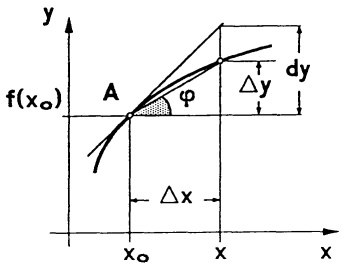

<details>
<summary>text_image</summary>

y
f(x₀)
A
φ
Δy
dy
Δx
x₀
x
x
</details>

Abb. 76 - Sekante, Tangente

$$
\begin{array}{c} \text {die Tangente an den Graph} y = f (x) \text {in} (x _ {0}, f (x _ {0})) \\ y = f ^ {\prime} (x _ {0}) (x - x _ {0}) + f (x _ {0}). \end{array} \tag {2}
$$

1.3 Die analytische Deutung der Ableitung: Lineare Approximation. Zu einer gegebenen differenzierbaren Funktion $f: I \to \mathbb{R}$ wird diejenige Gerade $g(x) = m(x - x_0) + f(x_0)$ durch $(x_0, f(x_0))$ gesucht, die $f$ in der Nähe von $x_0$ am besten approximiert. Unter „bester Approximation“ verstehen wir hier die Bedingung $\lim_{x \to x_0} \frac{f(x) - g(x)}{x - x_0} = 0$, die besagt, daß der relative Fehler nahe $x_0$ klein ist und mit $x \to x_0$ gegen 0 strebt. Wir tragen $g(x) = m(x - x_0) + f(x_0)$ ein und erkennen, daß beste Approximation bei $m = f'(x_0)$ vorliegt. D.h.,

$$
\begin{array}{c} f (x) \approx f ^ {\prime} \left(x _ {0}\right) \left(x - x _ {0}\right) + f \left(x _ {0}\right) \quad \text {bzw.} \quad f \left(x _ {0} + h\right) \approx f \left(x _ {0}\right) + f ^ {\prime} \left(x _ {0}\right) h \\ \text {ist nahe} x _ {0} \text {die beste lineare Approximation an} f. \end{array} \tag {3}
$$

Beispiel. Für  $f(x) = \sqrt{x}$  ergibt sich nahe  $x_{0} > 0$

$$
\sqrt {x _ {0} + h} \approx \sqrt {x _ {0}} + \frac {1}{2 \sqrt {x _ {0}}} h.
$$

Mit  $x_{0}=1.96$ , h=0.04 liefert das bereits einen recht guten Näherungswert für  $\sqrt{2}\approx1.4+\frac{1}{2.8}\cdot0.04=1.4142857\ldots$ . Der auf 7 Stellen genaue Wert ist  $\sqrt{2}=1.41421356\ldots$

---

114

3. Differentiation

1.4 Die physikalische Deutung der Ableitung: Geschwindigkeit. Sei  $s = s(t)$  die von einem Massenpunkt bei geradliniger Bewegung zur Zeit t zurückgelegte Strecke, o.E. mit  $s(0) = 0$ . Der Differenzenquotient  $\frac{\Delta s}{\Delta t}$  gibt die Durchschnittsgeschwindigkeit im Zeitintervall t bis  $t_{0}$  (bzw.  $t_{0}$  bis t) an. Die momentane Geschwindigkeit zum Zeitpunkt  $t_{0}$  ergibt sich aus dem Grenzübergang  $t \rightarrow t_{0}$ :

$$
v (t _ {0}) = \dot {s} (t _ {0}) = \lim _ {t \to t _ {0}} \frac {s (t) - s (t _ {0})}{t - t _ {0}}.
$$

Bemerkung. Wird das Argument einer Funktion $f$ nicht mit $x$, sondern mit $t$ bezeichnet, dann schreibt man für die Ableitung $\dot{f}(t)$.

Beispiel. Das Weg-Zeit-Gesetz eines bewegten Massenpunktes sei  $s(t) = at^{2} + bt + c$  (mit Konstanten  $a, b, c \in R$ ). Seine Geschwindigkeit zur Zeit t ist dann  $v(t) = \dot{s}(t) = 2at + b$  ( $\rightarrow$  (5)). □

Der Geschwindigkeitsbegriff läßt sich natürlich auch auf alle anderen zeitlich variablen Prozesse übertragen: Wachstumsgeschwindigkeit, Zerfallsgeschwindigkeit, Reaktionsgeschwindigkeit, etc.

1.5 Stetigkeit ist notwendig für Differenzierbarkeit. Es ist zwecklos, die Ableitung einer Funktion an einer Unstetigkeitsstelle zu suchen, es gilt nämlich

Satz 1.1. Jede in $x_0 \in I$ differenzierbare Funktion $f: I \to \mathbb{R}$ ist dort notwendig auch stetig.

Beweis. Ist $f$ in $x_0$ differenzierbar, so gilt $\lim_{x \to x_0} [f(x) - f(x_0) - f'(x_0)(x - x_0)] = 0$. Wegen $\lim_{x \to x_0} f'(x_0)(x - x_0) = 0$ folgt dann $\lim_{x \to x_0} [f(x) - f(x_0)] = 0$, also $\lim_{x \to x_0} f(x) = f(x_0)$.

Man beachte aber, daß Stetigkeit keineswegs hinreichend ist für Differenzierbarkeit. So ist etwa die Funktion $f(x) = |x|$ in der Spitze $x = 0$ stetig, aber nicht differenzierbar. Der linksseitige Grenzwert (bei $x \to 0-$) des Differenzenquotienten $\frac{|x|}{x}$ ist vom rechtsseitigen Grenzwert ($x \to 0+$) verschieden. Auch $g(x) = \sqrt{x}$ ist in $x = 0$ stetig, aber nicht differenzierbar ($\to 1.1$).

1.6 Differentiationsregeln. Mit den folgenden Regeln gelingt es, die Ableitung zusammengesetzter Funktionen aus den Ableitungen ihrer einzelnen „Bausteine“ zu ermitteln.

---

§1. Die Ableitung einer differenzierbaren Funktion

115

Satz 1.2. Sind Funktionen $f, g: I \to \mathbb{R}$ in $x \in I$ differenzierbar, dann gilt:

a) $[f(x) + g(x)]' = f'(x) + g'(x)$,

b) $[cf(x)]' = cf'(x)$ für alle $c \in \mathbb{R}$,

c) $\left[f(x)g(x)\right]^{\prime} = f^{\prime}(x)g(x) + f(x)g^{\prime}(x)$ (Produktregel),

(4) d) $\left(\frac{f(x)}{g(x)}\right)' = \frac{f'(x)g(x) - f(x)g'(x)}{g(x)^2} \quad (falls g(x) \neq 0;$

Quotientenregel),

insbesondere

$$
\left(\frac {1}{g (x)}\right) ^ {\prime} = - \frac {g ^ {\prime} (x)}{g (x) ^ {2}} \quad (f a l l s g (x) \neq 0).
$$

Beweis (mit den Grenzwertregeln Kap. 2, Satz 5.1). Sind $f, g$ in $x_0$ differenzierbar, dann gilt für $x \to x_0$:

a) $\frac{\Delta(f(x) + g(x))}{\Delta x} = \frac{\Delta f(x)}{\Delta x} + \frac{\Delta g(x)}{\Delta x} \longrightarrow f'(x_0) + g'(x_0)$.
c) $\frac{\Delta f(x)g(x)}{\Delta x} = f(x)\frac{\Delta g(x)}{\Delta x} +g(x)\frac{\Delta f(x)}{\Delta x}\longrightarrow f(x_0)g'(x_0) + g(x_0)f'(x_0).$
b) ist ein Sonderfall von c).
d) $\frac{\Delta\frac{1}{g(x)}}{\Delta x} = \frac{\frac{1}{g(x)} - \frac{1}{g(x_0)}}{x - x_0} = -\frac{g(x) - g(x_0)}{x - x_0} \cdot \frac{1}{g(x)g(x_0)} \longrightarrow \frac{g'(x_0)}{g(x_0)^2}$.

Wegen  $\frac{f(x)}{g(x)} = f(x) \cdot \frac{1}{g(x)}$  folgt aus diesem Spezialfall mit der Produktregel die allgemeine Quotientenregel.

Eine Mehrfachanwendung dieser Differentiationsregeln ergibt für $n$ in $x$ differenzierbare Funktionen $f_{i}$ und konstante Faktoren $c_{i}$ ($i = 1,2,\ldots,n$) die Formeln

4e)  $[c_{1}f_{1}(x)+\cdots+c_{n}f_{n}(x)]' = c_{1}f_{1}' + \cdots + c_{n}f_{n}'(x)$
4f) $[f_1(x)f_2(x)\dots f_n(x)]' = f_1'(x)f_2(x)\dots f_n(x) + f_1(x)f_2'(x)f_3(x)\dots f_n(x) + \dots +$

$$
f _ {1} (x) \dots f _ {n - 1} (x) f _ {n} ^ {\prime} (x).
$$

## 1.7 Die Differentiation der Polynome und der rationalen Funktionen.

Jedes Polynom ist überall differenzierbar.

$$
\boxed { \begin{array}{l} p (x) = a _ {n} x ^ {n} + a _ {n - 1} x ^ {n - 1} + \dots + a _ {1} x + a _ {0}, \text {dann ist} \\ p ^ {\prime} (x) = n a _ {n} x ^ {n - 1} + (n - 1) a _ {n - 1} x ^ {n - 2} + \dots + 2 a _ {2} x + a _ {1}. \end{array} } \tag {5}
$$

Beweis. Mit (4e) und (1c,a).

Beispiel.  $(4x^{7}+3x^{5}+2x^{3}+3)'=28x^{6}+15x^{4}+6x^{2}$

□

□

---

116

3. Differentiation

Jede rationale Funktion $f(x) = \frac{p(x)}{q(x)}$ kann man nun, falls $q(x) \neq 0$, mit (5) und der Quotientenregel differenzieren. Insbesondere folgt so

$$
\boxed {\left(\frac {1}{x ^ {n}}\right) ^ {\prime} = - \frac {n}{x ^ {n + 1}} (n \in \mathbb {N}, x \neq 0), \quad \text {speziell} \left(\frac {1}{x}\right) ^ {\prime} = - \frac {1}{x ^ {2}}.} \tag {6}
$$

1.8 Die Ableitung der Kreisfunktionen. Die Sinus- und die Cosinusfunktion sind auf R differenzierbar. Es gilt

$$
\begin{array}{l l} \text {a)} & \sin^ {\prime} x = \cos x, \\ \text {b)} & \cos^ {\prime} x = - \sin x, \\ \text {c)} & \tan^ {\prime} x = \frac {1}{(\cos x) ^ {2}} \quad (x \neq (2 k + 1) \frac {\pi}{2}), \\ \text {d)} & \cot^ {\prime} x = - \frac {1}{(\sin x) ^ {2}} \quad (x \neq k \pi). \end{array} \tag {7}
$$

Beweis. a): Mit dem Additionstheorem (→ Kap. 2, §3) und den bekannten Grenzwerten $\lim_{h\to 0}\frac{\sin h}{h} = 1$, $\lim_{h\to 0}\frac{\cos h - 1}{h} = 0$ (→ Kap. 2, §6) folgt

$$
\begin{array}{l} \frac {d}{d x} \sin x = \lim _ {h \to 0} \frac {1}{h} \left[ \sin (x + h) - \sin x \right] \\ = \lim _ {h \to 0} \frac {1}{h} \left[ \sin x \cos h + \cos x \sin h - \sin x \right] \\ = \lim _ {h \to 0} \left[ \sin x \frac {\cos h - 1}{h} + \cos x \frac {\sin h}{h} \right] = \cos x. \\ \end{array}
$$

b) analog; c) und d) mit der Quotientenregel.

Beispiel.  $\left[(x^{2}+5\sin x)\cos x\right]'=(2x+5\cos x)\cos x-(x^{2}+5\sin x)\sin x=2x\cos x-x^{2}\sin x+5\cos 2x$ .

1.9 Die Kettenregel. Die Komposition  $x \mapsto f(g(x))$  zweier differenzierbarer Funktionen ist ebenfalls differenzierbar und es gilt

$$
\boxed {\frac {d}{d x} f (g (x)) = f ^ {\prime} (g (x)) \cdot g ^ {\prime} (x).} \tag {8}
$$

Beweis.

$$
\frac {\Delta f (g (x))}{\Delta x} = \frac {\Delta f (g (x))}{\Delta g (x)} \cdot \frac {\Delta g (x)}{\Delta x} \longrightarrow f ^ {\prime} (g (x)) g ^ {\prime} (x).
$$

Bemerkung. In  $f(g(x))$  heißt f die äußere, g die innere Funktion. Dement-

---

§1. Die Ableitung einer differenzierbaren Funktion

117

sprechend liest man die rechte Seite von (8) als

„Ableitung der äußeren Funktion an der Stelle $g(x)$ multipliziert mit der Ableitung $g'(x)$ der inneren Funktion“.

Die Differentiation einer „geschachtelten“ Funktion  $x \mapsto h(x)$  geschieht demnach in mehreren Schritten:

1. Schritt: Das Erkennen der äußeren Funktion $f$ und der inneren Funktion $g$, so daß $h(x) = f(g(x))$.
2. Schritt: Die Differentiation von $f$ an der Stelle $g(x)$; d.h., man bildet $f'(x)$ und ersetzt $x$ durch $g(x)$.
3. Schritt: Das Nachdifferenzieren. Darunter versteht man die Multiplikation von  $f'(g(x))$  mit der Ableitung  $g'$  der inneren Funktion. Insgesamt:  $h'(x) = f'(g(x)) \cdot g'(x)$ .

Bei mehrfacher Schachtelung ist entsprechend oft nachzudifferenzieren:

$$
h (x) = f \left(p \big (q (x) \big)\right) \Rightarrow h ^ {\prime} (x) = f ^ {\prime} \Big (p \big (q (x) \big) \Big) p ^ {\prime} \big (q (x) \big) q ^ {\prime} (x).
$$

## Beispiele.

1. In  $h(x) = (x^{4} + 6x + 5)^{3}$  ist  $f(x) = x^{3}$  die äußere und  $g(x) = x^{4} + 6x + 5$  die innere Funktion. Die Ableitung (2. und 3. Schritt zusammen):

$$
h ^ {\prime} (x) = 3 (x ^ {4} + 6 x + 5) ^ {2} \cdot (4 x ^ {3} + 6).
$$

2. In $h(x) = \cos f(x)$ ist cos die äußere und $f$ die innere Funktion: $h'(x) = -(sin f(x)) \cdot f'(x) = -f'(x) sin f(x)$. Speziell $\frac{d}{dx} \cos(ax + b) = -a sin(ax + b)$. Ebenso $\frac{d}{dx} \sin(ax + b) = a cos(ax + b)$.

3. Die Funktion  $h(x) = [\sin(x^{4} + 2x)^{2}]^{5}$  ist mehrfach geschachtelt mit der äußeren Funktion  $f(x) = x^{5}$  und der geschachtelten inneren Funktion  $g(x) = \sin(x^{4} + 2x)^{2}$ . Die Ableitung:

$$
h ^ {\prime} (x) = 5 g (x) ^ {4} \cdot g ^ {\prime} (x) = 5 [ \sin (x ^ {4} + 2 x) ^ {2} ] ^ {4} \cdot \cos (x ^ {4} + 2 x) ^ {2} \cdot 2 (x ^ {4} + 2 x) \cdot (4 x ^ {3} + 2). \tag {$\square$}
$$

1.10 Höhere Ableitungen. Die Ableitung der Ableitung von $f$ bezeichnen wir, falls sie existiert, mit $f''$ und für $\frac{d}{dx}(\frac{d}{dx}f(x))$ schreiben wir $\frac{d^2}{dx^2}f(x)$. Wir definieren allgemein

$$
\begin{array}{l} f ^ {(0)} (x) := f (x), f ^ {(1)} (x) := f ^ {\prime} (x), f ^ {(2)} (x) := f ^ {\prime \prime} (x) = \frac {d ^ {2}}{d x ^ {2}} f (x), \dots , f ^ {(n)} (x) := \\ \frac {d}{d x} f ^ {(n - 1)} (x) = \frac {d ^ {n}}{d x ^ {n}} f (x) \quad (n = 0, 1, 2, \dots). \end{array}
$$

Man sagt, $f$ ist $n$-mal differenzierbar (bzw. stetig differenzierbar), wenn die $n$-te Ableitung $f^{(n)}(x)$ existiert (bzw. existiert und stetig ist). Man beachte, daß eine differenzierbare Funktion nicht notwendig auch zweimal differenzierbar ist. Dazu betrachte man $f(x)=x|x|$ mit der Ableitung $f'(x)=2|x|$.

Beispiel 1. Für das Polynom $p(x) = 3x^6 + 2x^4 - 7x + 1$ gilt $p'(x) = 18x^5 +$

---

118

3. Differentiation

$8x^{3}-7$ ,  $p''(x)=90x^{4}+24x^{2}$ ,  $p^{(3)}(x)=360x^{3}+48x$ ,  $p^{(4)}(x)=1080x^{2}+48$ ,  $p^{(5)}(x)=2160x$ ,  $p^{(6)}(x)=2160$ ,  $p^{(7)}(x)=0$ . Allgemein gilt: Die n-te Ableitung eines Polynoms vom Grad k, k<n, verschwindet (d.h., sie ist Null):

$$
p (x) = a _ {k} x ^ {k} + \dots + a _ {0}, k <   n \Rightarrow \frac {d ^ {n}}{d x ^ {n}} p (x) = 0.
$$

Beispiel 2. Ein nach $s(t) = A \cos(\omega t + \alpha)$ schwingender linearer Oszillator hat die Geschwindigkeit $v(t) = \dot{s}(t) = -\omega A \sin(\omega t + \alpha)$ und die Beschleunigung $b(t) = \dot{v}(t) = -\omega^2 A \cos(\omega t + \alpha) = -\omega^2 s(t)$. Er erfüllt das Hooke-Gesetz: „Die rücktreibende Kraft $mb$ ist proportional zur Auslenkung $s$“.

Beispiel 3. Die Spitze eines Zeigers der Länge r, der mit konstanter Winkelgeschwindigkeit ω um den Nullpunkt kreist, läßt sich in der komplexen Ebene durch

$$
z (t) = a e ^ {i \omega t} = a (\cos \omega t + i \sin \omega t), \quad t \in \mathbb {R},
$$

mit $z(0) = a \in \mathbb{C}$ (Anfangslage zur Zeit $t = 0$) und $|a| = r$ darstellen ($\rightarrow$ Kap. 2, 3.3). Die Ableitung nach $t$, $\dot{z}(t) := \frac{d}{dt} x(t) + i \frac{d}{dt} y(t)$, gibt die Bahngeschwindigkeit an. Mit (7a,b) und der Kettenregel ergibt sich

$$
\dot {z} (t) = a (- \omega \sin \omega t + i \omega \cos \omega t) = a i \omega e ^ {i \omega t} = i \omega z (t).
$$

Der Zeiger  $\dot{z}$  eilt dem Zeiger z um  $\frac{\pi}{2}$  voraus. Die Geschwindigkeit hat den Betrag  $v = |\dot{z}| = |i\omega z| = \omega r$ .

Mit a = 1 lautet diese Differentiationsregel

$$
\boxed {\frac {d}{d t} e ^ {i \omega t} = i \omega e ^ {i \omega t}, \quad t \in \mathbb {R}.} \tag {9}
$$

Wir betrachten einen Wechselstrom mit komplexer Spannung $U(t) = U_0 e^{i\omega t}$ und komplexer Stromstärke $I(t) = I_0 e^{i\omega t}$ in den Grundelementen ($\rightarrow$ Kap. 1, §8).

① Ohmscher Widerstand (mit Widerstand R),
② Kondensator (mit Kapazität C),
③ Induktionsspule (mit Induktivität L).

Für diese drei Elemente gilt einheitlich das

$$
\text {Ohmsche Gesetz} \quad U (t) = Z \cdot I (t)
$$

mit $Z = R$ (Fall ①), $Z = \frac{1}{i\omega C}$ (Fall ②), $Z = i\omega L$ (Fall ③).

Beweis. Zu ① : Man wendet das reelle Ohmsche Gesetz auf Realteil und Imaginärteil an und erhält U = RI .

Zu ② : Im Kondensator ist die Stromstärke proportional zur Änderungsgeschwindigkeit der Spannung; d.h. mit (9), $I(t) = C \frac{d}{dt} U(t) = i\omega CU(t)$. Mit

---

§1. Die Ableitung einer differenzierbaren Funktion

119

$Z := \frac{1}{i\omega C}$ wird daraus $U = ZI$ .

Zu ③ : In der Spule ist die induzierte Spannung proportional zur Änderungsgeschwindigkeit des Stroms; d.h mit (9), $U = L \frac{d}{dt} I(t) = i\omega LI(t) = ZI(t)$ mit $Z := i\omega L$.

## Aufgaben

1. Man bilde die Ableitung

$$
\begin{array}{l} x ^ {3} \cos x, \quad \cos^ {3} x, \quad \cos (x ^ {3}), \\ \frac {(x + 2)}{x \sqrt {x}}, \quad \frac {\sqrt {1 + f (x) ^ {2}}}{1 + f (x)}, \quad | x ^ {3} |, \\ \sqrt {x \sqrt {x \sqrt {x}}} \quad , \quad x ^ {3} \sqrt {x} (x ^ {3} - \frac {2}{x} + 6) + (\sqrt {x} ^ {3} - 2) ^ {7} + 2 6, \quad \frac {(a ^ {2} + x ^ {2}) ^ {2}}{(a ^ {3} + x ^ {3}) ^ {2}}, \\ \frac {x}{x + \sqrt {a ^ {2} + x ^ {2}}} \quad , \quad \sqrt {a + x} \cdot \sqrt {a ^ {2} - x ^ {2}} \quad , \quad \frac {x ^ {2}}{\cos x} \quad , \\ \frac {x}{4} \cos \frac {\pi}{3}, \quad \tan \sqrt {2 - \sin^ {2} x}, \quad \frac {1}{\tan | x |}, \\ \cos (\sin (\cos x)) \quad , \qquad \sin^ {2} (x ^ {2}) - \cos \sqrt {x} + \cot (\tan x) \quad . \\ \end{array}
$$

2. Für welche  $x \in R$  sind folgende Funktionen differenzierbar?

a) $f(x) = \frac{x^3 - 2x^2 + x}{x^2 - 1}$，
b) $f(x) = |x^{2} - 1| + |x| - 1$
c) $f(x) = \sqrt{\frac{3|x|}{x} + \frac{5}{2}}$.

Man berechne für diese x den Wert von  $f'(x)$  und stelle die Tangentengleichung an die Kurve  $y = f(x)$  im Punkt  $(2, f(2))$  auf.

3. Man bestätige durch vollständige Induktion die LEIBNIZ-Regel

$$
(f (x) g (x)) ^ {(n)} = \sum_ {k = 0} ^ {n} \binom {n} {k} f ^ {(k)} (x) g ^ {(n - k)} (x), \quad (n = 0, 1, 2, \dots)
$$

und berechne damit  $f^{(10)}(x)$  für  $f(x) = x \sin x$ .

4. Meridianschnitt eines Springbrunnens

Vom Ursprung des  $(x, y)$ -Koordinatensystems aus fliegen Wasserteilchen mit (betragsmäßig) gleicher Anfangsgeschwindigkeit v nach allen Richtungen  $\alpha$  in die obere Halbebene  $(0 < \alpha < \pi)$ . Für die Tröpfchenbahn gilt  $(t : Zeit; g : Erdbeschleunigung)$

$$
x (t) = (v \cos \alpha) t ;
$$

$$
y (t) = (v \sin \alpha) t - \frac {1}{2} g t ^ {2}.
$$

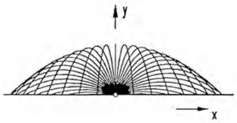

<details>
<summary>text_image</summary>

Diagram showing a parabolic grid pattern with x and y axes, labeled with origin and directional arrows
</details>

---

120

3. Differentiation

a) Wie lautet die  $(x,y)$ -Gleichung der Bahnkurve? (Man eliminiere t!)
b) Bestimme aus  $\dot{y}(t)=0$  den Scheitel  $(x_{S},y_{S})$  und die positive Nullstelle  $(x_{N},0)$  der Kurve. Für welche  $\alpha$  ist  $x_{N}$  bzw.  $y_{S}$  maximal?
c) Auf welcher Kurve E liegen die Scheitelpunkte aller Bahnen?
(Gefragt ist die  $(x, y)$ -Gleichung und eine Skizze!)
d) Die Hüllfläche des Springbrunnens ist ein Drehparaboloid. Man bestimme die  $(x,y)$ -Gleichung des Meridians P.
Hilfe: Jedes Tröpfchen trifft die Fläche höchstens einmal.

5. Für die LEGENDRE-Polynome (→ Kap. 2, §2, Aufg.11) gilt die Darstellung von RODRIGUES

$$
P _ {n} (x) = \frac {1}{2 ^ {n} n !} [ (x ^ {2} - 1) ^ {n} ] ^ {(n)}, \quad n = 0, 1, 2, \dots .
$$

a) Man bestimme die Koeffizienten von  $P_{n}(x)$ .

b) $P_{n}(x)$ genügt der Legendre-Differentialgleichung:

$$
[ (x ^ {2} - 1) \cdot P _ {n} ^ {\prime} ] ^ {\prime} = n (n + 1) P _ {n} .
$$

Zum Nachweis wende man die Leibniz-Regel an auf

$$
[ (n + 1) 2 x \cdot (x ^ {2} - 1) ^ {n} ] ^ {(n + 1)} \quad \text {und} \quad [ (x ^ {2} - 1) \cdot (x ^ {2} - 1) ^ {n} ] ^ {(n + 2)}
$$

und bestätige

$$
P _ {n + 1} ^ {\prime} = x P _ {n} ^ {\prime} + (n + 1) P _ {n}; \quad P _ {n + 1} ^ {\prime} = \frac {x ^ {2} - 1}{2 (n + 1)} P _ {n} ^ {\prime \prime} + \frac {(n + 2) x}{n + 1} P _ {n} ^ {\prime} + \frac {n + 2}{2} P _ {n}.
$$

6. Logarithmische Ableitung

Sei stets  $(f_{1} \cdot f_{2} \cdots f_{n})(x) > 0$ . Man stelle  $\frac{(f_{1} \cdot f_{2} \cdots f_{n})'}{f_{1} \cdot f_{2} \cdots f_{n}}$  durch  $\frac{f_{1}'}{f_{1}}$ ,  $\cdots$ ,  $\frac{f_{n}'}{f_{n}}$  dar.

7. Man berechne $y(1)$ und $y'(1)$ aus

$$
x ^ {2} y (x) ^ {3} - 3 (x ^ {2} + 1) ^ {2} = x ^ {3} y (x) - 6
$$

und stelle die Tangentengleichung im Punkt  $(1,y(1))$  auf.

8. Eine differenzierbare aber nicht stetig differenzierbare Funktion

$$
f (x) = \left\{ \begin{array}{c c} x ^ {2} \sin \frac {1}{x} & , x \neq 0 \\ 0 & , x = 0 \end{array} \right..
$$

Man berechne - soweit vorhanden - die Grenzwerte

$$
f ^ {\prime} (0) = \lim _ {h \to 0} \frac {1}{h} (f (h) - f (0)) \quad \text {und} \quad \lim _ {x \to 0} f ^ {\prime} (x) .
$$

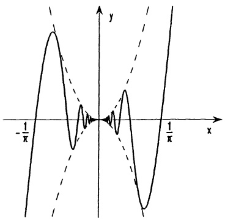

<details>
<summary>contour</summary>

| X | Y |
| --- | --- |
| \(-1/\pi\) | ~0.5 |
| 0 | 0 |
| \(1/\pi\) | ~0.5 |
</details>

---

§2. Anwendungen der Differentiation

121

## §2. Anwendungen der Differentiation

2.1 Maxima und Minima einer Funktion. Man sagt, eine auf $D \subseteq \mathbb{R}$ erklärte Funktion $f$ hat in $a \in D$ ein globales (oder absolutes) Maximum, wenn $f(x) \leq f(a)$ für alle $x \in D$ gilt. In diesem Fall heißt $a$ eine globale Maximalstelle und $f(a)$ das globale Maximum von $f$. Die Zahl $b \in D$ heißt lokale (oder relative) Maximalstelle von $f$, dementsprechend $f(b)$ ein lokales (oder relatives) Maximum, wenn es ein (evtl. kleines) Intervall $I$ mit Mittelpunkt $b$ gibt, so daß $f(x) \leq f(b)$ für alle $x \in I \cap D$. Ganz analog sind globales und lokales Minimum, globale und lokale Minimalstelle definiert. „global“ bezieht sich immer auf den ganzen Definitionsbereich, „lokal“ nur auf die unmittelbare Umgebung des betreffenden Punktes. Jedes Minimum und jedes Maximum heißt auch ein Extremum. Man beachte:

$x_{0}$ Minimalstelle von $f \iff x_{0}$ Maximalstelle von -f.

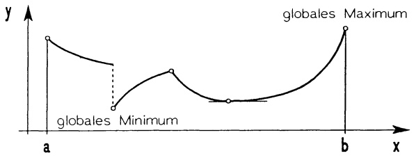

<details>
<summary>line</summary>

| Point Type | X-coordinate | Y-coordinate |
| --- | --- | --- |
| Global Minimum | ~0.35 | ~0.15 |
| Global Maximum | b | y |
</details>

Abb. 77 - Funktion mit 5 lokalen und 2 globalen Extremstellen

Bezüglich der Lage von Extremalstellen gilt:

Satz 2.1. Ist f eine auf dem offenen Intervall I differenzierbare Funktion, so gilt

$$
x _ {0} \in I \quad \text {lokale Extremstelle von} f \quad \Rightarrow \quad f ^ {\prime} (x _ {0}) = 0.
$$

Beweis. Wir nehmen an, $x_0$ sei eine Maximalstelle in $(x_0 - \varepsilon, x_0 + \varepsilon) (\varepsilon > 0)$. Mit $\frac{f(x) - f(x_0)}{x - x_0} \geq 0$ für $x_0 - \varepsilon < x < x_0$ gilt $f'(x_0) = \lim_{x \to x_0^-} \frac{\Delta f(x)}{\Delta x} \geq 0$. Ebenso $f'(x_0) = \lim_{x \to x_0^+} \frac{\Delta f(x)}{\Delta x} \leq 0$ und folglich $f'(x_0) = 0$.

Die Bedingung  $f'(x_{0}) = 0$  (der Graph  $y = f(x)$  hat in  $(x_{0}, f(x_{0}))$  eine waagerechte Tangente) ist zwar notwendig für ein Extremum, aber noch nicht hinreichend. Beispielsweise hat  $f(x) = x^{3}$  in x = 0 eine waagerechte Tangente  $(f'(0) = 0)$  aber kein Extremum.

Der Satz gibt auch keine Auskunft über Extremalstellen an den Intervallenden, an Spitzen oder an anderen Stellen, in denen f nicht differenzierbar ist. Das bedeutet:

---

122

3. Differentiation

<div class="docvortex-algorithm" style="white-space: pre-wrap; font-family:monospace;">
Die Kandidaten für Extremalstellen von $f: I \to \mathbb{R}$ sind:
a) die Randpunkte von $I$ (das sind höchstens zwei Zahlen);
b) die Punkte aus $I$, in denen $f$ nicht differenzierbar ist;
c) die stationären Punkte aus dem Innern von $I$
($x \in I$ heißt stationärer Punkt, wenn $f'(x) = 0$ gilt).
</div>

Jeder dieser Kandidaten ist dann auf Extremaleigenschaften zu überprüfen. Der größte bzw. kleinste Funktionswert an den Stellen aus a), b), c) liefert das globale Maximum bzw. Minimum von f. Hinweis: Die Extremalstellen echt monotoner Funktionen findet man bereits aus a).

Beispiel 1. Aus einer rechtwinkligen Blechplatte der Seitenlängen 16 cm und 10 cm soll eine quaderförmige oben offene Wanne mit maximalem Volumen geformt werden.

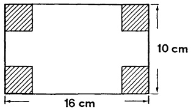

<details>
<summary>text_image</summary>

10 cm
16 cm
</details>

Abb. 78 - Blechzuschnitt

Lösung. Das Volumen des aus der Platte geformten Quaders der Höhe x ist  $V(x) = (10 - 2x)(16 - 2x)x = 4x^{3} - 52x^{2} + 160x \quad (0 \leq x \leq 5)$ . Wegen  $V(0) = V(5) = 0$  sind die Randpunkte keine Maximalstellen, diese sind unter den stationären Punkten aus (0,5) zu suchen. Punkte aus b) kommen nicht vor.  $V'(x) = 12x^{2} - 104x + 160 = 0$  hat in (0,5) nur eine Lösung x = 2. Dieses ist dann die Maximalstelle; das maximale Volumen beträgt  $V(2) = 144cm^{3}$ . ☐

Beispiel 2. Nach dem FERMATSchen Prinzip ist der Lichtweg

$$
w (x) = l _ {1} + l _ {2} = \sqrt {a ^ {2} + x ^ {2}} + \sqrt {b ^ {2} + (c - x) ^ {2}}
$$

eines von $A = (0, a)$ über den (noch unbekannten) Reflexionspunkt $X = (x, 0)$ nach $B = (c, b)$ gehenden Lichtstrahls minimal. Die Minimalstellen von $w$ - die es mit Sicherheit gibt - sind unter den stationären Stellen $w'(x) = \frac{x}{\sqrt{a^2 + x^2}} - \frac{(c - x)}{\sqrt{b^2 + (c - x)^2}} = 0$ zu suchen. Man

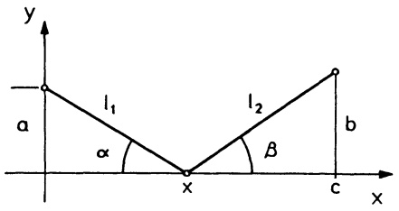

<details>
<summary>text_image</summary>

y
l₁
a
α
x
l₂
β
c
b
x
</details>

Abb. 79 - Lichtreflexion

findet so den eindeutig bestimmten Reflexionspunkt mit  $x = \frac{ca}{a + b}$  und erhält außerdem wegen  $\cos \alpha = \frac{x}{l_{1}}$  und  $\cos \beta = \frac{c - x}{l_{2}}$  das Spiegelungsgesetz  $\cos \alpha = \cos \beta$  (bzw.  $\alpha = \beta$ ).

---

§2. Anwendungen der Differentiation

123

## 2.2 Der Mittelwertsatz. Die folgenden Beobachtungen bilden das Fundament weiterführender Überlegungen.

Satz 2.2. Der Mittelwertsatz. Ist die Funktion f auf dem abgeschlossenen Intervall [a,b] stetig und auf dem offenen Intervall (a,b) differenzierbar, dann gibt es (wenigstens) einen inneren Punkt  $x_{0} \in (a,b)$  mit

$$
f ^ {\prime} (x _ {0}) = \frac {f (b) - f (a)}{b - a}.
$$

Beweis. Die Funktion $F(x) = f(x) - (x - b)\frac{f(b) - f(a)}{b - a}$ hat in $[a, b]$ wenigstens eine Extremalstelle $x_0$ ($\rightarrow$ Satz vom Maximum und Minimum, Kap. 2, Satz 6.5). Wegen $F(a) = F(b)$ liegt diese Extremalstelle $x_0$ in $(a, b)$, somit gilt $F'(x_0) = 0$ ($\rightarrow$ Satz 2.1).

## Bemerkungen.

1. Anschaulich bedeutet der Mittelwertsatz, daß für mindestens ein  $x_{0} \in (a, b)$  die Kurventangente parallel zur Sehne AB ist.
2. Nach dem Mittelwertsatz wird bei der durch  $s = f(t)$  beschriebenen geradlinigen Bewegung zu mindestens einem Zeitpunkt  $t_{0}$  im Zeitintervall  $a \leq t \leq b$  die durchschnittliche Geschwindigkeit  $\bar{v} = \frac{f(b) - f(a)}{b - a}$  tatsächlich erreicht;  $v(t_{0}) = \dot{f}(t_{0}) = \bar{v}$ .

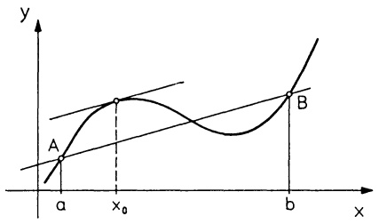

<details>
<summary>line</summary>

| Point | X-coordinate | Y-coordinate |
| --- | --- | --- |
| A | a | ~0.2 |
| x0 | x0 | ~0.6 |
| b | b | ~0.5 |
</details>

Abb. 80 - Mittelwertsatz

Als erste Anwendung des Mittelwertsatzes stellen wir einige Eigenschaften der Funktion $f$, bzw. des Graphen $y = f(x)$ zusammen, die man an $f'$ ablesen kann.

Satz 2.3. Für eine auf dem Intervall I differenzierbare Funktion f gilt:

a)  $f'(x) > 0 \text{ auf } I \implies f \text{ ist auf } I \text{ echt monoton wachsend (der Graph steigt);}$
b)  $f'(x) < 0$  auf I  $\Longrightarrow$  f ist auf I echt monoton fallend (der Graph fällt);
c)  $f'(x) \geq 0$  auf I  $\Longleftrightarrow$  f ist auf I monoton wachsend;
d)  $f'(x) \leq 0$  auf I  $\Longleftrightarrow$  f ist auf I monoton fallend;
e)  $f'(x) = 0 \text{ auf } I \iff f \text{ ist auf } I \text{ konstant.}$

---

124

3. Differentiation

Beweis. a): Zu zwei Zahlen $x_1, x_2 \in I$ mit $x_2 > x_1$ gibt es nach dem Mittelwertsatz – und der Voraussetzung – ein $x_0$ zwischen $x_1, x_2$ mit $\frac{f(x_2) - f(x_1)}{x_2 - x_1} = f'(x_0) > 0$. Das zeigt $f(x_2) - f(x_1) > 0$, also $f(x_2) > f(x_1)$. Die anderen Aussagen werden in der „$\Longrightarrow$“ Richtung völlig analog bewiesen. Zum Beweis der Behauptung „$\Longleftarrow$“ benötigt man nur die Definitionen. So gilt beispielsweise $\frac{f(x) - f(x_0)}{x - x_0} \geq 0 \quad (x, x_0 \in I)$ für

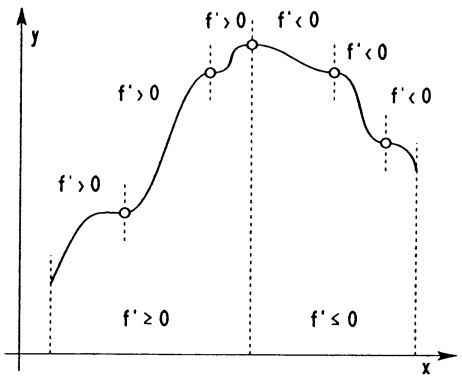

<details>
<summary>line</summary>

| Point | Condition |
| --- | --- |
| 1 | f' > 0 |
| 2 | f' > 0 |
| 3 | f' > 0 |
| 4 | f' > 0 |
| 5 | f' < 0 |
| 6 | f' < 0 |
| 7 | f' < 0 |
</details>

Abb. 81 - Monotoniebereiche

monoton wachsendes $f$ und deshalb $f'(x_0) = \lim_{x \to x_0} \frac{\Delta f(x)}{\Delta x} \geq 0$. e) erhält man auch als einfache Folgerung aus c) und d).

Für zwei auf einem Intervall $I$ differenzierbare Funktionen $f$ und $g$ folgt nach Teil e) des Satzes (mit $f - g$ anstelle $f$):

$$
\begin{array}{l} f ^ {\prime} (x) = g ^ {\prime} (x) \text {auf} I \iff f (x) = g (x) + c \text {auf} I \\ \text {(mit einer Konstanten} c \in \mathbb {R}). \end{array} \tag {2}
$$

Die Konstante $c$ aus $f(x) = g(x) + c$ läßt sich mit jedem $x_0 \in I$ bestimmen: $c = f(x_0) - g(x_0)$.

Beispiel 1. Ein sich mit der Geschwindigkeit $\dot{s}(t) = v(t) = at + b$ geradlinig bewegender Massenpunkt erfüllt ein Weg-Zeit-Gesetz der Form $s(t) = \frac{1}{2}at^2 + bt + c$ mit $c = s(0)$. Denn offenbar hat $s_0(t) = \frac{1}{2}at^2 + bt$ dieselbe Ableitung wie $s(t)$, was (nach (2)) $s(t) = s_0(t) + c$ nach sich zieht.

Beispiel 2. Für die auf $I = (-\infty, \infty)$ definierte Funktion $f(x) = \frac{x}{\sqrt{1 + x^2}}$ gilt $f'(x) = \frac{1}{(\sqrt{1 + x^2})^3} > 0$; folglich ist $f$ echt monoton wachsend.

Beispiel 3. Behauptung: Jede lineare Pendelbewegung, für die das HOOKESche Gesetz gilt (die rücktreibende Kraft ist proportional zur Auslenkung), ist eine harmonische Schwingung.

Beweis. Bezeichnet $s = s(t)$ die Auslenkung zur Zeit $t$, dann gibt $\ddot{s}$ die (zur Kraft proportionale) Beschleunigung an, und das Hookesche Gesetz erscheint in der Form $\ddot{s}(t) = -\omega^{2}s(t)$, bzw.

$$
\ddot {s} (t) + \omega^ {2} s (t) = 0.
$$

---

§2. Anwendungen der Differentiation

125

Wir multiplizieren mit 2s und erhalten nach der Kettenregel

$\frac{d}{dt} (\dot{s} (t)^2 +\omega^2 s(t)^2) = 0$ und deshalb $(\rightarrow$ Satz 2.3 e)

$$
\dot {s} (t) ^ {2} + \omega^ {2} s (t) ^ {2} = c \quad (\text {mit einer Konstanten} c \in \mathbb {R}).
$$

1. Fall.  $s(0) = \dot{s}(0) = 0$ . In diesem Fall ist c = 0, also auch  $s(t) = \dot{s}(t) = 0$  für alle t.
2. Fall.  $s(0)$ ,  $\dot{s}(0)$  beliebig. Für die Funktion  $s_{0}(t) := s(t) - s(0)\cos\omega t - \frac{1}{\omega}\dot{s}(0)\sin\omega t$  verifiziert man leicht  $\ddot{s}_{0}(t) + \omega^{2}s_{0}(t) = 0$  und  $s_{0}(0) = \dot{s}_{0}(0) = 0$ .
Also gilt $s_0(t) = 0$ für alle $t$ ($\rightarrow$ Fall 1), bzw. $s(t) = s(0)\cos\omega t + \frac{1}{\omega}\dot{s}(0)\sin\omega t$.

Der Satz 2.3 hilft auch, die Extremalstellen unter den stationären Punkten ( $f'(x) = 0$ ) herauszufinden:

## Satz 2.4. 1. Extremwert-Test.

Eine auf dem offenen Intervall  $(a,b)$  differenzierbare Funktion f hat im stationären Punkt  $x_{0} \in (a,b)$  ein lokales Maximum (bzw. lokales Minimum), wenn die Ableitung  $f'(x)$  unmittelbar links von  $x_{0}$  (d.h. in  $(x_{0} - \varepsilon, x_{0})$  mit kleinem  $\varepsilon > 0$ ) positiv, rechts von  $x_{0}$  negativ (bzw. links negativ, rechts positiv) ist.

Beweis. Ist unmittelbar links von  $x_{0}$  die Ableitung positiv, dann wächst dort die Funktion; rechts neben  $x_{0}$  fällt sie wieder, also ist  $x_{0}$  lokale Maximalstelle.

□

Beispiel. Die stationären Punkte der Funktion  $f(x) = x^{2}\sqrt{1 - x^{2}}$ ,  $|x| < 1$ , also die Lösungen der Gleichung

$$
f ^ {\prime} (x) = \frac {2 x - 3 x ^ {3}}{\sqrt {1 - x ^ {2}}} = 0, \text {sind}
$$

$$
x _ {1} = 0, x _ {2} = \sqrt {\frac {2}{3}}, x _ {3} = - \sqrt {\frac {2}{3}}.
$$

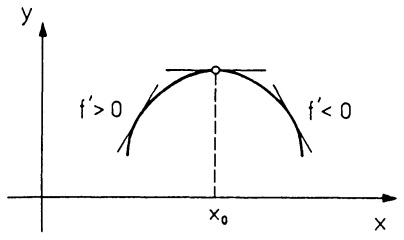

<details>
<summary>text_image</summary>

y
f' > 0
x₀
f' < 0
x
</details>

Abb. 82 - Lokales Maximum

Offenbar ist $f(0) = 0$ das globale Minimum. Bei $x_2 = \sqrt{\frac{2}{3}}$ hat die Ableitung $f'(x)$ denselben Vorzeichenwechsel wie der Faktor $2 - 3x^2$, also von $+$ nach $-.$ Demnach gehört zu $x_2$ ein lokales Maximum. Da $f$ gerade ist $(y = f(x))$ liegt symmetrisch zur $y$-Achse), handelt es sich bei $x_3 = -\sqrt{\frac{2}{3}}$ ebenfalls um eine lokale Maximalstelle.

Wenn die zweite Ableitung  $f''$  nicht zu kompliziert ist, kann man die stationären Punkte auch mit dem folgenden Test auf eine Extremaleigenschaft untersuchen.

---

126

3. Differentiation

## Satz 2.5. 2. Extremwert-Test.

Ist $f$ auf $(a,b)$ zweimal stetig differenzierbar und $x_0 \in (a,b)$ ein stationärer Punkt, dann gilt:

a)  $f''(x_{0}) < 0 \implies f \text{ hat in } x_{0} \text{ ein lokales Maximum,}$
b)  $f''(x_{0}) > 0 \implies f \text{ hat in } x_{0} \text{ ein lokales Minimum.}$

Beweis. Aus  $f''(x_{0}) < 0$  und der Stetigkeit von  $f''$  folgt  $f'' < 0$  auf einem (evtl. sehr kleinem) Intervall mit Mittelpunkt  $x_{0}$ . Nach Satz 2.3b ist  $f'$  dort echt monoton fallend und hat wegen  $f'(x_{0}) = 0$  in  $x_{0}$  einen Vorzeichenwechsel von + nach -. Mit Satz 2.4 folgt die Behauptung. □

Bemerkung. Auch der zweite Extremwert-Test ist nur für innere Punkte des Intervalls zulässig. Außerdem gibt er keine Auskunft über innere Punkte mit  $f'(x) = f''(x) = 0$  ( $\rightarrow$  Kap. 5, Satz 4.3).

Beispiel. Wir betrachten die Funktion $f(x) = x + 2\sin x$ im Intervall $[-2\pi, 2\pi]$ mit den beiden globalen Extrema $f(-2\pi) = -2\pi$ (Minimum), $f(2\pi) = 2\pi$ (Maximum) an den Intervallenden. Die zweite Ableitung $f''(x) = -2\sin x$ ist an den stationären Punkten (das sind Lösungen von $f'(x) = 1 + 2\cos x = 0$) $x_1 = \frac{2}{3}\pi$, $x_2 = -\frac{4}{3}\pi$ negativ, also liegen dort lokale Maxima. Die anderen beiden stationären Punkte $x_3 = -\frac{2}{3}\pi$, $x_4 = \frac{4}{3}\pi$ sind lokale Minimalstellen.

2.4 Wendepunkte. Auch das Krümmungsverhalten der Kurve  $y = f(x)$  kann man am Vorzeichen von  $f''$  erkennen. Ist nämlich  $f'' > 0$  auf einem Intervall, dann wächst dort  $f'$  echt monoton ( $\rightarrow$  Satz 2.3); was offenbar nur bei einem linksgekrümmten Graphen möglich ist ( $\rightarrow$  Abb. 83). Also gilt:

## Satz 2.6. Krümmungs-Test.

a)  $f'' > 0 \implies \text{Die Kurve } y = f(x) \text{ ist konvex von unten (Linkskrümmung).}$
b)  $f'' < 0 \implies \text{Die Kurve } y = f(x) \text{ ist konvex von oben (Rechtskrümmung).}$

Diejenigen Punkte, in denen  $y = f(x)$  von einer Linkskrümmung in eine Rechtskrümmung oder von Rechtskrümmung in Linkskrümmung übergeht, heißen Wendepunkte.

Die Kandidaten für Wendepunkte von $f: I \to \mathbb{R}$ sind:

a) die Punkte aus I, in denen  $f''$  nicht existiert;
b) die Punkte aus I, in denen  $f'' = 0$ .

## Satz 2.7. Wendepunkt-Test.

$f''(x_0) = 0, f'''(x_0) \neq 0 \implies f$ hat in $x_0$ einen Wendepunkt.

---

§2. Anwendungen der Differentiation

127

Beweis. Nach Satz 2.5 ist  $x_{0}$  Extremalstelle von  $f'$ , also ein Wendepunkt. ☐

Beispiel. Die kritische Temperatur  $T_{0}$ , oberhalb der man ein Gas nicht mehr verflüssigen kann, wird mit der Zustandsgleichung nach VAN DER WAALS

$$
\left(p + \frac {a}{V ^ {2}}\right) (V - b) = R T
$$

so bestimmt, daß die Kurve

$$
p = p (V) = \frac {R T _ {0}}{V - b} - \frac {a}{V ^ {2}}
$$

einen Wendepunkt mit horizontaler Tangente besitzt. Aus  $p'(V) = p''(V) = 0$  ergeben sich die Bedingungen

$$
\frac {R T _ {0}}{(V - b) ^ {2}} = \frac {2 a}{V ^ {3}}, \frac {R T _ {0}}{(V - b) ^ {3}} = \frac {3 a}{V ^ {4}}
$$

und als Lösungen das kritische Volumen $V = V_{0} = 3b$ und die kritische Temperatur $T_{0} = \frac{8a}{27bR}$. Daß es sich tatsächlich um einen Wendepunkt handelt, ersieht man nun aus $p'''(V_{0}) = -\frac{a}{81b^{5}} \neq 0$.

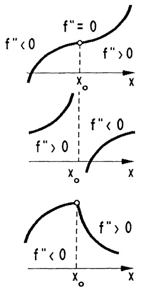

Abb. 83 - Konvexitätsbereiche

2.4 Die Regeln von De L'Hospital. Die folgende Verallgemeinerung des Mittelwertsatzes ( $\rightarrow$  2.2) bildet die Grundlage einiger nützlicher, dem Marquis DE L'HOSPITAL (1661-1704) zugeschriebener Regeln zur Berechnung von Grenzwerten der Form  $\lim_{x\to x_{0}}\frac{f(x)}{g(x)}$  mit  $f(x_{0})=g(x_{0})=0$ ; wir nennen sie vom Typ  $\frac{0}{0}$  (bzw. mit  $f(x)\to\infty$ ,  $g(x)\to\infty$  für  $x\to x_{0}$  vom Typ  $\frac{\infty}{\infty}$ ).

## Satz 2.8. Verallgemeinerter Mittelwertsatz.

Sind $f, g$ im offenen Intervall $a < x < b$ differenzierbar, in $a \leq x \leq b$ stetig und $g'(x) \neq 0$ in $a < x < b$, dann gibt es wenigstens eine Stelle $\xi$, $a < \xi < b$, mit

$$
\frac {f (b) - f (a)}{g (b) - g (a)} = \frac {f ^ {\prime} (\xi)}{g ^ {\prime} (\xi)}.
$$

Beweis. Zunächst beachte man, daß wegen der Voraussetzung  $g'(x) \neq 0$  notwendig  $g(b) \neq g(a)$  gilt ( $\rightarrow$  Satz 2.2). Damit ist die Funktion

$$
F (x) := f (x) - \frac {f (b) - f (a)}{g (b) - g (a)} g (x)
$$

erklärt. Wegen $F(a) = F(b)$ gibt es nach dem Mittelwertsatz ein $\xi$ zwischen $a$ und $b$ mit $F'(\xi) = 0$.

---

128

3. Differentiation

## Satz 2.9. L'Hospital-Regel.

Sind $f, g$ auf dem Intervall $a < x < b$ differenzierbare Funktionen, $g'(x) \neq 0$, mit den beiden folgenden Eigenschaften

a) $f(x)\to 0,g(x)\to 0$ oder $f(x)\to \infty ,g(x)\to \infty$ für $x\to b - (\rightarrow$ Kap.2,6.1),

b) $\lim_{x\to b-}\frac{f'(x)}{g'(x)} = L$ mit $L\in\mathbb{R}\cup\{-\infty,\infty\}$,

dann gilt

$$
\boxed {\lim _ {x \to b -} \frac {f (x)}{g (x)} = \lim _ {x \to b -} \frac {f ^ {\prime} (x)}{g ^ {\prime} (x)}.} \tag {3}
$$

Entsprechendes gilt für die Grenzprozesse $x \to a+$, $x \to \infty$, $x \to -\infty$.

Beweis. 1. Fall (Typ $\frac{0}{0}$). Für die linksseitige Annäherung $x \to b-$, gelte $f(x) \to 0$, $g(x) \to 0$. Durch $f(b) = g(b) = 0$ setzen wir $f$ und $g$ auf $(a, b]$ stetig fort. Nach dem verallgemeinerten Mittelwertsatz gibt es dann zu jedem $x$, $a < x < b$, ein $\xi$ zwischen $x$ und $b$ mit $\frac{f(x)}{g(x)} = \frac{f'(\xi)}{g'(\xi)}$. Das zeigt bereits (3); denn mit $x \to b$ strebt auch $\xi$ gegen $b$.

2. Fall (Typ $\frac{\infty}{\infty}$). $f(x) \to \infty$, $g(x) \to \infty$ für $x \to b-$. Nach Satz 2.8 gibt es für je zwei Stellen $z, x$ mit $a < z < x < b$ ein $\xi \in (z, x)$ so daß gilt

$$
\frac {f ^ {\prime} (\xi)}{g ^ {\prime} (\xi)} = \frac {f (x) - f (z)}{g (x) - g (z)} = \frac {f (x)}{g (x)} \cdot \frac {1 - \frac {f (z)}{f (x)}}{1 - \frac {g (z)}{g (x)}}.
$$

Mit $z$ gehen wir so nahe an $b$ heran, daß sich $\frac{f'(\xi)}{g'(\xi)}$ von $\lim_{x\to b}\frac{f'(x)}{g'(x)}$ beliebig wenig unterscheidet ($\rightarrow$ Kap. 2, §5); im Fall $\lim_{x\to b}\frac{f'(x)}{g'(x)} = \infty$ bedeutet das $\frac{f'(x)}{g'(x)} > N$ zu beliebig vorgegebener Grenze $N > 0$. Nun halten wir $z$ fest und wählen $x$ so nahe bei $b$, daß der Quotient $(1 - \frac{f(z)}{f(x)}) / (1 - \frac{g(z)}{g(x)})$ beliebig nahe bei 1, und damit $\frac{f(x)}{g(x)}$ beliebig nahe bei $\frac{f'(\xi)}{g'(\xi)}$ liegt. Das zeigt die Behauptung.

Die anderen Fälle. Der Beweis verläuft völlig analog für die rechtsseitigen Grenzwerte  $x \rightarrow a$ . Die Fälle  $x \rightarrow \infty$ ,  $x \rightarrow -\infty$  werden über die Substitution  $y = \frac{1}{x}$ ,  $y \rightarrow 0$ , auf die bereits bewiesenen Fälle zurückgeführt. ☐

Es kommt häufig vor, daß man den zur Anwendung der L'Hospital-Regeln benötigten Wert  $\lim_{x\to b}\frac{f'(x)}{g'(x)}$  selbst erst mit dieser Regel ermittelt, sofern  $f'$ ,  $g'$  anstelle f, g die Voraussetzungen des Satzes erfüllen. Das läßt sich gegebenenfalls fortsetzen auf höhere Ableitungen.

---

§2. Anwendungen der Differentiation

129

Beispiel 1. $\lim_{x\to 3}\frac{x^3 - x^2 - 5x - 3}{3x^2 - 7x - 6} = \lim_{x\to 3}\frac{3x^2 - 2x - 5}{6x - 7} = \frac{16}{11}$.

Beispiel 2. Die Molwärme eines zweiatomigen Gases ist bei festem Volumen als Funktion der absoluten Temperatur T gegeben durch

$$
c (T) = R \frac {(T _ {0} / T) ^ {2} e ^ {T _ {0} / T}}{(e ^ {T _ {0} / T} - 1) ^ {2}}
$$

mit der Gaskonstanten R und der charakteristischen Temperatur  $T_{0}$ . Es interessieren die Grenzwerte  $T \rightarrow 0$  und  $T \rightarrow \infty$ . Zur Vereinfachung der Schreibweise setzen wir  $x := \frac{T_{0}}{T}$ . Die L'Hospital-Regel ergibt

$$
\begin{array}{l} \lim _ {T \to 0 +} c (T) = \lim _ {x \to \infty} R \frac {x ^ {2} e ^ {x}}{(e ^ {x} - 1) ^ {2}} = \lim _ {x \to \infty} R \frac {2 x + x ^ {2}}{2 (e ^ {x} - 1)} \\ = \lim _ {x \to \infty} R \frac {2 + 2 x}{2 e ^ {x}} = \lim _ {x \to \infty} R \frac {1}{e ^ {x}} = 0. \\ \end{array}
$$

$$
\lim _ {T \to \infty} c (T) = \lim _ {x \to 0 +} R \frac {x ^ {2} e ^ {x}}{(e ^ {x} - 1) ^ {2}} = \lim _ {x \to 0 +} R \frac {1 + x}{e ^ {x}} = R.
$$

(Die hier als bekannt vorausgesetzten Eigenschaften der $e$-Funktion sind $(e^x)' = e^x, \lim_{x \to \infty} e^x = \infty, \to \S 4.$)

Beispiel 3. Der Beweis der Grenzwertformel $\lim_{x\to 0}\frac{\sin x}{x} = 1$ mit der L'Hospital-Regel ($\lim_{x\to 0}\frac{\sin x}{x} = \lim_{x\to 0}\frac{\cos x}{1} = 1$) ist erstaunlich einfach; man bedenke aber, daß diese Formel bereits zum Nachweis von $(\sin x)' = \cos x$ benötigt wurde.

Bemerkung. Häufig ist zur Grenzwertberechnung nach der L'Hospital-Regel eine vorhergehende Umformung nützlich, etwa

$$
f (x) g (x) = f (x) \Big / \left(\frac {1}{g (x)}\right), \quad f (x) - g (x) = f (x) g (x) \left(\frac {1}{g (x)} - \frac {1}{f (x)}\right).
$$

Beispiel 4. (Zur ln-Funktion vgl. § 4)

$$
\lim _ {x \to \infty} \left[ x \ln \frac {x + 1}{x - 1} \right] = \lim _ {x \to \infty} \frac {\ln (x + 1) - \ln (x - 1)}{\frac {1}{x}} = \lim _ {x \to \infty} \frac {\frac {1}{x + 1} - \frac {1}{x - 1}}{- \frac {1}{x ^ {2}}} = 2.
$$

Beispiel 5.

$$
\begin{array}{l} \lim _ {x \to 0} \left(\frac {1}{x} - \frac {1}{\sin x}\right) = \lim _ {x \to 0} \frac {\sin x - x}{x \sin x} = \lim _ {x \to 0} \frac {\cos x - 1}{x \cos x + \sin x} \\ = \lim _ {x \to 0} \frac {- \sin x}{2 \cos x - x \sin x} = 0. \\ \end{array}
$$

□

---

130

3. Differentiation

2.5 Kurvendiskussion. Um eine Vorstellung zu bekommen, was sich bei einem durch  $y = f(x)$  beschriebenen Vorgang abspielt, ist es in jedem Fall nützlich, den Verlauf der Kurve  $y = f(x)$  zu diskutieren und zu zeichnen (Kurvendiskussion). Mit den bisher entwickelten Hilfsmitteln geschieht das unter folgenden Gesichtspunkten:

Diskussion der Kurve $y = f(x)$.

① Definitionsbereich und evtl. Wertebereich von f festlegen.
② Symmetrie testen: $f$ gerade oder ungerade? ($\rightarrow$ Kap. 2, §1)
③ Stetigkeit prüfen, Polstellen berechnen (→ Kap. 2 §6, Satz 2.9).
④ Nullstellen von f, Vorzeichen von y bestimmen ( $\rightarrow$  2.6).
⑤  $f'$  berechnen, Nullstellen von  $f'$  bestimmen.
⑥ Extremalstellen, Monotoniebereiche ermitteln (→ Sätze 2.3, 2.4, 2.5).
⑦  $f''$  berechnen, Nullstellen von  $f''$  bestimmen.
⑧ Wendepunkte, Konvexitätsbereiche bestimmen (→ Sätze 2.6, 2.7).
⑨ Verhalten für  $x \rightarrow \pm\infty$  untersuchen, schräge und horizontale Asymptoten berechnen ( $\rightarrow$  Kap. 2 §6, Satz 2.9).
⑩ Eine Skizze des Graphen anfertigen.

Beispiel. $y = \cos^3 x + \sin^3 x, 0 \leq x \leq 2\pi$.

①③ klar.

④ :

Nullstellen von $f: \cos^3 x = -\sin^3 x \iff \cos x = -\sin x \iff x = \frac{3}{4}\pi, \frac{7}{4}\pi$.

Vorzeichen von $y: \quad x \mid 0 \leq x < \frac{3}{4}\pi \mid \frac{3}{4}\pi < x < \frac{7}{4}\pi \mid \frac{7}{4}\pi < x \leq 2\pi$  
    $y \mid + \mid - \mid +$

⑤，⑥:

1. Ableitung:  $y' = 3 \cos^{2} x \cdot (-\sin x) + 3 \sin^{2} x \cos x = 3 \sin x \cos x (\sin x - \cos x)$ 

$y' = 0 : x = \frac{\pi}{2}, \frac{3}{2} \pi ; 0 ; \pi ; \frac{\pi}{4}, \frac{5}{4} \pi.$

Vorzeichen von  $y'$ :

| x | $0 \leq x < \frac{\pi}{4}$ | $\frac{\pi}{4} < x < \frac{\pi}{2}$ | $\frac{\pi}{2} < x < \pi$ | $\pi < x < \frac{5}{4}\pi$ | $\frac{5}{4}\pi < x < \frac{3}{2}\pi$ | $\frac{3}{2}\pi < x \leq 2\pi$ |
| --- | --- | --- | --- | --- | --- | --- |
| $y'$ | - | + | - | + | - | + |
| y | ↘ | ↗ | ↘ | ↗ | ↘ | ↗ |

<table><tr><td rowspan="4">Extrema:</td><td>x</td><td>0</td><td> $\frac{\pi}{4}$ </td><td> $\frac{\pi}{2}$ </td><td> $\pi$ </td><td> $\frac{5}{4}\pi$ </td><td> $\frac{3}{2}\pi$ </td><td> $2\pi$ </td></tr><tr><td>y</td><td>1</td><td> $\frac{1}{\sqrt{2}}$ </td><td>1</td><td>-1</td><td> $-\frac{1}{\sqrt{2}}$ </td><td>-1</td><td>1</td></tr><tr><td>Typ</td><td>Max.</td><td>Min.</td><td>Max.</td><td>Min.</td><td>Max.</td><td>Min.</td><td>Max.</td></tr><tr><td></td><td>glob.</td><td>lok.</td><td>glob.</td><td>glob.</td><td>lok.</td><td>glob.</td><td>glob.</td></tr></table>

---

§2. Anwendungen der Differentiation

131

⑦，⑧:

2. Ableitung:

$$
\begin{array}{l} y ^ {\prime \prime} = 3 [ \cos^ {2} x (\sin x - \cos x) - \sin^ {2} x (\sin x - \cos x) + \sin x \cos x (\cos x + \sin x) ] \\ = 3 (\sin x + \cos x) (3 \sin x \cos x - 1) \\ \end{array}
$$

$$
y ^ {\prime \prime} = 0: \sin x = - \cos x \text {oder} \sin 2 x = \frac {2}{3}.
$$

$$
a = \frac {3}{4} \pi ; b = \frac {7}{4} \pi ; c \approx . 1 1 6 1 4 \pi ; d \approx . 3 8 3 8 6 \pi ; e = c + \pi ; f = d + \pi.
$$

Vorzeichen von  $y''$ :

| x | $0 \leq x < c$ | $c < x < d$ | $d < x < a$ | $a < x < e$ | $e < x < f$ | $f < x < b$ | $b < x \leq 2\pi$ |
| --- | --- | --- | --- | --- | --- | --- | --- |
| $y''$ | - | + | - | + | - | + | - |
| y | ~ | ~ | ~ | ~ | ~ | ~ | ~ |

Wendepunkte: $\begin{array}{c|c|c|c|c|c|c} x & .11614\pi & .38386\pi & \frac{3}{4}\pi & 1.11614\pi & 1.38386\pi & \frac{7}{4}\pi \\ \hline y & .86066\ldots & .86066\ldots & 0 & -.86066\ldots & -.86066\ldots & 0 \end{array}$

⑨ entfällt
10

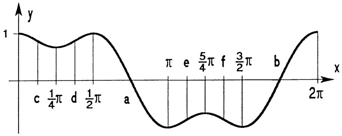

<details>
<summary>line</summary>

| Point | Interval (x) |
| --- | --- |
| c | 0~\(1/4\pi\) |
| \(1/4\pi\) | \(1/4 \to 1/2\pi\) |
| d | \(1/2 \to 1/2\pi\) |
| a | \(a \to \pi\) |
| \(\pi\) | \(\pi\) |
| e | \(e \to 5/4\pi\) |
| \(5/4\pi\) | \(5/4 \to 3/2\pi\) |
| f | \(3/2 \to 2\pi\) |
| \(3/2\pi\) | \(3/2 \to 2\pi\) |
| b | \(2\pi\) |
</details>

Abb. 84 - $y = \cos^3 x + \sin^3 x$

Bemerkung. Mit den üblichen trigonometrischen Identitäten zeigt man:

$$
\begin{array}{l} y = \sin^ {3} x + \cos^ {3} x = \frac {1}{4} (\cos 3 x - \sin 3 x) + \frac {3}{4} (\cos x + \sin x) \\ = \frac {1}{2 \sqrt {2}} [ 3 \cos (x - \frac {\pi}{4}) - \cos (3 (x - \frac {\pi}{4})) ]. \\ \end{array}
$$

Es liegt also eine Überlagerung von zwei harmonischen Schwingungen der Form  $y = A_{1} \cos \omega_{1} t + A_{2} \cos \omega_{2} t$  mit  $A_{1}: A_{2} = 3:1$  und  $\omega_{1}: \omega_{2} = 1:3$  vor. ☐

2.6 Nullstellen und Fixpunkte. In vielen praktischen Rechnungen benötigt man die Nullstellen einer stetigen bzw. differenzierbaren Funktion $f$. Nur in wenigen Fällen gelingt eine explizite formale Lösung der Gleichung $f(x)=0$. Ist dies nicht möglich, so bestimmt man Näherungslösungen durch die Konstruktion einer Folge $x_{n}, n=0,1,2,\ldots$, die gegen eine Nullstelle konvergiert. Manchmal ist es günstiger, die Nullstellenbestimmung als Fixpunktproblem zu sehen. Dabei heißt eine Zahl $x^{*}\in[a,b]$ ein Fixpunkt der auf $[a,b]$ erklärten Funktion $f$, wenn $f(x^{*})=x^{*}$ gilt. Es hängt vom Standpunkt ab, ob man Fixpunkte oder Nullstellen sucht. Denn jeder Fixpunkt von $f$ ist Lösung

---

132

3. Differentiation

von  $f(x)-x=0$ , und umgekehrt ist jede Nullstelle von f ein Fixpunkt von  $g, g(x):=f(x)+x$ . Grundlage der Fixpunktberechnung ist

Satz 2.10. Direkte Fixpunktiteration. Hat eine auf [a,b] stetig differenzierbare Funktion f folgende beiden Eigenschaften:

a) $a \leq f(x) \leq b$ für alle $x \in [a, b]$,

b) es gibt eine Konstante K mit  $|f'(x)| \leq K < 1$  für alle  $x \in [a, b]$ , dann gilt:

1. Existenz. Es gibt genau ein  $x^{*} \in [a, b]$  mit  $f(x^{*}) = x^{*}$ .

2. Berechnung. Die Iterationsfolge

$$
x _ {n + 1} := f (x _ {n}) \quad (n = 0, 1, 2, 3, \dots) \tag {4}
$$

mit beliebigem Startwert  $x_{0} \in [a, b]$  konvergiert gegen den Fixpunkt  $x^{*}$ .

3. Abschätzung. $|x_{n} - x^{*}| \leq \frac{K}{1 - K} |x_{n} - x_{n-1}| \quad (n = 1, 2, 3, \ldots)$.

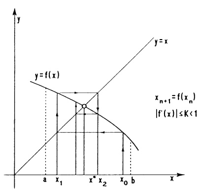

<details>
<summary>text_image</summary>

y
y=f(x)
x_{n+1}=f(x_n)
|f'(x)|≤K<1
a
x_1
x^*
x_2
x_0
b
x
</details>

Abb. 85a - Konvergente Iteration

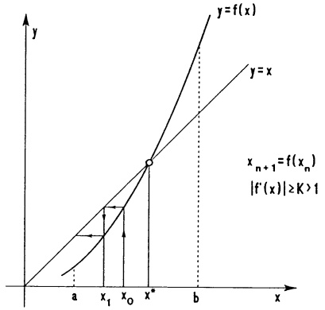

<details>
<summary>line</summary>

| Point | X-coordinate | Y-coordinate |
| --- | --- | --- |
| Intersection (x*, x*) | x* | x* |
| Intersection (x1, x*) | x1 | x1 |
| Intersection (x0, x*) | x0 | x0 |
</details>

Abb. 85b - Divergente Iteration

Beweis. 1. Die Existenz eines Fixpunktes: Falls $f(a) = a$ oder $f(b) = b$, dann ist nichts mehr zu zeigen. Im Fall $a < f(a)$, $f(b) < b$ hat $F(x) := f(x) - x$ wegen $F(a) > 0$ und $F(b) < 0$ in $(a, b)$ wenigstens eine Nullstelle $x^*$ ($\rightarrow$ Zwischenwertsatz, Kap. 2, Satz 6.5), $f(x^*) = x^*$. Eindeutigkeit des Fixpunktes: Gäbe es zwei verschiedene Fixpunkte $x^*, z$, so gäbe es nach dem Mittelwertsatz ein $\xi$ zwischen $x^*$ und $z$ mit $1 = \frac{x^* - z}{x^* - z} = \frac{f(x^*) - f(z)}{x^* - z} = f'(\xi)$, im Widerspruch zur Voraussetzung $|f'(x)| < 1$.

2. Aus der Definition der  $x_{n}$ , dem Mittelwertsatz und der Voraussetzung b) folgt für den Fixpunkt  $x^{*}$

$$
| x _ {n} - x ^ {*} | = | f (x _ {n - 1}) - f (x ^ {*}) | = | f ^ {\prime} (\xi) | | x _ {n - 1} - x ^ {*} | \leq K | x _ {n - 1} - x ^ {*} |,
$$

folglich $|x_{n} - x^{*}| \leq K^{2}|x_{n-2} - x^{*}| \leq \ldots \leq K^{n}|x_{0} - x^{*}|$. Wegen $K^{n} \to 0$ (mit $n \to \infty$) zeigt das $|x_{n} - x^{*}| \to 0$, bzw. $\lim_{n \to \infty} x_{n} = x^{*}$.

3. Aus der zuvor bewiesenen Ungleichung $|x_n - x^*| \leq K|x_{n-1} - x^*|$ folgt $|x_n - x^*| \leq K|x_{n-1} - x_n + x_n - x^*| \leq K|x_n - x_{n-1}| + K|x_n - x^*|$, damit die Behauptung.

□

---

§2. Anwendungen der Differentiation

133

Bemerkung. Die Ungleichung in Punkt 3 ist eine „a posteriori Abschätzung“, mit der man aus zwei berechneten Werten auf den Abstand zum Fixpunkt schließen kann.

Beispiel. Gesucht wird eine Lösung der Gleichung $x = e^{x^2 - 2}$. Die Funktion $f(x) = e^{x^2 - 2}$ erfüllt über $[0, \frac{1}{2}]$ die Voraussetzung des Fixpunktsatzes, nämlich $0 \leq e^{x^2 - 2} \leq \frac{1}{2}$ für $0 \leq x \leq \frac{1}{2} (\rightarrow \S 4)$ und $|f'(x)| = |2xe^{x^2 - 2}| \leq \frac{2}{e} = K < 1$. Wir setzen die zum Fixpunkt $x^*$ führende Iteration mit dem Startwert $x_0 = 0.25$ in Gang: $x_1 = 0.144063656$, $x_2 = 0.138173428, \ldots, x_5 = 0.137934839$, $x_6 = 0.137934826$. Die a posteriori Abschätzung für den Näherungswert $x_6$ ergibt $|x_6 - x^*| \leq \frac{2}{e - 2} |x_6 - x_5| = 3.59\mathrm{E} - 8$.

Das Newton-Verfahren verwendet zur Näherungslösung von $f(x)=0$ nicht die naheliegende Fixpunktiteration für $g(x):=x+f(x)$, sondern für $F(x)=x-\frac{f(x)}{f'(x)}$ (vorausgesetzt $f'(x)\neq0$ auf $[a,b]$). Denn im Gegensatz zur direkten Fixpunktiteration (4) konvergiert die zugehörige Iterationsfolge

$$
x _ {n + 1} := x _ {n} - \frac {f (x _ {n})}{f ^ {\prime} (x _ {n})}, \quad x _ {0} \in [ a, b ] \tag {5}
$$

unter schwächeren Voraussetzungen an $f$, sofern nur der Startwert $x_0$ hinreichend nahe bei der Nullstelle liegt. (Ist beispielsweise $f$ zweimal stetig differenzierbar, $f(x^*) = 0$, $f'(x^*) \neq 0$, dann erfüllt $F$ in einem $x^*$ enthaltenden Teilintervall die Voraussetzung des Fixpunktsatzes 2.10). Außerdem strebt im Konvergenzfall die Iterationsfolge (5) schneller gegen die Nullstelle, denn es liegt „quadratische Konvergenz“ vor:

$$
\left| x _ {n + 1} - x ^ {*} \right| \leq \left| x _ {n} - x ^ {*} \right| ^ {2} M ; \quad M = \frac {\operatorname{Maxvon} \left| f ^ {\prime \prime} (x) \right| \text {auf} [ a , b ]}{\operatorname{Minvon} \left| f ^ {\prime} (x) \right| \text {auf} [ a , b ]}.
$$

Dies bedeutet: Ist $x_{n}$ hinreichend nahe bei $x^{*}$, so verdoppelt sich in jedem folgenden Schritt die Anzahl der richtigen Nachkommastellen der Dezimalbruchdarstellung von $x_{n+1}$.

Beweis. Aus  $f(x^{*}) = 0$  und dem Mittelwertsatz folgt

$$
\begin{array}{l} | x _ {n + 1} - x ^ {*} | = | x _ {n} - \frac {f (x _ {n}) - f (x ^ {*})}{f ^ {\prime} (x _ {n})} - x ^ {*} | \\ \leq | x _ {n} - x ^ {*} | | 1 - \frac {f ^ {\prime} (\xi)}{f ^ {\prime} (x _ {n})} | \quad (\text {mit} \xi \text {zwischen} x ^ {*} \text {und} x _ {n}) \\ \leq | x _ {n} - x ^ {*} | ^ {2} \left| \frac {f ^ {\prime \prime} (\eta)}{f ^ {\prime} (x _ {n})} \right| \quad \text {(mit} \eta \text {zwischen} \xi \text {und} x _ {n}\left. \right). \\ \end{array}
$$

Geometrische Deutung des Newton-Verfahrens (→ Abb. 86):

Die Kurventangente $y(x) = f'(x_n)(x - x_n) + f(x_n)$ schneidet die $x$-Achse in $x_{n+1} = x_n - \frac{f(x_n)}{f'(x_n)}$. In günstigen Fällen liegt $x_{n+1}$ näher an der Nullstelle als $x_n$.

---

134

3. Differentiation

Natürlich kann das Newton-Verfahren durchaus divergente Folgen liefern; das kann an der Funktion liegen oder am ungünstig gewählten Startwert  $x_{0}$ . In der Praxis wird die Ableitung  $f'(x)$  sehr oft durch Differenzenquotienten approximiert und die Folge  $x_{n}$  ( $n = 1, 2, \ldots$ ) mit einem  $x_{0}$  möglichst nahe der Nullstelle berechnet. Sobald sich von einem Index m an die Zahlen  $x_{m}, x_{m+1}, x_{m+2}$  nicht mehr wesentlich unterscheiden, nimmt man  $x_{m+2}$  als Näherungslösung der Gleichung  $f(x) = 0$ .

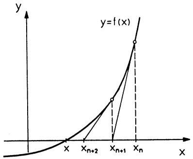

<details>
<summary>line</summary>

| Point | X-coordinate | Y-coordinate |
| --- | --- | --- |
| x | 0 | 0 |
| x_{n+2} | ~0.5 | ~0.5 |
| x_{n+1} | ~0.7 | ~0.8 |
| x_n | ~0.9 | ~1.0 |
</details>

Abb. 86 - Newton-Verfahren

```txt
'Programm NEWTON-Verfahren
'________________-
Input "Startwert";X
Eps=1E-5
Repeat
  Dx=Eps
  If Abs(X)>Eps Then
    Dx=X*Eps
  Endif
  Gosub Funktion
  Fl=F
  X=X+Dx
  Gosub Funktion

Dx=-F*Dx/(F-Fl)
X=X+Dx
Xa=Abs(X)
If XA<=1 Then
XA=1
Endif
Until Abs(Dx)<Eps*Xa Or Abs(F)<Eps
Print X
End
'________________-
Procedure Funktion
F=((X+1)*X+2)*X+1
Return
```

Beispiel. Das Polynom $f(x) = x^{3} + x^{2} + 2x + 1$ hat in $[-1,0]$ genau eine Nullstelle ($f(0) = 1$, $f(-1) = -1$, $f'(x) \neq 0$). Für

$$
x _ {n + 1} = x _ {n} - \frac {f (x _ {n})}{f ^ {\prime} (x _ {n})} = x _ {n} - \frac {x _ {n} ^ {3} + x _ {n} ^ {2} + 2 x _ {n} + 1}{3 x _ {n} ^ {2} + 2 x _ {n} + 2} \quad (n = 1, 2, 3, 4)
$$

erhält man in 10-stelliger Rechnung mit dem Startwert $x_0 = -0.5$ die Werte $x_1 = -0.5714285714$, $x_2 = -0.569841298$, $x_3 = -0.569840291$, $x_4 = x_3$. Das zeigt bereits $f(x^*) = 0$ mit $x^* \approx x_4 = -0.569840291$. Nach Abfaktorisierung des Linearfaktors $x - x_4$ ($\rightarrow$ Horner-Schema, Kap. 2, 2.1),

$$
x ^ {2} + 0. 4 3 0 1 5 9 7 0 9 x + 1. 7 5 4 8 7 7 6 6 6 = 0,
$$

ergeben sich aus der Lösungsformel für quadratische Gleichungen Näherungswerte für die beiden anderen (komplexen) Nullstellen $z = -0.215079854 + i 1.30714 1279$ und $\bar{z} = -0.215079854 - i 1.30714 1279$.

---

§2. Anwendungen der Differentiation

135

\* 2.7 Kubische Splines. Die Interpolation von Meßpunkten $(x_0, y_0), \ldots, (x_n, y_n)$ durch ein Polynom $p(x)$ vom Grad $\leq n$ mit $y_i := p(x_i)$ ($\to$ Kap. 2, §2) hat den Nachteil, daß die Kurve $y = p(x)$ zwischen den Meßpunkten möglicherweise zu sehr schwankt ($\to$ Abb. 87). Es ist das Ziel dieses Abschnitts, eine Kurve $y = f(x)$ zu bestimmen, die möglichst „sanft“ durch die Punkte hindurchgeht.

Definition. Zu  $n + 1$  Stützpunkten  $(x_{i}, y_{i})$   $(i = 0, 1, \ldots, n)$  mit

$$
x _ {0} <   x _ {1} <   x _ {2} <   \dots <   x _ {n}
$$

heißt die Funktion $s: [x_0, x_n] \to \mathbb{R}$ eine kubische Spline-Funktion (durch diese Punkte), wenn sie folgende 3 Eigenschaften besitzt:

①  $s(x_{i}) = y_{i} \quad (i = 0, 1, \ldots, n)$ ,
② s ist zweimal stetig differenzierbar in  $(x_{0}, x_{n})$ ,
③ s ist über jedem Teilintervall  $x_{i} \leq x < x_{i+1}$  ein Polynom vom Grad  $\leq 3$  (die Koeffizienten hängen vom jeweiligen Teilintervall ab).

## Die Bestimmung einer Spline-Funktion.

① Der Ansatz. Zu den gegebenen Punkten  $(x_{i}, y_{i})$  mit  $x_{0} < x_{1} < \cdots < x_{n}$  betrachten wir n Polynome

$$
s _ {i} (x) = y _ {i} + b _ {i} (x - x _ {i}) + c _ {i} (x - x _ {i}) ^ {2} + d _ {i} (x - x _ {i}) ^ {3} \quad (i = 0, 1, \dots , n - 1)
$$

mit noch unbekannten Koeffizienten  $b_{i}$ ,  $c_{i}$ ,  $d_{i}$  und setzen

$$
s (x) = s _ {i} (x), \quad \text { falls } x _ {i} \leq x <   x _ {i + 1}.
$$

Hierfür gilt bereits  $s(x_{i}) = s_{i}(x_{i}) = y_{i} \quad (0 \leq i \leq n - 1)$ .

⑥ Die Berechnung der Koeffizienten. Die Forderung nach dem stetigen Übergang an den Stellen $x_{1},\ldots,x_{n-1}$ und $s(x_{n})=y_{n}$ bedeutet $s_{i}(x_{i+1})=s_{i+1}(x_{i+1})=y_{i+1}$ ($0\leq i\leq n-1$). Die zweimalige stetige Differenzierbarkeit ist gewährleistet, sofern

$$
s _ {i} ^ {\prime} (x _ {i + 1}) = \lim _ {x \to x _ {i + 1} -} s ^ {\prime} (x) = \lim _ {x \to x _ {i + 1} +} s ^ {\prime} (x) = s _ {i + 1} ^ {\prime} (x _ {i + 1})
$$

und ebenso $s_i''(x_{i+1}) = s_{i+1}''(x_{i+1})$ für $0 \leq i \leq n-2$ erfüllt sind. Diese Bedingungen, zusammen mit $c_n = \frac{1}{2}s''(x_n) = \lim_{x \to x_n^-} \frac{1}{2}s_{n-1}''(x) = c_{n-1} + 3d_{n-1}(x_n - x_{n-1})$ und $h_i := x_{i+1} - x_i$,

ergeben folgende Gleichungen:

$$
d _ {i} = \frac {c _ {i + 1} - c _ {i}}{3 h _ {i}} \quad (0 \leq i \leq n - 1) \tag {6}
$$

$$
b _ {i} = \frac {y _ {i + 1} - y _ {i}}{h _ {i}} - \frac {(2 c _ {i} + c _ {i + 1})}{3} h _ {i} \quad (0 \leq i \leq n - 1) \tag {7}
$$

$$
h _ {i - 1} c _ {i - 1} + 2 (h _ {i - 1} + h _ {i}) c _ {i} + h _ {i} c _ {i + 1} = 3 [ \frac {y _ {i + 1} - y _ {i}}{h _ {i}} - \frac {y _ {i} - y _ {i - 1}}{h _ {i - 1}} ] \quad (1 \leq i \leq n - 1) . \tag {8}
$$

Gibt man $c_{0}, c_{n} \in \mathbb{R}$ beliebig vor, dann ist das lineare Gleichungssystem (8) eindeutig nach den anderen Koeffizienten $c_{1}, \ldots, c_{n-1}$ auflösbar ($\rightarrow$ Kap. 6, §1). Damit werden aus (6) und (7) die $b_{i}$ und $d_{i}$ berechnet.

---

136

3. Differentiation

c Zurück zum Ansatz: Mit den in b bestimmten Koeffizienten $b_{i}, c_{i}, d_{i}$ ($0 \leq i \leq n-1$) bildet man wie in a angegeben, die Funktion $s$; dieses ist eine kubische Spline-Funktion.
(d) Ergänzung. Wahl von $c_0$ und $c_n$. Liegen keine weiteren Bedingungen vor, erleichtert die Wahl $c_0 = c_n = 0$ die Rechnungen. In diesem Fall mündet die Kurve mit Krümmung 0 ($\rightarrow$ Kap. 4, §5(8)) in die Endpunkte $(x_0, y_0)$, $(x_n, y_n)$ ein. Diese sog. natürliche kubische Spline-Funktion $s_0$ ist unter allen zweimal stetig differenzierbaren Funktionen $g$, die $(x_0, y_0), \ldots, (x_n, y_n)$ interpolieren, die „glatteste“ in dem Sinne, daß gilt

$$
\int_ {x _ {0}} ^ {x _ {n}} s _ {0} ^ {\prime \prime} (x) ^ {2} d x \leq \int_ {x _ {0}} ^ {x _ {n}} g ^ {\prime \prime} (x) ^ {2} d x.
$$

Die natürliche Spline-Funktion  $y = s_{0}(x)$  stellt daher angenähert die Gestalt eines reibungsfrei durch die Punkte  $(x_{i}, y_{i})$  ( $i = 0, \ldots, n$ ) gelegten elastischen Stabes dar.

```txt
'Programm KUBISCHE SPLINE
'--------------------------------------------------- S=D(I)
Input "Punktezahl=";N R=S/B(I)
N=N-1 Next I
Dim X(N),Y(N),B(N),C(N),D(N) For I=M To 1 Step -l
For I=O To N C(I)=(D(I)*C(I+1)-C(I))/B(I)
    Print "X"+Str$(I)+"="; Next I
    Input X(I) For I=O To M
    Print "Y"+Str$(I)+"="; S=D(I)
    Input Y(I) R=C(I+1)-C(I)
Next I D(I)=R/S
'------Koeffizienten------- C(I)=C(I)*3
M=N-1 B(I)=(Y(I+1)-Y(I))/S-(C(I)+R)*S
S=O Next I
For I=O To M Next I
    D(I)=X(I+1)-X(I) Print "s(x) for x="; X
    R=(Y(I+1)-Y(I))/D(I) Q=Sgn(X(N)-X(O))
    C(I)=R-S K=-1
    S=R Repeat
Next I I=K
S=O K=K+1
R=O Until (Q*X<Q*X(K)) Or (K=N)
C(O)=O Q=X-X(I)
C(N)=O Y=((D(I)*Q+C(I))*Q+B(I))*Q+Y(I)
For I=1 To M Print Y
    C(I)=C(I)+R*C(I-1) End
    B(I)=(X(I-1)-X(I+1))*2-R*S
```

---

§2. Anwendungen der Differentiation

137

Bemerkung. Die Auflösung des linearen Gleichungssystems für die  $c_{i}$  erfolgt mit dem GAUSS-Algorithmus ( $\rightarrow$  Kap. 6, §1).

Beispiel. Den Unterschied zur Polynominterpolation erkennt man sehr deutlich, wenn die zu interpolierenden Funktionswerte abschnittsweise auf einer Geraden liegen. Für n = 8 und

$$
\begin{array}{c c c c c c c c c c} x _ {i} & - 4 & - 3 & - 2 & - 1 & 0 & 1 & 2 & 3 & 4 \\ \hline y _ {i} & 0 & 0 & 0 & 0 & 1 & 0 & 0 & 0 & 0 \end{array}
$$

ergibt die Interpolation mit einer natürlichen kubischen Spline-Funktion  $(c_{0}=c_{8}=0)$  und die Newton-Interpolation sehr unterschiedliche Funktionen:

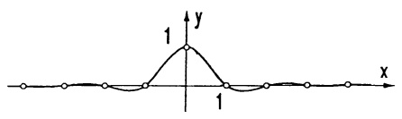

<details>
<summary>contour</summary>

| X | Y |
| --- | --- |
| 0 | 1 |
| ~0.5 | ~0.8 |
| ~1.0 | ~0.2 |
| ~1.5 | ~0.1 |
| ~2.0 | ~0.05 |
| ~2.5 | ~0.02 |
| ~3.0 | ~0.01 |
| ~3.5 | ~0.005 |
| ~4.0 | ~0.002 |
| ~4.5 | ~0.001 |
| ~5.0 | ~0.0005 |
| ~5.5 | ~0.0002 |
| ~6.0 | ~0.0001 |
| ~6.5 | ~0.00005 |
| ~7.0 | ~0.00002 |
| ~7.5 | ~0.00001 |
| ~8.0 | ~0.000005 |
| ~8.5 | ~0.000002 |
| ~9.0 | ~0.000001 |
| ~9.5 | ~0.0000005 |
| 10 | 0 |
</details>

Abb. 87a Interpolierende Spline-Funktion

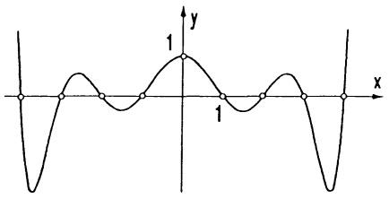

<details>
<summary>contour</summary>

| X | Y |
| --- | --- |
| 0 | -1 |
| 0.5 | 0 |
| 1 | 1 |
| 1.5 | 0 |
| 2 | -1 |
</details>

Abb. 87b Interpolierendes Polynom


## Aufgaben

1. Man diskutiere gemäß 2.5 die Funktionen $f(x), x \in \mathbb{R}$

$$
\begin{array}{l} \frac {x ^ {3} - 2 x ^ {2} + x}{x ^ {2} - 1}, \quad \frac {x ^ {4}}{(x ^ {2} - 1) | x |}, \quad | x ^ {2} - 1 | + | x | - 1, \\ \tan x \cdot (\cos^ {2} x - \sin^ {2} x), \quad \frac {| x - 1 |}{1 + | x |}, \quad \sin x \sqrt {1 - k ^ {2} \sin^ {2} x} (0 <   k <   1). \\ \end{array}
$$

2. Man berechne die lokalen und globalen Extrema von

a) $f(x) = \sqrt{(x - a)^2 + (x - b)^2 + (x - c)^2}$,
b) $g(x) = |x - a| + |x - b| + |x - c|$,

im Intervall  $a \leq x \leq b$  für a < c < b.

3. Man berechne die lokalen und globalen Extrema der Funktion $f(x)$ auf [-4, 4]

$$
f (x) = \left\{ \begin{array}{c l} 3 - (x + 3) ^ {2} & , - 4 \leq x \leq - 2 \\ 3 + (x + 1) ^ {3} & , - 2 \leq x <   0 \\ | (x - 1) (x - 3) | & , 0 \leq x \leq 4. \end{array} \right.
$$

4. Die Funktion

$$
P (\varphi) = \frac {\sin^ {2} \varphi}{(1 - \beta \cos \varphi) ^ {5}}
$$

(mit einer Konstanten  $\beta$ ,  $0 < \beta < 1$ ) tritt bei der Energieberechnung eines beschleunigten relativistischen Teilchens auf. Man bestimme ihre Extremalstellen.

---

138

3. Differentiation

5. Man wende den Mittelwertsatz auf  $(x^{2}-1)^{n}$  an und zeige, daß das Legendre-Polynom ( $\rightarrow$  1, Aufg. 5)

$$
P _ {n} (x) = \frac {1}{2 ^ {n} n !} [ (x ^ {2} - 1) ^ {n} ] ^ {(n)}, \qquad n = 0, 1, 2, \dots ,
$$

in -1 < x < 1 genau n paarweise verschiedene Nullstellen besitzt.

6. Aus dem Kreis mit Radius R ist ein Sektor so auszuschneiden, daß der aus dem restlichen Teil geformte Kreiskegelmantel ein maximales Volumen bestimmt.

7. Je n von  $N (= n \cdot m)$  gleichen Spannungsquellen (Leerlaufspannung E, innerer Widerstand r) werden für eine Stromversorgung in m Blöcken parallelgeschaltet.

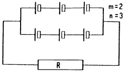

<details>
<summary>text_image</summary>

m = 2
n = 3
R
</details>

Man berechne die Stomstärke $I$, die durch den Lastwiderstand $R$ fließt, als Funktion $I(n)$ von $n \in \mathbb{N}$. Über die Funktion $I(x)$, $x \in \mathbb{R}$, bestimme man das optimale $n$, so daß $I$ in Abhängigkeit von $N$, $r$ und $R$ maximal wird.

8. Eine WHEATSTONE-Widerstands-Meßbrücke hat die Daten: Meßdraht: Länge $l = 10\mathrm{cm}$; spez. Widerstand $\rho = 15\frac{\Omega}{\mathrm{cm}}$; Vergleichsrheostat $R = 100\Omega$. Im Gleichgewicht ist der Strom durch $R_{i}$ Null, d.h.

$$
Z \cdot (l - x) = R \cdot x.
$$

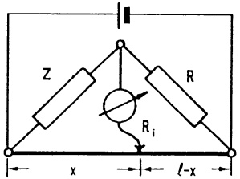

<details>
<summary>text_image</summary>

Z
R
Rᵢ
x
l-x
</details>

a) Man skizziere und diskutiere $Z = Z(x)$, $0 \leq x < l$, sowie $x = x(Z)$.
b) Wie genau muß man x ablesen, wenn Z auf ±0.5Ω genau bestimmt sein soll?
Wähle hierzu x = 0.5cm und x = 9.5cm!
c) Für welche x wird – bei bekannter Ablesegenauigkeit ±Δx

\- der maximale absolute Fehler $|\Delta Z|$ bzw.

\- der maximale relative Fehler $|\frac{\Delta Z}{Z}|$ minimal?

d) Das Anzeigegerät soll bei kleiner Verstimmung aus dem Gleichgewicht maximale Leistung aus der Brücke ziehen. Wie groß muß dazu der Innenwiderstand  $R_{i}$  sein? (Innenwiderstand der Stromquelle ist Null)

- Skizziere und diskutiere das optimale $R_{i}$ als Funktion von $x$.
- Bei welcher Stellung $x$ ist das optimale $R_{i}$ am größten?

9. Auf einer 30m langen Brücke steht, 21m vom linken Auflager entfernt, ein Auto mit 3m Radstand und gleichen Achslasten $F = 7200\mathrm{N}$. Die Brücke hat eine konstante spez. Längenbelastung $q_{0} = 14400\mathrm{N / m}$ und die Biegesteifigkeit $EI = 6 \cdot 10^{9}\mathrm{Nm}^{2}$.

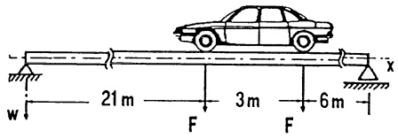

<details>
<summary>text_image</summary>

w
21 m
F
3 m
F
6 m
x
</details>

Mit x und w in m lautet die Biegelinie (Spline-Funktion mit Polynomen 4. Grades)

$$
w (x) = \left\{ \begin{array}{l l} w _ {I} (x) = a x ^ {4} + b x ^ {3} + c x ^ {2} + d x + e & , 0 \leq x <   2 1, \\ w _ {I I} = A x ^ {4} + B x ^ {3} + C x ^ {2} + D x + E & , 2 1 \leq x <   2 4, \\ w _ {I I I} (x) = \alpha x ^ {4} + \beta x ^ {3} + \gamma x ^ {2} + \delta x + \epsilon & , 2 4 \leq x <   3 0. \end{array} \right.
$$

---

§3. Umkehrfunktionen

139

so daß  $w(x)$ ,  $w'(x)$  und  $w''(x)$  stetig für  $0 \leq x \leq 30$ .

$$
w (0) = w ^ {\prime \prime} (0) = w (3 0) = w ^ {\prime \prime} (3 0) = 0
$$

(Auflager ohne Spannung)

$$
E I w ^ {(4)} (x) = q _ {0}, x \neq 2 1, x \neq 2 4
$$

(Biegegleichung)

$$
\lim _ {\epsilon \to 0 +} [ w _ {I I} ^ {\prime \prime \prime} (2 1 + \epsilon) - w _ {I} ^ {\prime \prime \prime} (2 1 - \epsilon) ] = \frac {F}{E I}
$$

$$
\lim _ {\epsilon \to 0 +} [ w _ {I I I} ^ {\prime \prime \prime} (2 4 + \epsilon) - w _ {I I} ^ {\prime \prime \prime} (2 4 - \epsilon) ] = \frac {F}{E I}
$$

(Querkraft springt bei Punktlasten)

a) Bestimme die 15 Koeffizienten und skizziere $w$, $w'$, $w''$, $w'''$, $w^{(4)}$.
b) Bestimme die Nullstelle von  $w'$  mittels Newton-Verfahren. Wie groß ist die maximale Durchbiegung der Brücke?
c) An welcher Stelle ist das Belastungsmoment  $|EIw''|$  maximal?

10. Man berechne die Grenzwerte

$$
\lim _ {x \to 0} \left(\frac {1}{\sin^ {2} x} - \frac {1}{x ^ {2}}\right) \quad ,
$$

$$
\lim _ {x \to 0} \left(\sqrt {\cos a x} - \sqrt {\cos b x}\right) \cdot \frac {1}{x ^ {2}},
$$

$$
\lim _ {x \to 0} \frac {e ^ {- x} - 1}{x},
$$

$$
\lim _ {x \to 0} \frac {e ^ {- x ^ {2}} - 1 + x ^ {2}}{x ^ {4}},
$$

$$
\lim _ {x \to 0} \frac {\ln (1 - x) + x ^ {2}}{(1 + x) ^ {5} - 1 + x ^ {2}},
$$

$$
\lim _ {x \to 0} \frac {\ln^ {2} (1 + x) - \sin^ {2} x}{1 - e ^ {- x ^ {2}}} \quad ,
$$

$$
\lim _ {x \to \infty} \frac {\ln (a + b e ^ {x})}{\sqrt {c + d x}} \quad (b, d > 0) \quad ,
$$

$$
\lim _ {x \to \infty} \left[ \ln \left(1 + \frac {1}{x}\right) - \frac {1}{x + 1} \right].
$$

Hilfe: L'Hospital-Regel und  $(e^{x})' = e^{x}$  und  $(\ln |x|)' = \frac{1}{x}$ ,  $x \neq 0$  ( $\rightarrow$   $\S4$ ).

11. Mit dem Newton-Verfahren bestimme man $\pi$ auf 6 Stellen genau aus der Gleichung

$$
\tan \frac {x}{4} - \cot \frac {x}{4} = 0.
$$

## §3. Umkehrfunktionen

Wir erweitern den Vorrat elementarer Funktionen und beschäftigen uns mit dem häufig auftretenden Problem, eine Gleichung der Form  $y = f(x)$  nach x aufzulösen.

3.1 Grundlagen. Sei $f$ eine auf $I \subseteq \mathbb{R}$ erklärte Funktion und $D \subseteq I$. Man sagt, $f$ ist über $D$ umkehrbar, wenn zu jedem $y \in f(D)$ die Gleichung $y = f(x)$ genau eine Lösung $x \in D$ besitzt. In diesem Fall gibt es eine Umkehrfunktion $g: f(D) \to D$, sie ordnet jedem $y \in f(D)$ die durch $y = f(x)$ eindeutig bestimmte Zahl $x \in D$ zu; d.h.,

$$
x = g (y) \iff y = f (x). \tag {1}
$$

Besitzt $f$ über $D$ die Umkehrfunktion $g: f(D) \to D$, dann gilt defini-

---

140

3. Differentiation

tionsgemäß laut (1):

$$
f (g (y)) = y \text {fur alle} y \in f (D), \tag {2}
$$

$$
g (f (x)) = x \text {fur alle} x \in D.
$$

Diese Beziehungen zeigen u.a., daß  $g(y) = x$  eindeutig durch  $y = f(g(y)) = f(x)$  gelöst wird. Also ist auch g über  $f(D)$  umkehrbar mit Umkehrfunktion f.

Bemerkung. Die Umkehrfunktion zu $f : I \to f(I)$ wird in anderen Lehrbüchern häufig mit $f^{-1}$ bezeichnet:

$$
f ^ {- 1}: f (I) \to I, f ^ {- 1} (x) = y \iff x = f (y).
$$

Beispielsweise  $\sin^{-1}x = \arcsin x$ ,  $\cosh^{-1}x = \operatorname{arcosh}x$  ( $\rightarrow$  3.3, 4.6). Dabei besteht aber die Gefahr, daß  $f^{-1}(x)$  mit  $f(x)^{-1} = \frac{1}{f(x)}$  verwechselt wird.

Beispiel 1. Die lineare Funktion $f(x) = ax + b$ (mit $a \neq 0$) ist über ganz $\mathbb{R}$ umkehrbar; die Umkehrfunktion ist $y \mapsto g(y) = \frac{1}{a}(y - b)$, $y \in \mathbb{R}$.

Beispiel 2. Die Gleichung $y = x^2$ ($y \geq 0$) hat i.a. zwei Lösungen; deshalb ist die Quadratfunktion über $\mathbb{R}$ nicht umkehrbar. Über $\mathbb{R}_+ = \{x \in \mathbb{R}; x \geq 0\}$ hat sie aber die Umkehrfunktion $g_1(y) = \sqrt{y}$ und über $\mathbb{R}_- = \{x \in \mathbb{R}; x \leq 0\}$ die Umkehrfunktion $g_2(y) := -\sqrt{y}$.

Wird die Umkehrfunktion durch explizites Auflösen der Gleichung  $y = f(x)$  in der Form  $x = g(y)$  berechnet, ist zum Schluß zweckmäßigerweise x mit y zu vertauschen. Wir erhalten die übliche Darstellung  $y = g(x)$ , in der wir g mit anderen Funktionen, deren Argumente einheitlich mit x bezeichnet wurden, vergleichen oder kombinieren können. Vielfach schöpft man aber die nötigen Informationen über die Umkehrfunktion g aus anderen Quellen (vgl. dazu den folgenden Satz), dann kann g die wichtige Rolle eines „Gleichungslösers“ übernehmen:

$$
y = f (x) \quad \stackrel {{\Longrightarrow}} {{(\text {beidseitig} g \text {anwenden})}} \quad g (y) = g (f (x)) = x.
$$

## Satz 3.1. Hauptsatz über Umkehrfunktionen.

a) Existenz. 1) Jede strikt monotone Funktion $f: D \to \mathbb{R}$ ist umkehrbar.
2) Jede über einem Intervall I stetig differenzierbare Funktion mit $f'(x) \neq 0$ für alle $x \in I$ ist (über I) umkehrbar.
b) Der Graph. Ist $f$ über $D$ umkehrbar mit Umkehrfunktion $g: f(D) \to \mathbb{R}$, dann liegen die Graphen $y = f(x)$, $y = g(x)$ symmetrisch zur Geraden $y = x$.
c) Die Ableitung. Die Umkehrfunktion $g: f(I) \to \mathbb{R}$ einer über einem Intervall $I \subseteq \mathbb{R}$ umkehrbaren und differenzierbaren Funktion $f$ ist in allen $x \in f(I)$ mit $f'(g(x)) \neq 0$ differenzierbar und es gilt

---

§3. Umkehrfunktionen

141

$$
g ^ {\prime} (x) = \frac {1}{f ^ {\prime} (g (x))}. \tag {3}
$$

Beweis. a1): Ist $f$ auf $D$ strikt monoton, dann folgt aus $x_1 < x_2$ sofort $f(x_1) < f(x_2)$ oder $f(x_2) < f(x_1)$. Deshalb gibt es zu jedem $y \in f(D)$ genau ein $x \in D$ mit $y = f(x)$.

2): Die Ableitung  $f'(x)$  ist über I stets positiv oder stets negativ; andernfalls gäbe es nach dem Zwischenwertsatz ( $\rightarrow$  Kap. 2, Satz 6.5) eine Nullstelle. Demnach ist f strikt monoton ( $\rightarrow$  Satz 2.3) und somit umkehrbar.
b): Man beachte zunächst, daß im kartesischen  $(x,y)$ - Koordinatensystem ein Punkt  $(a,b)$  bei der Spiegelung an der  $45^{o}$ -Achse y = x in  $(b,a)$  übergeht ( $\rightarrow$  Abb. 88). Wird demnach der Graph

$G_{f} = \{(x, f(x)) ; x \in D\}$  an dieser Achse gespiegelt, so entsteht  $\{(f(x), x) ; x \in D\} = \{(y, g(y)) ; y \in f(D)\} = G_{g}$ .

c): Die Differenzierbarkeit von g ersieht man aus der Symmetrie der Graphen  $y = f(x)$ ,  $y = g(x)$ . Beidseitige Differentiation der Identität  $f(g(x)) = x \quad (\rightarrow (2))$  ergibt mit der Kettenregel  $f'(g(x))g'(x) = 1$ . ☐

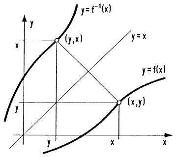

<details>
<summary>text_image</summary>

y = f⁻¹(x)
(x, x)
y = x
y = f(x)
(x, y)
x
</details>

Abb. 88 - Umkehrfunktion

Beispiel. Die Funktion $f(x) = x^5 + x$ ($x \in \mathbb{R}$) hat eine überall positive Ableitung $f'(x) = 5x^4 + 1$; sie ist demzufolge umkehrbar. Da die Gleichung $x^5 + x = y$ mit „formalen“ Manipulationen nicht nach $x$ auflösbar ist, kann man vorerst noch nicht viel über die Umkehrfunktion $g$ sagen. Immerhin kennt man nach (3) die Ableitung $g'(x) = \frac{1}{5g(x)^4 + 1}$, damit auch $g''(x), g'''(x), \ldots$, was eine Reihendarstellung von $g$ ermöglicht ($\rightarrow$ Kap. 5).

3.2 n-te Wurzel, rationale Exponenten. Zu  $n \in N$  betrachten wir die Potenzfunktion  $f_{n}(x) = x^{n}$ ,  $x \in R$ .

1. Fall: $n$ gerade, $n = 2k$. In diesem Fall ist $f_n$ nicht über ganz $\mathbb{R}$ umkehrbar, $y = x^{2k} = (-x)^{2k}$. Wegen $f_n'(x) > 0$ für $x > 0$, ist aber $f_n$ über $\mathbb{R}_+ = \{x \in \mathbb{R}; x \geq 0\}$ umkehrbar ($\rightarrow$ Satz 3.1). Demnach hat die Gleichung $y = x^n$ zu jedem $y \in f(\mathbb{R}_+) = \mathbb{R}_+$ in $\mathbb{R}_+$ genau eine Lösung, sie heißt $n$-te Wurzel von $y$, i.Z. $x = \sqrt[n]{y}$. Es ist $g_n : \mathbb{R}_+ \to \mathbb{R}_+$, $g_n(x) = \sqrt[n]{x}$ die Umkehrfunktion von $f_n : x \mapsto x^n$ über $\mathbb{R}_+$.
2. Fall: $n$ ungerade, $n = 2k + 1$. Mit einem ungeraden Exponenten $n$ ist die Potenzfunktion über ganz $\mathbb{R}$ strikt monoton wachsend, $f_n'(x) = (2k + 1)x^{2k} > 0$ für $x \neq 0$ ($\rightarrow$ Satz 2.3). Demnach ist zu jeder ungeraden Zahl $n \in \mathbb{N}$ die $n$-te

---

142

3. Differentiation

Wurzel für alle  $x \in R$  erklärt.

$$
y = \sqrt [ n ]{x} \iff y ^ {n} = x \left\{ \begin{array}{l l} x \geq 0 & , n \in \mathbb {N} \text {gerade} \\ x \in \mathbb {R} & , n \in \mathbb {N} \text {ungerade}. \end{array} \right.
$$

Für jede nichtnegative reelle Zahl $x \geq 0$, jedes $n \in \mathbb{N}$ und $m \in \mathbb{Z}$ setzt man

$$
x ^ {\frac {1}{n}} := \sqrt [ n ]{x}, \quad x ^ {\frac {m}{n}} := (x ^ {\frac {1}{n}}) ^ {m}. \tag {4}
$$

Damit ist nun die Potenzfunktion $f_{\alpha}(x) := x^{\alpha} \ (x \geq 0)$ für jeden rationalen Exponenten $\alpha \in \mathbb{Q}$ erklärt. Zur Vermeidung von Fallunterscheidungen wird einheitlich der Definitionsbereich $\mathbb{R}_{+} = \{ x \in \mathbb{R} ; x \geq 0 \}$ festgelegt. Aus der Definition ergeben sich leicht die Potenzregeln

$$
x ^ {\alpha} x ^ {\beta} = x ^ {\alpha + \beta}, \quad (x ^ {\alpha}) ^ {\beta} = x ^ {\alpha \beta}, \quad x ^ {\alpha} y ^ {\alpha} = (x y) ^ {\alpha} \tag {5}
$$

(für alle $x, y \geq 0$, $\alpha, \beta \in \mathbb{Q}$).

Für einen beliebigen rationalen Exponenten $\alpha\in\mathbb{Q}$ gilt die Ableitungsformel

$$
\frac {a}{d x} (x ^ {\alpha}) = \alpha x ^ {\alpha - 1} \quad (x > 0) . \tag {6}
$$

Beweis. Formel (3) mit $f(x) = x^n$, $g(x) = \sqrt[n]{x} = x^{\frac{1}{n}}$ zeigt (für $n \in \mathbb{N}$) zuerst einmal $\frac{d}{dx}(x^{\frac{1}{n}}) = \frac{1}{n(x^{\frac{1}{n}})^{n-1}} = \frac{1}{n} x^{\frac{1}{n}-1}$. Mit der Kettenregel folgt nun $\frac{d}{dx} x^{\frac{m}{n}} = \frac{d}{dx}(x^{\frac{1}{n}})^m = m(x^{\frac{1}{n}})^{m-1} \cdot \frac{1}{n} x^{\frac{1}{n}-1} = \frac{m}{n} x^{\frac{m}{n}-1}$.

Beispiel. Die Funktion

$$
y (h) = h (a ^ {2} + h ^ {2}) ^ {- 3 / 2}, (h \geq 0),
$$

gibt die Beleuchtungsstärke der Lampe B im Punkt A an. In welcher Höhe h ist B zu befestigen, damit es in A möglichst hell wird?

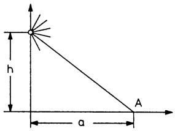

<details>
<summary>text_image</summary>

h
a
A
</details>

Abb. 89 – Beleuchtungsstärke

Lösung. Wegen $y(0) = 0$, $y(h) \to 0$ (für $h \to \infty$) und $y(h) > 0$ ($h \neq 0$) muß es zwischen $h = 0$ und $h = \infty$ wenigstens eine Maximalstelle geben; diese ist nach 2.2 unter den stationären Stellen zu suchen. $y'(h) = \frac{a^2 - 2h^2}{(a^2 + h^2)^{5/2}} = 0$ besitzt für $h \geq 0$ nur die Lösung $h_1 = \frac{a}{\sqrt{2}}$, dies ist eine Maximalstelle.

---

§3. Umkehrfunktionen

143

3.3 Arcussinus, Arcuscosinus, Arcustangens. Die Kreisfunktionen sin, cos und tan sind sicherlich nicht global (d.h. über dem gesamten Definitionsbereich) umkehrbar. So hat etwa die Gleichung  $\sin x = \frac{1}{2}$  unendlich viele Lösungen  $x_{k} = \frac{\pi}{6} + 2k\pi$ ,  $k = 0, \pm1, \pm2, \ldots$ . Über gewissen Teilintervallen sind sie aber strikt monoton und deshalb dort umkehrbar ( $\rightarrow$  Satz 3.1).

① Die Sinusfunktion ist über dem Grundintervall  $-\frac{\pi}{2} \leq x \leq \frac{\pi}{2}$  strikt monoton wachsend; die zugehörige Umkehrfunktion, definiert auf  $[-1,1]$  mit Werten in  $\left[-\frac{\pi}{2}, \frac{\pi}{2}\right]$ , heißt Arcussinus-Funktion (i.Z. arcsin). Sie ist definiert durch

$$
\begin{array}{c}\arcsin : [ - 1, 1 ] \rightarrow \left[ - \frac {\pi}{2}, \frac {\pi}{2} \right]\\y = \arcsin x \iff \sin y = x \quad \text {und} \quad - \frac {\pi}{2} \leq y \leq \frac {\pi}{2}.\end{array}
$$

Der Graph $y = \arcsin x$ ($-1 \leq x \leq 1$) ergibt sich aus dem Sinusbogen $y = \sin x$, $-\frac{\pi}{2} \leq x \leq \frac{\pi}{2}$, durch Spiegelung an der Achse $y = x$ ($\rightarrow$ Satz 3.1 und Abb. 90a). arcsin löst Gleichungen der Form $y = \sin x$ für $x \in \left[-\frac{\pi}{2}, \frac{\pi}{2}\right]$ nach $x$ auf. So erhält man etwa aus dem Brechungsgesetz $\sin \alpha = n \sin \beta$ (mit dem Brechungsindex $n$) den Winkel $\alpha$ als Funktion von $\beta$ in der Form $\alpha = \arcsin(n \sin \beta)$.

arcsin ist im offenen Intervall  $(-1,1)$  differenzierbar. Es gilt

$$
\boxed {\frac {d}{d x} \arcsin x = \frac {1}{\sqrt {1 - x ^ {2}}}, \quad - 1 <   x <   1.} \tag {7}
$$

Beweis. Formel (3) liefert zunächst $\frac{d}{dx}\arcsin x = \frac{1}{\cos(\arcsin x)}$. Nun ist $\cos y = \sqrt{1 - (\sin y)^2}$, falls $-\frac{\pi}{2} \leq y \leq \frac{\pi}{2}$, daher ergibt sich (7) wegen $\sin(\arcsin x) = x$.

Über dem Intervall  $(2k-1)\frac{\pi}{2} \leq x \leq (2k+1)\frac{\pi}{2}$ ,  $k \in Z$ , nennt man die Umkehrfunktion der Sinusfunktion den k-ten Zweig vom Arcussinus.

$$
\begin{array}{l} \arcsin_ {k} x: [ - 1, 1 ] \rightarrow \left[ (2 k - 1) \frac {\pi}{2}, (2 k + 1) \frac {\pi}{2} \right] \\ \arcsin_ {k} x = \left\{ \begin{array}{l l} k \pi + \arcsin x & , \text {falls} k \text {gerade}, \\ k \pi - \arcsin x & , \text {falls} k \text {ungerade}. \end{array} \right. \\ \end{array}
$$

Solange keine Verwechslungen zu befürchten sind, nennen wir den nullten Zweig des Arcussinus, den Hauptzweig oder Hauptwert, kurz „den“ Arcussinus.

② Die Cosinusfunktion cos ist über jedem Intervall $k\pi \leq x \leq (k+1)\pi$, $k \in \mathbb{Z}$, strikt monoton und besitzt daher dort eine Umkehrfunktion, den $k$-ten Zweig vom Arcuscosinus. Den nullten Zweig, den Hauptzweig oder den Hauptwert,

---

144

3. Differentiation

nennen wir kurz „den“ Arcuscosinus.

$$
\boxed {\begin{array}{c}\arccos : [ - 1, 1 ] \rightarrow [ 0, \pi ]\\\arccos x = y \iff x = \cos y \quad \text {und} \quad 0 \leq y \leq \pi .\end{array}}
$$

Die Ableitungsformel

$$
\boxed {\frac {d}{d x} \arccos x = - \frac {1}{\sqrt {1 - x ^ {2}}} \quad (- 1 <   x <   1)} \tag {8}
$$

findet man ganz analog wie (7).

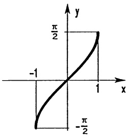

<details>
<summary>contour</summary>

| X | Y |
| --- | --- |
| \(-\pi/2\) | \(-\pi/2\) |
| 0 | 0 |
| \(\pi/2\) | \(\pi/2\) |
</details>

Abb. 90a $y = \arcsin x$

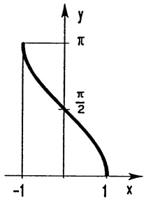

<details>
<summary>contour</summary>

| Point | X | Y |
| --- | --- | --- |
| Leftmost point | -1 | \(\pi\) |
| Rightmost point | 1 | \(\pi/2\) |
</details>

Abb. 90b $y = \arccos x$

Beispiel 1. Ein Schrank der Breite $b$ und der Länge $l$ soll durch eine Tür der Breite $B$ in einen Gang der Breite $L$ geschoben werden ($l > B > L > b$). Der Winkel $\varphi$, bei dem sich der Schrank wie skizziert verkantet, ist $\varphi = \arccos \frac{L}{l}$. Solange $b \leq B \cos \varphi$, d.h. $bl \leq BL$ gilt, gleitet der Schrank durch die Tür ($\rightarrow$ Aufg. 7).

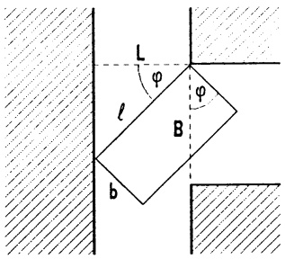

<details>
<summary>text_image</summary>

L
φ
φ
ℓ
B
b
</details>

Abb. 91 - Verkanteter Schrank

Beispiel 2. Aus der für alle $n \in \mathbb{N}$ gültigen Beziehung

$$
\cos (n + 1) y + \cos (n - 1) y = 2 \cos n y \cos y
$$

(→ Additionstheorem), erhält man sofort mit vollständiger Induktion, daß es zu jedem $n \in \mathbb{N}$ ein Polynom $p_n(x)$ vom Grad $n$ gibt mit $\cos ny = p_n(\cos y)$. Demnach ist (mit $\cos y = x$ für $y = \arccos x$)

$$
T _ {n} (x) := \cos (n \arccos x), \quad | x | <   1,
$$

ein Polynom in x vom Grad n (TSCHEBYSCHEV-Polynom).

---

§3. Umkehrfunktionen

145

Mit den üblichen Differentiationsregeln und (8) bestätigt man leicht

$$
(x ^ {2} - 1) T _ {n} ^ {\prime \prime} (x) + x T _ {n} ^ {\prime} (x) - n ^ {2} T _ {n} (x) = 0
$$

für alle x,  $|x| < 1$ . Die Polynome  $T_{n}$  oszillieren mit ihren Werten zwischen -1 und +1. Es gilt

$$
T _ {1} (x) = x; \quad T _ {2} (x) = - 1 + 2 x ^ {2};
$$

$$
T _ {3} (x) = - 3 x + 4 x ^ {3};
$$

$$
T _ {4} (x) = 1 - 8 x ^ {2} + 8 x ^ {4}.
$$


<details>
<summary>text_image</summary>

T₁
T₂
T₃
T₄
T₅
-1
x
y
1
</details>

Abb. 92 - Tschebyschev-Polynome

③ Desgleichen besitzen die Tangens- und Cotangensfunktion über den offenen Intervallen  $((2k-1)\frac{\pi}{2},(2k+1)\frac{\pi}{2})$  bzw.  $(2k\pi,(2k+1)\pi)$ ,  $k=0,\pm1,\pm2,\ldots$ , jeweils eine Umkehrfunktion. Wir behandeln nur die Hauptwerte  $(k=0)$ .  $\tan:(-\frac{\pi}{2},\frac{\pi}{2})\to\mathbb{R}$  ist strikt monoton, also umkehrbar. Die Umkehrfunktion heißt Arcustangens.

$$
\boxed {\begin{array}{c}\arctan : \mathbb {R} \rightarrow \left(- \frac {\pi}{2}, \frac {\pi}{2}\right)\\\arctan x = y \iff \tan y = x \quad \text {und} \quad - \frac {\pi}{2} <   y <   \frac {\pi}{2}.\end{array}}
$$

Der Arcuscotangens arccot : $\mathbb{R} \to \mathbb{R}$ ist Umkehrfunktion von cot : $(0, \pi) \to \mathbb{R}$, d.h.

$$
\begin{array}{c}\text {arccot:} \mathbb {R} \rightarrow (0, \pi)\\\operatorname{arccot} x = y \iff \cot y = x \quad \text {und} \quad 0 <   y <   \pi .\end{array}
$$

Die Ableitungen ergeben sich wieder aus (3):

$$
\boxed {\frac {d}{d x} \arctan x = \frac {1}{1 + x ^ {2}}, \quad \frac {d}{d x} \operatorname{arccot} x = - \frac {1}{1 + x ^ {2}} \quad (x \in \mathbb {R}).} \tag {9}
$$


<details>
<summary>contour</summary>

| X | Y |
| --- | --- |
| 0 | \(-\pi/2\) |
| 1 | \(\pi/2\) |
</details>

Abb. 93 $y = \arctan x$


<details>
<summary>contour</summary>

| X | Y |
| --- | --- |
| 0 | \(\pi\) |
| 1 | \(\pi/2\) |
</details>

Abb. 94 $y = \operatorname{arccot} x$

---

146

3. Differentiation

Beispiel. Wir suchen denjenigen Punkt $X = (x,0)$ mit $x \geq 0$, von dem aus die Strecke von (1,1) nach (2,2) unter maximalem Winkel $\varphi$ erscheint. Aus $\varphi = \alpha - \beta$, $\cot \alpha = \frac{x - 2}{2}$, $\cot \beta = x - 1$ folgt $\varphi = \varphi(x) = \operatorname{arccot}[(x-2)/2] - \operatorname{arccot}(x-1)$. Wegen $\varphi(0) = \varphi(\infty) = 0$ und $\varphi(x) \geq 0$ existiert eine Maximalstelle $x_0$, für die nach 2.1 $\varphi'(x_0) = 0$ sein muß.


<details>
<summary>text_image</summary>

y
(2,2)
(1,1)
α
φ
β
x
</details>

Abb. 95 - Maximales $\varphi$

Die positive Lösung  $x_{0}=2$  von  $0=\varphi'(x)=-\frac{1/2}{1+(x-2)^{2}/4}+\frac{1}{1+(x-1)^{2}}$  ist die gesuchte Maximalstelle. Von  $X_{0}=(2,0)$  aus erscheint die Strecke unter dem maximalen Winkel  $\varphi(2)=\frac{\pi}{4}$ . ☐

## Aufgaben

1. a) Für die Umkehrfunktion $g$ von $f(x) = x^5 + x$ berechne man $g'(0), \ldots, g^{(4)}(0)$. b) Man zeige, daß $f(x) = \tan x - x$ im Intervall $(-\frac{\pi}{2}, \frac{\pi}{2})$ umkehrbar ist und bestätige, daß Umkehrfunktion $g(x)$ die Gleichung $g'(x) = (g(x) + x)^{-2}$ erfüllt.

2. Man berechne die Ableitungen

$$
\arcsin \sqrt {\frac {1 + x ^ {2}}{1 - x ^ {2}}} \quad , \qquad \arctan \frac {x ^ {2}}{\sqrt {x ^ {2} + x + 1}} \quad ,
$$

$$
\sin (2 \arctan x) \quad , \quad x \sqrt {1 - x ^ {2}} + \arcsin x \quad ,
$$

$$
\arcsin (\sin | x |) \quad , \quad \arctan x + \operatorname{arccot} x \quad .
$$

3. Man stelle $\arcsin x$ und $\arccos(-x)$ als Funktion von $\arccos x$ dar.

4. Man differenziere und skizziere den Graphen von

$$
f (x) = \arcsin \frac {2 x}{1 + x ^ {2}}, \quad g (x) = 2 \arctan x
$$

und drücke damit  $f(x)$  durch  $g(x)$  aus.

5. Wie viele verschiedene Werte nimmt die Funktion

$$
F (x) = \arctan x + \arctan \alpha - \arctan \frac {x + \alpha}{1 - \alpha x}
$$

für $\alpha x \neq 1'$ an? Man berechne diese in Abhängigkeit von $\alpha$.

6. Man diskutiere gemäß 2.5 die Funktion $f(x)$, $x \in \mathbb{R}$,

a) $f(x) = \arccos \left|\frac{6x}{9 + x^2}\right|$, b) $f(x) = \arctan \left|\frac{1 + x}{1 - x}\right|$.

7. Ein geradlinig begrenzter Kanal der Breite 10 m mündet rechtwinklig in einen 5 m breiten Bach. Vom Kanal aus sollen Baumstämme in den Bach geflößt werden.

---

§3. Umkehrfunktionen

147

a) Man berechne die Länge $\ell(\varphi)$ eines einzelnen Baumstammes (von vernachlässigbarer Dicke), der sich beim Winkel $\varphi$ verkanet und skizziere $\ell=\ell(\varphi)$ für $0^{o}<\varphi<90^{o}$. Wie lang darf ein Stamm höchstens sein, ohne zu verkanten?
b) Man berechne die Breite $b(\varphi)$ eines 11 m langen Floßes, das sich beim Winkel $\varphi$ verkanet und skizziere $b = b(\varphi)$ für $0^o \leq \varphi \leq 90^o$. Wie breit darf das Floß höchstens sein, ohne zu verkanen? Differenzierbarkeit von $b(\varphi)$ beachten!


<details>
<summary>text_image</summary>

5m
10m
b
φ
L
</details>

Aufg. 7


<details>
<summary>text_image</summary>

Polarkreis
Erdachse
Sonnenlicht
</details>

Aufg. 8

8. Längster Tag im Jahr. Man rechne nach: Bei Sommersonnenwende ist die Sonnenscheindauer in einem Ort mit der geographischen Breite 9 höchstens

$$
f (\vartheta) = 1 2 \left[ 1 + \frac {2}{\pi} \arcsin (\cot \vartheta_ {0} \tan \vartheta) \right] \text {Stunden, falls} | \vartheta | \leq \vartheta_ {0}.
$$

$\vartheta_{0}=66^{0}30'$ bezeichnet die geographische Breite des nördlichen Polarkreises.

9. Das skizzierte Schubkurbelgetriebe hat den Kurbelradius $r$ und die Pleuellänge $\ell$ ($\ell > 2r$). Man wähle $M = (0,0)$ und bestimme

a) die Lage s des Kreuzkopfes B als Funktion  $s = s(\varphi)$ ;
b) den Winkel $\varphi_{m}$, für den sich $B$ in der Mitte der beiden Ruhelagen $T_{1}$ und $T_{2}$ befindet,
c) die Konstanten $a, b, c$ der Approximation $S(\varphi) = a + b \cos \varphi + c \cos 2\varphi$, so daß $S(0) = s(0)$, $S'(0) = s'(0)$, $S''(0) = s''(0)$, $S(\pi) = s(\pi)$;
d) die maximale Kreuzkopfgeschwindigkeit und die maximale Kreuzkopfbeschleunigung aus der Approximation $s = S(\varphi)$.
e) Für $r = 1$, $\ell = 5$ skizziere man $S, S', S''$ und berechne das Maximum von $|s - S|$ (Approximationsfehler).


<details>
<summary>text_image</summary>

B
v
l
A
r
φ
M
s
Hub
T₁
T₂
</details>

---

148

3. Differentiation

10. Mit dem Brechungsgesetz von SNELLIUS  $\frac{\sin\theta}{\sin\alpha}=R$  ergibt sich für den Streuwinkel  $\varphi$  eines Lichtstrahls in einem Wassertröpfchen mit kreisförmigem Querschnitt

$$
\varphi = f (\theta) = 2 \theta - 4 \arcsin (\frac {\sin \theta}{R}).
$$


<details>
<summary>text_image</summary>

2α
α
θ
α'
θ
φ
</details>

Man rechne dies explizit nach!

Man diskutiere $f(\theta)$ und $f'(\theta)$ für $0 \leq \theta \leq \frac{\pi}{2}$ und bestimme näherungsweise $\theta_0$ mit $f'(\theta_0) = 0$ für $R = 1.331$ (rotes Licht).

( $\theta_{0}$ bestimmt den Winkel mit stärkster Streuintensität und bei einem Regenbogen die Höhe über dem Erdboden.)

## §4. Die Exponential- und Logarithmusfunktion

4.1 Die e-Funktion. Eine in der Theorie und der Praxis gleichermaßen besonders wichtige Funktion ist die von L. EULER eingeführte Exponentialfunktion, kurz e-Funktion genannt (→ Kap. 2, §5):

$$
e ^ {x} := \exp (x) := \lim _ {n \to \infty} \left(1 + \frac {x}{n}\right) ^ {n} \qquad (x \in \mathbb {R}) .
$$

Satz 4.1. Die wichtigsten Eigenschaften der e-Funktion.

a) Positivität.  $e^{0}=1$ ,  $e^{x}>0$  für alle  $x\in R$ .

b) Die Ableitung. Die e-Funktion ist überall differenzierbar und es gilt

$$
\boxed {\frac {d}{d x} e ^ {x} = e ^ {x} \quad (x \in \mathbb {R}).} \tag {1}
$$

c) Charakterisierung durch eine Differentialgleichung. Jede auf einem Intervall $I \subseteq \mathbb{R}$ differenzierbare Funktion, welche $f'(x) = af(x)$ ($x \in I$) erfüllt, ist von der Form $f(x) = ce^{ax}$, mit einer Konstanten $c \in \mathbb{R}$.

d) Die Funktionalgleichung der e-Funktion.

$$
\boxed { \begin{array}{l l} e ^ {x + y} = e ^ {x} e ^ {y} & (x, y \in \mathbb {R}), \\ e ^ {- x} = \frac {1}{e ^ {x}} & (x \in \mathbb {R}). \end{array} }
$$

Beweis. a): Aus der Definition sieht man sofort  $e^{0}=1$  und  $e^{x}\geq0$  für alle x. Daß tatsächlich  $e^{x}>0$  gilt, folgt aus der Stetigkeit (Folgerung aus b)) und aus der Beziehung  $e^{x}e^{-x}=1$  (Sonderfall y=-x in d)).

---

§4. Die Exponential- und Logarithmusfunktion

149

b): Es ist naheliegend, (1) folgendermaßen zu beweisen:

$$
\frac {d}{d x} e ^ {x} = \frac {d}{d x} \lim _ {n \to \infty} \left(1 + \frac {x}{n}\right) ^ {n} = \lim _ {n \to \infty} \frac {d}{d x} \left(1 + \frac {x}{n}\right) ^ {n} = \lim _ {n \to \infty} \left(1 + \frac {x}{n}\right) ^ {n - 1} = e ^ {x}.
$$

Das ist zwar richtig, es muß aber begründet werden, daß im vorliegenden Fall die Grenzübergänge $\frac{d}{dx}$ und $\lim_{n\to\infty}$ vertauscht werden dürfen. Das ist nicht ganz einfach ($\rightarrow$ Kap. 5, §2). Wir beweisen (1) wie folgt: Nach dem Mittelwertsatz gibt es zu jedem $n\in\mathbb{N}$ ein $\xi_{n}$ zwischen $x$ und $x+h$, so daß gilt

$$
\left(1 + \frac {x + h}{n}\right) ^ {n} = \left(1 + \frac {x}{n}\right) ^ {n} + h \left(1 + \frac {\xi_ {n}}{n}\right) ^ {n - 1}.
$$

Mit den Grenzwert-Regeln (→ Kap. 2, Satz 5.1) folgt hieraus

$$
\lim _ {n \to \infty} \left(1 + \frac {\xi_ {n}}{n}\right) ^ {n} = \frac {1}{h} (e ^ {x + h} - e ^ {x}) .
$$

Nehmen wir zunächst 0 < h < 1 an, also  $x \leq \xi_{n} \leq x + h \leq x + 1$ , dann gilt für hinreichend große n

$$
\left(1 + \frac {x}{n}\right) ^ {n} \leq \left(1 + \frac {\xi_ {n}}{n}\right) ^ {n} \leq \left(1 + \frac {x + h}{n}\right) ^ {n} \leq \left(1 + \frac {x + 1}{n}\right) ^ {n},
$$

woraus bei  $n \rightarrow \infty$  (mit dem soeben ermittelten Grenzwert)

$$
e ^ {x} \leq \frac {1}{h} (e ^ {x + h} - e ^ {x}) \leq e ^ {x + h} \leq e ^ {x + 1}
$$

entsteht. Hieraus erkennt man zuerst (nach Multiplikation mit $h$)

$\lim_{h\to 0 + }(e^{x + h} - e^x) = 0$ und dann $\lim_{h\to 0 + }\frac{1}{h} (e^{x + h} - e^x) = e^x$ . Völlig analog verläuft die linksseitige Annäherung $h\to 0-$ . Damit ist (1) bewiesen.

c): Aus  $(e^{x}e^{-x})' = e^{x}e^{-x} - e^{x}e^{-x} = 0$  folgt  $e^{x}e^{-x} = c_{1}$  mit einer Konstanten  $c_{1} \in R$  ( $\rightarrow$  Satz 2.3e), die sich leicht mit der Wahl x = 0 zu  $c_{1} = 1$  bestimmen läßt. Also gilt

$$
e ^ {x} e ^ {- x} = 1. \tag {2}
$$

Nun gehen wir aus von $f$ mit $f' = af$ und betrachten die Funktion $g(x) := f(x)e^{-ax}$. Da $g'(x) = f'(x)e^{-ax} + f(x)(-ae^{ax}) = e^{-ax}(f'(x) - af(x)) = 0$, folgt $g(x) = f(x)e^{-ax} = c$ mit einer Konstanten $c$, woraus mit (2) die Behauptung $f(x) = ce^{ax}$ folgt.

d): Für jedes  $y \in R$  erfüllt  $f(x) := e^{x+y}$  die Bedingung  $f' = f$ . Deshalb gibt es (nach Teil c)) eine Konstante  $c = c(y)$  mit  $e^{x+y} = c(y)e^{x}$  für alle x. Die Wahl x = 0 zeigt  $c(y) = e^{y}$ . ☐

Daß es sich bei  $\exp(x)=\lim_{n\to\infty}(1+\frac{x}{n})^{n}$  tatsächlich um die x-te Potenz der Euler-

---

150

3. Differentiation

zahl $e = \lim_{n\to \infty}\left(1 + \frac{1}{n}\right)^n = 2.71828\ldots$ handelt, folgt aus

$$
\exp (r x) = [ \exp x ] ^ {r} \quad (\text {fur} x \in \mathbb {R}, r \in \mathbb {Q}). \tag {3}
$$

Beweis. Aus der Funktionalgleichung (→ Satz 4.1d) erhält man leicht mit vollständiger Induktion $\exp(nx) = [\exp x]^{n}$ ($n \in \mathbb{N}$) und damit $\exp x = \exp(n\frac{x}{n}) = (\exp\frac{x}{n})^{n}$, bzw. $\exp(\frac{x}{n}) = (\exp x)^{\frac{1}{n}}$. Für $m, n \in \mathbb{N}$ folgt dann $\exp(\frac{m}{n}x) = (\exp\frac{x}{n})^{m} = (\exp x)^{\frac{m}{n}}$. Diese Beziehung zusammen mit $\exp(-x) = \frac{1}{\exp x}$ zeigt die Gültigkeit von (3) für alle $r \in \mathbb{Q}$.

Der Sonderfall $x = 1$ in (3) zeigt, daß $\exp(r) = e^{r}$ die $r$-te Potenz der Zahl $e = \exp(1)$ ist. Für eine beliebige Zahl $x$ und jede Folge rationaler Zahlen $r_{n} \to x$ ergibt sich nun aufgrund der Stetigkeit der $e$-Funktion

$$
e ^ {x} = \exp (x) = \lim _ {n \to \infty} \exp (r _ {n}) = \lim _ {n \to \infty} e ^ {r _ {n}},
$$

womit die Exponentialschreibweise nachträglich gerechtfertigt ist.

## 4.2 Die Kurve  $y = e^{x}$ . ( $\rightarrow$  Abb. 96)

Die $e$-Funktion ist wegen $(e^{x})^{\prime} = e^{x} > 0$ überall echt monoton wachsend ($\rightarrow$ Satz 2.3), ihr Graph linksgekrümmt ($\rightarrow$ Satz 2.6). Ferner gilt

$$
\begin{array}{l} \boxed { \begin{array}{l} a) \lim _ {x \to \infty} e ^ {x} = \infty , \quad \lim _ {x \to - \infty} e ^ {x} = 0, \\ b) \lim _ {x \to \infty} \frac {e ^ {x}}{x ^ {n}} = \infty (n \in \mathbb {N}). \end{array} } \end{array} \tag {4}
$$

Beweis. a): Für $x > 0$ gilt $(1 + \frac{x}{n})^n \geq 1 + x$ ($\rightarrow$ Bernoullische Ungleichung) für alle $n \in \mathbb{N}$, also auch $e^x \geq 1 + x$. Mit $x \to \infty$ wächst $e^x$ über alle Grenzen. Die andere Behauptung folgt aus $\lim_{x \to -\infty} e^x = \lim_{x \to \infty} e^{-x} = \lim_{x \to \infty} \frac{1}{e^x}$.

b): Der Grenzwert (vom Typ  $\frac{\infty}{\infty}$ ) kann mit der L'Hospital-Regel ( $\rightarrow$  Satz 2.9) bestimmt werden:

$$
\lim _ {x \to \infty} \frac {e ^ {x}}{x ^ {n}} = \lim _ {x \to \infty} \frac {e ^ {x}}{n x ^ {n - 1}} = \dots = \lim _ {x \to \infty} \frac {e ^ {x}}{n !} = \infty .
$$

Die Grenzwertformel (4b) besagt, daß die e-Funktion mit  $x \rightarrow \infty$  schneller anwächst als jede noch so hohe x-Potenz.

---

§4. Die Exponential- und Logarithmusfunktion

151

## 4.3 Exponentiell wachsende bzw. fallende Prozesse.

In zahlreichen Wachstums- oder Abnahmeprozessen aus der Natur, Technik und anderen Bereichen kann man – aufgrund entsprechender Hypothesen und Versuche – davon ausgehen, daß die den Prozess zur Zeit t beschreibende Größe $u(t)$ einer Differentialgleichung der Form $\dot{u}(t) = au(t)$ genügt, welche besagt, daß die Wachstumsgeschwindigkeit (oder Abnahme-geschwindigkeit, falls $a < 0$) $\dot{u}(t) = \frac{du(t)}{dt}$ stets im gleichen Verhältnis zur vorhandenen „Menge“ $u(t)$ steht.


<details>
<summary>line</summary>

| X | Y |
| --- | --- |
| -1 | ~0.2 |
| 0 | 1 |
</details>

Abb. 96 - $y = e^{x}$

Nach Satz 4.1 c) verläuft jeder derartige Prozess „exponentiell“, d.h. es gilt $u(t) = ce^{at}$ mit einer Konstanten $c$, die man in der Regel mit $t = 0$ (sonst $t = t_0$) zu $c = u(0)$ bestimmt.

Beispiel 1. Radioaktiver Zerfall. Aufgrund von Beobachtungen geht man davon aus, daß für $N(t)$ Atome eines zerfallenden Stoffes die Anzahl $\Delta N$ der Zerfälle in einem kleinen Zeitintervall $\Delta t$ gegeben ist durch $\Delta N = -kN\Delta t$. Mit der (vernünftigen) Annahme, daß die Funktion $N$ differenzierbar ist, ergibt sich hieraus $\dot{N}(t) = -kN(t)$. ($k > 0$ ist die - vom Material abhängige - Zerfallskonstante.) Satz 4.1 c) führt sofort zum Zerfallsgesetz

$$
N (t) = N (0) e ^ {- k t}.
$$

Die Halbwertszeit $T$ ist definiert durch $N(T) = \frac{1}{2} N(0)$, d.h. $e^{-kT} = \frac{1}{2}$, bzw. $e^{kT} = 2$. Mit der Logarithmusfunktion heißt dies: $T = \frac{1}{k} \ln 2$.

Beispiel 2. Das Newtonsche Abkühlungsgesetz. Eine Substanz der Temperatur $T(t)$ wird in ein Medium der Temperatur $U(t)$ eingetaucht. Für die Temperaturdifferenz $P(t):=T(t)-U(t)$ fand I. Newton (in zahlreichen Versuchen) $\frac{dP}{dt}=\lambda P$. („Die Abkühlungsgeschwindigkeit ist proportional zur Temperaturdifferenz.“) Folglich gilt $P(t)=P(0)e^{\lambda t}$, bzw.

$$
T (t) = (T (0) - U (0)) e ^ {\lambda t} + U (t).
$$

Beispiel 3. Exponentielle Sättigung. Aus dem Ohmschen Gesetz ergibt sich für die Stromstärke $I(t)$ beim Einschalten eines Gleichstroms die Beziehung

$$
L \frac {d I}{d t} + I R = E
$$

mit dem Anfangswert  $I(0) = 0$ . Für die Funktion  $u(t) := I(t) - \frac{E}{R}$  gilt dann

---

152

3. Differentiation

$$
\dot {u} (t) = \dot {I} (t) = \frac {E}{L} - \frac {R}{L} I (t) = - R / L u (t). \text {Es folgt} u (t) = u (0) e ^ {- \frac {R}{L} t}, \text {bzw.}
$$

$$
I (t) = \frac {E}{R} (1 - e ^ {- \frac {R}{L} t}) .
$$

4.4 Der natürliche Logarithmus. Da die $e$-Funktion über $\mathbb{R}$ strikt monoton wächst, besitzt sie eine auf $\exp(\mathbb{R}) = (0,\infty)$ definierte Umkehrfunktion, den natürlichen Logarithmus ln.

$$
\ln : (0, \infty) \to \mathbb {R}, \quad y = \ln x \iff e ^ {y} = x.
$$

Insbesondere gilt (→ §3 (2))

$$
\ln (e ^ {x}) = x \text { für   alle } x \in \mathbb {R}; \quad e ^ {\ln x} = x \text { für   alle } x > 0. \tag {5}
$$

Die Graphen $y = \ln x$, $y = e^x$ liegen symmetrisch zu $y = x$ ($\to$ Satz 3.1). Aus der Definition und der Abb. 97

liest man sofort ab:

$$
\begin{array}{l} \ln 1 = 0, \\ \ln x <   0, \text {falls} 0 <   x <   1, \\ \ln x > 0, \text {falls} x > 1, \\ \ln \text {ist echt monoton wachsend,} \\ \lim _ {x \to \infty} \ln x = \infty , \\ \lim _ {x \to 0 +} \ln x = - \infty , \\ \text {der Graph} y = \ln x \text {ist konvex von oben.} \\ \end{array}
$$

Ferner gilt:


<details>
<summary>line</summary>

| X | Y |
| --- | --- |
| 1 | 1 |
</details>

Abb. 97 - $y = \ln x$

Satz 4.2. a) Die ln-Funktion ist überall differenzierbar; für alle x > 0 gilt

$$
\frac {d}{d x} \ln x = \frac {1}{x}. \tag {6}
$$

b) Die Funktionalgleichung der ln-Funktion.

$$
\ln (x y) = \ln x + \ln y \quad \ln \frac {x}{y} = \ln x - \ln y \quad (x, y > 0).
$$

Beweis. a): Die Differentiationsregel (3) aus § 3 ergibt in diesem Fall

$$
\frac {d}{d x} \ln x = \frac {1}{\exp^ {\prime} (\ln x)} = \frac {1}{\exp (\ln x)} = \frac {1}{x}.
$$

b): Für $x, y \in (0, \infty)$ sei $u := \ln x$, $v := \ln y$, dann gilt $x = e^u$, $y = e^v$ und $\ln(xy) = \ln(e^u e^v) = \ln(e^{u+v}) = u + v = \ln x + \ln y$. Der Sonderfall $x = \frac{1}{y}$ zeigt $\ln \frac{1}{y} = -\ln y$.

---

§4. Die Exponential- und Logarithmusfunktion

153

Die In-Funktion wächst mit  $x \rightarrow \infty$  wesentlich schwächer gegen  $\infty$  als jede n-te Wurzelfunktion, denn es gilt

$$
\lim _ {x \to \infty} \frac {\ln x}{\sqrt [ n ]{x}} = 0,
$$

was man leicht mit der L'Hospital-Regel nachweisen kann.

Beispiel 1. Für die Zerfallskonstante $k$ und die Reichweite $R$ von $\alpha$-Teilchen gilt das Gesetz von GEIGER und NUTTAL:

$$
\ln k = a + b \ln R \quad (\text {mit gewissen Konstanten} a, b).
$$

Aus $kT = \ln 2$ ($\rightarrow$ 4.3) folgt $\ln k + \ln T = \ln(kT) = \ln(\ln 2)$ und damit eine Beziehung $\ln(\ln 2) = a + b \ln R + \ln T$ zwischen Reichweite und Halbwertszeit.

Beispiel 2. Das psychophysische Grundgesetz von WEBER und FECHNER. Ein Reiz der Intensität R verursacht eine Empfindung der Intensität  $E(R)$ . Versuche ergeben  $\Delta E = a \frac{\Delta R}{R}$  mit einer Konstanten a.  $\Delta R \rightarrow 0$  führt auf  $\frac{dE}{dR} = a \cdot \frac{1}{R}$ , also auf  $E(R) = a \ln R + c$  ( $\rightarrow$  (6) und §2 (2)). Als Reizschwelle bezeichnet man den Wert  $R_{0}$  mit  $E(R_{0}) = 0$  und  $E(R) > 0$  falls  $R > R_{0}$ . Damit ergibt sich  $c = -a \ln R_{0}$  und  $E(R) = a \ln R - a \ln R_{0} = a \ln \frac{R}{R_{0}}$ . Das langsame Anwachsen der ln-Funktion verlangt in Bereichen hoher Intensität eine ganz erhebliche Änderung von R, um  $E(R)$  merklich zu beeinflussen.

4.5 Allgemeine Exponentialfunktionen und Logarithmen. Sei $a > 0$. Die Formel $(e^x)^r = e^{rx} \to (3)$ mit $x = \ln a$ ergibt $a^r = e^{r\ln a}$ für jede rationale Zahl $r \in \mathbb{Q}$. Aus diesem Grund definiert man die Potenzen $a^x$ für beliebige $x \in \mathbb{R}$ durch

$$
a ^ {x} := e ^ {x \ln a}, (a > 0). \tag {7}
$$

Man nennt $x \mapsto a^{x}$ ($x \in \mathbb{R}$) die Exponentialfunktion zur Basis $a$. Sämtliche Eigenschaften dieser Funktion leitet man aus der Definition (7) und den Eigenschaften der In-Funktion und der $e$-Funktion her. Insbesondere $a^{x} = \lim_{n \to \infty} a^{r_{n}}$ für jede Folge rationaler Zahlen $r_{n} \to x$. Ferner:

$$
\begin{array}{l} \boxed { \begin{array}{c} a ^ {x} a ^ {y} = a ^ {x + y}; \quad (a b) ^ {x} = a ^ {x} b ^ {x}; \quad (a ^ {x}) ^ {y} = a ^ {x y}; \\ \ln (a ^ {x}) = x \ln a \quad (x, y \in \mathbb {R}, a, b > 0); \\ \frac {d}{d x} a ^ {x} = a ^ {x} \ln a, (x \in \mathbb {R}, a > 0). \end{array} } \end{array} \tag {8}
$$

Für jede reelle Zahl $\alpha\in\mathbb{R}$ ist nach (7) die Potenzfunktion $f(x)=x^{\alpha}=e^{\alpha\ln x}$ für alle $x>0$ definiert. Mit (1), (6) und der Kettenregel berechnen wir die Ableitung: $f'(x)=e^{\alpha\ln x}\frac{\alpha}{x}=\alpha x^{\alpha-1}$. Damit ist endlich die Differentiationsregel

---

154

3. Differentiation

(9)

$$
\boxed {\frac {d}{d x} (x ^ {\alpha}) = \alpha x ^ {\alpha - 1}}
$$

für alle $\alpha \in \mathbb{R}$ bewiesen.

Beispiel 1. Das POISSON-Gasgesetz. Experimentell stellt man fest, daß zwischen dem Druck $p$ und dem Volumen $V$ eines Gases bei einem reversiblen adiabatischen Prozess die Beziehung $\frac{\Delta p}{p} + \gamma \frac{\Delta V}{V} = 0$ besteht (mit einer vom Gas abhängigen Konstanten $\gamma$). Nach Multiplikation mit $\frac{1}{\Delta t}$ wird daraus beim Grenzübergang $\Delta t \to 0$

$$
0 = \frac {\dot {p}}{p} + \gamma \frac {\dot {V}}{V} = \frac {d}{d t} (\ln p + \gamma \ln V) = \frac {d}{d t} \ln (p V ^ {\gamma}).
$$

Es folgt $\ln(pV^{\gamma}) = c$, bzw. $p(t)V(t)^{\gamma} = C$ ($= e^{c}$, konstant).

Beispiel 2. Die allgemeine Höhenformel

$$
p = p _ {0} \left(1 - \frac {\gamma - 1}{\gamma} \frac {\rho_ {0}}{p _ {0}} g h\right) ^ {\frac {\gamma}{\gamma - 1}}
$$

beschreibt den Zusammenhang zwischen dem Druck $p$ und der Höhe $h$ in einem gasgefüllten Behälter. Uns interessiert der Grenzwert $\gamma \to 1$ (Annäherung an ein ideales Gas). Mit $x := \frac{\gamma}{\gamma - 1}$ und $a := -\frac{\rho_0}{p_0}gh$ wird dieser Grenzübergang in $p = p_0 \lim_{x \to \infty} (1 + \frac{a}{x})^x$ beschrieben. Mit der L'Hospital-Regel finden wir $\lim_{x \to \infty} x \ln(1 + \frac{a}{x}) = a$ und damit $\lim_{x \to \infty} (1 + \frac{a}{x})^x = \lim_{x \to \infty} e^{x \ln(1 + a/x)} = e^a$. Demzufolge geht mit $\gamma \to 1$ die allgemeine Höhenformel in die barometrische Höhenformel $p = p_0 e^{-\frac{\rho_0}{p_0}gh}$ über.

Zu jeder Basis $a > 0$ ist die Exponentialfunktion $f(x) = a^x = e^{x\ln a}$ umkehrbar, denn zu jedem $y \in f(\mathbb{R}) = (0, \infty)$ ist die Gleichung $y = e^{x\ln a}$ eindeutig nach $x$ auflösbar: $x = \frac{\ln y}{\ln a}$. Nach Vertauschung von $x$ mit $y$ ($\rightarrow$ 3.1) ergibt sich die explizite Form der Umkehrfunktion $\log_a$ - sie heißt Logarithmus zur Basis $a$ -

$$
\log_ {a} x = \frac {\ln x}{\ln a}, \quad x \in (0, \infty), \tag {10}
$$

aus der man sofort die Rechenregeln abliest (→ Satz 4.2):

$$
\log_ {a} (x y) = \log_ {a} x + \log_ {a} y, \quad \frac {d}{d x} \log_ {a} x = \frac {1}{x \ln a}.
$$

Beachte. Wegen  $a^{x}=e^{x\ln a}$  steht hinter jeder allgemeinen Exponentialfunktion die e-Funktion, und hinter jedem allgemeinen Logarithmus  $\log_{a}$  der natürliche Logarithmus ln. Auch so kompliziert aussehende Funktionen wie etwa

---

§4. Die Exponential- und Logarithmusfunktion

155

$h(x) = f(x)^{g(x)}$ (alle $f(x) > 0$) sind einfache Kompositionen aus $f, g, \exp$ und $\ln : h(x) = e^{g(x)\ln f(x)}$.

4.6 Die Hyperbelfunktionen sinh, cosh, tanh. Die Funktionen sinus hyperbolicus, cosinus hyperbolicus und tangens hyperbolicus sind für alle  $x \in R$  definiert durch

$$
\begin{array}{l} \boxed {\sinh x := \frac {e ^ {x} - e ^ {- x}}{2}} \\ \cosh x := \frac {e ^ {x} + e ^ {- x}}{2} \\ \tanh x := \frac {\sinh x}{\cosh x} = \frac {e ^ {x} - e ^ {- x}}{e ^ {x} + e ^ {- x}}. \end{array} \tag {11}
$$

Diese recht einfachen Kombinationen aus  $e^{x}$  und  $e^{-x}$  haben ihrer praktischen Bedeutung wegen einen eigenen Namen bekommen.

Beispiel. Ein homogenes, nur durch das Eigengewicht belastetes Seil hat die Form einer Kettenlinie

$$
y (x) = a \cosh (\frac {x - b}{a}) + c.
$$

Hierin sind $a, b, c$ konstant, $a > 0$ ($\rightarrow$ Aufg. 7 und Band 2).


Abb. 98 - Hyperbelfunktionen

In den Rechenregeln besteht eine Analogie zu den Kreisfunktionen. Mit (11) und den Rechenregeln für die e-Funktion verifiziert man leicht

a)  $\sinh(-x) = -\sinh(x)$ ,  $\cosh(-x) = \cosh x$ ,
c)  $\cosh^{2}x - \sinh^{2}x = 1$ .

b) $\sinh (x + y) = \sinh x\cosh y + \cosh x\sinh y,$ $\cosh (x + y) = \cosh x\cosh y + \sinh x\sinh y,$

Aus der Formel (12 c) erklärt sich der Zusatz „hyperbolicus“ im Namen. Ein Punkt mit den kartesischen Koordinaten  $x = \cosh t$ ,  $y = \sinh t$  liegt auf der Hyperbel  $x^{2} - y^{2} = 1$ . Auch die Differentiation dieser „Hyperbelfunktionen“ bereitet keine Mühe:

---

156

3. Differentiation

$$
\sinh^ {\prime} x = \cosh x, \cosh^ {\prime} x = \sinh x, \tanh ^ {\prime} x = \frac {1}{\cosh^ {2} x}. \tag {13}
$$

Beispiel 1. Für die Kettenlinie gilt $y'' = a\sqrt{1 + y'^2}$.

Beispiel 2. Ein Fallschirmspringer hat nach $t$ Sekunden den Fallweg $s(t) = \frac{v_0^2}{g} \ln(\cosh \frac{gt}{v_0})$ zurückgelegt. Seine Geschwindigkeit ist $v(t) = \dot{s} = v_0 \tanh \frac{gt}{v_0}$. Wegen $\lim_{t \to \infty} \tanh t = 1$ gilt $\lim_{t \to \infty} v(t) = v_0$. Das Bewegungsgesetz lautet

$$
v = g (1 - (\frac {v}{v _ {0}}) ^ {2}) .
$$

Die Funktion sinh ist über R echt monoton wachsend, also umkehrbar. Die Umkehrfunktion wird mit arsinh bezeichnet und area sinus hyperbolicus genannt. Der hyperbolische cosinus ist sowohl über  $[0,\infty)$  als auch über  $(-\infty,0]$  umkehrbar (aber nicht über ganz R). Wegen der Symmetrie genügt es, die zu dem „Zweig“ über  $[0,\infty)$  gehörende Umkehrfunktion zu untersuchen, sie heißt area cosinus hyperbolicus (i.Z. arcosh). Die expliziten Darstellungen

$$
\boxed { \begin{array}{l l} \operatorname{arsinh} x = \ln (x + \sqrt {x ^ {2} + 1}) & , \quad - \infty <   x <   \infty \\ \operatorname{arcosh} x = \ln (x + \sqrt {x ^ {2} - 1}) & , \quad 1 \leq x <   \infty \end{array} } \tag {14}
$$

dieser Funktionen gewinnt man durch Auflösen der Gleichungen $y = \frac{e^x - e^{-x}}{2}$, bzw. $y = \frac{e^x + e^{-x}}{2}$ nach $x$ (mit anschließender Vertauschung von $x$ und $y \to 3.1$): Aus $y = \frac{e^x - e^{-x}}{2}$ folgt die quadratische Gleichung $(e^x)^2 - 2ye^x - 1 = 0$ für $e^x$, somit $e^x = y + \sqrt{y^2 + 1}$. Die zweite formale Lösung der quadratischen Gleichung ist wegen $e^x > 0$ sinnlos. Es folgt $x = \operatorname{arsinh} y = \ln(y + \sqrt{y^2 + 1})$. Die andere Gleichung in (14) folgt analog.

Die Umkehrfunktion des hyperbolischen Tangens

$$
\operatorname{artanh} x = \frac {1}{2} \ln \frac {1 + x}{1 - x} \quad (- 1 <   x <   1)
$$

spielt in den Anwendungen keine so große Rolle. Mit (14), (6) und der Kettenregel berechnet man die Ableitung:

$$
\boxed { \begin{array}{l} \frac {d}{d x} \operatorname{arsinh} x = \frac {1}{\sqrt {x ^ {2} + 1}} \quad (x \in \mathbb {R}), \\ \frac {d}{d x} \operatorname{arcosh} x = \frac {1}{\sqrt {x ^ {2} - 1}} \quad (x > 1). \end{array} } \tag {15}
$$

---

§4. Die Exponential- und Logarithmusfunktion

157

<table><tr><td colspan="3">Die elementaren Funktionen und ihre Ableitungen</td></tr><tr><td> $f$ </td><td> $f'$ </td><td>Bemerkungen</td></tr><tr><td> $x^{\alpha}$ </td><td> $\alpha x^{\alpha-1}$ </td><td>Def. Bereich abh. von  $\alpha$ </td></tr><tr><td> $\sin x$ </td><td> $\cos x$ </td><td></td></tr><tr><td> $\cos x$ </td><td> $-\sin x$ </td><td></td></tr><tr><td> $\tan x$ </td><td> $\frac{1}{\cos^{2}x}$ </td><td> $x \neq (2k+1)\frac{\pi}{2}, k \in \mathbb{Z}$ </td></tr><tr><td> $\cot x$ </td><td> $-\frac{1}{\sin^{2}x}$ </td><td> $x \neq k\pi, k \in \mathbb{Z}$ </td></tr><tr><td> $\arcsin x$ </td><td> $\frac{1}{\sqrt{1-x^{2}}}$ </td><td> $|x| < 1$ </td></tr><tr><td> $\arccos x$ </td><td> $-\frac{1}{\sqrt{1-x^{2}}}$ </td><td> $|x| < 1$ </td></tr><tr><td> $\arctan x$ </td><td> $\frac{1}{1+x^{2}}$ </td><td></td></tr><tr><td> $\operatorname{arccot} x$ </td><td> $-\frac{1}{1+x^{2}}$ </td><td></td></tr><tr><td> $e^{x}$ </td><td> $e^{x}$ </td><td></td></tr><tr><td> $a^{x}$ </td><td> $a^{x}\ln a$ </td><td> $a^{x}=e^{x\ln a}, a>0$ </td></tr><tr><td> $\ln |x|$ </td><td> $\frac{1}{x}$ </td><td> $x \neq 0$ </td></tr><tr><td> $\log_{a}x$ </td><td> $\frac{1}{x\ln a}$ </td><td> $\log_{a}x=\frac{\ln x}{\ln a}, x,a>0$ </td></tr><tr><td> $\sinh x$ </td><td> $\cosh x$ </td><td></td></tr><tr><td> $\cosh x$ </td><td> $\sinh x$ </td><td></td></tr><tr><td> $\tanh x$ </td><td> $\frac{1}{\cosh^{2}x}$ </td><td></td></tr><tr><td> $\operatorname{arsinh} x$ </td><td> $\frac{1}{\sqrt{x^{2}+1}}$ </td><td></td></tr><tr><td> $\operatorname{arcosh} x$ </td><td> $\frac{1}{\sqrt{x^{2}-1}}$ </td><td> $x>1$ </td></tr></table>

---

158

3. Differentiation

## Aufgaben

1. Man diskutiere gemäß 2.5 die Funktionen $f(x)$, $x \in \mathbb{R}$,

$$
f (x) = x ^ {4} e ^ {x}, \quad f (x) = \ln | x - \sqrt {x ^ {2} - 1} |,
$$

$$
f (x) = x ^ {x} \quad , \quad f (x) = x ^ {1 / x} \quad ,
$$

$$
f (x) = \ln (e ^ {3 x} + e ^ {x} - 1), \quad f (x) = \frac {1}{2} \ln | \frac {1 + 5 x ^ {3}}{1 - 5 x ^ {3}} |,
$$

$$
f (x) = e ^ {\arctan x ^ {3}} \quad , \quad f (x) = \frac {e ^ {a x}}{1 + e ^ {a x}} \quad .
$$

2. Man bestimme die Grenzwerte

$$
\lim _ {x \to + \infty} x ^ {2} [ \ln (1 + \frac {1}{x}) - \frac {1}{x + 1} ] \quad \lim _ {x \to - \infty} \frac {\sinh x}{\cosh x},
$$

$$
\lim _ {x \to 0} \frac {e ^ {a x} - e ^ {b x}}{e ^ {x} - 1} \quad \lim _ {x \to + \infty} \frac {e ^ {a x} - e ^ {b x}}{e ^ {x} - 1},
$$

Saubere Fallunterscheidung hinsichtlich $a, b!$

$$
\lim _ {x \to 0 +} (\frac {1}{x}) ^ {x} \quad \lim _ {x \to 1} x ^ {1 / (1 - x)},
$$

$$
\begin{array}{l} \lim _ {x \to 0} (\cos x) ^ {1 / x ^ {2}} \\ \quad \quad \quad \quad \quad \quad \quad \quad \quad \quad \quad \quad \quad \quad \quad \quad \quad \quad \quad \lim _ {x \to \infty} (e ^ {a x} - b x) ^ {1 / x} \end{array} ,
$$

$$
\lim _ {x \to + \infty} (\frac {2 a + x}{a + x}) ^ {x} \quad \lim _ {x \to 0} (\frac {1}{x ^ {2}} - \frac {1}{\sinh^ {2} x}).
$$

3. Man zeige, daß die von A.EINSTEIN eingeführte Funktion strikt monoton fällt:

$$
f (x) = x ^ {2} \frac {e ^ {x}}{(e ^ {x} - 1) ^ {2}}, \quad x > 0.
$$

4. Man berechne die Ableitung von  $f(x)$  für

$$
f (x) = x ^ {(x ^ {x})} \quad f (x) = (x ^ {x}) ^ {x} \quad f (x) = x ^ {1 0 ^ {x}}.
$$

5. Die Strahlungsdichte eines schwarzen Strahlers ist nach M.PLANCK

$$
E (\lambda) = A \cdot \lambda^ {- 5} (e ^ {1. 4 4 / \lambda T} - 1) ^ {- 1}, \quad 0 <   \lambda <   \infty .
$$

(T : Temperatur in °K ; λ Wellenlänge in cm ; A konstant)

Man bestimme die globalen Maximalstellen $\lambda_{m}$ (für festes $T$) und die Konstante $K$ des Verschiebungsgesetzes von WIEN $\lambda_{m} \cdot T = K$.

Wie groß ist  $\lambda_{m}$  bei Sonnentemperatur  $T = 6.000^{\circ}K$ ?

(Hilfe: Setze  $x = \frac{1.44}{\lambda_{m} \cdot T}$  und wende das Newton-Verfahren an.)

6. a) Man verbessere die Näherung  $x_{0}=0.6$  für die Lösung der Gleichung  $f(x)=x\cdot e^{x}-1=0$  durch einen Newton-Schritt.

b) Man begründe, warum es mit dem Newton-Verfahren besser ist, die Gleichung in der Form $g(x) = x - e^{-x} = 0$ zu lösen.

(Hilfe: Betrachte die Quotienten  $f''/f'$  und  $g''/g'$ )

Wie lautet in diesem Falle das rekursive Bildungsgesetz  $x_{n+1} = r(x_n)$  für die Folge der Näherungswerte des Verfahrens?

---

§4. Die Exponential- und Logarithmusfunktion

159

7. Hängt ein Seil nur unter der Last seines Gewichtes G, so beschreibt es eine Kettenlinie:

$$
y (x) = b + a \cosh \left(\frac {x + c}{a}\right), \quad a > 0.
$$

Die Spannkraft S ist in jedem Punkt des Seiles tangential gerichtet, ihre Horizontalkomponente ist über die gesamte Länge  $\ell$  des Seiles hinweg konstant:  $H = a \cdot \frac{G}{\ell}$ .


<details>
<summary>text_image</summary>

y
A
ℓ
B
S
H
x
</details>

a) Man rechne nach:

$y(x)$ genügt der Differentialgleichung $ay'' = \sqrt{1 + y'^2}$.

b) Ein Seil, 100 N/m schwer, soll zwischen den Punkten A (0 m, 100 m) und B (300 m, 192.8 m) hängen, so daß es in A horizontal einmündet.

\- Man ermittle die drei Bestimmungsgleichungen für $a, b, c$, löse nach $a$ auf und bestätige:

$$
\xi = \frac {3 0 0}{a} \quad \text {erfüllt} \quad \text {die} \quad \text {Gleichung} \quad 1 + \frac {9 2 . 8}{3 0 0} \xi = \cosh \xi .
$$

Diese Gleichung ist mit dem Newton-Verfahren zu lösen!

- Wie groß sind somit die Spannkräfte in $A$ und $B$?
- Bestimme daraus das Gewicht $G$ und schließlich die nötige Seillänge $\ell$.

8. Man bestätige für $a, b > 0$ die Beziehungen $\ln_a x = \frac{\ln_b x}{\ln_b a} = \ln_a e \cdot \ln x, x > 0$.

Als Dämpfungsmaß zwischen Eingangs- und Ausgangsspannung eines elektrischen Schaltkreises definiert man die Einheit Dezibel (dB):  $a = 20 \cdot \ln_{10} \frac{U_{2}}{U_{1}}$ . In welchem Verhältnis stehen  $U_{1}$  und  $U_{2}$ , wenn a = 3, 6, 20, 40 oder 60 dB?

9. Man drücke die möglichen Umkehrfunktionen von  $y = \operatorname{sech} x := \frac{1}{\cosh x}$  durch die In-Funktion aus und skizziere sie.

10. Als (linear) gedämpfte Schwingung bezeichnet man für a > 0

$$
g (x) = e ^ {- a x} \cdot \sin (\omega x + \varphi), \quad x \geq 0.
$$

- Man bestimme Nullstellen, Extrema und Wendepunkte von $g(x)$.
- Für welche $x$ berührt $g(x)$ die Kurven $y = \pm e^{-ax}$?
- Man skizziere die Graphen $y = g(x)$, $y = e^{-ax}$, $y = -e^{-ax}$ für $a = \omega = 1$, $\varphi = \frac{\pi}{4}$.

11. Bei einer Silizium-Gleichrichterdiode Typ 1N4001 gilt zwischen Spannung U und Stromstärke I die Beziehung


$$
I = I (U) = I _ {S} \cdot \left(e ^ {U / U _ {T}} - 1\right), \quad - 1 0 0 V <   U <   1. 5 V, \quad I \leq 8 A.
$$

Bei  $T = 25^{\circ}C$  ist  $U_{T} = 47mV$  und  $I_{S} = 30nA$ .

- Skizziere die Kennlinie im $(U,I)$-Koordinatensystem.
- Wie nimmt die Spannung $U$ zu, wenn sich der Strom $I$ verzehnfacht?
- Berechne den Gleichstromwiderstand $R = \frac{U}{I}$ und den differentiellen Widerstand $r = \frac{dU}{dI}$ bei $I = 2A$.

---

160

3. Differentiation

12. Wachstumsgesetze (→ 4.3). Man bestätige:

a) Ist $T$ die Zeit, in der sich $N(t)$ jeweils verdoppelt, so gilt für unbeschränktes

exponentielles Wachstum:  $N(t) = N(0) 2^{t/T}$  und  $\frac{\dot{N}(t)}{N(t)} = \frac{\ln 2}{T}$ .

b) Besitzt $N(t)$ eine Sättigungsgrenze $N_{\infty} := \lim_{t \to \infty} N(t)$ und wächst das Verhältnis „besetzter zu freier Lebensraum“ $\frac{N(t)}{N_{\infty} - N(t)}$ exponentiell mit der Verdoppelungszeit $T$, so gilt das logistische Gesetz:

$$
N (t) = N (0)   2 ^ {t / T} \frac {N _ {\infty}}{N _ {\infty} + N (0) (2 ^ {t / T} - 1)} \quad \text {und} \quad \frac {\dot {N} (t)}{N (t)} = \frac {\ln 2}{T} \left(1 - \frac {N (t)}{N _ {\infty}}\right) \quad .
$$

Für $0 < N(t) < \frac{1}{2} N_{\infty}$ ist $\ddot{N}(t) > 0$, für $\frac{1}{2} N_{\infty} < N(t) < N_{\infty}$ ist $\ddot{N}(t) < 0$ (beschleunigtes bzw. gebremstes Wachstum).

c) Erdbevölkerung: Jahr | 1850 | 1900 | 1950 | 1960 | 1970
Mrd. Menschen | 1.171 | 1.608 | 2.423 | 2.982 | 3.632

Ist zwischen 1850 und 1950 das Modell a) mit $T \approx 100$ Jahren akzeptabel?

Ab 1950 nimmt man Modell b) mit $T = 28$ Jahren. Was ergibt sich für $N_{\infty}$?

13. TSCHEBYSCHEV-Polynome (→ 3.3, Bsp. 2) lassen sich auf ganz R fortsetzen:

$$
T _ {n} (x) := \left\{ \begin{array}{l l} \cos (n \arccos x) & , \text {falls} 0 \leq x \leq 1 \\ \cosh (n \operatorname{arcosh} x) & , \text {falls} 1 <   x \end{array} , \quad n = 0, 1, 2, \dots . \right.
$$

a) Man bestimme alle $n$ Nullstellen $x_{k}$ und alle $n+1$ Extremstellen $\xi_{k}$ von $T_{n}(x)$ in $|x|\leq1$ ($k=0,1,2,\ldots n$) und lese die Alternanteneigenschaft ab:

$$
T _ {n} (\xi_ {k + 1}) = - T _ {n} (\xi_ {k}), \quad k = 0, 1, \dots , n - 1.
$$

b) Mit  $\cos n\varphi = \frac{1}{2}(e^{in\varphi} + e^{-in\varphi})$ ,  $\cosh n\varphi = \frac{1}{2}(e^{n\varphi} + e^{-n\varphi})$  und der Funktionalgleichung der Exponentialfunktion ( $\rightarrow 4.1$ ) bestätige man

$$
T _ {n + 1} (x) = 2 x T _ {n} (x) - T _ {n - 1} (x) \quad \text {(Rekursionsformel)}
$$

$$
T _ {n} (x) = \frac {1}{2} \left[ \left(x + \sqrt {x ^ {2} - 1}\right) ^ {n} + \left(x - \sqrt {x ^ {2} - 1}\right) ^ {n} \right].
$$

c) Tschebyschev-Polynome treten bei Tschebyschev-Filtern der Elektrotechnik im Nenner der Übertragungsfunktion auf:

$$
\left| \frac {U _ {2}}{U _ {1}} \right| ^ {2} (\omega) = f _ {n} (\omega) := \frac {1 + \epsilon^ {2}}{1 + \epsilon^ {2} T _ {n} ^ {2} (\omega)}.
$$

Man bestimme mittels b) die explizite Darstellung sowie die Extremstellen von  $f_{4}(\omega)$  (gleichmäßige Welligkeit in  $0 \leq \omega \leq 1$ , steiler Abfall für  $\omega > 1$ ).


<details>
<summary>line</summary>

| t | Value |
| --- | --- |
| 0 | N(0) |
</details>

Aufg. 12 — Logistische Funktion


<details>
<summary>line</summary>

| \(\omega\) | Value |
| --- | --- |
| 0 | 1 |
| ~0.25 | Peak |
| ~0.5 | 1 |
| 1 | \(1 + \epsilon^{2}\) |
| >1 | Decay toward 0 |
</details>

Aufg. 13 — Funktion $f_{4}(\omega)$
