# Kapitel 4 – Integration

原始 PDF 第 177–227 页。

## Kapitel 4

## Integration

Mit der Integration wird das Umkehrproblem gelöst, aus der Ableitung  $f'$  die ursprüngliche Funktion f zu rekonstruieren. Die wesentliche, zur Lösung führende Idee stammt aus dem Mittelwertsatz der Differentialrechnung ( $\rightarrow$  Kap. 3, §2): Zu jeder Zerlegung  $a = x_{0} < x_{1} < \cdots < x_{n-1} < x_{n} = x$  des Intervalls [a, x], auf dem f differenzierbar ist, gibt es Zwischenpunkte  $\xi_{i} \in [x_{i-1}, x_{i}]$ , so daß gilt

$$
f (x _ {i}) - f (x _ {i - 1}) = f ^ {\prime} (\xi_ {i}) (x _ {i} - x _ {i - 1}) \quad (i = 1, 2, \dots , n) .
$$

Summation dieser Gleichungen ergibt

$$
f (x) - f (x _ {0}) = \sum_ {i = 1} ^ {n} f ^ {\prime} (\xi_ {i}) (x _ {i} - x _ {i - 1}).
$$

Da man die  $\xi_{i}$  nicht kennt, ersetzt man sie durch beliebige Zwischenpunkte aus  $[x_{i-1}, x_{i}]$ , und erreicht so bei hinreichend feiner Zerlegung des Grundintervalls  $[a, x]$  durch die entsprechende Summe eine gute Approximation von  $f(x) - f(x_{0})$ . Es wird sich zeigen, daß der auf diesen Ideen beruhende Integralbegriff das geeignete Mittel ist zur Berechnung von Bogenlängen, Flächen- und Rauminhalten, Arbeit, Potentialen, Momenten, magnetischem Fluß, Zirkulation und vielem anderen.

## §1. Das bestimmte Integral

1.1 Die Definition des bestimmten Integrals. Sei f eine auf dem Intervall  $[a,b]$  definierte, beschränkte Funktion, die an höchstens endlich vielen Stellen nicht stetig ist (derartige Funktionen nennt manstückweise stetig). Durch Einfügen von n-1 Teilpunkten

$$
a = x _ {0} <   x _ {1} <   \dots <   x _ {n - 1} <   x _ {n} = b
$$

wird $[a,b]$ in $n$ Teilintervalle $[x_{i-1},x_i]$ zerlegt, sodann wird in jedem Teilintervall irgendein Zwischenpunkt $\xi_i$ mit $x_{i-1} \leq \xi_i \leq x_i$ ausgewählt und schließlich die Summe

$$
Z _ {n} := \sum_ {i = 1} ^ {n} f (\xi_ {i}) (x _ {i} - x _ {i - 1}) \tag {1}
$$

berechnet. Man nennt  $Z_{n}$  eine Zwischensumme oder Riemannsche Summe von f (nach B. RIEMANN, 1826-1866).


<details>
<summary>area</summary>

| X-axis Point | Description |
| --- | --- |
| a | Start of the shaded area |
| x_{1-1} | Intermediate point on the shaded area |
| \(\xi_1\) | Intermediate point on the shaded area |
| x_1 | End of the shaded area |
| b | End of the shaded area |
</details>

Abb. 99 - Riemann-Summe

K. Meyberg et al., Höhere Mathematik

© Springer-Verlag Berlin Heidelberg 1998

---

162

4. Integration

Man kann zeigen, daß  $\lim_{n\to\infty}Z_n$  existiert, sofern nur die maximale Intervallbreite der einzelnen Unterteilungen mit  $n\to\infty$  gegen Null strebt. Außerdem ist dieser Grenzwert unabhängig davon, wie die Teilpunkte und die Zwischenpunkte gewählt werden. Der für alle derartigen Teilungsfolgen gemeinsame Grenzwert wird mit  $\int_a^b f(x)dx$  bezeichnet und heißt das bestimmte Integral von f über [a,b], die Randpunkte heißen Integrationsgrenzen.

$$
\boxed {\int_ {a} ^ {b} f (x) d x := \lim _ {n \to \infty} \sum_ {i = 1} ^ {n} f (\xi_ {i}) (x _ {i} - x _ {i - 1}).} \tag {2}
$$

Um die Konvergenz der Folge  $(Z_{n})_{n\geq1}$  einzusehen, setzen wir vereinfachend f als stetig voraus und eine Folge immer feiner werdender Unterteilungen von  $[a,b]$ , in der die  $(n+1)$ -te Unterteilung aus der n-ten durch Hinzunahme weiterer Teilpunkte entsteht. Hierzu bilden wir für  $n=1,2,3,\ldots$  mit

$m_{i} := \text{Minimum von } f \text{ auf } [x_{i-1}, x_{i}] \, ,$
$M_{i} := \text{Maximum von } f \text{ auf } [x_{i-1}, x_{i}] \, ,$
die Untersummen

$$
s _ {n} := \sum_ {i = 1} ^ {n} m _ {i} (x _ {i} - x _ {i - 1}),
$$

und die Obersummen

$$
S _ {n} := \sum_ {i = 1} ^ {n} M _ {i} (x _ {i} - x _ {i - 1}).
$$

Mit globalem Minimum $m$ und globalem Maximum $M$ von $f$ auf $[a,b]$ gilt $m \leq m_i \leq f(\xi_i) \leq M_i \leq M$ und deshalb


Abb. 100 - Unter- und Obersummen

$$
m (b - a) \leq s _ {n} \leq Z _ {n} \leq S _ {n} \leq M (b - a). \tag {3}
$$

Man sieht leicht, daß die Folge  $(s_{n})_{n\geq1}$  der Untersummen monoton wächst und die Folge der Obersummen  $(S_{n})_{n\geq1}$  monoton fällt. Weil beide Folgen beschränkt sind  $(\rightarrow(3))$ , konvergieren sie  $(\rightarrow\text{Monotonie-Kriterium},\text{Kap. 2},\text{Satz 5.4})$ . Aufgrund der Stetigkeit von f gilt für beliebig kleines  $\epsilon>0$  die Abschätzung  $0\leq M_{i}-m_{i}\leq\epsilon$  für alle i, sobald nur sämtliche Teilintervalle hinreichend klein sind  $(\rightarrow\text{Kap. 2},\text{Satz 6.5d})$ . Damit sieht man  $S_{n}-s_{n}\rightarrow0$  (mit  $n\rightarrow\infty$ ) und es folgt  $\lim_{n\to\infty}s_{n}=\lim_{n\to\infty}S_{n}$ . Mit dem Vergleichskriterium  $(\rightarrow\text{Kap. 2},\text{Satz 6.2})$  folgt

$$
\lim _ {n \to \infty} s _ {n} = \lim _ {n \to \infty} Z _ {n} = \lim _ {n \to \infty} S _ {n}.
$$

Beachte: Das bestimmte Integral  $\int_{a}^{b}f(x)dx$  ist eine Zahl; die „Integra-

---

§1. Das bestimmte Integral

163

tionsvariable“ kann beliebig bezeichnet werden:

$$
\int_ {a} ^ {b} f (x) d x = \int_ {a} ^ {b} f (t) d t = \int_ {a} ^ {b} f (u) d u.
$$

Zur Vermeidung von Fallunterscheidungen setzt man

$$
\int_ {a} ^ {a} f (x) d x := 0; \quad \int_ {b} ^ {a} f (x) d x := - \int_ {a} ^ {b} f (x) d x, \quad \text {falls} a <   b.
$$

## 1.2 Die geometrische Deutung.

1) Ist $f$ über $[a,b]$ stetig, $f(x) \geq 0$ für alle $x \in [a,b]$, dann ist die Riemannsche Summe $Z_n = \sum_{i=1}^{n} f(\xi_i)(x_i - x_{i-1})$ eine Summe von Rechteckflächen, die den Flächeninhalt $I$ des von der Kurve $y = f(x)$, der $x$-Achse und den Geraden $x = a$, $x = b$ begrenzten Flächenstücks approximiert. Je feiner die Zerlegung ist, um so genauer ist die Approximation. Also gilt ($\rightarrow$ (2))

$$
I = \int_ {a} ^ {b} f (x) d x. \tag {4}
$$

(Genau genommen wird hierdurch erst der Flächeninhalt definiert.)

2) Verläuft die Kurve  $y = f(x)$  ganz unterhalb der x-Achse ( $f(x) \leq 0$  für alle  $x \in [a, b]$ ), kann man mit (4) den entsprechenden Flächeninhalt berechnen:


<details>
<summary>text_image</summary>

y
y = f (x)
I
-I
x
y = -f (x)
</details>

Abb. 101 - Flächeninhalt mit Formel (4)

$$
I = \int_ {a} ^ {b} - f (x) d x = - \int_ {a} ^ {b} f (x) d x; \quad \mathrm{d.h.} \int_ {a} ^ {b} f (x) d x = - I.
$$

3) Begrenzt $y = f(x)$ Flächenstücke oberhalb und unterhalb der $x$-Achse, dann ist $\int_{a}^{b} f(x) dx$ die Summe der mit einem Vorzeichen versehenen Flächeninhalte; „+“ für die oberhalb der $x$-Achse liegenden Teile, „-“ für die unterhalb der $x$-Achse liegenden Teile.


<details>
<summary>text_image</summary>

y
x
</details>

Abb. 102 - Flächen zwischen $y = 0$ und $y = f(x)$, mit Vorzeichen

---

164

4. Integration

Beispiel 1,2. $\int_{a}^{b}c dx = c(b - a)$ ， $\int_{a}^{b}x dx = \frac{1}{2} (b^{2} - a^{2})$

Beispiel 3. Für die in der Abb. 103 skizzierte stückweise lineare Funktion $f$ gilt

$$
\int_ {- 2} ^ {4} f (x) d x = - I _ {1} + I _ {2} - I _ {3} = - I _ {3} = - 1.
$$


Abb. 103 - Zu den Beispielen 1, 2 und 3

1.3 Elementare Integrationsregeln und der Mittelwertsatz. Sämtliche betrachteten Funktionen seien auf dem abgeschlossenen Intervall  $[a,b]$  stückweise stetig. Aus (2) ergeben sich direkt die folgenden Regeln:

$$
\begin{array}{l} \left| \int_ {a} ^ {b} [ \alpha f (x) + \beta g (x) ] d x = \alpha \int_ {a} ^ {b} f (x) d x + \beta \int_ {a} ^ {b} g (x) d x \quad (\alpha , \beta \in \mathbb {R}) \right.; (5) \\ \left| \int_ {a} ^ {b} f (x) d x = \int_ {a} ^ {c} f (x) d x + \int_ {c} ^ {b} f (x) d x \quad (a \leq c \leq b); \right. (6) \\ f (x) \leq g (x) \quad (a \leq x \leq b) \Rightarrow \int_ {a} ^ {b} f (x) d x \leq \int_ {a} ^ {b} g (x) d x. (7) \\ \end{array}
$$

Satz 1.1. Integralabschätzungen. Ist die Funktion f stetig auf [a, b], so gilt

$$
m \leq f (x) \leq M \quad (a \leq x \leq b) \Rightarrow m (b - a) \leq \int_ {a} ^ {b} f (x) d x \leq M (b - a); \tag {8}
$$

$$
\left| \int_ {a} ^ {b} f (x) d x \right| \leq \int_ {a} ^ {b} | f (x) | d x \quad (a \leq b). \tag {9}
$$

Beweis. (8) folgt aus (7) und der bekannten Formel  $\int_{a}^{b} c dx = c(b - a)$ .

Zu (9): Für alle x gilt  $-|f(x)| \leq f(x) \leq |f(x)|$ , daher folgt mit (7) die Ungleichung  $-\int_{a}^{b}|f(x)|dx \leq \int_{a}^{b}f(x)dx \leq \int_{a}^{b}|f(x)|dx$ .

---

§1. Das bestimmte Integral

165

Es folgt eine für die weitere Theorie wichtige Anwendung.

## Satz 1.2. Mittelwertsatz der Integralrechnung.

Sind die Funktionen $f, g$ auf $[a, b]$ stetig, $g(x) \geq 0$ für alle $x \in [a, b]$, dann gibt es wenigstens eine Stelle $\xi \in [a, b]$ mit

$$
\int_ {a} ^ {b} f (x) g (x) d x = f (\xi) \int_ {a} ^ {b} g (x) d x.
$$

Beweis. Mit dem Minimum $m$ und dem Maximum $M$ von $f$ auf $[a, b]$ gilt $mg(x) \leq f(x)g(x) \leq Mg(x)$ und damit $m\int_{a}^{b} g(x) dx \leq \int_{a}^{b} f(x)g(x) dx \leq M\int_{a}^{b} g(x) dx$. Deshalb ist $\int_{a}^{b} f(x)g(x) dx$ darstellbar in der Form $c\int_{a}^{b} g(x) dx$, mit einer Zahl $c$ zwischen $m$ und $M$, zu der es nach dem Zwischenwertsatz ($\rightarrow$ Kap. 2, Satz 6.5c) wenigstens eine Stelle $\xi \in [a, b]$ gibt mit $c = f(\xi)$.

Der Spezialfall $g(x) = 1$ zeigt

$$
\int_ {a} ^ {b} f (x) d x = f (\xi) (b - a) \text {mit geeignetem} \xi \in [ a, b ]. \tag {10}
$$

Beispiel. Die spezifische Wärme $c$ eines Körpers hängt von seiner Temperatur $T$ ab, $c = c(T)$. Unter der mittleren spezifischen Wärme im Temperaturbereich $T_1 \leq T \leq T_2$ versteht man das Integralmittel $\bar{c} := \frac{1}{T_2 - T_1} \int_{T_1}^{T_2} c(T) dT$, welches nach (10) an wenigstens einer Stelle $\overline{T} \in [T_1, T_2]$ „angenommen“ wird; $\bar{c} = c(\overline{T})$.

1.4 Differentiation und Integration. Der in der Einleitung zu diesem Kapitel skizzierte Weg, aus  $f = F'$  die Funktion F zu konstruieren, führt auch zu einer einfachen Methode, bestimmte Integrale auszuwerten.

Definition. Man nennt eine auf dem Intervall I differenzierbare Funktion F eine Stammfunktion von f, wenn  $F'(x) = f(x)$  für alle  $x \in I$  gilt.

## Satz 1.3. Hauptsatz der Differential- und Integralrechnung.

Ist f eine auf dem Intervall I stetige Funktion,  $a, b \in I$ , dann gilt:

a) Existenz von Stammfunktionen. Die durch

$$
F _ {a} (x) := \int_ {a} ^ {x} f (t) d t \quad (x \in I)
$$

definierte Integralfunktion ist eine Stammfunktion von f ; d.h.

$$
\boxed {\frac {d}{d x} \left(\int_ {a} ^ {x} f (t) d t\right) = f (x).} \tag {11}
$$

Jede andere Stammfunktion von $f$ hat die Form $F(x) = F_{a}(x) + c$, $c \in \mathbb{R}$.

---

166

4. Integration

b) Integralberechnung. Mit einer beliebigen Stammfunktion F von f gilt

$$
\left| \int_ {a} ^ {b} f (x) d x = F (x) \Big | _ {a} ^ {b} := F (b) - F (a). \right. \tag {12}
$$

Beweis. a): Aus (6) und (10) folgt

$$
\begin{array}{l} F _ {a} (x + h) - F _ {a} (x) = \int_ {a} ^ {x + h} f (t) d t - \int_ {a} ^ {x} f (t) d t \\ = \int_ {x} ^ {x + h} f (t) d t = f (\xi_ {h}) h \\ \end{array}
$$

mit einer Zahl $\xi_{h}$, die mit $h\to0$ gegen $x$ strebt. Deshalb gilt

$$
F _ {a} ^ {\prime} (x) = \lim _ {h \to 0} \frac {1}{h} [ F _ {a} (x + h) - F _ {a} (x) ] = \lim _ {h \to 0} f (\xi_ {h}) = f (x) .
$$

Jede weitere Funktion $F$ mit $F' = f = F_a'$ hat nach Kap. 3, §2 (2) die Form $F(x) = F_a(x) + c$ mit $c \in \mathbb{R}$.

b): Nach Teil a) gilt $F(x) = \int_{a}^{x} f(t) dt + c$ für $x \in I$. Mit $x = a$ folgt $F(a) = c$, bzw. $\int_{a}^{x} f(t) dt = F(x) - F(a)$ für alle $x \in I$, insbesondere für $x = b$.

Berechnung des bestimmten Integrals. $\int_{a}^{b}f(x)dx$

1. Schritt: Man bestimmt eine Stammfunktion $F$ von $f$ (Probe: $F'(x) = f(x)$).
2. Schritt: Man berechnet $\int_{a}^{b} f(x) dx = F(x) \bigg|_{a}^{b} = F(b) - F(a)$.

Wir befassen uns im folgenden mit den Methoden, zur stetigen Funktion $f$ eine Stammfunktion explizit zu ermitteln.

Definition. Die Menge aller Stammfunktionen von $f$ wird mit $\int f(x)dx$ bezeichnet und heißt unbestimmtes Integral von $f$.

$\int f(x) dx$ besteht nach Teil a) des Hauptsatzes aus allen Funktionen der Form $F(x) + c$ mit $c \in R$ und einer (festen) Stammfunktion $F$ von $f$. Man schreibt dafür $\int f(x) dx = F(x) + c$. Definitionsgemäß gilt

$$
\int f (x) d x = F (x) + c \iff F ^ {\prime} (x) = f (x). \tag {13}
$$

Aus jeder Differentiationsformel  $F' = f$  ist demnach sofort das unbestimmte

---

§1. Das bestimmte Integral

167

Integral von $f$ abzulesen; so findet man zunächst die folgenden Grundintegrale. Die Differentiationsformeln entnehmen wir Kap. 3.

| $F(x)$ | $F'(x) = f(x)$ | $\int f(x) dx = F(x) + c$ | Bemerkg. |
| --- | --- | --- | --- |
| $\frac{1}{n+1} x^{n+1}$ | $x^n$ | $\int x^n dx = \frac{1}{n+1} x^{n+1} + c$ | $n \neq -1$ |
| $\ln \|x\|$ | $\frac{1}{x}$ | $\int \frac{1}{x} dx = \ln \|x\| + c$ | $x \neq 0$ |
| $-\cos x$ | $\sin x$ | $\int \sin x dx = -\cos x + c$ |  |
| $\sin x$ | $\cos x$ | $\int \cos x dx = \sin x + c$ |  |
| $\tan x$ | $\frac{1}{\cos^2 x}$ | $\int \frac{1}{\cos^2 x} dx = \tan x + c$ | $x \neq (2k+1)\pi$ |
| $\cot x$ | $-\frac{1}{\sin^2 x}$ | $\int \frac{1}{\sin^2 x} dx = -\cot x + c$ | $x \neq 2k\pi$ |
| $\arcsin x$ | $\frac{1}{\sqrt{1-x^2}}$ | $\int \frac{dx}{\sqrt{1-x^2}} = \arcsin x + c$ | $\|x\| < 1$ |
| $\arctan x$ | $\frac{1}{1+x^2}$ | $\int \frac{dx}{1+x^2} = \arctan x + c$ |  |
| $\frac{1}{2} \ln \frac{1+x}{1-x}$ | $\frac{1}{1-x^2}$ | $\int \frac{dx}{1-x^2} = \frac{1}{2} \ln \frac{1+x}{1-x} + c$ | $\|x\| < 1$ |
| $\frac{1}{a} e^{ax}$ | $e^{ax}$ | $\int e^{ax} dx = \frac{1}{a} e^{ax} + c$ | $a \neq 0$ |
| $\cosh x$ | $\sinh x$ | $\int \sinh x dx = \cosh x + c$ |  |
| $\sinh x$ | $\cosh x$ | $\int \cosh x dx = \sinh x + c$ |  |
| $\ln (x + \sqrt{1+x^2})$ | $\frac{1}{\sqrt{1+x^2}}$ | $\int \frac{dx}{\sqrt{1+x^2}} = \ln (x + \sqrt{1+x^2}) + c$ |  |
| $\ln \|x + \sqrt{x^2-1}\|$ | $\frac{1}{\sqrt{x^2-1}}$ | $\int \frac{dx}{\sqrt{x^2-1}} = \ln \|x + \sqrt{x^2-1}\| + c$ | $\|x\| > 1$ |

Beispiel 1. Die von der Gravitationskraft $K(x) = \gamma \frac{mM}{x^2}$ längs $[a, b]$ geleistete Arbeit beträgt

$$
A = \int_ {a} ^ {b} K (x) d x = \gamma m M \int_ {a} ^ {b} \frac {d x}{x ^ {2}} = \gamma m M \left(- \frac {1}{x}\right) \Big | _ {a} ^ {b} = \gamma m M \left(\frac {1}{a} - \frac {1}{b}\right). \quad \square
$$

---

168

4. Integration

## Beispiel 2.

$$
\int_ {a} ^ {b} \frac {1}{x} d x = \ln | b | - \ln | a | = \ln \frac {| b |}{| a |},
$$

vorausgesetzt,  $[a,b]$  enthält nicht den Nullpunkt. Insbesondere ergibt sich so die Integraldarstellung der In-Funktion:

$$
\boxed {\ln x = \int_ {1} ^ {x} \frac {d t}{t} \quad (x > 0).}
$$

## Beispiel 3.

$$
\int_ {0} ^ {\pi / 2} \sin x d x = - \cos x \bigg | _ {0} ^ {\pi / 2} = 1.
$$

Beispiel 4. $\int_{a}^{b}\frac{dx}{1 + x^{2}} = \arctan b - \arctan a$. Speziell erhält man die Integraldarstellung des Arcustangens:

$$
\boxed {\arctan x = \int_ {0} ^ {x} \frac {d t}{1 + t ^ {2}} \quad (x \in \mathbb {R}).}
$$

## Aufgaben

1. a) Man berechne $F'(x)$ und $F''(x)$ von $F(x) = \int_{0}^{x} \sqrt{1 - t^8} dt$, $-1 \leq x \leq 1$.
b) Mit einfachen Unter- und Obersummen bestätige man

$$
0. 4 9 6 <   F (0. 5) <   0. 5 0 0; \quad 0. 7 3 3 <   F (1) <   1. 0 0.
$$

2. Man berechne die Integrale durch Rationalmachen des Nenners

$$
\int_ {1} ^ {2} \frac {x ^ {2} - 3 x + 4}{\sqrt {x}} d x, \quad \int_ {0} ^ {1} \frac {d x}{\sqrt {x} + \sqrt {x + 1}}.
$$

3. Man bestätige für zweimal stetig differenzierbares  $f(x)$

$$
\int_ {a} ^ {b} x f ^ {\prime \prime} (x) d x = b f ^ {\prime} (b) - f (b) + f (a) - a f ^ {\prime} (a).
$$

4. Für  $\alpha,\beta:[a,b]\to[a,b]$  differenzierbar und f auf [a,b] stetig berechne man

$$
\frac {d}{d x} \bigg (\int_ {\alpha (x)} ^ {\beta (x)} f (t)   d t \bigg)  .
$$

5. Was ist falsch an

$$
\int_ {- 1} ^ {2} \frac {d x}{x ^ {2}} = - \left. \frac {1}{x} \right| _ {- 1} ^ {2} = \frac {1}{2}?
$$

---

§2. Integrationsregeln

169

6. Man berechne mit Polynomdivision

$$
\int \frac {x ^ {2} - x + 1}{x - 2} d x, \quad \int \frac {x ^ {4}}{x - 1} d x.
$$

7. (Faßregel von J. KEPLER, 1571 - 1630) Man bestätige, daß der Flächeninhalt $S$ des Bereiches, der von der $x$-Achse, den Geraden $x = a$ und $x = b$ und der kubischen Parabel $y = p(x) = \alpha x^3 + \beta x^2 + \gamma x + \delta$ begrenzt wird, gegeben ist durch

$$
S = \frac {b - a}{6} (y _ {0} + 4 y _ {1} + y _ {2}) ,
$$

wenn  $y_{0}=p(a)$ ,  $y_{1}=p(\frac{a+b}{2})$  und  $y_{2}=p(b)$ .

8. Man diskutiere die Kurve

$$
y = F (x) = \int_ {0} ^ {x} t (t - 1) e ^ {- t ^ {2}} d t.
$$

9. Ein biegeweches Seil nimmt bei einer spezifischen Längenbelastung  $q(x)$  die Form der Seilkurve

$$
y (x) = c \int_ {0} ^ {x} \left(\int_ {0} ^ {u} q (t) d t\right) d u
$$

an. Man berechne die Seilkurve

a) für eine Hängebrücke mit konstantem  $q(x)=q_{0}$ ,
b) für die Kettenlinie (Seil unter Eigenlast)  $q(x) = \cosh x$ ,
c) für  $q(x)=\left\{\begin{array}{ll}q_{1}&,0<x\leq1\\ q_{2}&,1<x\end{array},q_{1}\neq q_{2}\right.$


<details>
<summary>text_image</summary>

y
x
</details>

## §2. Integrationsregeln

Die 3 Regeln der Differentiation (Linearität, Produktregel und Kettenregel) ergeben mit §1 (13) Regeln zur Berechnung unbestimmter Integrale.

2.1 Linearität. Aus  $F'(x) = f(x)$ ,  $G'(x) = g(x)$  folgt für alle  $a, b \in R$   $af(x) + bg(x) = aF'(x) + bG'(x) = (aF(x) + bG(x))'$ . Das bedeutet für das Integral  $\int(af(x) + bg(x)) dx = aF(x) + bG(x) + c$ ; man schreibt dafür

$$
\boxed {\int (a f (x) + b g (x)) d x = a \int f (x) d x + b \int g (x) d x.} \tag {1}
$$

Beispiel.

$$
\begin{array}{l} \int (a _ {n} x ^ {n} + \dots + a _ {1} x + a _ {0}) d x = a _ {n} \int x ^ {n} d x + \dots + a _ {1} \int x d x + a _ {0} \int d x \\ = \frac {a _ {n}}{n + 1} x ^ {n + 1} + \dots + \frac {a _ {1}}{2} x ^ {2} + a _ {0} x + c. \\ \end{array}
$$


---

170

4. Integration

2.2 Partielle Integration. Für je zwei auf einem Intervall $I$ stetig differenzierbare Funktionen $u, v$ ist $uv$ wegen $(uv)' = u'v + uv'$ eine Stammfunktion von $u'v + uv'$. Nach §1 (13) bedeutet das $u(x)v(x) + c = \int(u'(x)v(x) + u(x)v'(x)) dx = \int u'(x)v(x) dx + \int u(x)v'(x) dx$, bzw.

$$
\int u ^ {\prime} (x) v (x) d x = u (x) v (x) - \int u (x) v ^ {\prime} (x) d x. \tag {2}
$$

Für das bestimmte Integral lautet die entsprechende Formel

$$
\int_ {a} ^ {b} u ^ {\prime} (x) v (x) d x = \left. u (x) v (x) \right| _ {a} ^ {b} - \int_ {a} ^ {b} u (x) v ^ {\prime} (x) d x. \tag {3}
$$

Die Berechnung eines Integrals mit Formel (2) bzw. (3) nennt man partielle Integration. Sie gestattet, Integrale der Form  $\int f(x)g(x)dx$  mit dem Ansatz  $f(x)=u'(x)$ ,  $g(x)=v(x)$  auf das oft leichter berechenbare Integral  $\int u(x)v'(x)dx$  zurückzuführen.

## Beispiel 1.

$$
\int x e ^ {x} d x = x e ^ {x} - \int e ^ {x} d x = (x - 1) e ^ {x} + c ;
$$

(Ansatz: $u'(x) = e^x$, $v(x) = x$; $u(x) = e^x$, $v'(x) = 1$)

## Beispiel 2.

$$
\int x ^ {2} \sin x d x = - x ^ {2} \cos x + 2 \int x \cos x d x,
$$

(Ansatz: $u'(x) = \sin x$, $v(x) = x^2$; $u(x) = -\cos x$, $v'(x) = 2x$)

$$
\int x \cos x d x = x \sin x - \int \sin x d x = x \sin x + \cos x + c ;
$$

insgesamt:

$$
\int x ^ {2} \sin x d x = - x ^ {2} \cos x + 2 x \sin x + 2 \cos x + c.
$$

## Beispiel 3.

$$
\begin{array}{l} \int e ^ {a x} \sin b x d x = \frac {1}{a} e ^ {a x} \sin b x - \frac {b}{a} \int e ^ {a x} \cos b x d x \\ = \frac {1}{a} e ^ {a x} \sin b x - \frac {b}{a} \left[ \frac {1}{a} e ^ {a x} \cos b x + \frac {b}{a} \int e ^ {a x} \sin b x d x \right], (a \neq 0). \\ \end{array}
$$

Zweimalige partielle Integration (beide Male mit  $u'(x) = e^{ax}$ ) führt wieder zum gleichen Integral, jedoch auf der rechten Seite mit einem anderen Faktor als auf

---

§2. Integrationsregeln

171

der linken Seite. Man kann deshalb die Gleichung nach dem gesuchten Integral auflösen und erhält

$$
\int e ^ {a x} \sin (b x) d x = \frac {a e ^ {a x} \sin (b x) - b e ^ {a x} \cos (b x)}{a ^ {2} + b ^ {2}} + c.
$$

So ist beispielsweise im Zeitintervall $0 \leq t \leq \pi$ das Integralmittel der Auslenkung eines nach $y(t) = e^{-3t} \sin 2t$ schwingenden Punktes

$$
\overline {{y}} = \frac {1}{\pi} \int_ {0} ^ {\pi} y (t) d t = \left. \frac {e ^ {- 3 t} (- 3 \sin 2 t - 2 \cos 2 t)}{1 3 \pi} \right| _ {0} ^ {\pi} = \frac {2}{1 3 \pi} (1 - e ^ {- 3 \pi}). \tag {$\square$}
$$

Beispiel 4. Mit dem Ansatz $u'(x) = 1$ erhält man

$$
\int v (x) d x = x v (x) - \int x v ^ {\prime} (x) d x;
$$

speziell

$$
\int \ln x d x = x \ln x - x + c ,
$$

$$
\int \arcsin x d x = x \arcsin x + \sqrt {1 - x ^ {2}} + c.
$$

Beispiel 5. Bei Integralen der Form

$$
\begin{array}{l} S _ {n} := \int_ {a} ^ {b} (\sin x) ^ {n} d x, \quad C _ {n} := \int_ {a} ^ {b} (\cos x) ^ {n} d x, \\ A _ {n} := \int_ {a} ^ {b} x ^ {n} \sin x d x, \quad B _ {n} := \int_ {a} ^ {b} x ^ {n} \cos x d x, \\ E _ {n} := \int_ {a} ^ {b} x ^ {n} e ^ {x} d x, \quad L _ {n} := \int_ {a} ^ {b} (\ln x) ^ {n} d x \\ \end{array}
$$

liefert die sich anbietende partielle Integration jeweils eine Rekursionsformel. Wir erläutern das am Beispiel

$$
S _ {n} := \int_ {0} ^ {\pi / 2} (\sin x) ^ {n} d x \quad (n = 0, 1, 2, \dots).
$$

Aus der Definition liest man sofort  $S_{0} = \frac{\pi}{2}$ ,  $S_{1} = 1$  ab. Für  $n \geq 2$  ergibt eine partielle Integration (mit  $u'(x) = \sin x$ ,  $v(x) = (\sin x)^{n-1}$ )

$$
\begin{array}{l} S _ {n} (x) = - (\cos x) (\sin x) ^ {n - 1} \bigg | _ {0} ^ {\pi / 2} + \int_ {0} ^ {\pi / 2} (n - 1) (\cos x) ^ {2} (\sin x) ^ {n - 2} d x \\ = (n - 1) \int_ {0} ^ {\pi / 2} (1 - (\sin x) ^ {2}) (\sin x) ^ {n - 2} d x = (n - 1) (S _ {n - 2} - S _ {n}). \\ \end{array}
$$

Das bedeutet

$$
S _ {n} = \frac {n - 1}{n} S _ {n - 2} \quad (n \geq 2) .
$$

---

172

4. Integration

Aus dieser Rekursionsformel ergibt sich $S_{n} = \frac{n - 1}{n} S_{n - 2} = \frac{n - 1}{n} \cdot \frac{n - 3}{n - 2} S_{n - 4} = \frac{n - 1}{n} \frac{n - 3}{n - 2} \frac{n - 5}{n - 4} S_{n - 6}$, etc., schließlich (wegen $S_{0} = \frac{\pi}{2}$, $S_{1} = 1$) für gerades $n$, $n = 2k$,

$$
S _ {2 k} = \frac {(2 k - 1) (2 k - 3) \cdots 3 \cdot 1}{2 k (2 k - 2) \cdots 4 \cdot 2} \cdot \frac {\pi}{2}
$$

und für ungerades n,  $n = 2k + 1$ ,

$$
S _ {2 k + 1} = \frac {2 k (2 k - 2) \cdots 4 \cdot 2}{(2 k + 1) (2 k - 1) \cdots 5 \cdot 3} \cdot 1.
$$

Bemerkung. Aus diesen beiden Formeln folgt eine interessante bereits 1656 von J. WALLIS angegebene Darstellung der Kreiszahl $\pi$.

Wegen $0 \leq \sin x \leq 1$ im Intervall $[0, \frac{\pi}{2}]$ gilt dort $(\sin x)^{2k+1} \leq (\sin x)^{2k} \leq (\sin x)^{2k-1}$ $(k = 1, 2, 3, \ldots)$ und damit $S_{2k+1} \leq S_{2k} \leq S_{2k-1}$, bzw.

$$
1 \leq \frac {S _ {2 k}}{S _ {2 k + 1}} \leq \frac {S _ {2 k - 1}}{S _ {2 k + 1}}.
$$

Hierin werden die oben berechneten Werte für die  $S_{n}$  eingetragen. Nach einfacher Umformung erhält man  $1 \leq (2k+1)\left[\frac{(2k-1)(2k-3)\cdots3\cdot1}{2k(2k-2)\cdots4\cdot2}\right]^{2}\frac{\pi}{2} \leq \frac{2k+1}{2k}$ . Mit dem Vergleichskriterium ( $\rightarrow$  Kap. 2, Satz 6.2) folgt

$$
\frac {\pi}{2} = \lim _ {k \to \infty} \frac {1}{2 k + 1} \left[ \frac {2 \cdot 4 \cdot \cdots \cdot 2 k}{3 \cdot 5 \cdots (2 k - 1)} \right] ^ {2}.
$$

2.3 Die Substitutionsmethode. Aus der Kettenregel $\frac{d}{dx} F(g(x)) = F'(g(x))g'(x)$ folgt mit §1(13) und $F'(x) = f(x)$

$$
\boxed {\int f (g (x)) g ^ {\prime} (x) d x = F (g (x)) + c.} \tag {4}
$$

Für das bestimmte Integral erhält man damit

$$
\boxed {\int_ {a} ^ {b} f (g (x)) g ^ {\prime} (x) d x = F (g (b)) - F (g (a)) = \int_ {g (a)} ^ {g (b)} f (t) d t.} \tag {5}
$$

Es gibt zwei Versionen der Substitutionsmethode; beide haben das Ziel, Integrale mit Hilfe von (4) bzw. (5) auszuwerten.

---

§2. Integrationsregeln

173

1. Version: Berechnung von $\int f(g(x))g'(x)dx$.

1. Schritt: Substitution $g(x) = t$ und $g'(x)dx = dt$.
2. Schritt: Berechnung der Stammfunktion $\int f(t)dt = F(t) + c$.
3. Schritt: Rücksubstitution $t = g(x)$, $F(t) = F(g(x))$.

Insgesamt:

$$
\int f (g (x)) g ^ {\prime} (x) d x = \int f (t) d t = F (t) + c = F (g (x)) + c.
$$

## Beispiel 1.

$$
\int \frac {g ^ {\prime} (x)}{g (x)} d x = \int \frac {d t}{t} = \ln | t | + c = \ln | g (x) | + c \tag {6}
$$

(für jede stetig differenzierbare Funktion g ohne Nullstellen).

## Beispiel 2.

$$
\int \frac {(\ln x) ^ {2}}{x} d x = \int t ^ {2} d t = \frac {1}{3} t ^ {3} + c = \frac {1}{3} (\ln x) ^ {3} + c.
$$

## Beispiel 3.

$$
\int e ^ {\sin x} \cos x d x = \int e ^ {t} d t = e ^ {t} + c = e ^ {\sin x} + c.
$$

## Beispiel 4.

$$
\begin{array}{l} \int \sin (k x + \varphi) d x = \frac {1}{k} \int \sin (k x + \varphi) k d x \quad (k \neq 0) \\ = \frac {1}{k} \int \sin t d t = - \frac {1}{k} \cos t + c = - \frac {1}{k} \cos (k x + \varphi) + c. \\ \end{array}
$$

Für jede ganze Zahl  $k \neq 0$  folgt damit (oder bereits direkt aus (5))

$$
\int_ {0} ^ {2 \pi} \sin (k x + \varphi) d x = 0
$$

mit den beiden Spezialfällen ( $\varphi = 0$ ,  $\varphi = -\pi$ )

$$
\int_ {0} ^ {2 \pi} \sin (k x) d x = 0, \quad \int_ {0} ^ {2 \pi} \cos (k x) d x = 0 \quad (k \neq 0, \text {ganz}). \tag {7}
$$

---

174

4. Integration

Aus den trigonometrischen Identitäten (→ Kap. 2, §3(5))

$$
\sin m x \sin n x = \frac {1}{2} [ \cos (m - n) x - \cos (m + n) x ],
$$

$$
\sin m x \cos n x = \frac {1}{2} [ \sin (m + n) x + \sin (m - n) x ] ,
$$

$$
\cos m x \cos n x = \frac {1}{2} [ \cos (m + n) x + \cos (m - n) x ]
$$

folgen nun mit (7) die wichtigen Orthogonalitätsrelationen der Sinus- und Cosinusfunktion:

Für ganze Zahlen  $m, n \geq 0$  gilt

$$
\int_ {0} ^ {2 \pi} \sin m x \sin n x d x = \left\{ \begin{array}{l l} 0 & , \text {falls} m = n = 0 \\ 0 & , \text {falls} m \neq n \\ \pi & , \text {falls} m = n \neq 0 \end{array} \right. \tag {8a}
$$

$$
\int_ {0} ^ {2 \pi} \cos m x \cos n x d x = \left\{ \begin{array}{l l} 2 \pi & , \text {falls} m = n = 0 \\ 0 & , \text {falls} m \neq n \\ \pi & , \text {falls} m = n \neq 0 \end{array} \right. \tag {8b}
$$

$$
\int_ {0} ^ {2 \pi} \sin m x \cos n x d x = 0 . \tag {8c}
$$

□

2. Version: Berechnung von $\int f(x)dx$.

1. Schritt: Substitution $x = g(t)$, $dx = g'(t) dt$ mit einer geeigneten, umkehrbaren Funktion $g$.

2. Schritt: Berechnung $\int f(g(t))g'(t)dt = H(t) + c$.

3. Schritt: Auflösung  $x = g(t)$  nach t, d.h.  $t = h(x)$ , dann ist

$$
\int f (x) d x = H (h (x)) + c.
$$

Beispiel 1. $F(x) = \int \frac{e^{3x}}{e^{2x} - 1} dx$

1. Schritt: Die Substitution $x = \ln t$, $dx = \frac{1}{t} dt$ führt auf

$$
F (\ln t) = \int \frac {t ^ {2}}{t ^ {2} - 1} d t.
$$

2. Schritt: Die Integralberechnung:

$$
\int \frac {t ^ {2}}{t ^ {2} - 1} d t = \int (1 + \frac {1}{t ^ {2} - 1}) d t
$$

---

§2. Integrationsregeln

175

$$
= \int d t + \int \frac {d t}{t ^ {2} - 1} = t + \frac {1}{2} \ln \left| \frac {t - 1}{t + 1} \right| + c \quad (\rightarrow \text {Tabelle}).
$$

3. Schritt: Die Rücksubstitution  $t = e^{x}$  bringt

$$
F (x) = e ^ {x} + \frac {1}{2} \ln \left| \frac {e ^ {x} - 1}{e ^ {x} + 1} \right| + c.
$$

Beispiel 2. $F(x) = \int \sqrt{1 - x^2} dx$ ($|x| \leq 1$).

1. Schritt: Die Substitution $x = \sin t$, $dx = \cos t dt$ $(- \frac{\pi}{2} \leq x \leq \frac{\pi}{2})$ führt auf

$$
F (\sin t) = \int \sqrt {1 - \sin^ {2} t} \cos t d t = \int \cos^ {2} t d t \quad (\cos t \geq 0 \text {über} [ - \frac {\pi}{2}, \frac {\pi}{2} ]).
$$

2. Schritt: $\int \cos^2 t dt = \frac{1}{2} (t + \sin t\cos t) + c$ ($\rightarrow$ Aufgabe 1)

3. Schritt: Die Rücksubstitution  $t = \arcsin x$  führt auf

$$
F (x) = \int \sqrt {1 - x ^ {2}} d x = \frac {1}{2} (\arcsin x + x \sqrt {1 - x ^ {2}}) + c.
$$

Hinweis: Zur Berechnung eines bestimmten Integrals  $\int_{\alpha}^{\beta} f(x) dx$  mit der Substitutionsmethode ist es häufig günstiger, direkt von (5) in der Form

$$
\int_ {x} ^ {\beta} f (x) d x = \int_ {a} ^ {b} f (g (t)) g ^ {\prime} (t) d t = F (g (t)) \Big | _ {a} ^ {b}
$$

auszugehen, wobei $a, b$ aus $\alpha = g(a)$, $\beta = g(b)$ zu bestimmen sind. Durch die im 1.Schritt ebenfalls vorzunehmende Substitution der Grenzen ($\alpha$ durch $a$, $\beta$ durch $b$) erspart man sich die Rücksubstitution.

Beispiel.  $I = \int_{0}^{1} \frac{dx}{(1 + x^{2})^{2}}$ .

Die Substitution $x = \tan t$, $dx = \frac{1}{\cos^2 t} dt$ und die neuen Grenzen 0, $\frac{\pi}{4}$ (mit $0 = \tan 0$, $1 = \tan \frac{\pi}{4}$) ergeben

$$
\begin{array}{l} I = \int_ {0} ^ {\pi / 4} \frac {d t}{\cos^ {2} t \left(1 + \frac {\sin^ {2} t}{\cos^ {2} t}\right) ^ {2}} = \int_ {0} ^ {\pi / 4} \cos^ {2} t d t = \frac {1}{2} (t + \sin t \cos t) \Big | _ {0} ^ {\pi / 4} \\ = \frac {\pi}{8} + \frac {1}{4}. \\ \end{array}
$$

2.4 Symmetrien beachten. Häufig lassen sich bestimmte Integrale leichter auswerten, wenn Symmetrie-Eigenschaften des Integranden erkannt und berücksichtigt werden. Für eine gerade Funktion f mit  $f(-x) = f(x)$  gilt

$$
\int_ {- a} ^ {a} f (x) d x = 2 \int_ {0} ^ {a} f (x) d x,
$$

---

176

4. Integration

und für eine ungerade Funktion g mit  $g(-x) = -g(x)$  gilt

$$
\int_ {- a} ^ {a} g (x)   d x = 0 ,
$$


<details>
<summary>text_image</summary>

f(-x) = f(x)
-a	a	x
y
</details>

Abb. 104a - Gerade Symmetrie


<details>
<summary>text_image</summary>

-a
g(-x) = -g(x)
a x
y
</details>

Abb. 104b - Ungerade Symmetrie

was man sofort aufgrund der geometrischen Deutung ( $\rightarrow$  1.2) einsieht, aber auch mittels der Substitution x = -t, dx = -dt leicht bestätigen kann.

## Beispiele.

$$
\int_ {- \pi / 2} ^ {\pi / 2} \cos x d x = 2 \int_ {0} ^ {\pi / 2} \cos x d x = 2; \quad \int_ {- 5} ^ {5} (\sinh x) d x = 0.
$$

## 2.5 Ausblicke. Man sagt,

„die Differentiation gehört zum Handwerk, die Integration zur Kunst“.

Die Ableitung einer Funktion, die sich aus den bisher behandelten „elementaren“ Funktionen zusammensetzt, kann man mit den bekannten Regeln direkt berechnen. Anders verhält es sich bei der Integration. Man kann zwar mit geschickten Ansätzen und zum Teil „trickreichen“ Substitutionen neben den Grundintegralen noch zahlreiche weitere Integrale berechnen ( $\rightarrow$  §3); doch sehr viele Integranden widersetzen sich allen Tricks, sie besitzen (nachweislich) keine aus den elementaren Funktionen zusammengesetzte Stammfunktion. In diesen Fällen liefert das Integral  $F(x) = \int_{a}^{x} f(t) dt$  neue, noch nicht erfaßte Funktionen. Dazu gehören etwa ( $\rightarrow$  §7 und Kap. 5, §5):

a) Der Integralsinus

$$
\mathrm{Si} x := \int_ {0} ^ {x} \frac {\sin t}{t} d t \quad (0 \leq x <   \infty) .
$$

Wegen  $\lim_{t\to0}\frac{\sin t}{t}=1$  ist der Integrand bei t=0 durch 1 zu ersetzen.

b) Die Fehlerfunktion

$$
\Phi (x) := \frac {2}{\sqrt {\pi}} \int_ {0} ^ {x} e ^ {- t ^ {2}} d t \quad (0 \leq x <   \infty).
$$

---

§2. Integrationsregeln

177

c) Die elliptischen Integrale und deren Umkehrfunktionen (die elliptischen Funktionen).

$$
F (x, k) := \int_ {0} ^ {x} \frac {d t}{\sqrt {1 - k ^ {2} \sin^ {2} t}} \quad (0 \leq x <   \infty)
$$

$$
E (x, k) := \int_ {0} ^ {x} \sqrt {1 - k ^ {2} \sin^ {2} t} d t \quad (0 \leq x <   \infty)
$$

Für die Konstante k ist  $0 \leq k^{2} < 1$  vorausgesetzt.

## Aufgaben

1. Man berechne durch partielle Integration

$$
\int \sin^ {2} x d x, \quad \int \cos^ {2} x d x
$$

und gebe je eine Rekursionsformel für

$$
\int \sin^ {n} x d x, \quad \int \cos^ {n} x d x.
$$

2. Man berechne die Integrale

$$
\begin{array}{l} \int_ {0} ^ {\pi} \cos (3 t - 5) d t, \quad \int_ {- \pi} ^ {\pi} \frac {\cos x}{5 + \sin^ {2} x} d x, \\ \int \frac {x ^ {2}}{\sqrt {1 - x ^ {6}}} d x, \quad \int x ^ {2} \cos x d x, \\ \int \frac {\sin 2 x}{3 + \sin^ {2} x} d x, \quad \int \frac {d x}{\sqrt {1 - x ^ {2}} \arcsin x}. \\ \end{array}
$$

3. Es sei  $E_{n} := \int_{0}^{1} x^{n} e^{x} dx$ ,  $n = 0, 1, 2, \ldots$ .

a) Man berechne  $E_{0}$ ,  $E_{1}$ ,  $E_{2}$  und stelle  $E_{n}$  rekursiv durch  $E_{n-1}$  dar.
b) Mit einem Taschenrechner berechne man damit  $E_{16}$ . Ist dieser Wert zuverlässig?
c) Man zeige: Die Folge der  $E_{n}$  fällt monoton und es gilt

$$
\frac {e}{n + 2} <   E _ {n} <   \frac {e}{n + 1}.
$$

d) Man setze  $E_{25}=0$ , berechne daraus über die Rekursionsformel rückwärts  $E_{16}$  mit einem Taschenrechner (Rückwärtsrekursion).

4. a) Man bestätige über das Symmetrieverhalten der Funktion  $(x - \frac{\pi}{2})f(\sin x)$ :

$$
\int_ {0} ^ {\pi} x f (\sin x) d x = \frac {\pi}{2} \int_ {0} ^ {\pi} f (\sin x) d x.
$$

b) Mit der Substitution $t = \pi - x$ berechne man $\int_{0}^{\pi} \frac{x \sin x}{1 + \cos^{2} x} dx$.

5. a) Man berechne mittels partieller Integration  $(u'(x)=1)$

$$
\int \sqrt {1 - x ^ {2}} d x, \quad \int \sqrt {1 + x ^ {2}} d x, \quad \int \sqrt {x ^ {2} - 1} d x.
$$

---

178

4. Integration

b) Man berechne den Flächeninhalt $F$ der schraffierten Sektoren als Funktion von $x$ und stelle $x$ als Funktion von $F$ dar. (Interpretation von „area“ bei $\operatorname{arcosh} x$)

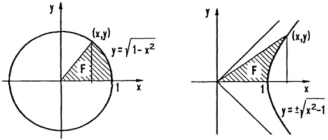

6. Eine zweistufige Rakete für kleine Satelliten hat die Kenndaten:

|  | Leermasse | Treibstoffmasse | Verbrauch | Schubkraft F |
| --- | --- | --- | --- | --- |
| 1. Stufe | 5000kg | 125000kg | 1000kg/s | $2.45 \cdot 10^{6}$ N |
| 2. Stufe | 2000kg | 16000kg | 80kg/s | $2.48 \cdot 10^{5}$ N |

Die Rakete wird vertikal gestartet; ist der Treibstoff der 1. Stufe verbraucht, so wird deren Hülle abgestoßen. Setzt man vereinfachend $g = 9,81 \, \text{m/s}^2$ (unabhängig von der Höhe) für den Flug konstant, so gilt für die Beschleunigung der Rakete

$$
\ddot {h} (t) = \dot {v} (t) = b (t) = \frac {F}{m (t)} - g.
$$

a) Bestimme die Funktion  $m(t)$  (= Gesamtmasse zur Zeit t).
b) Welche Geschwindigkeit v hat die Rakete 125 s bzw. 325 s nach dem Start?
c) Welche Höhe h wird nach 125s bzw. 325s erreicht?
d) Skizziere  $m(t)$ ,  $b(t)$ ,  $v(t)$  und  $h(t)$  für  $0 \leq t \leq 325$  s.

7. Mittels partieller Integration rechne man für die LEGENDRE-Polynome (→ Kap. 2, §2, Aufg. 11, Kap. 3, §1, Aufg. 5)

$$
P _ {n} (x) = \frac {1}{2 ^ {n} n !} \frac {d ^ {n}}{d x ^ {n}} (x ^ {2} - 1) ^ {n}, \quad n = 0, 1, 2, \dots
$$

die Orthogonalitätsrelation nach

$$
\int_ {- 1} ^ {1} P _ {n} (x) P _ {m} (x) d x = \left\{ \begin{array}{c l} 0 & , n \neq m \\ \frac {2}{2 n + 1} & , n = m \end{array} \right..
$$

8. Für einen Wechselstrom  $J(t)$  mit der Periode T definiert man drei Mittelwerte:

$$
\begin{array}{l} \text {Effektivwert} \quad J _ {\text {eff}} := \left(\frac {1}{T} \int_ {0} ^ {T} J ^ {2} (t) d t\right) ^ {1 / 2} \\ \text {Integralmittel} \quad \bar {J} := \frac {1}{T} \int_ {0} ^ {T} J (t) d t \\ \text {Gleichrichtwert} \quad | \bar {J} | := \frac {1}{T} \int_ {0} ^ {T} | J (t) |   d t . \\ \end{array}
$$

Berechne die drei Mittelwerte

---

§3. Die Integration der rationalen Funktionen

179

a) für den sinusförmigen Strom  $J(t) = J_{0} \sin \frac{2\pi t}{T}$ ,
b) für den „Sägezahn“-Strom:
c) für den „Batterie-Ladestrom“

$$
J (t) = \max \{0, \frac {1}{R} (| U _ {0} \sin \frac {2 \pi t}{T} | - U _ {B}) \}
$$

mit $U_{B} = 14\mathrm{V}$ ， $U_{0} = 20\mathrm{V}$ ， $R = 0.5\Omega$

und  $\frac{1}{T}=50hz$ .

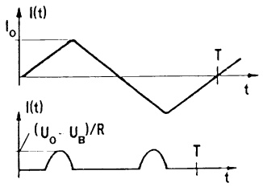

<details>
<summary>line</summary>

| Time (t) | Current I(t) | Signal (Uo - UB)/R |
| --- | --- | --- |
| 0 | 0 | 0 |
| Peak | Io | — |
| Trough | — | — |
| End | 0 | — |
</details>

9. a) Mit der Substitution  $\cos x = \cos^{2}\varphi$  bestätige man

$$
\int_ {0} ^ {\pi / 2} \frac {d x}{\sqrt {\cos x}} = \sqrt {2} F (\frac {\pi}{2}, \sqrt {1 / 2}).
$$

b) Man substituiere  $\sin t = \cos^{2}\psi$  und zeige

$$
\int_ {0} ^ {x} \sqrt {\sin t} d t = 2 \sqrt {2} \Big (E (\frac {\pi}{2}, k) - E (\varphi , k) \Big) - \sqrt {2} \Big (F (\frac {\pi}{2}, k) - F (\varphi , k) \Big)
$$

mit $k^2 = \frac{1}{2}$, $\sin x = \cos^2\varphi$.

c) Man substituiere  $x = \sin t$  und bestätige

$$
\int_ {0} ^ {1} \frac {d x}{\sqrt {1 - x ^ {2}} \sqrt {1 - k ^ {2} x ^ {2}}} = F (\frac {\pi}{2}, k) \quad 0 \leq k ^ {2} <   1.
$$

## §3. Die Integration der rationalen Funktionen

3.1 Die Partialbruchzerlegung. Für die Integration einer echt gebrochen rationalen Funktion ist deren Zerlegung in eine Summe sogenannter Partialbrüche (oder Stammbrüche) wichtig. Wir gehen aus von einer rationalen Funktion  $f(x) = \frac{p(x)}{q(x)}$  mit Polynomen  $p(x), q(x)$  ohne gemeinsamen Polynomfaktor ( $\rightarrow$  Kap. 2, §2), Grad  $p(x) < \text{Grad } q(x)$ , und erstellen die Partialbruchzerlegung wie folgt:

1. Schritt: Die Produktdarstellung von  $q(x)$  herstellen.

$$
q (x) = c (x - b _ {1}) ^ {k _ {1}} (x - b _ {2}) ^ {k _ {2}} \dots (x - b _ {r}) ^ {k _ {r}} q _ {1} (x) ^ {l _ {1}} \dots q _ {s} (x) ^ {l _ {s}}
$$

mit den paarweise verschiedenen reellen Nullstellen $b_i$ der Vielfachheit $k_i$ und verschieden quadratischen Polynomen $q_j(x)$, die in $\mathbb{R}$ keine Nullstelle besitzen ($\rightarrow$ Kap. 2, Satz 2.3).

2. Schritt : Der Partialbruchansatz.

Die zu jedem Linearfaktor $x-b$ von $q(x)$ ($b\in\{b_{1},\ldots,b_{r}\}$) der Vielfachheit $k$ und zu jedem quadratischen Faktor $Q\in\{q_{1},\ldots,q_{s}\}$ der Vielfachheit $l$ gebilde-

---

180

4. Integration

ten Funktionen der Form

$$
\frac {A _ {1}}{x - b}, \quad \frac {A _ {2}}{(x - b) ^ {2}}, \dots , \quad \frac {A _ {k}}{(x - b) ^ {k}},
$$

$$
\frac {B _ {1} x + C _ {1}}{Q (x)}, \quad \frac {B _ {2} x + C _ {2}}{Q (x) ^ {2}}, \dots , \quad \frac {B _ {l} x + C _ {l}}{Q (x) ^ {l}}
$$

(mit Koeffizienten $A_i, B_j, C_j \in \mathbb{R}$) nennt man Partialbrüche von $\frac{p(x)}{q(x)}$. Im Partialbruchansatz wird nun $\frac{p(x)}{q(x)}$ als Summe all dieser Partialbrüche mit noch unbekannten Koeffizienten $A_i, B_j, C_j$ dargestellt. (Die Existenz der Partialbruchzerlegung wird mit Mitteln der Funktionentheorie gezeigt werden, $\rightarrow$ Bd. 2.)

3. Schritt: Koeffizientenberechnung (Einsetzmethode, Koeffizientenvergleich). Man multipliziert die Ansatzgleichung mit  $q(x)$  und erhält auf beiden Seiten ein Polynom. Nun ergeben sich Bestimmungsgleichungen für die Unbekannten  $A_{i}, B_{j}, C_{j}, \ldots$  des Partialbruchansatzes durch Gleichsetzen der Koeffizienten entsprechender x-Potenzen links und rechts ( $\rightarrow$  Kap. 2, Satz 2.1) oder durch Einsetzen spezieller x-Werte (etwa  $x = b_{1}, b_{2}, \ldots$ ).

Beispiel 1. Für $f(x) = \frac{x^2 + x + 1}{(x - 1)^3(x - 2)}$ lautet der Partialbruchansatz

$$
f (x) = \frac {A _ {1}}{x - 1} + \frac {A _ {2}}{(x - 1) ^ {2}} + \frac {A _ {3}}{(x - 1) ^ {3}} + \frac {B}{x - 2}
$$

(jeweils nur bis zu der Potenz, mit welcher der entsprechende Faktor im Nenner vorkommt). Multiplikation mit dem Nennerpolynom  $(x-1)^{3}(x-2)$  führt auf

$$
x ^ {2} + x + 1 = A _ {1} (x - 1) ^ {2} (x - 2) + A _ {2} (x - 1) (x - 2) + A _ {3} (x - 2) + B (x - 1) ^ {3}.
$$

Einsetzmethode: Die speziellen Werte $x = 1$, $x = 2$, $x = 3$, $x = 0$ ergeben die Bestimmungsgleichungen $3 = -A_{3}$, $7 = B$, $13 = 4A_{1} + 2A_{2} + A_{3} + 8B$, $1 = -2A_{1} + 2A_{2} - 2A_{3} - B$. Daraus folgt $A_{1} = -7$, $A_{2} = -6$, $A_{3} = -3$, $B = 7$,

$$
\frac {x ^ {2} + x + 1}{(x - 1) ^ {3} (x - 2)} = - \frac {7}{x - 1} - \frac {6}{(x - 1) ^ {2}} - \frac {3}{(x - 1) ^ {3}} + \frac {7}{x - 2}.
$$

Koeffizientenvergleich: Zuerst wird die rechte Seite obiger Gleichung nach fallenden x-Potenzen geordnet.

$$
\begin{array}{l} x ^ {2} + x + 1 = (A _ {1} + B) x ^ {3} + (- 4 A _ {1} + A _ {2} - 3 B) x ^ {2} + (5 A _ {1} - 3 A _ {2} + A _ {3} + 3 B) x \\ + (- 2 A _ {1} + 2 A _ {2} - 2 A _ {3} - B). \\ \end{array}
$$

Der Koeffizientenvergleich ergibt $A_1 + B = 0$, $-4A_1 + A_2 - 3B = 1$, $5A_1 - 3A_2 + A_3 + 3B = 1$, $-2A_1 + 2A_2 - 2A_3 - B = 1$.

Beispiel 2. Der Partialbruchansatz für

$$
f (x) = \frac {x + 1}{(x - 1) ^ {2} (x ^ {2} + 1) ^ {3}}
$$

---

§3. Die Integration der rationalen Funktionen

181

lautet

$$
f (x) = \frac {A _ {1}}{x - 1} + \frac {A _ {2}}{(x - 1) ^ {2}} + \frac {B _ {1} x + C _ {1}}{x ^ {2} + 1} + \frac {B _ {2} x + C _ {2}}{(x ^ {2} + 1) ^ {2}} + \frac {B _ {3} x + C _ {3}}{(x ^ {2} + 1) ^ {3}}.
$$

Nach Multiplikation mit dem Nennerpolynom  $(x-1)^{2}(x^{2}+1)^{3}$  entsteht die Polynomgleichung

$$
\begin{array}{l} x + 1 = A _ {1} (x - 1) (x ^ {2} + 1) ^ {3} + A _ {2} (x ^ {2} + 1) ^ {3} + (B _ {1} x + C _ {1}) (x - 1) ^ {2} (x ^ {2} + 1) ^ {2} \\ + (B _ {2} x + C _ {2}) (x - 1) ^ {2} (x ^ {2} + 1) + (B _ {3} x + C _ {3}) (x - 1) ^ {2}, \\ \end{array}
$$

aus der man durch Einsetzen spezieller x-Werte ( $x = 1, 2, 0, \ldots$ ) oder über einen Koeffizientenvergleich die  $A_{i}, B_{j}, C_{j}$  bestimmt. Man erhält

$$
\frac {x + 1}{(x - 1) ^ {2} (x ^ {2} + 1) ^ {3}} = \frac {1}{8} \left(\frac {2}{(x - 1) ^ {2}} - \frac {5}{x - 1} + \frac {5 x + 3}{x ^ {2} + 1} + \frac {6 x + 2}{(x ^ {2} + 1) ^ {2}} + \frac {4 x - 4}{(x ^ {2} + 1) ^ {3}}\right). \text {口}
$$

Bemerkung: Häufig führt eine Kombination aus Einsetzmethode und Koeffizientenvergleich am schnellsten zum Ziel.

3.2 Die Integration einer gebrochen rationalen Funktion  $R(x)$  geschieht in mehreren Schritten:

1. Schritt: Mittels Polynomdivision (→ Kap. 2, §2) wird $R(x)$ dargestellt in der Form

$$
R (x) - g (x) + \frac {p (x)}{q (x)}
$$

mit dem ganzen Polynomanteil $g(x)$, den Polynomen $p(x), q(x)$ ohne gemeinsamen Polynomfaktor und Grad $p(x) < \text{Grad } q(x)$.

Falls p = 0, kann sofort integriert werden, sonst geht es weiter mit dem

2. Schritt: Die Partialbruchzerlegung von $\frac{p(x)}{q(x)}$ erstellen ($\rightarrow 3.1$).

3. Schritt: Die Integration des ganzen Anteils  $g(x)$  (mühelos, → 2.1) und der Partialbrüche; dieses geschieht mit den folgenden Formeln, die man durch Differenzieren bestätigen kann.

$$
\int \frac {d x}{x - a} = \ln | x - a | + c \tag {1}
$$

$$
\int \frac {d x}{(x - a) ^ {k}} = - \frac {1}{k - 1} \frac {1}{(x - a) ^ {k - 1}} + c \quad (k > 1). \tag {2}
$$

In den Formeln (3)-(6) wird  $p^{2}-4q<0$ , in (5) und (6) k>1 vorausgesetzt.

$$
\int \frac {d x}{x ^ {2} + p x + q} = \frac {2}{\sqrt {4 q - p ^ {2}}} \arctan \frac {2 x + p}{\sqrt {4 q - p ^ {2}}} + c \tag {3}
$$

$$
\int \frac {a x + b}{x ^ {2} + p x + q} d x = \frac {a}{2} \ln | x ^ {2} + p x + q | + (b - \frac {a p}{2}) \int \frac {d x}{x ^ {2} + p x + q} \tag {4}
$$

$$
\begin{array}{l} \int \frac {d x}{(x ^ {2} + p x + q) ^ {k}} = \frac {2 x + p}{(k - 1) (4 q - p ^ {2}) (x ^ {2} + p x + q) ^ {k - 1}} \tag {5} \\ + \frac {2 (2 k - 3)}{(k - 1) (4 q - p ^ {2})} \int \frac {d x}{(x ^ {2} + p x + q) ^ {k - 1}} \\ \end{array}
$$

---

182

4. Integration

$$
\int \frac {a x + b}{(x ^ {2} + p x + q) ^ {k}} d x = - \frac {a}{2 (k - 1) (x ^ {2} + p x + q) ^ {k - 1}} \tag {6}
$$

$$
+ (b - \frac {a p}{2}) \int \frac {d x}{(x ^ {2} + p x + q) ^ {k}}.
$$

Die Rekursionsformel (5) ist gegebenenfalls mehrfach anzuwenden, bis das quadratische Polynom im Nenner nur noch einfach vorkommt.

4. Schritt: Das Integral $\int R(x)dx$ als Summe der Teilintegrale darstellen.

## Beispiel.

$$
R (x) = \frac {3 x ^ {5} - 2 x ^ {4} + 4 x ^ {3} + 4 x ^ {2} - 7 x + 6}{(x - 1) ^ {2} (x ^ {2} + 1) ^ {2}}
$$

1. Schritt entfällt, da Zählergrad <Nennergrad und weder x - 1 noch  $x^{2} + 1$  gekürzt werden kann.

2. Schritt: Die Partialbruchzerlegung ergibt

$$
R (x) = \frac {1}{x - 1} + \frac {2}{(x - 1) ^ {2}} + \frac {2 x + 1}{x ^ {2} + 1} + \frac {4}{(x ^ {2} + 1) ^ {2}}.
$$

3. Schritt: Die Integration der Partialbrüche.

$$
\int \frac {d x}{x - 1} = \ln | x - 1 | + c,
$$

$$
\int \frac {2 d x}{(x - 1) ^ {2}} = - \frac {2}{x - 1} + c,
$$

$$
\int \frac {2 x + 1}{x ^ {2} + 1} d x = \int \frac {2 x}{x ^ {2} + 1} d x + \int \frac {d x}{x ^ {2} + 1} = \ln | x ^ {2} + 1 | + \arctan x + c,
$$

$$
\int \frac {4 d x}{(x ^ {2} + 1) ^ {2}} = \frac {2 x}{x ^ {2} + 1} + 2 \int \frac {d x}{x ^ {2} + 1} = \frac {2 x}{x ^ {2} + 1} + 2 \arctan x + c.
$$

4. Schritt :

$$
\int R (x) d x = - \frac {2}{x - 1} + \frac {2 x}{x ^ {2} + 1} + \ln | x - 1 | + \ln | x ^ {2} + 1 | + 3 \arctan x + c.
$$

Ein 5. Schritt, zur Probe die rechte Seite zu differenzieren, beruhigt das Gemüt!

□

Ergänzung: Im folgenden geben wir einige weitere Funktionstypen an, deren Integration mit einer passenden Substitution ebenfalls auf diesem Wege durchführbar ist.

3.3 Die Integration von $R(e^x)$. In einem Integral der Form $\int R(e^{ax}) dx$ mit einer rationalen Funktion $R$ führt die Substitution $e^{ax} = t$, d.h. $x = \frac{1}{a} \ln t$, $dx = \frac{1}{at} dt$, auf $\int R(e^{ax}) dx = \int R(t) \frac{1}{at} dt$.

---

§3. Die Integration der rationalen Funktionen

183

Beispiel.

$$
\int \frac {d x}{e ^ {x} + e ^ {- x}} = \int \frac {1}{t + \frac {1}{t}} \frac {1}{t} d t = \arctan t + c = \arctan e ^ {x} + c.
$$

3.4 Die Integration von $R\left(x, \sqrt[k]{\frac{ax + b}{cx + e}}\right)$, $ae - bc \neq 0$. Mit $R(x, y)$ soll ein rationaler Ausdruck in $x$ und $y$ bezeichnet werden; d.h. $R(x, y)$ entsteht aus $x, y$ und Konstanten allein durch Addition, Subtraktion, Multiplikation und Division. $R(x, f(x))$ bedeutet, daß $y$ in $R(x, y)$ durch $f(x)$ ersetzt wurde.

Ein Integral vom Typ $\int R\left(x, \sqrt[k]{\frac{ax + b}{cx + e}}\right) dx$ (mit $ae - bc \neq 0$) wird mit der Substitution $t = \sqrt[k]{\frac{ax + b}{cx + e}}$, d.h. $x = \frac{et^k - b}{a - ct^k}$, $dx = k(ae - bc)\frac{t^{k-1}}{(a - ct^k)^2} dt$, zum Integral einer in $t$ rationalen Funktion.

Beispiel.

$$
\begin{array}{l} \int \frac {1 - \sqrt {x}}{x + \sqrt {x}} d x = \int \frac {1 - t}{t ^ {2} + t} 2 t d t = 2 \int \frac {1 - t}{1 + t} d t \\ = 4 \ln | t + 1 | - 2 t + c = 4 \ln (\sqrt {x} + 1) - 2 \sqrt {x} + c. \\ \end{array}
$$

3.5 Die Integration von  $R(\sin x, \cos x)$  mit rationalem Ausdruck  $R(x, y)$  wird über die Substitution

$$
x = 2 \arctan t, \quad d x = \frac {2}{1 + t ^ {2}} d t \quad \text {und daraus folgend}
$$

$$
\sin x = \frac {2 t}{1 + t ^ {2}}, \quad \cos x = \frac {1 - t ^ {2}}{1 + t ^ {2}} \quad (- \pi <   x <   \pi),
$$

ebenfalls auf die Integration einer rationalen Funktion zurückgeführt.

Beispiel.

$$
\int \frac {d x}{\cos x} = \int \frac {1 + t ^ {2}}{1 - t ^ {2}} \frac {2 d t}{1 + t ^ {2}} = \ln \left| \frac {1 + t}{1 - t} \right| + c = \ln \left| \frac {1 + \tan \frac {x}{2}}{1 - \tan \frac {x}{2}} \right| + c.
$$

3.6 Trigonometrische und hyperbolische Substitutionen. Integrale der Form $\int R(x, \sqrt{ax^2 + bx + c}) dx$, $a \neq 0$, lassen sich mit einer linearen Substitution $u = \alpha x + \beta$, $dx = \frac{1}{\alpha} du$ in eine der folgenden Normalformen umwandeln.

$$
\int R (u, \sqrt {u ^ {2} + 1}) d u, \quad \int R (u, \sqrt {u ^ {2} - 1}) d u, \quad \int R (u, \sqrt {1 - u ^ {2}}) d u
$$

Die Substitution  $u = \sinh t$ , bzw.  $u = \cosh t$ , bzw.  $u = \sin t$  führt weiter auf Integrale des in 3.3 und 3.5 behandelten Typs.

---

184

4. Integration

## Beispiel.

$$
\begin{array}{l} \int \sqrt {4 x ^ {2} + 1 2 x + 5} d x = 2 \int \sqrt {\left(\frac {2 x + 3}{2}\right) ^ {2} - 1} d x \\ = 2 \int \sqrt {u ^ {2} - 1} d u; \quad u = \frac {2 x + 3}{2} = \cosh t, d u = \sinh t d t \\ = u \sqrt {u ^ {2} - 1} - \ln (u + \sqrt {u ^ {2} - 1}) + c \\ = \frac {2 x + 3}{2} \sqrt {\left(\frac {2 x + 3}{2}\right) ^ {2} - 1} - \ln \left[ \frac {2 x + 3}{2} + \sqrt {\left(\frac {2 x + 3}{2}\right) ^ {2} - 1} \right] + c. \\ \end{array}
$$


## Aufgaben

1. Man berechne die Integrale

$$
\begin{array}{l} \int \frac {x ^ {2} - 2 x + 3}{x ^ {2} - 3 x + 2} d x, \quad \int \frac {x + 1}{x ^ {3} + x ^ {2} + x} d x, \quad \int \frac {1 2 x ^ {5}}{(1 + x ^ {4}) ^ {2}} d x, \\ \int \frac {x ^ {4} - 5 x ^ {3} - 3 0 x ^ {2} - 3 6 x}{(x + 1) ^ {3} (x ^ {2} - 4)} d x, \quad \int \frac {x ^ {4} + 3 x ^ {2} + x + 1}{(x + 1) (x ^ {2} + 1) ^ {2}} d x. \\ \end{array}
$$

2. Man berechne

$$
\begin{array}{l} \int \frac {d x}{\cosh x + 1}, \quad \int \frac {3 e ^ {x} + 4 e ^ {- x} + 2}{1 - e ^ {2 x}} d x, \\ \int_ {0} ^ {\pi} \frac {d x}{1 + \sin x}, \quad \int \frac {d x}{3 \sin x + 4 \cos x}, \\ \int \frac {x}{(x ^ {4} - 2 x ^ {2} + 2) \arctan (x ^ {2} - 1)} d x \quad (\text {Subst.} y = x ^ {2} - 1). \\ \end{array}
$$

3. Für das Integral $\int \frac{x^4}{x + \sqrt{x^2 - 1}} dx$ gibt es mindestens 8 verschiedene Lösungswege. Man suche möglichst viele davon.

4. Man berechne durch die angegebene Substitution

$$
\int \sqrt {\tan x} d x \qquad (t = \tan x),
$$

$$
\int \frac {\cos x + \sin x}{\sqrt {\sin 2 x}} d x \quad (t = \frac {\pi}{4} - x).
$$

5. Man zeige: Gilt $q(x) = (x - x_1) \cdots (x - x_n)$ mit $x_i \neq x_j$ für $i \neq j$ und ist zusätzlich Grad $p < \text{Grad } q$, dann lautet die Partialbruchzerlegung

$$
\frac {p (x)}{q (x)} = \sum_ {i = 1} ^ {n} \frac {p (x _ {i})}{q ^ {\prime} (x _ {i})} \frac {1}{x - x _ {i}}.
$$

---

§4. Uneigentliche Integrale

185

## §4. Uneigentliche Integrale

4.1 Die Definition der uneigentlichen Integrale. Die Funktion $f$ sei auf dem rechts offenen Intervall $a \leq x < b$ erklärt und auf jedem abgeschlossenen Teilintervall $[a, c]$, $c < b$, stückweise stetig, $b \in \mathbb{R} \cup \{\infty\}$. Durch die Definition

$$
\boxed {\int_ {a} ^ {b} f (x) d x := \lim _ {c \rightarrow b -} \int_ {a} ^ {c} f (x) d x, \quad b z w. \int_ {a} ^ {\infty} f (x) d x := \lim _ {c \rightarrow \infty} \int_ {a} ^ {c} f (x) d x} \tag {1}
$$

wird der Integralbegriff erweitert auf

a) Integranden  $f(x)$ , die bei der Annäherung  $x \rightarrow b-$  nicht beschränkt sind;
b) unbeschränkte Integrationsintervalle  $[a,\infty)$ .

In diesen beiden Fällen nennt man die in (1) definierten Integrale uneigentlich (uneigentlich an der oberen Grenze). Bei entsprechenden Verhältnissen sind die an der unteren Grenze uneigentlichen Integrale definiert durch

$$
\int_ {a} ^ {b} f (x) d x := \lim _ {c \to a +} \int_ {c} ^ {b} f (x) d x; \quad \int_ {- \infty} ^ {b} f (x) d x := \lim _ {c \to - \infty} \int_ {c} ^ {b} f (x) d x.
$$

Soll betont werden, daß keine Ausnahmesituation vorliegt, dann nennt man die bisher betrachteten bestimmten Integrale eigentlich. Man sagt, ein uneigentliches Integral konvergiert (bzw. divergiert), wenn der zugehörige Grenzwert existiert (bzw. nicht existiert).

## Beispiel 1.

$$
\int_ {1} ^ {\infty} \frac {d x}{x} = \lim _ {c \to \infty} \int_ {1} ^ {c} \frac {d x}{x} = \lim _ {c \to \infty} \ln c = \infty \quad (\text {divergiert}),
$$

$$
\int_ {0} ^ {1} \frac {d x}{x} = \lim _ {c \to 0 +} \int_ {c} ^ {1} \frac {d x}{x} = \lim _ {c \to 0 +} (- \ln c) = \infty \quad (\text {divergiert}).
$$

Beispiel 2. Sei $\alpha \in \mathbb{R}$, $\alpha \neq 1$.

$$
\int_ {1} ^ {\infty} \frac {d x}{x ^ {\alpha}} = \lim _ {c \to \infty} \frac {1}{\alpha - 1} \left[ 1 - \frac {1}{c ^ {\alpha - 1}} \right] = \left\{ \begin{array}{l l} \frac {1}{\alpha - 1}, & \text {falls} \alpha > 1 \quad (\text {konvergiert}) \\ \infty , & \text {falls} \alpha <   1 \quad (\text {divergiert}) \end{array} , \right.
$$

$$
\int_ {0} ^ {1} \frac {d x}{x ^ {\alpha}} = \lim _ {c \to 0 +} \frac {1}{\alpha - 1} \left[ \frac {1}{c ^ {\alpha - 1}} - 1 \right] = \left\{ \begin{array}{c l l} \infty , & \text {falls} \alpha > 1 & (\text {divergiert}) \\ \frac {1}{1 - \alpha}, & \text {falls} \alpha <   1 & (\text {konvergiert}) \end{array} . \right.
$$

---

186

4. Integration

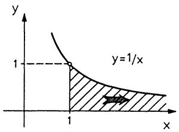

<details>
<summary>text_image</summary>

y
1
y=1/x
1
x
</details>

Abb. 105a - $\int_{1}^{\infty}\frac{dx}{x} = \infty$

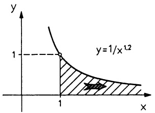

<details>
<summary>text_image</summary>

y
1
y=1/x^{1.2}
1
x
</details>

Abb. 105b - $\int_{1}^{\infty}\frac{dx}{x^{1.2}} = 5$

Beispiel 3. $\int_{0}^{\infty}\cos x dx = \lim_{c\to \infty}\sin c$ divergiert.

4.2 Ein Konvergenz-Test. Aufgrund der klaren Verhältnisse bei der Funktion  $f(x) = \frac{1}{x^{\alpha}}$  (bei festem  $\alpha > 0, \rightarrow$  Beispiele 1 u. 2) wird sie gerne als Vergleichs-funktion gewählt.

## Satz 4.1. Vergleichskriterium.

Ist f auf  $[a,\infty)$  und g auf  $(0,b]$  stetig und sind  $\alpha,K\in R$ , dann gilt:

$$
| f (x) | \leq K \frac {1}{x ^ {\alpha}}, a \leq x <   \infty , 1 <   \alpha \quad \Rightarrow \quad \int_ {a} ^ {\infty} f (x) d x k o n v e r g i e r t,
$$

$$
| g (x) | \leq K \frac {1}{x ^ {\alpha}}, 0 <   x \leq b, 0 <   \alpha <   1 \Rightarrow \int_ {0} ^ {b} g (x) d x \text {konvergiert.}
$$

Beweis. Die monoton wachsende Funktion $F(c) := \int_{a}^{c} |f(x)| dx$ ist nach oben durch $K \int_{a}^{\infty} \frac{1}{x^{\alpha}} dx$ beschränkt und hat deshalb für $c \to \infty$ einen Grenzwert ($\to$ Kap. 2, 5.4 Monotoniekriterium).

Anschaulich: Nach der Voraussetzung liegt der Graph $y = |f(x)|$ zwischen den beiden Kurven $y = 0$ und $y = \frac{K}{x^{\alpha}}$ ($x \geq a$). Laut Beispiel 2 ist der gesamte Flächeninhalt zwischen diesen Kurven endlich. Also ist auch die schraffierte Fläche endlich, $\int_{a}^{\infty}|f(x)| dx < \infty$.

Dieselben Überlegungen mit  $f(x) + |f(x)|$  anstelle von  $|f(x)|$  zeigen, daß  $\int_{a}^{\infty}(f(x) + |f(x)|)dx$  konvergiert. Deshalb konvergiert schließlich

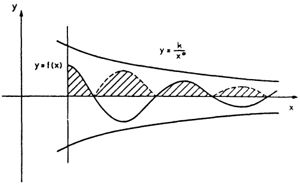

<details>
<summary>text_image</summary>

y
y = f(x)
y = k/x^∞
x
</details>

Abb. 106 - Vergleichskriterium

$\int_{a}^{\infty}f(x)dx = \int_{a}^{\infty}(f(x) + |f(x)|)dx - \int_{a}^{\infty}|f(x)|dx$ . Teil b) wird analog bewiesen. □

---

§4. Uneigentliche Integrale

187

Beispiel.  $\int_{0}^{\infty}\frac{\sin x}{x}dx$ . Zunächst einmal, wegen  $\lim_{x\to0}\frac{\sin x}{x}=1$  ist der Integrand bei x=0 durch 1 zu ersetzen. Das Integral ist an der unteren Grenze eigentlich. Mit  $\int_{0}^{c}f(x)dx=\int_{0}^{1}f(x)dx+\int_{1}^{c}f(x)dx$  braucht nur die Konvergenz des zweiten Summanden gezeigt zu werden.

Mit partieller Integration erhält man  $\int_{1}^{c}\frac{1}{x}\sin x dx = -\frac{1}{x}\cos x\bigg|_{1}^{c} - \int_{1}^{c}\frac{\cos x}{x^{2}} dx$ . Mit  $c \to \infty$  strebt der erste Summand gegen  $\cos 1$ ; für den zweiten Summanden liefert das Vergleichskriterium die Konvergenz.

Also konvergiert $\int_{0}^{\mathcal{L}}\frac{\sin x}{x} dx$ . Es gilt $\int_{0}^{\mathcal{L}}\frac{\sin x}{x} dx = \frac{\pi}{2}$ ($\rightarrow$ Band 2).

4.3 Ein an beiden Grenzen uneigentliches Integral ist wie folgt definiert:

$$
\begin{array}{l} \int_ {a} ^ {b} f (x) d x := \int_ {a} ^ {c} f (x) d x + \int_ {c} ^ {b} f (x) d x \quad (\text {mit} a <   c <   b) \\ = \lim _ {u \to a +} \int_ {u} ^ {c} f (x) d x + \lim _ {v \to b -} \int_ {c} ^ {v} f (x) d x. \\ \end{array}
$$

Im Fall  $a = -\infty$ ,  $b = \infty$  bedeutet das

$$
\begin{array}{l} \int_ {- \mathcal {L}} ^ {\mathcal {L}} f (x) d x := \int_ {- \mathcal {L}} ^ {\mathcal {C}} f (x) d x + \int_ {c} ^ {\mathcal {L}} f (x) d x \\ = \lim _ {u \to - \mathscr {X}} \int_ {u} ^ {c} f (x) d x + \lim _ {v \to \mathscr {X}} \int_ {c} ^ {v} f (x) d x. \\ \end{array}
$$

Es wird ausdrücklich darauf hingewiesen, daß auf der rechten Seite die beiden Grenzwerte unabhängig voneinander zu bestimmen sind; nur wenn beide Grenzwerte existieren, dann konvergiert  $\int_{a}^{b} f(x) dx$  bzw.  $\int_{-\mathcal{L}}^{\mathcal{L}} f(x) dx$ .

## Beispiel 1.

$$
\begin{array}{l} \int_ {- \infty} ^ {\infty} \frac {d x}{1 + x ^ {2}} = \int_ {- \infty} ^ {0} \frac {d x}{1 + x ^ {2}} + \int_ {0} ^ {\infty} \frac {d x}{1 + x ^ {2}} = 2 \int_ {0} ^ {\infty} \frac {d x}{1 + x ^ {2}} \\ = 2 \lim _ {v \to \infty} \arctan v = \pi . \\ \end{array}
$$

Beispiel 2. Die Energiedichte $U_{\mathrm{v}}$ einer monochromatischen Strahlung eines schwarzen Körpers der (absoluten) Temperatur $T$ wird nach dem Strahlungsgesetz von M. PLANCK berechnet:

$$
U _ {v} = \frac {8 \pi h}{c ^ {2}} \frac {v ^ {3}}{e ^ {\frac {h v}{k T}} - 1}
$$

(mit der Lichtgeschwindigkeit c, den Konstanten h und k). Die Integration

---

188

4. Integration

über alle Frequenzen ergibt die gesamte Energiedichte

$$
U = \int_ {0} ^ {\infty} U _ {v} d v = \frac {8 \pi}{c ^ {2}} \frac {k ^ {4} T ^ {4}}{h ^ {3}} \int_ {0} ^ {\infty} \frac {x ^ {3}}{e ^ {x} - 1} d x \quad (x = \frac {h v}{k T}).
$$

Das an beiden Grenzen uneigentliche Integral ist konvergent, da die beiden Teil-integrale nach Satz 4.1 konvergieren. Mit einer Potenzreihenentwicklung erhält man den Wert:

$$
\int_ {0} ^ {\infty} \frac {x ^ {3}}{e ^ {x} - 1} d x = \frac {\pi^ {4}}{1 5}
$$

(→ Kap. 5, §5, Aufg. 9). Insbesondere folgt damit das $T^4$-Gesetz von J. STEFAN und L. BOLTZMANN: $U = aT^4$ (mit einer Konstanten $a$).

Beispiel 3. Die Gamma-Funktion. Zu den besonders wichtigen „höheren“ Funktionen gehört die Gamma-Funktion

$$
\Gamma : (0, \infty) \to \mathbb {R}, \Gamma (x) := \int_ {0} ^ {\infty} e ^ {- t} t ^ {x - 1} d t.
$$

Dieses ist ein an beiden Grenzen uneigentliches Integral, dessen Konvergenz wie folgt nachgewiesen wird:

a) Das Integral $\int_{0}^{1} e^{-t} t^{x-1} dt$ ist an der unteren Grenze nur uneigentlich für $0 < x < 1$. In diesem Fall garantiert wegen $e^{-t} t^{x-1} \leq t^{x-1} = t^{-\alpha}$, $\alpha := 1 - x < 1$, das Vergleichskriterium ($\rightarrow$ Satz 4.1) die Konvergenz.
b) Die Konvergenz von $\int_{1}^{\infty} e^{-t} t^{x-1} dt$ folgt ebenfalls aus Satz 4.1, da wegen $\frac{t^2 t^{x-2}}{e^t} \to 0$ mit $t \to \infty$, ($\rightarrow$ Kap. 3, §4(4)) für alle hinreichend großen $t$ die Abschätzung $e^{-t} t^{x-2} \leq t^{-2}$ gilt.

Mit partieller Integration ($u' = e^{-t}$, $v = t^{x-1}$) bestätigt man leicht die Funktionalgleichung der Gamma-Funktion.

$$
\Gamma (x + 1) = x \Gamma (x) \quad (x > 0),
$$

aus der mit $\Gamma(1) = \int_{0}^{\infty} e^{-t} dt = 1$ speziell

$$
\Gamma (n + 1) = n \Gamma (n) = n (n - 1) \Gamma (n - 1) = \dots = n! \Gamma (1) = n!
$$

für alle  $n \in N$  folgt.

4.4 Ausnahmestellen im Innern des Integrationsintervalls. Besitzt der In- tegrand im Innern des Definitionsintervalls endlich viele Ausnahmestellen  $a = x_{0} < x_{1} < \cdots < x_{n-1} < x_{n} = b$  (Unstetigkeitsstellen oder Lücken), dann setzt

---

§4. Uneigentliche Integrale

189

man

$$
\int_ {a} ^ {b} f (x) d x := \sum_ {i = 1} ^ {n} \int_ {x _ {i - 1}} ^ {x _ {i}} f (x) d x,
$$

wobei die Summanden der rechten Seite eigentliche oder uneigentliche Integrale der zuvor behandelten Art sind.

Gelegentlich arbeitet man auch mit dem Cauchyschen Hauptwert

$$
C H W \int_ {a} ^ {b} f (x) d x := \lim _ {\varepsilon \to 0 +} \left(\int_ {a} ^ {c - \varepsilon} f (x) d x + \int_ {c + \varepsilon} ^ {b} f (x) d x\right),
$$

wenn $f$ nur in $c$ eine Ausnahmestelle (Singularität) hat. Es ist durchaus möglich, daß das uneigentliche Integral $\int_{a}^{b} f(x) dx = \int_{a}^{c} f(x) dx + \int_{c}^{b} f(x) dx$ nicht konvergiert, dagegen der $CHW$ existiert.

Beispiel.  $\int_{0}^{3}\frac{dx}{x-1}=\int_{0}^{1}\frac{dx}{x-1}+\int_{1}^{3}\frac{dx}{x-1}$  konvergiert nicht, dagegen ergibt sich für den  $CHW\int_{0}^{3}\frac{dx}{x-1}=\lim_{\varepsilon\to0+}(\ln\varepsilon+\ln2-\ln\varepsilon)=\ln2$ . ☐

## Aufgaben

1. Man untersuche, ob folgende Integrale eigentlich oder uneigentlich sind, teile falls nötig den Integrationbereich auf, teste auf Konvergenz und berechne ihren Wert, falls möglich:

$$
\begin{array}{l} \int_ {0} ^ {\infty} x e ^ {- x ^ {2}} d x, \quad \int_ {0} ^ {2} \frac {2 x d x}{(x ^ {2} - 1) ^ {2}}, \quad \int_ {0} ^ {\infty} \frac {\sin^ {2} x}{x} d x, \\ \int_ {0} ^ {\infty} x ^ {n} e ^ {- x} d x, \quad \int_ {2} ^ {\infty} \frac {x d x}{\sqrt {1 + x ^ {4}}}, \quad \int_ {1} ^ {\infty} \frac {d x}{x ^ {2} \sqrt {x ^ {2} - 1}}, \\ \int_ {1} ^ {\infty} \frac {\ln x}{x ^ {2}} d x, \quad \int_ {2} ^ {\infty} \frac {d x}{\sqrt [ 3 ]{x ^ {3} + 1}}, \quad \int_ {1} ^ {e} \frac {d x}{x \ln x}. \\ \end{array}
$$

2. Man bestimme den Inhalt der Fläche zwischen der Kurve  $y = xe^{-x^{2}/2}$ ,  $x \geq 0$ , und ihrer Asymptote.

3. Man ermittle den Bereich des Parameters $p$, für welchen das Integral

$$
\int_ {1} ^ {\infty} \left(\frac {x}{2 x ^ {2} + 2 p} - \frac {p}{x + 1}\right) d x
$$

konvergiert.

4. Man bestätige

$$
\int_ {2} ^ {\infty} \frac {d x}{x (\ln x) ^ {\alpha}} = \left\{ \begin{array}{l l} \text {konvergent} & \text {fur} \alpha > 1 \\ \text {divergent} & \text {fur} \alpha \leq 1 \end{array} \right..
$$

5. Man bestätige

a) $\int_{0}^{\infty} e^{-st} \cos \omega t dt = \frac{s}{s^{2} + \omega^{2}}$, $\int_{0}^{\infty} e^{-st} \sin \omega t dt = \frac{\omega}{s^{2} + \omega^{2}}$ (s > 0),

---

190

4. Integration

b) $\int_{0}^{\infty} t^{x-1} e^{-\alpha t} dt = \frac{1}{a^x} \Gamma(x) \quad (a > 0)$,

c) $\int_{0}^{\infty}\frac{dx}{(a^{2} + x^{2})(b^{2} + x^{2})} = \frac{\pi}{2ab(a + b)}\quad (a\neq -b),$

d) $\int_{0}^{\infty}\frac{\sin^{2}x}{x^{2}} dx = \int_{0}^{\infty}\frac{\sin x}{x} dx$

(Tip: $2\sin^2 x = 1 - \cos 2x$, partiell integrieren).

6. Mit dem Wert $\Gamma\left(\frac{1}{2}\right)=\sqrt{\pi}$ zeige man

a) $\Gamma(n + \frac{1}{2}) = \frac{(2n)!}{4^n n!}\sqrt{\pi},$

b) $\int_{-\infty}^{\infty} e^{-x^2 / 2} dx = \sqrt{2\pi}$ (Subst. $t = \frac{1}{2} x^2$, $x > 0$).

7. Die Hermite-Polynome $H_{n}(x)$ (CH. HERMITE, 1822 - 1901) sind erklärt durch

$$
H _ {n} (x) = (- 1) ^ {n} e ^ {x ^ {2}} \frac {d ^ {n}}{d x ^ {n}} (e ^ {- x ^ {2}}).
$$

Man bestätige für ein beliebiges Polynom  $p(x)$  vom Grad n-1, daß

$$
\int_ {- \infty} ^ {\infty} e ^ {- x ^ {2}} H _ {n} (x) p (x)   d x = 0 ,
$$

d.h. die  $H_{n}$  bilden ein Orthogonalsystem ( $\rightarrow$  Kap. 6, 6.3 und Band 2) bzgl. des Skalarproduktes

$$
<   f, g > := \int_ {- \infty} ^ {\infty} e ^ {- x ^ {2}} f (x) g (x) d x.
$$

8. Fließt durch den zwischen  $x_{1}$  und  $x_{2}$  (auf der x-Achse) eingespannten elektrischen Leiter der Strom I, so gilt für das magnetische Feld H im Punkt  $P(0,a)$  nach dem Gesetz von BIOT u. SAVART

$$
H = \frac {I}{4 \pi} \int_ {x _ {1}} ^ {x _ {2}} \frac {a}{(a ^ {2} + x ^ {2}) ^ {3 / 2}} d x.
$$

Wie groß ist $H$ für $x_{1} \to -\infty$ und $x_{2} \to \infty$.

## §5. Kurven, Längen- und Flächenmessung

Mit den Mitteln der Differential- und Integralrechnung sollen nun geometrische Eigenschaften ebener Kurven analytisch untersucht werden. Kurven im Raum werden in Kap. 7, §1 behandelt.

5.1 Die Parameterdarstellung. Die allgemeinste und für unsere Zwecke günstigste Beschreibung einer ebenen Kurve erfolgt mit zwei differenzierbaren Funktionen  $x(t), y(t)$  ( $a \leq t \leq b$ ). In einem festen kartesischen Koordinatensystem durchläuft der sich mit t stetig verändernde Punkt

$$
P (t) = (x (t), y (t)), a \leq t \leq b,
$$

---

§5. Kurven, Längen- und Flächenmessung

191

eine Kurve. Man nennt die vektorwertige Funktion

$$
\mathbf {r} (t) = \vec {r} (t) = \binom{x (t)}{y (t)} \tag {1}
$$

bzw. das System der beiden Gleichungen

$$
x = x (t), y = y (t) \quad (a \leq t \leq b), \tag {2}
$$

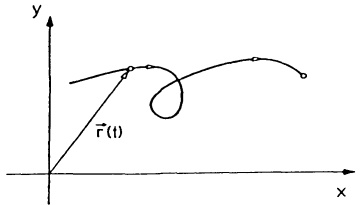

<details>
<summary>text_image</summary>

y
r̃(t)
x
</details>

Abb. 107 - Ebene Kurve

eine Parameterdarstellung dieser Kurve, t den Parameter und [a,b] das Parameterintervall. Man sagt, daß die Kurve mit wachsendem t in positiver Richtung durchlaufen wird.

Deutet man t als Zeit, so beschreibt die Parameterdarstellung (2) die Bewegung eines Massenpunktes auf der Kurve. Damit ist klar, daß eine Kurve unendlich viele verschiedene Parameterdarstellungen besitzt; es können auf ihr ganz verschiedene Bewegungen stattfinden.

Ein Graph  $y = f(x)$  ( $a \leq x \leq b$ ) besitzt die Parameterdarstellung

$$
x = t, y = f (t) \quad (a \leq t \leq b) \tag {3}
$$

oder auch $x = g(t)$, $y = f(g(t))$ mit einer auf $[\alpha, \beta]$ differenzierbaren Funktion $g$ mit $g([\alpha, \beta]) = [a, b]$.

Von einer Parameterdarstellung $x = x(t)$, $y = y(t)$ kann man i.a. nur stückweise zu einer expliziten Darstellung $y = f(x)$ oder $x = h(y)$ übergehen; nämlich dann, wenn wenigstens eine der beiden Gleichungen nach $t$ aufgelöst werden kann $(t = t(x) \Rightarrow y = y(t(x)) =: f(x))$.

Beispiel 1. Die Gerade durch die Punkte  $(x_{0}, y_{0})$ ,  $(x_{1}, y_{1})$  besitzt die Parameterdarstellung ( $\rightarrow$  Kap. 1, §6)

$$
x = x _ {0} + t (x _ {1} - x _ {0}), \quad y = y _ {0} + t (y _ {1} - y _ {0}) \quad (t \in \mathbb {R}).
$$

Beispiel 2. Der Kreis um  $(x_{0}, y_{0})$  mit dem Radius r ( $\rightarrow$  Abb. 108)

$$
x = x _ {0} + r \cos t, \quad y = y _ {0} + r \sin t \quad (0 \leq t \leq 2 \pi).
$$

Beispiel 3. Die Ellipse $\frac{x^2}{a^2} +\frac{y^2}{b^2} = 1$ ($\rightarrow$ Abb. 109) hat die Parameterdarstellung

$$
x = a \cos t, \quad y = b \sin t \quad (0 \leq t \leq 2 \pi).
$$

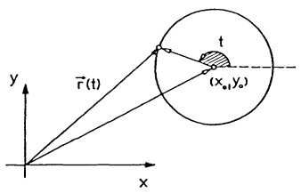

<details>
<summary>text_image</summary>

y
\vec{r}(t)
t
(x₀,y₀)
x
</details>

Abb. 108 - Kreis

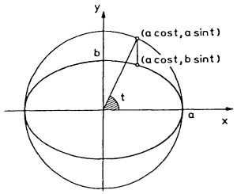

<details>
<summary>text_image</summary>

(a cost, a sint)
(a cost, b sint)
b
t
a
x
y
</details>

Abb. 109 - Ellipse

---

192

4. Integration

Beispiel 4. Zykloiden. Rollt ein Kreis K mit dem Radius r ohne zu gleiten auf der x-Achse, dann beschreibt ein mit K fest verbundener Punkt P, der vom Kreismittelpunkt den Abstand a hat, eine Zykloide (oder Radkurve). Sie besitzt die Parameterdarstellung

$$
x = r t - a \sin t, y = r - a \cos t \tag {4}
$$

mit dem Rollwinkel $t$ ($0 \leq t < \infty$) als Parameter, wobei wir von der in der Abb. 110 gezeigten Nullage

ausgehen. Denn nach dem Abrollen um den Winkel $t$ liegt der Kreismittelpunkt in $x_{M}=rt$, $y_{M}=r$ und $P$ ist nach $P_{t}=(x(t),y(t))$ gewandert:

$$
x (t) = x _ {M} - a \sin t = r t - a \sin t,
$$

$$
y (t) = y _ {M} - a \cos t = r - a \cos t.
$$

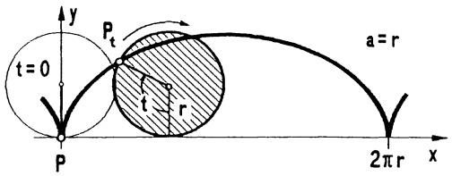

<details>
<summary>text_image</summary>

y
t = 0
P_t
a = r
t
r
2πr
x
P
</details>

Abb. 110 - Zykloide

Rollt der Kreis (mit dem Punkt $P$) nicht auf der $x$-Achse sondern auf dem Kreis $x^{2} + y^{2} = \rho^{2}$, dann ist die Bahn des Punktes $P$ eine Epizykloide mit der Parameterdarstellung

$$
x = (\rho + r) \cos t - a \cos \frac {\rho + r}{r} t ,
$$

$$
y = (\rho + r) \sin t - a \sin \frac {\rho + r}{r} t.
$$

Im Sonderfall $\rho = r = a$ entsteht die

Herzlinie (Kardioide)  $x = a(2 \cos t - \cos 2t)$ ,  $y = a(2 \sin t - \sin 2t)$ .

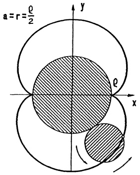

<details>
<summary>text_image</summary>

a=r=ρ/2
y
ρ
x
</details>

Abb. 111 - Epizykloide

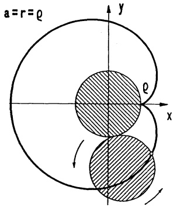

<details>
<summary>text_image</summary>

a=r=ρ
y
ρ
x
</details>

Abb. 112 - Cardioide

Beim Abrollen im Innern der ρ-Kreise entsteht die Hypozykloide

$$
x = (\rho - r) \cos t + a \cos \frac {\rho - r}{r} t ,
$$

$$
y = (\rho - r) \sin t - a \sin \frac {\rho - r}{r} t ,
$$

die für  $a = r = \frac{\rho}{4}$  die Astroide ergibt.

---

§5. Kurven, Längen- und Flächenmessung

193

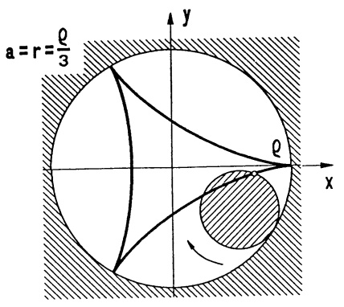

<details>
<summary>text_image</summary>

a = r = \frac{\rho}{3}\ny\n\rho\nx
</details>

Abb. 113 - Hypozykloide

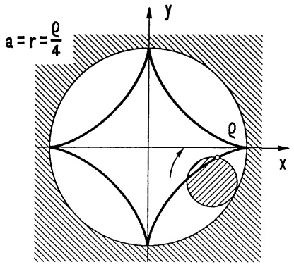

<details>
<summary>text_image</summary>

a=r=ρ/4
y
ρ
x
</details>

Abb. 114 - Astroide


5.2 Tangente und Normale. Zu jeder Parameterdarstellung  $\mathbf{r}(t)=\begin{pmatrix}x(t)\\y(t)\end{pmatrix}$

einer Kurve K definiert man

$$
\begin{array}{l} \dot {\mathbf {r}} (t) := \lim _ {h \to 0} \frac {1}{h} \left[ \mathbf {r} (t + h) - \mathbf {r} (t) \right] \\ = \binom{\dot {x} (t)}{\dot {y} (t)} \\ \end{array}
$$

(wobei der Punkt die Ableitung nach $t$ bedeutet). Als Grenzvektor von „Sekantenvektoren“ ($\rightarrow$ Abb. 115) ist dieser Vektor parallel zur Kurventangente im Punkt $(x(t), y(t))$.

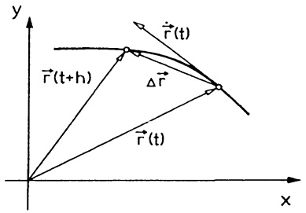

<details>
<summary>text_image</summary>

y
\vec{r}(t)
\vec{r}(t+h)
\Delta\vec{r}
\vec{r}(t)
x
</details>

Abb. 115 - Sekantenvektor

Beschreibt  $\mathbf{r}(t)$  die Bewegung eines Massenpunktes, dann gibt  $\dot{\mathbf{r}}(t)$  die Geschwindigkeit dieses Punktes (zur Zeit t) an.

Ist in einem Kurvenpunkt  $(x(t), y(t))$  der Vektor  $\dot{\mathbf{r}}(t) = \begin{pmatrix} \dot{x}(t) \\ \dot{y}(t) \end{pmatrix}$  vom Null-

vektor verschieden, dann weist er in die positive Tangentenrichtung. Der hieraus durch eine positive Drehung (entgegen Uhrzeigersinn) um 90° entstandene Vektor  $\mathbf{n}(t):=\begin{pmatrix}-\dot{y}(t)\\ \dot{x}(t)\end{pmatrix}$  gibt die positive Normalenrichtung in diesem Punkt an. Demnach besitzen Tangente und Normale (in diesem Kurvenpunkt zur Zeit t) die Parameterdarstellungen

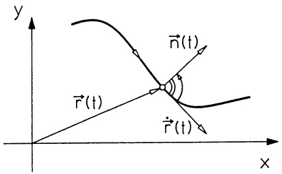

<details>
<summary>text_image</summary>

y
n̂(t)
r̂(t)
r̂(t)
x
</details>

Abb. 116 - Normalenrichtung

Tangente :  $x = x(t) + \lambda \dot{x}(t)$ ,  $y = y(t) + \lambda \dot{y}(t)$ ,

Normale :  $x = x(t) - \lambda \dot{y}(t)$ ,  $y = y(t) + \lambda \dot{x}(t)$

$(\lambda \in \mathbb{R} \text{ ist der Geradenparameter, } t \text{ fester Parameter des Kurvenpunktes}).$

---

194

4. Integration

5.3 Kurvenlänge. Die Parameterdarstellung  $x = x(t)$ ,  $y = y(t)$  ( $a \leq t \leq b$ ) einer Kurve heißt regular, wenn die Funktionen  $t \mapsto x(t)$ ,  $t \mapsto y(t)$  über [a, b] stetig differenzierbar sind und  $\dot{x}(t)^{2} + \dot{y}(t)^{2} \neq 0$  für  $a \leq t \leq b$  gilt, dabei sind  $\dot{x}(a)$  und  $\dot{x}(b)$  als einseitige Ableitungen zu verstehen.

Satz 5.1. a) Die Länge eines Kurvenbogens mit regulärer Parameterdarstellung $x = x(t)$, $y = y(t)$, $\dot{x}(t)^{2} + \dot{y}(t)^{2} \neq 0$, $a \leq t \leq b$, beträgt

$$
L = \int_ {a} ^ {b} \sqrt {\dot {x} (t) ^ {2} + \dot {y} (t) ^ {2}} d t. \tag {5}
$$

b) Der Graph  $y = f(x)$  einer stetig differenzierbaren Funktion  $f : [a, b] \to R$  hat die Länge

$$
L = \int_ {a} ^ {b} \sqrt {1 + f ^ {\prime} (x) ^ {2}} d x. \tag {6}
$$

Beweis. a): Wir zerlegen das Parameterintervall  $[a,b]$  durch äquidistante Zwischenpunkte  $a = t_{0} < t_{1} < \cdots < t_{n} = b$ ,  $t_{i+1} - t_{i} = \Delta t$ , in n Teilintervalle. Über jedem dieser Intervalle  $[t_{i}, t_{i} + \Delta t]$  wird der Kurvenbogen ersetzt durch die Sehne der Länge

$$
\begin{array}{l} \Delta s = \sqrt {(\Delta x) ^ {2} + (\Delta y) ^ {2}} \\ = \sqrt {\dot {x} (\xi_ {i}) ^ {2} + \dot {y} (\eta_ {i}) ^ {2}} \Delta t \\ \end{array}
$$

mit  $\xi_{i}$ ,  $\eta_{i}$  zwischen  $t_{i}$  und  $t_{i} + \Delta t$  ( $\rightarrow$  Mittelwertsatz). Summation und der Grenzübergang  $\Delta t \rightarrow 0$  (bzw.  $n \rightarrow \infty$ ) ergeben die Behauptung.

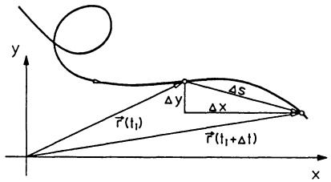

<details>
<summary>text_image</summary>

y
Δy
Δs
Δx
r̂(t₁)
r̂(t₁+Δt)
x
</details>

Abb. 117 - Bogenlänge

b) ist ein Spezialfall von a), denn es ist $x = t$, $y = f(t)$ eine stetig differenzierbare Parameterdarstellung der Kurve $y = f(x)$.

Beispiel 1. Der Zykloidenbogen $x = r(t - \sin t)$, $y = r(1 - \cos t)$ ($0 \leq t \leq 2\pi$) hat nach (5) die Länge

$$
r \int_ {0} ^ {2 \pi} \sqrt {(1 - \cos t) ^ {2} + \sin^ {2} t} d t = 2 r \int_ {0} ^ {2 \pi} \sin \frac {t}{2} d t = 8 r.
$$

Beispiel 2. Der Bogen der Normalparabel $y = x^2$ über $[0, x]$ hat nach (6) die Länge

$$
L (x) = \int_ {0} ^ {x} \sqrt {1 + 4 t ^ {2}} d t = \frac {1}{4} \left[ 2 x \sqrt {1 + 4 x ^ {2}} + \ln \left(2 x + \sqrt {1 + 4 x ^ {2}}\right) \right]
$$

(→ §2, Aufg. 5).

□

---

§5. Kurven, Längen- und Flächenmessung

195

5.4 Krümmung und Krümmungskreis. Es sei $x = x(t)$, $y = y(t)$ mit $a \leq t \leq b$ eine zweimal differenzierbare Parameterdarstellung einer Kurve mit $\dot{x}(t)^2 + \dot{y}(t)^2 \neq 0$ für alle $t$. Mit $\varphi(t)$ bezeichnen wir den positiv gemessenen Winkel zwischen der positiven $x$-Achse und der Richtung des Tangentenvektors $\left( \begin{array}{c} \dot{x}(t) \\ \dot{y}(t) \end{array} \right)$; $s(t) := \int_{a}^{t} \sqrt{\dot{x}(\tau)^2 + \dot{y}(\tau)^2} d\tau$ ist die Länge des Kurvenbogens über dem Parameterintervall $[a, t]$ ($\rightarrow (5)$). Die Änderung $\Delta\varphi$ der

Tangentenrichtung über dem Intervall  $[t, t + \Delta t]$ , bezogen auf die Änderung der Bogenlänge, also  $\frac{\Delta\varphi}{\Delta s}$ , ist offenbar ein gutes Maß für die durchschnittliche Krümmung der Kurve über diesem Teilintervall. Man nennt

$$
\kappa := \lim _ {\Delta t \to 0} \frac {\Delta \varphi (t)}{\Delta s (t)} = \frac {\dot {\varphi} (t)}{\dot {s} (t)}
$$

die Krümmung der Kurve im Punkt $P = (x(t), y(t))$. ($\rightarrow$ L'Hospital-Regel)

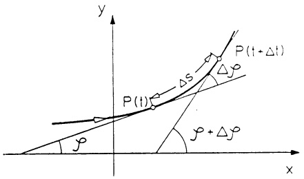

<details>
<summary>text_image</summary>

y
P(t)
Δs
P(t + Δt)
Δρ
ρ + Δρ
x
</details>

Abb. 118 - Krümmung

Satz 5.2. a) Die Krümmung einer Kurve mit zweimal stetig differenzierbarer Parameterdarstellung $x = x(t)$, $y = y(t)$, $a \leq t \leq b$, für die überall $\dot{x}(t)^2 + \dot{y}(t)^2 \neq 0$ gilt, beträgt im Kurvenpunkt $P(t) = (x(t), y(t))$

$$
\kappa (t) = \frac {\dot {x} (t) \ddot {y} (t) - \dot {y} (t) \ddot {x} (t)}{\sqrt {(\dot {x} (t) ^ {2} + \dot {y} (t) ^ {2}) ^ {3}}} \tag {7}
$$

b) Die Krümmung des Graphen $y = f(x)$ einer zweimal differenzierbaren Funktion $f : [a, b] \to \mathbb{R}$ im Punkt $(x, f(x))$ beträgt

$$
\kappa (x) = \frac {f ^ {\prime \prime} (x)}{\sqrt {(1 + f ^ {\prime} (x) ^ {2}) ^ {3}}}.\tag {8}
$$

Beweis. a): Für $s(t) = \int_{a}^{t} \sqrt{\dot{x}(\tau)^{2} + \dot{y}(\tau)^{2}} d\tau$ gilt $\dot{s}(t) = \sqrt{\dot{x}(t)^{2} + \dot{y}(t)^{2}} (\rightarrow \S1(11))$. Aus $\sin \varphi(t) = \frac{\dot{y}(t)}{\sqrt{\dot{x}(t)^{2} + \dot{y}(t)^{2}}}$, $\cos \varphi(t) = \frac{\dot{x}(t)}{\sqrt{\dot{x}(t)^{2} + \dot{y}(t)^{2}}}$ folgt $\dot{\varphi} = \frac{\dot{x}\ddot{y} - \dot{y}\ddot{x}}{\dot{x}^{2} + \dot{y}^{2}}$. Mit diesen Werten ergibt sich für $\kappa = \frac{\dot{\varphi}}{\dot{s}}$ die angegebene Formel. b) ist ein Spezialfall von a); die Parameterdarstellung $x = t$, $y = f(t)$ erfüllt die gestellten Voraussetzungen.

Wegen  $\dot{s}=\sqrt{\dot{x}^{2}+\dot{y}^{2}}>0$  haben  $\kappa$  und  $\dot{\varphi}$  dasselbe Vorzeichen. Kap. 3, Satz 2.3 zeigt:

---

196

4. Integration

$\kappa > 0 \Rightarrow \varphi$ nimmt zu $\Rightarrow$ die Kurve ist (bzgl. der positiven Richtung) linksgekrümmt.

$\kappa < 0 \Rightarrow \varphi$ nimmt ab $\Rightarrow$ die Kurve ist (bzgl. der positiven Richtung) rechtsgekrümmt.

Man beachte, daß sich bei entgegengesetzter Durchlaufrichtung das Vorzeichen von  $\kappa$  ändert.

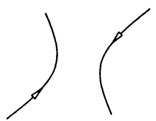

<details>
<summary>natural_image</summary>

Two curved lines with arrows pointing inward, no text or symbols present
</details>

Abb. 119a - $\kappa > 0$; Linkskrümmung

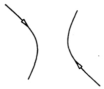

<details>
<summary>natural_image</summary>

Two curved arrows pointing inward on separate lines, no text or symbols present
</details>

Abb. 119b - $\kappa < 0$; Rechtskrümmung

Beispiel 1. Die Krümmung der Ellipse $x = a \cos t$, $y = b \sin t$ ($0 \leq t \leq 2\pi$) im Punkt $(x(t), y(t))$:

$$
(\dot {x}, \dot {y}) = (- a \sin t, b \cos t), (\ddot {x}, \ddot {y}) = (- a \cos t, - b \sin t),
$$

$$
\kappa = \frac {\dot {x} \ddot {y} - \dot {y} \ddot {x}}{\sqrt {(\dot {x} ^ {2} + \dot {y} ^ {2}) ^ {3}}} = \frac {a b}{\sqrt {(a ^ {2} \sin^ {2} t + b ^ {2} \cos^ {2} t) ^ {3}}};
$$

Insbesondere hat ein gegen Uhrzeigersinn umlaufender Kreis mit dem Radius r in jedem Punkt die Krümmung  $\kappa=\frac{1}{r}$ . ☐

Beispiel 2. Die Krümmung der Normalparabel  $y = x^{2}$  beträgt

$$
\kappa = \frac {y ^ {\prime \prime}}{\sqrt {(1 + y ^ {\prime 2}) ^ {3}}} = \frac {2}{\sqrt {(1 + 4 x ^ {2}) ^ {3}}}.
$$

Einen durch den Kurvenpunkt $P = (x(t), y(t))$ gehenden Kreis nennt man den zu $P$ gehörigen Krümmungskreis der Kurve, wenn er dort dieselbe Krümmung und dieselbe Tangentenrichtung wie die Kurve besitzt. Der Radius $r$ des Krümmungskreises, der sogenannte Krümmungsradius der Kurve in $P$, beträgt nach Bsp. 1, falls $\kappa \neq 0$,

$$
r = \frac {1}{| \kappa |}.
$$

Der Mittelpunkt des Krümmungskreises  $(x_{M}, y_{M})$  liegt auf der Normalen im Abstand  $\frac{1}{|\kappa|}$  von P. Unter Berücksichtigung der Orientierung (bzw. des Vorzeichens von  $\kappa$ ) ergibt sich

---

§5. Kurven, Längen- und Flächenmessung

197

$$
x _ {M} = x (t) - \frac {1}{\kappa} \frac {\dot {y} (t)}{\sqrt {\dot {x} (t) ^ {2} + \dot {y} (t) ^ {2}}} = x (t) - \dot {y} (t) \frac {\dot {x} (t) ^ {2} + \dot {y} (t) ^ {2}}{\dot {x} (t) \ddot {y} (t) - \dot {y} (t) \ddot {x} (t)}
$$

$$
y _ {M} = y (t) + \frac {1}{\kappa} \frac {\dot {x} (t)}{\sqrt {\dot {x} (t) ^ {2} + \dot {y} (t) ^ {2}}} = y (t) + \dot {x} (t) \frac {\dot {x} (t) ^ {2} + \dot {y} (t) ^ {2}}{\dot {x} (t) \ddot {y} (t) - \dot {y} (t) \ddot {x} (t)}
$$

Durchläuft $t$ das Parameterintervall, dann beschreibt $(x_{M}, y_{M})$ eine Kurve, die sogenannte Evolute der gegebenen Kurve.

Beispiel. Die Evolute der Parabel $x = t$, $y = t^2$ hat die Parameterdarstellung

$$
x _ {M} = x - \dot {y} \frac {\dot {x} ^ {2} + \dot {y} ^ {2}}{\dot {x} \ddot {y} - \dot {y} \ddot {x}} = - 4 t ^ {3}, y _ {M} = y + \dot {x} \frac {\dot {x} ^ {2} + \dot {y} ^ {2}}{\dot {x} \ddot {y} - \dot {y} \ddot {x}} = 3 t ^ {2} + \frac {1}{2},
$$

aus der man durch Elimination von t die explizite Darstellung

$y_{M} = 3(\frac{x_{M}}{4})^{\frac{2}{3}} + \frac{1}{2}$ erhält, eine nach W. NEIL (1637 -1670) benannte Parabel. □

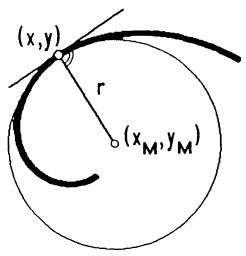

<details>
<summary>text_image</summary>

(x,y)
r
(x_M,y_M)
</details>

Abb. 120 - Krümmungskreis

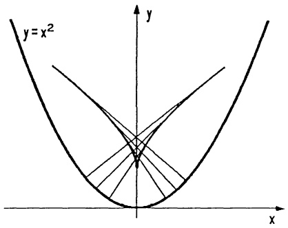

<details>
<summary>text_image</summary>

y = x^2
</details>

Abb. 121 - Evolute der Parabel

5.5 Die Polardarstellung einer ebenen Kurve. Der Polardarstellung komplexer Zahlen (→ Kap. 2, §3) entspricht in der reellen Ebene die Darstellung der Punkte in Polarkoordinaten. Jeder Punkt $P = (x, y)$ der mit kartesischen Koordinaten versehenen Ebene ist eindeutig bestimmt durch den Abstand $r$ des Punktes $P$ vom Ursprung und durch den Polar-

winkel (oder Drehwinkel) $\varphi$ derjenigen Drehung, die $(r,0)$ nach $(x,y)$ bringt ($\rightarrow$ Abb. 122). Man nennt $r,\varphi$ die Polarkoordinaten des Punktes $P$. Der Ursprung (d.i. der $Pol$) hat die Polarkoordinaten $r = 0$, $\varphi$ beliebig. Man beachte auch, daß $r,\varphi$ und $r,\varphi + 2k\pi$ ($k$ ganz) denselben Punkt beschreiben. Es bestehen die folgenden Beziehungen ($\rightarrow$ Kap. 2, §3):

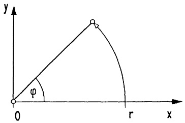

<details>
<summary>text_image</summary>

y
φ
0
r
x
</details>

Abb. 122 - Polarkoordinaten

---

198

4. Integration

$$
\boxed { \begin{array}{l l} \text {a)} & x = r \cos \varphi , y = r \sin \varphi , \\ \text {b)} & r = \sqrt {x ^ {2} + y ^ {2}}, \varphi = \left\{ \begin{array}{c c} \arccos \frac {x}{r} & , \text {falls} y \geq 0 \\ 2 \pi - \arccos \frac {x}{r} & , \text {falls} y <   0 \\ \text {unbestimmt} & , \text {falls} r = 0 \end{array} \right. \end{array} } \tag {9}
$$

Die Spitze eines um den Nullpunkt kreisenden Zeigers, der mit dem Drehwinkel $\varphi$ auch seine Länge verändert, $r = r(\varphi)$, liegt auf einer Kurve. Die Polarkoordinaten der Kurvenpunkte sind $r(\varphi)$, $\varphi$ ($\alpha \leq \varphi \leq \beta$).

$$
r = r (\varphi), \quad \alpha \leq \varphi \leq \beta ,
$$

heißt Polardarstellung der Kurve; die Achse, von der aus φ gemessen wird, hier die x-Achse, heißt Polarachse.

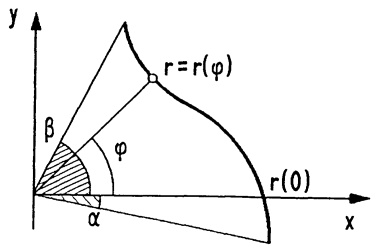

<details>
<summary>text_image</summary>

y
r = r(φ)
β
φ
α
r(0)
x
</details>

Abb. 123 - Polardarstellung einer Kurve

Parameterdarstellung der Kurve $r = r(\varphi)$, $\alpha \leq \varphi \leq \beta$:

(10) $x = r(\varphi)\cos \varphi ,y = r(\varphi)\sin \varphi$

mit dem Polarwinkel  $\varphi$ ,  $\alpha \leq \varphi \leq \beta$ , als Parameter.

Mit dieser Parameterdarstellung kann man Tangenten, Normalen, Bogenlänge, Krümmung etc. berechnen. Insbesondere ergibt sich aus (10) und (5):

$$
\begin{array}{l} \text {Bogenlänge der Kurve} r = r (\varphi), \alpha \leq \varphi \leq \beta : \\ L = \int_ {\alpha} ^ {\beta} \sqrt {r (\varphi) ^ {2} + \left(\frac {d r (\varphi)}{d \varphi}\right) ^ {2}} d \varphi . \end{array} \tag {11}
$$

Beispiel 1. $r = c$ (const.) ist die Polardarstellung eines Kreises um O.

## Beispiel 2. Archimedische Spirale.

$r = a\varphi \ (a > 0, 0 \leq \varphi < \infty)$ ist die Polardarstellung einer Spirale. Die Bogenlänge nach einem Umlauf beträgt

$$
\begin{array}{l} L = \int_ {0} ^ {2 \pi} \sqrt {(a \varphi) ^ {2} + a ^ {2}} d \varphi \\ = \frac {a}{2} \left[ 2 \pi \sqrt {1 + (2 \pi) ^ {2}} \right. \\ \left. + \ln (2 \pi + \sqrt {1 + (2 \pi) ^ {2}}) \right] \quad \square \\ \end{array}
$$

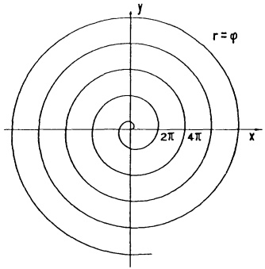

<details>
<summary>text_image</summary>

r = φ
2π 4π x
y
</details>

Abb. 124 - Archimedes Spirale

---

§5. Kurven, Längen- und Flächenmessung

199

Beispiel 3. Herzlinie. Durch $r = a(1 + \cos \varphi)$ ($a > 0$, $0 \leq \varphi \leq 2\pi$) ist eine Epizykloide ($\rightarrow$ 5.1, Bsp. 4) bestimmt, denn mit (10) ist

$$
x = \frac {a}{2} + \frac {a}{2} (2 \cos \varphi + \cos 2 \varphi), \quad y = \frac {a}{2} (2 \sin \varphi + \sin 2 \varphi), \quad 0 \leq \varphi \leq 2 \pi.
$$

Die Kurve hat den Umfang $L = a \int_{0}^{2\pi} \sqrt{(1 + \cos \varphi)^{2} + \sin^{2} \varphi} d\varphi = 8a$.

## 5.6 Flächeninhalte.

Ⓐ Die Fläche zwischen zwei Graphen.

Satz 5.3. Sind $f, g : [a, b] \to \mathbb{R}$ stetig, $a < b$, dann beträgt der Inhalt der von den vier Kurven $y = f(x)$, $y = g(x)$, $x = a$, $x = b$ berandeten Fläche

$$
F = \int_ {a} ^ {b} \left| f (x) - g (x) \right| d x . \tag {12}
$$

Beweis. Ein Streifen über x der Breite  $\Delta x$  hat angenähert den Flächeninhalt  $|f(x)-g(x)|\Delta x$ . Die Summation und der Grenzübergang  $\Delta x\to0$  zeigen die Behauptung ( $\rightarrow1.2$ , Abb. 125). ☐

Beispiel. Die Fläche zwischen den beiden Parabeln  $4y = x^{2}$  und  $y^{2} = 4x$  über [0,4] beträgt  $F = \int_{0}^{4} \left( 2\sqrt{x} - \frac{1}{4}x^{2} \right) dx = \left[ 2 \cdot \frac{2}{3}x^{\frac{3}{2}} - \frac{1}{4} \cdot \frac{1}{3}x^{3} \right]_{0}^{4} = \frac{16}{3}$ . ☐

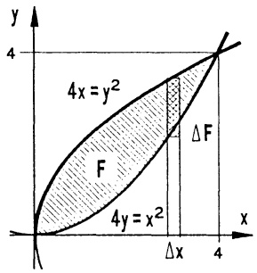

<details>
<summary>text_image</summary>

4x = y²
F
4y = x²
ΔF
Δx
4
4
</details>

Abb. 125 - Fläche zwischen Parabeln

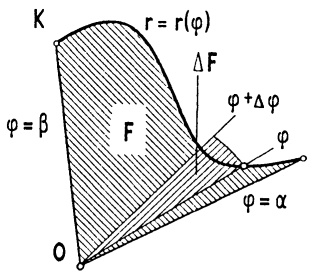

<details>
<summary>text_image</summary>

K
r = r(φ)
ΔF
φ + Δφ
F
φ
φ = α
O
</details>

Abb. 126 — Sektorfläche

B Sektorflächen in Polarkoordinaten.

Satz 5.4. Ist $r : [\alpha, \beta] \to \{r \in \mathbb{R} ; r \geq 0\}$ stetig, $\alpha < \beta$, dann beträgt der Inhalt der in Polarkoordinaten von den drei Kurven $r = r(\varphi)$, $\varphi = \alpha$ und $\varphi = \beta$ berandeten Sektorfläche ($\rightarrow$ Abb. 126)

$$
F = \frac {1}{2} \int_ {\alpha} ^ {\beta} r (\varphi) ^ {2} d \varphi . \tag {13}
$$

---

200

4. Integration

Beweis. Die Sektorfläche zwischen den Winkeln $\varphi$ und $\varphi+\Delta\varphi$ hat angenähert den Flächeninhalt eines Kreissektors mit Radius $r(\varphi)$, d.i. $\Delta F=\frac{\Delta\varphi}{2\pi}r(\varphi)^{2}\pi=\frac{1}{2}r(\varphi)^{2}\Delta\varphi$. Summation und Grenzübergang $\Delta\varphi\to0$ ergeben wie in 1.1 die Behauptung.

Beispiel. Bei einem Umlauf  $(0 \leq \varphi \leq 2\pi)$  begrenzt die Archimedische Spirale  $r = a\varphi$  eine Sektorfläche mit dem Inhalt  $F = \frac{1}{2} \int_{0}^{2\pi} a^{2} \varphi^{2} d\varphi = \frac{4}{3} a^{2} \pi^{3}$ . ☐

© Sektorflächen in Parameterdarstellung.

Satz 5.5. Leibniz-Sektorformel. Ist $x = x(t)$, $y = y(t)$, $a \leq t \leq b$, eine stückweise stetig differenzierbare Parameterdarstellung eines ebenen Kurvenstücks $K$, das von jedem Ursprungsstrahl höchstens einmal getroffen wird (jedem Polarwinkel $\varphi$ entspricht höchstens ein Parameterwert $t$), dann beträgt der Inhalt der durch $K$ begrenzten Sektorfläche ($\rightarrow$ Abb. 126)

$$
\boxed {F = \frac {1}{2} \left| \int_ {a} ^ {b} [ x (t) \dot {y} (t) - y (t) \dot {x} (t) ] d t \right|.} \tag {14}
$$

Beweis. Die Substitution $\varphi = \varphi(t) = \arctan \frac{y(t)}{x(t)}$, $\frac{d\varphi}{dt} = \frac{1}{1 + (y/x)^2} \frac{x\dot{y} - y\dot{x}}{x^2}$ ist umkehrbar, daher ergibt sich (14) aus (13) mit der Substitutionsregel.

Beispiel. Der Inhalt der Ellipse $x = a \cos t$, $y = b \sin t$ ($0 \leq t \leq 2\pi$) beträgt $F = \frac{1}{2} \int_{0}^{2\pi} [ab \cos^2 t + ab \sin^2 t] dt = ab\pi$.

Bemerkung. Man kann (14) auch mit einer Dreieckszerlegung der Sektorfläche herleiten: Das Dreieck mit den Ecken  $(0,0)$ ,  $(x,y)$ ,  $(x+\Delta x,y+\Delta y)$  hat den Inhalt  $\Delta F = \frac{1}{2} \det\left(\begin{array}{cc}x & x + \Delta x \\ y & y + \Delta y\end{array}\right) = \frac{1}{2}(x\Delta y - y\Delta x)$ , wenn der Polarwinkel von  $(x,y)$  nach  $(x + \Delta x,y + \Delta y)$  zunimmt ( $\rightarrow$  Kap. 6, 5.1).

Satz 5.6. Formel (14) gilt auch für den Inhalt $F$ einer Fläche, die von einer geschlossenen, überschneidungsfreien Kurve mit stückweise stetig differenzierbarer Parameterdarstellung $x = x(t)$, $y = y(t)$, $a \leq t \leq b$, berandet wird.

Beweis. Wir nehmen zuerst an, daß es einen Punkt $P = (u, v)$ in der Fläche gibt, so daß die von $P$ ausgehenden Strahlen die Randkurve in nur einem Punkt schneiden. Dann ist $x_{P}(t) := x(t) - u$, $y_{P}(t) := y(t) - v$ eine Parameterdarstellung der Kurve in einem kartesischen Koordinatensystem mit Ursprung $P$, auf die die Flächenformel (14) anwendbar ist. Wegen $\int_{a}^{b}(x_{P}\dot{y}_{P} - y_{P}\dot{x}_{P})dt =$

---

§5. Kurven, Längen- und Flächenmessung

201

$= \int_{a}^{b} (x \dot{y} - y \dot{x}) dt - u \int_{a}^{b} \dot{y} dt + v \int_{a}^{b} \dot{x} dt$ und $y(a) = y(b)$, $x(a) = x(b)$ folgt für diesen Fall die Behauptung. Der allgemeine Fall läßt sich (was hier nicht ausgeführt wird) durch eine geeignete Zerlegung der Fläche auf diesen Sonderfall zurückführen (für Fortgeschrittene → Kap. 8, 3.5).

Beispiel. Die von der Astroide $x = R \cos^3 t + 2$, $y = R \sin^3 t + 3$ ($0 \leq t \leq 2\pi$) begrenzte Fläche hat den Inhalt $F = \frac{1}{2} \int_0^{2\pi} (x\dot{y} - y\dot{x}) dt = \frac{3}{8}\pi R^2 = 6\pi r^2$ wegen $R = 4r$; das ist der 6-fache Inhalt des kleinen, im Innern abrollenden Kreises ($\rightarrow 5.2, \rightarrow$ Abb. 114).

## Aufgaben

1. Man berechne für die ebene geschlossene Schlinge; mit der Parameterdarstellung

$$
x = 3 t ^ {2} - 1, \quad y = 3 t ^ {3} - t; \qquad | t | \leq \frac {1}{\sqrt {3}}
$$

den Inhalt der von γ umrandeten Fläche und den Umfang.

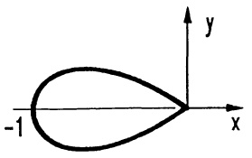

<details>
<summary>text_image</summary>

-1
y
x
</details>

2. a) Man stelle die durch die Gleichung

$$
x ^ {3} + y ^ {3} - 3 x y = 0
$$

beschriebene Kurve in Polarkoordinaten dar, skizziere die Kurve und berechne den Flächeninhalt der Schlinge. (Blatt des DESCARTES)

b) Bestimme die Bogenlänge der in Polarkoordinaten gegebene Kurve

$$
r = a \sin^ {3} \frac {\varphi}{3}, \quad 0 \leq \varphi <   2 \pi , \quad a > 0.
$$

3. a) Bestimme die Polardarstellung  $r = r(\varphi)$

für die Ellipse $E: x^{2} + 4y^{2} = 4$,

für die Hyperbel $H: x^{2} - 4y^{2} = 4$.

b) Liegt der Pol  $\rho = 0$  im Brennpunkt, so hat ein Kegelschnitt nach KEPLER die Polardarstellung

$$
\rho = \frac {p}{1 + \epsilon \cos \psi} \quad (p > 0, \epsilon \geq 0).
$$

Wie lautet die  $(\xi,\eta)$ -Gleichung. Man berechne p und  $\epsilon$  für die Ellipse E und bestimme mit dieser Darstellung den Flächeninhalt von E.

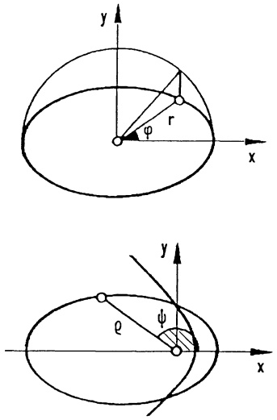

---

202

4. Integration

## 4. Die Lemniskate

hat in Polarkoordinaten die Darstellung

$$
r ^ {2} = \cos 2 \varphi ; \quad 0 \leq \varphi \leq 2 \pi .
$$

a) Man berechne den Inhalt der umschlossenen Fläche.
b) Man zeige für die Bogenlänge $\ell$:

Das Integral (11) ist uneigentlich.

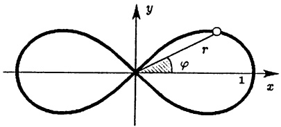

<details>
<summary>text_image</summary>

y
r
φ
1 x
</details>

Substituiert man  $\sqrt{2}\sin\varphi=\sin\psi$ , so erhält man ein eigentliches Integral

$$
\ell = 2 \sqrt {2} \cdot K \left(\frac {1}{\sqrt {2}}\right) \approx 2 \sqrt {2} \cdot 1. 8 5 4 0 7 4 6 7 9.
$$

$K(k)$ bezeichnet ein vollständiges elliptisches Integral ( $\rightarrow$ §7, Aufg. 1, 2).

5. LISSAJOUS-Figuren in der Ebene haben die Form (→ Kap. 1, 3.5)

$$
x (t) = a \sin (\omega_ {1} t + \alpha_ {1}), \quad y (t) = b \cos (\omega_ {2} t + \alpha_ {2})
$$

Man wähle  $\alpha_{1} = \alpha_{2} = 0$  (bzw.  $\alpha_{1} = 0$ ,  $\alpha_{2} = \frac{\pi}{2}$ ), und skizziere die LISSAJOUS-

Figuren für $\omega_{2}=\omega_{1}$, $\omega_{2}=2\omega_{1}$, $\omega_{2}=\frac{3}{2}\omega_{1}$.

Welche Werte liefert die Sektorenformel für die Flächeninhalte?

6. a) Man gebe für die Gerade  $y = ax + b$  die Polardarstellung  $r = r(\varphi)$ .
b) Man berechne den Flächeninhalt des $n$-Blattes $r = |\cos n\varphi|$ $(0 \leq \varphi \leq 2\pi)$.

7. Für die allgemeine Polardarstellung einer Kurve $r = r(t)$, $\varphi = \varphi(t)$, $a \leq t \leq b$, bestätige man die Formeln für die Bogenlänge $s$ und die Sektorfläche $F$:

$$
s = \int_ {a} ^ {b} \sqrt {\dot {r} ^ {2} + r ^ {2} \dot {\varphi} ^ {2}} d t, \quad F = \frac {1}{2} \int_ {a} ^ {b} r ^ {2} (t) \dot {\varphi} (t) d t.
$$

Wie lautet die Formel für die Krümmung? Teste die Ergebnisse für die Kurven $\varphi = t$, $r = t$, $0 \leq t \leq 1$ und $\varphi = \cosh t$, $r = e^t$, $-\infty < t < \infty$.

8. Ebene Bewegung in Polarkoordinaten

$$
\mathbf {x} (t) = \binom{x (t)}{y (t)} = r (t) \binom{\cos \varphi (t)}{\sin \varphi (t)}.
$$

Man drücke $\dot{\mathbf{x}}$, $\ddot{\mathbf{x}}$ und $v = |\dot{\mathbf{x}}|$ durch $\dot{r}$, $\ddot{r}$, $\dot{\varphi}$ und $\ddot{\varphi}$ aus, führe die vom Ort abhängige Basis

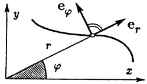

<details>
<summary>text_image</summary>

y
eφ
r
φ
x
er
</details>

$$
\mathbf {e} _ {r} := \binom{\cos \varphi}{\sin \varphi}, \quad \mathbf {e} _ {\varphi} := \binom{- \sin \varphi}{\cos \varphi}
$$

ein und bestätige für die Radial- und Transversalkomponenten von Ort, Geschwindigkeit und Beschleunigung:

$$
\mathbf {x} = r \mathbf {e} _ {r}, \quad \dot {\mathbf {x}} = \dot {r} \mathbf {e} _ {r} + r \dot {\varphi} \mathbf {e} _ {\varphi}, \quad \ddot {\mathbf {x}} = (\ddot {r} - r \dot {\varphi} ^ {2}) \mathbf {e} _ {r} + (2 \dot {r} \dot {\varphi} + r \ddot {\varphi}) \mathbf {e} _ {\varphi}.
$$

9. Man bestimme für die Kurve in Parameterform

$$
x = 6 \cos t + 2 \cos 3 t, \quad y = 6 \sin t + 2 \sin 3 t \quad (0 \leq t \leq 2 \pi)
$$

---

§5. Kurven, Längen- und Flächenmessung

203

a) den Inhalt der begrenzten Fläche,
b) die Gleichung der Tangente im Punkt mit  $t = \frac{\pi}{2}$ ,
c) die $t$-Werte, für welche die Tangente parallel zur $x$-Achse oder zur Geraden $y = x$ verläuft,
d) die Bogenlänge,
e) eine sorgfältige Skizze.

10. In Scheitelpunkten einer Kurve ist die Krümmung extremal. Man bestimme die Krümmungskreise in den Scheitelpunkten von

$$
y = e ^ {- x ^ {2}}, \quad y = \frac {6 4}{1 6 + x ^ {2}}, \quad y = \ln x.
$$

11. Man bestimme die Evolute

a) der Ellipse  $4x^{2} + 9y^{2} = 36$ ,
b) der Hyperbel xy = 4,
c) der Zykloide $x = t - \sin t$, $y = 1 - \cos t$ ($t \in \mathbb{R}$).

12. Ein Teilchen fliegt frei in einem zentralen Kraftfeld vom Punkt  $P_{0}(r=\sqrt{2}-1,\varphi=0)$  aus längs der ebenen Kurve

$$
\varphi = \varphi (r) = \int_ {\sqrt {2} - 1} ^ {r} \frac {d \rho}{\rho \sqrt {\rho^ {2} + 2 \rho - 1}}, \quad r \geq \sqrt {2} - 1, \tag {1}
$$

ins Unendliche (r, φ : Polarkoordinaten). Die Flugzeit ist

$$
t = t (r) = \int_ {\sqrt {2} - 1} ^ {r} \frac {\rho d \rho}{\sqrt {\rho^ {2} + 2 \rho - 1}}, \quad r \geq \sqrt {2} - 1. \tag {2}
$$

a) Für den Teilchenflug (1), (2) berechne man $\varphi'(r)$, $t'(r)$ und bestimme daraus $v = \sqrt{\dot{x}^2 + \dot{y}^2}$ mit Aufg. 8 als Funktion von $r$.
Wie groß ist $\lim_{r\to \infty}v(r)$?
b) Man führe die Integration in (1) durch und löse auf nach  $r = r(\varphi)$ .
c) Welche Richtung hat die Asymptote an die Flugbahn und wie lange dauert der Flug; d.h. wie groß ist $\lim_{r\to \infty}\varphi (r)$ und $\lim_{r\to \infty}t(r)$?

13. Für die horizontale Richtcharakteristik einer Antenne mit vier  $\frac{\lambda}{2}$ -Dipolen (im  $\frac{\lambda}{2}$ -Abstand übereinander) hat man die Formel ( $\varphi$ Polarwinkel)

$$
C (\varphi) = \left| \frac {\cos (\frac {\pi}{2} \sin \varphi) \sin (4 \frac {\pi}{2} \sin \varphi)}{4 \cos \varphi \sin (\frac {\pi}{2} \sin \varphi)} \right|.
$$

a) Man setze  $C(\varphi)$  stetig auf  $[0,2\pi]$  fort, bestimme die Nullstellen und berechne  $C'(\varphi)$ .

b) Mit Hilfe eines Rechners berechne man Lage und Amplitude der „Keulen der Charakteristik“ und skizziere  $r = C(\varphi)$ .

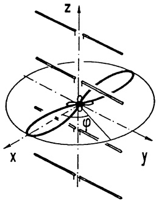

<details>
<summary>text_image</summary>

Diagram of a 3D coordinate system with x, y, z axes and an elliptical surface, showing geometric relationships and angles.
</details>

---

204

4. Integration

## §6. Weitere Anwendungen des Integrals

6.1 Abkürzende Redeweisen. Um schneller zu weiteren Resultaten zu gelangen, führt man einige abkürzende Bezeichnungen und Redeweisen ein. Zur Berechnung einer reellen Größe $G$ mit Hilfe der Integralrechnung wird diese in kleine Bestandteile $dG$, die man Elemente nennt, zerlegt. Die Summation aller Elemente $dG$ wird ebenfalls Integration genannt und man schreibt $G = \int dG$. Die Kunst des Integrierens besteht darin, für die Elemente $dG$ eine von einem Parameter $x$ abhängige Annäherung der Form $dG \approx f(x)\Delta x$, $a \leq x \leq b$, anzugeben, die so beschaffen ist, daß die Riemannsche Summe $\sum f(x)\Delta x$ beim Grenzübergang $\Delta x \to 0$ gegen $G$ konvergiert. Man erhält demnach $G = \int_{a}^{b} f(x) dx$. Als Kurzform für diesen Rechengang schreibt man $dG = f(x) dx$, woraus durch Integration $G = \int_{a}^{b} f(x) dx$ folgt. In diesem Zusammenhang ist es üblich, eine kleine Parameterdifferenz $\Delta x$ mit $dx$ zu bezeichnen, wenn beabsichtigt ist, im Verlauf der Rechnung den Grenzübergang $\Delta x \to 0$ durchzuführen. Statt $\Delta f(x) \approx f'(x)\Delta x$ ($\to$ Kap. 3, 1.3) schreibt man $df(x) = f'(x) dx$. So wird beispielsweise das Längenelement $ds$ einer in kartesischen Koordinaten durch $x = x(t)$, $y = y(t)$ ($a \leq t \leq b$) gegebenen Kurve in der Form

$$
d s = \sqrt {\dot {x} (t) ^ {2} + \dot {y} (t) ^ {2}} d t \tag {1}
$$

dargestellt (→ 5.3); speziell für den Graph $y = f(x)$:

$$
d s = \sqrt {1 + f ^ {\prime} (x) ^ {2}} d x . \tag {2}
$$

6.2 Das Volumen eines Rotationskörpers. Von einem dreidimensionalen Körper sei (nach Wahl eines geeigneten kartesischen Koordinatensystems)

für jedes $x \in [a, b]$ der Flächeninhalt $F = F(x)$ des Querschnitts bekannt ($\rightarrow$ Abb. 127). Das Volumen $\Delta V$ einer dünnen Scheibe der Dicke $\Delta x$ beträgt näherungsweise $F(x)\Delta x$. In Kurzform: $dV = F(x)dx$; die Integration ergibt

$$
V = \int d V = \int_ {a} ^ {b} F (x) d x . \tag {3}
$$

Speziell - mit $F(x) = \pi f(x)^{2}-$ gilt

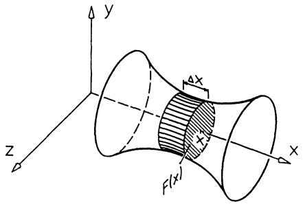

<details>
<summary>text_image</summary>

y
Δx
z
F(x)
x
</details>

Abb. 127 - Volumen Drehkörper

Satz 6.1. Ein durch Drehung der Kurve (der Kontur) $y = f(x)$, $a \leq x \leq b$, um die $x$-Achse erzeugter Rotationskörper hat das Volumen

$$
V = \pi \int_ {a} ^ {b} f (x) ^ {2} d x. \tag {4}
$$

---

§6. Weitere Anwendungen des Integrals

205

Beispiel 1. Ein Kreiskegel entsteht (nach passender Wahl des Koordinatensystems) durch Rotation der Kontur $y = \frac{r}{h} x$ um die $x$-Achse. Das Volumen ergibt sich mit (4) zu

$$
V = \pi \frac {r ^ {2}}{h ^ {2}} \int_ {0} ^ {h} x ^ {2} d x = \pi r ^ {2} \frac {h}{3}.
$$

(Allgemein: Volumen einer Pyramide = Grundfläche mal  $\frac{1}{3}$  Höhe.) ☐

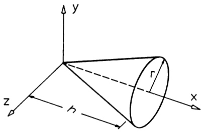

<details>
<summary>text_image</summary>

y
z
h
r
x
</details>

Abb. 128 - Kreiskegel

Beispiel 2. Torus. Wird aus dem Rotationskörper, der durch Drehung des oberen Kreisbogens $y_1 = R + \sqrt{r^2 - x^2}$ (um die $x$-Achse) entsteht, der „innere“

Körper entfernt, der sich durch Dre-

hung von  $y_{2}=R-\sqrt{r^{2}-x^{2}}$  ergibt, so erhält man den in Abb. 129 gezeigten Torus (Reifen) mit dem Volumen

$$
\begin{array}{l} V = \pi \int_ {- r} ^ {r} (y _ {1} ^ {2} - y _ {2} ^ {2}) d x \\ = 4 \pi R \int_ {- r} ^ {r} \sqrt {r ^ {2} - x ^ {2}} d x \\ = 2 \pi^ {2} r ^ {2} R. \\ \end{array}
$$

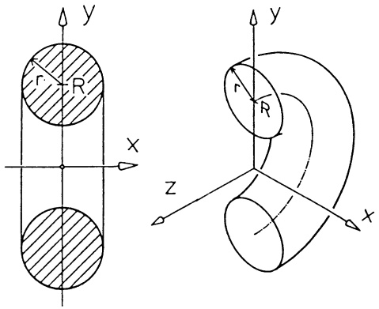

<details>
<summary>text_image</summary>

y
r R
x
z
y
r R
x
</details>

Abb. 129 - Torus

6.3 Die Mantelfläche des Drehkörpers mit der Kontur $y = f(x)$, $a \leq x \leq b$, berechnen wir wie folgt: die Mantelfläche $dM$ einer dünnen Scheibe der Dicke $dx$ wird angenähert durch die Mantelfläche eines Zylinders mit dem Radius $f(x)$ und der Mantelhöhe $ds = \sqrt{1 + f'(x)^2} dx$ ($\rightarrow$ Abb. 130 und (2)). Das bedeutet

$$
d M = 2 \pi f (x) \sqrt {1 + f ^ {\prime} (x) ^ {2}} d x;
$$

die Integration ergibt

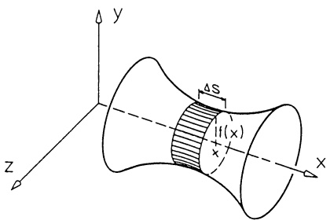

<details>
<summary>text_image</summary>

y
ΔS
if(x)
x
z
x
</details>

Abb. 130 - Mantel Drehkörper

$$
M = 2 \pi \int_ {a} ^ {b} f (x) \sqrt {1 + f ^ {\prime} (x) ^ {2}} d x. \tag {5}
$$

---

206

4. Integration

Beispiel. Die Mantelfläche des in 6.2, Beisp. 2, betrachteten Torus berechnen wir aus $M = M_{1} + M_{2}$ mit den beiden aus $y_{i} = R + (-1)^{i}\sqrt{r^{2} - x^{2}}$ ($i = 1,2$) erzeugten Mantelflächen

$$
M = 2 \pi \int_ {- r} ^ {r} (y _ {1} + y _ {2}) \sqrt {1 + y _ {1} ^ {\prime 2}} d x = 4 \pi R \int_ {- r} ^ {r} \sqrt {1 + y _ {1} ^ {\prime 2}} d x = 4 \pi^ {2} r R.
$$

(In der Rechnung wurden  $y_{1}^{\prime2} = y_{2}^{\prime2}$ ,  $y_{1} + y_{2} = 2R$  und  $\int_{-r}^{r}\sqrt{1 + y_{i}^{\prime2}}dx = \pi r$  (i = 1, 2) - Länge des Halbkreisbogens - berücksichtigt.) ☐

Bemerkung. (4) und (5) sind Spezialfälle der GULDIN-Regel (→ Kap. 8, §4).

## Aufgaben

1. Man berechne das Volumen der Körper, die man durch Rotation erhält

a) Hyperbel  $xy = a^{2}$  ( $0 < a \leq x < \infty$ ) um x-Achse,
b) Kardioide $r = a(1 + \cos \varphi)$ um Polarachse ($dV = \frac{2\pi}{3} r^3 \sin \varphi d\varphi$).

2. Man berechne das Volumen des Körpers, der von den Flächen $x^{2} + y^{2} = ax$, $x - z = 0$, $x + z = 0$ begrenzt wird, indem man Schnitte senkrecht zur $x$-Achse legt.

3. Man berechne die Mantelfläche der Körper, die man durch Rotation erhält

a)  $y = \sin x \quad (0 \leq x \leq \pi)$  um x-Achse,
b)  $y^{2}=2px$  ( $0\leq x\leq a$ ) um x-Achse,
c) $r = a(1 + \cos \varphi)$ um Polarachse

$$
(d M = 2 \pi r \sqrt {r ^ {2} + r ^ {\prime 2}} \sin \varphi d \varphi).
$$

4. Ein Becher besitzt die Form eines geraden Kreiszylinder mit Radius r, seine Achse ist um den Winkel  $\alpha$  gegen die Waagerechte geneigt. Er ist mit soviel Wasser gefüllt, daß auf dem Boden ein Kreisabschnitt mit dem Zentriwinkel  $2\varphi$  benetzt ist.

— Man berechne das Wasservolumen V .

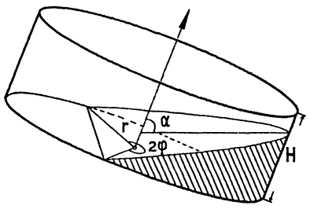

<details>
<summary>text_image</summary>

r
α
2φ
H
</details>

Hilfe: Man lege – abhängig von der Höhe $h$ – Schnitte senkrecht zur Achse, bestimme den Flächeninhalt $S(h)$, drücke $h$ und $S(h)$ durch den sich mit $h$ ändernden Zentriwinkel $2\psi$ aus und berechne $V = \int_{0}^{H} S(h) dh$ als Integral über $\psi$.

## §7. Numerische Integration

\* Unter numerischer Integration (auch numerische Quadratur genannt) versteht man die näherungsweise Berechnung eines bestimmten Integrals, gestützt auf endlich viele Funktionswerte $y_i = f(\xi_i)$ ($i = 1, 2, \ldots, n$), in der Form

$$
\int_ {a} ^ {b} f (x)   d x \approx \sum_ {i = 1} ^ {n} g _ {i} f (\xi_ {i})
$$

---

§7. Numerische Integration

207

mit „Gewichtsfaktoren“  $g_{i}$ . Über die Güte der Approximation muß eine Abschätzung des Restgliedes Auskunft geben:

$$
R := \int_ {a} ^ {b} f (x) d x - \sum_ {i = 1} ^ {n} g _ {i} f (\xi_ {i})
$$

Die primitive Methode der Approximation des Integrals  $\int_{a}^{b}f(x)dx$  durch Riemann-Summen  $Z_{n}=\sum_{i=1}^{n}f(\xi_{i})(x_{i}-x_{i-1})$  ( $\rightarrow$  5.1) spielt in der Praxis keine große Rolle, da i.a. die Konvergenz  $Z_{n}\to\int_{a}^{b}f(x)dx$  nicht besonders schnell ist. Bei der Approximation des Integrals nach der Trapez-Regel geht man von einer äquidistanten Teilung des Grundintervalls  $a=x_{0}<x_{1}<\cdots<x_{n}=b$  aus (Schrittweite  $h:=\frac{b-a}{n}$ , Stützstellen  $x_{i}:=a+ih$  ( $i=0,1,\ldots,n$ )) und ersetzt die Kurve  $y=f(x)$  über jedem Teilintervall  $[x_{i-1},x_{i}]$  durch die  $(x_{i-1},f(x_{i-1})),(x_{i},f(x_{i}))$  verbindende Sehne. Mit  $y_{i}:=f(x_{i})$  ergibt sich so die Approximation

$$
\int_ {a} ^ {b} f (x) d x \approx h \left(\frac {y _ {0}}{2} + y _ {1} + \dots + y _ {n - 1} + \frac {y _ {n}}{2}\right). \tag {1}
$$

Anschaulich: Die Fläche unter der Kurve wird durch eine Summe von Trapezflächen approximiert.

Für praktische Rechnungen ist die Schrittweite  $h_{n} := \frac{b - a}{2^{n}}$  besonders günstig. Sie erlaubt eine schnelle Berechnung der Näherungssummen:

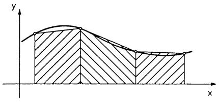

<details>
<summary>text_image</summary>

y
x
</details>

Abb. 131 - Trapezsumme

$$
T _ {0} := h _ {0} [ \frac {f (a)}{2} + \frac {f (b)}{2} ],
$$

$$
T _ {n} := h _ {n} \left[ \frac {f (a)}{2} + f (a + h _ {n}) + \dots + f (a + (2 ^ {n} - 1) h _ {n}) + \frac {f (b)}{2} \right], \quad n = 1, 2, \dots .
$$

Um von  $T_{n}$  nach  $T_{n+1}$  zu gelangen, braucht man nur die bei der Schrittweitenhalbierung  $h_{n+1} = \frac{h_{n}}{2}$  neu hinzugekommenen Teilpunkte zu berücksichtigen.

$$
M _ {n} := h _ {n} \left[ f \left(a + \frac {h _ {n}}{2}\right) + f \left(a + 3 \frac {h _ {n}}{2}\right) + \dots + f \left(a + (2 ^ {n + 1} - 1) \frac {h _ {n}}{2}\right) \right] \quad \text {liefert}
$$

$$
T _ {n + 1} = \frac {1}{2} [ T _ {n} + M _ {n} ].
$$

Deshalb berechnet man in der Praxis der Reihe nach  $T_{0}$ ,  $M_{0}$ ,  $T_{1} = \frac{1}{2}(T_{0} + M_{0})$ ,  $M_{1}$ ,  $T_{2} = \frac{1}{2}(T_{1} + M_{1})$ ,  $M_{2}, \ldots$ , so weit, bis sich  $T_{n}$  und  $T_{n+1}$  nicht mehr merklich unterscheiden.

---

208

4. Integration

Bei gehobenen Ansprüchen bestimmt man n aus der Restgliedabschätzung

$$
\left| \int_ {a} ^ {b} f (x) d x - T _ {n} \right| \leq \frac {(b - a) ^ {3}}{3} \frac {M}{4 ^ {n + 1}}
$$

mit $M = \max\{ |f''(x)| ; a \leq x \leq b \}$ (die hier nicht bewiesen wird): Man gibt eine Genauigkeitsschranke $\varepsilon$ (etwa $\varepsilon = 10^{-7}$) vor und bestimmt das kleinste $n$ mit

$$
\frac {(b - a) ^ {3}}{3} \frac {M}{4 ^ {n + 1}} <   \varepsilon .
$$

Mit diesem $n$ gilt dann $\int_{a}^{b}f(x)dx = T_{n}\pm \varepsilon$.

Romberg-Extrapolation. Für praktische Rechnungen mit hoher Genauigkeit konvergiert die Folge $T_{n}$ ($n = 0,1,2,\ldots$) noch zu langsam. Außerdem verfälschen die beim Einsatz eines Rechners unvermeidlichen Rundungsfehler für große $n$ das Ergebnis. Deshalb berechnet man $T_{0}, T_{1}, T_{2}, \ldots, T_{n}$ für nur wenige $n$ und führt anschließend die sogenannte Romberg-Extrapolation durch, die zu einem wesentlich besseren Ergebnis führt. Die Idee ist einfach: Man bildet aus den $T_{n}$ andere Folgen, die i.a. schneller gegen den Integralwert konvergieren. Aus $T_{n,0} := T_{n}$ ($n = 0,1,2,\ldots$) berechnet man

$$
T _ {n, 1} := \frac {4 T _ {n , 0} - T _ {n - 1 , 0}}{4 - 1} \quad (n = 1, 2, 3, \dots), \qquad \text {damit}
$$

$$
T _ {n, 2} := \frac {4 ^ {2} T _ {n , 1} - T _ {n - 1 , 1}}{4 ^ {2} - 1} \quad (n = 2, 3, 4, \dots) \quad \text {etc; allgemein}
$$

$$
T _ {n, k} := \frac {4 ^ {k} T _ {n , k - 1} - T _ {n - 1 , k - 1}}{4 ^ {k} - 1} \quad (n = k, k + 1, \dots) .
$$

Ohne Beweis:

Ist der Integrand $f$ in $[a,b]$ genügend oft differenzierbar, so ist $T_{n,k}$ eine bessere Approximation des Integrals als $T_{n,k-1}$.

Beispiel. Es wird  $\int_{1}^{10}\frac{\ln x}{x}dx=\frac{1}{2}(\ln10)^{2}=2.650947928\ldots$  aus  $T_{0},\ldots,T_{6}$  mit anschließender Romberg-Extrapolation berechnet:

| n | $T_n$ | $T_{n,1}$ | $T_{n,2}$ | $T_{n,3}$ | $T_{n,4}$ | $T_{n,5}$ | $T_{n,6}$ |
| --- | --- | --- | --- | --- | --- | --- | --- |
| 0 | 1.036163292 |  |  |  |  |  |  |
| 1 | 1.912875540 | 2.205112956 |  |  |  |  |  |
| 2 | 2.366921161 | 2.518269702 | 2.539146818 |  |  |  |  |
| 3 | 2.559871380 | 2.624188120 | 2.631249348 | 2.632711293 |  |  |  |
| 4 | 2.625551439 | 2.647444792 | 2.648995237 | 2.649276917 | 2.649341880 |  |  |
| 5 | 2.644362875 | 2.650633354 | 2.650845924 | 2.650875300 | 2.650881569 | 2.650883074 |  |
| 6 | 2.649285546 | 2.650926437 | 2.650945976 | 2.650947564 | 2.650947847 | 2.650947912 | 2.650947928 |

Wie man sieht, kommt  $T_{6,5}$  dem wahren Wert ausreichend nahe.

□

---

§7. Numerische Integration

209

## Bemerkungen.

1. Die Werte $T_{n,1}$ ($n = 1,2,3,\ldots$) des Romberg-Extrapolationsschemas erhält man auch nach der sogenannten Simpson-Regel: Man ersetze den Integranden $f(x)$ über dem Teilintervall $[x_i, x_{i+2}]$ ($i = 0,2,\ldots,2^n - 2$) durch die Parabel $g_i(x) = \alpha_i x^2 + \beta_i x + \gamma_i$, die durch die aufeinanderfolgenden Punkte $(x_i, f(x_i)), (x_{i+1}, f(x_{i+1}))$, $(x_{i+2}, f(x_{i+2}))$ geht.

Die Approximation

$$
\int_ {a} ^ {b} f (x) d x \approx T _ {1, 1} = \frac {b - a}{6} \left[ f (a) + 4 f (\frac {a + b}{2}) + f (b) \right]
$$

wird Keplersche Faßregel genannt (→ §1, Aufg. 7).

2. Es gibt sehr schnell konvergierende Verfahren, die keine äquidistanten Stützstellen verwenden, deren Behandlung jedoch nicht so elementar ist.

```vba
' Programm ROMBERG Integration
' --------------------------------------------------
Dim I(7)
E=1.OE-07
Print "Grenzen A= ,B= ";
Input A,B
H=B-A
N=1
X=A
' X=A+E, falls uneigentlich
Gosub Funktion
Fl=F
X=B
' x=B-E, falls uneigentlich
Gosub Funktion
I(0)=H*(Fl+F)/2
For K=1 To 7
    S=0
    H=H/2
    N=2*N
    Q=1
    For J=1 To N-1 Step 2
        X=A+J*H
        Gosub Funktion
        S=S+F
Next J
I(K)=I(K-1)/2+S*H
For J=K-1 To O Step -l
    Q=4*Q
    I(J)=I(J+1)+(I(J+1)-I(J))/(Q-1)
Next J
Print I(0)
Ia=Abs(I(0))
If Ia<1 Then
    Ia=1
Endif
Exit If Abs(I(1)-I(0))<E*Ia
Next K
Print I(0)
End
' --------------------------------------------------
Procedure Funktion
    F=Log(x)/x
Return
```

---

210

4. Integration

## Aufgaben

1. Ist $l$ die Länge des mathematischen Pendels und $\alpha$ der maximale Auslenkwinkel, so ergibt sich die Schwingungsdauer $T$ ($\rightarrow$ Band 2) mit $g = 9.80655\mathrm{m/s}^2$ aus dem vollständigen elliptischen Integral

$$
K (k) = \int_ {0} ^ {\pi / 2} \frac {d x}{\sqrt {1 - k ^ {2} \sin^ {2} x}}
$$

$$
T = 4 \sqrt {\frac {l}{g}} K (\sin \frac {\alpha}{2}). \tag {1}
$$

Eine gebräuchliche Näherung für kleine α ist

$$
T = 2 \pi \sqrt {\frac {l}{g}}. \tag {2}
$$

a) Man bestimme die für eine Standuhr mit 2-Sekunden-Pendel nötige Länge l aus (2) und aus (1) mit  $\alpha = 4^{\circ}$ . Dazu berechne man  $K(k)$  näherungsweise mit der Simpson-Regel für 2 und 4 Teilpunkte.
b) Wie groß ist die Gangabweichung pro Woche, wenn l nach (2) bestimmt ist?
c) (Mit PC) Man berechne $K(k)$ für $k = \sin 89.5^{\circ}$ mit Programm Romberg und vergleiche mit dem Tabellenwert 6.127778830.
Warum ergibt sich eine so große Abweichung?

2. Das vollständige elliptische Integral

$$
I (a, b) = \int_ {0} ^ {\pi / 2} \frac {d x}{\sqrt {a ^ {2} \cos^ {2} x + b ^ {2} \sin^ {2} x}} \quad (0 <   b <   a)
$$

läßt sich nach C.F. GAUSS über die beiden Folgen ausdrücken

$$
\begin{array}{l} a _ {0} = a, \quad a _ {1} = \frac {1}{2} (a _ {0} + b _ {0}), \quad a _ {2} = \frac {1}{2} (a _ {1} + b _ {1}), \dots , \\ b _ {0} = b, \quad b _ {1} = \sqrt {a _ {0} b _ {0}} \quad , \quad b _ {2} = \sqrt {a _ {1} b _ {1}} \quad , \dots , \\ \end{array}
$$

die gegen einen gemeinsamen Grenzwert, das sog. arithmetisch-geometrische Mittel $M(a,b)$ von $a$ und $b$ konvergieren:

$$
I (a, b) = \frac {\pi}{2} \cdot \frac {1}{M (a , b)}.
$$

(Dies führt zu einem außerordentlich schnellen und genauen numerischen Verfahren.)

a) Für $a_1 = \frac{1}{2}(a + b)$, $b_1 = \sqrt{ab}$ zeige man mit der Substitution

$$
\sin x = \frac {2 a \sin \psi}{(a + b) + (a - b) \sin^ {2} \psi}
$$

$$
\int_ {0} ^ {\pi / 2} \frac {d x}{\sqrt {a ^ {2} \cos^ {2} x + b ^ {2} \sin^ {2} x}} = \int_ {0} ^ {\pi / 2} \frac {d \psi}{\sqrt {a _ {1} ^ {2} \cos^ {2} \psi + b _ {1} ^ {2} \sin^ {2} \psi}}.
$$

b) Unter Berücksichtigung von $\lim_{n\to \infty}a_n = \lim_{n\to \infty}b_n = M(a,b)$ folgt aus a)

$$
I (a, b) = I (M (a, b), M (a, b)) = M (a, b) ^ {- 1} \cdot \frac {\pi}{2}.
$$

c) Teste das nachfolgende Programm in Aufgabe 1c.

---

§7. Numerische Integration

211

## Numerische Berechnung der vollständigen elliptischen Integrale

$$
K (k) = \int_ {0} ^ {\pi / 2} \frac {d x}{\sqrt {1 - k ^ {2} \sin^ {2} x}}, \quad E (k) = \int_ {0} ^ {\pi / 2} \sqrt {1 - k ^ {2} \sin^ {2} x} d x \quad (0 \leq k <   1)
$$

'Programm Vollst.Ellipt.Integrale

<div class="docvortex-algorithm" style="white-space: pre-wrap; font-family:monospace;">
' ---------------------------------------------------------- C=(A-B)/2
Input "k";K          E=E+D*C*C
If K&lt;1 Then         A=Al
    A=1                     B=Bl
    B=Sqr(1-K*K)        D=2*D
    C=K                      Until C&lt;1.OE-09
    D=2                     Print "K(k)=";Pi/2/A
    E=C*C                  Print "E(k)=";Pi/2/A*(1-E/2)
    Repeat                       Else
        Al=(A+B)/2          Print "Fail"
        Bl=Sqr(A*B)           Endif
                                      End
</div>

3. Die Kontur Z des Wankelmotors hat die Form einer Hypozykloide. Sie ist die Bahn des Punktes A, wenn der Läuferkreis  $K_{L}$  auf dem (mit dem Gehäuse G starr verbundenen) Kreis  $K_{G}$  abrollt.

a) Man bestimme die Parameterdarstellung  $x(t), y(t)$  von Z mit dem Winkel t gemäß Skizze.

Für welche Werte von $a/b$ liegen die Punkte $B$ und $C$ ebenfalls auf $Z$?

(Rollbedingung:  $at = b\varphi$ .

Berührbedingung: $O, M_{L}, P$ auf einer Geraden.)

b) Für $a = 3$, $b = 2$, $d = 7$ bestätige man

$$
x (t) = - \sin \frac {3}{2} t + 7 \sin \frac {1}{2} t,
$$

$$
y (t) = 7 \cos \frac {1}{2} t - \cos \frac {3}{2} t, \quad 0 \leq t \leq 4 \pi .
$$

Man bestimme den Flächeninhalt $F$ und den Umfang $U$ von $Z$, indem man $U$ auf ein elliptisches Integral $E(\sqrt{0.84})$ zurückführt und entweder den Tabellenwert 1.1507... oder obiges Programm verwendet.

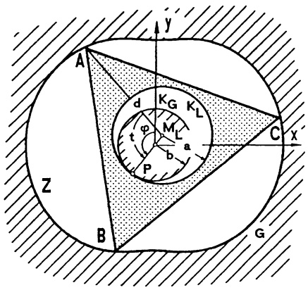

<details>
<summary>text_image</summary>

A
y
K_G K_L
d
M_L
t φ
a
b
P
C x
Z
B
G
</details>
