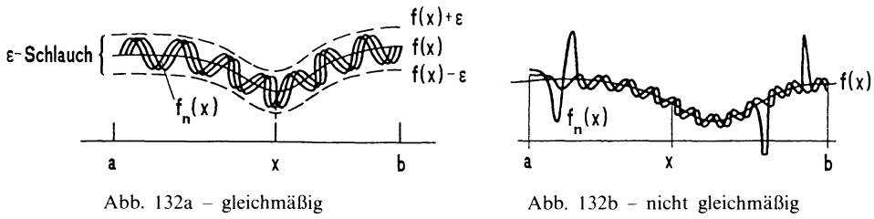
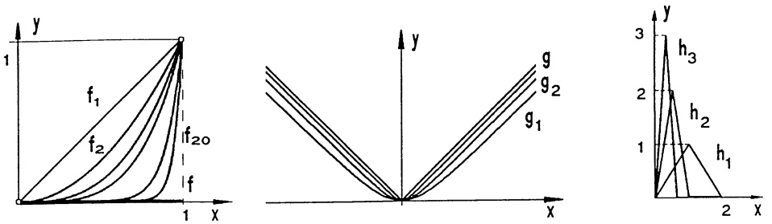
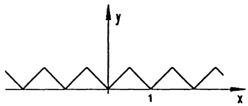
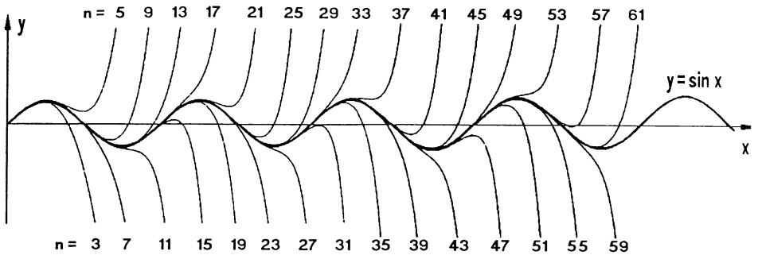
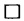
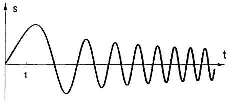
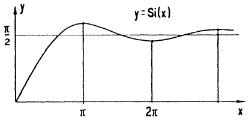
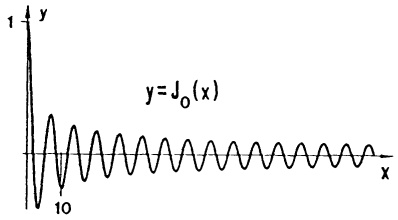
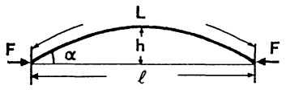

# Kapitel 5 – Potenzreihen

原始 PDF 第 228–265 页。

## Kapitel 5

## Potenzreihen

Eine besonders wirkungsvolle Methode zur Lösung zahlreicher Probleme ist die Darstellung einer Funktion $f$ als unendliche Reihe $f(x)=\sum_{k=0}^{\infty}f_{k}(x)$ mit geeigneten, wohlbekannten Funktionen $f_{k}$; etwa als

Potenzreihe mit $f_{k}(x) = a_{k}x^{k}$, oder als

Fourier-Reihe mit  $f_{k}(x)=a_{k}\cos kx+b_{k}\sin kx$ .

Eine besondere Rolle spielen dabei die Potenzreihen: sie sind von einfacher Bauart, lassen sich leicht manipulieren (d.h. addieren, multiplizieren, differenzieren, integrieren, ...) und haben vielseitige, weitreichende Anwendungen.

Bevor wir uns mit Potenzreihen befassen können, ist zu klären, was man unter einer unendlichen Summe  $a_{0} + a_{1} + a_{2} + \cdots$  von Zahlen  $a_{i} \in R$  versteht.

## §1. Unendliche Reihen

1.1 Grundbegriffe. Die aus einer Zahlenfolge  $a_{0}, a_{1}, a_{2}, \ldots$  gebildete Summenfolge  $(s_{n})_{n \geq 0}$  mit

$$
s _ {n} := \sum_ {k = 0} ^ {n} a _ {k} = a _ {0} + a _ {1} + \dots + a _ {n} \quad (n \geq 0)
$$

heißt unendliche Reihe, sie wird mit  $\sum_{k=0}^{\infty}a_{k}$  (bzw. mit  $a_{0}+a_{1}+a_{2}+\cdots$ ) bezeichnet.
D.h.

$$
a _ {0} + a _ {1} + a _ {2} + \dots = \sum_ {k = 0} ^ {\infty} a _ {k} := (s _ {n}) _ {n \geq 0}.
$$

Die Zahlen $a_{i}$ heißen Glieder der Reihe und die Summen $s_{n} = \sum_{k=0}^{n} a_{k}$ deren Partialsummen. Der Definition entsprechend sagt man, die Reihe konvergiert (bzw. divergiert), wenn $(s_{n})_{n \geq 0}$ konvergiert (bzw. divergiert).

Im Fall $\lim_{n\to \infty}s_n = \lim_{n\to \infty}\left(\sum_{k = 0}^{n}a_k\right) = s$ (mit $s\in \mathbb{R}\cup \{-\infty ,\infty \}$) nennt man $s$ den Wert (oder die Summe) der unendlichen Reihe und schreibt

$$
\sum_ {k = 0} ^ {\infty} a _ {k} = s,
$$

K. Meyberg et al., Höhere Mathematik

© Springer-Verlag Berlin Heidelberg 1998

---

§1. Unendliche Reihen

213

wobei man sich der dadurch hervorgerufenen Doppeldeutigkeit des Symbols $\sum_{k=0}^{\infty} a_k$ durchaus bewußt ist.

Die beiden Bedeutungen des Symbols $\sum_{k=0}^{\infty} a_k$:

a)  $\sum_{k=0}^{L} a_{k}$  (alleinstehend) bezeichnet die Folge der Partialsummen

$$
s _ {n} = a _ {0} + a _ {1} + \dots + a _ {n} \quad (n \geq 0).
$$

b) Die Gleichung $\sum_{k=0}^{\infty} a_k = s$ bedeutet $\lim_{n \to \infty} \sum_{k=0}^{n} a_k = s$.

## Beispiele.

1) Die geometrische Reihe  $\sum_{k=0}^{\infty} q^{k} = 1 + q + q^{2} + q^{3} + \cdots$  besitzt die Glieder  $a_{k} = q^{k} \quad (k \geq 0)$  und für  $|q| < 1$  die Summe  $\frac{1}{1 - q}$ . In Kap. 2, §4 wurde gezeigt:

$$
\boxed {\sum_ {k = 0} ^ {\infty} q ^ {k} = \left\{ \begin{array}{c l} \frac {1}{1 - q} & , \text {falls} | q | <   1 \\ \infty & , \text {falls} q \geq 1 \\ (\text {unbestimmt}) \text {divergent} & , \text {falls} q \leq - 1 \end{array} \right.} \tag {1}
$$

2) Die harmonische Reihe  $\sum_{k=1}^{\infty}\frac{1}{k}=1+\frac{1}{2}+\frac{1}{3}+\cdots$  hat die Glieder  $a_{k}=\frac{1}{k}\quad(k\geq1)$  und den Wert  $\infty$  ( $\rightarrow$  Kap. 2, §4).
3) Die alternierende harmonische Reihe  $\sum_{k=1}^{\infty}(-1)^{k+1}\frac{1}{k}=1-\frac{1}{2}+\frac{1}{3}-\frac{1}{4}+-\cdots$  hat die Glieder  $a_{k}=(-1)^{k+1}\frac{1}{k}$  ( $k\geq1$ ); sie konvergiert ( $\rightarrow$  Kap2., §5) gegen den Grenzwert  $\ln 2$  ( $\rightarrow$  §4); d.h.,  $\sum_{k=1}^{\infty}(-1)^{k+1}\frac{1}{k}=\ln 2$ . ☐

Der Konvergenznachweis durch Berechnung der Summe, wie im Fall der geometrischen Reihe, ist die Ausnahme. Die Berechnung der Summe ist i.a. schwierig und erfordert spezielle Methoden. In der Regel gelingt es aber, die Konvergenz oder Divergenz anhand der folgenden Tests (Kriterien) nachzuweisen.

Das Cauchy-Konvergenzkriterium (→ Kap. 2, Satz 5.4) auf Reihen übertragen lautet:

---

214

5. Potenzreihen

Satz 1.1. Die Reihe $\sum_{k=0}^{\infty} a_k$ ist genau dann konvergent, wenn es zu jeder noch so kleinen Zahl $\epsilon > 0$ einen Index $N_\epsilon$ gibt, so daß gilt

$$
\left| s _ {n} - s _ {m} \right| = \left| a _ {m + 1} + a _ {m + 2} + \dots + a _ {n} \right| <   \epsilon \text {fur alle} m, n \geq N _ {\epsilon} (o. E. n > m).
$$

Als unmittelbare Folgerung ergibt sich eine notwendige Konvergenzbedingung:

Satz 1.2. Die Glieder einer konvergenten unendlichen Reihe bilden eine Nullfolge.

Beweis. In Satz 1.1 nehme man $m = n - 1: |s_n - s_{n-1}| = |a_n| < \epsilon$ für alle $n > N_\epsilon$; d.h. $a_n \to 0$.

Beispiel. Jeder Versuch, für  $\sum_{k=1}^{\infty}\frac{k^{k}}{k!}$  einen endlichen Grenzwert zu bestimmen, muß scheitern;  $\left(\frac{k^{k}}{k!}\right)_{k\geq1}$  ist keine Nullfolge. ☐

Die Bedingung  $\lim_{n\to\infty}a_{n}=0$  ist zur Konvergenz der Reihe notwendig, aber i.a. nicht hinreichend, wie das Beispiel der harmonischen Reihe zeigt.

Für alternierende Reihen (das sind solche, in denen aufeinanderfolgende Reihenglieder verschiedene Vorzeichen haben) ist diese Bedingung beinahe auch hinreichend (→ Aufg. 5). Es gilt:

## Satz 1.3. Leibniz-Kriterium für alternierende Reihen.

Für jede monoton fallende Nullfolge  $a_{0}, a_{1}, a_{2}, \ldots$  konvergiert die alternierende Reihe

$$
\sum_ {k = 0} ^ {\infty} (- 1) ^ {k} a _ {k} = a _ {0} - a _ {1} + a _ {2} - a _ {3} + \dots .
$$

$k=0$
Für die Approximation der Summe $s$ durch die Partialsummen $s_n = \sum_{k=0}^{n} (-1)^k a_k$ gilt die Fehlerabschätzung

$$
| s - s _ {n} | \leq a _ {n + 1} \quad (n = 0, 1, 2, \dots).
$$

Beweis. Der Beweis mit dem Cauchy-Kriterium (Satz 1.1) verläuft völlig analog zu dem in Kap. 2, §5 ausgeführten Spezialfall $a_{k} = \frac{1}{k}$ (alternierende harmonische Reihe).

Beispiel. Die Sinusfunktion besitzt die Reihendarstellung

$\sin x = x - \frac{x^3}{3!} + \frac{x^5}{5!} - \frac{x^7}{7!} + -\cdots \quad (\rightarrow \S 3). \text{ Für } x = \frac{1}{10} \text{ ergibt das}$

$$
\sin \frac {1}{1 0} = \frac {1}{1 0} - \frac {1}{3 ! 1 0 ^ {3}} + \frac {1}{5 ! 1 0 ^ {5}} - + \dots = 0. 0 9 9 8 3 3 4 1 6 \pm \epsilon
$$

mit dem Fehler  $\epsilon = |s - s_{3}| < a_{4} = \frac{1}{7!10^{7}} < 10^{-10}$ .

---

§1. Unendliche Reihen

215

Beachte: Die angegebene Abschätzung gilt i.a. nur für konvergente alternierende Reihen. Für  $\sum_{k=1}^{\infty}\frac{1}{k^{2}}=1+\frac{1}{2^{2}}+\frac{1}{3^{2}}+\cdots=\frac{\pi^{2}}{6}$  ( $\rightarrow$  Kap. 2, §5) beispielsweise berechnet man  $s_{200}=1.639946548$ , was vom Summenwert s=1.644934067 „wesentlich“ weiter entfernt ist als  $\frac{1}{(201)^{2}}=2.475186258E-05$ .

Die Rechenregeln für Folgen sind leicht auf Reihen zu übertragen. So gilt insbesondere:

Satz 1.4. Rechenregeln für konvergente Reihen. Für alle $c \in \mathbb{R}$ gilt

$$
\sum_ {k = 0} ^ {\infty} a _ {k} = a, \quad \sum_ {k = 0} ^ {\infty} b _ {k} = b (a, b \in \mathbb {R}) \Rightarrow \sum_ {k = 0} ^ {\infty} (a _ {k} \pm b _ {k}) = a \pm b, \quad \sum_ {k = 0} ^ {\infty} (c a _ {k}) = c a.
$$

Beispiel. Aus $\sum_{k=1}^{\infty} \frac{1}{k^{2}} = \frac{\pi^{2}}{6}$ und $\sum_{k=1}^{\infty} \frac{(-1)^{k}}{k+1} = \ln 2 - 1$ folgt $\sum_{k=1}^{\infty} \left( \frac{1}{k^{2}} + \frac{(-1)^{k}}{k+1} \right) = \frac{\pi^{2}}{6} + \ln 2 - 1$.

Eine Warnung. Elementare Manipulationen, die bei endlichen Summen den Summenwert nicht ändern, sind bei unendlichen Reihen („unendlichen Summen“) nicht uneingeschränkt erlaubt.

(a) Klammern fortzulassen ist i.a. nicht erlaubt.

Beispiel. Die Reihe  $\sum_{k=0}^{\infty}a_{k}$  mit  $a_{k}=(1-1)=0$  ist konvergent, der Grenzwert  $\sum_{k=0}^{\infty}a_{k}=(1-1)+(1-1)+\cdots=0$ . Durch Fortlassen der Klammern entsteht hieraus die divergente Reihe  $1-1+1-1+-\cdots=\sum_{k=0}^{\infty}b_{k}$  mit  $b_{k}=(-1)^{k}$  ( $k=0,1,\ldots$ ) und den Partialsummen  $s_{n}=0$ , falls n ungerade,  $s_{n}=1$ , falls n gerade. ☐

b Klammern zu setzen ist i.a. ebenfalls nicht erlaubt.

Man betrachte das vorhergehende Beispiel: Aus der divergenten Reihe entsteht durch Klammerung die konvergente Reihe  $\sum_{k=0}^{\infty}a_{k}$ . Jedoch gilt:

Satz 1.5. In einer konvergenten Reihe darf man beliebig Klammern setzen:

$$
s = a _ {0} + a _ {1} + a _ {2} + \dots = (a _ {0} + \dots + a _ {k _ {1}}) + (a _ {k _ {1} + 1} + \dots + a _ {k _ {2}}) + \dots
$$

---

216

5. Potenzreihen

Beweis. Die Partialsummen  $s_{n}^{\prime} = (a_{0} + \cdots + a_{k_{1}}) + \cdots + (a_{k_{n-1}+1} + \cdots + a_{k_{n}})$  der „geklammerten“ Reihe bilden eine Teilfolge der konvergenten Folge  $s_{n} = a_{0} + a_{1} + \cdots + a_{n}, n \geq 0$ ; sie konvergieren deshalb gegen denselben Grenzwert s ( $\rightarrow$  Kap. 2, §4). □

© Eine Umordnung der Glieder (Summanden) ist ohne Zusatzvoraussetzungen nicht erlaubt.

Beispiel. Für die alternierende harmonische Reihe (s.o.) gilt mit Satz 1.4:

$$
\begin{array}{l} \ln 2 = 1 - \frac {1}{2} + \frac {1}{3} - \frac {1}{4} + \frac {1}{5} - \frac {1}{6} + \frac {1}{7} - \frac {1}{8} + \frac {1}{9} - \frac {1}{1 0} + \frac {1}{1 1} \dots \\ + \frac {1}{2} \ln 2 = 0 + \frac {1}{2} + 0 - \frac {1}{4} + 0 + \frac {1}{6} + 0 - \frac {1}{8} + 0 + \frac {1}{1 0} + 0 \dots \\ \frac {3}{2} \ln 2 = 1 + 0 + \frac {1}{3} - \frac {1}{2} + \frac {1}{5} + 0 + \frac {1}{7} - \frac {1}{4} + \frac {1}{9} + 0 + \frac {1}{1 1} \dots \\ \end{array}
$$

Läßt man die Nullen weg, so entsteht die Reihe in der letzten Zeile durch Umordnung aus der Reihe in der ersten Zeile.

1.2 Absolute Konvergenz. Die Sachlage vereinfacht sich, wenn alle Reihenglieder  $\geq 0$  sind.

Definition. Die Reihe  $\sum_{k=0}^{\infty}a_{k}$  heißt absolut konvergent, wenn die Reihe der Beträge  $\sum_{k=0}^{\infty}|a_{k}|=|a_{0}|+|a_{1}|+|a_{2}|+\cdots$  konvergiert.

Reihen, die zwar konvergieren, aber nicht absolut konvergieren, nennt man bedingt konvergent.

Die alternierende harmonische Reihe ist ein Beispiel für bedingte Konvergenz. Es gilt

Satz 1.6. Jede absolut konvergente Reihe ist konvergent (im gewöhnlichen Sinn).

Beweis. Ist  $\sum_{k=0}^{\infty}|a_{k}|$  konvergent, dann gibt es ( $\rightarrow$  Satz 1.1, Cauchy-Kriterium) zu  $\epsilon > 0$  einen Index  $N_{\epsilon}$ , so daß  $|a_{m}| + |a_{m+1}| + \cdots + |a_{n}| < \epsilon$  für  $m, n \geq N_{\epsilon}$ , n > m. Aufgrund der Dreiecksungleichung gilt  $|a_{m} + a_{m+1} + \cdots + a_{n}| \leq |a_{m}| + |a_{m+1}| + \cdots + |a_{n}| < \epsilon$  für  $m, n \geq N_{\epsilon}$ , was wiederum nach Satz 1.1 die Konvergenz der Reihe  $\sum_{k=0}^{\infty} a_{k}$  nach sich zieht.

Die wesentlichen Kriterien für absolute Konvergenz basieren auf der folgenden Beobachtung.

---

§1. Unendliche Reihen

217

Satz 1.7. Die Reihe  $\sum_{k=0}^{\infty}a_{k}$  ist genau dann absolut konvergent, wenn die Folge der Partialsummen  $S_{n} := |a_{0}| + |a_{1}| + \cdots + |a_{n}|$  (d.h. die Reihe  $\sum_{k=0}^{\infty}|a_{k}|$ ) beschränkt ist.

Beweis. Da die Folge  $(S_{n})_{n\geq0}$  offenbar monoton wächst, folgt die Behauptung sofort aus dem Monotoniekriterium ( $\rightarrow$  Kap. 2, §5). ☐

## Beispiel.

$$
\boxed {\sum_ {k = 1} ^ {\infty} \frac {1}{k ^ {\alpha}} \quad \left\{ \begin{array}{l l} \text {konvergiert}, & \text {falls} \alpha > 1 \\ \text {divergiert}, & \text {falls} \alpha \leq 1 \end{array} \right.} \tag {2}
$$

Beweis. 1. Fall $\alpha > 1$. Zu $n \in \mathbb{N}$ wird $m \in \mathbb{N}$ so gewählt, daß $n \leq 2^m - 1$ gilt. Es folgt

$$
\begin{array}{l} s _ {n} \leq s _ {2 ^ {m} - 1} = 1 + \left(\frac {1}{2 ^ {\alpha}} + \frac {1}{3 ^ {\alpha}}\right) + \dots + \left(\frac {1}{(2 ^ {m - 1}) ^ {\alpha}} + \dots + \frac {1}{(2 ^ {m} - 1) ^ {\alpha}}\right) \\ \leq 1 + \frac {2}{2 ^ {\alpha}} + \frac {4}{4 ^ {\alpha}} + \dots + \frac {2 ^ {m - 1}}{(2 ^ {m - 1}) ^ {\alpha}} \leq \sum_ {m = 0} ^ {\infty} \left(\frac {1}{2 ^ {\alpha - 1}}\right) ^ {m} = \frac {2 ^ {\alpha - 1}}{2 ^ {\alpha - 1} - 1}. \\ \end{array}
$$

2. Fall  $\alpha \leq 1$ . In diesem Fall sind die Partialsummen größer oder gleich den entsprechenden Partialsummen der harmonischen Reihe  $\sum_{k=1}^{\infty} \frac{1}{k}$  und es gilt  $\sum_{k=1}^{\infty} \frac{1}{k^{\alpha}} = \infty$  (falls  $\alpha \leq 1$ ).

Beachte:  $\sum_{k=1}^{\infty}\frac{1}{k^{1}}=\infty$ , aber  $\sum_{k=1}^{\infty}\frac{1}{k^{1+\epsilon}}$  hat für jedes noch so kleine  $\epsilon>0$  einen endlichen Wert. Die Konvergenz ist für kleine  $\epsilon$  aber sehr langsam.

Als einfache Folgerung aus Satz 1.7 ergibt sich das nützliche Vergleichskriterium:

## Satz 1.8. Vergleichskriterium oder Majorantenkriterium.

Besteht für die Reihenglieder die Abschätzung

$$
\boxed { \begin{array}{c} 0 \leq | a _ {k} | \leq b _ {k} \quad f u r k \geq k _ {0}, d a n n g i l t \\ \text {a)} \quad \sum_ {k = 0} ^ {\infty} b _ {k} \quad k o n v e r g e n t \Rightarrow \sum_ {k = 0} ^ {\infty} a _ {k} \quad a b s o l u t k o n v e r g e n t, \\ \text {b)} \quad \sum_ {k = 0} ^ {\infty} | a _ {k} | = \infty \Rightarrow \sum_ {k = 0} ^ {\infty} b _ {k} = \infty . \end{array} }
$$

---

218

5. Potenzreihen

Beweis. a): Es genügt, die Konvergenz der „Restreihe“ $\sum_{k=k_0}^{\infty}|a_k|$ nachzuweisen, deren Partialsummen nach Voraussetzung durch $\sum_{k=0}^{\infty}b_k$ beschränkt sind. Mit Satz 1.7 folgt die Behauptung. b) ist unmittelbar klar.

Eine Reihe  $\sum_{k=0}^{\infty}b_{k}$ , die den Voraussetzungen des Satzes 1.8 genügt, heißt eine Majorante der Reihe  $\sum_{k=0}^{\infty}a_{k}$ .

Beispiel. $\sum_{k=1}^{\infty} \frac{\sin(k^3 + 3)}{2k^3 + 2k + 1}$ ist absolut konvergent; denn es gilt

$$
\left| \frac {\sin (k ^ {3} + 3)}{2 k ^ {3} + 2 k + 1} \right| \leq \frac {1}{2 k ^ {3}} \quad (k \geq 1) \text {und} \frac {1}{2} \sum_ {k = 1} ^ {\infty} \frac {1}{k ^ {3}} \text {konvergiert} (\rightarrow (2)).
$$

Ein Vergleich mit der geometrischen Reihe führt zu einem besonders anwendungsfreundlichen Konvergenz-Test.

Satz 1.9. Das Quotientenkriterium. Ist $a_{k} \neq 0$ für alle $k \geq k_{0}$ und konvergiert die Folge der Quotienten $\frac{a_{k+1}}{a_{k}}$, dann gilt:

a) $\lim_{k\to \infty}\left|\frac{a_{k + 1}}{a_k}\right| < 1 \Rightarrow \sum_{k = 0}^{\infty}a_k$ ist absolut konvergent,

b) $\lim_{k\to \infty}\left|\frac{a_{k + 1}}{a_k}\right| > 1 \Rightarrow \sum_{k = 0}^{\infty}a_k$ konvergiert nicht.

Beweis. a): Nach Voraussetzung gibt es eine Zahl $q$, $0 \leq q < 1$, so daß $\left|\frac{a_{k+1}}{a_k}\right| \leq q$ für alle $k$ ab einem $k_1$. Für diese $k$, $k = k_1 + l$, folgt

$$
| a _ {k _ {1} + l} | \leq q | a _ {k _ {1} + (l - 1)} | \leq \dots \leq q ^ {l} | a _ {k _ {1}} |.
$$

Das Majorantenkriterium (mit $b_{k_1 + l} := |a_{k_1}|q^l$) bestätigt die Behauptung.

b): In diesem Fall ist  $(a_{k})_{k\geq0}$  keine Nullfolge und deshalb die Reihe nicht konvergent ( $\rightarrow$  Satz 1.2).

Bemerkung. An der divergenten harmonischen Reihe mit $\frac{a_{k+1}}{a_k} = \frac{k}{k+1} \to 1$ erkennt man, daß in a) die Bedingung $< 1$ nicht durch $\leq 1$ ersetzt werden darf. Falls $\lim_{k \to \infty} \left| \frac{a_{k+1}}{a_k} \right| = 1$, dann ist Satz 1.9 nicht anwendbar.

---

§1. Unendliche Reihen

219

Beispiele. Die folgenden Reihen konvergieren für jedes $x \in \mathbb{R}$ absolut:

1.  $\sum_{k=0}^{\infty}\frac{x^{k}}{k!}=1+x+\frac{x^{2}}{2!}+\frac{x^{3}}{3!}+\frac{x^{4}}{4!}+\cdots.$
2.  $\sum_{k=0}^{\infty}(-1)^{k}\frac{x^{2k+1}}{(2k+1)!}=x-\frac{x^{3}}{3!}+\frac{x^{5}}{5!}-\frac{x^{7}}{7!}+-\cdots.$
3.  $\sum_{k=0}^{\infty}(-1)^{k}\frac{x^{2k}}{(2k)!}=1-\frac{x^{2}}{2!}+\frac{x^{4}}{4!}-\frac{x^{6}}{6!}+-\cdots.$

Beweis. Mit dem Quotientenkriterium:

1. Mit $a_{k} = \frac{x^{k}}{k!}$ wird $\left|\frac{a_{k+1}}{a_{k}}\right| = \left|\frac{x}{k+1}\right| \to 0$ für $k \to \infty$.
2. Mit $a_k = (-1)^k \frac{x^{2k+1}}{(2k+1)!}$ wird $\left| \frac{a_{k+1}}{a_k} \right| = \left| \frac{x^2}{(2k+2)(2k+3)} \right| \to 0$ für $k \to \infty$.
3. analog.

Ohne Beweis zwei nur für absolut konvergente Reihen gültige Rechenregeln:

Satz 1.10. Cauchy-Produkt. Für absolut konvergente Reihen $\sum_{k=0}^{\infty} a_k$ und $\sum_{k=0}^{\infty} b_k$ gilt die Produktformel

$$
\begin{array}{l} \left(\sum_ {k = 0} ^ {\infty} a _ {k}\right) \left(\sum_ {k = 0} ^ {\infty} b _ {k}\right) = \sum_ {n = 0} ^ {\infty} \left(\sum_ {k = 0} ^ {n} a _ {k} b _ {n - k}\right) \\ = a _ {0} b _ {0} + (a _ {0} b _ {1} + a _ {1} b _ {0}) + (a _ {0} b _ {2} + a _ {1} b _ {1} + a _ {2} b _ {0}) + \dots . \\ \end{array}
$$

Beispiel.

$$
\begin{array}{l} \left(\sum_ {k = 0} ^ {\infty} \frac {x ^ {k}}{k !}\right) \left(\sum_ {k = 0} ^ {\infty} \frac {y ^ {k}}{k !}\right) = \sum_ {n = 0} ^ {\infty} \left(\sum_ {k = 0} ^ {n} \frac {x ^ {k} y ^ {n - k}}{k ! (n - k) !}\right) = \sum_ {n = 0} ^ {\infty} \frac {1}{n !} \left(\sum_ {k = 0} ^ {n} \binom {n} {k} x ^ {k} y ^ {n - k}\right) = \\ = \sum_ {n = 0} ^ {\infty} \frac {(x + y) ^ {n}}{n !}. \text {Das ist die Beziehung} e ^ {x + y} = e ^ {x} \cdot e ^ {y} (\rightarrow \S 3 (5) \text {und Kap.} 3, \\ \end{array}
$$

4.1).

Satz 1.11. Umordnungssatz. Ist die Reihe $\sum_{k=0}^{\infty} a_k$ absolut konvergent mit Summenwert $s$, dann konvergiert jede aus $\sum_{k=0}^{\infty} a_k$ durch Umordnung der Glieder entstandene Reihe ebenfalls gegen $s$.

Beispiel.  $1 - \frac{1}{4} + \frac{1}{9} - \frac{1}{16} + \frac{1}{25} - \frac{1}{36} + \frac{1}{49} - +\cdots = 1 + \frac{1}{9} - \frac{1}{4} + \frac{1}{25} + \frac{1}{49} - \frac{1}{16} + -\cdots.$

---

220

5. Potenzreihen

## Aufgaben

1. Man untersuche, ob folgende Reihen konvergieren:

a)  $\frac{1}{2} + \frac{3}{4} + \frac{4}{5} + \frac{5}{6} + \cdots$ ;

b)  $\frac{2}{3} + \frac{4}{9} + \frac{6}{27} + \frac{8}{81} + \cdots$ ;

c)  $1 + \frac{1 \cdot 2}{1 \cdot 3} + \frac{1 \cdot 2 \cdot 3}{1 \cdot 3 \cdot 5} + \cdots$ ;

d)  $1 + \frac{1}{100} + \frac{1}{200} + \frac{1}{300} + \cdots$ ;

e)  $1 + \frac{2}{2!} + \frac{4}{3!} + \frac{8}{4!} + \cdots$ ;

f) $1 - \frac{1}{\sqrt{2}} +\frac{1}{\sqrt{3}} -\frac{1}{\sqrt{4}} +\dots .$

2. Die beiden Reihen

$$
\sum_ {n = 0} ^ {\infty} q ^ {n} \quad \text {und} \quad \sum_ {n = 0} ^ {\infty} \frac {q ^ {n}}{1 + q ^ {n}} \qquad (q > 0)
$$

sind entweder beide konvergent oder beide divergent. Man begründe dies mit dem Vergleichskriterium.

3. Man zeige mit dem Quotientenkriterium, daß die Reihe $\sum_{k=1}^{\infty} k q^{k-1}$ für $|q| < 1$ konvergiert.

4. a) Warum konvergiert die Reihe

$$
\sum_ {n = 0} ^ {\infty} \left(\frac {(- 1) ^ {n}}{2 n + 1} \cdot \frac {n}{n + 2}\right) \text {?}
$$

b) Ab welchem Index  $N_{0}$  unterscheiden sich die Partialsummen  $s_{N}$  vom Grenzwert der Reihe sicher um weniger als  $\frac{1}{100}$ ?

5. Für die Reihe $\sum_{n=1}^{\infty} a_n$ mit $a_n = \frac{1}{n} + \frac{(-1)^n}{\sqrt{n}}$ zeige man:

a) Die Reihe ist alternierend und  $\lim_{n\to\infty}a_{n}=0$ .
b) Die Reihe divergiert.

Warum ist das Leibniz-Kriterium nicht anwendbar?

6. Man untersuche auf Konvergenz

a) $\sum_{n=1}^{\infty} \frac{\sqrt{n+1}-\sqrt{n}}{\sqrt{n}};$

b) $1 + \frac{3}{2 \cdot 3} + \frac{3^2}{2^2 \cdot 5} + \frac{3^3}{2^3 \cdot 7} + \cdots$;

c) $\sum_{n=1}^{\infty} \frac{\sqrt{n+3}-\sqrt{n}}{\sqrt[3]{n}};$

d) $\frac{1}{2} + \frac{3!}{2 \cdot 4} + \frac{5!}{2 \cdot 4 \cdot 6} + \frac{7!}{2 \cdot 4 \cdot 6 \cdot 8} + \cdots$.

7. Man untersuche, ob die folgende Reihe konvergiert und bestimme gegebenenfalls ihren Summenwert

$$
\frac {1}{1 \cdot 2 \cdot 3} + \frac {1}{2 \cdot 3 \cdot 4} + \frac {1}{3 \cdot 4 \cdot 5} + \dots .
$$

8. Man untersuche, für welche p die folgenden Reihen konvergieren

a) $\sum_{n=1}^{\infty} n^{p} (\sqrt{n+1} - 2\sqrt{n} + \sqrt{n-1})$;

b) $\sum_{n=1}^{\infty} \frac{(n!)^p}{(3n)!}$.

---

§2. Reihen von Funktionen

221

9. Für welche positiven u, v konvergiert die Reihe

$$
\sum_ {n = 1} ^ {\infty} \frac {(1 + u) (2 + u) \cdots (n + u)}{(1 + v) (2 + v) \cdot (n + v)} \quad
$$

a) Dazu betrachte man zunächst die zwei Fälle $v - u = 1$ und $v - u = 2$ und kürze geeignet.
b) Die Konvergenz für $v - u > 1$ zeige man mit dem verschärften Quotientenkriterium von E. KUMMER (1810 - 1893): Ist $a_n > 0$ ($n \geq 1$) und gibt es eine Folge positiver Zahlen $(c_n)_{n \geq 1}$, so daß $c_n - c_{n+1} \frac{a_{n+1}}{a_n} \geq a > 0$, dann konvergiert die Reihe $\sum_{n=1}^{\infty} a_n$.

(Tip: Wähle  $c_{n}=n-v$ )

## §2. Reihen von Funktionen

\* 2.1 Gleichmäßige Konvergenz. Ausgehend von einer auf einem Intervall $I \subseteq \mathbb{R}$ erklärten Funktionenfolge (Funktionensystem) $f_0, f_1, f_2, \cdots$ bildet man zu jedem $x \in I$ die Zahlenfolge $f_0(x), f_1(x), f_2(x), \ldots$ und bezeichnet im Fall der Konvergenz den Grenzwert mit $f(x)$. Man sagt, die Funktionenfolge $(f_k)_{k \geq 0}$ konvergiert auf $I$ punktweise gegen $f$, wenn für jedes $x \in I$ der Grenzwert $f(x) = \lim_{k \to \infty} f_k(x)$ existiert. Die Konvergenzgeschwindigkeit bzw. die Güte der Approximation von $f(x)$ durch $f_k(x)$ ($k \geq k_0$) ist i.a. von Punkt zu Punkt verschieden; dadurch gehen oft gemeinsame Eigenschaften aller $f_k$ bei der Grenzwertbildung verloren.

Definition. Eine Funktionenfolge $f_{0}, f_{1}, f_{2}, \ldots$ konvergiert gleichmäßig auf $I$ gegen die Funktion $f: I \to \mathbb{R}$, wenn sich zu jeder beliebig kleinen Fehlerschranke $\epsilon > 0$ ein für alle $x \in I$ gemeinsamer Index $N = N_{\epsilon}$ finden läßt, so daß gilt

$$
n \geq N \implies | f (x) - f _ {n} (x) | <   \epsilon \quad \text { für   alle } x \in I.
$$

Anschaulich: Für $n \geq N$ liegen alle Graphen $y = f_n(x)$ im „$\epsilon$-Schlauch“ um $y = f(x)$.

Die Bedeutung der gleichmäßigen Konvergenz zeigt sich in den folgenden Sätzen.

---

222

5. Potenzreihen

Satz 2.1. Die Stetigkeit der Grenzfunktion. Sind alle Funktionen $f_{n}$ ($n \geq 0$) auf dem Intervall I stetig und konvergiert die Folge der $f_{n}$ auf I gleichmäßig gegen $f$, dann ist auch die Grenzfunktion $f$ stetig.

Beweis. Sei $\epsilon > 0$; wegen der gleichmäßigen Konvergenz gibt es einen Index $N$, so daß $R_{N}(x) := |f_{N}(x) - f(x)| < \epsilon$ für alle $x \in I$. Damit erhält man für beliebige $x, x_{0} \in I$ die Abschätzung

$$
\begin{array}{l} | f (x) - f (x _ {0}) | = | f (x) - f _ {N} (x) + f _ {N} (x) - f (x _ {0}) + f _ {N} (x _ {0}) - f _ {N} (x _ {0}) | \\ \leq R _ {N} (x) + | f _ {N} (x) - f _ {N} (x _ {0}) | + R _ {N} (x _ {0}) \\ \leq | f _ {N} (x) - f _ {N} (x _ {0}) | + 2 \epsilon \\ \end{array}
$$

Da $f_{N}$ stetig ist ergibt sich deshalb für $x \to x_{0}$ auch $f(x) \to f(x_{0})$.

Satz 2.2. Die Integration der Grenzfunktion. Konvergiert die Folge stetiger Funktionen $f_n$, $n \geq 0$, auf dem Intervall $I$ gleichmäßig gegen $f : I \to \mathbb{R}$, dann gilt für alle $a, b \in I$

$$
\int_ {a} ^ {b} (\lim _ {n \to \mathscr {X}} f _ {n} (x)) d x = \int_ {a} ^ {b} f (x) d x = \lim _ {n \to \mathscr {X}} \int_ {a} ^ {b} f _ {n} (x) d x.
$$

Beweis. Sei $\epsilon > 0$ und $N \in \mathbb{N}$ so gewählt, daß für alle $n \geq N$ und alle $x \in I$ die Abschätzung $|f(x) - f_n(x)| < \frac{\epsilon}{b-a}$ gilt (o.E. $b \neq a$). Mit der Integralabschätzung ($\rightarrow$ Kap. 4, §1(9)) folgt dann für $n \geq N$

$$
\left| \int_ {a} ^ {b} f (x) d x - \int_ {a} ^ {b} f _ {n} (x) d x \right| \leq \int_ {a} ^ {b} | f (x) - f _ {n} (x) | d x <   \epsilon .
$$

Satz 2.3. Die Differentiation der Grenzfunktion. Sind alle Funktionen $f_n$, $n \geq 0$, auf $I$ stetig differenzierbar, konvergiert die Folge $f_n(x)$, $n \geq 0$, punktweise gegen $f(x)$ und konvergiert die Folge der Ableitungen $f_n'$, $n \geq 0$, auf $I$ gleichmäßig, dann ist auch die Grenzfunktion $f$ differenzierbar und es gilt

$$
f ^ {\prime} (x) = (\lim _ {n \to \infty} f _ {n} (x)) ^ {\prime} = \lim _ {n \to \infty} f _ {n} ^ {\prime} (x) .
$$

Beweis. Die Grenzfunktion $g(x) := \lim_{n \to \infty} f_n'(x)$ ist nach Satz 2.1 stetig. Satz 2.2 und der Hauptsatz der Differential- und Integralrechnung ($\rightarrow$ Kap. 4, Satz 1.3) ergeben für $a, x \in I$

$$
\int_ {a} ^ {x} g (t) d t = \lim _ {n \to \infty} \int_ {a} ^ {x} f _ {n} ^ {\prime} (t) d t = \lim _ {n \to \infty} [ f _ {n} (x) - f _ {n} (a) ] = f (x) - f (a).
$$

Durch Ableiten folgt  $f'(x) = g(x) = \lim_{n \to \infty} f_n'(x)$ .

In den folgenden Abbildungen mit speziellen Funktionenfolgen ( $\rightarrow$  Aufgaben 1., 2., 3.) ist zu erkennen, daß die punktweise Konvergenz allein die erwähnten

---

§2. Reihen von Funktionen

223

Eigenschaften der Grenzfunktion i.a. nicht erzwingt.

Abb. 133 - Gegenbeispiele 1, 2 und 3

Gegenbeispiel 1. $f_{n}(x) = x^{n}$, $0 \leq x \leq 1$.

Die  $f_{n}$  sind stetig, aber die Grenzfunktion ist in x = 1 nicht stetig.

Gegenbeispiel 2. $g_{n}(x) = \frac{2x}{\pi}\arctan nx, - 1\leq x\leq 1$

Alle $g_n$ sind differenzierbar, aber die Grenzfunktion $g(x) = \lim_{n \to \infty} g_n(x) = |x|$ ist in $x = 0$ nicht differenzierbar.

Gegenbeispiel 3. Der Graph von $h_n$ hat die Knickpunkte $(0,0)$, $(\frac{1}{n},n)$ und $(\frac{2}{n},0)$. Für die Grenzfunktion $h(x) = \lim_{n\to \infty}h_n(x) = 0$ gilt

$$
0 = \int_ {0} ^ {1} h (x) d x \neq \lim _ {n \to \infty} \int_ {0} ^ {1} h _ {n} (x) d x = 1.
$$

\* 2.2 Gleichmäßig konvergente Funktionenreihen. Von besonderer Bedeutung ist die gleichmäßige Konvergenz bei der Darstellung einer Funktion $f$ als unendliche Reihe, $f(x) = \sum_{k=0}^{\infty} f_k(x)$. Natürlich sagt man, die Reihe $\sum_{k=0}^{\infty} f_k(x)$ konvergiert auf $I$ gleichmäßig gegen $f(x)$, wenn die Folge der Partialsummen $s_n := f_0 + f_1 + \cdots + f_n$ auf $I$ gleichmäßig gegen $f$ konvergiert.

Die Sätze 2.1, 2.2, und 2.3 werden in der folgenden Weise übertragen:

Satz 2.4. Konvergiert die Reihe $\sum_{k=0}^{\infty} f_k(x)$ stetiger Funktionen $f_k$ auf $I$ gleichmäßig gegen $f$, dann ist

$$
f (x) = \sum_ {k = 0} ^ {\infty} f _ {k} (x)
$$

ebenfalls stetig und für alle  $a, b \in I$  gilt

$$
\int_ {a} ^ {b} \left(\sum_ {k = 0} ^ {\infty} f _ {k} (x)\right) d x = \int_ {a} ^ {b} f (x) d x = \sum_ {k = 0} ^ {\infty} \left(\int_ {a} ^ {b} f _ {k} (x) d x\right).
$$

---

224

5. Potenzreihen

Satz 2.5. Sind alle Funktionen $f_{k}$ ($k \geq 0$) auf $I$ stetig differenzierbar, konvergiert die Reihe $\sum_{k=0}^{\infty} f_{k}(x)$ auf $I$ punktweise gegen $f(x)$ und konvergiert die Reihe $\sum_{k=0}^{\infty} f_{k}'(x)$ der Ableitungen auf $I$ gleichmäßig, dann gilt

$$
f ^ {\prime} (x) = \left(\sum_ {k = 0} ^ {\infty} f _ {k} (x)\right) ^ {\prime} = \sum_ {k = 0} ^ {\infty} f _ {k} ^ {\prime} (x) .
$$

Die gleichmäßige Konvergenz ergibt sich meist aus

Satz 2.6. M-Test. Gilt für jede Funktion der auf dem Intervall $I \subseteq \mathbb{R}$ definierten Funktionenfolge $(f_k)_{k \geq 0}$ eine Abschätzung

$|f_{k}(x)| \leq M_{k}$  (const.) für alle  $x \in I$  und für die Zahlenreihe  $\sum_{k=0}^{\infty} M_{k} < \infty$ , dann ist die Funktionenreihe  $\sum_{k=0}^{\infty} f_{k}(x)$  auf I gleichmäßig und absolut konvergent.

Beweis. Nach dem Majorantenkriterium (→ Satz 1.8) ist die Reihe punktweise konvergent. Sei $f(x):=\sum_{k=0}^{\infty}f_{k}(x)$ der jeweilige Summenwert. Da es zu $\epsilon>0$ ein $N_{\epsilon}$ gibt, so daß $\sum_{k=n+1}^{\infty}M_{k}=\left|\sum_{k=0}^{\infty}M_{k}-\sum_{k=0}^{n}M_{k}\right|\leq\epsilon$, falls $n>N_{\epsilon}$, folgt für alle $n\geq N_{\epsilon}$ und alle $x\in I$ die einheitliche Abschätzung

$$
\left| f (x) - \sum_ {k = 0} ^ {n} f _ {k} (x) \right| = \left| \sum_ {k = n + 1} ^ {\infty} f _ {k} (x) \right| \leq \sum_ {k = n + 1} ^ {\infty} | f _ {k} (x) | \leq \sum_ {k = n + 1} ^ {\infty} M _ {k} <   \epsilon . \tag {$\square$}
$$

Beispiel 1. Die Reihe $\sum_{k=1}^{\infty} \frac{\cos kx}{k^2}$ konvergiert gleichmäßig (und absolut) auf $\mathbb{R}$; denn $\left| \frac{\cos kx}{k^2} \right| \leq \frac{1}{k^2}$ (für alle $x$) und $\sum_{k=1}^{\infty} \frac{1}{k^2}$ ist konvergent.

Beispiel 2. Mit $\{x\}$ werde der Abstand der reellen Zahl $x$ zur nächsten ganzen Zahl bezeichnet. Da $x \mapsto \{x\}$ stetig ist, sind für jedes $k \geq 0$ die

Funktionen $f_{k}(x):=\frac{1}{10^{k}}\{10^{k}x\}$ stetig. Mit $|f_{k}(x)|\leq\frac{1}{10^{k}}$ (für alle $x$) ist die Reihe $\sum_{k=0}^{\infty}\frac{1}{10^{k}}\{10^{k}x\}$ nach dem M-Test gleichmäßig auf $\mathbb{R}$ konvergent und stellt mit Satz 2.4 eine auf $\mathbb{R}$ stetige Funktion dar.

text_image

y
1
x

Abb. 134 - $y = \{x\}$

Es läßt sich zeigen, daß diese Funktion trotzdem nirgends differenzierbar ist. □

---

§2. Reihen von Funktionen

225

## Aufgaben

1. Für folgende Folgen stetiger Funktionen  $f_{n}, g_{n}, h_{n}$  ( $n \in N$ ) bestimme man die Grenzfunktion, untersuche auf gleichmäßige Konvergenz und Stetigkeit bzw. Differenzierbarkeit der Grenzfunktion. Eine sorgfältige Skizze ist empfohlen.

a) $f_{n}(x) = x^{n}, 0 \leq x \leq 1$ (Gegenbeispiel 1).

b) $g_{n}(x) = \frac{2x}{\pi}\arctan (nx), - 1\leq x\leq 1$ (Gegenbeispiel 2).

c)  $f_{n}(x) = \left\{ \begin{array}{cc} n^{2}x & , 0 \leq x \leq 1/n \\ 2n - n^{2}x & , 1/n \leq x \leq 2/n \\ 0 & , 2/n \leq x \leq 1 \end{array} \right.$  (Gegenbeispiel 3).

2. Gegen welche Funktion  $f(x)$  konvergiert die Funktionenfolge

$$
f _ {n} (x) = n x e ^ {- n x}, \quad 0 \leq x \leq 1
$$

Ist die Konvergenz gleichmäßig? (Dazu betrachte man das Maximum von $f_n$!) Gilt

$$
\lim _ {n \to \mathscr {L}} \int_ {0} ^ {1} f _ {n} (x) d x = \int_ {0} ^ {1} \lim _ {n \to \mathscr {L}} f _ {n} (x) d x \text {?}
$$

3. Man wiederhole Aufg. 2 für die Folge $f_{n}(x) = \frac{x}{n^{2}} e^{-x / n}, 0 \leq x \leq a$. Gilt

$$
\lim _ {n \to \mathscr {L}} \lim _ {a \to \mathscr {L}} \int_ {0} ^ {a} f _ {n} (x) d x = \int_ {0} ^ {\mathscr {L}} \lim _ {n \to \mathscr {L}} f _ {n} (x) d x \text {?}
$$

4. Man betrachte $f(x) = \sum_{k=0}^{\infty} \frac{x^2}{(1 + x^2)^k}$ und $g(x) = \sum_{k=1}^{\infty} x^k (1 - x)$.

a) Für welche x sind f und g erklärt, für welche x stetig?
b) In welchen Intervallen darf gliedweise differenziert und integriert werden?

5. Man zeige,  $\sum_{n=1}^{\infty}\frac{1}{x^{2}+n^{2}}$  konvergiert in jedem abgeschlossenen Intervall gleichmäßig.

6. Das Konvergenzkriterium von P.G.L. DIRICHLET (1805 - 1859) lautet:

Ist $(a_{n})_{n\geq1}$ eine monoton fallende Nullfolge und sind die Summen $\sum_{k=1}^{n}b_{k}$ beschränkt, so konvergiert die Reihe $\sum_{n=1}^{\gamma}a_{n}b_{n}$.

Man zeige damit, daß die Reihe

$$
a _ {1} \sin x + a _ {2} \sin 2 x + a _ {3} \sin 3 x + \dots
$$

unter der Bedingung

$$
a _ {1} \geq a _ {2} \geq a _ {3} \geq \dots \geq a _ {n} \geq 0, \quad a _ {n} \rightarrow 0
$$

im Intervall  $[a,b]$  mit  $0 < a, b < \pi$  gleichmäßig konvergiert.

(Hilfe: Man verwende Formel (13) von Kap. 2, §3)

---

226

5. Potenzreihen

## §3. Potenzreihen

Eine unendliche Reihe der Form

$$
\sum_ {k = 0} ^ {\infty} a _ {k} x ^ {k}
$$

mit $x \in \mathbb{R}$ (variabel) und $a_k \in \mathbb{R}$ (konstant) nennt man eine Potenzreihe, die Zahlen $a_k$ ($k \geq 0$) heißen Koeffizienten der Potenzreihe. Es handelt sich also um eine Funktionenreihe $\sum_{k=0}^{\infty} f_k(x)$ mit $f_k(x) = a_k x^k$ ($k = 0, 1, 2, \ldots$).

Beispiele. 1. Die geometrische Reihe  $\sum_{k=0}^{\infty}x^{k}=1+x+x^{2}+\cdots$  hat die Koeffizienten  $a_{k}=1\ (k\geq0)$ .

2. Die Reihe  $\sum_{k=0}^{\infty}(-1)^{k}\frac{x^{2k+1}}{(2k+1)!}=x-\frac{x^{3}}{3!}+\frac{x^{5}}{5!}-\frac{x^{7}}{7!}+-\cdots$  hat die Koeffizienten  $a_{0}=0,\quad a_{1}=1,\quad a_{2}=0,\quad a_{3}=-\frac{1}{3!},\quad a_{4}=0,\quad a_{5}=\frac{1}{5!},\quad a_{6}=0,\quad a_{7}=-\frac{1}{7!},\ldots$   $(a_{2k}=0,\quad a_{2k+1}=(-1)^{k}\frac{1}{(2k+1)!})$ .

Beachte: Fehlende x-Potenzen haben Koeffizienten 0.

Es ist das Ziel, eine Funktion $f$ auf einem Intervall $I$ durch eine Potenzreihe darzustellen, $f(x) = \sum_{k=0}^{\infty} a_k x^k (x \in I)$.

3.1 Der Konvergenzradius. An einer Potenzreihe interessieren zu allererst die Menge

$$
M := \left\{x \in \mathbb {R}; \sum_ {k = 0} ^ {\infty} a _ {k} x ^ {k} \text {konvergiert} \right\}
$$

und die Zahl

$$
R := \left\{ \begin{array}{c l} \sup \{| x |  ,   x \in M   \} & , \text {falls} M \text {beschränkt ist} \\ \infty & , \text {falls} M \text {unbeschränkt ist}. \end{array} \right.
$$

Man nennt R den Konvergenzradius der Potenzreihe. Es gibt die drei Möglichkeiten

$$
R = 0, \quad 0 <   R <   \infty , \quad R = \infty .
$$

Beispiel 1. Die Reihe $\sum_{k=0}^{\infty} k! x^{k}$ hat den Konvergenzradius $R = 0$, sie konvergiert nur für $x = 0$ (für $x \neq 0$ ist $k! x^{k}$ keine Nullfolge). Also ist $M = \{0\}$, $R = \sup M = 0$.

---

§3. Potenzreihen

227

Beispiel 2. Die geometrische Reihe $\sum_{k=0}^{\infty} x^{k}$ hat den Konvergenzradius $R = 1$, denn für diese Reihe ist $M = \{x; |x| < 1\}$ und $R = \sup \{|x|; |x| < 1\} = 1$.

Beispiel 3. Die Reihe $\sum_{k=0}^{\infty} \frac{x^{k}}{k!}$ konvergiert für alle $x \in \mathbb{R}$ ($\rightarrow$ §1), demnach ist $M$ unbeschränkt und $R = \infty$.

Satz 3.1. Die Konvergenz der Potenzreihen. Für eine Potenzreihe $\sum_{k=0}^{\infty} a_k x^k$ mit dem Konvergenzradius $R$ gilt

a) $R = 0 \iff$ Die Reihe konvergiert nur für $x = 0$.

b) Ist $R > 0$ und $\rho \in \mathbb{R}$ mit $0 < \rho < R$, dann konvergieren die Reihen $\sum_{k=0}^{\infty} a_k x^k$ und $\sum_{k=1}^{\infty} k a_k x^{k-1}$ absolut und gleichmäßig auf dem abgeschlossenen Intervall $-\rho \leq x \leq \rho$.

c) Für alle x mit  $|x| > R$  ist die Reihe  $\sum_{k=0}^{\infty} a_{k} x^{k}$  divergent.

Beweis. Für a) ist nichts zu beweisen.

b): Zu $\rho < R$ gibt es gemäß der Definition des Supremums ein $x_0 \in M$ mit $\rho < |x_0| \leq R$. Nach Satz 1.2 gibt es eine Konstante $C$, so daß $|a_k x_0^k| \leq C$ für alle $k \geq 0$ gilt. Für $|x| \leq \rho$ und alle $k$ folgt dann

$$
| a _ {k} x ^ {k} | = | a _ {k} | | x _ {0} | ^ {k} \left| \frac {x}{x _ {0}} \right| ^ {k} \leq C q ^ {k} \quad \text {mit} q := \left| \frac {\rho}{x _ {0}} \right| <   1.
$$

Nach dem M-Test ist  $\sum_{k=0}^{\infty}a_{k}x^{k}$  auf  $-\rho \leq x \leq \rho$  absolut und gleichmäßig konvergent.

Ebenso sieht man $|ka_k x^{k-1}| \leq C k q^{k-1}$. Für $\sum_{k=1}^{\infty} k a_k x^{k-1}$ folgt die absolute und gleichmäßige Konvergenz auf $-\rho \leq x \leq \rho$ wiederum mit dem M-Test ($\to \S 1$, Aufg. 3).

c) folgt direkt aus der Definition von $R$.

Aufgrund dieses Satzes ist die Konvergenzmenge $M$ fallweise das offene, halboffene oder abgeschlossene Intervall (sofern $M \neq \{0\}$):

$$
M = (- R, R); \quad M = [ - R, R); \quad M = (- R, R ]; \quad M = [ - R, R ].
$$

Man nennt M das Konvergenzintervall der Potenzreihe. Ob in den Randpunkten x = -R, x = R Konvergenz oder Divergenz vorliegt, ist fallweise zu entscheiden.

---

228

5. Potenzreihen

3.2 Berechnung des Konvergenzradius. Für zahlreiche Potenzreihen kann man den Konvergenzradius R aus den Koeffizienten der Reihe berechnen:

①  $a_{k} \neq 0$  für  $k \geq k_{0}$  und  $\lim_{k \to \infty} \left| \frac{a_{k}}{a_{k+1}} \right|$  existiert oder ist  $\infty$ , dann gilt

$$
R = \lim _ {k \to \infty} \left| \frac {a _ {k}}{a _ {k + 1}} \right|. \tag {1}
$$

② (regelmäßige Lücken): In regelmäßigen Abständen seien ein oder mehrere Koeffizienten Null; d.h.  $\sum_{k=0}^{\infty}a_{k}x^{k}=x^{r}(a_{r}+a_{r+l}x^{l}+a_{r+2l}x^{2l}+\cdots)=x^{r}\sum_{n=0}^{\infty}b_{n}x^{ln}$ , alle  $b_{n}\neq0$ . Falls auch  $\lim_{n\to\infty}\left|\frac{b_{n}}{b_{n+1}}\right|$  existiert oder  $\infty$  ist, dann folgt mit der Substitution  $y:=x^{l}$  aus ①

$$
R = \sqrt [ l ]{\lim _ {n \to \infty} \left| \frac {b _ {n}}{b _ {n + 1}} \right|}. \tag {2}
$$

③ (allgemeiner Fall): Gelingt die R-Bestimmung nicht mit (1) oder (2), versuche man es mit der folgenden allgemeingültigen Formel:

(3)  $R = \sup B$ , mit  $B := \{ r \geq 0 ; \text{die Folge } (|a_n|r^n)_{n \geq 0} \text{ ist beschränkt} \}$ , wobei man natürlich  $R = \infty$  setzt, wenn B nach oben unbeschränkt ist.

Beweis. ① Nach dem Quotientenkriterium konvergiert (divergiert) die Reihe, falls $\lim_{k\to \infty}\left|\frac{a_{k + 1}x^{k + 1}}{a_kx^k}\right| < 1$ ($>1$). D.h., sie konvergiert, falls $|x| < \lim_{k\to \infty}\left|\frac{a_k}{a_{k + 1}}\right|$ und divergiert, falls $|x| > \lim_{k\to \infty}\left|\frac{a_k}{a_{k + 1}}\right|$.

③ Für $|x| < R$ ist $\sum_{n=0}^{\infty} |a_n x^n|$ konvergent, insbesondere die Folge $(|a_n||x|^n)_{n \geq 0}$ beschränkt ($\to$ Satz 1.2); also gilt $R \leq \sup B$. Ist nun $r \in B$ und $|x| < r$, dann sieht man wie im Beweis zu Satz 3.1 (mit $r$ anstelle $|x_0|$), daß $\sum_{n=0}^{\infty} a_n x^n$ konvergiert. Das bedeutet $r \leq R$ für alle $r \in B$ und somit $\sup B \leq R$. Insgesamt folgt $R = \sup B$.

Beispiel 1. Die Reihe $\sum_{k=1}^{\infty} \frac{k^k}{k!} x^k$ (mit $a_k = \frac{k^k}{k!}$) hat den Konvergenzradius

$$
R = \lim _ {k \to \infty} \left| \frac {a _ {k}}{a _ {k + 1}} \right| = \lim _ {k \to \infty} \frac {k ^ {k} (k + 1) !}{k ! (k + 1) ^ {k + 1}} = \lim _ {k \to \infty} (\frac {k}{k + 1}) ^ {k} = \frac {1}{e} \quad (\rightarrow \text {Kap. 2, §5}).
$$

D.h., die Reihe konvergiert für jedes $x \in (-\frac{1}{e}, \frac{1}{e})$ und divergiert für alle $x$ außerhalb $[-\frac{1}{e}, \frac{1}{e}]$. Speziell: die Reihe $\sum_{k=1}^{\infty} \frac{(0.36k)^k}{k!}$ konvergiert, die Reihe

---

§3. Potenzreihen

229

$\sum_{k=1}^{\infty} \frac{(0.37k)^{k}}{k!}$ divergiert. (Die Reihe konvergiert im Randpunkt $x = -\frac{1}{e}$ und divergiert für $x = \frac{1}{e}$.)

Beispiel 2. Die Potenzreihen

$$
\sum_ {k = 0} ^ {\infty} x ^ {k} \quad (a _ {k} = 1), \quad \sum_ {k = 1} ^ {\infty} \frac {x ^ {k}}{k} \quad (a _ {k} = \frac {1}{k}), \quad \sum_ {k = 1} ^ {\infty} \frac {x ^ {k}}{k ^ {2}} \quad (a _ {k} = \frac {1}{k ^ {2}})
$$

haben nach (1) den Konvergenzradius $R = 1$. In den Randpunkten $x = -1$, $x = 1$ ist ihr Konvergenzverhalten sehr verschieden:

$$
\begin{array}{l} \sum_ {k = 0} ^ {\infty} x ^ {k} \text {divergiert für} x = 1 \text {und} x = - 1, \\ \sum_ {k = 1} ^ {\infty} \frac {x ^ {k}}{k} \text {konvergiert für} x = - 1 \text {und divergiert für} x = 1, \\ \sum_ {k = 1} ^ {\infty} \frac {x ^ {k}}{k ^ {2}} \text {konvergiert für} x = 1 \text {und} x = - 1. \\ \end{array}
$$

□

Beispiel 3. Die Reihe mit regelmäßigen Lücken

$$
\begin{array}{l} \sum_ {k = 1} ^ {\infty} (- 1) ^ {k + 1} \frac {x ^ {2 k + 1}}{5 ^ {k} \cdot k} = \frac {x ^ {3}}{5} - \frac {x ^ {5}}{2 \cdot 5 ^ {2}} + \frac {x ^ {7}}{3 \cdot 5 ^ {3}} - \dots \\ = x ^ {3} \left(\frac {1}{5} - \frac {x ^ {2}}{2 \cdot 5 ^ {2}} + \frac {x ^ {4}}{3 \cdot 5 ^ {3}} - \dots\right) \\ = x ^ {3} \left(\frac {1}{5} - \frac {y}{2 \cdot 5 ^ {2}} + \frac {y ^ {2}}{3 \cdot 5 ^ {3}} - \frac {y ^ {3}}{4 \cdot 5 ^ {4}} + \dots\right) \quad (y = x ^ {2}) \\ \end{array}
$$

hat nach (2) den Konvergenzradius

$$
R = \sqrt {\lim _ {n \to \infty} \frac {(n + 1) \cdot 5 ^ {n + 1}}{n \cdot 5 ^ {n}}} = \sqrt {5}.
$$

□

Beispiel 4. Die Koeffizientenfolge der Potenzreihe

$$
\sum_ {k = 0} ^ {\infty} x ^ {k ^ {2}} = 1 + x + x ^ {4} + x ^ {9} + x ^ {1 6} + \dots
$$

weist immer größer werdende Lücken auf. Zur Bestimmung von R sind weder (1) noch (2) anwendbar; aber (3) führt sehr schnell zum Ziel. Offenbar ist für  $r \geq 0$  die Folge  $1, r, r^{4}, r^{9}, \ldots$  genau dann beschränkt, wenn  $r \leq 1$ . D.h.  $R = \sup B = 1$ . ☐

---

230

5. Potenzreihen

3.3 Die Differentiation und Integration von Potenzreihen. Sei $\sum_{k=0}^{\infty} a_k x^k$ eine

Potenzreihe mit Konvergenzradius R > 0 und Summe  $f(x)$ , falls  $|x| < R$ . Man sagt, die Funktion f wird auf  $(-R, R)$  durch die Potenzreihe dargestellt.

Satz 3.2. Die Differentiation einer Potenzreihe. Eine durch eine Potenzreihe dargestellte Funktion f ist im offenen Konvergenzintervall -R < x < R, R > 0, beliebig oft differenzierbar. Die Ableitungen erhält man durch gliedweise Differentiation:

$$
\begin{array}{l} f ^ {\prime} (x) = \sum_ {k = 1} ^ {\infty} k a _ {k} x ^ {k - 1} = a _ {1} + 2 a _ {2} x + 3 a _ {3} x ^ {2} + 4 a _ {4} x ^ {3} + \dots \tag {4} \\ f ^ {\prime \prime} (x) = \sum_ {k = 2} ^ {\infty} k (k - 1) a _ {k} x ^ {k - 2} = 2 a _ {2} + 2 \cdot 3 a _ {3} x + 3 \cdot 4 a _ {4} x ^ {2} + \dots , \\ \end{array}
$$

etc. Die abgeleiteten Reihen  $\sum_{k=1}^{\infty}ka_{k}x^{k-1},\sum_{k=2}^{\infty}k(k-1)a_{k}x^{k-2},\cdots$  haben sämtlich den Konvergenzradius R.

Beweis. Jedes $x \in (-R, R)$ liegt in einem abgeschlossenen Teilintervall $|x| \leq \rho < R$, in dem $\sum_{k=0}^{\infty} a_k x^k$ und die Reihe der Ableitungen $\sum_{k=0}^{\infty} ka_k x^{k-1}$ gleichmäßig konvergieren ($\rightarrow$ Satz 3.1). Mit Satz 2.5 folgt $f'(x) = \sum_{k=0}^{\infty} ka_k x^{k-1}$. Speziell gilt auch $R \leq R_1$, wenn $R_1$ den Konvergenzradius der Ableitung bezeichnet. Andererseits ist für $|x| < R_1$ die Reihe $\sum_{k=1}^{\infty} ka_k x^k = x \sum_{k=1}^{\infty} ka_k x^{k-1}$ absolut konvergent und deshalb konvergiert wegen $|a_k x^k| \leq |ka_k x^k|$ auch die Reihe $\sum_{k=1}^{\infty} a_k x^k$; d.h. $R_1 \leq R$, also insgesamt $R = R_1$.

Beispiel. Die geometrische Reihe liefert mit (4)

$$
\frac {1}{1 - x} = \sum_ {k = 0} ^ {\infty} x ^ {k} \quad = 1 + x + x ^ {2} + x ^ {3} + \dots , | x | <   1
$$

$$
\frac {1}{(1 - x) ^ {2}} = \sum_ {k = 1} ^ {\infty} k x ^ {k - 1} \quad = 1 + 2 x + 3 x ^ {2} + 4 x ^ {3} + \dots , | x | <   1
$$

$$
\frac {1}{(1 - x) ^ {3}} = \frac {1}{2} \sum_ {k = 2} ^ {\infty} k (k - 1) x ^ {k - 2} = \frac {1}{2} (2 + 2 \cdot 3 x + 3 \cdot 4 x ^ {2} + \dots), | x | <   1
$$

□

---

§3. Potenzreihen

231

Satz 3.3. Die Integration einer Potenzreihe. Für alle $a, b$ aus dem offenen Konvergenzintervall $(-R, R)$ der Potenzreihe $f(x) = \sum_{k=0}^{\infty} a_k x^k$ gilt

$$
\int_ {a} ^ {b} f (x) d x = \sum_ {k = 0} ^ {\infty} \int_ {a} ^ {b} a _ {k} x ^ {k} d x = \sum_ {k = 0} ^ {\infty} \frac {a _ {k}}{k + 1} (b ^ {k + 1} - a ^ {k + 1}).
$$

Insbesondere ist (mit a = 0, b = x)

$$
F (x) := \sum_ {k = 0} ^ {\infty} \frac {a _ {k}}{k + 1} x ^ {k + 1}
$$

eine Stammfunktion von $f$ auf $(-R,R)$; der Konvergenzradius von $F$ ist ebenfalls $R$.

Der Beweis ergibt sich aus den Sätzen 3.1 und 2.4. Wegen $F' = f$ haben die beiden Reihen nach Satz 3.2 denselben Konvergenzradius. $\square$

3.4 Die Potenzreihendarstellung einiger Funktionen. Als erste Anwendung der Sätze 3.2, 3.3 ergibt sich:

a) $e^{x} = \sum_{k=0}^{\infty} \frac{1}{k!} x^{k} = 1 + x + \frac{x^{2}}{2!} + \frac{x^{3}}{3!} + \cdots, x \in \mathbb{R}$

b) $\sin x = \sum_{k=0}^{\infty} \frac{(-1)^k}{(2k+1)!} x^{2k+1} = x - \frac{x^3}{3!} + \frac{x^5}{5!} - \frac{x^7}{7!} \pm \cdots, x \in \mathbb{R}$

(5) c)  $\cos x = \sum_{k=0}^{\infty} \frac{(-1)^{k}}{(2k)!} x^{2k}$   $= 1 - \frac{x^{2}}{2!} + \frac{x^{4}}{4!} - \frac{x^{6}}{6!} \pm \cdots, x \in R$

d)  $\ln(1+x)=\sum_{k=0}^{\infty}\frac{(-1)^{k}}{k+1}x^{k+1}$   $=x-\frac{x^{2}}{2}+\frac{x^{3}}{3}-\frac{x^{4}}{4}\pm\cdots,|x|<1$

e) $\arctan x = \sum_{k=0}^{\infty} \frac{(-1)^k}{2k+1} x^{2k+1} = x - \frac{x^3}{3} + \frac{x^5}{5} - \frac{x^7}{7} \pm \cdots, |x| < 1$

Beweis. a):  $e(x) := \sum_{k=0}^{\infty} \frac{x^{k}}{k!}$  besitzt den Konvergenzradius  $R = \infty (\rightarrow 3.1)$ , stellt also eine auf ganz IR definierte, differenzierbare Funktion dar. Die Ableitung wird mit (4) berechnet:  $e'(x) = \sum_{k=1}^{\infty} \frac{k}{k!} x^{k-1} = 1 + x + \frac{x^{2}}{2!} + \frac{x^{3}}{3!} + \cdots = e(x)$ . Nach Kap. 3, §4.1 folgt  $e(x) = ce^{x}$  mit  $c = e(0) = 1$ .

b): Die Reihe  $s(x) := \sum_{k=0}^{\infty} \frac{(-1)^{k}}{(2k+1)!} x^{2k+1} = x - \frac{x^{3}}{3!} + \frac{x^{5}}{5!} - \frac{x^{7}}{7!} + \cdots$  hat den Konvergenzradius  $R = \infty (\rightarrow 3.1)$  und stellt demnach auf ganz R eine beliebig

---

232

5. Potenzreihen

oft differenzierbare Funktion dar. Für die nach (4) berechnete zweite Ableitung erkennt man  $s''(x)=\left(1-\frac{x^{2}}{2!}+\frac{x^{4}}{4!}-\frac{x^{6}}{6!}+\cdots\right)'=-x+\frac{x^{3}}{3!}-\frac{x^{5}}{5!}+-\cdots=-s(x)$ . Nach Kap. 3, 2.2 folgt  $s(x)=s(0)\cos x+s'(0)\sin x=\sin x$ .

c) ergibt sich durch Differentiation aus b).
d) und e) erhält man durch gliedweise Integration der speziellen geometrischen Reihen (x = -t, bzw.  $x = -t^{2}$ )  $\frac{1}{1 + t} = \sum_{k=0}^{\infty} (-t)^{k}$  bzw.  $\frac{1}{1 + t^{2}} = \sum_{k=0}^{\infty} (-1)^{k} t^{2k}$ . □

Bemerkung. Mit der Taylor-Formel (→ Satz 4.1) kann man leicht zeigen, daß (5d) und (5e) auch noch für x = 1 gelten. Damit erhält man

$$
\ln 2 = 1 - \frac {1}{2} + \frac {1}{3} - \frac {1}{4} + \frac {1}{5} - + \dots , \quad \frac {\pi}{4} = 1 - \frac {1}{3} + \frac {1}{5} - \frac {1}{7} + \frac {1}{9} - + \dots .
$$

3.5 Die Binomialreihe stellt die Verallgemeinerung der binomischen Formel  $(1+x)^{n}=1+nx+\frac{n(n-1)}{2}x^{2}+\cdots+x^{n},\;n\in\mathbb{N}\;\mathrm{dar:}$

$$
\begin{array}{l} \text {Für alle} x \text {mit} | x | <   1 \text {und alle} \alpha \in \mathbb {R} \text {gilt} \\ (1 + x) ^ {\alpha} = \sum_ {k = 0} ^ {\infty} \binom {\alpha} {k} x ^ {k} = 1 + \alpha x + \frac {\alpha (\alpha - 1)}{2 !} x ^ {2} + \frac {\alpha (\alpha - 1) (\alpha - 2)}{3 !} x ^ {3} + \dots \\ \text {wobei} \binom {\alpha} {k} := \frac {\alpha (\alpha - 1) (\alpha - 2) \cdots (\alpha - k + 1)}{k !}. \end{array} \tag {6}
$$

Beweis. Nach (1) hat die Reihe $g(x) := \sum_{k=0}^{\infty} \binom{\alpha}{k} x^k$ den Konvergenzradius 1. Für $-1 < x < 1$ weist man durch gliedweise Differentiation $(1+x)g'(x) = \alpha g(x)$ nach. Für $h(x) := \frac{g(x)}{(1+x)^{\alpha}}$ ergibt sich damit $h'(x) = 0$, also $h(x) = const$. $h(0) = 1$ zeigt $h(x) = 1$, bzw. $g(x) = (1+x)^{\alpha}$.

Formel (6) ist recht vielseitig; sie enthält zahlreiche interessante Spezialfälle:

1.  $\alpha = n \in N$ . Hierfür gilt  $\binom{\alpha}{k} = \binom{n}{k} = \frac{n(n-1)(n-2)\cdots(n-k+1)}{k!} = 0$ , falls k > n (der Zähler enthält den Faktor  $(n-n) = 0$ ), und (6) ist in der Tat die zuvor erwähnte binomische Formel.

2. Für  $\alpha = \frac{1}{2}$  lauten die „Binomialkoeffizienten“  $\begin{pmatrix} \frac{1}{2} \\ 0 \end{pmatrix} = 1$ ,  $\begin{pmatrix} \frac{1}{2} \\ 1 \end{pmatrix} = \frac{1}{2}$ ,  $\begin{pmatrix} \frac{1}{2} \\ 2 \end{pmatrix} = \frac{\frac{1}{2} (\frac{1}{2} - 1)}{2!} = -\frac{1}{8}$  und für  $k \geq 2$   $\begin{pmatrix} \frac{1}{2} \\ k \end{pmatrix} = \frac{\frac{1}{2} (\frac{1}{2} - 1) (\frac{1}{2} - 2) \cdots (\frac{1}{2} - k + 1)}{k!} =$

---

§3. Potenzreihen

233

$$
= (- 1) ^ {k - 1} \frac {1 \cdot 3 \cdot 5 \cdots (2 k - 3)}{2 \cdot 4 \cdots (2 k)}. \text {Deshalb gilt}
$$

$$
\sqrt {1 + x} = 1 + \frac {1}{2} x - \frac {1}{8} x ^ {2} + \frac {1}{1 6} x ^ {3} - \frac {5}{1 2 8} x ^ {4} + \dots , \text {falls} | x | <   1. \tag {7}
$$

3. Für  $\alpha = -\frac{1}{2}$  ist  $\binom{-\frac{1}{2}}{0} = 1$  und  $\binom{-\frac{1}{2}}{k} = (-1)^{k} \frac{1 \cdot 3 \cdot 5 \cdots (2k - 1)}{2 \cdot 4 \cdot 6 \cdots (2k)}$  (für  $k \geq 1$ ), also gilt

$$
\boxed {\frac {1}{\sqrt {1 + x}} = 1 - \frac {1}{2} x + \frac {3}{8} x ^ {2} - \frac {5}{1 6} x ^ {3} + \frac {3 5}{1 2 8} x ^ {4} + \dots , \text {falls} | x | <   1.} \tag {8}
$$

3.6 Potenzreihen mit dem Zentrum  $a \neq 0$ . Eine unendliche Reihe der Form

$$
\sum_ {k = 0} ^ {\infty} a _ {k} (x - a) ^ {k} \tag {9}
$$

heißt Potenzreihe mit dem Zentrum (oder Entwicklungspunkt) $a$, die Zahlen $a_k$ heißen ihre Koeffizienten. Die bisher betrachteten Potenzreihen haben das Zentrum $a = 0$. Für theoretische Überlegungen genügt es, sich auf den Fall $a = 0$ zu beschränken; denn die Potenzreihe (9) mit dem Zentrum $a$ geht durch die Substitution $z := x - a$ in die Potenzreihe $\sum_{k=0}^{\infty} a_k z^k$ mit dem Zentrum 0 über. Als Konvergenzradius der Reihe (9) bezeichnet man den Konvergenzradius $R$ der entsprechenden Reihe mit Zentrum 0. Wegen $|x - a| < R \iff a - R < x < a + R$ gilt für den Konvergenzradius von (9):

$$
\boxed { \begin{array}{l l} 1. & x \in (a - R, a + R) \Longrightarrow \sum_ {k = 0} ^ {\infty} a _ {k} (x - a) ^ {k} \text {konvergiert}, \\ 2. & x \notin [ a - R, a + R ] \Longrightarrow \sum_ {k = 0} ^ {\infty} a _ {k} (x - a) ^ {k} \text {divergiert}. \end{array} }
$$

Ganz offensichtlich ist es bereits wegen des größeren Spielraums für die Variable x von Bedeutung, eine Funktion f als Potenzreihe mit beliebigem Zentrum a darzustellen,  $f(x) = \sum_{k=0}^{\infty} a_k (x - a)^k$ . Ist  $f(x)$  aus  $f(x - a)$  durch elementare Umformungen berechenbar, dann kann man diese Darstellung aus der mit dem Zentrum 0 gewinnen, andernfalls ist nach dem im nächsten Paragraphen beschriebenen Verfahren ( $\rightarrow 4.3$ ) vorzugehen.

---

234

5. Potenzreihen

## Beispiele.

1. Wegen  $e^{x}=e^{a}e^{x-a}$  folgt die Darstellung der e-Funktion als Potenzreihe mit Zentrum a direkt aus (5):

$$
e ^ {x} = \sum_ {k = 0} ^ {\infty} \frac {e ^ {a}}{k !} (x - a) ^ {k}, \quad x \in \mathbb {R}.
$$

2. Ebenso

$$
\begin{array}{l} \sin x = \sin (x - a + a) = \sin (x - a) \cos a + \cos (x - a) \sin a \\ = \sin a + (\cos a) (x - a) - \frac {\sin a}{2 !} (x - a) ^ {2} - \frac {\cos a}{3 !} (x - a) ^ {3} + \dots , \quad x \in \mathbb {R}. \square \\ \end{array}
$$

3.7 Koeffizientenvergleich. Falls eine Funktion $f$ über $(a - R, a + R)$, $R > 0$, als Potenzreihe $f(x) = \sum_{k=0}^{\infty} a_k (x - a)^k$ mit Zentrum $a$ darstellbar ist, kann man mit (4) sofort die Koeffizienten berechnen: In der $n$-ten Ableitung

$$
\begin{array}{l} f ^ {(n)} (x) = \sum_ {k = n} ^ {\infty} k (k - 1) \dots (k - n + 1) a _ {k} (x - a) ^ {k - n} \\ = n (n - 1) \dots 1 a _ {n} + (n + 1) n \dots 2 a _ {n + 1} (x - a) + \dots \\ \end{array}
$$

setzt man x = a und erhält  $f^{(n)}(a) = n!a_{n}$ . Also gilt

## Satz 3.4. Eindeutigkeits-Satz für Potenzreihen.

Aus $f(x) = \sum_{k=0}^{\infty} a_k (x - a)^k = \sum_{k=0}^{\infty} b_k (x - a)^k$ für alle $x \in (a - R, a + R)$, $R > 0$, folgt

$$
a _ {k} = b _ {k} = \frac {f ^ {(k)} (a)}{k !} \quad (k = 0, 1, 2, \dots). \tag {10}
$$

Die beiden wichtigsten Interpretationen des Satzes 3.4 sind:

a) Wenn es überhaupt möglich ist, $f$ über $(a - R, a + R)$ als Potenzreihe darzustellen, dann nur als Taylor-Reihe $f(x) = \sum_{k=0}^{\infty} \frac{f^{(k)}(a)}{k!}(x - a)^k$ ($\rightarrow$ §4).

b) Wird eine Funktion f auf zwei verschiedene Weisen als Potenzreihe mit Zentrum a dargestellt, dann sind die Koeffizienten entsprechender  $(x-a)$ -Potenzen gleich. Durch diesen sogenannten Koeffizientenvergleich gelangt man häufig zu nicht-trivialen Beziehungen.

Beispiel 1. Für $\alpha, \beta \in \mathbb{R}$ und alle $n \in \mathbb{N}$ gilt

$$
\binom{\alpha + \beta}{n} = \sum_ {k = 0} ^ {n} \binom{\alpha}{k} \binom{\beta}{n - k}.
$$

---

§3. Potenzreihen

235

Beweis. Mit (6) und der Produktformel von Cauchy (→ Satz 1.10) folgt

$$
\begin{array}{l} \sum_ {n = 0} ^ {\infty} \binom {\alpha + \beta} {n} x ^ {n} = (1 + x) ^ {\alpha + \beta} = (1 + x) ^ {\alpha} (1 + x) ^ {\beta} \\ = \left(\sum_ {n = 0} ^ {\infty} \binom {\alpha} {n} x ^ {n}\right) \cdot \left(\sum_ {n = 0} ^ {\infty} \binom {\beta} {n} x ^ {n}\right) = \sum_ {n = 0} ^ {\infty} \left(\sum_ {k = 0} ^ {n} \binom {\alpha} {k} \binom {\beta} {n - k}\right) x ^ {n}. \\ \end{array}
$$

Ein Koeffizientenvergleich liefert die Behauptung.

Anwendung. Lineare Differenzengleichungen. Von einer Folge  $(a_{k})_{k\geq0}$  (in der Praxis meist Meßwerte zu diskreten Zeitpunkten) seien zunächst nur n Startwerte  $a_{0}$ ,  $a_{1}$  bis  $a_{n-1}$  bekannt und die nachfolgenden Glieder rekursiv durch

$$
a _ {k} + \alpha_ {1} a _ {k - 1} + \alpha_ {2} a _ {k - 2} + \dots + \alpha_ {n} a _ {k - n} = 0 \quad (k \geq n) \tag {11}
$$

bestimmt (alle Koeffizienten $\alpha_{1},\ldots,\alpha_{n}\in\mathbb{R}$). Zur Lösung dieser sogenannten Differenzengleichung betrachtet man die erzeugende Funktion der Folge $(a_{k})_{k\geq0}$, das ist die Potenzreihe mit den Folgengliedern als Koeffizienten

$$
f (x) := \sum_ {k = 0} ^ {\infty} a _ {k} x ^ {k}. \tag {12}
$$

Ist $A := \max \{|\alpha_i|; 1 \leq i \leq n\} > 0$, dann besitzt diese Reihe einen Konvergenzradius $R \geq \frac{1}{nA} > 0$. Dies folgt mit 3.2 (3) aus der Abschätzung

$$
| a _ {k} | \leq C (n A) ^ {k + 1 - n}, k \geq n, C := \max \{| a _ {i} |; 0 \leq i \leq n - 1 \}, \tag {13}
$$

die man mit vollständiger Induktion zeigt, indem man in (11) die Dreiecksungleichung anwendet. Mit Satz 1.4 kann man wie folgt aufsummieren:

$$
\begin{array}{l} f (x) = a _ {0} + \quad a _ {1} x + \quad a _ {2} x ^ {2} + \dots + \quad a _ {k} x ^ {k} + \dots \\ \alpha_ {1} x f (x) = \quad \alpha_ {1} a _ {0} x + \alpha_ {1} a _ {1} x ^ {2} + \dots + \alpha_ {1} a _ {k - 1} x ^ {k} + \dots \\ \begin{array}{c} \vdots = \\ + \alpha_ {n} x ^ {n} f (x) = \\ \hline (1 + \alpha_ {1} x + \dots + \alpha_ {n} x ^ {n}) f (x) = A _ {0} + A _ {1} x + A _ {2} x ^ {2} + \dots + A _ {k} x ^ {k} + \dots \end{array} \quad \begin{array}{c} \vdots \\ \vdots \\ \alpha_ {n} a _ {k - n} x ^ {k} + \dots \end{array} \\ \end{array}
$$

Wegen (11) gilt  $A_{k}=0$  für  $k\geq n$ , daher ist  $f(x)$  eine rationale Funktion:

$$
f (x) = \frac {A _ {0} + A _ {1} x + \cdots + A _ {n - 1} x ^ {n - 1}}{1 + \alpha_ {1} x + \cdots \alpha_ {n} x ^ {n}} \quad \text {mit} \tag {14}
$$

$$
A _ {0} = a _ {0}, A _ {1} = \alpha_ {1} a _ {0} + a _ {1}, \dots , A _ {n - 1} = \alpha_ {n - 1} a _ {0} + \alpha_ {n - 2} a _ {1} + \dots + a _ {n - 1}.
$$

Diese rationale Funktion wird in konkreten Fällen zunächst in Partialbrüche zerlegt. Stellt man dann noch jeden einzelnen Teilbruch mit der geometrischen Reihe  $\frac{1}{x-a} = -\frac{1}{a}\sum_{k=0}^{\infty}\left(\frac{x}{a}\right)^{k}, |x| < |a|$ , und ihren Ableitungen dar, so erhält man eine zweite Potenzreihendarstellung von  $f(x)$ . Der Koeffizientenvergleich

---

236

5. Potenzreihen

mit (12) gibt schließlich eine explizite Formel für die Folgenglieder  $a_{k}$  ( $k \geq 0$ ).

Beispiel 2. Die Fibonacci-Zahlen (LEONARDO DA PISA, genannt FIBONACCI, ca. 1170-1250) sind erklärt durch die Rekursion

$$
a _ {0} := 0, \quad a _ {1} := 1, \quad a _ {k} := a _ {k - 1} + a _ {k - 2} \quad (k \geq 2).
$$

Die ersten 11 Folgenglieder sind 0,1,1,2,3,5,8,13,21,34,55. In (11) ist n = 2 und  $\alpha_{1} = \alpha_{2} = -1$  zu setzen, daher ergibt sich mit (14) als erzeugende Funktion

$$
f (x) = \sum_ {k = 0} ^ {\infty} a _ {k} x ^ {k} = \frac {x}{1 - x - x ^ {2}} \quad \left(| x | <   \frac {1}{2}\right).
$$

Mit den Nullstellen des Nenners  $x_{1} = -\frac{1}{2}(1 - \sqrt{5})$  und  $x_{2} = -\frac{1}{2}(1 + \sqrt{5})$  gilt

$$
f (x) = \frac {1}{x _ {1} - x _ {2}} \left(\frac {x _ {2}}{x - x _ {2}} - \frac {x _ {1}}{x - x _ {1}}\right) = \frac {1}{\sqrt {5}} \sum_ {k = 0} ^ {\infty} \left[ \left(\frac {1}{x _ {1}}\right) ^ {k} - \left(\frac {1}{x _ {2}}\right) ^ {k} \right] x ^ {k}.
$$

Der Koeffizientenvergleich liefert hieraus die explizite Darstellung

$$
a _ {k} = \frac {1}{\sqrt {5}} \left[ \left(\frac {1 + \sqrt {5}}{2}\right) ^ {k} - \left(\frac {1 - \sqrt {5}}{2}\right) ^ {k} \right], \quad k = 0, 1, 2, \dots .
$$

## Aufgaben

1. Man bestimme den Konvergenzbereich und untersuche das Verhalten am Rande:

a) $f(x) = \sum_{n=0}^{\infty}(-1)^{n}\frac{x^{2n+1}}{2n+1}$;

b) $\sum_{n=1}^{\infty} \frac{3^n x^n}{\sqrt{(3n-2) \cdot 2^n}};$

c) $\sum_{n=1}^{\infty} \frac{(2n)^{n} x^{n}}{n!}$;

d) $\sum_{n=1}^{\infty}(-1)^{n}\frac{x^{2n}}{3^{n}(n+1)\sqrt{n+1}};$

e) $\sum_{n=1}^{\infty}(-1)^{n}3^{2n}(x-1)^{2n+1}$;

f) $\sum_{n=1}^{\infty} n! x^n$;

g) $\sum_{n=1}^{\infty} \frac{n^n x^n}{(n!)^2}$;

h) $\sum_{n=1}^{\infty} \frac{x^{5n+1}}{1 + 2^n}$.

Bezeichne $s_m(x)$ die $m$-te Partialsumme von a), so bestimme man ein (von $m$ abhängiges) $N \in \mathbb{N}$, so daß $|f(1) - s_m(1)| < 10^{-2}$ für alle $m > N$ gilt.

2. Man bestimme durch Multiplikation der entsprechenden geometrischen Reihen die Potenzreihenentwicklung von  $\frac{1}{1-x} \cdot \frac{1}{1+x^{2}}$  samt Konvergenzbereich.

3. Man bestimme den Konvergenzradius von  $y(x) = 1 - \frac{x^{3}}{2 \cdot 3} + \frac{x^{6}}{2 \cdot 3 \cdot 5 \cdot 6} - \frac{x^{9}}{2 \cdot 3 \cdot 5 \cdot 6 \cdot 8 \cdot 9} \pm \cdots$  und zeige:  $y(x)$  erfüllt die Differentialgleichung  $y'' + xy = 0$ .

4. Man bestätige  $\sum_{n=1}^{\infty}n^{2}x^{n}=\frac{x+x^{2}}{(1-x)^{3}}$  für  $|x|<1$ .

5. Man löse die Differenzengleichung  $a_{k}-5a_{k-1}+6a_{k-2}=0$  (k>1),  $a_{0}=0$ ,  $a_{1}=1$ .

---

§4. Der Satz von Taylor; Taylor-Reihen

237

## §4. Der Satz von Taylor; Taylor-Reihen

4.1 Die Taylor-Formel. In diesem Paragraphen befassen wir uns mit der Approximation einer hinreichend oft differenzierbaren Funktion $f$ durch das sogenannte $n$-te Taylor-Polynom $T_{n}(x,a):=\sum_{k=0}^{n}\frac{f^{(k)}(a)}{k!}(x-a)^{k}$ (nach B. TAYLOR, 1685-1731) und klären damit u.a. die noch offene Frage, unter welchen Bedingungen eine gegebene Funktion durch eine Potenzreihe darstellbar ist.

Satz 4.1. Taylor-Formel. Für jede auf dem offenen Intervall $I \subseteq \mathbb{R}$ $(n + 1)$-mal stetig differenzierbare Funktion $f$ und $a, x \in I$ gilt

$$
\begin{array}{l} f (x) = f (a) + \frac {f ^ {\prime} (a)}{1 !} (x - a) + \dots + \frac {f ^ {(n)} (a)}{n !} (x - a) ^ {n} + R _ {n + 1} (x, a) \\ \text {mit dem Restglied} \\ R _ {n + 1} (x, a) = \frac {1}{n !} \int_ {a} ^ {x} (x - t) ^ {n} f ^ {(n + 1)} (t) d t \quad (\text {nach CAUCHY}), \\ b z w. \\ R _ {n + 1} (x, a) = \frac {f ^ {(n + 1)} (\xi)}{(n + 1) !} (x - a) ^ {n + 1} \quad \begin{array}{l} \text {mit} \xi \text {zwischen x und a} \\ (\text {nach LAGRANGE}). \end{array} \end{array} \tag {1}
$$

Beweis. Wegen $f(x) = f(a) + \int_{a}^{x} f'(t) dt$ gilt die Formel für $n = 0$. Ist $f$ 2-mal stetig differenzierbar, folgt hieraus mittels partieller Integration ($u = t - x$, $v = f'$) $f(x) = f(a) + f'(a)(x - a) + \int_{a}^{x}(x - t)f''(t)dt$. Weitere partielle Integration ergibt $f(x) = f(a) + f'(a)(x - a) + \frac{f''(a)}{2!}(x - a)^2 + \frac{1}{2!}\int_{a}^{x}(x - t)^2 f'''(t)dt$. Man sieht, daß fortlaufende partielle Integration zur angegebenen Formel führt. Die Darstellung des Restgliedes nach Lagrange ist nun eine Konsequenz des Mittelwertsatzes der Integralrechnung ($\rightarrow$ Kap. 4, Satz 1.2)

$$
\frac {1}{n !} \int_ {a} ^ {x} f ^ {(n + 1)} (t) (x - t) ^ {n} d t = \frac {1}{n !} f ^ {(n + 1)} (\xi) \int_ {a} ^ {x} (- t) ^ {n} d t = \frac {f ^ {(n + 1)} (\xi)}{(n + 1) !} (x - a) ^ {n + 1}. \quad \square
$$

Deutung der Taylor-Formel. Sind die Werte einer Funktion $f: I \to \mathbb{R}$ und ihrer ersten $n$ Ableitungen in einem Punkt $x = a$ aus dem Innern des Intervalls $I$ bekannt, dann wird mit

$$
p (x) = T _ {n} (x, a) = \frac {f ^ {(n)} (a)}{n !} (x - a) ^ {n} + \dots + f ^ {\prime} (a) (x - a) + f (a)
$$

ein Polynom bestimmt, das die Funktion in einer Umgebung des Punktes $x = a$ gut approximiert. Die Kurven $y = p(x)$ und $y = f(x)$ gehen beide durch $(a, f(a))$, sie haben dort dieselbe Steigung, dieselbe Krümmung ($\rightarrow$ Kap. 3, §2)

---

238

5. Potenzreihen

und alle Eigenschaften gemeinsam, die sich aus den Ableitungen bis zur Ordnung n ergeben:  $p^{(k)}(a) = f^{(k)}(a) \quad (1 \leq k \leq n)$ .

Die Bedeutung der Taylor-Formel besteht darin, daß der bei dieser Approximation gemachte Fehler  $|f(x)-T_{n}(x,a)|=|R_{n+1}(x,a)|$  durch die Kenntnis des Restgliedes abgeschätzt werden kann.

Beispiele. 1.  $e^{x}=1+x+\frac{x^{2}}{2!}+\cdots+\frac{x^{n}}{n!}+\frac{e^{\xi}}{(n+1)!}x^{n+1}$ . So ergibt sich etwa für  $|x|\leq1$  die Abschätzung

$$
\left| e ^ {x} - 1 - x - \dots - \frac {x ^ {n}}{n !} \right| = \frac {e ^ {\xi}}{(n + 1) !} | x | ^ {n + 1} \leq \frac {e}{(n + 1) !} | x | ^ {n + 1}.
$$

Bei einem tolerierten Fehler, etwa  $\pm10^{-7}$ , ist n (in Abhängigkeit von x) so zu bestimmen, daß  $\frac{e}{(n+1)!}|x|^{n+1} \leq \frac{1}{10^{7}}$  gilt. Für  $x = \frac{1}{10}$  ist das bereits für n = 5 erfüllt (d.h.  $e^{\frac{1}{10}} = 1 + \frac{1}{10} + \frac{1}{10^{2} \cdot 2!} + \cdots + \frac{1}{10^{5} \cdot 5!} \pm 10^{-7}$ ), für x = 1 sind mehr Summanden zu berücksichtigen, man muß bis n = 10 gehen:  $e = 1 + \frac{1}{1!} + \cdots + \frac{1}{10!} \pm 10^{-7}$ .

Im Fall $|x| > 1$ zerlegt man $x = x_0 + x_1$ mit $x_0 \in \mathbb{Z}$, $|x_1| < 1$ und berechnet $e^x = e^{x_0}e^{x_1}$.

2. $\left|\sin x - x + \frac{x^3}{3!} -\frac{x^5}{5!} +\frac{x^7}{7!}\right| = \left|\frac{\sin\xi}{8!} x^8\right|\leq \frac{1}{8!}|x|^8.$

Man beachte, daß die in Satz 1.3 angegebene Abschätzung des Summenwertes einer alternierenden Reihe unter Umständen schärfer ist (→ Aufg. 5). □

contour

| n | Curve Description |
| --- | --- |
| 3 | Peak at x=0, trough at x=-1 |
| 7 | Trough at x=-1, peak at x=0 |
| 11 | Trough at x=-1, peak at x=0 |
| 15 | Trough at x=-1, peak at x=0 |
| 19 | Trough at x=-1, peak at x=0 |
| 23 | Trough at x=-1, peak at x=0 |
| 27 | Trough at x=-1, peak at x=0 |
| 31 | Trough at x=-1, peak at x=0 |
| 35 | Trough at x=-1, peak at x=0 |
| 39 | Trough at x=-1, peak at x=0 |
| 43 | Trough at x=-1, peak at x=0 |
| 47 | Trough at x=-1, peak at x=0 |
| 51 | Trough at x=-1, peak at x=0 |
| 55 | Trough at x=-1, peak at x=0 |
| 59 | Trough at x=-1, peak at x=0 |
| 61 | Trough at x=-1, peak at x=0 |

Abb. 135 - Taylor-Polynome von sin x

Einfache Folgerungen aus der Taylor-Formel:

Satz 4.2. Jede auf einem offenen Intervall I  $(n+1)$ -mal differenzierbare Funktion mit  $f^{(n+1)}(x)=0$  für alle  $x\in I$  ist ein Polynom vom Grad  $\leq n$ .

Beweis. Aus der Restgliedformel nach Lagrange ersieht man  $R_{n+1}(x,a)=0$ , deshalb gilt  $f(x)=T_{n}(x,a)$  (mit einem  $a\in I$ ). ☐

---

§4. Der Satz von Taylor; Taylor-Reihen

239

Satz 4.3. 3. Extremwert-Test. Ist die Funktion f auf dem Intervall I n-mal stetig differenzierbar und  $a \in I$  mit

$$
f ^ {\prime} (a) = f ^ {\prime \prime} (a) = \dots = f ^ {(n - 1)} (a) = 0, \quad f ^ {(n)} (a) \neq 0, d a n n g i l t:
$$

a) a Extremalstelle $\iff n$ gerade;
b) n gerade,  $f^{(n)}(a) < 0 \Longrightarrow a$  lokale Maximalstelle,
$n$ gerade, $f^{(n)}(a) > 0 \Longrightarrow a$ lokale Minimalstelle.

Beweis. Da  $f^{(n)}(\xi)$  und  $f^{(n)}(a)$  für  $\xi$  nahe a dasselbe Vorzeichen haben, liest man alles aus der in diesem Fall besonders einfachen Taylor-Formel ab:

$$
f (x) - f (a) = \frac {f ^ {(n)} (\xi)}{n !} (x - a) ^ {n}.
$$

Ist $n$ ungerade, dann hat die rechte Seite, so auch die linke, für $x < a$ und $x > a$ verschiedene Vorzeichen. Ist $n$ gerade, dann gilt stets $(x - a)^{n} > 0$ (für $x \neq a$) und aus $f^{(n)}(a) < 0$ folgt $f(x) < f(a)$ für alle $x$ nahe bei $a$, $x \neq a$. $\square$

Beispiel. Für  $f(x) = x^{4} - 8x^{3} + 24x^{2} - 32x + 19$  gilt  $f'(2) = f''(2) = f'''(2) = 0$ ,  $f^{(4)}(2) = 24 > 0$ ; also ist x = 2 eine lokale Minimalstelle. ☐

4.2 Die Taylor-Reihe. Es sei $f$ eine auf dem offenen Intervall $I \subseteq \mathbb{R}$ beliebig oft differenzierbare Funktion $f$ und $a \in I$. Die unendliche Reihe

$$
T _ {f} (x, a) := \sum_ {k = 0} ^ {\infty} \frac {f ^ {(k)} (a)}{k !} (x - a) ^ {k}
$$

heißt Taylor-Reihe von f mit Zentrum (oder Entwicklungspunkt) a.

Gilt $f(x) = \sum_{k=0}^{\infty} \frac{f^{(k)}(a)}{k!} (x - a)^k$ für $a - R < x < a + R$, so sagt man:

f läßt sich um (den Entwicklungspunkt) a als Taylor-Reihe darstellen bzw.
f läßt sich um a in eine Taylor-Reihe entwickeln.

Nach Satz 3.4 gilt:

Eine konvergente Potenzreihe mit Summe

$$
f (x) = \sum_ {k = 0} ^ {\infty} a _ {k} (x - a) ^ {k}, \quad | x - a | <   R,
$$

ist bereits die Taylor-Reihe von $f$ um $a$;

$$
a _ {k} = \frac {f ^ {(k)} (a)}{k !} \quad (k = 0, 1, 2, \dots).
$$

Speziell: Das Polynom  $p(x) = a_{n}x^{n} + \cdots + a_{1}x + a_{0}$  ( $a_{k} = 0$  für k > n) ist bereits die Taylor-Entwicklung von  $p(x)$  um den Punkt 0;  $a_{k} = \frac{p^{(k)}(0)}{k!}$  ( $0 \leq k \leq n$ ).

---

240

5. Potenzreihen

Gegenbeispiel. Es ist durchaus möglich, daß die Taylor-Reihe von $f$ um $a$ nur für $x = a$ konvergiert oder eine von $f(x)$ verschiedene Summe besitzt. Etwa für

$$
f (x) := \left\{ \begin{array}{c l} e ^ {- 1 / x ^ {2}} & , \text {falls} x \neq 0 \\ 0 & , \text {falls} x = 0 \end{array} \right.
$$

stellt die Taylor-Reihe  $T_{f}(x,0)=0$  (wegen  $f^{(k)}(0)=0$  für alle  $k\geq0$ ) eine von f verschiedene Funktion dar. □

Satz 4.4. Darstellung einer Funktion als Taylor-Reihe. Ist $f$ auf dem Intervall $I$ beliebig oft differenzierbar und $a \in I$, dann konvergiert die Taylor-Reihe genau für diejenigen $x \in I$ gegen $f(x)$,

$$
f (x) = \sum_ {k = 0} ^ {\infty} \frac {f ^ {(k)} (a)}{k !} (x - a) ^ {k},
$$

für die das Restglied $R_{n}(x,a) = \frac{f^{(n)}(\xi)}{n!} (x - a)^{n}$ mit $n \to \infty$ gegen 0 strebt. Dies ist sicher dann der Fall, wenn es Konstanten $A$, $B$ gibt, so daß für alle $x \in I$ und alle $n \in \mathbb{N}$ die Abschätzung $|f^{(n)}(x)| \leq AB^{n}$ gilt.

Beweis. Die Taylor-Formel (1) lautet $f(x) - T_{n}(x,a) = R_{n + 1}(x,a)$ mit der $n$-ten Partialsumme $T_{n}(x,a)$ der Taylor-Reihe. Also gilt

$$
f (x) = \lim _ {n \to \infty} T _ {n} (x, a) \iff \lim _ {n \to \infty} R _ {n} (x, a) = 0.
$$

Besteht die angegebene Abschätzung, so gilt

$|R_{n}(x,a)| \leq A \frac{B^{n}}{n!} (x-a)^{n} \to 0$ (für $n \to \infty$); denn die Glieder der konvergenten Reihe $e^{B(x-a)} = \sum_{n=0}^{\infty} \frac{B^{n}(x-a)^{n}}{n!}$ bilden eine Nullfolge.

Satz 4.5. Die Taylor-Form eines Polynoms. Jedes Polynom $p(x) = a_{n}x^{n} + \cdots + a_{1}x + a_{0}$ läßt sich um jeden Punkt $a \in \mathbb{R}$ in die Taylor-Form

$$
p (x) = \frac {p ^ {(n)} (a)}{n !} (x - a) ^ {n} + \frac {p ^ {(n - 1)} (a)}{(n - 1) !} (x - a) ^ {n - 1} + \dots + p ^ {\prime} (a) (x - a) + p (a) \tag {2}
$$

„entwickeln“. Dieses ist die einzige Möglichkeit,  $p(x)$  als Potenzreihe mit Zentrum a darzustellen.

Beweis. Aus  $p^{(n+1)}(x)=0$  für alle x folgt  $R_{n+1}(x,a)=0$  und  $p(x)=T_{n}(x,a)$  für alle x. □

Mit der Taylor-Entwicklung (2) des Polynoms $p(x) = \sum_{k=0}^{n} a_k x^k$ um $a$ lassen sich sämtliche Funktionswerte berechnen, sobald man für eine einzige Stelle $x = a$ die Werte $p(a), p'(a), p''(a), \ldots, p^{(n)}(a)$ kennt.

---

§4. Der Satz von Taylor; Taylor-Reihen

241

Beispiel. Von einem geradlinig, gleichförmig beschleunigten Massenpunkt (allgemeines Weg-Zeit-Gesetz $s(t) = bt^2 + vt + c$) kennt man dessen Lage $s(a)$, Geschwindigkeit $\dot{s}(a)$ und Beschleunigung $\ddot{s}(a)$ zur Zeit $t = a$. Der Punkt bewegt sich nach dem Weg-Zeit-Gesetz $s(t) = \frac{\ddot{s}(a)}{2}(t - a)^2 + \dot{s}(a)(t - a) + s(a)$. □

## 4.3 Methoden der Reihenentwicklung.

① Mit der Taylor-Formel (1) und dem Nachweis $R_n(x, a) \to 0$ ($\to$ Satz 4.4). Dieses Verfahren ist schwerfällig. Es ist oft günstiger, nach Ⓑ– Ⓔ zu verfahren.
B Bekannte Reihen differenzieren oder integrieren.

Beispiel. (vgl. auch 3.4, 3.5). Aus $\frac{1}{\sqrt{1 - x^2}} = 1 + \frac{1}{2} x^2 + \frac{1 \cdot 3}{2 \cdot 4} x^4 + \frac{1 \cdot 3 \cdot 5}{2 \cdot 4 \cdot 6} x^6 + \cdots$ (für $|x| < 1$) ($\rightarrow$ §3(8)) folgt durch Integration

$$
\arcsin x = x + \frac {1}{2 \cdot 3} x ^ {3} + \frac {1 \cdot 3}{2 \cdot 4 \cdot 5} x ^ {5} + \frac {1 \cdot 3 \cdot 5}{2 \cdot 4 \cdot 6 \cdot 7} x ^ {7} + \dots , \text {falls} | x | <   1.
$$

© Als Summe und/oder Produkt von Funktionen mit bekannter Reihenentwicklung darstellen.

## Beispiele.

1.  $\cosh x = \frac{1}{2}(e^{x} + e^{-x}) = \frac{1}{2}\left(1 + x + \frac{x^{2}}{2!} + \frac{x^{3}}{3!} + \cdots + 1 - x + \frac{x^{2}}{2!} - \frac{x^{3}}{3!} + \cdots\right).$

Dies ergibt - analog für $\sinh x = \frac{1}{2}(e^{x} - e^{-x})$:

$$
\cosh x = 1 + \frac {x ^ {2}}{2 !} + \frac {x ^ {4}}{4 !} + \frac {x ^ {6}}{6 !} + \dots , x \in \mathbb {R}.
$$

$$
\sinh x = x + \frac {x ^ {3}}{3 !} + \frac {x ^ {5}}{5 !} + \frac {x ^ {7}}{7 !} + \dots , x \in \mathbb {R}.
$$

2.  $\frac{\cos x}{1-x}=\cos x\cdot\frac{1}{1-x}=(1-\frac{x^{2}}{2!}+\frac{x^{4}}{4!}-+\cdots)(1+x+x^{2}+\cdots)$

$$
= 1 + x + (1 - \frac {1}{2 !}) x ^ {2} + (1 - \frac {1}{2 !}) x ^ {3} + (1 - \frac {1}{2 !} + \frac {1}{4 !}) x ^ {4} + \dots , | x | <   1.
$$

3. $e^{-x}\sin x + \frac{1}{\sqrt{1 + x}} = \left(\sum_{k = 0}^{\infty}\frac{(-x)^k}{k!}\right)\left(\sum_{k = 0}^{\infty}(-1)^k\frac{x^{2k + 1}}{(2k + 1)!}\right) + \sum_{k = 0}^{\infty}\binom{-\frac{1}{2}}{k}x^k$

$$
= (1 - x + \frac {x ^ {2}}{2} - \frac {x ^ {3}}{3 !} + \dots) (x - \frac {x ^ {3}}{3 !} + \dots) + 1 - \frac {1}{2} x + \frac {3}{8} x ^ {2} - \frac {5}{1 6} x ^ {3} + \dots
$$

$$
= 1 + \frac {1}{2} x - \frac {5}{8} x ^ {2} + \frac {1}{4 8} x ^ {3} + \dots , \quad | x | <   1.
$$

---

242

5. Potenzreihen

(D) Unbestimmter Ansatz.

Beispiel.

$$
f (x) := \left\{ \begin{array}{c l} \frac {x}{e ^ {x} - 1} & , \text {falls} x \neq 0 \\ 1 & , \text {falls} x = 0 \end{array} \right..
$$

Man setzt an  $\frac{x}{e^{x}-1}=\sum_{k=0}^{\infty}\frac{B_{k}}{k!}x^{k}$  und erhält aus

$$
\begin{array}{l} x = (B _ {0} + \frac {B _ {1}}{1 !} x + \frac {B _ {2}}{2 !} x ^ {2} + \frac {B _ {3}}{3 !} x ^ {3} + \dots) (x + \frac {x ^ {2}}{2 !} + \frac {x ^ {3}}{3 !} + \dots) \\ = B _ {0} x + (B _ {1} + \frac {B _ {0}}{2 !}) x ^ {2} + (\frac {B _ {2}}{2 !} + \frac {B _ {1}}{2 !} + \frac {B _ {0}}{3 !}) x ^ {3} + \dots \\ \end{array}
$$

durch Koeffizientenvergleich

$$
B _ {0} = 1, B _ {1} + \frac {B _ {0}}{2} = 0, \frac {B _ {2}}{2 !} + \frac {B _ {1}}{2 !} + \frac {B _ {0}}{3 !} = 0, \dots .
$$

Man berechnet damit $B_0 = 1$, $B_1 = -\frac{1}{2}$, $B_2 = \frac{1}{6}$, $B_3 = 0$, $B_4 = -\frac{1}{30}, \ldots$. Es bleibt, den Konvergenzradius $R$ der so bestimmten Reihe

$$
1 - \frac {1}{2 \cdot 1 !} x + \frac {1}{6 \cdot 2 !} x ^ {2} - \frac {1}{3 0 \cdot 4 !} x ^ {4} + \dots
$$

zu ermitteln. Das ist gar nicht so einfach. In Band 2 zeigen wir $R = 2\pi$. Übrigens, die $B_{k}$ heißen Bernoulli-Zahlen (nach J. BERNOULLI, 1654–1705). $\square$

⑤ Potenzreihen in Potenzreihen einsetzen.

Es wird eine Potenzreihenentwicklung der Funktion $h(x) := f(g(x))$ bestimmt, für den Fall, daß $f(x) = \sum_{k=0}^{\infty} a_k x^k \quad (|x| < R_1)$, $g(x) = \sum_{n=0}^{\infty} b_n x^n \quad (|x| < R_2)$ bekannt sind. Man kann zeigen:

Werden die Potenzen $g(x)^k = \left( \sum_{n=0}^{\infty} b_n x^n \right)^k$ nach dem Cauchy-Produkt berechnet (→ Satz 1.10),

$$
g (x) ^ {k} = \sum_ {n = 0} ^ {\infty} b _ {k n} x ^ {n},
$$

dann

$$
f (g (x)) = \sum_ {k = 0} ^ {\infty} a _ {k} \left(\sum_ {n = 0} ^ {\infty} b _ {k n} x ^ {n}\right)
$$

nach steigenden x-Potenzen geordnet, so erhält man die in einer Umgebung von 0 konvergierende Potenzreihenentwicklung von  $h(x)$ :

$$
h (x) = f (g (x)) = \sum_ {n = 0} ^ {\infty} \left(\sum_ {k = 0} ^ {\infty} a _ {k} b _ {k n}\right) x ^ {n}.
$$

---

§4. Der Satz von Taylor; Taylor-Reihen

243

Beispiel. $f(x) = e^{x}$, $g(x) = e^{x}$, $h(x) = f(g(x)) = e^{e^{x}}$. Aus $f(x) = \sum_{k=0}^{\infty} \frac{x^{k}}{k!}$ und

$$
g (x) ^ {k} = (e ^ {x}) ^ {k} = e ^ {k x} = \sum_ {n = 0} ^ {\infty} \frac {k ^ {n} x ^ {n}}{n !} \text { folgt }
$$

$$
\begin{array}{l} h (x) = \sum_ {k = 0} ^ {\infty} \frac {1}{k !} \left(\sum_ {n = 0} ^ {\infty} \frac {k ^ {n} x ^ {n}}{n !}\right) = \sum_ {n = 0} ^ {\infty} \left(\sum_ {k = 0} ^ {\infty} \frac {k ^ {n}}{k !}\right) \frac {x ^ {n}}{n !} \\ = e + e x + \left(\sum_ {k = 0} ^ {\infty} \frac {k ^ {2}}{k !}\right) \frac {x ^ {2}}{2 !} + \left(\sum_ {k = 0} ^ {\infty} \frac {k ^ {3}}{k !}\right) \frac {x ^ {3}}{3 !} + \dots . \\ \end{array}
$$

Bemerkungen. 1. Unabhängig von der allgemeinen Theorie kann man die Konvergenz der Reihen $\sum_{k=0}^{\infty} \frac{k^n}{k!}$ leicht mit dem Quotientenkriterium nachweisen.

2. Der Eindeutigkeitssatz (→ Satz 3.4) zeigt

$$
h ^ {(n)} (0) = \sum_ {k = 0} ^ {\infty} \frac {k ^ {n}}{k !} \qquad (n = 0, 1, 2, \dots),
$$

speziell

$$
\sum_ {k = 0} ^ {\infty} \frac {k ^ {2}}{k !} = 2 e, \sum_ {k = 0} ^ {\infty} \frac {k ^ {3}}{k !} = 5 e, \sum_ {k = 0} ^ {\infty} \frac {k ^ {4}}{k !} = 1 5 e.
$$

## Aufgaben

1. Man entwickle das Polynom $x^4 - 5x^3 + 5x^2 + x + 2$ nach Potenzen von $(x - 2)$.

2. Man gebe die Taylor-Reihe im Entwicklungspunkt $a = 0$:

a)  $\sqrt[3]{1+x}$ ;
b) $\ln (1 - x + x^2)$;
c)  $\ln\frac{a+x}{a-x}$ ;
d) $\frac{1}{1 - x} \cdot \ln \left(\frac{1}{1 - x}\right)$.

3. a) Man bestimme die Taylor-Reihe um $a = 0$ für $f(x) = \frac{1}{1 - x}$ und gebe die Darstellung des allgemeinen Restgliedes in der Lagrangeschen Form.
b) Welche Darstllung liefert die Summenformel der geometrischen Reihe?

4. Aus der Binomialreihe leite man mittels Differentiation die Taylor-Reihe von arsinh x um a = 0 her.

5. Algorithmus zur Berechnung von sin x für einen 8-stelligen Digitalrechner

a) Bestimme ein $y$ mit $-\frac{\pi}{2} \leq y < \frac{3\pi}{2}$, so daß $\sin y = \sin x$.
b) Bestimme $z$ mit $-\frac{\pi}{2} \leq z \leq \frac{\pi}{2}$, so daß $\sin z = \sin y$.
c) Setze $u = \frac{z}{3}$, $-\frac{\pi}{6} \leq u \leq \frac{\pi}{6}$, und stelle $\sin z$ durch $\sin u$ dar.

---

244

5. Potenzreihen

d) In $-\frac{\pi}{6} \leq u \leq \frac{\pi}{6}$ stelle man $\sin u$ auf 7 Nach-Komma-Stellen dar durch das passende Taylor-Polynom.

Wie viele Glieder der Taylor-Reihe sind zu berücksichtigen?

6. Man bestimme die ersten fünf Glieder der Taylor-Reihe um $a = 0$ von

a) $g(x) = (1 + \sin x)^x$.

b) $h(x) = \ln \cosh x$.

7. Durch den Ansatz

$$
\frac {1}{\cos x} = E _ {0} - \frac {E _ {2}}{2 !} x ^ {2} + \frac {E _ {4}}{4 !} x ^ {4} - + \dots + \frac {(- 1) ^ {n} E _ {2 n}}{(2 n) !} x ^ {2 n} + \dots , \quad | x | <   \frac {\pi}{2},
$$

sind die Euler-Zahlen  $E_{2n}$  erklärt. Man bestätige die Rekursionsformel

$$
\frac {E _ {2 n}}{0 ! (2 n) !} + \frac {E _ {2 n - 2}}{2 ! (2 n - 2) !} + \dots + \frac {E _ {0}}{(2 n) ! 0 !} = 0
$$

und berechne damit  $E_{0}, E_{2}, \ldots, E_{10}$ .

8. Man entwickel nach Potenzen von x und bestimmte den Konvergenzbereich:

a) $f(x) = \frac{1}{x^3 + 3}$;

b) $g(x) = \sqrt[3]{2 + x^2}$.

9. Gegeben ist die Funktion $y(x) = \frac{(1 + x)^2}{\sqrt{1 - x^3}}$, $-1 \leq x < 1$.

a) Bestimme die Taylor-Polynome 1., 2. und 3. Grades im Punkte $a = 0$ und skizziere sie zusammen mit $y(x)$.
b) Mit Hilfe des Restgliedes in Lagrange-Form gebe man eine Schranke für den relativen Fehler, wenn man  $y(x)$  für  $|x| \leq 0.5$  durch das Taylor-Polynom 2. Grades um a = 0 ersetzt.

10. Man bestätige, daß

$$
\sin (\mu \arcsin x) = \frac {\mu}{1} x - \frac {\mu (\mu^ {2} - 1)}{3 !} x ^ {3} + \frac {\mu (\mu^ {2} - 1) (\mu^ {2} - 3 ^ {2})}{5 !} x ^ {5} \pm \dots , \quad | x | <   1.
$$

## §5. Anwendungen (an Beispielen)

## 5.1 Grenzwertberechnungen.

$$
\frac {x \ln (1 - x)}{\sin^ {2} x} = \frac {x (- x - \frac {x ^ {2}}{2} - \frac {x ^ {3}}{3} - \cdots)}{(x - \frac {x ^ {3}}{3 !} + \cdots) (x - \frac {x ^ {3}}{3 !} + \cdots)} \quad (\text {fur} | x | <   1, \rightarrow \S 3 (5))
$$

Man kann  $x^{2}$  ( $x \neq 0$ ) kürzen und erhält  $\lim_{x \to 0} \frac{x \ln(1 - x)}{\sin^{2} x} = -1$ .

Bemerkung. Diese Methode hat gegenüber der L'Hospital-Regel den Vorteil, daß man keine Ableitungen berechnen muß (sie können gelegentlich recht kompliziert werden) und daß man einen guten Einblick in das Konvergenzverhalten bekommt.

---

§5. Anwendungen (an Beispielen)

245

## 5.2 Näherungsformeln (Approximation).

Beispiel 1. Nach A. EINSTEIN beträgt die Energie eines „relativistischen“ Teilchens der Masse  $m = \frac{m_{0}}{\sqrt{1 - (\frac{v}{c})^{2}}}$  ( $m_{0}$  Ruhemasse, v Geschwindigkeit,

c Lichtgeschwindigkeit)  $E = mc^{2}$ . Die kinetische Energie ist definiert als  $E_{kin} := mc^{2} - m_{0}c^{2}$ . Aus

$$
\frac {1}{\sqrt {1 - x ^ {2}}} = 1 + \frac {1}{2} x ^ {2} + \frac {3}{8} x ^ {4} + \frac {5}{1 6} x ^ {6} + \dots \quad (\text {falls} | x | <   1, \rightarrow \S 3 (8))
$$

ergibt sich (mit  $x = \frac{v}{c}$ ) die Näherungsformel

$$
E _ {k i n} = \frac {1}{2} m _ {0} v ^ {2} + \frac {3}{8} m _ {0} v ^ {2} (\frac {v}{c}) ^ {2} \quad (+ \text {Terme   höherer   Ordnung}).
$$

Beispiel 2. Für den Fall mit Luftwiderstand gilt das Weg-Zeit-Gesetz

$$
s (t) = \frac {v _ {0} ^ {2}}{g} \ln \cosh \frac {g t}{v _ {0}}
$$

mit der Grenzgeschwindigkeit  $v_{0}=\lim_{t\to\infty}v(t)$ .

Aus

$$
\ln \cosh x = \frac {x ^ {2}}{2 !} - \frac {2 x ^ {4}}{4 !} + \dots \quad (\rightarrow \text {Aufgabe 6, §4})
$$

ergibt sich die Näherungsformel für kleine Werte von t

$$
s (t) \approx \frac {v _ {0} ^ {2}}{g} \left(\frac {g ^ {2} t ^ {2}}{2 v _ {0} ^ {2}} - \frac {g ^ {4} t ^ {4}}{1 2 v _ {0} ^ {4}}\right).
$$

## 5.3 Die Reihendarstellung und Berechnung einer Integralfunktion mit nicht elementar integrierbarem Integranden.

Beispiel 1. Eine Entwicklung der Fehlerfunktion (→ Kap. 8, 4.5)

$$
\Phi (x) = \int_ {0} ^ {x} e ^ {- t ^ {2}} d t
$$

ergibt sich aus der gliedweisen Integration der Reihe $e^{-t^2} = \sum_{k=0}^{\infty} (-1)^k \frac{t^{2k}}{k!}$ ($t \in \mathbb{R}$):

$$
\Phi (x) = \int_ {0} ^ {x} e ^ {- t ^ {2}} d t = \sum_ {k = 0} ^ {\infty} (- 1) ^ {k} \frac {x ^ {2 k + 1}}{k ! (2 k + 1)}, x \in \mathbb {R}. \tag {1}
$$

Diese Reihendarstellung gestattet die Berechnung der Funktionswerte bis zu jeder gewünschten Genauigkeit, wobei man aber bei der Approximation des Funktionswertes durch die n-te Partialsumme n umso größer wählen muß, je weiter sich x vom Nullpunkt entfernt.

---

246

5. Potenzreihen

Beispiel 2. Zur Berechnung des elliptischen Integrals

$$
F (\varphi , k) = \int_ {0} ^ {\varphi} \frac {d t}{\sqrt {1 - k ^ {2} \sin^ {2} t}} \quad (0 \leq k ^ {2} <   1)
$$

wird zuerst der Integrand als Reihe dargestellt, dann gliedweise integriert. Mit $x = -k^{2}\sin^{2}t$ ergibt sich aus §3(8)

$$
\frac {1}{\sqrt {1 - k ^ {2} \sin^ {2} t}} = 1 + \frac {1}{2} k ^ {2} \sin^ {2} t + \frac {1 \cdot 3}{2 \cdot 4} k ^ {4} \sin^ {4} t + \frac {1 \cdot 3 \cdot 5}{2 \cdot 4 \cdot 6} k ^ {6} \sin^ {6} t + \dots
$$

$$
F (\varphi , k) = \varphi + \frac {1}{2} k ^ {2} \int_ {0} ^ {\varphi} \sin^ {2} t d t + \frac {1 \cdot 3}{2 \cdot 4} k ^ {4} \int_ {0} ^ {\varphi} \sin^ {4} t d t + \dots .
$$

Speziell für  $\varphi=\frac{\pi}{2}$  erhält man für das vollständige elliptische Integral  $K(k):=F(\frac{\pi}{2},k)$  die Reihe

$$
K (k) = \frac {\pi}{2} \left[ 1 + \left(\frac {1}{2}\right) ^ {2} k ^ {2} + \left(\frac {1 \cdot 3}{2 \cdot 4}\right) ^ {2} k ^ {4} + \left(\frac {1 \cdot 3 \cdot 5}{2 \cdot 4 \cdot 6}\right) ^ {2} k ^ {6} + \dots \right], | k | <   1. \tag {2}
$$

Ebenso verfährt man zur Berechnung des Integralsinus Si  $x = \int_{0}^{x} \frac{\sin t}{t} dt$ , der FRESNEL-Integrale  $\int_{0}^{x} \cos(t^{2}) dt$ ,  $\int_{0}^{x} \sin(t^{2}) dt$  (die in der Optik eine Rolle spielen) und anderer, nicht elementar integrierbarer Funktionen ( $\rightarrow$  Aufg. 4). ☐

## 5.4 Potenzreihenansatz zur Lösung einfacher Differentialgleichungen.

Beispiel. Wir suchen die Auslenkung  $s = s(t)$  aus der Nullage eines Schwingers, der die Bewegungsgleichung

$$
\ddot {s} (t) + t ^ {2} s (t) = 0
$$

erfüllt, der zur Zeit $t = 0$ durch $s = 0$ geht und dort die Geschwindigkeit $v_0$ hat (o.E. $v_0 = 1$),

$$
s (0) = 0, \dot {s} (0) = 1.
$$

Deutung dieser Bewegungsgleichung: Die rücktreibende Kraft ist zu jedem Zeitpunkt proportional zur Auslenkung. Aber der Proportionalitätsfaktor ist nicht konstant (wie beim Hookeschen Gesetz) sondern hat die Form  $mt^{2}$ . Insgesamt nimmt die rücktreibende Kraft mit t (zum Quadrat) zu und mit kleiner werdender Auslenkung ab. Mit dem Ansatz

$$
s (t) = \sum_ {k = 1} ^ {\infty} a _ {k} t ^ {k} = a _ {1} t + a _ {2} t ^ {2} + a _ {3} t ^ {3} + \dots \quad (\text {beachte} s (0) = 0)
$$

---

§5. Anwendungen (an Beispielen)

247

erhält man aus

$$
\begin{array}{l} \ddot {s} + t ^ {2} s = 2 a _ {2} + 2 \cdot 3 a _ {3} t + 3 \cdot 4 a _ {4} t ^ {2} + \dots + (n + 1) (n + 2) a _ {n + 2} t ^ {n} + \dots \\ + a _ {1} t ^ {3} + a _ {2} t ^ {4} + \dots + a _ {n - 2} t ^ {n} + \dots = 0 \\ \end{array}
$$

durch Koeffizientenvergleich

$2a_{2}=0,2\cdot3a_{3}=0,3\cdot4a_{4}=0,4\cdot5a_{5}+a_{1}=0,\ldots;$ allgemein

$$
(n + 1) (n + 2) a _ {n + 2} + a _ {n - 2} = 0.
$$

Wegen  $a_{1} = \dot{s}(0) = 1$ ,  $a_{2} = a_{3} = a_{4} = 0$  folgt damit

$$
a _ {1} = 1
$$

$$
a _ {5} = - \frac {1}{5 \cdot 4}
$$

$$
a _ {9} = \frac {1}{9 \cdot 8 \cdot 5 \cdot 4}
$$

$$
a _ {1 3} = - \frac {1}{1 3 \cdot 1 2 \cdot 9 \cdot 8 \cdot 5 \cdot 4}, \text { etc. }
$$

$$
s (t) = t - \frac {1}{4 \cdot 5} t ^ {5} + \frac {1}{4 \cdot 5 \cdot 8 \cdot 9} t ^ {9} - \frac {1}{4 \cdot 5 \cdot 8 \cdot 9 \cdot 1 2 \cdot 1 3} t ^ {1 3} + \dots
$$

Bei der Berechnung der Werte  $s(t)$  müssen mit wachsendem t immer mehr Reihenglieder berücksichtigt werden.

line

| t | s |
| --- | --- |
| 0 | 0 |
| ~0.25 | ~0.8 |
| ~0.5 | ~-0.8 |
| ~0.75 | ~0.6 |
| ~1.0 | ~-0.6 |
| ~1.25 | ~0.4 |
| ~1.5 | ~-0.4 |
| ~1.75 | ~0.3 |
| ~2.0 | ~-0.3 |
| ~2.25 | ~0.2 |
| ~2.5 | ~-0.2 |
| ~2.75 | ~0.1 |
| ~3.0 | ~-0.1 |

Abb. 136 - Nichtlineare Schwingung

## Aufgaben

1. Mit den Taylor-Reihen berechne man die Grenzwerte

a) $\lim_{x\to 0}\left(\frac{1}{\sin x} -\frac{1}{e^x - 1}\right),$

b) $\lim_{x\to 0}\frac{1 - \cos 2x}{x\sin x},$

c) $\lim_{x\to 1}(1 - x)\tan \frac{\pi}{2} x,$

d) $\lim_{n\to \infty}\sin (2\pi \cdot e\cdot n!$,

e) $\lim_{n\to \infty}n\cdot \sin (2\pi \cdot e\cdot n!)$

2. Das Potential eines Dipols ist bestimmt als Grenzwert  $h \rightarrow 0$  zweier Punktladungen mit entgegengesetzt gleich großer Ladung q im Abstand 2h

$$
V (x, y, z) = \lim _ {h \to 0} \left(\frac {q}{\sqrt {(x - h) ^ {2} + y ^ {2} + z ^ {2}}} - \frac {q}{\sqrt {(x + h) ^ {2} + y ^ {2} + z ^ {2}}}\right) \cdot \frac {1}{2 h}.
$$

Man berechne V über die Taylor-Reihen.

---

248

5. Potenzreihen

3. Für die Oberfläche eines Drehellipsoids mit den Halbachsen $a$ und $b = a\sqrt{1 + \epsilon^2}$ gilt ($\rightarrow$ Aufg. 3, Kap. 8, §4)

$$
0 = 2 a ^ {2} \pi \left(1 + (\frac {1}{\epsilon} + \epsilon) \arctan \epsilon\right).
$$

Man gebe damit eine Näherungsformel für  $\epsilon > 0$  in Form einer Reihenentwicklung nach  $\epsilon$  (Anwendung in der Vermessungskunde: Oberfläche des Geoids).

4. a) Man gebe die Taylor-Reihe um $a = 0$ samt Konvergenzbereich für die Funktionen

$$
\mathrm{Si} (x) = \int_ {0} ^ {x} \frac {\sin t}{t} d t
$$

(Integralsinus)

line

| X | Y |
| --- | --- |
| 0 | 0 |
| \(\pi\) | \(\pi/2\) |
| \(2\pi\) | \(\pi/2\) |

und

$$
J _ {0} (x) = \frac {1}{\pi} \int_ {0} ^ {\pi} \cos (x \sin \theta) d \theta
$$

(Besselfunktion)

(Mittelwert einer frequenzmodulierten Schwingung in Abhängigkeit des Frequenzhubes x ).

line

| X | Y |
| --- | --- |
| 0 | 1 |
| ~10 | ~0.25 |
| ~20 | ~0.15 |
| ~30 | ~0.12 |
| ~40 | ~0.1 |
| ~50 | ~0.09 |
| ~60 | ~0.08 |
| ~70 | ~0.07 |
| ~80 | ~0.06 |
| ~90 | ~0.05 |
| ~100 | ~0.04 |

b) Wieviele Summanden sind nötig, um Si(π) bzw. $J_0(1)$ auf fünf Dezimalstellen nach dem Komma genau zu bestimmen? Berechne damit Si(π) und $J_0(1)$ in dieser Genauigkeit.

c) Man bestätige:  $J_{0}(x)$  genügt der gewöhnlichen Differentialgleichung

$$
x ^ {2} y ^ {\prime \prime} + x y ^ {\prime} + x ^ {2} y = 0.
$$

5. In der räumlichen Potentialtheorie tritt die Entwicklung

$$
\frac {1}{\sqrt {1 - 2 x z + z ^ {2}}} = \sum_ {n = 0} ^ {\infty} P _ {n} (x) z ^ {n}
$$

auf. Man bestimme die Faktoren $P_{0}$, $P_{1}$, $P_{2}$ und vergleiche mit den LEGENDRE-Polynomen ($\rightarrow$ Aufg. 11, Kap. 2, §2).

6. Für die Schwingungsdauer des mathematischen Pendels hat man (→ Aufg. 1, Kap. 4, §7) eine zweite Darstellung

$$
T = 4 \sqrt {\frac {l}{g}} \int_ {0} ^ {x} \frac {d \varphi}{\sqrt {2 (\cos \varphi - \cos \alpha)}}
$$

wobei  $\alpha$  den maximalen Auslenkungswinkel bezeichnet. Man entwickel den Integranden nach Potenzen von  $\cos\varphi$ , führe die Integration nach  $\varphi$  durch und gebe eine Reihenapproximation für T als Funktion von  $\alpha$ .

7. Ein $L = 200 \, \text{m}$ langes Stück einer Eisenbahnschiene soll ausgewechselt werden. Das Ersatzteil ist um $2 \, \text{cm}$ zu lang. Auf welche maximale Höhe $h$ knickt das ungekürzte Stück beim Einbau aus, und welche Gegenkraft $F$ entsteht an den Stoßstellen?

Die exakte Theorie der Knicklinie liefert für $L,\ell,h,\alpha,F$ (vgl. Skizze) die vier Gleichungen

---

§5. Anwendungen (an Beispielen)

249

$$
\frac {L k}{h} = K (k) = \int_ {0} ^ {\pi / 2} \frac {d \psi}{\sqrt {1 - k ^ {2} \sin^ {2} \psi}};
$$

$$
\frac {\ell k}{h} = K _ {1} (k) = \int_ {0} ^ {\pi / 2} \frac {1 - 2 k ^ {2} \sin^ {2} \psi}{\sqrt {1 - k ^ {2} \sin^ {2} \psi}} d \psi ;
$$

text_image

F
α
L
h
ℓ
F

$$
F = \left(\frac {2 k}{h}\right) ^ {2} E J \quad (E J = B i e g e s t e i f i g k e i t); \quad k = \sin \frac {\alpha}{2}.
$$

a) Man verwende für $K(k)$ die Entwicklung (2) und entwickel $K_1(k)$ analog nach $k$. Wie groß ist für $0 \leq k \leq 0.02$ der Fehler höchstens, wenn man die Reihen jeweils nach $k^4$ abbricht (Grobe Restgliedabschätzung!). Diese Polynomapproximationen seien $\overline{K}(k)$ und $\overline{K}_1(k)$.
b) Man löse $L \cdot \overline{K}_1(k) = \ell \cdot \overline{K}(k)$ nach $k$ auf und berechne $h$ und $F$ aus $k, \ell$ und $L$ für $EJ = 3 \cdot 10^5 \mathrm{Nm}^2$.

8. Man bestimme mittels Potenzreihenansatz $y(x) = \sum_{n=0}^{\infty} a_n x^n$ und Koeffizientenvergleich eine zweiparametrige Schar von Lösungen der linearen Differentialgleichung

$$
(x ^ {2} - 1) y ^ {\prime \prime} (x) = 6 y (x) .
$$

Für welche Werte von  $y(0)$  und  $y'(0)$  ist  $y(x)$  ein Polynom?

9. a) Mit der geometrischen Reihe bestätige man die Reihenentwicklungen

$$
F _ {1} (x) := \frac {1}{x} \int_ {0} ^ {x} \frac {d \xi}{1 - \xi} = \sum_ {k = 0} ^ {\infty} \frac {x ^ {k}}{k + 1}, 0 <   x <   1
$$

$$
F _ {n + 1} (x) := \frac {1}{x} \int_ {0} ^ {x} F _ {n} (\xi) d \xi = \sum_ {k = 0} ^ {\infty} \frac {x ^ {k}}{(k + 1) ^ {n + 1}}, \quad 0 <   x <   1, \quad n = 1, 2, \dots .
$$

b) Mittels wiederholter partieller Integration berechne man explizit $F_{1}(x),\ldots F_{4}(x)$ und leite für die folgenden an beiden Grenzen uneigentlichen Integrale ab:

$$
\int_ {0} ^ {1} \frac {\ln x}{x - 1} d x = \lim _ {x \to 1} F _ {2} (x) = \sum_ {k = 1} ^ {\infty} \frac {1}{k ^ {2}} = \frac {\pi^ {2}}{6} \quad (\rightarrow \mathrm{Kap.~2,~5.3}),
$$

$$
\int_ {0} ^ {1} \frac {\ln^ {3} x}{x - 1} d x = 3! \lim _ {x \to 1} F _ {4} (x) = 3! \sum_ {k = 1} ^ {\infty} \frac {1}{k ^ {4}} = \frac {\pi^ {4}}{1 5} \quad (\rightarrow \text {Kap.} 1 1, 3. 1).
$$

c) Man leite mittels geeigneter Substitution hieraus die Werte ab:

$$
\int_ {0} ^ {\infty} \frac {x}{e ^ {x} - 1} d x = \frac {\pi^ {2}}{6}, \quad \int_ {0} ^ {\infty} \frac {x ^ {3}}{e ^ {x} - 1} d x = \frac {\pi^ {4}}{1 5} \quad (\rightarrow \text {Kap.} 4, 4. 3).
$$
