# Kapitel 6 – Lineare Algebra

原始 PDF 第 266–374 页。

## Kapitel 6

## Lineare Algebra

Zur sachgerechten mathematischen Behandlung zahlloser Probleme der Technik, etwa zur Netzwerkberechnung in der Elektrotechnik oder zur Berechnung von Fachwerken in der Statik, zur Lösung (Optimierung) von Transportproblemen, zur qualitativen und quantitativen Diskussion mechanischer dynamischer Systeme (Differentialgleichungssysteme) bedient man sich der Matrizenrechnung. Eine zeitgemäße Darstellung dieses Kalküls erfordert einige Begriffe aus der Theorie „abstrakter“ Vektorräume, ohne die auch die höhere Ingenieurmathematik heute nicht mehr auskommt. Die Grundlagen sollen aber weitgehend recht „konkret“ dargestellt werden. Im Vordergrund steht die Anwendung von Matrizen bei linearen Gleichungssystemen, linearen Abbildungen, Koordinatentransformationen und quadratischen Funktionen.

## §1. Lineare Gleichungssysteme und Matrizen

1.1 Was ist eine Matrix? Eine Matrix vom Typ  $m \times n$  (oder eine  $m \times n$ -Matrix) ist ein rechteckiges Zahlenschema der Form

$$
A = \left( \begin{array}{c c c c} \alpha_ {1 1} & \alpha_ {1 2} & \dots & \alpha_ {1 n} \\ \alpha_ {2 1} & \alpha_ {2 2} & \dots & \alpha_ {2 n} \\ \vdots & \ddots & & \vdots \\ \alpha_ {m 1} & \alpha_ {m 2} & \dots & \alpha_ {m n} \end{array} \right). \tag {1}
$$

Die Zahlen $\alpha_{ij} \in \mathbb{R}$ heißen Komponenten (oder Elemente) der Matrix $A$. Wir schreiben abkürzend

$$
A = (\alpha_ {i j}) _ {m \times n} \tag {2}
$$

oder nur $A = (\alpha_{ij})$, wenn der Typ feststeht.

Die  $m \times 1$ -Matrizen (bzw.  $1 \times n$ -Matrizen) heißen Spaltenmatrizen oder Spaltenvektoren (bzw. Zeilenmatrizen oder Zeilenvektoren), sie haben die Form

$$
\mathbf {s} = \left( \begin{array}{c} \alpha_ {1} \\ \alpha_ {2} \\ \vdots \\ \alpha_ {m} \end{array} \right), \quad \text {bzw.} \mathbf {z} = (\alpha_ {1}, \alpha_ {2}, \dots , \alpha_ {n}).
$$

(Bei nur einer Zeile oder Spalte benötigt man i.a. keinen zusätzlichen Zeilenindex oder Spaltenindex.) Die Matrix  $A = (\alpha_{ij})_{m \times n}$  besteht aus m Zeilenvektoren (mit je n Komponenten)

$$
\mathbf {z} _ {i} := (\alpha_ {i 1}, \alpha_ {i 2}, \dots , \alpha_ {i n}) \quad (1 \leq i \leq m)
$$

K. Meyberg et al., Höhere Mathematik

© Springer-Verlag Berlin Heidelberg 1998

---

§1. Lineare Gleichungssysteme und Matrizen

251

bzw. aus n Spaltenvektoren (mit je m Komponenten)

$$
\mathbf {s} _ {j} := \left( \begin{array}{c} \alpha_ {1 j} \\ \alpha_ {2 j} \\ \vdots \\ \alpha_ {m j} \end{array} \right) \qquad (1 \leq j \leq n).
$$

Je nachdem, ob wir die Zeilen oder die Spalten von A hervorheben wollen, schreiben wir

$$
A = \left( \begin{array}{c} \mathbf {z} _ {1} \\ \mathbf {z} _ {2} \\ \vdots \\ \mathbf {z} _ {m} \end{array} \right) (\text {Zeilendarstellung}), \text {bzw.} A = (\mathbf {s} _ {1}, \mathbf {s} _ {2}, \dots , \mathbf {s} _ {n}) (\text {Spaltendarstellung}).
$$

Die  $(i,j)$ -Komponente  $\alpha_{ij}$  gehört dem i-ten Zeilenvektor  $z_{i}$  und dem j-ten Spaltenvektor  $s_{j}$  an. Man sagt,  $\alpha_{ij}$  steht im Schnittpunkt der i-ten Zeile mit der j-ten Spalte (i Zeilenindex, j Spaltenindex). Man kann zur Verdeutlichung die Komponenten einer Matrix durch Kommata trennen, man muß es aber nicht.

Zwei Matrizen $A = (\alpha_{ij})$, $B = (\beta_{ij})$ heißen gleich, i.Z. $A = B$, wenn sie vom gleichen Typ $m \times n$ sind und wenn außerdem $\alpha_{ij} = \beta_{ij}$ gilt für alle $i,j$ mit $1 \leq i \leq m$, $1 \leq j \leq n$.

Beispiel. Die Matrix $A = \begin{pmatrix} 1 & 3 & 5 \\ 2 & 0 & 4 \end{pmatrix}$ ist vom Typ $2 \times 3$, sie hat die Zeilenvektoren $\mathbf{z}_1 = (1,3,5)$, $\mathbf{z}_2 = (2,0,4)$ und die Spaltenvektoren $\mathbf{s}_1 = \begin{pmatrix} 1 \\ 2 \end{pmatrix}$, $\mathbf{s}_2 = \begin{pmatrix} 3 \\ 0 \end{pmatrix}$, $\mathbf{s}_3 = \begin{pmatrix} 5 \\ 4 \end{pmatrix}$. Es gilt $A = \begin{pmatrix} x & x & f \\ y & u & v \end{pmatrix}$ genau dann, wenn $x = 1$, $y = 2$, $x = 3$, $u = 0$, $f = 5$, $v = 4$ (Komponentenvergleich). Man beachte ferner $A \neq \begin{pmatrix} 1 & 3 & 5 & 0 \\ 2 & 0 & 4 & 0 \end{pmatrix}$.

Die Menge aller  $m \times n$ -Matrizen mit Komponenten aus R bezeichnen wir mit  $R^{m \times n}$ , ferner  $R^{n} := R^{n \times 1}$  (Spaltenvektoren),  $R_{n} := R^{1 \times n}$  (Zeilenvektoren).

1.2 Addition, Subtraktion und Multiplikation mit einem Zahlenfaktor. Für $A = (\alpha_{ij})$, $B = (\beta_{ij})$ aus $\mathbb{R}^{m \times n}$ und jede Zahl $\lambda \in \mathbb{R}$ sind die Summe

---

252

6. Lineare Algebra

$A + B$  und das λ-fache λA komponentenweise definiert:

$$
\left( \begin{array}{c c c c} \alpha_ {1 1} & \alpha_ {1 2} & \dots & \alpha_ {1 n} \\ \alpha_ {2 1} & \alpha_ {2 2} & \dots & \alpha_ {2 n} \\ \vdots & \vdots & & \vdots \\ \alpha_ {m 1} & \alpha_ {m 2} & \dots & \alpha_ {m n} \end{array} \right) + \left( \begin{array}{c c c c} \beta_ {1 1} & \beta_ {1 2} & \dots & \beta_ {1 n} \\ \beta_ {2 1} & \beta_ {2 2} & \dots & \beta_ {2 n} \\ \vdots & \vdots & & \vdots \\ \beta_ {m 1} & \beta_ {m 2} & \dots & \beta_ {m n} \end{array} \right)
$$

$$
\begin{array}{r l} & := \left( \begin{array}{c c c} \alpha_ {1 1} + \beta_ {1 1}, & \alpha_ {1 2} + \beta_ {1 2}, & \dots , \alpha_ {1 n} + \beta_ {1 n} \\ \alpha_ {2 1} + \beta_ {2 1}, & \alpha_ {2 2} + \beta_ {2 2}, & \dots , \alpha_ {2 n} + \beta_ {2 n} \\ \vdots & \vdots & \vdots \\ \alpha_ {m 1} + \beta_ {m 1}, & \alpha_ {m 2} + \beta_ {m 2}, & \dots , \alpha_ {m n} + \beta_ {m n} \end{array} \right) \end{array} \tag {3}
$$

$$
\lambda \left( \begin{array}{c c c c} \alpha_ {1 1} & \alpha_ {1 2} & \dots & \alpha_ {1 n} \\ \alpha_ {2 1} & \alpha_ {2 2} & \dots & \alpha_ {2 n} \\ \vdots & \vdots & & \vdots \\ \alpha_ {m 1} & \alpha_ {m 2} & \dots & \alpha_ {m n} \end{array} \right) := \left( \begin{array}{c c c c} \lambda \alpha_ {1 1}, & \lambda \alpha_ {1 2}, & \dots , & \lambda \alpha_ {1 n} \\ \lambda \alpha_ {2 1}, & \lambda \alpha_ {2 2}, & \dots , & \lambda \alpha_ {2 n} \\ \vdots & \vdots & & \vdots \\ \lambda \alpha_ {m 1}, & \lambda \alpha_ {m 2}, & \dots , & \lambda \alpha_ {m n} \end{array} \right)
$$

Beispiel. $\left( \begin{array}{ccc}4 & 3 & 2\\ 1 & 0 & \alpha \end{array} \right) + \left( \begin{array}{ccc}6 & -3 & -1\\ 2 & \beta & \alpha \end{array} \right) = \left( \begin{array}{ccc}10 & 0 & 1\\ 3 & \beta & 2\alpha \end{array} \right)$

$$
0. 5 \left( \begin{array}{c c c} 4 & 3 & 2 \\ 1 & 0 & \alpha \end{array} \right) = \left( \begin{array}{c c c} 2 & \frac {3}{2} & 1 \\ \frac {1}{2} & 0 & \frac {\alpha}{2} \end{array} \right)  .
$$

Für die  $n \times 1$ -Matrizen (Spaltenvektoren) und die  $1 \times n$ -Matrizen (Zeilenvektoren) sehen diese Verknüpfungen wie folgt aus:

$$
\left( \begin{array}{c} \alpha_ {1} \\ \alpha_ {2} \\ \vdots \\ \alpha_ {n} \end{array} \right) + \left( \begin{array}{c} \beta_ {1} \\ \beta_ {2} \\ \vdots \\ \beta_ {n} \end{array} \right) = \left( \begin{array}{c} \alpha_ {1} + \beta_ {1} \\ \alpha_ {2} + \beta_ {2} \\ \vdots \\ \alpha_ {n} + \beta_ {n} \end{array} \right), \quad \lambda \left( \begin{array}{c} \alpha_ {1} \\ \alpha_ {2} \\ \vdots \\ \alpha_ {n} \end{array} \right) = \left( \begin{array}{c} \lambda \alpha_ {1} \\ \lambda \alpha_ {2} \\ \vdots \\ \lambda \alpha_ {n} \end{array} \right), \tag {4}
$$

$$
(\alpha_ {1}, \alpha_ {2}, \dots , \alpha_ {n}) + (\beta_ {1}, \beta_ {2}, \dots , \beta_ {n}) = (\alpha_ {1} + \beta_ {1}, \alpha_ {2} + \beta_ {2}, \dots , \alpha_ {n} + \beta_ {n})
$$

$$
\lambda (\alpha_ {1}, \alpha_ {2}, \dots , \alpha_ {n}) = (\lambda \alpha_ {1}, \lambda \alpha_ {2}, \dots , \lambda \alpha_ {n}).
$$

Aus

$$
\begin{array}{l} \mathbf {a} = \left( \begin{array}{c} \alpha_ {1} \\ \alpha_ {2} \\ \alpha_ {3} \\ \vdots \\ \alpha_ {n} \end{array} \right) = \left( \begin{array}{c} \alpha_ {1} \\ 0 \\ 0 \\ \vdots \\ 0 \end{array} \right) + \left( \begin{array}{c} 0 \\ \alpha_ {2} \\ 0 \\ \vdots \\ 0 \end{array} \right) + \dots + \left( \begin{array}{c} 0 \\ 0 \\ \vdots \\ 0 \\ \alpha_ {n} \end{array} \right) \\ = \alpha_ {1} \left( \begin{array}{c} 1 \\ 0 \\ 0 \\ \vdots \\ 0 \end{array} \right) + \alpha_ {2} \left( \begin{array}{c} 0 \\ 1 \\ 0 \\ \vdots \\ 0 \end{array} \right) + \dots + \alpha_ {n} \left( \begin{array}{c} 0 \\ 0 \\ \vdots \\ 0 \\ 1 \end{array} \right) \\ \end{array}
$$

sieht man, daß sich jeder Spaltenvektor $\mathbf{a} \in \mathbb{R}^{n}$ eindeutig darstellen läßt in der Form

$$
\mathbf {a} = \alpha_ {1} \mathbf {e} _ {1} + \dots + \alpha_ {n} \mathbf {e} _ {n}
$$

---

§1. Lineare Gleichungssysteme und Matrizen

253

mit den Vektoren

$$
\mathbf {e} _ {1} := \left( \begin{array}{c} 1 \\ 0 \\ 0 \\ \vdots \\ 0 \end{array} \right), \quad \mathbf {e} _ {2} := \left( \begin{array}{c} 0 \\ 1 \\ 0 \\ \vdots \\ 0 \end{array} \right), \dots , \quad \mathbf {e} _ {n} := \left( \begin{array}{c} 0 \\ 0 \\ \vdots \\ 0 \\ 1 \end{array} \right).
$$

Das System  $(\mathbf{e}_{1},\ldots,\mathbf{e}_{n})$  der  $e_{i}\in R^{n}$  heißt natürliche Basis des  $R^{n}$ . Völlig analog hierzu wird das aus

$$
\mathbf {e} _ {1} ^ {\prime} := (1, 0, 0, \dots , 0), \quad \mathbf {e} _ {2} ^ {\prime} := (0, 1, 0, \dots , 0), \dots , \quad \mathbf {e} _ {n} ^ {\prime} := (0, \dots , 0, 1)
$$

bestehende System  $(\mathbf{e}_{1}^{\prime},\ldots,\mathbf{e}_{n}^{\prime})$  von Zeilenvektoren des  $R_{n}$  die natürliche Basis des  $R_{n}$  genannt.

(4) zeigt, daß die Matrizenaddition und die Multiplikation mit Skalaren (Zahlenfaktoren) spaltenweise ausgeführt werden kann:

Für $A = (\mathbf{a}_1, \mathbf{a}_2, \ldots, \mathbf{a}_n)$ und $B = (\mathbf{b}_1, \mathbf{b}_2, \ldots, \mathbf{b}_n)$ aus $\mathbb{R}^{m \times n}$ (mit den Spaltenvektoren $\mathbf{a}_i, \mathbf{b}_i \in \mathbb{R}^m$) gilt

$$
A + B = (\mathbf {a} _ {1} + \mathbf {b} _ {1}, \mathbf {a} _ {2} + \mathbf {b} _ {2}, \dots , \mathbf {a} _ {n} + \mathbf {b} _ {n}) ,
$$

$$
\lambda A = (\lambda \mathbf {a} _ {1}, \lambda \mathbf {a} _ {2}, \dots , \lambda \mathbf {a} _ {n}).
$$

(Analog für Zeilen). Zu jeder Matrix $A = (\alpha_{ij})_{m \times n}$ bezeichnet man $(-1)A = (-\alpha_{ij})$ mit $-A$ und erklärt damit die Differenz zweier $m \times n$-Matrizen

$$
B - A := B + (- A) .
$$

Die Matrix

$$
\mathbf {0} := \left( \begin{array}{c c c} 0, 0, \dots , 0 \\ 0, 0, \dots , 0 \\ \vdots & & \vdots \\ 0, 0, \dots , 0 \end{array} \right) \in \mathbb {R} ^ {m \times n},
$$

deren sämtliche Komponenten Null sind, heißt Nullmatrix (vom Typ  $m \times n$ ). Die Nullmatrix  $0 \in R^{n}$  (bzw.  $0 \in R_{n}$ ) wird auch – den sonstigen Bezeichnungen angepaßt – Nullvektor genannt.

Es ist klar, daß sich die Rechengesetze für Zahlen auf Addition, Subtraktion und λ-fache von Matrizen übertragen. Man bestätigt leicht die folgenden grundlegenden Rechenregeln:

a) $A + B = B + A$ für alle $A, B \in \mathbb{R}^{m \times n}$

b)  $(A + B) + C = A + (B + C)$  für alle  $A, B, C \in R^{m \times n}$

c) $A + \mathbf{0} = A$ für alle $A$ und der Nullmatrix $\mathbf{0} \in \mathbb{R}^{m \times n}$

d) $A + (-A) = \mathbf{0}$ für alle $A\in \mathbb{R}^{m\times n}$

(5) e) $(\lambda \mu)A = \lambda (\mu A)$ für alle $\lambda, \mu \in \mathbb{R}, A \in \mathbb{R}^{m \times n}$

f) $1A = A$ für alle $A \in \mathbb{R}^{m \times n}$

g) $(\lambda + \mu)A = \lambda A + \mu A$ für alle $\lambda, \mu \in \mathbb{R}$, $A, B \in \mathbb{R}^{m \times n}$

h) $\hat{\lambda}(A + B) = \hat{\lambda} A + \hat{\lambda} B$ für alle $\lambda \in \mathbb{R}$, $A, B \in \mathbb{R}^{m \times n}$.

---

254

6. Lineare Algebra

1.3 Lineare Gleichungssysteme und Matrizen. Augenfällig ist das Auftreten von Matrizen in linearen Gleichungssystemen. Ein lineares Gleichungssystem mit m linearen Gleichungen für n Unbekannte  $x_{1},\ldots,x_{n}$  hat die Form

$$
\alpha_ {1 1} x _ {1} + \alpha_ {1 2} x _ {2} + \dots + \alpha_ {1 n} x _ {n} = \beta_ {1}
$$

$$
\alpha_ {2 1} x _ {1} + \alpha_ {2 2} x _ {2} + \dots + \alpha_ {2 n} x _ {n} = \beta_ {2}
$$

(6)

$$
\begin{array}{c c c} \cdot & \cdot & \cdot \\ \cdot & \cdot & \cdot \\ \cdot & \cdot & \cdot \end{array}
$$

$$
\alpha_ {m 1} x _ {1} + \alpha_ {m 2} x _ {2} + \dots + \alpha_ {m n} x _ {n} = \beta_ {m}
$$

mit den Koeffizienten  $\alpha_{ij} \in R$  und den Absolutgliedern  $\beta_{i} \in R$ .

(Kommt eine Unbekannte in einer Gleichung nicht vor, dann hat sie dort den Koeffizienten 0.) Für (6) schreibt man

$$
\left( \begin{array}{c c c c} \alpha_ {1 1} & \alpha_ {1 2} & \dots & \alpha_ {1 n} \\ \alpha_ {2 1} & \alpha_ {2 2} & \dots & \alpha_ {2 n} \\ \vdots & \vdots & & \vdots \\ \alpha_ {m 1} & \alpha_ {m 2} & \dots & \alpha_ {m n} \end{array} \right) \left( \begin{array}{c} x _ {1} \\ x _ {2} \\ \vdots \\ x _ {n} \end{array} \right) = \left( \begin{array}{c} \beta_ {1} \\ \beta_ {2} \\ \vdots \\ \beta_ {m} \end{array} \right) \tag {7}
$$

oder kurz

(8) $A\mathbf{x} = \mathbf{b}$

mit der Koeffizientenmatrix $A = (\alpha_{ij}) \in \mathbb{R}^{m \times n}$, dem Spaltenvektor $\mathbf{x}$ mit den unbekannten Komponenten $x_i$ und dem Spaltenvektor $\mathbf{b}$ der rechten Seite. In der $i$-ten Zeile der Koeffizientenmatrix stehen die Koeffizienten der $i$-ten Gleichung, die $j$-te Spalte von $A$ „gehört“ zur Unbekannten $x_j$ (dort stehen die Koeffizienten von $x_j$) ($1 \leq i \leq m$, $1 \leq j \leq n$).

Das lineare Gleichungssystem (6) bzw. (8) heißt homogen, wenn $\mathbf{b} = \mathbf{0}$ (d.h. $\beta_{1} = \beta_{2} = \cdots = \beta_{m} = 0$) gilt, andernfalls inhomogen.

Beispiel 1. Im abgebildeten Netzwerk mit bekannten Widerständen $R_{i}\Omega$ gelten nach den KIRCHHOFFSchen Gesetzen für die gerichteten Gleichströme die

folgenden Bedingungen

$$
I _ {1} \quad + I _ {2} \quad = I
$$

$$
I _ {2} \quad - I _ {3} \quad - I _ {4} \quad = 0
$$

$$
I _ {1} \quad + I _ {3} \quad - I _ {5} = 0
$$

$$
- R _ {1} I _ {1} + R _ {2} I _ {2} + R _ {3} I _ {3} \quad = 0
$$

$$
- R _ {3} I _ {3} + R _ {4} I _ {4} - R _ {5} I _ {5} = 0
$$


<details>
<summary>flowchart</summary>

```mermaid
graph LR
  Input["I"] --> Node1((" ))
  Node1 --> R2["R2"]
  Node1 --> R1["R1"]
  Node1 --> I1["I1"]
  R2 --> I2["I2"]
  R1 --> I3["I3"]
  I1 --> I3
  I2 --> R3["R3"]
  I3 --> R3
  R3 --> R4["R4"]
  R3 --> I4["I4"]
  R4 --> I5["I5"]
  I4 --> Output["I"]
  I5 --> Output
  Output --> Input
```
</details>

Abb. 137 - Stromkreis 1

Die Koeffizientenmatrix hiervon lautet („fehlende“ Koeffizienten sind Null)

$$
A = \left( \begin{array}{c c c c c} 1 & 1 & 0 & 0 & 0 \\ 0 & 1 & - 1 & - 1 & 0 \\ 1 & 0 & 1 & 0 & - 1 \\ - R _ {1} & R _ {2} & R _ {3} & 0 & 0 \\ 0 & 0 & - R _ {3} & R _ {4} & - R _ {5} \end{array} \right) .
$$

---

§1. Lineare Gleichungssysteme und Matrizen

255

Beispiel 2. Für die Bewegung eines Massenpunktes P seien die kartesischen Koordinaten des Geschwindigkeitsvektors  $\dot{x}, \dot{y}, \dot{z}$  in Abhängigkeit von den Ortskoordinaten x, y, z gegeben:

$$
\begin{array}{l} \dot {x} (t) = 2 x (t) + 3 y (t) - z (t) \\ \dot {y} (t) = \quad x (t) + y (t) \\ \dot {z} (t) = - 3 x (t) + 5 y (t) + 7 z (t). \\ \end{array}
$$

Diejenigen Punkte, in denen die Geschwindigkeit  $\dot{x} = v_{1}$ ,  $\dot{y} = v_{2}$ ,  $\dot{z} = v_{3}$  erreicht wird, berechnet man aus dem linearen Gleichungssystem

$$
\left( \begin{array}{c c c} 2 & 3 & - 1 \\ 1 & 1 & 0 \\ - 3 & 5 & 7 \end{array} \right) \left( \begin{array}{c} x \\ y \\ z \end{array} \right) = \left( \begin{array}{c} v _ {1} \\ v _ {2} \\ v _ {3} \end{array} \right) .
$$

Ein Spaltenvektor $\mathbf{c} \in \mathbb{R}^{n}$ mit den Komponenten $c_{1}, c_{2}, \ldots, c_{n} \in \mathbb{R}$ heißt eine Lösung des Systems (6) bzw. (8), wenn für $x_{i} = c_{i}$ ($1 \leq i \leq n$) die $m$ Gleichungen in (6) tatsächlich erfüllt sind; bzw. - was dasselbe ist - wenn $A\mathbf{c} = \mathbf{b}$ gilt. Häufig wird eine Lösung in der Form $x_{1} = c_{1}$, $x_{2} = c_{2}, \ldots, x_{n} = c_{n}$ angegeben. Ein homogenes System $A\mathbf{x} = \mathbf{0}$ besitzt stets mindestens eine Lösung, nämlich die Nullösung (oder triviale Lösung) $x_{1} = x_{2} = \cdots = x_{n} = 0$.

Nicht jedes System ist lösbar. Es treten die drei folgenden Fälle auf:

(A) Das Gleichungssystem besitzt keine Lösung.

Beispiel.

$$
3 x _ {1} + 2 x _ {2} = 1
$$

$$
3 x _ {1} + 2 x _ {2} = 2
$$


(B) Das Gleichungssystem besitzt genau eine Lösung.

Beispiel.

$$
3 x _ {1} + 2 x _ {2} = 1
$$

$$
3 x _ {1} + x _ {2} = 5 \quad (x _ {1} = 3, x _ {2} = - 4)
$$


© Das Gleichungssystem besitzt unendlich viele Lösungen.

Beispiel. $3x_{1} + 2x_{2} = 1$

Für jede Zahl $\lambda$ ist $x_{1} = \frac{1}{3}(1 - 2\lambda)$, $x_{2} = \lambda$ eine Lösung.


Zwei lineare Gleichungssysteme $A\mathbf{x}=\mathbf{b}$, $B\mathbf{x}=\mathbf{c}$ für $x_{1},\ldots,x_{n}$ (nicht notwendig mit derselben Anzahl von Gleichungen) heißen äquivalent, wenn sie dieselbe Lösungsmenge besitzen.

Ein nach CARL FRIEDRICH GAUSS (1777–1855) benanntes Lösungsverfahren basiert auf der Beobachtung, daß bei folgenden Umformungen das Gleichungssystem (6) in ein dazu äquivalentes übergeht:

① Vertauschung zweier Gleichungen.
② Multiplikation einer Gleichung mit einer Zahl  $\alpha \neq 0$ .
③ Addition (bzw. Subtraktion) des Vielfachen einer Gleichung zu (bzw. von) einer anderen.

Da diese Umformungen mit Umformungen vom gleichen Typ rückgängig gemacht werden können, ändern sie nichts an der Lösungsmenge.

---

256

6. Lineare Algebra

Diese Umformungen werden übersichtlicher, wenn sie an der sogenannten erweiterten Koeffizientenmatrix

$$
(A | \mathbf {b}) := \left( \begin{array}{c c c c c} \alpha_ {1 1} & \alpha_ {1 2} & \dots & \alpha_ {1 n} & \beta_ {1} \\ \alpha_ {2 1} & \alpha_ {2 2} & \dots & \alpha_ {2 n} & \beta_ {2} \\ \vdots & \vdots & & \vdots & \vdots \\ \alpha_ {m 1} & \alpha_ {m 2} & \dots & \alpha_ {m n} & \beta_ {m} \end{array} \right) \tag {9}
$$

ausgeführt werden. Man erweitert A um die von den anderen Koeffizienten durch einen senkrechten Strich getrennte Spalte der Absolutglieder.

Die den Gleichungsumformungen ①, ②, ③ entsprechenden Veränderungen der Matrix (A|b) heißen elementare Zeilenumformungen, das sind:

① Vertauschen zweier Zeilen.
② Multiplikation einer Zeile mit einer Zahl  $\alpha \neq 0$ .
③ Addition (bzw. Subtraktion) des  $\alpha$ -fachen einer Zeile zu einer anderen.

Also gilt

Entsteht $(B|\mathbf{c})$ aus $(A|\mathbf{b})$ durch endlich viele elementare Zeilenumformungen, dann sind $A\mathbf{x} = \mathbf{b}$ und $B\mathbf{x} = \mathbf{c}$ äquivalent.

## 1.4 Das Gauß'sche Lösungsverfahren.

1) Das homogene System Ax = 0. In diesem Fall formen wir nur die „einfache“ Koeffizientenmatrix

$$
A = \left( \begin{array}{c c c c} \alpha_ {1 1} & \alpha_ {1 2} & \dots & \alpha_ {1 n} \\ \alpha_ {2 1} & \alpha_ {2 2} & \dots & \alpha_ {2 n} \\ \vdots & \vdots & & \vdots \\ \alpha_ {m 1} & \alpha_ {m 2} & \dots & \alpha_ {m n} \end{array} \right)
$$

um, die rechte Seite des Gleichungssystems bleibt ja bei den Umformungen ①, ②, ③ konstant gleich 0 (Nullvektor). Das Gauß-Verfahren (die sogenannte Gauß'sche Elimination) besteht aus zwei Teilen

a der Vorwärtselimination,
b der Rückwärtssubstitution.

(a) Die Vorwärtselimination. Man bringt durch eventuelle Zeilenvertauschung eine Zahl ≠ 0 an die erste Stelle der ersten Spalte und annulliert die darunterstehenden Zahlen durch Subtraktion eines passenden Vielfachen der neuen ersten Zeile von der zweiten, dritten, ... D.h., ist – nach eventuell vorhergehender Zeilenvertauschung - $\alpha_{11} \neq 0$, dann subtrahiert man das $\frac{\alpha_{21}}{\alpha_{11}}$-fache der ersten Zeile von der zweiten, das $\frac{\alpha_{31}}{\alpha_{11}}$-fache der ersten Zeile von der dritten, etc.

---

§1. Lineare Gleichungssysteme und Matrizen

257

Auf diese Weise entsteht aus A eine Matrix B der Form

$$
B = \left(\boxed { \begin{array}{c} \blacksquare \\ 0 \\ 0 \\ \vdots \\ 0 \end{array} } \begin{array}{c} * \dots * * * \dots * \\ 0 \dots 0 * * \dots * \\ 0 \dots 0 * * \dots * \\ \vdots & \vdots & \vdots & \vdots & \vdots \\ 0 \dots 0 * * \dots * \end{array} \right) = \left( \begin{array}{c c c c c} \blacksquare * * * \dots * \\ & & & & \\ & & & A _ {1} & \\ & & & & \end{array} \right)
$$

mit einer  $(m-1)\times n$ -Matrix  $A_{1}$ , deren vordere s Spalten Null sind,  $s\geq1$  (beim ersten Eliminationsschritt können unter Umständen auch in anderen Spalten unterhalb der ersten Zeile lauter Nullen entstehen). An der ■-Stelle steht eine Zahl  $\neq0$ , über die an den \*-Stellen stehenden Zahlen wird nichts Näheres gesagt. Im Fall  $A_{1}=0$  (Nullmatrix) ist die Elimination bereits beendet. Andernfalls  $(A_{1}\neq0)$  wiederholt man im 2. Eliminationsschritt denselben Rechenschritt an der ersten von Null verschiedenden Spalte von  $A_{1}$  (die erste Zeile von B bleibt unverändert), etc., bis man nach höchstens m-1-Eliminationsschritten zu einer Matrix M gelangt, die eine sogenannte Zeilenstufenform besitzt:

$$
M = \left( \begin{array}{c c c c c c c c c c} \boxed {\blacksquare} & * & * & * & * & * & \dots & * & \dots & * \\ 0 & 0 & \blacksquare & * & * & * & \dots & * & \dots & * \\ \vdots & & 0 & \blacksquare & * & * & & \vdots & & \vdots \\ & & \vdots & 0 & 0 & \blacksquare & & \\ 0 & & 0 & \dots & 0 & \boxed {\blacksquare} & * & \dots & * \\ 0 & & 0 & & & 0 & 0 & \dots & 0 \\ \vdots & & \vdots & & & \vdots & \vdots & & \vdots \\ 0 & & 0 & \dots & & 0 & 0 & \dots & 0 \end{array} \right) \quad \left\{ \begin{array}{l} r \\ m - r \end{array} \right. \tag {10}
$$

Es stehen an den ■-Stellen Zahlen ≠ 0, an den \*-Stellen irgendwelche sich aus der Rechnung ergebenden Zahlen, an allen anderen Stellen in M nur die Null.

## Kennzeichen der Zeilenstufenform:

- In jeder Zeile stehen links vor ■ nur Nullen.
- Liest man von oben nach unten, so rückt ■ pro Zeile um mindestens eine Stelle nach rechts.

Das homogene Gleichungssystem $M\mathbf{x} = \mathbf{0}$ ist äquivalent zu $A\mathbf{x} = \mathbf{0}$.

$^{b}$ Die Rückwärtssubstitution erläutern wir zuerst an einem Beispiel. Aus $A$ sei durch Vorwärtselimination (elementare Zeilenumformungen) die folgende Matrix entstanden:

$$
M = \left( \begin{array}{c c c c c} x _ {1} & x _ {2} & x _ {3} & x _ {4} & x _ {5} \\ \downarrow & \downarrow & \downarrow & \downarrow & \downarrow \\ \boxed {1} & - 2 & 3 & 4 & 2 \\ 0 & 0 & \boxed {2} & 1 & - 4 \\ 0 & 0 & 0 & \boxed {- 1} & 3 \\ 0 & 0 & 0 & 0 & 0 \end{array} \right)
$$

---

258

6. Lineare Algebra

Das Gleichungssystem $M\mathbf{x} = \mathbf{0}$ lautet explizit

$$
x _ {1} - 2 x _ {2} + 3 x _ {3} + 4 x _ {4} + 2 x _ {5} = 0
$$

(11) $2x_{3} + x_{4} - 4x_{5} = 0$

$$
- x _ {4} + 3 x _ {5} = 0
$$

Es beschreibt nur die Abhängigkeit der zu den ■-Stellen gehörenden Unbekannten  $x_{1}$ ,  $x_{3}$ ,  $x_{4}$  (man nennt sie die abhängigen Variablen) von  $x_{2}$ ,  $x_{5}$ , die man nun, da sie keiner weiteren Bedingung unterworfen sind, als unabhängige Variable (oder freie Parameter) ansieht, die jeden beliebigen Wert annehmen können. Wir setzen

$$
x _ {2} = \lambda_ {1}, \quad x _ {5} = \lambda_ {2} \quad (\lambda_ {i} \in \mathbb {R} \text {variabel}),
$$

bringen im Gleichungssystem $M\mathbf{x}=0$ die freien Variablen auf die rechte Seite

$$
\begin{array}{l} x _ {1} + 3 x _ {3} + 4 x _ {4} = 2 x _ {2} - 2 x _ {5} = 2 \lambda_ {1} - 2 \lambda_ {2} \\ 2 x _ {3} + x _ {4} = 4 x _ {5} \quad = \quad 4 \lambda_ {2} \\ x _ {4} = 3 x _ {5} \quad = \quad 3 \lambda_ {2} \\ \end{array}
$$

und berechnen daraus der Reihe nach (von unten nach oben)  $x_{4}$ ,  $x_{3}$ ,  $x_{1}$  in Abhängigkeit von  $\lambda_{1}$ ,  $\lambda_{2}$ .

$$
x _ {4} = 3 \lambda_ {2}, x _ {3} = \frac {1}{2} \lambda_ {2}, x _ {1} = 2 \lambda_ {1} - 1 5. 5 \lambda_ {2}.
$$

Die derart bestimmte (parameterabhängige) Lösung

$$
\left( \begin{array}{c} x _ {1} \\ x _ {2} \\ x _ {3} \\ x _ {4} \\ x _ {5} \end{array} \right) = \left( \begin{array}{c} 2 \lambda_ {1} - 1 5. 5 \lambda_ {2} \\ \lambda_ {1} \\ 0. 5 \lambda_ {2} \\ 3 \lambda_ {2} \\ \lambda_ {2} \end{array} \right) = \lambda_ {1} \left( \begin{array}{c} 2 \\ 1 \\ 0 \\ 0 \\ 0 \end{array} \right) + \lambda_ {2} \left( \begin{array}{c} - 1 5. 5 \\ 0 \\ 0. 5 \\ 3 \\ 1 \end{array} \right)
$$

$(\lambda_{1},\lambda_{2}\in\mathbb{R})$ heißt allgemeine Lösung, jede spezielle Wahl der Parameter $\lambda_{1}$, $\lambda_{2}$ ergibt eine spezielle (oder partikuläre) Lösung. So ergibt etwa $\lambda_{1}=1$, $\lambda_{2}=0$ die spezielle Lösung $x_{1}=2$, $x_{2}=1$, $x_{3}=x_{4}=x_{5}=0$.

## Allgemein:

- Die in (10) zu den Spalten ohne ■ -Stelle gehörenden Unbekannten sind die freien Variablen, sie werden der Reihe nach gleich $\lambda_{1}, \lambda_{2}, \ldots, \lambda_{n-r}$ gesetzt.
- Im (10) zugeordneten Gleichungssystem bringt man die freien Variablen auf die rechte Seite, ersetzt sie durch den ihnen zugewiesenen „Wert“ $\lambda_i$ und berechnet der Reihe nach von unten nach oben die zu ■ -Stellen gehörenden abhängigen Variablen (in Abhängigkeit von $\lambda_1, \lambda_2, \ldots, \lambda_{n-r}$). Die derart bestimmte Lösung heißt allgemeine Lösung des Systems, jede spezielle Wahl für die $\lambda_1, \ldots, \lambda_{n-r}$ ergibt eine spezielle (oder partikuläre) Lösung.

## Beispiel.

$$
\begin{array}{l} x _ {1} - 4 x _ {2} + 2 x _ {3} \quad = 0 \\ 2 x _ {1} - 3 x _ {2} - x _ {3} - 5 x _ {4} = 0 \\ 3 x _ {1} - 7 x _ {2} + x _ {3} - 5 x _ {4} = 0 \\ x _ {2} - x _ {3} - x _ {4} = 0 \\ \end{array}
$$

---

§1. Lineare Gleichungssysteme und Matrizen

259

Die Gauß-Elimination führt von der Koeffizientenmatrix

$$
A = \left( \begin{array}{c c c c} 1 & - 4 & 2 & 0 \\ 2 & - 3 & - 1 & - 5 \\ 3 & - 7 & 1 & - 5 \\ 0 & 1 & - 1 & - 1 \end{array} \right) \quad \text {zu} \quad M = \left( \begin{array}{c c c c} \framebox {1} & - 4 & 2 & 0 \\ 0 & \framebox {1} & - 1 & - 1 \\ 0 & 0 & 0 & 0 \\ 0 & 0 & 0 & 0 \end{array} \right) .
$$

Die Unbekannten $x_{3}$, $x_{4}$ sind frei wählbar: $x_{3} = \lambda_{1}$, $x_{4} = \lambda_{2}$. Die Rückwärts-substitution ergibt

$$
x _ {2} = x _ {3} + x _ {4} = \lambda_ {1} + \lambda_ {2}, \quad x _ {1} = 4 x _ {2} - 2 x _ {3} = 2 \lambda_ {1} + 4 \lambda_ {2}.
$$

Die allgemeine Lösung lautet

$$
\left( \begin{array}{c} x _ {1} \\ x _ {2} \\ x _ {3} \\ x _ {4} \end{array} \right) = \lambda_ {1} \left( \begin{array}{c} 2 \\ 1 \\ 1 \\ 0 \end{array} \right) + \lambda_ {2} \left( \begin{array}{c} 4 \\ 1 \\ 0 \\ 1 \end{array} \right) \qquad (\lambda_ {1}, \lambda_ {2} \in \mathbb {R}).
$$

Spezielle Parameterwerte ergeben spezielle Lösungen.

Man nennt die Anzahl der von Null verschiedenen Zeilen (also die Anzahl der ■-Stellen) in der aus A mittels Gauß-Elimination erzielten Zeilenstufen-matrix M (→ (10)) den Rang von A, i.Z. Rang A. In §4 wird gezeigt, daß Rang A nur von der Matrix A und nicht von den speziellen Eliminationsschritten abhängt.

Satz 1.1. n - Rang A Variable frei wählbar. Sei $A \in \mathbb{R}^{m \times n}$.

a) Das homogene Gleichungssystem $A\mathbf{x} = \mathbf{0}$ hat genau dann als einzige Lösung $x_1 = \cdots = x_n = 0$, wenn Rang $A = n$ gilt ( $n = \text{Anzahl der Unbekannten}$ ).
b) Die allgemeine Lösung des linearen Gleichungssystems $A\mathbf{x} = \mathbf{0}$ enthält $n - \text{Rang } A$ freie Variable.
c) Ist die Anzahl der Gleichungen kleiner als die Anzahl der Unbekannten  $(m < n)$ , dann besitzt Ax = 0 von Null verschiedene Lösungen.

Beweis. b): Es gibt n - Rang A Spalten in M ohne ■ -Stelle. Jede der zu diesen Spalten gehörenden Variablen ist „frei“.

a): Gibt es in jeder Spalte eine ■ -Stelle (d.h. Rang A = n), dann gibt es keine freie Variable, die Rückwärtssubstitution zeigt  $x_{n} = 0$ ,  $x_{n-1} = 0$ ,  $\ldots$ ,  $x_{1} = 0$ .
c): Aus Rang $A \leq m$ ($\rightarrow$ (10)) und $m < n$ folgt $n - \text{Rang } A \geq n - m \geq 1$. Also enthält die allgemeine Lösung von $A\mathbf{x} = 0$ wenigstens eine freie Variable, etwa $x_k = \lambda$. Die Wahl $\lambda = 1$ ergibt die von Null verschiedene Lösung $x_1 = *, \ldots, x_k = 1, \ldots, x_n = *$.

2) Das inhomogene lineare Gleichungssystem Ax = b.

In diesem Fall besteht der Lösungsweg aus drei Teilen:

(a) der Vorwärtselimination an der erweiterten Matrix  $(A|\mathbf{b})$ ,
⑥ einer Lösbarkeitsentscheidung,
© der Rückwärtssubstitution.

---

260

6. Lineare Algebra

(a) Die erweiterte Koeffizientenmatrix  $(A|b)$  wird mittels Gauß'scher Elimination  $(\rightarrow\mathbf{1})$  in  $(M|\mathbf{d})$  umgewandelt, mit M in Zeilenstufenform.

$$
(M | \mathbf {d}) = \left( \begin{array}{c c c c c c c c c c} \boxed {\bullet} & * & * & * & * & * & \dots & * & \dots & * \\ \hline 0 & 0 & \boxed {\bullet} & * & * & * & \dots & * & \dots & * \\ \vdots & & 0 & 0 & \boxed {\bullet} & * & & \vdots & & \vdots \\ & & \vdots & & 0 & 0 \end{array} \right| \begin{array}{l} \delta_ {1} \\ \vdots \\ \delta_ {r} \\ \delta_ {r + 1} \\ \vdots \\ \delta_ {m} \end{array} \tag {12}
$$

⑥ Die Lösbarkeitsentscheidung. Ist eine der Zahlen $\delta_{r+1},\ldots,\delta_{m}$ in (12) von Null verschieden, etwa nach Zeilenvertauschung $\delta_{r+1}\neq0$, dann ist $M\mathbf{x}=\mathbf{d}$, also auch $A\mathbf{x}=\mathbf{b}$, nicht lösbar. Denn die $(r+1)$-te Gleichung in $M\mathbf{x}=\mathbf{d}$ gibt den Widerspruch

$$
0 x _ {1} + \dots + 0 x _ {n} = \delta_ {r + 1} \neq 0.
$$

Im Fall  $\delta_{r+1}=\cdots=\delta_{m}=0$  berechnet man die Lösungen mittels

(c) Rückwärtssubstitution, völlig analog wie im homogenen Fall. Dieser Schritt kann dadurch vereinfacht werden, daß man zuerst die spezielle (partikuläre) Lösung $\mathbf{v}_{0} \in \mathbb{R}^{n}$ berechnet, in der die freien Variablen sämtlich den Wert Null haben, und dann die allgemeine Lösung des homogenen Systems $M\mathbf{x} = \mathbf{0}$ bestimmt. Denn es gilt

Satz 1.2. Sei $A \in \mathbb{R}^{m \times n}$, $\mathbf{b} \in \mathbb{R}^m$.

a) Lösbarkeitstest. Das inhomogene lineare Gleichungssystem $A\mathbf{x} = \mathbf{b}$ ist genau dann lösbar, wenn gilt

$$
\operatorname{Rang} (A | \mathbf {b}) = \operatorname{Rang} A.
$$

b) Struktur der Lösungsmenge. Ist das System Ax = b lösbar, dann läßt sich die allgemeine Lösung darstellen in der Form

$$
\mathbf {v} = \mathbf {v} _ {0} + \mathbf {u}
$$

mit einer speziellen Lösung  $v_{0}$  und der allgemeinen Lösung u des zugehörigen homogenen Systems.

c) Anzahl der freien Variablen. Ist $A\mathbf{x} = \mathbf{b}$ lösbar, dann enthält die allgemeine Lösung ($n - \text{Rang } A$) freie Variable ($n = \text{Anzahl der Unbekannten}$).

Beweis. a): Die Bedingung  $\delta_{r+1} = \cdots = \delta_{m} = 0 (\rightarrow (12))$  ist gleichbedeutend damit, daß die aus A und  $(A|b)$  erzielten Zeilenstufenmatrizen eine gleiche Anzahl von ■-Stellen besitzen, also mit Rang A = Rang  $(A|b)$ .

b): Mit $A\mathbf{u} = \mathbf{0}$ und $A\mathbf{v}_0 = \mathbf{b}$ gilt auch $A(\mathbf{v}_0 + \mathbf{u}) = \mathbf{b}$ und andererseits folgt aus $A\mathbf{v} = \mathbf{b}$, $A\mathbf{v}_0 = \mathbf{b}$, daß die Differenz $\mathbf{u} := \mathbf{v} - \mathbf{v}_0$ das homogene System $A\mathbf{x} = \mathbf{0}$ löst. c) folgt aus Teil b) und Satz 1.1.

---

§1. Lineare Gleichungssysteme und Matrizen

261

Beispiel 1. Die KIRCHHOFFschen Regeln für elektrische Stromkreise lauten:

$$
\text {Die Summe der} \left\{ \begin{array}{c} \text {Teilströme in jedem Knoten} \\ \text {Teilspannungen in jeder Masche} \end{array} \right\} \text {ist Null}.
$$

Um das lineare Gleichungssystem für die fünf Teilströme des skizzierten Gleichstromkreises für  $R = 300\Omega$ , U = V = 300V, W = 200V zu bestimmen, wählen wir die Stromrichtung wie skizziert.

Von den drei Knotenbedingungen lauten zwei:  $I_{1}+I_{3}-I_{2}-I_{5}=0$  und  $I_{3}+I_{4}-I_{5}=0$ . Dazu nehmen wir drei Maschenbedingungen:  $I_{3}R-W+I_{5}R=0$ ,  $3RI_{1}-U-V+RI_{2}=0$  und  $V+W-I_{3}R-I_{2}R+2I_{4}R=0$ . Alle weiteren möglichen Bedingungen


<details>
<summary>text_image</summary>

U
=
-
R
=
+
V
R
J4
R
J1
R
J2
J3
W
II
R
R
J5
</details>

Abb. 138 - Stromkreis 2

hängen linear von diesen 5 Gleichungen ab. Mit den gegebenen Zahlenwerten erhält man für die fünf Ströme in der Maßeinheit Ampère das Gleichungssystem

$$
\left( \begin{array}{c c c c c c} 1 & - 1 & 1 & 0 & - 1 & 0 \\ 0 & 0 & 1 & 1 & - 1 & 0 \\ 0 & 0 & 3 0 0 & 0 & 3 0 0 & 2 0 0 \\ 9 0 0 & 3 0 0 & 0 & 0 & 0 & 6 0 0 \\ 0 & 3 0 0 & 3 0 0 & - 6 0 0 & 0 & 5 0 0 \end{array} \right).
$$

Der Eliminationsschritt ⓐ liefert

$$
\left( \begin{array}{c c c c c c} 1 & - 1 & 1 & 0 & - 1 & 0 \\ 0 & 1 & 1 & - 2 & 0 & 5 / 3 \\ 0 & 0 & 1 & 1 & - 1 & 0 \\ 0 & 0 & 0 & 1 & - 2 & - 2 / 3 \\ 0 & 0 & 0 & 0 & 1 & 8 / 3 9 \end{array} \right).
$$

Das Gleichungssystem hat also eine eindeutige Lösung

$$
(I _ {1}, I _ {2}, I _ {3}, I _ {4}, I _ {5}) = \frac {1}{3 9} (1 7, 2 7, 1 8, - 1 0, 8) .
$$

Beispiel 2. Auf das skizzierte ebene Fachwerk mit 4 Stäben und 4 Knoten wirken zwei Kräfte $\overrightarrow{P}$ und $\overrightarrow{Q}$ ein, sie rufen in jedem Stabende eine Reaktion in Richtung des Stabes hervor; in den festen Auflagern ③ und ④ sind $\overrightarrow{A}$ bzw. $\overrightarrow{B}$ die Reaktionen. Die Gleichgewichtsbedingungen lauten


<details>
<summary>text_image</summary>

A
y
③
②
2
Q
B
3
1
4
④
①
P
x
</details>

Abb. 139 - Ebenes Fachwerk

Die Summe aller  $\left\{\begin{array}{c}auf\ einen\ Knoten\\ in\ einem\ Stab\end{array}\right\}$  wirkenden Kräfte ist Null.

---

262

6. Lineare Algebra

Sie liefern ein lineares Gleichungssystem für die Komponenten der Lagerreaktionen und die skalaren Stabkräfte  $S_{i}$  ( $S_{i} > 0 : Zugstab, S_{i} < 0 : Druckstab$ ):

Knoten ① :  $S_{1}\left(\begin{array}{c}0\\-1\end{array}\right)+S_{4}\left(\begin{array}{c}1\\0\end{array}\right)+\vec{P}=\vec{0}$

Knoten ② :  $S_{1}\begin{pmatrix}0\\ 1\end{pmatrix}$  +  $S_{2}\begin{pmatrix}1\\ 0\end{pmatrix}$  +  $\vec{Q}=\vec{0}$

Knoten ③ : $S_2 \begin{pmatrix} -1 \\ 0 \end{pmatrix} + S_3 \begin{pmatrix} 0 \\ 1 \end{pmatrix} + \vec{A} = \vec{0}$

Knoten ④ :  $S_{3}\left(\begin{array}{c}0\\-1\end{array}\right)+S_{4}\left(\begin{array}{c}-1\\0\end{array}\right)+\vec{B}=\vec{0}$

d.h. $\left( \begin{array}{ccccccc|c}0 & 0 & 0 & 1 & 0 & 0 & 0 & 0 & -P_{1}\\ -1 & 0 & 0 & 0 & 0 & 0 & 0 & 0 & -P_{2}\\ 0 & 1 & 0 & 0 & 0 & 0 & 0 & 0 & -Q_{1}\\ 1 & 0 & 0 & 0 & 0 & 0 & 0 & 0 & -Q_{2}\\ 0 & -1 & 0 & 0 & 1 & 0 & 0 & 0 & 0\\ 0 & 0 & 1 & 0 & 0 & 1 & 0 & 0 & 0\\ 0 & 0 & 0 & -1 & 0 & 0 & 1 & 0 & 0\\ 0 & 0 & -1 & 0 & 0 & 0 & 0 & 1 & 0 \end{array} \right)\quad \text{mit dem Unbekanntenvektor}\quad \mathbf{x} = (S_1, S_2, S_3, S_4, A_1, A_2, B_1, B_2).$

Elimination liefert hieraus

$$
\left(\begin{array}{c c c c c c c c}1&0&0&0&0&0&0&0\\0&1&0&0&0&0&0&0\\0&0&1&0&0&1&0&0\\0&0&0&1&0&0&0&0\\0&0&0&0&1&0&0&0\\0&0&0&0&0&1&0&1\\0&0&0&0&0&0&1&0\\0&0&0&0&0&0&0&0\end{array}\right)\begin{array}{c}P _ {2}\\- Q _ {1}\\0\\- P _ {1}\\- Q _ {1}\\0\\- P _ {1}\\P _ {2} + Q _ {2}\end{array}\left. \right)
$$

Der Rang der Matrix A des Systems ist stets 7. Man hat also zwei Fälle zu unterscheiden:

a)  $P_{2} + Q_{2} \neq 0$ : Rang  $(A|\mathbf{b}) = 8 > \text{Rang } A$ , das System ist nicht lösbar: Die Resultante von  $\overrightarrow{P}$  und  $\overrightarrow{Q}$  besitzt eine Komponente  $\neq 0$  in y-Richtung, die nicht auf die Lager übertragen werden kann;

das Stabwerk ist kinematisch unbestimmt.

b)  $P_{2} + Q_{2} = 0$ : Rang  $(A|\mathbf{b}) = 7 = \text{Rang } A$ . Es existiert eine einparametrige Lösungsschar:

$$
\left( \begin{array}{c} A _ {1} \\ A _ {2} \\ B _ {1} \\ B _ {2} \end{array} \right) = \left( \begin{array}{c} - Q _ {1} \\ 0 \\ - P _ {1} \\ 0 \end{array} \right) + \lambda \left( \begin{array}{c} 0 \\ - 1 \\ 0 \\ 1 \end{array} \right); \quad \left( \begin{array}{c} S _ {1} \\ S _ {2} \\ S _ {3} \\ S _ {4} \end{array} \right) = \left( \begin{array}{c} P _ {2} \\ - Q _ {1} \\ 0 \\ - P _ {1} \end{array} \right) + \lambda \left( \begin{array}{c} 0 \\ 0 \\ 1 \\ 0 \end{array} \right)
$$

$A_{1}$ ,  $B_{1}$ ,  $S_{1}$ ,  $S_{2}$  und  $S_{4}$  sind eindeutig bestimmt; wegen der festen Einspannung kann  $S_{3}$  und  $A_{2}$  nicht eindeutig aus  $\overrightarrow{P}$  und  $\overrightarrow{Q}$  bestimmt werden;

das Stabwerk ist statisch unbestimmt.

□

---

§1. Lineare Gleichungssysteme und Matrizen

263

## Aufgaben

1. Man löse die linearen Gleichungssysteme

a) $5x - 7y = 3$

$$
- 1 0 x + 1 4 y = - 6
$$

b) $2x - z = 1$

$$
2 x + 4 y - z = 1
$$

$$
- x + 8 y + 3 z = 2
$$

c) $x + 2y + 3z = 4$

$$
4 x + 5 y + 6 z = 0
$$

$$
7 x + 8 y + 9 z = 4
$$

d) $x_{1} + 2x_{2} + x_{3} + x_{4} = 0$

$$
2 x _ {1} + x _ {2} + x _ {3} + 2 x _ {4} = 0
$$

$$
x _ {1} + 2 x _ {2} + 2 x _ {3} + x _ {4} = 0
$$

$$
x _ {1} + x _ {2} + x _ {3} + x _ {4} = 0
$$

e) $x_{1} + x_{3} - x_{4} + 4x_{5} = 2$

$$
2 x _ {1} + x _ {2} + x _ {3} + x _ {4} - x _ {5} = 5
$$

$$
x _ {1} + 2 x _ {2} + 3 x _ {3} + 8 x _ {4} + x _ {5} = 1
$$

$$
3 x _ {1} - 3 x _ {2} + x _ {3} - 1 8 x _ {4} + 9 x _ {5} = 8.
$$

2. Man bestimme - abhängig von $x$ - sämtliche Lösungen des linearen Gleichungssystems im $\mathbb{R}^{4}$:

a) $\left( \begin{array}{ccc|c}1 & 1 & 3 / 2 & 2 & 0\\ 2 & 3 & 7 / 2 & 3 & 0\\ 3 & 2 & x + 4 & 6x + 7 & 0\\ 4 & 5 & 7 & 30 & 0 \end{array} \right),$

b)

$$
x _ {1} + x _ {2} + x _ {3} + x _ {4} = \alpha
$$

$$
x _ {1} - x _ {2} - x _ {3} - x _ {4} = \alpha - 4
$$

$$
x _ {1} + x _ {2} - x _ {3} - x _ {4} = \alpha + 1
$$

$$
3 x _ {1} + x _ {2} + x _ {3} - x _ {4} = \quad 0 \quad .
$$

3. Im skizzierten Quadrat ist in den 8 Kästchen mit \* eine reelle Zahl einzusetzen, so daß die 3 Zeilensummen, die 3 Spaltensummen und die Diagonalsummen den Wert 15 haben.

| * | 9 | * |
| --- | --- | --- |
| * | * | * |
| * | * | * |

4. Für welche Werte von $t$ schneiden sich die vier Ebenen im $\mathbb{R}^3$:

$$
y + z = 0; \quad 2 x - y + z = 0; \quad x + y = 2 t; \quad 2 (x - y) + t (z + 1) = 0
$$

5. Man schreibe das lineare Gleichungssystem $\sum_{i=1}^{n}(i-k)x_i = 1, k = 1,2,\ldots,n$ in Matrizenform explizit aus und bestimme durch Gauss-Elimination die allgemeine Lösung für $n = 1, n = 2, n = 3$.

6. Man bestimme reelle Zahlen  $x_{i}$   $(0 \leq i \leq n+1)$ , für die gilt

$$
x _ {0} = 0, \quad x _ {i - 1} - 2 x _ {i} + x _ {i + 1} = 0 \quad (1 \leq i \leq n), \quad x _ {n + 1} = 1.
$$

7. Dimensionsanalyse des Strömungswiderstandes eines Schiffes.

Im cgs - Maßsystem gilt für die Einheiten:

Dichte des Wassers    ρ : cm⁻³ g¹ sec⁰ ,
Schiffsgeschwindigkeit   v : cm¹ g⁰ sec⁻¹ ,
benetzte Oberfläche    O : cm² g⁰ sec⁰ ,
Schiffsmasse         m : cm⁰ g¹ sec⁰ ,
Bremsverzögerung     b : cm¹ g⁰ sec⁻² .


<details>
<summary>natural_image</summary>

Abstract diagram with wavy lines and a shaded oval shape (no text or symbols)
</details>

Welche Formeln des Typs

$$
\rho^ {\alpha} v ^ {\beta} O ^ {\gamma} m ^ {\delta} b ^ {\epsilon} = K
$$

sind vom Maßsystem her möglich, wenn K eine dimensionslose Zahl sein soll?

Welche Formeln ergeben sich für die Widerstandskraft $W = mb$?

---

264

6. Lineare Algebra

8. a) Für das skizzierte Fachwerk mit 7 Stäben und 5 Knoten stelle man (→ Beisp. 2) das lineare Gleichungssystem für die 10 skalaren Größen $S_{1},\ldots,S_{7},A_{1},B_{1},B_{2}$ auf $(A_{2}=0)$.

b) Wie lautet die Lösung für  $P_{1} = 10N$ ,  $P_{2} = 20N$ ,  $P_{3} = 30N$ .
c) Man löse das Gleichungssystem für allgemeine Lasten $P_{1}$, $P_{2}$, $P_{3}$ und lese die $7 \times 3$-Matrix $E$ der Einflußzahlen ab, so daß


<details>
<summary>text_image</summary>

A
y
h
4
6
7
3
2
1
P3
3
2
1
P1
h
5
4
x
B
P2
</details>

$$
\left( \begin{array}{c} S _ {1} \\ \vdots \\ S _ {7} \end{array} \right) = E \left( \begin{array}{c} P _ {1} \\ P _ {2} \\ P _ {3} \end{array} \right) .
$$

9. Der Massenausgleich 2. Ordnung einer k-Zylindermaschine liefert für die Impulse (I 1), (I 2) und die Momente (M 1), (M 2) der 1. und 2. Ordnung die Bedingungen: (Kurbelwinkel $\alpha_i$, Massen $m_i > 0$, Massenschwerpunkt in $z = 0$; $z_i \neq z_j$ für $i \neq j$, $k > 1$.)

(I1) $\sum_{i=1}^{k} m_i \sin \alpha_i = 0, \sum_{i=1}^{k} m_i \cos \alpha_i = 0.$

(M1) $\sum_{i=1}^{k} m_i z_i \sin \alpha_i = 0, \sum_{i=1}^{k} m_i z_i \cos \alpha_i = 0.$

(I2) $\sum_{i=1}^{k} m_i \sin 2\alpha_i = 0, \sum_{i=1}^{k} m_i \cos 2\alpha_i = 0.$

(M2) $\sum_{i=1}^{k} m_i z_i \sin 2x_i = 0$, $\sum_{i=1}^{k} m_i z_i \cos 2x_i = 0$.


<details>
<summary>text_image</summary>

z1
z2
z3
z4
z5
z6
m1
m2
m3
m4
m5
m6
α1
α2, α5
α3
α4
y
k=6
</details>

a) Wie lautet die Matrix $A$ des homogenen linearen Gleichungssystems, das die Vektoren $\mathbf{m} = (m_1, \ldots, m_k)$ und $\mathbf{m}\mathbf{z} = (m_1 z_1, \ldots, m_k z_k)$ erfüllen müssen? Warum ist $\mathbf{m}\mathbf{z}$ nie ein Vielfaches von $\mathbf{m}$? Welchen Rang darf $A$ bei Massenausgleich höchstens haben?
b) Bestimme A, Rang A und löse Ax = 0 für die 2 Fälle:

4 Zylinder: Zündfolge 1 - 3 - 4 - 2, $\alpha_{1} = \alpha_{4} = 0$; $\alpha_{2} = \alpha_{3} = 180^{o}$;

6 Zylinder: Zündfolge 1 -5 -3 -6 -2 -4, $\alpha_{1} = \alpha_{6} = 0$; $\alpha_{5} = \alpha_{2} = 120^{o}$; $\alpha_{3} = \alpha_{4} = 240^{o}$.

Ist in beiden Fällen Massenausgleich zweiter Ordnung möglich?

c) Gibt es für den üblichen Aufbau einer Vierzylindermaschine

$$
m _ {1} = \dots = m _ {4} = m, \quad z _ {1} = - z _ {4} = 3 z _ {2} = - 3 z _ {3}
$$

---

§2. Die Matrizenmultiplikation

265

Kurbelwinkel  $\alpha_{i}$ , so daß Massenausgleich zweiter Ordnung vorliegt?

10. Für den skizzierten Wechselstromkreis stelle man das komplexwertige lineare Gleichungssystem für die 3 Teilströme $i_{1}$, $i_{2}$, $i_{3}$ auf und löse es für die aufgeprägten Quellströme $i_{a}$ und $i_{b}$.


<details>
<summary>text_image</summary>

iₐ
i₃
C
R
i₁
L
i₂
i_b
</details>

11. Numerische Problematik bei linearen Gleichungssystemen

a) Man löse  $\left(\begin{array}{cc}1044.005 & 696 \\ 174 & 116\end{array}\right)\left(\begin{array}{c}x \\ y\end{array}\right)=\left(\begin{array}{c}696 \\ 116\end{array}\right)$ .
b) Man „löse“ mit dem Taschenrechner

$$
\left( \begin{array}{c c} 1 0 4 4. 0 0 4 5 & 6 9 6. 0 0 2 8 \\ 1 7 4. 0 0 0 8 & 1 1 6. 0 0 0 5 \end{array} \right) \binom{x}{y} = \binom{6 9 6. 0 0 3 4}{1 1 6. 0 0 0 6}.
$$

c) Die Lösung von b) erfüllt gleichzeitig die beiden linearen Gleichungssysteme

$$
\left( \begin{array}{c c} 1 0 4 4 & 6 9 6 \\ 1 7 4 & 1 1 6 \end{array} \right) \binom{x}{y} = \binom{6 9 6}{1 1 6}; \quad \left( \begin{array}{c c} 4 5 & 2 8 \\ 8 & 5 \end{array} \right) \binom{x}{y} = \binom{3 4}{6}.
$$

Man bestätige dies, bestimme diese gemeinsame Lösung und löse damit b).

## §2. Die Matrizenmultiplikation

2.1 „Zeile mal Spalte“. Das Produkt ab eines Zeilenvektors  $a \in R_{n}$  und eines Spaltenvektors  $b \in R^{n}$  (beide mit n Komponenten  $\alpha_{1}, \alpha_{2}, \ldots, \alpha_{n}$  bzw.  $\beta_{1}, \beta_{2}, \ldots, \beta_{n}$ ) ist definiert durch

$$
\mathbf {a} \mathbf {b} = \left(\alpha_ {1}, \alpha_ {2}, \dots , \alpha_ {n}\right) \left( \begin{array}{c} \beta_ {1} \\ \beta_ {2} \\ \vdots \\ \beta_ {n} \end{array} \right) := \alpha_ {1} \beta_ {1} + \alpha_ {2} \beta_ {2} + \dots + \alpha_ {n} \beta_ {n} = \sum_ {i = 1} ^ {n} \alpha_ {i} \beta_ {i} \tag {1}
$$

Beachte: Das Produkt „Zeile mal Spalte“ ist eine Zahl.

$$
\text {Beispiel 1.} \quad (2, 3, 0, 5, 1) \left( \begin{array}{c} 0 \\ 1 \\ 4 \\ 1 \\ 0 \end{array} \right) = 2 \cdot 0 + 3 \cdot 1 + 0 \cdot 4 + 5 \cdot 1 + 1 \cdot 0 = 8.
$$

Beispiel 2. Eine lineare Gleichung  $\alpha_{1}x_{1}+\alpha_{2}x_{2}+\cdots+\alpha_{n}x_{n}=\beta$  schreibt man kurz als Produkt  $a x=\beta$ , mit dem Zeilenvektor  $\mathbf{a}=(\alpha_{1},\ldots,\alpha_{n})$  und dem Spaltenvektor der Unbekannten x.

---

266

6. Lineare Algebra

Man verifiziert mühelos die folgenden Rechengesetze:

$$
(\mathbf {a} _ {1} + \mathbf {a} _ {2}) \mathbf {b} = \mathbf {a} _ {1} \mathbf {b} + \mathbf {a} _ {2} \mathbf {b}, \quad \mathbf {a} (\mathbf {b} _ {1} + \mathbf {b} _ {2}) = \mathbf {a b} _ {1} + \mathbf {a b} _ {2}
$$

(2) $\alpha (\mathbf{ab}) = (\alpha \mathbf{a})\mathbf{b} = \mathbf{a}(\alpha \mathbf{b}),$

für alle $\mathbf{a},\mathbf{a}_{1},\mathbf{a}_{2}\in\mathbb{R}_{n}$ (Zeilen), $\mathbf{b},\mathbf{b}_{1},\mathbf{b}_{2}\in\mathbb{R}^{n}$ (Spalten), $\alpha\in\mathbb{R}$.

2.2 Die Multiplikation zweier Matrizen. Das Produkt einer  $m \times n$ -Matrix

$$
A = (\alpha_ {i j}) _ {m \times n} = \left( \begin{array}{c} {\bf z} _ {1} \\ {\bf z} _ {2} \\ \vdots \\ {\bf z} _ {m} \end{array} \right) \qquad (\text {Zeilendarstellung,} \to 1. 1)
$$

mit einer  $n \times r$ -Matrix

$$
B = (\beta_ {i j}) _ {n \times r} = (\mathbf {s} _ {1}, \mathbf {s} _ {2}, \dots , \mathbf {s} _ {r}) \quad \text {(Spaltendarstellung,} \to 1. 1)
$$

ist definiert durch

$$
A B := \left( \begin{array}{c c c c} \mathbf {z} _ {1} \mathbf {s} _ {1} & \mathbf {z} _ {1} \mathbf {s} _ {2} & \dots & \mathbf {z} _ {1} \mathbf {s} _ {r} \\ \mathbf {z} _ {2} \mathbf {s} _ {1} & \mathbf {z} _ {2} \mathbf {s} _ {2} & \dots & \mathbf {z} _ {2} \mathbf {s} _ {r} \\ \vdots & \vdots & & \vdots \\ \mathbf {z} _ {m} \mathbf {s} _ {1} & \mathbf {z} _ {m} \mathbf {s} _ {2} & \dots & \mathbf {z} _ {m} \mathbf {s} _ {r} \end{array} \right) \in \mathbb {R} ^ {m \times r}. \tag {3}
$$

Die $i$-te Zeile von $AB$ ist $(\mathbf{z}_i\mathbf{s}_1, \mathbf{z}_i\mathbf{s}_2, \ldots, \mathbf{z}_i\mathbf{s}_r)$ ($1 \leq i \leq m$), die $j$-te Spalte
$\begin{pmatrix} \mathbf{z}_1\mathbf{s}_j \\ \mathbf{z}_2\mathbf{s}_j \\ \vdots \\ \mathbf{z}_m\mathbf{s}_j \end{pmatrix}$ ($1 \leq j \leq r$). Demnach berechnet sich die $(i,j)$-Komponente von $AB = (c_{ij})_{m \times r}$ nach der Vorschrift „$i$-te Zeile mal $j$-te Spalte“:

$$
c _ {i j} = \mathbf {z} _ {i} \mathbf {s} _ {j} = (\alpha_ {i 1}, \alpha_ {i 2}, \dots , \alpha_ {i n}) \left( \begin{array}{c} \beta_ {1 j} \\ \beta_ {2 j} \\ \vdots \\ \beta_ {n j} \end{array} \right) = \sum_ {k = 1} ^ {n} \alpha_ {i k} \beta_ {k j} \quad \left( \begin{array}{c} 1 \leq i \leq m \\ 1 \leq j \leq r \end{array} \right). \tag {4}
$$

Beachte: $AB$ ist nur erklärt für $A \in \mathbb{R}^{m \times n}$ und $B \in \mathbb{R}^{n \times r}$, d.h., Spaltenzahl von $A = \text{Zeilenzahl von } B$". In diesem Fall liegt $AB$ in $\mathbb{R}^{m \times r}$.

Man sagt kurz: „m × n mal n × r ergibt m × r“.

## Beispiel.

$$
\left( \begin{array}{c c c c c} 4 & 3 & 0 & 1 & 2 \\ 2 & 1 & 4 & 0 & 1 \\ 0 & 0 & 4 & 1 & 0 \\ 2 & 0 & 1 & 0 & 4 \end{array} \right) \left( \begin{array}{c c c} 1 & 2 & 0 \\ 0 & 4 & 2 \\ 3 & 0 & 1 \\ 1 & 1 & 3 \\ 0 & 0 & 4 \end{array} \right) = \left( \begin{array}{c c c} 5 & 2 1 & 1 7 \\ 1 4 & 8 & 1 0 \\ 1 3 & 1 & 7 \\ 5 & 4 & 1 7 \end{array} \right).
$$

---

§2. Die Matrizenmultiplikation

267


<details>
<summary>text_image</summary>

S₁ | ... | ↓ Sⱼ | ... | Sᵣ
Z₁ Z₁S₁ ↓ Z₁Sᵣ
⋮
→ Zᵢ → ⇒ ZᵢSⱼ
⋮
Zₘ ZₘS₁ ZₘSᵣ
</details>


<details>
<summary>text_image</summary>

r
n B
n
m A AB
</details>

Abb. 140 - Schema der Matrizenmultiplikation.

Die in (3) enthaltenen Sonderfälle $r = 1$ bzw. $m = 1$ stellen wir gesondert heraus:

Für $A \in \mathbb{R}^{m \times n}$, $\mathbf{s} \in \mathbb{R}^n$ bzw. $B \in \mathbb{R}^{n \times r}$, $\mathbf{z} \in \mathbb{R}_n$ gilt

$$
A \mathbf {s} = \left( \begin{array}{c} \mathbf {z} _ {1} \mathbf {s} \\ \mathbf {z} _ {2} \mathbf {s} \\ \vdots \\ \mathbf {z} _ {m} \mathbf {s} \end{array} \right), \quad \mathbf {z} B = (\mathbf {z s} _ {1}, \mathbf {z s} _ {2}, \dots , \mathbf {z s} _ {r}). \tag {5}
$$

Damit ergibt sich die übersichtliche Spalten- bzw. Zeilendarstellung des Produkts (→ (3))

$$
A B = (A \mathbf {s} _ {1}, A \mathbf {s} _ {2}, \dots , A \mathbf {s} _ {r}) = \left( \begin{array}{c} \mathbf {z} _ {1} B \\ \mathbf {z} _ {2} B \\ \vdots \\ \mathbf {z} _ {m} B \end{array} \right), \tag {6}
$$

wenn A die Zeilen  $z_{i}$  ( $1 \leq i \leq m$ ) und B die Spalten  $s_{j}$  ( $1 \leq j \leq r$ ) hat.

2.3 Rechenregeln. Das für  $A = (\alpha_{ij})_{m \times n}$  und den Spaltenvektor  $x \in R^{n}$  mit (5) und (1) explizit berechnete Produkt Ax lautet

$$
\left( \begin{array}{c c c c} \alpha_ {1 1} & \alpha_ {1 2} & \dots & \alpha_ {1 n} \\ \alpha_ {2 1} & \alpha_ {2 2} & \dots & \alpha_ {2 n} \\ \vdots & \vdots & & \vdots \\ \alpha_ {m 1} & \alpha_ {m 2} & \dots & \alpha_ {m n} \end{array} \right) \left( \begin{array}{c} x _ {1} \\ x _ {2} \\ \vdots \\ x _ {n} \end{array} \right) = \left( \begin{array}{c} \alpha_ {1 1} x _ {1} + \alpha_ {1 2} x _ {2} + \dots + \alpha_ {1 n} x _ {n} \\ \alpha_ {2 1} x _ {1} + \alpha_ {2 2} x _ {2} + \dots + \alpha_ {2 n} x _ {n} \\ \vdots \\ \alpha_ {m 1} x _ {1} + \alpha_ {m 2} x _ {2} + \dots + \alpha_ {m n} x _ {n} \end{array} \right) \tag {7}
$$

In der bisher nur als Abkürzung verstandenen Schreibweise $A\mathbf{x} = \mathbf{b}$ für ein lineares Gleichungssystem, erhält die linke Seite jetzt mit (7) die richtige Deutung. Die rechte Seite in (7) kann man auch schreiben als $x_{1}\mathbf{a}_{1} + \cdots + x_{n}\mathbf{a}_{n}$ mit den Spaltenvektoren $\mathbf{a}_{i}$ von $A$. Also gilt für $A = (\mathbf{a}_{1}, \ldots, \mathbf{a}_{n}) \in \mathbb{R}^{m \times n}$, $\mathbf{x} \in \mathbb{R}^{n}$ die nützliche Multiplikationsformel

$$
A \mathbf {x} = x _ {1} \mathbf {a} _ {1} + x _ {2} \mathbf {a} _ {2} + \dots + x _ {n} \mathbf {a} _ {n}. \tag {8}
$$

---

268

6. Lineare Algebra

Hierin $\mathbf{x} = \mathbf{e}_i$ (d.h. $x_{i} = 1$, $x_{j} = 0$ für $j \neq i$) eingetragen, zeigt

$$
A \mathbf {e} _ {i} = \mathbf {a} _ {i} \quad (i \text {-te Spalte von} A, \quad 1 \leq i \leq n) . \tag {9a}
$$

Ebenso erhält man

$$
\mathbf {e} _ {i} ^ {\prime} A = \mathbf {z} _ {i} \quad (i - \text {te Zeile von} A, \quad 1 \leq i \leq m), \tag {9b}
$$

wobei  $\mathbf{e}_{i}^{\prime}=(0,\ldots,0,1,0,\ldots,0)$  mit 1 an der i-ten Stelle.

Die Matrix

$$
E _ {n} := \left( \begin{array}{c c c c} 1 & 0 & \dots & 0 \\ 0 & 1 & \ddots & \vdots \\ \vdots & \ddots & \ddots & 0 \\ 0 & \dots & 0 & 1 \end{array} \right) \in \mathbb {R} ^ {n \times n}
$$

heißt $n \times n$-Einheitsmatrix, sie hat die Spaltendarstellung $E_n = (\mathbf{e}_1, \ldots, \mathbf{e}_n)$ mit den Vektoren $\mathbf{e}_i$ der natürlichen Basis des $\mathbb{R}^n$. Besteht keine Unklarheit über $n$, dann schreiben wir kurz $E$ statt $E_n$.

Satz 2.1. Rechenregeln. Für alle Matrizen $A, A_1, A_2 \in \mathbb{R}^{m \times n}$, $B, B_1, B_2 \in \mathbb{R}^{n \times r}$, $C \in \mathbb{R}^{r \times s}$ gilt:

a) $(A_{1} + A_{2})B = A_{1}B + A_{2}B$ ， $A(B_{1} + B_{2}) = AB_{1} + AB_{2}$
b)  $\alpha(AB)=(\alpha A)B=A(\alpha B)\quad(\alpha\in\mathbb{R})$ ,
c)  $A(BC) = (AB)C$ ,
d) $E_{m}A = AE_{n} = A$

Aber im allgemeinen

e) $AB\neq BA$

Beweis. Direktes Nachrechnen (wird vereinfacht mit (3), (2), (6) und (9)).


Wiederum gewährleisten diese Rechenregeln, daß man im wesentlichen wie gewohnt mit Matrizen rechnen kann. Wegen c) kann man in einem Matrizenprodukt mit mehr als zwei Faktoren auf Klammerungen verzichten:  $ABC := (AB)C = A(BC)$ ,  $ABCD := (AB)(CD) = ((AB)C)D = \cdots$ . Das Matrizenprodukt ist aber nicht kommutativ; d.h., im allgemeinen gilt  $AB \neq BA$ , selbst wenn beide Produkte erklärt sind ( $\rightarrow$  Aufg. 1). Für die aus lauter Nullen bestehende Matrix 0 (vom geeigneten Typ) gilt selbstverständlich 0A = A0 = 0. Ferner gilt:

$$
(\alpha_ {1} A _ {1} + \dots \alpha_ {k} A _ {k}) (\beta_ {1} B _ {1} + \dots + \beta_ {l} B _ {l}) = \alpha_ {1} \beta_ {1} A _ {1} B _ {1} + \dots + \alpha_ {k} \beta_ {l} A _ {k} B _ {l}
$$

für alle  $A_{i} \in R^{m \times n}$ ,  $B_{j} \in R^{n \times r}$ ,  $\alpha_{i}, \beta_{j} \in R$ .

Auch für die Potenzen  $A^{k}$  einer (quadratischen)  $n \times n$ -Matrix

$$
A ^ {0} := E, A ^ {k + 1} := A ^ {k} A \quad (\mathrm{d.h.} A ^ {k} = A A \dots A, k \mathrm{mal})
$$

gelten die üblichen Rechenregeln $A^{k}A^{l}=A^{k+l}$, $(A^{k})^{l}=A^{kl}$ für $k,l\in\mathbb{N}_{0}$.

---

§2. Die Matrizenmultiplikation

269

2.4 Die Transponierte einer Matrix. Jeder  $m \times n$ -Matrix  $A = (\alpha_{ij})$  zugeordnet ist die transponierte Matrix  $A^{T}$  (die Transponierte von A), deren i-te Zeile aus den Koeffizienten der i-ten Spalte von A besteht ( $1 \leq i \leq n$ ). Explizit: zu

$$
A = \left( \begin{array}{c c c c} \framebox {\alpha_ {1 1}} & \framebox {\alpha_ {1 2}} & \dots & \framebox {\alpha_ {1 n}} \\ \framebox {\alpha_ {2 1}} & \framebox {\alpha_ {2 2}} & \dots & \framebox {\alpha_ {2 n}} \\ \vdots & \vdots & & \vdots \\ \framebox {\alpha_ {m 1}} & \framebox {\alpha_ {m 2}} & \dots & \framebox {\alpha_ {m n}} \end{array} \right)
$$

ist die Transponierte  $A^{T}$  definiert durch

$$
A ^ {T} := \left( \begin{array}{c c c c} \boxed {\alpha_ {1 1}, \alpha_ {2 1}, \dots \alpha_ {m 1}} \\ \boxed {\alpha_ {1 2}, \alpha_ {2 2}, \dots \alpha_ {m 2}} \\ \vdots & \vdots & & \vdots \\ \boxed {\alpha_ {1 n}, \alpha_ {2 n}, \dots \alpha_ {m n}} \end{array} \right) \leftarrow \begin{array}{l} ① \\ ② \\ \text {n} \end{array}
$$

Beachte: Die Transponierte einer  $m \times n$ -Matrix ist eine  $n \times m$ -Matrix.

Speziell:

$$
(\alpha_ {1}, \alpha_ {2}, \dots , \alpha_ {n}) ^ {T} = \left( \begin{array}{c} \alpha_ {1} \\ \alpha_ {2} \\ \vdots \\ \alpha_ {n} \end{array} \right), \quad \left( \begin{array}{c} \beta_ {1} \\ \beta_ {2} \\ \vdots \\ \beta_ {n} \end{array} \right) ^ {T} = (\beta_ {1}, \beta_ {2}, \dots , \beta_ {n}).
$$

Aus den Spalten von A werden die Zeilen von  $A^{T}$ , dabei werden gleichzeitig aus den Zeilen von A die Spalten von  $A^{T}$ .

## Beispiele.

$$
(1, 2, 3, 4) ^ {T} = \left( \begin{array}{c} 1 \\ 2 \\ 3 \\ 4 \end{array} \right), \left( \begin{array}{c} 1 \\ 0 \\ x \end{array} \right) ^ {T} = (1, 0, x), \left( \begin{array}{c c c c} 1 & 2 & 3 & 4 \\ 0 & 1 & 0 & x \\ \beta & x & 2 & 4 \end{array} \right) ^ {T} = \left( \begin{array}{c c c} 1 & 0 & \beta \\ 2 & 1 & x \\ 3 & 0 & 2 \\ 4 & x & 4 \end{array} \right). \tag {$\square$}
$$

Es gelten folgende Rechenregeln:

$$
\begin{array}{l l l} \text {a)} & (A + B) ^ {T} = A ^ {T} + B ^ {T} & \text {fur alle} A, B \in \mathbb {R} ^ {m \times n} \\ \text {b)} & (\alpha A) ^ {T} = \alpha A ^ {T} & \text {fur alle} A \in \mathbb {R} ^ {m \times n}, \alpha \in \mathbb {R} \\ \text {c)} & (A ^ {T}) ^ {T} = A & \text {fur alle} A \in \mathbb {R} ^ {m \times n} \\ \text {d)} & (A B) ^ {T} = B ^ {T} A ^ {T} & \text {fur alle} A \in \mathbb {R} ^ {m \times n}, B \in \mathbb {R} ^ {n \times p} \end{array} \tag {10}
$$

Beweis. a), b), c) sind direkt aus der Definition ersichtlich, d) ist mit (3) leicht nachzurechnen; dabei ist zu beachten

---

270

6. Lineare Algebra

$$
\mathbf {z} \mathbf {s} = (\alpha_ {1}, \dots , \alpha_ {n}) \left( \begin{array}{c} \beta_ {1} \\ \vdots \\ \beta_ {n} \end{array} \right) = \sum \alpha_ {i} \beta_ {i} = (\beta_ {1}, \dots , \beta_ {n}) \left( \begin{array}{c} \alpha_ {1} \\ \vdots \\ \alpha_ {n} \end{array} \right) = \mathbf {s} ^ {T} \mathbf {z} ^ {T}.
$$

Definition. Eine  $n \times n$ -Matrix A heißt symmetrisch, wenn  $A^{T} = A$  gilt, sie heißt schiefsymmetrisch, falls  $A^{T} = -A$ .

Für $A = (\alpha_{ij}) \in \mathbb{R}^{n \times n}$ ist $(\alpha_{i1}, \alpha_{i2}, \ldots, \alpha_{in})$ die $i$-te Zeile von $A$ und $(\alpha_{1i}, \alpha_{2i}, \ldots, \alpha_{ni})$ die $i$-te Zeile von $A^T$ (entstanden aus der $i$-ten Spalte von $A$). Also gilt

$$
A ^ {T} = A \quad \Longleftrightarrow \alpha_ {i j} = \alpha_ {j i} \quad (1 \leq i \leq n, 1 \leq j \leq n),
$$

$$
A ^ {T} = - A \iff \alpha_ {i j} = - \alpha_ {j i} \quad (1 \leq i \leq n, 1 \leq j \leq n).
$$

Insbesondere gilt  $\alpha_{ii}=0$  für die Diagonalelemente einer schiefsymmetrischen Matrix.

Für jede Matrix $A \in \mathbb{R}^{n \times n}$ sind nach (10) die Matrizen $A + A^T$, $AA^T$ symmetrisch und $A - A^T$ schiefsymmetrisch.

Die Einheitsmatrix ist symmetrisch.

Eine symmetrische Matrix $A = A^{T} = (\alpha_{ij})$ ist wegen $\alpha_{ij} = \alpha_{ji}$ symmetrisch zu der durch $\alpha_{11},\ldots,\alpha_{nn}$ bestimmten Diagonalen.

## Beispiele.

$$
\left( \begin{array}{c c c} 1 & 2 & 3 \\ 2 & 4 & 6 \\ 3 & 6 & 5 \end{array} \right), \left( \begin{array}{c c c c} 1 & 2 & - 1 & 5 \\ 2 & 2 & 0 & 3 \\ - 1 & 0 & 3 & - 7 \\ 5 & 3 & - 7 & - 1 \end{array} \right) \quad (\text {symmetrisch})
$$

$$
\left( \begin{array}{r r r} 0 & 1 & 2 \\ - 1 & 0 & 3 \\ - 2 & - 3 & 0 \end{array} \right), \left( \begin{array}{c c c c} 0 & 1 & - 3 & - 5 \\ - 1 & 0 & - 4 & 0 \\ 3 & 4 & 0 & 2 \\ 5 & 0 & - 2 & 0 \end{array} \right) \quad \text {(schiefsymmetrisch)}
$$

Symmetrische Matrizen spielen in der Theorie der quadratischen Formen eine wichtige Rolle ( $\rightarrow$  §7). Wir werden in §4 die Transponierte einer Matrix heranziehen, um Ergebnisse über Zeilen einer Matrix auf entsprechende Aussagen für Spalten (und umgekehrt) zu übertragen.

2.5 Invertierbare Matrizen. In diesem Abschnitt betrachten wir „quadratische“ $n \times n$-Matrizen. Mit $E$ bezeichnen wir stets die Einheitsmatrix $E = (\mathbf{e}_1, \ldots, \mathbf{e}_n)$.

Definition. Eine  $n \times n$ -Matrix A heißt invertierbar, wenn es eine  $n \times n$ -Matrix B gibt, so daß gilt AB = BA = E. In diesem Fall ist die Matrix B eindeutig bestimmt, sie wird meist mit  $A^{-1}$  bezeichnet (d.h.  $A^{-1} := B$ ), und heißt inverse Matrix oder die Inverse von A.

Die Eindeutigkeit der Inversen liefert der

---

§2. Die Matrizenmultiplikation

271

Satz 2.2. Wenn es zur Matrix $A \in \mathbb{R}^{n \times n}$ zwei Matrizen $B, C \in \mathbb{R}^{n \times n}$ gibt mit $BA = AC = E$, dann ist $A$ invertierbar und $B = C = A^{-1}$.

Beweis. $B = BE = B(AC) = (BA)C = EC = C$. Also gilt $BA = AB = E$ und es gibt zu $A$ keine andere Matrix mit dieser Eigenschaft; d.h. es ist $B = A^{-1}$.

□

Beispiele. 1. Die Einheitsmatrix $E = EE$ ist invertierbar, $E^{-1} = E$.

2. Für  $A = \begin{pmatrix} a & b \\ c & d \end{pmatrix} \in R^{2 \times 2}$  mit  $ad - bc \neq 0$  und  $B = \frac{1}{ad - bc} \begin{pmatrix} d & -b \\ -c & a \end{pmatrix}$

gilt $AB = BA = E$, also ist $A$ invertierbar, $A^{-1} = B$.

## Satz 2.3.

a) Die Inverse einer invertierbaren  $n \times n$ -Matrix A ist invertierbar;  $(A^{-1})^{-1} = A$ .
b) Das Produkt AB zweier invertierbarer  $n \times n$ -Matrizen ist invertierbar;  $(AB)^{-1} = B^{-1} A^{-1}$ .
c) Die Transponierte $A^T$ einer $n \times n$-Matrix ist genau dann invertierbar, wenn $A$ invertierbar ist. In diesem Fall gilt $(A^T)^{-1} = (A^{-1})^T$.

Beweis. a), b): Zu den Matrizen $A^{-1}$, $AB$ erfüllen $A$ bzw. $B^{-1}A^{-1}$ die Bedingung $AA^{-1} = A^{-1}A = E$, $B^{-1}A^{-1}(AB) = (AB)B^{-1}A^{-1} = E$. Sie sind deshalb nach Satz 2.2 die eindeutig bestimmten Inversen von $A^{-1}$ und $AB$.

c) folgt durch Transponieren von  $AA^{-1} = A^{-1}A = E$  bzw. von  $A^{T}(A^{T})^{-1} = (A^{T})^{-1}A^{T} = E$  mit (10d).

Für endlich viele invertierbare  $n \times n$ -Matrizen  $A_{1}, \ldots, A_{k}$  folgt damit

$$
(A _ {1} A _ {2} \dots A _ {k}) ^ {- 1} = A _ {k} ^ {- 1} \dots A _ {2} ^ {- 1} A _ {1} ^ {- 1}. \tag {11}
$$

(Man beachte in (11) die Änderung der Reihenfolge.)

Die Bedeutung der invertierbaren Matrizen für lineare Gleichungssysteme ergibt sich daraus, daß jede Matrizengleichung

$$
A X = B \quad \text { mit } B, X \in \mathbb {R} ^ {n \times k}
$$

mit einer invertierbaren  $n \times n$ -Matrix A eine eindeutig bestimmte Lösung  $X = A^{-1}B$  besitzt. (Man multipliziere die Gleichung beidseitig von links mit  $A^{-1}$ .)

Satz 2.4. Für eine $n \times n$-Matrix A sind folgende Aussagen äquivalent (d.h., ist eine der Aussagen wahr, so gilt das auch für alle anderen):

a) A ist invertierbar.
b) Es gibt eine  $n \times n$ -Matrix B mit AB = E.
c) Es gibt eine $n \times n$-Matrix $C$ mit $CA = E$.
d) $A\mathbf{x} = \mathbf{0}\Rightarrow \mathbf{x} = \mathbf{0}$
e) Rang $A = n$.

---

272

6. Lineare Algebra

Beweis. $a) \Rightarrow c)$: Man nehme $C = A^{-1}$.

$c) \Rightarrow d): A\mathbf{x} = 0 \Rightarrow CA\mathbf{x} = E\mathbf{x} = \mathbf{x} = 0.$

$d) \Rightarrow e)$ : Satz 1.1.

$e) \Rightarrow b)$: Nach Satz 1.2 ist jedes lineare Gleichungssystem $A\mathbf{x} = \mathbf{b}$ mit $\mathbf{b} \in \mathbb{R}^n$ eindeutig lösbar; insbesondere gibt es zu den Vektoren $\mathbf{e}_i$ der natürlichen Basis des $\mathbb{R}^n$ genau einen Vektor $\mathbf{b}_i$ mit $A\mathbf{b}_i = \mathbf{e}_i$. Also gilt für die $n \times n$-Matrix $B = (\mathbf{b}_1, \ldots, \mathbf{b}_n)$ die Gleichung $AB = (A\mathbf{b}_1, \ldots, A\mathbf{b}_n) = (\mathbf{e}_1, \ldots, \mathbf{e}_n) = E$.

$b) \Rightarrow a)$: Aus $AB = E$ folgt $B^{T}A^{T} = E$. Der bereits bewiesene Schluß „, c) $\Rightarrow e)$ $\Rightarrow b)$ “ garantiert die Existenz einer $n \times n$-Matrix $D$ mit $A^{T}D = E$. Also ist $A^{T}$ und damit $A$ invertierbar ($\rightarrow$ Satz 2.2, Satz 2.3). Am Beweisschema

$$
a) \Rightarrow c) \Rightarrow d) \Rightarrow e) \Rightarrow b) \Rightarrow a)
$$

erkennt man, daß tatsächlich sämtliche Aussagen äquivalent sind.


2.6 Diagonal- und Dreiecksmatrizen. In einer quadratischen  $n \times n$ -Matrix  $A = (\alpha_{ij})$  nennt man die Zahlen  $\alpha_{ii}$  ( $1 \leq i \leq n$ ) Diagonalelemente; man sagt, sie stehen auf der Diagonalen von A. Unterhalb der Diagonalen stehen  $\alpha_{ij}$  mit i > j, oberhalb die Zahlen  $\alpha_{ij}$  mit i < j. Man nennt A eine untere (bzw. obere) Dreiecksmatrix, wenn sie höchstens auf und unterhalb (bzw. oberhalb) der Diagonalen von Null verschiedene Elemente hat.

$$
A = \left( \begin{array}{c c c c} \boxed {\alpha_ {1 1}} & \alpha_ {1 2} & \dots & \alpha_ {1 n} \\ \alpha_ {2 1} & \alpha_ {2 2} & & \\ \vdots & & \ddots & \vdots \\ \alpha_ {n 1} & \dots & & \boxed {\alpha_ {n n}} \end{array} \right)
$$

Die Diagonale von $A$.

$$
A = \left( \begin{array}{c c c c} \alpha_ {1 1} & \alpha_ {1 2} & \dots & \alpha_ {1 n} \\ \hline 0 & \alpha_ {2 2} & & \\ \vdots & & \ddots & \vdots \\ 0 & \dots & 0 & \alpha_ {n n} \end{array} \right)
$$

Eine obere Dreiecksmatrix.

$$
A = \left( \begin{array}{c c c c} \framebox {\alpha_ {1 1}} & 0 & \dots & 0 \\ \alpha_ {2 1} & \alpha_ {2 2} & & \vdots \\ \vdots & & \ddots & 0 \\ \alpha_ {n 1} & \alpha_ {n 2} & \dots & \alpha_ {n n} \end{array} \right)
$$

Eine untere Dreiecksmatrix.

Die Transponierte einer oberen Dreiecksmatrix ist eine untere Dreiecksmatrix (und umgekehrt).

Satz 2.5. Eine (untere oder obere) Dreiecksmatrix ist genau dann invertierbar, wenn sämtliche Diagonalelemente von Null verschieden sind.

---

§2. Die Matrizenmultiplikation

273

Beweis. Mit einer Dreiecksmatrix A hat das homogene Gleichungssystem  $Ax = 0$  genau dann nur die triviale Lösung x = 0, wenn alle Diagonalelemente  $\neq 0$  sind. Die Behauptung folgt nun aus Satz 2.4. ☐

Spezielle Dreiecksmatrizen sind die Diagonalmatrizen

$$
\operatorname{Diag} \left(\alpha_ {1}, \alpha_ {2}, \dots , \alpha_ {n}\right) := \left( \begin{array}{c c c c} \alpha_ {1} & 0 & \dots & 0 \\ 0 & \alpha_ {2} & \ddots & \vdots \\ \vdots & \ddots & \ddots & 0 \\ 0 & \dots & 0 & \alpha_ {n} \end{array} \right) .
$$

Sind alle  $\alpha_{i} \neq 0$ , dann gilt

$$
\mathrm{Diag} \left(\alpha_ {1}, \dots , \alpha_ {n}\right) ^ {- 1} = \mathrm{Diag} \left(\frac {1}{\alpha_ {1}}, \frac {1}{\alpha_ {2}}, \dots , \frac {1}{\alpha_ {n}}\right).
$$

Die Berechnung der Inversen anderer Matrizen erfolgt in §4.4.

Zum vertieften Studium der Matrizen werden einige Begriffe und Ergebnisse der im nächsten Paragraphen dargestellten Theorie der Vektorräume benötigt.

## Aufgaben

1. Für $a = (1,2,5,0,6,3)$, $b = (2,1,1,8,4,-1)$, $c = (1,0,2,-1,0,2)$ berechne man die Produkte $ab^{T}$, $a^{T}b$, $(ac^{T})b$, $a(c^{T}b)$.

2. Man prüfe, ob AB = BA, falls

$$
A = \left( \begin{array}{c c c c} 0 & 9 & - 1 5 & 1 2 \\ 0 & 0 & - 6 & 6 \\ 0 & 0 & 0 & 1 0 \\ 0 & 0 & 0 & 0 \end{array} \right), \qquad B = \left( \begin{array}{c c c c} 1 & - 3 & - 1 & 2 2 \\ 0 & 1 & 2 & - 2 \\ 0 & 0 & 1 & 0 \\ 0 & 0 & 0 & 1 \end{array} \right),
$$

und berechne $A^T B^T$, $B^T A^T$, $(AB)^T$, $A^2$, $B^2$, $A^3$, $B^3$.

3. Welche Matrizen $B = \begin{pmatrix} a & b \\ c & d \end{pmatrix}$ sind mit $A = \begin{pmatrix} 1 & 2 \\ 0 & 3 \end{pmatrix}$ vertauschbar. d.h. wann gilt $AB = BA$?

Dazu löse man das  $4 \times 4$ -Gleichungssystem für a, b, c, d.

4. In  $R^{3\times3}$  bestimme man für die Matrix  $A=\begin{pmatrix}1&2&3\\1&2&3\\3&1&0\end{pmatrix}$

a) alle  $B \neq 0$  mit AB = 0,
b) alle  $C \neq 0$  mit CA = 0,
c) alle D mit AD = DA.

5. Man bestätige durch vollständige Induktion nach n :

$$
\left( \begin{array}{c c c} 1 & 1 & 0 \\ 0 & 1 & 1 \\ 0 & 0 & 1 \end{array} \right) ^ {n} = \left( \begin{array}{c c c} 1 & n & \frac {1}{2} n (n - 1) \\ 0 & 1 & n \\ 0 & 0 & 1 \end{array} \right) .
$$

---

274

6. Lineare Algebra

6. Für $A = \left( \begin{array}{cccc}\lambda & 1 & 0 & \cdots & 0\\ 0 & \lambda & 1 &  & \vdots \\ 0 & 0 & \lambda & \ddots & 0\\ \vdots &  & \ddots & \ddots & 1\\ 0 & \cdots & 0 & 0 & \lambda \end{array} \right)\in \mathbb{R}^{n\times n}$ zeige man explizit daß

$$
A B = B A \quad \Longleftrightarrow \quad B = \beta_ {0} E + \beta_ {1} A + \dots + \beta_ {n - 1} A ^ {n - 1}.
$$

7. Man berechne die Inverse von  $\begin{pmatrix}1&0&0\\0&2&0\\0&0&3\end{pmatrix}$  und  $\begin{pmatrix}1&1&0\\0&1&1\\0&0&1\end{pmatrix}$  und bestimme da-
mit ein  $A \in R^{3 \times 3}$  mit  $\begin{pmatrix}1&0&0\\0&2&0\\0&0&3\end{pmatrix}A\begin{pmatrix}1&1&0\\0&1&1\\0&0&1\end{pmatrix} = \begin{pmatrix}1&2&3\\4&5&1\\2&3&4\end{pmatrix}$ .

8. Man rechnne nach, daß  $E - N \in R^{n \times n}$  eine Inverse der Form  $E + N + \cdots + N^{k-1}$  besitzt, wenn  $N^{k} = 0$  ist. Wie lautet  $(E - N)^{-1}$  für

$$
N = \left( \begin{array}{c c c c c} 0 & 1 & 0 & \dots & 0 \\ 0 & 0 & 1 & & \vdots \\ 0 & 0 & 0 & \ddots & 0 \\ \vdots & & \ddots & \ddots & 1 \\ 0 & \dots & 0 & 0 & 0 \end{array} \right) \quad ?
$$

9. Man rechnen nach, daß für $A = \begin{pmatrix} 2 & 0 & 1 \\ 3 & 1 & 2 \\ 0 & 1 & 1 \end{pmatrix}$ gilt: $A^3 - 4A^2 + 3A = E$ und bestimme daraus $A^{-1}$ als Polynom in $A$.

10. Man zeige für  $A, B \in R^{n \times n}$

$$
E - A B \quad \text {invertierbar} \iff E - B A \quad \text {invertierbar}.
$$

## §3. Vektorräume

3.1 Der „abstrakte“ Vektorraum. Immer wieder trifft man in der Mathematik auf Mengen, deren Elemente man addieren und mit einem Zahlenfaktor multiplizieren kann; etwa die räumlichen („geometrischen“) Vektoren, die  $m \times n$ -Matrizen (mit den Sonderfällen  $m = 1, n = 1$ ) oder die Menge aller auf einem Intervall definierten Funktionen  $f : I \to R$ . Man beobachtet, daß für diese Rechenoperationen dieselben grundlegenden Regeln gelten, die auch das Rechnen mit Vektoren des Anschauungsraumes beherrschen ( $\rightarrow$ §1 (5)). Zur einheitlichen Herleitung der sich daraus ergebenden Konsequenzen wurde der Begriff des (abstrakten) Vektorraumes eingeführt.

---

§3. Vektorräume

275

Definition. Eine nichtleere Menge $V$, in der man zu je zwei Elementen $\mathbf{a}, \mathbf{b} \in V$ eine Summe $\mathbf{a} + \mathbf{b} \in V$ und zu jedem Element $\mathbf{a} \in V$ und zu jedem Zahlenfaktor $\lambda \in \mathbb{R}$ das $\lambda$-fache $\lambda a \in V$ bilden kann, heißt ein $\mathbb{R}$-Vektorraum (oder Vektorraum über $\mathbb{R}$, bzw. linearer Raum über $\mathbb{R}$), wenn folgende acht Rechengesetze (die Vektorraum-Axiome) erfüllt sind:

(V.1) Die Addition ist kommutativ; d.h. für alle $\mathbf{a},\mathbf{b}\in V$ gilt $\mathbf{a} + \mathbf{b} = \mathbf{b} + \mathbf{a}$.
(V.2) Die Addition ist assoziativ; d.h. für alle $\mathbf{a},\mathbf{b},\mathbf{c}\in V$ gilt $(\mathbf{a} + \mathbf{b}) + \mathbf{c} =$ $\mathbf{a} + (\mathbf{b} + \mathbf{c})$ .
(V.3) Es gibt ein Element $\mathbf{0} \in V$, Nullelement oder Nullvektor genannt, mit $\mathbf{a} + \mathbf{0} = \mathbf{a}$ für alle $\mathbf{a} \in V$.
(V.4) Zu jedem $\mathbf{a} \in V$ gibt es genau ein mit $-\mathbf{a}$ bezeichnetes Element in $V$ mit $\mathbf{a} + (-\mathbf{a}) = 0$.
(V.5) $1\mathbf{a} = \mathbf{a}$ für alle $\mathbf{a}$ (Zahlenfaktor $1 \in \mathbb{R}$).
(V.6) $\lambda (\mu \mathbf{a}) = (\lambda \mu)\mathbf{a}$ für alle $\hat{\lambda},\mu \in \mathbb{R}$, $\mathbf{a}\in V$.
(V.7) $\lambda (\mathbf{a} + \mathbf{b}) = \lambda \mathbf{a} + \lambda \mathbf{b}$ für alle $\lambda \in \mathbb{R}$, $\mathbf{a},\mathbf{b}\in V$.
(V.8) $(\lambda + \mu)\mathbf{a} = \lambda \mathbf{a} + \mu \mathbf{a}$ für alle $\lambda, \mu \in \mathbb{R}, \mathbf{a} \in V$.

Die Elemente eines Vektorraumes nennt man Vektoren; statt $\mathbf{a} + (-\mathbf{b})$ schreibt man $\mathbf{a} - \mathbf{b}$ (Differenz).

Die Axiome (V.1)–(V.8) garantieren, daß man mit Summen, Differenzen und Vielfachen wie gewohnt rechnen darf. Wegen (V.2) kann man in endlichen Summen  $a_{1}+a_{2}+\cdots+a_{n}$  auf Klammern verzichten und aus den Distributivgesetzen (V.7), (V.8) folgt  $(\lambda_{1}+\lambda_{2}+\cdots+\lambda_{k})(\mathbf{a}_{1}+\mathbf{a}_{2}+\cdots+\mathbf{a}_{n})=\lambda_{1}\mathbf{a}_{1}+\cdots+\lambda_{k}\mathbf{a}_{n}$

$(\lambda_{i}\in\mathbb{R},\mathbf{a}_{j}\in V)$. Außerdem gelten die Vorzeichenregeln

$$
- \mathbf {a} = (- 1) \mathbf {a}, \quad - (- \mathbf {a}) = \mathbf {a}, \quad - (\mathbf {a} + \mathbf {b}) = (- \mathbf {a}) + (- \mathbf {b}) = - \mathbf {a} - \mathbf {b}, \quad \text {etc.}
$$

Mit den Einzelheiten wollen wir uns nicht aufhalten. Das Nullelement wird überall einheitlich mit 0 bezeichnet. Bei Gefahr der Verwechslung schreibt man  $0_{V}$  für den Nullvektor in V. So gilt

$$
\lambda \mathbf {a} = \mathbf {0} _ {V} \iff \lambda = 0 \text {oder} \mathbf {a} = \mathbf {0} _ {V}.
$$

Beispiel 1. Ein Vergleich von (5), §1, mit (V.1)–(V.8) zeigt, daß die Menge aller  $m \times n$ -Matrizen, zusammen mit der komponentenweisen Addition und skalaren Multiplikation ein R-Vektorraum ist. Insbesondere sind

$$
\mathbb {R} _ {n} = \left\{\left(\alpha_ {1}, \dots , \alpha_ {n}\right); \alpha_ {i} \in \mathbb {R} \right\} \quad \text {(Zeilenvektorraum)}
$$

$\operatorname{mit}\left(\alpha_{1},\dots,\alpha_{n}\right)+\left(\beta_{1},\dots,\beta_{n}\right)=\left(\alpha_{1}+\beta_{1},\dots,\alpha_{n}+\beta_{n}\right),$

$$
\lambda (\alpha_ {1}, \dots , \alpha_ {n}) = (\lambda \alpha_ {1}, \dots , \lambda \alpha_ {n}) \quad (\lambda \in \mathbb {R})
$$

und

$$
\mathbb {R} ^ {n} = \left\{\left( \begin{array}{c} \alpha_ {1} \\ \alpha_ {2} \\ \vdots \\ \alpha_ {n} \end{array} \right); \alpha_ {i} \in \mathbb {R} \right\} \quad (\text {Spaltenvektorraum})
$$

---

276

6. Lineare Algebra

mit

$$
\left( \begin{array}{c} \alpha_ {1} \\ \alpha_ {2} \\ \vdots \\ \alpha_ {n} \end{array} \right) + \left( \begin{array}{c} \beta_ {1} \\ \beta_ {2} \\ \vdots \\ \beta_ {n} \end{array} \right) = \left( \begin{array}{c} \alpha_ {1} + \beta_ {1} \\ \alpha_ {2} + \beta_ {2} \\ \vdots \\ \alpha_ {n} + \beta_ {n} \end{array} \right), \quad \lambda \left( \begin{array}{c} \alpha_ {1} \\ \alpha_ {2} \\ \vdots \\ \alpha_ {n} \end{array} \right) = \left( \begin{array}{c} \lambda \alpha_ {1} \\ \lambda \alpha_ {2} \\ \vdots \\ \lambda \alpha_ {n} \end{array} \right) \qquad (\lambda \in \mathbb {R})
$$

$\mathbb{R}$-Vektorräume. $\mathbb{R}^{3}$ (mit diesen Verknüpfungen) ist ein mathematisches Modell des Raumes der „geometrischen“ Vektoren ($\rightarrow$ Kap. 1, §4).

Beispiel 2. $\mathbb{P}_n := \left\{\alpha_0 + \alpha_1 x + \cdots + \alpha_n x^n; \alpha_i \in \mathbb{R} \quad (i = 0, \dots, n)\right\}$,

die Menge aller reellen Polynome vom Grad ≤ n ist mit der üblichen Addition und skalaren Multiplikation von Polynomen ein Vektorraum (mit dem Nullvektor $p(x) = 0$ für alle x, und dem zu $q(x) = \alpha_0 + \alpha_1 x + \cdots + \alpha_n x^n$, „entgegengesetzten“ Vektor $-q(x) = -\alpha_0 - \alpha_1 x - \cdots - \alpha_n x^n$). □

Beispiel 3. Für jedes Intervall $I \subseteq \mathbb{R}$ ist

$$
\mathscr {C} ^ {0} (I) := \left\{f: I \to \mathbb {R}; f \text {stetig} \right\},
$$

die Menge aller auf $I$ stetigen reellen Funktionen, mit der üblichen "punktweisen" Addition $f + g$ und skalaren Multiplikation $\lambda f$ von Funktionen

$$
(f + g) (x) := f (x) + g (x), \quad (\lambda f) (x) := \lambda f (x)
$$

ein Vektorraum mit Nullvektor 0,  $0(x) = 0$  für alle  $x \in I$ , und dem zu jedem  $f \in \mathcal{C}^{0}(I)$  entgegengesetzten Vektor -f,  $(-f)(x) = -f(x)$  für alle  $x \in I$ . ☐

3.2 Unterräume, Linearkombinationen, lineare Hülle. Im folgenden sei $V$ ein $\mathbb{R}$-Vektorraum (etwa $\mathbb{R}^n$, $\mathbb{P}_n$ oder $\mathcal{C}^0(I)$).

Definition. Eine nichtleere Teilmenge $U \subseteq V$ heißt Unterraum (oder linearer Teilraum) von $V$, wenn mit je zwei Elementen $\mathbf{u}, \mathbf{v} \in U$ auch deren Summe $\mathbf{u} + \mathbf{v}$ in $U$ liegt und wenn mit jedem $\mathbf{u} \in U$ und $\lambda \in \mathbb{R}$ das $\lambda$-fache $\lambda\mathbf{u}$ ebenfalls in $U$ liegt. D.h., wenn gilt:

(U.1) $\mathbf{u},\mathbf{v}\in U\Longrightarrow \mathbf{u} + \mathbf{v}\in U$
(U.2) $\mathbf{u} \in U$, $\lambda \in \mathbb{R} \Longrightarrow \lambda \mathbf{u} \in U$.

Ein Unterraum „erbt“ vom umfassenden Vektorraum die Addition und skalare Multiplikation (man sagt, er ist „abgeschlossen“ bezüglich dieser Operationen) und ist damit selbst ein R-Vektorraum. Denn mit  $a \in U$  liegt nach (U.2) der Vektor  $-\mathbf{a} = (-1)\mathbf{a}$  in U, und auch  $\mathbf{a} + (-\mathbf{a}) = \mathbf{0} \in U$  nach (U.1). Alle anderen Vektorraumgesetze sind für Elemente aus U ebenfalls erfüllt, da sie ja nach Voraussetzung für alle Elemente aus V gelten. Hierin liegt einer der Gründe, sich beim Studium der Vektorräume nicht nur auf  $R^{n}$  zu beschränken, meistens werden Unterräume des  $R^{n}$  von Bedeutung sein und für diese soll die Theorie angewendet werden.

---

§3. Vektorräume

277

Beispiel 1. Jeder Vektorraum $V$ besitzt die „trivialen“ Unterräume $U = \{\mathbf{0}\}$ (Nullraum) und $U = V$.

Beispiel 2. Zu jedem Vektor $\mathbf{v} \in V$ ist

$$
\mathbb {R} \mathbf {v} := \{\alpha \mathbf {v}; \alpha \in \mathbb {R} \}
$$

ein Unterraum von $V$. Im Spezialfall $V = \mathbb{R}^3$ besteht $\mathbb{R}\mathbf{v}$ aus allen zu $\mathbf{v}$ parallelen Vektoren (einschließlich des Nullvektors).

Beispiel 3. $U := \left\{\begin{array}{l}\left( \begin{array}{c}\alpha_{1}\\ \alpha_{2}\\ \alpha_{3}\\ \alpha_{4} \end{array} \right) \in \mathbb{R}^{4}; 2\alpha_{1} + 3\alpha_{2} + \alpha_{4} = 0\end{array} \right\}$ ist Unterraum von $\mathbb{R}^4$.

Vorsicht: $U := \left\{\begin{array}{l}\left( \begin{array}{c}\alpha_{1}\\ \alpha_{2}\\ \alpha_{3}\\ \alpha_{4} \end{array} \right) \in \mathbb{R}^{4}; 2\alpha_{1} + 3\alpha_{2} + \alpha_{4} = 1\end{array} \right\}$ ist kein Unterraum. □

Beispiel 4. Für jede $m \times n$-Matrix $A \in \mathbb{R}^{m \times n}$ ist

$$
\text {Kern} A := \left\{\mathbf {x} \in \mathbb {R} ^ {n}; A \mathbf {x} = \mathbf {0} \right\},
$$

die Lösungsmenge eines homogenen Gleichungssystems, ein Unterraum von $\mathbb{R}^{n}$.

Beweis. Wegen $\mathbf{0} \in \operatorname{Kern} A$ ist die Menge nicht leer. Sind $\mathbf{u}, \mathbf{v} \in \operatorname{Kern} A$ und $\lambda \in \mathbb{R}$ dann gilt $A(\mathbf{u} + \mathbf{v}) = A\mathbf{u} + A\mathbf{v} = \mathbf{0} + \mathbf{0} = \mathbf{0}$ und $A(\lambda \mathbf{u}) = \lambda(A\mathbf{u}) = \lambda\mathbf{0} = \mathbf{0}$, also liegen auch $\mathbf{u} + \mathbf{v}$ und $\lambda\mathbf{u}$ in Kern $A$.

Definition. Jede aus endlich vielen Vektoren  $v_{1}, v_{2}, \ldots, v_{k} \in V$  gebildete Summe der Form

$$
\sum_ {i = 1} ^ {k} \alpha_ {i} \mathbf {v} _ {i} = \alpha_ {1} \mathbf {v} _ {1} + \alpha_ {2} \mathbf {v} _ {2} + \dots + \alpha_ {k} \mathbf {v} _ {k}
$$

mit den Koeffizienten  $\alpha_{i} \in R$  heißt eine Linearkombination der  $v_{i}$ . Eine solche Linearkombination wird trivial genannt, wenn sämtliche  $\alpha_{i}$  gleich Null sind. Die Menge aller Linearkombinationen der  $v_{i}$ ,

$$
\operatorname{Lin} (\mathbf {v} _ {1}, \dots , \mathbf {v} _ {k}) := \left\{\sum_ {i = 1} ^ {k} \alpha_ {i} \mathbf {v} _ {i}; \alpha_ {i} \in \mathbb {R} \quad (1 \leq i \leq k) \right\},
$$

heißt lineare Hülle der  $v_{i}$ .

Ohne Mühe sieht man, daß die lineare Hülle Lin( $v_{1},\ldots,v_{k}$ ) ein Unterraum von V ist, denn

$$
(\sum_ {i = 1} ^ {k} \alpha_ {i} \mathbf {v} _ {i}) + (\sum_ {i = 1} ^ {k} \beta_ {i} \mathbf {v} _ {i}) = \sum_ {i = 1} ^ {k} (\alpha_ {i} + \beta_ {i}) \mathbf {v} _ {i}, \quad \lambda (\sum_ {i = 1} ^ {k} \alpha_ {i} \mathbf {v} _ {i}) = \sum_ {i = 1} ^ {k} (\lambda \alpha_ {i}) \mathbf {v} _ {i}.
$$

---

278

6. Lineare Algebra

Beispiel. Für die Vektoren $\mathbf{v}_1 = \begin{pmatrix} 1 \\ 1 \\ 0 \\ 0 \end{pmatrix}$, $\mathbf{v}_2 = \begin{pmatrix} 1 \\ 0 \\ -1 \\ 1 \end{pmatrix}$, $\mathbf{v}_3 = \begin{pmatrix} 1 \\ 2 \\ 3 \\ 0 \end{pmatrix}$ aus $\mathbb{R}^4$ gilt

$$
\begin{array}{l} \operatorname{Lin} (\mathbf {v} _ {1}, \mathbf {v} _ {2}, \mathbf {v} _ {3}) = \{\alpha \mathbf {v} _ {1} + \beta \mathbf {v} _ {2} + \gamma \mathbf {v} _ {3}; \alpha , \beta , \gamma \in \mathbb {R} \} \\ = \{\left( \begin{array}{c} \alpha + \beta + \gamma \\ \alpha + 2 \gamma \\ - \beta + 3 \gamma \\ \beta \end{array} \right); \alpha , \beta , \gamma \in \mathbb {R} \}\ . \\ \end{array}
$$

Dieses ist ein Unterraum von $\mathbb{R}^4$.

□

Im nächsten Paragraphen werden uns insbesondere die lineare Hülle der Zeilenvektoren (Zeilenraum) und die lineare Hülle der Spaltenvektoren (Spaltenraum) einer  $m \times n$ -Matrix interessieren.

Definition. Man sagt, ein Unterraum U von V wird von den Vektoren  $v_{1}, v_{2}, \ldots, v_{k}$  erzeugt, oder  $(\mathbf{v}_{1}, \mathbf{v}_{2}, \ldots, \mathbf{v}_{k})$  ist ein Erzeugendensystem von U, wenn

$$
U = \mathrm{Lin} (\mathbf {v} _ {1}, \mathbf {v} _ {2}, \dots , \mathbf {v} _ {k}).
$$

Beispiel 1. Die Vektoren $\mathbf{e}_1 = (1,0,0,0)$, $\mathbf{e}_2 = (0,1,0,0)$, $\mathbf{e}_3 = (0,0,1,0)$, $\mathbf{e}_4 = (0,0,0,1)$ erzeugen den Vektorraum $\mathbb{R}_4$. Derselbe Vektorraum wird aber auch erzeugt von den Vektoren $\mathbf{e}_1 + \mathbf{e}_2$, $\mathbf{e}_1 - \mathbf{e}_2$, $\mathbf{e}_1 + \mathbf{e}_2 + \mathbf{e}_3$, $\mathbf{e}_1 - \mathbf{e}_2 + \mathbf{e}_4$ (aber auch von zahllosen anderen Systemen). Allgemein: Die Vektoren $\mathbf{e}_i$ ($1 \leq i \leq n$) der natürlichen Basis des $\mathbb{R}_n$ erzeugen $\mathbb{R}_n$ (analog für $\mathbb{R}^n$).

Beispiel 2. Der Unterraum

$$
\left\{\left( \begin{array}{c} x \\ y \\ z \end{array} \right) \in \mathbb {R} ^ {3}; 3 x + y + z = 0 \right\} \subseteq \mathbb {R} ^ {3} \quad (\text {eine Ebene durch den Nullpunkt})
$$

wird erzeugt von den Vektoren $\mathbf{u}_1 = \begin{pmatrix} -1 \\ 3 \\ 0 \end{pmatrix}$, $\mathbf{u}_2 = \begin{pmatrix} -1 \\ 0 \\ 3 \end{pmatrix}$.

Beispiel 3. Der Vektorraum

$$
\{f \in \mathscr {C} ^ {0} (\mathbb {R}); f ^ {\prime \prime} (x) + f (x) = 0 \text {fur alle} x \in \mathbb {R} \}
$$

wird erzeugt von den Funktionen $f_1(x) = \sin x$, $f_2(x) = \cos x$; denn nach Kap. 3, 2.2, Beispiel 3 ist jede differenzierbare Funktion $f: \mathbb{R} \to \mathbb{R}$, welche die Gleichung $f'' + f = 0$ erfüllt, eine Linearkombination aus sin und cos.

Beachte. Wegen  $v_{1} = 1v_{1} + 0v_{2} + \cdots + 0v_{k}$ ,  $v_{2} = 0v_{1} + 1v_{2} + \cdots + 0v_{k}$ , etc., liegen die Vektoren  $v_{i}$  selbst in der von ihnen erzeugten linearen Hülle,  $v_{i} \in \text{Lin}(v_{1}, \ldots, v_{k})$ .

---

§3. Vektorräume

279

Es stellt sich nun die Frage, unter welchen Voraussetzungen zur Erzeugung von  $U = \text{Lin}(\mathbf{v}_{1}, \mathbf{v}_{2}, \ldots, \mathbf{v}_{k})$  tatsächlich sämtliche Vektoren  $v_{i}$  benötigt werden.

Definition. a) Endlich viele Vektoren  $v_{1}, v_{2}, \ldots, v_{k}$  des R-Vektorraumes V heißen linear abhängig, wenn es Zahlen  $\alpha_{1}, \alpha_{2}, \ldots, \alpha_{k} \in R$  gibt, die nicht sämtlich gleich Null sind, so daß gilt  $\alpha_{1}v_{1} + \alpha_{2}v_{2} + \cdots + \alpha_{k}v_{k} = 0$ .

b) Die Vektoren  $v_{1}, v_{2}, \ldots, v_{k}$  heißen linear unabhängig, wenn sie nicht linear abhängig sind; d.h.,

$$
\alpha_ {1} \mathbf {v} _ {1} + \alpha_ {2} \mathbf {v} _ {2} + \dots + \alpha_ {k} \mathbf {v} _ {k} = 0 \Rightarrow \alpha_ {1} = \alpha_ {2} = \dots = \alpha_ {k} = 0.
$$

Um die Vektoren $\mathbf{v}_{1},\ldots,\mathbf{v}_{k}\in V$ auf lineare Unabhängigkeit bzw. lineare Abhängigkeit zu überprüfen, ist (mit noch unbekannten $x_{i}\in\mathbb{R}$) die Gleichung

$$
x _ {1} \mathbf {v} _ {1} + x _ {2} \mathbf {v} _ {2} + \dots + x _ {k} \mathbf {v} _ {k} = 0 \tag {1}
$$

zu betrachten. Laut Definition gilt:

(a)  $v_{1}, \ldots, v_{k}$  linear abhängig

$$
\begin{array}{r l} \Longleftrightarrow & (1) \text {besitzt eine Lösung} x _ {1} = \alpha_ {1}, \dots , x _ {k} = \alpha_ {k} \text {mit} \\ & \text {wenigstens einem} \alpha_ {i} \neq 0. \end{array}
$$

b  $v_{1},\ldots,v_{k}$  linear unabhängig

$$
\Longleftrightarrow (1) \text {ist nur durch} x _ {1} = \dots = x _ {k} = 0 \text {lösbar}.
$$

Die Sonderfälle k = 1, k = 2:

$$
\mathbf {v} \in V \text {linear unabhängig} \iff (\alpha \mathbf {v} = 0 \Rightarrow \alpha = 0) \iff \mathbf {v} \neq 0
$$

u, v linear abhängig  $\Longleftrightarrow$  es gibt  $\alpha, \beta \in R$ , nicht beide gleich Null, mit

$$
\begin{array}{l} \alpha \mathbf {u} + \beta \mathbf {v} = 0 \\ \Longleftrightarrow \mathbf {u} = - \frac {\beta}{\alpha} \mathbf {v} (\text {falls} \alpha \neq 0) \text {oder} \mathbf {v} = - \frac {\alpha}{\beta} \mathbf {u} (\text {falls} \beta \neq 0). \\ \end{array}
$$


<details>
<summary>text_image</summary>

b
a
a
b
</details>

Abb. 141a - linear abhängig


<details>
<summary>text_image</summary>

b
a
</details>

Abb. 141b - linear unabhängig

Allgemein gilt: Die Vektoren  $v_{1},\ldots,v_{k}\in V$  sind genau dann linear abhängig, wenn einer von ihnen als Linearkombination der anderen darstellbar ist.

Beweis. Aus  $\alpha_{1}v_{1}+\cdots+\alpha_{k}v_{k}=0$  mit mindestens einem Koeffizienten  $\alpha_{i}\neq0$  folgt

$$
\mathbf {v} _ {i} = - \frac {1}{\alpha_ {i}} (\alpha_ {1} \mathbf {v} _ {1} + \dots + \alpha_ {i - 1} \mathbf {v} _ {i - 1} + \alpha_ {i + 1} \mathbf {v} _ {i + 1} + \dots + \alpha_ {k} \mathbf {v} _ {k}).
$$

Ist umgekehrt  $v_{i} = \beta_{1}v_{1} + \cdots + \beta_{i-1}v_{i-1} + \beta_{i+1}v_{i+1} + \cdots + \beta_{k}v_{k}$  ( $v_{i}$  fehlt auf der rechten Seite), dann gilt

$$
0 = \beta_ {1} \mathbf {v} _ {1} + \dots + \beta_ {i - 1} \mathbf {v} _ {i - 1} - 1 \mathbf {v} _ {i} + \beta_ {i + 1} \mathbf {v} _ {i + 1} + \dots + \beta_ {k} \mathbf {v} _ {k}.
$$

Der Koeffizient bei  $v_{i}$  ist  $\neq 0$ , also sind die Vektoren linear abhängig.

---

280

6. Lineare Algebra

Ferner ergeben sich aus der Definition leicht die folgenden Eigenschaften:

a) Jedes endliche System von Vektoren, das linear abhängige Vektoren enthält, ist linear abhängig.
(2) b) Jedes endliche System von Vektoren, das den Nullvektor enthält, ist linear abhängig.
c) Jedes Teilsystem eines Systems linear unabhängiger Vektoren ist linear unabhängig.

Beweis. a) Sind (nach eventueller Änderung der Reihenfolge) in  $v_{1}, v_{2}, \ldots, v_{k}$  die ersten l Vektoren linear abhängig,  $\alpha_{1}v_{1} + \cdots + \alpha_{l}v_{l} = 0$  mit wenigstens einem Koeffizienten  $\alpha_{i} \neq 0$ , dann gilt auch  $\alpha_{1}v_{1} + \cdots + \alpha_{l}v_{l} + 0v_{l+1} + \cdots + 0v_{k} = 0$  (nicht alle Koeffizienten  $\neq 0$ ).

b) ist ein Sonderfall von a), 10 = 0.

c) Wäre ein Teilsystem linear abhängig, dann würde das nach a) auch für das gesamte System gelten.

Beispiel 1. Die Vektoren $\mathbf{v}_{1}=(1,2,3)$, $\mathbf{v}_{2}=(0,2,1)$, $\mathbf{v}_{3}=(1,4,4)$ des $\mathbb{R}_{3}$ sind linear abhängig. Es gilt $\mathbf{v}_{1}+\mathbf{v}_{2}-\mathbf{v}_{3}=(0,0,0)$ bzw. $\mathbf{v}_{3}=\mathbf{v}_{1}+\mathbf{v}_{2}$, was anschaulich besagt, daß $\mathbf{v}_{3}$ parallel zu der von $\mathbf{v}_{1},\mathbf{v}_{2}$ aufgespannten Ebene liegt. □

Beispiel 2. Die Vektoren $\mathbf{e}_{1},\mathbf{e}_{2},\ldots,\mathbf{e}_{n}$ der natürlichen Basis des $\mathbb{R}^{n}$ (bzw. des $\mathbb{R}_{n},\to1.1$) sind linear unabhängig. Denn die Gleichung

$$
x _ {1} \mathbf {e} _ {1} + \dots + x _ {n} \mathbf {e} _ {n} = \left( \begin{array}{c} x _ {1} \\ x _ {2} \\ \vdots \\ x _ {n} \end{array} \right) = \left( \begin{array}{c} 0 \\ 0 \\ \vdots \\ 0 \end{array} \right)
$$

hat als einzige Lösung  $x_{1}=x_{2}=\cdots=x_{n}=0$ .

Satz 3.1. a) In einer Matrix in Zeilenstufenform (→ (10), §1) sind die von Null verschiedenen Zeilenvektoren linear unabhängig.

b) In einer Matrix in (analoger) Spaltenstufenform sind die von Null verschiedenen Spalten linear unabhängig.


<details>
<summary>text_image</summary>

0
* * * * * * *
* * * * * *
* * * * *
* ****
</details>


<details>
<summary>text_image</summary>

0
* * * * * * * * * * * * * * * * * * * * * * * * * * * * * * * * * * * * * * * * * * * * * * * * * * * * * * * * * * * * * * * * * * * * * * * * * * * * * * * * * * * * * * * * * * * * * * * * * * * * * *
*   **   ***   ****   ***   ****   ***   ****   ***   ****   ***   ****   ***   ****   ***   ****   ***   ****   ***   ****   ***   ****   ***   ****   ***   ****   ***   ****   ***   ****   ***   ****   ***   ****   ***   ****   ***   ****   ***   ****   ***   ****   ***   ****   ***   ****   ***   ****   ***   ****   ***   ****   ***   **    **    **    **    **    **    **    **    **    **    **    **    **    **    **    **    **    **    **    **    **    **    **    **    **    **    **    **    **    **    **    **    **    **    **    **    **    **    **    **    **    **    **    **    **    **    **    **    **    **    **  0
</details>

Beweis. a): Sind  $\mathbf{z}_{1} = (0, \ldots, 0, \alpha_{1i}, \ldots, \alpha_{1n})$ ,  $\mathbf{z}_{2} = (0, \ldots, 0, \alpha_{2j}, \ldots, \alpha_{2n}), \ldots$ ,  $\mathbf{z}_{r} = (0, \ldots, 0, \alpha_{rs}, \ldots, \alpha_{rn})$  die von Null verschiedenen Zeilen der Zeilenstufenmatrix ( $1 \leq i < j < \cdots < s \leq n$ ,  $\alpha_{1i} \neq 0$ ,  $\alpha_{2j} \neq 0, \ldots, \alpha_{rs} \neq 0$ ), dann folgt aus

$$
x _ {1} \mathbf {z} _ {1} + x _ {2} \mathbf {z} _ {2} + \dots + x _ {r} \mathbf {z} _ {r} = \mathbf {0} \quad (\text {Nullvektor in} \mathbb {R} _ {n})
$$

---

§3. Vektorräume

281

komponentenweise  $x_{1}\alpha_{1i}=0$ , also  $x_{1}=0$ ; dann  $x_{2}\alpha_{2j}=0$ , also  $x_{2}=0$ , etc.,  $x_{3}=\cdots=x_{r}=0$ .

b) folgt aus a) durch Übergang zur Transponierten.

In einer  $n \times n$ -Matrix  $A = (\mathbf{a}_{1}, \ldots, \mathbf{a}_{n})$  sind die Spaltenvektoren  $a_{i} \in R^{n}$  genau dann linear unabhängig, wenn  $Ax = x_{1}a_{1} + \cdots + x_{n}a_{n} = 0$  ( $\rightarrow$  (8), §2) nur die Lösung x = 0 besitzt.

Das ist genau dann der Fall, wenn A invertierbar ist (→ Satz 2.4). Also gilt:

Satz 3.2. Für eine $n \times n$-Matrix A sind die folgenden Aussagen äquivalent:

a) A ist invertierbar.
b) Die Spalten von A sind linear unabhängig.
c) Die Zeilen von A sind linear unabhängig.

Zur Äquivalenz von c) mit a) beachte man nur, daß die Zeilen von A zu Spalten von  $A^{T}$  werden ( $\rightarrow$  Satz 2.4).

Nun sei wieder V ein beliebiger R-Vektorraum.

Satz 3.3. Für Vektoren $\mathbf{v}_{1},\ldots,\mathbf{v}_{k},\mathbf{w}\in V$ gilt:

a) Lin $(\mathbf{v}_1, \ldots, \mathbf{v}_k, \mathbf{w}) = \operatorname{Lin}(\mathbf{v}_1, \ldots, \mathbf{v}_k) \iff \mathbf{w} \in \operatorname{Lin}(\mathbf{v}_1, \ldots, \mathbf{v}_k)$.
b) Die Vektoren $\mathbf{v}_{1},\ldots,\mathbf{v}_{k}$ sind linear unabhängig $\Longleftrightarrow$ Zur Erzeugung von Lin $(\mathbf{v}_{1},\ldots,\mathbf{v}_{k})$ kann kein $\mathbf{v}_{i}$ ($1\leq i\leq k$) weggelassen werden (in diesem Fall nennt man $(\mathbf{v}_{1},\ldots,\mathbf{v}_{k})$ ein minimales Erzeugendensystem).

Beweis. a) „⇒“: $\mathbf{w} \in \operatorname{Lin}\left(\mathbf{v}_1, \ldots, \mathbf{v}_k, \mathbf{w}\right) = \operatorname{Lin}\left(\mathbf{v}_1, \ldots, \mathbf{v}_k\right)$.

„←“: Falls $\mathbf{w}=\alpha_{1}\mathbf{v}_{1}+\cdots+\alpha_{k}\mathbf{v}_{k}$, dann gilt

$$
\lambda_ {1} \mathbf {v} _ {1} + \dots + \lambda_ {k} \mathbf {v} _ {k} + \mu \mathbf {w} = \sum_ {i = 1} ^ {k} \lambda_ {i} \mathbf {v} _ {i} + \mu \sum_ {i = 1} ^ {k} \alpha_ {i} \mathbf {v} _ {i} = \sum_ {i = 1} ^ {k} (\lambda_ {i} + \mu \alpha_ {i}) \mathbf {v} _ {i}
$$

für alle $\lambda_{i},\mu\in\mathbb{R}$. Also ist jede Linearkombination von $\mathbf{v}_{1},\ldots,\mathbf{v}_{k},\mathbf{w}$ bereits eine Linearkombination von $\mathbf{v}_{1},\ldots,\mathbf{v}_{k}$; $\mathbf{w}$ wird zur Erzeugung der linearen Hülle nicht benötigt.

b): Nach a) kann man genau dann ein  $v_{i} \in \{v_{1}, \ldots, v_{k}\}$  zur Erzeugung der Hülle weglassen, wenn sich  $v_{i}$  als Linearkombination der anderen darstellen läßt. Das ist genau dann der Fall, wenn  $v_{1}, \ldots, v_{i}, \ldots, v_{k}$  linear abhängig sind. ☐

## 3.3 Basis und Dimension.

Definition. Ein System (n-Tupel)  $(\mathbf{v}_{1},\mathbf{v}_{2},\ldots,\mathbf{v}_{n})$  von Vektoren aus V heißt eine Basis des R-Vektorraumes V, wenn gilt:

(B.1) Die Vektoren  $v_{1}, v_{2}, \ldots, v_{n}$  sind linear unabhängig.
(B.2) Die $\mathbf{v}_i$ erzeugen $V$, d.h. $V = \mathrm{Lin}(\mathbf{v}_1, \mathbf{v}_2, \ldots, \mathbf{v}_n)$.

Die Bedeutung einer Basis ergibt sich aus folgender Eigenschaft:

---

282

6. Lineare Algebra

Satz 3.4 Ist $(\mathbf{v}_1, \mathbf{v}_2, \ldots, \mathbf{v}_n)$ eine Basis von $V$, dann gibt es zu jedem Vektor $\mathbf{a} \in V$ genau ein $n$-Tupel reeller Zahlen $(\alpha_1, \alpha_2, \ldots, \alpha_n)$ mit

$$
\mathbf {a} = \alpha_ {1} \mathbf {v} _ {1} + \alpha_ {2} \mathbf {v} _ {2} + \dots + \alpha_ {n} \mathbf {v} _ {n}.
$$

Ferner sind je m Vektoren aus V linear abhängig, falls m > n.

Beweis. Nach (B.2) ist jeder Vektor $\mathbf{a} \in V$ als Linearkombination $\mathbf{a} = \sum_{i=1}^{n} \alpha_i \mathbf{v}_i$ der $\mathbf{v}_i$ darstellbar. Diese Darstellung ist eindeutig; denn aus $\mathbf{a} = \sum \alpha_i \mathbf{v}_i = \sum \beta_i \mathbf{v}_i$ folgt $\sum (\alpha_i - \beta_i) \mathbf{v}_i = 0$ und deshalb $\alpha_i - \beta_i = 0$ bzw. $\alpha_i = \beta_i$ für $i = 1, 2, \ldots, n$ (nach (B.1)).

Nun nehmen wir m Vektoren  $w_{1}, w_{2}, \ldots, w_{m}$  aus V, m > n, stellen diese eindeutig dar in der Form

$$
\begin{array}{l} \mathbf {w} _ {1} = \alpha_ {1 1} \mathbf {v} _ {1} + \alpha_ {2 1} \mathbf {v} _ {2} + \dots + \alpha_ {n 1} \mathbf {v} _ {n} \\ \mathbf {w} _ {2} = \alpha_ {1 2} \mathbf {v} _ {1} + \alpha_ {2 2} \mathbf {v} _ {2} + \dots + \alpha_ {n 2} \mathbf {v} _ {n} \\ \begin{array}{c}\bullet \\ \bullet \\ \bullet \end{array} \\ \mathbf {w} _ {m} = \alpha_ {1 m} \mathbf {v} _ {1} + \alpha_ {2 m} \mathbf {v} _ {2} + \dots + \alpha_ {n m} \mathbf {v} _ {n} \\ \end{array}
$$

und bestimmen dazu reelle Zahlen $\lambda_{1},\ldots,\lambda_{m}$, die nicht sämtlich Null sind, so daß gilt:

$$
\begin{array}{l} \alpha_ {1 1} \lambda_ {1} + \alpha_ {1 2} \lambda_ {2} + \dots + \alpha_ {1 m} \lambda_ {m} = 0 \\ \alpha_ {2 1} \lambda_ {1} + \alpha_ {2 2} \lambda_ {2} + \dots + \alpha_ {2 m} \lambda_ {m} = 0 \\ \begin{array}{c c} \cdot & \cdot \\ \cdot & \cdot \\ \cdot & \cdot \end{array} \\ \alpha_ {n 1} \lambda_ {1} + \alpha_ {n 2} \lambda_ {2} + \dots + \alpha_ {n m} \lambda_ {m} = 0. \\ \end{array}
$$

Wegen $m > n$ ist das stets möglich ($\rightarrow$ Satz 1.1). Mit diesen Zahlen $\lambda_{i}$ gilt

$$
\begin{array}{l} \lambda_ {1} \mathbf {w} _ {1} + \dots + \lambda_ {m} \mathbf {w} _ {m} = (\alpha_ {1 1} \lambda_ {1} + \dots + \alpha_ {1 m} \lambda_ {m}) \mathbf {v} _ {1} + \dots + (\alpha_ {n 1} \lambda_ {1} + \dots + \alpha_ {n m} \lambda_ {m}) \mathbf {v} _ {n} \\ = 0 \mathbf {v} _ {1} + \dots + 0 \mathbf {v} _ {n} = 0. \\ \end{array}
$$

Also sind die Vektoren  $w_{1},\ldots,w_{m}$  (m>n) linear abhängig.

Beispiel 1.  $V = R^{2}$  (Vektoren einer Ebene) anschaulich:


<details>
<summary>text_image</summary>

v₁
v₂
</details>

Abb. 142a - Basis in $\mathbb{R}^2$


<details>
<summary>text_image</summary>

V₁
V₃
V₂
</details>

Abb. 142b - Keine Basis in $\mathbb{R}^2$

□

Beispiel 2. Die natürliche Basis $(\mathbf{e}_1, \mathbf{e}_2, \ldots, \mathbf{e}_n)$ des $\mathbb{R}^n$ (bzw. $\mathbb{R}_n, \to 1.1$) ist eine

---

§3. Vektorräume

283

Basis im Sinne der obigen Definition. Wesentlich allgemeiner gilt:

Satz 3.5. Die Zeilen (bzw. Spalten) einer invertierbaren $n \times n$-Matrix bilden eine Basis des $\mathbb{R}_n$ (bzw. $\mathbb{R}^n$).

Beweis. Sei $A = (\mathbf{a}_1, \ldots, \mathbf{a}_n)$ mit den Spalten $\mathbf{a}_i \in \mathbb{R}^n$ invertierbar. Nach Satz 3.2 sind $\mathbf{a}_1, \mathbf{a}_2, \ldots, \mathbf{a}_n$ linear unabhängig. Also gilt (B.1). Nun sei $\mathbf{v} \in \mathbb{R}^n$ (beliebig). Mit $(\alpha_1, \ldots, \alpha_n)^T := A^{-1}\mathbf{v}$ zeigt Formel (8), §2

$$
\mathbf {v} = A (A ^ {- 1} \mathbf {v}) = \alpha_ {1} \mathbf {a} _ {1} + \dots + \alpha_ {n} \mathbf {a} _ {n}.
$$

Damit ist auch (B.2) nachgewiesen.

Beispiel 3. Die Polynome $1, x + 1, (x + 1)^2, \ldots, (x + 1)^n$ bilden eine Basis des $\mathbb{R}$-Vektorraumes $\mathbb{P}_n$ aller Polynome vom Grad $\leq n$. Denn es gilt

1. Aus  $\alpha_{0}\cdot1+\alpha_{1}(x+1)+\cdots+\alpha_{n}(x+1)^{n}=0$  für alle x folgt  $\alpha_{0}=\alpha_{1}=\cdots=\alpha_{n}=0$  (also gilt (B.1)).
2. Jedes $p \in \mathbb{P}_n$ läßt sich nach Kap. 5, §3 in der Form $p(x) = \sum_{i=0}^{\infty} x_i (x+1)^i$ darstellen (das ist (B.2)).

Definition. Ein Vektorraum $V$ heißt endlichdimensional oder endlich erzeugt, wenn es endlich viele Vektoren $\mathbf{w}_{1},\ldots,\mathbf{w}_{r}\in V$ mit $V=\mathrm{Lin}(\mathbf{w}_{1},\mathbf{w}_{2},\ldots,\mathbf{w}_{r})$ gibt.

Im folgenden werden fundamentale Eigenschaften endlichdimensionaler Vektorräume zusammengestellt.

Satz 3.6. Basisergänzungssatz. In einem endlichdimensionalen Vektorraum $V \neq \{0\}$ bilden linear unabhängige Vektoren $\mathbf{v}_1, \ldots, \mathbf{v}_k$ bereits eine Basis $(\mathbf{v}_1, \ldots, \mathbf{v}_k)$, oder man kann sie durch Hinzunahme weiterer Vektoren $\mathbf{u}_1, \ldots, \mathbf{u}_l$ zu einer Basis $(\mathbf{v}_1, \ldots, \mathbf{v}_k, \mathbf{u}_1, \ldots, \mathbf{u}_l)$ von $V$ ergänzen.

Beweis. Sei $V = \text{Lin}(\mathbf{w}_1, \ldots, \mathbf{w}_r)$. Offenbar gilt dann auch $V = \text{Lin}(\mathbf{v}_1, \ldots, \mathbf{v}_k, \mathbf{w}_1, \ldots, \mathbf{w}_r)$ ($\to$ Satz 3.3). Nun lassen wir all die $\mathbf{w}_i$ weg, die zur Erzeugung dieser linearen Hülle nicht benötigt werden. Das sind entweder alle, in diesem Fall gilt bereits $V = \text{Lin}(\mathbf{v}_1, \ldots, \mathbf{v}_k)$ und $(\mathbf{v}_1, \ldots, \mathbf{v}_k)$ ist eine Basis von $V$, oder es gilt – wenn wir die verbleibenden $\mathbf{w}_i$ mit $\mathbf{u}_1, \ldots, \mathbf{u}_l$ bezeichnen – $V = \text{Lin}(\mathbf{v}_1, \ldots, \mathbf{v}_k, \mathbf{u}_1, \ldots, \mathbf{u}_l)$, worin kein weiterer Vektor $\mathbf{u}_j$ weggelassen werden kann.

Behauptung:  $(\mathbf{v}_{1},\ldots,\mathbf{v}_{k},\mathbf{u}_{1},\ldots,\mathbf{u}_{l})$  ist eine Basis von V.

Beweis. Da nach Konstruktion (B.2) erfüllt ist, braucht nur (B.1) nachgewiesen zu werden: Nehmen wir an,  $v_{1},\ldots,v_{k},u_{1},\ldots,u_{l}$  wären linear abhängig. Dann gäbe es Zahlen  $\alpha_{i},\beta_{j}$ , nicht alle gleich Null, mit

$$
\alpha_ {1} \mathbf {v} _ {1} + \dots + \alpha_ {k} \mathbf {v} _ {k} + \beta_ {1} \mathbf {u} _ {1} + \dots + \beta_ {l} \mathbf {u} _ {l} = 0. \tag {3}
$$

Hierin müßte aufgrund der linearen Unabhängigkeit der  $v_{i}$  wenigstens ein  $\beta_{j}$  von Null verschieden sein. In diesem Fall könnte man (3) nach dem entsprechenden  $u_{j}$  auflösen und  $u_{j}$  bei der Erzeugung von  $\operatorname{Lin}(\mathbf{v}_{1},\ldots,\mathbf{v}_{k},\mathbf{u}_{1},\ldots,\mathbf{u}_{l})$  weglassen ( $\rightarrow$  Satz 3.3). Das ist aber nach Konstruktion nicht mehr möglich. ☐

---

284

6. Lineare Algebra

Satz 3.7. Basislänge = Dimension. Jeder endlich erzeugte Vektorraum $V \neq \{\mathbf{0}\}$ besitzt eine (endliche) Basis $(\mathbf{v}_1, \ldots, \mathbf{v}_n)$. Ist $(\mathbf{w}_1, \ldots, \mathbf{w}_m)$ ebenfalls eine Basis von $V$, dann gilt $m = n$. Die gemeinsame „Länge“ $n$ aller Basen von $V$ heißt die Dimension von $V$, abgekürzt Dim $V$. Zur Vermeidung von Fallunterscheidungen setzt man Dim $\{\mathbf{0}\} = 0$.

Beweis. $V$ enthält nach Voraussetzung wenigstens einen Vektor $\mathbf{v} = \mathbf{v}_1 \neq 0$. Satz 3.6 mit $k = 1$ zeigt die Existenz einer Basis $(\mathbf{v}_1, \ldots, \mathbf{v}_n)$ von $V$. Nach Satz 3.4 sind je $n + 1$ Vektoren aus $V$ linear abhängig. Ist nun $(\mathbf{w}_1, \ldots, \mathbf{w}_m)$ eine weitere Basis, so gilt deshalb $m \leq n$. Ein Rollentausch (beginne mit der Basis $(\mathbf{w}_1, \ldots, \mathbf{w}_m)$ und nehme dann die Basis $(\mathbf{v}_1, \ldots, \mathbf{v}_n)$ hinzu) zeigt $n \leq m$. Insgesamt $m = n$.

## Beispiele.

$$
\mathrm{Dim} \mathbb {R} ^ {n} = \mathrm{Dim} \mathbb {R} _ {n} = n,
$$

$$
\mathrm{Dim} \mathbb {P} _ {n} = n + 1 \quad (\rightarrow 3. 1, \text {Bsp.} 2),
$$

$$
\text {Dim} \{f: \mathbb {R} \rightarrow \mathbb {R}; f \text {zweimal stetig differenzierbar}
$$

$$
\text {mit} f ^ {\prime \prime} + f = 0 \} = 2. \tag {4}
$$

$$
\mathrm{Dim} \left\{\left( \begin{array}{c} x \\ y \\ z \end{array} \right) \in \mathbb {R} ^ {3}; 3 x + y + z = 0 \right\} = 2.
$$

In jedem der Beispiele ist eine Basis entsprechender Länge bekannt.

□

Folgerung. Ist $r$ die Maximalzahl linear unabhängiger Vektoren aus $\mathbf{v}_{1},\mathbf{v}_{2},\ldots,\mathbf{v}_{k}$, dann gilt

$$
r = \mathrm{Dim} \operatorname{Lin} \left(\mathbf {v} _ {1}, \mathbf {v} _ {2}, \dots , \mathbf {v} _ {k}\right).
$$

Beweis. Nach eventueller Umnumerierung seien $\mathbf{v}_{1},\ldots,\mathbf{v}_{r}$ linear unabhängig und $\mathbf{v}_{1},\ldots,\mathbf{v}_{r},\mathbf{v}_{j}$ (für $r+1\leq j\leq k$) linear abhängig. Aus Satz 3.3 folgt Lin $(\mathbf{v}_{1},\ldots,\mathbf{v}_{k})=\operatorname{Lin}(\mathbf{v}_{1},\ldots,\mathbf{v}_{r})$; $(\mathbf{v}_{1},\ldots,\mathbf{v}_{r})$ ist eine Basis dieser linearen Hülle und deshalb gilt $r=\operatorname{Dim}\operatorname{Lin}(\mathbf{v}_{1},\ldots,\mathbf{v}_{k})$. □

Satz 3.8. In einem $\mathbb{R}$-Vektorraum $V$ der Dimension $n$ gilt:

a) Je n linear unabhängige Vektoren aus $V$ bilden bereits eine Basis von $V$.
b) Jedes Erzeugendensystem von $V$ mit $n$ Elementen ist eine Basis von $V$.
c) Je  $n + 1$  Vektoren aus V sind linear abhängig.

Beweis. a): Es braucht nur (B.2) nachgewiesen zu werden. Das geschieht wie im Beweis von Satz 3.5.

b): Sei $V = \operatorname{Lin}(\mathbf{w}_1, \ldots, \mathbf{w}_n)$. Durch Fortlassen der $\mathbf{w}_i$, die zur Erzeugung nicht benötigt werden, entsteht eine Basis der Länge $n$ ($\rightarrow$ Satz 3.3, Satz 3.7). Also darf kein $\mathbf{w}_i$ weggelassen werden.

c): → Satz 3.4.

---

§3. Vektorräume

285

Beispiel. Je 4 Vektoren des $\mathbb{R}^{3}$, 7 Vektoren des $\mathbb{R}_{6},\ldots,n+1$ Vektoren des $\mathbb{R}^{n}$ sind linear abhängig (ohne Rechnung!).

Satz 3.9. Dimension der Unterräume. Jeder Unterraum U eines endlichdimensionalen Vektorraums V ist endlichdimensional; im Fall  $U \neq V$  gilt

$$
\mathrm{Dim} U <   \mathrm{Dim} V.
$$

Beweis. Sei $U \neq \{0\}$ und $(\mathbf{u}_1, \ldots, \mathbf{u}_r)$ ein System mit der größtmöglichen Anzahl linear unabhängiger Vektoren aus $U$. Nach Satz 3.8 c) gilt $r \leq n$. Für jeden beliebigen Vektor $\mathbf{u} \in U$ sind die $r + 1$ Vektoren $\mathbf{u}_1, \ldots, \mathbf{u}_r, \mathbf{u}$ linear abhängig und deshalb $\mathbf{u}$ als Linearkombination der $\mathbf{u}_i$ darstellbar; d.h. $U = \text{Lin}(\mathbf{u}_1, \ldots, \mathbf{u}_r)$. Folglich ist $(\mathbf{u}_1, \ldots, \mathbf{u}_r)$ eine Basis von $U$, $r = \text{Dim } U \leq n = \text{Dim } V$. Im Fall $r = n$ ist das nach Satz 3.8 a) bereits eine Basis von $V$, also $U = V$.

Mit Satz 3.9 ist gesichert, daß die Sätze 3.6–3.8 für jeden Unterraum eines endlichdimensionalen Vektorraumes V anwendbar sind.

Beispiel. Sei $A \in \mathbb{R}^{n \times n}$, $A \neq \mathbf{0}$. Nach Satz 3.9 besitzt der Unterraum Kern $A := \{ \mathbf{x} \in \mathbb{R}^n : A\mathbf{x} = \mathbf{0} \}$ des $\mathbb{R}^n$ wenigstens eine Basis $(\mathbf{u}_1, \ldots, \mathbf{u}_k)$ mit $k < n$ Vektoren. Jede andere Basis von Kern $A$ besteht nach Satz 3.7 ebenfalls aus $k$ linear unabhängigen Lösungsvektoren von $A\mathbf{x} = \mathbf{0}$. Ein einfaches Verfahren zur Berechnung einer Basis von Kern $A$ wird in 4.4 angegeben.

## Aufgaben

1. Welche der folgenden Mengen sind lineare Teilräume des  $R^{n}$ :

a) $\{\mathbf{x};x_1 = a\},\quad a\in \mathbb{R};$ b) $\{\mathbf{x};x_1 = 0\} \cup \{\mathbf{x};x_2 = 0\}$
c) $\{\mathbf{x};x_1\geq 0\}$ d) $\{\mathbf{x};x_1 = 0\} \cap \{\mathbf{x};x_2 = 0\}$
e) $\{\mathbf{x};x_1\cdot x_2 = 0\}$ ; f) $\{\mathbf{x};|x| = 1\}$ ?

2. Es seien $U$, $V$ Unterräume des $\mathbb{R}^{10}$ mit $\mathrm{Dim} U = 5$, $\mathrm{Dim} V = 7$. Welche Möglichkeiten gibt es für $\mathrm{Dim} \mathrm{Lin}(\mathbf{u}_1, ..., \mathbf{u}_r, \mathbf{v}_1, ..., \mathbf{v}_s)$, für $\mathbf{u}_i \in U$, $\mathbf{v}_j \in V$ ($1 \leq i \leq r \leq 5$, $1 \leq j \leq s \leq 7$)? Man gebe für jede Möglichkeit explizit ein Beispiel an.

3. Die Vektoren $\mathbf{a} = (1, -2, 5, -3)^T$, $\mathbf{b} = (2, 3, 1, -4)^T$ und $\mathbf{c} = (3, 8, -3, -5)^T$ erzeugen einen linearen Teilraum $W$ des $\mathbb{R}^4$. Bestimme die Dimension von $W$. Man vervollständige diese Basis zu einer Basis des $\mathbb{R}^4$.

4. Durch die vier Polynome wird ein Vektorraum $V$ erzeugt

$p(t) = t^3 - 2t^2 + 4t + 1$, $r(t) = t^3 + 6t - 5$,

$q(t) = 2t^{3} - 3t^{2} + 9t - 1,$ $s(t) = 2t^3 -5t^2 +7t + 5.$

Man bestimme Dim V und gebe eine Basis für V an.

5. Für welche  $\alpha,\beta\in R$  sind die Vektoren des  $R_{3}$  linear unabhängig?

a)  $(\alpha^{2},1,\beta)$ ,  $(\beta,-1,1)$ ;
b)  $(x,0,1)$ ,  $(0,x,2)$ ,  $(3,2,\beta)$ .

---

286

6. Lineare Algebra

6. Man gebe jeweils 3 verschiedene Basen der folgenden Vektorräume an:

a)  $R^{3}$ ;
b) $V = \{(\alpha, \beta, \gamma) \in \mathbb{R}^3; 2\alpha + 3\beta = 0\}$;
c) $V = \{p(x)\in \mathbb{P}_n;p(1) = 0\}$

## §4. Elementarmatrizen und elementare Umformungen

4.1 Zeilenraum und Spaltenraum. Sei A eine  $m \times n$ -Matrix mit den Zeilen  $z_{1}, \ldots, z_{m} \in R_{n}$  und den Spalten  $a_{1}, \ldots, a_{n} \in R^{m}$ . Man nennt

$$
\mathrm{Lin} \left(\mathbf {z} _ {1}, \dots , \mathbf {z} _ {m}\right) = \{\sum_ {i = 1} ^ {m} \lambda_ {i} \mathbf {z} _ {i}; \lambda_ {i} \in \mathbb {R} \}
$$

den Zeilenraum von A und

$$
\operatorname{Lin} \left(\mathbf {a} _ {1}, \dots , \mathbf {a} _ {n}\right) = \{\sum_ {i = 1} ^ {n} \lambda_ {i} \mathbf {a} _ {i}; \lambda_ {i} \in \mathbb {R} \}
$$

den Spaltenraum von A. Nach der Folgerung zu Satz 3.7 ist die Dimension des Zeilenraumes (Spaltenraumes) gleich der Maximalzahl linear unabhängiger Zeilen (Spalten) von A. Da beim Transponieren aus den Zeilen Spalten und aus den Spalten Zeilen werden, spiegeln sich alle Eigenschaften des Zeilenraumes (Spaltenraumes) von A wieder im Spaltenraum (Zeilenraum) von  $A^{T}$ . Wegen

$$
A \mathbf {x} = \sum_ {i = 1} ^ {n} x _ {i} \mathbf {a} _ {i} (\text {fur} \mathbf {x} \in \mathbb {R} ^ {n}, \rightarrow (8), \S 2) \text {gilt:}
$$

$$
\begin{array}{l} \text {Spaltenraum von} A = \left\{A \mathbf {x}; \mathbf {x} \in \mathbb {R} ^ {n} \right\}, \tag {1} \\ \text {Zeilenraum von} A = \left\{\mathbf {y} ^ {T} A; \mathbf {y} \in \mathbb {R} ^ {m} \right\}. \\ \end{array}
$$

Satz 4.1. Für alle $A \in \mathbb{R}^{m \times n}$ und alle invertierbaren Matrizen $P \in \mathbb{R}^{m \times m}$, $Q \in \mathbb{R}^{n \times n}$ gilt:

A und AQ haben denselben Spaltenraum, A und PA denselben Zeilenraum.

Beweis. Wegen $A\mathbf{x} = (AQ)(Q^{-1}\mathbf{x}) = AQ\mathbf{x}'$ mit $\mathbf{x}' = Q^{-1}\mathbf{x}$ liegt jedes Element des Spaltenraumes von $A$ im Spaltenraum von $AQ$ und umgekehrt ($\rightarrow$ (1)). Der analoge Schluß mit $\mathbf{y}^T A = \mathbf{y}^TP^{-1}PA$ liefert die Behauptung für den Zeilenraum.

4.2 Elementarmatrizen. Zeilen- und Spaltenraum einer Matrix werden mit elementaren Zeilen- bzw. Spaltenumformungen vom Typ ①, ②, ③ untersucht.

Typ ① : Vertauschung zweier Zeilen (Spalten).
Typ ②: Multiplikation einer Zeile (Spalte) mit Zahlenfaktor ≠ 0.
Typ ③ : Addition des Vielfachen einer Zeile (Spalte) zu einer anderen.

---

§4. Elementarmatrizen und elementare Umformungen

287

Hinter diesen Umformungen verbergen sich Multiplikationen mit besonderen invertierbaren Matrizen, den sogenannten Elementarmatrizen.

Definition. Eine  $m \times m$ -Matrix  $\tilde{E}$  heißt Elementarmatrix vom Typ ⓘ, wenn sie aus der  $m \times m$ -Einheitsmatrix E durch eine elementare Zeilenumformung vom Typ ⓘ hervorgeht. Wir sagen,  $\tilde{E}$  gehört zu dieser Umformung.

Beispiele (für $m = 3$).

$$
\begin{array}{l} \left(\begin{array}{c}{\mathbf {e} _ {1}}\\{\mathbf {e} _ {2}}\\{\mathbf {e} _ {3}}\end{array}\right) = \left(\begin{array}{c c c}1&0&0\\0&1&0\\0&0&1\end{array}\right) \quad (\text {Typ} \quad ②; \mathbf {e} _ {1} \rightarrow 1 \mathbf {e} _ {1}). \\ \left(\begin{array}{c}{\mathbf {e} _ {1}}\\{\alpha \mathbf {e} _ {2}}\\{\mathbf {e} _ {3}}\end{array}\right) = \left(\begin{array}{c c c}1&0&0\\0&\alpha&0\\0&0&1\end{array}\right) (\alpha \neq 0) \quad \text {(Typ ② ;} \mathbf {e} _ {2} \rightarrow \alpha \mathbf {e} _ {2}). \\ \left(\begin{array}{c}\mathbf {e} _ {2}\\\mathbf {e} _ {1}\\\mathbf {e} _ {3}\end{array}\right) = \left(\begin{array}{c c c}0&1&0\\1&0&0\\0&0&1\end{array}\right) \quad (\text {Typ} \quad ①; \mathbf {e} _ {1} \rightarrow \mathbf {e} _ {2}, \mathbf {e} _ {2} \rightarrow \mathbf {e} _ {1}). \\ \left(\begin{array}{c}\mathbf {e} _ {1} + \alpha \mathbf {e} _ {3}\\\mathbf {e} _ {2}\\\mathbf {e} _ {3}\end{array}\right) = \left(\begin{array}{c c c}1&0&\alpha\\0&1&0\\0&0&1\end{array}\right) \quad (\text {Typ} ③; \mathbf {e} _ {1} \rightarrow \mathbf {e} _ {1} + \alpha \mathbf {e} _ {3}). \\ \end{array}
$$


Satz 4.2. a) Entsteht $\tilde{A}$ aus $A \in \mathbb{R}^{m \times n}$ durch eine elementare Zeilenumformung (bzw. Spaltenumformung), dann gilt

$$
\tilde {A} = \tilde {E} A \quad (\text {bzw.} \tilde {A} = A \tilde {E} ^ {T}) \tag {2}
$$

mit der zugehörigen Elementarmatrix $\tilde{E}$.

b) Die Elementarmatrizen sind invertierbar, die Inversen sind ebenfalls Elementarmatrizen.

c) Entsteht $M$ bzw. $N$ aus $A \in \mathbb{R}^{m \times n}$ durch endlich viele elementare Zeilen- bzw. Spaltenumformungen, dann gibt es invertierbare Matrizen $P \in \mathbb{R}^{m \times m}$, $Q \in \mathbb{R}^{n \times n}$ mit

$$
M = P A, \quad N = A Q. \tag {3}
$$

P ist Produkt von Elementarmatrizen, ebenso Q.

Beweis. a): $\tilde{A}$ entstehe aus $A$ (mit den Zeilen $\mathbf{z}_i$) durch die Zeilenumformung $\mathbf{z}_i \to \mathbf{z}_i + \alpha \mathbf{z}_j$ ($x \in \mathbb{R}, i \neq j$) vom Typ ③. Die Formeln (6) und (9) aus §2 zeigen, wenn $\mathbf{e}_1, \ldots, \mathbf{e}_m$ die Zeilen der $m \times m$-Einheitsmatrix $E$ bezeichnen,

$$
\tilde {A} = \left( \begin{array}{c} \mathbf {z} _ {1} \\ \vdots \\ \mathbf {z} _ {i} + \alpha \mathbf {z} _ {j} \\ \vdots \\ \mathbf {z} _ {m} \end{array} \right) = \left( \begin{array}{c} \mathbf {e} _ {1} A \\ \vdots \\ \mathbf {e} _ {i} A + \alpha \mathbf {e} _ {j} A \\ \vdots \\ \mathbf {e} _ {m} A \end{array} \right) = \left( \begin{array}{c} \mathbf {e} _ {1} \\ \vdots \\ \mathbf {e} _ {i} + \alpha \mathbf {e} _ {j} \\ \vdots \\ \mathbf {e} _ {m} \end{array} \right) A = \tilde {E} A.
$$

---

288

6. Lineare Algebra

Analog für die anderen Typen. Entsteht dagegen $\tilde{A}$ aus $A$ durch eine Spaltenumformung, dann entsteht $\tilde{A}^{T}$ aus $A^{T}$ durch die gleichartige Zeilenumformung, also $\tilde{A}^{T} = \tilde{E} A^{T}$, bzw. $\tilde{A} = A\tilde{E}^{T}$ ($\rightarrow$ (10), §2).

b): Eine Elementarmatrix $Z$ kann mit einer elementaren Zeilenumformung in $E$ zurückverwandelt werden; $\tilde{Z} = E$. Nach (2) gilt $E = \tilde{E} Z$, also $Z^{-1} = \tilde{E}$.
c) ergibt sich durch Mehrfachanwendung von (2).

Beziehung (3) zusammen mit Satz 4.1 ergibt die

Folgerung. Der Zeilenraum einer Matrix ändert sich nicht bei elementaren Zeilenumformungen, der Spaltenraum nicht bei elementaren Spaltenumformungen.

Wird nun die Matrix A nach dem Gauß-Verfahren (Vorwärtselimination, → §1) mit elementaren Zeilenumformungen umgewandelt in eine Matrix M in Zeilenstufenform und in ganz analoger Weise mit Spaltenumformungen (Vorwärtselimination mit den Spalten von links nach rechts) in eine Matrix N in Spaltenstufenform,

$$
M = \left( \begin{array}{c c} \square & * * * * * * * \\ & \square & * * * * * * \\ & & \square & * * * * * \\ & 0 & & \square \\ & & & \end{array} \right) \Bigg \} _ {r}, \quad N = \left(\underbrace {\square} _ {p} \quad 0 \quad n - p\right) \tag {4}
$$

dann bilden nach Satz 3.1 und obiger Folgerung die von Null verschiedenen Zeilen von M (bzw. Spalten von N) eine Basis des Zeilenraumes von A (bzw. Spaltenraumes von A). Insbesondere gilt

$$
\begin{array}{l} r = \text {Dimension des Zeilenraumes} A \\ = \text {Maximalzahl linear unabhängiger Zeilen von} A, \\ \end{array}
$$

(5)

$$
p = \text {Dimension des Spaltenraumes von} A
$$

$$
= \text {Maximalzahl linear unabhängiger Spalten}.
$$

Damit erhält die in §1 gegebene Definition

$$
\text {,,Rang} A = \text {Anzahl der \blacksquare -Stellen in} M ^ {\prime \prime}
$$

eine neue Fassung:

$$
\text {Rang} A = \text {Dimension des Zeilenraumes von} A
$$

Ferner gibt es nach Satz 4.2 invertierbare Matrizen P, Q mit M = PA, N = AQ.

---

§4. Elementarmatrizen und elementare Umformungen

289

4.3 Der Rang und die P-Q-Normalform.  $\begin{pmatrix} E_{s} & 0 \\ 0 & 0 \end{pmatrix} \in R^{m \times n}$  bezeichnet die Matrix, die an den ersten s Diagonalstellen eine 1 und sonst nur Nullen hat.

Satz 4.3. Für jede $m \times n$-Matrix A gilt

a) „Zeilenrang = Spaltenrang“.

$$
\begin{array}{l} \text {Rang} A = \text {Dimension des Zeilenraumes von} A \\ = \text {Dimension des Spaltenraumes von} A. \\ \end{array}
$$

b) Die Dimensionsformel. Rang $A + \mathrm{Dim}(\mathrm{Kern}A) = n$.

c) Die P-Q-Normalform. Es gibt invertierbare Matrizen $P \in \mathbb{R}^{m \times m}$, $Q \in \mathbb{R}^{n \times n}$, derart daß

$$
P A Q = \left( \begin{array}{c c} E _ {r} & 0 \\ 0 & 0 \end{array} \right), \qquad r = \operatorname{Rang} A.
$$

d) Eine Basis von Kern A. Sind $P \in \mathbb{R}^{m \times m}$, $Q = (\mathbf{q}_1, \ldots, \mathbf{q}_n) \in \mathbb{R}^{n \times n}$ invertierbare Matrizen mit $PAQ = \begin{pmatrix} E_s & 0 \\ 0 & 0 \end{pmatrix}$, dann gilt $s = r$ und die letzten $n - r$ Spalten $\mathbf{q}_{r+1}, \ldots, \mathbf{q}_n$ von $Q$ bilden eine Basis von Kern A.

Beweis. c): Offenbar kann man die Matrix M = PA aus (4) mit elementaren Spaltenumformungen, was nach Satz 4.2 der Multiplikation von rechts mit einer invertierbaren Matrix Q entspricht, umwandeln in

$$
P A Q = \left( \begin{array}{c c} E _ {r} & 0 \\ 0 & 0 \end{array} \right), \qquad r = \operatorname{Rang} A.
$$

$$
\begin{array}{l} \Longleftrightarrow \quad \left( \begin{array}{c c} E _ {s} & 0 \\ 0 & 0 \end{array} \right) \left( \begin{array}{c} y _ {1} \\ \vdots \\ y _ {n} \end{array} \right) = \mathbf {0} \quad \text {mit} \quad \mathbf {y} := Q ^ {- 1} \mathbf {x} \\ \Longleftrightarrow \quad y _ {1} = \dots = y _ {s} = 0 \quad \text {und} \quad y _ {s + 1}, \dots , y _ {n} \in \mathbb {R} \text {beliebig} \\ \Longleftrightarrow \quad \mathbf {x} = Q (y _ {s + 1} \mathbf {e} _ {s + 1} + \dots + y _ {n} \mathbf {e} _ {n}) = y _ {s + 1} \mathbf {q} _ {s + 1} + \dots + y _ {n} \mathbf {q} _ {n} \\ \end{array}
$$

d): $\mathbf{x} \in \operatorname{Kern} A \iff A\mathbf{x} = \mathbf{0} \iff PAQ(Q^{-1}\mathbf{x}) = \mathbf{0}$

(→ (9), §2). Also erzeugen die linear unabhängigen Vektoren  $q_{s+1}, \ldots, q_{n}$  den Unterraum Kern A und bilden deshalb eine Basis von Kern A (→ Satz 3.2). Insbesondere ist Dim (Kern A) = n - s, d.h. s ist eindeutig bestimmt durch s = n - Dim (Kern A). In Verbindung mit c) ergibt dies r = n - Dim (Kern A) (das ist Teil b) und s = r.

a): Mit N = AQ aus (4) wird durch elementare Zeilenumformungen

$$
P A Q = \left( \begin{array}{c c} E _ {p} & 0 \\ 0 & 0 \end{array} \right), \qquad p = \text {Dim (Spaltenraum)}
$$

---

290

6. Lineare Algebra

mit einer invertierbaren Matrix P. Nach dem soeben bewiesenen Teil c) gilt p = Rang A. Damit ist alles bewiesen. □

Folgerungen. Für $A \in \mathbb{R}^{m \times n}$ gilt

$$
\text {Rang} A ^ {T} = \text {Rang} A, \tag {6}
$$

$$
\text {Rang} (P A Q) = \text {Rang} A \quad \text {fur alle invertierbaren} \tag {7}
$$

$$
P \in \mathbb {R} ^ {m \times n}, Q \in \mathbb {R} ^ {n \times n}.
$$

Beweis. Da die Zeilen von  $A^{T}$  aus den (transponierten) Spalten von A bestehen, gilt

$$
\begin{array}{l} \text {Rang} A ^ {T} = \text {Maximalzahl linear unabhängiger Spalten von} A \\ = \operatorname{Rang} A. \\ \end{array}
$$

Eine „P-Q-Normalform“ $P_1(PAQ)Q_1 = \begin{pmatrix} E_s & 0 \\ 0 & 0 \end{pmatrix}$ mit $s = \text{Rang } PAQ$ ist wegen $(P_1P)A(QQ_1) = P_1(PAQ)Q_1$ auch eine „P-Q-Normalform“ von $A$, also gilt $s = r = \text{Rang } A$.

Formel (7) bildet die Grundlage schneller Rangberechnungen; sie besagt (nach Satz 4.2):

Der Rang einer Matrix ändert sich nicht sowohl bei elementaren Zeilen- als auch bei elementaren Spaltenumformungen.

Beispiel. Die Matrix

$$
\mathrm{A} = \left( \begin{array}{c c c c} 1 & - 1 & 2 & 3 \\ 2 & 2 & 0 & 2 \\ 4 & 1 & - 1 & - 1 \\ 1 & 2 & 3 & 0 \end{array} \right)
$$

hat, wie man schnell mit elementaren Zeilen- und Spaltenumformungen feststellt, den Rang 4. Demnach bilden die Zeilen eine Basis des  $R_{4}$  und die Spalten eine Basis des  $R^{4}$ . A ist invertierbar. ☐

4.4 Rechenverfahren. Aus zwei Matrizen  $A = (\alpha_{ij}) \in \mathbb{R}^{m \times n}$ ,  $B = (\beta_{ij}) \in \mathbb{R}^{m \times k}$  gleicher Zeilenzahl bilden wir eine  $m \times (n + k)$ -Matrix

$$
(A, B) := \left( \begin{array}{c c c c c c} \alpha_ {1 1} & \dots & \alpha_ {1 n} & \beta_ {1 1} & \dots & \beta_ {1 k} \\ \vdots & & \vdots & \vdots & & \vdots \\ \alpha_ {m 1} & \dots & \alpha_ {m n} & \beta_ {m 1} & \dots & \beta_ {m k} \end{array} \right). \tag {8}
$$

Umgekehrt kann man eine Matrix durch eine (gedachte) Trennung zwischen zwei Spalten auf diese Weise in zwei „Blöcke“ zerlegen.

Ganz analog ist für Matrizen  $A \in R^{m \times n}$ ,  $C \in R^{k \times n}$  gleicher Spaltenzahl die Matrix  $\begin{pmatrix} A \\ C \end{pmatrix}$  definiert. Wiederholung solcher Zusammensetzungen bzw. Tren-

---

§4. Elementarmatrizen und elementare Umformungen

291

nung zwischen Spalten und/oder Zeilen führt auf die sogenannten Blockmatrizen

$$
\left( \begin{array}{c c c} A _ {1 1} & \dots & A _ {1 k} \\ \vdots & & \vdots \\ A _ {l 1} & \dots & A _ {l k} \end{array} \right)  ,
$$

wobei die nebeneinander stehenden Matrizen  $A_{i1},\ldots,A_{ik}$  gleich viele Zeilen und die untereinander angeordneten Matrizen  $A_{1j},\ldots,A_{lj}$  gleich viele Spalten haben ( $1 \leq i \leq l, 1 \leq j \leq k$ ).

Besitzen $A$, $B$ die Spaltendarstellungen $A = (\mathbf{a}_1, \ldots, \mathbf{a}_n)$, $B = (\mathbf{b}_1, \ldots, \mathbf{b}_k)$, so ist $(A, B) = (\mathbf{a}_1, \ldots, \mathbf{a}_n, \mathbf{b}_1, \ldots, \mathbf{b}_k)$ (entsprechend für Zeilen) und nach der Multiplikationsformel (6), §2, gilt für alle $P \in \mathbb{R}^{m \times m}$, $Q \in \mathbb{R}^{n \times n}$

$$
P (A, B) = (P A, P B),
$$

(9) $\left( \begin{array}{c}A\\ C \end{array} \right)Q = \left( \begin{array}{c}AQ\\ CQ \end{array} \right).$

## A) Rechenverfahren, die nur Zeilenumformungen erfordern:

An zwei Matrizen gleicher Zeilenzahl $A \in \mathbb{R}^{m \times n}$, $B \in \mathbb{R}^{m \times k}$ werden wie im nebenstehenden Schema gleichzeitig dieselben elementaren Zeilenumformungen ausgeführt, bis man zu $(M, N)$ gelangt. Dann gibt es nach Satz 4.2 eine invertierbare $m \times m$-Matrix $P$ mit $(M, N) = P(A, B) = (PA, PB)$, d.h.


<details>
<summary>flowchart</summary>

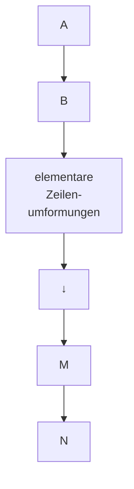
</details>

(10) $M = PA, N = PB$.

Mit einer speziellen Wahl der Anfangs- und/oder Enddaten kann eine explizite Darstellung von P erreicht werden.

Ⓐ Berechnung von P mit M = PA (→ Satz 4.2).

Mit $B = E \in \mathbb{R}^{m \times m}$ zeigt (10)

$$
M = P A, \quad N = P.
$$

D.h., dieselben elementaren Zeilenumformungen, die A in M umwandeln, führen gleichzeitig von E zur invertierbaren  $m \times m$ -Matrix P mit

$$
M = P A, \text {bzw.} \quad A = P ^ {- 1} M.
$$


<details>
<summary>flowchart</summary>

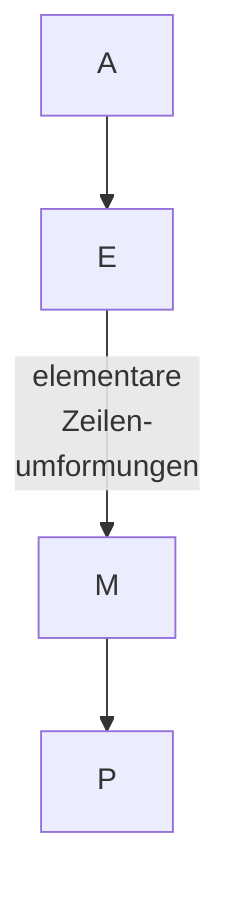
</details>

P ist ein Produkt von Elementarmatrizen.

---

292

6. Lineare Algebra

## Beispiel.

<table><tr><td colspan="4">A</td><td colspan="3">E</td><td>Protokoll</td></tr><tr><td>1</td><td>-4</td><td>2</td><td>0</td><td>1</td><td>0</td><td>0</td><td></td></tr><tr><td>2</td><td>-3</td><td>-1</td><td>-5</td><td>0</td><td>1</td><td>0</td><td></td></tr><tr><td>3</td><td>-7</td><td>1</td><td>-5</td><td>0</td><td>0</td><td>1</td><td></td></tr><tr><td>1</td><td>-4</td><td>2</td><td>0</td><td>1</td><td>0</td><td>0</td><td></td></tr><tr><td>0</td><td>5</td><td>-5</td><td>-5</td><td>-2</td><td>1</td><td>0</td><td> $\mathbf{z}_{2} - 2\mathbf{z}_{1}$ </td></tr><tr><td>0</td><td>5</td><td>-5</td><td>-5</td><td>-3</td><td>0</td><td>1</td><td> $\mathbf{z}_{3} - 3\mathbf{z}_{1}$ </td></tr><tr><td>1</td><td>-4</td><td>2</td><td>0</td><td>1</td><td>0</td><td>0</td><td></td></tr><tr><td>0</td><td>1</td><td>-1</td><td>-1</td><td> $-\frac{2}{5}$ </td><td> $\frac{1}{5}$ </td><td>0</td><td> $\frac{1}{5}\mathbf{z}_{2}$ </td></tr><tr><td>0</td><td>0</td><td>0</td><td>0</td><td>-1</td><td>-1</td><td>1</td><td> $\mathbf{z}_{3} - \mathbf{z}_{2}$ </td></tr><tr><td colspan="4">= M</td><td colspan="3">= P</td><td></td></tr></table>

Also gilt  $(PA = M)$ :

$$
\left( \begin{array}{r r r} 1 & 0 & 0 \\ - 2 / 5 & 1 / 5 & 0 \\ - 1 & - 1 & 1 \end{array} \right) \left( \begin{array}{r r r r} 1 & - 4 & 2 & 0 \\ 2 & - 3 & - 1 & - 5 \\ 3 & - 7 & 1 & - 5 \end{array} \right) = \left( \begin{array}{r r r r} 1 & - 4 & 2 & 0 \\ 0 & 1 & - 1 & - 1 \\ 0 & 0 & 0 & 0 \end{array} \right).
$$


Berechnung der Inversen (Zeilenverfahren, Gauß-Jordan-Verfahren)

Jede invertierbare Matrix $A \in \mathbb{R}^{n \times n}$ läßt sich allein durch elementare Zeilenumformungen in die $n \times n$-Einheitsmatrix $E$ umwandeln. Denn mit $A$ ist auch die mittels Vorwärtselimination aus $A$ entstandene Zeilenstufenmatrix

$$
M _ {1} = \left( \begin{array}{c c c} \blacksquare & & * \\ 0 & \ddots & \blacksquare \end{array} \right)
$$

invertierbar (Rang A = Rang  $M_{1}$  = n), alle Diagonalelemente sind ≠ 0

(→ Satz 3.1). Die Rückwärtselimination (von unten nach oben) und Normierung der Diagonalstellen zu 1 führt von $M_{1}$ zu $E$.

Nach Ⓐ - mit M = E - ergibt sich
E = PA, also  $P = A^{-1}$ .

Da mit P auch  $A = P^{-1}$  ein Produkt von Elementarmatrizen ist, haben wir außerdem das nützliche Beweismittel:

<table><tr><td>A</td><td>E</td></tr><tr><td></td><td>|</td></tr><tr><td colspan="2">Gauß-Elimination(Vorwärts- und Rückwärtselimination im 1.Block)</td></tr><tr><td></td><td>↓</td></tr><tr><td>E</td><td> $A^{-1}$ </td></tr></table>

Satz 4.4. Jede invertierbare $n \times n$-Matrix ist darstellbar als Produkt von $n \times n$-Elementarmatrizen.

---

§4. Elementarmatrizen und elementare Umformungen

293

Beispiel.

<table><tr><td colspan="3">A</td><td colspan="3">E</td><td>Protokoll</td></tr><tr><td>1</td><td>2</td><td>3</td><td>1</td><td>0</td><td>0</td><td></td></tr><tr><td>2</td><td>1</td><td>0</td><td>0</td><td>1</td><td>0</td><td></td></tr><tr><td>1</td><td>0</td><td>2</td><td>0</td><td>0</td><td>1</td><td></td></tr><tr><td>1</td><td>2</td><td>3</td><td>1</td><td>0</td><td>0</td><td></td></tr><tr><td>0</td><td>-3</td><td>-6</td><td>-2</td><td>1</td><td>0</td><td> $\mathbf{z}_{2} - 2\mathbf{z}_{1}$ </td></tr><tr><td>0</td><td>-2</td><td>-1</td><td>-1</td><td>0</td><td>1</td><td> $\mathbf{z}_{3} - \mathbf{z}_{1}$ </td></tr><tr><td>1</td><td>2</td><td>3</td><td>1</td><td>0</td><td>0</td><td></td></tr><tr><td>0</td><td>-3</td><td>-6</td><td>-2</td><td>1</td><td>0</td><td></td></tr><tr><td>0</td><td>0</td><td>3</td><td> $\frac{1}{3}$ </td><td> $-\frac{2}{3}$ </td><td>1</td><td> $\mathbf{z}_{3} - \frac{2}{3}\mathbf{z}_{2}$ </td></tr><tr><td>1</td><td>2</td><td>0</td><td> $\frac{2}{3}$ </td><td> $\frac{2}{3}$ </td><td>-1</td><td> $\mathbf{z}_{1} - \mathbf{z}_{3}$ </td></tr><tr><td>0</td><td>1</td><td>0</td><td> $\frac{4}{9}$ </td><td> $\frac{1}{9}$ </td><td> $-\frac{2}{3}$ </td><td> $-\frac{1}{3}(\mathbf{z}_{2} + 2\mathbf{z}_{3})$ </td></tr><tr><td>0</td><td>0</td><td>1</td><td> $\frac{1}{9}$ </td><td> $-\frac{2}{9}$ </td><td> $\frac{1}{3}$ </td><td> $\frac{1}{3}\mathbf{z}_{3}$ </td></tr><tr><td>1</td><td>0</td><td>0</td><td> $-\frac{2}{9}$ </td><td> $\frac{4}{9}$ </td><td> $\frac{1}{3}$ </td><td> $\mathbf{z}_{1} - 2\mathbf{z}_{2}$ </td></tr><tr><td>0</td><td>1</td><td>0</td><td> $\frac{4}{9}$ </td><td> $\frac{1}{9}$ </td><td> $-\frac{2}{3}$ </td><td></td></tr><tr><td>0</td><td>0</td><td>1</td><td> $\frac{1}{9}$ </td><td> $-\frac{2}{9}$ </td><td> $\frac{1}{3}$ </td><td></td></tr></table>

Damit gilt:

$$
\left( \begin{array}{c c c} 1 & 2 & 3 \\ 2 & 1 & 0 \\ 1 & 0 & 2 \end{array} \right) ^ {- 1} = \left( \begin{array}{c c c} - \frac {2}{9} & \frac {4}{9} & \frac {1}{3} \\ \frac {4}{9} & \frac {1}{9} & - \frac {2}{3} \\ \frac {1}{9} & - \frac {2}{9} & \frac {1}{3} \end{array} \right)  .
$$


© Matrixgleichungen (Gauß-Verfahren).

Das in Ⓑ beschriebene Verfahren liefert bei allgemeiner rechter Seite $B \in \mathbb{R}^{n \times k}$ die eindeutig bestimmte Lösung $X = A^{-1}B$ der Matrixgleichung $AX = B$ ($X, B \in \mathbb{R}^{n \times k}$, $A \in \mathbb{R}^{n \times n}$ invertierbar). Denn mit $M = E$ zeigt (10) $N = A^{-1}B$.


<details>
<summary>flowchart</summary>

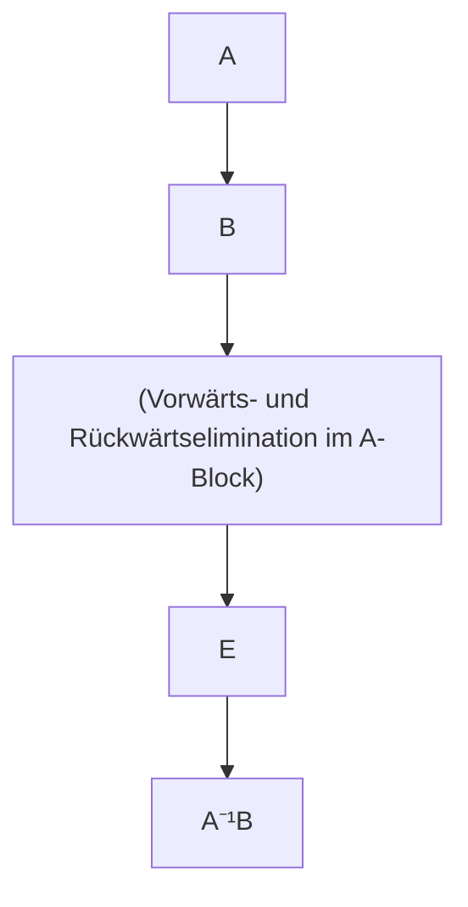
</details>

⑭ Die LR-Zerlegung.

Bringt man eine invertierbare $n \times n$-Matrix $A$ nach $\textcircled{A}$ nur mit Vorwärtselimination (Zeilenumformungen vom Typ $\textcircled{3}$) auf eine obere Dreiecksmatrix $M$, und kommt man dabei ohne Zeilenvertauschungen aus, dann beobachtet man auf der rechten Seite (des Rechenschemas) nur Veränderungen unterhalb der Diagonalen; d.h. $P$ ist eine untere Dreiecksmatrix mit lauter Einsen auf der Diagonalen. Es ist eine einfache Übung nachzuweisen (etwa anhand $\textcircled{B}$), daß auch $P^{-1}$ dieselbe Gestalt hat. Die Formel $A = P^{-1}M$ ($\rightarrow$ $\textcircled{A}$) besagt in diesem Fall:

---

294

6. Lineare Algebra

A besitzt eine Produktzerlegung A = LR in eine untere Dreiecksmatrix  $L = P^{-1}$  (mit lauter Einsen auf der Diagonalen) und eine obere Dreiecksmatrix R = M (mit Diagonalelementen ≠ 0).

Diese sogenannte LR- oder Dreieckszerlegung ist sehr vorteilhaft für die Auflösung der Matrixgleichung AX = B, insbesondere dann, wenn diese für verschiedene rechte Seiten zu lösen ist: Man berechnet zuerst die Matrix Y (vom gleichen Typ wie X) mit LY = B und damit X aus RX = Y. Diese Rechnungen gestalten sich aufgrund der Dreiecksform von L und R recht einfach. (→ Programm GAUSS)

In der Praxis wird die LR-Zerlegung sehr oft direkt aus dem Ansatz A = LR bestimmt. (→ Aufgabe 5)

Beispiel. An dem zu Ⓑ angegebenen Beispiel kann man bereits nach der Vorwärtselimination $A = P^{-1}M$ ablesen:

$$
\left( \begin{array}{l l l} 1 & 2 & 3 \\ 2 & 1 & 0 \\ 1 & 0 & 2 \end{array} \right) = \left( \begin{array}{c c c} 1 & 0 & 0 \\ - 2 & 1 & 0 \\ \frac {1}{3} & - \frac {2}{3} & 1 \end{array} \right) ^ {- 1} \left( \begin{array}{c c c} 1 & 2 & 3 \\ 0 & - 3 & - 6 \\ 0 & 0 & 3 \end{array} \right) = \left( \begin{array}{l l l} 1 & 0 & 0 \\ 2 & 1 & 0 \\ 1 & \frac {2}{3} & 1 \end{array} \right) \left( \begin{array}{c c c} 1 & 2 & 3 \\ 0 & - 3 & - 6 \\ 0 & 0 & 3 \end{array} \right) \quad \square
$$

## B) Rechenverfahren, die nur Spaltenumformungen erfordern,

verlaufen nach folgendem Schema an  $A \in R^{m \times n}$  und  $C \in R^{k \times n}$ :

$$
\frac {A}{C} \left|\begin{array}{l l}&\text {elementare Spaltenumformungen}\\&\text {an A und gleichzeitig an C}\end{array}\right.\rightarrow \left|\begin{array}{c}M\\\hline N\end{array}\right..
$$

Nach Satz 4.2 gibt es eine invertierbare $n \times n$-Matrix $Q$ gleicher Spaltenzahl mit $\binom{M}{N} = \binom{A}{C} Q = \binom{AQ}{CQ} (\rightarrow (9))$, also $M = AQ$, $N = CQ$.

So berechnet man etwa die „Transformationsmatrix“ Q nach diesem Schema mit C = E (der  $n \times n$ -Einheitsmatrix).

⑤ Eine Basis für Kern A (Spaltenverfahren).

Sei $A \in \mathbb{R}^{m \times n}$. Wir bestimmen für den Lösungsraum Kern $A$ des homogenen linearen Gleichungssystems $Ax = 0$ wie folgt eine Basis:

$$
\frac {A}{E} \left|\begin{array}{l}\text {Vorwärtselimination für Spalten (von links}\\\text {nach rechts) im A - Block; diese Spalten-}\\\text {umformungen gleichzeitig an E ausführen}\end{array}\rightarrow \left|\begin{array}{c}N\\\hline Q\end{array}\right.\right.
$$

mit $N = (\mathbf{v}_1, \ldots, \mathbf{v}_r, \mathbf{0}, \ldots, \mathbf{0})$ in Spaltenstufenform $(\rightarrow(4)$, mit $\mathbf{v}_i \neq \mathbf{0}$, $r = \text{Rang } A$) und $Q = (\mathbf{q}_1, \ldots, \mathbf{q}_r, \mathbf{q}_{r+1}, \ldots, \mathbf{q}_n)$ (Spaltendarstellung). Nach Satz 4.3 gilt:

$$
(\mathbf {q} _ {r + 1}, \mathbf {q} _ {r + 2}, \dots , \mathbf {q} _ {n}) \quad \text {ist eine Basis von Kern A} . \tag {11}
$$

Die allgemeine Lösung von  $Ax = 0 \cdot lautet \quad x = \lambda_{1} q_{r+1} + \cdots + \lambda_{n-r} q_{n} \quad (\lambda_{i} \in R)$ .

---

§4. Elementarmatrizen und elementare Umformungen

295

Beispiel. Für die Matrix

$$
A = \left( \begin{array}{c c c c} 3 & 6 & 9 & - 3 \\ 0 & 2 & 6 & 1 0 \\ 1 5 & 3 4 & 5 8 & 3 \\ - 9 & - 1 0 & - 3 & 4 9 + \alpha \end{array} \right)
$$

ist in Abhängigkeit von  $\alpha$  eine Basis von Kern A zu bestimmen:

$$
\begin{array}{c c c c}3&6&9&- 3\\0&2&6&1 0\\1 5&3 4&5 8&3\\- 9&- 1 0&- 3&4 9 + \alpha\\\hline 1&0&0&0\\0&1&0&0\\0&0&1&0\\0&0&0&1\end{array}\rightarrow\begin{array}{c c c c}3&0&0&0\\0&2&6&1 0\\1 5&4&1 3&1 8\\- 9&8&2 4&4 0 + \alpha\\\hline 1&- 2&- 3&1\\0&1&0&0\\0&0&1&0\\0&0&0&1\end{array}\rightarrow\begin{array}{c c c c}3&0&0&0\\0&2&0&0\\1 5&4&1&- 2\\- 9&8&0&\alpha\\\hline 1&- 2&3&1 1\\0&1&- 3&- 5\\0&0&1&0\\0&0&0&1\end{array}\rightarrow\begin{array}{c c c c}3&0&0&0\\0&2&0&0\\1 5&4&1&0\\- 9&8&0&\alpha\\\hline 1&- 2&3&1 7\\0&1&- 3&- 1 1\\0&0&1&2\\0&0&0&1\end{array}
$$

Fall 1: $\alpha \neq 0 \Rightarrow \operatorname{Rang} A = 4$; Kern $A = \{\mathbf{0}\}$.

Fall 2: $\alpha = 0 \Rightarrow \operatorname{Rang} A = 3$; Dim Kern $A = 1$.

$$
\text {Kern} A = \left\{t \left( \begin{array}{c} 1 7 \\ - 1 1 \\ 2 \\ 1 \end{array} \right); t \in \mathbb {R} \right\}.
$$

Eine Mischung aus dem Gauß-Verfahren (→ §1) und dem vorstehenden Spaltenverfahren zur Lösung von Ax = 0 ergibt eine übersichtlich strukturierte Lösung der inhomogenen linearen Gleichung $Ax = b$ ($A \in \mathbb{R}^{m \times n}$, $b \in \mathbb{R}^m$, $b \neq 0$): Man beginnt mit dem Gauß-Verfahren; d.h., (A|b) wird mit elementaren Zeilenumformungen umgewandelt zu (M|d) mit M in Zeilenstufenform. $Mx = d$ besitzt genau dieselben Lösungen wie $Ax = b$. Im Fall der Lösbarkeit (Rang M = Rang (M|d)) berechnet man zuerst die spezielle (partikuläre) Lösung $v_0$, in der die freien Variablen den Wert Null haben. Dann bestimmt man mit dem Spaltenverfahren eine Basis $(u_1, \ldots, u_{n-r})$ von Kern M (= Kern A), was wegen der Dreiecksform von M recht einfach ist. Damit wird die allgemeine Lösung von $Ax = b$ dargestellt in der Form (→ Satz 1.2)

$$
\mathbf {x} = \mathbf {v} _ {0} + \lambda_ {1} \mathbf {u} _ {1} + \dots + \lambda_ {n - r} \mathbf {u} _ {n - r} \quad (\lambda_ {i} \in \mathbb {R}, r = \operatorname{Rang} A).
$$

Im nachfolgenden Programm GAUSS ist das Prinzip der LR-Zerlegung realisiert, wobei aber zusätzlich Zeilenvertauschungen vorgenommen (und gespeichert) werden, so daß in jedem Gauß-Eliminationsschritt das betragsgrößte Element einer Restspalte zum ■-Element (Pivot-Element) wird. Um bestmögliche numerische Ergebnisse zu erzielen, wird das Gleichungssystem zunächst äquilibriert, indem jede Gleichung durch die Länge des entsprechenden Zeilenvektors von A dividiert wird. Mit der fertigen „LR-Zerlegung“ kann die Rückwärtssubstitution mit verschiedenen rechten Seiten wiederholt werden.

---

296

6. Lineare Algebra

```vba
' Programm GAUSS
' -------------------          ' ---- Zeilenvertauschung ---
Print "DIMENSION N=";              D=-D
Input N                      For J=0 To M
M=N-1                          Y=A(K,J)
Dim A(M,M),B(M),C(M)           A(K,J)=A(L,J)
Print "A ZEILENWEISE:"         A(L,J)=Y
For I=1 To N                  Next J
    For J=1 To N               C(L)=C(K)
        Print "A"+Str$(I)+Str$(J); Endif
        Input A(I-1,J-1)          ' -------------------
Next J                        C(K)=L
Next I                        D=D*A(K,K)
' ---- Zeilen skalieren ---- Exit If X<1.0E-09
For I=0 To M                   U=K
    Y=0                         X=A(K,K)
    For S=0 To M               If K<M Then
        Y=A(I,S)*A(I,S)+Y       For J=K+1 To M
Next S                          Y=-A(K,J)
If Y=0 Then                     V=J
    Print " A singulaer"       Gosub Scalar2
    End                       A(K,J)=-Y/X
Else                           Next J
    C(I)=1/Sqr(Y)      Endif
Endif                          Next K
Next I                        If Abs(D)<1.0E-09 Then
' ------ LR-Zerlegung ------   Print "A SINGULAER"
D=1                          End
For K=0 To M               Endif
    L=K                         Print "D=";D
    X=0                         ' -------------------
    V=K                         Repeat
    For I=K To M             Print "RECHTE SEITE"
        Y=-A(I,K)         For I=1 To N
        U=I                          Print "B"+Str$(I);
        Gosub Scalar2       Input B(I-1)
        A(I,K)=-Y           Next I
        Y=Abs(Y*C(I))      For I=0 To M
        If Y>X Then          Y=C(I)
            X=Y                          If I<>Y Then
                L=I                          X=B(I)
        Endif                          B(I)=B(Y)
Next I                        B(Y)=X
If L<>K Then          Endif
                            Next I
```

---

§4. Elementarmatrizen und elementare Umformungen

297

<div class="docvortex-algorithm" style="white-space: pre-wrap; font-family:monospace;">
U=O
For I=O To M
    Y=B(I)
    V=I-1
    Gosub Scalar1
    B(I)=-Y/A(I,I)
Next I
V=M
For I=M To O Step -l
    Y=B(I)
    U=I+1
    Gosub Scalar1
    B(I)=-Y
Next I
Print "ERGEBNIS"
For I=1 To N
    Print "X"+Str$(I)+"=";B(I-1)
Next I
Print "Neue rechte Seite (j/n)"
Input R$
Until R\$="n"
</div>

## Aufgaben

1. Für die folgenden Matrizen bestimme man

a) den Rang r (Zeilen- u. Spaltenumformungen!),
b) eine Basis des Zeilenraumes,
c) eine Basis des Spaltenraumes,
d) Matrizen P, Q, so daß  $PAQ = \begin{pmatrix} E_{r} & 0 \\ 0 & 0 \end{pmatrix}$ :

$$
\left( \begin{array}{c c c} 1 & 2 & 3 \\ 4 & 5 & 6 \\ 7 & 8 & 9 \end{array} \right) \qquad \left( \begin{array}{c c c c c} 1 & 3 & 1 & - 2 & - 3 \\ 1 & 4 & 3 & - 1 & - 4 \\ 2 & 3 & - 4 & - 7 & - 3 \\ 3 & 8 & 1 & - 7 & - 8 \end{array} \right) \qquad \left( \begin{array}{c c c c c} 1 & - 1 & 2 & 3 & 0 \\ 0 & 1 & 0 & 1 & 1 \\ 1 & 0 & 1 & 0 & 1 \\ 0 & 0 & 0 & 1 & 0 \\ 0 & 1 & 0 & 0 & 1 \end{array} \right).
$$

2. Mittels Zeilenverfahren Ⓑ berechne – falls möglich – die Inversen von

$$
\left( \begin{array}{c c c} 1 & 0 & - 1 \\ 3 & 1 & - 3 \\ 1 & 2 & - 2 \end{array} \right) \quad \left( \begin{array}{c c c c} 1 & 3 & - 1 & 4 \\ 2 & 5 & - 1 & 3 \\ 0 & 4 & - 3 & 1 \\ - 3 & 1 & - 5 & - 2 \end{array} \right) \quad \left( \begin{array}{c c c c c} 1 / 2 & 1 / 3 & 1 / 4 & 1 / 5 & 1 / 6 \\ 1 / 3 & 1 / 4 & 1 / 5 & 1 / 6 & 1 / 7 \\ 1 / 4 & 1 / 5 & 1 / 6 & 1 / 7 & 1 / 8 \\ 1 / 5 & 1 / 6 & 1 / 7 & 1 / 8 & 1 / 9 \\ 1 / 6 & 1 / 7 & 1 / 8 & 1 / 9 & 1 / 1 0 \end{array} \right)
$$

und stelle die 3 × 3-Matrix als Produkt von Elementarmatrizen dar.

3. Man löse die Matrixgleichung AX = B gemäß Verfahren ©, analog dazu BY = A und berechne schließlich zur Kontrolle XY für

$$
\text {a)} \quad A = \left( \begin{array}{c c c} 1 & 3 & - 1 \\ 2 & 5 & - 1 \\ 0 & 4 & - 3 \end{array} \right), B = \left( \begin{array}{c c c} 1 & 3 & 1 \\ 1 & 4 & 3 \\ 2 & 3 & - 4 \end{array} \right);
$$

---

298

6. Lineare Algebra

$$
\text {b)} A = \left( \begin{array}{r r r r} 1 & 2 & - 2 & 1 \\ 2 & 5 & - 2 & 2 \\ - 2 & - 4 & 3 & 0 \\ 1 & 3 & 0 & 2 \end{array} \right), B = \left( \begin{array}{r r r r} 1 & 0 & - 1 & 0 \\ 2 & - 1 & - 2 & 3 \\ - 1 & 2 & 2 & - 4 \\ 0 & 1 & 2 & - 5 \end{array} \right).
$$

4. a) Mittels Zeilenumformungen bestimme man gemäß Ⓓ für A eine untere Dreiecksmatrix P und eine obere Dreiecksmatrix R, so daß PA = R und leite daraus die LR-Zerlegung von A ab:

$$
A = \left( \begin{array}{c c c c} 3 & 6 & 9 & - 3 \\ 0 & 2 & 6 & 1 0 \\ 1 5 & 3 4 & 5 8 & 3 \\ - 9 & - 1 0 & - 3 & 5 0 \end{array} \right) = \mathrm{LR} = \left( \begin{array}{c c c} 1 & & 0 \\ * & & 1 \end{array} \right) \left( \begin{array}{c c c} * & & * \\ & \ddots & \\ 0 & & * \end{array} \right) .
$$

b) Man bestätige, daß  $A = \begin{pmatrix} 2 & 6 & 13 \\ 0 & 0 & 4 \\ 0 & 3 & 16 \end{pmatrix}$  invertierbar ist aber keine LR-Zerlegung besitzt!

5. a) Man bestimme die LR-Zerlegung:

$$
\begin{array}{l} H = \left( \begin{array}{l l l l} 1 / 2 & 1 / 3 & 1 / 4 & 1 / 5 \\ 1 / 3 & 1 / 4 & 1 / 5 & 1 / 6 \\ 1 / 4 & 1 / 5 & 1 / 6 & 1 / 7 \\ 1 / 5 & 1 / 6 & 1 / 7 & 1 / 8 \end{array} \right) = \mathrm{LR} = (*) ((*)) \\ = \left( \begin{array}{c c c c} 1 & & 0 \\ l _ {2 1} & 1 & & \\ l _ {3 1} & l _ {3 2} & 1 & \\ l _ {4 1} & l _ {4 2} & l _ {4 3} & 1 \end{array} \right) \left( \begin{array}{c c c c} r _ {1 1} & r _ {1 2} & r _ {1 3} & r _ {1 4} \\ & r _ {2 2} & r _ {2 3} & r _ {2 4} \\ & & r _ {3 3} & r _ {3 4} \\ & 0 & & r _ {4 4} \end{array} \right) \\ \end{array}
$$

— durch Zeilenverfahren Ⓓ ,
— direkt aus (\*): LR ausmultiplizieren und auflösen nach $r_{11}, l_{21}, l_{31}, \ldots$.

6. Man bestimme – abhängig von  $\alpha$  – mittels Spaltenverfahren Ⓔ eine Basis von Kern A für die Matrizen A

$$
\left( \begin{array}{c c c c} 1 & 1 & 2 & 3 \\ 2 & 3 & 3 & 7 \\ 4 & 5 & 3 0 & 1 4 \\ 3 & 2 & 6 \alpha + 7 & 2 \alpha + 8 \end{array} \right), \qquad \left( \begin{array}{c c c c} 1 & 1 & 1 & 1 \\ 2 & 0 & 2 & 6 \\ 3 & 2 & 1 & - 1 \\ 0 & 0 & 1 & \alpha \\ 5 & - 1 & 1 & 5 \end{array} \right).
$$

7. Man zeige für eine invertierbare Matrix A

a) $A = A^{T} \Rightarrow A^{-1} = (A^{-1})^{T}$,
b) $A = -A^{T} \Rightarrow A^{-1} = -(A^{-1})^{T}$.

8. Es seien $A \in \mathbb{R}^{m \times n}$ und $B \in \mathbb{R}^{n \times m}$ mit $AB = 0$. Man beweise oder widerlege mit einem Beispiel:

a) Es gilt auch BA = 0,
b) Rang $A = n \Rightarrow B = 0$,
c) Rang $A = m \Rightarrow B = 0$.

9. Man zeige, daß jede invertierbare Matrix allein durch elementare Zeilenumformungen vom Typ ③ auf die Form $\mathrm{Diag}(1,\dots,1,d)$ mit $d\neq 0$ gebracht werden kann.

---

§5. Determinanten

299

10. Pseudo-Inverse einer Matrix $A \in \mathbb{R}^{m \times n}$ nennt man eine Matrix $A^{+} \in \mathbb{R}^{n \times m}$, für welche

(i) $A^{+}AA^{+} = A^{+}$
(ii) $AA^{+}A = A$ .

a) Man zeige: Für $A = \begin{pmatrix} E_r & 0 \\ 0 & 0 \end{pmatrix}$ ist $A^T$ eine Pseudo-Inverse.
b) Man bestätige: Sind $P \in \mathbb{R}^{m \times m}$, $Q = \in \mathbb{R}^{n \times n}$ invertierbar und $A^+$ Pseudo-Inverse von $A$, so ist $B^+ = Q^{-1} A^+ P^{-1}$ Pseudoinverse von $B = PAQ$.
c) Man bestimme eine Pseudoinverse für  $\begin{pmatrix}0&1\\0&0\end{pmatrix}$  und  $\begin{pmatrix}1&0&1\\2&3&8\end{pmatrix}$ .

## §5. Determinanten

5.1 Einführung. Determinanten wurden bereits 1678 von G. W. LEIBNIZ eingeführt, sie waren aber – aufgrund ihrer komplizierten Berechnung – für lange Zeit als magisches Rechenmittel verrufen und nur den Könnern vorbehalten. Man kann mit ihnen elementargeometrische Größen äußerst elegant beschreiben, die Lösung eines linearen Gleichungssystems mit invertierbarer Koeffizientenmatrix direkt als Funktion der Koeffizienten darstellen und schließlich den Test „Rang A < n“ bei einer  $n \times n$ -Matrix auf eine bloße Nullabfrage zurückführen.

2-reihige Determinanten. Das von zwei Vektoren $\mathbf{a}=\begin{pmatrix}\alpha_{1}\\ \alpha_{2}\end{pmatrix},\mathbf{b}=\begin{pmatrix}\beta_{1}\\ \beta_{2}\end{pmatrix}$ der $(x,y)$-Ebene erzeugte Parallelogramm hat nach Kap. 1, §5.3 den Flächeninhalt

$$
F = \left| \left( \begin{array}{c} \alpha_ {1} \\ \alpha_ {2} \\ 0 \end{array} \right) \times \left( \begin{array}{c} \beta_ {1} \\ \beta_ {2} \\ 0 \end{array} \right) \right| = | \alpha_ {1} \beta_ {2} - \alpha_ {2} \beta_ {1} |.
$$


<details>
<summary>text_image</summary>

y
b
F
e₂
a
x
e₁
</details>

Abb. 143 - Parallelogrammfläche

Es ist $F = \alpha_{1}\beta_{2} - \alpha_{2}\beta_{1} \geq 0$, wenn die Drehung von $\mathbf{a}$ nach $\mathbf{b}$ über den kleineren Winkel positiv (gegen den Uhrzeigersinn) erfolgt, andernfalls gilt $-F = \alpha_{1}\beta_{2} - \alpha_{2}\beta_{1} \leq 0$. Die Zahl

$$
\det A := \alpha_ {1} \beta_ {2} - \alpha_ {2} \beta_ {1} \tag {1}
$$

heißt Determinante der  $2 \times 2$ -Matrix  $A = \begin{pmatrix} \alpha_{1} & \beta_{1} \\ \alpha_{2} & \beta_{2} \end{pmatrix}$ . Man berechnet sie nach dem Schema +

$$
\det \left( \begin{array}{c c} \alpha_ {1} & \beta_ {1} \\ \times & \\ \alpha_ {2} & \beta_ {2} \end{array} \right) = \alpha_ {1} \beta_ {2} - \alpha_ {2} \beta_ {1}.
$$

---

300

6. Lineare Algebra

Es ist det  $A = \pm F = 0$  genau dann, wenn a, b parallel sind (oder einer der beiden der Nullvektor ist). Damit ist gezeigt:

$$
\begin{array}{l} \binom{\alpha_ {1}}{\alpha_ {2}}, \binom{\beta_ {1}}{\beta_ {2}} \text {linear abhängig} \Longleftrightarrow \det \left( \begin{array}{c c} \alpha_ {1} & \beta_ {1} \\ \alpha_ {2} & \beta_ {2} \end{array} \right) = 0 \\ A = \left( \begin{array}{c c} \alpha_ {1} & \beta_ {1} \\ \alpha_ {2} & \beta_ {2} \end{array} \right) \text {invertierbar} \iff \det A \neq 0 \\ \end{array}
$$

bzw., äquivalent dazu

Beispiel.  $\det\begin{pmatrix}1&3\\2&5\end{pmatrix}=1\cdot5-2\cdot3=-1\neq0$ . Die Matrix ist invertierbar;
 $\left(\begin{array}{cc}1 & 3 \\ 2 & 5\end{array}\right)^{-1}=(-1)\begin{pmatrix}5 & -3 \\ -2 & 1\end{pmatrix}.$

Ferner: Der Flächeninhalt des von  $\begin{pmatrix}1\\2\end{pmatrix}$  und  $\begin{pmatrix}3\\5\end{pmatrix}$  aufgespannten Parallelogramms beträgt  $F = |\det A| = 1$ .

3-reihige Determinanten. Ein Spat mit den bezüglich einer kartesischen Basis dargestellten Kanten

$$
\mathbf {a} _ {1} = \left( \begin{array}{c} \alpha_ {1 1} \\ \alpha_ {2 1} \\ \alpha_ {3 1} \end{array} \right), \mathbf {a} _ {2} = \left( \begin{array}{c} \alpha_ {1 2} \\ \alpha_ {2 2} \\ \alpha_ {3 2} \end{array} \right), \mathbf {a} _ {3} = \left( \begin{array}{c} \alpha_ {1 3} \\ \alpha_ {2 3} \\ \alpha_ {3 3} \end{array} \right)
$$

hat nach Kap. 1, §5.4 das Volumen

$$
\begin{array}{l} V = | [ \mathbf {a} _ {1}, \mathbf {a} _ {2}, \mathbf {a} _ {3} ] | \tag {2} \\ = | \alpha_ {1 1} (\alpha_ {2 2} \alpha_ {3 3} - \alpha_ {3 2} \alpha_ {2 3}) - \alpha_ {2 1} (\alpha_ {1 2} \alpha_ {3 3} - \alpha_ {3 2} \alpha_ {1 3}) + \alpha_ {3 1} (\alpha_ {1 2} \alpha_ {2 3} - \alpha_ {2 2} \alpha_ {1 3}) | \\ \end{array}
$$

Die bisher als Spatprodukt bekannte Zahl

$$
\det A := [ \mathbf {a} _ {1}, \mathbf {a} _ {2}, \mathbf {a} _ {3} ]
$$

heißt auch Determinante der 3 × 3-Matrix

$$
A = \left( \begin{array}{c c c} \alpha_ {1 1} & \alpha_ {1 2} & \alpha_ {1 3} \\ \alpha_ {2 1} & \alpha_ {2 2} & \alpha_ {2 3} \\ \alpha_ {3 1} & \alpha_ {3 2} & \alpha_ {3 3} \end{array} \right) .
$$

Es gilt $V = \det A > 0$, wenn $(\mathbf{a}_1, \mathbf{a}_2, \mathbf{a}_3)$ ein Rechtssystem ist. $V = \det A = 0$ genau dann, wenn der Spat entartet ist, d.h. wenn $\mathbf{a}_1, \mathbf{a}_2, \mathbf{a}_3$ linear abhängig sind. In anderen Worten:

$$
\begin{array}{c} \text {Rang} A <   3 \iff \det A = 0, \text {bzw.} \\ \text {Rang} A = 3 \iff A \text {invertierbar} \iff \det A \neq 0. \end{array}
$$

Die auf der rechten Seite von (2) eingeklammerten Faktoren erkennt man als Determinanten gewisser  $2 \times 2$ -Matrizen. D.h.,

---

§5. Determinanten

301

$$
\det A = \alpha_ {1 1} \det \left( \begin{array}{l l} \alpha_ {2 2} & \alpha_ {2 3} \\ \alpha_ {3 2} & \alpha_ {3 3} \end{array} \right) - \alpha_ {2 1} \det \left( \begin{array}{l l} \alpha_ {1 2} & \alpha_ {1 3} \\ \alpha_ {3 2} & \alpha_ {3 3} \end{array} \right) + \alpha_ {3 1} \det \left( \begin{array}{l l} \alpha_ {1 2} & \alpha_ {1 3} \\ \alpha_ {2 2} & \alpha_ {2 3} \end{array} \right) \tag {3}
$$

Anschaulich:


<details>
<summary>text_image</summary>

det = - +
</details>

Abb. 144 - 3 × 3-Determinante

Für $3 \times 3$-Matrizen gibt es die nach dem französischen Mathematiker P. F. SARRUS (1798 - 1861) benannte Regel:


<details>
<summary>flowchart</summary>

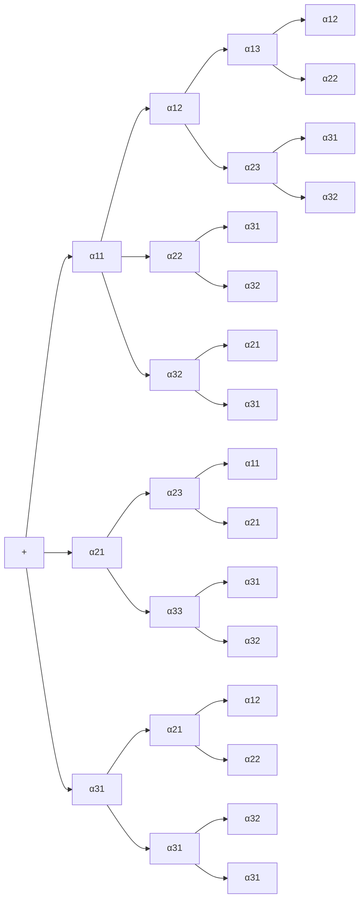
</details>

Man schreibt die ersten beiden Spalten noch einmal rechts neben A, addiert die längs der ↘-Diagonalen zu bildenden Produkte und subtrahiert die längs ↗ berechneten Produkte. Man erhält

$$
\begin{array}{l} \det A = \alpha_ {1 1} \alpha_ {2 2} \alpha_ {3 3} + \alpha_ {1 2} \alpha_ {2 3} \alpha_ {3 1} + \alpha_ {1 3} \alpha_ {2 1} \alpha_ {3 2} - \alpha_ {3 1} \alpha_ {2 2} \alpha_ {1 3} \\ - \alpha_ {3 2} \alpha_ {2 3} \alpha_ {1 1} - \alpha_ {3 3} \alpha_ {2 1} \alpha_ {1 2} . \\ \end{array}
$$

Beispiel.

$$
A = \left( \begin{array}{c c c} 0 & - 2 & 3 \\ - 2 & 1 & - 2 \\ 3 & 6 & 5 \end{array} \right) \quad \begin{array}{c} 0 \\ - 2 \\ 3 \end{array} \begin{array}{c} - 2 \\ 1 \\ 6 \end{array} \begin{array}{c} - 2 \\ - 2 \\ 5 \end{array} \begin{array}{c} 3 \\ - 2 \\ 3 \end{array} \begin{array}{c} 0 \\ - 2 \\ 1 \\ 6 \end{array}
$$

det $A = 0 + 12 - 36 - 9 - 0 - 20 = -53$. Die Matrix ist invertierbar, die Spalten bilden eine Basis des $\mathbb{R}^3$, aber kein Rechtssystem. Der von den Spalten (in kartesischen Koordinaten) aufgespannte Spat hat das Volumen $V = |\det A| = 53$.

Bemerkung. Die Regel von SARRUS läßt sich nicht auf die in 5.2 definierten n-reihigen Determinanten mit n > 3 übertragen.

5.2 Definition der Determinante einer  $n \times n$ -Matrix. Als Verallgemeinerung der beiden Sonderfälle n = 2, n = 3 ergibt sich für beliebiges  $n \in N$  die folgende

---

302

6. Lineare Algebra

(4)

Rekursive Definition der Determinante det $A$, $A = (\alpha_{ij}) \in \mathbb{R}^{n \times n}$.

Für $n = 1$, d.h. $A = (\alpha_{11})$, ist $\det A := \alpha_{11}$.

Für $n \geq 2$ ist (Entwicklung von det $A$ nach der ersten Spalte)

$$
\det A := \alpha_ {1 1} \det A _ {1 1} - \alpha_ {2 1} \det A _ {2 1} + \alpha_ {3 1} \det A _ {3 1}
$$

$$
- + \dots + (- 1) ^ {n + 1} \alpha_ {n 1} \det A _ {n 1},
$$

wobei $A_{i1}$ die $(n-1)\times(n-1)$-Matrix bezeichnet, die aus $A$ durch Entfernen (Streichen) der ersten Spalte und der $i$-ten Zeile entsteht $(1\leq i\leq n)$.

Für det A ist ebenfalls die Bezeichnung  $|A|$  üblich.

Die folgende Abbildung veranschaulicht (4):


<details>
<summary>text_image</summary>

det A = 
det A₁₁ - 
det A₂₁ + 
det A₃₁ - + ... (-1)ⁿ⁺¹ 
det Aₙ₁
</details>

Abb. 145 - Entwicklung nach der 1. Spalte

Beispiel.

$$
A = \left( \begin{array}{c c c c} 1 & 2 & 0 & 1 \\ 3 & - 2 & 1 & 0 \\ 0 & 6 & 3 & - 2 \\ 2 & 4 & 3 & 1 \end{array} \right), A _ {1 1} = \left( \begin{array}{c c c} - 2 & 1 & 0 \\ 6 & 3 & - 2 \\ 4 & 3 & 1 \end{array} \right)
$$

$$
A _ {2 1} = \left( \begin{array}{c c c} 2 & 0 & 1 \\ 6 & 3 & - 2 \\ 4 & 3 & 1 \end{array} \right), A _ {3 1} = \left( \begin{array}{c c c} 2 & 0 & 1 \\ - 2 & 1 & 0 \\ 4 & 3 & 1 \end{array} \right), A _ {4 1} = \left( \begin{array}{c c c} 2 & 0 & 1 \\ - 2 & 1 & 0 \\ 6 & 3 & - 2 \end{array} \right)
$$

$\operatorname{det} A = 1 \cdot \operatorname{det} A_{11} - 3 \cdot \operatorname{det} A_{21} + 0 \cdot \operatorname{det} A_{31} - 2 \cdot \operatorname{det} A_{41}$

$$
= - 3 2 - 3 \cdot 2 4 - 2 \cdot (- 1 6) = - 7 2.
$$

Bemerkung. Wendet man (4) rekursiv in (4) auf det  $A_{i1}$  ( $1 \leq i \leq n$ ) an, so ergibt sich zum Schluß die sogenannte vollständige Entwicklung der Determinante

$$
\det A = \sum_ {i = (i _ {1}, \dots , i _ {n})} (- 1) ^ {\epsilon (i)} \alpha_ {i _ {1} 1} \alpha_ {i _ {2} 2} \dots \alpha_ {i _ {n} n},
$$

wobei sich die Summe über alle Permutationen  $i = (i_{1}, \ldots, i_{n})$  der Zahlen  $1, 2, \ldots, n$  erstreckt, und  $\epsilon(i)$  gleich der Anzahl der Vertauschungen ist, die erforderlich sind, um  $(i_{1}, \ldots, i_{n})$  in die natürliche Reihenfolge zu bringen.

Die vollständige Entwicklung besteht aus $n!$ Summanden. Da mit wachsendem $n$ die Fakultät $n!$ rapide ansteigt ($7!=5040$), sucht man nach Eigenschaften, die eine schnellere Berechnung von det $A$, etwa durch Rückführung auf den folgenden Spezialfall, erlauben.

---

§5. Determinanten

303

Satz 5.1. Für eine obere Dreiecksmatrix gilt

$$
\det \left( \begin{array}{c c c c} \alpha_ {1 1} & * & \dots & * \\ 0 & \alpha_ {2 2} & \ddots & \vdots \\ \vdots & \ddots & \ddots & * \\ 0 & \dots & 0 & \alpha_ {n n} \end{array} \right) = \alpha_ {1 1} \alpha_ {2 2} \dots \alpha_ {n n}.
$$

Speziell: $\det E = 1$, $\det (\alpha E) = \alpha^n$ ($E \in \mathbb{R}^{n \times n}$).

Beweis. Wegen  $\alpha_{21}=\cdots=\alpha_{n1}=0$  reduziert sich (4) auf

$\operatorname*{det} A = \alpha_{11} \operatorname*{det}\left( \begin{array}{c} \alpha_{22} \\ 0 \end{array} \cdot \begin{array}{c} * \\ \alpha_{nn} \end{array} \right) = \alpha_{11} \alpha_{22} \operatorname*{det}\left( \begin{array}{c} \alpha_{33} \\ 0 \end{array} \cdot \begin{array}{c} * \\ \alpha_{nn} \end{array} \right) = \cdots = \alpha_{11} \alpha_{22} \dots \alpha_{nn}.$

## Beispiele.

$$
\det \left( \begin{array}{c c c c} 3 & 4 & 0 & 2 \\ 0 & 1 & 4 & 5 \\ 0 & 0 & - 2 & 6 \\ 0 & 0 & 0 & 1 \end{array} \right) = - 6; \quad \det \left( \begin{array}{c c c c c} 7 & 3 & 4 & 2 & 1 \\ 0 & 0 & 2 & 4 & 1 \\ 0 & 0 & 5 & - 1 & 2 \\ 0 & 0 & 0 & 4 & 3 \\ 0 & 0 & 0 & 0 & 6 \end{array} \right) = 0.
$$

5.3 Rechenregeln für Determinanten. Der folgende Satz enthält die grundlegenden Eigenschaften der Determinante.

Satz 5.2. a) det ist linear in jeder Zeile. Damit ist gemeint:

1. Ein gemeinsamer Faktor einer Zeile von A kann aus det A herausgezogen werden.
2. Besteht eine Zeile von A aus einer Summe,  $z_{i} = a + b$ , dann besitzt det A die entsprechende Summenzerlegung. In Formeln:

$$
\det \left( \begin{array}{c} \mathbf {z} _ {1} \\ \vdots \\ \alpha \mathbf {z} _ {i} \\ \vdots \\ \mathbf {z} _ {n} \end{array} \right) = \alpha \det \left( \begin{array}{c} \mathbf {z} _ {1} \\ \vdots \\ \mathbf {z} _ {i} \\ \vdots \\ \mathbf {z} _ {n} \end{array} \right), \quad \det \left( \begin{array}{c} \mathbf {z} _ {1} \\ \vdots \\ \mathbf {a} + \mathbf {b} \\ \vdots \\ \mathbf {z} _ {n} \end{array} \right) = \det \left( \begin{array}{c} \mathbf {z} _ {1} \\ \vdots \\ \mathbf {a} \\ \vdots \\ \mathbf {z} _ {n} \end{array} \right) + \det \left( \begin{array}{c} \mathbf {z} _ {1} \\ \vdots \\ \mathbf {b} \\ \vdots \\ \mathbf {z} _ {n} \end{array} \right).
$$

b) det ist alternierend. Das bedeutet: Entsteht $\tilde{A}$ aus $A \in \mathbb{R}^{n \times n}$ durch Vertauschung zweier Zeilen, dann gilt det $\tilde{A} = -\det A$; insbesondere det $A = 0$, falls $A$ zwei gleiche Zeilen enthält.

Beweis. a) beweist man leicht mit vollständiger Induktion  $(n = 1, 2, \ldots)$  und der Rekursionsformel (4).

b): Wegen der alternierenden Vorzeichen erkennt man an (4) (ebenfalls mit vollständiger Induktion), daß sich bei Vertauschung zweier benachbarter Zeilen das Vorzeichen ändert. Da man die Vertauschung zweier beliebiger Zeilen von A stets durch eine ungerade Anzahl von Vertauschungen benachbarter Zeilen erzielen kann, ist nun alles bewiesen. Sind zwei Zeilen von A gleich, so gilt mit einer Vertauschung dieser beiden Zeilen det A = -det A ; das ist nur mit det A = 0 möglich.

---

304

6. Lineare Algebra

Satz 5.3. Die Rechenregeln für Determinanten. Für alle $A, B \in \mathbb{R}^{n \times n}$ gilt:

a) Die Änderung bei elementaren Zeilen- bzw. Spaltenumformungen. Entsteht $\tilde{A}$ aus A durch eine elementare Zeilen- oder Spaltenumformung vom Typ ⓘ, dann ändert sich die Determinante wie folgt:

$$
\begin{array}{l} \begin{array}{l} \text {Typ} \quad ①: \quad \det \tilde {A} = - \det A, \\ \text {Typ} \quad ②: \quad \det \tilde {A} = \alpha \det A \quad (\text {Faktor} \alpha \neq 0), \end{array} \tag {5} \\ \text {Typ} \quad ③: \quad \det \tilde {A} = \det A. \\ \end{array}
$$

b) Symmetrie in Zeilen und Spalten.

$$
\det A ^ {T} = \det A ;
$$

insbesondere gilt Satz 5.2 entsprechend für Spalten.

c) Multiplikationssatz.

(6) $\operatorname{det}(AB) = (\operatorname{det} A)(\operatorname{det} B)$.

d) Invertierbarkeits-Test. A invertierbar $\iff$ det $A \neq 0$;

äquivalent dazu: Rang A < n  $\Longleftrightarrow$  det A = 0.

Beweis. a): Für die Zeilenumformungen vom Typ ① und ② stehen die Formeln in Satz 5.2. Für Typ ③ ($\mathbf{z}_i \to \mathbf{z}_i + \alpha \mathbf{z}_j$) verwendet man die Linearität in der $i$-ten Zeile und det $\begin{pmatrix} \dot{\mathbf{z}}_j \\ \vdots \\ \mathbf{z}_j \\ \vdots \end{pmatrix} = 0$. Die Gültigkeit dieser Formeln bei Spaltenumformungen ergibt sich rückwirkend, sobald b) bewiesen ist.

d): Mit elementaren Zeilenumformungen läßt sich $A$ in eine obere Dreiecksmatrix $M$ umwandeln. Nach (5) gilt $\det M = \gamma \det A$ mit $\gamma \neq 0$. Damit: $A$ invertierbar $\iff$ sämtliche Diagonalelemente in $M$ sind $\neq 0$ ($\rightarrow 4.4$ Ⓑ)) $\iff$ $\det M \neq 0$ ($\rightarrow$ Satz 5.1) $\iff$ $\det A \neq 0$.

c): (5) (für Zeilenumformungen) zeigt für $A = E$ wegen det $E = 1$, daß es sich bei den Koeffizienten jeweils um die Determinante der zugehörigen Elementarmatrix $\tilde{E}$ handelt ($\tilde{A} = \tilde{E}A, \to \text{Satz } 4.2$); deshalb läßt sich (5) in der einheitlichen Form

(7) $\operatorname{det}(\tilde{E} A) = \operatorname{det}\tilde{E} \cdot \operatorname{det}A$

angeben. Also gilt (6) für Elementarmatrizen, damit auch für alle endlichen Produkte von Elementarmatrizen und deshalb ( $\rightarrow$  Satz 4.4) für alle invertierbaren A, B.

Ist A oder B nicht invertierbar, so auch AB nicht und es gilt det AB = det A det B = 0.

b): Ist $A$ nicht invertierbar, so gilt nach d) $\det A = 0 = \det A^T$. Wegen Satz 4.4 und (6) braucht nur noch $\det \tilde{E} = \det \tilde{E}^T$ für jede Elementarmatrix nachgewiesen zu werden. Das geschieht direkt: Für $\tilde{E}$ vom Typ ① oder

---

§5. Determinanten

305

② gilt  $\tilde{E}^{T} = \tilde{E}$ , für  $\tilde{E}$  vom Typ ③ ist auch  $\tilde{E}^{T}$  eine Elementarmatrix vom Typ ③, hierfür gilt det  $\tilde{E} = 1 = \det \tilde{E}^{T}$  ( $\rightarrow$  (5)). □

Folgerungen aus dem Multiplikationssatz.

a)  $\det(AB) = \det(BA)$
b) $\operatorname{det}(A^k) = (\operatorname{det} A)^k \quad (k \in \mathbb{N})$
c) $\det (A^{-1}) = (\det A)^{-1}$, falls $A$ invertierbar
d) $\det (C^{-1}AC) = \det A$ , für alle invertierbaren $C\in \mathbb{R}^{n\times n}$
e) Der Kästchensatz. Für eine Blockmatrix (→ 4.4) der Form

$$
A = \left( \begin{array}{c c} B & C \\ 0 & D \end{array} \right) \quad \text {bzw.} \quad A = \left( \begin{array}{c c} B & 0 \\ C & D \end{array} \right)
$$

mit $k \times k$-Matrix $B$, $(n-k) \times (n-k)$-Matrix $D$, 0 Nullmatrix und $C$ jeweils vom passenden Typ gilt

$$
\det A = \det B \det D.
$$

Beweis. a):  $\det(AB) = \det A \det B = \det B \det A = \det(BA)$ .

b):  $\det(A^{k}) = (\det A)(\det A^{k-1}) = \cdots = (\det A)^{k}$ .
c): $1 = \det E = \det A^{-1}A = (\det A^{-1})(\det A)$.
d): $\operatorname{det}(C^{-1}AC) = \operatorname{det}(AC)C^{-1} = \operatorname{det}A$.
e): Man rechnet leicht

$$
\left( \begin{array}{c c} B & C \\ 0 & D \end{array} \right) = \left( \begin{array}{c c} E & 0 \\ 0 & D \end{array} \right) \left( \begin{array}{c c} B & C \\ 0 & E \end{array} \right)
$$

nach, mit jeweils $E$ vom passenden Typ. Der zweite Faktor kann mit elementaren Zeilenumformungen vom Typ ③ (welche die Determinante nicht ändern) in $\begin{pmatrix} B & 0 \\ 0 & E \end{pmatrix}$ umgewandelt werden. Aus det $\begin{pmatrix} B & 0 \\ 0 & E \end{pmatrix} = \det B$, det $\begin{pmatrix} E & 0 \\ 0 & D \end{pmatrix} = \det D$ (einfache Übung) und dem Multiplikationssatz folgt nun die Behauptung.

5.4 Die Entwicklung von det A nach einer beliebigen Zeile oder Spalte. Die Matrix  $\tilde{A} = (\mathbf{a}_{j}, \mathbf{a}_{1}, \ldots, \mathbf{a}_{j-1}, \mathbf{a}_{j+1}, \ldots, \mathbf{a}_{n})$  entsteht aus  $A = (\mathbf{a}_{1}, \ldots, \mathbf{a}_{j}, \ldots, \mathbf{a}_{n})$  durch j - 1 sukzessive Vertauschungen benachbarter Spalten. Also gilt det  $\tilde{A} = (-1)^{j-1}$  det A. Entwickelt man andererseits erneut det  $\tilde{A}$  mit (4), dann ergibt sich die sogenannte Entwicklung von det A nach der j-ten Spalte:

$$
\det A = \sum_ {i = 1} ^ {n} (- 1) ^ {i + j} \alpha_ {i j} \det A _ {i j}
$$

wobei  $A_{ij}$  die  $(n-1)\times(n-1)$ -Matrix bezeichnet, die aus A durch Streichen der

---

306

6. Lineare Algebra

i-ten Zeile und j-ten Spalte entsteht. Wegen det  $A^{T} = \det A$  hat man ebenso die Entwicklung von det A nach der i-ten Zeile:

$$
\boxed {\det A = \sum_ {j = 1} ^ {n} (- 1) ^ {i + j} \alpha_ {i j} \det A _ {i j}.}
$$

5.5 Beispiele. Zur Berechnung von det A (für n > 3) ist es zweckmäßig, zuerst mit elementaren Umformungen möglichst viele Nullen zu erzeugen. Dabei sind die Regeln (5) zu beachten.

Beispiel 1. (→ (8e))

$$
\det \left( \begin{array}{c c c c c} 1 & 3 & - 5 & 1 & 4 \\ 4 & 2 & 2 & 0 & - 3 \\ 0 & 0 & 1 & 2 & 3 \\ 0 & 0 & 0 & 4 & 5 \\ 0 & 0 & 0 & 0 & - 6 \end{array} \right) = \det \left( \begin{array}{c c} 1 & 3 \\ 4 & 2 \end{array} \right) \det \left( \begin{array}{c c c} 1 & 2 & 3 \\ 0 & 4 & 5 \\ 0 & 0 & - 6 \end{array} \right) = 2 4 0. \quad \square
$$

Beispiele 2.  $\det\begin{pmatrix}1&2&3\\2&1&1\\3&3&4\end{pmatrix}=0$   $(\mathbf{z}_{3}=\mathbf{z}_{1}+\mathbf{z}_{2})$ ;

$\operatorname*{det}\left(\begin{array}{ccc}0 & 2 & 3\\ 0 & 1 & 4\\ 1 & 2 & -1 \end{array}\right) = +\alpha_{31}\operatorname*{det}A_{31} = 1\cdot \operatorname*{det}\left( \begin{array}{cc}2 & 3\\ 1 & 4 \end{array} \right) = 5;$

$\operatorname*{det}\left(\begin{array}{ccc}1 & 2 & 3 & 4\\ 0 & 4 & 1 & 2\\ 0 & 1 & 3 & -1\\ -1 & 2 & 0 & 1 \end{array}\right) = \operatorname*{det}\left(\begin{array}{c|cc}1 & 2 & 3 & 4\\ \hline 0 & 4 & 1 & 2\\ 0 & 1 & 3 & -1\\ 0 & 4 & 3 & 5 \end{array}\right) = \operatorname*{det}\left(\begin{array}{ccc}4 & 1 & 2\\ 1 & 3 & -1\\ 4 & 3 & 5 \end{array}\right) = 45,$

die Matrix ist invertierbar; sowohl Zeilen als auch Spalten sind linear unabhängig.

Beispiel 3. (Die Vandermonde-Determinante)

$$
\begin{array}{l} = (y - x) (z - x) \det \left( \begin{array}{c c} 1 & y + x \\ 1 & z + x \end{array} \right) = (y - x) (z - x) \det \left( \begin{array}{c c} 1 & y \\ 1 & z \end{array} \right) \\ = (y - x) (z - x) (z - y) . \\ \end{array}
$$

$\operatorname*{det}\left( \begin{array}{ccc}1 & x & x^2\\ 1 & y & y^2\\ 1 & z & z^2 \end{array} \right) = \operatorname*{det}\left( \begin{array}{ccc}1 & x & x^2\\ 0 & y - x & y^2 -x^2\\ 0 & z - x & z^2 -x^2 \end{array} \right) = \operatorname*{det}\left( \begin{array}{ccc}y - x & y^2 -x^2\\ z - x & z^2 -x^2 \end{array} \right)$

Analog

$$
\det \left( \begin{array}{c c c} 1 & x _ {1}, \dots , & x _ {1} ^ {n - 1} \\ 1 & x _ {2}, \dots , & x _ {2} ^ {n - 1} \\ \vdots & \vdots & \vdots \\ 1 & x _ {n}, \dots , & x _ {n} ^ {n - 1} \end{array} \right) = \prod_ {1 \leq i <   j \leq n} (x _ {j} - x _ {i}).
$$

wobei auf der rechten Seite das Produkt über alle Differenzen  $x_{j}-x_{i}$  mit i<j

---

§5. Determinanten

307

zu bilden ist. Diese Determinante ist genau dann $\neq 0$, wenn die $x_{1},\ldots ,x_{n}$ paarweise verschieden sind.

Diese nach A. VANDERMONDE (1735–1796) benannte Determinante bzw. Matrix tritt beispielsweise bei der Polynominterpolation auf, wenn man die Koeffizienten des Polynoms  $p(x) = a_{0} + a_{1}x + \cdots + a_{n-1}x^{n-1}$  mit  $p(x_{i}) = y_{i} \quad (1 \leq i \leq n)$  aus dem Gleichungssystem  $a_{0} + x_{i}a_{1} + x_{i}^{2}a_{2} + \cdots + x_{i}^{n-1}a_{n-1} = y_{i} \quad (1 \leq i \leq n)$  berechnet.

Beispiel 4. Mit Rechenschema Ⓓ zur LR-Zerlegung (→ 4.4) berechnet man

$$
A = \left( \begin{array}{c c c} 1 & 2 & 3 \\ 2 & 1 & 0 \\ 1 & 0 & 2 \end{array} \right) = \left( \begin{array}{c c c} 1 & & 0 \\ & 1 & \\ * & & 1 \end{array} \right) \left( \begin{array}{c c c} 1 & & * \\ & - 3 & \\ 0 & & 3 \end{array} \right)
$$

also gilt $\det A = \det L\det R = \det R = -9$

## 5.6 Anwendungen.

① Die Cramer-Regel (G. CRAMER, 1704 - 1752). Mit einer invertierbaren Matrix $A = (\mathbf{a}_1, \ldots, \mathbf{a}_n) \in \mathbb{R}^{n \times n}$ und $\mathbf{b} \in \mathbb{R}^n$ hat das Gleichungssystem $Ax = \mathbf{b}$ die Lösung

$$
x _ {i} = \frac {1}{\det A} \det (\mathbf {a} _ {1}, \dots , \mathbf {a} _ {i - 1}, \mathbf {b}, \mathbf {a} _ {i + 1}, \dots , \mathbf {a} _ {n}) \tag {9}
$$

(die i-te Spalte von A wird durch b ersetzt),  $1 \leq i \leq n$ .

Beweis. Wir tragen $\mathbf{b}=Ax=\sum x_{i}\mathbf{a}_{i}$ anstelle von $\mathbf{a}_{1}$ ein und verwenden die Linearität von det in der ersten Spalte:

$$
\begin{array}{l} \det (\mathbf {b}, \mathbf {a} _ {2}, \dots , \mathbf {a} _ {n}) = \det (x _ {1} \mathbf {a} _ {1} + \dots + x _ {n} \mathbf {a} _ {n}, \mathbf {a} _ {2}, \dots , \mathbf {a} _ {n}) \\ = \sum_ {i = 1} ^ {n} x _ {i} \det (\mathbf {a} _ {i}, \mathbf {a} _ {2}, \dots , \mathbf {a} _ {n}) \\ = x _ {1} \det (\mathbf {a} _ {1}, \dots , \mathbf {a} _ {n}) = x _ {1} \det A, \\ \end{array}
$$

die anderen Summanden sind Null, weil jeweils zwei gleiche Spalten vorhanden sind;  $x_{2},\ldots,x_{n}$  ebenso. ☐

Man sollte (9) nicht zur vollständigen Auflösung eines Systems mit vielen Unbekannten verwenden (Rechenaufwand)! Die Formel ist aber gut geeignet zur Berechnung einzelner Unbekannter und besonders günstig zur Weiterverarbeitung, wenn im Gleichungssystem zusätzliche Parameter enthalten sind.

---

308

6. Lineare Algebra

## Beispiele.

$$
\begin{array}{l} 1. \quad 2 x + 3 y = \quad 3 \\ 5 x - 7 y = - 1 \end{array} \Longrightarrow x = \frac {\det \left( \begin{array}{c c} 3 & 3 \\ - 1 & - 7 \end{array} \right)}{\det \left( \begin{array}{c c} 2 & 3 \\ 5 & - 7 \end{array} \right)} = \frac {1 8}{2 9}, \quad y = \frac {\det \left( \begin{array}{c c} 2 & 3 \\ 5 & - 1 \end{array} \right)}{\det \left( \begin{array}{c c} 2 & 3 \\ 5 & - 7 \end{array} \right)} = \frac {1 7}{2 9}.
$$

2. Man benötigt nur  $x_{2}$  aus folgendem  $4 \times 4$ -Gleichungssystem:

$$
\begin{array}{r l} 5 x _ {1} + 3 x _ {2} + 2 x _ {3} & = 4 \\ - 3 x _ {1} + 5 x _ {2} + 6 x _ {3} - 5 x _ {4} & = 1 \\ 3 x _ {2} + x _ {3} - x _ {4} & = 0 \\ 5 x _ {1} + 3 x _ {2} + 4 x _ {3} + x _ {4} & = 0 \end{array} \implies x _ {2} = \frac {\det \left( \begin{array}{c c c c} 5 & 4 & 2 & 0 \\ - 3 & 1 & 6 & - 5 \\ 0 & 0 & 1 & - 1 \\ 5 & 0 & 4 & 1 \end{array} \right)}{\det \left( \begin{array}{c c c c} 5 & 3 & 2 & 0 \\ - 3 & 5 & 6 & - 5 \\ 0 & 3 & 1 & - 1 \\ 5 & 3 & 4 & 1 \end{array} \right)} = - \frac {9 5}{1 5 6}.
$$


② Die Adjunkte von $A$. Sei zunächst $A \in \mathbb{R}^{n \times n}$ invertierbar und $A^{-1} = (\beta_{ij}) = (\mathbf{b}_1, \ldots, \mathbf{b}_n)$, dann erfüllt $\mathbf{b}_j$ wegen $AA^{-1} = (Ab_1, \ldots, Ab_n) = E = (\mathbf{e}_1, \ldots, \mathbf{e}_n)$ das Gleichungssystem $Ab_j = \mathbf{e}_j$. Bestimmt man die $i$-te Komponente $\beta_{ij}$ von $\mathbf{b}_j$ mit der Cramer-Regel (9) und entwickelt den Zähler nach der $i$-ten Spalte ($\rightarrow$ 5.4), dann ergibt sich

$$
\beta_ {i j} = \frac {1}{\det A} \det (\mathbf {a} _ {1}, \dots , \mathbf {a} _ {i - 1}, \mathbf {e} _ {j}, \mathbf {a} _ {i + 1}, \dots , \mathbf {a} _ {n}) = \frac {1}{\det A} (- 1) ^ {i + j} \det A _ {j i}.
$$

Man beachte die Änderung der Indexreihenfolge ( $A_{ij}$  ist die Matrix, die aus A durch Streichen der i-ten Zeile und j-ten Spalte entsteht).

Man nennt $A^{*} := (\alpha_{ij}^{*})$ mit $\alpha_{ij}^{*} = (-1)^{i+j} \det A_{ji}$ die Adjunkte von $A$. Sie stellt bis auf einen Faktor die inverse Matrix von $A$ dar:

$$
A ^ {- 1} = \frac {1}{\det A} A ^ {*} = \frac {1}{\det A} \left((- 1) ^ {i + j} \det A _ {j i}\right) _ {i j}. \tag {10}
$$

Beachte.  $A^{*}$  ist auch im Falle det A = 0 definiert. In numerischen Rechnungen mit großem n sind in jedem Falle die Verfahren aus 4.4 vorzuziehen.

③ Flächeninhalte und Volumina ( $\rightarrow$  5.1). Ein Tetraeder im  $R^{3}$  mit den Eckpunkten  $A_{i} = (x_{i}, y_{i}, z_{i})$   $(1 \leq i \leq 4)$  hat das Volumen  $V = \frac{1}{6} |\det(\mathbf{a}, \mathbf{b}, \mathbf{c})|$  mit  $a = \overrightarrow{A_{1}A_{2}}$ ,  $b = \overrightarrow{A_{1}A_{3}}$ ,  $c = \overrightarrow{A_{1}A_{4}}$ .

Eine leichte Umformung der Determinante ergibt eine „4-Punkte-Formel“

$$
V = \frac {1}{6} \left| \det \left( \begin{array}{c c c c} 1 & x _ {1} & y _ {1} & z _ {1} \\ 1 & x _ {2} & y _ {2} & z _ {2} \\ 1 & x _ {3} & y _ {3} & z _ {3} \\ 1 & x _ {4} & y _ {4} & z _ {4} \end{array} \right) \right|.
$$

---

§5. Determinanten

309

④ Kegelschnitte. Ein Kegelschnitt in der  $(x,y)$ -Ebene hat eine Gleichung der Form

$$
a _ {1} x ^ {2} + a _ {2} y ^ {2} + a _ {3} x y + a _ {4} x + a _ {5} y + a _ {6} = 0,
$$

in der nicht alle Koeffizienten $a_{i}$ Null sind. Da ein Koeffizient zu 1 normiert werden kann, sind im allgemeinen zur Bestimmung der Koeffizienten 5 verschiedene Punkte auf der Kurve erforderlich. Die Punkte $A_{i} = (x_{i}, y_{i})$ $(1 \leq i \leq 5)$ und der „allgemeine“ Punkt $X = (x, y)$ auf dem Kegelschnitt liefern ein lineares Gleichungssystem

$$
\begin{array}{l} a _ {1} x ^ {2} + a _ {2} y ^ {2} + a _ {3} x y \quad + a _ {4} x \quad + a _ {5} y \quad + a _ {6} = 0 \\ a _ {1} x _ {1} ^ {2} + a _ {2} y _ {1} ^ {2} + a _ {3} x _ {1} y _ {1} + a _ {4} x _ {1} + a _ {5} y _ {1} + a _ {6} = 0 \\ \begin{array}{c c c} \cdot & & \cdot \\ \cdot & & \cdot \\ \cdot & & \cdot \end{array} \\ a _ {1} x _ {5} ^ {2} + a _ {2} y _ {5} ^ {2} + a _ {3} x _ {5} y _ {5} + a _ {4} x _ {5} + a _ {5} y _ {5} + a _ {6} = 0 \\ \end{array}
$$

für  $a_{1},\ldots,a_{6}$ . Da dieses eine von Null verschiedene Lösung besitzt, muß die Determinante der Koeffizientenmatrix Null sein. Das ergibt die sogenannte

5-Punkte-Gleichung für den allgemeinen Kegelschnitt

$$
\det \left( \begin{array}{c c c c c c} x ^ {2} & y ^ {2} & x y & x & y & 1 \\ x _ {1} ^ {2} & y _ {1} ^ {2} & x _ {1} y _ {1} & x _ {1} & y _ {1} & 1 \\ \vdots & \vdots & \vdots & \vdots & \vdots & \vdots \\ x _ {5} ^ {2} & y _ {5} ^ {2} & x _ {5} y _ {5} & x _ {5} & y _ {5} & 1 \end{array} \right) = 0.
$$

Bemerkung. Spezielle Kegelschnitte sind durch weniger als 5 Punkte festgelegt. So hat beispielsweise ein Kreis die Gleichung  $a(x^{2} + y^{2}) + bx + cy + d = 0$ , er ist durch 3 verschiedene Punkte festgelegt. Genau wie zuvor ergibt sich:

$$
\det \left( \begin{array}{c c c c} x ^ {2} + y ^ {2} & x & y & 1 \\ x _ {1} ^ {2} + y _ {1} ^ {2} & x _ {1} & y _ {1} & 1 \\ x _ {2} ^ {2} + y _ {2} ^ {2} & x _ {2} & y _ {2} & 1 \\ x _ {3} ^ {2} + y _ {3} ^ {2} & x _ {3} & y _ {3} & 1 \end{array} \right) = 0
$$

ist die Gleichung des Kreises durch die Punkte  $(x_{i}, y_{i})$ , i = 1, 2, 3.

Beispiel. Der Kreis durch die Punkte  $(0,0)$ ,  $(1,3)$ ,  $(2,-1)$  hat die Gleichung

$$
\det \left( \begin{array}{c c c c} x ^ {2} + y ^ {2} & x & y & 1 \\ 0 & 0 & 0 & 1 \\ 1 0 & 1 & 3 & 1 \\ 5 & 2 & - 1 & 1 \end{array} \right) = - \det \left( \begin{array}{c c c} x ^ {2} + y ^ {2} & x & y \\ 5 & 2 & - 1 \\ 1 0 & 1 & 3 \end{array} \right) = 0,
$$

also: $7(x^{2} + y^{2}) - 25x - 15y = 0$.

Weitere, besonders wichtige Anwendungen werden in den folgenden Paragraphen behandelt.

---

310

6. Lineare Algebra

## Aufgaben

1. Man berechne die Determinanten der Matrizen

$$
\left( \begin{array}{c c} r \cos \alpha & - r \sin \alpha \\ r \sin \alpha & r \cos \alpha \end{array} \right)  , \qquad \left( \begin{array}{c c c} 1 / 2 & 1 / 3 & 1 / 4 \\ 1 / 3 & 1 / 4 & 1 / 5 \\ 1 / 4 & 1 / 5 & 1 / 6 \end{array} \right)  , \qquad \left( \begin{array}{c c c c} 1 & 1 & 1 & 1 \\ 2 & a & a & a \\ 2 & 3 & b & b \\ 2 & 3 & 4 & c \end{array} \right)  ,
$$

a) mittels Entwicklung nach der ersten Zeile;
b) mittels elementarer Umformungen bis zur oberen Dreiecksgestalt.

2. Man berechne die Determinante der Matrizen

$$
\left( \begin{array}{c c c c} 1 & 0 & - 1 & 2 \\ 2 & 1 & 2 & 1 \\ - 3 & 1 & 0 & 1 \\ 2 & 2 & 0 & - 1 \end{array} \right), \quad \left( \begin{array}{c c c c} 1 / 2 & 1 / 3 & 1 / 4 & 1 / 5 \\ 1 / 3 & 1 / 4 & 1 / 5 & 1 / 6 \\ 1 / 4 & 1 / 5 & 1 / 6 & 1 / 7 \\ 1 / 5 & 1 / 6 & 1 / 7 & 1 / 8 \end{array} \right), \quad \left( \begin{array}{c c c c c c} 2 & 0 & 0 & 0 & 0 & 1 \\ 1 & 2 & 0 & 0 & 0 & 1 \\ 3 & 1 & 2 & 0 & 0 & 1 \\ 0 & 3 & 1 & 2 & 0 & 1 \\ - 5 & 0 & 3 & 1 & 2 & 1 \\ 1 & 1 & 1 & 1 & 1 & 1 \end{array} \right).
$$

3. Man löse mit der Cramer-Regel Ax = b mit

$$
A = \left( \begin{array}{c c c c} 2 & - 1 & 0 & 1 \\ 2 & 2 & 0 & 1 \\ - 4 & - 4 & 3 & 0 \\ - 2 & 2 & 1 & 0 \end{array} \right), \quad \mathbf {b} = \left( \begin{array}{c} 3 \\ 4 \\ 1 \\ 2 \end{array} \right).
$$

4. Man beweise

$$
\text {a)} \det \left( \begin{array}{c c c c c c c c} 1 & 2 & 3 & 4 & \dots & n - 2 & n - 1 & n \\ 2 & 3 & 4 & & \dots & n - 1 & n & 1 \\ 3 & 4 & & & \dots & n & 1 & 2 \\ \vdots & & & & & & & \vdots \\ n & 1 & 2 & & \dots & n - 3 & n - 2 & n - 1 \end{array} \right) = (- 1) ^ {\frac {n (n - 1)}{2}} \frac {(n + 1) n ^ {n - 1}}{2}.
$$

$$
\text {b)} \det \left( \begin{array}{c c c c c} 1 & 1 & 1 & \dots & 1 \\ 1 & 2 & 3 & \dots & n \\ 1 & 2 ^ {2} & 3 ^ {2} & \dots & n ^ {2} \\ \vdots & & & & \vdots \\ 1 & 2 ^ {n - 1} & 3 ^ {n - 1} & \dots & n ^ {n - 1} \end{array} \right) = 1! 2! 3! \dots (n - 1)!.
$$

5. Man gebe für die Gleichungen einer Ebene durch 3 Punkte im $\mathbb{R}^3$ eine Darstellung mittels $4\times 4$-Determinate.
6. Man beweise für zwei Spaltenvektoren $\mathbf{a},\mathbf{b}\in\mathbb{R}^{n}$

$$
\det (E + \mathbf {a b} ^ {T}) = 1 + \mathbf {a} ^ {T} \mathbf {b} \quad \text {und} \quad \det (\alpha E + \mathbf {a b} ^ {T}) = \alpha^ {n - 1} (\alpha + \mathbf {a} ^ {T} \mathbf {b}), \alpha \in \mathbb {R}.
$$

7. a) Für die Fläche eines ebenen Dreiecks mit den Seiten $a, b, c$ gilt bekanntlich die HERON-Formel:

$$
F = \sqrt {s (s - a) (s - b) (s - c)} \quad \text { mit } \quad s = \frac {1}{2} (a + b + c) .
$$

Man rechne nach, daß hierfür die folgende Formel gilt:

---

§6. Lineare Abbildungen und Eigenwerte

311

$$
F ^ {2} = - \frac {1}{1 6} \det \left( \begin{array}{c c c c} 0 & a ^ {2} & b ^ {2} & 1 \\ a ^ {2} & 0 & c ^ {2} & 1 \\ b ^ {2} & c ^ {2} & 0 & 1 \\ 1 & 1 & 1 & 0 \end{array} \right) .
$$

b) Für das Volumen $V$ des Tetraeders mit den Kantenlängen $a, b, c, p, q, r$ (Reihenfolge aus der Skizze) gilt:

$$
V ^ {2} = \frac {1}{2 ^ {5} \cdot 3 ^ {2}} \det \left( \begin{array}{c c c c c} 0 & a ^ {2} & b ^ {2} & c ^ {2} & 1 \\ a ^ {2} & 0 & r ^ {2} & q ^ {2} & 1 \\ b ^ {2} & r ^ {2} & 0 & p ^ {2} & 1 \\ c ^ {2} & q ^ {2} & p ^ {2} & 0 & 1 \\ 1 & 1 & 1 & 1 & 0 \end{array} \right) .
$$

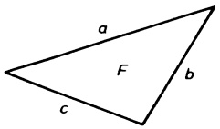

<details>
<summary>text_image</summary>

a
F
b
c
</details>

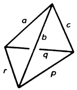

<details>
<summary>text_image</summary>

a
b
c
q
r
p
</details>

Welchen Inhalt hat der Tetraeder mit den Kantenlängen

$a = 1cm; b = 2cm; c = 3cm; p = 4cm; q = 3cm$ und $r = 2cm$?

8. Seien $y_i : \mathbb{R} \to \mathbb{R}$ ($i = 1,2,3$) dreimal differenzierbar und Lösungen der linearen Differentialgleichung $y_i'''(x) + a_1(x)y_i''(x) + a_2(x)y_i'(x) + a_3(x)y_i(x) = 0$

und $W(x) := \det \left( \begin{array}{cc} y_1(x) & y_2(x) & y_3(x) \\ y_1'(x) & y_2'(x) & y_3'(x) \\ y_1''(x) & y_2''(x) & y_3''(x) \end{array} \right)$ die sog. WRONSKI-Determinante.

Man zeige $\frac{d}{dx} W(x) = -a_1(x)W(x)$.

## §6. Lineare Abbildungen und Eigenwerte

Nach den linearen Gleichungssystemen behandeln wir nun als zweiten wichtigen Anwendungsbereich der Matrizen die linearen Abbildungen. Im  $R^{n}$  sind das die Zuordnungen  $x \mapsto Ax$  ( $x \in R^{n}$  und fester  $n \times n$ -Matrix A). Im Hinblick auf allgemeine Anwendungen ist es aber erforderlich, die grundlegenden Begriffe und Bezeichnungen in beliebigen Vektorräumen und unabhängig von speziellen Basen zu formulieren.

6.1 Lineare Abbildungen. Seien $V, W$ Vektorräume über $\mathbb{R}$. Mit einer Abbildung $f: V \to W$ („von $V$ in $W$“) wird jedem Vektor $\mathbf{v} \in V$ ein eindeutig bestimmter Vektor $\mathbf{w} = f(\mathbf{v}) \in W$, das sogenannte $f$-Bild von $\mathbf{v}$ zugeordnet.

Definition. Eine Abbildung  $f : V \rightarrow W$  heißt linear, wenn gilt:

(L.1) $f$ ist homogen; d.h. $f(\alpha \mathbf{v}) = \alpha f(\mathbf{v})$ für alle $\alpha \in \mathbb{R}$, $\mathbf{v} \in V$,

(L.2) $f$ ist additiv; d.h. $f(\mathbf{u} + \mathbf{v}) = f(\mathbf{u}) + f(\mathbf{v})$ für alle $\mathbf{u},\mathbf{v}\in V$.

Andere Bezeichnungen für eine lineare Abbildung sind: lineare Transformation, linearer Operator, Vektorraumhomomorphismus.

Gleichwertig mit (L.1), (L.2) ist

$$
f (\alpha_ {1} \mathbf {v} _ {1} + \dots + \alpha_ {n} \mathbf {v} _ {n}) = \alpha_ {1} f (\mathbf {v} _ {1}) + \dots + \alpha_ {n} f (\mathbf {v} _ {n}) \tag {1}
$$

---

312

6. Lineare Algebra

für alle $\alpha_{i}\in\mathbb{R},\;\mathbf{v}_{i}\in V\quad(1\leq i\leq n;n\in\mathbb{N})$,

was besagt, daß das f-Bild jeder Linearkombination gleich der entsprechenden Linearkombination der einzelnen f-Bilder ist.

Beispiele. Lineare Abbildungen sind:

1. Die Nullabbildung  $0: V \rightarrow V$ ,  $0(\mathbf{v}) := \mathbf{0}$ .
2. Die identische Abbildung $\operatorname{Id}: V \to V$, $\operatorname{Id}(\mathbf{v}) := \mathbf{v}$.
3. Die Projektion  $p_{i}: R^{n} \rightarrow R$ ,  $p_{i}(x) := x_{i}$  (i-te Komponente von x).
4. Die Multiplikation mit einer festen  $m \times n$ -Matrix A

$$
l: \mathbb {R} ^ {n} \to \mathbb {R} ^ {m}, \quad l (\mathbf {x}) := A \mathbf {x}.
$$

5. Der Differentiationsoperator $\frac{d}{dx}:\mathcal{C}^{1}(I)\to\mathcal{C}^{0}(I),\quad\frac{d}{dx}f(x):=f^{\prime}(x).\quad\mathcal{C}^{0}(I)$ bzw. $\mathcal{C}^{1}(I)$ bezeichnet den Vektorraum aller auf dem Intervall $I\subseteq\mathbb{R}$ stetigen bzw. stetig differenzierbaren Funktionen.

6. Das Integral $f \mapsto \int_{a}^{b} f(x) dx$, $f \in \mathscr{C}^0(a, b)$.

Keine linearen Abbildungen sind:

7. Die Parallelverschiebung $t_a : V \to V$, $t_a(\mathbf{v}) := \mathbf{v} + \mathbf{a}$ (mit festem Vektor $\mathbf{a} \neq 0$).

8.  $f : R_{2} \to R_{2}$ ,  $f(x, y) := (x^{2}, x + y)$  (quadratisch in der 1. Komponente).

Lineare Abbildungen in der Technik:

9. Die Werkstoffbeanspruchung eines elastischen Körpers, auf den von außen Kräfte wirken, wird in der linearen Elastostatik durch den Spannungstensor S beschrieben. Dieser bestimmt für jeden inneren Punkt P eine lineare Abbildung, die den Normalenrichtungen n von (idealisierten) Schnittebenen E

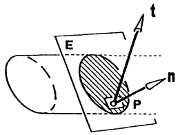

<details>
<summary>text_image</summary>

E
t
n
P
</details>

Abb. 146 - Dreiachsiger Spannungszustand

durch $P$ den Spannungsvektor $\mathbf{t} \in \mathbb{R}^3$ zuordnet, d.h. in kartesischen Koordinaten:

$$
\mathbf {t} = S \mathbf {n} \quad \text {mit} \quad S = \left( \begin{array}{c c c} \sigma_ {x} & \tau_ {x y} & \tau_ {x z} \\ \tau_ {x y} & \sigma_ {y} & \tau_ {y z} \\ \tau_ {x z} & \tau_ {y z} & \sigma_ {z} \end{array} \right) .
$$

Für $|\mathbf{n}| = 1$ ist $\mathbf{t} := \lim_{\Delta A \to 0} \frac{1}{\Delta A} \mathbf{k}_{\Delta A}$, wenn $\mathbf{k}_{\Delta A}$ die Kraft bezeichnet, die auf ein Flächenstück in $E$ mit Schwerpunkt $P$ und Flächeninhalt $\Delta A$ wirkt ($\rightarrow$ Aufg. 7, §7).

10. Für einen linearen elektrischen Vierpol (→ Abb. 147) gilt zwischen Ein- und Ausgang die Beziehung

$$
\binom{u _ {1}}{i _ {1}} = A \binom{u _ {2}}{i _ {2}}
$$

---

§6. Lineare Abbildungen und Eigenwerte

313

mit der Kettenmatrix

$$
A = \left( \begin{array}{c c} \frac {R _ {2} + R _ {3}}{R _ {2}} & R _ {3} \\ \frac {R _ {1} + R _ {2} + R _ {3}}{R _ {1} R _ {2}} & \frac {R _ {1} + R _ {3}}{R _ {1}} \end{array} \right). \quad \square
$$

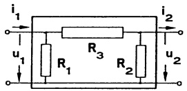

<details>
<summary>text_image</summary>

i₁
u₁
R₁
R₃
R₂
i₂
u₂
</details>

Abb. 147 - Vierpol

Man verifiziert leicht, daß zu linearen Abbildungen $f, g : V \to W$ und $\alpha \in \mathbb{R}$ auch die Summe $f + g : V \to W$, $(f + g)(\mathbf{v}) := f(\mathbf{v}) + g(\mathbf{v})$, und das $\alpha$-fache $\alpha f : V \to W$, $(\alpha f)(\mathbf{v}) := \alpha f(\mathbf{v})$, linear sind. Mit dieser Addition und skalaren Multiplikation ist die Menge aller linearen Abbildungen von $V$ in $W$

$$
\mathrm{Hom} (V, W) := \{f ; f: V \to W \text {linear} \}
$$

selbst wieder ein $\mathbb{R}$-Vektorraum (Raum der Homomorphismen).

Auch sieht man leicht ein, daß die Hintereinanderausführung („Komposition“) zweier linearer Abbildungen insgesamt ebenfalls linear ist; d.h., für zwei lineare Abbildungen $f:V\to W$, $g:U\to V$ ist auch

$$
f \circ g: U \to W, \quad (f \circ g) (\mathbf {u}) := f (g (\mathbf {u})),
$$

linear.

Ist $V$ ein endlichdimensionaler $\mathbb{R}$-Vektorraum und $B = (\mathbf{v}_1, \mathbf{v}_2, \ldots, \mathbf{v}_n)$ eine Basis von $V$, dann läßt sich jeder Vektor $\mathbf{v} \in V$ eindeutig in der Form $\mathbf{v} = \alpha_1 \mathbf{v}_1 + \cdots + \alpha_n \mathbf{v}_n$ mit $\alpha_i \in \mathbb{R}$ darstellen. Man nennt

$$
\mathbf {v} _ {B} := \left( \begin{array}{c} \alpha_ {1} \\ \vdots \\ \alpha_ {n} \end{array} \right) \in \mathbb {R} ^ {n} \quad (\text {falls} \mathbf {v} = \sum_ {i = 1} ^ {n} \alpha_ {i} \mathbf {v} _ {i}) \tag {2}
$$

den Koordinatenvektor von $\mathbf{v} \in V$ bezüglich $B$. Die lineare Abbildung $\mathbf{v} \mapsto \mathbf{v}_B$ (von $V$ in $\mathbb{R}^n$) heißt Koordinatenabbildung bzgl. $B$. Mit ihr überträgt man Probleme aus $V$ zur rechnerischen Behandlung in den $\mathbb{R}^n$ und umgekehrt mit der (inversen) Abbildung $(\alpha_1, \ldots, \alpha_n)^T \to \alpha_1 \mathbf{v}_1 + \cdots + \alpha_n \mathbf{v}_n$ nach $V$ zurück.

6.2 $V = W = \mathbb{R}^n$. Von nun an betrachten wir nur noch lineare Abbildungen des $\mathbb{R}^n$ in sich. Diese lassen sich in einfacher Weise durch Matrizen beschreiben. Es wurde bereits erwähnt, daß mit einer festen $n \times n$-Matrix $A$ die Abbildung $\mathbf{x} \mapsto A\mathbf{x}$ linear ist. Jede lineare Abbildung des $\mathbb{R}^n$ sieht so aus!

## Satz 6.1. Darstellung einer linearen Abbildung in der natürlichen Basis.

Gegeben sei eine lineare Abbildung $f: \mathbb{R}^{n} \to \mathbb{R}^{n}$. Mit der Matrix $F = (f(\mathbf{e}_{1}), \ldots, f(\mathbf{e}_{n}))$, deren Spalten aus den Bildern der natürlichen Basisvektoren bestehen, gilt

$$
f (\mathbf {x}) = F \mathbf {x}.
$$

Man nennt F die Abbildungsmatrix von f bezüglich der natürlichen Basis.

Beweis. Für  $x = x_{1}e_{1} + \cdots + x_{n}e_{n}$  folgt mit (1) und der Multiplikationsformel (8) aus §2 bereits die Behauptung:  $f(\mathbf{x}) = x_{1}f(\mathbf{e}_{1}) + \cdots + x_{n}f(\mathbf{e}_{n}) = F\mathbf{x}$ . ☐

---

314

6. Lineare Algebra

Man beachte: Wegen $A = (A\mathbf{e}_1, A\mathbf{e}_2, \ldots, A\mathbf{e}_n)$ ist die Matrix $A \in \mathbb{R}^{n \times n}$ die Abbildungsmatrix der linearen Abbildung $l : \mathbb{R}^n \to \mathbb{R}^n$, $l(\mathbf{x}) = A\mathbf{x}$, bzgl. der natürlichen Basis. Die Darstellung in einer anderen Basis erfolgt in 6.4.

Beispiel. Die Abbildung $f:\mathbb{R}^{3}\to\mathbb{R}^{3}$, $f((x,y,z)^{T})=(x,y+2z,z)^{T}$ ist linear, sie besitzt bezüglich $(\mathbf{e}_{1},\mathbf{e}_{2},\mathbf{e}_{3})$ die Abbildungsmatrix

$$
F = (f (\mathbf {e} _ {1}), f (\mathbf {e} _ {2}), f (\mathbf {e} _ {3})) = \left( \begin{array}{c c c} 1 & 0 & 0 \\ 0 & 1 & 2 \\ 0 & 0 & 1 \end{array} \right), \text {d.h.} f (\mathbf {x}) = \left( \begin{array}{c c c} 1 & 0 & 0 \\ 0 & 1 & 2 \\ 0 & 0 & 1 \end{array} \right) \mathbf {x}.
$$

f beschreibt eine Scherung des  $R^{3}$ , bei der alle Vektoren mit z = 0 auf sich abgebildet werden. Allgemein bezeichnet man die lineare Abbildung

$$
f: \mathbb {R} ^ {3} \to \mathbb {R} ^ {3}, f (\mathbf {x}) = \mathbf {x} + (\mathbf {b} \cdot \mathbf {x}) \mathbf {a},
$$

als Scherung in Richtung a senkrecht zu b, wenn a, b zwei Vektoren des  $R^{3}$  mit  $a \cdot b = 0$  bezeichnen. Die Abbildungsmatrix lautet  $E + ab^{T}$ . ☐

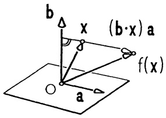

<details>
<summary>text_image</summary>

b
Δ x (b·x) a
f(x)
a
</details>

Abb. 148 - Scherung

Sind $f, g: \mathbb{R}^n \to \mathbb{R}^n$ lineare Abbildungen mit den Abbildungsmatrizen $F = (f(\mathbf{e}_1), \ldots, f(\mathbf{e}_n))$, $G = (g(\mathbf{e}_1), \ldots, g(\mathbf{e}_n))$, dann gehört zur zusammengesetzten linearen Abbildung $f \circ g: \mathbb{R}^n \to \mathbb{R}^n$, $(f \circ g)(\mathbf{x}) = f(g(\mathbf{x}))$ (erst $g$, dann $f$ anwenden), die Abbildungsmatrix $FG$ (das Matrizenprodukt). Denn nach Satz 6.1 gilt $f(g(\mathbf{x})) = Fg(\mathbf{x}) = F(G\mathbf{x}) = (FG)\mathbf{x}$. Ebenso verifiziert man sofort, daß zu $f + g$ und $\alpha f$ die Abbildungsmatrizen $F + G$ und $\alpha F$ gehören.

Eine lineare Abbildung $f: \mathbb{R}^{n} \to \mathbb{R}^{n}$ heißt invertierbar (oder umkehrbar), wenn es zu jedem $\mathbf{y} \in \mathbb{R}^{n}$ genau ein $\mathbf{x} \in \mathbb{R}^{n}$ gibt mit $f(\mathbf{x}) = \mathbf{y}$ (vgl. Kap. 1, §1). Man sieht sofort wegen $f(\mathbf{x}) = F\mathbf{x}$, daß $f$ genau dann invertierbar ist, wenn die Abbildungsmatrix $F$ invertierbar ist. In diesem Fall hat die zu $f$ inverse Abbildung $f^{-1}: \mathbb{R}^{n} \to \mathbb{R}^{n}$ ($f(\mathbf{x})$ wird unter $f^{-1}$ wieder auf $\mathbf{x}$ abgebildet) die Abbildungsmatrix $F^{-1}$; d.h. $f^{-1}(\mathbf{x}) = F^{-1}\mathbf{x}$.

Geometrische Eigenschaften der linearen Abbildung $f:\mathbb{R}^{n}\to\mathbb{R}^{n}$ spiegeln sich in algebraischen Eigenschaften der Abbildungsmatrix $F$, $f(\mathbf{x})=F\mathbf{x}$, wieder:

Die Änderung des Volumens. Zu n Vektoren  $b_{1},\ldots,b_{n}$  des  $R^{n}$  bezeichnet man die Menge aller Linearkombinationen

$$
\lambda_ {1} \mathbf {b} _ {1} + \dots + \lambda_ {n} \mathbf {b} _ {n} \quad \text {mit} \quad 0 \leq \lambda_ {i} \leq 1 (i = 1, \dots , n)
$$

als $n$-Spat (mit den Kanten $\mathbf{b}_{1},\ldots,\mathbf{b}_{n}$). Ein 2-Spat ist ein (evtl. ausgeartetes) Parallelogramm, ein 3-Spat mit linear unabhängigen Kanten stellt einen „gewöhnlichen“ Spat dar. In Übereinstimmung mit den Verhältnissen in $\mathbb{R}^{2}$, $\mathbb{R}^{3}$ ($\rightarrow$ §5.1) nennt man $V = |\det(\mathbf{b}_{1},\ldots,\mathbf{b}_{n})|$ das Volumen des von $\mathbf{b}_{1},\ldots,\mathbf{b}_{n}$ aufgespannten $n$-Spats.

Unter einer linearen Abbildung  $f : R^{n} \rightarrow R^{n}$  mit der Abbildungsmatrix F

---

§6. Lineare Abbildungen und Eigenwerte

315

wird der von $\mathbf{b}_{1},\ldots,\mathbf{b}_{n}\in\mathbb{R}^{n}$ aufgespannte $n$-Spat abgebildet auf den $n$-Spat mit den Kanten $f(\mathbf{b}_{1}),\ldots,f(\mathbf{b}_{n})$. Wegen $f(\mathbf{b}_{i})=F\mathbf{b}_{i}$ und den Formeln (8, §2), (6, §5) ergibt sich für das Volumen $V_{1}$ des Bildspats

$$
\begin{array}{l} V _ {1} = | \det (f (\mathbf {b} _ {1}), \dots , f (\mathbf {b} _ {n})) | = | \det (F \mathbf {b} _ {1}, \dots , F \mathbf {b} _ {n}) | \\ = | \det F (\mathbf {b} _ {1}, \dots , \mathbf {b} _ {n}) | = | \det F \det (\mathbf {b} _ {1}, \dots , \mathbf {b} _ {n}) | = | \det F | \cdot V. \\ \end{array}
$$

Demnach ist $|\det F|$ der Volumenverzerrungsfaktor der linearen Abbildung $f$. Man nennt $f$ volumentreu, wenn $|\det F| = 1$ gilt. Die im obigen Beispiel betrachtete Scherung ist volumentreu ($\rightarrow$ §5, Aufg. 6).

## 6.3 Längen und Winkel im $\mathbb{R}^{n}$; Orthogonalität.

Definition. Seien $\mathbf{x},\mathbf{y}\in \mathbb{R}^n$ , $\mathbf{x} = (x_1,\dots,x_n)^T$ , $\mathbf{y} = (y_{1},\dots,x_{n})^{T}$ . Die Zahl

$$
\mathbf {x} \cdot \mathbf {y} := \mathbf {x} ^ {T} \mathbf {y} = x _ {1} y _ {1} + x _ {2} y _ {2} + \dots + x _ {n} y _ {n}
$$

heißt Skalarprodukt (oder inneres Produkt) der Vektoren x, y, und

$$
| \mathbf {x} | := \sqrt {\mathbf {x} \cdot \mathbf {x}} = \sqrt {x _ {1} ^ {2} + x _ {2} ^ {2} + \cdots + x _ {n} ^ {2}}
$$

heißt Betrag (oder Länge) des Vektors x.

x ist normiert (oder Einheitsvektor), wenn  $|x| = 1$ .

Beispiele. $\mathbf{x} = \begin{pmatrix} 2 \\ 0 \\ 1 \\ 4 \end{pmatrix}, \mathbf{y} = \begin{pmatrix} -1 \\ 3 \\ 5 \\ -3 \end{pmatrix} \Rightarrow \mathbf{x} \cdot \mathbf{y} = 2 \cdot (-1) + 0 \cdot 3 + 1 \cdot 5 + 4 \cdot (-3) = -9,$

$|x| = \sqrt{2^2 + 1^2 + 4^2} = \sqrt{21} \approx 4.582576$, $|y| = \sqrt{1 + 9 + 25 + 9} \approx 6.633250$. Die Vektoren $e_i$ der natürlichen Basis sind Einheitsvektoren; zu jedem Vektor $x \neq 0$ ist $\frac{1}{|x|}x$ normiert.

Rechenregeln (wie in $\mathbb{R}^2$, $\mathbb{R}^3$): Für alle $\mathbf{x}, \mathbf{y}, \mathbf{z} \in \mathbb{R}^n$ und alle $\alpha \in \mathbb{R}$ gilt:

a)  $x \cdot y = y \cdot x$ ,

b) $\alpha (\mathbf{x}\cdot \mathbf{y}) = (\alpha \mathbf{x})\cdot \mathbf{y} = \mathbf{x}\cdot (\alpha \mathbf{y}),$

c) $\mathbf{x} \cdot (\mathbf{y} + \mathbf{z}) = \mathbf{x} \cdot \mathbf{y} + \mathbf{x} \cdot \mathbf{z}$,

d) $\mathbf{x} \cdot \mathbf{x} > 0$ für alle $\mathbf{x} \neq \mathbf{0}$, (3)

e)  $|x| = 0 \iff x = 0$ ,

f) $|\alpha \mathbf{x}| = |\alpha ||\mathbf{x}|$,

g)  $|x \cdot y| \leq |x||y|$  (CAUCHY-SCHWARZsche Ungleichung),

h) $|\mathbf{x} + \mathbf{y}| \leq |\mathbf{x}| + |\mathbf{y}|$ (Dreiecksungleichung).

Beweis g): Die Ungleichung ist erfüllt für $\mathbf{y} = \mathbf{0}$. Sei also $\mathbf{y} \neq \mathbf{0}$. Für alle $\lambda \in \mathbb{R}$ folgt aus a)-d) $0 \leq (\mathbf{x} - \lambda \mathbf{y}) \cdot (\mathbf{x} - \lambda \mathbf{y}) = \mathbf{x} \cdot \mathbf{x} - 2\lambda (\mathbf{x} \cdot \mathbf{y}) + \lambda^2 \mathbf{y} \cdot \mathbf{y}$.

---

316

6. Lineare Algebra

Die Wahl $\lambda = \frac{\mathbf{x} \cdot \mathbf{y}}{|\mathbf{y}|^2}$ ergibt $0 \leq (\mathbf{x} \cdot \mathbf{x})(\mathbf{y} \cdot \mathbf{y}) - (\mathbf{x} \cdot \mathbf{y})^2$, das ist die Behauptung. h): Mit g) folgt

$$
\begin{array}{l} | \mathbf {x} + \mathbf {y} | ^ {2} = (\mathbf {x} + \mathbf {y}) \cdot (\mathbf {x} + \mathbf {y}) = | \mathbf {x} | ^ {2} + 2 \mathbf {x} \cdot \mathbf {y} + | \mathbf {y} | ^ {2} \\ \leq | \mathbf {x} | ^ {2} + 2 | \mathbf {x} | | \mathbf {y} | + | \mathbf {y} | ^ {2} = (| \mathbf {x} | + | \mathbf {y} |) ^ {2}. \\ \end{array}
$$

Aufgrund der Ungleichung (3g) gilt für  $x \neq 0$ ,  $y \neq 0$  stets  $-1 \leq \frac{x \cdot y}{|x||y|} \leq 1$ , deshalb gibt es genau einen Winkel  $\varphi$  mit  $0 \leq \varphi \leq \pi$  und  $\cos \varphi = \frac{x \cdot y}{|x||y|}$ .

Definition. Für $\mathbf{x},\mathbf{y}\neq\mathbf{0}$ nennt man $\nmid(\mathbf{x},\mathbf{y}):=\varphi=\arccos\frac{\mathbf{x}\cdot\mathbf{y}}{|\mathbf{x}||\mathbf{y}|}\quad(0\leq\varphi\leq\pi)$ den Winkel zwischen $\mathbf{x}$ und $\mathbf{y}$. Ferner nennt man $\mathbf{x},\mathbf{y}\in\mathbb{R}^{n}$ orthogonal, wenn $\mathbf{x}\cdot\mathbf{y}=0$ gilt. Der Nullvektor ist orthogonal zu allen Vektoren des $\mathbb{R}^{n}$.

## Definition.

a) Eine lineare Abbildung $f: \mathbb{R}^{n} \to \mathbb{R}^{n}$ heißt orthogonal, wenn sie das Skalarprodukt invariant läßt; d.h. wenn für alle $\mathbf{x}, \mathbf{y} \in \mathbb{R}^{n}$ gilt:

$$
f (\mathbf {x}) \cdot f (\mathbf {y}) = \mathbf {x} \cdot \mathbf {y}.
$$

b) Eine Matrix $A \in \mathbb{R}^{n \times n}$ heißt orthogonal, wenn gilt:

$$
A ^ {T} A = E \quad (\text {also} A ^ {T} = A ^ {- 1}).
$$

c) Eine Basis $B = (\mathbf{b}_1, \ldots, \mathbf{b}_n)$ heißt orthogonal, wenn die Vektoren $\mathbf{b}_i$ paarweise orthogonal sind; d.h., wenn für $i \neq j$ gilt

$$
\mathbf {b} _ {i} \cdot \mathbf {b} _ {j} = 0.
$$

Die Basis B heißt orthonormal, wenn sie orthogonal ist und alle Basisvektoren normiert sind; d.h.,

$$
\mathbf {b} _ {i} \cdot \mathbf {b} _ {j} = 0 \quad f u r \quad i \neq j \quad \text {und} \quad | \mathbf {b} _ {i} | = 1.
$$

## Beispiele.

1. Die natürliche Basis  $(\mathbf{e}_{1},\ldots,\mathbf{e}_{n})$  ist eine Orthonormalbasis des  $R^{n}$ .
2. Sind $\mathbf{a},\mathbf{b}\in\mathbb{R}^{3}$ orthonormal, $\mathbf{a}\cdot\mathbf{b}=0$, $|\mathbf{a}|=|\mathbf{b}|=1$, dann ist $(\mathbf{a},\mathbf{b},\mathbf{c})$ mit $\mathbf{c}:=\mathbf{a}\times\mathbf{b}$ stets eine orthonormales Rechtssystem des $\mathbb{R}^{3}$ ($\rightarrow$ Kap. 1, §4).

Den Zusammenhang zwischen diesen drei Orthogonalitätsbegriffen klärt

Satz 6.2. Für eine Matrix $A \in \mathbb{R}^{n \times n}$ sind äquivalent:

a) A ist orthogonal.
b)  $(Ax)\cdot(Ay)=\mathbf{x}\cdot\mathbf{y}$  für alle  $x,y\in R^{n}$ .
c) Die Spalten von A bilden eine orthonormale Basis des $\mathbb{R}^{n}$.

Insbesondere ist eine lineare Abbildung $f: \mathbb{R}^{n} \to \mathbb{R}^{n}$ genau dann orthogonal, wenn die Abbildungsmatrix $F = (f(\mathbf{e}_{1}), \ldots, f(\mathbf{e}_{n}))$ orthogonal ist.

---

§6. Lineare Abbildungen und Eigenwerte

317

Beweis. a) $\Rightarrow$ b): Aus $A^T A = E$ folgt

$$
(A \mathbf {x}) \cdot (A \mathbf {y}) = (A \mathbf {x}) ^ {T} (A \mathbf {y}) = \mathbf {x} ^ {T} A ^ {T} A \mathbf {y} = \mathbf {x} ^ {T} E \mathbf {y} = \mathbf {x} ^ {T} \mathbf {y} = \mathbf {x} \cdot \mathbf {y}.
$$

b) $\Rightarrow$ c): Für $\mathbf{x} = \mathbf{e}_i$, $\mathbf{y} = \mathbf{e}_j$ und $\mathbf{a}_i := A\mathbf{e}_i$ (i-te Spalte von $A$) ergibt sich

$$
\mathbf {a} _ {i} \cdot \mathbf {a} _ {j} = \mathbf {e} _ {i} ^ {T} \mathbf {e} _ {j} = \left\{ \begin{array}{l l} 1 & , \text {falls} i = j \\ 0 & , \text {falls} i \neq j \end{array} \right..
$$

c) $\Rightarrow$ a): Aus $\mathbf{a}_i \cdot \mathbf{a}_i = \mathbf{a}_i^T \mathbf{a}_i = 1$ und $\mathbf{a}_i \cdot \mathbf{a}_j = \mathbf{a}_i^T \mathbf{a}_j = 0$ (falls $i \neq j$) folgt mit der Produktformel (4, §2) für die Matrix $A$ die Gleichung $A^T A = E$.

## Bemerkungen.

1. Für eine orthogonale Matrix $A$ ist die Inverse sehr einfach zu berechnen. Es gilt (definitionsgemäß!) $A^{-1} = A^{T}$.

2. $A^T A = E \iff AA^T = E$ ($\rightarrow$ (10), §2) $\iff$ Die Zeilen von $A$ sind orthogonal; wobei das Skalarprodukt (und jeder damit verbundene Begriff) für Zeilenvektoren $\mathbf{x}, \mathbf{y} \in \mathbb{R}_n$ durch $\mathbf{x} \cdot \mathbf{y} := \mathbf{xy}^T$ definiert ist.

3. $A \in \mathbb{R}^{n \times n}$ orthogonal $\Rightarrow$ det $A = \pm 1$.

Denn aus $A^T A = E$ folgt $1 = \det E = \det A^T \det A = (\det A)^2$.

4. Jede orthogonale lineare Abbildung  $f : R^{n} \rightarrow R^{n}$  ist

volumentreu, da  $|\det F| = 1$  (F Abbildungsmatrix von f) ( $\rightarrow$  Bem 3.),

längentreu , da  $|f(\mathbf{x})| = \sqrt{f(\mathbf{x}) \cdot f(\mathbf{x})} = \sqrt{\mathbf{x} \cdot \mathbf{x}} = |\mathbf{x}|$ ,

winkeltreu , da  $\cos\angle(f(\mathbf{x}),f(\mathbf{y}))=\frac{f(\mathbf{x})\cdot f(\mathbf{y})}{|f(\mathbf{x})||f(\mathbf{y})|}=\frac{\mathbf{x}\cdot\mathbf{y}}{|\mathbf{x}||\mathbf{y}|}=\cos\angle(\mathbf{x},\mathbf{y})$ .

6.4 Speziell: Spiegelungen und Drehungen sind neben den Parallelverschiebungen die wichtigsten längentreuen Abbildungen. Sie sind nur dann linear, wenn sie den Ursprung auf sich abbilden.

(a) Spiegelungen im Raum. Dazu gehört die Punktspiegelung $s: \mathbf{x} \mapsto -\mathbf{x}$ mit der Matrix $S = -E$. Interessanter sind jedoch die Spiegelungen an Ebenen durch den Ursprung:

Ist $\mathbf{a} = (a_{1}, a_{2}, a_{3})^{T}$ ein Einheitsvektor, dann lautet die Spiegelung an der Ebene $\mathbf{a} \cdot \mathbf{x} = 0$:

$$
s: \mathbb {R} ^ {3} \to \mathbb {R} ^ {3}, s (\mathbf {x}) = \mathbf {x} - 2 (\mathbf {x} \cdot \mathbf {a}) \mathbf {a}.
$$

Man bestätigt leicht $s(\mathbf{x})\cdot s(\mathbf{y}) = \mathbf{x}\cdot \mathbf{y}$ und $s(s(\mathbf{x})) = \mathbf{x}$, daher ist die Abbildungsma-trix $S$ wegen $S^{-1} = S = S^T$ stets eine symmetrische und orthogonale Matrix:

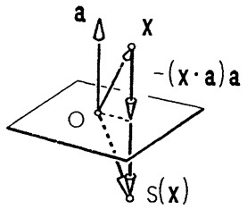

<details>
<summary>text_image</summary>

a
x
-(x·a)a
S(x)
</details>

Abb. 149 - Spiegelung im $\mathbb{R}^3$

$$
S = (s (\mathbf {e} _ {1}), s (\mathbf {e} _ {2}), s (\mathbf {e} _ {3})) = \left( \begin{array}{c c c} 1 - 2 a _ {1} ^ {2} & - 2 a _ {2} a _ {1} & - 2 a _ {3} a _ {1} \\ - 2 a _ {1} a _ {2} & 1 - 2 a _ {2} ^ {2} & - 2 a _ {3} a _ {2} \\ - 2 a _ {1} a _ {3} & - 2 a _ {2} a _ {3} & 1 - 2 a _ {3} ^ {2} \end{array} \right) = E - 2 \mathbf {a} \mathbf {a} ^ {T}.
$$

Für diese Spiegelungen im $\mathbb{R}^{3}$ gilt det $S = -1$ ($\rightarrow$ §5, Aufg. 6).

---

318

6. Lineare Algebra

⑥ Drehungen der Ebene um den Nullpunkt lauten in kartesischen Koordinaten

$$
d: \mathbb {R} ^ {2} \rightarrow \mathbb {R} ^ {2}, \quad d \binom{x}{y} = \binom{x \cos \varphi - y \sin \varphi}{x \sin \varphi + y \cos \varphi}, \quad \text {Drehwinkel} \varphi ,
$$

(→ Kap. 1, §3.4). Die Abbildung d ist linear mit der orthogonalen Abbildungsmatrix (der „Drehmatrix“)

$$
D = \left( \begin{array}{c c} \cos \varphi & - \sin \varphi \\ \sin \varphi & \cos \varphi \end{array} \right), \quad \det D = 1.
$$

Wegen $\left( \begin{array}{c}x\cos \varphi -y\sin \varphi \\ x\sin \varphi +y\cos \varphi \end{array} \right) = \cos \varphi \binom{x}{y} + \sin \varphi \binom{-y}{x}$ hat man

$$
d (\mathbf {x}) = (\cos \varphi) \mathbf {x} + (\sin \varphi) \mathbf {x} ^ {*}, \tag {4}
$$

wobei  $x^{*}$  aus x durch eine positive Drehung um  $\frac{\pi}{2}$  entsteht.

© Drehungen im Raum erfolgen stets um eine Achse, diese sog. Drehachse wird durch die Wahl eines Richtungsvektors  $a \neq 0$  (auf der Achse) orientiert. a weist in die positive Achsenrichtung. Blickt man in diese Richtung, dann erfolgt eine positive Drehung (Drehwinkel  $\varphi \geq 0$ ) im Uhrzeigersinn ( $\rightarrow$  Abb. 29). Die Koordinatenachsen eines kartesischen Koordinatensystems sind stets durch die zugehörigen Basisvektoren orientiert.

a) Die Drehung um die x-Achse besitzt wegen (4) die Abbildungsgleichung

$$
d _ {1} (\mathbf {x}) = x \mathbf {e} _ {1} + (y \cos \alpha - z \sin \alpha) \mathbf {e} _ {2} + (y \sin \alpha + z \cos \alpha) \mathbf {e} _ {3}
$$

und die Abbildungsmatrix

$$
D _ {1} (\alpha) = \left( \begin{array}{c c c} 1 & 0 & 0 \\ 0 & \cos \alpha & - \sin \alpha \\ 0 & \sin \alpha & \cos \alpha \end{array} \right) .
$$

Zur Drehung um die y- bzw. z-Achse gehören die Drehmatrizen

$$
D _ {2} (\beta) = \left( \begin{array}{c c c} \cos \beta & 0 & \sin \beta \\ 0 & 1 & 0 \\ - \sin \beta & 0 & \cos \beta \end{array} \right), \quad D _ {3} (\gamma) = \left( \begin{array}{c c c} \cos \gamma & - \sin \gamma & 0 \\ \sin \gamma & \cos \gamma & 0 \\ 0 & 0 & 1 \end{array} \right).
$$

Man kann zeigen, daß sich jede Drehung um eine beliebige Achse durch den Nullpunkt als Hintereinanderausführung von Drehungen um die Koordinatenachsen darstellen läßt, d.h. für ihre Matrix $D$ lassen sich $\alpha$, $\beta$, $\gamma$ bestimmen, so daß $D = D_{3}(\gamma)D_{2}(\beta)D_{1}(\alpha)$ (erst um die $x$-Achse, dann um die $y$-Achse und schließlich um die $z$-Achse drehen). $\alpha$, $\beta$, $\gamma$ heißen die Cardan-Winkel der Drehung (benannt nach CARDANUS, 1501–1576). Die Euler-Winkel der Drehung werden in 6.6 behandelt.

b) Ist von einer Drehung $d: \mathbb{R}^3 \to \mathbb{R}^3$ der Richtungsvektor $\mathbf{a} \neq \mathbf{0}$ der Drehachse (durch den Nullpunkt) und der Drehwinkel $\varphi \geq 0$ bekannt, dann wird $d$ (in kartesischen Koordinaten) dargestellt durch

---

§6. Lineare Abbildungen und Eigenwerte

319

$$
d (\mathbf {x}) = (\cos \varphi) \mathbf {x} + (1 - \cos \varphi) \frac {\mathbf {x} \cdot \mathbf {a}}{| \mathbf {a} | ^ {2}} \mathbf {a} + \frac {\sin \varphi}{| \mathbf {a} |} \mathbf {a} \times \mathbf {x}. \tag {5}
$$

Beweis. Wir zerlegen  $x = x_{a} + r$  mit der Komponente  $x_{a}$  in Achsenrichtung und  $r = x - x_{a}$ . Der Vektor  $x_{a}$  bleibt bei der Drehung fest, r geht nach (4) über in

$$
d (\mathbf {r}) = (\cos \varphi) \mathbf {r} + (\sin \varphi) \mathbf {r} ^ {*}
$$

mit dem aus r durch eine (positive) Drehung um $\frac{\pi}{2}$ gewonnenen Vektor $\mathbf{r}^{*} = \frac{1}{|\mathbf{a}|} \mathbf{a} \times \mathbf{r}$. Mit $d(\mathbf{x}) = \mathbf{x}_{\mathbf{a}} + d(\mathbf{r})$ folgt (5) aus Formel (6, Kap 1., §5). □

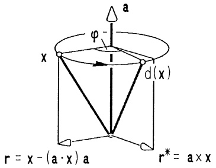

<details>
<summary>text_image</summary>

a
φ
x
d(x)
r = x - (a·x) a
r* = a × x
</details>

Abb. 150 - Drehung im $\mathbb{R}^3$, $|a| = 1$

Die Abbildungsmatrix (die Drehmatrix) $D$ bezüglich der gegebenen kartesi- schen Basis lautet (mit $\mathbf{a} = (a_1, a_2, a_3)^T$ und $|\mathbf{a}| = 1$):

$$
\left( \begin{array}{c} \cos \varphi + (1 - \cos \varphi) a _ {1} ^ {2}, \quad (1 - \cos \varphi) a _ {1} a _ {2} - a _ {3} \sin \varphi , (1 - \cos \varphi) a _ {1} a _ {3} + a _ {2} \sin \varphi \\ (1 - \cos \varphi) a _ {1} a _ {2} + a _ {3} \sin \varphi , \quad \cos \varphi + (1 - \cos \varphi) a _ {2} ^ {2}, \quad (1 - \cos \varphi) a _ {2} a _ {3} - a _ {1} \sin \varphi \\ (1 - \cos \varphi) a _ {1} a _ {3} - a _ {2} \sin \varphi , (1 - \cos \varphi) a _ {2} a _ {3} + a _ {1} \sin \varphi , \quad \cos \varphi + (1 - \cos \varphi) a _ {3} ^ {2} \end{array} \right)
$$

Da die aus $\mathbf{e}_{1}$, $\mathbf{e}_{2}$, $\mathbf{e}_{3}$ durch Drehung entstandenen Vektoren $\mathbf{e}_{1}^{\prime}=d(\mathbf{e}_{1})$, $\mathbf{e}_{2}^{\prime}=d(\mathbf{e}_{2})$, $\mathbf{e}_{3}^{\prime}=d(\mathbf{e}_{3})$ ebenfalls eine kartesische Basis bilden, gilt sicher „$\Rightarrow$“ in der Charakterisierung

$$
D \text {ist Drehmatrix} \quad \Longleftrightarrow \quad D ^ {T} D = E \text {und} \det D = 1.
$$

Die Aussage „←“, daß jede orthogonale  $3 \times 3$ -Matrix D mit det D = 1 eine Drehung beschreibt, wird erst in 6.8 gezeigt werden.

Ist eine Drehmatrix $D = (d_{ij}) \neq E$ vorgegeben, so findet man aus obiger Matrixdarstellung zu (5) den Drehwinkel $\varphi \geq 0$ mit der Formel

$$
\cos \varphi = \frac {1}{2} (\text {Spur} D - 1), \text {Spur} D := d _ {1 1} + d _ {2 2} + d _ {3 3}. \tag {6}
$$

Die Drehachsenrichtung $\mathbf{a} = (a_{1}, a_{2}, a_{3})^{T}$, $|\mathbf{a}| = 1$, ergibt sich aus

$$
\mathbf {a} = \frac {1}{2 \sin \varphi} \left( \begin{array}{l} d _ {3 2} - d _ {2 3} \\ d _ {1 3} - d _ {3 1} \\ d _ {2 1} - d _ {1 2} \end{array} \right), \text {falls} \varphi \neq \pi . \tag {7}
$$

$$
\boxed { \begin{array}{l} (D - E) \mathbf {a} = \mathbf {0} \text {oder explizit} \\ \mathbf {a} = \frac {1}{2 \sin \varphi} \left( \begin{array}{c} d _ {3 2} - d _ {2 3} \\ d _ {1 3} - d _ {3 1} \\ d _ {2 1} - d _ {1 2} \end{array} \right), \text {falls} \varphi \neq \pi . \end{array} }
$$

---

320

6. Lineare Algebra

Beispiel. Nach einer Drehung um die x-Achse mit  $\alpha=\frac{\pi}{6}$  wird noch um die z-Achse mit  $\gamma=\frac{\pi}{4}$  gedreht. Zur resultierenden Abbildung gehört die Abbildungsmatrix

$$
D = D _ {3} (\frac {\pi}{4}) D _ {1} (\frac {\pi}{6}) = \frac {1}{2} \left( \begin{array}{c c c} \sqrt {2} & - \frac {1}{2} \sqrt {6} & \frac {1}{2} \sqrt {2} \\ \sqrt {2} & \frac {1}{2} \sqrt {6} & - \frac {1}{2} \sqrt {2} \\ 0 & 1 & \sqrt {3} \end{array} \right) .
$$

So wird beispielsweise der Punkt $P = (1, 1, 1)$ - genauer: der Ortsvektor $\overrightarrow{OP} = \begin{pmatrix} 1 \\ 1 \\ 1 \end{pmatrix}$ - abgebildet auf $P' = (x', y', z')$ mit

$$
\left( \begin{array}{c} x ^ {\prime} \\ y ^ {\prime} \\ z ^ {\prime} \end{array} \right) = D \left( \begin{array}{c} 1 \\ 1 \\ 1 \end{array} \right) = \left( \begin{array}{c} \frac {1}{4} (3 \sqrt {2} - \sqrt {6}) \\ \frac {1}{4} (\sqrt {2} + \sqrt {6}) \\ \frac {1}{2} (\sqrt {3} + 1) \end{array} \right) .
$$

Mit den Drehmatrizen $D_{3}$, $D_{1}$ ist auch $D$ orthogonal und es gilt det $D = 1$. Nach dem noch zu beweisenden Satz ($\rightarrow$ 6.8) stellt deshalb $D$ eine Drehung dar, deren Drehwinkel $\varphi \geq 0$ mit (6) zu bestimmen ist:

$$
\cos \varphi = \frac {1}{2} (\text {Spur} D - 1) = \frac {1}{2} (\frac {1}{2} \sqrt {2} + \frac {1}{4} \sqrt {6} + \frac {1}{2} \sqrt {3} - 1),
$$

also $\varphi = 53.64743528^{\circ}$ ， $\sin \varphi = 0.805384813$

Aus (7) liest man die Achsenrichtung ab:

$$
\mathbf {a} = (0. 5 2 9 9 0 4 0 7 5, 0. 2 1 9 4 9 3 4 5 4, 0. 8 1 9 1 6 0 7 2 5) ^ {T}.
$$

6.5 Das Schmidtsche Orthonormierungsverfahren (E. SCHMIDT, 1876-1959) ermöglicht den Übergang von einer beliebigen Basis zu einer günstigen Orthonormalbasis.

Wir gehen aus von linear unabhängigen Vektoren $\mathbf{b}_{1},\ldots,\mathbf{b}_{k}\in\mathbb{R}^{n}\ (k\leq n)$ und berechnen daraus der Reihe nach eine Orthonormalbasis $\mathbf{c}_{1},\ldots,\mathbf{c}_{k}$ der linearen Hülle Lin $(\mathbf{b}_{1},\ldots,\mathbf{b}_{k})$.

Man setzt $\mathbf{c}_1 := \frac{1}{|\mathbf{b}_1|} \mathbf{b}_1$ und berechnet die zu $\mathbf{c}_1$ orthogonale Komponente $\mathbf{c}_2' = \mathbf{b}_2 - (\mathbf{b}_2 \cdot \mathbf{c}_1)\mathbf{c}_1$ von $\mathbf{b}_2$. Normierung ergibt $\mathbf{c}_2 := \frac{1}{|\mathbf{c}_2'|} \mathbf{c}_2'$. Weiter wird nun der zu $\mathbf{c}_1$ und $\mathbf{c}_2$ orthogonale Vektor $\mathbf{c}_3' = \mathbf{b}_3 - (\mathbf{b}_3 \cdot \mathbf{c}_2)\mathbf{c}_2 - (\mathbf{b}_3 \cdot \mathbf{c}_1)\mathbf{c}_1$ berechnet und normiert: $\mathbf{c}_3 := \frac{1}{|\mathbf{c}_3'|} \mathbf{c}_3'$.

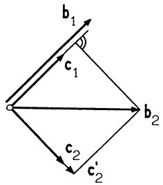

<details>
<summary>text_image</summary>

b₁
c₁
c₂
c₂'
b₂
</details>

Abb. 151 - Orthonormierung in $\mathbb{R}^2$

Etc.: $\mathbf{c}_4' = \mathbf{b}_4 - (\mathbf{b}_4 \cdot \mathbf{c}_3)\mathbf{c}_3 - (\mathbf{b}_4 \cdot \mathbf{c}_2)\mathbf{c}_2 - (\mathbf{b}_4 \cdot \mathbf{c}_1)\mathbf{c}_1$, $\mathbf{c}_4 := \frac{1}{|\mathbf{c}_4'|}\mathbf{c}_4, \ldots,$

bis $\mathbf{c}_k^{\prime} = \mathbf{b}_k - \sum_{i=1}^{k-1} (\mathbf{b}_k \cdot \mathbf{c}_i) \mathbf{c}_i$, $\mathbf{c}_k = \frac{1}{|\mathbf{c}_k'|} \mathbf{c}_k^{\prime}$.

---

§6. Lineare Abbildungen und Eigenwerte

321

In jedem Schritt wird ein zu den vorher berechneten  $c_{i}$  orthogonaler Vektor vom Betrag 1 bestimmt und man sieht leicht, daß  $c_{1},\ldots,c_{k}\in\operatorname{Lin}(\mathbf{b}_{1},\ldots,\mathbf{b}_{k})$  linear unabhängig sind.

Bemerkungen. 1. Ein Beispiel und eine Anwendung dieses Verfahrens behandeln wir in 7.2.

2. Für eine invertierbare $n \times n$-Matrix $B = (\mathbf{b}_1, \ldots, \mathbf{b}_n)$ ergibt das Orthonormierungsverfahren (für $\mathbf{b}_1, \ldots, \mathbf{b}_n$) die Zerlegung $Q = BR$, bzw. $B = QR^{-1}$, mit der orthogonalen Matrix $Q = (\mathbf{c}_1, \ldots, \mathbf{c}_n)$ und einer oberen Dreiecksmatrix $R$. Diese sog. $QR$-Zerlegung wird in vielen numerischen Verfahren bevorzugt, da die Transformation $\mathbf{x} \mapsto Q\mathbf{x}$ längentreu ist.

6.6 Basiswechsel, Koordinatentransformation. Es ist zu unterscheiden zwischen den Koordinaten eines Vektors bezüglich einer Basis und den Koordinaten eines Punktes in einem affinen Koordinatensystem.

(a) Vektorkoordinaten. Sei $B = (\mathbf{b}_1, \ldots, \mathbf{b}_n)$ eine (beliebige) Basis des $\mathbb{R}^n$, die wir gleichzeitig als invertierbare $n \times n$-Matrix ansehen. Die eindeutig bestimmten Koeffizienten $x_i' \in \mathbb{R}$ der Zerlegung $\mathbf{x} = x_1' \mathbf{b}_1 + \cdots + x_n' \mathbf{b}_n$ heißen Koordinaten des Vektors $\mathbf{x} \in \mathbb{R}^n$, und man nennt

$$
\mathbf {x} _ {B} = \mathbf {x} ^ {\prime} = \left( \begin{array}{c} x _ {1} ^ {\prime} \\ x _ {2} ^ {\prime} \\ \vdots \\ x _ {n} ^ {\prime} \end{array} \right), \quad \text {falls} \mathbf {x} = x _ {1} ^ {\prime} \mathbf {b} _ {1} + \dots + x _ {n} ^ {\prime} \mathbf {b} _ {n},
$$

den Koordinatenvektor von $\mathbf{x} \in \mathbb{R}^{n}$ bezüglich $B$. Die Koordinatenabbildung $\mathbf{x} \mapsto \mathbf{x}_{B}$ ist linear ($\rightarrow$ 6.1). Aus der nützlichen Multiplikationsformel (8, §2) ergibt sich sofort

$$
x _ {1} ^ {\prime} \mathbf {b} _ {1} + \dots + x _ {n} ^ {\prime} \mathbf {b} _ {n} = B \left( \begin{array}{c} x _ {1} ^ {\prime} \\ \vdots \\ x _ {n} ^ {\prime} \end{array} \right) = B \mathbf {x} _ {B}.
$$

Damit gilt für die Koordinatentransformation beim

$$
\begin{array}{l} \text {Basiswechsel von} (\mathbf {e} _ {1}, \dots , \mathbf {e} _ {n}) \text {nach} B = (\mathbf {b} _ {1}, \dots , \mathbf {b} _ {n}): \\ \text {Substitutionsformel:} \quad \mathbf {x} = B \mathbf {x} _ {B}, \\ \text {Transformationsformel:} \quad \mathbf {x} _ {B} = B ^ {- 1} \mathbf {x} \quad (\mathbf {x}, \mathbf {x} _ {B} \in \mathbb {R} ^ {n}). \end{array} \tag {8}
$$

Beispiel. Die Euler-Winkel  $\psi$ ,  $\theta$ ,  $\varphi$  einer Drehung des  $R^{3}$  sind ( $\rightarrow$  Abb. 152) durch drei Drehungen vom Typ  $D_{1}$  und  $D_{3}$  erklärt:

① Drehung um die  $x_{3}$ -Achse mit Winkel  $\psi$ ,
② Drehung um das Bild der  $x_{1}$ -Achse mit Winkel  $\theta$ ,
③. Drehung um das Bild der  $x_{3}$ -Achse mit Winkel  $\varphi$ .

---

322

6. Lineare Algebra

Im Gegensatz zu den Cardan-Winkeln (→ 6.4, Beisp. 3) ist diese Bestimmung nicht auf ein ortsfestes, sondern im 2. und 3. Schritt auf ein gedrehtes Koordinatensystem bezogen. In diesem Falle stellt man einen festen Vektor x durch seine Koordinatenvektoren x', x'', x''' in den 3 gedrehten Basen dar und erhält mit (8)

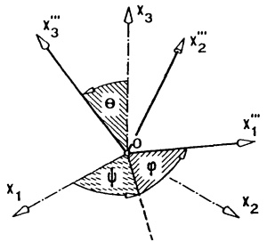

<details>
<summary>text_image</summary>

x₃
x₃′′
x₂′′
θ
O
φ
x₁′′
x₁
x₂
</details>

Abb. 152 - Euler-Winkel

$$
\text {①.} \mathbf {x} = D _ {3} (\psi) \mathbf {x} ^ {\prime}, \quad \text {②.} \mathbf {x} ^ {\prime} = D _ {1} (\theta) \mathbf {x} ^ {\prime \prime}, \quad \text {③.} \mathbf {x} ^ {\prime \prime} = D _ {3} (\varphi) \mathbf {x} ^ {\prime \prime \prime}.
$$

Setzt man ③. in ②. und ②. in ①. ein, so folgt

$$
\mathbf {x} = D _ {3} (\psi) D _ {1} (\theta) D _ {3} (\varphi) \mathbf {x} ^ {\prime \prime \prime}.
$$

Dies ist die Substitutionsformel (8) für die durch $d$ gedrehte Basis. In der Basis $\mathbf{e}_1$, $\mathbf{e}_2$, $\mathbf{e}_3$ hat daher $d$ die Darstellung $\mathbf{x} \mapsto D_3(\psi)D_1(\psi)D_3(\varphi)\mathbf{x}$ mit der Abbildungsmatrix

$$
\left( \begin{array}{c c c} \cos \psi \cos \varphi - \sin \psi \cos \theta \sin \varphi & - \cos \psi \sin \varphi - \sin \psi \cos \theta \cos \varphi & \sin \psi \sin \theta \\ \sin \psi \cos \varphi + \cos \psi \cos \theta \sin \varphi & - \sin \psi \sin \varphi + \cos \psi \cos \theta \cos \varphi & - \cos \psi \sin \theta \\ \sin \theta \sin \varphi & \sin \theta \cos \varphi & \cos \theta \end{array} \right)  .
$$

⑥ Punktkoordinaten. Begriffe der anschaulichen Geometrie des $\mathbb{R}^{3}$ werden in den $\mathbb{R}^{n}$ übernommen. Die Zeilen-$n$-Tupel $X = (x_{1}, \ldots, x_{n})$, $x_{i} \in \mathbb{R}$, nennt man Punkte des $n$-dimensionalen reellen Punktraumes $\mathbb{R}_{n}$. Zu jedem Punkt $X = (x_{1}, \ldots, x_{n})$ gehört der Vektor $\mathbf{x} = \begin{pmatrix} x_{1} \\ \vdots \\ x_{n} \end{pmatrix} \in \mathbb{R}^{n}$ - und umgekehrt. Ist $P = (p_{1}, \ldots, p_{n})$ ein fester Punkt, dann heißt

$$
\overrightarrow {P X} := \mathbf {x} - \mathbf {p} = \left( \begin{array}{c} x _ {1} - p _ {1} \\ x _ {2} - p _ {2} \\ \vdots \\ x _ {n} - p _ {n} \end{array} \right)
$$

Ortsvektor des Punktes X in bezug auf P. Demnach ist  $x = \overrightarrow{OX}$  der Ortsvektor des Punktes X in bezug auf den Nullpunkt  $\mathbf{0} = (0, \ldots, 0)$ .

Definition. Ein affines Koordinatensystem $K = (P; \mathbf{b}_1, \ldots, \mathbf{b}_n)$ des Punktraumes $\mathbb{R}_n$ besteht aus einem festen Bezugspunkt $P = (p_1, \ldots, p_n)$ und einer Basis $B = (\mathbf{b}_1, \ldots, \mathbf{b}_n)$ des $\mathbb{R}^n$. Die Koordinaten $x_i'$ des Ortsvektors $\overrightarrow{PX}$ bezüglich der Basis $B$,

$$
\overrightarrow {P X} = x _ {1} ^ {\prime} \mathbf {b} _ {1} + \dots + x _ {n} ^ {\prime} \mathbf {b} _ {n},
$$

heißen Koordinaten des Punktes X im Koordinatensystem K; man schreibt  $X_{K} = (x_{1}', \ldots, x_{n}')$ .

---

§6. Lineare Abbildungen und Eigenwerte

323

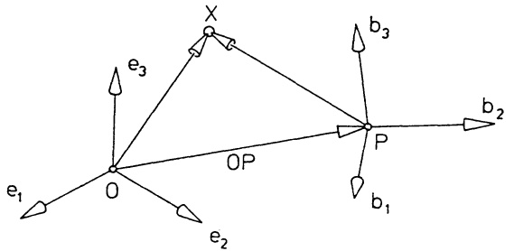

<details>
<summary>text_image</summary>

e₁
O
e₂
X
b₃
OP
P
b₂
b₁
</details>

Abb. 153 - Affine Koordinaten

Die Definitionen und (8) ergeben

$$
\left( \begin{array}{c} x _ {1} ^ {\prime} \\ x _ {2} ^ {\prime} \\ \vdots \\ x _ {n} ^ {\prime} \end{array} \right) = (\mathbf {x} - \mathbf {p}) _ {B} = B ^ {- 1} \left( \begin{array}{c} x _ {1} - p _ {1} \\ x _ {2} - p _ {2} \\ \vdots \\ x _ {n} - p _ {n} \end{array} \right). \tag {9}
$$

Wir fassen dies für den wichtigen Spezialfall n = 3 noch einmal zusammen:

## Satz 6.3. Koordinatenwechsel im Raum.

Übergang vom kartesischen „Inertialsystem“ $I = (O; \mathbf{e}_1, \mathbf{e}_2, \mathbf{e}_3)$ zum affinen (i.a. schiefwinkligen) Koordinatensystem $K = (P; \mathbf{b}_1, \mathbf{b}_2, \mathbf{b}_3)$.

Ist $P = (p_1, p_2, p_3) \in \mathbb{R}_3$, $(\mathbf{b}_1, \mathbf{b}_2, \mathbf{b}_3) = B \in \mathbb{R}^{3 \times 3}$ die Darstellung bezüglich $I$ und sind $(x_1, x_2, x_3)$ und $(x_1', x_2', x_3')$ die $I$- bzw. $K$-Koordinaten des Punktes $X$, so gilt mit $\mathbf{x} := \begin{pmatrix} x_1 \\ x_2 \\ x_3 \end{pmatrix}$, $\mathbf{x}' := \begin{pmatrix} x_1' \\ x_2' \\ x_3' \end{pmatrix}$ und $\mathbf{p} := \begin{pmatrix} p_1 \\ p_2 \\ p_3 \end{pmatrix}$:

Substitutionsformel:  $x = Bx' + p$ ,

Transformationsformel: $\mathbf{x}' = B^{-1}(\mathbf{x} - \mathbf{p})$.

Bemerkungen. 1. Genügt eine Fläche im $\mathbb{R}^3$ in $I$-Koordinaten der Gleichung $Q(\mathbf{x}) = 0$, so hat sie mit der Substitutionsformel im $K$-System die Darstellung $Q(B\mathbf{x}' + \mathbf{p}) = 0$ ($\rightarrow$ 7.3, 7.4).

2. Bei der Parallelverschiebung des initialen Achsenkreuzes in den neuen Ursprung P erhält X die neuen Koordinaten  $x_{i}^{\prime}=x_{i}-p_{i}\quad(i=1,2,3)$ .
3. Bei der Drehung des Achsenkreuzes mit der Drehmatrix  $D = (D\mathbf{e}_{1}, D\mathbf{e}_{2}, D\mathbf{e}_{3})$  erhält X die neuen Koordinaten

$$
\left( \begin{array}{c} x _ {1} ^ {\prime} \\ x _ {2} ^ {\prime} \\ x _ {3} ^ {\prime} \end{array} \right) = D ^ {- 1} \left( \begin{array}{c} x _ {1} \\ x _ {2} \\ x _ {3} \end{array} \right) = D ^ {T} \left( \begin{array}{c} x _ {1} \\ x _ {2} \\ x _ {3} \end{array} \right) .
$$

Aufgrund dieser Transformationsformel wird von manchen Autoren die Inverse  $D^{-1} = D^{T}$  als Drehmatrix dieser Koordinatentransformation bezeichnet.

---

324

6. Lineare Algebra

Beispiel.  $(\mathbf{e}_{1}^{\prime},\mathbf{e}_{2}^{\prime},\mathbf{e}_{3}^{\prime})$  entstehe aus  $(\mathbf{e}_{1},\mathbf{e}_{2},\mathbf{e}_{3})$  durch die Drehung  $D = D_{3}(\frac{\pi}{4})D_{1}(\frac{\pi}{6})$  ( $\rightarrow$  6.4). Wird das gedrehte Koordinatensystem noch in den Punkt  $P = (1,2,3)$  verschoben, dann hat der Punkt  $X = (x,y,z)$  im neuen Koordinatensystem  $(P;\mathbf{e}_{1}^{\prime},\mathbf{e}_{2}^{\prime},\mathbf{e}_{3}^{\prime})$  die Koordinaten

$$
\left( \begin{array}{c} x ^ {\prime} \\ y ^ {\prime} \\ z ^ {\prime} \end{array} \right) = D ^ {T} \left( \begin{array}{c} x - 1 \\ y - 2 \\ z - 3 \end{array} \right) = \frac {1}{2} \left( \begin{array}{c c c} \sqrt {2} & \sqrt {2} & 0 \\ - \frac {1}{2} \sqrt {6} & \frac {1}{2} \sqrt {6} & 1 \\ \frac {1}{2} \sqrt {2} & - \frac {1}{2} \sqrt {2} & \sqrt {3} \end{array} \right) \left( \begin{array}{c} x - 1 \\ y - 2 \\ z - 3 \end{array} \right),
$$

d.h.

$$
\begin{array}{l} x ^ {\prime} = \frac {1}{2} (\sqrt {2} (x - 1) + \sqrt {2} (y - 2)) \\ y ^ {\prime} = \frac {1}{2} (- \frac {1}{2} \sqrt {6} (x - 1) + \frac {1}{2} \sqrt {6} (y - 2) + (z - 3)) \\ z ^ {\prime} = \frac {1}{2} (\frac {1}{2} \sqrt {2} (x - 1) - \frac {1}{2} \sqrt {2} (y - 2) + \sqrt {3} (z - 3)). \\ \end{array}
$$

(c) Abbildungsmatrix. Zu jeder $n \times n$-Matrix $A$ gehört die lineare Abbildung $f: \mathbb{R}^n \to \mathbb{R}^n$, $f(\mathbf{x}) = A\mathbf{x}$, dabei ist $A$ die Abbildungsmatrix von $f$ bezüglich der natürlichen Basis ($\rightarrow$ Satz 6.1). Der Wechsel zu einer anderen Basis bringt zusätzliche Erkenntnisse:

Definition. Seien $f:\mathbb{R}^{n}\to\mathbb{R}^{n}$ eine lineare Abbildung und $B=(\mathbf{b}_{1},\ldots,\mathbf{b}_{n})$ eine Basis des $\mathbb{R}^{n}$. Die Matrix

$$
C := (f (\mathbf {b} _ {1}) _ {B}, \dots , f (\mathbf {b} _ {n}) _ {B}),
$$

in deren Spalten die Koordinatenvektoren (bzgl. B) der Bilder $f(\mathbf{b}_{i})$ stehen, heißt Abbildungsmatrix von $f$ bezüglich $B$.

Satz 6.4. Die Änderung der Abbildungsmatrix beim Basiswechsel.

Es seien A eine $n \times n$-Matrix und $B = (\mathbf{b}_1, \ldots, \mathbf{b}_n)$ eine Basis des $\mathbb{R}^n$. Die Abbildungsgleichung $\mathbf{y} = A\mathbf{x}$ lautet in Koordinaten bezüglich $B$

$$
\mathbf {y} _ {B} = (A \mathbf {x}) _ {B} = C \mathbf {x} _ {B} \tag {10}
$$

mit der Abbildungsmatrix $C = ((A\mathbf{b}_1)_B, \ldots, (A\mathbf{b}_n)_B)$.

Ferner gilt

$$
C = B ^ {- 1} A B . \tag {11}
$$

Beweis. Aus $\mathbf{x} = \sum_{i=1}^{n} x_i' \mathbf{b}_i$ folgt $(A\mathbf{x})_B = \sum_{i=1}^{n} x_i'(A\mathbf{b}_i)_B = ((A\mathbf{b}_1)_B, \ldots, (A\mathbf{b}_n)_B)\mathbf{x}_B$. Daher ist in (10) $C = ((A\mathbf{b}_1)_B, \ldots, (A\mathbf{b}_n)_B)$ zu setzen. Mit Transformationsformel (8) ergibt sich hieraus $C = (B^{-1} A\mathbf{b}_1, \ldots, B^{-1} A\mathbf{b}_n) = B^{-1} A(\mathbf{b}_1, \ldots, \mathbf{b}_n) = B^{-1} AB$.

Beispiel 1. Sei (→ 6.4, ⓐ) $S \in \mathbb{R}^{3 \times 3}$ die Abbildungsmatrix der Spiegelung $s(\mathbf{x}) = \mathbf{x} - 2(\mathbf{x} \cdot \mathbf{a})\mathbf{a} = S\mathbf{x}$ an der zu $\mathbf{a} \in \mathbb{R}^3$, $|\mathbf{a}| = 1$, orthogonalen Ebene.

---

§6. Lineare Abbildungen und Eigenwerte

325

Wir gehen über zu einer anderen kartesischen Basis $B = (\mathbf{a}, \mathbf{b}, \mathbf{a} \times \mathbf{b})$ mit einem Einheitsvektor $\mathbf{b}$ orthogonal zu $\mathbf{a}$. Aus

$$
s (\mathbf {a}) = - \mathbf {a}, s (\mathbf {b}) = \mathbf {b}, s (\mathbf {a} \times \mathbf {b}) = \mathbf {a} \times \mathbf {b}
$$

liest man sofort die Abbildungsmatrix $S'$ bezüglich $B$ ab:

$$
S ^ {\prime} = \left( \begin{array}{c c c} - 1 & 0 & 0 \\ 0 & 1 & 0 \\ 0 & 0 & 1 \end{array} \right) .
$$

In Koordinaten bezüglich $B$ wird die Spiegelung einfach durch $\mathbf{y}' = S' \mathbf{x}'$ beschrieben. Ferner gilt $S' = B^{-1} SB$.

Beispiel 2. Wir betrachten die in 6.4, Beispiel 3 behandelte Drehung $d(\mathbf{x}) = D\mathbf{x}$ (mit der $3 \times 3$-Drehmatrix $D$) bezüglich einer kartesischen Basis $B = (\mathbf{a}, \mathbf{b}, \mathbf{c})$ mit dem Einheitsvektor $\mathbf{a}$ in Richtung der Drehachse. Mit (4) gilt

$$
d (\mathbf {a}) = \mathbf {a}, \quad d (\mathbf {b}) = (\cos \varphi) \mathbf {b} + (\sin \varphi) \mathbf {c}, \quad d (\mathbf {c}) = (- \sin \varphi) \mathbf {b} + (\cos \varphi) \mathbf {c}.
$$

Hieraus liest man die Abbildungsmatrix bezüglich B ab:

$$
D ^ {\prime} = \left( \begin{array}{c c c} 1 & 0 & 0 \\ 0 & \cos \varphi & - \sin \varphi \\ 0 & \sin \varphi & \cos \varphi \end{array} \right) .
$$

Es gilt  $(D\mathbf{x})_{B}=D^{\prime}\mathbf{x}_{B}$  und  $D^{\prime}=B^{-1}DB$ .

In §7 und in den Aufgaben sind weitere Beispiele angegeben.

Definition. Zwei $n \times n$-Matrizen $A$, $C$ heißen ähnlich, wenn es eine invertierbare $n \times n$-Matrix $B$ gibt, so daß gilt $C = B^{-1}AB$.

In Satz 6.4 ist die geometrische Bedeutung der Ähnlichkeit beschrieben. Am Beispiel der Spiegelung und der Drehung wurde deutlich, daß eine verhältnismäßig komplizierte Abbildung mit Matrix A bezüglich einer „passenden“ Basis eine Abbildungsmatrix  $C = B^{-1} AB$  von recht einfacher Gestalt hat. Welche Eigenschaften der neuen Basis bewirken diese Vereinfachung?

Sei $A \in \mathbb{R}^{n \times n}$, $B = (\mathbf{b}_1, \ldots, \mathbf{b}_n)$ eine Basis des $\mathbb{R}^n$ mit $A\mathbf{b}_1 = \lambda\mathbf{b}_1$ ($\lambda \in \mathbb{R}$). Dann ist $(A\mathbf{b}_1)_B = \lambda\mathbf{e}_1$ die erste Spalte der Abbildungsmatrix $C$, über die anderen Spalten ist noch nichts Näheres bekannt. Immerhin hat man – gemäß Satz 6.4 – schon folgende „Vereinfachung“:

$$
B ^ {- 1} A B = \left( \begin{array}{c c c c c} \lambda & * & * & \dots & * \\ 0 & * & * & \dots & * \\ 0 & * & * & \dots & * \\ \vdots & \vdots & \vdots & & \vdots \\ 0 & * & * & \dots & * \end{array} \right) \tag {12}
$$

(an den \*-Stellen stehen die Koordinaten von $A\mathbf{b}_2, \ldots, A\mathbf{b}_n$ bezüglich $B$). Falls auch $A\mathbf{b}_2 = \mu\mathbf{b}_2$ gilt ($\mu \in \mathbb{R}$), dann steht auf der rechten Seite von (12) in der zweiten Spalte der Vektor $\mu\mathbf{e}_2 = (0, \mu, 0, \ldots, 0)^T$.

---

326

6. Lineare Algebra

Die Fragestellung nach solchen Basisvektoren nennt man das algebraische Eigenwertproblem. Es tritt beispielsweise in der Elastomechanik auf bei der Bestimmung der Hauptspannungsrichtungen.

6.7 Eigenwerte, Eigenvektoren. Da die Behandlung des algebraischen Eigenwertproblems eng verbunden ist mit der Nullstellenbestimmung von Polynomen, lassen wir von jetzt an auch komplexe Zahlen als Skalare und Matrizen (also auch Zeilen- und Spaltenvektoren) mit komplexen Koeffizienten zu. Die bisherigen Ausführungen über Vektoren und Matrizen bleiben unverändert gültig, wenn R durch C ersetzt wird.

Definition. Eine Zahl $\lambda\in\mathbb{C}$ heißt Eigenwert einer Matrix $A\in\mathbb{C}^{n\times n}$, wenn es wenigstens einen Spaltenvektor $\mathbf{b}\in\mathbb{C}^{n}$, $\mathbf{b}\neq\mathbf{0}$, gibt mit

$$
A \mathbf {b} = \lambda \mathbf {b}.
$$

Jeder Vektor  $b \neq 0$ , der diese Gleichung erfüllt, heißt Eigenvektor von A zum Eigenwert  $\lambda$ .

## Beispiele.

1. Die Matrix $A = \begin{pmatrix} 0 & -1 & 0 \\ -1 & -1 & 1 \\ 0 & 1 & 0 \end{pmatrix}$ hat den Eigenwert $\lambda = -2$ mit zugehörigem Eigenvektor $\mathbf{b} = \begin{pmatrix} 1 \\ 2 \\ -1 \end{pmatrix}$; denn es gilt $A\mathbf{b} = -2\mathbf{b}$ und $\mathbf{b} \neq \mathbf{0}$.

2. Jede Drehmatrix $D \in \mathbb{R}^{3 \times 3}$ hat den Eigenwert 1, jeder Vektor $\neq \mathbf{0}$ parallel zur Drehachse ist Eigenvektor.

Zur Berechnung der Eigenwerte einer  $n \times n$ -Matrix betrachtet man (mit einer Variablen  $\lambda$ ) das charakteristische Polynom von A

$$
\chi_ {A} (\lambda) := \det (A - \lambda E).
$$

Diese Determinante ist explizit zu berechnen und das Ergebnis nach fallenden  $\lambda$ -Potenzen zu ordnen. Man erhält

$$
\chi_ {A} (\lambda) = (- \lambda) ^ {n} + (\text {Spur} A) (- \lambda) ^ {n - 1} + \dots + \det A \tag {13}
$$

wobei Spur A, die Spur von A, definiert ist durch

$$
\begin{array}{r l} \text {Spur} A := & a _ {1 1} + a _ {2 2} + \dots + a _ {n n} \\ (= & \text {Summe der Diagonalelemente von} A). \end{array}
$$

---

§6. Lineare Abbildungen und Eigenwerte

327

Satz 6.5. Es ist $\lambda \in \mathbb{C}$ genau dann ein Eigenwert der $n \times n$-Matrix $A$, wenn $\lambda$ eine Nullstelle des charakteristischen Polynoms $\chi_A$, d.h., wenn $\det (A - \lambda E) = 0$ ist.

Beweis. Es ist $\lambda\in\mathbb{C}$ genau dann Eigenwert, wenn das homogene lineare Gleichungssystem $(A-\lambda E)\mathbf{x}=\mathbf{0}$ eine von Null verschiedene Lösung besitzt. Das ist nach Satz 1.1 genau dann der Fall, wenn $\operatorname{Rang}(A-\lambda E)<n$, also wenn det $(A-\lambda E)=0$ gilt ($\rightarrow$ Satz 5.3). (Diese Ergebnisse gelten auch über $\mathbb{C}$.) □

Die Berechnung der Eigenwerte und Eigenvektoren erfolgt daher in 2 Schritten:

1. Schritt. Man bestimmt die (verschiedenen) Nullstellen $\lambda_{1},\ldots,\lambda_{r}$ der „charakteristischen Gleichung“ $\chi_{A}(\lambda)=\det(A-\lambda E)=0$, was gleichbedeutend ist mit der Erstellung der Produktdarstellung des charakteristischen Polynoms

$$
\chi_ {A} (\lambda) = (\lambda_ {1} - \lambda) ^ {k _ {1}} (\lambda_ {2} - \lambda) ^ {k _ {2}} \dots (\lambda_ {r} - \lambda) ^ {k _ {r}} \tag {14}
$$

(→ Kap. 2, 2.2, der Leitkoeffizient von $\chi_{A}$ ist $(-1)^{n}$).

$\lambda_{1},\ldots,\lambda_{r}$ sind die Eigenwerte von A. Die Vielfachheit $k_{i}$ der Nullstelle $\lambda_{i}$ heißt algebraische Vielfachheit des Eigenwertes $\lambda_{i}$. Demnach besitzt jede Matrix n nicht notwendig verschiedene Eigenwerte; jeder Eigenwert kommt dabei so oft vor, wie seine algebraische Vielfachheit angibt.

2. Schritt. Zu jedem Eigenwert $\lambda_{i}$ ($1 \leq i \leq r$) berechnet man den Lösungsraum des homogenen linearen Gleichungssystems $(A - \lambda_{i}E)\mathbf{x} = \mathbf{0}$. Jede Lösung $\neq \mathbf{0}$ ist ein Eigenvektor zu $\lambda_{i}$.

$$
V (\lambda_ {i}) := \{\mathbf {b} \in \mathbb {C} ^ {n}; (A - \lambda_ {i} E) \mathbf {b} = \mathbf {0} \} = \operatorname{Kern} (A - \lambda_ {i} E)
$$

heißt Eigenraum zum Eigenwert $\lambda_{i}$ ($1 \leq i \leq r$). Man nennt Dim $V(\lambda_{i})$ (die Dimension des Eigenraumes) die geometrische Vielfachheit des Eigenwertes $\lambda_{i}$. Algebraische und geometrische Vielfachheit stimmen im allgemeinen nicht überein ($\rightarrow$ Beispiel 1c und Aufgabe 14).

Bemerkung. Wird die rechte Seite von (14) ausmultipliziert und das Ergebnis mit (13) verglichen, erhält man

$$
\begin{array}{c} \text {Spur} A = k _ {1} \lambda_ {1} + \dots + k _ {r} \lambda_ {r}, \\ \det A = \lambda_ {1} ^ {k _ {1}} \lambda_ {2} ^ {k _ {2}} \dots \lambda_ {r} ^ {k _ {r}}, \\ \text {mit den verschiedenen Eigenwerten} \lambda_ {i} \text {der algebraischen Vielfachheit} k _ {i} (1 \leq i \leq r). \end{array} \tag {15}
$$

Formel (15) ist nützlich für Rechenkontrollen; sie erlaubt außerdem eine leichte Berechnung eines Eigenwerts, wenn alle anderen bekannt sind.

Beispiel 1. Gegeben $A = \begin{pmatrix} a & b \\ c & d \end{pmatrix} \in \mathbb{R}^{2 \times 2}$.

---

328

6. Lineare Algebra

1. Schritt.

$$
\begin{array}{l} \chi_ {A} (\lambda) = \det \left( \begin{array}{c c} a - \lambda & b \\ c & d - \lambda \end{array} \right) = \lambda^ {2} - (a + d) \lambda + (a d - b c) \\ = \lambda^ {2} - (\operatorname{Spur} A) \lambda + \det A = (\lambda - \lambda_ {1}) (\lambda - \lambda_ {2}), \\ \end{array}
$$

wobei  $\lambda_{1}$ ,  $\lambda_{2}$  mit der Lösungsformel für  $\chi_{A}(\lambda)=0$  bestimmt wird.

2. Schritt. Mit jedem Eigenwert  $\lambda_{i}$  (i = 1, 2) wird

$$
\left( \begin{array}{c c} a - \lambda_ {i} & b \\ c & d - \lambda_ {i} \end{array} \right) \binom{x}{y} = \binom{0}{0}
$$

gelöst und jeweils eine Basis des Lösungsraumes angegeben.

Im Falle n = 2 gibt es somit vier verschiedene Fälle:

(a) $\lambda_1, \lambda_2 \in \mathbb{R}, \lambda_1 \neq \lambda_2,$
b) $\lambda_{1} = \lambda_{2}\in \mathbb{R}$, geometrische Vielfachheit 2,
(c) $\lambda_{1} = \lambda_{2}\in \mathbb{R}$, geometrische Vielfachheit 1,
(d) $\lambda_2 = \overline{\lambda}_1 \in \mathbb{C}, \lambda_1 \notin \mathbb{R}$.

Konkrete Zahlenbeispiele zu jedem dieser Fälle:

① $A = \begin{pmatrix} 1 & 2 \\ 2 & 1 \end{pmatrix}$ hat die Eigenwerte $\lambda_1 = -1$, $\lambda_2 = 3$, $V(\lambda_1)$, $V(\lambda_2)$ sind eindimensional mit den Basisvektoren $\mathbf{b}_1 = \begin{pmatrix} -1 \\ 1 \end{pmatrix}$, $\mathbf{b}_2 = \begin{pmatrix} 1 \\ 1 \end{pmatrix}$.

b $A = \left( \begin{array}{cc}3 & 0\\ 0 & 3 \end{array} \right)$ hat die Eigenwerte $\lambda_1 = \lambda_2 = 3$ mit Eigenraum $V(\lambda_1) = \mathbb{R}^2$
(c)  $A = \begin{pmatrix} 2 & 1 \\ 0 & 2 \end{pmatrix}$  hat die Eigenwerte  $\lambda_{1} = \lambda_{2} = 2$  (algebraische Vielfachheit 2);
der Eigenraum  $V(\lambda_{1}) = \left\{\alpha \begin{pmatrix} 1 \\ 0 \end{pmatrix}; \alpha \in \mathbb{R}\right\}$  ist eindimensional (geometrische Vielfachheit 1).

(d)  $A = \begin{pmatrix} \cos \varphi & -\sin \varphi \\ \sin \varphi & \cos \varphi \end{pmatrix}$  hat die beiden konjugiert komplexen Eigenwerte
 $\lambda_{1} = \cos \varphi + i \sin \varphi, \lambda_{2} = \cos \varphi - i \sin \varphi, \text{ also keinen reellen Eigenwert (falls } \varphi \neq 0, \pm\pi, \pm2\pi, \ldots) \text{ und daher auch keinen reellen Eigenvektor. Die komplexen Eigenräume sind}$

$$
V (\lambda_ {1}) = \left\{\alpha \binom{1}{- i}; \alpha \in \mathbb {C} \right\}, V (\lambda_ {2}) = \left\{\alpha \binom{1}{i}; \alpha \in \mathbb {C} \right\}. \tag {$\square$}
$$

Beispiel 2. Jede obere (analog untere) Dreiecksmatrix

$$
A = \left( \begin{array}{c c c c} \alpha_ {1} & * & \dots & * \\ 0 & \alpha_ {2} & \ddots & \vdots \\ \vdots & \ddots & \ddots & * \\ 0 & \dots & 0 & \alpha_ {n} \end{array} \right)
$$

---

§6. Lineare Abbildungen und Eigenwerte

329

hat die Eigenwerte $\alpha_{1},\ldots ,\alpha_{n}$ ; denn es gilt

$$
\chi_ {A} (\lambda) = \det (A - \lambda E) = (\alpha_ {1} - \lambda) (\alpha_ {2} - \lambda) \dots (\alpha_ {n} - \lambda)
$$

(→ Satz 5.1). Die zugehörigen Eigenräume sind die Lösungsräume von  $(A - \alpha_{i}E)\mathbf{x} = \mathbf{0}$ , sie hängen ganz wesentlich von den \*-Stellen in A ab. Ist speziell A eine Diagonalmatrix (also alle \*-Stellen gleich Null), dann ist  $e_{i}$  ein Eigenvektor zum Eigenwert  $\alpha_{i}$  ( $1 \leq i \leq n$ ). □

## Beispiel 3.

Zwei Linearschwinger mit Massen  $m_{1}$ ,  $m_{2}$  und gleicher Federkonstan- ten  $c_{1}$  sind über eine dritte Fe- der der Konstante  $c_{2}$  gekoppelt. Das Gesetz von HOOKE liefert für die Auslenkungen  $s_{1}(t)$ ,  $s_{2}(t)$  die Bewegungsgleichungen

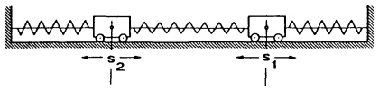

<details>
<summary>text_image</summary>

s₂
s₁
</details>

Abb. 154 - Linearschwinger

$$
\binom{\ddot {s} _ {1}}{\ddot {s} _ {2}} + A \binom{s _ {1}}{s _ {2}} = \binom{0}{0} \quad \text {mit} \quad A = \left( \begin{array}{c c} \frac {c _ {1} + c _ {2}}{m _ {1}} & - \frac {c _ {2}}{m _ {1}} \\ - \frac {c _ {2}}{m _ {2}} & \frac {c _ {1} + c _ {2}}{m _ {2}} \end{array} \right)
$$

$(m_{1},m_{2},c_{1}>0,c_{2}\geq0).$

Der Ansatz

$$
\binom{s _ {1} (t)}{s _ {2} (t)} = (\cos \omega t) \binom{v _ {1}}{v _ {2}} = (\cos \omega t) \mathbf {v}
$$

führt wegen  $\cos\omega t\neq0$  auf das Eigenwertproblem

$$
A \mathbf {v} = \omega^ {2} \mathbf {v}.
$$

Schreibt man abkürzend

$$
A = \left( \begin{array}{c c} w _ {1} ^ {2} & - k _ {1} ^ {2} \\ - k _ {2} ^ {2} & w _ {2} ^ {2} \end{array} \right) ,
$$

so lauten die Eigenwerte

$$
\lambda_ {1, 2} = \frac {1}{2} (w _ {1} ^ {2} + w _ {2} ^ {2}) \pm \sqrt {\frac {1}{4} (w _ {1} ^ {2} - w _ {2} ^ {2}) ^ {2} + k _ {1} ^ {2} k _ {2} ^ {2}}.
$$

Die Eigenwerte sind stets reell und wegen  $w_{1}^{2} \geq k_{1}^{2}$  und  $w_{2}^{2} \geq k_{2}^{2}$  positiv, d.h. man hat zwei sogenannte Eigenschwingungen mit den Frequenzen  $\omega_{1,2} = \sqrt{\lambda_{1,2}}$ . Jede Lösung der Bewegungsgleichungen kann als Superposition dieser beiden Eigenschwingungen geschrieben werden.

Besonders einfach ist der Fall  $m_{1}=m_{2}=m$  mit symmetrischem A :

$$
\begin{array}{l} \omega_ {1} = \sqrt {\frac {c _ {1}}{m}} \quad , \quad \mathbf {v} _ {1} = \binom{1}{1} \\ \omega_ {2} = \sqrt {\frac {c _ {1} + 2 c _ {2}}{m}}, \quad \mathbf {v} _ {2} = \binom{1}{- 1} \\ \end{array}
$$

(gleichphasige Schwingung)

(gegenphasige Schwingung)

□

---

330

6. Lineare Algebra

Im folgenden Satz stellen wir nützliche Beobachtungen zusammen.

Satz 6.6. Sei $A \in \mathbb{C}^{n \times n}$.

a) Besitzt A den Eigenvektor b zum Eigenwert λ, dann haben

$$
\alpha A, A ^ {m}, A + \beta E, p (A) := \alpha_ {m} A ^ {m} + \dots + \alpha_ {1} A + \alpha_ {0} E
$$

ebenfalls den Eigenvektor b, jedoch jeweils zum Eigenwert

$$
\alpha \lambda , \lambda^ {m}, \lambda + \beta , p (\lambda) = \alpha_ {m} \lambda^ {m} + \dots + \alpha_ {1} \lambda + \alpha_ {0}.
$$

b) A und die Transponierte  $A^{T}$  haben dasselbe charakteristische Polynom, deshalb besitzen sie dieselben Eigenwerte (jedoch i.a. mit verschiedenen Eigenräumen).
c) Die ähnlichen Matrizen A und  $B^{-1}AB$  haben dasselbe charakteristische Polynom und deshalb dieselben Eigenwerte; b ist genau dann Eigenvektor von A, wenn  $B^{-1}b$  Eigenvektor von  $B^{-1}AB$  ist.
d) Es ist A genau dann invertierbar, wenn alle Eigenwerte ≠ 0 sind. Ist λ ein Eigenwert von A mit Eigenvektor b, dann ist λ⁻¹ Eigenwert von A⁻¹ mit demselben Eigenvektor b.

Beweis. a): Aus $A\mathbf{b} = \lambda \mathbf{b}$ folgt $p(A)\mathbf{b} = p(\lambda)\mathbf{b}$.

b): $\operatorname{det}(A^T - \lambda E) = \operatorname{det}(A - \lambda E)^T = \operatorname{det}(A - \lambda E) \quad (\rightarrow \text{Satz 5.3b})$.

c): $\det (B^{-1}AB - \lambda E) = \det B^{-1}(A - \lambda E)B = \det B^{-1}\det (A - \lambda E)\det B = \det (A - \lambda E)$ $(\rightarrow (8),\S 5)$.

d): det  $A = \lambda_{1}^{k_{1}} \cdots \lambda_{r}^{k_{r}} \neq 0$  ( $\rightarrow 15$ )  $\Longleftrightarrow$  alle  $\lambda_{i} \neq 0$ .

Ferner: $A\mathbf{b} = \lambda \mathbf{b}\Rightarrow \frac{1}{\lambda}\mathbf{b} = A^{-1}\mathbf{b}$

Bemerkung. Die Koeffizienten des charakteristischen Polynoms  $\chi_{A}(\lambda)=c_{n}(-\lambda)^{n}+c_{n-1}(-\lambda)^{n-1}+\cdots+c_{1}(-\lambda)+c_{0}$  sind Invarianten der  $n\times n$ -Matrix A, bzw. Invarianten der zugehörigen linearen Abbildung  $x\mapsto Ax$ , da sie sich gemäß Satz 6.4 und Satz 6.6, Teil c, bei einem Basiswechsel nicht ändern.

## Beispiel.

$$
A = (\alpha_ {i j}) \in \mathbb {R} ^ {3 \times 3}, \chi_ {A} (\lambda) = - \lambda^ {3} + c _ {2} \lambda^ {2} - c _ {1} \lambda + c _ {0} = (\lambda_ {1} - \lambda) (\lambda_ {2} - \lambda) (\lambda_ {3} - \lambda).
$$

$$
c _ {2} = \operatorname{Spur} A = a _ {1 1} + a _ {2 2} + a _ {3 3} = \lambda_ {1} + \lambda_ {2} + \lambda_ {3},
$$

$$
c _ {1} = \det \left| \begin{array}{l l} a _ {1 1} & a _ {1 2} \\ a _ {2 1} & a _ {2 2} \end{array} \right| + \det \left| \begin{array}{l l} a _ {1 1} & a _ {1 3} \\ a _ {3 1} & a _ {3 3} \end{array} \right| + \det \left| \begin{array}{l l} a _ {2 2} & a _ {2 3} \\ a _ {3 2} & a _ {3 3} \end{array} \right| = \lambda_ {1} \lambda_ {2} + \lambda_ {1} \lambda_ {3} + \lambda_ {2} \lambda_ {3},
$$

$$
c _ {0} = \det A = \lambda_ {1} \lambda_ {2} \lambda_ {3}.
$$

$c_{0}, c_{1}, c_{2}$ sind Invarianten der linearen Abbildung $f(\mathbf{x}) = A\mathbf{x}, \mathbf{x} \in \mathbb{R}^{3}$. Das bedeutet speziell für den Spannungstensor ($\rightarrow$ 6.1, Beisp. 9), der in einem kartesischen Koordinatensystem durch die Matrix

$$
S = \left( \begin{array}{c c c} \sigma_ {x} & \tau_ {x y} & \tau_ {x z} \\ \tau_ {x y} & \sigma_ {y} & \tau_ {y z} \\ \tau_ {x z} & \tau_ {y z} & \sigma_ {z} \end{array} \right)
$$

---

§6. Lineare Abbildungen und Eigenwerte

331

dargestellt wird, daß in jedem anderen Koordinatensystem (mit gleichem Ursprung) die den Größen

$$
c _ {2} = \sigma_ {x} + \sigma_ {y} + \sigma_ {z},
$$

$$
c _ {1} = \sigma_ {x} \sigma_ {y} + \sigma_ {x} \sigma_ {z} + \sigma_ {y} \sigma_ {z} - \tau_ {x y} ^ {2} - \tau_ {x z} ^ {2} - \tau_ {y z} ^ {2},
$$

$$
c _ {0} = \det S
$$

entsprechenden Werte gleich sind.

Zur Berechnung eines maximalen Systems linear unabhängiger Eigenvektoren der Matrix A genügt es, jeweils eine Basis der Eigenräume zu den einzelnen Eigenwerten zu bestimmen. Denn es gilt

Satz 6.7. Eigenvektoren  $b_{1},\ldots,b_{r}$  zu paarweise verschiedenen Eigenwerten  $\lambda_{1},\ldots,\lambda_{r}$  der Matrix A sind linear unabhängig.

Beweis. Aus  $\alpha_{1}b_{1}+\cdots+\alpha_{r}b_{r}=0$  folgt durch Multiplikation mit A (von links)  $\lambda_{1}\alpha_{1}b_{1}+\cdots+\lambda_{r}\alpha_{r}b_{r}=0$ . Aus beiden Gleichungen ergibt sich

$$
(\lambda_ {1} - \lambda_ {2}) \alpha_ {2} \mathbf {b} _ {2} + \dots + (\lambda_ {1} - \lambda_ {r}) \alpha_ {r} \mathbf {b} _ {r} = \mathbf {0}.
$$

Ebenso (Multiplikation mit A und Vergleich) folgt hieraus

$$
(\lambda_ {1} - \lambda_ {3}) (\lambda_ {2} - \lambda_ {3}) \alpha_ {3} \mathbf {b} _ {3} + \dots + (\lambda_ {1} - \lambda_ {r}) (\lambda_ {2} - \lambda_ {r}) \alpha_ {r} \mathbf {b} _ {r} = \mathbf {0},
$$

etc. Man gelangt schließlich zu  $(\lambda_{1}-\lambda_{r})(\lambda_{2}-\lambda_{r})\cdots(\lambda_{r-1}-\lambda_{r})\alpha_{r}\mathbf{b}_{r}=\mathbf{0}$ , woraus  $\alpha_{r}=0$  folgt. Dies gibt rückwärts eingesetzt  $\alpha_{r-1}=\cdots=\alpha_{1}=0$ . ☐

Besonders günstige Verhältnisse liegen vor, wenn es im $\mathbf{C}^{n}$ eine Basis gibt, die vollständig aus Eigenvektoren der Matrix $A\in\mathbf{C}^{n\times n}$ besteht.

Satz 6.8. Besitzt eine Matrix $A \in \mathbb{C}^{n \times n}$ n linear unabhängige Eigenvektoren $\mathbf{b}_1, \ldots, \mathbf{b}_n$, $A\mathbf{b}_i = \lambda_i\mathbf{b}_i$, mit den nicht notwendig verschiedenen Eigenwerten $\lambda_1, \ldots, \lambda_n$, dann bringt die Transformationsmatrix

$$
B := (\mathbf {b} _ {1}, \mathbf {b} _ {2}, \dots , \mathbf {b} _ {n})
$$

(mit den Eigenvektoren als Spalten) die Matrix A auf Diagonalform; d.h., es gilt, wenn die Reihenfolge der $\lambda_{i}$ und der $\mathbf{b}_{i}$ übereinstimmt,

$$
B ^ {- 1} A B = \left( \begin{array}{c c c c c} \lambda_ {1} & 0 & 0 & \dots & 0 \\ 0 & \lambda_ {2} & 0 & \dots & 0 \\ 0 & 0 & & & \vdots \\ \vdots & \vdots & \ddots & & 0 \\ 0 & 0 & \dots & 0 & \lambda_ {n} \end{array} \right) =: D.
$$

Beweis. $\rightarrow$ (12), oder direkt: $AB = (Ab_{1},\dots,Ab_{n}) = (\lambda_{1}b_{1},\dots,\lambda_{n}b_{n}) = BD$. $\square$

---

332

6. Lineare Algebra

Die „Diagonalisierung“ gemäß Satz 6.8 bringt beachtliche Rechenvorteile mit sich. Etwa bei der Berechnung der k-ten Potenzen von A :

$$
\begin{array}{l} A ^ {k} = (B D B ^ {- 1}) ^ {k} = (B D B ^ {- 1}) (B D B ^ {- 1}) \dots (B D B ^ {- 1}) = B D ^ {k} B ^ {- 1} \\ = B \left( \begin{array}{c c c} \lambda_ {1} ^ {k} & & \\ & \lambda_ {2} ^ {k} & 0 \\ & & \ddots \\ & 0 & & \lambda_ {n} ^ {k} \end{array} \right) B ^ {- 1}. \\ \end{array}
$$

Beispiel.  $A = \begin{pmatrix} -2 & -8 & -12 \\ 1 & 4 & 4 \\ 0 & 0 & 1 \end{pmatrix}$

1. Schritt : Die Eigenwerte.

$$
\det (A - \lambda E) = (1 - \lambda) (\lambda - 2) \lambda = 0 \Rightarrow \lambda_ {1} = 0, \lambda_ {2} = 1, \lambda_ {3} = 2.
$$

2. Schritt: Die Eigenvektoren. Es sind drei homogene lineare Gleichungssysteme  $(A-\lambda_{i}E)\mathbf{x}=0$  (i=1,2,3) zu lösen. In diesem Fall ergeben sich eindimensionale Eigenräume

$$
V (\lambda_ {i}) = \{\alpha \mathbf {b} _ {i}; \alpha \in \mathbb {R} \} \text {mit} \mathbf {b} _ {1} = \left( \begin{array}{c} 4 \\ - 1 \\ 0 \end{array} \right), \mathbf {b} _ {2} = \left( \begin{array}{c} 4 \\ 0 \\ - 1 \end{array} \right), \mathbf {b} _ {3} = \left( \begin{array}{c} 2 \\ - 1 \\ 0 \end{array} \right).
$$

3. Schritt: Die Diagonalisierung. Mit der (invertierbaren) Transformationsmatrix

$$
B = (\mathbf {b} _ {1}, \mathbf {b} _ {2}, \mathbf {b} _ {3}) = \left( \begin{array}{c c c} 4 & 4 & 2 \\ - 1 & 0 & - 1 \\ 0 & - 1 & 0 \end{array} \right)
$$

ergibt sich $B^{-1}AB = \begin{pmatrix} 0 & 0 & 0 \\ 0 & 1 & 0 \\ 0 & 0 & 2 \end{pmatrix} =: D$, bzw. $A = BDB^{-1}$. Damit berechnen wir beispielsweise $A^{100}$:

$$
\begin{array}{l} A ^ {1 0 0} = B D ^ {1 0 0} B ^ {- 1} = \left( \begin{array}{r r r} 4 & 4 & 2 \\ - 1 & 0 & - 1 \\ 0 & - 1 & 0 \end{array} \right) \left( \begin{array}{c c c} 0 & 0 & 0 \\ 0 & 1 & 0 \\ 0 & 0 & 2 ^ {1 0 0} \end{array} \right) \left( \begin{array}{r r r} \frac {1}{2} & 1 & 2 \\ 0 & 0 & - 1 \\ - \frac {1}{2} & - 2 & - 2 \end{array} \right) \\ = \left( \begin{array}{c c c} - 2 ^ {1 0 0} & - 2 ^ {1 0 2} & - 4 - 2 ^ {1 0 2} \\ 2 ^ {9 9} & 2 ^ {1 0 1} & 2 ^ {1 0 1} \\ 0 & 0 & 1 \end{array} \right) . \\ \end{array}
$$

Die numerische Berechnung der Eigenwerte und Eigenvektoren einer Matrix ist i.a. ein schwieriges Problem. Man vermeidet dabei den Weg über die charakteristische Gleichung (→Programm JACOBI, §7). Zur Unterstützung von Handrechnungen dient das folgende Programm zur Bestimmung der Koeffizienten des Polynoms det(λE - A) für eine n × n-Matrix A, das auf den französischen Astronomen U. LEVERRIER (1811 - 1877) zurückgeht.

(Man beachte: Der Koeffzient von  $\lambda^{n}$  ist stets 1!)

---

§6. Lineare Abbildungen und Eigenwerte

333

```txt
'---- Programm LEVERRIER----
Print "DIMENSION N=";
Input N
Dim A(N,N),B(N,N)
Print "A ZEILENWEISE"
For I=1 To N
    For J=1 To N
        Print "A"+Str$(I)+Str$(J);
        Input A(I,J)
        B(I,J)=A(I,J)
    Next J
Next I
For K=1 To N-2
    Exit If N=2
    Gosub Shift
    For J=1 To N
        For I=1 To N
            B(I,O)=B(I,J)
        Next I
        For I=1 To N
            X=0
            For L=1 To N
                X=X+A(I,L)*B(L,O)
            Next L
            B(I,J)=X
        Next I
    Next J
Next K
```

\* 6.8 Die orthogonale Gruppe. Wir geben weitere wichtige Eigenschaften orthogonaler $n \times n$-Matrizen (insbesondere für $n = 2,3$) an.

Definition. Die Menge aller orthogonalen  $n \times n$ -Matrizen,

$$
O (n) := \left\{A \in \mathbb {R} ^ {n \times n}, A ^ {T} A = E \right\},
$$

heißt orthogonale Gruppe des $\mathbb{R}^{n}$, und die Teilmenge

$$
S O (n) := \left\{A \in \mathbb {R} ^ {n \times n}; A ^ {T} A = E \text {und} \det A = 1 \right\},
$$

heißt spezielle orthogonale Gruppe oder Drehgruppe.

Man verifiziert leicht anhand der Definitionen:

(16) $A, B \in O(n)$ (bzw. $SO(n)$) $\Rightarrow A^{-1}$, $AB \in O(n)$ (bzw. $SO(n)$).

---

334

6. Lineare Algebra

## Satz 6.9.

a) $O(2)$ besteht aus allen Matrizen der Form $(\varphi \in \mathbb{R})$

$$
A = \left( \begin{array}{c c} \cos \varphi & - \sin \varphi \\ \sin \varphi & \cos \varphi \end{array} \right), \text {falls} \det A = 1, \text {bzw.}
$$

$$
A = \left( \begin{array}{c c} - \cos \varphi & \sin \varphi \\ \sin \varphi & \cos \varphi \end{array} \right), \text {falls} \det A = - 1.
$$

b) Zu  $A \in O(3)$  gibt es ein kartesisches Koordinatensystem  $K = (0; \mathbf{e}_{1}^{\prime}, \mathbf{e}_{2}^{\prime}, \mathbf{e}_{3}^{\prime})$ , in der die orthogonale Abbildung  $x \mapsto Ax$ , dargestellt wird durch

$$
\mathbf {x} ^ {\prime} \mapsto \left( \begin{array}{c c c} \cos \varphi & - \sin \varphi & 0 \\ \sin \varphi & \cos \varphi & 0 \\ 0 & 0 & \epsilon \end{array} \right) \mathbf {x} ^ {\prime} \quad \text {mit} \epsilon = \det A.
$$

Äquivalent hierzu ist die Aussage

$$
\left( \begin{array}{c c c} \cos \varphi & - \sin \varphi & 0 \\ \sin \varphi & \cos \varphi & 0 \\ 0 & 0 & \det A \end{array} \right) = P ^ {T} A P
$$

mit der orthogonalen Matrix $P = (\mathbf{e}_1', \mathbf{e}_2', \mathbf{e}_3')$, det $P = 1$.

c) $A \in SO(3) \iff A$ ist eine Drehmatrix $(\rightarrow 6.4)$.

## Beweis.

a): Für $A = \begin{pmatrix} a & b \\ c & d \end{pmatrix}$ mit det $A = 1$ und $A^T = A^{-1}$ muß $d = a$, $b = -c$ und $a^2 + c^2 = 1$ sein, d.h. die Spitze des Zeigers $\begin{pmatrix} a \\ c \end{pmatrix}$ liegt auf dem Einheitskreis (um 0), also gibt es $\varphi$ mit $a = \cos \varphi$, $c = \sin \varphi$.

Im Fall det A = -1 betrachtet man die orthogonale Matrix

$$
A _ {1} := \left( \begin{array}{c c} - 1 & 0 \\ 0 & 1 \end{array} \right) A \quad \text {mit} \det A _ {1} = 1.
$$

b): 1. Fall: $A \in SO(3)$, d.h. $A^T A = E$, $\det A = 1$.

Dann hat $A$ den Eigenwert $\lambda = 1$.

Denn $\det (A - E) = (\det A^T)(\det (A - E)) = \det (A^T A - A^T) = \det (E - A^T) =$ $\det (E - A) = (-1)^3\det (A - E)$ , also $\det (A - 1\cdot E) = 0$

Sei  $e_{3}^{\prime}$  ein normierter Eigenvektor von A zum Eigenwert 1. Dazu wählen wir eine kartesische Basis  $P = (\mathbf{e}_{1}^{\prime}, \mathbf{e}_{2}^{\prime}, \mathbf{e}_{3}^{\prime})$ . Da A orthogonal ist, sind auch die Bilder  $Ae_{1}^{\prime}$ ,  $Ae_{2}^{\prime}$  orthogonal zu  $e_{3}^{\prime} = Ae_{3}^{\prime}$ . Das bedeutet

$$
\begin{array}{l} A \mathbf {e} _ {1} ^ {\prime} = a \mathbf {e} _ {1} ^ {\prime} + b \mathbf {e} _ {2} ^ {\prime} \\ A \mathbf {e} _ {2} ^ {\prime} = c \mathbf {e} _ {1} ^ {\prime} + d \mathbf {e} _ {2} ^ {\prime} \\ A \mathbf {e} _ {3} ^ {\prime} = \mathbf {e} _ {3} ^ {\prime} \\ \end{array}
$$

mit gewissen Zahlen $a, b, c, d$. Man erhält deshalb ($\rightarrow$ Satz 6.4)

---

§6. Lineare Abbildungen und Eigenwerte

335

$$
C = \left( \begin{array}{c c c} a & c & 0 \\ b & d & 0 \\ 0 & 0 & 1 \end{array} \right) = P ^ {T} A P
$$

(man beachte $P^{-1} = P^T$). Da mit $A$ auch $C$ und deshalb $\begin{pmatrix} a & b \\ c & d \end{pmatrix}$ orthogonal ist und $\det\begin{pmatrix} a & b \\ c & d \end{pmatrix} = \det C = \det A = 1$ gilt, folgt die Beh. aus a). $\mathbf{x} \mapsto A\mathbf{x}$ ist eine Drehung um die in Richtung $\mathbf{e}_3'$ weisende Achse (durch den Nullpunkt) mit dem Winkel $\varphi$. Damit ist auch c) bewiesen.

2. Fall: $A \in O(3)$, $\det A = -1$.

In diesem Fall gehe man über zur orthogonalen Matrix

$$
\tilde {A} = \left( \begin{array}{c c c} 1 & 0 & 0 \\ 0 & 1 & 0 \\ 0 & 0 & - 1 \end{array} \right) A \quad \text {mit} \det \tilde {A} = 1.
$$

$x \mapsto Ax$ ist eine Drehspiegelung, d.h. darstellbar als eine Drehung, gefolgt von einer Spiegelung ( $\rightarrow$ Aufg. 9).

Folgerung. Die Hintereinanderausführung zweier Drehungen des  $R^{3}$  – um i.a. verschiedene Achsen durch den Nullpunkt – ergibt eine Drehung; d.h. sind  $D_{1}$ ,  $D_{2}$  Drehmatrizen, so ist auch  $D = D_{1}D_{2}$  eine Drehmatrix. (Drehwinkel und Drehachse von D werden mit (6) und (7) bestimmt, → Bsp. in 6.4.)

## Aufgaben

1. Welche der Abbildungen  $f_{i}: R^{3} \rightarrow R^{3}$  sind linear?

a) $f_{1}(x_{1},x_{2},x_{3}) = (\sin x_{1},x_{2} + x_{3},0),$
b) $f_{2}(x_{1},x_{2},x_{3}) = (2x_{1} + x_{2},3x_{2},x_{1} + x_{2}^{2}),$
c) $f_{3}(x_{1},x_{2},x_{3}) = (3x_{3} + 2x_{2},x_{3} + x_{1},x_{2} - 5x_{1}),$
d)  $f_{4}(x_{1},x_{2},x_{3})=(x_{1},x_{2}+1,x_{3})$ ,
e) $f_{5}(x_{1},x_{2},x_{3}) = (x_{1} - x_{2},17x_{3},x_{1} + x_{2} + x_{3}).$

Wie lautet gegebenenfalls die Abbildungsmatrix?

2. Für die linearen Abbildungen $f_1, f_2 : \mathbb{R}^3 \to \mathbb{R}^3$ berechne man den Bildraum, Kern $f_i$, $f_1 \circ f_2$, $f_2 \circ f_1$, $(f_1 \circ f_1 - \mathrm{Id}) \circ (f_2 - 3\mathrm{Id})$, $f_1^{-1}$;

$$
f _ {1} (x _ {1}, x _ {2}, x _ {3}) = (3 x _ {1}, x _ {1} - x _ {2}, 2 x _ {1} + x _ {2} + x _ {3}),
$$

$$
f _ {2} (x _ {1}, x _ {2}, x _ {3}) = (x _ {1} - x _ {2}, 2 x _ {1} + x _ {3}, 0)  .
$$

3. Gegeben sind drei lineare Abbildungen im  $R^{3}$ :

$\sigma : \text{Spiegelung an der Ebene } x + 4y + 8z = 0 ;$
$\tau : \text{Scherung längs } \mathbf{a} = (1,2,-3)^T \text{ senkrecht } \mathbf{b} = (1,1,1)^T : \mathbf{x} \mapsto \mathbf{x} + (\mathbf{x} \cdot \mathbf{b})\mathbf{a} ;$
$\delta : \text{Drehung um die } y\text{-Achse um } \alpha = \frac{\pi}{6} \text{ mit anschließender Drehung um die } z\text{-Achse um } \gamma = \frac{\pi}{4} .$

Man bestimme

a) die Abbildungsmatrizen S, T, D;
b) jeweils das Bild des Punktes (1,2,3);

---

336

6. Lineare Algebra

c) die Matrizen  $S^{-1}$  und  $T^{-1}$  über die Umkehrabbildungen ;
d) die Drehachse und den Drehwinkel von $\delta$;
e) die Koordinaten des Punktes  $(1,2,-3)$  bezüglich der gedrehten Basis  $(D\mathbf{e}_{1}, D\mathbf{e}_{2}, D\mathbf{e}_{3})$ .

4. Man bestätige, daß $B = (\mathbf{a}, \mathbf{b}, \mathbf{c})$ mit $\mathbf{a} = (1, 1, 1)^T$, $\mathbf{b} = (1, 1, 0)^T$, $\mathbf{c} = (0, 1, 2)^T$ eine Basis des $\mathbb{R}^3$ bestimmt und berechne $\mathbf{x}_B$ für $\mathbf{x} = (1, 2, 3)^T$.

5. Die gegebene Matrix A kann auf zwei Weisen zu einer orthogonalen Matrix ergänzt werden; wie lauten diese?

$$
A = \left( \begin{array}{c c c} 1 / \sqrt {3} & 1 / \sqrt {2} & 1 / \sqrt {6} \\ * & - 1 / \sqrt {2} & * \\ * & 0 & * \end{array} \right)
$$

a) Man berechne jeweils die Determinante von $A$.

b) Für den Fall einer Drehung bestimme man die Drehachse und den Drehwinkel; falls eine Spiegelung vorliegt, die Ebene, an der gespiegelt wird.

c) Wie lauten jeweils die Koordinaten des Punktes (1,2,3) in der Basis  $(A\mathbf{e}_{1}, A\mathbf{e}_{2}, A\mathbf{e}_{3})$ ?

6. Zwei orthogonale Abbildungen $p$ und $q$ des $\mathbb{R}^3$ sind zu betrachten, die jeweils aus zwei Elementar-Abbildungen zusammengesetzt sind:

## Abbildung p

①. Drehung um die z-Achse mit Winkel  $\varphi$ ,

②. Spiegelung an der Ebene y = 0 .

## Abbildung q

① Drehung um die z-Achse mit Winkel  $\varphi$ ,
②. Spiegelung am Bild der Ebene
$y = 0$ .

a) Man bestimme die Abbildungsmatrix der beiden Spiegelungen sowohl

\- im Inertialsystem $I = (O; \mathbf{e}_1, \mathbf{e}_2, \mathbf{e}_3)$, als auch

\- im gedrehten System $B$, das aus $I$ durch ①. entsteht.

b) Man leite daraus die Abbildungsmatrizen von $p$ und $q$ in $I$ und $B$ ab. Welcher Typ von Abbildung liegt jeweils vor?

7. Durch geeignete Verschiebung des Koordinatenursprungs im  $R^{3}$  ist jede Abbildung  $x \mapsto Dx + c$ , die aus einer Drehung und einer anschließenden Parallelverschiebung entsteht, stets als Schraubung darstellbar:

$$
\mathbf {y} \mapsto D \mathbf {y} + v \mathbf {a},
$$

wobei a,  $|a| = 1$ , die Achsenrichtung der Drehmatrix D und v den Vorschub bezeichnet.

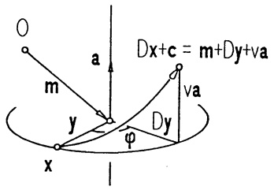

<details>
<summary>text_image</summary>

O
m
a
Dx+c = m+Dy+va
y
φ
x
Dy
va
</details>

Man bestimme die Achsenrichtung a, den Vorschub v und den Drehwinkel δ der Abbildung

$$
\mathbf {x} \mapsto \frac {1}{\sqrt {2}} \left( \begin{array}{c c c} 1 & - 1 & 0 \\ 1 & 1 & 0 \\ 0 & 0 & \sqrt {2} \end{array} \right) \mathbf {x} + \left( \begin{array}{c} 1 \\ 2 \\ 3 \end{array} \right).
$$

8. Das kartesische  $(x,y,z)$ -Koordinatensystem wird zuerst  $45^{\circ}$  um die y-Achse und dann  $45^{\circ}$  um das Bild der z-Achse gedreht. Welche Koordinaten  $(\xi,\eta,\zeta)$  besitzt der Punkt  $(x,y,z)=(1,2,3)$  in der neuen Basis?

---

§6. Lineare Abbildungen und Eigenwerte

337

9. Als Drehspiegelung bezeichnet man im  $R^{3}$  eine Drehung um 0 (Achsenrichtung a,  $|a| = 1$ , Drehwinkel  $\varphi$ ) mit anschließender Spiegelung an der Ebene  $x \cdot a = 0$ .

a) Man zerlege x und y wie skizziert orthogonal längs a und leite daraus eine Vektorgleichung für  $x \mapsto y$  ab.
b) Man bestimme die Matrix $D$ der Drehspiegelung und leite aus Spur $D$ und $D - D^{T}$ Formeln für $\cos \varphi$ und die Komponenten von $\mathbf{a}$ ab.

Welche Ausnahmefälle sind zu beachten?


<details>
<summary>text_image</summary>

a
φ
x
y = f(x)
</details>

10. Man berechne die Achsenrichtung und den Winkel der Drehung mit den Euler-Winkeln  $\psi = 45^{\circ}$ ,  $\theta = 45^{\circ}$ ,  $\varphi = 90^{\circ}$ .

11. Die Matrizen $V = \begin{pmatrix} 0 & -1 & 0 \\ 1 & 0 & 0 \\ 0 & 0 & 1 \end{pmatrix}$, $T = \begin{pmatrix} 0 & 0 & 1 \\ 1 & 0 & 0 \\ 0 & 1 & 0 \end{pmatrix}$ beschreiben zwei Drehungen, die den Würfel mit den acht Ecken ($\pm 1, \pm 1, \pm 1$) in sich überführen.

a) Man bestimme die Drehachsen von $V$ und $T$ und berechne $V^{2}$, $V^{3}$, $V^{4}$, $V^{-1}$, $T^{2}$, $T^{3}$, $T^{-1}$.

Welche Drehwinkel haben somit V und T?

b) Berechne $VT$, $(VT)^{2}$, $TV$, $(TV)^{2}$, die zugehörigen Drehachsen und Drehwinkel und bestätige die Beziehung $VT = T^{2}V^{3}$.


<details>
<summary>text_image</summary>

x₁
x₂
x₃
</details>

c) Begründe: Durch geeignete Produkte von V und T erhält man alle 24 Drehungen, die den Würfel in sich abbilden (Hexaeder-Gruppe).

12. (Darstellung eines 4D-Würfels)

Der Würfel  $W = \left\{ x \in R^{4} ; |x_{1}| \leq 1, |x_{2}| \leq 1, |x_{3}| \leq 1, 0 \leq x_{4} \leq 2 \right\}$  wird

zunächst in Richtung des Vektors  $(1,1,1,-2)^{T}$  in den 3-dimensionalen Teilraum  $x_{4}=0$  projiziert und anschließend parallel zu  $(2,1,-4,0)^{T}$  in die 2-dimensionale Ebene  $x_{3}=x_{4}=0$  abgebildet.

Man bestimme die Matrix A der gesamten Abbildung

$$
f: \mathbb {R} ^ {4} \to \mathbb {R} ^ {4}, f (x) = A x, x \in \mathbb {R} ^ {4},
$$

und skizziere das Bild aller Kanten von W.


<details>
<summary>natural_image</summary>

Simple geometric shape with a question mark inside, no text or symbols present
</details>

13. a) Man berechne die Eigenwerte und Eigenvektoren folgender Matrizen A :

$$
A = \left( \begin{array}{c c} 5 & 6 \\ 0 & 5 \end{array} \right); \quad B = \left( \begin{array}{c c c} - 2 & - 8 & - 1 2 \\ 1 & 4 & 4 \\ 0 & 0 & 1 \end{array} \right).
$$

---

338

6. Lineare Algebra

b) Man bestimme – falls möglich – invertierbare Matrizen P und Q, so daß  $D_{A} = P^{-1}AP$  und  $D_{B} = Q^{-1}BQ$  Diagonalgestalt besitzen und berechne  $D_{A}$  bzw.  $D_{B}$ . Mit Hilfe von P ermittle man explizit  $A^{100}$ .

14. Man berechne Eigenwerte und Eigenvektoren von

$$
\left( \begin{array}{c c c c} a & b & b & b \\ b & a & b & b \\ b & b & a & b \\ b & b & b & a \end{array} \right), \qquad \left( \begin{array}{c c c} 7 & - 2 & 1 \\ - 2 & 1 0 & - 2 \\ 1 & - 2 & 7 \end{array} \right), \qquad \left( \begin{array}{c c c c} 4 & 1 & 0 & 0 \\ - 3 & 1 & 1 & 1 \\ 0 & 0 & 4 & 1 \\ 1 & 0 & - 3 & 0 \end{array} \right).
$$

Hilfe: Die dritte Matrix besitzt einen dreifachen Eigenwert.

15. Die Matrix $N$ ist nilpotent; denn $N^{3}=0$. Welche Eigenwerte hat somit $N$? Man berechne alle Eigenvektoren von $N$, $N^{2}$ und $N^{3}$.

$$
N = \left( \begin{array}{c c c c} 1 2 & 2 0 & - 2 & - 1 0 \\ - 3 & - 4 & 1 & - 1 \\ 9 & 1 4 & - 2 & - 4 \\ 3 & 6 & 0 & - 6 \end{array} \right)
$$

16. Zwei Matrizen $A, B \in \mathbb{R}^{n \times n}$ heißen simultan diagonalisierbar, wenn es eine invertierbare Matrix $P$ gibt, so daß $P^{-1}AP$ und $P^{-1}BP$ beide Diagonalgestalt besitzen. Man zeige:

a) A, B simultan diagonalisierbar  $\Rightarrow$  AB = BA.
b) Hat $A$ paarweise verschiedene Eigenwerte, so gilt $AB = BA \Rightarrow A, B$ simultan diagonalisierbar.

17. Für den skizzierten linearen elektrischen Vierpol gilt zwischen Ein- und Ausgang die Beziehung

$$
\binom{u _ {1}}{i _ {1}} = A \binom{u _ {2}}{i _ {2}}
$$

mit der Kettenmatrix

$$
A = \left( \begin{array}{c c} \frac {R _ {2} + R _ {3}}{R _ {2}} & R _ {3} \\ \frac {R _ {1} + R _ {2} + R _ {3}}{R _ {1} R _ {2}} & \frac {R _ {1} + R _ {3}}{R _ {1}} \end{array} \right)  .
$$


<details>
<summary>text_image</summary>

i₁ →
↓
u₁ ↓
R₃
R₁ R₂
i₂ →
↓
u₂ ↓
</details>

a) Man bestätige, daß der Vierpol passiv ist, d.h. daß det A = 1 gilt und berechne die Eigenwerte und Eigenvektoren von A. Für welche Werte von  $\frac{u_{1}}{i_{1}}$ ,  $i_{1} \neq 0$ , hat man

$$
\text {Widerstandsanpassung, d.h.} \quad \frac {u _ {2}}{i _ {2}} = \frac {u _ {1}}{i _ {1}} \quad ?
$$

Was ergibt sich für  $R_{1}=R_{2}=1\Omega$ ,  $R_{3}=40\Omega$ ?

b) Der Vierpol heißt symmetrisch, wenn  $R_{1} = R_{2}$ . Für diesen Fall bestimme man Zahlen g und Z, so daß

$$
A = \left( \begin{array}{c c} \cosh g & Z \sinh g \\ \frac {1}{Z} \sinh g & \cosh g \end{array} \right)  .
$$

Man drücke die Kettenmatrix  $A^{n}$  der Kettenschaltung von n symmetrischen

Vierpolen mit derselben Kettenmatrix A über die Additionstheoreme von sinh, cosh durch g und Z aus und interpretiere Z als Wellenwiderstand aus dem Grenzübergang  $n \rightarrow \infty$ .


<details>
<summary>text_image</summary>

i₁
u₁
n-mal
i₂
u₂
</details>

---

§7. Symmetrische Matrizen und quadratische Formen

339

## §7. Symmetrische Matrizen und quadratische Formen

7.1 Quadratische Formen. Mit Hilfe von Matrizen gestaltet sich die Beschreibung und Behandlung von Funktionen in mehreren Veränderlichen besonders übersichtlich. Eine auf einer Teilmenge $D \subseteq \mathbb{R}^n$ erklärte Funktion $f : D \to \mathbb{R}$, $\mathbf{x} \mapsto f(\mathbf{x}) =: f(x_1, \ldots, x_n)$, wird als reelle Funktion der $n$ reellen Veränderlichen $x_1, \ldots, x_n$ bezeichnet. Die Vektorkoordinaten $x_i$ werden auch als Ortskoordinaten des Punktes $X = (x_1, \ldots, x_n)$ aufgefaßt.

Jede derartige Funktion läßt sich unter entsprechenden Voraussetzungen nach einem Satz von TAYLOR (→ Kap. 7) in der Form

$$
\begin{array}{l} f (x _ {1}, \dots , x _ {n}) = \alpha_ {0} + \sum_ {i = 1} ^ {n} \alpha_ {i} x _ {i} + \sum_ {i, j = 1} ^ {n} \alpha_ {i j} x _ {i} x _ {j} + \text {Terme höherer Ordnung in den} x _ {i} \\ = \alpha_ {0} + \mathbf {a} ^ {T} \mathbf {x} + \mathbf {x} ^ {T} A \mathbf {x} + \dots \\ \end{array}
$$

mit $\alpha_0 \in \mathbb{R}$, $\mathbf{a}^T = (\alpha_1, \ldots, \alpha_n) \in \mathbb{R}_n$, $\mathbf{x}^T = (x_1, \ldots, x_n)$ und $A = (\alpha_{ij}) \in \mathbb{R}^{n \times n}$ darstellen. Wegen $x_i x_j = x_j x_i$ kann man hierin $\alpha_{ij}$ durch $\frac{1}{2} (\alpha_{ij} + \alpha_{ji})$ ersetzen. Es bedeutet daher keine Einschränkung, wenn man von einer symmetrischen Matrix $A = A^T$ ausgeht. Wir befassen uns hier mit den algebraischen Methoden, den Anteil $p(\mathbf{x}) = \alpha_0 + \mathbf{a}^T \mathbf{x} + \mathbf{x}^T A \mathbf{x}$ zu untersuchen.

Definition. Eine Funktion $p:\mathbb{R}^n\to \mathbb{R}$ der Form

$$
p (\mathbf {x}) = \alpha_ {0} + \mathbf {a} ^ {T} \mathbf {x} + \mathbf {x} ^ {T} A \mathbf {x} = \alpha_ {0} + \sum_ {i = 1} ^ {n} \alpha_ {i} x _ {i} + \sum_ {i, j = 1} ^ {n} \alpha_ {i j} x _ {i} x _ {j}
$$

mit $\alpha_0 \in \mathbb{R}$, $\mathbf{a}^T \in \mathbb{R}_n$, $A = A^T \in \mathbb{R}^{n \times n}$ heißt quadratisches Polynom in den Variablen $x_1, \ldots, x_n$.

Im Fall  $\alpha_{0}=0$ , a=0, also  $p(\mathbf{x})=\mathbf{x}^{T}A\mathbf{x}$ , heißt p eine quadratische Form. Ist zusätzlich A eine Diagonalmatrix, so heißt p rein quadratisch.

Beispiel 1. Die Rotationsenergie $T = \frac{1}{2} \vec{\omega}^T J \vec{\omega}$ eines starren Körpers ist eine quadratische Form in den Koordinaten $\omega_i$ des Drehgeschwindigkeitsvektors $\vec{\omega}$; $J = J^T$ der Trägheitstensor bezogen auf den Massenmittelpunkt ($\to$ Aufg. 8).

Beispiel 2. Der Spannungstensor (→ 6.1, Beisp. 9)

$$
S = \left( \begin{array}{c c c} \sigma_ {x} & \tau_ {x y} & \tau_ {x z} \\ \tau_ {x y} & \sigma_ {y} & \tau_ {y z} \\ \tau_ {x z} & \tau_ {y z} & \sigma_ {z} \end{array} \right)
$$

eines unter Krafteinwirkung stehenden elastischen Körpers in einem Punkt $P$ ist symmetrisch. Mit dem Normalenvektor $\mathbf{n}$, $|\mathbf{n}| = 1$, eines Schnittes durch $P$ ist die Zerlegung $S\mathbf{n} = \mathbf{s} + \mathbf{t}$ des Spannungsvektors in die zu $\mathbf{n}$ parallele Normalenspannung $\mathbf{t}$ und die dazu senkrechte Schubspannung $\mathbf{s}$ verbunden.

---

340

6. Lineare Algebra

$\mathbf{n} \cdot \mathbf{s} = 0$ und $\mathbf{n} \cdot \mathbf{t} = |\mathbf{t}|$ zeigen $\mathbf{n}^{T} S \mathbf{n} = |\mathbf{t}|$; d.h., der Betrag der Normalenspannung berechnet sich aus der quadratischen Form $q(\mathbf{x}) = \mathbf{x}^{T} S \mathbf{x}$. Gelegentlich sind auch die Ellipsoide $\mathbf{x}^{T} S \mathbf{x} = c$ ($c \in \mathbb{R}$ konstant, $c > 0$) von Interesse.

Beispiel 3. Mit $A = \mathrm{Diag}(\lambda_1, \ldots, \lambda_n)$ lautet die rein quadratische Form

$$
q (\mathbf {x}) = \mathbf {x} ^ {T} D \mathbf {x} = \lambda_ {1} x _ {1} ^ {2} + \lambda_ {2} x _ {2} ^ {2} + \dots + \lambda_ {n} x _ {n} ^ {2}. \tag {1}
$$

Beispiel 4. Ein einfaches Problem der Ausgleichsrechnung ist die Bestimmung einer Geraden $y = ax + b$, die „möglichst genau“ zwischen $n$ Meßpunkten $(x_i, y_i)$ verläuft, in dem Sinne, daß das quadratische Polynom $q(u, v) := \sum_{i=1}^{n} (y_i - ux_i - v)^2$ in $(u, v) = (a, b)$ ein Minimum annimmt. (Wir kommen darauf zurück, → Kap. 7).

7.2 Die Hauptachsentransformation. Es ist $q(\mathbf{x}) = \mathbf{x}^T A\mathbf{x}$ die Darstellung der quadratischen Form $q: \mathbb{R}^n \to \mathbb{R}$ bezüglich der gegebenen natürlichen Basis. Der Übergang zu einer anderen Basis $B = (\mathbf{b}_1, \ldots, \mathbf{b}_n)$ geschieht mit der Substitution $\mathbf{x} = B\mathbf{y}$ ($\rightarrow$ (8), §6). $y_1, \ldots, y_n$ sind die Koordinaten des Punktes $X = (x_1, \ldots, x_n)$ im Koordinatensystem $(0; \mathbf{b}_1, \ldots, \mathbf{b}_n)$. Dabei ergibt sich

$$
q (\mathbf {x}) = q (B \mathbf {y}) = (B \mathbf {y}) ^ {T} A (B \mathbf {y}) = \mathbf {y} ^ {T} (B ^ {T} A B) \mathbf {y} =: \tilde {q} (\mathbf {y}). \tag {2}
$$

Definition. Als Hauptachsensystem der quadratischen Form $q(\mathbf{x}) = \mathbf{x}^T A\mathbf{x}$ (bzw. der symmetrischen Matrix $A = A^T \in \mathbb{R}^{n \times n}$) bezeichnet man eine Orthonormalbasis $B = (\mathbf{b}_1, \ldots, \mathbf{b}_n)$ des $\mathbb{R}^n$, wenn $q$ im Koordinatensystem $(0; \mathbf{b}_1, \ldots, \mathbf{b}_n)$ rein quadratisch ist.

Bemerkung. Nach (2) und obigem Beispiel 3 ist eine Orthonormalbasis B genau dann ein Hauptachsensystem für A, wenn  $B^{T}AB$  eine Diagonalmatrix ist.

Die folgenden Eigenschaften symmetrischer Matrizen garantieren, daß jede quadratische Form wenigstens ein Hauptachsensystem besitzt.

## Satz 7.1. Das Eigenwertproblem bei symmetrischen Matrizen.

Für jede reelle symmetrische $n \times n$-Matrix $A = A^T$ gilt:

a) Alle Eigenwerte von A sind reell.
b) Eigenvektoren zu verschiedenen Eigenwerten von A sind orthogonal.
c) Algebraische und geometrische Vielfachheit jedes Eigenwertes sind gleich.

Beweis. a): Ist $\lambda \in \mathbb{C}$ ein Eigenwert und $\mathbf{b} \in \mathbb{C}^n$ ($\mathbf{b} \neq \mathbf{0}$) ein Eigenvektor von $A$, dann folgt aus $Ab = \lambda b$ durch Übergang zu den komplex konjugierten Vektoren (man nehme komponentenweise die konjugiert komplexen Zahlen)

---

§7. Symmetrische Matrizen und quadratische Formen

341

$A\bar{\mathbf{b}} = \overline{A\bar{\mathbf{b}}} = \bar{\lambda}\bar{\mathbf{b}}$ und damit $\lambda\mathbf{b}^{T}\bar{\mathbf{b}} = (A\mathbf{b})^{T}\bar{\mathbf{b}} = \mathbf{b}^{T}A^{T}\bar{\mathbf{b}} = \mathbf{b}^{T}A\bar{\mathbf{b}} = \bar{\lambda}\mathbf{b}^{T}\bar{\mathbf{b}}$. Wegen $\mathbf{b}^{T}\bar{\mathbf{b}} = \sum |b_{i}|^{2} > 0$ ergibt sich $\lambda = \bar{\lambda}$, also $\lambda \in \mathbb{R}$.

b): Aus $A\mathbf{b} = \lambda\mathbf{b}$, $A\mathbf{c} = \mu\mathbf{c}$ folgt $\lambda\mathbf{b}^{T}\mathbf{c} = (A\mathbf{b})^{T}\mathbf{c} = \mathbf{b}^{T}(A^{T}\mathbf{c}) = \mathbf{b}^{T}(A\mathbf{c}) = \mu\mathbf{b}^{T}\mathbf{c}$, was im Fall $\lambda \neq \mu$ die Orthogonalität $\mathbf{b}^{T}\mathbf{c} = 0$ nach sich zieht.

c): Sei $\mu \in \mathbb{R}$ ein Eigenwert von $A$ der algebraischen Vielfachheit $k$, $\chi_A(\lambda) = (\mu - \lambda)^k p(\lambda)$ mit $p(\mu) \neq 0$ und $(\mathbf{b}_1, \ldots, \mathbf{b}_l)$ eine Basis des Eigenraumes $V(\mu)$, ergänzt zu einer Basis $B = (\mathbf{b}_1, \ldots, \mathbf{b}_l, \mathbf{b}_{l+1}, \ldots, \mathbf{b}_n)$ des $\mathbb{R}^n$. Man kann annehmen, daß die Matrix $B$ orthogonal ist, andernfalls ist noch das Schmidtsche Orthonormierungsverfahren ($\rightarrow$ 6.5) anzuwenden. Bezüglich dieser Basis wird $\mathbf{x} \mapsto A\mathbf{x}$ dargestellt durch $B^{-1}AB = B^TAB$ ($\rightarrow$ (11), §6) in der „Blockform“

$$
B ^ {T} A B = \left((A \mathbf {b} _ {1}) _ {B}, \dots , (A \mathbf {b} _ {l}) _ {B}, \dots , (A \mathbf {b} _ {n}) _ {B}\right) = \left( \begin{array}{c c c c c c c} \mu & 0 & \dots & 0 & 0 & \dots & 0 \\ 0 & \mu & \ddots & \vdots & \vdots & & \vdots \\ \vdots & \ddots & \ddots & 0 & & \\ 0 & \dots & 0 & \mu & 0 & \dots & 0 \\ \hline 0 & \dots & 0 & & \\ \vdots & & \vdots & & \mathbf {A} _ {1} \\ 0 & \dots & 0 & & \end{array} \right) \Bigg \} l.
$$

Wesentlich ist, daß im rechten oberen  $l \times (n - l)$ -Block lauter Nullen stehen; denn  $B^{T}AB$  muß mit A symmetrisch sein. Damit gilt

$$
(\mu - \lambda) ^ {k} p (\lambda) = \chi_ {A} (\lambda) = \chi_ {B ^ {T} A B} (\lambda) = (\mu - \lambda) ^ {l} \det (A _ {1} - \lambda E). \tag {3}
$$

Ferner ist $\mu - \lambda$ kein Faktor von det $(A_1 - \lambda E)$. Denn wäre $\mu$ ein Eigenwert von $A_1$, dann hätte $B^T AB$ einen Eigenvektor $\mathbf{c} \in \operatorname{Lin}(\mathbf{e}_{l+1}, \ldots, \mathbf{e}_n)$ zum Eigenwert $\mu$ und demzufolge $A$ einen weiteren, von $\mathbf{b}_1, \ldots, \mathbf{b}_l$ linear unabhängigen Eigenvektor $B\mathbf{c} \in \operatorname{Lin}(\mathbf{b}_{l+1}, \ldots, \mathbf{b}_n)$ zum Eigenwert $\mu$, was $\operatorname{Dim} V(\mu) = l$ widerspräche.

Ein Vergleich der  $(\mu-\lambda)$ -Potenzen auf beiden Seiten von (3) zeigt l=k. ☐

Satz 7.2. Die Hauptachsentransformation. Zu jeder quadratischen Form $q(\mathbf{x}) = \mathbf{x}^T A\mathbf{x}$, bzw. zu jeder reellen symmetrischen $n \times n$-Matrix $A$, gibt es wenigstens ein Hauptachsensystem. Man berechnet es wie folgt:

Zu jedem der verschiedenen Eigenwerte $\lambda_{i}$ von $A$ bestimmt man eine Orthonormalbasis $(\mathbf{b}_{1}^{(i)},\mathbf{b}_{2}^{(i)},\ldots,\mathbf{b}_{k_{i}}^{(i)})$ von $(A-\lambda_{i}E)\mathbf{x}=\mathbf{0}$ ($\rightarrow 6.5$), $1\leq i\leq r$. Diese Teilbasen, in angegebener Reihenfolge zusammengesetzt, ergeben ein Hauptachsensystem

$$
B = (\mathbf {b} _ {1} ^ {(1)}, \dots , \mathbf {b} _ {k _ {1}} ^ {(1)}, \mathbf {b} _ {1} ^ {(2)}, \dots , \mathbf {b} _ {k _ {2}} ^ {(2)}, \dots , \mathbf {b} _ {1} ^ {(r)}, \dots , \mathbf {b} _ {k _ {r}} ^ {(r)}),
$$

für das

$$
B ^ {T} A B = \operatorname{Diag} \left(\underbrace {\lambda_ {1} , \dots , \lambda_ {1}} _ {k _ {1} - m a l}, \underbrace {\lambda_ {2} , \dots , \lambda_ {2}} _ {k _ {2} - m a l}, \dots , \underbrace {\lambda_ {r} , \dots , \lambda_ {r}} _ {k _ {r} - m a l}\right)
$$

gilt und demzufolge  $q(\mathbf{x}) = q(B\mathbf{y}) = \lambda_{1}y_{1}^{2} + \cdots + \lambda_{r}y_{n}^{2}$ .

---

342

6. Lineare Algebra

Beweis. Nach Satz 7.1 a) und c) erhält man durch die Zusammensetzung tatsächlich eine volle Basis des  $R^{n}$ . Wegen Satz 7.1 b) muß die Orthonormierung nur innerhalb der Eigenräume erfolgen.

Bemerkung. Die Bestimmung einer orthogonalen Matrix B, so daß  $B^{T}AB$  Diagonalform hat, nennt man orthogonale Diagonalisierung der Matrix A.

Für n = 2,3 ergeben sich folgende Vereinfachungen:

n=2: Zu  $A = \begin{pmatrix} a & b \\ b & c \end{pmatrix}$ ,  $b \neq 0$ , berechnet man die Lösungen  $\lambda_{1}, \lambda_{2}$  von  $\lambda^{2} - (a + c)\lambda + (ac - b^{2}) = 0$ ; dazu eine normierte Lösung  $\mathbf{b} = \begin{pmatrix} b_{1} \\ b_{2} \end{pmatrix}$  der Gleichung  $(A - \lambda_{1}E)\mathbf{x} = \mathbf{0}$ . Für den anderen Hauptachsenvektor gibt es nur die Möglichkeit  $\pm c$ ,  $c := \begin{pmatrix} -b_{2} \\ b_{1} \end{pmatrix}$ . Mit diesem  $(\mathbf{b}, \mathbf{c})$  ist  $(O; \mathbf{b}, \mathbf{c})$  ein kartesisches Koordinatensystem.

n=3: Ist $A = A^{T} \in \mathbb{R}^{3 \times 3}$ keine Diagonalmatrix, dann sind wenigstens zwei verschiedene Eigenwerte (Lösungen von det $(A - \lambda E) = 0$) $\lambda_{1} \neq \lambda_{2}$ vorhanden. Man bestimmt entweder für $i = 1,2$ je eine normierte Lösung $\mathbf{b}_{i}$ von $(A - \lambda_{i}E)\mathbf{x} = \mathbf{0}$, oder, falls $\lambda_{1}$ die Vielfachheit 2 hat, zwei normierte und orthogonale Lösungen von $(A - \lambda_{1}E)\mathbf{x} = \mathbf{0}$. Die dritte Hauptachse ist parallel zu $\mathbf{b}_{3} := \mathbf{b}_{1} \times \mathbf{b}_{2}$. $B = (\mathbf{b}_{1}, \mathbf{b}_{2}, \mathbf{b}_{3})$ ist ein (kartesisches, d.h. rechtsorientiertes) Hauptachsensystem für $A$.

Beispiel 1. Die Matrix $A = \begin{pmatrix} 2 & 1 \\ 1 & 3 \end{pmatrix}$ hat die Eigenwerte $\lambda_1 = \frac{1}{2}(5 + \sqrt{5})$, $\lambda_2 = \frac{1}{2}(5 - \sqrt{5})$. Eine Lösung von $(A - \lambda_1 E)\mathbf{x} = \mathbf{0}$ ist $\mathbf{x} = (1, \frac{1}{2} + \frac{1}{2}\sqrt{5})^T$ und demnach ist $(\mathbf{b}, \mathbf{c})$ ein Hauptachsensystem für $A$ mit

$$
\mathbf {b} = \frac {1}{\sqrt {1 0 + 2 \sqrt {5}}} \binom{2}{1 + \sqrt {5}}, \quad \mathbf {c} = \frac {1}{\sqrt {1 0 + 2 \sqrt {5}}} \binom{- 1 - \sqrt {5}}{2}.
$$

Die quadratische Form  $q(x,y)=(x,y)A\left(\begin{matrix}x\\ y\end{matrix}\right)=2x^{2}+2xy+3y^{2}$  hat im Koordinatensystem  $(O;\mathbf{b},\mathbf{c})$  die Darstellung

$$
q (x, y) = \lambda_ {1} u ^ {2} + \lambda_ {2} v ^ {2} = \frac {1}{2} (5 + \sqrt {5}) u ^ {2} + \frac {1}{2} (5 - \sqrt {5}) v ^ {2},
$$

wobei $\left( \begin{array}{c}x\\ y \end{array} \right) = (\mathbf{b},\mathbf{c})\binom{u}{v} = \frac{1}{\sqrt{10 + 2\sqrt{5}}}\left( \begin{array}{cc}2 & -1 - \sqrt{5}\\ 1 + \sqrt{5} & 2 \end{array} \right)\binom{u}{v}.$

Beispiel 2. Die Rotationsenergie eines starren Körpers sei

$$
T = 5 \omega_ {1} ^ {2} + 5 \omega_ {2} ^ {2} + 5 \omega_ {3} ^ {2} + 8 \omega_ {1} \omega_ {2} + 8 \omega_ {1} \omega_ {3} + 8 \omega_ {2} \omega_ {3} = \frac {1}{2} \vec {\omega} ^ {T} J \vec {\omega}
$$

---

§7. Symmetrische Matrizen und quadratische Formen

343

mit dem Trägheitstensor

$$
J = \left( \begin{array}{c c c} 1 0 & 8 & 8 \\ 8 & 1 0 & 8 \\ 8 & 8 & 1 0 \end{array} \right).
$$

Aus det  $(J - \lambda E) = 0$  ergeben sich die Eigenwerte (Hauptträgheitsmomente)

$$
\lambda_ {1} = 2, \quad \lambda_ {2} = 2 6, \quad \lambda_ {3} = 2,
$$

dazu ein Hauptachsensystem (die Hauptträgheitsrichtungen)

$$
\mathbf {b} _ {1} = \frac {1}{\sqrt {2}} \left( \begin{array}{c} 1 \\ - 1 \\ 0 \end{array} \right), \quad \mathbf {b} _ {2} = \frac {1}{\sqrt {3}} \left( \begin{array}{c} 1 \\ 1 \\ 1 \end{array} \right), \quad \mathbf {b} _ {3} = \mathbf {b} _ {1} \times \mathbf {b} _ {2} = \frac {1}{\sqrt {6}} \left( \begin{array}{c} - 1 \\ - 1 \\ 2 \end{array} \right). \quad \square
$$

Beispiel 3. Die quadratische Form

$$
q (x, y, z) = x ^ {2} + 6 x y - 2 y ^ {2} - 2 y z + z ^ {2}
$$

ist durch die $3 \times 3$-Matrix $A = \begin{pmatrix} 1 & 3 & 0 \\ 3 & -2 & -1 \\ 0 & -1 & 1 \end{pmatrix}$ bestimmt.

Die Lösungen von det  $(A - \lambda E) = 0$  sind  $\lambda_{1} = 1$ ,  $\lambda_{2} = 3$ ,  $\lambda_{3} = -4$ . Jeweils normierte Lösung von  $(A - \lambda_{i}E)\mathbf{x} = \mathbf{0}$  (i = 1, 2) sind  $\mathbf{b}_{1} = \frac{1}{\sqrt{10}}(1, 0, 3)^{T}$ ,  $\mathbf{b}_{2} = \frac{1}{\sqrt{14}}(3, 2, -1)^{T}$ . Mit  $b_{3} := b_{1} \times b_{2}$  ist  $(\mathbf{b}_{1}, \mathbf{b}_{2}, \mathbf{b}_{3})$  ein (kartesisches) Hauptachsensystem und

$$
B = \left( \begin{array}{c c c} \frac {1}{\sqrt {1 0}} & \frac {3}{\sqrt {1 4}} & - \frac {3}{\sqrt {3 5}} \\ 0 & \frac {2}{\sqrt {1 4}} & \frac {5}{\sqrt {3 5}} \\ \frac {3}{\sqrt {1 0}} & - \frac {1}{\sqrt {1 4}} & \frac {1}{\sqrt {3 5}} \end{array} \right)
$$

eine Drehmatrix mit

$$
B ^ {T} A B = \left( \begin{array}{c c c} 1 & 0 & 0 \\ 0 & 3 & 0 \\ 0 & 0 & - 4 \end{array} \right)  .
$$

7.3 Quadriken. Als Quadrik (oder Hyperfläche zweiter Ordnung) bezeichnet man die Menge aller Punkte  $X = (x_{1}, \ldots, x_{n}) \in \mathbb{R}_{n}$ , die eine Gleichung erfüllen der Form

$$
\boxed { \begin{array}{c} p (\mathbf {x}) = \mathbf {x} ^ {T} A \mathbf {x} + \mathbf {a} ^ {T} \mathbf {x} + \beta = 0, \\ A = A ^ {T} \in \mathbb {R} ^ {n \times n}, \mathbf {a} \in \mathbb {R} ^ {n}, \beta \in \mathbb {R}. \end{array} }
$$

Die Quadrik liegt in Normalform vor, wenn  $x^{T}Ax$  rein quadratisch ist und  $a^{T}x + \beta$  durch keine affine Substitution verkürzt werden kann.

Im Fall n = 2 hat man 9, im Fall n = 3 insgesamt 17 Typen von verschiedenen Normalformen, die in den folgenden Tabellen aufgeführt sind:

---

344

6. Lineare Algebra

## Die Normalformen der Quadriken im  $R_{3}$  (Konstante a, b, c, p alle ≠ 0)

Rang $A = 3$ (Alle Eigenwerte $\neq 0$)

$$
\frac {x ^ {2}}{a ^ {2}} + \frac {y ^ {2}}{b ^ {2}} + \frac {z ^ {2}}{c ^ {2}} - 1 = 0
$$

$$
\frac {x ^ {2}}{a ^ {2}} + \frac {y ^ {2}}{b ^ {2}} + \frac {z ^ {2}}{c ^ {2}} + 1 = 0
$$

$$
\frac {x ^ {2}}{a ^ {2}} + \frac {y ^ {2}}{b ^ {2}} - \frac {z ^ {2}}{c ^ {2}} + 1 = 0
$$

$$
\frac {x ^ {2}}{a ^ {2}} + \frac {y ^ {2}}{b ^ {2}} - \frac {z ^ {2}}{c ^ {2}} - 1 = 0
$$

$$
\frac {x ^ {2}}{a ^ {2}} + \frac {y ^ {2}}{b ^ {2}} + \frac {z ^ {2}}{c ^ {2}} = 0
$$

$$
\frac {x ^ {2}}{a ^ {2}} + \frac {y ^ {2}}{b ^ {2}} - \frac {z ^ {2}}{c ^ {2}} = 0
$$

Ellipsoid (evtl. Kugel)

leere Menge

zweischaliges Hyperboloid

einschaliges Hyperboloid

Punkt

Kegel


<details>
<summary>text_image</summary>

z
c
a
b
x
y
</details>


<details>
<summary>text_image</summary>

z
x
y
D+ - B
</details>


Rang $A = 2$ (Ein Eigenwert $= 0$)

$$
\frac {x ^ {2}}{a ^ {2}} + \frac {y ^ {2}}{b ^ {2}} - 2 p z = 0
$$

$$
\frac {x ^ {2}}{a ^ {2}} - \frac {y ^ {2}}{b ^ {2}} - 2 p z = 0
$$

$$
\frac {x ^ {2}}{a ^ {2}} + \frac {y ^ {2}}{b ^ {2}} + 1 = 0
$$

$$
\frac {x ^ {2}}{a ^ {2}} + \frac {y ^ {2}}{b ^ {2}} - 1 = 0
$$

$$
\frac {x ^ {2}}{a ^ {2}} - \frac {y ^ {2}}{b ^ {2}} + 1 = 0
$$

$$
\frac {x ^ {2}}{a ^ {2}} + \frac {y ^ {2}}{b ^ {2}} = 0
$$

$$
\frac {x ^ {2}}{a ^ {2}} - \frac {y ^ {2}}{b ^ {2}} = 0
$$


<details>
<summary>text_image</summary>

3D coordinate system diagram with x, y, z axes and a curved surface intersecting the plane
</details>

elliptisches Paraboloid

hyperbolisches Paraboloid

leere Menge

elliptischer Zylinder

hyperbolischer Zylinder

Gerade


<details>
<summary>text_image</summary>

Diagram showing 3D coordinate system with x, y, z axes and a curved surface intersecting the z-axis
</details>


<details>
<summary>text_image</summary>

3D coordinate system diagram with x, y, z axes and a rectangular prism-like structure
</details>

Ebenenpaar mit Schnittgerade

Rang $A = 1$ (Zwei Eigenwerte $= 0$)

$$
x ^ {2} - 2 p y = 0
$$

$$
x ^ {2} - a ^ {2} = 0
$$

$$
x ^ {2} + a ^ {2} = 0
$$

$$
x ^ {2} = 0
$$

parabolischer Zylinder

paralleles Ebenenpaar

leere Menge

Ebene


<details>
<summary>text_image</summary>

Diagram showing a 3D coordinate system with x, y, and z axes intersecting at a point, likely illustrating a geometric or physical concept.
</details>


<details>
<summary>natural_image</summary>

3D coordinate system diagram with x, y, z axes and two overlapping planes (no labels or text)
</details>


<details>
<summary>natural_image</summary>

3D coordinate system diagram with x, y, z axes and a rectangular plane intersecting the x-axis (no text or labels)
</details>

---

§7. Symmetrische Matrizen und quadratische Formen

345

## Die Normalformen der Quadriken im  $R_{2}$  (Konstante a, b, p alle ≠ 0)

Rang $A = 2$ (Alle Eigenwerte $\neq 0$)

$$
\frac {x ^ {2}}{a ^ {2}} + \frac {y ^ {2}}{b ^ {2}} - 1 = 0
$$

$$
\frac {x ^ {2}}{a ^ {2}} + \frac {y ^ {2}}{b ^ {2}} + 1 = 0
$$

$$
\frac {x ^ {2}}{a ^ {2}} - \frac {y ^ {2}}{b ^ {2}} - 1 = 0
$$

$$
x ^ {2} + a ^ {2} y ^ {2} = 0
$$

$$
x ^ {2} - a ^ {2} y ^ {2} = 0
$$

Ellipse (evtl. Kreis)

leere Menge

Hyperbel

Punkt

Geradenpaar mit Schnittpunkt


<details>
<summary>natural_image</summary>

Symmetrical hyperbolic curve plotted on Cartesian coordinate axes (x, y), no text or symbols present
</details>


<details>
<summary>natural_image</summary>

Pure geometric diagram of intersecting lines forming a star-like pattern on Cartesian axes (no text or symbols)
</details>

Rang $A = 1$ (Ein Eigenwert $= 0$)

$$
x ^ {2} - 2 p y = 0
$$

$$
x ^ {2} - a ^ {2} = 0
$$

$$
x ^ {2} + a ^ {2} = 0
$$

$$
x ^ {2} = 0
$$

Parabel

paralleles Geradenpaar

leere Menge

Gerade $x = 0$


## Die Transformation einer Quadrik auf Normalform erfolgt in zwei Schritten:

1. Schritt: Die Hauptachsentransformation des quadratischen Anteils, $B^T AB = \text{Diag}(\lambda_1, \ldots, \lambda_n)$ mit einem Hauptachsensystem $B = (\mathbf{b}_1, \ldots, \mathbf{b}_n)$ von $A$, liefert über die Substitution $\mathbf{x} = By$ die Darstellung der Quadrik im Koordinatensystem $(O; \mathbf{b}_1, \ldots, \mathbf{b}_n)$ durch

$$
\lambda_ {1} y _ {1} ^ {2} + \dots + \lambda_ {n} y _ {n} ^ {2} + \gamma_ {1} y _ {1} + \dots + \gamma_ {n} y _ {n} + \beta = 0 \tag {4}
$$

mit gewissen Zahlen $\gamma_{i}\in\mathbb{R}$.

2. Schritt : Mit der anschließenden Substitution

$$
z _ {i} = \left\{ \begin{array}{c l} y _ {i} & , \text {falls} \lambda_ {i} = 0 \\ y _ {i} + \frac {\gamma_ {i}}{2 \lambda_ {i}} & , \text {falls} \lambda_ {i} \neq 0 \end{array} \right.
$$

(d.i. eine quadratische Ergänzung) werden die linearen Terme – falls möglich – „wegsubstituiert“. Diese Substitution entspricht einer Verschiebung des bereits gedrehten Koordinatensystems in einen anderen Ursprung (→ (9), §6). Schrei-

---

346

6. Lineare Algebra

ben wir $\mathbf{z} = \mathbf{y} + \mathbf{u}$, so folgt der Übergang von den x-Koordinaten zu den z-Koordinaten über die Substitution

$$
\mathbf {x} = B \mathbf {y} = B (\mathbf {z} - \mathbf {u}) = B \mathbf {z} - B \mathbf {u}.
$$

D.h. im Koordinatensystem  $(-(B\mathbf{u})^{T};\mathbf{b}_{1},\ldots,\mathbf{b}_{n})$  hat die Quadrik die Gleichung

$$
\lambda_ {1} z _ {1} ^ {2} + \dots + \lambda_ {r} z _ {r} ^ {2} + \mu_ {r + 1} z _ {r + 1} + \dots + \mu_ {n} z _ {n} + \gamma = 0, \tag {5}
$$

wobei wir  $\lambda_{1},\ldots,\lambda_{r}\neq0$  und  $\lambda_{r+1}=\cdots=\lambda_{n}=0$  angenommen haben. Ist einer der Koeffizienten  $\mu_{r+1},\ldots,\mu_{n}$  von Null verschieden, etwa  $\mu_{k}\neq0$ , kann man sogar  $\gamma=0$  annehmen (andernfalls wird noch einmal  $\zeta_{k}=z_{k}+\frac{\gamma}{\mu_{k}}$  substituiert).

Bemerkung. Ist $A$ invertierbar, also $\lambda_i \neq 0$ ($1 \leq i \leq n$), dann hat die transformierte Gleichung die Form $\lambda_1 z_1^2 + \cdots + \lambda_n z_n^2 + \gamma = 0$. Mit jedem Punkt $X = (z_1, \ldots, z_n)$ liegt auch $(\pm z_1, \ldots, \pm z_n)$ auf der Quadrik. Der neue Ursprung ist der Mittelpunkt (oder das Zentrum) der Quadrik. In diesem Fall ist das Zentrum $\mathbf{m}$ der Quadrik $\mathbf{x}^T A\mathbf{x} + \mathbf{a}^T \mathbf{x} + \beta = \mathbf{0}$ die eindeutige Lösung von $A\mathbf{m} = -\frac{1}{2}\mathbf{a}$ und es gilt $\gamma = \beta + \frac{1}{2}\mathbf{a}^T\mathbf{m} = \frac{\det Q}{\det A}$ mit der $4 \times 4$-Matrix $Q := \begin{pmatrix} A & \frac{1}{2}\mathbf{a} \\ \frac{1}{2}\mathbf{a}^T & \beta \end{pmatrix}$.

Ganz allgemein (also $A$ nicht notwendig invertierbar) kann man stets versuchen, zuerst $Ax = -\frac{1}{2}a$ zu lösen. Mit einer Lösung $m$ und der Substitution $x = y + m$, d.i. eine Verschiebung des Koordinatensystems in den Punkt $M$, vereinfacht sich die Gleichung der Quadrik zu $y^T A y + \gamma = 0$ mit $\gamma = \beta + \frac{1}{2} a^T m$.

Beispiel 1. Der Typ und die Normalform des Kegelschnitts $q(x, y) = 2x^{2} + 2xy + 3y^{2} = 1$ ergeben sich allein aus den Eigenwerten der Matrix $A = \begin{pmatrix} 2 & 1 \\ 1 & 3 \end{pmatrix}$. Schritt 2 ist überflüssig. Mit Bsp. 1 von 7.2 liegt eine im $(x, y)$-System gedrehte Ellipse vor mit den Hauptachsenlängen $a = \sqrt{2 / (5 + \sqrt{5})}$, $b = \sqrt{2 / (5 - \sqrt{5})}$.


<details>
<summary>text_image</summary>

v
b₂
1/√λ₂
y
u
b₁
1/√λ₁
x
q(x,y)=1
</details>

Abb. 155 - $2x^{2} + 2xy + 3y^{2} = 1$

Beispiel 2. Es sind Typ und Normalform zu bestimmen für die Quadrik

$$
q (x, y, z) = - x ^ {2} - y ^ {2} + z ^ {2} + 6 x y + 2 x z + 2 y z - 1 2 x + 4 y - 1 0 z - 1 1 = 0.
$$

1. Schritt. Die Matrix  $A = \begin{pmatrix} -1 & 3 & 1 \\ 3 & -1 & 1 \\ 1 & 1 & 1 \end{pmatrix}$  hat die Eigenwerte  $\lambda_{1} = 3$ ,  $\lambda_{2} = -4$ ,  $\lambda_{3} = 0$ . Dazu das Hauptachsensystem

$$
\mathbf {b} _ {1} = \frac {1}{\sqrt {3}} \left( \begin{array}{c} 1 \\ 1 \\ 1 \end{array} \right), \quad \mathbf {b} _ {2} = \frac {1}{\sqrt {2}} \left( \begin{array}{c} 1 \\ - 1 \\ 0 \end{array} \right), \quad \mathbf {b} _ {3} = \mathbf {b} _ {1} \times \mathbf {b} _ {2} = \frac {1}{\sqrt {6}} \left( \begin{array}{c} 1 \\ 1 \\ - 2 \end{array} \right).
$$

---

§7. Symmetrische Matrizen und quadratische Formen

347

Mit der Substitution

$$
\left( \begin{array}{c} x \\ y \\ z \end{array} \right) = B \left( \begin{array}{c} x ^ {\prime} \\ y ^ {\prime} \\ z ^ {\prime} \end{array} \right) = \frac {1}{\sqrt {6}} \left( \begin{array}{c c c} \sqrt {2} & \sqrt {3} & 1 \\ \sqrt {2} & - \sqrt {3} & 1 \\ \sqrt {2} & 0 & - 2 \end{array} \right) \left( \begin{array}{c} x ^ {\prime} \\ y ^ {\prime} \\ z ^ {\prime} \end{array} \right)
$$

geht die Gleichung der Quadrik über in

$$
3 (x ^ {\prime}) ^ {2} - 4 (y ^ {\prime}) ^ {2} - 6 \sqrt {3} x ^ {\prime} - 8 \sqrt {2} y ^ {\prime} + 2 \sqrt {6} z ^ {\prime} - 1 1 = 0.
$$

2. Schritt. Durch quadratische Ergänzung ergibt sich die Verschiebung

$$
x ^ {\prime \prime} = x ^ {\prime} - \sqrt {3}, \quad y ^ {\prime \prime} = y ^ {\prime} + \sqrt {2},
$$

dazu  $z'' = z' - \sqrt{6}$  und man hat die Normalform

$$
3 (x ^ {\prime \prime}) ^ {2} - 4 (y ^ {\prime \prime}) ^ {2} + 2 \sqrt {6} z ^ {\prime \prime} = 0.
$$

Den Typ liest man durch Vorzeichenvergleich aus der Tabelle ab: Hyperbolisches Paraboloid. Die Normalform wird im Koordinatensystem  $((\sqrt{3}, -\sqrt{2}, \sqrt{6})B^{T}; \mathbf{b}_{1}, \mathbf{b}_{2}, \mathbf{b}_{3})$  angenommen. ☐


<details>
<summary>text_image</summary>

z
x
x₀
y
x″
y″
z″
</details>

Abb. 156 - Hyperbolisches Paraboloid

Beispiel 3. Zur Quadrik $p(x, y, z) = x^2 - yz - 2x + 3y - 3z + 4 = 0$ gehört die Matrix $A = \begin{pmatrix} 1 & 0 & 0 \\ 0 & 0 & -1/2 \\ 0 & -1/2 & 0 \end{pmatrix}$; sie hat die Eigenwerte $\lambda_1 = 1$, $\lambda_2 = \frac{1}{2}$, $\lambda_3 = -\frac{1}{2}$ mit den normierten Eigenvektoren

$$
\mathbf {b} _ {1} = \left( \begin{array}{c} 1 \\ 0 \\ 0 \end{array} \right), \quad \mathbf {b} _ {2} = \frac {1}{\sqrt {2}} \left( \begin{array}{c} 0 \\ 1 \\ - 1 \end{array} \right), \quad \mathbf {b} _ {3} = \mathbf {b} _ {1} \times \mathbf {b} _ {2} = \frac {1}{\sqrt {2}} \left( \begin{array}{c} 0 \\ 1 \\ 1 \end{array} \right).
$$

Mit der Substitution $\begin{pmatrix} x \\ y \\ z \end{pmatrix} = \frac{1}{\sqrt{2}} \begin{pmatrix} \sqrt{2} & 0 & 0 \\ 0 & 1 & 1 \\ 0 & -1 & 1 \end{pmatrix} \begin{pmatrix} x' \\ y' \\ z' \end{pmatrix}$ und quadratischer

---

348

6. Lineare Algebra

Ergänzung entsteht

$$
\begin{array}{l} 0 = p (x, y, z) = x ^ {\prime 2} + \frac {1}{2} y ^ {\prime 2} - \frac {1}{2} z ^ {\prime 2} - 2 x ^ {\prime} + 3 \sqrt {2} y ^ {\prime} + 4 \\ = (x ^ {\prime} - 1) ^ {2} + \frac {1}{2} (y ^ {\prime} + 3 \sqrt {2}) ^ {2} - \frac {1}{2} z ^ {\prime 2} - 6 \\ = (x ^ {\prime \prime}) ^ {2} + \frac {1}{2} (y ^ {\prime \prime}) ^ {2} - \frac {1}{2} (z ^ {\prime \prime}) ^ {2} - 6. \\ \end{array}
$$

Es handelt sich also um ein einschaliges Hyperboloid. Die gesamte Substitution

$$
\left( \begin{array}{c} x \\ y \\ z \end{array} \right) = B \binom{x ^ {\prime}}{y ^ {\prime}} = B \binom{x ^ {\prime \prime} + 1}{y ^ {\prime \prime} - 3 / \sqrt {2}} = \frac {1}{\sqrt {2}} \left( \begin{array}{c c c} \sqrt {2} & 0 & 0 \\ 0 & 1 & 1 \\ 0 & - 1 & 1 \end{array} \right) \left( \begin{array}{c} x ^ {\prime \prime} \\ y ^ {\prime \prime} \\ z ^ {\prime \prime} \end{array} \right) + \left( \begin{array}{c} 1 \\ - 3 \\ 3 \end{array} \right)
$$

liefert die Normalform im Koordinatensystem  $((1,-3,3);\mathbf{b}_{1},\mathbf{b}_{2},\mathbf{b}_{3})$ .


<details>
<summary>text_image</summary>

z''
x₀
y''
x''
z
y
x
</details>

Abb. 157 - Einschaliges Hyperboloid

\* 7.4 Die nichtorthogonale Diagonalisierung einer symmetrischen Matrix.

Die Hauptachsenbestimmung führt auf ein Eigenwertproblem und damit auf eine Polynomgleichung det  $(A - \lambda E) = 0$ . Damit ist zwar die theoretische Kennzeichnung erledigt, jedoch ist die exakte Lösung dieser Gleichung in der Praxis oft gar nicht mit algebraischen Mitteln möglich. Man muß dann mit numerischen Näherungsverfahren arbeiten.

Die folgende nichtorthogonale Diagonalisierung kommt ohne Eigenwerte aus und ist stets mit rationalen Rechenoperationen durchführbar. Man erhält zwar nicht die Hauptachsen, jedoch ist damit bei Quadriken eine schnelle Typbestimmung und bei quadratischen Formen ein wichtiger Positivtest möglich.

Eine Vorbetrachtung: Sei $S \in \mathbb{R}^{n \times n}$ eine Elementarmatrix. Nach §4 entsteht $SAS^{T}$ aus $A$ durch die zu $S$ gehörende elementare Zeilenumformung mit der anschließenden analogen elementaren Spaltenumformung. $A \to SAS^{T}$ bezeichnen wir kurz als ZS-Umformung („Zeilen-Spalten-Umformung“).

Die Hauptachsentransformation $B^{T}AB = \text{Diag}(\lambda_{1},\ldots,\lambda_{n})$ ist mit einer Zerlegung von $B$ in ein Produkt von Elementarmatrizen somit auch zu deuten als eine endliche Folge von ZS-Umformungen.

---

§7. Symmetrische Matrizen und quadratische Formen

349

Wir beschreiben nun ein Verfahren, das A mittels ZS-Umformungen ebenfalls auf Diagonalform bringt, jedoch i.a. nicht mit den Eigenwerten von A auf der Diagonalen:

Gegeben $A = (a_{ij}) \in \mathbb{R}^{n \times n}$, $A = A^T$. Es sind drei Fälle zu unterscheiden:

(a)  $a_{11} \neq 0$ . Mit den Umformungen  $z_{i} \rightarrow z_{i} - \frac{a_{i1}}{a_{11}} z_{1}$ ,  $s_{i} \rightarrow s_{i} - \frac{a_{1i}}{a_{11}} s_{1}$  werden die Koeffizienten  $a_{1i} = a_{i1} (i = 2, \ldots, n)$  der ersten Zeile und der ersten Spalte annulliert.
$⑤$ $a_{11} = 0$ , aber $a_{ii}\neq 0$ für ein $i$ . Durch Vertauschen der $i$ -ten mit der ersten Zeile und anschließend der $i$ -ten mit der ersten Spalte liegt (a) vor.
(c)  $a_{ii}=0\ (1\leq i\leq n)$ , aber  $a_{ij}=a_{ji}\neq0$  für ein Indexpaar  $(i,j)$ . Man addiert die j-te Zeile zur i-ten, dann die j-te Spalte zur i-ten und erhält eine Matrix, deren i-tes Diagonalelement  $2a_{ij}\neq0$  ist. Jetzt liegt (a) oder (b) vor.

Auf diese Weise entsteht aus A mittels ZS-Umformungen eine Matrix der Form

$$
\left( \begin{array}{c c c c} \alpha_ {1} & 0 & \dots & 0 \\ 0 & & \\ \vdots & & \mathbf {A} _ {1} \\ 0 & & \end{array} \right)
$$

mit einer symmetrischen  $(n-1)\times(n-1)$ -Matrix  $A_{1}$ , die in gleicher Weise weiterbehandelt wird, bis man zu  $\operatorname{Diag}(\alpha_{1},\ldots,\alpha_{n})$  gelangt.

Das Produkt der zu den Zeilenumformungen gehörenden Elementarmatrizen bezeichnen wir mit $W^{T}$, dann gehört zu allen Spaltenumformungen die (invertierbare) Matrix $W$ und es gilt ($\rightarrow$ Sätz 4.2)

$$
W ^ {T} A W = \mathrm{Diag} \left(\alpha_ {1}, \dots , \alpha_ {n}\right)  . \tag {6}
$$

Beispiel.

<table><tr><td colspan="4">A</td><td colspan="4">E</td></tr><tr><td>1</td><td>-1</td><td>-2</td><td>1</td><td>1</td><td>0</td><td>0</td><td>0</td></tr><tr><td>-1</td><td>2</td><td>-2</td><td>3</td><td>0</td><td>1</td><td>0</td><td>0</td></tr><tr><td>-2</td><td>-2</td><td>3</td><td>1</td><td>0</td><td>0</td><td>1</td><td>0</td></tr><tr><td>1</td><td>3</td><td>1</td><td>1</td><td>0</td><td>0</td><td>0</td><td>1</td></tr><tr><td colspan="4"> $\Downarrow$ </td><td colspan="4"> $\Downarrow$ </td></tr><tr><td colspan="4">mit</td><td colspan="4">nur</td></tr><tr><td colspan="4">ZS-Umformungen</td><td colspan="4">Z-Umformungen</td></tr><tr><td colspan="4"> $\Downarrow$ </td><td colspan="4"> $\Downarrow$ </td></tr><tr><td>1</td><td>0</td><td>0</td><td>0</td><td>1</td><td>0</td><td>0</td><td>0</td></tr><tr><td>0</td><td>1</td><td>0</td><td>0</td><td>1</td><td>1</td><td>0</td><td>0</td></tr><tr><td>0</td><td>0</td><td>-17</td><td>0</td><td>6</td><td>4</td><td>1</td><td>0</td></tr><tr><td>0</td><td>0</td><td>0</td><td> $\frac{89}{17}$ </td><td> $\frac{29}{17}$ </td><td> $\frac{8}{17}$ </td><td> $\frac{19}{17}$ </td><td>1</td></tr><tr><td colspan="4">Diag ( $\alpha_1, \dots, \alpha_n$ )</td><td colspan="4"> $W^T$ </td></tr></table>

□

---

350

6. Lineare Algebra

Anwendung zur schnellen Typerkennung einer Quadrik. Analog zu 7.3 wird die Gleichung einer Quadrik  $p(\mathbf{x}) = 0$  über eine Substitution  $x = W y + u$  mit (6) und passendem u auf Normalform gebracht. An dieser Normalform kann man auf jeden Fall den Typ der Quadrik erkennen. Dieser ist gemäß 7.3 aus der Anzahl der positiven und der Anzahl der negativen Eigenwerte ablesbar.

Man nennt das Zahlentripel  $(p,q,s)$  mit der Anzahl p der positiven, q der negativen und s der „verschwindenden“ (=0) Eigenwerte von A die Signatur von A. (Vielfach heißt p-q die Signatur.) Die Signatur läßt sich an jeder (nicht notwendig orthogonalen) Diagonalisierung ablesen; denn es gilt:

Satz 7.4. Trägheitssatz von J. J. SYLVESTER, (1814-1897). Ist $A \in \mathbb{R}^{n \times n}$ symmetrisch und $W \in \mathbb{R}^{n \times n}$ invertierbar (det $W \neq 0$), dann haben $A$ und $W^T A W$ die gleiche Signatur.

Beweis. Wegen $p + q = r = \text{Rang } A$ (= Anzahl der Eigenwerte ≠ 0) und $s = n - r$ braucht nur noch gezeigt zu werden, daß $A$ und $W^T AW$ dieselbe Anzahl positiver Eigenwerte haben. Da sich bei orthogonaler Diagonalisierung die Eigenwerte nicht ändern (→ Satz 6.6c), können wir ausgehen von

$$
A = \operatorname{Diag} \left(\lambda_ {1}, \dots , \lambda_ {p}, \lambda_ {p + 1}, \dots , \lambda_ {r}, 0, \dots , 0\right),
$$

$$
W ^ {T} A W = \operatorname{Diag} \left(\beta_ {1}, \dots , \beta_ {t}, \beta_ {t + 1}, \dots , \beta_ {r}, 0, \dots , 0\right)
$$

mit den positiven Eigenwerten $\lambda_{1},\ldots,\lambda_{p}$ von $A$ und $\beta_{1},\ldots,\beta_{t}$ von $W^{T}AW$. In

$$
p (\mathbf {x}) = \mathbf {x} ^ {T} A \mathbf {x} = \lambda_ {1} x _ {1} ^ {2} + \dots + \lambda_ {p} x _ {p} ^ {2} - | \lambda_ {p + 1} | x _ {p + 1} ^ {2} - \dots - | \lambda_ {r} | x _ {r} ^ {2}
$$

substituieren wir $\mathbf{x} = W\mathbf{y}$, d.h.

$$
p (\mathbf {x}) = p (W \mathbf {y}) = \mathbf {y} ^ {T} W ^ {T} A W \mathbf {y} = \beta_ {1} y _ {1} ^ {2} + \dots + \beta_ {t} y _ {t} ^ {2} - | \beta_ {t + 1} | y _ {t + 1} ^ {2} - \dots - | \beta_ {r} | y _ {r} ^ {2}.
$$

Hierzu betrachten wir das homogene lineare Gleichungssystem (in $x_{1},\ldots ,x_{n}$)

$$
x _ {p + 1} = \dots = x _ {r} = 0, \quad y _ {1} = \dots = y _ {t} = 0.
$$

Wäre $p > t$, dann hätte dieses System $r - p + t = r - (p - t) < r \leq n$ Gleichungen in $n$ Unbekannten $x_1, \ldots, x_n$ und damit wenigstens eine Lösung $\mathbf{x} \neq \mathbf{0}$ ($\rightarrow$ Satz 1.1). Für diese Lösung $\mathbf{x}$ würde $p(\mathbf{x}) = \lambda_1 x_1^2 + \cdots + \lambda_p x_p^2 = -(|\beta_{t+1}|y_{t+1}^2 + \cdots + |\beta_r|y_r^2)$ gelten, also auch $x_1 = \cdots = x_p = 0$. Das ist ein Widerspruch. Also gilt $p \leq t$ und aus gleichem Grund $t \leq p$, somit $t = p$.

Beispiel. $A = \begin{pmatrix} 1 & 2 & 2 & 3 \\ 2 & 0 & 0 & 2 \\ 2 & 0 & 3 & 1 \\ 3 & 2 & 1 & 0 \end{pmatrix}$ wird mit ZS-Umformungen umgewandelt in

Diag (1, -4, 3, -16). Also besitzt A zwei positive und zwei negative Eigenwerte, Rang A = 4. Die Quadrik  $p(\mathbf{x}) = \mathbf{x}^{T} A \mathbf{x} = 1$  hat demzufolge in einem (noch nicht näher bestimmten) Hauptachsensystem die Gleichung

$$
a _ {1} ^ {2} y _ {1} ^ {2} + a _ {2} ^ {2} y _ {2} ^ {2} - a _ {3} ^ {2} y _ {3} ^ {2} - a _ {4} ^ {2} y _ {4} ^ {2} = 1 \quad (\text {mit} a _ {i} := \sqrt {| \lambda_ {i} |}, \lambda_ {i} \text {Eigenwert}). \quad \square
$$

---

§7. Symmetrische Matrizen und quadratische Formen

351

Bemerkung. Die nichtorthogonale Transformation der Gleichung  $p(\mathbf{x}) = \mathbf{x}^{T} A\mathbf{x} + \mathbf{a}^{T} \mathbf{x} + \beta = 0$  auf Normalform läßt sich auch mittels quadratischer Ergänzung erreichen.

Beispiel. Gegeben sei die Quadrik

$$
q (x, y, z) = x ^ {2} + 6 y ^ {2} - z ^ {2} + 6 x y + 2 x z + 4 x - 6 y - 8 z + 5 = 0.
$$

Diese wird (schrittweise) mit quadratischen Ergänzungen umgeformt zu

$$
\begin{array}{l} q (x, y, z) = (x + 3 y + z + 2) ^ {2} - 3 (y + z + 3) ^ {2} + (z + 3) ^ {2} + 1 9 \\ = (x ^ {\prime}) ^ {2} - 3 (y ^ {\prime}) ^ {2} + (z ^ {\prime}) ^ {2} + 1 9 = 0 \\ \end{array}
$$

mit  $x' := x + 3y + z + 2$ ,  $y' := y + z + 3$ ,  $z' := z + 3$ .

Also liegt ein zweischaliges Hyperboloid vor. Die Umrechnung

$$
\left( \begin{array}{c} x \\ y \\ z \end{array} \right) = \left( \begin{array}{c c c} 1 & - 3 & 2 \\ 0 & 1 & - 1 \\ 0 & 0 & 1 \end{array} \right) \left( \begin{array}{c} x ^ {\prime} \\ y ^ {\prime} \\ z ^ {\prime} \end{array} \right) + \left( \begin{array}{c} 1 \\ 0 \\ - 3 \end{array} \right)
$$

liefert die Normalform der Flächengleichung

$$
\frac {(x ^ {\prime}) ^ {2}}{1 9} - \frac {3 (y ^ {\prime}) ^ {2}}{1 9} + \frac {(z ^ {\prime}) ^ {2}}{1 9} + 1 = 0
$$

im (schiefwinkligen) Koordinatensystem  $\left((1,0,-3);\begin{pmatrix}1\\0\\0\end{pmatrix},\begin{pmatrix}-3\\1\\0\end{pmatrix},\begin{pmatrix}2\\-1\\1\end{pmatrix}\right)$ . ☐

7.5 Positiv definite Matrizen. Die Bestimmung der Extremwerte einer reellen Funktion in n Veränderlichen ist eng verbunden mit der Frage, wann eine quadratische Form  $q(\mathbf{x}) = \mathbf{x}^{T} A\mathbf{x}$  für  $x \neq 0$  nur positive oder nur negative Werte annimmt ( $\rightarrow$  Kap. 7).

Definition. Eine quadratische Form $q(\mathbf{x}) = \mathbf{x}^T A\mathbf{x}$, bzw. die zugehörige symmetrische Matrix $A \in \mathbb{R}^{n \times n}$, heißt positiv definit (negativ definit), wenn aus $\mathbf{x} \neq \mathbf{0}$ stets $q(\mathbf{x}) > 0$ ($q(\mathbf{x}) < 0$) folgt. Die quadratische Form heißt indefinit, wenn sie sowohl positive als auch negative Werte annimmt. Sie heißt positiv (negativ) semidefinit, wenn stets $q(\mathbf{x}) \geq 0$ ($q(\mathbf{x}) \leq 0$) gilt.

Beispiel 1. Der Trägheitstensor eines rotierenden starren Körpers ist positiv definit ( $T = \vec{\omega}^{T} J \vec{\omega} > 0$ , falls  $\vec{\omega} \neq 0$ ). ☐

Beispiel 2. In der speziellen Relativitätstheorie spielen die nach H.A. LORENTZ (1853-1928) benannten Transformationen

$$
\left( \begin{array}{c} x ^ {\prime} \\ y ^ {\prime} \\ z ^ {\prime} \\ t ^ {\prime} \end{array} \right) = \mathrm{W} \left( \begin{array}{c} x \\ y \\ z \\ t \end{array} \right), \quad \mathrm{W} \in \mathbb {R} ^ {4 \times 4},
$$

---

352

6. Lineare Algebra

des Raum-Zeit-Kontinuums $\mathbb{R}^{4}$, welche die quadratische Form

$$
q (x, y, z, t) = x ^ {2} + y ^ {2} + z ^ {2} - c ^ {2} t ^ {2}
$$

invariant lassen (d.h. für die $q(x', y', z', t') = q(x, y, z, t)$ gilt) eine wichtige Rolle. Diese quadratische Form ist indefinit; es gibt „raumartige“ Vektoren $\mathbf{u} \in \mathbb{R}^4$ mit $q(\mathbf{u}) > 0$ und „zeitartige“ Vektoren $\mathbf{v} \in \mathbb{R}^4$ mit $q(\mathbf{v}) < 0$.

## Satz 7.3.

a)  $D = \text{Diag}(\alpha_{1}, \ldots, \alpha_{n})$  ist genau dann positiv definit, wenn alle  $\alpha_{i}$  positiv sind.
b) $A = A^T$ ist genau dann positiv definit, wenn $W^T AW$ für irgend eine invertierbare $n \times n$-Matrix $W$ positiv definit ist.
c)  $A = A^{T}$  ist genau dann positiv definit, wenn sämtliche Eigenwerte von A positiv sind.

Beweis. a):  $q(\mathbf{x}) = \mathbf{x}^{T} D \mathbf{x} = \sum \alpha_{i} x_{i}^{2} > 0$  für alle  $x \neq 0 \iff$  alle  $\alpha_{i} > 0$ .

b): $A$ positiv definit $\Longrightarrow \mathbf{x}^T (W^T AW)\mathbf{x} = (W\mathbf{x})^T A(W\mathbf{x}) > 0$ für alle $\mathbf{x}\neq \mathbf{0}$. $W^{T}AW$ positiv definit $\Longrightarrow (W^{-1})^{T}(W^{T}AW)W^{-1} = A$ positiv definit.

c) folgt aus a), b) mit einem Hauptachsensystem W.

Beispiel. Die Matrix  $A = \begin{pmatrix} 1 & 2 & -2 \\ 2 & 5 & -4 \\ -2 & -4 & 5 \end{pmatrix}$  ist positiv definit; denn die Eigenwerte  $\lambda_{1} = 1$ ,  $\lambda_{2} = 5 + \sqrt{24}$ ,  $\lambda_{3} = 5 - \sqrt{24}$  sind positiv. ☐

Die Positivität einer Matrix wird nur in Ausnahmefällen durch Berechnung der Eigenwerte entschieden (man vgl. die 7.4 einleitenden Bemerkungen). Hingegen beinhaltet Satz 7.3 einen durchaus praktikablen Test:

1. Positivitätstest: Die reelle symmetrische  $n \times n$ -Matrix A ist genau dann positiv definit, wenn in einer (nicht notwendig orthogonalen) Diagonalisierung

$$
W ^ {T} A W = \mathrm{Diag} \left(\alpha_ {1}, \dots , \alpha_ {n}\right)
$$

alle $\alpha_{i}$ positiv sind.

Man beachte: für  $A = (\alpha_{ij})_{n \times n}$  gilt  $e_{i}^{T} A e_{i} = a_{ii}$  und damit die notwendige Bedingung:

$$
\boxed {A = A ^ {T} \text {positiv definit} \implies a _ {i i} > 0 \quad (1 \leq i \leq n).}
$$

Im folgenden gehen wir deshalb stets davon aus, daß die Diagonalelemente einer auf Positivität zu überprüfenden Matrix positiv sind.

---

§7. Symmetrische Matrizen und quadratische Formen

353

Sonderfall $n = 2$: Die Matrix $A = \begin{pmatrix} a & b \\ b & d \end{pmatrix}$ wird mit einer ZS-Umformung in $\left( \begin{array}{ccc}a & 0 &  &  \\ 0 & ad - b^2 \end{array} \right)$ umgewandelt. Also gilt:

$$
\boxed {\left( \begin{array}{c c} a & b \\ b & d \end{array} \right) \text {positiv definit} \Longleftrightarrow a > 0 \text {und} a d - b ^ {2} > 0.} \tag {7}
$$

Beispiel. $A = \begin{pmatrix} 3 & -2 \\ -2 & 5 \end{pmatrix}$ ist positiv definit; denn $a = 3 > 0$ und det $A = 11 > 0$. Die quadratische Form $q(x, y) = (x, y)A\begin{pmatrix} x \\ y \end{pmatrix} = 3x^2 - 4xy + 5y^2$ nimmt für $(x, y) \neq (0, 0)$ nur positive Werte an.

Sonderfall n = 3 :  $A = \begin{pmatrix} a_{1} & a_{2} & a_{3} \\ a_{2} & a_{4} & a_{5} \\ a_{3} & a_{5} & a_{6} \end{pmatrix}$  wird mit ZS-Umformungen in

$$
\left( \begin{array}{c c c} a _ {1} & 0 & 0 \\ 0 & & \mathrm{A} _ {1} \\ 0 & & \end{array} \right) \quad \text {mit} A _ {1} = \left( \begin{array}{c c} a _ {1} a _ {4} - a _ {2} ^ {2}, & a _ {1} a _ {5} - a _ {2} a _ {3} \\ a _ {1} a _ {5} - a _ {2} a _ {3}, & a _ {1} a _ {6} - a _ {3} ^ {2} \end{array} \right)
$$

umgewandelt. Offenbar ist A genau dann positiv definit, wenn  $a_{1} > 0$  und  $A_{1}$  positiv definit ist. Aus (7) ergibt sich (nach leichter Umformung):

$$
\begin{array}{l} A = \left( \begin{array}{c c c} a _ {1} & a _ {2} & a _ {3} \\ a _ {2} & a _ {4} & a _ {5} \\ a _ {3} & a _ {5} & a _ {6} \end{array} \right) \text {positiv definit} \\ \Longleftrightarrow a _ {1} > 0, \quad \det \left( \begin{array}{c c} a _ {1} & a _ {2} \\ a _ {2} & a _ {4} \end{array} \right) > 0, \quad \det A > 0. \end{array} \tag {8}
$$

Beispiel. $A = \begin{pmatrix} 5 & -2 & 2 \\ -2 & 6 & -1 \\ 2 & -1 & 4 \end{pmatrix}$ ist positiv definit; denn $a_1 = 5 > 0$, $\det \begin{pmatrix} 5 & -2 \\ -2 & 6 \end{pmatrix} > 0$, $\det A = 83 > 0$.

Dieses Verfahren, mit Induktion auf  $n \times n$ -Matrizen fortgesetzt, ergibt den

2. Positivitätstest (C. G. JACOBI, 1804 - 1851):

$A = A^{T} = (a_{ij}) \in \mathbb{R}^{n \times n}$  ist genau dann positiv definit, wenn die Determinanten der n „Hauptuntermatrizen“  $H_{i}$  positiv sind:

$$
H _ {1} = a _ {1 1}, \quad H _ {2} = \left( \begin{array}{c c} a _ {1 1} & a _ {1 2} \\ a _ {2 1} & a _ {2 2} \end{array} \right), \dots , \quad H _ {k} = \left( \begin{array}{c c c} a _ {1 1} & \dots & a _ {1 k} \\ \vdots & & \vdots \\ a _ {k 1} & \dots & a _ {k k} \end{array} \right), \dots , \quad H _ {n} = A.
$$

---

354

6. Lineare Algebra

## Beispiel.

Die Matrix $A = \begin{pmatrix} 1 & 0 & 2 & 0 & 1 \\ 0 & 1 & 0 & 2 & -3 \\ 2 & 0 & 8 & 2 & 2 \\ 0 & 2 & 2 & 9 & -4 \\ 1 & -3 & 2 & -4 & 12 \end{pmatrix}$ ist positiv definit; denn $a_{11} = 1 > 0$,

$\begin{array}{l}\operatorname*{det}\left( \begin{array}{cc}1 & 0\\ 0 & 1 \end{array} \right) = 1 > 0, \operatorname*{det}\left( \begin{array}{ccc}1 & 0 & 2\\ 0 & 1 & 0\\ 2 & 0 & 8 \end{array} \right) = 4 > 0, \operatorname*{det}\left( \begin{array}{ccc}1 & 0 & 2 & 0\\ 0 & 1 & 0 & 2\\ 2 & 0 & 8 & 2\\ 0 & 2 & 2 & 9 \end{array} \right) = 16 > 0\\ \text{und}\det A = 16 > 0. \end{array}$

Ergänzung: Eine positiv definite Matrix A kann man mit ZS-Umformungen auf die Einheitsmatrix E transformieren; hierbei kommt man ohne Zeilen- bzw. Spaltenvertauschungen aus. Daraus ergibt sich:

A positiv definit  $\Longleftrightarrow A = LL^{T}$  mit einer invertierbaren unteren Dreiecksmatrix L.

Im vorhergehenden Beispiel gilt $A = LL^T$ mit $L = \begin{pmatrix} 1 & 0 & 0 & 0 & 0 \\ 0 & -1 & 0 & 0 & 0 \\ 2 & 0 & 2 & 0 & 0 \\ 0 & -2 & 1 & -2 & 0 \\ 1 & 3 & 0 & -1 & 1 \end{pmatrix}$.

Dieses L hat sowohl positive als auch negative Eigenwerte. Man kann aber zeigen, daß es eine Zerlegung  $MM^{T}$  mit einer unteren Dreiecksmatrix M gibt, die nur positive Diagonalelemente besitzt (CHOLESKY-Zerlegung).

Das folgende Programm benutzt zur Berechnung von Eigenwerten und Eigenvektoren einer symmetrischen Matrix ein Verfahren, dessen Grundidee auf JACOBI zurückgeht, nämlich mit geeigneten Drehungen sukzessive die Elemente außerhalb der Diagonalen betragsmäßig zu verkleinern. Über das Produkt der Drehmatrizen sind die Eigenvektoren bestimmt, die stets ein Orthonormalsystem bilden.

```txt
'------ Programm JACOBI --------------- For I=0 To M
Print "DIMENSION N="; For J=I To M
Input N If O\$="Y" Or O\$="y" Then
M=N-1 B(I,I)=1
Dim A(M,M) Endif
Print "Mit Eigenvektor Y/N "; Print "A"+Str\$(I+1)+Str\$(J+1);
Input O\$ Input A(I,J)
If O\$="Y" Or O\$="y" Then Next J
 Dim B(M,M) Next I
Endif
```

---

§7. Symmetrische Matrizen und quadratische Formen

355

```vba
Repeat
    S=O
    For P=O To M-1
        For Q=P+1 To M
            R=A(P,Q)
            A=A(P,P)
            B=A(Q,Q)
            A(P,Q)=O
            If (Abs(R)+Abs(A)<=Abs(A)) And
                (Abs(R)+Abs(B)<=Abs(B)) Then
                R=O
            Else
                E=(B-A)/2/R
                If E=O Then
                    E=1
                Else
                    E=1/(E+Sgn(E)*Sqr(1+E*E))
                Endif
                C=1/Sqr(1+E*E)
                D=C*E
                A(P,P)=A-E*R
                A(Q,Q)=B+E*R
                If P>O Then
                    V=Q
                    X=P
                    For I=O To P-1
                        U=I
                        W=I
                        Gosub Rot
                        Next I
                    Endif
                    If Q<>P+1 Then
                        V=Q
                        W=P
                        For K=P+1 To Q-1
                            U=K
                            X=K
                            Gosub Rot
                            Next K
                        Endif

If Q<>M Then
U=Q
W=P
For J=Q+1 To M
V=J
X=L
Gosub Rot
Next J
Next J
End if
End if
End if
End if
End if
End if
End if
End if
End if
End if
End if
End if
End if
End if
End if
End if
End if
End if
End if
End if
End if
End if
End if
End if
End if
End if
End if
End if
End if
End if
End if
End if
End if
End if

If O$="Y" Or O$="y" Then
For J=O To M

B=B(Q,J)
A=B(P,J)
B(P,J)=C*A-D*B
B(Q,J)=D*A+C*B

Next J

End if

End if

Next Q

Next P

Until S=0

' -----------------
For I=O To M

Print "X"+Str$(I+1)+"=";A(I,I)

Next I

If O$="Y" Or O$="y" Then

For I=O To M

Print Str$(I+1)+"".EIG.VECT:"
For J=O To M

Print B(I,J)

Next J

Next I

End if

End if

Procedure Rot

B=A(U,V)

A=A(W,X)

A(W,X)=C*A-D*B

A(U,V)=D*A+C*B

Return
```

---

356

6. Lineare Algebra

## Aufgaben

1. Man bestimme die Hauptachsenform der Quadriken

a) $Q: 2x^{2} + 2y^{2} - z^{2} - 2xy + 4xz + 4yz - 6(x + y + z) + 9 = 0$
b) $Q: 2x^{2} + 3y^{2} + 4z^{2} - 4xy - 4yz + 2x + 2y + 2z + 3 = 0$.

Wie lautet die zugehörige Koordinatentransformation?

2. Man bestimme für die Quadrik

$$
9 (x ^ {2} + y ^ {2} + z ^ {2}) + \alpha (x + 2 y + 2 z - 1) ^ {2} = \alpha
$$

- die Matrixdarstellung $\mathbf{x}^T A\mathbf{x} + \mathbf{a}^T\mathbf{x} + d = 0$
- abhängig von $\alpha$ eine Hauptachsenform mit zugehöriger Koordinatensubstitution,
- den Flächentyp für $\alpha = -2$.

3. Gegeben ist die quadratische Form

$$
q (x _ {1}, x _ {2}, x _ {3}) = x _ {1} ^ {2} + 8 x _ {2} ^ {2} + x _ {3} ^ {2} - 4 x _ {1} x _ {2} + 2 a x _ {2} x _ {3}.
$$

a) Für welche Werte von a ist q positiv definit?
b) Für welchen Wert von $a$ ist $\mathbf{v} = (1,0,1)^T$ eine Hauptachsenrichtung von $q$? Für diesen Fall bestimme man

- die Hauptachsenform für $q$,
- die zugehörige Koordinatensubstitution,
- den Typ der Fläche $q(x_{1}, x_{2}, x_{3}) + 2x_{1} + x_{2} + x_{3} = 0$.

4. Gegeben ist die Quadrik

$$
Q: \alpha (x y + x z + y z) + z = 0
$$

und die Gerade $g: x = y = z$.

a) Man bestätige, daß $g$ für alle Werte von $\alpha$ parallel zu einer Hauptachse von $Q$ verläuft, und lese daraus einen Eigenwert von $Q$ ab.
b) Unabhängig von  $\alpha$  liegen stets zwei Geraden durch 0 ganz auf Q. Wie lauten diese?
c) Für welche  $\alpha$  ist Q eine Rotationsfläche?
d) Man bestimme eine Hauptachsenform von $Q$, die zugehörige Koordinatensubstitution und den Flächentyp von $Q$ in Abhängigkeit von $\alpha$.

5. Gegeben ist die Quadrik $Q$ und die Gerade $g$

$$
\begin{array}{l} Q: (6 5 + 1 6 \alpha) x ^ {2} + (1 7 + 6 4 \alpha) y ^ {2} + (8 0 + \alpha) z ^ {2} + \\ + (1 - \alpha) (6 4 x y - 8 x z + 1 6 y z) + 1 2 6 x + 7 2 y + 7 2 z = 0, \\ g: 2 x + y = 8 z + y = 0. \\ \end{array}
$$

a) Für welche Werte von  $\alpha$  gibt es zwei Geraden durch 0, die ganz auf Q liegen?
b) Man bestätige, daß g für alle Werte von  $\alpha$  parallel zu einer Hauptachse von Q verläuft, und lese daraus einen Eigenwert von Q ab.
c) Aus der Tatsache, daß $Q$ für alle $\alpha$ eine Rotationsfläche ist, bestimme man – ohne die charakteristische Gleichung von $Q$ aufzustellen – die Hauptachsenform von $Q$, die zugehörige Koordinatensubstitution und den Flächentyp von $Q$ in Abhängigkeit von $\alpha$.

---

§7. Symmetrische Matrizen und quadratische Formen

357

6. Die Ellipse  $\gamma$  ist als Schnitt des Ellipsoids Q mit der Ebene E bestimmt:

$$
Q: x ^ {2} + 2 y ^ {2} + 3 z ^ {2} = 1; E: 2 x + y + 2 z = 0.
$$

Zur Berechnung der Hauptachsen von γ bestimme man

a) die Basisvektoren  $b_{1}, b_{2}, b_{3}$  eines  $(\xi, \eta, \zeta)$ -Koordinatensystems, in dem E die Gleichung  $\zeta = 0$  besitzt,
b) die zugehörige Koordinatensubstitution und die  $(\xi,\eta,\zeta)$ -Gleichung von Q,
c) die  $(\xi,\eta)$ -Gleichung und die Hauptachsenform von  $\gamma$ .


<details>
<summary>text_image</summary>

E
b₃
b₁
γ
b₂
Q
</details>

7. Ein zylindrischer Stahlstab (Radius $r = 1\mathrm{cm}$, Länge $l = 1\mathrm{m}$) wird um $10^{\circ}$ verdrillt. Das HOOKESche Gesetz liefert als Spannungstensor S mit der Materialkonstanten $k = 13.6\mathrm{N/mm^{2}}$:

$$
S = k \left( \begin{array}{c c c} 0 & 0 & - y \\ 0 & 0 & x \\ - y & x & 0 \end{array} \right) .
$$


<details>
<summary>text_image</summary>

x
ℓ
2r
y
z
</details>

a) Man berechne die Hauptspannungen (Eigenwerte) und Hauptspannungsrichtungen (Eigenvektoren) von S für jeden Punkt  $(x, y, z)$  des Stabes.
b) Die Normalspannung, d.i. der Betrag der Komponente von Sn längs n ergibt sich als quadratische Form in n :

$$
\sigma (\mathbf {n}) = \mathbf {n} ^ {T} S \mathbf {n}.
$$

Die Schubspannung, d.i. die dazu senkrechte Komponente lautet

$$
\tau (\mathbf {n}) = | S \mathbf {n} - \sigma (\mathbf {n}) \mathbf {n} |.
$$

Ist $\tau (\mathbf{n})$ auch eine quadratische Form in $\mathbf{n}$?

In welchen Punkten des Stabes und für welche Schnitte ist $\sigma(\mathbf{n})$ bzw. $\tau(\mathbf{n})$ am größten?

8. Eine zylindrische Schwungscheibe ($r = h = 30\,\text{cm}$, Masse $M = 1\,\text{kg}$) hat am Rand eine punktförmige Unwucht der Masse $m = 0.1\,\text{kg}$. In dem (körperfesten) skizzierten Koordinatensystem lautet der Trägheitstensor

$$
I = \left( \begin{array}{c c c} \frac {M}{1 2} (3 r ^ {2} + 4 h ^ {2}) + m h ^ {2} & 0 & - m r h \\ 0 & \frac {M}{1 2} (3 r ^ {2} + 4 h ^ {2}) + m (h ^ {2} + r ^ {2}) & 0 \\ - m r h & 0 & \frac {M}{2} r ^ {2} + m r ^ {2} \end{array} \right)  .
$$

Rotiert die Scheibe mit dem (momentanen) Drehgeschwindigkeitsvektor  $\vec{\omega}$ , so hat sie

---

358

6. Lineare Algebra

die Rotationsenergie $T = \frac{1}{2}\vec{\omega}^T I\vec{\omega}$,

den Drehimpuls  $\vec{L} = I\vec{\omega}$ .

Bei freier Bewegung ist  $\vec{L}$  konstant und  $\vec{\omega}$  rotiert um  $\vec{L}$ . Dies wird Nutation bezeichnet.

a) Man berechne $I$ sowie $\vec{L}$ und $T$ für $\vec{\omega} = \vec{e}_3$.
b) Man bestimme die Eigenwerte und Eigenvektoren von $I$.

(Hauptträgheitsmomente und Hauptträgheitsachsen)

c) Für welche Richtungen der Drehachse $\vec{\omega}$, $|\vec{\omega}| = 1$, wird die Rotationsenergie maximal bzw. minimal? (Permanente Drehungen ohne Nutation)


<details>
<summary>text_image</summary>

x₂
r
m
2h
x₁
x₃
ω
</details>

## Knobelecke

5 gleichgroße reguläre Tetraeder sind so ineinander geschachtelt (→ Skizze), daß die 20 Ecken zugleich die Eckpunkte eines regulären Dodekaeders bilden. Die Vereinigung der 5 Tetraeder stellt ein nicht konvexes Polyeder dar. Ihr gemeinsamer Durchschnitt ist ein Ikosaeder. Seine 12 Eckpunkte sind genau die einspringenden (konkaven) Ecken des Polyeders. Wieviele Ecken, Kanten und Seitenflächen besitzt das Polyeder?

Es gibt 12 Elemente der Gruppe $SO(3)$, die ein Tetraeder in sich überführen und 60 Elemente in $SO(3)$, die das Polyeder auf sich abbilden. Man bestätige dies.


<details>
<summary>natural_image</summary>

Abstract geometric star-like pattern composed of overlapping triangles (no text or symbols)
</details>

Originalskizze von Prof. A. Leutbecher
