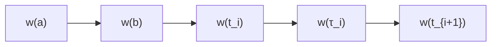
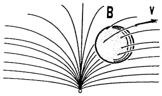
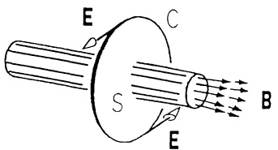
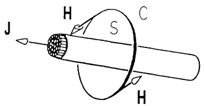
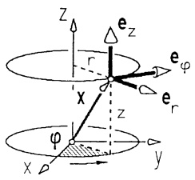
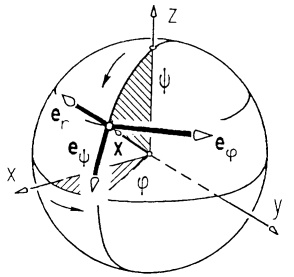
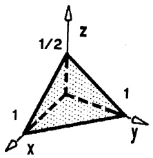
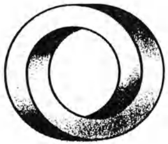

# Kapitel 8 – Funktionen in mehreren Variablen: Integration

原始 PDF 第 446–520 页。

# Kapitel 8

# Funktionen in mehreren Variablen.

# Teil 2: Integration

## §1. Parameterintegrale

1.1 Parameterintegrale. Die meisten höheren Funktionen der Analysis treten entweder als Integralfunktionen  $G(x) = \int_{a}^{x} g(t) dt$  auf ( $\rightarrow$  Kap. 4) oder sie besitzen eine Integraldarstellung der Form

$$
F (x) = \int_ {c} ^ {d} f (x, y) d y ,
$$

worin der Integrand vom Parameter x abhängt.

Typische Beispiele hierfür sind:

Die Gammafunktion $\Gamma(x) := \int_{0}^{\infty} t^{x-1} e^{-t} dt \quad (x > 0), \quad (\rightarrow \text{Kap. 4, §4})$,

die Besselfunktionen  $J_{n}(x) := \frac{1}{\pi} \int_{0}^{\pi} \cos(x \sin t - nt) dt \quad (n \in \mathbb{Z})$ ,

die Laplace-Transformierte  $F(x) := \int_{0}^{\mathcal{L}} f(t) e^{-xt} dt$ .

Die Differentiation und Integration dieser Darstellungen gelingt mit der Theorie von Funktionen im $\mathbb{R}^{2}$ ($\rightarrow$ Kap. 7, §2).

Ⓐ Eigentliche Parameterintegrale.

## Satz 1.1. Grenzwertvertauschung mit bestimmtem Parameterintegral.

Sei $D = [a, b] \times [c, d] = \{ (x, y) ; a \leq x \leq b, c \leq y \leq d \}$ ein abgeschlossenes Rechteck in $\mathbb{R}^2$ und $f : D \to \mathbb{R}$ stetig. Dann gilt für die Integralfunktion

$$
F (x) := \int_ {c} ^ {d} f (x, y) d y, \quad a \leq x \leq b,
$$

a) $F$ ist in $[a,b]$ stetig,

b) Satz von FUBINI,

$$
\int_ {a} ^ {b} F (x) d x = \int_ {a} ^ {b} \left(\int_ {c} ^ {d} f (x, y) d y\right) d x = \int_ {c} ^ {d} \left(\int_ {a} ^ {b} f (x, y) d x\right) d y,
$$

K. Meyberg et al., Höhere Mathematik

© Springer-Verlag Berlin Heidelberg 1998

---

§1. Parameterintegrale

431

c) ist zusätzlich f auf [a,b] stetig partiell nach x differenzierbar, dann ist F differenzierbar mit der Ableitung

$$
F ^ {\prime} (x) = \frac {d}{d x} \int_ {c} ^ {d} f (x, y) d y = \int_ {c} ^ {d} \frac {\partial f}{\partial x} (x, y) d y. \tag {1}
$$

Beweis. a): Aufgrund der gleichmäßigen Stetigkeit ( $\rightarrow$  Kap. 7, Satz 2.1) von f auf D gibt es zu  $\varepsilon > 0$  ein  $\delta > 0$ , so daß gilt:

$$
| f (x, y) - f (x _ {0}, y) | <   \varepsilon \text { für   alle } y, \text { sofern   nur } | x - x _ {0} | \leq \delta .
$$

Für diese x gilt dann  $|F(x)-F(x_{0})|\leq\int_{c}^{d}|f(x,y)-f(x_{0},y)|dy\leq\varepsilon(d-c)$ . Also ist F stetig.

c): Ist darüberhinaus  $f_{x}$  stetig, dann folgt mit dem Mittelwertsatz

$$
\frac {1}{h} [ F (x + h) - F (x) ] = \int_ {c} ^ {d} \frac {f (x + h , y) - f (x , y)}{h} d y = \int_ {c} ^ {d} f _ {x} (\xi , y) d y
$$

mit $\xi$ zwischen $x$ und $x + h$. Nach a) (mit $f_x$ statt $f$) strebt die rechte Seite bei $h \to 0$ gegen $\int_{c}^{d} f_x(x, y) dy$.

b): Die Funktion $H(x) := \int_{c}^{d} \left( \int_{a}^{x} f(t, y) dt \right) dy$ erfüllt die Voraussetzung von c). Mit (1) und Satz 1.3 von Kap. 4 folgt $H'(x) = \int_{c}^{d} f(x, y) dy$ und damit $\int_{a}^{b} \left( \int_{c}^{d} f(x, y) dy \right) dx = \int_{a}^{b} H'(x) dx = H(b) - H(a) = H(b)$.

## Beispiel 1.

$$
F (x) = \int_ {1} ^ {\pi} \frac {\sin (t x)}{t} d t, \quad F ^ {\prime} (x) = \int_ {1} ^ {\pi} \cos (t x) d t, \quad F ^ {\prime \prime} (x) = - \int_ {1} ^ {\pi} t \sin (t x) d t.
$$

## Beispiel 2. Die BESSEL-Funktionen

$$
J _ {n} (x) := \frac {1}{\pi} \int_ {0} ^ {\pi} \cos (x \sin t - n t) d t \quad (n = 0, \pm 1, \pm 2, \dots)
$$

gehören zu den besonders wichtigen Funktionen der angewandten Analysis. Sie wurden zuerst von F.W. BESSEL (1784–1846) zur Berechnung der Planetenbahnen verwendet. In der Folge kamen zahlreiche Anwendungen in den Ingenieurwissenschaften hinzu. Sie treten beispielsweise auf bei der Amplitudenberechnung der harmonischen Oberwellen in einer frequenzmodulierten Schwingung.

---

432

8. Funktionen in mehreren Variablen. Teil 2: Integration

Für $y(x) := \int_{0}^{\pi} \cos(x \sin t - nt) dt$, d.h. $y(x) = \pi J_n(x)$, gilt nach Satz 1.1

$$
\begin{array}{l} y ^ {\prime} (x) = - \int_ {0} ^ {\pi} \sin (x \sin t - n t) \cdot \sin t d t \\ = - x \int_ {0} ^ {\pi} \cos^ {2} t \cos (x \sin t - n t) d t + n \int_ {0} ^ {\pi} \cos t \cos (x \sin t - n t) d t \\ \end{array}
$$

(partielle Integration mit  $\dot{u} = \sin t$ ,  $v = \sin(x \sin t - nt)$ ).

Ferner gilt (ebenfalls mit (1))

$$
y ^ {\prime \prime} (x) = - \int_ {0} ^ {\pi} \cos (x \sin t - n t) \sin^ {2} t d t ,
$$

und somit

$$
x ^ {2} y ^ {\prime \prime} (x) + x y ^ {\prime} (x) + (x ^ {2} - n ^ {2}) y (x) = 0.
$$

D.h., die Besselfunktion $J_{n}$ ist eine Lösung der Bessel-Differentialgleichung $(\rightarrow$ Bd. 2)

$$
x ^ {2} y ^ {\prime \prime} + x y ^ {\prime} + (x ^ {2} - n ^ {2}) y = 0.
$$

text_image

n=0
J_n(x)
5
10
n
20
x

Abb. 197 - Bessel-Funktion, abhängig von $x$ und $n$

Hängen im Parameterintegral auch die Integrationsgrenzen vom Parameter x ab, dann gilt statt (1) für stetig differenzierbare Funktionen g, h die

$$
\boxed { \begin{array}{l} \text {LEIBNIZ - Regel} \\ \frac {d}{d x} \int_ {g (x)} ^ {h (x)} f (x, y) d y = \int_ {g (x)} ^ {h (x)} f _ {x} (x, y) d y + f (x, h (x)) h ^ {\prime} (x) - f (x, g (x)) g ^ {\prime} (x). \end{array} } \tag {2}
$$

Beweis. Man wende auf $F(x, u, v) := \int_{u}^{v} f(x, y) dy$ mit $u = g(x)$, $v = h(x)$ die Kettenregel an (→ Kap. 7, Satz 2.6):

$$
\frac {d}{d x} F (x, g (x), h (x)) = F _ {x} + F _ {u} u ^ {\prime} + F _ {v} v ^ {\prime}.
$$

□

---

§1. Parameterintegrale

433

## Beispiel 1.

$$
I (\alpha) := \int_ {0} ^ {\alpha^ {2}} \cos (\alpha t ^ {2}) d t; \quad \frac {d I}{d \alpha} = - \int_ {0} ^ {\alpha^ {2}} t ^ {2} \sin (\alpha t ^ {2}) d t + 2 \alpha \cos \alpha^ {5}. \tag {$\square$}
$$

## Beispiel 2. Für

$$
x (t) := \frac {1}{k} \int_ {0} ^ {t} f (u) \sin k (t - u) d u
$$

(mit $f:\mathbb{R}\to \mathbb{R}$ stetig) gilt

$$
\begin{array}{l} \dot {x} (t) = \int_ {0} ^ {t} f (u) \cos k (t - u) d u , \\ \ddot {x} (t) = f (t) - k \int_ {0} ^ {t} f (u) \sin k (t - u) d u. \\ \end{array}
$$

Folglich ist  $x = x(t)$  eine Lösung der Schwingungsgleichung ( $\rightarrow$  Bd. 2)

$$
\ddot {x} + k ^ {2} x = f (t) \text {mit den Anfangswerten} x (0) = \dot {x} (0) = 0.
$$

B Uneigentliche Parameterintegrale. Ein dem Satz 1.1 entsprechendes Ergebnis für uneigentliche Integrale, also für Integrale der Form

$$
\int_ {c} ^ {d} f (x, y) d y = \lim _ {\varepsilon \to 0} \int_ {c} ^ {d - \varepsilon} f (x, y) d y , \quad \int_ {c} ^ {\infty} f (x, y) d y = \lim _ {d \to \infty} \int_ {c} ^ {d} f (x, y) d y ,
$$

gilt nur unter der zusätzlichen Voraussetzung, daß einige der vorkommenden Integrale „gleichmäßig konvergieren“. Wir gehen hier auf diesen Begriff nicht näher ein, sondern formulieren den entsprechenden Satz (ohne Beweis) in einer speziellen Form, die für die meisten Anwendungen ausreicht.

Satz 1.2. Ist f auf dem einseitig offenen „Rechteck“

$$
D = \{(x, y); a \leq x \leq b, c \leq y <   d \} \quad (d \in \mathbb {R} \cup \{\infty \})
$$

stetig und stetig partiell nach x differenzierbar und gibt es Funktionen g,h : [c,d) → R , für die gilt

1.  $|f(x,y)| \leq g(y)$  und  $|f_{x}(x,y)| \leq h(y)$  für alle  $(x,y) \in D$ ,

2. die uneigentlichen Integrale

$$
\int_ {c} ^ {d} g (y) d y, \int_ {c} ^ {d} h (y) d y \quad b z w. \quad \int_ {c} ^ {\infty} g (y) d y, \int_ {c} ^ {\infty} h (y) d y
$$

konvergieren,

dann konvergiert für jedes  $x \in [a, b]$  das uneigentliche Integral

$$
F (x) := \int_ {c} ^ {d} f (x, y) d y \quad \text {bzw.} \quad F (x) := \int_ {c} ^ {\infty} f (\ddot {x}, y) d y
$$

und die dadurch definierte Funktion F ist differenzierbar mit der Ableitung

$$
F ^ {\prime} (x) = \int_ {c} ^ {d} f _ {x} (x, y) d y \quad b z w. \quad F ^ {\prime} (x) = \int_ {c} ^ {\infty} f _ {x} (x, y) d y . \tag {3}
$$

---

434

8. Funktionen in mehreren Variablen. Teil 2: Integration

Beispiel 1.

$$
F (x) := \int_ {0} ^ {\infty} e ^ {- t ^ {2}} \cos (x t) d t
$$

ist für jedes  $x \in R$  konvergent und besitzt die Ableitung

$$
F ^ {\prime} (x) = \int_ {0} ^ {\infty} - t e ^ {- t ^ {2}} \sin (x t) d t = - \frac {x}{2} F (x)
$$

(mit partieller Integration; $\dot{u} = te^{-t^2}$ $v = \sin (xt)$ ).

Denn  $f(x,t) := e^{-t^{2}} \cos(xt)$  ist eine  $C^{1}$ -Funktion; es gelten die Abschätzungen

$$
| f (x, t) | \leq e ^ {- t ^ {2}}, \quad | f _ {x} (x, t) | = - t e ^ {- t ^ {2}} \sin (x t) \leq t e ^ {- t ^ {2}};
$$

und  $\int_{0}^{\infty}e^{-t^{2}}dt$ ,  $\int_{0}^{\infty}te^{-t^{2}}dt$  konvergieren wegen  $e^{-t^{2}}<e^{-t}$  für t>1.

$(\rightarrow \mathrm{Satz} 1.2 \mathrm{mit} g(t) = e^{-t^2}, h(t) = te^{-t^2}.)$

□

Beispiel 2. Die Ableitung der Gammafunktion $\Gamma(x) = \int_{0}^{\infty} e^{-t} t^{x-1} dt$ ($x > 0$) läßt sich ebenfalls mit (3) berechnen. Die Abschätzungen, mit denen die Konvergenz des an beiden Integralgrenzen uneigentlichen Integrals nachgewiesen wurde, zeigen, daß die Voraussetzungen aus Satz 1.2 erfüllt sind.

$$
\begin{array}{l} \Gamma^ {\prime} (x) = \int_ {0} ^ {\infty} e ^ {- t} t ^ {x - 1} \ln t   d t , \\ \Gamma^ {\prime \prime} (x) = \int_ {0} ^ {\infty} e ^ {- t} t ^ {x - 1} (\ln t) ^ {2} d t. \\ \end{array}
$$

□

Gegenbeispiel. Das uneigentliche Integral  $\int_{0}^{\infty}e^{-st}\cos t dt$  konvergiert nicht gleichmäßig für  $s\geq0$ :

Einerseits liefert zweimalige partielle Integration

$$
\lim _ {s \to 0} \int_ {0} ^ {\infty} e ^ {- s t} \cos t d t = \lim _ {s \to 0} \frac {s}{1 + s ^ {2}} = 0,
$$

andererseits hätte man mit Satz 1.2 – falsch angewendet –

$$
\lim _ {s \to 0} \int_ {0} ^ {\infty} e ^ {- s t} \cos t d t = \int_ {0} ^ {\infty} \lim _ {s \to 0} e ^ {- s t} \cos t d t = \int_ {0} ^ {\infty} \cos t d t = \lim _ {t \to \infty} \sin t ;
$$

d.h.  $\lim_{t\to\infty}\sin t=0$ , das ist ein Widerspruch.

□

## Aufgaben

1. Für  $0 \leq x \leq 1$ ,  $y \geq 0$  ist die Funktion  $f(x, y) = xy e^{-xy}$  gegeben.

a) Man diskutiere und skizziere  $x \mapsto f(x, y)$  für festes y.
b) Man berechne  $g(x) := \lim_{y \to \infty} f(x, y)$  für jedes  $x \in [0,1]$ . Gilt

$$
\lim _ {y \to \infty} \int_ {0} ^ {1} f (x, y) d x = \int_ {0} ^ {1} g (x) d x \text {?}
$$

---

§2. Kurvenintegrale

435

2. Man wiederhole Aufgabe 1 mit $f(x, y) = \frac{x^2}{y^2} e^{-x / y}$, $0 \leq x < \infty$, $0 < y < \infty$.

3. Man berechne

a) $F^{\prime}(1)$ für $F(x) = \int_{1 / x}^{x^{2}}\frac{e^{sx}}{x + s} ds.$

b) $F(e), F'(e), F''(e)$ für $F(x) = \int_{e}^{x} \ln (x \ln y) dy, x > 1$.

4. Man rechne direkt nach: Für die Funktion $f(x, y) = (2 - xy)xye^{-xy}$ ist

$$
\int_ {0} ^ {1} \left(\int_ {0} ^ {\infty} f (x, y) d y\right) d x \neq \int_ {0} ^ {\infty} \left(\int_ {0} ^ {1} f (x, y) d x\right) d y.
$$

5. a) Man bestätige für die BESSEL-Funktionen $J_{n}(x)$

– durch partielle Integration die Rekursionsformel:

(i) $J_{n + 1}(x) + J_{n - 1}(x) = \frac{2n}{x} J_n(x)\quad ,x\neq 0,$

\- durch die Substitution $t = \pi -\tau$

(ii) $J_{-n}(x) = (-1)^{n}J_{n}(x)$.

b) Mittels (i) und (ii) berechne man $J_{n}(3)$ für $-5 \leq n \leq 5$ rekursiv aus $J_{0}(3) = -0.2600519549 \ldots$ und $J_{1}(3) = 0.3390589585 \ldots$.

## §2. Kurvenintegrale

2.1 Das Kurvenintegral einer skalaren Funktion. Das bestimmte Integral  $\int_{0}^{a}g(t)dt$  einer reellen Funktion  $g:[0,a]\to R$  stellt den einfachsten Fall eines Kurvenintegrals dar. Es ist interpretierbar als Integral über ein Skalarenfeld längs der Strecke  $\mathbf{x}(t)=t\mathbf{e}_{1},\quad0\leq t\leq a$ . Die Verallgemeinerung auf beliebige Kurven im  $R^{n}$  liefert ein Mittel, um in der Physik die Masse und den Schwerpunkt von krummen Stäben, die Arbeit in Kraftfeldern und die Zirkulation in Strömungsfeldern zu berechnen und in der Theorie von Vektorfeldern zu einem Gradientenfeld das Potential zu bestimmen.

Definition. Sei $D \subseteq \mathbb{R}^n$ offen, $\mathbf{w} : [a, b] \to D$ ein Kurvenstück und $f$ eine skalare Belegungsfunktion auf dem Kurvenstück, so daß $t \mapsto f(\mathbf{w}(t))$ stetig ist. Dann heißt

$\int_{\mathbf{w}}fds:= \int_{a}^{b}f(\mathbf{w}(t))|\dot{\mathbf{w}} (t)|dt$

das Kurvenintegral von f längs w.

---

436

8. Funktionen in mehreren Variablen. Teil 2: Integration

Das Kurvenintegral besitzt im Fall $n = 3$ folgende anschauliche Deutung, aus der sich auch die Anwendungen ergeben. Das Kurvenstück besitze im Kurvenpunkt $\mathbf{w}(t)$ die Belegung mit der skalaren Größe (Masse, Ladung,...) $f(\mathbf{w}(t))$. Zur Berechnung der Gesamtbelegung wird das Kurvenstück durch Aufteilung

flowchart

Abb. 198 - Kurvenintegral

des Parameterintervalls $a = t_0 < t_1 < \cdots < t_m = b$ in Bögen über $[t_{i-1}, t_i]$ ($1 \leq i \leq m$) der Länge $\Delta s_i = \int_{t_{i-1}}^{t_i} |\dot{\mathbf{w}}(t)| dt = |\dot{\mathbf{w}}(\tau_i)| \Delta t_i$ mit einem Zwischenwert $\tau_i$ ($t_{i-1} \leq \tau_i \leq t_i, \to$ Kap. 4, §1(10)) zerlegt. Durch das Produkt

$$
f (\mathbf {w} (\tau_ {i})) \Delta s _ {i} = f (\mathbf {w} (\tau_ {i})) | \dot {\mathbf {w}} (\tau_ {i}) | \Delta t _ {i}
$$

wird die Belegung des i-ten Bogens approximiert, die Gesamtbelegung durch

$$
Z _ {n} = \sum_ {i = 1} ^ {n} f (\mathbf {w} (\tau_ {i})) | \dot {\mathbf {w}} (\tau_ {i}) | \Delta t _ {i}.
$$

Dieses ist eine RIEMANN-Summe, die aufgrund der geforderten Stetigkeit mit $n \to \infty$ und $\Delta t_i \to 0$ gegen das Integral $\int_a^b f(\mathbf{w}(t))|\dot{\mathbf{w}}(t)|dt$ konvergiert.

Berechnung des Kurvenintegrals $I = \int_{\mathbb{W}} f ds \text{ im } \mathbb{R}^3$.

1. Schritt: Das Kurvenstück parametrisieren,

$$
\mathbf {w} (t) = \left(x (t), y (t), z (t)\right) ^ {T}, a \leq t \leq b.
$$

2. Schritt: Das Bogenelement durch Differentiation bestimmen,

$$
d s = | \dot {\mathbf {w}} (t) | d t = \sqrt {\dot {x} ^ {2} (t) + \dot {y} ^ {2} (t) + \dot {z} ^ {2} (t)} d t.
$$

3. Schritt : Eintragen: $\mathbf{w}(t)$ im Integranden: $f = f(\mathbf{w}(t))$, das Bogenelement $ds = |\dot{\mathbf{w}}(t)|dt$, $a, b$ als Integrationsgrenzen.

$$
I = \int_ {a} ^ {b} f (x (t), y (t), z (t)) \sqrt {\dot {x} ^ {2} (t) + \dot {y} ^ {2} (t) + \dot {z} ^ {2} (t)} d t
$$

als bestimmtes Integral ausrechnen (→ Kap. 4).

Mit der Sprechweise von Kap. 4, 6.1 lautet der Sachverhalt anschaulich: Das Bogenelement ds im Kurvenpunkt $\mathbf{w}(t)$ trägt die Belegung $dm = f(\mathbf{w}(t))ds = f(\mathbf{w}(t))|\dot{\mathbf{w}}(t)|dt$; die „kontinuierliche Summation“ – also die Integration – ergibt die Gesamtbelegung

$$
M = \int_ {\mathbf {w}} d m = \int_ {\mathbf {w}} f d s = \int_ {a} ^ {b} f (\mathbf {w} (t)) | \dot {\mathbf {w}} (t) | d t.
$$

---

§2. Kurvenintegrale

437

Bemerkung. Was durch diese anschauliche Deutung unmittelbar einleuchtet, läßt sich auch explizit leicht beweisen:

Durchlaufen zwei Kurvenstücke $\mathbf{w}:[a,b]\to\mathbb{R}^{n}$ und $\mathbf{u}:[c,d]\to\mathbb{R}^{n}$ dieselbe Spur $\{\mathbf{w}(t);a\leq t\leq b\}=\{\mathbf{u}(t);c\leq t\leq d\}$ genau gleich oft, dann gilt

$$
\int_ {a} ^ {b} f (\mathbf {w} (t)) | \dot {\mathbf {w}} (t) | d t = \int_ {c} ^ {d} f (\mathbf {u} (t)) | \dot {\mathbf {u}} (t) | d t.
$$

Die Schreibweise  $\int_{w} f ds$  symbolisiert diese Unabhängigkeit von einer speziellen Parameterdarstellung.

Beispiel. Es ist die Masse  $M = \int_{w} \rho ds$  der abgebildeten Schraubenfeder mit linearer Massendichte  $\rho(x, y, z) = x^{2}y^{2} + z^{2}$  zu berechnen.

1. Schritt: Das Kurvenstück darstellen:

$$
x = 2 \cos t, y = 2 \sin t, z = \frac {1}{2} t, 0 \leq t \leq 4 \pi .
$$

2. Schritt: Das Bogenelement berechnen:

$$
d s = \sqrt {\dot {x} ^ {2} + \dot {y} ^ {2} + \dot {z} ^ {2}} d t = \frac {1}{2} \sqrt {1 7} d t.
$$

3. Schritt : Einsetzen und ausrechnen:

text_image

w(4\pi)
z
t
x
y
w(0)

Abb. 199 - Schraublinie

$$
\begin{array}{l} M = \int_ {\mathbf {w}} \rho d s = \int_ {\mathbf {w}} (x ^ {2} y ^ {2} + z ^ {2}) d s = \int_ {0} ^ {4 \pi} [ (2 \cos t) ^ {2} (2 \sin t) ^ {2} + \frac {1}{4} t ^ {2} ] \frac {1}{2} \sqrt {1 7} d t \\ = \frac {1 7}{2} \left(\frac {1 6}{3} \pi^ {3} + 8 \pi\right). \\ \end{array}
$$

Beispiele für spezielle Integrationswege.

1. Das Integral längs einer zur z-Achse parallelen Strecke.

1. Schritt: Die Strecke $\mathbf{w}(t) = (x_0, y_0, t)^T$, $z_0 \leq t \leq z_1$.
2. Schritt: Das Bogenelement ds = dt.
3. Schritt: Einsetzen (und ausrechnen) $\int_{\mathbf{w}} f ds = \int_{z_0}^{z_1} f(x_0, y_0, t) dt$.
2. Das Integral längs eines Graphen  $y = g(x)$  in der Ebene  $z = z_{0}$ .

1. Schritt: Das Kurvenstück $\mathbf{w}(x) = (x, g(x), z_0)^T$, $a \leq x \leq b$.

2. Schritt: Das Bogenelement  $ds = \sqrt{1 + g'(x)^{2}} dx$ .

3. Schritt: Das Integral $\int_{\mathbf{w}} f ds = \int_{a}^{b} f(x, g(x), z_0) \sqrt{1 + g'(x)^2} dx$.

Es ist zweckmäßig, den Begriff des Kurvenintegrals auf Integrationswege zu erweitern, die aus (stetig differenzierbaren) Kurvenstücken zusammengesetzt werden.

flowchart

Abb. 200 - Kurve

---

438

8. Funktionen in mehreren Variablen. Teil 2: Integration

Definition. a) Unter einer Kurve $\mathbf{w}$ in $D \subseteq \mathbb{R}^n$ verstehen wir eine endliche Folge $\mathbf{w}_1, \ldots, \mathbf{w}_k$ von (stetig differenzierbaren) Kurvenstücken $\mathbf{w}_i : [a_i, b_i] \to D$ ($i = 1, \ldots, k$) mit $\mathbf{w}_i(b_i) = \mathbf{w}_{i+1}(a_{i+1})$ ($1 \leq i \leq k-1$).

b) Für eine aus den Kurvenstücken $\mathbf{w}_{1},\ldots,\mathbf{w}_{k}$ bestehende Kurve und für jede stetige Funktion $f:\mathrm{Spur}\mathbf{w}\to\mathbb{R}$ ist das Kurvenintegral von $f$ längs $\mathbf{w}$ definiert durch

$$
\boxed {\int_ {\mathbf {w}} f d s := \int_ {\mathbf {w} _ {1}} f d s + \dots + \int_ {\mathbf {w} _ {k}} f d s.} \tag {2}
$$

Beispiel. Die Kurve w führt, wie skizziert, auf achsenparallelen Strecken vom Ursprung O zum Punkt  $(x_{0}, y_{0}, z_{0})$ , Belegungsfunktion sei  $f(\mathbf{x}) = |\mathbf{x}|^{2}$ :

$$
\begin{array}{l} \int_ {\mathbf {w}} | \mathbf {x} | ^ {2} d s = \int_ {0} ^ {x _ {0}} (t ^ {2} + 0 + 0) d t + \\ + \int_ {0} ^ {y _ {0}} (x _ {0} ^ {2} + t ^ {2} + 0) d t + \\ + \int_ {0} ^ {z _ {0}} (x _ {0} ^ {2} + y _ {0} ^ {2} + t ^ {2}) d t \\ = \frac {1}{3} x _ {0} ^ {3} + x _ {0} ^ {2} y _ {0} + \frac {1}{3} y _ {0} ^ {3} + x _ {0} ^ {2} z _ {0} + y _ {0} ^ {2} z _ {0} + \frac {1}{3} z _ {0} ^ {3}. \\ \end{array}
$$

text_image

z
x = (x₀,y₀,z₀)
y₀
w
x₀
y
x

Abb. 201 - Streckenzug

Durch die Anordnung auf $\mathbb{R}$ ergibt sich eine Orientierung (Durchlaufrichtung) eines Kurvenstücks $\mathbf{w}:[a,b]\to\mathbb{R}^{n}$ bzw. der Spur vom Anfangspunkt hin zum Endpunkt. In der graphischen Darstellung wird das durch einen entsprechenden Pfeil gekennzeichnet. Eine aus Stücken $\mathbf{w}_{i}:[a_{i},b_{i}]\to\mathbb{R}^{n}$ ($1\leq i\leq k$) bestehende Kurve wird vom Anfangspunkt $\mathbf{w}_{1}(a_{1})$ über die „Verbindungspunkte“ $\mathbf{w}_{i}(b_{i})=\mathbf{w}_{i+1}(a_{i+1})$ ($1\leq i\leq k-1$) zum Endpunkt $\mathbf{w}_{k}(b_{k})$ durchlaufen.

Das zum Kurvenstück $\mathbf{w}:[a,b]\to\mathbb{R}^{n}$ definierte Kurvenstück

$$
\mathbf {w} ^ {*}: [ a, b ] \rightarrow \mathbb {R} ^ {n}, \quad \mathbf {w} ^ {*} (t) := \mathbf {w} (a + b - t), \tag {3}
$$

hat die gleiche Spur wie $\mathbf{w}$, sie wird jedoch von $\mathbf{w}^{*}(a)=\mathbf{w}(b)$ (Endpunkt von $\mathbf{w}$) nach $\mathbf{w}^{*}(b)=\mathbf{w}(a)$ (Anfangspunkt von $\mathbf{w}$) durchlaufen. Die zur Kurve $\mathbf{w}$, bestehend aus den Stücken $\mathbf{w}_{1},\ldots,\mathbf{w}_{k}$,

entgegengesetzt durchlaufenen Kurve $\mathbf{w}^{*}$ besteht (der Reihe nach) aus $\mathbf{w}_{k}^{*},\ldots,\mathbf{w}_{1}^{*}$. Da in der Integraldefinition (1) die Durchlaufrichtung nicht eingeht, gilt offenbar

$$
\int_ {\mathbf {w}} f d s = \int_ {\mathbf {w} ^ {*}} f d s. \tag {4}
$$

flowchart

```mermaid
graph TD
  A["Start"] --> B["Flow Arrow 1"]
  B --> C["Flow Arrow 2"]
  C --> D["Flow Arrow 3"]
  D --> E["Flow Arrow 4"]
  E --> F["Flow Arrow 5"]
  F --> G["Flow Arrow 6"]
  G --> H["Flow Arrow 7"]
  H --> I["Flow Arrow 8"]
  I --> J["Flow Arrow 9"]
  J --> K["Flow Arrow 10"]
  K --> L["Flow Arrow 11"]
  L --> M["Flow Arrow 12"]
  M --> N["Flow Arrow 13"]
  N --> O["Flow Arrow 14"]
  O --> P["Flow Arrow 15"]
  P --> Q["Flow Arrow 16"]
  Q --> R["Flow Arrow 17"]
  R --> S["Flow Arrow 18"]
  S --> T["Flow Arrow 19"]
  T --> U["Flow Arrow 20"]
  U --> V["Flow Arrow 21"]
  V --> W["Flow Arrow 22"]
  W --> X["Flow Arrow 23"]
  X --> Y["Flow Arrow 24"]
  Y --> Z["Flow Arrow 25"]
```

Abb. 202 - Durchlaufsinn

Aus der Definition ergeben sich für alle Kurven $\mathbf{w}$ in $D$, $f, g \in \mathcal{C}^{0}(D, \mathbb{R})$, $\alpha \in \mathbb{R}$, folgende Rechenregeln:

---

§2. Kurvenintegrale

439

$$
\boxed { \begin{array}{c} \int_ {\mathrm{w}} \alpha f d s = \alpha \int_ {\mathrm{w}} f d s, \\ \int_ {\mathrm{w}} (f + g) d s = \int_ {\mathrm{w}} f d s + \int_ {\mathrm{w}} g d s. \\ \text {(Linearität des Kurvenintegrals)} \end{array} } \tag {5}
$$

Ferner gilt für jedes Kurvenstück $\mathbf{w}:[a,b]\to\mathbb{R}^{n}$ der Mittelwertsatz:

$$
\boxed {\int_ {\mathbf {w}} f d s = f (\tilde {\mathbf {x}}) \cdot L} \tag {6}
$$

mit einem Kurvenpunkt  $\tilde{x}$  und der Kurvenlänge L.

Beweis. Der Mittelwertsatz für bestimmte Integrale (→ Kap. 4, Satz 1.2) gibt

$$
\begin{array}{l} \int_ {\mathbf {w}} f d s = \int_ {a} ^ {b} f (\mathbf {w} (t)) | \dot {\mathbf {w}} (t) | d t = f (\tilde {\mathbf {x}}) \int_ {a} ^ {b} | \dot {\mathbf {w}} (t) | d t \\ = f (\tilde {\mathbf {x}}) \cdot L. \\ \end{array}
$$

## 2.2 Anwendungen.

① Bogenlänge. Die Länge $L(\mathbf{w})$ eines Kurvenstücks $\mathbf{w}:[a,b]\to\mathbb{R}^{3}$ beträgt nach Kap. 7, §1

$$
L (\mathbf {w}) = \int_ {\mathbf {w}} d s = \int_ {a} ^ {b} | \dot {\mathbf {w}} (t) | d t = \int_ {a} ^ {b} \sqrt {\dot {x} (t) ^ {2} + \dot {y} (t) ^ {2} + \dot {z} (t) ^ {2}} d t. \tag {7}
$$

Eine aus den Kurvenstücken  $w_{1},\ldots,w_{k}$  bestehende Kurve hat die Länge  $L = L(\mathbf{w}_{1}) + \cdots + L(\mathbf{w}_{k})$ , wobei mehrfach durchlaufene Stücke entsprechend oft gezählt werden.

b Masse (oder Ladung, bzw. irgendeine Belegung). Stellt  $\rho(x,y,z)$  die Massendichte einer Kurve w (eines Seiles oder Drahtes) dar, so nennt man  $dm = \rho(x,y,z)ds$  ein Massenelement. Die Gesamtmasse beträgt

$$
M = \int_ {\mathbf {w}} d m = \int_ {\mathbf {w}} \rho (x, y, z) d s . \tag {8}
$$

(c) Momente und Massenmittelpunkt. Die $k$-ten Momente (bezüglich der Ko-ordinatenebenen) eines in $(x, y, z)$ befindlichen Massenpunktes der Masse $dm$ sind $x^{k}dm$, $y^{k}dm$, $z^{k}dm$. Demzufolge berechnen sich die $k$-ten Momente der Kurve w wie folgt:

---

440

8. Funktionen in mehreren Variablen. Teil 2: Integration

$$
\begin{array}{l} M _ {x, k} = \int_ {\mathbf {w}} x ^ {k} d m = \int_ {\mathbf {w}} x ^ {k} \rho (x, y, z) d s, \\ M _ {y, k} = \int_ {\mathbf {w}} y ^ {k} d m = \int_ {\mathbf {w}} y ^ {k} \rho (x, y, z) d s, \\ M _ {z, k} = \int_ {\mathbf {w}} z ^ {k} d m = \int_ {\mathbf {w}} z ^ {k} \rho (x, y, z) d s. \end{array} \tag {9}
$$

Für k = 1 sind das die statischen Momente, für k = 2 die Trägheitsmomente.

Der Punkt $S = (x_{S}, y_{S}, z_{S})$, in dem eine Punktmasse der Größe $M$ ($\rightarrow$ (8)) dasselbe statische Moment wie $\mathbf{w}$ besitzt, bezeichnet man als Massenmittelpunkt (Schwerpunkt).

$$
\boxed { \begin{array}{l} \text {Schwerpunkt} S = (x _ {S}, y _ {S}, z _ {S}) \text {zur Massendichte} \rho , \\ \text {Gesamtmasse} M = \int_ {\mathrm{w}} \rho d s: \\ x _ {S} = \frac {1}{M} \int_ {\mathrm{w}} x \rho (x, y, z) d s, y _ {S} = \frac {1}{M} \int_ {\mathrm{w}} y \rho (x, y, z) d s, z _ {S} = \frac {1}{M} \int_ {\mathrm{w}} z \rho (x, y, z) d s. \end{array} } \tag {10}
$$

Im Fall homogener Massenverteilung, $\rho(x,y,z)=\mathrm{const}$, fällt der Massenmittelpunkt der Kurve w mit ihrem geometrischen Schwerpunkt zusammen.

$$
\begin{array}{l} \text {Der (geometrische) Schwerpunkt} \bar {S} = (\bar {x}, \bar {y}, \bar {z}) \text {bei}\\ \text {einer Gesamtlänge} L = \int_ {\mathrm{w}} d s: \\ \bar {x} = \frac {1}{L} \int_ {\mathrm{w}} x d s, \bar {y} = \frac {1}{L} \int_ {\mathrm{w}} y d s, \bar {z} = \frac {1}{L} \int_ {\mathrm{w}} z d s. \end{array} \tag {11}
$$

Man beachte: Sowohl der Massenmittelpunkt als auch der Schwerpunkt sind i.a. keine Kurvenpunkte.

Beispiel. Die Schraubenlinie (→ Abb. 199)

$$
\mathbf {w} (t) = (r \cos t, r \sin t, h t) ^ {T}, \quad 0 \leq t \leq 2 \pi n,
$$

hat die Bogenlänge

$$
L = \int_ {0} ^ {2 \pi n} \sqrt {r ^ {2} + h ^ {2}} d t = \sqrt {r ^ {2} + h ^ {2}} \cdot 2 \pi n = 2 \pi n R, \quad R = \sqrt {r ^ {2} + h ^ {2}}.
$$

Für ganzzahliges n ist  $\bar{x} = \bar{y} = 0$  und mit der Höhe  $H = 2\pi nh$  ist

$$
\overline {{z}} = \frac {1}{2 \pi n R} \int_ {0} ^ {2 \pi n} h t R d t = \frac {4 \pi^ {2} n ^ {2} h R}{2 \cdot 2 \pi n R} = \pi n h = \frac {H}{2},
$$

d.h.  $\overline{S} = (0, 0, \frac{1}{2}H)$  liegt nicht auf w.

---

§2. Kurvenintegrale

441

Mit der Massenbelegung  $\rho = z$  ergibt sich

$$
M = \int_ {0} ^ {2 \pi n} h t \cdot R d t = 2 \pi^ {2} n ^ {2} h R.
$$

Wieder ist  $x_{S} = y_{S} = 0$ , und es ergibt sich mit

$$
z _ {S} = \frac {1}{2 \pi^ {2} n ^ {2} h R} \int_ {0} ^ {2 \pi n} h t \cdot h t \cdot R d t = \frac {4}{3} h n \pi = \frac {2}{3} H
$$

als Massenmittelpunkt  $S = (0, 0, \frac{2}{3}H)$ .

2.3 Die Integration eines Vektorfeldes längs einer Kurve. Für Vektoren $\mathbf{x} = (x_1, \ldots, x_n)^T$, $\mathbf{y} = (y_1, \ldots, y_n)^T \in \mathbb{R}^n$ ist das Skalarprodukt $\mathbf{x} \cdot \mathbf{y}$ definiert durch ($\rightarrow$ Kap. 6, 6.3) $\mathbf{x} \cdot \mathbf{y} = \sum_{i=1}^{n} x_i y_i$. Die Zahl $|\mathbf{x}| = \left( \sum_{i=1}^{n} x_i^2 \right)^{1/2}$ heißt Betrag des Vektors $\mathbf{x}$ und zu einem Einheitsvektor $\mathbf{e}$ (d.h. $|\mathbf{e}| = 1$) nennt man $\mathbf{x} \cdot \mathbf{e}$ die skalare Komponente von $\mathbf{x}$ in $\mathbf{e}$-Richtung. Offenbar gilt $\mathbf{x} = (\mathbf{x} \cdot \mathbf{e})\mathbf{e} + \mathbf{n}$ mit dem zu $\mathbf{e}$ orthogonalen Vektor $\mathbf{n} = \mathbf{x} - (\mathbf{x} \cdot \mathbf{e})\mathbf{e}$ ($\rightarrow$ Kap. 1, §5(6) für $n = 3$).

Definition. Sei $D \subseteq \mathbb{R}^n$ offen. $\mathbf{w} : [a, b] \to D$ eine reguläre Kurve und $\mathbf{v} : D \to \mathbb{R}^n$ ein stetiges Vektorfeld. Man nennt

$$
\int_ {\mathbf {w}} \mathbf {v} \cdot d \mathbf {x} := \int_ {a} ^ {b} \mathbf {v} (\mathbf {w} (t)) \cdot \dot {\mathbf {w}} (t) d t \tag {12}
$$

das Kurvenintegral von v längs w.

## Bemerkungen.

1. Mit  $\mathbf{T}(t):=\frac{1}{|\dot{\mathbf{w}}(t)|}\dot{\mathbf{w}}(t)\quad(\rightarrow\mathrm{Kap.~7},$

§1) lautet (12)

$$
\begin{array}{l} \int_ {\mathbf {w}} \mathbf {v} \cdot d \mathbf {x} = \int_ {a} ^ {b} \left[ \mathbf {v} (\mathbf {w} (t)) \cdot \mathbf {T} (t) \right] | \dot {\mathbf {w}} (t) | d t \\ = \int_ {\mathbf {w}} (\mathbf {v} \cdot \mathbf {T}) d s. \\ \end{array}
$$

text_image

v(w(t))
T(t)
w(b)
w(t)
v·T
w(a)

Abb. 203 - Integral eines Vektorfeldes

Es handelt sich also um das Kurvenintegral $\int_{\mathbf{w}} f ds$ der skalaren Tangentialkomponente $f = \mathbf{v} \cdot \mathbf{T}$ des Vektorfeldes längs der Kurve $\mathbf{w}$.

2. Offenbar gelten für stetige Vektorfelder u, v und  $\alpha \in R$  folgende Rechenregeln (die Linearität):

$$
\int_ {\mathbf {w}} (\mathbf {u} + \mathbf {v}) \cdot d \mathbf {x} = \int_ {\mathbf {w}} \mathbf {u} \cdot d \mathbf {x} + \int_ {\mathbf {w}} \mathbf {v} \cdot d \mathbf {x}, \tag {13}
$$

$$
\int_ {\mathbf {w}} \alpha \mathbf {v} \cdot d \mathbf {x} = \alpha \int_ {\mathbf {w}} \mathbf {v} \cdot d \mathbf {x}.
$$

3. Bei einer Änderung der „Integrationsrichtung“, d.h. beim Übergang von w

---

442

8. Funktionen in mehreren Variablen. Teil 2: Integration

zur entgegengesetzt durchlaufenen Kurve $\mathbf{w}^{*}$ ($\rightarrow$ (3)) geht der Tangentialvektor $\mathbf{T}$ in $-\mathbf{T}$ über. Deshalb gilt

$$
\int_ {\mathbf {w} ^ {*}} \mathbf {v} \cdot d \mathbf {x} = - \int_ {\mathbf {w}} \mathbf {v} \cdot d \mathbf {x}. \tag {14}
$$

4. Sinngemäß zu (2) ist das Kurvenintegral von Vektorfeldern längs stückweise regulärer Kurven erklärt.

5. Man nennt eine Kurve w geschlossen, wenn der Anfangspunkt mit dem Endpunkt zusammenfällt. In diesem Fall schreiben wir

$$
\oint_ {\mathbf {w}} f d s \quad \mathrm{bzw.} \quad \oint_ {\mathbf {w}} \mathbf {v} \cdot d \mathbf {x}.
$$

6. Die linke Seite von (12) wird mit $d\mathbf{x} = (dx_1, \ldots, dx_n)^T$ gern „explizit“ in folgender Form angegeben:

$$
\int_ {\mathbf {w}} \mathbf {v} \cdot d \mathbf {x} = \int_ {\mathbf {w}} v _ {1} d x _ {1} + v _ {2} d x _ {2} + \dots + v _ {n} d x _ {n}.
$$

Mit indexfreier Schreibweise im  $R^{3}$ , d.h. mit  $x = x_{1}$ ,  $y = x_{2}$ ,  $z = x_{3}$ :

Berechnung des Kurvenintegrals im $\mathbb{R}^3$.

$$
A = \int_ {\mathbf {w}} \mathbf {v} \cdot d \mathbf {x} = \int_ {\mathbf {w}} v _ {1} d x + v _ {2} d y + v _ {3} d z.
$$

1. Schritt: Das Kurvenstück parametrisieren,

$$
\mathbf {w} (t) = \left(x (t), y (t), z (t)\right) ^ {T}, a \leq t \leq b.
$$

2. Schritt: Das vektorielle Bogenelement berechnen,

$$
d \mathbf {x} = \dot {\mathbf {w}} (t) d t = \left(\dot {x} (t), \dot {y} (t), \dot {z} (t)\right) ^ {T} d t.
$$

3. Schritt: Parameterdarstellung, vektorielles Bogenelement, Parametergrenzen eintragen,

$$
A = \int_ {a} ^ {b} \left[ v _ {1} (\mathbf {w} (t)) \dot {x} (t) + v _ {2} (\mathbf {w} (t)) \dot {y} (t) + v _ {3} (\mathbf {w} (t)) \dot {z} (t) \right] d t
$$

als bestimmtes Integral ausrechnen (→ Kap. 4).

## Beispiel 1.

$$
A = \int_ {\mathbf {w}} x ^ {2} y   d x + (x - z) d y + (x y z) d z
$$

längs des Graphen  $y = x^{3}$   $(0 \leq x \leq 2)$  in der Ebene z = 2.

1. Schritt: Die Kurve $x = t$, $y = t^3$, $z = 2$, $0 \leq t \leq 2$.
2. Schritt: $dx = dt$, $dy = 3t^2 dt$, $dz = 0$.

---

§2. Kurvenintegrale

443

$$
3. S c h r i t t: A = \int_ {0} ^ {2} (t ^ {2} t ^ {3} + (t - 2) 3 t ^ {2}) d t = \frac {2 0}{3}.
$$

Beispiel 2. Das Integral über den isolierten Wirbel im $\mathbb{R}^2$ ($\rightarrow$ Kap. 7, 4.3)

$$
\mathbf {v} (x, y) = \frac {1}{x ^ {2} + y ^ {2}} \binom{- y}{x}, (x, y) \neq (0, 0),
$$

längs des einmal positiv durchlaufenen Einheitskreises w um (0,0).

$$
A = \int_ {\mathbf {w}} v _ {1} d x + v _ {2} d y = \int_ {\mathbf {w}} \frac {1}{x ^ {2} + y ^ {2}} (- y d x + x d y)
$$

1. Schritt: $x = \cos t$, $y = \sin t$, $0 \leq t \leq 2\pi$.
2. Schritt:  $dx = -\sin t dt$ ,  $dy = \cos t dt$ .
3. Schritt: $A = \int_{0}^{2\pi} [\sin^2 t + \cos^2 t] dt = 2\pi$. (→ 2.5, letztes Beispiel)

## 2.4 Anwendungen und Beispiele.

(a) Arbeit. Die von einer Kraft K im Kurvenpunkt  $\mathbf{w}(t)$  längs des Weges  $d\mathbf{x} = \dot{\mathbf{w}}(t)dt$  geleistete Arbeit beträgt  $dA = \mathbf{K} \cdot d\mathbf{x} = (\mathbf{K} \cdot \mathbf{T})ds$ . Demnach beträgt die von K längs w geleistete Arbeit

$$
A = \int_ {\mathbf {w}} \mathbf {K} \cdot d \mathbf {x}.
$$

In einem elektrischen Feld E liefert das (negative) „Arbeitsintegral“ den Spannungsabfall längs w (→ Kap. 7, 3.1):

$$
U = - \int_ {\mathbf {w}} \mathbf {E} \cdot d \mathbf {x}.
$$

Beispiel. Geführte Bewegung. Gleitet ein Teilchen der Masse m im vertikalen Schwerefeld  $\mathbf{K} = (0, 0, -mg)^{T}$  nicht frei, sondern reibungsfrei längs einer Leitkurve w, so sind im Bewegungsgesetz die von der Massenträgheit herrührenden Scheinkräfte zu berücksichtigen. Rechnet man im begleitenden Dreibein (T, N, B) von w ( $\rightarrow$  Kap. 7, 1.2), so lautet die Bewegungsgleichung:

$$
m \ddot {\mathbf {x}} = \mathbf {K} + F _ {N} \mathbf {N} + F _ {B} \mathbf {B}.
$$

text_image

F_N N + F_B B
w
T
K

Abb. 204 - Geführte Bewegung

Das Kurvenintegral über dieses Kräftegleichgewicht zeigt in der Energiebilanz der Bewegung, daß  $F_{N}$  und  $F_{B}$  keinen Energiebeitrag leisten:

$$
\begin{array}{l} \int_ {\mathbf {w}} m (\ddot {\mathbf {x}} \cdot d \mathbf {x}) = \int_ {\mathbf {w}} \mathbf {K} \cdot d \mathbf {x} + F _ {N} \int_ {\mathbf {w}} \mathbf {N} \cdot d \mathbf {x} + F _ {B} \int_ {\mathbf {w}} \mathbf {B} \cdot d \mathbf {x}, \\ \int_ {\mathbf {w}} m (\dot {\mathbf {x}} \cdot \ddot {\mathbf {x}}) d t = \int_ {\mathbf {w}} \mathbf {K} \cdot d \mathbf {x} + F _ {N} \int_ {\mathbf {w}} (\mathbf {N} \cdot \mathbf {T}) d s + F _ {B} \int_ {\mathbf {w}} (\mathbf {B} \cdot \mathbf {T}) d s. \\ \end{array}
$$

---

444

8. Funktionen in mehreren Variablen. Teil 2: Integration

Integration der linken Seite ergibt mit  $v(t) = |\dot{\mathbf{x}}(t)|$  und  $N \cdot T = B \cdot T = 0$ :

$$
m \int_ {a} ^ {b} (\dot {x} \ddot {x} + \dot {y} \ddot {y} + \dot {z} \ddot {z}) d t = \frac {1}{2} m (\dot {x} ^ {2} + \dot {y} ^ {2} + \dot {z} ^ {2}) \Big | _ {t = a} ^ {b} = \frac {1}{2} m \big (v ^ {2} (b) - v ^ {2} (a) \big) = \int_ {\mathbf {w}} \mathbf {K} \cdot d \mathbf {x}.
$$

Mit $\ddot{\mathbf{x}} = v\mathbf{T} + v^{2}\kappa \mathbf{N}$ ($\rightarrow$ Kap. 7, §1(9)) erhält man nach skalarer Multiplikation der Bewegungsgleichung mit $\mathbf{N}$ bzw. $\mathbf{B}$:

$$
F _ {N} = m v ^ {2} \kappa - \mathbf {K} \cdot \mathbf {N}, \quad F _ {B} = - \mathbf {K} \cdot \mathbf {B}.
$$

⑥ Zirkulation und Fluß. In der Strömungslehre heißt das Integral eines Geschwindigkeitsfeldes v längs einer geschlossenen Kurve w,

$$
\oint_ {\mathbf {w}} \mathbf {v} \cdot d \mathbf {x} = \oint_ {\mathbf {w}} (\mathbf {v} \cdot \mathbf {T}) d s ,
$$

die Zirkulation des Feldes v längs w. Es wird die skalare Tangentialkomponente von v längs w aufintegriert.

Liegt w in einer Ebene, so bezeichnet man das Integral über die Normalkomponente von v als Fluß des Feldes v durch w :

$$
\oint_ {\mathbf {w}} \mathbf {v} \cdot d \mathbf {n} := \oint_ {\mathbf {w}} (\mathbf {v} \cdot \mathbf {n}) d s.
$$

text_image

T
Tangential-
komponente
w
v
n
Normal-
komponente

Abb. 205 - Fluß, Zirkulation

n bezeichnet dabei in jedem Kurvenpunkt

den äußeren Normalenvektor, der aus T durch eine Drehung um  $-90^{\circ}$  ensteht. Er hat für  $\mathbf{w}(t)=\begin{pmatrix}x(t)\\y(t)\end{pmatrix}$  die Darstellung  $\mathbf{n}(t)=\frac{1}{\sqrt{\dot{x}^{2}+\dot{y}^{2}}}\begin{pmatrix}\dot{y}(t)\\-\dot{x}(t)\end{pmatrix}$  und weist bei positivem Umlauf stets ins Äußere von w ( $\rightarrow3.5$ , Bsp.2).

Der Mittelwertsatz (6) gibt die Deutung für die physikalische Anwendung:

$$
\oint_ {\mathbf {w}} \mathbf {v} \cdot d \mathbf {x} = (\mathbf {v} (\hat {t}) \cdot \mathbf {T} (\hat {t})) L; \oint_ {\mathbf {w}} \mathbf {v} \cdot d \mathbf {n} = (\mathbf {v} (\tilde {t}) \cdot \mathbf {n} (\tilde {t})) L.
$$

Zirkulation längs $\mathbf{w} =$ (mittlere skalare Tangentialkomponente von $\mathbf{v}$ längs $\mathbf{w}$) · (Länge von $\mathbf{w}$),

Fluß durch $\mathbf{w} =$ (mittlere skalare Normalkomponente von $\mathbf{v}$ längs $\mathbf{w}$) · (Länge von $\mathbf{w}$).

Beispiel. Ebene Gegenströmung.

$$
\mathbf {v} = \binom{c y}{0}, c > 0.
$$

Für den positiv durchlaufenen Kreis $\mathbf{w}(t) = (\cos t, 1 + \sin t)^T$, $0 \leq t \leq 2\pi$, ist

text_image

y
w
v
x

Abb. 206 - Gegenströmung

---

§2. Kurvenintegrale

445

die Zirkulation: $\oint_{\mathbf{w}} \mathbf{v} \cdot d\mathbf{x} = \int_{0}^{2\pi} \binom{c(1 + \sin t)}{0} \cdot \binom{-\sin t}{\cos t} dt = -\pi c,$

der Fluß: $\oint_{\mathbf{w}} \mathbf{v} \cdot d\mathbf{n} = \int_{0}^{2\pi} \binom{c(1 + \sin t)}{0} \cdot \binom{\cos t}{\sin t} dt = 0.$

Längs w hat v die mittlere skalare Tangentialkomponente  $-\frac{\pi c}{2\pi} = -\frac{c}{2}$ . Negative Zirkulation bedeutet, daß die Strömung längs w überwiegend im Uhrzeigersinn verläuft. Fluß=0 bedeutet, es fließt genausoviel in das Kreisinnere hinein wie heraus (die Gegenströmung ist quellfrei: div v = 0).

2.5 Das Potential eines Gradientenfeldes. In völliger Analogie zu den Verhältnissen bei Funktionen in einer reellen Variablen (→ Kap. 4, 1.4) liefert das Kurvenintegral das geeignete Mittel, zur „Ableitung“ grad f einer Funktion $f: \mathbb{R}^{n} \supseteq D \to \mathbb{R}$ von n Veränderlichen eine Stammfunktion zu rekonstruieren. Anstelle eines zusammenhängenden Intervalles ist hier als Definitionsbereich einer Funktion ein Gebiet im $\mathbb{R}^{n}$ zu wählen.

Definition. Eine Teilmenge $G \subseteq \mathbb{R}^n$ heißt Gebiet, wenn gilt:

1. $G$ ist offen, d.h. zu jedem $\mathbf{x}_0 \in G$ liegt eine ganze $\epsilon$-Umgebung $U_{\epsilon}(\mathbf{x}_0) = \{\mathbf{x}; |\mathbf{x} - \mathbf{x}_0| < \epsilon\}$ ganz in $G$.

2. G ist zusammenhängend, d.h. zu je zwei Punkten  $x_{0}$ ,  $y_{0}$  aus G gibt es eine reguläre Kurve  $w : [a, b] \to G$  mit  $\mathbf{w}(a) = \mathbf{x}_{0}$ ,  $\mathbf{w}(b) = \mathbf{y}_{0}$ .

Definition. Sei $G \subseteq \mathbb{R}^n$ ein Gebiet. Man nennt ein Vektorfeld $\mathbf{v} \in \mathcal{C}^0(G, \mathbb{R}^n)$ konservativ oder ein Potential-, bzw. ein Gradientenfeld, wenn es eine Funktion $f \in \mathcal{C}^1(G, \mathbb{R})$ gibt mit

$$
\mathbf {v} (\mathbf {x}) = \operatorname{grad} f (\mathbf {x}) \quad (\mathbf {x} \in G).
$$

In diesem Fall heißt f Stammfunktion und U := -f eine Potentialfunktion (oder ein Potential) von v.

Bemerkungen. 1. In einem konservativen Kraftfeld repräsentiert das Potential die potentielle Energie. Das Vorzeichen ist so gewählt, daß $\mathbf{v} = -\text{grad } U$ in Richtung des stärksten Potentialabfalls zeigt ($\rightarrow$ Kap. 7, 3.1).

2. Für jede durch ein konservatives Kraftfeld $\mathbf{K} = -\text{grad } U$ hervorgerufene Bewegung $\mathbf{x} = \mathbf{x}(t)$ leitet man aus dem Gesetz von NEWTON den Energieerhaltungssatz ab (daher die Bezeichnung „konservativ“):

$$
\begin{array}{l} \mathbf {0} = m \ddot {\mathbf {x}} - \mathbf {K} = m \ddot {\mathbf {x}} + \operatorname{grad} U , \\ 0 = m \ddot {\mathbf {x}} \cdot \dot {\mathbf {x}} + \mathrm{grad} U \cdot \dot {\mathbf {x}} = \frac {d}{d t} \left[ \frac {m}{2} \dot {\mathbf {x}} (t) \cdot \dot {\mathbf {x}} (t) + U (\mathbf {x} (t)) \right], \\ \end{array}
$$

$const. = \frac{m}{2} |\dot{\mathbf{x}}(t)|^{2} + U(\mathbf{x}(t)) = ,,kinetische Energie + potentielle Energie“.$

---

446

8. Funktionen in mehreren Variablen. Teil 2: Integration

Satz 2.1. 1. Hauptsatz für Kurvenintegrale. Ist $\mathbf{v}: G \to \mathbb{R}^n$ ein stetiges Gradientenfeld auf dem Gebiet $G \subseteq \mathbb{R}^n$ mit einer Stammfunktion $f$, dann gilt für jedestückweise reguläre Kurve $\mathbf{w}$ in $G$ mit Anfangspunkt $\mathbf{w}(a)$ und Endpunkt $\mathbf{w}(b)$

$$
\int_ {\mathbf {w}} \mathbf {v} \cdot d \mathbf {x} = f (\mathbf {w} (b)) - f (\mathbf {w} (a)). \tag {15}
$$

Beweis. Zunächst nehmen wir an, daß w aus einem regulären Kurvenstück $\mathbf{w}:[a,b]\to G$ besteht. Dafür gilt ($\rightarrow$ Kap. 7, §2(12))

$$
\begin{array}{l} \int_ {\mathbf {w}} \mathbf {v} \cdot d \mathbf {x} = \int_ {\mathbf {w}} \operatorname{grad} f \cdot d \mathbf {x} = \int_ {a} ^ {b} \operatorname{grad} f (\mathbf {w} (t)) \cdot \dot {\mathbf {w}} (t) d t \\ = \int_ {a} ^ {b} \left[ \frac {d}{d t} f (\mathbf {w} (t)) \right] d t = f (\mathbf {w} (b)) - f (\mathbf {w} (a)). \\ \end{array}
$$

Bei mehreren aneinanderhängenden Kurvenstücken $\mathbf{w}_{i}:[a_{i},b_{i}]\to G$ ($1\leq i\leq k$) ist dieses stückweise anzuwenden. Mit $\mathbf{w}_{i}(b_{i})=\mathbf{w}_{i+1}(a_{i+1})$ ($1\leq i\leq k-1$) folgt die Behauptung.

Beispiel 1. Die von der Zentralkraft $\mathbf{K} = \frac{a}{|\mathbf{x}|^3}\mathbf{x}$ ($\mathbf{x} \neq \mathbf{0}$) mit dem Potential $U = \frac{a}{|\mathbf{x}|}$ längs einer nicht durch den Nullpunkt gehenden regulären Kurve $\mathbf{w} : [a, b] \to \mathbb{R}^3$ geleistete Arbeit beträgt

$$
\int_ {\mathbf {w}} \mathbf {K} \cdot d \mathbf {x} = - \int_ {\mathbf {w}} \operatorname{grad} U \cdot d \mathbf {x} = U (\mathbf {w} (a)) - U (\mathbf {w} (b)).
$$

Beispiel 2. Das elektrische Feld (unrealistisch, dafür leicht zu rechnen)

$$
\mathbf {E}: \mathbb {R} ^ {3} \rightarrow \mathbb {R} ^ {3}, \quad \mathbf {E} (x, y, z) = \left(\begin{array}{c}2 x y + z ^ {3}\\x ^ {2} + 3 z\\3 z ^ {2} x + 3 y\end{array}\right)
$$

besitzt das Potential $U(x, y, z) = -(x^2y + xz^3 + 3zy)$.

Der Spannungsabfall zwischen den Punkten $P = (1, 1, 1)$ und $Q = (3, 4, 5)$ längs einer (stückweise) regulären Kurve $\mathbf{w}$ ist wegunabhängig:

$$
\int_ {\mathbf {w}} \mathbf {E} \cdot d \mathbf {x} = - \int_ {\mathbf {w}} \mathrm{grad} U \cdot d \mathbf {x} = U (P) - U (Q) = 4 6 6
$$

(Einheiten wurden weggelassen). Ganz allgemein ist die Spannung in einem konservativen elektrischen Feld zwischen zwei Punkten P und Q gleich der entsprechenden Potentialdifferenz.

Bemerkung. Aus dem 1. Haupsatz folgt auch die bereits bekannte Tatsache (→ Kap. 7, Satz 2.3), daß sich zwei Stammfunktionen eines konservativen Vektorfeldes nur um eine additive Konstante unterscheiden.

---

§2. Kurvenintegrale

447

Satz 2.2. Für ein stetiges Vektorfeld $\mathbf{v} \in \mathcal{C}^{0}(G, \mathbb{R}^{n})$ auf einem Gebiet $G \subseteq \mathbb{R}^{n}$ sind folgende Aussagen äquivalent:

a) v ist ein Potentialfeld.
b) Für alle regulären Kurven w in G hängt  $\int_{w} v \cdot dx$  nur vom Anfangs- und Endpunkt von w ab. (Man sagt, das Integral ist wegunabhängig.)
c) Für alle geschlossenen regulären Kurven w in G gilt

$$
\oint_ {\mathbf {w}} \mathbf {v} \cdot d \mathbf {x} = 0.
$$

Beweis. a) $\Longrightarrow$ b): $\rightarrow$ Satz 2.1.

b)  $\Longrightarrow$  c): Eine geschlossene Kurve w wird in Kurvenstücke  $w_{1}$ ,  $w_{2}$  unterteilt. Nach Voraussetzung gilt

text_image

w₁
w₂*
w₂

Abb. 207 - Wegzerlegung

$$
\int_ {\mathbf {w} _ {1}} \mathbf {v} \cdot d \mathbf {x} = \int_ {\mathbf {w} _ {2} ^ {*}} \mathbf {v} \cdot d \mathbf {x} \quad \text {und deshalb}
$$

$$
\int_ {\mathbf {W}} \mathbf {v} \cdot d \mathbf {x} = \int_ {\mathbf {W} _ {1}} \mathbf {v} \cdot d \mathbf {x} + \int_ {\mathbf {W} _ {2}} \mathbf {v} \cdot d \mathbf {x} = \int_ {\mathbf {W} _ {1}} \mathbf {v} \cdot d \mathbf {x} - \int_ {\mathbf {W} _ {2} ^ {*}} \mathbf {v} \cdot d \mathbf {x} = 0.
$$

c)  $\Longrightarrow$  b): wird ebenso bewiesen. Man bildet aus zwei verschiedenen Kurven mit denselben Anfangs- und Endpunkten eine geschlossene Kurve.

b) $\Longrightarrow$ a): Zu $\mathbf{x}$, $\mathbf{x}_0 \in G$ ($\mathbf{x}_0$ fest) wird $f: G \to \mathbb{R}$ definiert durch

$$
f (\mathbf {x}) := \int_ {\mathbf {x} _ {0}} ^ {\mathbf {x}} \mathbf {v} \cdot d \mathbf {x} := \int_ {\mathbf {w}} \mathbf {v} \cdot d \mathbf {x}
$$

mit einer beliebigen  $x_{0}$  mit x verbindenden regulären Kurve in G. Aufgrund der Voraussetzung ist diese Definition sinnvoll (wegunabhängig). Zu zeigen ist, daß  $\operatorname{grad} f = v$ .

Für kleine $h \in \mathbb{R}$ liegt mit $\mathbf{x}$ die ganze $\mathbf{x}$ mit $\mathbf{x} + h\mathbf{e}_1$ verbindende Strecke in $G$ und es gilt

$$
\begin{array}{l} f (\mathbf {x} + h \mathbf {e} _ {1}) - f (\mathbf {x}) = \int_ {\mathbf {x}} ^ {\mathbf {x} + h \mathbf {e} _ {1}} \mathbf {v} \cdot d \mathbf {x} \\ = \int_ {0} ^ {h} v _ {1} (\mathbf {x} + t \mathbf {e} _ {1}) d t \\ = v _ {1} (\mathbf {x} + t ^ {*} \mathbf {e} _ {1}) h \\ \end{array}
$$

text_image

x + he₁
x
x₀

Abb. 208 - Weg für $\frac{\partial f}{\partial x_1}$

mit einem $t^{*}$ zwischen 0 und $h$ ($\rightarrow$ Kap. 4, §1(10)). Damit folgt

$$
\frac {\partial}{\partial x _ {1}} f (\mathbf {x}) = \lim _ {h \to 0} \frac {1}{h} [ f (\mathbf {x} + h \mathbf {e} _ {1}) - f (\mathbf {x}) ] = v _ {1} (\mathbf {x}).
$$

Ebenso zeigt man $\frac{\partial}{\partial x_i} f(\mathbf{x}) = v_i(\mathbf{x}), i = 2, \ldots, n$.

□

---

448

8. Funktionen in mehreren Variablen. Teil 2: Integration

Ob ein $\mathcal{C}^{1}$-Vektorfeld $\mathbf{v}: G \to \mathbb{R}^{n}$ ein Potential besitzt, kann in der Umgebung eines Punktes direkt an der JACOBI-Matrix $\mathcal{J}_{\mathbf{v}}(\mathbf{x}) = \left(\frac{\partial v_{i}}{\partial x_{j}}(\mathbf{x})\right)_{n \times n}$ abgelesen werden. Um diese Kennzeichnung auf ganz $G$ zu übertragen, muß eine Zusatzforderung getroffen werden:

Definition. Ein Gebiet  $G \subseteq R^{n}$  heißt einfach zusammenhängend, wenn jede geschlossene, doppelpunktfreie Kurve in G stetig auf einen Punkt in G zusammengezogen werden kann, ohne daß G verlassen wird.

## Beispiele im $\mathbb{R}^2$ .

a) Einfach zusammenhängend im  $R^{2}$  ist (anschaulich) jedes Gebiet ohne Loch; etwa  $R^{2}$ , das Innere eines Kreises, eine Halbebene.
b) Nicht einfach zusammenhängend ist jedes Gebiet mit Löchern, etwa die „punktierte“ Ebene  $R^{2} \setminus \{0\}$ , das Gebiet zwischen zwei ineinanderliegenden Kreisen.

natural_image

Six abstract geometric shapes with varying fill patterns and shading, including shaded regions and irregular shapes (no text or symbols)

Abb. 209 - einfach zusammenhängend

- nicht einfach zusammenhängend im $\mathbb{R}^{2}$

## Beispiele im $\mathbb{R}^{3}$.

a) Einfach zusammenhängend ist jedes Gebiet ohne Henkel, etwa  $R^{3}$ , das Innere eines Quaders oder einer Kugel, ein von zwei konzentrischen Kugeln begrenztes Gebiet. Diese Gebiete bleiben einfach zusammenhängend, wenn jeweils endlich viele Punkte entfernt werden. Insbesondere ist der punktierte Raum  $R^{3} \setminus \{0\}$  einfach zusammenhängend.
b) Nicht einfach zusammenhängend ist jedes Gebiet mit Henkeln; ein Torus, der  $R^{3}$  ohne eine Gerade oder ohne einen Kreis ist ebenfalls nicht einfach zusammenhängend.

natural_image

Simple circular diagram with three curved lines extending from its center (no text or symbols)

natural_image

Simple line drawing of a cell with nucleus and cytoplasm (no text or labels)

natural_image

Diagram of concentric rings with a shaded inner region, no text or symbols present

Abb. 210 – einfach zusammenhängend

- nicht einfach zusammenhängend im $\mathbb{R}^{3}$

---

§2. Kurvenintegrale

449

Satz 2.3. 2. Hauptsatz für Kurvenintegrale. Ein $\mathcal{C}^{1}$-Vektorfeld $\mathbf{v}: G \to \mathbb{R}^{n}$ auf einem einfach zusammenhängenden Gebiet $G \subseteq \mathbb{R}^{n}$ ist genau dann ein Potentialfeld, wenn die „Integrabilitätsbedingung“

$$
\mathcal {J} _ {\mathbf {v}} (\mathbf {x}) = \mathcal {J} _ {\mathbf {v}} (\mathbf {x}) ^ {T} \quad f u r a l l e \mathbf {x} \in G
$$

erfüllt ist (d.h.  $\frac{\partial v_{i}}{\partial x_{k}} = \frac{\partial v_{k}}{\partial x_{i}}, i, k = 1, \ldots, n$ ).

Beweis. Aus $\mathbf{v} = \operatorname{grad} f$ mit einer $\mathcal{C}^2$-Funktion $f: G \to \mathbb{R}$ folgt mit dem Satz von Schwarz ($\rightarrow$ Kap. 7, Satz 2.2) $\frac{\partial v_i}{\partial x_j} = \frac{\partial}{\partial x_j} \frac{\partial}{\partial x_i} f = \frac{\partial}{\partial x_i} (\frac{\partial}{x_j} f) = \frac{\partial v_j}{\partial x_i}$.

Weiter zeigen wir, daß aus $\mathcal{J}_{\mathbf{v}}(\mathbf{x}) = \mathcal{J}_{\mathbf{v}}(\mathbf{x})^T$ für alle $\mathbf{x} \in G$ die „lokale Integrabilität“ folgt, indem wir zu jedem $\mathbf{x}_0 \in G$ und jeder $r$-Umgebung $U_r(\mathbf{x}_0) \subseteq G$ ein Potential $f$ zu $\mathbf{v}$ auf $U_r(\mathbf{x}_0)$ explizit als Kurvenintegral (über die $\mathbf{x}_0$ mit $\mathbf{x} \in U_r(\mathbf{x}_0)$ verbindenden Strecke) angeben:

$$
f (\mathbf {x}) := \int_ {0} ^ {1} \mathbf {v} \big (\mathbf {x} _ {0} + t (\mathbf {x} - \mathbf {x} _ {0}) \big) \cdot (\mathbf {x} - \mathbf {x} _ {0}) d t.
$$

Hierfür gilt

$$
\begin{array}{l} \mathrm{grad} f (\mathbf {x}) = \int_ {0} ^ {1} \mathrm{grad} \left[ \mathbf {v} (\mathbf {w} (t)) \cdot (\mathbf {x} - \mathbf {x} _ {0}) \right] d t \quad \text {(komponentenweise Satz 1.1)} \\ = \int_ {0} ^ {1} \left[ t \mathcal {J} _ {\mathbf {v}} (\mathbf {w} (t)) ^ {T} (\mathbf {x} - \mathbf {x} _ {0}) + \mathbf {v} (\mathbf {w} (t)) \right] d t \quad (\rightarrow \text {Aufg. 9, Kap. 7, §4)} \\ = \int_ {0} ^ {1} \left[ t \mathcal {J} _ {\mathrm{v}} (\mathbf {w} (t)) (\mathbf {x} - \mathbf {x} _ {0}) + \mathbf {v} (\mathbf {w} (t)) \right] d t \quad \text {(nach Voraussetzung)} \\ = \int_ {0} ^ {1} \frac {d}{d t} [ t \mathbf {v} (\mathbf {w} (t)) ] d t \quad (\rightarrow \text {Kettenregel}) \\ = \left. t \mathbf {v} (\mathbf {w} (t)) \right| _ {0} ^ {1} = \mathbf {v} (\mathbf {x}). \\ \end{array}
$$

Für ein beliebiges  $x \in G$  wählt man als Integrationsweg w einen Streckenzug. Da G einfach zusammenhängend ist, hängt  $f(\mathbf{x})$  nicht vom gewählten Steckenzug ab. (Das zeigen wir nicht!)

text_image

w
G
X₀
X

Abb. 211 - Integrationsweg

Bemerkungen. 1. Ist G nicht einfach zusammenhängend, dann ist Satz 2.3 nur auf einfach zusammenhängende Teilgebiete  $G' \subseteq G$  anwendbar. Die jeweils auf den Teilgebieten  $G'$  existierenden Potentiale lassen sich i.a. nicht zu einem Potential auf G fortsetzen.

Gegenbeispiel. Der auf $G = \mathbb{R}^2 \setminus \{0\}$ definierte isolierte Wirbel

$$
\mathbf {v} (x, y) = \frac {1}{x ^ {2} + y ^ {2}} \binom{- y}{x}
$$

---

450

8. Funktionen in mehreren Variablen. Teil 2: Integration

erfüllt die Integrabilitätsbedingung $\frac{\partial v_{1}}{\partial y} = \frac{\partial v_{2}}{\partial x}$. Er besitzt aber kein Potential auf ganz $G$: Mit Satz 2.2 müßte $A = \oint_{\mathbf{w}} \mathbf{v} \cdot d\mathbf{x} = 0$ sein auf dem Kreis $\mathbf{w}(t) = (\cos t, \sin t)$, $0 \leq t \leq 2\pi$. Mit Bsp. 2 aus 2.3 ist aber $A = 2\pi$.

2. Für Vektorfelder im  $R^{3}$  ist die Integrabilitätsbedingung  $\mathcal{J}_{\mathbf{v}}(\mathbf{x}) = \mathcal{J}_{\mathbf{v}}(\mathbf{x})^{T}$  gleichbedeutend mit  $\operatorname{rot}\mathbf{v}(\mathbf{x}) = \mathbf{0}$  ( $\rightarrow$  Kap. 7, 4.4). Deshalb lautet der zweite Hauptsatz im  $R^{3}$ :

$G \subseteq R^{3}$ einfach zusammenhängendes Gebiet, $v \in C^{1}(G, R^{3})$:

v Potentialfeld in $G \quad \Longleftrightarrow \quad \text{rot } \mathbf{v} = \mathbf{0}$ für alle $\mathbf{x} \in G$.

3. Neben dem skalaren Potential eines Vektorfeldes im  $R^{3}$  ist auch noch ein vektorwertiges Potential, das sog. Vektorpotential für Vektorfelder definiert ( $\rightarrow$  5.4).

2.6 Die praktische Bestimmung eines Potentials  $(n = 3)$ . Die Beweise der Sätze 2.2, 2.3 sind konstruktiv, da jeweils eine Stammfunktion angegeben wird. Man hat damit bereits als erste Möglichkeit:

Ⓐ Methode mit Kurvenintegral.

1. Schritt: Besitzt das $\mathcal{C}^{1}$-Vektorfeld $\mathbf{v}: G \to \mathbb{R}^{3}$ ein Potential? rot $\mathbf{v} \neq 0$ für ein $\mathbf{x} \in G \implies$ kein Potentialfeld.
2. Schritt: rot $\mathbf{v} = 0$ und $G$ einfach zusammenhängend, dann wählt man $\mathbf{x}_0 \in G$ fest und zu $\mathbf{x} \in G$ eine geeignete Kurve $\mathbf{w}$ in $G$, die $\mathbf{x}_0$ mit $\mathbf{x}$ verbindet.
$f: G \to \mathbb{R}, f(\mathbf{x}) := \int_{\mathbf{w}} \mathbf{v} \cdot d\mathbf{x}$ ist eine Stammfunktion.

Die bevorzugten Wege von  $x_{0}$  nach x, sofern sie in G verlaufen, sind

\- die Strecke $\mathbf{w}(t) = \mathbf{x}_0 + t(\mathbf{x} - \mathbf{x}_0)$, $0 \leq t \leq 1$; in diesem Fall gilt

$$
f (\mathbf {x}) = \int_ {0} ^ {1} \mathbf {v} (\mathbf {x} _ {0} + t (\mathbf {x} - \mathbf {x} _ {0})) \cdot (\mathbf {x} - \mathbf {x} _ {0}) d t ;
$$

\- ein Streckenzug, stückweise parallel zu den Koordinatenachsen, etwa von $(x_0, y_0, z_0)$ über $(x, y_0, z_0)$ und $(x, y, z_0)$ nach $(x, y, z)$. Die Stammfunktion stellt sich dar als sogenanntes Hakenintegral

$$
f (x, y, z) = \int_ {x _ {0}} ^ {x} v _ {1} (t, y _ {0}, z _ {0}) d t + \int_ {y _ {0}} ^ {y} v _ {2} (x, t, z _ {0}) d t + \int_ {z _ {0}} ^ {z} v _ {3} (x, y, t) d t.
$$

---

§2. Kurvernintegrale

451

## B Ansatzmethode.

Man löst die drei partiellen Differentialgleichungen  $\operatorname{grad} f = v$  zur Bestimmung von f durch dreimaliges unbestimmtes Integrieren; dazwischen muß zweimal partiell differenziert werden:

1. Schritt: Der Ansatz  $f_{x}=v_{1}$ ,  $f_{y}=v_{2}$ ,  $f_{z}=v_{3}$ .
Ist G einfach zusammenhängend?
2. Schritt: Durch unbestimmte Integration nach $x$ (bei konstant gehaltenem $y$ und $z$) $f_x(x, y, z) = v_1(x, y, z)$ lösen:

$$
f (x, y, z) = \int v _ {1} (x, y, z) d x + c (y, z).
$$

Die „Integrationskonstante“ c hängt von y und z ab.

3. Schritt: Durch partielle Differentiation von $f$ nach $y$ und Ansatz $f_y = v_2$ eine Gleichung für $\frac{\partial}{\partial y} c(y,z)$ herleiten:

$$
\frac {\partial}{\partial y} \int v _ {1} (x, y, z) d x + c _ {y} (y, z) = f _ {y} = v _ {2}.
$$

Tritt in dieser Gleichung noch x auf, so ist rot v ≠ 0, d.h. die Integrabilitätsbedingung verletzt ⇒ fertig!

4. Schritt: Durch unbestimmte Integration nach y das  $c(y,z)$  aus  $c_{y}(y,z)=h(y,z):=v_{2}-\int v_{1y}dx$  bestimmen,

$$
c (y, z) = \int h (y, z) d y + d (z),
$$

und oben eintragen:

$$
f (x, y, z) = \int v _ {1} (x, y, z) d x + \int h (y, z) d y + d (z) .
$$

Die „Integrationskonstante“ d hängt von z ab.

5. Schritt: Durch partielle Differentiation von $f$ nach $z$ und Ansatz $f_{z}=v_{3}$ eine Gleichung für $d^{\prime}(z)$ bestimmen.
Tritt hierin noch y auf, ist rot v ≠ 0 implique fertig!

6. Schritt:  $d(z)$  durch unbestimmte Integration nach z bestimmen.

## Beispiel 1. Zentralfelder besitzen die Form

$$
\mathbf {v} (\mathbf {x}) = \varphi (| \mathbf {x} - \mathbf {z} |) (\mathbf {x} - \mathbf {z})
$$

mit einer Funktion $\varphi\in\mathcal{C}^{1}(\mathbb{R}\setminus\{0\},\mathbb{R})$, die meist einen Pol in 0 besitzt. $\mathbf{z}$ ist das Zentrum und $\mathbf{v}$ ist auf $\mathbb{R}^{3}\setminus\{\mathbf{z}\}$ ein $\mathcal{C}^{1}$-Vektorfeld. Wir setzen zur Kürze $\mathbf{z}=\mathbf{0}$, d.h. $\mathbf{v}(\mathbf{x})=\varphi(|\mathbf{x}|)\mathbf{x}$.

v ist ein Potentialfeld, da  $G = R^{3} \setminus \{0\}$  einfach zusammenhängend ist und

---

452

8. Funktionen in mehreren Variablen. Teil 2: Integration

$$
(\rightarrow \text {Kap.} 7, \S 4 (4 \mathrm{a}), A = E)
$$

$$
\mathcal {J} _ {\mathbf {v}} (\mathbf {x}) = \frac {1}{| \mathbf {x} |} \varphi^ {\prime} (| \mathbf {x} |) \mathbf {x x} ^ {T} + \varphi (| \mathbf {x} |) E = \mathcal {J} _ {\mathbf {v}} (\mathbf {x}) ^ {T}.
$$

Berechnung von $f$ mit Methode Ⓐ: Wir wählen einen Integrationsweg $\mathbf{w}$ von $\mathbf{x}_{0} \neq \mathbf{0}$ nach $\mathbf{x} \neq \mathbf{0}$, der aus zwei Kurvenstücken $\mathbf{w}_{1}, \mathbf{w}_{2}$ besteht:

$\mathbf{w}_{1}$ ist ein beliebiges reguläres Kurvenstück auf der Sphäre um $O$ mit Radius $|\mathbf{x}_{0}|$, das $\mathbf{x}_{0}$ mit dem Punkt $\mathbf{x}_{1} = \frac{|\mathbf{x}_{0}|}{|\mathbf{x}|}\mathbf{x}$ verbindet. $\mathbf{w}_{2}$ ist die

Strecke $\mathbf{w}_2(t) = t\frac{1}{|\mathbf{x}|}\mathbf{x}, |\mathbf{x}_0| \leq t \leq |\mathbf{x}|.$

Wegen $\mathbf{v}(\mathbf{w}_1(t))\cdot \dot{\mathbf{w}}_1(t) = 0$ gilt

text_image

X₀
W₁
O
X
W₂

Abb. 212 - Integrationsweg

$$
f (\mathbf {x}) = \int_ {\mathbf {w}} \mathbf {v} \cdot d \mathbf {x} = \int_ {\mathbf {W} _ {2}} \mathbf {v} \cdot d \mathbf {x} = \int_ {| \mathbf {x} _ {0} |} ^ {| \mathbf {x} |} \varphi (t) t d t.
$$

Für das Gravitationsfeld ist $\varphi(t)=\frac{1}{t^{3}}$, d.h. das Newton-Potential, gilt

$$
U (\mathbf {x}) = - f (\mathbf {x}) = - \int_ {| \mathbf {x} _ {0} |} ^ {| \mathbf {x} |} \frac {t}{t ^ {3}} d t = \frac {1}{| \mathbf {x} |} - \frac {1}{| \mathbf {x} _ {0} |}.
$$

## Beispiel 2.

$$
\mathbf {v} (x, y, z) = \left( \begin{array}{c} y ^ {2} \cos x \\ 2 y \sin x + e ^ {2 z} \\ 2 y e ^ {2 z} \end{array} \right), \quad G = \mathbb {R} ^ {3}.
$$

$G = \mathbb{R}^{3}$ ist einfach zusammenhängend! Rechnung mit Methode Ⓑ:

1. Schritt: $f_{x} = y^{2}\cos x$, $f_{y} = 2y\sin x + e^{2z}$, $f_{z} = 2ye^{2z}$.
2. Schritt: Die erste Gleichung zeigt  $f(x,y,z)=y^{2}\sin x+c(y,z)$ .
3. Schritt: $f_y = 2y \sin x + c_y(y, z) = 2y \sin x + e^{2z} \implies c_y(y, z) = e^{2z}$.
4. Schritt: $c(y, z) = ye^{2z} + d(z) \implies f(x, y, z) = y^2 \sin x + ye^{2z} + d(z)$.
5. Schritt: $f_{z} = 2ye^{2z} + d'(z) = 2ye^{2z} \implies d'(z) = 0$.
6. Schritt: $d(z) = \mathrm{const}$.

Eine Stammfunktion lautet demnach  $f(x,y,z)=y^{2}\sin x+ye^{2z}+\mathrm{const.}$

## Aufgaben

1. Man berechne Länge und geometrischen Mittelpunkt der Kurven

a) $\mathbf{w}(t) = (t, t^2, \frac{2}{3} t^3)^T$, $0 \leq t \leq 1$,
b) $\mathbf{w}(t) = e^{-t}(\cos t, \sin t, 1)^T$, $0 < t < \infty$ (Spirale),
c) $\mathbf{w}(t) = a(t - \sin t, 1 - \cos t, 0)^T$, $0 \leq t \leq 2\pi$ (Zykloide),
d)  $r = a(1 + \cos \varphi)$ ,  $0 \leq \varphi \leq 2\pi$  (Kardioide).

---

§2. Kurvenintegrale

453

2. Linienladung. Die Strecke w von  $-\frac{\ell}{2}$  bis  $\frac{\ell}{2}$  auf der x-Achse ist elektrisch homogen geladen. Man berechne das Coulomb-Potential im Raumpunkt y als

$$
U (\mathbf {y}) = \int_ {\mathbf {w}} \frac {d s}{| \mathbf {y} - \mathbf {x} |}, \mathbf {y} \in \mathbb {R} ^ {3} \backslash \mathbf {w}.
$$

Was geschieht für  $y \rightarrow y_{0}$ , falls  $y_{0} \in w$ ?

3. Man berechne die ebenen Kurvenintegrale $\int_{\mathbf{w}_i} \mathbf{v} \cdot d\mathbf{x}$ für die drei Wege

$w_{1}$  Verbindungsstrecke von (0,1) und (1,2),

$w_{2}$  wie skizziert,

$$
\mathbf {w} _ {3} (t) = (t, t ^ {2} + 1), 0 \leq t \leq 1,
$$

für die beiden Vektorfelder

a) $\mathbf{v} = (x^{2} - y, y^{2} + x)^{T}$,

b) $\mathbf{v} = (x^3 - 3xy^2, y^3 - 3yx^2)^T$.

4. Für die Raumkurve (Viviani-Fenster)

$$
\mathbf {w} (t) := \left( \begin{array}{c} \cos t \\ \sin t \\ 2 \sin \frac {t}{2} \end{array} \right), \qquad 0 \leq t \leq 4 \pi ,
$$

text_image

(0,1)
(1,2)
1

deute und berechne man  $\int_{w} k \cdot d x$  für das Vektorfeld  $\mathbf{k}(\mathbf{x}) = -|\mathbf{x}|^{-3} \mathbf{x}$ .

5. Für das Vektorfeld des magnetischen Wirbels

$$
\mathbf {v} (\mathbf {x}) = \frac {1}{x ^ {2} + y ^ {2}} \binom{- y}{x}, \quad \mathbf {x} \neq \mathbf {0},
$$

berechne man  $\int_{w} v \cdot d x$  längs der drei skizzierten Wege w von (5,0) nach (-3,4).

text_image

(-3,4)
1
(5,0)
-1
x
y

6. Gegeben ist das räumliche Vektorfeld

$$
\mathbf {v} (\mathbf {x}) = [ \ln (1 + | \mathbf {x} | ^ {2}) ] \mathbf {x}, \quad \mathbf {x} \in \mathbb {R} ^ {3}.
$$

a) Man bestimme rot  $\mathbf{v}(\mathbf{x})$ . Besitzt  $\mathbf{v}(\mathbf{x})$  ein Potential in  $R^{3}$ ?
b) Man berechne $U(\mathbf{a}) = \int_{\mathbf{w}} \mathbf{v} \cdot d\mathbf{x}$ für die Verbindungsstrecke $\mathbf{w}$ von 0 nach $\mathbf{a}$.

7. Für welche Werte von a liegt ein Potentialfeld vor?

$$
\mathbf {v} (\mathbf {x}) = (\frac {a y}{(x - y) ^ {2}}, \frac {2 x}{(x - y) ^ {2}} + 1, z) ^ {T}, \quad \mathbf {x} \in \mathbb {R} ^ {3}, \quad x \neq y.
$$

Welche maximalen Definitionsbereiche sind möglich?

8. Für welche Werte $a, b, c, \alpha, \beta, \gamma$ besitzt das Vektorfeld $\mathbf{v}(\mathbf{x})$ ein Potential $U(\mathbf{x})$?

$$
\mathbf {v} (\mathbf {x}) = \frac {1}{(x + y + z) ^ {3}} (x + y - 3 z, a x + b y + c z, \alpha x + \beta y + \gamma z) ^ {T}
$$

Man berechne $U(\mathbf{x})$ und ein maximales einfach zusammenhängendes Definitionsgebiet $G$ für $U(\mathbf{x})$.

---

454

8. Funktionen in mehreren Variablen. Teil 2: Integration

## §3. Die Integration über ebene Bereiche

3.1 Der Flächeninhalt. Der Flächeninhalt eines Rechtecks mit den Seitenlängen  $\Delta x$ ,  $\Delta y$  beträgt  $\Delta x\Delta y$ ; daraus werden bekanntlich die Flächeninhaltsformeln für Dreiecke, n-Ecke und elementarer Figuren abgeleitet. Wir befassen uns hier zunächst mit der Frage, welchen ebenen Bereichen überhaupt ein Flächeninhalt zugeordnet werden kann.

Sei $k \in \mathbb{N}$. Durch das Gitter achsenparalleler Koordinatenlinien $x = n \cdot 2^{-k}$, $y = n \cdot 2^{-k}$ ($n = 0, \pm 1, \pm 2, \ldots$) wird die $(x, y)$-Ebene in Quadrate mit dem

Flächeninhalt $2^{-2k}$ zerlegt.

Sei $M \subseteq \mathbb{R}^{2}$ eine beliebige beschränkte Punktmenge der $(x,y)$-Ebene, $s_{k}(M)$ der Flächeninhalt aller Quadrate, die einschließlich ihres Randes ganz in $M$ liegen (Anzahl $\cdot 2^{-2k}$), und $S_{k}(M)$ der gesamte Flächeninhalt der (abgeschlossenen) Quadrate, die mindestens einen Punkt von $M$ enthalten. Offenbar gilt

text_image

y
Sk
M
Sk
x

Abb. 213 – Flächenausschöpfung

$$
s _ {k} (M) \leq S _ {k} (M); \quad s _ {k} (M) \leq s _ {k + 1} (M); \quad S _ {k + 1} (M) \leq S _ {k} (M).
$$

Also existieren (→ Kap. 2, Satz 5.4)

$$
F _ {i} (M) := \lim _ {k \to \infty} s _ {k} (M) \quad \text {, der innere Inhalt ``},
$$

$$
F _ {a} (M) := \lim _ {k \rightarrow \infty} S _ {k} (M) \quad , \text {der äußere Inhalt}".
$$

Man nennt M Riemann-meßbar, wenn  $F_{a}(M) = F_{i}(M) =: F(M)$ ; in diesem Fall heißt  $F(M)$  der Flächeninhalt von M.

Standardbeispiel einer nicht Riemann-meßbaren Menge ist

$$
M = \{(x, y); 0 \leq x \leq 1, 0 \leq y \leq 1 \text {und} x, y \in \mathbb {Q} \}
$$

mit $F_{i}(M) = 0$, $F_{a}(M) = 1$.

Andererseits gilt (ohne Beweis) für (→ 2.5) Gebiete $G \subset \mathbb{R}^2$:

Ein beschränktes Gebiet $G \subseteq \mathbb{R}^2$ mit stückweise regulärem Rand besitzt einen Flächeninhalt $F = \lim_{k \to \infty} s_k(G) = \lim_{k \to \infty} S_k(G)$.

Für jede Riemann-meßbare Menge M zusammen mit einer Menge N, die nur aus endlich vielen Punkten und endlich vielen regulären Kurvenstücken besteht, gilt

$$
F (M) = F (M \cup N) = F (M \setminus N); \tag {1}
$$

insbesondere  $F(N)=0$ . Man nennt deshalb N eine Nullmenge.

---

§3. Die Integration über ebene Bereiche

455

## 3.2 Definition und einfache Eigenschaften des Doppelintegrals. Im Hinblick auf die technischen Anwendungen beschränken wir uns bei den Integrationsbereichen für Doppelintegrale auf einfach zu charakterisierende Mengen:

## Definition. Ein Bereich  $B \subseteq R^{2}$  heißt regulär, wenn

1. der Rand  $\partial B$  aus endlich vielen regulären Kurvenstücken besteht,
2. das Innere $B \setminus \partial B$ ein nicht leeres, beschränktes Gebiet im $\mathbb{R}^2$ ist ($\rightarrow 2.5$),
3. B abgeschlossen ist, d.h.  $\partial B \subseteq B$ .

Es wird manchmal erforderlich sein, daß einzelne Punkte oder Kurvenstücke – als Ausnahmemengen – herauszunehmen sind. Aus diesem Grunde lassen wir als Integrationsbereich auch $B \setminus N$ zu, wobei $B$ ein regulärer Bereich und $N$ eine Nullmenge darstellt, die aus höchstens endlich vielen Punkten und/oder regulären (glatten) Kurvenstücken besteht.

text_image

B
1

text_image

B\N

Abb. 214 - B N mit $N = \{(0,0)\} \cup \{(x,0):\frac{1}{2}\leq x\leq 1\} \cup \{\mathbf{X}:|\mathbf{X}| = 1,x\leq 0\},B = \{| \mathbf{X}|\leq 1\}$

Ferner sei $f: B \to \mathbb{R}$ eine beschränkte Funktion (d.h. $m \leq f(x, y) \leq M$ für alle $(x, y) \in B$), die auf $B \setminus N$ stetig ist.

Durch ein Netz regulärer Kurven wird $B$ in $n$ Teilbereiche $B_{1},\ldots,B_{n}$ zerlegt. Jeder Bereich $B_{i}$ hat einen Durchmesser $\delta(B_{i})$, definiert als Infimum der Durchmesser aller Kreise, die $B_{i}$ ganz überdecken. Außerdem besitzt $B_{i}$ gem. 3.1 einen Flächeninhalt $\Delta F_{i}$.

text_image

y
(x_i^*, y_i^*)
B_i
B
x

Abb. 215 - Zerlegung von $B$

Wir wählen nun für jedes $i = 1,2,\ldots,n$ einen beliebigen Punkt $(x_{i}^{*},y_{i}^{*})\in B_{i}$ und bilden die RIEMANN-Summe

$$
Z _ {n} := \sum_ {i = 1} ^ {n} f (x _ {i} ^ {*}, y _ {i} ^ {*}) \Delta F _ {i}. \tag {2}
$$

Unter den gegebenen Voraussetzungen an $f$ und $B$ läßt sich – ähnlich wie beim Einfachintegral ($\rightarrow$ Kap. 4, §1) – zeigen, daß bei ständiger Verfeinerung des Netzes die Riemann-Summen $Z_{n}$ gegen einen festen Grenzwert konvergieren, der unabhängig ist von den einzelnen Zerlegungsfolgen und den ausgewählten Punkten $(x_{i}^{*}, y_{i}^{*}) \in B_{i}$, sofern nur der maximale Durchmesser

$$
\delta_ {m a x} := \max \{\delta (B _ {i}); 1 \leq i \leq n \}
$$

gegen Null strebt. Dieser für alle Teilungsfolgen gemeinsame Grenzwert wird

---

456

8. Funktionen in mehreren Variablen. Teil 2: Integration

mit

$$
\iint_ {B} f (x, y) d F \quad \text {oder} \quad \iint_ {B} f d F
$$

bezeichnet und heißt Doppelintegral (oder Gebietsintegral, kurz: Integral) von f über B. Das Symbol dF heißt Flächenelement.

$$
\boxed {\iint_ {B} f (x, y) d F := \lim _ {\substack {\delta_ {\max} \rightarrow 0\\n \rightarrow \infty}} \sum_ {i = 1} ^ {n} f \left(x _ {i} ^ {*}, y _ {i} ^ {*}\right) \Delta F _ {i}} \tag{3}
$$

Wegen (1) ist der Einfluß der Nullmenge N auf die Riemann-Summen unwesentlich, also gilt

$$
\iint_ {B} f d F = \iint_ {B \setminus N} f d F. \tag {4}
$$

Das hier eingeführte Integral ist „eigentlich“ im Gegensatz zu den „uneigentlichen“ Integralen, in denen der Integrationsbereich nicht beschränkt oder der Integrand auf dem Rand nicht definiert ist.

## Die geometrische Deutung.

(a) Flächeninhalt. Mit  $f(x,y)=1$  ist jede Riemann-Summe (2) gleich dem Flächeninhalt von B. Also gilt

$$
F = \iint_ {B} d F \quad \text {Flächeninhalt von} B.\tag {5}
$$

⑥ Volumen. Ist  $f(x,y) \geq 0$  für alle  $(x,y) \in B$ , dann stellt

$$
V = \iint_ {B} f d F \tag {6}
$$

das Volumen des senkrecht auf der  $(x, y)$ -Ebene stehenden Zylinderabschnitts mit Grundfläche B und der Deckfläche  $z = f(x, y)$  dar.

Denn das Volumen des auf $B_{i}$ stehenden Zylinders der Höhe $f(x_{i}^{*},y_{i}^{*})$ beträgt $\Delta V_{i}=f(x_{i}^{*},y_{i}^{*})\Delta F_{i}$. Das Gesamtvolumen $V$ wird durch

$$
Z _ {n} = \sum_ {i = 1} ^ {n} f (x _ {i} ^ {*}, y _ {i} ^ {*}) \Delta F _ {i} \text {approximiert, d.h.}
$$

$$
V = \lim _ {n \to \infty} \sum f (x _ {i} ^ {*}, y _ {i} ^ {*}) \Delta F _ {i}.
$$

text_image

z
f(x_i*, y_i*)
ΔV_i
z=f(x,y)
y
x
Bi
(x_i*, y_i*)

Abb. 216 - Volumen unter Graph $f$

---

§3. Die Integration über ebene Bereiche

457

Die Rechenregeln ergeben sich direkt aus der Definition:

$$
\iint_ {B} (a f + b g) d F = a \iint_ {B} f d F + b \iint_ {B} g d F, \quad a, b \in \mathbb {R}. \tag {7}
$$

(Linearität)

$$
f (x, y) \leq g (x, y) \text {   für   alle   } (x, y) \in B \Rightarrow \iint_ {B} f d F \leq \iint_ {B} g d F . \tag {8}
$$

(Monotonie)

$$
\iint_ {B} f d F = \iint_ {B _ {1}} f d F + \iint_ {B _ {2}} f d F. \tag {9}
$$

(Additivität),

falls B durch eine stückweise reguläre Kurve in zwei Teilbereiche  $B_{1}$ ,  $B_{2}$  zerlegt wird.

text_image

B₁
B₂

Abb. 217 - Additivität

Als Mittelwert oder Integralmittel der Funktion f auf B bezeichnet man die Zahl

$$
\frac {1}{F} \iint_ {B} f d F
$$

mit dem Flächeninhalt $F = \iint_{B} dF$ von $B$. Wie im Fall einer Variablen

(→ Kap. 4, Satz 1.2) beweist man den

Satz 3.1. Mittelwertsatz. Ist $B$ zusammenhängend und abgeschlossen, dann gibt es zu jeder stetigen Funktion $f: B \to \mathbb{R}$ einen Punkt $(x^{*}, y^{*})$ in $B$ mit

$$
\iint_ {B} f d F = f (x ^ {*}, y ^ {*}) \cdot F. \tag {10}
$$

3.3 Die Berechnung des Doppelintegrals in kartesischen Koordinaten. Bei der Zerlegung der  $(x,y)$ -Ebene durch ein achsenparalleles Gitter entstehen Rechtecke mit Seitenlängen  $\Delta x$ ,  $\Delta y$  und Flächeninhalt  $\Delta F = \Delta x \Delta y$ . Versteht man das Integral  $\iint_{B} f \, dF$  als Grenzwert von Riemann-Summen bezüglich derartiger Teilungen, dann schreibt man

$$
\iint_ {B} f (x, y) d x d y := \iint_ {B} f (x, y) d F
$$

und nennt $dF = dxdy$ das Flächenelement in kartesischen Koordinaten.

Für eine große Klasse von Integrationsbereichen läßt sich die Berechnung des Gebietsintegrals auf zwei nacheinander auszuführende „Einfachintegrationen“ zurückführen.

---

458

8. Funktionen in mehreren Variablen. Teil 2: Integration

Definition. Wir nennen $B_{1} \subseteq \mathbb{R}^{2}$ einen Normalbereich vom Typ I, wenn es $a, b \in \mathbb{R}$ und $\mathcal{C}^{1}$-Funktionen $g, h : [a, b] \to \mathbb{R}$ gibt mit $g(x) \leq h(x)$ und

$$
B _ {1} = \left\{(x, y); a \leq x \leq b, g (x) \leq y \leq h (x) \right\}.
$$

Ein Normalbereich vom Typ II hat die Form

$$
B _ {2} = \{(x, y); l (y) \leq x \leq r (y), c \leq y \leq d \}
$$

mit $c,d\in \mathbb{R}$ und $\mathcal{C}^1$ -Funktionen

$l,r:[c,d]\to\mathbb{R}\ m i t\ l(y)\leq r(y).$

Abb. 218 - Normalbereiche

## Satz 3.2. Die Integration über Normalbereiche.

a) Für jede stetige Funktion  $f : B_{1} \to R$  auf einem Normalbereich  $B_{1} \subseteq R^{2}$  vom Typ I gilt

$$
\boxed {\iint_ {B _ {1}} f (x, y) d x d y = \int_ {a} ^ {b} \left(\int_ {g (x)} ^ {h (x)} f (x, y) d y\right) d x.} \tag {11}
$$

b) Für jede stetige Funktion  $f : B_{2} \rightarrow R$  auf einem Normalbereich vom Typ II gilt

$$
\boxed {\iint_ {B _ {2}} f (x, y) d x d y = \int_ {c} ^ {d} \left(\int_ {l (y)} ^ {r (y)} f (x, y) d x\right) d y.} \tag {12}
$$

Beweis. a): Wir legen auf $B = B_{1}$ ein Netz äquidistanter x- und y-Linien im

Abstand  $\Delta x$  bzw.  $\Delta y$  und indizieren die B ganz überdeckenden Rechtecke streifenweise ( $\rightarrow$  Abb. 219).

$B_{1k}, B_{2k}, \ldots, B_{n_k k}$ seien die Rechtecke des $k$-ten Vertikalstreifens der Breite $\Delta x$, $k = 1, \ldots, m$. Mit $(x_k^*, y_{ik}^*) \in B_{ik}$ bilden wir die Riemann-Summe

$$
\sum_ {k = 1} ^ {m} \left(\sum_ {i = 1} ^ {n} f (x _ {k} ^ {*}, y _ {i k} ^ {*}) \Delta y\right) \Delta x,
$$

text_image

y
B51
B
Δy
B11
a
Δx
b
x
B49

Abb. 219 – Streifenüberdeckung

die sich von  $Z_{n}$  aus (2) nur um die Anteile der in Abb. 219 schraffierten Randbereiche unterscheidet. Beim Grenzübergang  $(\Delta x)^{2} + (\Delta y)^{2} \rightarrow 0$  strebt dieser Unterschied gegen Null. Die innere Summe führt in der Grenze  $\Delta y \rightarrow 0$

---

§3. Die Integration über ebene Bereiche

459

auf  $\int_{g(x_{k}^{*})}^{h(x_{k}^{*})}f(x_{k}^{*},y)dy$  und man erkennt, daß die gesamte Doppelsumme beim Grenzübergang  $(\Delta x)^{2}+(\Delta y)^{2}\rightarrow0$  gegen  $\int_{a}^{b}\left(\int_{g(x)}^{h(x)}f(x,y)dy\right)dx$  strebt.

b) analog mit Summation längs Horizontalstreifen.

Ein beliebiger, stückweise durch Graphen  $y = g(x)$  bzw.  $x = r(y)$  berandeter Integrationsbereich B wird durch ach-

senparallele Schnitte in Normalbereiche $B_{1}, B_{2}, \ldots, B_{n}$ vom Typ I oder II zerlegt. Die Integration gelingt dann mit (9), (11), (12):

$$
\iint_ {B} f d F = \iint_ {B _ {1}} f d F + \dots + \iint_ {B _ {n}} f d F.
$$

natural_image

Diagram of a shaded 3D region in the X-Y coordinate plane (no text or labels)

Abb. 220 - Zerlegung in Normalbereiche

Man beachte: Die Zerlegung von B in Normalbereiche ist keineswegs eindeutig. Meist ist eine spezielle Aufteilunge für die Integration am günstigsten.

Besitzt B sowohl eine Darstellung als Normalbereich vom Typ I als auch vom Typ II

$$
\begin{array}{l} B = \{(x, y): a \leq x \leq b, g (x) \leq y \leq h (x) \} \\ = \left\{(x, y); c \leq y \leq d, l (y) \leq x \leq r (y) \right\}, \\ \end{array}
$$

dann gilt

text_image

d
y
B
c
a
b
x

Abb. 221 - Normalbereich Typ I u. II

$$
\iint_ {B} f d F = \int_ {a} ^ {b} \left(\int_ {g (x)} ^ {h (x)} f (x, y) d y\right) d x = \int_ {c} ^ {d} \left(\int_ {l (y)} ^ {r (y)} f (x, y) d x\right) d y.
$$

Speziell erhält man für Rechtecke

$$
R = \{(x, y); a \leq x \leq b, c \leq y \leq d \}
$$

den bekannten Satz von FUBINI über die Vertauschung der Integrationsreihenfolge (→ §1):

$$
\iint_ {R} f d F = \int_ {a} ^ {b} \left(\int_ {c} ^ {d} f (x, y) d y\right) d x = \int_ {c} ^ {d} \left(\int_ {a} ^ {b} f (x, y) d x\right) d y.
$$

Ferner ist erwähnenswert, daß sich aus (5) und (11) die bekannte Formel für den Flächeninhalt des Normalbereichs $B = \{ (x, y) ; a \leq x \leq b, g(x) \leq y \leq h(x) \}$ ergibt ($\rightarrow$ Kap. 4, §5(12))

$$
F = \iint_ {B} d F = \int_ {a} ^ {b} \left(\int_ {g (x)} ^ {h (x)} d y\right) d x = \int_ {a} ^ {b} (h (x) - g (x)) d x.
$$

---

460

8. Funktionen in mehreren Variablen. Teil 2: Integration

Berechnung des Doppelintegrals $I = \iint_{B} f(x, y) \, dx \, dy$.

1. Schritt: Man stellt $B$ als Normalbereich dar, bzw. zerlegt $B$ durch achsenparallele Schnitte in Normalbereiche, $B = B_{1} \cup B_{2} \cup \cdots \cup B_{m}$.
2. Schritt: Ist $B_k$ vom Typ I, so berechnet man zuerst das Parameterintegral $F(x) := \int_{g(x)}^{h(x)} f(x,y) dy$ und damit

$$
I _ {k} := \int_ {a} ^ {b} F (x) d x;
$$

für $B_{k}$ vom Typ II ist $I_{k}:=\int_{c}^{d}G(y)dy$ mit

$$
G (y) := \int_ {l (y)} ^ {r (y)} f (x, y)   d x.
$$

3. Schritt:  $I = I_{1} + I_{2} + \cdots + I_{m}$ .

Beispiel 1. B sei berandet von y = x, xy = 1 und y = 2. Wir bestimmen

a) den Flächeninhalt  $F = \iint_{B} dx dy$ ,

b) $V = \iint_{B} \frac{y^2}{x^2} dxdy$, das Volumen des auf $B$ stehenden Zylinderabschnitts mit Deckfläche $z = \frac{y^2}{x^2}$.

area

| Curve | Description |
| --- | --- |
| y = 1/x | Shaded region bounded by the lines y = 1/x and y = 2 |
| y = 1/x | Diagonal line passing through (0,1) and (1,1) |
| y = 2 | Diagonal line passing through (1,2) and (2,2) |

Abb. 222 - Bereich B

1. Schritt: Die Darstellung als Normalbereich vom Typ II,

$$
B = \left\{\left(x, y\right); 1 \leq y \leq 2, \frac {1}{y} \leq x \leq y \right\}.
$$

2. Schritt :

a) $F = \int_{1}^{2}\left(\int_{1 / y}^{y}dx\right)dy = \int_{1}^{2}(y - \frac{1}{y})dy = \frac{3}{2} -\ln 2.$
b) $V = \int_{1}^{2}\left(\int_{1 / y}^{y}\frac{y^2}{x^2} dx\right)dy = \int_{1}^{2}\left[-\frac{y^2}{x}\right]_{x = 1 / y}^{x = y}dy = \int_{1}^{2}(-y + y^3)dy = \frac{9}{4}$.

Alternativ: Zerlegt man B längs des Schnittes x = 1 in zwei Normalbereiche vom Typ I, so ergibt sich

$$
V = \iint_ {B} f d x d y = \int_ {1 / 2} ^ {1} \left(\int_ {1 / x} ^ {2} \frac {y ^ {2}}{x ^ {2}} d y\right) d x + \int_ {1} ^ {2} \left(\int_ {x} ^ {2} \frac {y ^ {2}}{x ^ {2}} d y\right) d x
$$

---

§3. Die Integration über ebene Bereiche

461

$$
= \int_ {1 / 2} ^ {1} (\frac {8}{3 x ^ {2}} - \frac {1}{3 x ^ {5}}) d x + \int_ {1} ^ {2} (\frac {8}{3 x ^ {2}} - \frac {x}{3}) d x = \frac {9}{4}.
$$

Beispiel 2. Der Durchdringungskörper der beiden Zylinder  $x^{2}+y^{2}=1$  und  $x^{2}+z^{2}=1$  besitzt aus Symmetriegründen das Volumen  $V=8V_{1}$  mit dem Volumen  $V_{1}$  des auf dem Viertelkreis

$$
B = \left\{(x, y); 0 \leq x \leq 1, 0 \leq y \leq \sqrt {1 - x ^ {2}} \right\}
$$

stehenden Zylinderabschnitts mit Deckfläche  $z = \sqrt{1 - x^{2}}$ . Mit (6) und (11) erhält man

text_image

3D geometric diagram showing a cylinder intersected by a sphere in Cartesian coordinates (x, y, z)

Abb. 223 - Schnitt zweier Zylinder

$$
\iint_ {B} \sqrt {1 - x ^ {2}} d x d y = \int_ {0} ^ {1} \left(\int_ {0} ^ {\sqrt {1 - x ^ {2}}} \sqrt {1 - x ^ {2}} d y\right) d x = \int_ {0} ^ {1} (1 - x ^ {2}) d x = \frac {2}{3}.
$$

Also gilt $V = 8V_{1} = \frac{16}{3}$.

3.4 Weitere Anwendungen und Beispiele. Wir stellen uns  $f : B \rightarrow R$  als eine Belegungsfunktion des ebenen Flächenstücks B vor, etwa die Flächendichte der Masse einer inhomogenen Platte, oder die Ladungs- oder Temperaturverteilung auf B. Für die sich ständig wiederholenden vier Schritte

1. Zerlegung von B in n Teilbereiche mit Flächeninhalt  $\Delta F_{i}$ ,
2. Approximation der Belegung eines solchen Bereichs durch

$$
\Delta M _ {i} := f (x _ {i} ^ {*}, y _ {i} ^ {*}) \Delta F _ {i},
$$

3. Approximation der Gesamtbelegung durch die Riemann-Summe

$$
\sum_ {i = 1} ^ {n} \Delta M _ {i} = \sum_ {i = 1} ^ {n} f (x _ {i} ^ {*}, y _ {i} ^ {*}) \Delta F _ {i},
$$

4. Grenzübergang,

verwenden wir wieder die bereits für Einfachintegrale und Kurvenintegrale als zweckmäßig erkannte, abkürzende Sprechweise (→ Kap. 4, 6.1):

- $B$ ist in Flächenelemente $dF$ zerlegt,
- das Flächenelement im Punkt  $(x,y)$  trägt die Belegung  $dM = f(x,y)dF$ ,
- Gesamtbelegung von $B$ ist $M = \iint_{B} dM = \iint_{B} f(x, y) dF$.

a Masse, Ladung.

$$
M = \iint_ {B} \mu (x, y) d F \tag {13}
$$

ist die Masse der Platte B mit ebener Massendichteverteilung  $\mu: B \rightarrow R$ ; bzw.

---

462

8. Funktionen in mehreren Variablen. Teil 2: Integration

$Q = \iint_{B} \epsilon(x, y) \, dF$  die Ladung auf B mit Ladungsdichte  $\epsilon : B \to R$ .

b Momente und Massenmittelpunkt. Ein Flächenelement $dF$ besitzt bei der Massendichte $\mu(x,y)$ die Masse $dm = \mu(x,y)dF$ und demnach die $k$-ten axialen Momente $x^{k}dm = x^{k}\mu(x,y)dF$, $y^{k}dm = y^{k}\mu(x,y)dF$. Es ergeben sich die Gesamtmomente:

$$
M _ {x, k} := \iint_ {B} x ^ {k} \mu (x, y) d F, \quad M _ {y, k} := \iint_ {B} y ^ {k} \mu (x, y) d F. \tag {14}
$$

Das k-te polare Moment ist definiert durch

$$
M _ {0, k} := \iint_ {B} \sqrt {x ^ {2} + y ^ {2}} ^ {k} \mu (x, y) d F. \tag {15}
$$

Als Massenmittelpunkt (oder Schwerpunkt) der Fläche (Platte) B bezeichnet man denjenigen Punkt  $S = (x_{S}, y_{S})$ , in dem eine Punktmasse der Größe M dieselben statischen (=ersten) Momente besitzt wie B :

$$
x _ {S} = \frac {1}{M} \iint_ {B} x \mu (x, y) d F, \quad y _ {S} = \frac {1}{M} \iint_ {B} y \mu (x, y) d F \tag {16}
$$

(mit M aus (13)).

Beispiel. Es soll der Schwerpunkt (Massenmittelpunkt) der zwischen den Geraden x = 2, y = 1 und dem Parabelbogen  $y = x^{2}$  eingespannten inhomogenen Platte B mit ebener Massendichte  $\mu(x, y) = x^{2} + y^{2}$  bestimmt werden.

a) $B$ ist Normalbereich,

$$
B = \left\{(x, y); 1 \leq x \leq 2, 1 \leq y \leq x ^ {2} \right\}.
$$

b) Die Masse $(\rightarrow (13), (11))$:

area

| X | Y |
| --- | --- |
| 1 | 1 |
| 2 | 1 |

Abb. 224 - Massenschwerpunkt

$$
\begin{array}{l} M = \iint_ {B} (x ^ {2} + y ^ {2}) d x d y = \int_ {1} ^ {2} \left(\int_ {1} ^ {x ^ {2}} (x ^ {2} + y ^ {2}) d y\right) d x \\ = \int_ {1} ^ {2} \left[ y x ^ {2} + \frac {1}{3} y ^ {3} \right] _ {y = 1} ^ {y = x ^ {2}} d x = \int_ {1} ^ {2} (\frac {1}{3} x ^ {6} + x ^ {4} - x ^ {2} - \frac {1}{3}) d x = \frac {1 0 0 6}{1 0 5}. \\ \end{array}
$$

---

§3. Die Integration über ebene Bereiche

463

c) Die ersten axialen Momente (→ (14), (11)):

$$
M _ {x} = \int_ {1} ^ {2} \left(\int_ {1} ^ {x ^ {2}} x (x ^ {2} + y ^ {2}) d y\right) d x = \frac {1 3 5}{8};
$$

$$
M _ {y} = \int_ {1} ^ {2} \left(\int_ {1} ^ {x ^ {2}} y (x ^ {2} + y ^ {2}) d y\right) d x = \frac {2 7 5 3}{1 2 6}.
$$

d) Der Schwerpunkt (→ (16)):

$$
x _ {S} = \frac {1}{M} M _ {x} = 1. 7 6 1 3 0 7 \dots , \quad y _ {S} = \frac {1}{M} M _ {y} = 2. 2 8 0 4 8 4 \dots .
$$

Der geometrische Schwerpunkt $\overline{S} = (\overline{x}, \overline{y})$ des ebenen Flächenstücks ergibt sich aus (16) mit $\mu(x, y) = \mu_0$ (= const). Man erhält

$$
\overline {{x}} = \frac {1}{F} \iint_ {B} x d F, \quad \overline {{y}} = \frac {1}{F} \iint_ {B} y d F \quad \text {mit} F = \iint_ {B} d F.
$$

Beispiel. Der geometrische Schwerpunkt des Normalbereichs

$$
B = \{(x, y); a \leq x \leq b, 0 \leq y \leq g (x) \}
$$

hat die Koordinaten

$$
\begin{array}{l} \overline {{x}} = \frac {1}{F} \iint_ {B} x d x d y = \frac {1}{F} \int_ {a} ^ {b} \left(\int_ {0} ^ {g (x)} x d y\right) d x = \frac {1}{F} \int_ {a} ^ {b} x g (x) d x \\ \overline {{y}} = \frac {1}{F} \iint_ {B} y d x d y = \frac {1}{F} \int_ {a} ^ {b} \left(\int_ {0} ^ {g (x)} y d y\right) d x = \frac {1}{F} \int_ {a} ^ {b} \frac {1}{2} g (x) ^ {2} d x \\ \end{array}
$$

mit  $F = \int_{a}^{b} g(x) dx$ . Speziell erhält man für  $g(x) = \sqrt{r^{2} - x^{2}}$  über dem Intervall  $-r \leq x \leq r$  den Schwerpunkt  $\overline{S} = (\overline{x}, \overline{y}) = (0, \frac{4r}{3\pi})$  des skizzierten Halbkreises.

text_image

y
B
S
r x

Abb. 225 - Geometrischer Schwerpunkt

□

3.5 Der Satz von GREEN. Im folgenden behandeln wir eine wichtige Beziehung zwischen dem Doppelintegral über ein Gebiet und dem Kurvenintegral längs dessen Randkurve. Damit ist neben 3.3 eine zweite Methode zur Berechnung von Doppelintegralen gegeben:

Sei $B \subseteq \mathbb{R}^{2}$ ein regulärer Bereich, dessen Rand $\partial B$ aus endlich vielen geschlossenen, stückweise glatten Kurven $\mathbf{w}_{1}, \mathbf{w}_{2}, \ldots, \mathbf{w}_{n}$ besteht. Die Parametrisierung

---

464

8. Funktionen in mehreren Variablen. Teil 2: Integration

sei so, daß B stets links zur Durchlaufrichtung liegt (positiver Umlauf).

text_image

B

$\partial \pmb {B} = \mathbf{w}_1$

natural_image

Diagram showing a shaded oval with arrows and a labeled region 'B' (no text or symbols within the shape)

$\partial B = \mathbf{W}_1 \cup \mathbf{W}_2$

Abb. 226 - Gebiete, positiv umlaufen

Unter dem Integral eines Vektorfeldes v längs  $\partial B$  verstehen wir die Summe

$$
\int_ {\partial B} \mathbf {v} \cdot d \mathbf {x} := \int_ {\mathbf {w} _ {1}} \mathbf {v} \cdot d \mathbf {x} + \dots + \int_ {\mathbf {w} _ {n}} \mathbf {v} \cdot d \mathbf {x}.
$$

Satz 3.3. Satz von GREEN (1793–1841). Seien B, ∂B wie oben beschrieben und  $D \subseteq R^{2}$  eine offene Menge mit  $B \subseteq D$ , dann gilt für jedes ebene  $C^{1}$ -Vektorfeld  $v : D \to R^{2}$

$$
\int_ {\partial B} \mathbf {v} \cdot d \mathbf {x} = \iint_ {B} \left(\frac {\partial v _ {2}}{\partial x} - \frac {\partial v _ {1}}{\partial y}\right) d x d y.
$$

Beweis. 1. Spezialfall: $v_{2}(x,y) \equiv 0$ und $B = \{(x,y); a \leq x \leq b, g(x) \leq y \leq h(x)\}$ Normalbereich vom Typ I. $\partial B$ besteht aus

$$
\mathbf {w} _ {1} (x) = \binom{x}{g (x)}, \quad a \leq x \leq b,
$$

$$
\mathbf {w} _ {2} (y) = \binom{b}{y}, \quad g (b) \leq y \leq h (b),
$$

text_image

y
w4*
w3*
B
W2
W1
x

Abb. 227 - Normalbereich, Typ I

und  $w_{3}^{*}$ ,  $w_{4}^{*}$  mit den entgegengesetzt durchlaufenen Kurven

$$
\mathbf {w} _ {3} (x) = \binom{x}{h (x)}, a \leq x \leq b; \quad \mathbf {w} _ {4} (y) = \binom{a}{y}, g (a) \leq y \leq h (a).
$$

Mit  $v_{2}=0$  gilt

$$
\begin{array}{l} \int_ {\partial B} \mathbf {v} \cdot d \mathbf {x} = \int_ {\mathbf {w} _ {1}} v _ {1} d x + \int_ {\mathbf {w} _ {2}} v _ {1} d x - \int_ {\mathbf {w} _ {3}} v _ {1} d x - \int_ {\mathbf {w} _ {4}} v _ {1} d x \\ = \int_ {a} ^ {b} v _ {1} (x, g (x)) d x + 0 - \int_ {a} ^ {b} v _ {1} (x, h (x)) d x - 0 \\ = - \int_ {a} ^ {b} \left(\int_ {\mathrm{g} (x)} ^ {h (x)} \frac {\partial v _ {1}}{\partial y} (x, y) d y\right) d x = - \iint_ {B} \frac {\partial v _ {1}}{\partial y} d x d y. \\ \end{array}
$$

2. Spezialfall:  $v_{1}(x,y) \equiv 0$  und B Normalbereich vom Typ II: Eine anloge Rechnung gibt  $\int_{\partial B} v \cdot d x = \iint_{B} \frac{\partial v_{2}}{\partial x} dx dy$ .

---

§3. Die Integration über ebene Bereiche

465

Jeder Normalbereich I läßt sich in Normalbereiche vom Typ II zerlegen und umgekehrt, ebenso allgemeine Bereiche; daher ist alles durch Addition der beiden Spezialfälle zu beweisen. Die Kurvenintegrale über die (stets zweimal in entgegengesetzter Richtung durchlaufenen) Hilfslinien heben sich weg.

text_image

y
B
x

Abb. 228 - Zerlegung Typ I in Typ II

Mit  $v_{1}=0$ ,  $v_{2}=x$  bzw.  $v_{1}=-y$ ,  $v_{2}=0$  etc. ergeben sich einige wichtige Sonderfälle:

a Der Flächeninhalt von B,

$$
F = \iint_ {B} d x d y = \int_ {\partial B} x d y = - \int_ {\partial B} y d x = \frac {1}{2} \int_ {\partial B} - y d x + x d y.
$$

⑥ Für die 2. Momente der homogenen Platte B mit $\mu(x,y)=1$ ergibt sich mit $\mathbf{v}=(-x^{2}y,0)^{T}$ bzw. $\mathbf{v}=(0,\frac{1}{3}x^{3})^{T}$

und analog

$$
M _ {x, 2} = - \int_ {\partial B} x ^ {2} y d x = \frac {1}{3} \int_ {\partial B} x ^ {3} d y
$$

$$
M _ {y, 2} = \int_ {\hat {c} B} x y ^ {2} d y = - \frac {1}{3} \int_ {\hat {c} B} y ^ {3} d x.
$$

© Der geometrische Schwerpunkt von B ist

$$
\overline {{x}} = - \frac {1}{F} \int_ {\partial B} x y d x = \frac {1}{2 F} \int_ {\partial B} x ^ {2} d y, \quad \overline {{y}} = \frac {1}{F} \int_ {\partial B} x y d y = - \frac {1}{2 F} \int_ {\partial B} y ^ {2} d x.
$$

Beispiel 1. Der geometrische Schwerpunkt des Bereiches, der von der Zykloide

$$
\mathbf {w} _ {1} (t) = a \binom{2 \pi - t + \sin t}{1 - \cos t}, \quad 0 \leq t \leq 2 \pi ,
$$

und der Strecke

$$
\mathbf {w} _ {2} (t) = \binom{t}{0}, \quad 0 \leq t \leq 2 \pi a,
$$

text_image

y
(a, y)
(x,y)
B
π a
x

Abb. 229 - Zykloide

begrenzt wird, hat die Koordinaten

$$
\overline {{x}} = \pi a \text {und} \overline {{y}} = - \frac {\frac {1}{2} \int_ {\hat {c} B} y ^ {2} d x}{\int_ {\hat {c} B} y d x} = \frac {\frac {a ^ {3}}{2} \int_ {0} ^ {2 \pi} (1 - \cos t) ^ {3} d t + 0}{a ^ {2} \int_ {0} ^ {2 \pi} (1 - \cos t) ^ {2} d t + 0} = \frac {5}{6} a.
$$

---

466

8. Funktionen in mehreren Variablen. Teil 2: Integration

Beispiel 2. Ebener Satz von Gauss. Ist $u:D\to\mathbb{R}$ eine $\mathscr{C}^{2}$-Funktion, so ergibt sich mit $v_{1}=-\frac{\partial u}{\partial y}$ und $v_{2}=\frac{\partial u}{\partial x}$ sofort $\frac{\partial v_{2}}{\partial x}-\frac{\partial v_{1}}{\partial y}=\frac{\partial^{2}u}{\partial x^{2}}+\frac{\partial^{2}u}{\partial y^{2}}=\Delta u$. Der Satz von Green liefert somit

$$
\begin{array}{l} \iint_ {B} \Delta u   d x d y = \int_ {\partial B} - u _ {y}   d x + u _ {x}   d y \\ = \int_ {\partial B} \mathrm{grad} u \cdot \mathbf {n} d s \\ = \int_ {\partial B} \partial_ {\mathbf {n}} u d s. \\ \end{array}
$$

text_image

y
n
v
B
∂B
x

Abb. 230 - Satz von Gauss

Hierbei ist $\mathbf{n} = \begin{pmatrix} \dot{y} \\ -\dot{x} \end{pmatrix}$ der stets nach außen weisende Normalenvektor mit $|\mathbf{n}| = 1$, wenn $s \mapsto (x(s), y(s))$ die Parametrisierung von $\partial B$ mit der Bogenlänge $s$ darstellt. Liegt eine harmonische Funktion $u$ mit $\Delta u = 0$ vor, so ist das Integralmittel über die Normalableitung $\partial_{\mathbf{n}} u$ längs $\partial B$ stets Null ($\rightarrow 5.4$).

## Aufgaben

1. Man skizziere den Integrationsbereich, berechne das Integral und vertausche die Integrationsreihenfolge:

$$
\int_ {0} ^ {1} \int_ {y} ^ {y ^ {2} + 1} x ^ {2} y   d x d y .
$$

text_image

y=1+x
A
y=1-x²
1
1
x

2. Man berechne den geometrischen Schwerpunkt:

a) Skizzierter ebener Bereich A,
b) $T = \{(x,y)\in \mathbb{R};y^{2}\leq 2px,y\geq 0,0\leq x\leq x_{0},p,x_{0} > 0\} .$

3. Man berechne den Flächeninhalt des von der Astroide ( $\rightarrow$  Abb. 114)
 $x = \cos^{3} t$ ,  $y = \sin^{3} t$ ,  $0 \leq t \leq 2\pi$ , begrenzten Bereichs.

4. Man skizziere die Bereiche und berechne die Schwerpunktkoordinaten:

a) $\{(x,y); x^2 + y^2 \leq 20, y \geq x + 2\}$
b) Berandung ist  $\sqrt{x} + \sqrt{y} = \sqrt{a}$ , a > 0, x = 0, y = 0.

5. Aus der Kugel  $x^{2} + y^{2} + z^{2} \leq 4a^{2}$  wird das zylindrische Loch  $x^{2} + y^{2} \leq 2ax$  ausgebohrt. Wie groß ist das Restvolumen?

6. Man berechne den Inhalt der Fläche, die von der Hypozykloide mit 3 Spitzen berandet wird:

text_image

y = 0.
x
2π
y
z

$$
x = a (2 \cos t + \cos 2 t); \quad y = a (2 \sin t - \sin 2 t).
$$

---

§4. Die Integration über Flächen im Raum

467

7. Man berechne das Kurvenintegral $\oint_{\mathbf{w}} \frac{xdy - ydx}{x^2 + y^2}$ über eine geschlossene Kurve $\mathbf{w}$ mit Hilfe des Greenschen Satzes.
8. Man berechne mit dem Satz von Green den geometrischen Schwerpunkt des Bereichs im 1. Quadranten, der von $y = x$, $y = 1 / x$ und $y = \frac{x}{4}$ berandet wird.
9. Das Trägheitsmoment eines ebenen Bereiches B bezüglich einer Achse ist

$$
I _ {p} = \iint_ {B} \delta^ {2} (x, y) d x d y ,
$$

wobei $\delta^{2}(x,y)$ das Abstandsquadrat des Punktes $(x,y)$ von der Achse bezeichnet. Man berechne die Trägheitsmomente bezüglich der $x$- und $y$-Achse für die Bereiche mit den Berandungen

a) Ellipse  $\frac{x^{2}}{a^{2}}+\frac{y^{2}}{b^{2}}=1$ ,
b) Quadrat  $|x + y| + |x - y| = 2$ ,
c) $x^{4} + y^{4} = x^{2} + y^{2}$.

10. Bei der Torsion von Körpern mit nicht kreisförmigem Querschnitt bleiben die Querschnitte nicht eben (Theorie von ST. VENANT).

Anstelle des polaren Trägheitsmomentes $I_p$ tritt der Drillungswiderstand $I^*$. Am Beispiel eines prismatischen Stabes (Querschnitt: Gleichseitiges Dreieck mit Höhe $h$) ergibt sich aus dem Spannungsvektor $p_4$ ($\rightarrow$ Kap. 7, §4, Aufg. 9)

text_image

h
A
L
y
2/3 h
x
φ
z

$$
I ^ {*} = \frac {1}{2 h} \iint_ {A} \left| \left( \begin{array}{c} x \\ y \\ 0 \end{array} \right) \times \left( \begin{array}{c} 3 y ^ {2} + 3 x ^ {2} - 2 h y \\ 6 x y + 2 h x \\ 0 \end{array} \right) \right| d F.
$$

a) Man bestimme den Drillungswiderstand  $I^{*}$ .
b) Man berechne $I_p = \iint_{A} (x^2 + y^2) dF$ und bestätige, daß $I^* = \frac{3}{5} I_p$. D.h. die Querschnitt-Verwölbung reduziert den Torsionswiderstand!

## §4. Die Integration über Flächen im Raum

4.1 Parameterdarstellungen. Neben die explizite Flächendarstellung als Graph  $z = h(x, y)$ ,  $(x, y) \in D$ , und die implizite Darstellung als Niveaufläche  $f(x, y, z) = \text{const tritt nun die für Detailuntersuchungen besonders vorteilhafte Parameterdarstellung}$ .

Wir stellen uns vor, daß eine Fläche im Raum durch stetige Verformung aus einer ebenen Fläche hervorgeht. Da unter stetigen Funktionen aber sehr „pathologische“ Bilder entstehen können, machen wir für unsere Zwecke angemessene Einschränkungen.

---

468

8. Funktionen in mehreren Variablen. Teil 2: Integration

Definition. Sei D ein regulärer Bereich in einem Gebiet G der  $(u,v)$ -Ebene. Unter der Parameterdarstellung eines regulären Flächenstücks verstehen wir die Einschränkung einer  $C^{1}$ -Funktion  $x: G \to R^{3}$ ,  $\mathbf{x}(u,v) = (x(u,v), y(u,v), z(u,v))^{T}$  auf D mit den Eigenschaften:

1. Für beliebige Punkte  $(u,v)\neq(u',v')$  aus D ist stets  $\mathbf{x}(u,v)\neq\mathbf{x}(u',v')$ ,
2.  $\mathbf{x}_{u}(u,v)\times\mathbf{x}_{v}(u,v)\neq\mathbf{0}$ für alle $(u,v)\in D$.

Die Punktmenge $S = \{(x(u,v), y(u,v), z(u,v)) ; (u,v) \in D\}$ ist das dargestellte reguläre Flächenstück.

Nach Voraussetzung 1. gibt es zu jedem Punkt $(x, y, z) \in S$ genau einen Punkt $(u, v)$ des Parameterbereichs $D$ mit $x = x(u, v)$, $y = y(u, v)$, $z = z(u, v)$.

Variiert man nur einen Parameter und hält den anderen fest, dann entstehen die beiden Kurvenscharen auf $S$

$$
\begin{array}{l} u \mapsto \mathbf {x} (u, v) \quad (v = \text {const}), \\ v \mapsto \mathbf {x} (u, v) \quad (u = \text {const}), \\ \end{array}
$$

die man als Parameterlinien $v = \text{const}$ bzw. $u = \text{const}$ bezeichnet. Mit der Voraussetzung 2. wird gefordert, daß die Tangentialvektoren

$$
\boxed {\mathbf {x} _ {u} (u, v) = \left( \begin{array}{c} \frac {\partial x}{\partial u} (u, v) \\ \frac {\partial y}{\partial u} (u, v) \\ \frac {\partial z}{\partial u} (u, v) \end{array} \right), \quad \mathbf {x} _ {v} (u, v) = \left( \begin{array}{c} \frac {\partial x}{\partial v} (u, v) \\ \frac {\partial y}{\partial v} (u, v) \\ \frac {\partial z}{\partial v} (u, v) \end{array} \right)}
$$

an die Parameterlinien in allen Punkten  $(u,v)\in D$  linear unabhängig sind.

text_image

v
v_o+dv
D
u_o u_o+du
u
x_u × x_v
x_v dv
u_o
u_o+du
z
x(u,v)
y
x_u du
v_o v_o+dv

Abb. 231 – Parameterlinien auf Flächenstück

Die von  $x_{u}$  und  $x_{v}$  aufgespannte Ebene durch den Flächenpunkt  $\mathbf{x}(u,v)$  ist die Tangentialebene mit der Parameterdarstellung

$$
\mathbf {v} (\lambda , \mu) = \mathbf {x} (u, v) + \lambda \mathbf {x} _ {u} (u, v) + \mu \mathbf {x} _ {v} (u, v), \quad \lambda , \mu \in \mathbb {R}.
$$

Der auf der Tangentialebene durch  $\mathbf{x}(u,v)$  senkrecht stehende Einheitsvektor

$$
\boxed {\mathbf {n} := \frac {1}{\left| \mathbf {x} _ {u} \times \mathbf {x} _ {v} \right|} \mathbf {x} _ {u} \times \mathbf {x} _ {v}} \tag {1}
$$

heißt Flächennormale (im betreffenden Punkt).

Für ein reguläres Kurvenstück  $t \mapsto \begin{pmatrix} u(t) \\ v(t) \end{pmatrix}$ ,  $t_{0} \leq t \leq t_{1}$ , im Parameterbereich

---

§4. Die Integration über Flächen im Raum

469

D ist das Bild  $\mathbf{w}(t):=\mathbf{x}(u(t),v(t))$  eine reguläre Flächenkurve, deren Tangentialvektor  $\dot{\mathbf{w}}=\mathbf{x}_{u}\dot{u}+\mathbf{x}_{v}\dot{v}\quad(\rightarrow\text{Kettenregel},\text{Kap.~7,~}\S2(12))$  ebenfalls in der Tangentialbene (durch  $\mathbf{x}(u,v)$ ) liegt. Die Bogenlänge  $s(t)=\int_{t_{0}}^{t}|\dot{\mathbf{w}}(t)|dt$  ergibt sich wegen

$$
| \dot {\mathbf {w}} | ^ {2} = \dot {\mathbf {w}} \cdot \dot {\mathbf {w}} = (\mathbf {x} _ {u} \cdot \mathbf {x} _ {u}) \dot {u} ^ {2} + 2 (\mathbf {x} _ {u} \cdot \mathbf {x} _ {v}) \dot {u} \dot {v} + (\mathbf {x} _ {v} \cdot \mathbf {x} _ {v}) \dot {v} ^ {2}
$$

aus den metrischen Fundamentalgrößen

$$
E := \mathbf {x} _ {u} \cdot \mathbf {x} _ {u}; \quad F := \mathbf {x} _ {u} \cdot \mathbf {x} _ {v}; \quad G := \mathbf {x} _ {v} \cdot \mathbf {x} _ {v}. \tag {2}
$$

Diese bestimmen nicht nur die Längenmessung auf $S$, sondern auch die Messung von Winkeln ($\rightarrow$ Aufg. 5,6) und Flächeninhalte ($\rightarrow$ (6)). Aus der Identität $|\mathbf{a} \times \mathbf{b}|^{2} = |\mathbf{a}|^{2}|\mathbf{b}|^{2} - (\mathbf{a} \cdot \mathbf{b})^{2}$ ($\rightarrow$ Kap. 1, §5) folgt

$$
\boxed {| \mathbf {x} _ {u} \times \mathbf {x} _ {v} | ^ {2} = E G - F ^ {2}.} \tag {3}
$$

Bilden die Parameterlinien ein orthogonales Netz, d.h. schneiden sich in jedem Flächenpunkt  $\mathbf{x}(u_{0},v_{0})$  die Parameterlinien  $u=u_{0}$ ,  $v=v_{0}$  unter einem rechten Winkel, dann gilt überall F=0.

Als Rand des Flächenstücks S wird das x-Bild des Randes von D bezeichnet:

$$
\partial S := \left\{\mathbf {x} (u, v); (u, v) \in \partial D \right\}.
$$

Die Oberfläche der in den technischen Anwendungen auftretenden dreidimensionalen Körper kann in der Regel nicht durch ein einziges reguläres Flächenstück dargestellt werden. Man denke etwa an einen Würfel oder Zylinderstumpf mit Ecken und Kanten. Wir verstehen deshalb unter einer stückweise regulären Fläche S die Vereinigung endlich vieler regulärer Flächenstücke  $S_{i}$ , von denen je zwei längs einem oder mehrerer gemeinsamer Randstücke aneinanderstoßen, aber sonst keine anderen Punkte gemeinsam haben. Der Rand  $\partial S$  von S wird aus allen Randstücken gebildet, die nur zu einem der regulären Flächenstücke  $S_{i}$  gehören. Man nennt S geschlossen, wenn  $\partial S$  leer ist.

text_image

S
∂S = Ø
S
∂S = Ø
S
∂S

Abb. 232 – stückweise reguläre Flächen

## 4.2 Beispiele.

① Ebenen. Für $\mathbf{a},\mathbf{b}\in\mathbb{R}^{3}$ mit $\mathbf{a}\times\mathbf{b}\neq0$ stellt $\mathbf{x}(u,v)=\mathbf{x}_{0}+u\mathbf{a}+v\mathbf{b}$, $(u,v)\in D$, ein Ebenenstück dar. Die Parameterlinien $u=\mathrm{const}$, $v=\mathrm{const}$ sind Geraden parallel zu $\mathbf{b}$ bzw. $\mathbf{a}$. $\mathbf{x}_{u}=\mathbf{a}$, $\mathbf{x}_{v}=\mathbf{b}$. $E=|\mathbf{a}|^{2}$, $F=\mathbf{a}\cdot\mathbf{b}$, $G=|\mathbf{b}|^{2}$.

---

470

8. Funktionen in mehreren Variablen. Teil 2: Integration

② Graphen. Aus der expliziten Darstellung eines Flächenstücks als Graph $z = h(x, y)$, $h \in \mathcal{C}^{1}(D, \mathbb{R})$, erhält man sofort die Parameterdarstellung

$$
\mathbf {x} (x, y) = \left( \begin{array}{c} x \\ y \\ h (x, y) \end{array} \right), \quad (x, y) \in D . \tag {4}
$$

Parameterlinien sind die Schnitte mit den Ebenen x = const bzw. y = const.

$$
\mathbf {x} _ {x} = \left( \begin{array}{c} 1 \\ 0 \\ h _ {x} \end{array} \right), \quad \mathbf {x} _ {y} = \left( \begin{array}{c} 0 \\ 1 \\ h _ {y} \end{array} \right),
$$

text_image

(-h_x)
(-h_y)
1
z
z = h(x,y)
x
y

Abb. 233 - $z = h(x, y)$

$$
\mathbf {x} _ {x} \times \mathbf {x} _ {y} = \left( \begin{array}{c} - h _ {x} \\ - h _ {y} \\ 1 \end{array} \right), \quad E = 1 + h _ {x} ^ {2}, \quad F = h _ {x} h _ {y}, \quad G = 1 + h _ {y} ^ {2}.
$$

③ Drehflächen. Aus einem regulären Kurvenstück $t \mapsto \begin{pmatrix} x(t) \\ 0 \\ z(t) \end{pmatrix}$, $t_0 \leq t \leq t_1$, ohne Doppelpunkte mit $x(t) > 0$ entsteht nach Kap. 6, §6, bei Drehung um die $z$-Achse mit dem Winkel $\varphi_0$ ($0 \leq \varphi_0 < 2\pi$) ein reguläres Flächenstück mit der Parameterdarstellung

$$
\mathbf {x} (t, \varphi) = \left( \begin{array}{c c c} \cos \varphi & - \sin \varphi & 0 \\ \sin \varphi & \cos \varphi & 0 \\ 0 & 0 & 1 \end{array} \right) \left( \begin{array}{c} x (t) \\ 0 \\ z (t) \end{array} \right) = \left( \begin{array}{c} x (t) \cos \varphi \\ x (t) \sin \varphi \\ z (t) \end{array} \right), \tag {5}
$$

definiert auf $D = \{ (t, \varphi) ; t_0 \leq t \leq t_1, 0 \leq \varphi \leq \varphi_0 \}$. Die Parameterlinien $t = \text{const}$ sind die Breitenkreise, $\varphi = \text{const}$ die Meridiane.

$$
\mathbf {x} _ {t} = \left( \begin{array}{c} \dot {x} (t) \cos \varphi \\ \dot {x} (t) \sin \varphi \\ \dot {z} (t) \end{array} \right), \mathbf {x} _ {\varphi} = \left( \begin{array}{c} - x (t) \sin \varphi \\ x (t) \cos \varphi \\ 0 \end{array} \right);
$$

$$
\mathbf {x} _ {t} \times \mathbf {x} _ {\varphi} = \left( \begin{array}{c} - x \dot {z} \cos \varphi \\ - x \dot {z} \sin \varphi \\ x \dot {x} \end{array} \right)  ,
$$

$$
E = \dot {x} ^ {2} + \dot {z} ^ {2}, F = 0, G = x ^ {2}.
$$

Da überall F = 0 gilt, bilden die Parameterlinien ein orthogonales Netz.

text_image

Meridian
x=x(t)
z=z(t)
x
y
x(t)(cos φ)
(sin φ)

Abb. 234 - Drehfläche

$(x(t) > 0 \text{ wurde vorausgesetzt, damit die Regularitätsbedingung } |\mathbf{x}_t \times \mathbf{x}_\varphi| = \sqrt{x^2(\dot{x}^2 + \dot{z}^2)} \neq 0 \text{ erfüllt ist.})$

Da bei einer vollen Umdrehung die Meridiane $\varphi = 0$ und $\varphi = 2\pi$ aufeinanderfallen, ist die gesamte Drehfläche $S$ (d.h. $0 \leq \varphi \leq 2\pi$) nur stückweise regulär (man nehme etwa die beiden zu $0 \leq \varphi \leq \pi$ und $\pi \leq \varphi \leq 2\pi$ gehörigen Flächenstücke). Der Rand $\partial S$ der gesamten Drehfläche besteht aus den beiden Breitenkreisen $\varphi \mapsto (x(t_i) \cos \varphi, x(t_i) \sin \varphi, z(t_i))^T$, $i = 0,1$.

---

§4. Die Integration über Flächen im Raum

471

## Sonderfälle.

(a) Der Kegelstumpf (nur die Mantelfläche) (→ Abb. 235).

$$
\mathbf {x} (t, \varphi) = \left( \begin{array}{c} t \cos \varphi \\ t \sin \varphi \\ b (1 - \frac {t}{a}) \end{array} \right), a _ {0} \leq t \leq a, 0 \leq \varphi \leq 2 \pi , \mathbf {x} _ {t} \times \mathbf {x} _ {\varphi} = (\frac {b}{a} t \cos \varphi , \frac {b}{a} t \sin \varphi , t).
$$

⑥ Der Zylinderstumpf (die Mantelfläche) (→ Abb. 236).

$$
\mathbf {x} (z, \varphi) = \left( \begin{array}{c} r \cos \varphi \\ r \sin \varphi \\ z \end{array} \right), z _ {0} \leq z \leq z _ {1}, 0 \leq \varphi \leq 2 \pi , \mathbf {x} _ {z} \times \mathbf {x} _ {\varphi} = (- r \cos \varphi , - r \sin \varphi , 0).
$$

© Die Sphäre (Kugeloberfläche) mit Zentrum O und Radius r (→ Abb. 237).

$$
\mathbf {x} (\psi , \varphi) = \left( \begin{array}{c} r \sin \psi \cos \varphi \\ r \sin \psi \sin \varphi \\ r \cos \psi \end{array} \right), \quad 0 \leq \psi \leq \pi , \quad 0 \leq \varphi \leq 2 \pi .
$$

Im Nord- und Südpol ( $\psi = 0, \pi$ ) ist  $x_{\psi} \times x_{\varphi} = 0$ , längs des Halbkreises  $\varphi = 0$  ist die Darstellung nicht eineindeutig. Diese Ausnahmepunkte spielen aber als Nullmenge für das Oberflächenintegral keine Rolle.

$$
\mathbf {x} _ {\psi} \times \mathbf {x} _ {\varphi} = (r ^ {2} \sin^ {2} \psi \cos \varphi , r ^ {2} \sin^ {2} \psi \sin \varphi , r ^ {2} \sin \psi \cos \psi) ^ {T} = (r \sin \psi) \mathbf {x} (\psi , \varphi).
$$

$$
E = \mathbf {x} _ {\psi} \cdot \mathbf {x} _ {\psi} = r ^ {2}, F = \mathbf {x} _ {\psi} \cdot \mathbf {x} _ {\varphi} = 0, G = \mathbf {x} _ {\varphi} \cdot \mathbf {x} _ {\varphi} = r ^ {2} \sin^ {2} \psi .
$$

text_image

b
a
y
a
ρ
x

Abb. 235 - Kegelstumpf

text_image

z
x
r
φ
x

Abb. 236 - Zylinderstumpf

text_image

z
ψ
r
O
φ
x
y

Abb. 237 - Sphäre

(d) Der Torus (die Ringfläche) T entsteht durch Drehung des Kreises

$$
x = R + r \sin \psi , \quad z = r \cos \psi ,
$$

$0 \leq \psi \leq 2\pi$ mit festem „inneren“ und „äußeren“ Radius r bzw. R, r < R,

$$
\mathbf {x} (\psi , \varphi) = \left( \begin{array}{c} (R + r \sin \psi) \cos \varphi \\ (R + r \sin \psi) \sin \varphi \\ r \cos \psi \end{array} \right)  .
$$

(Nur stückweise regulär, Rand $\partial T$ leer)

$$
E = r ^ {2}, F = 0, G = (R + r \sin \psi) ^ {2}.
$$

text_image

z
ψ
x
r
R
y
x

Abb. 238 - Torus

© Die Wendelfläche entsteht durch Schraubung einer Geraden, die die Schraubachse senkrecht schneidet; die Parameterdarstellung eines Flächenstücks ist mit $a = \text{const} > 0$:

---

472

8. Funktionen in mehreren Variablen. Teil 2: Integration

$$
\mathbf {x} (r, \varphi) = \left( \begin{array}{c} r \cos \varphi \\ r \sin \varphi \\ a \varphi \end{array} \right), \begin{array}{l} r _ {0} \leq r \leq r _ {1} \\ \varphi_ {0} \leq \varphi \leq \varphi_ {1} \end{array} .
$$

$$
\mathbf {x} _ {r} = \left( \begin{array}{c} \cos \varphi \\ \sin \varphi \\ 0 \end{array} \right), \quad \mathbf {x} _ {\varphi} = \left( \begin{array}{c} - r \sin \varphi \\ r \cos \varphi \\ a \end{array} \right),
$$

$$
\mathbf {x} _ {r} \times \mathbf {x} _ {\varphi} = \left( \begin{array}{c} a \sin \varphi \\ - a \cos \varphi \\ r \end{array} \right) .
$$

natural_image

3D wireframe model of a helical surface with x, y, z axes labeled (no text or symbols beyond axis labels)

Abb. 239 - Wendelfläche mit $r_0 = -r_1$ und $\varphi_0 = 0$, $\varphi_1 = 4\pi$

$$
E = \mathbf {x} _ {r} \cdot \mathbf {x} _ {r} = 1, \quad F = 0, \quad G = \mathbf {x} _ {\varphi} \cdot \mathbf {x} _ {\varphi} = r ^ {2} + a ^ {2}.
$$

## 4.3 Der Flächeninhalt.

Sei $\mathbf{x}:\mathbb{R}^2\supseteq D\to \mathbb{R}^3$

$$
\mathbf {x} (u, v) = (x (u, v), y (u, v), z (u, v)) ^ {T},
$$

die Parameterdarstellung eines regulären Flächenstücks S. Ein kleines Teilstück  $\Delta S$ , berandet von den Parameterlinien  $u = u_{0}$ ,  $u = u_{0} + \Delta u$ ,  $v = v_{0}$ ,  $v = v_{0} + \Delta v$ , läßt sich über die lineare Approximation ( $\rightarrow$  Kap. 7, §4(2))

text_image

x_u x x_v \u0394 u \u0394 v \u0394
x_v \u0394 v
\u0394 O
x
z
y
x_u \u0394 u

Abb. 240 - Flächenelement

$$
\mathbf {x} (u, v) \approx \left( \begin{array}{c c} x _ {u} (u _ {0}, v _ {0}) & x _ {v} (u _ {0}, v _ {0}) \\ y _ {u} (u _ {0}, v _ {0}) & y _ {v} (u _ {0}, v _ {0}) \\ z _ {u} (u _ {0}, v _ {0}) & z _ {v} (u _ {0}, v _ {0}) \end{array} \right) \binom{u - u _ {0}}{v - v _ {0}} + \mathbf {x} (u _ {0}, v _ {0})
$$

näherungsweise darstellen als Parallelogramm, das von den im Flächenpunkt  $\mathbf{x}(u_{0},v_{0})$  angetragenen Vektoren  $\mathbf{x}_{u}(u_{0},v_{0})\Delta u$ ,  $\mathbf{x}_{v}(u_{0},v_{0})\Delta v$  aufgespannt wird und den Flächeninhalt

$$
\Delta O = | \mathbf {x} _ {u} (u _ {0}, v _ {0}) \times \mathbf {x} _ {v} (u _ {0}, v _ {0}) | \Delta u \Delta v
$$

besitzt (→ Kap. 1, §3).

Wird nun $S$ durch ein Netz von Parameterlinien in $n$ Teilstücke $\Delta S_{1},\ldots,\Delta S_{n}$ zerlegt und jedes Teilstück $\Delta S_{i}$ durch das entsprechende Parallelogramm mit dem Flächeninhalt $\Delta O_{i}=|\mathbf{x}_{u}(u_{i},v_{i})\times\mathbf{x}_{v}(u_{i},v_{i})|\Delta u\Delta v$ approximiert, dann ergibt bei stets feiner werdender Teilung der Grenzwert ($\rightarrow$ §3, (3))

$$
\lim _ {n \to \infty} \sum_ {i = 1} ^ {n} | \mathbf {x} _ {u} (u _ {i}, v _ {i}) \times \mathbf {x} _ {v} (u _ {i}, v _ {i}) | \Delta u \Delta v = \iint_ {D} | \mathbf {x} _ {u} \times \mathbf {x} _ {v} | d u   d v
$$

den Flächeninhalt von S.

Genau genommen ist dieses die Definition des Flächeninhalts von S ; aufgrund der Voraussetzungen über S existiert der Grenzwert.

---

§4. Die Integration über Flächen im Raum

473

Der Flächeninhalt $O(S)$ eines regulären Flächenstücks $\mathbf{x}:D\to\mathbb{R}^{3}$ ist

$$
O (S) = \iint_ {D} | \mathbf {x} _ {u} \times \mathbf {x} _ {v} | d u d v. \tag {6}
$$

In der bewährten Kurzform ( $\rightarrow$  3.4): Das von den benachbarten Parameterlinien  $u = u_{0}$ ,  $u = u_{0} + du$ ,  $v = v_{0}$ ,  $v = v_{0} + dv$  berandete Flächenstück bestimmt das skalare Flächenelement (Oberflächenelement)

$$
d O = | \mathbf {x} _ {u} \times \mathbf {x} _ {v} | d u d v. \tag {7}
$$

Der gesamte Flächeninhalt ergibt sich durch „Summation“ über alle Elemente. Mit den metrischen Fundamentalgrößen E, F, G (→ (3)) lautet die Oberflächenformel (6)

$$
O (S) = \iint_ {D} \sqrt {E G - F ^ {2}} d u d v \tag {8}
$$

mit den Sonderfällen (→ 4.2 ②, ③):

(a) Oberflächeninhalt des Graphen  $z = h(x, y)$ ,  $(x, y) \in D$ ,

$$
O = \iint_ {D} \sqrt {1 + h _ {x} ^ {2} + h _ {y} ^ {2}} d x d y . \tag {9}
$$

⑥ Oberflächeninhalt der Drehfläche (5) - mit  $\varphi_{0}=2\pi$

$$
O = \iint_ {D} \sqrt {x ^ {2} (\dot {x} ^ {2} + \dot {z} ^ {2})} d t d \varphi = 2 \pi \int_ {t _ {o}} ^ {t _ {1}} x \sqrt {\dot {x} ^ {2} + \dot {z} ^ {2}} d t. \tag {10}
$$

Beispiel 1. Die Oberfläche der Kugel mit dem Radius $r$. Mit $E = r^2$, $F = 0$, $G = r^2 \sin^2 \psi$ und $D = \{(\psi, \varphi); 0 \leq \psi \leq \pi, 0 \leq \varphi \leq 2\pi\}$ ($\rightarrow$ 4.2c) ergibt sich aus (8) oder (10)

$$
O = \iint_ {D} r ^ {2} | \sin \psi | d \psi d \varphi = 2 \pi r ^ {2} \int_ {0} ^ {\pi} \sin \psi d \psi = 4 \pi r ^ {2}.
$$

Beispiel 2. Die Torusoberfläche. Mit $E = r^2$, $F = 0$, $G = (R + r \sin \psi)^2$ und $D = \{(\psi, \varphi) ; 0 \leq \psi \leq 2\pi, 0 \leq \varphi \leq 2\pi\}$ ($\rightarrow$ 4.2) erhält man

$$
O = \iint_ {D} r (R + r \sin \psi) d \psi d \varphi = 2 \pi r \int_ {0} ^ {2 \pi} (R + r \sin \psi) d \psi = 4 \pi^ {2} r R . \tag {$\square$}
$$

---

474

8. Funktionen in mehreren Variablen. Teil 2: Integration

Beispiel 3. Der Graph z = xy stellt ein hyperbolisches Paraboloid dar. Der Oberflächeninhalt für  $x^{2} + y^{2} \leq 1$  ergibt sich zu

$$
\begin{array}{l} O = \iint_ {0 \leq x ^ {2} + y ^ {2} \leq 1} \sqrt {1 + x ^ {2} + y ^ {2}} d x d y = \int_ {- 1} ^ {1} \left(\int_ {- \sqrt {1 - x ^ {2}}} ^ {\sqrt {1 - x ^ {2}}} \sqrt {1 + x ^ {2} + y ^ {2}} d y\right) d x \\ = \frac {2}{3} \pi (\sqrt {2} ^ {3} - 1). \\ \end{array}
$$

Mit (10) bestätigt man die 1. Regel von GULDIN (1577 - 1643):

Der Oberflächeninhalt einer Drehfläche beträgt  $2\pi r_{0}l$  mit der Länge l und dem Drehachsenabstand  $r_{0}$  des Schwerpunkts eines Meridianschnitts.

Beweis. Bei entsprechender Lage des Koordinatensystems gilt nach (10) $O = 2\pi \int_{t_0}^{t_1} x ds$ mit $ds = \sqrt{\dot{x}^2 + \dot{y}^2} dt$, bzw. $O = 2\pi l\bar{x}$ mit der Schwerpunktskoordinate $\bar{x} = \frac{1}{l} \int_{t_0}^{t_1} x ds$.

4.4 Das Oberflächenintegral einer skalaren Funktion. Ist auf einem regulären Flächenstück mit der Parameterdarstellung $\mathbf{x}:\mathbb{R}^{2}\supseteq D\to\mathbb{R}^{3}$ eine skalare Belegungsfunktion gegeben, so „trägt“ ein (von Parameterlinien eingeschlossenes) Flächenelement $dO=|\mathbf{x}_{u}\times\mathbf{x}_{v}|dudv$ ($\rightarrow(7)$) die Belegung $f(x(u,v),y(u,v),z(u,v))|\mathbf{x}_{u}\times\mathbf{x}_{v}|dudv$. Die Gesamtbelegung erhält man durch Integration über $D$.

Definition. Ist $\mathbf{x}:\mathbb{R}^{2}\supseteq D\to\mathbb{R}^{3}$ eine Parameterdarstellung des regulären Flächenstücks $S$ und $f$ ein auf $S$ stetiges Skalarenfeld, dann nennt man

$$
\iint_ {S} f d O := \iint_ {D} f (x (u, v), y (u, v), z (u, v)) | \mathbf {x} _ {u} (u, v) \times \mathbf {x} _ {v} (u, v) | d u d v \tag {11}
$$

das Oberflächenintegral von f über S.

Für eine aus regulären Flächenstücken $S_{1},\ldots,S_{n}$ bestehende stickweise reguläre Fläche $S$ definiert man das Oberflächenintegral durch

$$
\iint_ {S} f d O := \iint_ {S _ {1}} f d O + \dots + \iint_ {S _ {n}} f d O.
$$

Für das Oberflächenintegral gelten offenbar die üblichen Rechenregeln: Linearität, Monotonie, Additivität und der Mittelwertsatz:

Das Integralmittel wird in einem Flächenpunkt angenommen; d.h. es gibt einen Punkt  $\mathbf{x}(u^{*},v^{*})$  auf dem regulären Flächenstück S mit

---

§4. Die Integration über Flächen im Raum

475

$$
f \left(\mathbf {x} (u ^ {*}, v ^ {*})\right) = \frac {1}{O (S)} \iint_ {S} f d O. \tag {12}
$$

Berechnung des Oberflächenintegrals  $I = \iint_{S} f dO$ .

1. Schritt: Die Parameterdarstellung und den Parameterbereich angeben $\mathbf{x}: D \to \mathbb{R}^3$ (evtl. stückweise).
2. Schritt: Die partiellen Ableitungen $\mathbf{x}_u$, $\mathbf{x}_v$ und das Oberflächenelement $dO = |\mathbf{x}_u \times \mathbf{x}_v| \, dudv = \sqrt{EG - F^2} \, dudv$ berechnen.
3. Schritt: Eintragen und ebenes Doppelintegral über $D$ ausrechnen:

$$
\iint_ {S} f d O = \iint_ {D} f (x (u, v), y (u, v), z (u, v)) | \mathbf {x} _ {u} (u, v) \times \mathbf {x} _ {v} (u, v) | d u d v.
$$

Beispiel 1. Das axiale Trägheitsmoment der Kugelschale $x^{2} + y^{2} + z^{2} = R^{2}$ mit homogener Dichte und Gesamtmasse $m$ um die $z$-Achse ist ($\rightarrow$ 4.2c)

$$
\begin{array}{l} I = \iint_ {S} (x ^ {2} + y ^ {2}) \cdot \frac {m}{4 \pi R ^ {2}} d O \\ = \frac {m}{4 \pi R ^ {2}} \int_ {0} ^ {2 \pi} \int_ {0} ^ {\pi} R ^ {2} \sin^ {2} \psi \cdot R ^ {2} \sin \psi d \psi d \varphi = \frac {2}{3} m R ^ {2}. \\ \end{array}
$$

Beispiel 2. Für den geometrischen Schwerpunkt $(\bar{x},\bar{y},\bar{z})$ des Teils der Fläche $3z = 2(x^{3/2} + y^{3/2})$, der von den Ebenen $x = 0$, $y = 0$, $x + y = 1$ ausgeschnitten wird, gilt $\bar{y} = \bar{x}$ mit

$$
\bar {x} = \frac {\int_ {x = 0} ^ {1} \left(\int_ {y = 0} ^ {1 - x} x \sqrt {1 + x + y} d y\right) d x}{\int_ {x = 0} ^ {1} \left(\int_ {y = 0} ^ {1 - x} \sqrt {1 + x + y} d y\right) d x} = \frac {2 6 - 1 5 \sqrt {2}}{1 4}
$$

und

$$
\bar {z} = \frac {\int_ {x = 0} ^ {1} \left(\int_ {y = 0} ^ {1 - x} \frac {2}{3} (x ^ {2 / 3} + y ^ {2 / 3}) \sqrt {1 + x + y} d y\right) d x}{\int_ {x = 0} ^ {1} \left(\int_ {y = 0} ^ {1 - x} \sqrt {1 + x + y} d y\right) d x} = \frac {6 1 \sqrt {2} - 1 5 \ln (1 + \sqrt {2})}{9 6 (\sqrt {2} + 1)}.\quad \square
$$

---

476

8. Funktionen in mehreren Variablen. Teil 2: Integration

Beispiel 3. Das elektrostatische Potential $U(\mathbf{a})$ einer homogenen mit Dichte $\rho$ geladenen Fläche $S$ im Punkt $\mathbf{a} \notin S$ ist nach COULOMB

$$
U (\mathbf {a}) = \iint_ {S} \frac {\rho}{| \mathbf {x} - \mathbf {a} |} d O.
$$

Ist $S$ der Kegelmantel ($\rightarrow$ Abb. 235) $x^{2}+y^{2}=z^{2}$, $0\leq z\leq1$, und $\mathbf{a}=(0,0,1)$, so ergibt sich ($\rightarrow$ 4.2a) mit $\mathbf{x}(t)=(t\cos\varphi,t\sin\varphi,t)$, $0\leq t\leq1$, $0\leq\varphi\leq2\pi$,

$$
\begin{array}{l} U (\mathbf {a}) = \int_ {t = 0} ^ {1} \int_ {\varphi = 0} ^ {2 \pi} \frac {\rho}{\sqrt {t ^ {2} + (t - 1) ^ {2}}} \sqrt {2} t d \varphi d t = 2 \sqrt {2} \rho \pi \int_ {0} ^ {1} \frac {t d t}{\sqrt {2 t ^ {2} - 2 t + 1}} \\ = \rho \pi \cdot \ln (3 + 2 \sqrt {2}). \\ \end{array}
$$

□

Die eingangs angegebene Motivation für die Definition zeigt auch wesentliche Anwendungsbereiche des Oberflächenintegrals auf.

① Der Flächeninhalt $O = \iint_{S} dO \quad (\rightarrow 4.3)$.
b Masse, Ladung, Momente, Massenmittelpunkt.

Bei gegebener Flächendichte  $\rho$  der Masse bzw.  $\epsilon$  der Ladung stellen

$$
\begin{array}{l} M = \iint_ {S} \rho (x, y, z) d O \quad \text {die Gesamtmasse}, \\ Q = \iint_ {S} \epsilon (x, y, z) d O \quad \text {die Gesamtladung} \\ \end{array}
$$

der Fläche S dar. Die k-ten Momente von S sind definiert als

$$
M _ {x, k} = \iint_ {S} x ^ {k} \rho (x, y, z) d O; \quad M _ {y, k} = \iint_ {S} y ^ {k} \rho (x, y, z) d O;
$$

$$
M _ {z, k} = \iint_ {S} z ^ {k} \rho (x, y, z) d O.
$$

Der Massenmittelpunkt hat die Koordinaten

$$
x _ {S} = \frac {1}{M} M _ {x, 1}; \quad y _ {S} = \frac {1}{M} M _ {y, 1}; \quad z _ {S} = \frac {1}{M} M _ {z, 1}.
$$

Für den geometrischen Schwerpunkt  $(\bar{x}, \bar{y}, \bar{z})$  von S ergibt sich mit  $\rho = const$

$$
\bar {x} = \frac {1}{O} \iint_ {S} x d O; \quad \bar {y} = \frac {1}{O} \iint_ {S} y d O; \quad \bar {z} = \frac {1}{O} \iint_ {S} z d O.
$$

---

§4. Die Integration über Flächen im Raum

477

## 4.5 Die Transformationsformel für Gebietsintegrale.

Definition. Eine Parameterdarstellung  $x : D \to S$ ,  $x = x(u, v)$ ,  $y = y(u, v)$ , eines ebenen regulären Flächenstücks S heißt auch Koordinatentransformation; d.h.

1. $x = x(u,v)$, $y = y(u,v)$ sind $\mathscr{C}^1$-Funktionen,
2. aus  $x(u,v)=x(u',v')$  und  $y(u,v)=y(u',v')$  folgt  $(u,v)=(u',v')$ ,
3. $|x_u y_v - x_v y_u| \neq 0$ für alle $(u, v) \in D$.

Die Parameterlinien heißen dann Koordinatenlinien und man nennt das Netz der Koordinatenlinien ein (krummliniges) Koordinatensystem auf S.

Viele praktische Probleme auf S, insbesondere auch die Integration, lassen sich durch die Wahl eines dem Problem oder der Geometrie von S angepaßten Koordinatensystems vereinfachen.

Wird nun ein Gebietsintegral $\iint_{S} f dF$ als Grenzwert von Riemann-Summen berechnet, dann ist der Wert unabhängig von den speziellen Zerlegungen von $S$ ($\rightarrow$ §3.2). Bei der Zerlegung durch die kartesischen Koordinatenlinien entsteht einerseits $\iint_{S} f dF = \iint_{S} f(x, y) dxdy$ ($\rightarrow$ §3.3). Andererseits führt die Zerlegung längs der neuen Koordinatenlinien auf $\iint_{S} f dF = \iint_{D} f |x_u y_v - x_v y_u| dudv$ ($\rightarrow$ 4.4). Mit der Funktional- oder JACOBI-Determinante

$$
\frac {\partial (x , y)}{\partial (u , v)} := \det \left( \begin{array}{c c} x _ {u} (u, v) & x _ {v} (u, v) \\ y _ {u} (u, v) & y _ {v} (u, v) \end{array} \right)
$$

ergibt sich deshalb

Satz 4.1. Die Transformationsformel. Entsteht der reguläre Bereich $S \subseteq \mathbb{R}^2$ unter der Koordinatentransformation $x = x(u,v)$, $y = y(u,v)$ aus $D$, dann gilt für jedes auf $S$ stetige Skalarenfeld $f$ die Transformationsformel

$$
\boxed {\iint_ {S} f (x, y) d x d y = \iint_ {D} f (x (u, v), y (u, v)) \left| \frac {\partial (x , y)}{\partial (u , v)} \right| d u d v.} \tag {13}
$$

Die Integration durch Substitution (Transformationsformel):

In $\iint_{S} f(x, y) dxdy$ ersetzt man

• die Variablen x, y durch die Funktion  $x(u,v)$ ,  $y(u,v)$ ,
- das Flächenelement $dxdy$ durch $\left|\frac{\partial(x,y)}{\partial(u,v)}\right|dudv$,
• den Integrationsbereich S durch den Parameterbereich D.

Zusatz. Wegen §3 (4) darf man in (13) die Bereiche $S$ und $D$ durch $S \setminus N$ bzw. $D \setminus M$ mit Nullmengen $M$, $N$ (gemäß 3.1) ersetzen. Insbesondere bleibt (13) gültig für $\mathscr{C}^1$-Transformationen $\mathbf{x}: D \to S$, die nur auf $D \setminus M$ (mit einer

---

478

8. Funktionen in mehreren Variablen. Teil 2: Integration

Nullmenge M) beide Regularitätsbedingngen erfüllen.

## Sonderfälle.

① Affine Koordinaten.

$$
x = a u + b v + x _ {0}, y = c u + d v + y _ {0} \quad \text {mit} a d - b c \neq 0, d F = | a d - b c | d u d v.
$$

$$
\iint_ {S} f (x, y) d x d y = \iint_ {D} f (a u + b v + x _ {0}, c u + d v + y _ {0}) | a d - b c | d u d v. \tag {14}
$$

② Polarkoordinaten.

$$
x = r \cos \varphi , y = r \sin \varphi , d F = r d r d \varphi .
$$

$$
\boxed {\iint_ {S} f (x, y) d x d y = \iint_ {D} f (r \cos \varphi , r \sin \varphi) r d r d \varphi .} \tag {15}
$$

③ Elliptische Koordinaten.

$$
x = a \cosh u \cos v ,
$$

$$
y = a \sinh u \sin v, \quad a > 0,
$$

$$
d F = a ^ {2} (\cosh^ {2} u - \cos^ {2} v) d u d v.
$$

Beispiel 1. Ellipsenfläche. Unter der linearen Transformation x = au, y = bv, a > 0, b > 0 entsteht

$$
E: \frac {x ^ {2}}{a ^ {2}} + \frac {y ^ {2}}{b ^ {2}} \leq 1 \text {aus} K: u ^ {2} + v ^ {2} \leq 1. \text {Also gilt} (\rightarrow (1 4))
$$

$$
F (E) = \iint_ {E} d x d y = \iint_ {K} a b   d u d v = a b \pi .
$$

text_image

v=.5π y
u=2
u=3/2
u=1
v=π/6
v=0
x
-a
a
v=1.5π

Abb. 241 - Elliptische Koordinaten

Beispiel 2. Das Trägheitsmoment der homogenen Kreisscheibe  $K : x^{2} + y^{2} \leq 1$  bezüglich der y-Achse beträgt

$$
M = \rho_ {0} \iint_ {K} x ^ {2} d x d y.
$$

In Polarkoordinaten $x = r \cos \varphi$, $y = r \sin \varphi$ wird $K \setminus \{0, 0\}$ durch $D = \{(r, \varphi) ; 0 < r \leq 1, 0 < \varphi \leq 2\pi\}$ dargestellt. Also gilt ($\rightarrow$ (15))

$$
M _ {2} = \rho_ {0} \iint_ {D} r ^ {2} \cos^ {2} \varphi r d r d \varphi = \rho_ {0} \int_ {0} ^ {2 \pi} \cos^ {2} \varphi d \varphi \int_ {0} ^ {1} r ^ {3} d r = \rho_ {0} \frac {\pi}{4}. \quad \square
$$

---

§4. Die Integration über Flächen im Raum

479

Beispiel 3. Für die GAUSS- oder Normalverteilung $F(x) := \frac{1}{\sqrt{\pi}} \int_{-\infty}^{x} e^{-t^2} dt$ gilt $\lim_{x \to \infty} F(x) = 1$; d.h.

$$
\boxed {\int_ {- \mathcal {L}} ^ {\mathcal {L}} e ^ {- x ^ {2}} d x = \sqrt {\pi} .}
$$

Beweis. Für  $I(R) := \int_{0}^{R} e^{-x^{2}} dx$  gilt  $\frac{1}{2}I = \lim_{R \to \infty} I(R)$  und

$$
I (R) ^ {2} = \int_ {0} ^ {R} e ^ {- x ^ {2}} d x \int_ {0} ^ {R} e ^ {- y ^ {2}} d y = \int_ {0} ^ {R} \left(\int_ {0} ^ {R} e ^ {- (x ^ {2} + y ^ {2})} d x\right) d y = \iint_ {Q (R)} e ^ {- (x ^ {2} + y ^ {2})} d x d y
$$

mit dem Quadrat $Q(R)$ ($\rightarrow$ Abb. 242). Für die Viertelkreisflächen $K(R)$ und $K(\sqrt{2}R)$ ($\rightarrow$ Abb. 242) gilt nach Transformation auf Polarkoordinaten

$$
\iint_ {K (R)} e ^ {- (x ^ {2} + y ^ {2})} d x d y = \int_ {0} ^ {\pi / 2} \left(\int_ {0} ^ {R} e ^ {- r ^ {2}} r d r\right) d \varphi = \frac {\pi}{4} (1 - e ^ {- R ^ {2}})
$$

$$
\iint_ {K (\vee 2 R)} e ^ {- (x ^ {2} + y ^ {2})} d x d y = \frac {\pi}{4} (1 - e ^ {- 2 R ^ {2}}).
$$

Also hat man

$$
\frac {\pi}{4} (1 - e ^ {- R ^ {2}}) \leq I (R) ^ {2} \leq \frac {\pi}{4} (1 - e ^ {- 2 R ^ {2}}),
$$

und mit  $R \rightarrow \infty$  folgt die Behauptung.

text_image

y
K(√2 R)
Q(R)
R √2 R
x

Abb. 242 - Integrationsbereich

Beispiel 4. Das polare Trägheitsmoment

$$
T = \iint_ {S} (x ^ {2} + y ^ {2}) d x d y (\rho = 1)
$$

der in der Abb. 243 skizzierten Platte S wird mit der Transformation

$$
x ^ {2} - y ^ {2} = u \quad (1 \leq u \leq 9)
$$

$$
x y \quad = v \quad (2 \leq v \leq 4)
$$

text_image

y
v=4
u=1
u=2
S
1
3
x

Abb. 243 - Platte

auf „Hyperbelkoordinaten“ bestimmt:

$$
x = x (u, v) = \frac {1}{\sqrt {2}} \sqrt {u + \sqrt {u ^ {2} + 4 v ^ {2}}} ,
$$

$$
y = y (u, v) = \frac {1}{\sqrt {2}} \sqrt {- u + \sqrt {u ^ {2} + 4 v ^ {2}}}
$$

---

480

8. Funktionen in mehreren Variablen. Teil 2: Integration

mit  $\frac{\partial(x,y)}{\partial(u,v)} = \frac{1}{2\sqrt{u^{2} + 4v^{2}}}$ . Aus der Transformationsformel (13) erhält man dann

$$
T = \int_ {1} ^ {9} \left(\int_ {2} ^ {4} \sqrt {u ^ {2} + 4 v ^ {2}} \cdot \frac {1}{2 \sqrt {u ^ {2} + 4 v ^ {2}}} d v\right) d u = 8.
$$

## 4.6 Das Oberflächenintegral eines Vektorfeldes.

Definition. Ist $S$ ein durch die Parameterdarstellung $\mathbf{x}:\mathbb{R}^{2}\supseteq D\to\mathbb{R}^{3}$ gegebenes reguläres Flächenstück mit der Normalenrichtung $\mathbf{n}=\frac{1}{|\mathbf{x}_{u}\times\mathbf{x}_{v}|}\mathbf{x}_{u}\times\mathbf{x}_{v}$ in jedem Flächenpunkt und $\mathbf{v}$ ein auf $S$ stetiges Vektorfeld, dann nennt man das Flächenintegral der skalaren Normalkomponente $\mathbf{v}\cdot\mathbf{n}$, also

$$
\boxed {\iint_ {S} \mathbf {v} \cdot d \mathbf {O} := \iint_ {S} (\mathbf {v} \cdot \mathbf {n}) d O = \iint_ {D} [ \mathbf {v}, \mathbf {x} _ {u}, \mathbf {x} _ {v} ] d u d v,} \tag {16}
$$

den Fluß von v durch S.

$dO = ndO = x_u \times x_v$ dudv nennt man vektorielles Oberflächenelement von S (→ (7)). Der Integrand auf der rechten Seite von (16) ist das Spatprodukt $[v, x_u, x_v] = \det \begin{pmatrix} v_1 & x_u & x_v \\ v_2 & y_u & y_v \\ v_3 & z_u & z_v \end{pmatrix}$ (→ (11) und Kap. 1, 5.4).

Physikalische Deutung. Für das Geschwindigkeitsfeld v einer stationären Flüssigkeitsströmung stellt das Spatprodukt

$[\mathbf{v},\mathbf{x}_{u}du,\mathbf{x}_{v}dv]=[ \mathbf{v},\mathbf{x}_{u},\mathbf{x}_{v}]dudv$ das Volumen der Flüssigkeitsmenge dar, die pro Zeiteinheit durch das Oberflächenelement $dO$ strömt. Also gibt der Fluß $\iint_{S}\mathbf{v}\cdot d\mathbf{O}$ das Gesamtvolumen der Flüssigkeitsmenge an, die pro Zeiteinheit durch $S$ zu der durch n ausgezeichneten Seite hindurchströmt.

text_image

S
n
v

Abb. 244 - Fluß durch S

Beachte. Wird der Fluß zur anderen „Flächenseite“ gesucht, dann ist n durch -n zu ersetzen.

---

§4. Die Integration über Flächen im Raum

481

Sonderfall: Der Fluß des Vektorfeldes v durch den Graphen  $z = h(x, y)$ ,  $(x, y) \in D$ , beträgt

$$
\iint_ {S} \mathbf {v} \cdot d \mathbf {O} = \iint_ {D} \det \left( \begin{array}{c c c} v _ {1} & 1 & 0 \\ v _ {2} & 0 & 1 \\ v _ {3} & z _ {x} & z _ {y} \end{array} \right) d x d y \tag {17}
$$

$$
= \iint_ {D} (- v _ {1} z _ {x} - v _ {2} z _ {y} + v _ {3}) d x d y
$$

(mit  $v_{i} := v_{i}(x, y, h(x, y))$  im Integranden, i = 1, 2, 3).

Beispiel 1. Der Fluß des elektrischen Feldes $\mathbf{E} = \frac{cq}{|\mathbf{x}|^3}\mathbf{x}$ einer Punktladung $q$ im Ursprung durch die Sphäre $S: |\mathbf{x}| = R$ (von innen nach außen) beträgt wegen $\mathbf{E} \cdot \mathbf{n} = \frac{cq}{R^2}$ auf $S$

$$
\iint_ {S} (\mathbf {E} \cdot \mathbf {n}) d O = \iint_ {S} \frac {c q}{R ^ {2}} d O = \frac {c q}{R ^ {2}} \iint_ {S} d O = 4 \pi c q.
$$

Beispiel 2. Wir berechnen den Fluß $\iint_{S} \mathbf{v} \cdot d\mathbf{O}$ des Geschwindigkeitsfeldes

$$
\mathbf {v} (x, y, z) = \left( \begin{array}{c} 2 z \\ x + y \\ 0 \end{array} \right)
$$

a) durch das Flächenstück S der Ebene  $x + 2y + 3z = 4$  im ersten Oktanten (zu der Seite hin, die den Nullpunkt nicht enthält),
b) durch die Sphäre  $S : x^{2} + y^{2} + z^{2} = r^{2}$  (von innen nach außen).

a): Über $D = \{(x, y) ; 0 \leq x \leq 4, 0 \leq y \leq \frac{1}{2}(4 - x)\}$ ist $S$ der Graph von $z = \frac{1}{3}(4 - x - 2y)$. Mit (17) ergibt sich

$$
\begin{array}{l} \iint_ {S} \mathbf {v} \cdot d \mathbf {O} = \int_ {0} ^ {4} \left(\int_ {0} ^ {\frac {1}{2} (4 - x)} \left(\frac {2}{9} (4 - x - 2 y) + \frac {2}{3} (x + y)\right) d y\right) d x \\ = \int_ {0} ^ {4} \frac {1}{3 6} (8 0 + 8 x - 7 x ^ {2}) d x = \frac {1 7 6}{2 7}. \\ \end{array}
$$

b): In der Parameterdarstellung ( $\rightarrow$  4.2c)

$$
\mathbf {x} (\psi , \varphi) = \left( \begin{array}{c} r \sin \psi \cos \varphi \\ r \sin \psi \sin \varphi \\ r \cos \psi \end{array} \right)  , \quad \begin{array}{l} 0 \leq \psi \leq \pi \\ 0 \leq \varphi \leq 2 \pi \end{array}  , \quad \text {gilt} \quad \mathbf {n} = \left( \begin{array}{c} \sin \psi \cos \varphi \\ \sin \psi \sin \varphi \\ \cos \psi \end{array} \right)  .
$$

---

482

8. Funktionen in mehreren Variablen. Teil 2: Integration

Das Oberflächenelement ist  $dO = r^{2} \sin \psi d\psi d\varphi$ , der Fluß beträgt daher

$$
\begin{array}{l} \iint_ {S} (\mathbf {v} \cdot \mathbf {n}) d O = \int_ {0} ^ {\pi} (\int_ {0} ^ {2 \pi} \left( \begin{array}{c} 2 r \cos \psi \\ r \sin \psi (\sin \varphi + \cos \varphi) \\ 0 \end{array} \right) \cdot \left( \begin{array}{c} \sin \psi \cos \varphi \\ \sin \psi \sin \varphi \\ \cos \psi \end{array} \right) r ^ {2} \sin \psi d \varphi) d \psi \\ = \frac {4}{3} \pi r ^ {3}. \\ \end{array}
$$

4.7 Der Satz von STOKES. Der Satz von GREEN besitzt eine Verallgemeinerung für räumliche zweiseitige Flächen, bei denen man eindeutig von einer unteren und oberen (bzw. inneren und äußeren) Seite reden kann.

Ein reguläres Flächenstück $\mathbf{x}:\mathbb{R}^{2}\supseteq D\to S$ ist stets zweiseitig. Wählt man das Vorzeichen für $\mathbf{n}=\pm\frac{1}{|\mathbf{x}_{u}\times\mathbf{x}_{r}|}\mathbf{x}_{u}\times\mathbf{x}_{r}$ einheitlich für alle Punkte auf $S$, so wird die Oberseite von $S$ bestimmt: $\mathbf{n}$ im Flächenpunkt angetragen weist aus der Oberseite heraus. ($\rightarrow$ Abb. 245).

Eine stückweise reguläre Fläche ist zweiseitig oder orientierbar, wenn sich die Oberseiten der Flächenstücke $S_{k}$ so wählen lassen, daß sich der Umlaufsinn über die „Kanten“ $S_{k} \cap S_{j}$ hinweg „stetig fortsetzt“ ($\rightarrow$ Abb. 245).

Das Möbius-Band ist nicht zweiseitig (→ Abb. 246).

natural_image

Two technical diagrams showing a 3D cube with circular holes and directional arrows, alongside a circular cross-section view (no text or symbols)

Abb. 245 - Zweiseitige Flächen

text_image

Technical diagram showing a mechanical or fluidic component with labeled axes and directional arrows indicating flow or motion.

Abb. 246 - Möbius-Band

Das folgende bedeutende Ergebnis läßt sich über die Projektionen in die Koordinatenebenen auf den Satz von GREEN zurückführen (ohne Beweis).

Wir wählen eine für die Praxis ausreichende, anschauliche Sprechweise; die präzise Formulierung würde diesen Rahmen sprengen.

Satz 4.2. Satz von STOKES (1819–1903) Sei S eine zweiseitige, stückweise reguläre Fläche mit überschneidungsfreier und geschlossener Randkurve ∂S, die so durchlaufen wird, daß S „links“ liegt und der Umlaufsinn zusammen mit der Nor-

malenrichtung n von S eine Rechts-schraubung ergibt (→ Abb. 247).

Ferner sei $U \subseteq \mathbb{R}^3$ eine offene Menge, die $S$ enthält. Dann gilt für alle $\mathcal{C}^1$-Vektorfelder $\mathbf{v}: U \to \mathbb{R}^3$

$$
\oint_ {\hat {C} S} \mathbf {v} \cdot d \mathbf {x} = \iint_ {S} (\operatorname{rot} \mathbf {v} \cdot \mathbf {n}) d O. \tag {18}
$$

text_image

n
v
z
y
x
S
x
∂S

Abb. 247 - Satz von Stokes

---

§4. Die Integration über Flächen im Raum

483

Beispiel 1. Ist $S$ ein ebener Bereich in der $(x,y)$-Ebene und $\mathbf{v} = (v_1, v_2, 0)^T$ ein ebenes Vektorfeld, so folgt aus (18) der Satz von Green in der Ebene, da

$$
\mathrm{rot} \mathbf {v} \cdot \mathbf {n} = \frac {\partial v _ {2}}{\partial x} - \frac {\partial v _ {1}}{\partial y}
$$

mit $\mathbf{n} = (0,0,1)^{T}$

Beispiel 2. Sei $\mathbf{v}(x,y,z) = \left( \begin{array}{c} - y^3 \\ x^3 \\ -z^3 \end{array} \right)$ das Geschwindigkeitsfeld einer turbulenten

Strömung im Zylinder  $x^{2} + y^{2} = 1$ . Wir bestimmen die Zirkulation von v längs der Schnittkurve  $\partial S$  des Zylinders mit der Ebene  $x + y + z = 1$  bzgl. der in der Abb. 248 angegebenen Umlaufrichtung.

text_image

z
S
y
x
∂S

Abb. 248 - Zylinderströmung

1. Methode: Mit der Parameterdarstellung

$$
t \mapsto \left( \begin{array}{c} \cos t \\ \sin t \\ 1 - \sin t - \cos t \end{array} \right), \quad 0 \leq t \leq 2 \pi ,
$$

von  $\partial S$  die Zirkulation  $\oint_{\partial S} v \cdot dx$  gemäß (2.3) ausrechnen.

2. Methode: Mit der Integralformel

$$
\oint_ {\hat {c} S} \mathbf {v} \cdot d \mathbf {x} = \iint_ {S} (\operatorname{rot} \mathbf {v} \cdot \mathbf {n}) d O,
$$

der Parametrisierung $\mathbf{x}(x,y)=\left(\begin{array}{c}x\\ y\\ 1-x-y\end{array}\right), (x,y)\in K$ (Einheitskreisscheibe), und $\operatorname{rot}\mathbf{v}=\nabla\times\mathbf{v}=(0,0,3(x^{2}+y^{2}))^{T}$. Der Normalenvektor $\mathbf{x}_{x}\times\mathbf{x}_{y}=(1,1,1)^{T}$ weist in die richtige Richtung. Also gilt (nach Übergang zu Polarkoordinaten)

$$
\oint_ {\partial S} \mathbf {v} \cdot d \mathbf {x} = \iint_ {K} [ \operatorname{rot} \mathbf {v}, \mathbf {x} _ {x}, \mathbf {x} _ {y} ] d x d y = 3 \iint_ {K} (x ^ {2} + y ^ {2}) d x d y = \frac {3}{2} \pi .
$$

Man beachte, daß in (18) die Fläche S durch jede andere in  $\partial S$  eingespannte Fläche (mit entsprechender „Oberseite“) ersetzt werden kann:

$$
\iint_ {S _ {1}} \mathrm{rot} \mathbf {v} \cdot d \mathbf {O} = \iint_ {S _ {2}} \mathrm{rot} \mathbf {v} \cdot d \mathbf {O}.
$$

text_image

S₁
S₂
∂S

Abb. 249 - Gleicher Rand $\hat{c}S$

---

484

8. Funktionen in mehreren Variablen. Teil 2: Integration

Beispiel. Für die obere Hemisphäre $S: x^{2} + y^{2} + z^{2} = 1$, $z \geq 0$ und die Einheitskreisscheibe $K$ (Normalenrichtungen „nach oben“) ergibt sich mit dem Vektorfeld $\mathbf{v} = (x, x + y, x + y + z)^{T}$:

$$
\iint_ {S} (\operatorname{rot} \mathbf {v} \cdot \mathbf {n}) d O = \iint_ {K} (\operatorname{rot} \mathbf {v} \cdot \mathbf {e} _ {3}) d x d y = \iint_ {K} \left( \begin{array}{c} 1 \\ - 1 \\ 1 \end{array} \right) \cdot \left( \begin{array}{c} 0 \\ 0 \\ 1 \end{array} \right) d x d y = \pi . \quad \square
$$

Die vordergründige Bedeutung von (18) ist, daß sich die schwierige Berechnung einer Zirkulation  $\oint_{cS} v \cdot dx$  möglicherweise auf ein einfacheres Flächenintegral zurückführen läßt oder umgekehrt. Der wahre Nutzen der Formel zeigt sich aber erst in den theoretischen Anwendungen, insbesondere in der Hydrodynamik und der Elektrizitätslehre ( $\rightarrow 5.5$ ).

Koordinatenunabhängige Interpretation der Rotation: Mit dem Integralsatz von STOKES erhält man für jedes  $C^{1}$ -Vektorfeld v :

Sei S ein reguläres Flächenstück im Definitionsbereich von v, x ein Flächenpunkt und  $\partial S_{r}$  die Randkurve der Fläche  $S_{r}$ , die von einer Kugel um x mit Radius r aus S ausgeschnitten wird (mit entsprechender Orientierung). Nach (18) und dem Mittelwertsatz für Flächenintegrale gilt

text_image

Sr
∂Sr
S
A
n
rot v

Abb. 250 - Deutung von rot V

$$
\oint_ {\hat {C} S _ {r}} \mathbf {v} \cdot d \mathbf {x} = \iint_ {S _ {r}} (\operatorname{rot} \mathbf {v} \cdot \mathbf {n}) d O = (\operatorname{rot} \mathbf {v} \cdot \mathbf {n}) (\tilde {\mathbf {x}}) \cdot O (S _ {r})
$$

mit einem Punkt  $\tilde{x}$  auf  $S_{r}$  und der Oberfläche  $O(S_{r})$ . Also gilt

$$
(\operatorname{rot} \mathbf {v} \cdot \mathbf {n}) (\mathbf {x}) = \lim _ {r \to 0} \frac {1}{O (S _ {r})} \oint_ {\hat {C} S _ {r}} \dot {\mathbf {v}} \cdot d \mathbf {x}.
$$

Auf der rechten Seite steht die „Zirkulation pro Flächeneinheit“ auf S in Form eines Differentialquotienten. Diese Größe heißt Wirbelstärke von v um n :

(rot v·n)(x) gibt im Punkt x die Zirkulation des Vektorfeldes v pro Flächeneinheit an, für jedes reguläre Flächenstück senkrecht zu n.

Die Wirbelstärke (der Rotationseffekt) ist am größten, wenn n in Richtung rot v zeigt.

---

§4. Die Integration über Flächen im Raum

485

## Aufgaben

1. Das Paraboloid P hat die Parameterdarstellung

$$
\mathbf {x} (u, v) = \frac {1}{2} \left( \begin{array}{c} u + v \\ u - v \\ 2 u v \end{array} \right), \quad (u, v) \in \mathbb {R} ^ {2}.
$$

a) Man berechne  $x_{u}$ ,  $x_{v}$ ,  $x_{u} \times x_{v}$  und damit die metrischen Fundamentalgrößen E, F und G. Welche Raumkurven werden durch u = const. und v = const. dargestellt? In welchen Punkten von P schneiden sich u- und v-Linien senkrecht?

text_image

z
u=0
x
v=0
y

b) Welche Bogenlänge hat die Kurve C auf P mit der Parameterdarstellung

$$
u = 2 t, \quad v = 3 t, \quad 0 \leq t \leq 1
$$

c) Welchen Oberflächeninhalt hat das Flächenstück auf P mit  $x^{2} + y^{2} \leq 4$ ?

2. Der Membranmantel eines Kühlturms hat die Form eines einschaligen Rotationshyperboloids: Das Hyperbelstück

$$
\frac {x ^ {2}}{3 7 ^ {2}} - \frac {z ^ {2}}{6 7 ^ {2}} = 1, - 1 1 4 \leq z \leq 3 2, x > 0,
$$

wird um die z-Achse gedreht. Wie groß ist die Oberfläche (Längeneinheit m)?

3. Die Kuppel der Reaktorstation in Garching hat die Form eines halben Rotationsellip-soids (in m)

$$
\frac {x ^ {2}}{1 5 ^ {2}} + \frac {y ^ {2}}{1 5 ^ {2}} + \frac {z ^ {2}}{3 0 ^ {2}} = 1, \quad z \geq 0.
$$

Welchen Flächeninhalt hat das Blechdach?

Hilfe: Man verwende als Flächenparameter Polarkoordinaten $r, \varphi$ in der $(x, y)$-Ebene.

4. Wie groß ist die Oberfläche des Durchdringungskörpers der beiden Zylinder  $x^{2}+y^{2}=1$  und  $x^{2}+z^{2}=1$ ?

5. MERCATOR-Projektion der Sphäre.

Die Sphäre ohne Nord- und Südpol besitzt die Parametrisierung

$$
\mathbf {x} (u, v) = \frac {1}{\cosh v} \left( \begin{array}{c} \cos u \\ \sin u \\ \sinh v \end{array} \right), \quad \begin{array}{c} - \pi \leq u <   \pi \\ v \in \mathbb {R} \end{array} .
$$

a) Man stelle $u$ und $v$ durch die geographische Länge und Breite der Sphäre dar, d.h. durch $\varphi$ und $\frac{\pi}{2}-\psi$ in Kugelkoordinaten.

---

486

8. Funktionen in mehreren Variablen. Teil 2: Integration

b) Man berechne $\mathbf{x}_{u}$, $\mathbf{x}_{v}$ und zeige, daß $(u,v)\mapsto\mathbf{x}(u,v)$ winkeltreu ist, d.h. $E=G$ und $F=0$.

Die Winkel in der  $(u,v)$ -Karte stimmen mit den Winkeln auf der Sphäre überein.

c) Die Kurve / auf der Sphäre, die durch den Punkt $\mathbf{x} = (1,0,0)$ geht und jeden Meridian unter $60^{\circ}$ schneidet, hat in der $(u,v)$-Karte die Gleichung

$$
u = \sqrt {3} v, \quad - \infty <   v <   \infty .
$$

Wie oft trifft / auf den Nullmeridian? Berechne die Bogenlänge von / (Kugel-Loxodrome).

d) Man drücke das Integral für die Kugeloberfläche in dieser Parameterdarstellung aus.

6. Projiziert man die Sphäre $S: x^{2} + y^{2} + z^{2} = R^{2}$ von der $z$-Achse aus horizontal auf den berührenden Zylinder $Z: x^{2} + y^{2} = R^{2}$, so erhält man die LAMBERT-Parametrisierung der Sphäre

(L) $\mathbf{x} = \left( \begin{array}{c}\sqrt{R^2 - v^2}\cos \frac{u}{R}\\ \sqrt{R^2 - v^2}\sin \frac{u}{R}\\ v \end{array} \right),\qquad 0\leq u <   2R\pi , - R\leq v\leq R.$

a) Man berechne  $x_{u}$ ,  $x_{v}$ ,  $x_{u} \times x_{v}$ . In welchen Punkten von S ist die Darstellung regulär?
b) Man bestätige, daß die Parametrisierung flächentreu ist, d.h. in jedem regulären Punkt gilt  $|x_{u} \times x_{v}| = 1$ , und berechne damit die Kugeloberfläche.

c) Man setze R = 1 und in (L) der Reihe nach y = 0; z = 0; x = y; x = z. Die vier resultierenden  $(u,v)$ -Gleichungen bestimmen den Rand des Parameterbereiches U in der  $(u,v)$ -Ebene, der das skizzierte Flächenstück B auf S bestimmt. Man skizziere U und berechne damit den Flächeninhalt von B.

text_image

S
z=x
B
x=y
y=0
z=0

7. Welchen Flächeninhalt hat das Viviani-Fenster  $S_{1} \cup S_{2}$ :

$$
\begin{array}{l} S _ {1}: x ^ {2} + y ^ {2} + z ^ {2} = 1; \quad x \geq 0; \quad x ^ {2} + y ^ {2} \geq x; \\ S _ {2}: x ^ {2} + y ^ {2} = x; \quad | z | \leq 1; \quad x ^ {2} + y ^ {2} + z ^ {2} \geq 1 \\ \end{array}
$$

Vergleiche mit dem Flächeninhalt der Halbsphäre und des Zylinders.

(Hilfe: $S_{1}$ : Lambert-Koordinaten; $S_{2}$ : Zylinderkoordinaten.)

text_image

S₁
S₂

8. BEZIER-Flächenstücke.

Beim rechnerischen Entwurf (CAD) einer Autokarosserie setzt man die Blechhaut näherungsweise aus Flächenstücken S zusammen, die jeweils durch 16 Punkte  $r_{kj}$ ,  $0 \leq j, k \leq 3$  über die Formel

text_image

v
u

---

§4. Die Integration über Flächen im Raum

487

$$
\mathbf {x} = \sum_ {j = 0} ^ {3} \sum_ {k = 0} ^ {3} \mathbf {r} _ {k j} \binom {3} {j} \binom {3} {k} u ^ {j} (1 - u) ^ {3 - j} v ^ {k} (1 - v) ^ {3 - k}, \quad 0 \leq u, v \leq 1,
$$

bestimmt sind (bikubische Splines).

Man bestätige:

a) $\mathbf{r}_{00}$, $\mathbf{r}_{03}$, $\mathbf{r}_{30}$, $\mathbf{r}_{33}$ liegen auf $S$.

b) Für die Flächennormale in  $r_{00}$  gilt:

$$
\mathbf {x} _ {u} \times \mathbf {x} _ {v} = 9 \cdot (\mathbf {r} _ {1 0} - \mathbf {r} _ {0 0}) \times (\mathbf {r} _ {0 1} - \mathbf {r} _ {0 0}).
$$

c) Für die gemischte partielle Ableitung gilt

$$
\mathbf {x} _ {u v} (0, 0) = 9 (\mathbf {r} _ {0 0} - \mathbf {r} _ {0 1} - \mathbf {r} _ {1 0} + \mathbf {r} _ {1 1}) .
$$

text_image

r13
r23
r33
S
r03
r02
r01
v
r00
u
r32
r31
r30

9. Gegeben ist die Fläche

$$
S: z = 8 - \sqrt {x ^ {2} + y ^ {2}} ^ {3}; \quad x ^ {2} + y ^ {2} \leq 4.
$$

Das Vektorfeld $\mathbf{v}$ lautet in kartesischen Koordinaten $\mathbf{v} = (y^3, 0, 0)^T$.

a) Man skizziere $S$.
b) Mit dem Satz von STOKES berechne man mit einer zur z-Achse weisenden Normale n

$$
\iint_ {S} \mathrm{rot}   \mathbf {v} \cdot \mathbf {n}   d O.
$$

11. Eine Parkhausauffahrt hat die Gestalt eines Wendelflächenstücks:

$$
\mathbf {x} (t) = (r \cos t, r \sin t, t) ^ {T}, 5 m \leq r \leq 9 m, 0 \leq t \leq 2 \pi.
$$

Man berechne den Flächeninhalt und vergleiche ihn mit dem Inhalt des Kreisringes, der den Grundriß der Fläche bestimmt.

12. Gegeben ist das Möbius-Band M

$$
\mathbf {x} (u, v) = \left( \begin{array}{c} (2 + u \cos v) \cos 2 v \\ (2 + u \cos v) \sin 2 v \\ u \sin v \end{array} \right), \quad \begin{array}{l} 0 \leq u \leq 1 \\ 0 \leq v <   2 \pi \end{array} ,
$$

und das Vektorfeld des magnetischen Wirbels (→ Kap. 7, 4.1)

$$
\mathbf {v} = (\frac {- y}{x ^ {2} + y ^ {2}}, \frac {x}{x ^ {2} + y ^ {2}}, 0) ^ {T}, \quad x ^ {2} + y ^ {2} > 0.
$$

Man berechne

a) $\iint_{M} \operatorname{rot} \mathbf{v} \cdot d\mathbf{O} = \iint_{M} [\operatorname{rot} \mathbf{v}, \mathbf{x}_u, \mathbf{x}_v] du dv,$

b)  $\int\limits_{\partial M}v\cdot dx$  für die durch  $x_{u}\times x_{v}$  bestimmte Rich-
tung auf  $\partial M$ . Warum ist (18) nicht anwendbar?

text_image

z
v
M

---

488

8. Funktionen in mehreren Variablen. Teil 2: Integration

## §5. Die Integration über dreidimensionale Bereiche

5.1 Definition und einfache Eigenschaften des Dreifachintegrals. Die Ideen und Methoden aus §3 werden nun auf die Behandlung entsprechender räumlicher Probleme übertragen.

a Das Volumen. Der  $(x,y,z)$ -Raum wird durch die zu den Koordinatenebenen parallelen Ebenen

$$
x = n \cdot 2 ^ {- k}, \quad y = n \cdot 2 ^ {- k}, \quad z = n \cdot 2 ^ {- k} \quad (n = 0, \pm 1, \pm 2, \dots)
$$

in Würfel mit dem Volumen  $2^{-3k}$  zerlegt. Für eine beschränkte Menge  $M \subseteq R^{3}$  bezeichne  $s_{k}(M)$  bzw.  $S_{k}(M)$  das Gesamtvolumen aller ganz in M enthaltenen Würfel, bzw. aller Würfel, die mit M wenigstens einen Punkt gemeinsam haben. Man nennt M Riemann-meßbar (im  $R^{3}$ ) und  $V(M)$  das Volumen (oder den Inhalt) von M, wenn  $V(M) = \lim_{k \to \infty} s_{k}(M) = \lim_{k \to \infty} S_{k}(M)$ .

Besteht eine Menge  $N \subseteq R^{3}$  nur aus jeweils endlich vielen Punkten, regulären Kurvenstücken und regulären Flächenstücken, so bezeichnet man sie wegen  $V(N) = 0$  als (dreidimensionale) Nullmenge. Für jede meßbare Menge  $M \subseteq R^{3}$  mit Volumen  $V(M)$  und jede Nullmenge N gilt

$$
V (M) = V (M \cup N) = V (M \setminus N) . \tag {1}
$$

Völlig ausreichend für die Anwendung ist die Beschränkung auf reguläre Bereiche  $B \subseteq R^{3}$  mit den Eigenschaften:

1. Der Rand  $\partial B$  (die „Oberfläche“ von B) besteht aus endlich vielen stückweise regulären Flächen.
2. $B \setminus \partial B$ (das „Innere“ von $B$) ist ein nicht leeres, beschränktes Gebiet im $\mathbb{R}^3$ (offen und zusammenhängend).
3. $B$ ist abgeschlossen, d.h. $\partial B \subseteq B$.

Es läßt sich zeigen (ohne Beweis):

Jeder reguläre Bereich  $B \subseteq R^{3}$  ist Riemann-meßbar mit einem Volumen  $V(B) \neq 0$ .

⑥ Das Volumenintegral. $B \subseteq \mathbb{R}^3$ sei ein regulärer räumlicher Bereich und $f$ ein auf $B$ stetiges Skalarenfeld (eine Belegungsfunktion). Zur Berechnung der „Gesamtbelegung“ von $B$ wird der Bereich durch reguläre Schnittflächen in reguläre Teilbereiche $B_1, \ldots, B_n$ mit den jeweiligen Volumen $\Delta V_1, \ldots, \Delta V_n$ zerlegt. Für jedes

$i = 1,2,\dots,n$ wird die Belegung von $V_{i}$ durch $f(x_{i},y_{i},z_{i})\Delta V_{i}$ (mit beliebigem

text_image

B_k
z
B
x
y

Abb. 251 – Bereichzerlegung

---

§5. Die Integration über dreidimensionale Bereiche

489

Punkt  $(x_{i}, y_{i}, z_{i}) \in V_{i}$  approximiert, die Gesamtbelegung durch die Riemann-

Summe $Z_{n} = \sum_{i = 1}^{n}f(x_{i},y_{i},z_{i})\Delta V_{i}$

Da B regulär ist und f stetig, läßt sich zeigen, daß die Riemann-Summen bei stets feiner werdender Unterteilung gegen einen festen Grenzwert konvergieren, sofern der maximale Durchmesser  $\delta_{max}$  der Teilbereiche dabei gegen Null geht. Außerdem ist der Grenzwert unabhängig von der speziellen Form der Schnitte. Der Grenzwert

$$
\iiint_ {B} f d V := \lim _ {\substack {n \to \infty \\ \delta_ {m a x} \to 0}} \sum_ {i = 1} ^ {n} f (x _ {i}, y _ {i}, z _ {i}) \Delta V _ {i}
$$

heißt Dreifachintegral oder Volumenintegral von f über B. Das Symbol dV heißt Volumenelement.

Für das Volumenintegral gelten die üblichen Rechenregeln: Linearität, Monotonie, Additivität und der Mittelwertsatz ( $\rightarrow$  3.2).

Bildet man die Riemann-Summen bezüglich Schnittebenen parallel zu den drei Koordinatenebenen, dann bezeichnet man das Volumenintegral mit

$$
\iiint_ {B} f   d x d y d z \quad \text {oder} \quad \iiint_ {B} f (x, y, z) d x d y d z
$$

und man sagt, $dV = dxdydz$ sei die Darstellung des Volumenelements bezüglich kartesischer Koordinaten.

Läßt sich $B$ als Abschnitt eines geraden Zylinders darstellen mit dem regulären Bereich $D$ der $(x,y)$-Ebene als Querschnitt, unten und oben begrenzt von den Graphen $z = g(x,y)$ bzw. $z = h(x,y)$, d.h. $B = \{(x,y,z); (x,y) \in D, g(x,y) \leq z \leq h(x,y)\}$ ($D \subseteq \mathbb{R}^2$ regular, $g,h\mathcal{C}^1$-Funktionen) und faßt man in der Riemann-Summe die Summanden so zusammen, daß „säulenförmig“ zuerst über alle in $z$-Richtung übereinander liegenden Teilbereiche summiert wird, so erhält man die Darstellung über ein Doppelintegral:

text_image

h(x,y)
g(x,y)
B
y
x
y=u(x)
y=v(x)
b
a
D
(x,y)

Abb. 252 - Säulenintegral

$$
\iiint_ {B} f d x d y d z = \iint_ {D} \left(\int_ {g (x, y)} ^ {h (x, y)} f (x, y, z) d z\right) d x d y. \tag {2}
$$

Analoge Formeln erhält man für Zylinderabschnitte „über“ den anderen Koordinatenebenen. Ist zusätzlich D ein ebener Normalbereich, etwa

$$
B = \left\{(x, y, z); a \leq x \leq b, u (x) \leq y \leq v (x), g (x, y) \leq z \leq h (x, y) \right\},
$$

---

490

8. Funktionen in mehreren Variablen. Teil 2: Integration

dann folgt aus (2) und §3, (11)

$$
\iiint_ {B} f d x d y d z = \int_ {a} ^ {b} (\int_ {u (x)} ^ {v (x)} (\int_ {g (x, y)} ^ {h (x, y)} f (x, y, z) d z) d y) d x. \tag {3}
$$

Für den Sonderfall des Quaders

$$
B = \left\{\left(x, y, z\right); x _ {0} \leq x \leq x _ {1}, y _ {0} \leq y \leq y _ {1}, z _ {0} \leq z \leq z _ {1} \right\}
$$

ergibt sich der Satz von FUBINI: Die Integrationsreihenfolge ist beliebig, d.h.

$$
\begin{array}{l} \iiint_ {B} f d x d y d z = \int_ {x _ {0}} ^ {x _ {1}} \left(\int_ {y _ {0}} ^ {y _ {1}} \left(\int_ {z _ {0}} ^ {z _ {1}} f (x, y, z) d z\right) d y\right) d x \tag {4} \\ = \int_ {z _ {0}} ^ {z _ {1}} \left(\int_ {x _ {0}} ^ {x _ {1}} \left(\int_ {y _ {0}} ^ {y _ {1}} f (x, y, z) d y\right) d x\right) d z = \dots . \\ \end{array}
$$

5.2 Einfache Anwendungsbeispiele des Volumenintegrals ergeben sich aus den der Definition vorausgehenden Bemerkungen.

① Volumen. Das Volumen eines regulären räumlichen Bereiches  $B \subseteq R^{3}$  beträgt

$$
V (B) = \iiint_ {B} d V. \tag {5}
$$

Speziell:

$$
V (B) = \iint_ {D} (h (x, y) - g (x, y)) d x d y
$$

für den oben durch $z = h(x, y)$ und unten durch $z = g(x, y)$ begrenzten Abschnitt des geraden Zylinders mit Querschnitt $D$ ($\rightarrow$ §3(6)).

② Masse, Momente, Schwerpunkt.
① Masse:  $M = \iiint_{B} \rho dV$ , Massendichte  $\rho$ .
b k-te Momente:  $M_{yz,k} = \iiint_{B} x^{k} \rho(x, y, z) dV$ ;  $M_{zx,k}$ ,  $M_{xy,k}$  analog.
(c) Axiales Trägheitsmoment: $T = \iiint_{B} r^{2} \rho dV$ mit dem Achsenabstand $r(x, y, z)$ des Punktes $(x, y, z) \in B$.
(d) Der Schwerpunkt (Massenmittelpunkt) von $B$ (variable Massendichte $\rho$): $x_{S} = \frac{1}{M} M_{yz,1}$; $y_{S} = \frac{1}{M} M_{zx,1}$; $z_{S} = \frac{1}{M} M_{xy,1}$. Der geometrische Schwerpunkt wird ebenso mit $\rho \equiv 1$ bestimmt.

---

§5. Die Integration über dreidimensionale Bereiche

491

⑤ Gesamtbelegung  $Q = \iiint_{B} q(x, y, z) dV$  bei spezifischer (auf die Volumeneinheit bezogener) Belegung q (etwa elektrische Ladung, Wärme, etc.).

Beispiel 1. Das axiale Trägheitsmoment des Würfels  $-1 \leq x, y, z \leq 1$  um die z-Achse lautet

$$
I = \int_ {- 1} ^ {1} \int_ {- 1} ^ {1} \int_ {- 1} ^ {1} (x ^ {2} + y ^ {2}) d x d y d z = \int_ {z = - 1} ^ {1} \left(\int_ {y = - 1} ^ {1} (\frac {2}{3} + 2 y ^ {2}) d y\right) d z = \frac {1 6}{3}. \quad \square
$$

Beispiel 2. Der Bereich $B$, der von dem Ellipsoid $\frac{x^2}{a^2} + \frac{y^2}{b^2} + \frac{z^2}{c^2} = 1$ und dem Kegel $\frac{x^2}{a^2} + \frac{y^2}{b^2} = \frac{z^2}{c^2}$ berandet wird und in $z \geq 0$ liegt, ist darstellbar in der Form

$$
\sqrt {\frac {x ^ {2}}{a ^ {2}} + \frac {y ^ {2}}{b ^ {2}}} \leq \frac {z}{c} \leq \sqrt {1 - \frac {x ^ {2}}{a ^ {2}} - \frac {y ^ {2}}{b ^ {2}}}
$$

mit  $(x,y)$  aus dem Normalbereich  $\frac{x^{2}}{a^{2}}+\frac{y^{2}}{b^{2}}\leq\frac{1}{2}$  (der Kegel und das Ellipsoid schneiden sich längs der Ellipse  $\frac{x^{2}}{a^{2}}+\frac{y^{2}}{b^{2}}=\frac{1}{2}$ ). Damit ergibt sich für das Volumen von B

$$
V (B) = \iiint_ {B} d x d y d z = \iint_ {\frac {x ^ {2}}{a ^ {2}} + \frac {y ^ {2}}{b ^ {2}} \leq \frac {1}{2}} \left(\int_ {c \sqrt {\frac {x ^ {2}}{a ^ {2}} + \frac {y ^ {2}}{b ^ {2}}}} ^ {c \sqrt {1 - \frac {1}{a ^ {2}} - \frac {1}{b ^ {2}}}} 1 d z\right) d x d y.
$$

Nach Übergang zu elliptischen Koordinaten $x = \rho a \cos \varphi$, $y = \rho b \sin \varphi$, $0 \leq \rho \leq \frac{1}{\sqrt{2}}$, $0 \leq \varphi \leq 2\pi$:

$$
\begin{array}{l} V (B) = \int_ {\varphi = 0} ^ {2 \pi} \int_ {\rho = 0} ^ {1 / \sqrt {2}} (\int_ {c \rho} ^ {c \sqrt {1 - \rho^ {2}}} 1 d z) a b \rho d \rho d \varphi \\ = 2 \pi a b c \int_ {\rho = 0} ^ {1 / \sqrt {2}} (\rho \sqrt {1 - \rho^ {2}} - \rho^ {2}) d \rho = \frac {1}{3} \pi a b c (2 - \sqrt {2}). \\ \end{array}
$$

Für die z-Koordinate des geometrischen Schwerpunkts erhält man (unabhängig von a und b)

$$
\bar {z} = \frac {1}{V (B)} \iiint_ {B} z d x d y d z = \frac {6 + 3 \sqrt {2}}{1 6} c.
$$

---

492

8. Funktionen in mehreren Variablen. Teil 2: Integration

5.3 Die Transformationsformel für Volumenintegrale. Sei $B \subseteq \mathbb{R}^3$ ein dreidimensionaler regulärer Bereich. Unter einer Koordinatentransformation auf

B verstehen wir eine  $C^{1}$ -Abbildung  $(u,v,w)^{T}\mapsto\mathbf{x}(u,v,w)=\left(\begin{array}{c}x(u,v,w)\\y(u,v,w)\\z(u,v,w)\end{array}\right)$  eines

regulären Bereiches U des  $(u,v,w)$ -Raumes auf B mit den Eigenschaften

1. Für beliebige Punkte  $(u,v,w) \neq (u',v',w')$  aus U ist stets  $\mathbf{x}(u,v,w) \neq \mathbf{x}(u',v',w')$ .
2. Für alle  $(u,v,w)\in U$  sind die Vektoren  $\mathbf{x}_{u}(u,v,w)$ ,  $\mathbf{x}_{v}(u,v,w)$ ,  $\mathbf{x}_{w}(u,v,w)$  linear unabhängig.

Zu festem $u = u_0$ stellt $(v, w) \mapsto \mathbf{x}(u_0, v, w)$ die Koordinatenfläche $u = u_0$ dar; ebenso sind die anderen Koordinatenflächen $v = v_0$, $w = w_0$ erklärt. Der von „benachbarten“ Koordinatenflächen ausgeschnittene Bereich, also das Bild des Quaders $u_0 \leq u \leq u_0 + \Delta u$, $v_0 \leq v \leq v_0 + \Delta v$, $w_0 \leq w \leq w_0 + \Delta w$, wird mittels linearer Approximation angenähert durch einen Spat dargestellt, der von den drei im Punkt $\mathbf{x}(u_0, v_0, w_0)$ angetragenen Vektoren $\mathbf{x}_u(u_0, v_0, w_0)\Delta u$, $\mathbf{x}_t(u_0, v_0, w_0)\Delta v$, $\mathbf{x}_w(u_0, v_0, w_0)\Delta w$ aufgespannt wird. Das Volumen dieses Spats beträgt

$$
\Delta V = | [ \mathbf {x} _ {u}, \mathbf {x} _ {v}, \mathbf {x} _ {w} ] | \Delta u \Delta v \Delta w = \left| \frac {\partial (x , y , z)}{\partial (u , v , w)} \right| \Delta u \Delta v \Delta w
$$

mit der JACOBI-Determinante (oder Funktionaldeterminante)

$$
\boxed {\frac {\partial (x , y , z)}{\partial (u , v , w)} := \det \left( \begin{array}{c c c} x _ {u} & x _ {v} & x _ {w} \\ y _ {u} & y _ {v} & y _ {w} \\ z _ {u} & z _ {v} & z _ {w} \end{array} \right) .}
$$

Analog wie im ebenen Fall beweist man

Satz 5.1. Die Transformationsformel für Volumenintegrale. Entsteht der reguläre Bereich $B \subseteq \mathbb{R}^3$ unter der Koordinatentransformation $x = x(u, v, w)$, $y = y(u, v, w)$, $z = z(u, v, w)$ aus dem regulären Bereich $U \subseteq \mathbb{R}^3$, dann gilt für jedes auf $B$ stetige Skalarenfeld $f$ die Transformationsformel

$$
\boxed { \begin{array}{l} \iint_ {B} f (x, y, z) d x d y d z = \\ \quad = \iint_ {U} f (x (u, v, w), y (u, v, w), z (u, v, w)) \left| \frac {\partial (x , y , z)}{\partial (u , v , w)} \right| d u d v d w. \end{array} } \tag {6}
$$

Man nennt

$$
d V = \left| \frac {\partial (x , y , z)}{\partial (u , v , w)} \right| d u d v d w
$$

das Volumenelement in B bezüglich der  $(u, v, w)$ -Koordinaten.

---

§5. Die Integration über dreidimensionale Bereiche

493

Zusatz. Wegen  $\iiint_{B}fdV = \iiint_{B\setminus N}fdV$  für jede (dreidimensionale) Nullmenge N gilt die Formel (6) auch für Transformationen, welche obige „Regularitätsbedingungen“ 1. und 2. nur auf Bereichen der Form  $U \setminus M$  mit Nullmengen M erfüllen.

## Sonderfälle.

① Affine Koordinaten.

$\mathbf{x} = A\mathbf{u} + \mathbf{x}_0, A \in \mathbb{R}^{3 \times 3}$ mit $\det A \neq 0$. $dV = |\det A|dudvdw$.

$$
\iint_ {B} f (\mathbf {x}) d x d y d z = \iint_ {U} f (A \mathbf {u} + \mathbf {x} _ {0}) | \det A | d u d v d w.
$$

② Zylinderkoordinaten.

$$
x = r \cos \varphi , y = r \sin \varphi , z = z,
$$

$$
d V = r d r d \varphi d z.
$$

$$
\begin{array}{l} \iiint_ {B} f d x d y d z = \\ = \iint_ {U} f (r \cos \varphi , r \sin \varphi , z) r d r d \varphi d z. \\ \end{array}
$$

③ Kugelkoordinaten.

$$
x = r \sin \psi \cos \varphi ,
$$

$$
y = r \sin \psi \sin \varphi ,
$$

$$
z = r \cos \psi (\rightarrow 4. 2).
$$

$$
d V = r ^ {2} \sin \psi d r d \psi d \varphi .
$$

$$
\begin{array}{l} \iiint_ {B} f   d x d y d z = \\ \iint_ {U} \tilde {f} (r, \psi , \varphi) r ^ {2} \sin \psi d r d \psi d \varphi \\ \end{array}
$$

mit

$$
\tilde {f} (r, \psi , \varphi) = f (r \sin \psi \cos \varphi , r \sin \psi \sin \varphi , r \cos \psi).
$$

④ Abgeflachte Drehellipsoid-Koordinaten.

$$
x = a \cosh \eta \sin \psi \cos \varphi , \quad 0 \leq \eta , a > 0,
$$

$$
y = a \cosh \eta \sin \psi \sin \varphi , \quad 0 \leq \psi \leq \pi ,
$$

$$
z = a \sinh \eta \cos \psi \quad , \quad 0 \leq \varphi \leq 2 \pi.
$$

$$
d V = a ^ {3} \bigl (\cosh^ {2} \eta - \sin^ {2} \psi \bigr) \cosh \eta \sin \psi d \eta d \psi d \varphi .
$$

text_image

z
rdφ
dr
dz
φ
x
r
y
z

Abb. 253 - Zylinderkoordinaten

text_image

r sin ψ dφ
z
r dψ
r
ψ
x
dr
φ
y

Abb. 254 - Kugelkoordinaten

text_image

z
ψ
φ
y
x
a

Abb. 255 – Abgeflachte Drehellipsoid -Koordinaten

---

494

8. Funktionen in mehreren Variablen. Teil 2: Integration

## Beispiel 1. Die 2. Regel von GULDIN.

Das Volumen eines Drehkörpers beträgt  $V = 2\pi r_{0}F$  mit dem Flächeninhalt F des (auf einer Seite der Drehachse gelegenen regulären) Meridianschnitts und dem Drehachsenabstand  $r_{0}$  des Flächenschwerpunkts.

Beweis. Wir drehen um die z-Achse und wählen einen Meridianschnitt S in der  $(x,z)$ -Ebene. Vereinfachend nehmen wir an, daß S ein Normalbereich ist:

$$
S = \{(x, z); z _ {0} \leq z \leq z _ {1}, g (z) \leq x \leq h (z) \}.
$$

In Zylinderkoordinaten besitzt die Drehfigur B die Koordinaten  $z_{0} \leq z \leq z_{1}$ ,  $g(z) \leq r \leq h(z)$ ,  $0 \leq \varphi \leq 2\pi$ ;

text_image

F
r₀
x
y

Abb. 256 - 2. Guldin-Regel

$$
\begin{array}{l} \text {also gilt} V = \iiint_ {B} d V = \int_ {0} ^ {2 \pi} \left(\int_ {z _ {0}} ^ {z _ {1}} \left(\int_ {g (z)} ^ {h (z)} r d r\right) d z\right) d \varphi \\ = 2 \pi \iint_ {S} x d x d z = 2 \pi F \cdot \frac {1}{F} \iint_ {S} x d F. \quad \square \\ \end{array}
$$

Beispiel 2. Der abgebildete Kugelausschnitt hat in Kugelkoordinaten die Darstellung

$$
\mathrm{K} = \left\{\left(\mathrm{r}, \varphi , \psi\right); 0 \leq \mathrm{r} \leq 1, 0 \leq \varphi \leq 2 \pi , 0 \leq \psi \leq \frac {\pi}{1 2} \right\}.
$$

Also gilt

text_image

z
x
y

Abb. 257 - Kugelausschnitt

$$
\iiint_ {K} f d x d y d z = \int_ {0} ^ {1} \left(\int_ {0} ^ {2 \pi} \left(\int_ {0} ^ {\pi / 1 2} \tilde {f} (r, \varphi , \psi) r ^ {2} \sin \psi d \psi\right) d \varphi\right) d r. \tag {$\square$}
$$

Beispiel 3. Das axiale Trägheitsmoment der vollen Kugel K vom Radius R mit homogener Dichte der Gesamtmasse 1 um die z-Achse beträgt

$$
I = \iiint_ {K} (x ^ {2} + y ^ {2}) d x d y d z.
$$

In Kugelkoordinaten ergibt sich

$$
I = \int_ {0} ^ {2 \pi} \int_ {0} ^ {\pi} \int_ {0} ^ {R} (r ^ {2} \sin^ {2} \psi) r ^ {2} \sin \psi d r d \psi d \varphi = 2 \pi \cdot \frac {1}{5} R ^ {5} \cdot \frac {4}{3} = \frac {8}{1 5} \pi R ^ {5}. \tag {$\square$}
$$

---

§5. Die Integration über dreidimensionale Bereiche

495

5.4 Der Divergenzsatz gibt eine wichtige Beziehung zwischen dem Volumenintegral über einen Bereich und dem Oberflächenintegral über dessen Randfläche. Mit ihm wird deutlich, daß div v tatsächlich eine Quelldichte ist.

## Satz 5.2. Der Divergenzsatz von GAUSS.

Sei B ein regulärer räumlicher Bereich mit einer Oberfläche  $\partial B$ , die aus endlich vielen geschlossenen, stückweise regulären orientierbaren Flächen besteht, die sich höchstens in Randpunkten treffen. Bezeichnet n die aus allen regulären Oberflächenstücken aus B nach außen weisende Einheitsnormale, dann gilt für alle in einer Umgebung von B erklärten  $C^{1}$ -Vektorfelder v die Integralformel

$$
\iiint_ {B} (\operatorname{div} \mathbf {v}) d V = \iint_ {\partial B} (\mathbf {v} \cdot \mathbf {n}) d O.
$$

Beweisskizze. Zunächst sei $B$ ein achsenparalleler Quader: $B = \{(x, y, z) ; 0 \leq x \leq a, 0 \leq y \leq b, 0 \leq z \leq c\}$. v ist die Summe der drei Vektorfelder $v_1\mathbf{e}_1, v_2\mathbf{e}_3, v_3\mathbf{e}_3$. Mit $\text{div}(v_3\mathbf{e}_3) = \frac{\partial v_3}{\partial z}$ bestätigt man

text_image

z
x
y
-e₂
e₃
D₂
-e₁
e₁
D₁
e₂
-e₃

Abb. 258 - Satz von Gauss

$$
\begin{array}{l} \iiint_ {B} \frac {\partial v _ {3}}{\partial z} d x d y d z = \iint_ {D _ {1}} \left(\int_ {0} ^ {c} \frac {\partial v _ {3}}{\partial z} d z\right) d x d y \\ = \iint_ {D _ {1}} [ v _ {3} (x, y, c) - v _ {3} (x, y, 0) ] d x d y. \\ \end{array}
$$

Die Grundfläche $D_1$ (mit $\mathbf{n} = -\mathbf{e}_3$) bzw. die Deckfläche $D_2$ (mit $\mathbf{n} = \mathbf{e}_3$) sind explizit darstellbar als Graph $z = 0$ bzw. $z = c$, deshalb gelten ($\rightarrow$ §4(17))

$$
\begin{array}{l} \iint_ {D _ {2}} (v _ {3} \mathbf {e} _ {3} \cdot \mathbf {e} _ {3}) d O = \iint_ {D _ {2}} v _ {3} (x, y, c) d x d y , \\ \iint_ {D _ {1}} (v _ {3} \mathbf {e} _ {3} \cdot - \mathbf {e} _ {3}) d O = - \iint_ {D _ {1}} v _ {3} (x, y, 0) d x d y. \\ \end{array}
$$

Die jeweilige Normale n der anderen 4 Seitenflächen $D_{3},\ldots,D_{6}$ ist orthogonal zu $\mathbf{e}_{3}$, d.h. $\mathbf{n}\cdot\mathbf{e}_{3}=0$, also gilt $\iint_{D_{i}}(v_{3}\mathbf{e}_{3}\cdot\mathbf{n})dO=0$ ($i=3,\ldots,6$) und damit

$$
\iint_ {B} \frac {\partial v _ {3}}{\partial z} d x d y d z = \iint_ {\partial B} (v _ {3} \mathbf {e} _ {3} \cdot \mathbf {n}) d O.
$$

Ebenso zeigt man

$$
\iiint_ {B} \frac {\partial v _ {2}}{\partial y} d x d y d z = \iint_ {\partial B} (v _ {2} \mathbf {e} _ {2} \cdot \mathbf {n}) d O, \quad \iiint_ {B} \frac {\partial v _ {1}}{\partial x} d x d y d z = \iint_ {\partial B} (v _ {1} \mathbf {e} _ {1} \cdot \mathbf {n}) d O.
$$

Die Addition dieser Ergebnisse liefert die angegebene Integralformel für Qua-

---

496

8. Funktionen in mehreren Variablen. Teil 2: Integration

der. Beliebige Bereiche werden dann durch Quader „ausgeschöpft“, wobei sich die Integrale über die „Zwischenwände“ aufheben, da die zugehörigen Normalenvektoren entgegengesetzt gerichtet sind.

Koordinatenunabhängige Interpretation der Divergenz: Nach dem Divergenzsatz ist der Fluß des Vektorfeldes v durch die Körperoberfläche (von innen nach außen) gleich dem Volumenintegral der Divergenz div v. Ist  $P = (x, y, z) \in B$  und  $K_{r}$  eine Kugel um P mit dem Radius r, die ganz in B liegt, dann gilt für den Fluß durch die Kugeloberfläche  $S_{r}$  mit dem Divergenzsatz und dem Mittelwertsatz

$$
\iint_ {S _ {r}} (\mathbf {v} \cdot \mathbf {n}) d O = \iiint_ {K _ {r}} (\operatorname{div} \mathbf {v}) d V = \operatorname{div} \mathbf {v} (x ^ {*}, y ^ {*}, z ^ {*}) \cdot V (K _ {r})
$$

mit einem Punkt  $(x^{*}, y^{*}, z^{*})$  in  $K_{r}$  und dem Volumen  $V(K_{r}) = \iiint_{K_{r}} dV$ . Damit ergibt sich

$$
\mathrm{div} \mathbf {v} (x, y, z) = \lim _ {r \to 0} \frac {1}{V (K _ {r})} \iint_ {S _ {r}} (\mathbf {v} \cdot \mathbf {n}) d O
$$

(„Fluß pro Volumeneinheit“ im Sinne eines Differentialquotienten). Die Divergenz mißt also den aus der Volumeneinheit heraustretenden Fluß; d.h. (div v)(x,y,z) ist die Quelldichte von v im Punkt (x,y,z). Man nennt den Punkt (x,y,z) eine Quelle bzw. Senke, wenn div v(x,y,z) > 0 bzw. div v(x,y,z) < 0. Das Vektorfeld v heißt quellenfrei, wenn überall div v(x,y,z) = 0 gilt.

Beispiel 1. Der Fluß des Feldes $\mathbf{v}(x,y,z)=\begin{pmatrix}2z\\ x+y\\ 0\end{pmatrix}$ durch die Oberfläche der Kugel $K:x^{2}+y^{2}+z^{2}\leq r^{2}$ (von innen nach außen) beträgt

$$
\iint_ {S} (\mathbf {v} \cdot \mathbf {n}) d O = \iiint_ {K} \operatorname{div} \mathbf {v} d V = \iiint_ {K} d V = \frac {4}{3} \pi r ^ {3}.
$$

Beispiel 2. Der Fluß des Feldes $\mathbf{v} = \begin{pmatrix} xy^2 \\ x^2y \\ y \end{pmatrix}$ durch die Oberfläche des Zylinderabschnitts $B = \{(x, y, z); x^2 + y^2 \leq 1, -1 \leq z \leq 1\}$ beträgt

$$
\iint_ {S} (\mathbf {v} \cdot \mathbf {n}) d O = \iiint_ {B} (\operatorname{div} \mathbf {v}) d V = \iiint_ {B} (x ^ {2} + y ^ {2}) d x d y d z = \pi
$$

(nach Übergang zu Zylinderkoordinaten).

In diesem Beispiel ist wegen div  $v = x^{2} + y^{2} \neq 0$  für  $(x, y) \neq (0, 0)$  jeder Punkt außerhalb der z-Achse ein Quellpunkt.

---

§5. Die Integration über dreidimensionale Bereiche

497

Für jedes Vektorfeld v mit divv = 1 läßt sich das Volumen $V(B)$ durch ein Oberflächenintegral berechnen; etwa mit $\mathbf{v} = x\mathbf{e}_{1}$:

$$
V (B) = \iiint_ {B} d V = \iint_ {S} (x \mathbf {e} _ {1} \cdot \mathbf {n}) d O.
$$

Speziell ergibt sich für die obere Hälfte der Einheitskugel

$$
V (B) = \iint_ {x ^ {2} + y ^ {2} \leq 1} \frac {x ^ {2}}{\sqrt {1 - x ^ {2} - y ^ {2}}} d x d y = \pi \int_ {0} ^ {1} \frac {r ^ {3} d r}{\sqrt {1 - r ^ {2}}} = \frac {2}{3} \pi .
$$

Bemerkung. Ist div v = 0 in einem Bereich B, erfüllt B die Voraussetzungen des Divergenzsatzes und läßt sich die Oberfläche von B stetig auf einen Punkt in B zusammenziehen, ohne daß dabei B verlassen wird, dann gibt es ein Vektorfeld w, das sog. Vektorpotential von v, so daß rot w = v (→ Band 2).

## \* 5.5 Einige Anwendungen der Integralsätze.

① Die Kontinuitätsgleichung der Hydrodynamik.

Sei v das Geschwindigkeitsfeld einer strömenden Flüssigkeit der (auch zeitlich variablen) Massendichte  $\rho$ . Ferner sei B ein regulärer Testbereich (im Strömungsgebiet) mit der Oberfläche S.

text_image

B
v

Abb. 259 - Strömung

Durch das Oberflächenelement $dO$ tritt pro Zeiteinheit das Flüssigkeitsvolumen $(\mathbf{v} \cdot \mathbf{n}) dO$ hindurch. Die gesamte durch $S$ aus $B$ herausströmende Masse beträgt demnach $\iint_{S} \rho \mathbf{v} \cdot \mathbf{n} dO$.

Wird in B keine Masse erzeugt oder vernichtet, so ist die zeitliche Änderung der Masse auch durch  $-\frac{d}{dt}\iiint_{B}\rho dV$  gegeben (mit dem Minuszeichen, da der Massenfluß aus B heraus betrachtet wird), d.h. es gilt (mit den nötigen Voraussetzungen für §1, Satz 1.1)

$$
\iint_ {S} (\rho \mathbf {v} \cdot \mathbf {n}) d O + \iiint_ {B} \frac {\partial \rho}{\partial t} d V = 0.
$$

Mit dem Divergenzsatz ergibt das

$$
\iint_ {B} \left[ \mathrm{div} (\rho \mathbf {v}) + \frac {\partial \rho}{\partial t} \right] d V = 0 .
$$

Da diese Gleichung für beliebige Testbereiche B gilt, folgt mit den Regularitätsvoraussetzungen für jeden Punkt x die Kontinuitätsgleichung

$$
\mathrm{div} (\rho \mathbf {v}) + \frac {\partial \rho}{\partial t} = 0 ,
$$

die in der Hydrodynamik eine wichtige Rolle spielt.

---

498

8. Funktionen in mehreren Variablen. Teil 2: Integration

Für eine stationäre (zeitunabhängige) Strömung gilt insbesondere  $\rho_{t}=0$ , also  $\mathrm{div}(\rho\mathbf{v})=0$ . Ist die Flüssigkeit inkompressibel (d.h.  $\rho=const$ ), dann gilt  $\rho_{t}=0$ ,  $\mathrm{div}(\rho\mathbf{v})=\rho\mathrm{div}\mathbf{v}$  und somit  $\mathrm{div}\mathbf{v}=0$ ; d.h. das Geschwindigkeitsfeld einer inkompressiblen Flüssigkeit ist quellenfrei.

② Die Wärmeleitungsgleichung.

In einem homogenen, erwärmten Körper der konstanten Massendichte  $\rho$  und konstanter spezifischer Wärme  $\sigma$  herrsche zur Zeit t im Punkt  $(x,y,z)$  die Temperatur  $U = U(x,y,z,t)$ . Dann speichert ein Volumenelement dV die Wärmemenge  $dW = \sigma U \rho dV$  und die Gesamtwärme W in einem (regulären) Teilbereich B mit Oberfläche S beträgt

$$
W = \iiint_ {B} \sigma \rho U d V.
$$

Der mit fortschreitender Zeit stattfindende Wärmeaustausch  $\frac{dW}{dt}$  wird als Wärmefluß durch die Oberfläche S gedeutet und berechnet sich nach einem Gesetz von FOURIER aus

$$
\frac {d W}{d t} = \iint_ {S} k (\operatorname{grad} U \cdot \mathbf {n}) d O
$$

mit einer Konstanten $k$, der Wärmeleitfähigkeit des Materials. (Hierin ist grad $U$ nur bezüglich der Ortskoordinaten $x, y, z$ zu bilden.) Mit dem Divergenzsatz und Satz 1.1 aus §1 folgt nun

$$
\begin{array}{l} \iiint_ {B} \rho \sigma \frac {\partial U}{\partial t} d V = \frac {d W}{d t} = \iint_ {S} k (\operatorname{grad} U \cdot \mathbf {n}) d O \\ = \iiint_ {B} k (\operatorname{div} \operatorname{grad} U) d V \\ \end{array}
$$

für jedes Testvolumen B. Damit ergibt sich die Wärmeleitungsgleichung

$$
\frac {\partial U}{\partial t} = \frac {k}{\sigma \rho} \left(\frac {\partial^ {2} U}{\partial x ^ {2}} + \frac {\partial^ {2} U}{\partial y ^ {2}} + \frac {\partial^ {2} U}{\partial z ^ {2}}\right) = \frac {k}{\sigma \rho} \Delta U.
$$

③ Die MAXWELL-Gleichungen.

In einer zu ① und ② analogen Weise kann man aus den experimentell entdeckten Grundgesetzen der Elektrizitätslehre die nach J.C. MAXWELL (1831–1879) benannten Hauptgleichungen des elektromagnetischen Feldes herleiten. (Heute werden diese Gleichungen meist an den Beginn der Elektrodynamik gestellt und daraus alle anderen Gesetze abgeleitet.) Das elektromagnetische Feld wird – in der Regel – durch 5 vom Ort x und von der Zeit t abhängige Vektorfelder beschrieben,

die elektrische Feldstärke E, die magnetische Feldstärke H,

die elektrische Flußdichte (Verschiebungsdichte) D,

die magnetische Induktion B und die elektrische Stromdichte J.

---

§5. Die Integration über dreidimensionale Bereiche

499

In SI-Einheiten lautet das FARADAYSche Induktionsgesetz (für jeden geschlossenen Weg C)

$$
\oint_ {C} \mathbf {E} \cdot d \mathbf {x} = - \frac {\partial}{\partial t} \int_ {S} \mathbf {B} \cdot \mathbf {n} d O \tag {7}
$$

und die Formel von BIOT-SAVART-AMPERE in der von MAXWELL 1865 korrigierten Form

$$
\oint_ {C} \mathbf {H} \cdot d \mathbf {x} = \int_ {S} \mathbf {J} \cdot \mathbf {n} d O + \int_ {S} \frac {\partial}{\partial t} \mathbf {D} \cdot \mathbf {n} d O. \tag {8}
$$

Hierbei stellt S ein reguläres Flächenstück dar, das von C (im Sinne des Satzes von STOKES) berandet wird. Der zweite Summand der rechten Seite, der im Gesetz von Ampere für stationäre Felder fehlt, wird seit MAXWELL Verschiebungsstrom genannt.

text_image

E
C
S
B
E

Abb. 260 - Faraday-Gesetz

text_image

J
H
S
C
H

Abb. 261 - Ampere-Gesetz

Wendet man den Satz von STOKES auf die Kurvenintegrale in (7) und (8) an, so hat man für alle zulässigen Testbereiche S

$$
\begin{array}{l} \int_ {S} \mathrm{rot}   \mathbf {E} \cdot \mathbf {n} d O = - \frac {\partial}{\partial t} \int_ {S} \mathbf {B} \cdot \mathbf {n} d O , \\ \int_ {S} \mathrm{rot} \mathbf {H} \cdot \mathbf {n} d O = \int_ {S} (\mathbf {J} + \frac {\partial}{\partial t} \mathbf {D}) \cdot \mathbf {n} d O. \\ \end{array}
$$

Mit den nötigen Voraussetzungen für Satz 1.1 von §1 kann $\frac{\partial}{\partial t}$ unter das Integral gezogen werden, und es folgen für jeden Punkt

$$
\mathrm{rot} \mathbf {E} + \frac {\partial}{\partial t} \mathbf {B} = \mathbf {0}; \quad \mathrm{rot} \mathbf {H} = \mathbf {J} + \frac {\partial}{\partial t} \mathbf {D}. \tag {9}
$$

Da div rot v = 0 für alle  $C^{2}$ -Vektorfelder v gilt, folgt hieraus

$$
\frac {\partial}{\partial t} \operatorname{div} \mathbf {B} = 0, \quad \operatorname{div} (\mathbf {J} + \frac {\partial}{\partial t} \mathbf {D}) = 0.
$$

Damit gelangt man mit den physikalischen Gesetzen für elektrische und magnetische Ladungen,

$$
\operatorname{div} \mathbf {D} = \rho \quad (\text {COULOMB - Gesetz,} \rho \text {Ladungsdichte}),
$$

$$
\operatorname{div} \mathbf {B} = 0 \quad (\text {keine freie magnetische Ladung}),
$$

---

500

8. Funktionen in mehreren Variablen. Teil 2: Integration

zu den Kontinuitätsgleichungen :

$$
\mathrm{div}   J + \frac {\partial \rho}{\partial t} = 0 \quad ; \qquad \mathrm{div}   \mathbf {B} = 0 \tag {10}
$$

(9), (10) heißen MAXWELL-Gleichungen der Elektrodynamik.

In homogenen Medien gelten die Stoffgleichungen

$$
\mathbf {J} = \sigma \mathbf {E}; \quad \mathbf {D} = \epsilon \mathbf {E}; \quad \mathbf {B} = \mu \mathbf {H}
$$

(Elektrische Leitfähigkeit $\sigma$, Permitivität $\epsilon$, Permeabilität $\mu$); damit reduzieren sich (9) und (10) zu vier Bestimmungsgleichungen für $\mathbf{E}$ und $\mathbf{H}$:

$$
\mathrm{rot} \mathbf {E} + \mu \frac {\partial}{\partial t} \mathbf {H} = \mathbf {0}; \quad \mathrm{div} (\sigma \mathbf {E} + \epsilon \frac {\partial}{\partial t} \mathbf {E}) = 0;
$$

$$
\mathrm{rot} \mathbf {H} = \sigma \mathbf {E} + \epsilon \frac {\partial}{\partial t} \mathbf {E}; \quad \mathrm{div} \mathbf {H} = 0.
$$

Ist die Ladungsdichte $\rho = 0$, d.h. div $\mathbf{E} = 0$, so folgen die allgemeinen Wellengleichungen ($\rightarrow$ Kap. 7, §4, letztes Beispiel, in dem $\sigma = 0$)

$$
\mu \epsilon \mathbf {H} _ {t t} + \sigma \mu \mathbf {H} _ {t} = \Delta \mathbf {H} \quad \text {und} \quad \mu \epsilon \mathbf {E} _ {t t} + \sigma \mu \mathbf {E} _ {t} = \Delta \mathbf {E}.
$$

\* 5.6 Orthogonale krummlinige Koordinaten liegen vor, wenn für eine Koordinatentransformation (→ 5.3)

$$
\mathbf {x} (u, v, w) = x (u, v, w) \mathbf {e} _ {1} + y (u, v, w) \mathbf {e} _ {2} + z (u, v, w) \mathbf {e} _ {3}
$$

in jedem Punkt die Tangentialvektoren  $x_{u}$ ,  $x_{v}$  und  $x_{w}$  paarweise orthogonal sind ( $e_{1}, e_{2}, e_{3}$  bezeichnen die Basisvektoren des kartesischen Koordinatensystems). Mit den Maßstabsfaktoren

$$
h _ {1} := | \mathbf {x} _ {u} |, \quad h _ {2} := | \mathbf {x} _ {v} |, \quad h _ {3} := | \mathbf {x} _ {w} |
$$

erhält man mit

$$
\mathbf {x} _ {u} = h _ {1} \mathbf {e} _ {u}, \quad \mathbf {x} _ {v} = h _ {2} \mathbf {e} _ {v}, \quad \mathbf {x} _ {w} = h _ {3} \mathbf {e} _ {w} \tag {11}
$$

in jedem Punkt ein orthogonales Dreibein ( $e_{u}$ ,  $e_{v}$ ,  $e_{w}$ ); dieses ist rechtsorientiert, wenn man die Reihenfolge von u, v, w geeignet wählt:

$$
| \mathbf {e} _ {u} | = | \mathbf {e} _ {v} | = 1; \quad \mathbf {e} _ {u} \cdot \mathbf {e} _ {v} = 0; \quad \mathbf {e} _ {w} = \mathbf {e} _ {u} \times \mathbf {e} _ {v}. \tag {12}
$$

Beispiel 1. Zylinderkoordinaten.

$$
u = r, \quad v = \varphi , \quad w = z; \quad h _ {1} = 1, \quad h _ {2} = r, \quad h _ {3} = 1,
$$

und in bezug auf die kartesische Basis

$$
\mathbf {e} _ {r} = \left( \begin{array}{c} \cos \varphi \\ \sin \varphi \\ 0 \end{array} \right) ; \mathbf {e} _ {\varphi} = \left( \begin{array}{c} - \sin \varphi \\ \cos \varphi \\ 0 \end{array} \right) ; \mathbf {e} _ {z} = \left( \begin{array}{c} 0 \\ 0 \\ 1 \end{array} \right).
$$

Der Ortsvektor eines Punktes hat in seiner  $(\mathbf{e}_{r},\mathbf{e}_{\varphi},\mathbf{e}_{z})$ -Basis die Darstellung  $x=r\mathbf{e}_{r}+z\mathbf{e}_{z}\quad(\rightarrow Abb.~262)$ .

---

§5. Die Integration über dreidimensionale Bereiche

501

## Beispiel 2. Kugelkoordinaten.

$$
u = r, \quad v = \psi , \quad w = \varphi ; \quad h _ {1} = 1, \quad h _ {2} = r, \quad h _ {3} = r \sin \psi,
$$

und in bezug auf die kartesische Basis

$$
\mathbf {e} _ {r} = \left( \begin{array}{c} \cos \varphi \sin \psi \\ \sin \varphi \sin \psi \\ \cos \psi \end{array} \right) ; \mathbf {e} _ {\psi} = \left( \begin{array}{c} \cos \varphi \cos \psi \\ \sin \varphi \cos \psi \\ - \sin \psi \end{array} \right) ; \mathbf {e} _ {\varphi} = \left( \begin{array}{c} - \sin \varphi \\ \cos \varphi \\ 0 \end{array} \right).
$$

Der Ortsvektor hat die Darstellung  $x = r e_{r}$  ( $\rightarrow$  Abb. 263).

text_image

z
e_z
r
e_φ
x
z
e_r
φ
x
y

Abb. 262 - Zylinderkoordinaten

text_image

z
ψ
e_r
e_ψ
x
φ
e_φ
y
x

Abb. 263 - Kugelkoordinaten

Wegen (11) und (12) ist

$$
\frac {\hat {c} (x , y , z)}{\hat {c} (u , v , w)} = h _ {1} \cdot h _ {2} \cdot h _ {3},
$$

d.h. für das Volumenelement gilt

$$
d V = h _ {1} h _ {2} h _ {3} d u d v d w.
$$

Bezogen auf  $(\mathbf{e}_{u},\mathbf{e}_{r},\mathbf{e}_{w})$  hat das Differential dx die Komponenten  $h_{1}du$ ,  $h_{2}dv$ ,  $h_{3}dv$ ; denn mit der Kettenregel ist

$$
d \mathbf {x} = \mathbf {x} _ {u} d u + \mathbf {x} _ {v} d v + \mathbf {x} _ {w} d w = h _ {1} \mathbf {e} _ {u} d u + h _ {2} \mathbf {e} _ {v} d v + h _ {3} \mathbf {e} _ {w} d w . \tag {13}
$$

Damit ist das Bogenelement wegen (12)

$$
d s = \sqrt {d \mathbf {x} \cdot d \mathbf {x}} = \sqrt {h _ {1} ^ {2} d u ^ {2} + h _ {2} ^ {2} d v ^ {2} + h _ {3} ^ {2} d w ^ {2}}.
$$

Ein reguläres Flächenstück S hat im  $(u,v,w)$ -Koordinatensystem die Darstellung

$$
u = u (s, t), \quad v = v (s, t), \quad w = w (s, t)
$$

mit  $(s,t) \in D \subseteq \mathbb{R}^{2}$ . Mit der Kettenregel und (11) ergibt sich aus  $\mathbf{x} = \mathbf{x}(u(s,t), v(s,t), w(s,t))$ :

$$
\mathbf {x} _ {s} = \mathbf {x} _ {u} u _ {s} + \mathbf {x} _ {v} v _ {s} + \mathbf {x} _ {w} w _ {s} = h _ {1} u _ {s} \mathbf {e} _ {u} + h _ {2} v _ {s} \mathbf {e} _ {v} + h _ {3} w _ {s} \mathbf {e} _ {w},
$$

$$
\mathbf {x} _ {t} = h _ {1} u _ {t} \mathbf {e} _ {u} + h _ {2} v _ {t} \mathbf {e} _ {v} + h _ {3} w _ {t} \mathbf {e} _ {w}.
$$

Man hat damit als vektorielles Oberflächenelement auf S

$$
\mathbf {x} _ {s} \times \mathbf {x} _ {t} d s d t = \left(h _ {2} h _ {3} \frac {\partial (v , w)}{\partial (s , t)} \mathbf {e} _ {u} + h _ {3} h _ {1} \frac {\partial (w , u)}{\partial (s , t)} \mathbf {e} _ {v} + h _ {1} h _ {2} \frac {\partial (u , v)}{\partial (s , t)} \mathbf {e} _ {w}\right) d s d t
$$

---

502

8. Funktionen in mehreren Variablen. Teil 2: Integration

und als skalares Oberflächenelement auf S

$$
d O = \sqrt {\left(h _ {2} h _ {3} \frac {\partial (v , w)}{\partial (s , t)}\right) ^ {2} + \left(h _ {3} h _ {1} \frac {\partial (w , u)}{\partial (s , t)}\right) ^ {2} + \left(h _ {1} h _ {2} \frac {\partial (u , v)}{\partial (s , t)}\right) ^ {2}} d s d t.
$$

Für die Koordinatenflächen u = const, v = const bzw. w = const erhält man als Oberflächenelemente

$$
\begin{array}{l} d \mathbf {A} _ {1} = d A _ {1} \mathbf {e} _ {u} = (h _ {2} h _ {3} d v d w) \mathbf {e} _ {u}, \\ d \mathbf {A} _ {2} = d A _ {2} \mathbf {e} _ {r} = (h _ {3} h _ {1} d w d u) \mathbf {e} _ {r}, \\ d \mathbf {A} _ {3} = d A _ {3} \mathbf {e} _ {w} = (h _ {1} h _ {2} d u d v) \mathbf {e} _ {w}. \\ \end{array}
$$

Für eine skalare Funktion  $f = F(u, v, w)$  und ein Vektorfeld

$$
\mathbf {v} = V _ {1} (u, v, w) \mathbf {e} _ {u} + V _ {2} (u, v, w) \mathbf {e} _ {v} + V _ {3} (u, v, w) \mathbf {e} _ {w}
$$

gelten die Formeln:

$$
\begin{array}{l} \text {grad} f = \frac {1}{h _ {1}} \frac {\partial F}{\partial u} \mathbf {e} _ {u} + \frac {1}{h _ {2}} \frac {\partial F}{\partial v} \mathbf {e} _ {v} + \frac {1}{h _ {3}} \frac {\partial F}{\partial w} \mathbf {e} _ {w}, \\ \quad \operatorname{div} \mathbf {v} = \frac {1}{h _ {1} h _ {2} h _ {3}} \left[ \frac {\partial}{\partial u} (h _ {2} h _ {3} V _ {1}) + \frac {\partial}{\partial v} (h _ {3} h _ {1} V _ {2}) + \frac {\partial}{\partial w} (h _ {1} h _ {2} V _ {3}) \right], \\ \quad \operatorname{rot} \mathbf {v} = \frac {1}{h _ {2} h _ {3}} \left(\frac {\partial (h _ {3} V _ {3})}{\partial v} - \frac {\partial (h _ {2} V _ {2})}{\partial w}\right) \mathbf {e} _ {u} + \frac {1}{h _ {3} h _ {1}} \left(\frac {\partial (h _ {1} V _ {1})}{\partial w} - \frac {\partial (h _ {3} V _ {3})}{\partial u}\right) \mathbf {e} _ {v} \\ \quad \quad + \frac {1}{h _ {1} h _ {2}} \left(\frac {\partial (h _ {2} V _ {2})}{\partial u} - \frac {\partial (h _ {1} V _ {1})}{\partial v}\right) \mathbf {e} _ {w}, \\ \quad \Delta f = \frac {1}{h _ {1} h _ {2} h _ {3}} \left[ \frac {\partial}{\partial u} \left(\frac {h _ {2} h _ {3}}{h _ {1}} \frac {\partial F}{\partial u}\right) + \frac {\partial}{\partial v} \left(\frac {h _ {1} h _ {3}}{h _ {2}} \frac {\partial F}{\partial v}\right) + \frac {\partial}{\partial w} \left(\frac {h _ {1} h _ {2}}{h _ {3}} \frac {\partial F}{\partial w}\right) \right]. \end{array} \tag {14}
$$

Beweis. Ergeben sich die Formeln für div v und rot v aus den Sätzen von GAUSS und STOKES, indem man die Integrale auf  $(u,v,w)$ -Koordinaten transformiert, so sieht man unmittelbar mit

$$
d f = \mathrm{grad}   f \cdot d \mathbf {x} = \frac {\partial F}{\partial u} d u + \frac {\partial F}{\partial v} d v + \frac {\partial F}{\partial w} d w
$$

und dx aus (13) und Komponentenvergleich die Darstellung für grad f. □

Beispiel. In kartesischen Koordinaten ist das Vektorfeld $\mathbf{v} = (y, -x, 1)^T$ und der Zylindermantel $S: x^2 + y^2 = 1$, $0 \leq z \leq 1$, gegeben. Als Komponenten von $\mathbf{v}$ in Kugelkoordinaten ergeben sich

$$
V _ {1} = \mathbf {v} \cdot \mathbf {e} _ {r} = \left( \begin{array}{c} r \sin \psi \sin \varphi \\ - r \sin \psi \cos \varphi \\ 1 \end{array} \right) \cdot \left( \begin{array}{c} \cos \varphi \sin \psi \\ \sin \varphi \sin \psi \\ \cos \psi \end{array} \right) = \cos \psi
$$

und analog  $V_{2} = v \cdot e_{\psi} = -\sin \psi$  und  $V_{3} = v \cdot e_{\varphi} = -r \sin \psi$ ;

$$
\mathbf {v} = \cos \psi   \mathbf {e} _ {r} - \sin \psi   \mathbf {e} _ {\psi} - r \sin \psi   \mathbf {e} _ {\varphi}.
$$

---

§5. Die Integration über dreidimensionale Bereiche

503

Aus den Formeln (14) folgt

$$
\mathrm{div} \mathbf {v} = \frac {1}{r ^ {2} \sin \psi} \left[ (r ^ {2} \sin \psi V _ {1}) _ {r} + (r \sin \psi V _ {2}) _ {\psi} + (r V _ {3}) _ {\varphi} \right] = 0.
$$

Um den Fluß von v durch S in Kugelkoordinaten zu berechnen, benötigt man die Darstellung von S in Kugelkoordinaten:

$x^{2} + y^{2} = r^{2}\sin^{2}\psi = 1 \text{ ergibt } r = \frac{1}{\sin\psi} \text{ und aus } 0 \leq z \leq 1 \text{ erhält man }$
$\frac{\pi}{4} \leq \psi \leq \frac{\pi}{2}, \text{ so daß } S = \left\{ (r, \psi, \varphi) = \left( \frac{1}{\sin s}, s, t \right); \frac{\pi}{4} \leq s \leq \frac{\pi}{2}, 0 \leq t < 2\pi \right\}.$

Damit ist in Kugelkoordinaten

$$
\begin{array}{l} \iint_ {S} \mathbf {v} \cdot d \mathbf {O} = \int_ {t = 0} ^ {2 \pi} \int_ {s = \pi / 4} ^ {\pi / 2} \left(V _ {1} h _ {2} h _ {3} - V _ {2} h _ {3} h _ {1} \frac {\partial r}{\partial s}\right) d s d t \\ = 2 \pi \int_ {\pi / 4} ^ {\pi / 2} \left(\cos s \cdot \frac {1}{\sin^ {2} s} \cdot \sin s - \sin s \cdot \frac {\cos s}{\sin^ {2} s}\right) d s = 0. \\ \end{array}
$$

## Aufgaben

1. Man berechne den geometrischen Schwerpunkt

a) des Tetraeders $\{(x,y,z)\in\mathbb{R}^{3};0\leq x,0\leq y,0\leq z,x+y+z\leq1\}$,
b) des Kegels $\{(x,y,z)\in\mathbb{R}^{3};0\leq x^{2}+y^{2}\leq a^{2}z^{2},0\leq z\leq h\},0\leq a,h.$

2. Man berechne $\iiint_{V} \sin zdV$ über

das Tetraeder mit den Seitenflächen

$$
x = 0, y = 0, z = 0, x + y + 2 z = 1.
$$

3. Aus der Kugel  $x^{2} + y^{2} + z^{2} \leq 4a^{2}$  wird das zylindrische Loch  $x^{2} + y^{2} \leq 2ax$  ausgebohrt. Wie groß ist das Restvolumen?

text_image

1/2
z
1
1
y
x

4. Welcher Körper besitzt als axiales Trägheitsmoment zur z-Achse ( $\alpha > 0$ )

$$
I _ {z} = \int_ {0} ^ {h} \int_ {- z \tan \alpha} ^ {z \tan \alpha} \int_ {- \sqrt {z ^ {2} \tan^ {2} \alpha - y ^ {2}}} ^ {\sqrt {z ^ {2} \tan^ {2} \alpha - y ^ {2}}} (x ^ {2} + y ^ {2}) d x d y d z \quad ?
$$

Man berechne  $I_{z}$  mittels Zylinderkoordinaten.

5. Man berechne das Volumen des Körpers $K$, der durch die drei Flächen $x = y^2 + z^2$; $x = y$; $z = 0$ begrenzt wird.

---

504

8. Funktionen in mehreren Variablen. Teil 2: Integration

6. Man berechne das axiale Trägheitsmoment $I_z = \iiint\limits_{V} (x^2 + y^2) dV$ für

a) die obere Halbkugel vom Radius $a$ und Mittelpunkt $O$ (Kugelkoordinaten!), b) den Torus aus 4.2d (Toruskoordinaten, $\rightarrow$ §4, Aufgabe 2).

7. Die Kugelschale $H = \left\{ \mathbf{y} \in \mathbb{R}^3 ; R_1 \leq |\mathbf{y}| \leq R_2 \right\}$, $0 < R_1 < R_2$, ist elektrisch homogen geladen. Für das Potential im Raumpunkt $\mathbf{x}$ gilt dann

$$
\Phi (\mathbf {x}) = \iiint_ {H} \frac {d y _ {1} d y _ {2} d y _ {3}}{| \mathbf {x} - \mathbf {y} |}.
$$

a) Mit $r = |\mathbf{x}|$, $\rho = |\mathbf{y}|$ und Übergang zu Kugelkoordinaten zeige man, daß $\Phi(\mathbf{x}) = V(r)$ mit

$$
V (r) = \int_ {0} ^ {\pi} \int_ {0} ^ {2 \pi} \int_ {R _ {1}} ^ {R _ {2}} \frac {\rho^ {2} \sin \psi}{\sqrt {\rho^ {2} + r ^ {2} - 2 r \rho \cos \psi}} d \rho d \varphi d \psi .
$$

b) Man berechne  $V(r)$  und skizziere  $V(r)$  für  $R_{1}=2$ ,  $R_{2}=4$ .

(Fallunterscheidung: $0 \leq r \leq R_{1}$, $R_{1} \leq r \leq R_{2}$, $R_{2} \leq r$.)

8. Gegeben ist der gerade Kreiskegel $S$ aus 4.2a und das Vektorfeld $\mathbf{v} = (xz, xy, -z)^T$. Man berechne und vergleiche die Ergebnisse (Divergenzsatz!):

a) $\iiint_{S} \operatorname{div} \mathbf{v} dV$,

b) $\iint_{\hat{c} S} \mathbf{v} \cdot d\mathbf{O}$

(dO weist ins Äußere von S).

9. Gilt der Satz von Gauß auch für ein Vektorfeld mit Singularität, wenn man an dieser Stelle das Volumenintegral als uneigentlich interpretiert?

Man berechne dazu explizit für die Kugel  $x^{2} + y^{2} + z^{2} \leq 1$

$\iint_{|\mathbf{x}|=1}\mathbf{v}\cdot\mathbf{n}dO\quad(\mathbf{n}\text{ äußere Normale})\quad\text{und}\quad\lim_{\epsilon\to0}\iiint_{\epsilon<|\mathbf{x}|<1}\text{div}\mathbf{v}dV\quad\text{für}$

a) $\mathbf{v} = \frac{\mathbf{x}}{|\mathbf{x}|}$,

b) $\mathbf{v} = -\frac{\mathbf{x}}{|\mathbf{x}|^3}$

(Gravitationsfeld).

## Knobelecke

Wieviele Kanten und Flächenstücke beranden den abgebildeten „Möbius-Ring“? Ist er zweiseitig, d.h. orientierbar?

natural_image

Abstract black-and-white circular pattern with concentric rings and speckled texture (no text or symbols)

