## Springer

Berlin

Heidelberg

New York

Barcelona

Budapest

Hongkong

London

Mailand

Paris

Santa Clara

Singapur

Tokio

Kurt Meyberg · Peter Vachenauer

# Höhere Mathematik 1

Differential- und Integralrechnung
Vektor- und Matrizenrechnung

Vierte, korrigierte Auflage
Mit 450 Abbildungen

Springer

Professor Dr. Kurt Meyberg

Dr. Peter Vachenauer

Zentrum Mathematik

der Technischen Universität München

Arcisstraße 21

D-80333 München

e-mail:

(meyberg|vach)@mathematik.tu-muenchen.de

Mathematics Subject Classification (1991):

00A05, 00-01, 00A06

ISBN-13: 978-3-540-63688-5

e-ISBN-13: 978-3-642-97724-4

DOI: 10.1007/978-3-642-97724-4

Die Deutsche Bibliothek – CIP-Einheitsaufnahme

Meyberg, Kurt: Höhere Mathematik/Kurt Meyberg; Peter Vachenauer. – Berlin; Heidelberg; New York; Barcelona;

Budapest; Hongkong; London; Mailand; Paris; Santa Clara; Singapur; Tokio: Springer

(Springer-Lehrbuch)

1. Differential- und Integralrechnung, Vektor- und Matrizenrechnung. - 4. Aufl. - 1997

ISBN-13: 978-3-540-63688-5

Dieses Werk ist urheberrechtlich geschützt. Die dadurch begründeten Rechte, insbesondere die der Übersetzung, des Nachdrucks, des Vortrags, der Entnahme von Abbildungen und Tabellen, der Funksendung, der Mikroverfilmung oder der Vervielfältigung auf anderen Wegen und der Speicherung in Datenverarbeitungsanlagen, bleiben, auch bei nur auszugsweiser Verwertung, vorbehalten. Eine Vervielfältigung dieses Werkes oder von Teilen dieses Werkes ist auch im Einzelfall nur in den Grenzen der gesetzlichen Bestimmungen des Urheberrechtsgesetzes der Bundesrepublik Deutschland vom 9. September 1965 in der jeweils geltenden Fassung zulässig. Sie ist grundsätzlich vergütungspflichtig. Zuwiderhandlungen unterliegen den Strafbestimmungen des Urheberrechtsgesetzes.

© Springer-Verlag Berlin Heidelberg 1991, 1993, 1995, 1998

# Vorwort zur vierten Auflage

Für diese Auflage haben wir nur geringe Textänderungen vorgenommen und vor allem weitere hartnäckige Druckfehler beseitigt sowie den Text in mehreren Passagen verständlicher gestaltet. Auf viele dieser Stellen wurden wir wieder vor allem durch die freundlichen Hinweise aufmerksam gemacht, für die wir uns sehr herzlich bedanken möchten.

Auch in Zukunft werden wir uns über jeden wohlwollenden Verbesserungsvorschlag freuen und ihn im gegebenen Rahmen berücksichtigen.

München, im August 1997

Kurt Meyberg Peter Vachenauer

## Vorwort zur ersten Auflage

Dieses zweibändige Lehrbuch ist aus den Vorlesungen und Übungen der Verfasser zur Höheren Mathematik für Ingenieure der Fachrichtungen Maschinenbau und Elektrotechnik an der Technischen Universität München hervorgegangen. Es ist in erster Linie als kompakter Begleittext zur viersemestrigen Grundvorlesung für die Studenten der Ingenieurwissenschaften und anderer technischphysikalischer Studienfächer (etwa Physik, Technomathematik und Informatik) konzipiert.

Da die moderne Technik vom Ingenieur immer umfassendere und tiefere mathematische Kentnisse verlangt, gehen wir an einigen Stellen über den üblichen Vorlesungsstoff der Grundkurse hinaus oder stellen einige Themen gründlicher dar, als es in den Vorlesungen möglich ist. Das betrifft im vorliegenden Band insbesondere in Kapitel 6 den Ausflug in die abstrakte Welt der Vektorräume und in allen Kapiteln die stärkere Berücksichtigung der wichtigsten numerischen Aspekte. Damit ist dieses Buch auch für Studenten höherer Semester zur Fortbildung und für den Praktiker als Nachschlagewerk geeignet.

Die in Kapitel 1 dargestellte Vektorrechnung, insbesondere die Behandlung gebundener Vektoren, ist den Bedürfnissen der Technischen Mechanik angepaßt, sie kann für andere Fachrichtungen abgekürzt oder ausgelassen werden. Andererseits besteht die Notwendigkeit, die algebraischen und numerischen Methoden bereits in den Grundkursen stärker zu berücksichtigen. Die Lineare Algebra in Kapitel 6 ist unabhängig vom Vorhergehenden und kann vorgezogen, eventuell parallel mit den Kapiteln 2 – 5 behandelt werden.

Der Praktiker erwartet von der Mathematik nicht nur Erkenntnis, sondern Resultate. Wir berücksichtigen die für ihn besonders wichtige algorithmische Seite der Mathematik durch im Druck hervorgehobene Überblicke mit detaillierten Rechenschemata. Sie enthalten – in Schritten aufgegliedert – die Methoden zum Lösen konkreter Aufgaben und können nicht zuletzt als Repetitorium zur Prüfungsvorbereitung dienen.

Ferner fügen wir eine größere Zahl von Programmen ein, die auf erprobten numerischen Algorithmen fußen. Wir haben uns zur Darstellung dieser Programme für die Programmiersprache GfA-Basic entschieden, da diese einerseits die zugrundeliegenden Algorithmen besonders gut erkennen läßt, andererseits aufgrund ihrer Strukturierung vom etwas geübten Programmierer leicht in jede höhere Sprache übersetzt werden kann. In erster Linie ist aber an den Einsatz der Programme auf studienbegleitenden Taschen- oder Kleinrechnern gedacht.

Für den verständnisvollen Umgang mit den mathematischen Modellen der Physik und der Technik reicht die Fähigkeit im Anwenden fertiger Rezepte natürlich nicht aus. Unerläßlich ist auch die Kenntnis der mathematischen Grundlagen und vielfältigen Methoden, mit denen sie behandelt werden. Wir haben deshalb alle wesentlichen Beweise ausgeführt. Der Studienanfänger kann einen Teil dieser Beweise und die mit \* gekennzeichneten Abschnitte beim ersten Durcharbeiten auslassen; er sollte sich dafür verstärkt mit den zahlreichen ausführlich vorgerechneten Beispielen und den einfacheren Übungsaufgaben beschäftigen. Der etwas geübtere Leser wird die straffe Darstellung der anspruchsvolleren Beweise sicher schätzen. Für ihn sollten auch die schwierigeren Aufgaben eine Herausforderung bedeuten.

Die Verfasser sind den Kollegen und Mitarbeitern an der Technischen Universität München sehr dankbar, die durch ihre Hilfe, manch guten Rat und viele Gespräche über Inhalte und Darstellung der „Ingenieurmathematik“ zum Entstehen dieses Buches beigetragen haben. Insbesondere danken wir Prof. Dr.CHR. REINSCH, Prof. Dr. H.J. KROLL, Dr. S. WALCHER, Dipl. Math. M. BINDER, Dipl. Math. H. GRADL, Dipl. Math. R. NIEMCZYK, Dipl. Math. ST. SAUTTER und Dipl. Math. A. HUNDEMER, sie haben die Teile des Manuskripts gelesen, zahlreiche Druckfehler entdeckt und wertvolle Verbesserungsvorschläge beigetragen.

Die Druckqualität sollte zur guten Verständlichkeit bestmöglich, der Preis studentenfreundlich sein, daher wurden die Druckvorlagen mit der hochauflösenden TEX-Monotype-Variante der H. STUERTZ AG erzeugt. Daß sich dieser Entschluß trotz der anfangs zusätzlichen Pionierarbeit doch gelohnt hat, ist vor allem das Verdienst von Frau cand.math. I.ABOLD; sie hat den TEX-Quelltext mit Präzision, Geschmack und viel Einfallsreichtum erstellt und dabei nie ihre liebenswürdige Geduld verloren. Ihr gilt unser besonderer Dank.

Ein Teil der Abbildungen konnte von cand.ing. R. MATTUSCHAT auf einem 3D-CAD-Rechensytem am Lehrstuhl für Konstruktion im Maschinenbau erstellt werden. Wir danken Prof. Dr. K. EHRLENSPIEL für das freundliche Entgegenkommen. Ebenso dankend erwähnen wir die Studentinnen und Studenten T. ERIS, K. MATTUSCHAT und Frau cand.inf. A. SCHRAMM, die zusammen mit CHR. VACHENAUER die Skizzen für die übrigen Graphiken hingebungs- und kunstvoll auf den Bildschirm des ATARI-ST umsetzten.

Schließlich gilt unser Dank auch dem Springer-Verlag für die stets vorbildliche Zusammenarbeit, speziell Herrn Dr. J. HEINZE, der die verschiedenen Entstehungsphasen dieses Buches mit lebhaft förderndem Interesse, Geduld und fachmännischem Rat verfolgt hat.

## Inhaltsverzeichnis

## Kapitel 1. Zahlen und Vektoren.... 1

## §1. Mengen und Abbildungen.... 1

1.1 Mengen - 1.2 Mengenoperationen - 1.3 Abbildungen

## §2. Die reellen Zahlen.... 3

2.1 Bezeichnungen – 2.2 Ungleichungen – 2.3 Intervalle – 2.4 Schranken – 2.5 Der Betrag – 2.6 Die vollständige Induktion – 2.7 Binomialkoeffizienten und die binomische Formel – Aufgaben

## §3. Die Ebene.... 11

3.1 Kartesische Koordinatensysteme - 3.2 Winkel - 3.3 Sinus, Cosinus - 3.4 Drehungen

## §4. Vektoren 17

4.1 Kartesische Koordinatensysteme im Raum – 4.2 Vektoren – 4.3 Die Addition von Vektoren – 4.4 Die skalaren Vielfachen eines Vektors – 4.5 Der Betrag – 4.6 Vektoren im Koordinatensystem

## §5. Produkte 22

5.1 Der Winkel zwischen zwei Vektoren - 5.2 Das Skalarprodukt - 5.3 Das Vektorprodukt - 5.4 Das Spatprodukt - Aufgaben

## §6. Geraden und Ebenen 34

6.1 Parameterdarstellungen einer Geraden – 6.2 Die Koordinatengleichungen einer Geraden – 6.3 Die Momentengleichung der Geraden – 6.4 Abstand Punkt-Gerade – 6.5 Abstand Gerade-Gerade – 6.6 Parameterdarstellungen einer Ebene – 6.7 Parameterfreie Darstellungen einer Ebene – 6.8 Die Gerade als Schnitt zweier Ebenen – 6.9 Die Winkel zwischen zwei Ebenen und zwischen einer Ebene und einer Geraden – Aufgaben

## §7. Gebundene Vektoren 47

7.1 Gebundene Vektoren - 7.2 Ein System gebundener Vektoren - 7.3 Die Reduktion eines Systems gebundener Vektoren - Aufgaben

## §8. Die komplexen Zahlen.... 53

8.1 Die Menge der komplexen Zahlen - 8.2 Die vier Grundrechenarten in $\mathbb{C}$ - 8.3 Die Konjugation und der Betrag komplexer Zahlen - 8.4 Anwendungen

## Kapitel 2. Funktionen, Grenzwerte, Stetigkeit 58

## §1. Funktionen (Grundbegriffe) 58

1.1 Funktionen - 1.2 Monotonie - 1.3 Das Rechnen mit Funktionen

## §2. Polynome und rationale Funktionen 61

2.1 Polynome - 2.2 Polynomnullstellen - Faktorisierung - 2.3 Polynominterpolation - 2.4 Der Graph - 2.5 Rationale Funktionen, Polynomdivision - 2.6 Der Definitionsbereich D - 2.7 Ergänzung: Polynome über $\mathbb{C}$ - Aufgaben

## §3. Die Kreisfunktionen 75

3.1 Definition und einfache Eigenschaften – 3.2 Die Tangens- und Cotangensfunktion – 3.3 Die Polardarstellung komplexer Zahlen – 3.4 Anwendungen der De Moivre-Formeln – 3.5 Harmonische Schwingungen – Aufgaben

## §4. Zahlenfolgen und Grenzwerte 88

4.1 Folgen - 4.2 Definition des Grenzwerts; konvergente Zahlenfolgen

## §5. Rechenregeln für Grenzwerte und Konvergenzkriterien ..... 93

5.1 Rechenregeln – 5.2 Grenzwertbestimmung durch Abschätzung – 5.3 Monotone Folgen – 5.4 Die Exponentialfunktion – 5.5 Für Fortgeschrittene: Das Cauchy-Konvergenzkriterium – Aufgaben

## §6. Funktionengrenzwerte, Stetigkeit.... 103

6.1 Definitionen - 6.2 Die 6 elementaren Methoden der Grenzwertbestimmung - 6.3 Asymptoten - 6.4 Stetigkeit - Aufgaben

## Kapitel 3. Differentiation.... 112

## §1. Die Ableitung einer differenzierbaren Funktion 112

1.1 Die Definition der Ableitung – 1.2 Die geometrische Deutung der Ableitung: Tangentenanstieg – 1.3 Die analytische Deutung der Ableitung: Lineare Approximation – 1.4 Die physikalische Deutung der Ableitung: Geschwindigkeit – 1.5 Stetigkeit ist notwendig für Differenzierbarkeit – 1.6 Differentiationsregeln – 1.7 Die Differentiation der Polynome und der rationalen Funktionen – 1.8 Die Ableitung der Kreisfunktionen – 1.9 Die Kettenregel – 1.10 Höhere Ableitungen – Aufgaben

## §2. Anwendungen der Differentiation.... 121

2.1 Maxima und Minima einer Funktion – 2.2 Der Mittelwertsatz – 2.3 Wendepunkte – 2.4 Die Regeln von De L'Hospital – 2.5 Kurvendiskussion – 2.6 Nullstellen und Fixpunkte – 2.7 Kubische Splines – Aufgaben

§3. Umkehrfunktionen.... 139

3.1 Grundlagen - 3.2 $n$-te Wurzel, rationale Exponenten - 3.3 Arcussinus, Arcuscosinus, Arcustangens - Aufgaben

§4. Die Exponential- und Logarithmusfunktion ...... 147

4.1 Die $e$-Funktion - 4.2 Die Kurve $y = e^{x} - 4.3$ Exponentiell wachsende bzw. fallende Prozesse - 4.4 Der natürliche Logarithmus - 4.5 Allgemeine Exponentialfunktionen und Logarithmen - 4.6 Die Hyperbelfunktionen sinh, cosh, tanh - Aufgaben

Kapitel 4. Integration.... 161

§1. Das bestimmte Integral.... 161

1.1 Die Definition des bestimmten Integrals - 1.2 Die geometrische Deutung - 1.3 Elementare Integrationsregeln und der Mittelwertsatz - 1.4 Differentiation und Integration - Aufgaben

§2. Integrationsregeln.... 169

2.1 Linearität – 2.2 Partielle Integration – 2.3 Die Substitutionsmethode – 2.4 Symmetrien beachten – 2.5 Ausblicke – Aufgaben

§3. Die Integration der rationalen Funktionen.... 179

3.1 Die Partialbruchzerlegung - 3.2 Die Integration - 3.3 Die Integration von $R(e^x) - 3.4$ Die Integration von $R\left(x, \sqrt[k]{\frac{ax + b}{cx + e}}\right)$, $ae - bc \neq 0 - 3.5$ Die Integration von $R(\sin x, \cos x) - 3.6$ Trigonometrische und hyperbolische Substitutionen - Aufgaben

§4. Uneigentliche Integrale 185

4.1 Die Definition der uneigentlichen Integrale – 4.2 Ein Konvergenz-Test – 4.3 Ein an beiden Grenzen uneigentliches Integral – 4.4 Ausnahmestellen im Innern des Integrationsintervalls – Aufgaben

§5. Kurven, Längen- und Flächenmessung.... 190

5.1 Die Parameterdarstellung – 5.2 Tangente und Normale – 5.3 Kurvenlänge – 5.4 Krümmung und Krümmungskreis – 5.5 Die Polardarstellung einer ebenen Kurve – 5.6 Flächeninhalte – Aufgaben

§6. Weitere Anwendungen des Integrals.... 204

6.1 Abkürzende Redeweisen – 6.2 Das Volumen eines Rotationskörpers – 6.3 Die Mantelfläche – Aufgaben

§7. Numerische Integration.... 206

Aufgaben

## Kapitel 5. Potenzreihen 212

## §1. Unendliche Reihen.... 212

1.1 Grundbegriffe - 1.2 Absolute Konvergenz - Aufgaben

## §2. Reihen von Funktionen.... 221

2.1 Gleichmäßige Konvergenz – 2.2 Gleichmäßig konvergente Funktionenreihen – Aufgaben

## §3. Potenzreihen.... 226

3.1 Der Konvergenzradius - 3.2 Berechnung des Konvergenzradius -
3.3 Die Differentiation und Integration von Potenzreihen - 3.4 Die Potenzreihendarstellung einiger Funktionen - 3.5 Die Binomialreihe -
3.6 Potenzreihen mit dem Zentrum  $a \neq 0 - 3.7$  Koeffizientenvergleich – Aufgaben

## §4. Der Satz von Taylor; Taylor-Reihen.... 237

4.1 Die Taylor-Formel - 4.2 Die Taylor-Reihe - 4.3 Methoden der Reihenentwicklung - Aufgaben

## §5. Anwendungen (an Beispielen) 244

5.1 Grenzwertberechnungen – 5.2 Näherungsformeln (Approximation) – 5.3 Die Reihendarstellung und Berechnung einer Integralfunktion mit nicht elementar integrierbarem Integranden – 5.4 Potenzreihenansatz zur Lösung einfacher Differentialgleichungen – Aufgaben

## Kapitel 6. Lineare Algebra.... 250

## §1. Lineare Gleichungssysteme und Matrizen.... 250

1.1 Was ist eine Matrix? – 1.2 Addition, Subtraktion und Multiplikation mit einem Zahlenfaktor – 1.3 Lineare Gleichungssysteme und Matrizen – 1.4 Das Gaußsche Lösungsverfahren – Aufgaben

## §2. Die Matrizenmultiplikation 265

2.1 „Zeile mal Spalte“ – 2.2 Die Multiplikation zweier Matrizen –
2.3 Rechenregeln – 2.4 Die Transponierte einer Matrix – 2.5 Invertierbare Matrizen – 2.6 Diagonal- und Dreiecksmatrizen – Aufgaben

## §3. Vektorräume.... 274

3.1 Der „abstrakte“ Vektorraum – 3.2 Unterräume, Linearkombinationen, lineare Hülle – 3.3 Basis und Dimension – Aufgaben

## §4. Elementarmatrizen und elementare Umformungen.... 286

4.1 Zeilenraum und Spaltenraum - 4.2 Elementarmatrizen - 4.3 Der Rang und die $P-Q$-Normalform - 4.4 Rechenverfahren - Aufgaben

§5. Determinanten 299

5.1 Einführung – 5.2 Definition der Determinante einer $n \times n$-Matrix – 5.3 Rechenregeln für Determinanten – 5.4 Die Entwicklung von det $A$ nach einer beliebigen Zeile oder Spalte – 5.5 Beispiele – 5.6 Anwendungen – Aufgaben

§6. Lineare Abbildungen und Eigenwerte 311

6.1 Lineare Abbildungen - 6.2 $V = W = \mathbb{R}^n$ - 6.3 Längen und Winkel im $\mathbb{R}^n$; Orthogonalität - 6.4 Speziell: Spiegelungen und Drehungen - 6.5 Das Schmidtsche Orthonormierungsverfahren - 6.6 Basiswechsel, Koordinatentransformation - 6.7 Eigenwerte, Eigenvektoren - 6.8 Die orthogonale Gruppe - Aufgaben

§7. Symmetrische Matrizen und quadratische Formen .... 339

7.1 Quadratische Formen - 7.2 Die Hauptachsentransformation - 7.3 Quadriken - 7.4 Die nichtorthogonale Diagonalisierung einer symmetrischen Matrix - 7.5 Positiv definite Matrizen - Aufgaben

Kapitel 7. Funktionen in mehreren Variablen: Differentiation..... 359

§1. Kurven im $\mathbb{R}^n$ ...... 360

1.1 Parameterdarstellungen – 1.2 Das begleitende Dreibein, Krümmung, Torsion – 1.3 Ergänzung: Der natürliche Parameter und die Frenetschen Formeln – Aufgaben

§2. Reellwertige Funktionen mehrerer reeller Veränderlicher .... 370

2.1 Grundlagen – 2.2 Grenzwerte und Stetigkeit – 2.3 Partielle Ableitungen, der Gradient – 2.4 Die totale Ableitung und lineare Approximation – 2.5 Einfache Anwendungen – 2.6 Die Richtungsableitung, der Anstieg und die Kettenregel – Aufgaben

§3. Anwendungen der Differentiation.... 391

3.1 Die Bedeutung des Gradienten – 3.2 Approximation höherer Ordnung; die Taylor-Formel – 3.3 Implizite Funktionen – 3.4 Lokale Minima und Maxima – 3.5 Ausgleichsrechnung – 3.6 Extremwertaufgaben mit Nebenbedingungen – Aufgaben

§4. Vektorwertige Funktionen 418

4.1 Die Differentiation – 4.2 Die Kettenregel – 4.3 Räumliche Skalaren- und Vektorfelder – 4.4 Gradient, Divergenz, Rotation, Laplace-Operator – Aufgaben

## Kapitel 8. Funktionen in mehreren Variablen: Integration ..... 430

## §1. Parameterintegrale 430

1.1 Parameterintegrale - Aufgaben

## §2. Kurvenintegrale 435

2.1 Das Kurvenintegral einer skalaren Funktion - 2.2 Anwendungen - 2.3 Die Integration eines Vektorfeldes längs einer Kurve - 2.4 Anwendungen und Beispiele - 2.5 Das Potential eines Gradientenfeldes - 2.6 Die praktische Bestimmung eines Potentials ($n = 3$) - Aufgaben

## §3. Die Integration über ebene Bereiche.... 454

3.1 Der Flächeninhalt – 3.2 Definition und einfache Eigenschaften des Doppelintegrals – 3.3 Die Berechnung des Doppelintegrals in kartesischen Koordinaten – 3.4 Weitere Anwendungen und Beispiele – 3.5 Der Satz von Green – Aufgaben

## §4. Die Integration über Flächen im Raum 467

4.1 Parameterdarstellungen – 4.2 Beispiele – 4.3 Der Flächeninhalt – 4.4 Das Oberflächenintegral einer skalaren Funktion – 4.5 Die Transformationsformel für Gebietsintegrale – 4.6 Das Oberflächenintegral eines Vektorfeldes – 4.7 Der Satz von Stokes – Aufgaben

## §5. Die Integration über dreidimensionale Bereiche.... 488

5.1 Definition und einfache Eigenschaften des Dreifachintegrals – 5.2 Einfache Anwendungsbeispiele – 5.3 Die Transformationsformel für Volumenintegrale – 5.4 Der Divergenzsatz – 5.5 Einige Anwendungen der Integralsätze – 5.6 Orthogonale krummlinige Koordinaten – Aufgaben

## Literaturverzeichnis.... 505

## Anhang: Pascal-Programme 507

## Namen- und Sachverzeichnis 517

## Verzeichnis der Programme

1. Programm HORNER.... 63

Auswertung eines Polynoms mit dem Horner-Schema

2. Programm HORNER vollstaendig.... 63

Entwicklung eines Polynoms nach Potenzen von x - b

3. Programm NEWTON Interpolation.... 68
Berechnung und Auswertung des Newton Interpolationspolynoms
4. Programm BISECTION.... 109
Nullstellenbestimmung (f(x) = 0, x ∈ ℝ)
5. Programm NEWTON Verfahren.... 134
Nullstellenbestimmung (f(x) = 0, x ∈ ℝ)
6. Programm KUBISCHE SPLINE.... 136
Interpolation mit kubischer Spline-Funktion
7. Programm ROMBERG Integration.... 209
Berechnung von $\int_{a}^{b} f(x) dx$ mittels Romberg-Extrapolation
8. Programm Vollst. Ellipt. Integrale.... 211
Berechnung der vollständigen elliptischen Integrale $E(k)$ und $K(k)$ mit arithmetisch-geometrischem Mittel
9. Programm GAUSS.... 296
Lösung des linearen Gleichungssystems Ax = b mit verbesserter LR-Zerlegung, Berechnung der Determinante von A
10. Programm LEVERRIER.... 333
Berechnung der Koeffizienten des Polynoms $p(\lambda) = \det(\lambda E - A)$
11. Programm JACOBI.... 354
Berechnung aller Eigenwerte und Eigenvektoren einer symmetrischen Matrix
12. Programm BAIRSTOW.... 384
Berechnung aller komplexen Nullstellen eines reellen Polynoms
13. Procedure LINFIT.... 406
Bestimmung der Ausgleichslösung eines überbestimmten linearen Gleichungssystems
14. Programm NLSQ.... 407
Bestimmung der Ausgleichslösung eines überbestimmten nichtlinearen Gleichungssystems

## Inhalt von Band 2

## Kapitel 9. Gewöhnliche Differentialgleichungen

§1. Einführung
§2. Spezielle Differentialgleichungen 1. Ordnung
§3. Spezielle Differentialgleichungen 2. Ordnung
§4. Existenzsätze
§5. Numerische Lösung des Anfangswertproblems 1. Ordnung
§6. Die Laplace-Transformation
§7. Lösung mittels Potenzreihenansatz
§8. DGL-Systeme und DGLn höherer Ordnung
§9. Lineare DGL-Systeme mit konstanten Koeffizienten
§10. Stabilität, periodische Lösungen
§11. Rand- und Eigenwertprobleme

## Kapitel 10. Funktionentheorie

§1. Punktmengen in der komplexen Ebene
§2. Einige elementare Funktionen
§3. Gebrochen-lineare Funktionen
§4. Potenzreihen
§5. Differentiation, analytische Funktionen
§6. Integration
§7. Anwendungen der Cauchy-Integralformel
§8. Harmonische Funktionen und das Dirichlet-Problem
§9. Laurent-Reihen und Singularitäten
§10. Residuentheorie

## Kapitel 11. Fourier-Analysis

§1. Trigonometrische Polynome und Reihen
§2. Fourier-Reihen
§3. Konvergenz der Fourier-Reihe
§4. Anwendungen (an Beispielen)
§5. Diskrete Fourier-Analysis
§6. Die Fourier-Transformation

## Kapitel 12. Partielle Differentialgleichungen

§1. Einführung
§2. Partielle Differentialgleichungen 1. Ordnung
§3. Lineare und quasilineare PDGn 2. Ordnung
§4. Trennung der Variablen
§5. Lösungen mit Laplace- und Fourier-Transformation
§6. Lösungen mit Green-Funktion

## Kapitel 13. Variationsrechnung

§1. Funktionale und Variation
§2. Die Euler-Differentialgleichung für $I(y) = \int_{a}^{b} F(x, y, y') dx$
§3. Natürliche Randbedingungen, Transversalitätsbedingung
§4. Variationsaufgaben mit allgemeineren Funktionalen
§5. Variation mit Nebenbedingungen
§6. Variationsrechnung mit Funktionen in mehreren Variablen
§7. Das Wechselspiel Variationsaufgaben – Differentialgleichungen
§8. Direkte Methoden

# Bezeichnungen

## 1. Die griechischen Buchstaben.

| Alpha | $\alpha$ | A | Eta | $\eta$ | H | Ny | $\nu$ | N | Tau | $\tau$ | T |
| --- | --- | --- | --- | --- | --- | --- | --- | --- | --- | --- | --- |
| Beta | $\beta$ | B | Theta | $\vartheta$ | $\Theta$ | Xi | $\xi$ | $\Xi$ | Ypsilon | $\upsilon$ | $\Upsilon$ |
| Gamma | $\gamma$ | $\Gamma$ | Iota | $\iota$ | I | Omikron | o | O | Phi | $\varphi$ | $\Phi$ |
| Delta | $\delta$ | $\Delta$ | Kappa | $\kappa$ | K | Pi | $\pi$ | $\Pi$ | Chi | $\chi$ | X |
| Epsilon | $\varepsilon$ | E | Lambda | $\lambda$ | $\Lambda$ | Rho | $\rho$ | P | Psi | $\psi$ | $\Psi$ |
| Zeta | $\zeta$ | Z | My | $\mu$ | M | Sigma | $\sigma$ | $\Sigma$ | Omega | $\omega$ | $\Omega$ |

## 2. Wichtige Mengen.

| $\mathbb{N} = \{1,2,3,4,\ldots\}$ | Menge der natürlichen Zahlen ($\rightarrow$ S. 3), |
| --- | --- |
| $\mathbb{N}_0 = \mathbb{N} \cup \{0\}$, |  |
| $\mathbb{Z} = \{0,1,-1,2,-2,\ldots\}$ | Menge der ganzen Zahlen ($\rightarrow$ S. 3), |
| $\mathbb{Q} = \{ \frac{m}{n} ; m, n \in \mathbb{Z}, n \neq 0\}$ | Menge der rationalen Zahlen ($\rightarrow$ S. 3), |
| $\mathbb{R}$ | Menge der reellen Zahlen ($\rightarrow$ S. 3), |
| $\mathbb{R}^n$ | Menge der reellen Spaltenvektoren mit $n$Komponenten ($\rightarrow$ S. 251), |
| $\mathbb{R}_n$ | Menge der reellen Zeilenvektoren mit $n$Komponenten ($\rightarrow$ S. 251), |
| $\mathbb{R}^{m \times n}$ | Menge der reellen Matrizen mit $m$ Zeilenund $n$ Spalten ($\rightarrow$ S. 251), |
| $\mathbb{C} = \{ x + iy ; x, y \in \mathbb{R} \}$ | Menge der komplexen Zahlen ($\rightarrow$ S. 53), |
| $\mathbb{P}_n$ | Menge der reellen Polynome vom Grad $\leq n$($\rightarrow$ S. 276), |
| $\mathscr{C}^0(D, \mathbb{R})$ | Menge der auf $D \subseteq \mathbb{R}^n$ stetigen reellenFunktionen ($\rightarrow$ S. 377), |
| $\mathscr{C}^k(D, \mathbb{R})$ | Menge der auf $D \subseteq \mathbb{R}^n$ $k$-mal stetig partielldifferenzierbaren reellen Funktionen ($\rightarrow$ S. 377). |

# Kapitel 1

# Zahlen und Vektoren

## §1. Mengen und Abbildungen

1.1 Mengen. Zur Festlegung von Bezeichnungen erinnern wir zuerst an einige Begriffe aus der Mengenlehre. Von G. CANTOR stammt folgende Erklärung (1895):

Unter einer Menge verstehen wir jede Zusammenfassung von bestimmten wohlunterschiedenen Objekten unserer Anschauung oder unseres Denkens zu einem Ganzen.

Wir werden Mengen mit Großbuchstaben bezeichnen. Die Objekte der Menge A werden die Elemente von A genannt. Man schreibt  $a \in A$  (bzw.  $a \notin A$ ), wenn das Objekt a ein (bzw. kein) Element von A ist.

$$
A = \left\{a _ {1}, a _ {2}, \dots , a _ {n} \right\}
$$

kennzeichnet eine Menge mit endlich vielen Elementen (endliche Menge). Hierbei kommt es nicht auf die Reihenfolge der Elemente an. Die häufigste Beschreibung einer Menge X geschieht durch die Angabe einer Eigenschaft E, die genau allen Elementen von X zukommt. In diesem Fall schreibt man

$$
X = \left\{x ; x \text {hat die Eigenschaft} E \right\},
$$

bzw.  $X = \{ x \in A ; x \text{ hat die Eigenschaft } E \}$ ,

wenn besonders hervorgehoben werden soll, daß die in X zusammengefaßten Elemente sämtlich in der Grundmenge A liegen.

Zur Vermeidung von Fallunterscheidungen wird die leere Menge ∅ eingeführt; sie enthält kein Element.

B heißt Teilmenge von A, in Zeichen  $B \subseteq A$ , wenn jedes Element von B auch ein Element von A ist. Man nennt die Mengen gleich, i.Z. A = B, wenn sowohl  $B \subseteq A$  als auch  $A \subseteq B$  gilt. Beziehungen der Form  $B \subseteq A$  heißen (Mengen-)Inklusionen; die strikte Inklusion  $B \subsetneq A$  bedeutet  $B \subseteq A$  und es gibt wenigstens ein  $a \in A$  mit  $a \notin B$ .

1.2 Mengenoperationen. Für je zwei Mengen A und B sind der Durchschnitt  $A \cap B$ , die Vereinigung  $A \cup B$  und das Komplement  $A \setminus B$  definiert durch

$$
\begin{array}{l} A \cap B := \{x; x \in A \text {und} x \in B \}; \\ A \cup B := \{x; x \in A \text {oder} x \in B \}; \\ A \setminus B := \{x; x \in A \text {und} x \notin B \}. \\ \end{array}
$$

(Das Zeichen := bzw. =: bedeutet Gleichheit per definitionem, wobei der Doppelpunkt bei dem zu definierenden Ausdruck steht.)

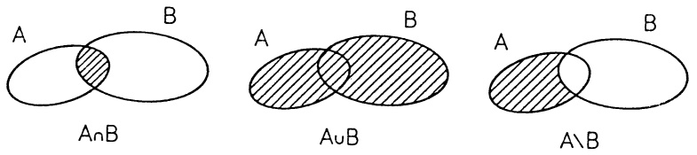

Abb. 1 - Venn-Diagramme

Zwei Mengen A und B, die kein gemeinsames Element besitzen, heißen disjunkt, d.h. für sie gilt  $A \cap B = \emptyset$ . Als direktes (oder kartesisches) Produkt der Mengen A und B bezeichnet man die Paarmenge

$$
A \times B := \left\{(a, b); a \in A, b \in B \right\},
$$

wobei es in $(a,b)$ auf die Reihenfolge der Elemente ankommt, d.h. $(a,b) = (a',b')$ genau dann, wenn $a = a'$ und $b = b'$. Entsprechend werden geordnete $n$-Tupel $(a_1,a_2,\ldots ,a_n)$ und $(b_{1},b_{2},\ldots ,b_{n})$ mit Elementen $a_i,b_i\in A_i$ $(i = 1,2,\dots,n)$ als gleich bezeichnet, wenn sie „komponentenweise“ übereinstimmen, also wenn $a_{i} = b_{i}$ gilt für $i = 1,2,\dots,n$. Das direkte Produkt der Mengen $A_{1},A_{2},\ldots ,A_{n}$ ist

$$
A _ {1} \times A _ {2} \times \dots \times A _ {n} := \left\{\left(a _ {1}, a _ {2}, \dots , a _ {n}\right); a _ {i} \in A _ {i} \quad (i = 1, 2, \dots , n) \right\}.
$$

Im Fall  $A_{1}=A_{2}=\cdots A_{n}=A$  schreibt man dafür  $A^{n}$ .

1.3 Abbildungen. $A$ und $B$ seien Mengen. Eine Abbildung (oder Funktion) $f$ von $A$ in (oder nach) $B$, in Zeichen $f: A \to B$ (oder elementweise $x \mapsto f(x)$, $x \in A$), ist eine Vorschrift, die jedem Element $x \in A$ genau ein Element $f(x) \in B$ zuordnet. Man nennt $A$ den Definitionsbereich und die Elemente von $A$ die Argumente der Abbildung $f$; $f(x)$ heißt das Bild von $x$ unter $f$ (oder Funktionswert von $f$ an der Stelle $x$). Gehören zu verschiedenen Argumenten stets verschiedene Bilder (d.h. $x_1 \neq x_2 \Rightarrow f(x_1) \neq f(x_2)$, bzw. äquivalent dazu: $f(x_1) = f(x_2) \Rightarrow x_1 = x_2$), dann heißt $f$ injektiv. Für jede Teilmenge $C \subseteq A$ bezeichnet man $f(C) := \{f(x); x \in C\}$ als Bild von $C$ unter $f$ und das ganze Bild $f(A)$ als Wertebereich von $f$. Im Fall $f(A) = B$ sagt man, $f$ ist eine Abbildung von $A$ auf $B$ oder $f$ ist surjektiv. Man nennt die Abbildung $f: A \to B$ bijektiv, wenn sie sowohl surjektiv als auch injektiv ist. Es ist also $f: A \to B$ genau dann bijektiv, wenn es zu jedem Element $y \in B$ genau ein $x \in A$ gibt mit $y = f(x)$. In diesem Fall existiert die mit $f^{-1}: B \to A$ bezeichnete Umkehrabbildung, mit der jedem $y \in B$ das durch $y = f(x)$ eindeutig bestimmte $x \in A$ zugeordnet wird. Die auf jeder Menge $A$ erklärte Abbildung $Id: A \to A$, $Id(x) := x$ für alle $x \in A$, heißt identische Abbildung (oder Identität) auf $A$.

Zwei Abbildungen $f: A \to B$ und $g: C \to D$ sind genau dann gleich, i.Z. $f = g$, wenn gilt $A = C$, $B = D$ und $f(x) = g(x)$ für alle $x \in A$. Durch

Einschränkung des Definitionsbereiches einer Abbildung $f: A \to B$ auf eine Teilmenge $A_0 \subseteq A$ gewinnt man die Restriktion

$$
f \mid A _ {0}: A _ {0} \rightarrow B, (f \mid A _ {0}) (x) := f (x) \text { für   alle } x \in A _ {0}.
$$

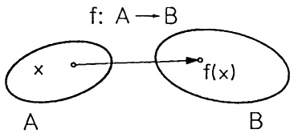

text_image

f: A → B
x
A
f(x)
B

Abb. 2 - $f: A \to B$

## §2. Die reellen Zahlen

2.1 Bezeichnungen. Die Menge aller reellen Zahlen wird mit R bezeichnet. Besonders gekennzeichnete Teilmengen von R sind

$$
\mathbb {N} = \{1, 2, 3, 4, \dots \} \quad (\text {Menge der natürlichen Zahlen}),
$$

$$
\mathbb {N} _ {0} = \mathbb {N} \cup \{0 \},
$$

$$
\mathbb {Z} = \{\dots , - 3, - 2, - 1, 0, 1, 2, 3, \dots \} \quad (\text {Menge der ganzen Zahlen}),
$$

$$
\mathbb {Q} = \left\{\frac {m}{n}; m, n \in \mathbb {Z}, n \neq 0 \right\} \quad (\text {Menge der rationalen Zahlen}).
$$

Neben den rationalen Zahlen, die man auch charakterisieren kann als diejenigen reellen Zahlen mit einer endlichen oder periodisch unendlichen Dezimalbruchdarstellung, gibt es in $\mathbb{R}$ die irrationalen Zahlen, die eine unendliche nichtperiodische Dezimalbruchdarstellung besitzen. Der periodische Dezimalbruch $c = 0.\overline{b_1b_2\ldots b_k} = 0.b_1b_2\ldots b_kb_1b_2\ldots b_kb_1b_1\ldots$ hat die „gewöhnliche“ Bruchdarstellung

$$
c = \frac {b _ {1} b _ {2} \dots b _ {k}}{\underbrace {9 9 \dots 9} _ {k - m a l}}; \text {denn} 1 0 ^ {k} c - c = b _ {1} b _ {2} \dots b _ {k}.
$$

Beispiele. Die Zahlen $\frac{16}{37}$, 0.12123, $0.17\overline{314} = 0.17314314$ ... sind rational, 0.12345 ..., 0.101001000 ..., $\sqrt{2} = 1.4142$ ... sind irrational. Es gilt

$$
0. \overline {{3 1 4}} = \frac {3 1 4}{9 9 9}, 0. 1 7 \overline {{3 1 4}} = \frac {1 7}{1 0 0} + \frac {3 1 4}{1 0 0 \cdot 9 9 9}.
$$

Zur Veranschaulichung von $\mathbb{R}$ dient die bekannte, von - nach + orientierte Zahlengerade, auf der jeder Punkt genau einer Zahl entspricht.

2.2 Ungleichungen. Unter einer Ungleichung (für Zahlen  $x, y \in R$ ) verstehen wir einen Größenvergleich der Form x < y (x ist kleiner als y, strikte Ungleichung) oder  $x \leq y$  (x ist kleiner oder gleich y, nicht strikte Ungleichung); eine andere Schreibweise hierfür ist y > x oder  $y \geq x$ . Die Ungleichung  $x \leq y$ (bzw. $x < y$) gibt eine Abschätzung der Zahl $x$ nach oben durch $y$ an, oder auch eine Abschätzung der Zahl $y$ nach unten durch $x$. In der Praxis (und in diesem Buch) wird überwiegend mit Ungleichungen der Form $x \leq y$ gearbeitet, ohne darauf zu achten, welcher der beiden hierin enthaltenen Fälle $x < y$ oder $x = y$ tatsächlich vorliegt; wesentlich ist die Aussage „$x$ ist nicht größer als $y$“.

Für Abschätzungen einer Summe und eines Produkts sind

$$
x \leq y, a \leq b \implies x + a \leq y + b,
$$

$$
x \leq y, 0 \leq a \implies x a \leq y a
$$

zu beachten. Ferner gilt

$$
x \leq y \iff - y \leq - x,
$$

$$
0 <   x \leq y \iff 0 <   \frac {1}{y} \leq \frac {1}{x}.
$$

Beispiel.  $-3a-2\leq5\leq-3a+4$   $\Longleftrightarrow$   $(-3a\leq7$  und  $1\leq-3a)$   $\Longleftrightarrow$

$$
- \frac {1}{3} \geq a \geq - \frac {7}{3}.
$$

2.3 Intervalle. Seien $a, b \in \mathbb{R}$ mit $a < b$. Die Menge $[a, b] := \{x \in \mathbb{R} ; a \leq x \leq b\}$ heißt abgeschlossenes Intervall mit Randpunkten $a, b$. Im offenen Intervall $(a, b) := \{x \in \mathbb{R} ; a < x < b\}$ sind $a, b$ nicht enthalten. Analog sind die halboffenen Intervalle $(a, b]$ und $[a, b)$ definiert.

Zur Vermeidung von Fallunterscheidungen ist es günstig, noch zwei Symbole  $-\infty,\infty$  (minus Unendlich, Unendlich) einzuführen und hierfür  $-\infty < x < \infty$  für alle  $x \in R$  festzulegen.  $(-\infty,a] := \{x \in \mathbb{R} ; x \leq a\}, (b,\infty) := \{x \in \mathbb{R} ; b < x\}$ . Analog  $(-\infty,a), [b,\infty)$ . Auch  $\mathbb{R} = (-\infty,\infty)$  fällt damit unter die offenen Intervalle. Das offene Intervall  $(a - \varepsilon, a + \varepsilon)$  (mit  $\varepsilon > 0$ ) heißt  $\varepsilon$ -Umgebung der Zahl (des Punktes)  $a \in R$ .

2.4 Schranken. Man nennt eine Menge $S$ reeller Zahlen nach oben beschränkt, wenn es eine Zahl $b \in \mathbb{R}$ gibt, so daß $S \subseteq (-\infty, b]$. In diesem Fall heißt $b$ eine obere Schranke von $S$. Ganz entsprechend nennt man $a \in \mathbb{R}$ eine untere Schranke von $S$, und $S$ nach unten beschränkt, wenn $S \subseteq [a, \infty)$. Die Menge $S \subseteq \mathbb{R}$ heißt beschränkt, wenn sie eine untere Schranke $a$ und eine obere Schranke $b$ besitzt. In diesem Fall gilt $S \subseteq [a, b]$.

Ist $S \subseteq \mathbb{R}$ nach oben beschränkt, so nennen wir die kleinste obere Schranke $s$ das Supremum von $S$, in Zeichen $s = \sup S$. Ebenso wie die anderen Schranken braucht sup $S$ nicht der Menge $S$ anzugehören; jedoch gibt es zu jeder beliebig kleinen Zahl $\varepsilon > 0$ ein $x \in S$ mit $s - \varepsilon < x \leq s$. Andernfalls würde $x \leq s - \varepsilon$ für alle $x \in S$ gelten und wir hätten die noch kleinere Schranke $s - \varepsilon$.

Beispiel 1. $\sup [a,b] = \sup (a,b) = b$

Beispiel 2. $\sup \{x\in \mathbb{Q};x^2 < 2\} = \sqrt{2}$

Es ist keineswegs selbstverständlich, daß die Menge der oberen Schranken von  $S \subseteq (-\infty, b]$  eine kleinste Zahl enthält. Dieses ist aber eine der Grundannahmen über die reellen Zahlen:

Das Vollständigkeitsaxiom. Jede nach oben beschränkte Menge reeller Zahlen besitzt ein Supremum.

Damit hat auch jede nach unten beschränkte Menge $U \subseteq \mathbb{R}$ eine größte untere Schranke (ein Infimum, i.Z. inf $U$). Man bestätigt leicht die Beziehung

$$
\inf U = - \sup \left\{- u; u \in U \right\}.
$$

Beispiel. $\inf \left\{1 + \frac{1}{n}; n \in \mathbb{N}\right\} = 1$.

2.5 Der Betrag $|a|$ einer reellen Zahl $a \in \mathbb{R}$ ist definiert durch

$$
\boxed | a | := \left\{ \begin{array}{c l} a, & \text {falls} a \geq 0 \\ - a, & \text {falls} a <   0. \end{array} \right.\}
$$

Die folgenden Rechenregeln für Beträge ergeben sich unmittelbar aus der Definition:

$$
- | a | \leq a \leq | a |, \quad | - a | = | a |,
$$

$$
| a b | = | a | | b |, \quad \left| \frac {a}{b} \right| = \frac {| a |}{| b |} \quad (\text {falls} b \neq 0),
$$

und $|a| \leq b \iff -b \leq a \leq b$.

Aus  $-|a| \leq a \leq |a|$  und  $-|b| \leq b \leq |b|$  folgt  $-(|a| + |b|) \leq a + b \leq |a| + |b|$ . Also gilt für alle  $a, b \in R$ :

$$
| a + b | \leq | a | + | b | \quad (\text {Dreiecksungleichung}). \tag {1}
$$

Es ist $|a - b|$ der Abstand der zu $a$ und $b$ gehörenden Punkte auf der Zahlengeraden; also gilt für alle $x, a, \varepsilon \in \mathbb{R}$, $\varepsilon > 0$:

$$
| x - a | \leq \varepsilon \iff a - \varepsilon \leq x \leq a + \varepsilon . \tag {2}
$$

$$
\mathbb {R} \quad a - \varepsilon \quad a \quad a + \varepsilon
$$

$$
\text {Abb. 3 - Das Intervall} \{x \in \mathbb {R}; | x - a | \leq \varepsilon \}.
$$

Wird für eine Zahl $a \in \mathbb{R}$ ein Näherungswert $\bar{a}$ angegeben, so bedeutet die Schreibweise $a = \bar{a} \pm \varepsilon$ dasselbe wie $|a - \bar{a}| \leq \varepsilon$.

Beispiel.  $\bar{a}=1.414215$  ist ein Näherungswert für  $a=\sqrt{2}$ . Es gilt  $\bar{a}^{2}\geq2$ , folglich  $\frac{2}{\bar{a}}\leq\sqrt{2}\leq\bar{a}$  und damit  $|\bar{a}-\sqrt{2}|\leq|\bar{a}-\frac{2}{\bar{a}}|\leq0.000003$  oder  $\sqrt{2}=1.414215\pm3\cdot10^{-6}$ .

2.6 Die vollständige Induktion. Die Gültigkeit einer Aussage  $A(n)$  für jede ganze Zahl  $n \geq n_{0}$  mit vollständiger Induktion nachzuweisen bedeutet:

1. Der Induktionsbeginn: Man zeigt, daß  $A(n)$  für  $n = n_{0}$  gilt.
2. Der Schluß von n auf  $n+1$ : Für ein beliebiges  $n \geq n_{0}$  setzt man die Gültigkeit von  $A(n)$  voraus (Induktionsvoraussetzung) und leitet daraus die Gültigkeit von  $A(n+1)$  ab.

Können beide Schritte ausgeführt werden, dann gilt $A(n)$ für alle $n \geq n_0$. Denn nach dem ersten Schritt gilt $A(n_0)$, nach dem zweiten Schritt $A(n_0 + 1)$ und ebenso (immer wieder Schluß von $n$ auf $n + 1$) $A(n_0 + 2)$, $A(n_0 + 3)$, ...

Beispiel 1.

$$
1 + 2 + \dots + n = \frac {n (n + 1)}{2} \qquad (n \in \mathbb {N}).
$$

Beweis mit vollständiger Induktion. Induktionsbeginn $n = 1: 1 = \frac{1 \cdot 2}{2}$. Schluß von $n$ auf $n + 1$: Sei $n \in \mathbb{N}$ (beliebig) und die Formel richtig für dieses $n$. Dann folgt $1 + 2 + \cdots + n + (n + 1) = \frac{n(n + 1)}{2} + n + 1 = \frac{(n + 1)(n + 2)}{2}$. Das ist die zu beweisende Formel für $n + 1$. Sie gilt also für alle $n \in \mathbb{N}$.

Beispiel 2. Die Bernoulli-Ungleichung. Für $h \in \mathbb{R}$ und alle $n \in \mathbb{N}$ gilt

(3) $(1+h)^{n}\geq1+nh,\quad\text{falls }h\geq-1.$

Beweis mit vollständiger Induktion. Induktionsbeginn $n = 1: (1 + h)^{1} \geq 1 + 1 \cdot h$. Schluß von $n$ auf $n + 1$:

Aus  $(1+h)^{n} \geq 1 + nh$  (Induktionsvoraussetzung) und  $1 + h \geq 0$  folgt

$$
(1 + h) ^ {n + 1} \geq (1 + n h) (1 + h) \geq 1 + (n + 1) h.
$$

Definition durch Rekursion. Diese Methode beruht auf dem Prinzip der vollständigen Induktion: Eine Größe $A_{n}$ wird für alle $n \in \mathbb{N}_{0}$ dadurch definiert, daß man

1.  $A_{0}$  festlegt,
2.  $A_{k}$  für  $k \leq n$  als bekannt ansieht und  $A_{n+1}$  durch diese ausdrückt.

Beispiel 3. Die Potenzen $a^n$ für eine beliebige Basiszahl $a \in \mathbb{R}$ und Exponenten $n \in \mathbb{N}_0$ werden definiert durch $a^0 := 1$; $a^{n+1} := a^n a$.

Beispiel 4. Die Fakultäten. Zu $n \in \mathbb{N}_0$ wird $n!$ (lies: $n$ Fakultät) definiert durch $0! := 1$; $(n+1)! := n!(n+1)$. Demnach gilt

$$
n! = \left\{ \begin{array}{c l} n (n - 1) (n - 2) \dots 2 \cdot 1 & , n \geq 1, \\ 1 & , n = 0. \end{array} \right.
$$

So ist etwa $6! = 1 \cdot 2 \cdot 3 \cdot 4 \cdot 5 \cdot 6 = 720$, $9! = 362880$. Die Fakultäten werden mit wachsendem $n$ schnell sehr groß.

Als Permutationen einer Menge A bezeichnet man die bijektiven Abbildungen von A auf sich. Ist A endlich mit den n verschiedenen Elementen  $\{a_{1},\ldots,a_{n}\}$ , so interpretiert man eine Permutation von A als Zuordnung der  $a_{i}$  zu den n verschiedenen Plätzen

$$
\begin{array}{c} (\quad * \quad , \quad * \quad , \quad \dots \quad , \quad *) \\ \uparrow \quad \uparrow \quad \uparrow \\ 1. \text {Platz} \quad 2. \text {Platz} \quad \text {n - ter Platz} \end{array}
$$

so daß auf jeden Platz genau ein Element kommt; etwa  $(a_{1}, a_{2}, \ldots, a_{n})$  oder  $(a_{3}, a_{1}, a_{2}, a_{4}, \ldots, a_{n})$ . Für jedes  $n \in N$  gilt:

(4) Jede n-elementige Menge besitzt genau n! verschiedene Permutationen.

Beweis mit vollständiger Induktion. Induktionsbeginn: (4) gilt für $n = 1$. Schluß von $n$ auf $n + 1$: Es gibt (nach Induktionsvoraussetzung) $n!$ Permutationen von $\{a_1, \ldots, a_{n+1}\}$ mit $a_1$ an der ersten Stelle. Ebensoviele mit $a_1$ an der zweiten Stelle, etc.; das sind insgesamt $n!(n + 1) = (n + 1)!$ verschiedene Permutationen.

Beispiel 5. Das Summen- und Produktzeichen. Für die Summe und das Produkt der Zahlen $a_{m}, a_{m+1}, \ldots, a_{n} \in \mathbb{R}$ (mit $m \leq n$) schreibt man

$$
\boxed {a _ {m} + a _ {m + 1} + \dots + a _ {n} = \sum_ {k = m} ^ {n} a _ {k}, \quad a _ {m} \cdot a _ {m + 1} \dots a _ {n} = \prod_ {k = m} ^ {n} a _ {k}.}
$$

Die Definition durch Rekursion ersetzt die Pünktchen:

$$
\sum_ {k = m} ^ {m} a _ {k} := a _ {m}, \quad \sum_ {k = m} ^ {n + 1} a _ {k} := \left(\sum_ {k = m} ^ {n} a _ {k}\right) + a _ {n + 1}.
$$

Man beachte die Unabhängigkeit vom Summationsindex, $\sum_{k=m}^{n} a_k = \sum_{i=m}^{n} a_i$, ferner $\sum_{k=m}^{n} a_k = \sum_{k=m}^{l} a_k + \sum_{k=l+1}^{n} a_k \quad (m \leq l \leq n)$. Analoges gilt für das Produktzeichen. Z. B. ist $\sum_{k=1}^{n} k = \frac{n(n+1)}{2} \quad (\rightarrow \text{Bsp. 1}), \quad \prod_{k=1}^{n} k = n!$ $(\rightarrow \text{Bsp. 3})$ und es gilt die geometrische Summenformel:

$$
\boxed {\sum_ {k = 0} ^ {n} q ^ {k} = 1 + q + q ^ {2} + \dots + q ^ {n} = \left\{ \begin{array}{c l} \frac {1 - q ^ {n + 1}}{1 - q} & , \text {falls} q \neq 1, \\ n + 1 & , \text {falls} q = 1. \end{array} \right.} \tag {5}
$$

Zum Beweis multipliziere man die Gleichung im Falle  $q \neq 1$  mit 1 - q durch.

Mit vollständiger Induktion erhält man aus der Dreiecksungleichung (1):

$$
\left| \sum_ {k = m} ^ {n} a _ {k} \right| \leq \sum_ {k = m} ^ {n} \left| a _ {k} \right|. \tag {6}
$$

2.7 Binomialkoeffizienten und die binomische Formel. Für zwei ganze Zahlen $n, k$ mit $0 \leq k \leq n$ bezeichnet man die ganze Zahl - lies: $n$ über $k$-

$$
\boxed {\binom {n} {k} := \frac {n !}{k ! (n - k) !} = \frac {n (n - 1) \cdot \dots \cdot (n - k + 1)}{k !}} \tag {7}
$$

als Binomialkoeffizient. Der Name rührt von der binomischen Formel her (→ Satz 2.2), die Bedeutung beruht auf

Satz 2.1. Eine Menge mit n Elementen besitzt  $\binom{n}{k}$  verschiedene k-elementige Teilmengen. Mit anderen Worten: Es gibt  $\binom{n}{k}$  Möglichkeiten, aus insgesamt n Objekten genau k auszuwählen.

Beweis. Man findet sämtliche $k$-elementigen Teilmengen der Menge $S = \{a_1, a_2, \ldots, a_n\}$ - die $a_i$ paarweise verschieden - wenn man aus allen $n!$ Anordnungen nur jeweils die ersten $k$ Elemente nimmt. Die durch die Anordnung (Permutation) $(a_{i_1}, a_{i_2}, \ldots, a_{i_k}, \ldots, a_{i_n})$ bestimmte Teilmenge $\{a_{i_1}, \ldots, a_{i_k}\}$ von $S$ tritt dabei $k!(n-k)!$ - mal auf.

Beispiel 1. Im Lotto „6 aus 49“ gibt es

$$
\binom {4 9} {6} = \frac {4 9 \cdot 4 8 \cdot 4 7 \cdot 4 6 \cdot 4 5 \cdot 4 4}{1 \cdot 2 \cdot 3 \cdot 4 \cdot 5 \cdot 6} = 1 3 9 8 3 8 1 6
$$

verschiedene Möglichkeiten 6 „Richtige“ zu ziehen (→ Aufg. 9).

Aus der Definition (7) liest man sofort die Beziehung

$$
\binom{n}{k} = \binom{n}{n - k}
$$

und einfache Sonderfälle ab:

$$
\binom {n} {0} = \binom {n} {n} = 1, \quad \binom {n} {1} = \binom {n} {n - 1} = n, \quad \binom {n} {2} = \binom {n} {n - 2} = \frac {n (n - 1)}{2}.
$$

Ebenso bestätigt man mit (7) die Rekursionsformel

$$
\binom {n + 1} {k} = \binom {n} {k - 1} + \binom {n} {k}. \tag {8}
$$

Damit lassen sich die Binomialkoeffizienten durch Additionen berechnen:

Beginnend mit $n = 1$ schreibt man die Zahlen $\binom{n}{0}, \binom{n}{1}, \ldots, \binom{n}{n}$ in eine Zeile; dabei ist erstes und letztes Element durch $\binom{n}{0} = \binom{n}{n} = 1$ bestimmt.

Die Zahlen $\binom{n+1}{k}$ der nächsten Zeile werden „auf Lücke“ gesetzt (→ Schema). Man beginnt mit der etwas nach links versetzten $1 = \binom{n+1}{0}$ und berechnet die folgenden Zahlen nach (8) als Summe der beiden darüber stehenden Zahlen. Die Zeile wird mit $1 = \binom{n+1}{n+1}$ abgeschlossen. Auf diese Weise entsteht das sogenannte Pascal-Dreieck.

$$
\begin{array}{l} \binom{1}{k}: \quad 1 \quad 1 \\ \binom {2} {k}: \quad 1 \quad 2 \quad 1 \\ \binom {3} {k}: \quad 1 \quad 3 \quad 3 \quad 1 \\ \binom {4} {k}: \quad 1 \quad 4 \quad 6 \quad 4 \quad 1 \\ \(\binom {5} {k}: \quad 1 \quad 5 \quad 10 \quad 10 \quad 5 \quad 1 + \\ \(\binom {6} {k}: \quad 1 \quad 6 \quad 1 5 \quad 2 0 \quad 1 5 \quad 6 \quad 1 \\ \end{array}
$$

Satz 2.2. Die binomische Formel. Für beliebige Zahlen $a, b \in \mathbb{R}$ und jede ganze Zahl $n \geq 0$ gilt

$$
(a + b) ^ {n} = \sum_ {k = 0} ^ {n} \binom {n} {k} a ^ {n - k} b ^ {k} .
$$

Beweis. Beim Ausmultiplizieren kommt $b^k$ so oft vor, wie man $k$ Faktoren aus $n$ Faktoren auswählen kann, also $\binom{n}{k}$-mal ($\rightarrow$ Satz 2.1). $a^{n-k}$ stammt aus den anderen $n-k$ Faktoren.

Beispiel 2. $(a + b)^{5} = a^{5} + 5a^{4}b + 10a^{3}b^{2} + 10a^{2}b^{3} + 5ab^{4} + b^{5}$.

Beispiel 3.  $(1+x)^{n}=\sum_{k=0}^{n}\binom{n}{k}x^{k}=1+nx+\frac{n(n-1)}{2}x^{2}+\cdots+nx^{n-1}+x^{n}.$  ☐

Beispiel 4. $2^{n} = (1 + 1)^{n} = \sum_{k=0}^{n}\binom{n}{k} = \binom{n}{0} + \binom{n}{1} + \cdots +\binom{n}{n}.$

Diese Formel hat eine schöne Anwendung: Eine Menge mit n Elementen hat  $2^{n}$  verschiedene Teilmengen ( $\rightarrow$  Satz 2.1, die leere Menge wird als 0-elementige Menge mitgezählt). □

## Aufgaben

1. Man schreibe $\sum_{k=1}^{n} 47 \cdot 10^{-2k}$ als Dezimalbruch. Welchen Bruch liefert die Summenformel der geometrischen Reihe?

2. Man ermittle sämtliche reellen Lösungen und skizziere die zugehörigen Bereiche auf dem Zahlenstrahl:

a) $\sqrt{2x - 4} -\sqrt{x - 1} = 1$ ;

b) $3 - x < 4 - 2x$;

c) $x^{3} - x^{2} < 2x - 2$;

d) $||x| - |-5| < 1$;

3. Skizziere die Bereiche der  $(x,y)$ -Ebene, für welche

a) $|x| \leq |y|$;

b) $|x| + |y| \leq 1$.

4. Welche reellen Zahlen x erfüllen

a) $|x + 1| - |x - 1| = 1$;

b) $\frac{1}{x} < \frac{1}{x + 1}$;

c) $6x^{2} - 13x + 6 < 0$ ;

d) $\sqrt{7x + 15} -\sqrt{10 - 2x} = \sqrt{1 + 5x}$ ?

5. Man skizziere die Bereiche der  $(x, y)$ -Ebene:

a) $|x| + |y| = 2$;

b) $|x| \leq 5$ und $|y| \leq 5$;

c) $|x| \leq 5$ oder $|y| \leq 5$.

6. a) Man berechne den Wert des Binomialkoeffizienten  $\begin{pmatrix}753\\750\end{pmatrix}$ .

b) Verifiziere am Pascalschen Dreieck  $\binom{6}{3} = \binom{2}{2} + \binom{3}{2} + \binom{4}{2} + \binom{5}{2}$  und beweise mittels vollständiger Induktion die Rekursionsformel

$$
\binom {n + k} {k} = \binom {k - 1} {k - 1} + \binom {k} {k - 1} + \dots + \binom {n + k - 1} {k - 1}.
$$

7. Man bestätige mittels vollständiger Induktion für  $n \in N$ :

a) $\sum_{k=0}^{n} a^{k} b^{n-k} = \frac{a^{n+1} - b^{n+1}}{a - b}$, falls $a \neq b$.

b) $\sum_{k=1}^{n} k^2 = \frac{n(n+1)(2n+1)}{6}$.

8. Hypothekenrechnung.

Ein Darlehen über 100 TDM wird am Ende eines jeden Jahres konstant mit der Rate A getilgt und die Restschuld mit 7% verzinst. Wie groß muß die Annuität A sein, wenn das Darlehen nach genau 20 Jahren zurückbezahlt sein soll?

9. Die 5 Grundaufgaben der Kombinatorik.

Aus einem Alphabet mit n verschiedenen Buchstaben sollen Worte der Länge k gebildet werden. Man zeige: Abhängig davon, ob Buchstaben wiederholt auftreten dürfen und ob man nach der Reihenfolge der Buchstaben unterscheidet, ist die Anzahl der verschiedenen Möglichkeiten wie folgt gegeben:

a) Variationen (nach Reihenfolge wird unterschieden):

$n^{k}$ , mit Wiederholung,

$n(n-1)\cdots(n-k+1)$ , ohne Wiederholung  $(k\leq n)$ ,

$\frac{k!}{k_{1}!\cdots k_{n}!}$ , mit festgelegter Auswahl: der r-te Buchstabe kommt  $k_{r}$ -mal vor,  $0 \leq k_{r} \leq k$ ,  $r = 1, \ldots, n$ ,  $k_{1} + \cdots + k_{n} = k$ .

b) Kombinationen (nach Reihenfolge wird nicht unterschieden):

$\binom{n+k-1}{k}$ , mit Wiederholung,

$\binom{n}{k}$ , ohne Wiederholung  $(k \leq n)$ .

(Hilfe im Fall von Wiederholungen: Man setze im Alphabet zwischen die Buchstaben je ein „|“ und über jeden für das Wort ausgewählten Buchstaben ein „ד. Wie viele verschiedene  $(n-1+k)$ -stellige Muster  $||\times\times\ldots|\times|\times$  gibt es?)

10. Beim Rommé spielt man mit 110 Karten; sechs davon sind Joker. Zu Beginn eines Spieles erhält jeder Spieler genau 12 Karten in die Hand; in wieviel Prozent aller möglichen Fälle sind darunter (a) genau zwei bzw. (b) mindestens ein Joker?

11. Zählprobleme der Statistik.

Zur Beantwortung der Frage, ob in mehr als 60% aller Fälle von vier Geschwistern mindestens zwei im gleichen Monat geboren sind, bieten sich zwei Lösungswege an:

a) Man unterscheidet die Individuen und zählt die Variationen, wie sich 12 Geburtsmonate auf 4 Personen verteilen lassen ( $\rightarrow$ Aufg. 9a).
b) Man unterscheidet die Personen nicht und zählt die möglichen 4-elementigen Kombinationen aus dem „Alphabet“ der 12 Monate (→ Aufg. 9b).

Sind die Variationen in a) oder die Kombinationen in b) gleich wahrscheinlich?

12. Die polynomische Formel. Man zeige mit Aufg. 9a für $k, n \in \mathbb{N}$

$$
(a _ {1} + a _ {2} + \dots + a _ {n}) ^ {k} = \sum_ {k _ {1} + \dots + k _ {n} = k} \frac {k !}{k _ {1} ! \cdots k _ {n} !} a _ {1} ^ {k _ {1}} \dots a _ {n} ^ {k _ {n}}.
$$

## §3. Die Ebene

3.1 Kartesische Koordinatensysteme. In einer Ebene E, die wir uns o.E. als Zeichenebene vorstellen, entsteht ein kartesisches Koordinatensystem

(→ Abb. 4, benannt nach RENÉ DESCARTES, 1596 – 1650) durch Vorgabe eines Punktes O und zweier aufeinander senkrecht stehender Zahlengeraden, der x- und der y-Achse, deren Nullpunkt jeweils in O liegt. Dabei muß die y-Achse durch eine positive Drehung (gegen den Uhrzeigersinn) aus der x-Achse hervorgehen.

Fällt man für einen (beliebigen) Punkt $P_{0} \in E$ die Lote auf die Achsen, so bestimmen die beiden Fußpunkte die x- bzw. y-Koordinate $x_{0}$ bzw. $y_{0}$

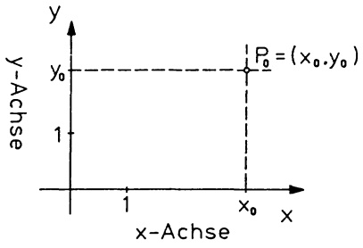

scatter

| Point | x-Achse | y-Achse |
| --- | --- | --- |
| \(P_{0}\) | \(x_{0}\) | \(y_{0}\) |

Abb. 4 – Ein kartesisches Koordinatensystem

von  $P_{0}$  und man schreibt  $P_{0} = (x_{0}, y_{0})$ . Der Punkt  $O = (0, 0)$  heißt Nullpunkt oder Ursprung des Koordinatensystems.

Nach Festlegung eines kartesischen Koordinatensystems gibt es zu jedem Zahlenpaar  $(x,y)\in\mathbb{R}^{2}$  genau einen Punkt  $X\in E$  mit  $X=(x,y)-$  und umgekehrt. Man kann somit Teilmengen von  $R^{2}$  (etwa Lösungsmengen von Gleichungen oder Ungleichungen) als Punktmengen in E veranschaulichen und umgekehrt geometrische Gebilde (Kurven oder Gebiete in E) durch Funktionen, Gleichungen oder Ungleichungen beschreiben.

Beispiel 1. Der Graph einer Funktion. Sei $I \subseteq \mathbb{R}$ und $f : I \to \mathbb{R}$ eine Funktion. Die Punktmenge

$$
G _ {f} := \{(x, y); x \in I, y = f (x) \} = \{(x, f (x)); x \in I \}
$$

in der mit einem kartesischen Koordinatensystem versehenen Ebene heißt der Graph der Funktion $f$ oder die Kurve $y = f(x)$. Der Graph der Funktion $y = f(x - x_0) + y_0$ entsteht aus $G_f$ durch die Parallelverschiebung der Ebene, die den Punkt $(0,0)$ nach $(x_0, y_0)$ bringt. Dabei bleibt das Koordinatensystem fest. Die folgenden Kapitel bringen zahlreiche konkrete Beispiele.

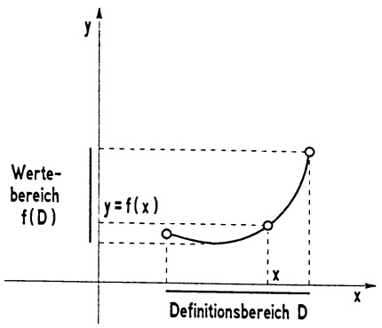

line

| Feature | Description |
| --- | --- |
| Function | y = f(x) |
| X-axis | x |
| Y-axis | y |
| Curve | Wertebereich f(D) |
| Definition | Definitionsbereich D |

Abb. 5a - Die Kurve $y = f(x)$

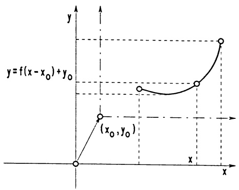

line

| Point | X | Y |
| --- | --- | --- |
| 1 | 0 | 0 |
| 2 | (x₀, y₀) | ~0.3 |
| 3 | — | ~0.5 |
| 4 | — | ~0.6 |
| 5 | — | ~0.9 |

Abb. 5b - Die Kurve $y = f(x - x_0) + y_0$

Beispiel 2. Kurven – Lösungsmengen von Gleichungen. Sei $C \subseteq E$ eine Kurve und – nach Wahl eines kartesischen Koordinatensystems – $X = (x, y)$ ein (beliebiger) Punkt auf $C$. Wird die zwischen $x$ und $y$ bestehende Abhängigkeit auf die Form $F(x, y) = 0$ gebracht, d.h.

$$
C = \left\{(x, y); F (x, y) = 0 \right\},
$$

dann nennt man  $F(x,y)=0$  die Gleichung der Kurve C.

a) Die Gerade durch die Punkte  $A = (a_{1}, a_{2})$  und  $B = (b_{1}, b_{2})$  ( $A \neq B$ ) hat die Gleichung

$$
(b _ {2} - a _ {2}) (x - a _ {1}) - (b _ {1} - a _ {1}) (y - a _ {2}) = 0.
$$

b) Der Kreis um  $A = (a_{1}, a_{2})$  mit dem Radius r hat die Gleichung

$$
(x - a _ {1}) ^ {2} + (y - a _ {2}) ^ {2} = r ^ {2}.
$$

c) Es ist

$$
\frac {x ^ {2}}{a ^ {2}} + \frac {y ^ {2}}{b ^ {2}} = 1, \quad \frac {x ^ {2}}{a ^ {2}} - \frac {y ^ {2}}{b ^ {2}} = 1, \quad y ^ {2} - 2 p x = 0
$$

die „Normalgleichung“ einer Ellipse, einer Hyperbel bzw. einer Parabel (a > 0, b > 0, p ≠ 0; → Kap. 6, §7).

□

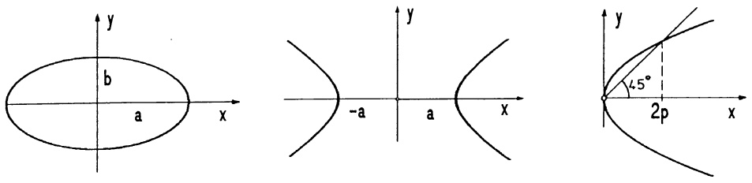

text_image

y
b
a x
-a y
a x
y
45°
2p x

Abb. 6 - Ellipse, Hyperbel, Parabel

## Beispiel 3. Gebiete - Lösungsmengen von Ungleichungen.

a) Das Gebiet (die Halbebene) unterhalb (oberhalb) der Geraden  $3x + 2y = 2$  ist die Lösungsmenge der Ungleichung  $3x + 2y < 2$  ( $3x + 2y > 2$ ). Wenn die Gerade zum Gebiet gehört, ist < durch ≤ (bzw. > durch ≥) zu ersetzen.
b) Die Ungleichung  $\frac{x^{2}}{3} + \frac{y^{2}}{5} < 1$  (bzw. > 1) besitzt als Lösungsmenge das Innere (bzw. Äußere) der Ellipse  $\frac{x^{2}}{3} + \frac{y^{2}}{5} = 1$ .
c) Wegen $|x - y| \leq 3 \iff -3 \leq x - y \leq 3$ besteht die Lösungsmenge der Ungleichung $|x - y| \leq 3$ aus dem Durchschnitt der beiden Halbebenen $x - y \leq 3$ (alle Punkte oberhalb und auf der Geraden $x - y = 3$) und $-3 \leq x - y$ (alle Punkte unterhalb und auf der Geraden $y = x + 3$).

□

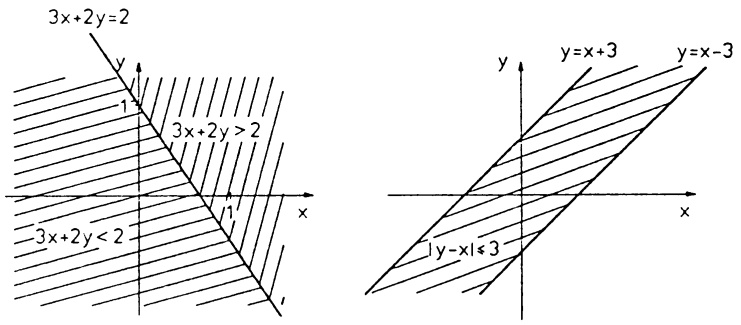

text_image

3x+2y=2
y
1
3x+2y>2
-3x+2y<2
x
1
y
y=x+3
y=x-3
1y-x1≤3
x

Abb. 7 – Lösungsmengen von Ungleichungen.

Regeln: 1. Zur Lösung einer Ungleichung der Form $F(x,y) < 0$ bestimme man zuerst die Kurve $F(x,y) = 0$; die Lösungsmenge liegt ganz auf einer Seite dieser Kurve (vorausgesetzt, $F$ ist stetig, $\rightarrow$ Kap. 7).

2. Die Lösung eines Systems von Ungleichungen  $F_{1}(x,y) < 0$ ,  $F_{2}(x,y) < 0$ , ...,  $F_{n}(x,y) < 0$  ist der Durchschnitt der einzelnen Lösungsmengen; sie wird stückweise berandet von den Kurven  $F_{i}(x,y) = 0 \quad (i = 1, \ldots, n)$  (ebenfalls unter der Voraussetzung, daß die  $F_{i}$  stetig sind).

3.2 Winkel. Der Winkel  $\alpha$  entstehe durch Drehung eines Zeigers um einen Punkt der Ebene. Die Länge des zugehörigen Einheitskreisbogens sei  $\ell$  ( $\rightarrow$  Abb. 8).

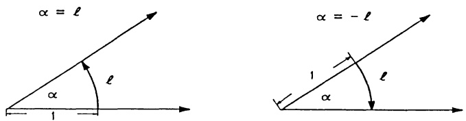

Abb. 8 – Das Bogenmaß eines Winkels

Wir nennen $\ell$, bzw. $-\ell$, das Bogenmaß von $\alpha$ und schreiben $\alpha = \ell$, bzw. $\alpha = -\ell$, wenn die Drehung im positiven Sinn (gegen Uhrzeigersinn), bzw. im Uhrzeigersinn, erfolgt. Ein Winkel von $a^o$ besitzt bei positiver Orientierung das Bogenmaß $x = \frac{\pi}{180} a$ mit der Kreiszahl

$$
\pi = 3. 1 4 1 5 9 2 6 5 3 5 8 9 7 9 3 2 3 8 4 6 2 6 4 3 \dots \approx \frac {2 2}{7}.
$$

$2\pi$ ist der Umfang des Einheitskreises. Der zu $\alpha = \ell$ gehörende Kreisbogen mit dem Radius $r$ hat die Länge $\ell r$ ($\rightarrow$ Kap. 4, §5). Mit jeder vollen Umdrehung wird der Winkel (genauer: das Bogenmaß des Winkels) um $2\pi$ vergrößert oder verkleinert.

3.3 Sinus, Cosinus. Wird in der mit kartesischen  $(x,y)$ -Koordinaten ver-

sehenen Ebene der vom Ursprung zum Punkt (1,0) weisende Zeiger um den Winkel  $\alpha$  gedreht ( $\alpha$  im Bogenmaß,  $\alpha > 0$ : gegen den Uhrzeigersinn bzw.  $\alpha < 0$ : im Uhrzeigersinn), dann bewegt sich die Spitze auf dem Einheitskreis (um O) bis zu einem Punkte P, dessen Koordinaten mit  $\cos \alpha$ ,  $\sin \alpha$  bezeichnet werden:  $P = (\cos \alpha, \sin \alpha)$ .

Die derart für alle $\alpha\in\mathbb{R}$ erklärten Funktionen $\alpha\mapsto\cos\alpha,\quad\alpha\mapsto\sin\alpha$ heißen Cosinus- bzw. Sinusfunktion.

Wir benötigen diese „Kreisfunktionen“ vorerst nur für Dreiecksberechnungen und für die Darstellung von Drehungen der Ebene; die weiterführende Behandlung erfolgt in Kap 2, §3.

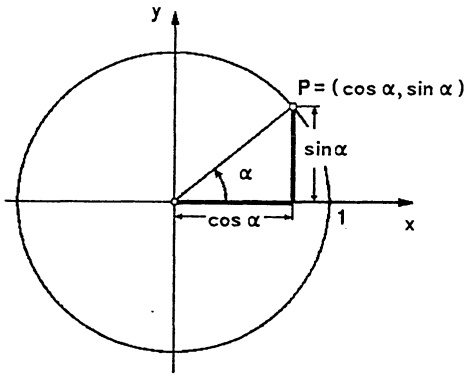

text_image

y
P = (cos α, sin α)
sin α
α
cos α
1
x

Abb. 9 - $x(\alpha) = \cos \alpha$, $y(\alpha) = \sin \alpha$

Hat der sich drehende Zeiger die Länge r, dann liegt nach der Drehung um  $\alpha$  aufgrund der Ähnlichkeit der Dreiecke  $\Delta ORP$  und  $\Delta OSQ$  die Spitze in  $Q = (a, b)$  mit

(1) $a = r\cos \alpha, b = r\sin \alpha.$

Diese Formeln sind Grundlage aller Dreiecksberechnungen, sie bedeuten, etwas anders gelesen, daß im rechtwinkligen Dreieck  $\Delta OSQ$  mit der Hypotenuse r, den Katheten a (Ankathete), b (Gegenkathete) die Beziehungen

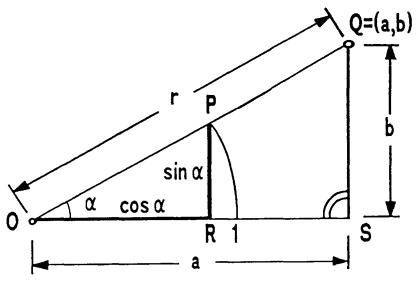

text_image

Q=(a,b)
r
P
sin α
cos α
O
R 1
S
b
a

Abb. 10 - $a = r\cos \alpha$, $b = r\sin \alpha$

(2) $\frac{a}{r} = \cos \alpha, \quad \frac{b}{r} = \sin \alpha$

gelten (wobei zur Dreiecksberechnung die Winkel positiv gemessen werden). Für den anderen Winkel $\beta = \star OQS$ gilt dementsprechend $\cos \beta = \frac{b}{r}$, $\sin \beta = \frac{a}{r}$.

In einem beliebigen Dreieck  $\Delta ABC$  ( $\rightarrow$  Abb. 11) gelten

der Cosinussatz:

$$
a ^ {2} = b ^ {2} + c ^ {2} - 2 b c \cos \alpha ;
$$

(3) der Sinussatz:

$$
\frac {\sin \alpha}{a} = \frac {\sin \beta}{b} = \frac {\sin \gamma}{c}.
$$

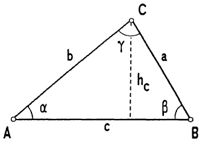

text_image

C
b
γ
a
h_c
β
A
α
c
B

Abb. 11 - Cosinus-, Sinussatz

Zum Beweis des Sinussatzes betrachte man eine Höhe, etwa  $h_{c}$ . Hierfür gilt  $b \sin \alpha = h_{c} = a \sin \beta$ , etc. Den Cosinussatz beweisen wir in 5.2.

Anhand der Definition und (2) sind leicht einige Funktionswerte anzugeben:

| x | 0 | $\frac{\pi}{6}$ | $\frac{\pi}{4}$ | $\frac{\pi}{3}$ | $\frac{\pi}{2}$ |
| --- | --- | --- | --- | --- | --- |
| cos x | 1 | $\frac{1}{2}\sqrt{3}$ | $\frac{1}{2}\sqrt{2}$ | $\frac{1}{2}$ | 0 |
| sin x | 0 | $\frac{1}{2}$ | $\frac{1}{2}\sqrt{2}$ | $\frac{1}{2}\sqrt{3}$ | 1 |

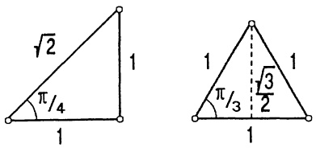

Abb. 12 – Einige Sinus-, Cosinuswerte

## 3.4 Drehungen.

① Drehung des Koordinatensystems. Das kartesische  $(x', y')$ -Koordinatensystem entstehe aus dem  $(x, y)$ -System durch eine Drehung um den Ursprung mit dem Winkel  $\alpha (\rightarrow$  Abb. 13). Hat ein Punkt X im ursprünglichen System die Koordinaten  $(x, y)$  und im gedrehten System die Darstellung  $X = (x', y')$ , so gelten die Transformationsformeln

$$
\begin{array}{l l} x = x ^ {\prime} \cos \alpha - y ^ {\prime} \sin \alpha & x ^ {\prime} = x \cos \alpha + y \sin \alpha \\ y = x ^ {\prime} \sin \alpha + y ^ {\prime} \cos \alpha & y ^ {\prime} = - x \sin \alpha + y \cos \alpha \\ X \text {im ursprünglichen System;} & X \text {im gedrehten System} \end{array} \tag {4}
$$

## Beweis.

$$
O Q = x ^ {\prime}, Q X = y ^ {\prime},
$$

$$
x = O S - R S = x ^ {\prime} \cos \alpha - y ^ {\prime} \sin \alpha ,
$$

$$
y = R T + T X = x ^ {\prime} \sin \alpha + y ^ {\prime} \cos \alpha .
$$

Eine Drehung um $-\alpha$ führt vom $(x', y')$-System zum $(x, y)$-System zurück; deshalb ergibt sich das rechte Formelpaar aus dem linken durch Vertauschung von $x$ mit $x'$, $y$ mit $y'$ und der Substitution $\alpha$ durch $-\alpha$ (und umgekehrt). Man beachte dabei $\cos(-\alpha) = \cos \alpha$, $\sin(-\alpha) = -\sin \alpha$.

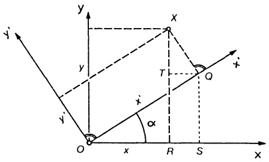

text_image

y
x
T
Q
x'
y'
O
x
R
S
x

Abb. 13 - Koordinatendrehung

Beispiel. Drehung des Koordinatensystems um  $\alpha = \frac{\pi}{6}$  (Linksdrehung). Der Punkt  $X = (x, y)$  hat im gedrehten System die Darstellung  $X = (x', y')$  mit

$$
x ^ {\prime} = \frac {1}{2} \sqrt {3} x + \frac {1}{2} y, \quad y ^ {\prime} = - \frac {1}{2} x + \frac {1}{2} \sqrt {3} y.
$$

Speziell: $M = (2,3)$ erhält die neuen Koordinaten $M = (\sqrt{3} + \frac{3}{2}, -1 + \frac{3}{2}\sqrt{3})$. Deshalb besitzt der Kreis $(x - 2)^2 + (y - 3)^2 = 25$ im gedrehten Koordinatensystem die Darstellung

$$
(x ^ {\prime} - (\sqrt {3} + \frac {3}{2})) ^ {2} + (y ^ {\prime} - (\frac {3}{2} \sqrt {3} - 1)) ^ {2} = 2 5.
$$

Die „Umkehrformeln“

$$
x = \frac {1}{2} \sqrt {3} x ^ {\prime} - \frac {1}{2} y ^ {\prime}, \quad y = \frac {1}{2} x ^ {\prime} + \frac {1}{2} \sqrt {3} y ^ {\prime}
$$

ergeben für die Parabel  $y = x^{2}$  im neuen System die Darstellung

$$
\frac {3}{4} x ^ {\prime 2} - \frac {1}{2} \sqrt {3} x ^ {\prime} y ^ {\prime} + \frac {1}{4} y ^ {\prime 2} - \frac {1}{2} x ^ {\prime} - \frac {\sqrt {3}}{2} y ^ {\prime} = 0.
$$

□