⑥ Drehung der Ebene. Wir halten nun das kartesische Koordinatensystem fest und bilden jeden Punkt $X = (x, y)$ durch eine Drehung mit Winkel $\alpha$ um den Ursprung auf $X' = (x', y')$ ab. Dieser Bildpunkt besitzt in dem Koordinatensystem, das sich mit derselben Drehung aus dem $(x, y)$-System ergibt, die Koordinaten $(x, y)$; demnach folgt aus (4) durch Vertauschung von $x$ mit $x'$ und $y$ mit $y'$:

Die Drehung der Ebene um den Winkel  $\alpha$  (bei festem Koordinatensystem)

$$
(x, y) \mapsto (x ^ {\prime}, y ^ {\prime}) \tag {5}
$$

$$
x ^ {\prime} = x \cos \alpha - y \sin \alpha
$$

$$
y ^ {\prime} = x \sin \alpha + y \cos \alpha .
$$

Beispiel. Durch Drehung um $\alpha = \frac{\pi}{6}$ geht der Punkt $M = (2,3)$ über in $M' = (\sqrt{3} - \frac{3}{2}, 1 + \frac{3}{2}\sqrt{3})$, der Kreis $(x - 2)^2 + (y - 3)^2 = 25$ in den Kreis $\left(x - (\sqrt{3} - \frac{3}{2})\right)^2 + \left(y - (1 + \frac{3}{2}\sqrt{3})\right)^2 = 25$ und die Parabel $C: y = x^2$ in die Parabel $C'$ mit der Gleichung $\frac{3}{4}x^2 + \frac{1}{2}\sqrt{3}xy + \frac{1}{4}y^2 + \frac{1}{2}x - \frac{1}{2}\sqrt{3}y = 0$.

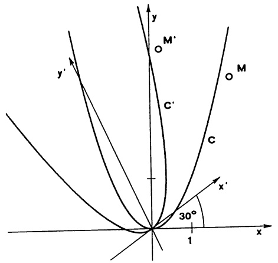

text_image

y
M'
O
C'
M
C
x'
30°
1
x

Abb. 14 - Drehung einer Parabel

## §4. Vektoren

4.1 Kartesische Koordinatensysteme im Raum bestehen aus drei sich in einem Punkt O (Nullpunkt oder Ursprung) rechtwinklig schneidenden Zahlengeraden gleicher Längeneinheit und jeweils mit dem Nullpunkt im Schnittpunkt O. Man bezeichnet sie als x-, y- und z-Achse, derart, daß diese Achsen ein Rechtssystem bilden; d.h. die Drehung der positiven x-Achse um 90° in die positive y-Achse, zusammen mit einer Verschiebung in Richtung der positiven z-Achse muß eine Rechtsschraubung darstellen (→ Abbn. 15, 29).

Die drei durch je zwei Achsen bestimmten Ebenen heißen Koordinatenebenen, bzw.  $(x,y)$ -Ebene,  $(y,z)$ -Ebene und  $(z,x)$ -Ebene. Die Koordinaten  $x_{0}$ ,  $y_{0}$ ,  $z_{0}$  eines Punktes  $P_{0}$  gewinnt man aus den Schnittpunkten der entsprechenden Achsen mit den zu den Koordinatenebenen parallelen Ebenen durch  $P_{0}$

(→ Abb. 15). Man schreibt $P_{0}=(x_{0},y_{0},z_{0})$. Zu jedem Koordinatentripel gibt es genau einen Punkt des Raumes – und umgekehrt.

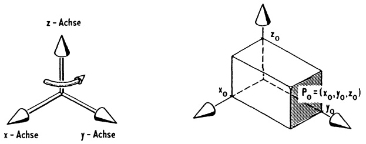

Abb. 15 – Ein kartesisches Koordinatensystem im Raum

4.2 Vektoren. Zu je zwei Punkten P und Q des Raumes gibt es genau eine Parallelverschiebung (des Raumes), die P nach Q bringt (abbildet). Diese Verschiebung wird mit  $\overrightarrow{PQ}$  bezeichnet und heißt „Vektor von P nach Q“. Das Wort „Vektor“ bedeutet so viel wie „Träger“;  $\overrightarrow{PQ}$ , „trägt“ P nach Q. Der Vektor  $\overrightarrow{PQ}$  wird dargestellt durch einen Pfeil, der von P nach Q zeigt (seine Länge ist der Abstand des Punktes P von Q). Wird unter  $\overrightarrow{PQ}$  ein anderer Punkt R nach S verschoben, dann hat offenbar  $\overrightarrow{RS}$  dieselbe Wirkung wie  $\overrightarrow{PQ}$ ; d.h.  $\overrightarrow{PQ} = \overrightarrow{RS}$ . Zwei gleich lange und gleich gerichtete Pfeile im Raum stellen somit denselben Vektor dar. Anstelle „der Pfeil  $\vec{a}$  repräsentiert einen Vektor“ sagt man kurz „ $\vec{a}$  ist ein Vektor“ und berücksichtigt, daß  $\vec{a}$  im Raum frei parallel verschoben werden kann und nicht an einen festen Anfangspunkt gebunden ist.

Den zu  $\vec{a}$  gleich langen, aber entgegengesetzt gerichteten Vektor bezeichnen wir mit  $-\vec{a}$ ; er macht die durch  $\vec{a}$  bewirkte Parallelverschiebung rückgängig. Für  $\vec{a} = \overrightarrow{PQ}$  gilt  $-\vec{a} = \overrightarrow{QP}$ .

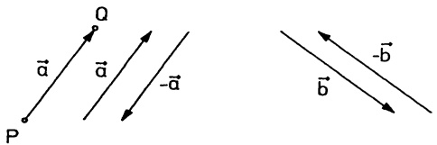

Abb. 16 - Die zu $\vec{a}$, $\vec{b}$ entgegengesetzten Vektoren $-\vec{a}$, $-\vec{b}$.

Zur Vermeidung von Fallunterscheidungen wird der Nullvektor $\vec{0}$ eingeführt. $\vec{0}$ bezeichnet die „Verschiebung“ des Raumes, bei der gar nichts bewegt wird; d.h. $\vec{0} = \overrightarrow{PP}$ für jeden Punkt $P$.

4.3 Die Addition von Vektoren. Führt man zwei Parallelverschiebungen, erst $\vec{a} = \overrightarrow{PQ}$, dann $\vec{b} = \overrightarrow{QR}$, hintereinander aus, so ergibt sich wieder eine Parallelverschiebung, nämlich $\vec{c} = \overrightarrow{PR}$ ($\rightarrow$ Abb. 17a). Wir nennen $\vec{c}$ die Summe von $\vec{a}$ und $\vec{b}$ und schreiben $\vec{c} = \vec{a} + \vec{b}$.

Haben die Pfeile  $\vec{a}$ ,  $\vec{b}$  gleichen Anfangspunkt, so gewinnt man die Summe  $\vec{a}+\vec{b}$  (geometrisch) nach der Parallelogrammregel ( $\rightarrow$  Abb. 17b).

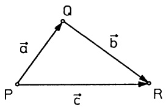

flowchart

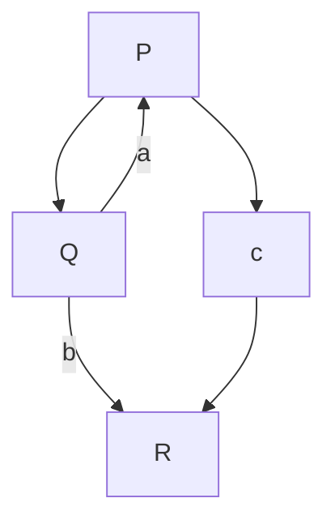

Abb. 17a - $\overrightarrow{PQ} +\overrightarrow{QR} = \overrightarrow{PR}$

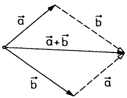

text_image

a
b
a + b
b

Abb. 17b - Parallelogrammregel

Offenbar gelten für beliebige Vektoren  $\vec{a}$ ,  $\vec{b}$ ,  $\vec{c}$  die folgenden Rechenregeln:

$$
\begin{array}{c c} \vec {a} + \vec {0} = \vec {a}, & \vec {a} + (- \vec {a}) = \vec {0}, \\ \vec {a} + \vec {b} = \vec {b} + \vec {a} & (\text {Kommutativgesetz}), \\ \vec {a} + (\vec {b} + \vec {c}) = (\vec {a} + \vec {b}) + \vec {c} & (\text {Assoziativgesetz}). \end{array} \tag {1}
$$

Die Summe  $\vec{a}_{1} + \vec{a}_{2} + \cdots + \vec{a}_{n}$  ist derjenige Vektor  $\vec{s} (\rightarrow$  Abb. 18a), der vom Anfangspunkt zum Endpunkt der aus  $\vec{a}_{1}, \vec{a}_{2}, \ldots, \vec{a}_{n}$  gebildeten Vektorkette zeigt. Die Differenz von Vektoren wird erklärt durch

$$
\vec {a} - \vec {b} := \vec {a} + (- \vec {b}).
$$

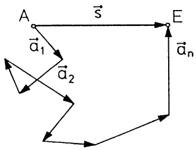

flowchart

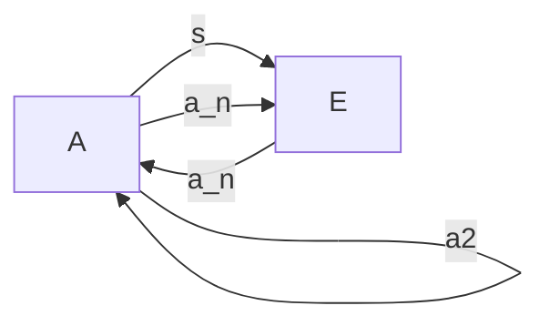

Abb. 18a - $\vec{s} = \sum \vec{a}_i$

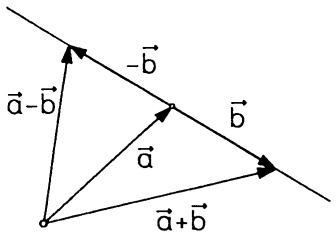

text_image

a-b
-b
a
b
a+b

Abb. 18b - Vektordifferenz

Die Rechenregeln (1) garantieren, daß wir mit „+“ und „-“ so umgehen dürfen, wie wir es vom Rechnen mit Zahlen gewöhnt sind.

4.4 Die skalaren Vielfachen eines Vektors. Zu einer reellen Zahl $\alpha \geq 0$ und einem Vektor $\vec{a}$ bezeichnet $\alpha\vec{a}$ (das $\alpha$-fache von $\vec{a}$) denjenigen Vektor, der dieselbe Richtung hat wie $\vec{a}$, aber die $\alpha$-fache Länge. Im Fall $\alpha < 0$ setzt man $\alpha\vec{a} := -(|\alpha|\vec{a})$. Sonderfälle dieser Festlegung sind $0\vec{a} = \vec{0}$ und $\alpha\vec{0} = \vec{0}$ für jede Zahl $\alpha$ und jeden Vektor $\vec{a}$. Für die auf diese Weise erklärte Multiplikation eines Vektors mit einem Skalar (einer Zahl) gelten offensichtlich die

Rechenregeln $(\alpha, \beta \in \mathbb{R})$ :

$$
\begin{array}{c} \alpha (\beta \vec {a}) = (\alpha \beta) \vec {a}, \\ \alpha (\vec {a} + \vec {b}) = \alpha \vec {a} + \alpha \vec {b}, \\ (\alpha + \beta) \vec {a} = \alpha \vec {a} + \beta \vec {a}. \end{array} \tag {2}
$$

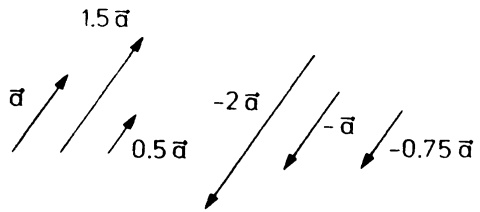

text_image

1.5 ā
đ̄
0.5 ā
-2 ā
- Ł
-0.75 ā

Abb. 19 - Skalare Vielfache

4.5 Der Betrag. Die Länge eines Vektors  $\vec{a}$  (das ist für  $\vec{a} = \overrightarrow{PQ}$  die Länge der Strecke  $\overrightarrow{PQ}$ ) nennt man seinen Betrag und schreibt dafür  $|\vec{a}|$  (oft auch  $||\vec{a}||$ ). Der Nullvektor hat keine positive Länge, d.h.  $|\vec{0}| = 0$ . Die Rechenregeln

$$
\begin{array}{c c} \boxed {| \alpha \vec {a} | = | \alpha | | \vec {a} |,} & \text {insbesondere} | - \vec {a} | = | \vec {a} |, \\ | \vec {a} + \vec {b} | \leq | \vec {a} | + | \vec {b} | & (\text {Dreiecksungleichung}) \end{array} \tag {3}
$$

folgen direkt aus den Definitionen. Die Dreiecksungleichung liest man aus der Abb. 17 ab. In (3) bedeutet  $|\alpha|$  den Betrag der reellen Zahl  $\alpha (\rightarrow 2.5)$ .

Ein Vektor vom Betrag 1 heißt Einheitsvektor.

Zu jedem Vektor $\vec{a} \neq \vec{0}$ gehört der Einheitsvektor in Richtung $\vec{a}: \quad \vec{a}_0 := \frac{1}{|\vec{a}|} \vec{a}$.

4.6 Vektoren im Koordinatensystem. Wir legen im Raum ein kartesisches Koordinatensystem mit Ursprung O fest. Dadurch werden gleichzeitig drei ausgezeichnete Vektoren gegeben, nämlich die Einheitsvektoren  $\vec{e}_{1}$ ,  $\vec{e}_{2}$ ,  $\vec{e}_{3}$  (oft auch i, j, k oder  $\vec{e}_{x}$ ,  $\vec{e}_{y}$ ,  $\vec{e}_{z}$  bezeichnet) in Richtung der positiven x-, y-, bzw. z-Achse ( $\rightarrow$  Abb. 20). Wir nennen ( $\vec{e}_{1}, \vec{e}_{2}, \vec{e}_{3}$ ) eine kartesische Basis und bezeichnen das Koordinatensystem mit

$$
(O; \vec {e} _ {1}, \vec {e} _ {2}, \vec {e} _ {3}).
$$

Der Vektor $\vec{a} = \overrightarrow{OA}$ heißt Ortsvektor des Punktes $A = (a_{1}, a_{2}, a_{3})$; er ist, wie die Abb. 20 zeigt, eindeutig zerlegbar als Summe $\vec{a} = a_{1}\vec{e}_{1} + a_{2}\vec{e}_{2} + a_{3}\vec{e}_{3}$. Abkürzend schreibt man (bei festgelegtem Koordinatensystem)

$$
\vec {a} = \left( \begin{array}{c} a _ {1} \\ a _ {2} \\ a _ {3} \end{array} \right): \Longleftrightarrow \vec {a} = a _ {1} \vec {e} _ {1} + a _ {2} \vec {e} _ {2} + a _ {3} \vec {e} _ {3} = \overrightarrow {O A} \quad \text {mit} \quad A = (a _ {1}, a _ {2}, a _ {3}). \tag {4}
$$

Man nennt $a_{i}\vec{e}_{i}$ die Komponente von $\vec{a}$ in $\vec{e}_{i}$-Richtung ($i = 1,2,3$) und die Zahlen $a_{i} \in \mathbb{R}$ die Koordinaten des Vektors $\vec{a}$ (bezüglich $(O; \vec{e}_{1}, \vec{e}_{2}, \vec{e}_{3})$).

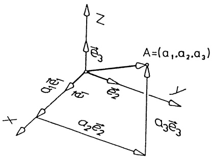

text_image

Z
A=(a₁,a₂,a₃)
a₁e₁
a₂e₂
a₃e₃
X
Y

Abb. 20 - $\vec{a} = a_{1}\vec{e}_{1} + a_{2}\vec{e}_{2} + a_{3}\vec{e}_{3}$

Für einen Vektor  $\vec{a}$  in allgemeiner Lage, etwa  $\vec{a} = \overrightarrow{PQ}$  mit  $P = (p_{1}, p_{1}, p_{3})$  und  $Q = (q_{1}, q_{2}, q_{3})$  gilt

$$
\begin{array}{l} \overrightarrow {P Q} = \overrightarrow {O Q} - \overrightarrow {O P} = q _ {1} \vec {e} _ {1} + q _ {2} \vec {e} _ {2} + q _ {3} \vec {e} _ {3} - p _ {1} \vec {e} _ {1} - p _ {2} \vec {e} _ {2} - p _ {3} \vec {e} _ {3} \\ = (q _ {1} - p _ {1}) \vec {e} _ {1} + (q _ {2} - p _ {2}) \vec {e} _ {2} - (q _ {3} - p _ {3}) \vec {e} _ {3}. \\ \end{array}
$$

Das ergibt die Koordinatendarstellung

$$
\boxed {\vec {a} = \overrightarrow {P Q} = \left( \begin{array}{l} q _ {1} - p _ {1} \\ q _ {2} - p _ {2} \\ q _ {3} - p _ {3} \end{array} \right), \text {falls} P = (p _ {1}, p _ {2}, p _ {3}), Q = (q _ {1}, q _ {2}, q _ {3}).} \tag {5}
$$

Die Summe von Vektoren und die skalaren Vielfachen lassen sich aus der Koordinatendarstellung (4) bzw. (5) sehr einfach berechnen:

$$
\vec {a} = \sum_ {i = 1} ^ {3} a _ {i} \vec {e} _ {i}, \vec {b} = \sum_ {i = 1} ^ {3} b _ {i} \vec {e} _ {i} \implies \vec {a} + \vec {b} = \sum_ {i = 1} ^ {3} (a _ {i} + b _ {i}) \vec {e} _ {i}, \alpha \vec {a} = \sum_ {i = 1} ^ {3} (\alpha a _ {i}) \vec {e} _ {i}, \alpha \in \mathbb {R}.
$$

Folglich gilt

$$
\boxed { \begin{array}{l} \left( \begin{array}{c} a _ {1} \\ a _ {2} \\ a _ {3} \end{array} \right) + \left( \begin{array}{c} b _ {1} \\ b _ {2} \\ b _ {3} \end{array} \right) = \left( \begin{array}{c} a _ {1} + b _ {1} \\ a _ {2} + b _ {2} \\ a _ {3} + b _ {3} \end{array} \right), \alpha \left( \begin{array}{c} a _ {1} \\ a _ {2} \\ a _ {3} \end{array} \right) = \left( \begin{array}{c} \alpha a _ {1} \\ \alpha a _ {2} \\ \alpha a _ {3} \end{array} \right). \end{array} } \tag {6}
$$

Mit dem Satz von Pythagoras liest man direkt aus Abb. 20 ab:

$$
\boxed {| \vec {a} | = \sqrt {a _ {1} ^ {2} + a _ {2} ^ {2} + a _ {3} ^ {2}}, \text {falls} \vec {a} = a _ {1} \vec {e} _ {1} + a _ {2} \vec {e} _ {2} + a _ {3} \vec {e} _ {3}.} \tag {7}
$$

Beispiel. Für $\vec{a} = \begin{pmatrix} 2 \\ 0 \\ -3 \end{pmatrix}$, $\vec{b} = \begin{pmatrix} 0.5 \\ -1 \\ 6 \end{pmatrix}$ ist $\vec{a} + \vec{b} = \begin{pmatrix} 2.5 \\ -1 \\ 3 \end{pmatrix}$, $5\vec{a} = \begin{pmatrix} 10 \\ 0 \\ -15 \end{pmatrix}$,

$$
2 \vec {a} - 3 \vec {b} = \left( \begin{array}{c} 2. 5 \\ 3 \\ - 2 4 \end{array} \right) \text {und} | \vec {a} | = \sqrt {1 3}, | \vec {b} | = \sqrt {3 7 . 2 5}, | \vec {a} + \vec {b} | = \sqrt {1 6 . 2 5}.
$$

Hinweis: Den Koordinatenwechsel, also den Übergang von einem kartesischen Koordinatensystem zu einem anderen, behandeln wir in Kap. 6, 6.6.

## §5. Produkte

5.1 Der Winkel zwischen zwei Vektoren. Trägt man zwei von 0 verschiedene Vektoren $\vec{a}$, $\vec{b}$ von einem Punkt $P$ aus ab, so bezeichnet man den kleineren der beiden positiv gemessenen Winkel, den die Pfeile $\vec{a}$ und $\vec{b}$ im Scheitel $P$ bilden, als Winkel zwischen $\vec{a}$ und $\vec{b}$, i.Z. $\star(\vec{a},\vec{b})$, mit $0 \leq \star(\vec{a},\vec{b}) \leq \pi$:

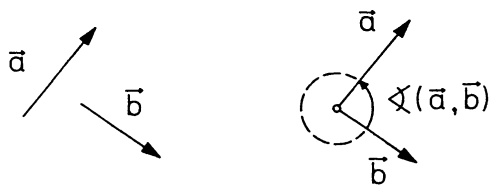

text_image

Mathematical diagram showing vector transformations with labeled arrows and a point in a circle, likely from algebraic or geometric context.

Abb. 21 - ✝(a,b)

Aus Abb. 21 liest man direkt als Rechenregeln ab:

a)  $\nmid(\vec{a},\vec{b})=\nmid(\vec{b},\vec{a})$ ,
b)  $\nmid(\vec{a},t\vec{a})=0,\text{ falls }t>0,$
c)  $\not\prec(\vec{a},t\vec{a})=\pi,$  falls t<0,
d) $\nmid (-\vec{a},\vec{b}) = \pi -\nmid (\vec{a},\vec{b}).$

Man nennt $\vec{a}$ orthogonal (senkrecht) zu $\vec{b}$, i.Z. $\vec{a} \perp \vec{b}$, wenn $\not\asymp (\vec{a}, \vec{b}) = \frac{\pi}{2}$. Obwohl zwischen dem Nullvektor $\vec{0}$ und $\vec{a}$ kein Winkel erklärt wird, sagt man dennoch – zur Vermeidung von Fallunterscheidungen ($\rightarrow$ 5.2 (3)) – $\vec{0}$ ist orthogonal zu jedem beliebigen Vektor; d.h. $\vec{0} \perp \vec{a}$ für alle $\vec{a}$.

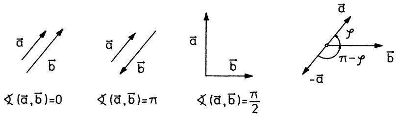

text_image

a
b
(a, b)=0
a
b
(a, b)=π
a
b
(a, b)=π/2
a
y
π-y
-b

Abb. 22 - Verschiedene Winkel

## 5.2 Das Skalarprodukt  $\vec{a} \cdot \vec{b}$  der Vektoren  $\vec{a}$  und  $\vec{b}$  ist definiert durch

$$
\vec {a} \cdot \vec {b} := \left\{ \begin{array}{c l} | \vec {a} | | \vec {b} | \cos \nmid (\vec {a}, \vec {b}) & , \text {falls} \vec {a} \neq 0 \text {und} \vec {b} \neq 0 \\ 0 & , \text {falls} \vec {a} = \vec {0} \text {oder} \vec {b} = \vec {0} \end{array} \right.
$$

Das Skalarprodukt  $\vec{a}\cdot\vec{b}$ , auch inneres Produkt genannt, ist eine Zahl (= Skalar). Andere gebräuchliche Schreibweisen für  $\vec{a}\cdot\vec{b}$  sind  $\vec{a}\vec{b}$ ,  $<\vec{a},\vec{b}>$  oder  $s(\vec{a},\vec{b})$ .

Beispiele. Die Vektoren $\vec{e}_{i}$ einer kartesischen Basis ($\rightarrow$ 4.6) sind stets Einheitsvektoren und paarweise orthogonal, d.h.

$$
\vec {e} _ {1} \cdot \vec {e} _ {1} = \vec {e} _ {2} \cdot \vec {e} _ {2} = \vec {e} _ {3} \cdot \vec {e} _ {3} = 1, \tag {1}
$$

$$
\vec {e} _ {1} \cdot \vec {e} _ {2} = \vec {e} _ {2} \cdot \vec {e} _ {3} = \vec {e} _ {3} \cdot \vec {e} _ {1} = 0.
$$

Wegen $|\vec{e}_i| = 1$ gilt für einen beliebigen
Vektor $\vec{a} = a_1\vec{e}_1 + a_2\vec{e}_2 + a_3\vec{e}_3$ stets

$$
\begin{array}{l} \vec {a} \cdot \vec {e} _ {i} = | \vec {a} | \cos \nmid (\vec {a}, \vec {e} _ {i}) \tag {2} \\ = a _ {i} \quad (i = 1, 2, 3) . \\ \end{array}
$$

(2)

Dies liest man mit $\varphi_{i}=\star(\vec{a},\vec{e}_{i})$ direkt aus Abb. 23 ab. Damit erhält man

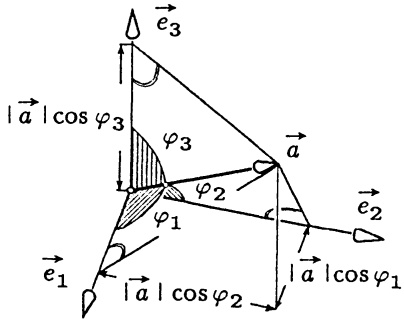

text_image

|a|cos φ₃
φ₃
φ₂
φ₁
e₃
a
e₂
e₁
|a|cos φ₂
|a|cos φ₁

Abb. 23 - Richtungscosinus

$$
\vec {a} = (\vec {a} \cdot \vec {e} _ {1}) \vec {e} _ {1} + (\vec {a} \cdot \vec {e} _ {2}) \vec {e} _ {2} + (\vec {a} \cdot \vec {e} _ {3}) \vec {e} _ {3}.
$$

Die Faktoren $\cos \angle (\vec{a},\vec{e}_i)$ nennt man Richtungscosinus von $\vec{a}$, sie sind nach (2) genau die Kooordinaten des Einheitsvektors in Richtung $\vec{a}$, insbesondere gilt

$$
\cos^ {2} \nmid (\vec {a}, \vec {e} _ {1}) + \cos^ {2} \nmid (\vec {a}, \vec {e} _ {2}) + \cos^ {2} \nmid (\vec {a}, \vec {e} _ {3}) = 1.
$$

Rechenregeln für das Skalarprodukt:

a) $\vec{a} \cdot \vec{b} = \vec{b} \cdot \vec{a}$ (Kommutativgesetz),

b) $(\alpha \vec{a})\cdot \vec{b} = \vec{a}\cdot (\alpha \vec{b}) = \alpha (\vec{a}\cdot \vec{b})$ (für $\alpha \in \mathbb{R}$),

(3) c) $(\vec{a} +\vec{b})\cdot \vec{c} = \vec{a}\cdot \vec{c} +\vec{b}\cdot \vec{c}$ (Distributivgesetz),

d) $\vec{a} \cdot \vec{b} = 0 \iff \vec{a}$ orthogonal zu $\vec{b}$ (Orthogonalitätstest),

e) $|\vec{a}| = \sqrt{\vec{a} \cdot \vec{a}}$.

Beweis. a), b), d) und e) ergeben sich direkt aus der Definition. c) ist für $\vec{c} = \vec{0}$ trivial erfüllt. Im Falle $\vec{c} \neq \vec{0}$ legen wir o. E. die positive $x$-Achse in Richtung $\vec{c}$, dann ist $\vec{c} = \alpha \vec{e}_1$ mit $\alpha > 0$ und mit (2), (3b) und §4 (6) ergibt sich direkt

$$
\vec {a} \cdot \vec {c} = \alpha a _ {1}, \quad \vec {b} \cdot \vec {c} = \alpha b _ {1}, \quad (\vec {a} + \vec {b}) \cdot \vec {c} = \alpha (a _ {1} + b _ {1}).
$$

Wegen (3b) und (3c) darf man Skalarprodukte wie gewohnt ausmultiplizieren (man sagt, das Skalarprodukt ist linear in beiden Faktoren):

$$
\begin{array}{l} (a _ {1} \vec {u} _ {1} + a _ {2} \vec {u} _ {2} + \dots + a _ {n} \vec {u} _ {n}) \cdot (b _ {1} \vec {v} _ {1} + b _ {2} \vec {v} _ {2} + \dots + b _ {m} \vec {v} _ {m}) = \tag {4} \\ = a _ {1} b _ {1} (\vec {u} _ {1} \cdot \vec {v} _ {1}) + \dots + a _ {n} b _ {m} (\vec {u} _ {n} \cdot \vec {v} _ {m}). \\ \end{array}
$$

Beachte. Im allg. ist  $(\vec{a} \cdot \vec{b})\vec{c}$  verschieden von  $\vec{a}(\vec{b} \cdot \vec{c}) = (\vec{b} \cdot \vec{c})\vec{a}$ . Der eine Vektor ist parallel zu  $\vec{c}$ , der andere parallel zu  $\vec{a}$ .

Anwendung. Beweis des Cosinussatzes ( $\rightarrow$  §3 (3),  $\rightarrow$  Abb. 11). Im Dreieck  $\Delta ABC$  gilt  $\overrightarrow{BC} = \overrightarrow{AC} - \overrightarrow{AB}$  und  $\alpha = \not\preceq (\overrightarrow{AB}, \overrightarrow{AC})$ . Mit (3c) und (3e) folgt

$$
\begin{array}{l} a ^ {2} = | \overrightarrow {B C} | ^ {2} = | \overrightarrow {A C} - \overrightarrow {A B} | ^ {2} = (\overrightarrow {A C} - \overrightarrow {A B}) \cdot (\overrightarrow {A C} - \overrightarrow {A B}) \\ = | \overrightarrow {A C} | ^ {2} + | \overrightarrow {A B} | ^ {2} - 2 \overrightarrow {A B} \cdot \overrightarrow {A C} = b ^ {2} + c ^ {2} - 2 b c \cos \alpha . \\ \end{array}
$$

Die Koordinatendarstellung $\vec{a} = \sum a_i\vec{e}_i = \begin{pmatrix} a_1 \\ a_2 \\ a_3 \end{pmatrix}, \quad \vec{b} = \sum b_i\vec{e}_i = \begin{pmatrix} b_1 \\ b_2 \\ b_3 \end{pmatrix}$ der Vektoren $\vec{a}$, $\vec{b}$ bezüglich einer kartesischen Basis ($\vec{e}_1, \vec{e}_2, \vec{e}_3$) ermöglicht mit (1) und (4) einfache Berechnungen von $\vec{a} \cdot \vec{b}$ und $\cos \star (\vec{a}, \vec{b})$:

a) $\vec{a} \cdot \vec{b} = a_{1}b_{1} + a_{2}b_{2} + a_{3}b_{3},$ $|\vec{a}| = \sqrt{a_1^2 + a_2^2 + a_3^2}$,

b) $\cos \angle (\vec{a},\vec{b}) = \frac{\vec{a}\cdot\vec{b}}{|\vec{a}||\vec{b}|} = \frac{a_1b_1 + a_2b_2 + a_3b_3}{\sqrt{a_1^2 + a_2^2 + a_3^2}\sqrt{b_1^2 + b_2^2 + b_3^2}},$ falls $\vec{a},\vec{b}\neq \vec{0}$

(5) insbesondere die Richtungscosinus

c) $\cos \star (\vec{a},\vec{e}_i) = \frac{a_i}{\sqrt{a_1^2 + a_2^2 + a_3^2}}$ $(i = 1,2,3)$

für die Basisvektoren $\vec{e}_1 = \begin{pmatrix} 1 \\ 0 \\ 0 \end{pmatrix}$, $\vec{e}_2 = \begin{pmatrix} 0 \\ 1 \\ 0 \end{pmatrix}$, $\vec{e}_3 = \begin{pmatrix} 0 \\ 0 \\ 1 \end{pmatrix}$.

Beispiele. 1. In kartesischen Koordinaten berechnen wir mit (5) für

$$
\vec {a} = \left( \begin{array}{c} 2 \\ - 4 \\ 0 \end{array} \right), \vec {b} = \left( \begin{array}{c} 6 \\ 3 \\ 4 \end{array} \right), \vec {c} = \left( \begin{array}{c} 1 \\ 0 \\ - 1 \end{array} \right):
$$

$\vec{a} \cdot \vec{b} = 2 \cdot 6 - 4 \cdot 3 + 0 \cdot 4 = 0$ ; also sind $\vec{a}$ und $\vec{b}$ orthogonal.

$\vec{a} \cdot \vec{c} = 2 \cdot 1 + (-4) \cdot 0 + 0 \cdot (-1) = 2$ und $|\vec{a}| = \sqrt{20}$, $|\vec{c}| = \sqrt{2}$. Damit ergibt sich $\cos \nmid (\vec{a}, \vec{c}) = \frac{2}{\sqrt{20} \sqrt{2}} = \frac{1}{\sqrt{10}}$; d.h. im Bogenmaß $\nmid (\vec{a}, \vec{c}) = 1.2490458\ldots$.

$\cos \nmid (\vec{b},\vec{e}_1) = \frac{6}{\sqrt{61}},\quad \cos \nmid (\vec{b},\vec{e}_2) = \frac{3}{\sqrt{61}},\quad \cos \nmid (\vec{b},\vec{e}_3) = \frac{4}{\sqrt{61}};\mathrm{d.h.}\mathrm{im}\mathrm{Bo}-$ genmaB $\nmid (\vec{b},\vec{e}_1) = 0.694738\dots ,\nmid (\vec{b},\vec{e}_2) = 1.17655\dots ,\nmid (\vec{b},\vec{e}_3) = 1.03311\dots .$

2. Sehnen- und Tangentenwinkel am Kreis. Die Gleichung  $x^{2} + y^{2} - 1 = 2ay$  bestimmt für jedes  $a \in R$  einen Kreis durch die Punkte  $A = (-1,0)$  und  $B = (1,0)$  mit Mittelpunkt  $M = (0,a)$ . Ist  $C = (x,y)$  ein weiterer Punkt auf dem Kreis, so ergibt sich mit (5b) für den Winkel  $\gamma$  im  $\Delta ABC$  ( $\rightarrow$  Abb. 24a)

$$
\cos \gamma = \frac {(x - 1) (x + 1) + y ^ {2}}{\sqrt {(x + 1) ^ {2} + y ^ {2}} \cdot \sqrt {(x - 1) ^ {2} + y ^ {2}}} = \frac {x ^ {2} + y ^ {2} - 1}{\sqrt {(x ^ {2} + y ^ {2} - 1) ^ {2} + 4 y ^ {2}}}.
$$

Mit  $x^{2} + y^{2} - 1 = 2ay$  erhält man die konstanten Werte

$$
\cos \gamma = \frac {a}{\sqrt {1 + a ^ {2}}}, \text {falls} y > 0 \quad \text {und} \quad \cos \gamma = \frac {- a}{\sqrt {1 + a ^ {2}}}, \text {falls} y <   0.
$$

Daraus liest man zweierlei ab:

— Auf jedem Kreisbogen über AB ist der Peripheriewinkel γ konstant.
— Gegenüberliegende Winkel in einem Kreissehnenviereck ergänzen sich zu π.

Der Vektor $\vec{t} = \frac{1}{|\overrightarrow{AB}|^2}\overrightarrow{AB} +\frac{1}{|\overrightarrow{BC}|^2}\overrightarrow{BC} = \frac{y}{(x - 1)^2 + y^2}\left( \begin{array}{c}a\\ 1 \end{array} \right)$ hat stets die

Richtung der Kreistangente in $B$, da $\overrightarrow{MB} \cdot \vec{t} = 0$. Der Winkel zwischen der Tangente in $B$ und der Sehne $\overline{AB}$ ist damit ebenfalls $\gamma$.

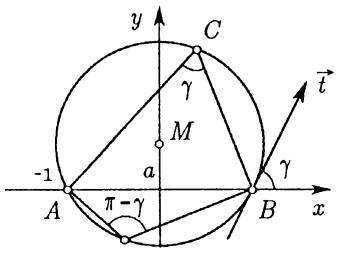

text_image

y
C
γ
M
-1
a
A
π-γ
B
x
t
γ

Abb. 24a - Sehnen-, Tangentenwinkel

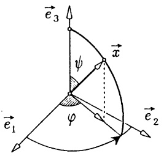

text_image

e₃
ψ
x
φ
e₁
e₂

Abb. 24b - Kugelkoordinaten

3. Die Kugelkoordinaten $(r, \psi, \varphi)$ eines Vektor $\vec{x}$ sind bezüglich einer kartesischen Basis $(\vec{e}_1, \vec{e}_2, \vec{e}_3)$ wie folgt definiert $(\rightarrow \text{Abb. 24b})$: $r := |\vec{x}|$, $\psi := \nmid (\vec{x}, \vec{e}_3)$, $\varphi := \text{Winkel der Drehung von } \vec{e}_1$ in Richtung $x_1\vec{e}_1 + x_2\vec{e}_2$, $(0 \leq \varphi < 2\pi)$.

Wegen (5c) ist $r \cos \psi = x_3$ und $r \sin \psi = r \sqrt{1 - \cos^2 \psi} = |x_1 \vec{e}_1 + x_2 \vec{e}_2|$, d.h.

$$
x _ {1} = r \sin \psi \cos \varphi , x _ {2} = r \sin \psi \sin \varphi , x _ {3} = r \cos \psi.
$$

Anwendung: Orthogonale Zerlegung. Vom Ort unabhängige Kräfte werden in der Physik als Vektoren dargestellt. Bewegt sich ein Massenpunkt unter der Kraft  $\vec{K}$  vom Punkt P zum Punkt Q, so ist

$$
A = \vec {K} \cdot \vec {s} = | \vec {K} |   | \vec {s} |   \cos \nmid (\vec {K}, \vec {s}) \quad \text {mit} \quad \vec {s} := \overrightarrow {P Q}
$$

die dabei geleistete Arbeit. Stellt man K als Summe einer Kraftkomponente  $\vec{K}_{\hat{s}}$  in Richtung  $\vec{s}$  und einer dazu senkrechten Komponente  $\vec{K}_{\hat{s}}^{\perp}$  dar, so ist A alleine durch  $\vec{K}_{\hat{s}}$  bestimmt. Man definiert daher allgemein:

Orthogonale Zerlegung von  $\vec{a}$  längs  $\vec{b}$ , falls  $\vec{b} \neq \vec{0}$ .

$$
\vec {a} = \vec {a} _ {\vec {b}} + \vec {a} _ {\vec {b}} ^ {\perp} \quad \text {mit den Komponenten}
$$

(6)

$$
\begin{array}{l} \vec {a} _ {\vec {b}} := \frac {\vec {a} \cdot \vec {b}}{| \vec {b} | ^ {2}} \vec {b} \quad \text {in Richtung} \vec {b} \text {und} \\ \vec {a} _ {\vec {b}} ^ {\perp} := \vec {a} - \frac {\vec {a} \cdot \vec {b}}{| \vec {b} | ^ {2}} \vec {b} \quad \text {orthogonal zu} \vec {b} \quad (\rightarrow (1 2)). \\ \end{array}
$$

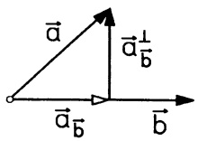

text_image

a
a\u2081b
a\u2081b
b

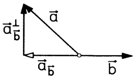

text_image

a
a⊥
b
a
b

Abb. 25 - Orthogonale Zerlegung

Beweis. Offenbar weist $\vec{a}_{\vec{b}}$ in Richtung $\vec{b}$ und es gilt $\vec{a} = \vec{a}_{\vec{b}} + \vec{a}_{\vec{b}}^{\perp}$. Der Orthogonalitätstest (3d) zeigt $\vec{a}_{\vec{b}}^{\perp} \perp \vec{b}$; denn $\vec{a}_{\vec{b}}^{\perp} \cdot \vec{b} = \vec{a} \cdot \vec{b} - \frac{\vec{a} \cdot \vec{b}}{|\vec{b}|^{2}} (\vec{b} \cdot \vec{b}) = 0$.

## Beispiele.

1. In jeder kartesischen Basis  $(\vec{e}_{1},\vec{e}_{2},\vec{e}_{3})$  gilt für  $\vec{a}=a_{1}\vec{e}_{1}+a_{2}\vec{e}_{2}+a_{3}\vec{e}_{3}$  einfach  $\vec{a}_{\vec{e}_{1}}=a_{1}\vec{e}_{1}$  und  $\vec{a}_{\vec{e}_{1}}^{\perp}=a_{2}\vec{e}_{2}+a_{3}\vec{e}_{3}$ . Analog für  $\vec{e}_{2}$  und  $\vec{e}_{3}$ .
2. $\vec{a} = \begin{pmatrix} 2 \\ 3 \\ 1 \end{pmatrix}, \vec{b} = \begin{pmatrix} -1 \\ 0 \\ 1 \end{pmatrix} \implies \vec{a}_{\vec{b}} = \frac{-1}{2}\vec{b} = \begin{pmatrix} 0.5 \\ 0 \\ -0.5 \end{pmatrix}, \vec{a}_{\vec{b}}^{\perp} = \vec{a} -\vec{a}_{\vec{b}} = \begin{pmatrix} 1.5 \\ 3 \\ 1.5 \end{pmatrix}.$
3. Keilnut-Reibung. Durch Ausformung einer keilförmigen Nut läßt sich

die Haftreibung zwischen zwei Maschinenteilen erhöhen: Die Belastung $\vec{K}$ ruft senkrecht zu den Berührflächen die Gegenkräfte $\vec{k}$ und $\vec{h}$ hervor. Für die orthogonalen Zerlegungen von $\vec{k}$ und $\vec{h}$ längs $\vec{K}$ gelten die Gleichgewichtsbedingungen:

in Richtung  $\vec{K}:\vec{k}_{\vec{K}}+\vec{h}_{\vec{K}}+\vec{K}=\vec{0}$ ,
orthogonal zu  $\vec{K}:\vec{k}_{\vec{K}}^{\perp}+\vec{h}_{\vec{K}}^{\perp}=\vec{0}$ .

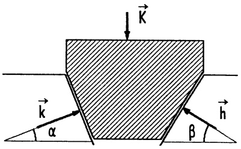

text_image

K
k
α
β
h

Abb. 26 - Keilnut

Mit den Winkeln  $\alpha$ ,  $\beta$  aus Abb. 26 heißt dies

$$
| \vec {k} | \sin \alpha + | \vec {h} | \sin \beta = | \vec {K} | \quad \text {bzw.} \quad | \vec {k} | \cos \alpha - | \vec {h} | \cos \beta = 0.
$$

Löst man dies nach $|\vec{k}|$ und $|\vec{h}|$ auf, so ergibt sich sich mit dem Reibungskoeffizienten $\mu$ für die Keilnut-Reibungszahl $\mu'$

$$
\mu^ {\prime} := \mu \frac {| \vec {k} | + | \vec {h} |}{| \vec {K} |} = \mu \frac {\cos \alpha + \cos \beta}{\sin (\alpha + \beta)}
$$

(→ Kap. 2, 3(5)). Für $\alpha = \beta$ erhält man $\mu' = \frac{\mu}{\sin \alpha} > \mu$, falls $\alpha \neq 0$.

□

5.3 Das Vektorprodukt  $\vec{a} \times \vec{b}$  zweier Vektoren  $\vec{a}$  und  $\vec{b}$  ist der Vektor mit folgenden Eigenschaften:

a)  $\vec{a} \times \vec{b} = \vec{0}$ , falls  $\vec{a} = \vec{0}$  oder  $\vec{b} = \vec{0}$  oder  $\vec{a}$  parallel zu  $\vec{b}$ .
b) In allen anderen Fällen ist  $\vec{a} \times \vec{b}$  derjenige Vektor,

① der senkrecht auf  $\vec{a}$  und  $\vec{b}$  steht,
② mit dem  $(\vec{a},\vec{b},\vec{a}\times\vec{b})$  ein Rechtssystem darstellt ( $\rightarrow$  Abb. 28, Rechte-Hand-Regel) und
③ dessen Betrag gleich dem Flächeninhalt F des von  $\vec{a}$ ,  $\vec{b}$  aufgespannten Parallelogramms ist ( $\rightarrow$  Abb. 27).

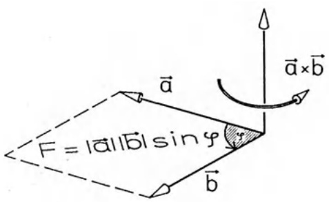

text_image

F = |a||b| sin φ
a⃗
b⃗
a⃗×b⃗

Abb. 27 - Vektorprodukt

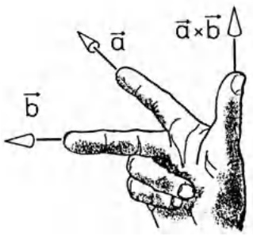

text_image

a
b
a×b

Abb. 28 - Rechte-Hand-Regel

Zur Festlegung der Richtung von  $\vec{a} \times \vec{b}$  hat man zwei Hilfsmittel:

Die Rechte-Hand-Regel: Die ausgestreckte rechte Hand mit Zeigefinger in $\vec{a}$-Richtung wird über den kleineren Winkel in Richtung $\vec{b}$ geschlossen; der abgespreizte Daumen zeigt in Richtung $\vec{a} \times \vec{b}$. M.a.W.: Weist von der rechten Hand der gestreckte Zeigefinger in Richtung $\vec{a}$ und der abgewinkelte Mittelfinger in Richtung $\vec{b}$, so zeigt der zum Zeigefinger rechtwinklig abgespreizte Daumen in Richtung $\vec{a} \times \vec{b}$ ($\rightarrow$ Abb. 28).

Die Schraubregel: Eine aus der  $\vec{a}$ -Richtung über den kleineren Winkel in  $\vec{b}$ -Richtung gedrehte Rechtsschraube mit Drehachse senkrecht zu  $\vec{a}$ ,  $\vec{b}$  verschiebt sich in Richtung  $\vec{a} \times \vec{b}$  ( $\rightarrow$  Abb. 29a).

Für den Betrag des Vektors $\vec{a} \times \vec{b}$ gilt laut Definition

$$
| \vec {a} \times \vec {b} | = | \vec {a} |   | \vec {b} |   \sin \nless (\vec {a}, \vec {b}). \tag {7}
$$

Beispiele. Für die Vektoren  $\vec{e}_{1}$ ,  $\vec{e}_{2}$ ,  $\vec{e}_{3}$  einer kartesischen Basis gilt stets

$$
\vec {e} _ {1} \times \vec {e} _ {1} = \vec {0}, \quad \vec {e} _ {1} \times \vec {e} _ {2} = \vec {e} _ {3}, \quad \vec {e} _ {1} \times \vec {e} _ {3} = - \vec {e} _ {2},
$$

$$
\vec {e} _ {2} \times \vec {e} _ {1} = - \vec {e} _ {3}, \quad \vec {e} _ {2} \times \vec {e} _ {2} = \vec {0}, \quad \vec {e} _ {2} \times \vec {e} _ {3} = \vec {e} _ {1}, \tag {8a}
$$

$$
\vec {e} _ {3} \times \vec {e} _ {1} = \vec {e} _ {2}, \quad \vec {e} _ {3} \times \vec {e} _ {2} = - \vec {e} _ {1}, \quad \vec {e} _ {3} \times \vec {e} _ {3} = \vec {0},
$$

$$
\vec {e} _ {3} \times \vec {b} = - b _ {2} \vec {e} _ {1} + b _ {1} \vec {e} _ {2}, \quad \text {falls} \vec {b} = b _ {1} \vec {e} _ {1} + b _ {2} \vec {e} _ {2} + b _ {3} \vec {e} _ {3}. \tag {8b}
$$

Beweis. (8a) folgt direkt aus der Definition und der Rechte-Hand-Regel. Für (8b) betrachte man die zu $\vec{e}_3$ senkrechte Komponente von $\vec{b}$, d.i. $b_1\vec{e}_1 + b_2\vec{e}_2$ ($\rightarrow$ Abb. 29b), sie besitzt die Länge $|\vec{b}|\sin \times (\vec{e}_3,\vec{b})$ und geht durch eine Drehung um $\alpha = +\frac{\pi}{2}$ in der $(x_1,x_2)$-Ebene in den Vektor $-b_2\vec{e}_1 + b_1\vec{e}_2$ über ($\rightarrow$ 3.4 (5)). Dieser Vektor erfüllt wegen (7) die Forderungen ①, ②, ③.

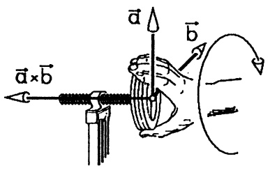

text_image

a⃗×b⃗
b⃗

Abb. 29a - Schraubregel

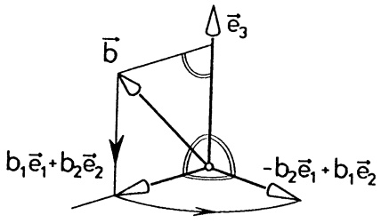

text_image

b
e₃
b₁e₁+b₂e₂
-b₂e₁+b₁e₂

Abb. 29b - Konstruktion von $\vec{e}_3 \times \vec{b}$

Beachte. Die $\times$-Multiplikation ist nicht assoziativ, da i.a. $\vec{a} \times (\vec{b} \times \vec{c}) \neq (\vec{a} \times \vec{b}) \times \vec{c}$. So ist z.B. $-\vec{e}_2 = \vec{e}_1 \times \vec{e}_3 = \vec{e}_1 \times (\vec{e}_1 \times \vec{e}_2) \neq (\vec{e}_1 \times \vec{e}_1) \times \vec{e}_2 = \vec{0}$.

Rechenregeln für das Vektorprodukt:

a) $\vec{a} \times \vec{a} = \vec{0}$, $\vec{a} \times \vec{b} = -(\vec{b} \times \vec{a})$,

b) $\alpha (\vec{a}\times \vec{b}) = (\alpha \vec{a})\times \vec{b} = \vec{a}\times (\alpha \vec{b})$ (für $\alpha \in \mathbb{R}$),

c) $\vec{a} \times (\vec{b} + \vec{c}) = \vec{a} \times \vec{b} + \vec{a} \times \vec{c}$

(9)  $(\vec{a} + \vec{b}) \times \vec{c} = \vec{a} \times \vec{c} + \vec{b} \times \vec{c}$  (Distributivgesetze),

d) $\vec{a} \times \vec{b} = \vec{0} \iff \vec{a} = \vec{0}$ oder $\vec{b} = \vec{0}$ oder $\vec{a}$, $\vec{b}$ parallel (Parallelitätstest),

e) $|\vec{a}\times \vec{b}|^2 = |\vec{a}|^2 |\vec{b}|^2 -(\vec{a}\cdot \vec{b})^2$

Beweis. a), b), d) und e) ergeben sich leicht aus der Definition, wobei für e) nur  $(\sin\varphi)^{2}=1-(\cos\varphi)^{2}$  zu beachten ist. Wegen  $\vec{a}\times\vec{b}=-(\vec{b}\times\vec{a})$  braucht nur eines der Distributivgesetze nachgewiesen zu werden. O.E. wählen wir  $\vec{a}=\alpha\vec{e}_{3}$  mit  $\alpha\geq0$  in einer kartesischen Basis  $(\vec{e}_{1},\vec{e}_{2},\vec{e}_{3})$ . Damit kann man c) explizit mit b) und (8b) nachrechnen.

Aufgrund des Distributivgesetzes lassen sich Produkte in gewohnter Weise ausmultiplizieren (das Vektorprodukt ist in jedem Faktor linear):

$$
(a _ {1} \vec {u} _ {1} + \dots + a _ {n} \vec {u} _ {n}) \times (b _ {1} \vec {v} _ {1} + \dots + b _ {m} \vec {v} _ {m}) = a _ {1} b _ {1} (\vec {u} _ {1} \times \vec {v} _ {1}) + \dots + a _ {n} b _ {m} (\vec {u} _ {n} \times \vec {v} _ {m}).
$$

Insbesondere erhält man in einer kartesischen Basis  $(\vec{e}_{1},\vec{e}_{2},\vec{e}_{3})$  mit (8a) für  $\vec{a}=a_{1}\vec{e}_{1}+a_{2}\vec{e}_{2}+a_{3}\vec{e}_{3}$  und  $\vec{b}=b_{1}\vec{e}_{1}+b_{2}\vec{e}_{2}+b_{3}\vec{e}_{3}$

$$
\vec {a} \times \vec {b} = (a _ {2} b _ {3} - a _ {3} b _ {2}) \vec {e} _ {1} + (a _ {3} b _ {1} - a _ {1} b _ {3}) \vec {e} _ {2} + (a _ {1} b _ {2} - a _ {2} b _ {1}) \vec {e} _ {3}.
$$

In anderer Schreibweise:

(10)

$$
\left( \begin{array}{c} a _ {1} \\ a _ {2} \\ a _ {3} \end{array} \right) \times \left( \begin{array}{c} b _ {1} \\ b _ {2} \\ b _ {3} \end{array} \right) = \left( \begin{array}{c} a _ {2} b _ {3} - a _ {3} b _ {2} \\ a _ {3} b _ {1} - a _ {1} b _ {3} \\ a _ {1} b _ {2} - a _ {2} b _ {1} \end{array} \right).
$$

Als Gedächtnisstütze schreibt man (10) oft in Form einer formalen 3-reihigen Determinante, die nach der Regel von SARRUS auszuwerten ist (→ Kap. 6, 5.1):

$$
\left( \begin{array}{c} a _ {1} \\ a _ {2} \\ a _ {3} \end{array} \right) \times \left( \begin{array}{c} b _ {1} \\ b _ {2} \\ b _ {3} \end{array} \right) = \left| \begin{array}{c c c} \vec {e} _ {1} & a _ {1} & b _ {1} \\ \vec {e} _ {2} & a _ {2} & b _ {2} \\ \vec {e} _ {3} & a _ {3} & b _ {3} \end{array} \right|.
$$

Zwei nützliche Identitäten bestätigt man leicht mit (10) (→ Aufg. 2):

a) $\vec{a}\times (\vec{b}\times \vec{c}) = (\vec{a}\cdot \vec{c})\vec{b} - (\vec{a}\cdot \vec{b})\vec{c}$ (Grassmann)

b) $(\vec{a}\times \vec{b})\cdot (\vec{c}\times \vec{d}) = (\vec{a}\cdot \vec{c})(\vec{b}\cdot \vec{d}) - (\vec{b}\cdot \vec{c})(\vec{a}\cdot \vec{d})$ (Lagrange)

Speziell ergibt sich durch Vergleich von (11a) mit (6) für  $\vec{b} \neq \vec{0}$  eine Produktform für die orthogonale Komponente von  $\vec{a}$  längs  $\vec{b}$ :

$$
\vec {a} _ {\vec {b}} ^ {\perp} = \frac {1}{| \vec {b} | ^ {2}} b \times (\vec {a} \times b)  . \tag {12}
$$

Beispiel 1. Der Flächeninhalt eines Dreiecks $ABC$ ist $F = \frac{1}{2} \left| \overrightarrow{AB} \times \overrightarrow{AC} \right|$.

Für  $A = (1, 2, 3)$ ,  $B = (-2, 0, 4)$ ,  $C = (-1, -1, 2)$  ergibt sich mit (9e)

$$
F = \frac {1}{2} \left| \left( \begin{array}{c} - 3 \\ - 2 \\ 1 \end{array} \right) \times \left( \begin{array}{c} - 2 \\ - 3 \\ - 1 \end{array} \right) \right| = \frac {1}{2} \sqrt {1 4 \cdot 1 4 - 1 1 ^ {2}} = \frac {1}{2} \sqrt {7 5} = 4. 3 3 0 1 2 7 \dots . \quad \square
$$

Beispiel 2. Das Moment einer Einzelkraft $\vec{K}$, die im Punkt $A$ angreift, ist in bezug auf den Ursprung durch $\vec{m}_O := \overrightarrow{OA} \times \vec{K}$ gegeben (Einheit ist Nm, $\to \S7$).

Für  $A = (1, 2, 3)$  und  $\vec{K} = \begin{pmatrix} -1 \\ 0 \\ 4 \end{pmatrix}$  erhält man  $\vec{m}_{O} = \begin{pmatrix} 8 \\ -7 \\ 2 \end{pmatrix}$ .

5.4 Das Spatprodukt. Eine Kombination aus Skalarprodukt und Vektorprodukt ist das aus je drei Vektoren gebildete Spatprodukt

$$
[ \vec {a}, \vec {b}, \vec {c} ] := \vec {a} \cdot (\vec {b} \times \vec {c}).
$$

Satz 5.1. Der von den Vektoren $\vec{a}$, $\vec{b}$, $\vec{c}$ aufgespannte Spat ($\rightarrow$ Abb. 30a, auch Parallelflach oder Parallelepiped genannt) hat das Volumen

$$
V = | \left[ \vec {a}, \vec {b}, \vec {c} \right] |.
$$

Beweis. Die Grundfläche mit den Kanten $\vec{b}$, $\vec{c}$ hat den Flächeninhalt $F = |\vec{b} \times \vec{c}|$ ($\rightarrow$ Def. des $\times$-Produkts). Die Höhe $h$ des Spats bezüglich dieser Grundfläche beträgt $h = |\vec{a}_{\vec{b} \times \vec{c}}|$ mit der Komponente von $\vec{a}$ in Richtung des auf der Grundfläche senkrecht stehenden Vektors $\vec{b} \times \vec{c}$. Mit (6) ergibt sich $h = \left|\frac{\vec{a} \cdot (\vec{b} \times \vec{c})}{|\vec{b} \times \vec{c}|^2} \vec{b} \times \vec{c}\right|$ und damit $V = F \cdot h = |\vec{a} \cdot (\vec{b} \times \vec{c})|$.

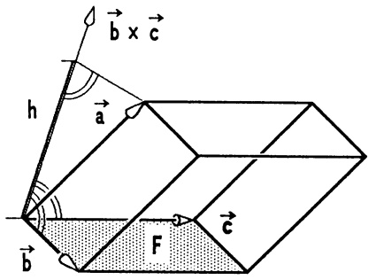

text_image

b × c
h
a
F
b
c

Abb. 30a - Spat

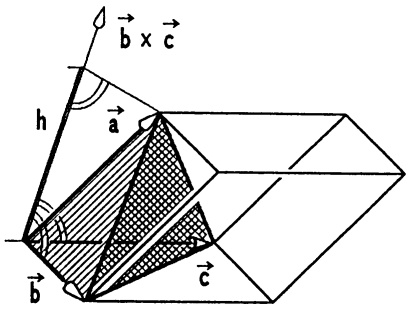

text_image

b x c
h
a
b
c

Abb. 30b - Tetraeder

## Folgerungen.

① Das Volumen eines Tetraeders mit den Kanten  $\vec{a}$ ,  $\vec{b}$ ,  $\vec{c}$  beträgt

$$
V _ {T e t r} = \frac {1}{6} V _ {S p a t} = \frac {1}{6} | [ \vec {a}, \vec {b}, \vec {c} ] |.
$$

② TEST für lineare Unabhängigkeit.

Die Vektoren  $\vec{a}, \vec{b}, \vec{c}$  sind nicht parallel zu einer Ebene (man sagt, sie sind linear unabhängig)  $\Longleftrightarrow [\vec{a}, \vec{b}, \vec{c}] \neq 0.$

③ TEST für Rechtssystem.

$(\vec{a},\vec{b},\vec{c})$ ist ein Rechtssystem $\Longleftrightarrow [\vec{a},\vec{b},\vec{c}] > 0.$

Beweis. ① „Tetraedervolumen = $\frac{1}{3} \cdot$ Grundfläche $\cdot$ Höhe“ ($\rightarrow$ Abb. 30b).
② Nur dann bilden  $\vec{a}$ ,  $\vec{b}$ ,  $\vec{c}$  die Kanten eines echten Spats mit Volumen  $\neq 0$ .
③ An einer Skizze erkennt man, daß  $(\vec{a},\vec{b},\vec{c})$  genau dann ein Rechtssystem ist, wenn der Winkel zwischen $\vec{a}$ und $\vec{b} \times \vec{c}$ spitz ist, d.h. wenn $0 \leq \nmid (\vec{a}, \vec{b} \times \vec{c}) \leq \frac{\pi}{2}$ gilt. Das ist gleichbedeutend mit $\vec{a} \cdot (\vec{b} \times \vec{c}) = |\vec{a}| |\vec{b} \times \vec{c}|\cos \nmid (\vec{a}, \vec{b} \times \vec{c}) > 0$.

Für  $\vec{a} = \sum a_{i}\vec{e}_{i}$ ,  $\vec{b} = \sum b_{i}\vec{e}_{i}$  und  $\vec{c} = \sum c_{i}\vec{e}_{i}$  (in kartesischen Koordinaten) erhält man mit (10) und (5a)

$$
[ \vec {a}, \vec {b}, \vec {c} ] = a _ {1} (b _ {2} c _ {3} - b _ {3} c _ {2}) + a _ {2} (b _ {3} c _ {1} - b _ {1} c _ {3}) + a _ {3} (b _ {1} c _ {2} - b _ {2} c _ {1}). \tag {13}
$$

Dies ist der Wert einer dreireihigen Determinante (→ Kap. 6, §5), nämlich

$$
[ \vec {a}, \vec {b}, \vec {c} ] = \left| \begin{array}{c c c} a _ {1} & b _ {1} & c _ {1} \\ a _ {2} & b _ {2} & c _ {2} \\ a _ {3} & b _ {3} & c _ {3} \end{array} \right| .
$$

Beispiel 1. Für die Vektoren $\vec{a} = \begin{pmatrix} 1 \\ 2 \\ 3 \end{pmatrix}$, $\vec{b} = \begin{pmatrix} -2 \\ 0 \\ -2 \end{pmatrix}$, $\vec{c} = \begin{pmatrix} 2 \\ -1 \\ -2 \end{pmatrix}$ ergibt sich aus (13) $[\vec{a},\vec{b},\vec{c}] = -12$. $\vec{a}$, $\vec{b}$, $\vec{c}$ spannen einen Spat mit Volumen $V_{Spat} = 12$ und ein Tetraeder mit Volumen $V_{Tetr} = 2$ auf.

Beispiel 2. Für $\vec{v}_1 = \frac{\sqrt{2}}{4}\left( \begin{array}{c} -1 \\ \sqrt{3} \\ 2 \end{array} \right)$, $\vec{v}_2 = -\frac{1}{2}\left( \begin{array}{c}\sqrt{3} \\ 1 \\ 0 \end{array} \right)$, $\vec{v}_3 = \frac{\sqrt{2}}{4}\left( \begin{array}{c}1 \\ -\sqrt{3} \\ 2 \end{array} \right)$ gilt $|\vec{v}_i| = 1$, $\vec{v}_i \cdot \vec{v}_j = 0$, für $i \neq j$ und $[\vec{v}_1, \vec{v}_2, \vec{v}_3] = 1$. $\vec{v}_1$, $\vec{v}_2$, $\vec{v}_3$ bilden ein Rechtssystem, sie stellen die Basisvektoren eines gedrehten kartesischen Koordinatensystems dar ($\rightarrow$ Kap. 6, 6.6).

Beispiel 3. Nichtorthogonale Zerlegung (→ Abb. 31). Die drei Stäbe eines Tragbockes führen von der Spitze S in Richtung der drei Einheitsvektoren $\vec{a} = \vec{e}_1$, $\vec{b} = \frac{1}{\sqrt{2}} \begin{pmatrix} 1 \\ -1 \\ 0 \end{pmatrix}$, $\vec{c} = \frac{1}{\sqrt{11}} \begin{pmatrix} 1 \\ 1 \\ -3 \end{pmatrix}$. In S zieht die Kraft $\vec{K} = 60\mathrm{N} \begin{pmatrix} 0 \\ 1 \\ -1 \end{pmatrix}$ und ruft in A, B, C die Lagerreaktionen $\vec{K}_A = \alpha \vec{a}$, $\vec{K}_B = \beta \vec{b}$, $\vec{K}_C = \gamma \vec{c}$ hervor. $\alpha, \beta, \gamma$ ergeben sich aus der Gleichgewichtsbedingung

$$
\vec {K} + \vec {K} _ {A} + \vec {K} _ {B} + \vec {K} _ {C} = \vec {K} + \alpha \vec {a} + \beta \vec {b} + \gamma \vec {c} = \vec {0}.
$$

Multipliziert man diese Gleichung der Reihe nach mit $\vec{b} \times \vec{c}$, $\vec{c} \times \vec{a}$, $\vec{a} \times \vec{b}$ skalar durch, so verschwinden je zwei Summanden ($\rightarrow$ Definition von $\times$ ①)

$$
(\vec {b} \times \vec {c}) \cdot \vec {K} + \alpha (\vec {b} \times \vec {c}) \cdot \vec {a} = 0 \quad \Longrightarrow \quad \alpha = - \frac {[ \vec {K} , \vec {b} , \vec {c} ]}{[ \vec {a} , \vec {b} , \vec {c} ]} = - 2 0   \mathrm{N},
$$

$$
(\vec {c} \times \vec {a}) \cdot \vec {K} + \beta (\vec {c} \times \vec {a}) \cdot \vec {b} = 0 \quad \Longrightarrow \quad \beta = - \frac {[ \vec {K} , \vec {c} , \vec {a} ]}{[ \vec {b} , \vec {c} , \vec {a} ]} = 4 0 \sqrt {2}   \mathrm{N},
$$

$$
(\vec {a} \times \vec {b}) \cdot \vec {K} + \gamma (\vec {a} \times \vec {b}) \cdot \vec {c} = 0 \quad \Longrightarrow \quad \gamma = - \frac {[ \vec {K} , \vec {a} , \vec {b} ]}{[ \vec {c} , \vec {a} , \vec {b} ]} = - 2 0 \sqrt {1 1} \mathrm{N}. \quad \square
$$

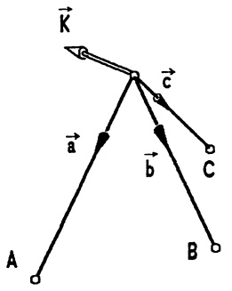

text_image

K
→
→
→
→
A
C
B

Abb. 31 - Tragbock

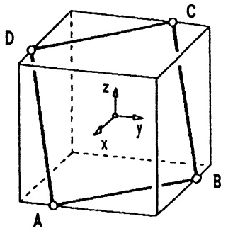

text_image

D
C
z
y
x
A
B

Abb. 32 - Würfel

Beispiel 4. Das größte Quadrat in einem Würfel. Im Würfel $W$ ($\rightarrow$ Abb. 32) mit den 8 Ecken $(\pm 1, \pm 1, \pm 1)$ sind auf den Würfelkanten 4 Punkte ausgewählt $(-1 \leq a, b \leq 1)$: $A = (1, a, -1)$, $B = (b, 1, -1)$, $C = (-1, -a, 1)$, $D = (-b, -1, 1)$. Die vier Punkte liegen stets in einer Ebene, da

$$
\begin{array}{l} [ \overrightarrow {A B}, \overrightarrow {B C}, \overrightarrow {C D} ] = \left[ \left( \begin{array}{c} b - 1 \\ 1 - a \\ 0 \end{array} \right), \left( \begin{array}{c} - 1 - b \\ - a - 1 \\ 2 \end{array} \right), \left( \begin{array}{c} - b + 1 \\ - 1 + a \\ 0 \end{array} \right) \right] \\ = 2 (b - 1) (1 - a) + 2 (1 - a) (1 - b) = 0. \\ \end{array}
$$

ABCD ist stets ein Parallelogramm, da  $\overrightarrow{AB} = -\overrightarrow{CD}$  und  $\overrightarrow{AD} = \overrightarrow{BC}$ . Der Flächeninhalt ist

$$
F = | \overrightarrow {A B} \times \overrightarrow {B C} | = 2 \sqrt {(1 - a) ^ {2} + (1 - b) ^ {2} + (1 - a b) ^ {2}}.
$$

ABCD ist eine Raute, wenn  $\overrightarrow{AC} \cdot \overrightarrow{BD} = 0$ , dh.  $1 + a + b = 0$ . ABCD ist ein Quadrat, wenn zusätzlich  $|\overrightarrow{AC}| = |\overrightarrow{BD}|$ , d.h.  $a^{2} = b^{2}$ ; das ist nur dann der Fall, wenn  $a = b = -\frac{1}{2}$ . Dieses Quadrat hat den Flächeninhalt  $\frac{9}{2}$ . ☐

## Aufgaben.

1. $P_{1}, P_{2}, \ldots, P_{6}$ seien die Ecken eines regulären Sechsecks im Raum.

a) Man suche Bedingungen, welche die Länge und die gegenseitige Lage der Vektoren  $\overrightarrow{P_{1}P_{2}}$  und  $\overrightarrow{P_{2}P_{3}}$  bestimmen!
b) Man bestimme  $P_{3}, P_{4}, P_{5}$  und  $P_{6}$  für den Fall, daß

$$
P _ {1} = O, P _ {2} = (\sqrt {3}, 1, 0) \text {und} \vec {e} _ {1} \perp \overrightarrow {P _ {2} P _ {3}}.
$$

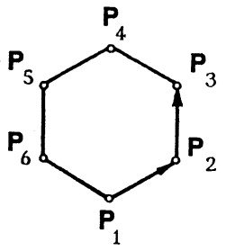

flowchart

2. Man rechne (11) explizit mittels (10) für den Fall $\vec{a} = \vec{e}_3$, $\vec{b} = \alpha \vec{e}_1 + \beta \vec{e}_2$ nach. Welche trivialen Fälle bleiben dann noch zu diskutieren?

3. Man bestätige  $[\vec{a},\vec{b},\vec{c}]=[ \vec{b},\vec{c},\vec{a}] = [\vec{c},\vec{a},\vec{b}]$  und  $[\vec{b},\vec{a},\vec{c}] = -[\vec{a},\vec{b},\vec{c}]$ .

4. Im Würfel mit den 8 Ecken (±1, ±1, ±1) bestimme man die Einheitsvektoren $\vec{d}_1, \ldots, \vec{d}_4$ in Richtung der vier Raumdiagonalen, für welche $\vec{e}_3 \cdot \vec{d}_i > 0$ ($i = 1, 2, 3, 4$) und berechne alle Winkel, die zwischen den $\vec{d}_i$ möglich sind.

5. Man berechne für die Vektoren des $\mathbb{R}^3$

$$
\vec {x} = \left( \begin{array}{c} 0 \\ 1 \\ 2 \end{array} \right), \quad \vec {y} = \left( \begin{array}{c} 2 \\ 1 \\ 0 \end{array} \right), \quad \vec {z} = \left( \begin{array}{c} 3 \\ 0 \\ 4 \end{array} \right)
$$

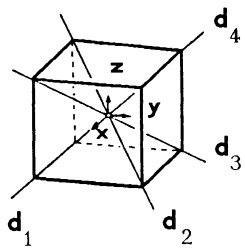

text_image

z
y
x
d₄
d₃
d₁
d₂

a) die orthogonale Zerlegung von  $\vec{x}$  längs  $\vec{y}$  bzw. längs  $\vec{z}$ ,

b) folgende Ausdrücke und gebe eine geometrische Deutung:

$$
(\vec {x} \cdot \vec {y}) \vec {y};
$$

$$
(\vec {x} + \vec {y}) \times (\vec {x} - \vec {y});
$$

$$
(\vec {x} \times \vec {y}) \times \vec {z} - \vec {x} \times (\vec {y} \times \vec {z});
$$

$$
[ \vec {x}, \vec {y}, \vec {z} ];
$$

$$
(\vec {x} + \vec {y} + 2 \vec {z}) \cdot \vec {z};
$$

$$
(4 \vec {x} \cdot \vec {y}) \vec {z} - (\vec {y} \cdot 3 \vec {z}) \vec {x} .
$$

6. Ein Massenpunkt P bewegt sich mit konstanter Winkelgeschwindigkeit  $\omega$  auf einer Kreisbahn (Mittelpunkt O, Radius r). Der Ortsvektor  $\vec{x}$ , der Geschwindigkeitsvektor  $\vec{v}$  und der Winkelgeschwindigkeitsvektor  $\vec{\omega}$  ( $|\vec{\omega}| = \omega$ ) bilden ein Rechtssystem, der Beschleunigungsvektor ist  $\vec{a} = -\omega^{2}\vec{x}$ .

Man zeige mit  $|\vec{v}| = \omega r$

$$
\vec {v} = \vec {\omega} \times \vec {x}, \quad \vec {a} = \vec {\omega} \times (\vec {\omega} \times \vec {x}).
$$

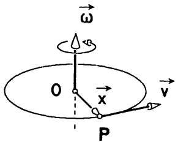

text_image

ω
0
x
P
v

7. Die 5 regulären konvexen Polyeder (konvexe Polyeder mit kongruenten Seitenflächen).

| Polyeder | Seitenflächen | Kanten | Ecken |
| --- | --- | --- | --- |
| Tetraeder | 4 gleichseitige Dreiecke | 6 | 4 |
| Würfel | 6 Quadrate | 12 | 8 |
| Oktaeder | 8 gleichseitige Dreiecke | 12 | 6 |
| Dodekaeder | 12 reguläre Fünfecke | 30 | 20 |
| Ikosaeder | 20 gleichseitige Dreiecke | 30 | 12 |

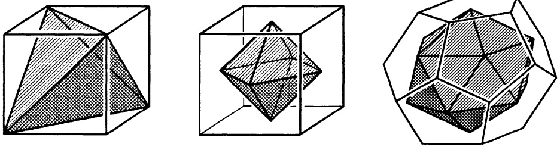

Ist das Oktaeder mit den Ecken  $(\pm1,0,0)$ ,  $(0,\pm1,0)$ ,  $(0,0,\pm1)$  und das Tetraeder mit den Ecken  $(1,1,1)$ ,  $(1,-1,-1)$ ,  $(-1,-1,1)$ ,  $(-1,1,-1)$  regulär? Man berechne die Volumeninhalte.

## §6. Geraden und Ebenen

## 6.1 Parameterdarstellungen einer Geraden.

Ein Punkt $X$ liegt genau dann

auf der Geraden $g$ durch $A$ in Richtung $\vec{c}$, $\vec{c} \neq 0$ ($\rightarrow$ Abb. 33), wenn $\overrightarrow{AX}$ parallel ist zu $\vec{c}$; d.h., wenn es eine Zahl $t \in \mathbb{R}$ gibt mit $\overrightarrow{AX} = t\vec{c}$. Man sagt hierzu: $g$ hat die

$$
\boxed { \begin{array}{c} \text {Punkt - Richtungsgleichung} \\ \overrightarrow {A X} = t \vec {c}, t \in \mathbb {R}. \end{array} } \tag {1}
$$

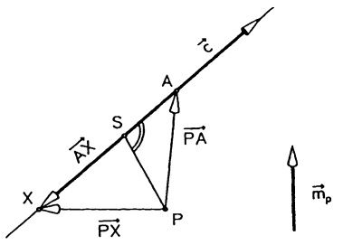

text_image

τc
A
S
P̅A
X
P̅X
P
mₚ

Abb. 33 - Gerade durch A längs  $\vec{c}$

Die in (1) auftretende Variable $t$ nennt man einen Parameter; zu jedem Parameterwert $t = t_0$ gehört genau ein Punkt $X_0$ auf $g$ mit $\overrightarrow{AX_0} = t_0\vec{c} -$ und umgekehrt.

Wegen  $\overrightarrow{AX} = \overrightarrow{PX} - \overrightarrow{PA}$  läßt sich g in bezug auf einen beliebigen Punkt P darstellen durch

$$
\boxed {\overrightarrow {P X} = \overrightarrow {P A} + t \vec {c}, t \in \mathbb {R}.} \tag {2}
$$

Wird nun im Raum ein kartesisches Koordinatensystem  $(O;\vec{e}_{1},\vec{e}_{2},\vec{e}_{3})$  festgelegt und wird  $\vec{c}=c_{1}\vec{e}_{1}+c_{2}\vec{e}_{2}+c_{3}\vec{e}_{3}$  durch 2 verschiedene Punkte  $A=(a_{1},a_{2},a_{3})$ ,  $B=(b_{1},b_{2},b_{3})$  bestimmt – d.h.  $c_{i}=b_{i}-a_{i}$ , i=1,2,3 – dann geht (2) – mit P=O – über in

$$
\boxed {\overrightarrow {O X} = \overrightarrow {O A} + t \vec {c} = \overrightarrow {O A} + t (\overrightarrow {O B} - \overrightarrow {O A}), t \in \mathbb {R}} \tag {3}
$$

und ein Komponentenvergleich ergibt für die Geradenpunkte  $X = (x_{1}, x_{2}, x_{3})$  die drei Gleichungen

$$
\begin{array}{l l} \text {(4a)} & x _ {i} = a _ {i} + t c _ {i}, t \in \mathbb {R} \quad (i = 1, 2, 3) \quad \text {Punkt - Richtungs - Gl.} \\ \text {bzw.} & \\ \text {(4b)} & x _ {i} = a _ {i} + t (b _ {i} - a _ {i}), t \in \mathbb {R} \quad (i = 1, 2, 3) \quad \text {Zwei Punkte - Gl.} \end{array}
$$

Jede der Formeln (1)-(4b) nennt man eine Parameterdarstellung von $g$.

Beispiel. Die Gerade g durch  $A = (1,0,-1)$  in Richtung  $\vec{c} = \vec{e}_{1} + \vec{e}_{2} + 2\vec{e}_{3}$  hat eine Parameterdarstellung

$$
\left( \begin{array}{c} x _ {1} \\ x _ {2} \\ x _ {3} \end{array} \right) = \left( \begin{array}{c} 1 \\ 0 \\ - 1 \end{array} \right) + t \left( \begin{array}{c} 1 \\ 1 \\ 2 \end{array} \right), t \in \mathbb {R}.
$$

In Komponenten lautet sie:

$$
x _ {1} = 1 + t, \quad x _ {2} = t, \quad x _ {3} = - 1 + 2 t.
$$

Zu den Parameterwerten $t = 1, -1, 5$ gehören die Geradenpunkte $B_1 = (2, 1, 1)$, $B_2 = (0, -1, -3)$, $B_3 = (6, 5, 9)$. Demnach besitzt $g$ ebenfalls die Parameterdarstellung (Zwei-Punkte-Gleichung in Komponenten)

$$
x _ {1} = 6 - 6 t, x _ {2} = 5 - 6 t, x _ {3} = 9 - 1 2 t.
$$

6.2 Die Koordinatengleichungen einer Geraden. Löst man jede der Gleichungen aus (4b) nach t auf und setzt die Ausdrücke gleich, so erhält man für die Gerade durch  $A = (a_{1}, a_{2}, a_{3})$  und  $B = (b_{1}, b_{2}, b_{3})$  eine parameterfreie Darstellung mit zwei Gleichungen:

## Koordinatengleichungen der Geraden durch $A, B$

a) $\frac{x_1 - a_1}{b_1 - a_1} = \frac{x_2 - a_2}{b_2 - a_2} = \frac{x_3 - a_3}{b_3 - a_3}$, falls $a_i \neq b_i$ ($i = 1, 2, 3$),
b) $\frac{x_1 - a_1}{b_1 - a_1} = \frac{x_2 - a_2}{b_2 - a_2}, x_3 = a_3,$ falls $b_{3} = a_{3}, b_{1} \neq a_{1}, b_{2} \neq a_{2},$

(5) $\frac{x_3 - a_3}{b_3 - a_3} = \frac{x_1 - a_1}{b_1 - a_1}, x_2 = a_2,$ falls $b_{2} = a_{2}, b_{3} \neq a_{3}, b_{1} \neq a_{1},$

$$
\frac {x _ {2} - a _ {2}}{b _ {2} - a _ {2}} = \frac {x _ {3} - a _ {3}}{b _ {3} - a _ {3}}, x _ {1} = a _ {1}, \quad \text {falls} b _ {1} = a _ {1}, b _ {2} \neq a _ {2}, b _ {3} \neq a _ {3},
$$

c) $x_{1} = a_{1}, x_{2} = a_{2}$, falls $b_{1} = a_{1}, b_{2} = a_{2}, b_{3} \neq a_{3}$,

$x_{3} = a_{3}, x_{1} = a_{1}$, falls $b_{3} = a_{3}, b_{1} = a_{1}, b_{2} \neq a_{2}$,

$x_{2} = a_{2}, x_{3} = a_{3}$, falls $b_{2} = a_{2}, b_{3} = a_{3}, b_{1} \neq a_{1}$.

Aus der parameterfreien Zwei-Punkte-Form für $g$ findet man über $t := \frac{x_i - a_i}{b_i - a_i}$ mit dem Index $i$, für den $b_i \neq a_i$ gilt, zur Parameterform (4b) zurück.

Beispiel 1. Die Gerade $x_{1}=4-9t$, $x_{2}=2$, $x_{3}=1+t$ ($t\in\mathbb{R}$) hat die zwei Koordinatengleichungen

$$
\frac {4 - x _ {1}}{9} = x _ {3} - 1, x _ {2} = 2.
$$

Beispiel 2. Die Gerade mit den Koordinatengleichungen $\frac{x_1 - 3}{5} = \frac{x_2 + 1}{7}$, $x_3 = 4$ besitzt die Parameterdarstellung

$$
x _ {1} = 3 + 5 t, x _ {2} = - 1 + 7 t, x _ {3} = 4;
$$

sie geht durch die Punkte  $(3,-1,4)$  und  $(8,6,4)$ .

□

6.3 Die Momentengleichung der Geraden g durch A in Richtung  $\vec{c}$  ( $\rightarrow$  Abb. 33) lautet für einen beliebigen Bezugspunkt P :

(6)

Momentengleichung

$$
\overrightarrow {P X} \times \vec {c} = \vec {m} _ {P} \quad \text {mit} \quad \vec {m} _ {P} = \overrightarrow {P A} \times \vec {c}.
$$

Es ist nämlich $\overrightarrow{AX} = \overrightarrow{PX} - \overrightarrow{PA}$ genau dann parallel zu $\vec{c}$, wenn $\overrightarrow{AX} \times \vec{c} = (\overrightarrow{PX} - \overrightarrow{PA}) \times \vec{c} = \vec{0}$ gilt ($\rightarrow$ §5 (9d)).

Die Darstellung (6) ist insbesondere dann zweckmäßig, wenn $g$ die Wirkungslinie der Kraft $\vec{c}$ ist, die bezüglich $P$ das Moment $\vec{m}_P = \overrightarrow{PA} \times \vec{c}$ besitzt ($\to \S7$). Nach §5 (12) ist

$$
\overrightarrow {P S} = \frac {1}{| \vec {c} | ^ {2}} \vec {c} \times (\overrightarrow {P A} \times \vec {c}) = \frac {1}{| \vec {c} | ^ {2}} \vec {c} \times \vec {m} _ {P} \tag {7}
$$

der Lotvektor von P auf g und demnach

$$
\overrightarrow {P X} = \frac {1}{| \vec {c} | ^ {2}} \vec {c} \times \vec {m} _ {P} + t \vec {c}, t \in \mathbb {R},
$$

eine Parameterdarstellung der durch die Momentengleichung (6) dargestellten Geraden g.

Beispiel. Im kartesischen Koordinatensystem  $(O;\vec{e}_{1},\vec{e}_{2},\vec{e}_{3})$  hat die durch

$$
\left( \begin{array}{c} x _ {1} \\ x _ {2} \\ x _ {3} \end{array} \right) \times \left( \begin{array}{c} 1 \\ 2 \\ 3 \end{array} \right) = \left( \begin{array}{c} - 1 \\ - 1 \\ 1 \end{array} \right)
$$

bestimmte Gerade $g$ die Richtung $\vec{c} = \begin{pmatrix} 1 \\ 2 \\ 3 \end{pmatrix}$. Ferner ist $\overrightarrow{OS} = \frac{1}{|\vec{c}|^2} \vec{c} \times \vec{m} = \frac{1}{14} \begin{pmatrix} 1 \\ 2 \\ 3 \end{pmatrix} \times \begin{pmatrix} -1 \\ -1 \\ 1 \end{pmatrix} = \frac{1}{14} \begin{pmatrix} 5 \\ -4 \\ 1 \end{pmatrix}$ der Lotvektor vom Ursprung $O$ auf $g$, insbesondere $S = \frac{1}{14}(5, -4, 1)$ ein Geradenpunkt. Demnach lautet eine Parameter-darstellung von $g: x_1 = \frac{5}{14} + t$, $x_2 = -\frac{2}{7} + 2t$, $x_3 = \frac{1}{14} + 3t$.

6.4 Abstand Punkt-Gerade. Der Lotvektor vom Punkt $P$ auf die Gerade $g$ durch $A$ in Richtung $\vec{c}$ ist $\overrightarrow{PS} = \frac{1}{|\vec{c}|^2}\vec{c} \times (\overrightarrow{PA} \times \vec{c})$ ($\rightarrow$ Abb. 33 und (7)), sein Betrag gibt den Abstand $d$ des Punktes $P$ von $g$ an; also gilt

(8)

$$
\boxed {d = \frac {| \overrightarrow {P A} \times \vec {c} |}{| \vec {c} |} .}
$$

Beispiel. Der Abstand des Punktes  $P = (15, -2, 6)$  von der Geraden g :  $x_{1} = 1 + t$ ,  $x_{2} = 1 - t$ ,  $x_{3} = 2$  beträgt

$$
\begin{array}{l} d = \frac {1}{\sqrt {1 ^ {2} + 1 ^ {2}}} \left| \left( \begin{array}{c} - 1 4 \\ 3 \\ - 4 \end{array} \right) \times \left( \begin{array}{c} 1 \\ - 1 \\ 0 \end{array} \right) \right| \\ = \frac {1}{\sqrt {2}} \sqrt {(- 4) ^ {2} + (- 4) ^ {2} + 1 1 ^ {2}} = \sqrt {\frac {1 5 3}{2}} \approx 8. 7 4 6. \\ \end{array}
$$

6.5 Abstand Gerade-Gerade. Der Abstand d der beiden Geraden

$$
g _ {1}: \quad \overrightarrow {O X} = \overrightarrow {O A} + t \vec {u},
$$

$$
g _ {2}: \quad \overrightarrow {O X} = \overrightarrow {O B} + t \vec {v} \quad (t \in \mathbb {R}, \vec {u}, \vec {v} \neq \vec {0})
$$

ist gegeben durch

a) $d = \frac{|\overrightarrow{AB} \times \vec{u}|}{|\vec{u}|}$, falls $\vec{u}, \vec{v}$ parallel sind, b) $d = \frac{|\overrightarrow{AB}, \vec{u}, \vec{v}|}{|\vec{u} \times \vec{v}|}$, falls $\vec{u} \times \vec{v} \neq \vec{0}$.

Beweis. Im ersten Fall wird der Abstand mit (8) berechnet. Im andern Fall ($\vec{u}$, $\vec{v}$ nicht parallel) ist $d$ der Betrag der Komponente von $\overrightarrow{AB}$ in Richtung des Vektors $\vec{n} := \vec{u} \times \vec{v}$, der auf $\vec{u}$ und $\vec{v}$ senkrecht steht ($\rightarrow$ Abb. 34). Mit Formel (6) aus §5 - für $\vec{a} = \overrightarrow{AB}$, $\vec{b} = \vec{u} \times \vec{v}$ - folgt die Behauptung.

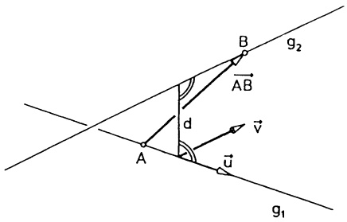

text_image

B
g₂
AB
d
A
v
u
g₁

Abb. 34 - Abstand zweier Geraden

Beispiel. Die Geraden

$$
g _ {1}: \quad x _ {1} = 2 + 3 t, x _ {2} = 4, x _ {3} = - 1 + t
$$

$$
g _ {2}: \quad x _ {1} = t, x _ {2} = 1 + t, x _ {3} = 5 - 3 t
$$

haben den Abstand

$$
d = \frac {1}{| \vec {u} \times \vec {v} |} | [ \overrightarrow {A B}, \vec {u}, \vec {v} ] | = \frac {1}{\left| \left( \begin{array}{c} 3 \\ 0 \\ 1 \end{array} \right) \times \left( \begin{array}{c} 1 \\ 1 \\ - 3 \end{array} \right) \right|} \left| \left| \begin{array}{c c c} - 2 & 3 & 1 \\ - 3 & 0 & 1 \\ 6 & 1 & - 3 \end{array} \right| \right| = \frac {1 0}{\sqrt {1 1 0}}. \quad \square
$$

Folgerung aus (9): Die nicht parallelen Geraden  $g_{1}$ ,  $g_{2}$  schneiden sich genau dann, wenn $d = 0$, d.h. $[\overrightarrow{AB}, \vec{u}, \vec{v}] = 0$ ist. Der eindeutig bestimmte Schnittpunkt $X_S$ erfüllt $\overrightarrow{OX_S} = \overrightarrow{OA} + t_1\vec{u} = \overrightarrow{OB} + t_2\vec{v}$ mit gewissen Zahlen $t_1, t_2 \in \mathbb{R}$. Multipliziert man diese Beziehung vektoriell mit $\vec{u}$ bzw. $\vec{v}$ durch, so ergibt sich $t_1\vec{u} \times \vec{v} = \overrightarrow{AB} \times \vec{v}$ und $t_2\vec{u} \times \vec{v} = \overrightarrow{AB} \times \vec{u}$. Da $\vec{u} \times \vec{v} \neq \vec{0}$ ist, kann hieraus leicht $t_1$ und $t_2$ abgelesen werden; damit ist $X_S$ bestimmt.

Beispiel. Für die beiden Geraden $g_1 : x_1 = 0$, $x_2 = 2t$, $x_3 = 1 + t$ und $g_2 : x_1 = 1 + t$, $x_2 = 2$, $x_3 = 3 + t$ gilt $\vec{u} \times \vec{v} = \begin{pmatrix} 2 \\ 1 \\ -2 \end{pmatrix}$, $\overrightarrow{AB} = \begin{pmatrix} 1 \\ 2 \\ 2 \end{pmatrix}$. Damit ist $[\overrightarrow{AB}, \vec{u}, \vec{v}] = 0$, $t_1 = 1$, $t_2 = -1$ und $X_S = (0, 2, 2)$ der Schnittpunkt.

## 6.6 Parameterdarstellungen einer Ebene. Wir betrachten die Ebene E

mit dem „Aufpunkt“ A und den (von 0 verschiedenen und nicht parallelen) Richtungsvektoren $\vec{u}$, $\vec{v}$ ($\rightarrow$ Abb. 35). Ein Raumpunkt X liegt genau dann auf E, wenn sich der Vektor $\overrightarrow{AX}$ darstellen läßt in der Form $\overrightarrow{AX} = t\vec{u} + s\vec{v}$ mit Zahlen $t, s \in \mathbb{R}$. D.h. man hat (mit den beiden Parametern $t, s \in \mathbb{R}$) die

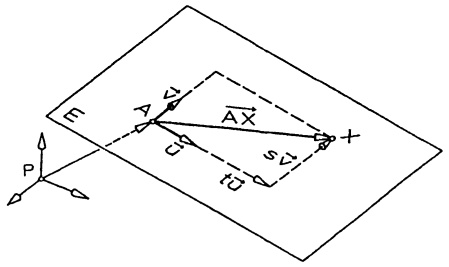

text_image

F
A
A
X
S
P
C
C1

Abb. 35 - Die Ebene E

$$
\text {Parameterdarstellung von} E \quad \overrightarrow {A X} = t \vec {u} + s \vec {v} \quad (t, s \in \mathbb {R}). \tag {10}
$$

Wird ein kartesisches Koordinatensystem  $(O;\vec{e}_{1},\vec{e}_{2},\vec{e}_{3})$  festgelegt, so daß  $A=(a_{1},a_{2},a_{3})$ ,  $\vec{u}=u_{1}\vec{e}_{1}+u_{2}\vec{e}_{2}+u_{3}\vec{e}_{3}$ ,  $\vec{v}=v_{1}\vec{e}_{1}+v_{2}\vec{e}_{2}+v_{3}\vec{e}_{3}$ , dann ist (10) äquivalent zu den 3 Koordinatengleichungen

$$
x _ {i} = a _ {i} + t u _ {i} + s v _ {i} \quad (i = 1, 2, 3; t, s \in \mathbb {R}). \tag {10a}
$$

Werden $\vec{u}$ und $\vec{v}$ durch die drei verschiedenen Punkte $A = (a_{1}, a_{2}, a_{3})$, $B = (b_{1}, b_{2}, b_{3})$, $C = (c_{1}, c_{2}, c_{3})$ bestimmt, $\vec{u} = \overrightarrow{AB}$, $\vec{v} = \overrightarrow{AC}$ (d.h. $u_{i} = b_{i} - a_{i}$, $v_{i} = c_{i} - a_{i}$), dann geht (10a) über in die

Drei-Punkte-Gleichung der Ebene E

$$
x _ {i} = a _ {i} + t (b _ {i} - a _ {i}) + s (c _ {i} - a _ {i}) \quad (i = 1, 2, 3; t, s \in \mathbb {R}) \tag {10b}
$$

mit $A = (a_{1}, a_{2}, a_{3})$, $B = (b_{1}, b_{2}, b_{3})$, $C = (c_{1}, c_{2}, c_{3})$.

6.7 Parameterfreie Darstellungen einer Ebene. Ein Punkt X liegt genau dann auf E (E wie in 6.6, → Abb. 35), wenn die Vektoren  $\overrightarrow{AX}$ ,  $\vec{u} = \overrightarrow{AB}$ ,  $\vec{v} = \overrightarrow{AC}$  zu E parallel sind; genau in diesem Fall gilt ( $\rightarrow$  5.4)

(11)

$$
\left[ \overrightarrow {A X}, \overrightarrow {A B}, \overrightarrow {A C} \right] = 0.
$$

Dieses ist eine parameterfreie Drei-Punkte-Formel für $E$ in Determinantenform. (11) bedeutet, daß $\overrightarrow{AX} \cdot (\overrightarrow{AB} \times \overrightarrow{AC}) = 0$. $\vec{n} := \overrightarrow{AB} \times \overrightarrow{AC}$ steht also senkrecht auf $E$; man nennt ihn daher einen Normalenvektor von $E$ und

(12)

$$
\overrightarrow {A X} \cdot \vec {n} = 0 \quad (A \text {Aufpunkt,} \vec {n} \text {Normalenvektor von} E)
$$

eine Normalengleichung von $E$. In kartesischen Koordinaten entsteht hieraus für $X = (x_1, x_2, x_3)$, $A = (a_1, a_2, a_3)$ und $\vec{n} = n_1 \vec{e}_1 + n_2 \vec{e}_2 + n_3 \vec{e}_3$ die

$$
\begin{array}{l} \text {Koordinatendarstellung von E} \\ n _ {1} x _ {1} + n _ {2} x _ {2} + n _ {3} x _ {3} = c \quad \text {mit} c := a _ {1} n _ {1} + a _ {2} n _ {2} + a _ {3} n _ {3} = \overrightarrow {O A} \cdot \vec {n}. \end{array} \tag {13}
$$

Wird $E$ wie in (12) bzw. (13) durch einen Aufpunkt $A$ und einen Normalenvektor $\vec{n}$ gegeben und ist $P$ ein

beliebiger Raumpunkt, dann stimmt der Lotvektor  $\overrightarrow{PS}$  von P auf E überein mit der Komponente von  $\overrightarrow{PA}$  in Richtung  $\vec{n}$ .

Also gilt (→ §5 (6))

$$
\overrightarrow {P S} = \frac {\overrightarrow {P A} \cdot \vec {n}}{| \vec {n} | ^ {2}} \vec {n}. \tag {14}
$$

Insbesondere ist der

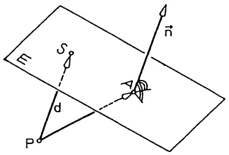

text_image

P
S
d
P
n

Abb. 36 - Der Abstand P von E

(15)

Abstand des Punktes P von der Ebene E

$$
d = | \overrightarrow {P S} | = \frac {| \overrightarrow {P A} \cdot \vec {n} |}{| \vec {n} |}.
$$

Ist $|\vec{n}| = 1$, so gibt bereits $d = |\overrightarrow{PA} \cdot \vec{n}|$ den Abstand von $P$ und $E$. Man nennt die Darstellung (13) nach O. L. HESSE (1811–1874, 1868 TH München)

HESSE-Normalform der Ebene E

$$
n _ {1} x _ {1} + n _ {2} x _ {2} + n _ {3} x _ {3} = c, \quad \text {wenn} n _ {1} ^ {2} + n _ {2} ^ {2} + n _ {3} ^ {2} = 1 \text {und} c \geq 0.
$$

Man gelangt von einer beliebigen Koordinatendarstellung (13) von $E$ nach Division durch $\pm\sqrt{n_{1}^{2}+n_{2}^{2}+n_{3}^{2}}$ zur HESSE-Normalform.

Ist  $n_{1}x_{1} + n_{2}x_{2} + n_{3}x_{3} = c$  in HESSE-Normalform, so gilt:

1. Der Normalenvektor  $\vec{n}=n_{1}\vec{e}_{1}+n_{2}\vec{e}_{2}+n_{3}\vec{e}_{3}$  weist, wird er in einem Punkt von E angetragen, vom Nullpunkt weg.
2. Es ist $c$ der Abstand des Nullpunkts von $E$.
3. Ein beliebiger Punkt $P$ hat von $E$ den Abstand $d = |c - \overrightarrow{OP} \cdot \vec{n}|$.
4. Falls $O \notin E$, gilt

$$
c - \overrightarrow {O P} \cdot \vec {n} > 0 \iff O, P \text {liegen auf derselben Seite von} E,
$$

$$
c - \overrightarrow {O P} \cdot \vec {n} <   0 \iff E \text {trennt} O \text {und} P.
$$

Beweis. Formel (14) mit $P = O$ zeigt $\overrightarrow{OS} = (\overrightarrow{OA} \cdot \vec{n})\vec{n} = c\vec{n}$, woraus man sofort 1. und 2. abliest. Die anderen beiden Behauptungen ergeben sich ebenfalls aus (14) ($\rightarrow$ Abb. 36): $\overrightarrow{PS} = [(\overrightarrow{OA} - \overrightarrow{OP}) \cdot \vec{n}] \vec{n} = (c - \overrightarrow{OP} \cdot \vec{n}) \cdot \vec{n}$.

Bringt man die Koordinatendarstellung (13) einer nicht durch den Nullpunkt gehenden Ebene auf die Form

$$
a _ {1} x _ {1} + a _ {2} x _ {2} + a _ {3} x _ {3} = 1 \quad (A c h s e n a b s c h n i t t s f o r m),
$$

so kann man daraus sofort die „Achsenabschnitte“ (d.h. die Durchstoßpunkte der Achsen durch $E$, $\rightarrow$ Abb. 37) ablesen:

$$
A _ {1} = (\frac {1}{a _ {1}}, 0, 0),
$$

$$
A _ {2} = (0, \frac {1}{a _ {2}}, 0),
$$

$$
A _ {3} = (0, 0, \frac {1}{a _ {3}}),
$$

sofern alle  $a_{i} \neq 0$ . Im Fall  $a_{1} = 0$  ist E parallel zur  $x_{1}$ -Achse;
entsprechendes gilt für  $a_{2} = 0$ ,  $a_{3} = 0$

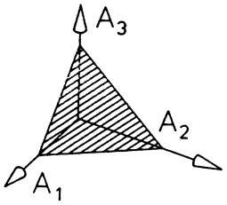

text_image

A₃
A₂
A₁

Abb. 37 - Die Achsenabschnitte von $E$

Schließlich sei noch bemerkt, daß man aus einer (beliebigen) Koordinatendarstellung $n_{1}x_{1} + n_{2}x_{2} + n_{3}x_{3} = c$ der Ebene $E$ leicht eine Parameterdarstellung findet. Ist etwa $n_{3} \neq 0$, dann kann man $x_{1} = t$, $x_{2} = s$ (beliebig aus $\mathbb{R}$) wählen und $x_{3}$ aus $x_{3} = \frac{1}{n_{3}}(c - n_{1}t - n_{2}s)$ berechnen. Das ergibt bereits die Parameterdarstellung

$$
\left( \begin{array}{c} x _ {1} \\ x _ {2} \\ x _ {3} \end{array} \right) = \left( \begin{array}{c} 0 \\ 0 \\ \frac {c}{n _ {3}} \end{array} \right) + t \left( \begin{array}{c} 1 \\ 0 \\ - \frac {n _ {1}}{n _ {3}} \end{array} \right) + s \left( \begin{array}{c} 0 \\ 1 \\ - \frac {n _ {2}}{n _ {3}} \end{array} \right)
$$

der Ebene; sie enthält den Aufpunkt $A = (0,0,\frac{c}{n_3})$ und die Richtungsvektoren $\vec{u} = \vec{e}_1 - \frac{n_1}{n_3}\vec{e}_3$, $\vec{v} = \vec{e}_2 - \frac{n_2}{n_3}\vec{e}_3$.

Beispiel. Gegeben sei $E$ durch $3x_{1} - 5x_{2} + \sqrt{2} x_{3} = -5$.

Die HESSESche Normalform hiervon ist  $-\frac{1}{2}x_{1}+\frac{5}{6}x_{2}-\frac{\sqrt{2}}{6}x_{3}=\frac{5}{6}$ .

Der Abstand des Ursprungs von $E$ beträgt $\frac{5}{6}$. Der Punkt $P = (4, 5, 6)$ hat von $E$ den Abstand $|d|$ mit $d = c - \overrightarrow{OP} \cdot \vec{n} = \frac{5}{6} - (-\frac{4}{2} + \frac{25}{6} - \frac{6\sqrt{2}}{6}) = 0.08088 \ldots$. Weil $d > 0$, liegen $O$ und $P$ auf derselben Seite von $E$. Ferner ist $x_1 = t$, $x_2 = s$, $x_3 = \frac{1}{2}\sqrt{2}(-5 - 3t + 5s) \quad (s, t \in \mathbb{R})$ eine Parameterdarstellung von $E$; diese liefert den Aufpunkt $A = (0, 0, -\frac{5}{2}\sqrt{2})$ und die Richtungsvektoren

$$
\vec {u} = \left( \begin{array}{c} 1 \\ 0 \\ - \frac {3}{2} \sqrt {2} \end{array} \right), \vec {v} = \left( \begin{array}{c} 0 \\ 1 \\ \frac {5}{2} \sqrt {2} \end{array} \right).
$$

6.8 Die Gerade als Schnitt zweier Ebenen. Eine Gerade g kann man auffassen als Schnittgerade zweier nicht paralleler Ebenen

$$
E _ {1}: \quad n _ {1} x _ {1} + n _ {2} x _ {2} + n _ {3} x _ {3} = c _ {1},
$$

$$
E _ {2}: \quad m _ {1} x _ {1} + m _ {2} x _ {2} + m _ {3} x _ {3} = c _ {2}.
$$

Das Vektorprodukt der beiden Normalenvektoren $\vec{n}=\sum n_{i}\vec{e}_{i},\quad\vec{m}=\sum m_{i}\vec{e}_{i}$ ist parallel zu beiden Ebenen, zeigt also in Richtung der Schnittgeraden. Kennt man einen Punkt $A$ auf $g$, dann besitzt man sofort mit

$$
\overrightarrow {O X} = \overrightarrow {O A} + t (\vec {n} \times \vec {m})
$$

eine Parameterdarstellung der Schnittgeraden $g$.

Man beachte, daß sowohl (5) als auch die sich aus (6) durch Komponentenvergleich ergebenden Gleichungen – nach Umformung – die Gerade g als Schnittgerade von Ebenen beschreiben.

6.9 Die Winkel zwischen zwei Ebenen und zwischen einer Ebene und einer Geraden. Die Winkel zwischen zwei sich schneidenden Ebenen stimmen überein mit den beiden Winkeln, welche die dazu senkrecht verlaufenden Normalenrichtungen einschließen. Sind also  $\vec{n}_{1}$ ,  $\vec{n}_{2}$  Normalenvektoren der Ebenen  $E_{1}$ ,  $E_{2}$ , dann sind  $\varphi_{1}$ , eindeutig bestimmt durch

$$
\cos \varphi_ {1} = \frac {| \vec {n} _ {1} \cdot \vec {n} _ {2} |}{| \vec {n} _ {1} | | \vec {n} _ {2} |}, \quad 0 \leq \varphi_ {1} \leq \frac {\pi}{2}, \tag {16}
$$

und $\varphi_{2}=\pi-\varphi_{1}$ die beiden (positiv gemessenen) Winkel zwischen $E_{1}$ und $E_{2}$. In der Regel wird nur $\varphi_{1}$ als „der Winkel zwischen $E_{1}$ und $E_{2}$“ bezeichnet.

Als Winkel zwischen einer Geraden g in Richtung $\vec{c}$ und einer Ebene E mit Normalenvektor $\vec{n}$ bezeichnet man den Winkel zwischen $\vec{c}$ und der zu $\vec{n}$ orthogonalen Komponente $\frac{1}{|\vec{n}|^2}\vec{n} \times (\vec{c} \times \vec{n})$ ($\rightarrow$ §5 (12)) von $\vec{c}$. Für diesen Winkel $\varphi$ gilt (Skizze!) $\varphi = \frac{\pi}{2} - \star (\vec{c}, \vec{n})$ und somit ($\rightarrow$ Kap. 2, §3 (4))

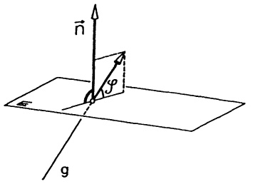

text_image

n
φ
g

Abb. 38 - Winkel Gerade-Ebene

(17)

Winkel zwischen Gerade und Ebene

$$
\sin \varphi = \frac {| \vec {n} \cdot \vec {c} |}{| \vec {n} | \cdot | \vec {c} |}.
$$

Beispiel 1. Sphärische Trigonometrie. Auf der Einheitskugel $\{X;|\overrightarrow{OX}|=1\}$ im Raum sind durch drei Punkte $A$, $B$, $C$ mit den Ortsvektoren $\vec{a}$, $\vec{b}$, $\vec{c}$ die drei Ecken eines sphärischen Dreiecks gegeben.

Die Seiten $a, b, c$ des Dreiecks sind diejenigen Großkreisbögen $BC, CA, AB$, für die $0 \leq a, b, c \leq \pi$ erfüllt ist. Daher gilt

(18)

$$
\cos a = \vec {b} \cdot \vec {c}, \quad \cos b = \vec {c} \cdot \vec {a}, \quad \cos c = \vec {a} \cdot \vec {b},
$$

$$
\sin a = | \vec {b} \times \vec {c} |, \quad \sin b = | \vec {c} \times \vec {a} |, \quad \sin c = | \vec {a} \times \vec {b} |.
$$

Die Winkel $\alpha, \beta, \gamma$ des Dreiecks sind als Schnittwinkel der Großkreisebenen durch $a, b, c$ bestimmt,

$$
\alpha = \nmid (O A B, O A C), \quad \beta = \nmid (O B C, O B A), \quad \gamma = \nmid (O C A, O C B),
$$

daher ergibt sich mit der LAGRANGE-Identität (→ §5, (11b)) aus (16):

$$
\cos \alpha = \frac {(\vec {a} \times \vec {b}) \cdot (\vec {a} \times \vec {c})}{| \vec {a} \times \vec {b} | \cdot | \vec {a} \times \vec {c} |} = \frac {(\vec {a} \cdot \vec {a}) (\vec {b} \cdot \vec {c}) - (\vec {b} \cdot \vec {a}) (\vec {a} \cdot \vec {c})}{| \vec {a} \times \vec {b} |   | \vec {a} \times \vec {c} |} .
$$

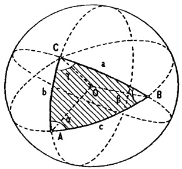

text_image

C
a
b
Q
c
A
B

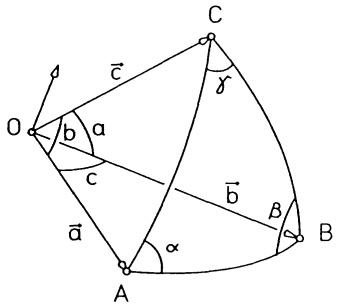

text_image

O
b
a
c
ā
α
A
B
C
b'
β
r

Abb. 39 – Sphärische Dreiecke

Setzt man  $\vec{a} \cdot \vec{a} = 1$  und (18) ein, so erhält man den

1. Cosinussatz der sphärischen Trigonometrie
 $\cos a = \cos c \cos b + \cos \alpha \sin c \sin b$ .

Analog bestätigt man vektoriell den

2. Cosinussatz der sphärischen Trigonometrie
 $\cos \alpha = -\cos \beta \cos \gamma + \cos a \sin \gamma \sin \beta$ .

und den

Sinussatz der sphärischen Trigonometrie

$$
\frac {\sin a}{\sin \alpha} = \frac {\sin b}{\sin \beta} = \frac {\sin c}{\sin \gamma}
$$

## Beispiel 2. Grundaufgaben des CAD.

Von der Einheitskugel mit Mittelpunkt (0,0,1) soll ein Schrägriß in der Ebene  $x_{3}=0$  bestimmt werden, indem man parallel zur Richtung  $\vec{e}_{1}+\vec{e}_{2}-2\vec{e}_{3}$  beleuchtet. Die Abbildungsgleichung ergibt sich aus der Parameterdarstellung des Lichtstrahls durch den Punkt  $X=(x,y,z)$ :

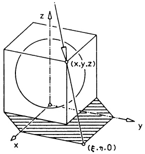

text_image

z
(x,y,z)
y
x
(ξ,η,0)

Abb. 40 - Schrägriß

$\begin{pmatrix} x_{1} \\ x_{2} \\ x_{3} \end{pmatrix} = \begin{pmatrix} x \\ y \\ z \end{pmatrix} + t \begin{pmatrix} 1 \\ 1 \\ -2 \end{pmatrix}, t \in \mathbb{R}$. Dieser trifft die Ebene $x_{3} = 0$ für $t = \frac{z}{2}$ in dem Bildpunkt mit den Koordinaten $x_{1} = \xi, x_{2} = \eta, x_{3} = 0$, wobei

$$
\xi = x + \frac {z}{2}, \qquad \eta = y + \frac {z}{2}.
$$

Diese beiden Gleichungen stellen eine lineare Abbildung des  $R^{3}$  in den  $R^{2}$  dar ( $\rightarrow$  Kap. 6). Um den Umriß des Schattens zu bestimmen, bringen wir den Projektionsstrahl mit der Kugel  $x^{2} + y^{2} + (z - 1)^{2} = 1$  zum Schnitt

$$
(\xi + t) ^ {2} + (\eta + t) ^ {2} + (- 2 t - 1) ^ {2} = 1
$$

und erhalten eine quadratische Gleichung für t :

$$
6 t ^ {2} + (2 \xi + 2 \eta + 4) t + (\xi^ {2} + \eta^ {2}) = 0.
$$

In Umrißpunkten trifft der Lichtstrahl die Kugel genau in einem Punkt, daher muß in diesen Punkten die Diskriminante  $(2\xi + 2\eta + 4)^{2} - 4 \cdot 6 \cdot (\xi^{2} + \eta^{2})$

verschwinden. Diese Bedingung stellt bereits die Gleichung des Umrisses dar:

$$
5 \xi^ {2} + 5 \eta^ {2} - 2 \xi \eta - 4 \xi - 4 \eta - 4 = 0.
$$

Das ist eine Ellipse mit Mittelpunkt  $\left(\frac{1}{2},\frac{1}{2}\right)$ , deren Achsen um  $45^{\circ}$  gedreht sind und deren Brennpunkt im Nullpunkt liegt (DANDELIN-Kugel). ☐

## Darstellungen und Umrechnungen für Ebenen im Raum

Darstellungen: ( $X = (x, y, z)$  Punkt auf der Ebene,  $\vec{x} := \overrightarrow{OX}$ )

① Parameterdarstellung :

$$
\begin{array}{l} \vec {x} = \vec {a} + t \vec {b} + s \vec {c}, \quad t, s \in \mathbb {R}; \quad \vec {b} \times \vec {c} \neq \vec {0} \\ \vec {a} = \overrightarrow {O A}, A \text {Aufpunkt}; \vec {b}, \vec {c} \text {Richtungsvektoren} \\ \end{array}
$$

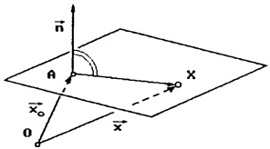

text_image

n
A
x
x₀
O
x

② Koordinatengleichung :

(a) $ax + by + cz + d = 0$; $(a, b, c) \neq (0, 0, 0)$
b) $\vec{n} \cdot (\vec{x} - \vec{x}_0) = 0$; $\vec{n} \neq \vec{0}$
(c) $\vec{n}_0\cdot \vec{x} = d_0$ ; $|\vec{n}_0| = 1$ , $d_0\geq 0$ (HESSE-Normalform)

## Umrechnung :

$$
\text {①} \rightarrow \text {②}: \left(\begin{array}{c}a\\b\\c\end{array}\right) = \vec {n} = \vec {b} \times \vec {c}; \vec {x} _ {0} = \vec {a}; d = - \vec {n} \cdot \vec {x} _ {0};.
$$

②a → ① : Nach x auflösen, falls $a \neq 0$ (nach y für $b \neq 0$ bzw. nach z für $c \neq 0$) und y, z (x, z bzw. x, y) als Parameter s, t nehmen.
Für die Ebene x - y = 5 z.B.:

$$
\begin{array}{r c l} x - y = 5 & & x = 5 + t \\ y = t & \Rightarrow & y = \quad t \\ z = s & & z = \quad s \end{array} \quad \Rightarrow \quad \vec {x} = \left( \begin{array}{c} 5 \\ 0 \\ 0 \end{array} \right) + t \left( \begin{array}{c} 1 \\ 1 \\ 0 \end{array} \right) + s \left( \begin{array}{c} 0 \\ 0 \\ 1 \end{array} \right)
$$

$$
\textcircled {2 a} \rightarrow \textcircled {2 b}: \vec {n} = \left(\begin{array}{c}a\\b\\c\end{array}\right); \quad \vec {x} _ {0} = \left(\begin{array}{c}- d / a\\0\\0\end{array}\right), \vec {x} _ {0} = \left(\begin{array}{c}0\\- d / b\\0\end{array}\right), \vec {x} _ {0} = \left(\begin{array}{c}0\\0\\- d / c\end{array}\right),
$$

(jeweils für den Fall  $a \neq 0$ ,  $b \neq 0$ ,  $c \neq 0$ )

$$
\textcircled {2 b} \rightarrow \textcircled {2 a}: d = - \vec {n} \cdot \vec {x} _ {0}; \left(\begin{array}{c}a\\b\\c\end{array}\right) = \vec {n}.
$$

$$
\textcircled {2 b} \rightarrow \textcircled {2 c}: d _ {0} = | \vec {n} \cdot \vec {x} _ {0} | / | \vec {n} |; \vec {n} _ {0} = (s g n (\vec {n} \cdot \vec {x} _ {0}) / | \vec {n} |) \cdot \vec {n}.
$$

$$
\text {②a} \rightarrow \text {②c}: d _ {0} = | d | / \sqrt {a ^ {2} + b ^ {2} + c ^ {2}}; \vec {n} _ {0} = (- (\operatorname{sgn} (d)) / \sqrt {a ^ {2} + b ^ {2} + c ^ {2}}) \left(\begin{array}{c}a\\b\\c\end{array}\right).
$$

$$
② \mathrm{c} \rightarrow ② \mathrm{a}: \text {Skalarprodukt explizit ausrechnen - (nicht relevant) .}
$$

$$
② \mathrm{c} \rightarrow ② \mathrm{b}: \vec {n} = \vec {n} _ {0}, \vec {x} _ {0} \text {wie in} ② \mathrm{a} \rightarrow ② \mathrm{b} \text {bestimmen - (nicht relevant) .}
$$

## Darstellungen und Umrechnungen für Geraden im Raum

Darstellungen: ( $X = (x, y, z)$  Punkt auf der Geraden g,  $\vec{x} := \overrightarrow{OX}$ )

① Parameterdarstellung :

$$
\vec {x} = \vec {a} + t \vec {b}, t \in \mathbb {R}; \vec {b} \neq \vec {0}
$$

$\vec{a} = \overrightarrow{OA}, A = (a_{1}, a_{2}, a_{3})$  Aufpunkt ;  $\vec{b}$  Richtungsvektor

② Koordinatengleichungen :

$$
g: \left\{ \begin{array}{l l} \vec {n} _ {1} \cdot \vec {x} = d _ {1} & ; \quad \vec {n} _ {1} \neq \vec {0} \\ \vec {n} _ {2} \cdot \vec {x} = d _ {2} & ; \quad \vec {n} _ {2} \neq \vec {0}, \vec {n} _ {1} \times \vec {n} _ {2} \neq \vec {0} \end{array} \right.
$$

(Darstellung als Schnitt zweier Ebenen)

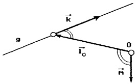

text_image

g
k
l₀
0
m

③ Momentengleichung :

$$
\vec {x} \times \vec {k} = \vec {m}; \vec {k} \neq \vec {0} \text {mit} \vec {k} \cdot \vec {m} = 0
$$

( g ist Wirkungslinie der Kraft  $\vec{k}$  mit Moment  $\vec{m}$  bzgl. O )

oder

$\overrightarrow{PX} \times \vec{k} = \vec{m}_P$ mit Moment $\vec{m}_P = \vec{m} - \overrightarrow{OP} \times \vec{k}$ bzgl. $P$

## Umrechnung:

① → ② : $b_1 \neq 0$, $b_2 \neq 0$ und $b_3 \neq 0 \Rightarrow g: \frac{x - a_1}{b_1} = \frac{y - a_2}{b_2} = \frac{z - a_3}{b_3} (= t)$.

$$
b _ {1} = 0, b _ {2} \neq 0 \text {und} b _ {3} \neq 0 \Rightarrow g: \frac {y - a _ {2}}{b _ {2}} = \frac {z - a _ {3}}{b _ {3}}, x = a _ {1}.
$$

$$
b _ {1} = 0, b _ {2} = 0 \text {und} b _ {3} \neq 0 \Rightarrow g: x = a _ {1}, y = a _ {2}.
$$

(Analog die anderen Möglichkeiten)

② → ① : $\vec{b} = \vec{n}_1 \times \vec{n}_2$. Für $\vec{a}$ setze man in ②

x = 0, falls  $b_{1} \neq 0$ ; y = 0, falls  $b_{2} \neq 0$ ; z = 0, falls  $b_{3} \neq 0$  und löse ② auf nach y, z (x, z bzw. x, y)

$$
g: \left\{ \begin{array}{l} 3 x + 7 y + 9 z - 5 = 0 \\ 2 x + 4 y + 8 z - 6 = 0 \end{array} \right. \Rightarrow \vec {b} = \left( \begin{array}{c} 3 \\ 7 \\ 9 \end{array} \right) \times \left( \begin{array}{c} 2 \\ 4 \\ 8 \end{array} \right) = \left( \begin{array}{c} 2 0 \\ - 6 \\ - 2 \end{array} \right).
$$

$$
b _ {3} \neq 0 \Rightarrow z = 0 \Rightarrow \left\{ \begin{array}{l} 3 x + 7 y = 5 \\ 2 x + 4 y = 6 \end{array} \Rightarrow \vec {a} = \left( \begin{array}{c} 1 1 \\ - 4 \\ 0 \end{array} \right) \right..
$$

① → ③ : $\vec{k} = \vec{b}$; $\vec{m} = \vec{a} \times \vec{b}$.

③ → ① : $\vec{b} = \vec{k}$ ; $\vec{a} = \vec{l}_O$, wobei allg. $\vec{l}_P = \frac{1}{|\vec{k}|^2} (\vec{k} \times \vec{m}_P)$ das Lot von $P$ auf $g$.

② → ③ : $\vec{k} = \vec{n}_1 \times \vec{n}_2$ ; $\vec{m} = d_2\vec{n}_1 - d_1\vec{n}_2$.

( Beachte: $\vec{m} = \vec{x}\times (\vec{n}_1\times \vec{n}_2) = (\vec{x}\cdot \vec{n}_2)\vec{n}_1 - (\vec{x}\cdot \vec{n}_1)\vec{n}_2$ )

③ → ② : Produkt ausschreiben, 2 der 3 skalaren Gleichungen sind nicht vom Typ 0 = 0, sie bestimmen eine Darstellung ② .

$$
\vec {x} \times \left( \begin{array}{c} 1 \\ 2 \\ 3 \end{array} \right) = \left( \begin{array}{c} - 1 \\ - 1 \\ 1 \end{array} \right) \Rightarrow \left( \begin{array}{c} 3 y - 2 z \\ z - 3 x \\ 2 x - y \end{array} \right) = \left( \begin{array}{c} - 1 \\ - 1 \\ 1 \end{array} \right) \Rightarrow g: \left\{ \begin{array}{l} 3 y - 2 z + 1 = 0 \\ z - 3 x + 1 = 0 \end{array} . \right.
$$

## Aufgaben

1. Die kartesischen Koordinaten der Ecken eines Tetraeders $\Delta$ im $\mathbb{R}^3$ seien

$$
A _ {1} = (1, 1, 1), A _ {2} = (1, - 1, - 1), A _ {3} = (- 1, - 1, 1), A _ {4} = (- 1, 1, - 1).
$$

Man bestimme

a) das Volumen des Tetraeders $\Delta$,
b) eine Parameterdarstellung der Höhe durch  $A_{4}$ ,
c) eine Gleichung für die Ebene $E$ durch $A_{1}, A_{2}, A_{3}$,
d) das gemeinsame Lot und den Abstand der Kanten $\overline{A_{1}A_{2}}$, $\overline{A_{3}A_{4}}$.

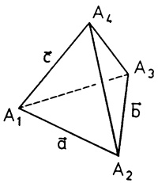

text_image

A₁
A₂
A₃
A₄
a
b
c

2. Man bestimme das gemeinsame Lot und den kürzesten Abstand der beiden Geraden im  $R^{3}$ :

$$
\vec {x} \times \left( \begin{array}{c} 0 \\ 0 \\ 1 \end{array} \right) = \left( \begin{array}{c} 2 \\ - 2 \\ 0 \end{array} \right) \quad \text {und} \quad \vec {x} = t \left( \begin{array}{c} 2 \\ - 1 \\ 2 \end{array} \right), t \in \mathbb {R}.
$$

3. Im  $R^{3}$  sind die Ebene E : x = y und die Gerade g : 10 - 2x = -5y = 10z gegeben.

- Man bestimme eine Parameterdarstellung für $E$.
- Unter welchem Winkel trifft die Gerade g auf die Ebene E ?

4. Im $\mathbb{R}^3$ sollen sich die beiden Geraden $g_1$ und $g_2$ schneiden:

$$
g _ {1} : x - 1 = \frac {y + 1}{2} = - \frac {z + 1}{\lambda}; \quad g _ {2} : x + 2 = y - 1 = z.
$$

a) Wie groß muß λ sein ?
b) Welche Koordinaten hat der Schnittpunkt ?
c) In welcher Ebene liegen $g_{1}$ und $g_{2}$?
d) Wie groß ist der Schnittwinkel zwischen  $g_{1}$  und  $g_{2}$ ?

5. Gesucht ist die Gerade im Raum, die durch den Punkt O geht und mit den drei Ebenen

$$
3 x - 4 y = 0, \quad y = 0, \quad z = 0
$$

gleiche Winkel einschließt. Wie groß ist dieser Winkel ?

6. Die Gerade $g_1$ trifft die Punkte $(1, -1, 1)$ und $(-1, -1, -1)$, die Gerade $g_2$ geht durch $(-1, 1, 1)$ und $(1, 1, -1)$. Man berechne die Schnittpunkte mit der Ebene $x_3 = c$ und deren Verbindungsgerade $g_c$. Man bestätige, daß jede dieser Geraden $g_c$ auf der Fläche $F : x_1 + x_2x_3 = 0$ liegt. Auf $F$ liegt eine zweite Geradenschar, welche?

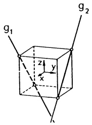

text_image

g₁
z
y
x
g₂

7. a) Welche Entfernung $a$ auf der Erdkugel haben NEW YORK (41° n.B., 74° w.B.) und LISSABON (38° n.B., 9° w.B.) ?
(Hilfe: Berechne die Ortsvektoren von NY und L im skizzierten Ko-ordinatensystem mit Erdradius R = 6367 km)
b) Unter welchem Winkel γ schneidet der Großkreisbogen von New York nach Lissabon den Meridian in New York?

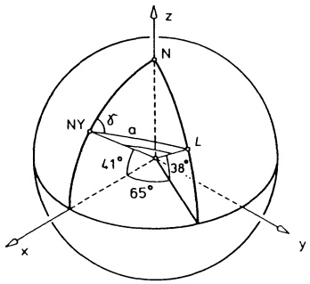

text_image

z
N
δ
a
NY
L
38°
41°
65°
x
y

8. Man bestimme den Schattenriß des Würfels $\{(x,y,z)\in\mathbb{R}^{3}\mid x|\leq1,|y|\leq1,0\leq z\leq2\}$ unter der Projektion (18) ($\rightarrow$ Abb. 40).

## §7. Gebundene Vektoren

\* 7.1 Gebundene Vektoren. Die bisher betrachteten Vektoren sind „frei“ in dem Sinne, daß sie im ganzen Raum parallel verschiebbar sind; in der Mechanik beschreibt man damit räumlich homogene Kräfte und Momente. Zur Darstellung von „Einzelkräften“, die punktförmig an einem starren Körper angreifen und nur längs ihrer Wirkungslinie verschoben werden dürfen, benötigt man den Begriff des – an eine Gerade – gebundenen Vektors im Raum:

Definition. Unter einem gebundenen Vektor versteht man ein Paar  $(\vec{k}, g)$  mit einem freien Vektor  $\vec{k}$  und einer Geraden g, die -falls  $\vec{k} \neq \vec{0}$  - in Richtung  $\vec{k}$  verläuft. Der Nullvektor  $\vec{k} = \vec{0}$  zusammen mit einer beliebigen Geraden heißt gebundener Nullvektor.

Im Hinblick auf die ausschließliche Anwendung in der Mechanik nennen wir  $\vec{k}$  Kraftvektor, g Wirkungslinie und jeden Punkt A der Geraden g Angriffspunkt des gebundenen Vektors. Ist P ein beliebiger Punkt des Raumes und A ein Angriffspunkt, so heißt

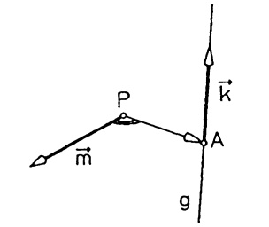

text_image

P
A
k
m
g

Abb. 41 - Gebundener Vektor

$$
\vec {m} _ {P} := \overrightarrow {P A} \times \vec {k} \tag {1}
$$

das Moment des gebundenen Vektors im Punkt P. Die Momentengleichung der Wirkungslinie lautet (→ 6.3)

$$
\overrightarrow {P X} \times \vec {k} = \vec {m} _ {p}.
$$

## Definition.

1. Als Wirkung des gebundenen Vektors im Punkt $P$ definieren wir das geordnete Paar „freier“ Vektoren $(\vec{k},\vec{m}_{P})$.
2. Zwei gebundene Vektoren sind gleich, wenn es einen Punkt P gibt, in dem sie die gleiche Wirkung, d.h. den gleichen Kraftvektor und das gleiche Moment besitzen.

Kennt man die Wirkung  $(\vec{k},\vec{m}_{P})$  im Punkt P, so erhält man die Wirkung in einem beliebigen anderen Punkt Q durch

$$
(\vec {k}, \vec {m} _ {Q}) = (\vec {k}, \vec {m} _ {P} - \overrightarrow {P Q} \times \vec {k}). \tag {2}
$$

Beweis. Ist A ein Angriffspunkt des gebundenen Vektors, so gilt

$$
\vec {m} _ {Q} = \overrightarrow {Q A} \times \vec {k} = (\overrightarrow {P A} - \overrightarrow {P Q}) \times \vec {k} = \vec {m} _ {P} - \overrightarrow {P Q} \times \vec {k}.
$$

Beispiel. Der Kraftvektor $\vec{k} = \begin{pmatrix} 1 \\ -1 \\ 1 \end{pmatrix}$ greife im Punkt $A = (0,1,2)$ an; dann ist seine Wirkung im Punkt $O = (0,0,0)$:

$$
\left(\binom{1}{- 1}, \binom{0}{1} \times \binom{1}{- 1}\right) = \left(\binom{1}{- 1}, \binom{3}{2} _ {- 1}\right).
$$

Für die Wirkung im Punkt  $P = (-1, -1, -1)$  ergibt sich

$$
\left(\left( \begin{array}{c} 1 \\ - 1 \\ 1 \end{array} \right), \left( \begin{array}{c} 3 \\ 2 \\ - 1 \end{array} \right) - \left( \begin{array}{c} - 1 \\ - 1 \\ - 1 \end{array} \right) \times \left( \begin{array}{c} 1 \\ - 1 \\ 1 \end{array} \right)\right) = \left(\left( \begin{array}{c} 1 \\ - 1 \\ 1 \end{array} \right), \left( \begin{array}{c} 5 \\ 2 \\ - 3 \end{array} \right)\right).
$$

\* 7.2 Ein System gebundener Vektoren ist eine endliche Menge gebundener Vektoren. In der Mechanik beschreibt man damit in der Regel ein System von Einzelkräften, die an einem starren Körper angreifen (Kraftsystem).

## Definition.

1. Ein System von zwei gebundenen Vektoren heißt Vektorwinder.
2. Besteht das System aus n gebundenen Vektoren und sind  $(\vec{k}_{1},\vec{m}_{1P})$ , ...,  $(\vec{k}_{n},\vec{m}_{nP})$  deren Wirkungen im Punkt P, so ist nach dem Superpositionsprinzip die Wirkung des Systems im Punkt P das Vektorpaar

$$
(\vec {k}, \vec {m} _ {P}) := (\sum_ {i = 1} ^ {n} \vec {k} _ {i}, \sum_ {i = 1} ^ {n} \vec {m} _ {i P}). \tag {3}
$$

$\vec{k}$ heißt resultierender Kraftvektor, $\vec{m}_{P}$ Moment des Systems im Punkt P. Die Addition von Wirkungen in einem Punkt P ist erklärt durch

$$
(\vec {k} _ {1}, \vec {m} _ {1 P}) + (\vec {k} _ {2}, \vec {m} _ {2 P}) := (\vec {k} _ {1} + \vec {k} _ {2}, \vec {m} _ {1 P} + \vec {m} _ {2 P}).
$$