3. Zwei Systeme von gebundenen Vektoren heißen äquivalent, wenn es einen Punkt P gibt, in welchem beide Systeme die gleiche Wirkung besitzen.

Für die Wirkung des Systems in einem anderen Punkt $Q$ erhält man mit (2) und §5(8c) sofort

$$
(\vec {k}, \vec {m} _ {Q}) = (\vec {k}, \vec {m} _ {P} - \overrightarrow {P Q} \times \vec {k}). \tag {4}
$$

Satz 7.1. Zwei Systeme von gebundenen Vektoren sind genau dann äquivalent, wenn sie in jedem Punkt P jeweils das gleiche Moment besitzen.

Beweis. Seien  $(\vec{k},\vec{m}_{P})$  und  $(\vec{k}^{\prime},\vec{m}_{P}^{\prime})$  die Wirkungen der Systeme im Punkt P, dann folgt aus  $\vec{k}=\vec{k}^{\prime}$  und  $\vec{m}_{P}=\vec{m}_{P}^{\prime}$  für einen beliebigen Punkt Q

$$
\vec {m} _ {Q} = \vec {m} _ {P} - \overrightarrow {P Q} \times \vec {k} = \vec {m} _ {P} ^ {\prime} - \overrightarrow {P Q} \times \vec {k} ^ {\prime} = \vec {m} _ {Q} ^ {\prime}.
$$

Umgekehrt folgt aus $\vec{m}_{Q}=\vec{m}_{Q}^{\prime}$ für jeden Punkt $Q$ sofort $\vec{m}_{P}=\vec{m}_{P}^{\prime}$ und damit $\overrightarrow{PQ}\times(\vec{k}-\vec{k}^{\prime})=\vec{0}$. Dies ist für beliebiges $\overrightarrow{PQ}$ nur möglich, falls $\vec{k}=\vec{k}^{\prime}$. □

Satz 7.2. Jedes System von gebundenen Vektoren ist äquivalent zu einem Vektorwinder.

Beweis. Sei P ein beliebiger Punkt, dann stellt  $(\vec{k},\vec{m}_{P})$  nur dann die Wirkung eines gebundenen Vektors dar, wenn

$$
\vec {k} \cdot \vec {m} _ {P} = 0 \quad \text {und} \quad (\vec {k} = \vec {0} \Rightarrow \vec {m} _ {P} = \vec {0}). \tag {5}
$$

Für die Wirkung eines Kraftsystems ist (5) im allg. nicht erfüllt, daher zerlegen wir die Wirkung

$$
(\vec {k}, \vec {m} _ {P}) = (\vec {l}, \vec {m} _ {P}) + (\vec {k} - \vec {l}, \vec {0}), \tag {6}
$$

wobei $\vec{l} \neq \vec{0}$ senkrecht zu $\vec{m}_{P}$ aber sonst beliebig gewählt ist. $(\vec{k} - \vec{l}, \vec{0})$ ist Wirkung eines gebundenen Vektors mit Angriffspunkt $P$.

Definition. Ein Vektorwinder mit der Wirkung  $(\vec{0},\vec{m}_{P})$  im Punkt P heißt freies Moment.

Aus der Zerlegung

$$
(\vec {0}, \vec {m} _ {P}) = (\vec {l}, \vec {m} _ {P}) + (- \vec {l}, \vec {0})
$$

mit  $\vec{l} \neq \vec{0}$  und  $\vec{l} \cdot \vec{m}_{P} = 0$  erkennt man, daß ein freies Moment stets einem Paar von gebundenen Vektoren äquivalent ist, deren Kraftvektoren gleichen Betrag und entgegengesetzte Richtung besitzen (Kräftepaar). Die Bezeichnung „frei“ rechtfertigt

Satz 7.3. Ein freies Moment hat in jedem Punkt die gleiche Wirkung.

Beweis. Wegen $\vec{k} = \vec{0}$ ist $\overrightarrow{QP} \times \vec{k} = \vec{0}$, d.h. mit (4) ist $\vec{m}_Q = \vec{m}_P$ für alle Punkte $Q$.

## \* 7.3 Die Reduktion eines Systems gebundener Vektoren.

(a) Reduktion im Punkt $P$: Die Darstellung (6) eines Vektorwinders ist nicht eindeutig, daher bevorzugt man in der Mechanik eine eindeutiger Zerlegung der Wirkung in $P$

$$
(\vec {k}, \vec {m} _ {P}) = (\vec {k}, \vec {0}) + (\vec {0}, \vec {m} _ {P}). \tag {7}
$$

Ist $(\vec{k},\vec{m}_{P})$ die Wirkung eines Systems gebundener Vektoren in $P$ so heißt (7) Reduktion des Systems in $P$. Für ein Kraftsystem ist $(\vec{k},\vec{0})$ die Wirkung der resultierenden Kraft mit Angriffspunkt $P$, $(\vec{0},\vec{m}_{P})$ das resultierende Moment in $P$. Äquivalente Systeme besitzen in jedem Punkt des Raumes jeweils die gleiche Reduktion.

⑥ Reduktion zur Vektorschraube. Hat ein System gebundener Vektoren in einem Punkt A die Wirkung  $(\vec{k},\vec{m}_{A})$  mit  $\vec{k}\neq\vec{0}$  und  $\vec{m}_{A}=p\vec{k}$ , so sagt man, das System wirkt in A als Vektorschraube mit Steigungsparameter p.

Satz 7.4. Ein System gebundener Vektoren, das in einem (beliebigen) Punkt P die Wirkung $(\vec{k},\vec{m}_{P})$ mit $\vec{k}\neq \vec{0}$ besitzt, wirkt in jedem Punkt der Geraden

$$
g: \quad \overrightarrow {P X} = \frac {1}{| \vec {k} | ^ {2}} \vec {k} \times \vec {m} _ {P} + t \vec {k}, \quad t \in \mathbb {R} \tag {8}
$$

als Vektorschraube mit dem Steigungsparameter

$$
p = \frac {1}{| \vec {k} | ^ {2}} \vec {k} \cdot \vec {m} _ {P}.
$$

Man nennt g die Achse des Systems, sie ist eindeutig bestimmt.

Beweis. Wir zerlegen $\vec{m}_{P}$ orthogonal längs $\vec{k}$ ($\rightarrow$ §5 (6)),

$$
\vec {m} _ {P} = \vec {m} _ {\vec {k}} + \vec {m} _ {\vec {n}} \quad \text {mit} \quad \vec {m} _ {\vec {k}} = \frac {\vec {k} \cdot \vec {m} _ {P}}{| \vec {k} | ^ {2}} \vec {k}. \tag {9}
$$

Das Moment in einem Punkt A besitzt gemäß (4) die Zerlegung

$$
\vec {m} _ {A} = \vec {m} _ {P} - \overrightarrow {P A} \times \vec {k} = \vec {m} _ {\vec {k}} + (\vec {m} _ {\vec {n}} - \overrightarrow {P A} \times \vec {k}),
$$

woraus man einerseits ersieht, daß $\vec{m}_{\vec{k}}$ unabhängig ist von $P$ und andererseits, daß $\vec{m}_A$ genau dann parallel ist zu $\vec{k}$, wenn $A$ auf der Geraden $\overrightarrow{PX} \times \vec{k} = \vec{m}_{\vec{n}}$ liegt. Wegen $\vec{k} \times \vec{m}_{\vec{n}} = \vec{k} \times \vec{m}_P$ besitzt diese (eindeutig bestimmte) Gerade $g$ die angegebene Parameterdarstellung ($\rightarrow$ 6.3). Für jeden Punkt $A$ auf $g$ gilt $\vec{m}_A = \vec{m}_{\vec{k}} = p\vec{k}$ mit $p = \frac{\vec{k} \cdot \vec{m}_P}{|\vec{k}|^2}$ ($\rightarrow$ Abb. 42a).

Die Reduktion eines Systems gebundener Vektoren zur Vektorschraube:

1. Schritt: Wahl eines Bezugspunktes $P$.
2. Schritt: Berechnung der Wirkungen  $(\vec{k}_{i},\vec{m}_{iP})$  in P mit (1).
3. Schritt: Berechnung der Wirkung des Systems in $P$ mit (3).
4. Schritt: Ist  $\vec{k} = \vec{0}$ , so ist das System äquivalent zu einem freien Moment.
Falls $\vec{k} \neq \vec{0}$, dann wirkt das System in jedem Punkt der Achse (8) als Vektorschraube mit Steigungsparameter $p = \frac{1}{|\vec{k}|^2} \vec{k} \cdot \vec{m}_P$. Mit (9) gilt

$$
(\vec {k}, \vec {m} _ {P}) = (\vec {k}, \vec {m} _ {\vec {n}}) + (\vec {0}, \vec {m} _ {\vec {k}}).
$$

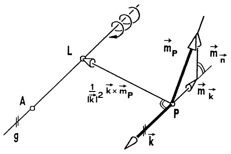

<details>
<summary>text_image</summary>

L
A
g
1/|k-1|^2 k × m_P
P
m_P
m_n
m_k
k
</details>

Abb. 42a - Vektorschraube

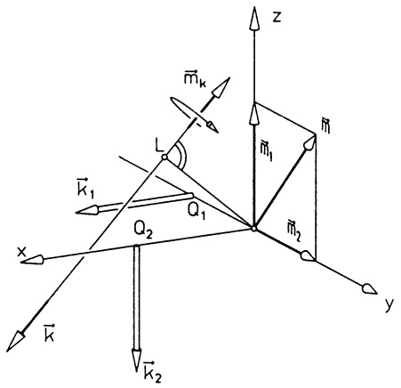

<details>
<summary>text_image</summary>

z
mₖ
L
M₁
M₂
k₁
Q₁
Q₂
x
y
k
k₂
</details>

Abb. 42b - Reduktion eines Kraftsystems

Beispiel. Gegeben ist das System zweier gebundener Vektoren mit Kraftvektoren $\vec{k}_{1}=\begin{pmatrix}2\\0\\0\end{pmatrix},\vec{k}_{2}=\begin{pmatrix}0\\0\\-2\end{pmatrix}$ und den Angriffspunkten $Q_{1}=(0,-1,0)$, $Q_{2}=(1,0,0)$ ($\rightarrow$ Abb. 42b). Im Punkt $O=(0,0,0)$ sind die Wirkungen

$$
\begin{array}{l} \left(\left( \begin{array}{c} 2 \\ 0 \\ 0 \end{array} \right), \left( \begin{array}{c} 0 \\ - 1 \\ 0 \end{array} \right) \times \left( \begin{array}{c} 2 \\ 0 \\ 0 \end{array} \right)\right) = \left(\left( \begin{array}{c} 2 \\ 0 \\ 0 \end{array} \right), \left( \begin{array}{c} 0 \\ 0 \\ 2 \end{array} \right)\right) , \\ \left(\left( \begin{array}{c} 0 \\ 0 \\ - 2 \end{array} \right), \left( \begin{array}{c} 1 \\ 0 \\ 0 \end{array} \right) \times \left( \begin{array}{c} 0 \\ 0 \\ - 2 \end{array} \right)\right) = \left(\left( \begin{array}{c} 0 \\ 0 \\ - 2 \end{array} \right), \left( \begin{array}{c} 0 \\ 2 \\ 0 \end{array} \right)\right) . \\ \end{array}
$$

Das System hat in O die Wirkung

$$
\left(\left( \begin{array}{c} 2 \\ 0 \\ 0 \end{array} \right) + \left( \begin{array}{c} 0 \\ 0 \\ - 2 \end{array} \right), \left( \begin{array}{c} 0 \\ 0 \\ 2 \end{array} \right) + \left( \begin{array}{c} 0 \\ 2 \\ 0 \end{array} \right)\right) = \left(\left( \begin{array}{c} 2 \\ 0 \\ - 2 \end{array} \right), \left( \begin{array}{c} 0 \\ 2 \\ 2 \end{array} \right)\right).
$$

Mit $\vec{m}_{\vec{k}} = \frac{-4}{8}\left( \begin{array}{c}2\\ 0\\ -2 \end{array} \right) = \left( \begin{array}{c} - 1\\ 0\\ 1 \end{array} \right)$ lautet die Reduktion zur Vektorschraube

$$
(\vec {\mathbf {k}}, \vec {\mathbf {m}} _ {\mathrm{P}}) = \left(\left( \begin{array}{c} 2 \\ 0 \\ - 2 \end{array} \right), \left( \begin{array}{c} 1 \\ 2 \\ 1 \end{array} \right)\right) + \left(\vec {0}, \left( \begin{array}{c} - 1 \\ 0 \\ 1 \end{array} \right)\right) .
$$

Der Lotvektor von $O$ auf die Achse ist $\frac{1}{8}\begin{pmatrix}2\\ 0\\ -2\end{pmatrix}\times\begin{pmatrix}1\\ 2\\ 1\end{pmatrix}=\begin{pmatrix}1/2\\ -1/2\\ 1/2\end{pmatrix}$, die Parameterdarstellung der Achse ist

$$
\overrightarrow {O A} = \left( \begin{array}{c} 1 / 2 \\ - 1 / 2 \\ 1 / 2 \end{array} \right) + \mathfrak {t} \left( \begin{array}{c} 2 \\ 0 \\ - 2 \end{array} \right), \quad \mathfrak {t} \in \mathbb {R}.
$$

Der Steigungsparameter ist  $p = \frac{-4}{8} = -\frac{1}{2} < 0$ , daher liegt eine Linksschraube vor.

## Aufgaben

1. In den Ecken  $P_{1} = (0,0,2)$ ,  $P_{2} = (0,1,0)$ ,  $P_{3} = (-1,0,0)$  einer dreieckigen Platte wirken in Abhängigkeit von  $\alpha$  die Einzelkräfte

$$
\vec {k} _ {1} = \left( \begin{array}{c} \alpha \\ - \alpha \\ 1 \end{array} \right), \quad \vec {k} _ {2} = \left( \begin{array}{c} \alpha \\ \alpha \\ - 1 \end{array} \right), \quad \vec {k} _ {3} = \left( \begin{array}{c} \alpha \\ \alpha \\ 1 \end{array} \right).
$$

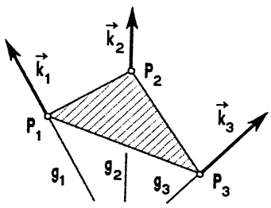

<details>
<summary>text_image</summary>

k₁
P₁
g₁
k₂
P₂
g₂
k₃
g₃
P₃
</details>

a) Für welche Werte von  $\alpha$  ist das Kraftsystem äquivalent zu einer Einzelkraft, wie lautet diese?
b) Man reduziere das Kraftsystem für jedes $\alpha$ auf eine Vektorschraube. Für welche $\alpha$ ist der Drehsinn positiv?

2. Darstellung eines freien Moments als Hebel. Man rechne nach, daß ein freies Moment mit der Wirkung (0, m) stets äquivalent ist zu einem Kräftepaar mit den Kraftvektoren

$$
\vec {k} _ {1} = \vec {m} \times \vec {e}, \quad \vec {k} _ {2} = - \vec {m} \times \vec {e}
$$

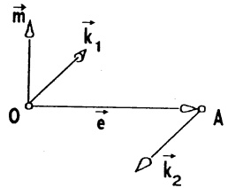

<details>
<summary>text_image</summary>

m
k₁
O
e
A
k₂
</details>

und den Angriffspunkten $O$ und $A$, wobei $\vec{e} = \overrightarrow{OA}$, $|\vec{e}| = 1$ und $\vec{e} \cdot \vec{m} = 0$.

## §8. Die komplexen Zahlen

8.1 Die Menge der komplexen Zahlen. In der mit einem kartesischen  $(x,y)$ -Koordinatensystem versehenen Ebene stellen die Punkte der x-Achse die reellen Zahlen dar. Wir gehen dazu über, auch alle anderen Punkte der Ebene als „Zahlen“ aufzufassen. Dazu schreiben wir den Punkt  $z = (x,y)$

(genauer: das den Punkt repräsentierende Zahlenpaar) in der Form

$$
z = x + i y
$$

und nennen ihn eine komplexe Zahl mit Realteil Re z := x und Imaginärteil Im z := y. Die x-Achse heißt reelle Achse, die y-Achse wird imaginäre Achse genannt. Abkürzend schreibt man  $x = x + i0 = (x, 0)$  (das sind die reellen Zahlen auf der reellen Achse) und  $iy = 0 + iy = (0, y)$

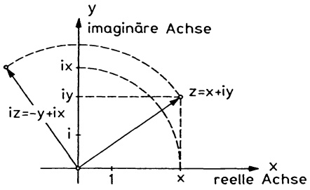

<details>
<summary>text_image</summary>

y
imaginäre Achse
ix
iz=-y+ix
iy
z=x+iy
i
1
x
reelle Achse
x
</details>

Abb. 43 - Komplexe Ebene

(das sind die sogenannten rein imaginären Zahlen auf der imaginären Achse). Die Menge aller komplexen Zahlen wird mit C bezeichnet.

$$
\mathbb {C} := \left\{x + i y; x, y \in \mathbb {R} \right\}.
$$

Zwei komplexe Zahlen  $z = x + iy$  und  $w = u + iv$  (mit  $x, y, u, v \in R$ ) sind genau dann gleich, wenn x = u und y = v gilt. Ist nichts anderes gesagt, so sind in  $z = x + iy$  die Zahlen x, y reell. Es ist üblich, den vom Ursprung O nach z weisenden Zeiger (Ortsvektor) ebenfalls mit z zu bezeichnen. Die Ebene, deren Punkte als komplexe Zahlen aufgefaßt werden, heißt komplexe Zahlenebene.

8.2 Die vier Grundrechenarten in $\mathbb{C}$. Die Summe und die Differenz komplexer Zahlen ist durch

$$
(x + i y) + (u + i v) := (x + u) + i (y + v)
$$

$$
(x + i y) - (u + i v) := (x - u) + i (y - v)
$$

definiert. Sie entspricht der Vektor-Summe bzw. Differenz der zugehörigen Zeiger ( $\rightarrow$  §4).

Die Zahl $ix \in \mathbb{C}$ entsteht aus $x \in \mathbb{R} \subseteq \mathbb{C}$ ($\rightarrow$ Abb. 43) durch eine positive Drehung (gegen Uhrzeigersinn) des zugehörigen Zeigers um den Winkel $\frac{\pi}{2}$. Die Multiplikation in $\mathbb{C}$ wird nun so erklärt, daß generell der Zeiger $i \cdot z$ aus $z$ durch eine positive Drehung um $\frac{\pi}{2}$ hervorgeht. Wenn das überhaupt möglich ist, wird man $i^2 = i \cdot i = -1$ festlegen müssen. Deshalb wird das Produkt zweier

komplexer Zahlen definiert durch

$$
\begin{array}{c} (x + i y) \cdot (u + i v) := (x u - y v) + i (x v + y u), \\ \text {insbesondere} i ^ {2} = - 1. \end{array}
$$

Beachte: Addition, Subtraktion und Multiplikation werden formal wie gewohnt ausgeführt; dabei ist nur $i^{2} = -1$ zu beachten. Die Ergebnisse werden in die Form $a + ib$ ($a, b \in \mathbb{R}$) gebracht. Wegen $i(x + iy) = -y + ix$ stellt $z \mapsto iz$ wie gewünscht die positive Drehung um den Nullpunkt um $\frac{\pi}{2}$ dar ($\rightarrow$ Abb. 43). Die Potenzen $z^{n}$ ($z \in \mathbb{C}$, $n = 0, 1, 2, \ldots$) sind wie üblich durch $z^{0} := 1$, $z^{1} := z$, $z^{n+1} := z^{n}z$ erklärt. Auch in $\mathbb{C}$ gilt die binomische Formel ($\rightarrow$ Satz 2.2)

$$
(z + w) ^ {n} = \sum_ {k = 0} ^ {n} \binom {n} {k} z ^ {k} w ^ {n - k} \quad (n \in \mathbb {N}).
$$

Beispiel. $(3 + 0.5i)(2 - 4i) + (i - 1)^{3} = 6 + i - 12i - 2i^{2} + i^{3} - 3i^{2} + 3i - 1 = 10 - 9i$

Die Division durch $w \in \mathbb{C}$, $w \neq 0$, ist in $\mathbb{C}$ wie folgt erklärt. Man schreibt $q = \frac{z}{w} (= z : w)$, wenn $wq = z$ gilt. Für $z = x + iy$ und $w = u + iv \neq 0$ berechnet man

$$
\frac {x + i y}{u + i v} = \frac {(x + i y) (u - i v)}{(u + i v) (u - i v)} = \frac {x u + y v}{u ^ {2} + v ^ {2}} + \frac {y u - x v}{u ^ {2} + v ^ {2}} i.
$$

Beachte: Durch die Erweiterung mit u - iv wird der Nenner reell.

Beispiele. $\frac{1}{4 - 5i} = \frac{4 + 5i}{(4 - 5i)(4 + 5i)} = \frac{4}{41} +\frac{5}{41} i;$

$$
\frac {8 - i}{7 - i} = \frac {(8 - i) (7 + i)}{4 9 + 1} = \frac {5 7}{5 0} + \frac {1}{5 0} i.
$$

Durch $z^{-n} := \frac{1}{z^n}$ ($z \neq 0, n \in \mathbb{N}$) sind die Potenzen mit negativen Exponenten erklärt. Man verifiziert leicht, daß in $\mathbb{C}$ die üblichen, aus $\mathbb{R}$ bekannten Rechengesetze gelten; etwa $zw = wz$, $z(ws) = (zw)s$, $z(w + s) = zw + zs$, $z^{m+n} = z^m z^n$ ($z \neq 0; m, n \in \mathbb{Z}$) und andere. Auch in $\mathbb{C}$ ist eine Division durch 0 nicht möglich.

## 8.3 Die Konjugation und der Betrag komplexer Zahlen.

Man nennt  $\bar{z}=x-iy$  ( $x,y\in R$ ) die zu  $z=x+iy$  konjugierte komplexe Zahl.

Beispiele.  $\bar{i} = -i, \bar{2} = 2, \overline{4 + 2i} = 4 - 2i, \overline{3 - 2i} = 3 + 2i.$

Für den Übergang $z \mapsto \bar{z}$ zu konjugiert komplexen Zahlen (das ist die Spiegelung an der rellen Achse) gelten die folgenden Rechenregeln:

$$
\overline {{z + w}} = \overline {{z}} + \overline {{w}}; \overline {{z w}} = \overline {{z}} \overline {{w}}; (\frac {\overline {{z}}}{\overline {{w}}}) = \frac {\overline {{z}}}{\overline {{w}}} \quad (w \neq 0);
$$

$$
\overline {{\bar {z}}} = z; \operatorname{Re} z = \frac {1}{2} (z + \bar {z}); \operatorname{Im} z = \frac {1}{2 i} (z - \bar {z}).
$$

Die Länge des Zeigers  $z = x + iy$  wird mit  $|z|$  bezeichnet und heißt Betrag der komplexen Zahl. Man rechnet leicht nach:

$$
| z | = \sqrt {x ^ {2} + y ^ {2}} = \sqrt {z \bar {z}}, \quad \text {falls} z = x + i y;
$$

$$
| z w | = | z | | w |; \left| \frac {z}{w} \right| = \frac {| z |}{| w |} \quad (w \neq 0); | \bar {z} | = | z |.
$$

Ferner gilt die Dreiecksungleichung  $|z + w| \leq |z| + |w|$ , die sich leicht mit vollständiger Induktion auf n Summanden verallgemeinern läßt.

$$
\left| \sum_ {k = 1} ^ {n} z _ {k} \right| \leq \sum_ {k = 1} ^ {n} \left| z _ {k} \right|. \tag {1}
$$

Beispiele. $|i| = |-i| = 1$; $|2 + 3i| = \sqrt{4 + 9} = \sqrt{13}$;

$$
| (2 + 3 i) (1 + i) | = | 2 + 3 i | | 1 + i | = \sqrt {1 3} \sqrt {2} = \sqrt {2 6}.
$$

8.4 Anwendungen: a Quadratische Gleichungen. Ursprünglich wurden die komplexen Zahlen zur einheitlichen Behandlung der quadratischen Gleichungen

$$
a x ^ {2} + b x + c = 0 \quad (\text {mit} a, b, c \in \mathbb {R}, a \neq 0) \tag {2}
$$

eingeführt. Die Gleichung $x^{2} + 1 = 0$ hat offenbar in $\mathbb{R}$ keine Lösung, wohl aber in $\mathbb{C}$, nämlich $x = \pm \sqrt{-1} = \pm i$, und es gilt $x^{2} + 1 = (x - i)(x + i)$.

Allgemein gilt: Die Gleichung (2) besitzt in C die beiden (nicht notwendig verschiedenen) Lösungen

$$
x _ {1} = - \frac {b}{2 a} + \frac {1}{2 a} \sqrt {b ^ {2} - 4 a c}, \quad x _ {2} = - \frac {b}{2 a} - \frac {1}{2 a} \sqrt {b ^ {2} - 4 a c}, \tag {3}
$$

wobei $\sqrt{d}$ die positive Quadratwurzel von $d\in\mathbb{R}$ bezeichnet, sofern $d>0$, andernfalls $\sqrt{d}=i\sqrt{-d}$. Ferner bestätigt man leicht durch Nachrechnen

$$
a x ^ {2} + b x + c = a (x - x _ {1}) (x - x _ {2}).
$$

Beispiele. 1. Für die quadratische Gleichung $x^{2} + \sqrt{2}x + 1 = 0$ ergeben sich mit (3) die beiden Lösungen: $x_{1} = \frac{\sqrt{2}}{2}(-1 + i)$ und $x_{2} = \frac{\sqrt{2}}{2}(-1 - i)$.

2. Damit hat  $x^{4} + 1 = (x^{2} + \sqrt{2}x + 1)(x^{2} - \sqrt{2}x + 1) = 0$  die vier komplexen Lösungen:

$$
x _ {1} = \frac {\sqrt {2}}{2} (1 + i), x _ {2} = \frac {\sqrt {2}}{2} (1 - i), x _ {3} = \frac {\sqrt {2}}{2} (- 1 + i) \text {und} x _ {4} = \frac {\sqrt {2}}{2} (- 1 - i).\quad \square
$$

Bemerkung. Bei der numerischen Lösung einer quadratischen Gleichung per Computer sollte man (wegen der Rechnung mit endlich vielen Dezimalstellen) auf die mögliche Auslöschung führender Stellen achten. Dies tritt immer dann auf, falls $b^{2} - 4ac > 0$ und $|ac|$ sehr klein ist, und zwar in (3) bei $x_{1}$, falls $b > 0$, bzw. $x_{2}$, falls $b < 0$ ($\rightarrow$ Kap. 7, 2.5, Procedure Quadr-Gleichg).

⑥ Netzwerke mit Wechselstrom.. In Wechselstromkreisen hat man Spannungen $u(t)$ und Ströme $j(t)$, die zeitlich sinus- bzw. cosinusförmigen Verlauf besitzen,

$$
u (t) = u _ {0} \cos (\omega t + \alpha), j (t) = j _ {0} \cos (\omega t + \beta).
$$

Diese reellen Augenblickswerte faßt man auf als Realteile der komplexen Augenblickswerte

$$
U (t) = u _ {0} [ \cos (\omega t + \alpha) + i \sin (\omega t + \alpha) ],
$$

$$
I (t) = j _ {0} [ \cos (\omega t + \beta) + i \sin (\omega t + \beta) ].
$$

Der Vorteil dieser Betrachtungsweise ergibt sich bei den linearen Grundelementen, bei denen der Widerstand unabhängig von der Stromstärke ist (Ohmscher Widerstand, Kapazität, Induktivität). Für diese kann man nämlich in der komplexen Schreibweise einheitlich das Ohmsche Gesetz

$$
U (t) = Z I (t)
$$

beweisen mit einem konstanten komplexen Widerstand Z, der wie folgt erklärt ist:

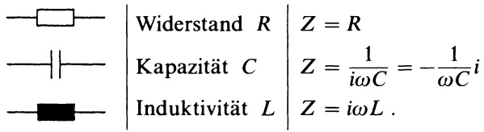

<details>
<summary>text_image</summary>

Widerstand R Z = R
Kapazität C Z = 1 / iωC = -1 / ωC i
Induktivität L Z = iωL .
</details>

Ein lineares Netzwerk ist ein Stromkreis, der diese drei Elemente in irgendeiner Zusammensetzung enthält. Mit den KIRCHHOFFschen Regeln ergibt sich für die Zusammenschaltung zweier komplexer Widerstände $Z_1$, $Z_2$ als Gesamtwider-

stand (Ersatzwiderstand): Z bei

Reihenschaltung

$$
Z = Z _ {1} + Z _ {2},
$$

Parallelschaltung

$$
\frac {1}{Z} = \frac {1}{Z _ {1}} + \frac {1}{Z _ {2}}, Z = \frac {Z _ {1} Z _ {2}}{Z _ {1} + Z _ {2}}.
$$

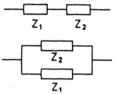

Abb. 44 – Schaltungen

Zum komplexen Widerstand Z heißen Re Z Wirkwiderstand, Im Z Blindwiderstand und |Z| Scheinwiderstand oder Impedanz.

Beispiel. An der elektrischen Schaltung (→ Abb. 45) mit $R_{1}=48\Omega$, $R_{2}=22\Omega$, $C=20\mu F$, $L=155mH$ wird eine Wechselspannung $U_{i}$ von $U_{eff}=220V$ und 50Hz angelegt. Der komplexe Widerstand des Stromkreises ist

$$
\begin{array}{l} Z = \frac {\left(R _ {1} - \frac {i}{\omega C}\right) (R _ {2} + i \omega L)}{\left(R _ {1} - \frac {i}{\omega C}\right) + (R _ {2} + i \omega L)} \\ = \frac {\left[ R _ {1} ^ {2} R _ {2} + R _ {1} R _ {2} ^ {2} + R _ {1} L ^ {2} \omega^ {2} + \frac {R _ {2}}{\omega^ {2} C ^ {2}} \right] + i \left[ R _ {1} ^ {2} \omega L - \frac {R _ {2} ^ {2}}{\omega C} + \frac {L}{\omega C ^ {2}} - \frac {\omega L ^ {2}}{C} \right]}{(R _ {1} + R _ {2}) ^ {2} + \left(\omega L - \frac {1}{\omega C}\right) ^ {2}} \\ \approx (4 3. 5 6 + i   5 2. 1 1) \Omega . \\ \end{array}
$$

Damit fließt der Effektivstrom  $I_{eff} = \frac{U_{eff}}{|Z|} \approx 3.24A$ , da  $|Z| \approx 67.92\Omega$ .

Legt man eine Wechselspannung mit der Frequenz 104.41Hz an, so verhält sich der Stromkreis wie ein ohmscher (reeller) Widerstand; denn für

$$
\omega^ {2} L C = \frac {L - C R _ {2} ^ {2}}{L - C R _ {1} ^ {2}}
$$

verschwindet Im Z ; dh.  $Z \approx 126\Omega$ .

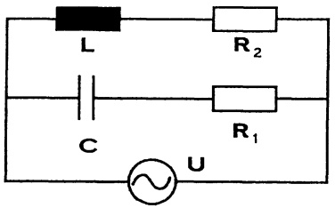

<details>
<summary>text_image</summary>

L
R₂
C
R₁
U
</details>

Abb. 45 - Stromkreis

In späteren Kapiteln werden zahlreiche weitere Anwendungen der komplexen Zahlen behandelt ( $\rightarrow$  Kap. 2, §3, Kap. 3, 1.10, Kap. 6, §1 und Band 2, Kap. 10).

# Kapitel 2

# Funktionen, Grenzwerte, Stetigkeit

## §1. Funktionen (Grundbegriffe)

1.1 Funktionen. Bis auf weiteres diskutieren wir nur reelle Funktionen einer reellen Veränderlichen $f: D \to \mathbb{R}$, $x \mapsto f(x)$, mit der Variablen (oder dem Argument) $x \in D \subseteq \mathbb{R}$. Jede solche Funktion wird durch den Graph (die Kurve) $y = f(x)$ veranschaulicht, er (sie) besteht aus denjenigen Punkten $(x, y)$-einer mit kartesischen $(x, y)$-Koordinaten versehenen Ebene - mit $x \in D$ und $y = f(x)$ ($\rightarrow$ Abb. 5).

Funktionen (bzw. die Zuordnungsvorschrift) werden vorgegeben durch:

a) Tabellen, etwa bei Versuchsreihen der Meßwert  $m(t)$  zur Zeit t ;
b) einen Text, in dem die Zuordnungsvorschrift verbal formuliert wird;
c) eine Formel, etwa  $f(x) = x^{2}$ . Wenn nicht näher spezifiziert wird, ist D die Menge aller x, für welche die angegebene Formel sinnvoll ist;
d) einen Graphen; beispielsweise bei den Aufzeichnungen eines Meßgerätes oder Rechners mit graphischer Ausgabe. Jedoch sind so erklärte Funktionen nur innerhalb der Meßgenauigkeit festgelegt.

## Beispiel 1. Lineare Funktionen.

$f(x) = ax + b$ mit $x \in \mathbb{R}$ und Konstanten $a, b \in \mathbb{R}$ hat als Graph die Gerade durch $(0, b)$ und $(- \frac{b}{a}, 0)$, falls $a \neq 0$. Im Fall $a = 0$ ist $f$ eine konstante Funktion $f(x) = b$ für alle $x \in \mathbb{R}$, ihr Graph ist die zur $x$-Achse parallele Gerade $y = b$.

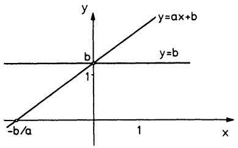

<details>
<summary>line</summary>

| X | y=ax+b | y=b |
| --- | --- | --- |
| -b/a | 0 | — |
| 0 | b | b |
| 1 | — | b |
</details>

Abb. 46 - Lineare Funktion

## Beispiel 2. Quadratische Funktionen.

a) Der Graph der Funktion $f:\mathbb{R}\to\mathbb{R}$, $f(x)=x^{2}$, ist die Normalparabel. In Abb. 47 sind zu verschiedenen $a$-Werten die Parabeln $y=ax^{2}$ eingetragen.
b) Der Graph der quadratischen Funktion  $f(x) = ax^{2} + bx + c$  (mit  $a \neq 0$ ) ist ebenfalls eine Parabel, deren Normalform (damit auch der Scheitel) mittels quadratischer Ergänzung bestimmt wird:

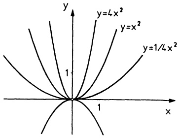

<details>
<summary>contour</summary>

| Function | Description |
| --- | --- |
| Curve 1 | \(y=4x^{2}\) |
| Curve 2 | \(y=x^{2}\) |
| Curve 3 | \(y=1/4x^{2}\) |
</details>

Abb. 47 - Quadratische Funktion

$$
\begin{array}{l} y = a x ^ {2} + b x + c \\ = a (x ^ {2} + \frac {2 b}{2 a} x + \frac {b ^ {2}}{4 a ^ {2}} - \frac {b ^ {2}}{4 a ^ {2}}) + c \\ = a (x - x _ {0}) ^ {2} + y _ {0} \quad \text {mit} \quad x _ {0} = - \frac {b}{2 a}, y _ {0} = c - \frac {b ^ {2}}{4 a}. \\ \end{array}
$$

Es handelt sich also um eine verschobene Parabel $y = ax^2$, deren Scheitel im Punkt $(x_0, y_0)$ liegt. In der Mechanik tritt beispielsweise eine quadratische Funktion auf im einfachen „Weg-Zeit-Gesetz“ $s(t) = \frac{1}{2}bt^2 + vt + s_0$ oder beim schrägen Wurf $y = x \tan \varphi - \frac{g}{2v^2 \cos^2 \varphi} x^2$.

Beispiel 3. Die Wurzelfunktion

$f(x) = \sqrt{x}$ ist definiert auf

$$
D = \mathbb {R} _ {+} = \{x \in \mathbb {R}; x \geq 0 \}.
$$

Es ist  $y = \sqrt{x}$  die eindeutig bestimmte Zahl  $y \geq 0$ , die  $y^{2} = x$  erfüllt. So berechnet man etwa mit der Erdbeschleunigung g beim freien Fall die Fallzeit t aus der Fallhöhe h :

$$
t = \sqrt {2 h / g} . \quad \square
$$

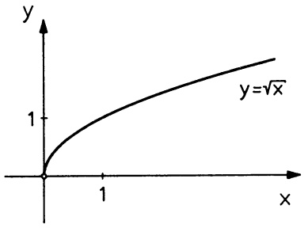

<details>
<summary>line</summary>

| X | Y |
| --- | --- |
| 0 | 0 |
| 1 | 1 |
</details>

Abb. 48 - Wurzelfunktion

Viele Funktionen besitzen gewisse Symmetrie-Eigenschaften. Sei $D \subseteq \mathbb{R}$ symmetrisch zum Nullpunkt ($x \in D \Rightarrow -x \in D$). Man nennt eine Funktion $f : D \to \mathbb{R}$ gerade (bzw. ungerade), wenn $f(-x) = f(x)$ (bzw. $f(-x) = -f(x)$) für alle $x \in D$ gilt. Beispielsweise sind $f(x) = x^{2n}$, $g(x) = \cos x$ gerade und $p(x) = x^{2n+1}$, $q(x) = \sin x$ ungerade ($n \in \mathbb{N}$).

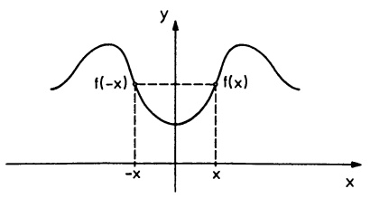

<details>
<summary>contour</summary>

| Point | X-coordinate | Y-coordinate |
| --- | --- | --- |
| f(-x) | -x | 0 |
| f(x) | x | 0 |
</details>

Abb. 49a - Gerade Funktion

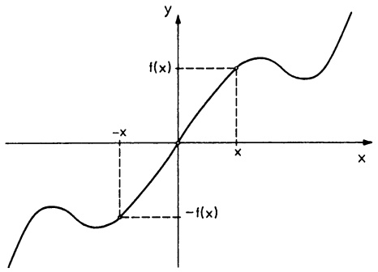

<details>
<summary>line</summary>

| Point | Description |
| --- | --- |
| f(x) | Linear function value at x = 0 |
| -f(x) | Derivative function value at x = -x |
</details>

Abb. 49b - Ungerade Funktion

1.2 Monotonie. Ein für weiterführende Untersuchungen ( $\rightarrow$  Konvergenz, Umkehrfunktion) wichtiger Begriff ist die Monotonie.

Definition. Man nennt eine Funktion $f: D \to \mathbb{R}$ (mit $D \subseteq \mathbb{R}$)

a) monoton wachsend (bzw. monoton fallend), wenn für alle  $x_{1}, x_{2} \in D$  mit  $x_{2} > x_{1}$  die Ungleichung  $f(x_{2}) \geq f(x_{1})$  (bzw.  $f(x_{2}) \leq f(x_{1})$ ) gilt.
b) streng (oder strikt, echt) monoton wachsend (bzw. streng monoton fallend), wenn für alle $x_{1}, x_{2} \in D$ mit $x_{2} > x_{1}$ die strikte Ungleichung $f(x_{2}) > f(x_{1})$ (bzw. $f(x_{2}) < f(x_{1})$) gilt.

Der Graph einer monoton wachsenden Funktion ist (bei wachsendem x) ansteigend oder zumindest nicht fallend; der Graph einer monoton fallenden Funktion ist nirgends ansteigend.

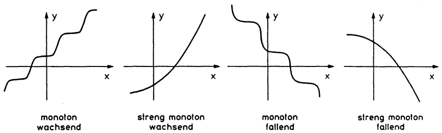

Abb. 50 - Monotone Funktionen

Beispiele. $f(x) = x^2$ ist auf $\mathbb{R}_- = \{x \in \mathbb{R} ; x \leq 0\}$ strikt monoton fallend und auf $\mathbb{R}_+ = \{x \in \mathbb{R} ; x \geq 0\}$ strikt monoton wachsend. Die Sinusfunktion ($\to \S3$) ist auf dem Intervall $[-\frac{\pi}{2}, \frac{\pi}{2}]$ strikt monoton wachsend und auf $[\frac{\pi}{2}, \frac{3\pi}{2}]$ strikt monoton fallend.

1.3 Das Rechnen mit Funktionen. Zu Funktionen $f: D \to \mathbb{R}$, $g: D \to \mathbb{R}$ (mit gleichem Definitionsbereich) definiert man die Summe $f + g$, die Differenz $f - g$, das Produkt $fg$ und das $a$-fache $af$ (mit Zahlenfaktor $a \in \mathbb{R}$) „punktweise“ durch $(f \pm g)(x) := f(x) \pm g(x)$, $(af)(x) := af(x)$, $x \in D$. Der Quotient $\frac{f}{g}(x) := \frac{f(x)}{g(x)}$ ist nur erklärt für die $x \in D$ mit $g(x) \neq 0$. Mit dem Produkt sind auch die Potenzen $f^n$ von $f: D \to \mathbb{R}$ erklärt, nämlich $f^n(x) := f(x)^n$ ($n \in \mathbb{N}$).

Beispiele. Mit $f(x) = x^2 + 1$, $g(x) = \sin x$ entstehen

$(2f + 3g)(x) = 2x^{2} + 2 + 3\sin x, \quad g^{5}(x) = \sin^{5}x = (\sin x)^{5} \text{ und } \frac{f^{2}}{4f - 5g}(x) = \frac{x^{4} + 2x^{2} + 1}{4x^{2} + 4 - 5\sin x}$ (diese Funktion ist nur definiert für die $x \in \mathbb{R}$ mit $4x^{2} + 4 \neq 5\sin x$).

Zu Funktionen $f: I \to \mathbb{R}$ und $g: D \to \mathbb{R}$ mit $g(D) \subseteq I$ kann man die Komposition $h = f \circ g$ bilden, definiert durch $h(x) := f(g(x))$, $x \in D$. (In $f(x)$ wird $x$ ersetzt durch $g(x)$.)

Beispiel. Mit $f(x) = \sin x$, $g(x) = x^3 + 5$ entsteht $f(g(x)) = \sin (x^3 + 5)$, $g(f(x)) = (\sin x)^3 + 5$.

## §2. Polynome und rationale Funktionen

2.1 Polynome. Eine Funktion $f: \mathbb{R} \to \mathbb{R}$ heißt ein Polynom vom Grad $n$, wenn es Zahlen $a_0, a_1, \ldots, a_n \in \mathbb{R}$ gibt, $a_n \neq 0$, so daß

$$
f (x) = a _ {0} + a _ {1} x + a _ {2} x ^ {2} + \dots + a _ {n} x ^ {n} = \sum_ {k = 0} ^ {n} a _ {k} x ^ {k} \tag {1}
$$

für alle $x \in \mathbb{R}$ gilt. Die $a_k$ heißen Koeffizienten des Polynoms. Das Nullpolynom $f(x) = 0$ (für alle $x \in \mathbb{R}$) hat keinen Grad; jedoch wird in der Sprechweise „$f$ ist ein Polynom vom Grad $\leq n$“ das Nullpolynom eingeschlossen. Das Rechnen mit Polynomen in der Summendarstellung (1) ist sehr übersichtlich; man addiert und multipliziert in der üblichen Weise und ordnet die Ergebnisse jeweils nach wachsenden (oder fallenden) $x$-Potenzen. Insbesondere

$$
\sum_ {k = 0} ^ {n} a _ {k} x ^ {k} \pm \sum_ {k = 0} ^ {n} b _ {k} x ^ {k} = \sum_ {k = 0} ^ {n} (a _ {k} \pm b _ {k}) x ^ {k}.
$$

In $f(x) = \sum_{k=0}^{n} a_k x^k$ sind die Koeffizienten $a_k$ eindeutig bestimmt; denn es gilt:

Satz 2.1. Koeffizientenvergleich.

$$
\sum_ {k = 0} ^ {n} a _ {k} x ^ {k} = \sum_ {k = 0} ^ {n} b _ {k} x ^ {k} \iff a _ {k} = b _ {k} \qquad (0 \leq k \leq n).
$$

Beweis. Aus  $a_{0} + a_{1}x + \cdots + a_{n}x^{n} = b_{0} + b_{1}x + \cdots + b_{n}x^{n}$ folgt mit x = 0 sofort  $a_{0} = b_{0}$ . Damit folgt weiter  $a_{1} + a_{2}x + \cdots + a_{n}x^{n-1} = b_{1} + b_{2}x + \cdots + b_{n}x^{n-1}$ für alle  $x \neq 0$ , die aber beliebig klein werden können. Deshalb gilt auch  $a_{1} = b_{1}$ , etc.

Beispiel 1. Es gilt

$$
x ^ {4} + 3 x ^ {2} + 7 x + 2 = \alpha x ^ {4} + (3 \beta + u) x ^ {3} + 3 x ^ {2} + \gamma x + w
$$

genau dann, wenn  $\alpha = 1$ ,  $3\beta + u = 0$ ,  $\gamma = 7$ , w = 2.

Beispiel 2. In einer Faktorisierung

$$
x ^ {3} + a x ^ {2} + b x + c = (x - x _ {1}) (x - x _ {2}) (x - x _ {3})
$$

gilt notwendig

$$
a = - (x _ {1} + x _ {2} + x _ {3}), \quad b = x _ {1} x _ {2} + x _ {2} x _ {3} + x _ {3} x _ {1}, \quad c = - x _ {1} x _ {2} x _ {3},
$$

was man durch Ausmultiplizieren und Koeffizientenvergleich bestätigt.

Wird ein Funktionswert eines Polynoms aus der Summendarstellung (1) berechnet, $f(x_0) = \sum_{k=0}^{n} a_k x_0^k$, benötigt man dafür $2n - 1$ Multiplikationen und $n$ Additionen; berechnet man jedoch die Werte aus der Horner-Darstellung (W. G. HORNER, 1756-1837)

$$
f (x) = (\dots ((a _ {n} x + a _ {n - 1}) x + a _ {n - 2}) x + \dots + a _ {1}) x + a _ {0} \tag {2}
$$

\- von innen nach außen – so wird der Rechenaufwand auf $n$ Multiplikationen und $n$ Additionen reduziert. Das spart nicht nur Zeit, sondern hält auch Rundungsfehler klein und vermeidet unnötig große Zwischenergebnisse. Die Berechnung der Funktionswerte nach (2) beinhaltet gleichzeitig die Division durch Polynome der Form $x - b$:

Satz 2.2. Sei $f(x) = a_n x^n + \cdots + a_1 x + a_0$, $a_n \neq 0$, $n \geq 1$ und $b \in \mathbb{R}$. Für die Zahlen $c_n := a_n$, $c_{n-1} := c_n b + a_{n-1}$, $c_{n-2} := c_{n-1} b + a_{n-2}, \ldots, c_{n-k} := c_{n-k+1} b + a_{n-k}, \ldots, c_0 := c_1 b + a_0$ gilt

$$
c _ {0} = f (b) \text {und} f (x) = (x - b) (c _ {n} x ^ {n - 1} + c _ {n - 1} x ^ {n - 2} + \dots + c _ {2} x + c _ {1}) + f (b). \tag {3}
$$

Beweis.  $f(b) = c_{0}$  ersieht man aus (2). Die Zerlegung (3) bestätigt man durch Ausrechnen der rechten Seite; man beachte dabei  $a_{n} = c_{n}$ ,  $a_{n-1} = c_{n-1} - c_{n}b, \ldots, a_{0} = f(b) - bc_{1}$ . ☐

Die Berechnung der  $c_{i}$  erfolgt auf dem PC nach dem Programm Horner oder bei Handrechnung nach dem Horner-Schema:

$$
\begin{array}{c c c c c c} a _ {n} & a _ {n - 1} & a _ {n - 2} & \dots & a _ {1} & a _ {0} \\ \hline + & a _ {n} b & c _ {n - 1} b & \dots & c _ {2} b & c _ {1} b \\ \hline c _ {n} = a _ {n} & c _ {n - 1} & c _ {n - 2} & \dots & c _ {1} & f (b) \end{array}
$$

Beispiel. $f(x) = 6x^{6} - 3x^{5} + 2x^{2} + 4$, $b = 2$ (,,fehlende“ Koeffizienten sind mit Nullen aufzufüllen!)

$$
\begin{array}{c c c c c c c c} & 6 & - 3 & 0 & 0 & 2 & 0 & 4 \\ \hline + & & 1 2 & 1 8 & 3 6 & 7 2 & 1 4 8 & 2 9 6 \\ \hline 6 & & 9 & & 1 8 & & 3 6 & & 7 4 & & 1 4 8 & & 3 0 0 \end{array} . ^ {2} \nearrow
$$

Also gilt

$$
f (2) = 3 0 0 \text {und} f (x) = (x - 2) (6 x ^ {5} + 9 x ^ {4} + 1 8 x ^ {3} + 3 6 x ^ {2} + 7 4 x + 1 4 8) + 3 0 0.
$$

□

```txt
' Programm HORNER
' -----------------
Input "Polynomgrad ",N
Dim A(N),C(N)
For I=N To O Step -l
    Print I;".Koeffizient"
    Input A(I)
Next I
```

Wendet man dieses Schema auf das Polynom  $c_{n}x^{n-1} + \cdots + c_{1}$  an und fährt rekursiv wie in Programm HORNER vollständig fort, so erhält man alle Koeffizienten  $p_{k}$  des umgeordneten Polynoms

$$
f (x) = p _ {n} (x - b) ^ {n} + p _ {n - 1} (x - b) ^ {n - 1} + \dots + p _ {0}.
$$

```vba
' Programm HORNER vollstaendig
' --------------------------------------------------------------- Next K
Input "Polynomgrad ",N
Dim A(N),C(N)
For I=N To O Step -l
    Print I;".Koeffizient"
    Input A(I)
Next I
Input "b= ",B
For K=O To N
    C(K)=A(K)
```

Beispiel. $6x^{6} - 3x^{5} + 2x^{2} + 4 = 6(x - 2)^{6} + 69(x - 2)^{5} + 330(x - 2)^{4}+$

$$
+ 8 4 0 (x - 2) ^ {3} + 1 2 0 2 (x - 2) ^ {2} + 9 2 0 (x - 2) + 3 0 0. \quad \square
$$

2.2 Polynomnullstellen – Faktorisierung. Als Nullstelle einer Funktion  $f : D \to R$  bezeichnet man jede Lösung der Gleichung  $f(x) = 0$  in D. In praktischen Anwendungen sind die Werte technischer Größen sehr oft als Nullstellen von Polynomen bestimmt: Resonanzfrequenzen, Widerstandsanpassung, Umriß von Flächen.

Eine Zahl $b \in \mathbb{R}$ ist nach (3) genau dann eine Nullstelle des Polynoms $f$, wenn $f(x)$ den Linearfaktor $x - b$ enthält, d.h. wenn es ein Polynom $h$ gibt mit $f(x) = (x - b)h(x)$. Der Faktor $x - b$ kann durchaus mehrfach vorkommen, nämlich dann, wenn auch $h(b) = 0$ gilt und deshalb $h(x)$ von der Form $h(x) = (x - b)h_1(x)$ ist.

Man nennt $b \in \mathbb{R}$ eine $l$-fache Nullstelle von $f$ und $l$ die Vielfachheit von $b$, wenn der Faktor $x - b$ genau $l$-mal in $f(x)$ aufgeht; d.h. wenn es ein Polynom $g$ gibt mit

$$
f (x) = (x - b) ^ {l} g (x) \quad \text {und} \quad g (b) \neq 0 . \tag {4}
$$

Jede weitere Nullstelle  $c \neq b$  von f ist auch Nullstelle von g, also gilt analog  $g(x) = (x - c)^{k} g_{1}(x)$ ,  $g_{1}(c) \neq 0$ , etc.

Beispiel.  $x^{5}-5x^{4}+14x^{3}-22x^{2}+17x-5=(x-1)^{3}(x^{2}-2x+5)$ ; x=1 ist eine dreifache Nullstelle. □

Satz 2.3. a) Sind $b_1, b_2, \ldots, b_r$ die verschiedenen reellen Nullstellen des Polynoms $f(x) = \sum_{k=0}^{n} a_k x^k$, Grad $f \geq 1$, der jeweiligen Vielfachheit $l_1, \ldots, l_r$, dann gilt die Produktdarstellung

$$
f (x) = (x - b _ {1}) ^ {l _ {1}} (x - b _ {2}) ^ {l _ {2}} \dots (x - b _ {r}) ^ {l _ {r}} q (x) \tag {5}
$$

mit einem Polynom q vom Grad  $n - l_{1} - l_{2} - \cdots - l_{r}$ , das in R keine Nullstelle besitzt.

b) Jedes Polynom vom Grad n,  $n \geq 1$ , hat höchstens n Nullstellen.

Beweis. a): (5) ergibt sich durch wiederholte Anwendung der Formel (4). Die Behauptung b) bestätigt man mit einem Gradvergleich: Grad  $f = n = l_{1} + l_{2} + \cdots + l_{r} + Grad q$ , bzw. Anzahl der Nullstellen  $= l_{1} + l_{2} + \cdots + l_{r} = n - Grad q \leq n$ .

Beispiel. $f(x) = (x - 1)^2 (x + 4)^3 (x - 17)(x^2 + 1)(x^2 + x + 4)$ hat die 2-fache (doppelte). Nullstelle $x = 1$, die 3-fache Nullstelle $x = -4$ und die einfache Nullstelle $x = 17$. Das Polynom $(x^2 + 1)(x^2 + x + 4)$ hat in $\mathbb{R}$ keine Nullstelle.

Regel: Kennt man eine Nullstelle b des Polynoms f, so wird zunächst die Faktorisierung  $f(x) = (x - b)h(x)$  (mit dem Horner-Schema) hergestellt. Dadurch wird die Suche nach den anderen Nullstellen von f erleichtert; die Gleichung  $h(x) = 0$  ist häufig einfacher zu lösen.

Beispiel. $f(x) = x^4 + 2x^3 - 3x^2 - 4x + 4$ hat offenbar die Nullstelle $x_1 = 1$. Mit „Horner“ erhält man $f(x) = (x - 1)(x^3 + 3x^2 - 4)$. Der Faktor $h(x) = x^3 + 3x^2 - 4$ hat ebenfalls die Nullstelle 1, $h(x) = (x - 1)(x^2 + 4x + 4)$. Also gilt $f(x) = (x - 1)^2(x + 2)^2$; $f$ hat die doppelte Nullstelle $x_1 = 1$ und die doppelte Nullstelle $x_2 = -2$.

Die Nullstellen eines quadratischen Polynoms bestimmt man mit der bekannten Formel (3) aus Kap. 1, §8, wobei darauf zu achten ist, ob nur reelle oder auch komplexe Nullstellen gesucht sind. Ähnliche Formeln, aber wesentlich komplizierter, gibt es für Polynome vom Grad 3, 4 (man findet sie in den einschlägigen Formelsammlungen).

Für allgemeine Polynome vom Grad ≥ 5 gibt es nachweislich keine entsprechenden Formeln. Ein allgemeingültiges Näherungsverfahren zur Nullstellenbestimmung wird erst in Kap. 3, §2 behandelt. Dagegen lassen sich die rationalen Nullstellen eines Polynoms mit rationalen Koeffizienten sehr leicht bestimmen. Zuerst verwandelt man die Gleichung $a_{n}x^{n} + \cdots + a_{1}x + a_{0} = 0$ mit $a_{i} \in \mathbb{Q}$ in eine Gleichung mit ganzzahligen Koeffizienten, indem man mit dem Hauptnener der  $a_{i}$  durchmultipliziert. Hierauf wendet man dann folgenden Satz an:

Satz 2.4. Rationale Nullstellen. Die rationalen Nullstellen eines Polynoms $f(x) = a_{n}x^{n} + \cdots + a_{1}x + a_{0}$ mit $a_{i} \in \mathbb{Z}$ findet man unter den Brüchen $\frac{a}{b} (a, b \in \mathbb{Z})$, in denen $a$ ein Teiler von $a_{0}$ und $b$ ein Teiler von $a_{n}$ ist.

Beweis. Sei  $\frac{a}{b}$  (in gekürzter Bruchdarstellung) eine Nullstelle von f. Aus  $0 = a_{n}(\frac{a}{b})^{n} + a_{n-1}(\frac{a}{b})^{n-1} + \cdots + a_{1}\frac{a}{b} + a_{0}$  entsteht  $0 = a_{n}a^{n} + a_{n-1}a^{n-1}b + \cdots + a_{1}ab^{n-1} + a_{0}b^{n}$ . Hieraus sieht man:  $a_{n}a^{n}$  ist Vielfaches von b und  $a_{0}b^{n}$  Vielfaches von a. Weil a und b als teilerfremd vorausgesetzt sind, muß b Teiler von  $a_{n}$  und a Teiler von  $a_{0}$  sein.

Beispiel. Die rationalen Nullstellen von $f(x) = 12x^4 - 4x^3 + 6x^2 + x - 1$ liegen in der Menge $\{\pm 1, \pm \frac{1}{2}, \pm \frac{1}{3}, \pm \frac{1}{4}, \pm \frac{1}{6}, \pm \frac{1}{12}\}$. Man findet durch Einsetzen $f(\frac{1}{3}) = 0$ und $f(x) = (4x^3 + 2x + 1)(3x - 1)$.

2.3 Polynominterpolation. Die Interpolation in der einfachsten Form befaßt sich mit dem Problem, zu verschiedenen Meßpunkten  $(x_{i}, y_{i})$ ,  $0 \leq i \leq n$  und  $x_{i} \neq x_{j}$  für  $i \neq j$ , eine „schöne“, dem Problem angepaßte und/oder leicht handhabbare Funktion f zu bestimmen, deren Graph  $y = f(x)$  durch diese Punkte geht. Wir sagen, f interpoliert diese Punkte. Diese Aufgabe ist für  $n + 1$  Punkte und Polynome vom Grad  $\leq n$  eindeutig lösbar. Es gilt

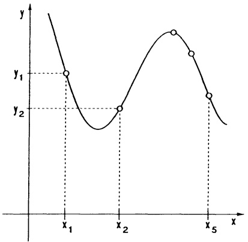

<details>
<summary>line</summary>

| X | Y |
| --- | --- |
| x1 | y1 |
| x2 | y2 |
| x3 | ~0.8 |
| x4 | ~0.6 |
| x5 | ~0.3 |
</details>

Abb. 51 - Interpolation

Satz 2.5. Zu $n+1$ beliebigen Stützpunkten $(x_{i},y_{i})$- mit $x_{i}\neq x_{j}$ für $i\neq j$- gibt es genau ein Polynom $p_{n}$ vom Grad $\leq n$ mit $p_{n}(x_{i})=y_{i}$ für $0\leq i\leq n$.

Beweis. Der Ansatz  $p_{n}(x)=a_{n}x^{n}+a_{n-1}x^{n-1}+\cdots+a_{1}x+a_{0}$  mit noch unbekannten Koeffizienten  $a_{i}\in R$  und  $p_{n}(x_{i})=y_{i}$  entspricht einem System von  $n+1$  linearen Gleichungen

$$
a _ {n} x _ {i} ^ {n} + a _ {n - 1} x _ {i} ^ {n - 1} + \dots + a _ {1} x _ {i} + a _ {0} = y _ {i} \quad (0 \leq i \leq n),
$$

das eindeutig nach  $a_{0}, a_{1}, \ldots, a_{n}$  aufgelöst werden kann ( $\rightarrow$  Kap. 6, 5.5).

Das im Beweis angegebene Konstruktionsverfahren des interpolierenden Polynoms  $p_{n}$  ist zwar (mit der nötigen Algebra) recht einsichtig, jedoch für praktische Rechnungen wenig geeignet. Besser ist das

Newton-Interpolationsverfahren (Isaac NEWTON, 1642-1727). Hierbei wird das interpolierende Polynom $p_n(x)$ angesetzt in der Newton- oder Interpolationsform

$$
\boxed { \begin{array}{c} p _ {n} (x) = \alpha_ {0} + \alpha_ {1} (x - x _ {0}) + \alpha_ {2} (x - x _ {0}) (x - x _ {1}) + \dots \\ + \alpha_ {n} (x - x _ {0}) (x - x _ {1}) \dots (x - x _ {n - 1}). \end{array} } \tag {6}
$$

Die Forderung  $p_{n}(x_{i}) = y_{i} \quad (0 \leq i \leq n)$  ergibt ein Gleichungssystem für  $\alpha_{0}, \alpha_{1}, \ldots, \alpha_{n}$  der Form

$$
\begin{array}{l} y _ {0} = \alpha_ {0} \\ y _ {1} = \alpha_ {0} + \alpha_ {1} (x _ {1} - x _ {0}) \\ y _ {2} = \alpha_ {0} + \alpha_ {1} (x _ {2} - x _ {0}) + \alpha_ {2} (x _ {2} - x _ {0}) (x _ {2} - x _ {1}) \\ y _ {n} = \alpha_ {0} + \alpha_ {1} (x _ {n} - x _ {0}) + \dots + \alpha_ {n} (x _ {n} - x _ {0}) (x _ {n} - x _ {1}) \dots (x _ {n} - x _ {n - 1}), \\ \end{array}
$$

:

das schrittweise von oben nach unten gelöst wird:  $\alpha_{0}=y_{0}$ ,  $\alpha_{1}=\frac{y_{1}-y_{0}}{x_{1}-x_{0}}$ , etc. Eine systematische Darstellung dieses Lösungswegs wurde bereits von NEWTON im Schema der dividierten Differenzen angegeben:

$$
\begin{array}{c c c c c c c c} x _ {0} & y _ {0} & & & & \\ & & > y _ {0, 1} & & & \\ x _ {1} & y _ {1} & & > y _ {0, 1, 2} & & \\ & & > y _ {1, 2} & & > y _ {0, 1, 2, 3} \\ x _ {2} & y _ {2} & & > y _ {1, 2, 3} \\ & & > y _ {2, 3} & & & \dots > y _ {0, 1, 2, \dots , n} \\ \vdots & \vdots & & & > \dots \\ & & & > y _ {n - 2, n - 1, n} \\ & & > y _ {n - 1, n} & & \\ x _ {n} & y _ {n} & & \end{array}
$$

Man entwickelt dieses Schema spaltenweise von links nach rechts. Neben den „Stützwerten“ $y_i$ stehen die ersten dividierten Differenzen

$$
y _ {0, 1} = \frac {y _ {1} - y _ {0}}{x _ {1} - x _ {0}}, \quad y _ {1, 2} = \frac {y _ {2} - y _ {1}}{x _ {2} - x _ {1}}, \dots , \quad y _ {n - 1, n} = \frac {y _ {n} - y _ {n - 1}}{x _ {n} - x _ {n - 1}}.
$$

In der nächsten Spalte stehen die zweiten dividierten Differenzen

$$
y _ {0, 1, 2} = \frac {y _ {1 , 2} - y _ {0 , 1}}{x _ {2} - x _ {0}}, \quad y _ {1, 2, 3} = \frac {y _ {2 , 3} - y _ {1 , 2}}{x _ {3} - x _ {1}}, \dots , \quad y _ {n - 2, n - 1, n} = \frac {y _ {n - 1 , n} - y _ {n - 2 , n - 1}}{x _ {n} - x _ {n - 2}},
$$

dann die dritten dividierten Differenzen

$$
y _ {0, 1, 2, 3} = \frac {y _ {1 , 2 , 3} - y _ {0 , 1 , 2}}{x _ {3} - x _ {0}}, \quad y _ {1, 2, 3, 4} = \frac {y _ {2 , 3 , 4} - y _ {1 , 2 , 3}}{x _ {4} - x _ {1}}, \text {etc.}
$$

Mit etwas Rechnung (bzw. vollständiger Induktion) bestätigt man  $\alpha_{i}=y_{0,1,\ldots,i}$ ;

diese Koeffizienten stehen auf der obersten Schrägzeile. D.h.

$$
p _ {n} (x) = y _ {0} + y _ {0, 1} \left(x - x _ {0}\right) + y _ {0, 1, 2} \left(x - x _ {0}\right) \left(x - x _ {1}\right) + \dots
$$

$$
+ y _ {0, 1, \dots , n} (x - x _ {0}) (x - x _ {1}) \dots (x - x _ {n - 1})
$$

ist das eindeutig bestimmte Polynom vom Grad $\leq n$ mit $p_n(x_i) = y_i$ $(0 \leq i \leq n)$.

Bemerkungen. 1. Das Newton-Verfahren erlaubt den schnellen Übergang von $n+1$ zu $n+2$ Stützstellen. Von den $x_i$ wird keine Anordnung vorausgesetzt. Wird zu den durch $p_n(x)$ interpolierten Punkten $(x_i, y_i)$ ($0 \leq i \leq n$) ein weiterer Punkt $(x_{n+1}, y_{n+1})$ hinzugenommen, braucht das vorhandene Differenzenschema nur durch eine weitere untere Schrägzeile ergänzt zu werden. $p_{n+1}(x) = p_n(x) + y_{0,1,2,\dots,n+1}(x - x_0)(x - x_1) \cdots (x - x_n)$ ist das gesuchte neue Interpolationspolynom.

2. Das Differenzenschema, bzw. die Koeffizienten des interpolierenden Polynoms  $p_{n}(x)$  sind besonders einfach bei äquidistanten Stützstellen  $x_{i}=x_{0}+ih\ (0\leq i\leq n)$  zu berechnen, vgl. Programm NEWTON Interpolation.

Beispiel. Für die Fließgrenze $F$ (in 100kg/cm$^{2}$) eines kohlenstoffarmen Stahles in Abhängigkeit von der Temperatur $T$ (in 100C$^{\circ}$) ergibt ein Versuch folgende Tabelle:

$$
\begin{array}{c c c c c c c} T & 1 & 2 & 3 & 4 & 5 & 6 \\ \hline F & 3 0 & 2 7 & 2 5 & 2 4 & 2 1 & 1 9 \end{array}
$$

Zu bestimmen ist ein Polynom $p(x) = \sum_{k=0}^{4} a_k x^k$ mit $p(T_i) = F_i$, $0 \leq i \leq 4$.

Das Newton-Schema

$$
\begin{array}{c c c c c c} 1 & 3 0 & & & \\ & & - 3 & & \\ 2 & 2 7 & & \frac {1}{2} & \\ & & - 2 & & 0 \\ 3 & 2 5 & & \frac {1}{2} & & - \frac {1}{8} \\ & & - 1 & & - \frac {1}{2} \\ 4 & 2 4 & & - 1 \\ & & - 3 & & \\ 5 & 2 1 & & \end{array}
$$

gibt das Polynom in Interpolationsform:

$$
p (x) = 3 0 - 3 (x - 1) + \frac {1}{2} (x - 1) (x - 2) - \frac {1}{8} (x - 1) (x - 2) (x - 3) (x - 4),
$$

das in Summendarstellung  $p(x) = -\frac{1}{8}x^{4} + \frac{5}{4}x^{3} - \frac{31}{8}x^{2} + \frac{7}{4}x + 31$  lautet. Dieses Polynom weicht beim 6. Meßwert erheblich ab:  $p_{4}(6) = 10$ . ☐

<div class="docvortex-algorithm" style="white-space: pre-wrap; font-family:monospace;">
' Programm NEWTON Interpolation
' ---------------------------------------------------------
Input "Grad= ";N
Input "Step= ";H
Input "XO = ";Z
Dim F(N)
For I=O To N
    Print "F"+Str$(I)+"=" "
    Input F(I)
Next I
' -- Koeffizienten --
For I=1 To N
    For K=N To I Step -1
</div>

## Darstellungsformen der Polynome; Rechenvorteile:

1) Summendarstellung

$$
f (x) = a _ {n} x ^ {n} + a _ {n - 1} x ^ {n - 1} + \dots + a _ {1} x + a _ {0};
$$

übersichtliches Rechnen, Koeffizientenvergleich.

2) Horner-Form

$$
f (x) = (\dots (a _ {n} x + a _ {n - 1}) x + \dots + a _ {1}) x + a _ {0};
$$

Berechnung von $f(b)$ und der Zerlegung

$$
f (x) = (x - b) (c _ {n} x ^ {n - 1} + \dots + c _ {1}) + f (b).
$$

3) Produktdarstellung

$$
f (x) = (x - b _ {1}) ^ {l _ {1}} \dots (x - b _ {r}) ^ {l _ {r}} q (x);
$$

Nullstellen mit Vielfachheit.

4) Newton-Form

$$
f (x) = y _ {0} + y _ {0, 1} (x - x _ {0}) + \dots + y _ {0, 1, \dots , n} (x - x _ {0}) \dots (x - x _ {n - 1});
$$

die Kurve $y = f(x)$ geht durch $(x_i, y_i)$ ($0 \leq i \leq n$).

5) Taylor-Form (→ Kap. 5, Satz 4.5)

Entwicklung um Stelle $x = b$.

2.4 Der Graph eines Polynoms  $f(x) = a_{n}x^{n} + \cdots + a_{1}x + a_{0}$  (mit  $a_{n} \neq 0$ ,  $n \geq 1$ ) nähert sich wegen

$$
f (x) = a _ {n} x ^ {n} (1 + \frac {a _ {n - 1}}{a _ {n} x} + \dots + \frac {a _ {0}}{a _ {n} x ^ {n}})
$$

für große $|x|$-Werte der Kurve $y = a_n x^n$. Die grundsätzliche Gestalt des Graphen von $f(x)$ ist also für große $|x|$-Werte durch das Vorzeichen von $a_n$ und dadurch bestimmt, ob $n$ gerade oder ungerade ist ($\rightarrow$ Abb. 52).

Ist $b$ eine Nullstelle von $f$, so zeigt die Zerlegung $f(x) = (x - b)^l g(x)$ mit $g(b) \neq 0$, daß sich die Kurve $y = f(x)$ beim Durchgang von $x$ durch $b$ so verhält wie die Kurve $f_{1}(x) = (x - b)^{l}g(b)$; d.h.

\- Vorzeichenwechsel, falls $l$ ungerade, - kein Vorzeichenwechsel, falls $l$ gerade.

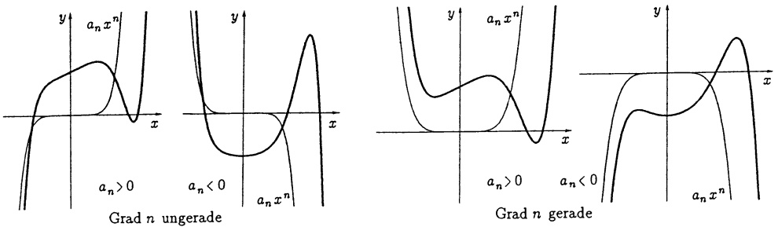

Abb. 52 - Polynome, qualitativer Verlauf

## 2.5 Rationale Funktionen, Polynomdivision. Der Quotient zweier Polynome

$$
f (x) = \frac {p (x)}{q (x)} = \frac {a _ {n} x ^ {n} + \cdots + a _ {1} x + a _ {0}}{b _ {m} x ^ {m} + \cdots + b _ {1} x + b _ {0}} \quad (\text {mit} \quad a _ {n} \neq 0, b _ {m} \neq 0)
$$

heißt rationale Funktion. Die Polynome sind spezielle rationale Funktionen  $(q(x)=1)$ , sie werden deshalb auch ganz rationale Funktionen genannt.

Beispiel. Die Van-der-Waals-Zustandsgleichung für den Druck p, das Volumen V und die Temperatur T eines realen Gases lautet

$$
\left(p + \frac {a}{V ^ {2}}\right) (V - b) = R T \quad (\text {konstantes} a, b, R).
$$

Bei konstanter Temperatur ist der Druck eine rationale Funktion des Volumens:

$$
p = p (V) = \frac {R T V ^ {2} - a V + a b}{V ^ {2} (V - b)}.
$$


Satz 2.6. Jede rationale Funktion

$$
\frac {p (x)}{q (x)} = \frac {a _ {n} x ^ {n} + \cdots + a _ {1} x + a _ {0}}{b _ {m} x ^ {m} + \cdots + b _ {1} x + b _ {0}} \quad (a _ {n} \neq 0, b _ {m} \neq 0)
$$

mit Zählergrad ≥ Nennergrad läßt sich darstellen in der Form

$$
\frac {p (x)}{q (x)} = h (x) + \frac {r (x)}{q (x)}, \tag {7}
$$

mit einem Polynom  $h(x)$  (dem ganzen Anteil der rationalen Funktion) und einem Restpolynom  $r(x)$  mit  $r(x)=0$  oder Grad r<Grad q.

Beweis und Rechenverfahren. Polynomdivision mit Rest. Man beginnt mit der offenbar gültigen Zerlegung

$$
\frac {p (x)}{q (x)} = \frac {a _ {n}}{b _ {m}} x ^ {n - m} + \frac {p _ {1} (x)}{q (x)} \tag {8}
$$

mit dem Polynom  $p_{1}(x) := p(x) - \frac{a_{n}}{b_{m}} x^{n-m} q(x)$ , welches (wenn es von Null verschieden ist) einen kleineren Grad als $p$ hat. Ist $p_1(x) = 0$ (Nullpolynom) oder Grad $p_1 < \text{Grad } q$, dann ist die Division mit Rest bereits beendet. Andernfalls $(p_1(x) = c_k x^k + \cdots + c_0, c_k \neq 0 \text{ und } k \geq \text{Grad } q)$ wiederholt man den Rechenschritt (8) für $\frac{p_1(x)}{q(x)}$ und erhält

$$
\frac {p (x)}{q (x)} = \frac {a _ {n}}{b _ {m}} x ^ {n - m} + \frac {c _ {k}}{b _ {m}} x ^ {k - m} + \frac {p _ {2} (x)}{q (x)}
$$

mit $p_2(x) = p_1(x) - \frac{c_k}{b_m} x^{k - m}q(x)$; etc.

Zusatz: Mit einem Koeffizientenvergleich sieht man leicht, daß die Zerlegung (7) eindeutig ist.

Beispiel. Die Polynomdivision mit Rest verläuft nach folgendem Muster:

$$
\begin{array}{l} (x ^ {1 2} + x ^ {6} + x + 1): (2 x ^ {4} + 3) = \frac {1}{2} x ^ {8} - \frac {3}{4} x ^ {4} + \frac {1}{2} x ^ {2} + \frac {9}{8} + \frac {- \frac {3}{2} x ^ {2} + x - \frac {1 9}{8}}{2 x ^ {4} + 3} \\ - x ^ {1 2} - \frac {3}{2} x ^ {8} \quad \uparrow \\ - \overline {{\frac {3}{2} x ^ {8} + x ^ {6} + x + 1}} \quad (= p _ {1} (x)) \quad \frac {a _ {n}}{b _ {m}} x ^ {n - m} \\ \frac {\frac {3}{2} x ^ {8} + \frac {9}{4} x ^ {4}}{x ^ {6} + \frac {9}{4} x ^ {4} + x + 1} \quad (= p _ {2} (x)) \\ \frac {x ^ {6} - \frac {3}{2} x ^ {2}}{\frac {9}{4} x ^ {4} - \frac {3}{2} x ^ {2} + x + 1} \\ - \frac {9}{4} x ^ {4} - \frac {2 7}{8} \\ - \overline {{\frac {3}{2} x ^ {2} + x - \frac {1 9}{8}}} \quad (= r (x)) \\ \end{array}
$$

$$
\begin{array}{l} - x ^ {1 2} - \frac {3}{2} x ^ {8} \quad \uparrow \\ - \overline {{\frac {3}{2} x ^ {8} + x ^ {6} + x + 1}} \quad (= p _ {1} (x)) \quad \frac {a _ {n}}{b _ {m}} x ^ {n - m} \\ \end{array}
$$


Das Polynom $d(x)$ heißt Teiler des Polynoms $p(x)$, wenn es ein Polynom $p_{0}(x)$ gibt mit $p(x)=d(x)p_{0}(x)$. Ebenso wie für rationale Zahlen ist es auch für die rationalen Funktionen wichtig, die gemeinsamen Teiler des Zählers und des Nenners zu kürzen. Die Berechnung eventuell vorhandener gemeinsamer Polynomteiler von $p(x)$ und $q(x)$ basiert auf der folgenden Beobachtung in (7):

Falls Grad $p \geq \text{Grad } q$ und $\frac{p(x)}{q(x)} = h(x) + \frac{r(x)}{q(x)}$, dann ist $d(x)$ genau dann ein gemeinsamer Teiler von $p(x)$ und $q(x)$, wenn $d(x)$ gemeinsamer Teiler von $q(x)$ und $r(x)$ ist.

Beweis. Aus $p(x) = d(x)p_0(x)$, $q(x) = d(x)q_0(x)$ folgt $r(x) = p(x) - h(x)q(x) = d(x)(p_0(x) - h(x)q_0(x))$. Und umgekehrt, aus $q(x) = d(x)q_0(x)$, $r(x) = d(x)r_0(x)$ folgt $p(x) = d(x)(h(x)q_0(x) + r_0(x))$.

Mittels Polynomdivision wird also die Bestimmung der gemeinsamen Teiler von p und q auf die Bestimmung der gemeinsamen Teiler der Polynome kleineren Grades q und r reduziert. Dieser Reduktionsschritt muß gegebenenfalls mehrfach wiederholt werden (Euklidischer Algorithmus für Polynome).

Beispiel. Für die rationale Funktion

$$
f (x) = \frac {x ^ {4} - 2 x ^ {3} - 2 x ^ {2} - 2 x - 3}{x ^ {4} - 3 x ^ {3} - 7 x ^ {2} + 1 5 x + 1 8}
$$

suchen wir die gekürzte Bruchdarstellung. Die gemeinsamen Teiler der Polynome  $p(x) = x^{4} - 2x^{3} - 2x^{2} - 2x - 3$  und  $q(x) = x^{4} - 3x^{3} - 7x^{2} + 15x + 18$  bestimmen wir mit dem Euklidischen Algorithmus:

$$
\frac {p (x)}{q (x)} = 1 + \frac {r (x)}{q (x)} \quad \text {mit} \quad r (x) = x ^ {3} + 5 x ^ {2} - 1 7 x - 2 1,
$$

$$
\frac {q (x)}{r (x)} = x - 8 + \frac {r _ {1} (x)}{r (x)} \quad \text {mit} \quad r _ {1} (x) = 5 0 (x ^ {2} - 2 x - 3),
$$

$$
\frac {r (x)}{r _ {1} (x)} = \frac {1}{5 0} (x + 7).
$$

Also ist $r_{1}(x)=50(x^{2}-2x-3)$ der (dem Grad nach) größte gemeinsame Teiler von $r,r_{1}$, also auch von $q,r$ und von $p,q$. Wir kürzen $x^{2}-2x-3$:

$$
f (x) = \frac {x ^ {2} + 1}{(x + 2) (x - 3)}.
$$

2.6 Der Definitionsbereich D einer rationalen Funktion $f(x) = \frac{p(x)}{q(x)}$ liegt erst endgültig fest, wenn $p$ und $q$ keinen gemeinsamen Teiler mehr besitzen. Dies sei jetzt der Fall; dann haben $p$ und $q$ keine gemeinsamen Nullstellen und es ist $D = \{x \in \mathbb{R} ; q(x) \neq 0\}$. Eine $l$-fache Nullstelle des Nenners, $q(x) = (x - b)^l q_1(x)$ mit $q_1(b) \neq 0$, heißt $l$-facher Pol von $f$. Der Graph $y = f(x)$ hat in der Nähe von $x = b$ angenähert die Gestalt $y = \frac{p(b)}{q_1(b)} \cdot \frac{1}{(x - b)^l}$, $x \neq b$. Das Verhalten für große $|x|$-Werte ersieht man aus

$$
f (x) = \frac {a _ {n} x ^ {n} + \cdots + a _ {0}}{b _ {m} x ^ {m} + \cdots + b _ {0}} = \frac {a _ {n} x ^ {n} (1 + \cdots + \frac {a _ {0}}{a _ {n} x ^ {n}})}{b _ {m} x ^ {m} (1 + \cdots + \frac {b _ {0}}{b _ {m} x ^ {m}})} \approx \frac {a _ {n}}{b _ {m}} x ^ {n - m}.
$$

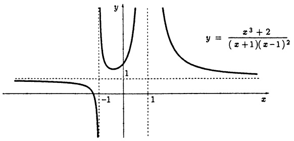

<details>
<summary>contour</summary>

| X | Y |
| --- | --- |
| -1 | 0 |
| 0 | 1 |
| 1 | 1 |
</details>

Abb. 53 - Pol 1. und 2. Ordnung

\* 2.7 Ergänzung: Polynome über C sehen formal genau so aus wie über R; es sind Funktionen der Form

$$
f (z) = a _ {n} z ^ {n} + a _ {n - 1} z ^ {n - 1} + \dots + a _ {1} z + a _ {0} \quad (z \in \mathbb {C})
$$

mit eindeutig bestimmten Koeffizienten $a_{i} \in \mathbb{C}$ ($i = 0, \ldots, n$). Das Rechnen mit „komplexen“ Polynomen (Addition, Multiplikation, Werteberechnung mit dem Horner-Schema, Division mit Rest, Euklidischer Algorithmus) verläuft zu den bisher für reelle Koeffizienten dargestellten Verfahren vollständig analog.

Es gibt zahlreiche (beliebig viele) Polynome mit reellen Koeffizienten, die in $\mathbb{R}$ keine Nullstellen besitzen, etwa $x^{2} + 1$, $x^{2} + x + 1$. Im Gegensatz dazu gilt der (aus historischen Gründen so genannte)

Satz 2.7. Fundamentalsatz der Algebra. Zu jedem Polynom $f(z)=a_{n}z^{n}+\cdots+a_{0}$ mit $a_{i}\in\mathbb{C}, n\geq1, a_{n}\neq0$, gibt es eine Zahl $w\in\mathbb{C}$ mit $f(w)=0$. D.h., jedes nicht konstante Polynom mit komplexen Koeffizienten hat in $\mathbb{C}$ eine Nullstelle.

Ein Beweis dieses wichtigen Satzes wird mit den Mitteln der Funktionentheorie erst in Band 2 erbracht.

Ist nun $f(z) = \sum_{k=0}^{n} a_k z^k \neq const$ und $w_1 \in \mathbb{C}$ eine Nullstelle von $f$, dann läßt sich, wie in 2.2 ausgeführt wurde, der Linearfaktor $z - w_1$ wenigstens einmal abspalten: $f(z) = (z - w_1)^{l_1} g(z)$, $l_1 \geq 1$, $g(w_1) \neq 0$. $l_1$ heißt Vielfachheit von $w_1$. Falls $g(z) \neq const$, gilt (aus gleichem Grund) $g(z) = (z - w_2)^{l_2} g_1(z)$, etc. Deshalb lautet eine andere Version des Fundamentalsatzes

Satz 2.8. Der Faktorisierungssatz. Jedes komplexe Polynom $f(z) = \sum_{k=0}^{n} a_k z^k$ ($n \geq 1$, $a_k \in \mathbb{C}$, $a_n \neq 0$) besitzt die

$$
\boxed { \begin{array}{l} \text {Faktorisierung über} \mathbf {C}: \\ f (z) = a _ {n} (z - w _ {1}) ^ {l _ {1}} (z - w _ {2}) ^ {l _ {2}} \dots (z - w _ {k}) ^ {l _ {k}} \end{array} } \tag {9}
$$

mit den verschiedenen Nullstellen $w_i \in \mathbb{C}$ der Vielfachheit $l_i$ ($i = 1, \ldots, k$), $l_1 + l_2 + \cdots + l_k = n$. Ein Polynom vom Grad $n \geq 1$ besitzt also genau $n$ Nullstellen in $\mathbb{C}$, wobei jede Nullstelle so oft gezählt wird, wie ihre Vielfachheit angibt.

Jedes Polynom mit reellen Koeffizienten kann als reelles Polynom (Definitionsbereich ist R) oder als komplexes Polynom (mit Definitionsbereich C) aufgefaßt werden. Für diese gilt:

Satz 2.9. Mit jeder Nullstelle w eines Polynoms f mit reellen Koeffizienten ist auch die konjugiert komplexe Zahl  $\overline{w}$  eine Nullstelle von f ; d.h. die nicht reellen Nullstellen von f treten stets als konjugierte Paare w und  $\overline{w}$  auf.

Beweis. Für $a_k \in \mathbb{R}$ gilt $\overline{a_k} = a_k$, daher folgt $a_n \overline{w^n} + \cdots + a_1 \overline{w} + a_0 = \overline{a_n w^n + \cdots + a_1 w + a_0} = 0$.

## Satz 2.10. Faktorisierungssatz für relle Polynome.

Jedes reelle Polynom $f(x) = \sum_{k=0}^{n} a_k x^k$ ($n \geq 1$, $a_k \in \mathbb{R}$, $a_n \neq 0$) besitzt die

Faktorisierung über $\mathbb{R}$ :

$$
f (x) = a _ {n} (x - b _ {1}) ^ {l _ {1}} \dots (x - b _ {r}) ^ {l _ {r}} (x ^ {2} + c _ {1} x + d _ {1}) ^ {k _ {1}} \dots (x ^ {2} + c _ {s} x + d _ {s}) ^ {k _ {s}}
$$

mit den reellen Nullstellen $b_i$ der Vielfachheit $l_i$ ($i = 1, \ldots, r$) und den quadratischen Polynomen $x^2 + c_i x + d_i$ der Vielfachheit $k_i$ ($i = 1, \ldots, s$), die in $\mathbb{R}$ keine Nullstelle haben.

Beweis. Man braucht nur in der Faktorisierung (9) die zu jedem nicht reellen Nullstellenpaar $w_i, \overline{w_i}$ gehörigen Faktoren $(x - w_i)(x - \overline{w_i})$ auszumultiplizieren: $(x - w_i)(x - \overline{w_i}) = x^2 + c_i x + d_i$ mit $c_i := -(w_i + \overline{w_i}) = -2 \operatorname{Re} w_i \in \mathbb{R}$ und $d_i := w_i \overline{w_i} = |w_i|^2 \in \mathbb{R}$.

Beispiel. Die komplexe Faktorisierung von  $x^{4} + 1$  lautet ( $\rightarrow 3.4$ )

$$
x ^ {4} + 1 = (x + w) (x - w) (x + \overline {{w}}) (x - \overline {{w}}) \text {mit} w = \frac {1}{2} \sqrt {2} (1 + i).
$$

Die reelle Faktorisierung dagegen ist  $x^{4}+1=(x^{2}-\sqrt{2}x+1)(x^{2}+\sqrt{2}x+1)$ . ☐

Diese Faktorisierung wird im Verfahren von BAIRSTOW zur numerischen Bestimmung aller Nullstellen eines reellen Polynoms verwendet ( $\rightarrow$  Kap. 7, 2.5).

## Aufgaben

1. Die folgenden Ausdrücke bestimmen jeweils eine Funktion. Man vereinfache, bestimmte den maximalen Definitionsbereich und skizziere den Graphen

a) $\frac{\sqrt{\frac{x + 2}{x - 2}} + \sqrt{\frac{x - 2}{x + 2}}}{\sqrt{\frac{x + 2}{x - 2}} - \sqrt{\frac{x - 2}{x + 2}}};$

b) $\frac{1}{\sqrt{\frac{\frac{x^3 - 1}{x + 1} \cdot \frac{x}{x^3 + 1}}{\frac{(x + 1)^2 - x}{(x - 1)^2 + x} \cdot \left(1 - \frac{1}{x}\right)}}}$;

c) $\left[\frac{(\sqrt{x^3} - \sqrt{8})(\sqrt{x} + \sqrt{2})}{x + \sqrt{2x} + 2}\right]^2 + \sqrt{(x^2 + 2)^2 - 8x}$.

2. Für die Funktion $f(x) = \frac{2 - x}{x - 1}$ bestimme man

a) den maximalen Definitionsbereich und den zugehörigen Bildbereich,
b) die Intervalle, auf welchen f monoton fällt bzw. wächst,
c) die Intervalle, auf welchen $f < 0$.

Man zeige: $\frac{u + v}{2} = 1 \Rightarrow \frac{f(u) + f(v)}{2} = -1$.

Welche Symmetrie des Graphen von $f$ drückt sich hierin aus? Man skizziere den Graphen.

3. Mittels Polynomdivision berechne man den ganzen Anteil von

a) $q(x) = \frac{x^7 - 3x^3 + 1}{x^2 + x + 1}$,

b) $q(x) = \frac{x^9 - x^7 - 3x^3 + 1}{x^3 + x^2 + 1}$.

4. Man betrachte die Funktionen

$$
\begin{array}{l} a (x) = \sqrt {x + 1 0 0 0} - \sqrt {x}, x \geq 0; \\ b (x) = \sqrt {x + \sqrt {x}} - \sqrt {x}, x \geq 0; \\ c (x) = \sqrt {x + \frac {x}{1 0 0 0}} - \sqrt {x}, x \geq 0. \\ \end{array}
$$

a) Man bestätige, daß für  $0 \leq x \leq 10^{6}$  gilt

$$
a (x) > b (x) > c (x),
$$

und berechne direkt mit dem Taschenrechner  $a(10^{99})$ ,  $b(10^{99})$ ,  $c(10^{99})$ .

b) Man forme die Funktion auf Bruchdarstellung um, so daß bei Rechnung mit endlich vielen Dezimalstellen keine Auslöschung mehr auftritt und bestätige für  $x > 10^{99}$

$$
a (x) <   b (x) <   c (x).
$$

5. a) Für das Polynom $p(x) = 7x^{7} + 3x^{3} + 200x^{2} - 50x + 20$ bestimme man mittels Hornerschema den Funktionswert $p(-2)$ und den ganzen Anteil von $\frac{p(x)}{(x + 2)}$.

b) Wie lautet die Entwicklung von $p(x)$ nach Potenzen von $(x + 2)$?

c) Wie lautet die Newton-Form von $p(x)$ über den Stützstellen $x_0 = 0$, $x_1 = 1, \ldots, x_6 = 6$.

6. a) Mit Hilfe eines Taschenrechners bestimme man den Wert von

$$
q (t) = t ^ {2} - 1 2 3 4 5 6 7 8 t - 1 2 3 4 5 6 7 8
$$

an der Stelle t = 12345679 auf dreierlei Art:

- mit der Tastenfolge $t \boxed{y^x} 2$ für $t^2$,
- mit der Tastenfolge $t \boxed{*} t$ für $t^{2}$,
- mit dem Horner-Schema.

Welcher Wert ist richtig?

b) Warum liefert die einfache Auflösungsformel bei zehnstelliger Rechnung nur eine der Nullstellen des Polynoms  $x^{2}-1234567x+2=0$  auf acht Dezimalstellen genau?

\- Mit der Beziehung $x_1x_2 = 2$ (VIETA) leite man einen Algorithmus ohne Auslöschung her.

7. Einer vierstelligen Wertetafel für die Fehlerfunktion  $y = \text{erf}(x)$  entnimmt man

$$
\begin{array}{c c c c c} x & 0 & 0. 5 & 1 & 1. 5 \\ \hline y & 0 & 0. 4 6 1 3 & 0. 7 4 6 8 & 0. 8 5 6 1 \end{array}
$$

Man stelle dazu das Newton-Interpolations-polynom 3. Grades $p_{3}(x)$ auf, berechne damit $p_{3}(0.9)$ und vergleiche mit dem Wert $\operatorname{erf}(0.9)=0.7062$.

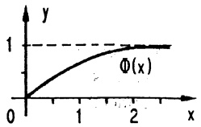

<details>
<summary>line</summary>

| X | Y |
| --- | --- |
| 0 | 0 |
| ~2.5 | 1 |
</details>

8. a) Zu folgender Wertetabelle bestimme man das interpolierende Polynom  $p_{6}(x)$  in Newton-Form.

$$
\begin{array}{c c c c c c c c} \mathrm{x} & - 3 & - 2 & - 1 & 0 & 1 & 2 & 3 \\ \hline \mathrm{y} & 0 & 0 & 0 & - 1 & 0 & 0 & 0 \end{array}
$$

b) Wie lautet die Produktdarstellung für  $p_{6}(x)$ , wie die Summendarstellung?

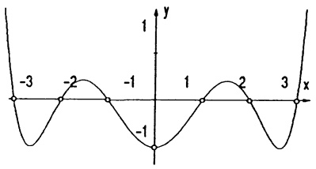

<details>
<summary>contour</summary>

| X | Y |
| --- | --- |
| -3 | 0 |
| -2 | 0 |
| -1 | 0 |
| 0 | -1 |
| 1 | 0 |
| 2 | 0 |
| 3 | 0 |
</details>

9. Welche ganzzahligen Werte kommen als Nullstellen  $x_{0}$  für das Polynom

$$
p (x) = x ^ {4} + 9 x ^ {3} + 2 9 x ^ {2} + 3 9 x + 1 8
$$

in Frage? Man spalte sukzessive mit Hilfe des Horner-Schemas für jede Nullstelle  $x_{0}$  den Linearfaktor  $x-x_{0}$  ab und gebe schließlich für  $p(x)$  die Produktdarstellung.

10. Für einen Bleiakkumulator (12 V, 40 Ah) gilt bei 4 A Ladestrom:

| Q (Ladezustand %) | 20 | 30 | 40 | 50 | 60 | 70 | 80 | 90 | 100 |
| --- | --- | --- | --- | --- | --- | --- | --- | --- | --- |
| U (Batt. Spannung V) | 12.57 | 12.69 | 12.97 | 13.11 | 13.20 | 13.29 | 13.41 | 13.61 | 14.77 |

Mit Hilfe von Programm NEWTON Interpolation bestimme man das zugehörige Interpolationspolynom und skizziere es für 0 < Q < 100.

Ist das Polynom für Q < 20 und Q > 100 realistisch?

11. Zur Darstellung elektrostatischer Potentiale benötigt man die sogenannten LEGENDRE-Polynome $P_{n}(x)$, die man rekursiv definiert:

$$
P _ {0} (x) = 1; \quad P _ {1} (x) = x;
$$

$$
(n + 1) P _ {n + 1} (x) = (2 n + 1) x P _ {n} (x) - n P _ {n - 1} (x),
$$

$$
n = 1, 2, 3, \dots .
$$

Man bestimme  $P_{2}(x),\ldots, P_{5}(x)$  und berechne mit einem Rechner  $P_{10}(0.33)$ .

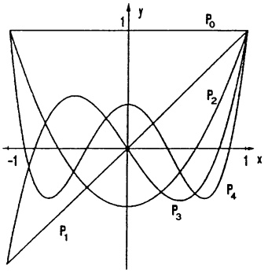

<details>
<summary>text_image</summary>

1
y
P₀
-1
P₁
1 x
P₂
P₃
P₄
</details>

## §3. Die Kreisfunktionen

Die Kreis- oder Winkelfunktionen, auch trigonometrische Funktionen genannt, spielen nicht nur in der Geometrie (Dreiecksberechnung) eine wichtige Rolle, sie dienen im besonderen Maße zur Beschreibung und Berechnung aller erdenklichen periodischen Vorgänge (Schwingungen).

3.1 Definition und einfache Eigenschaften. Je nach Zielsetzung gibt es verschiedene (natürlich äquivalente) Definitionen der Kreisfunktionen. Wir bevorzugen hier die anschaulich geometrische Definition, die für die Anwendungen auf Drehbewegungen zugeschnitten ist.

Sei $x \in \mathbb{R}$. Wird im $(u,v)$-Koordinatensystem der von $(0,0)$ nach $(1,0)$ weisende Zeiger um den Winkel $x$ gedreht (gegen Uhrzeigersinn, falls $x \geq 0$, sonst im Uhrzeigersinn), dann fällt die Zeigerspitze auf einen Punkt $P$ ($\rightarrow$ Abb. 9 mit $\alpha = x)$, dessen Koordinaten mit $u = \cos x$, $v = \sin x$ bezeichnet werden;

$$
P = (\cos x, \sin x) .
$$

Die derart definierten Funktionen $x \mapsto \cos x$, $x \mapsto \sin x$ ($x \in \mathbb{R}$) heißen Cosinus- bzw. Sinusfunktion. Hat der Zeiger die Länge $r$, so fällt nach der Drehung die Spitze auf $Q = (u', v')$, $u' = r \cos x$, $v' = r \sin x$ ($\rightarrow$ Kap. 1, 3.3).

Der Definition entnimmt man sofort folgende Eigenschaften:

(1)

a) $-1 \leq \cos x \leq 1, -1 \leq \sin x \leq 1.$
b) $\cos (-x) = \cos x$; $\cos$ ist gerade. $\sin (-x) = -\sin x$; $\sin$ ist ungerade.
c) $(\cos x)^2 + (\sin x)^2 = 1$.
d)  $\cos(x + 2k\pi) = \cos x$ ,  $\sin(x + 2k\pi) = \sin x$  ( $k \in Z$ )
d.h. cos und sin sind  $2\pi$ -periodisch.

Die Nullstellen der Sinusfunktion im Intervall  $[0,2\pi]$  sind 0,  $\pi$ ,  $2\pi$ ; wegen (1d) unterscheiden sich alle anderen Nullstellen hiervon nur um Vielfache von  $2\pi$ . Entsprechendes gilt für die Cosinusfunktion:

(2)

$$
\sin x = 0 \iff x \in \{0, \pm \pi , \pm 2 \pi , \pm 3 \pi , \dots \}
$$

$$
\cos x = 0 \Longleftrightarrow x \in \{\pm \frac {\pi}{2}, \pm \frac {3}{2} \pi , \pm \frac {5}{2} \pi , \dots \}
$$

Wegen der  $2\pi$ -Periodizität (1d) entstehen die Graphen  $y = \sin x$ ,  $y = \cos x$  aus den über einem Intervall der Breite  $2\pi$  liegenden Teilgraphen durch eine Verschiebung nach links oder rechts um ganzzahlige Vielfache von  $2\pi$ .

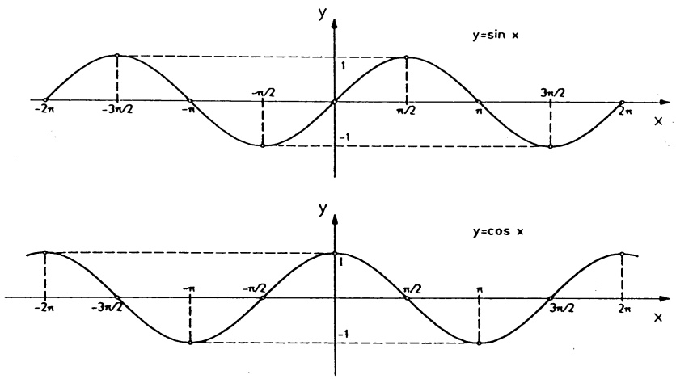

Abb. 54 - $y = \sin x$, $y = \cos x$

Satz 3.1. Das Additionstheorem. Für alle $x, y \in \mathbb{R}$ gilt

$$
\begin{array}{l} \cos (x + y) = \cos x \cos y - \sin x \sin y, \\ \sin (x + y) = \sin x \cos y + \cos x \sin y. \end{array} \tag {3}
$$

Beweis. Man wende die Drehformel (4) aus Kap. 1, §3 auf die Drehung um den Winkel $y$ an, bei der $P = (\cos x, \sin x)$ übergeht in $P' = (\cos(x + y), \sin(x + y))$.

Der Spezialfall $y = \frac{\pi}{2}$ bzw. $y = -\frac{\pi}{2}$ ergibt

$$
\boxed {\sin (x + \frac {\pi}{2}) = \cos x, \quad \cos (x - \frac {\pi}{2}) = \sin x,} \tag {4}
$$

was besagt, daß die Kurve  $y = \cos x$  mit der nach links um  $\frac{\pi}{2}$  verschobenen Sinuskurve übereinstimmt, bzw. daß eine reine Sinusschwingung nichts anderes ist als eine um  $\frac{\pi}{2}$  phasenverschobene Cosinusschwingung ( $\rightarrow 3.5$ ).

In den Formelsammlungen findet man zahlreiche trigonometrische Identitäten (Formeln); sie lassen sich alle aus dem Additionstheorem ableiten.

$$
\begin{array}{l} \text {a)} \quad \cos (x - y) = \cos x \cos y + \sin x \sin y, \\ \sin (x - y) = \sin x \cos y - \cos x \sin y; \\ \text {b)} \quad \sin x + \sin y = 2 \sin \frac {x + y}{2} \cos \frac {x - y}{2}, \\ \sin x - \sin y = 2 \sin \frac {x - y}{2} \cos \frac {x + y}{2}, \\ \cos x + \cos y = 2 \cos \frac {x + y}{2} \cos \frac {x - y}{2}, \\ \cos x - \cos y = - 2 \sin \frac {x + y}{2} \sin \frac {x - y}{2}; \\ \text {c)} \quad \cos (2 x) = \cos^ {2} x - \sin^ {2} x = 2 \cos^ {2} x - 1, \\ \sin (2 x) = 2 \sin x \cos x, \\ 1 + \cos x = 2 \cos^ {2} \frac {x}{2}, \\ 1 - \cos x = 2 \sin^ {2} \frac {x}{2}; \\ (\text {Formeln der Winkelverdopplung und -halbierung}). \end{array} \tag {5}
$$

Beachte.  $f^{n}(x) := [f(x)]^{n}$ , d.h.  $\sin^{2} x = (\sin x)^{2}$ ,  $\cos^{2} x = (\cos x)^{2}$ , etc.

Beweis. a): In (3) wird y durch -y ersetzt.

b): Mit $x = \frac{x + y}{2} + \frac{x - y}{2}$ folgt aus (3) $\sin x = \sin \frac{x + y}{2} \cos \frac{x - y}{2} + \cos \frac{x + y}{2} \sin \frac{x - y}{2}$. Ebenso $\sin y = \sin \frac{y + x}{2} \cos \frac{y - x}{2} + \cos \frac{y + x}{2} \sin \frac{y - x}{2}$. Addition bzw. Subtraktion führt mit (1b) auf die zwei Formeln für sin. Ersetzt man hierin $x, y$ durch $x + \frac{\pi}{2}, y + \frac{\pi}{2}$, so erhält man die Formeln für cos.

c): Die ersten beiden Formeln ergeben sich sofort aus (3) mit y = x und (1c). Ersetzt man hierin x durch  $\frac{x}{2}$ , dann erhält man die restlichen Gleichungen. □

Weitere Formeln, insbesondere komplizerte und solche, die bei der Überlagerung harmonischer Schwingungen auftreten, behandelt man besser nach Übergang ins Komplexe mit den De Moivre-Formeln (→ Satz 3.2).

## 3.2 Die Tangens- und Cotangensfunktion sind definiert durch

$$
\begin{array}{l} \boxed {\tan x := \frac {\sin x}{\cos x}, \quad x \neq (2 k + 1) \frac {\pi}{2} \quad (k \in \mathbb {Z}),} \\ \cot x := \frac {\cos x}{\sin x}, \quad x \neq k \pi \quad (k \in \mathbb {Z}). \end{array}
$$

Für jedes x stellen tan x und cot x Tangentenabschnitte am Einheitskreis dar (→ Abb. 55) und es gilt:

| x | tan x | cot x |
| --- | --- | --- |
| 0 | 0 | nicht def. |
| $\frac{\pi}{6}$ | $\frac{1}{3}\sqrt{3}$ | $\sqrt{3}$ |
| $\frac{\pi}{4}$ | 1 | 1 |
| $\frac{\pi}{3}$ | $\sqrt{3}$ | $\frac{1}{3}\sqrt{3}$ |
| $\frac{\pi}{2}$ | nicht def. | 0 |

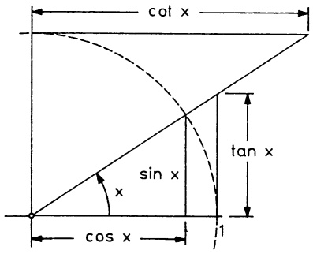

<details>
<summary>text_image</summary>

cot x
sin x
x
cos x
1
tan x
</details>

Abb. 55 - tan, cot am Kreis

Die Eigenschaften beider Funktionen ergeben sich sofort aus (1) - (5):

(6)

a) $\tan (-x) = -\tan x, \quad \cot (-x) = -\cot x$  
$\tan und \cot sind ungerade$;
b)  $\tan(x+\pi)=\tan x,\quad\cot(x+\pi)=\cot x$ 
 $\tan \text{ und } \cot \text{sind } \pi\text{-periodisch};$
c)  $\tan(x+y)=\frac{\tan x+\tan y}{1-\tan x\tan y}$  für alle „zulässigen“ x,y
Additionstheorem .

Die geometrische Bedeutung beider Funktionen liest man im rechtwinkligen Dreieck $\Delta OSQ$ ($\rightarrow$ Abb. 10) mit $a = r\cos\alpha$, $b = r\sin\alpha$ für $\alpha > 0$ ab:

$$
\tan \alpha = \frac {b}{a} = \frac {\text {Gegenkathete}}{\text {Ankathete}}, \quad \cot \alpha = \frac {a}{b} = \frac {\text {Ankathete}}{\text {Gegenkathete}}.
$$

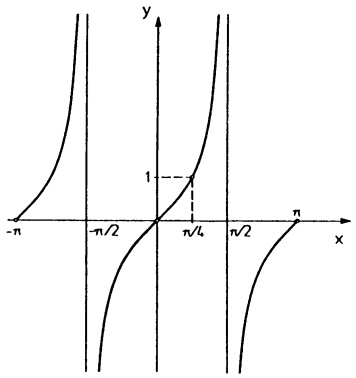

<details>
<summary>contour</summary>

| X | Y |
| --- | --- |
| -n | 0 |
| -n/2 | 0 |
| n/4 | 1 |
| n/2 | 0 |
| n | 0 |
</details>

Abb. 56a - y = tan x,

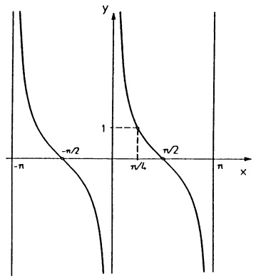

<details>
<summary>contour</summary>

| Point | X | Y |
| --- | --- | --- |
| Left Asymptote | \(-\pi\) | >1 |
| Horizontal Asymptote | \(-\pi/2\) | 0 |
| Vertical Asymptote | \(\pi/4\) | 1 |
| Right Asymptote | \(\pi/2\) | 0 |
| Horizontal Asymptote | \(\pi\) | >1 |
</details>

Abb. 56b - y = cot x

3.3 Die Polardarstellung komplexer Zahlen. In Kap. 1, §8 wurden die komplexen Zahlen $\mathbf{C} = \{z = x + iy ; x, y \in \mathbb{R}\}$ in kartesischen Koordinaten mit

$$
\text {der Addition} (x + i y) + (u + i v) = (x + u) + i (y + v)
$$

$$
\text {und der Multiplikation} (x + i y) \cdot (u + i v) = (x u - y v) + i (x v + y u)
$$

eingeführt.  $z \mapsto iz$  stellt eine Drehung um  $\frac{\pi}{2}$  dar, speziell ist  $i^{2} = -1$ ,  $i(x + iy) =$

$$
- y + i x (\rightarrow \text {Abb.} 4 3).
$$

Die komplexe Zahl  $z = x + iy \neq 0$  ist auch eindeutig bestimmt durch den

$$
\text {Betrag} \quad | z | := \sqrt {x ^ {2} + y ^ {2}}
$$

( = Länge der Strecke von 0 nach z )
und durch die Phase oder das

$$
\text {Argument} \arg z := \varphi
$$

(= Winkel zwischen positiver reeller Achse und Strahl von 0 nach z). Für z = 0 ist arg z nicht erklärt. Die Phase φ ist keineswegs eindeutig, bei jeder vollen Umdrehung vermehrt oder vermindert sie sich um 2π.

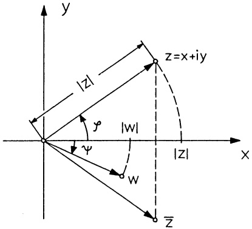

<details>
<summary>text_image</summary>

y
|z|
z=x+iy
ψ
|w|
|z|
x
W
Z̅
</details>

Abb. 57 - $z = |z|e^{i\varphi}$

Der Hauptwert von arg z ist die Phase von z, für die  $-\pi < \varphi \leq \pi$ .

Man kann also $z = x + iy \neq 0$ festlegen durch $x = \operatorname{Re} z$, $y = \operatorname{Im} z$ oder durch $r = |z|$ und $\varphi = \arg z$. Wegen $x = r \cos \varphi$, $y = r \sin \varphi$ ($\rightarrow$ Abb. 57) ergibt sich die sog. Polardarstellung

$$
z = r (\cos \varphi + i \sin \varphi) \quad \text { mit } \quad r = | z | \quad \text { und } \quad \varphi = \arg z . \tag {7}
$$

Mit der von L. EULER (1707–1783) eingeführten Abkürzung

$$
e ^ {i \varphi} := \cos \varphi + i \sin \varphi
$$

wird daraus $z = |z|e^{i\varphi}$.

## Bemerkungen.

1. Vorerst ist  $e^{i\varphi} = \cos \varphi + i \sin \varphi$  nur als eine zweckmäßige, durch die folgenden Rechenregeln gerechtfertigte Abkürzung anzusehen. Zusammenhänge mit der komplexen e-Funktion ergeben sich später.
2. Die komplexen Zahlen $e^{i\varphi} = \cos \varphi + i \sin \varphi$ haben den Betrag $r = 1$, sie liegen auf dem Einheitskreis um den Nullpunkt (→ Abb. 58).
3. Wächst $\varphi = \omega t + \alpha$ linear mit der Zeit $t$, so stellt $z(t) = e^{i(\omega t + \alpha)}$ die Bewegung eines auf dem Einheitskreis mit konstanter Winkelgeschwindigkeit $\omega$ kreisenden Punktes dar, der sich zur Zeit $t = 0$ in $e^{i\alpha}$ befindet ($\rightarrow$ Abb. 61).

Umrechnungsformeln. Bezeichnet arccos den Hauptwert des Arcuscosinus (→ Kap. 3, 3.3), d.h.

$$
\varphi = \operatorname{arc} \cos u \iff \cos \varphi = u \quad \text {und} \quad 0 \leq \varphi \leq \pi ,
$$

so gilt

Kartesische Darstellung $\longleftrightarrow$ Polardarstellung

a) Gegeben $z = x + iy \neq 0$ ($x, y \in \mathbb{R}$).

Mit $r = \sqrt{x^2 + y^2}$ und

$$
\varphi = \left\{ \begin{array}{c l} \arccos \frac {x}{r} & , \text {falls} y \geq 0 \\ - \arccos \frac {x}{r} & , \text {falls} y <   0 \end{array} \right.
$$

gilt $z = r e^{i\varphi}$

b) Gegeben $z = r e^{i\varphi}$.

Mit $x = r\cos \varphi, y = r\sin \varphi$

gilt $z = x + iy$

Beispiele.  $e^{i\pi/2} = i$ ;  $e^{i\pi} = -1$ ;  $e^{2\pi i} = 1$ ;  $1 + i = \sqrt{2}e^{i\pi/4}$ ;  $1 + \sqrt{3}i = 2e^{i\pi/3}$ ;  $4 - 3.5i = \frac{1}{2}\sqrt{113}e^{-i0.71883}$ .

Satz 3.2. Formeln von De Moivre (1667–1754). Für alle $\varphi, \psi \in \mathbb{R}$ gilt

(8)

a) $e^{i\varphi}e^{i\psi} = \dot{e}^{i(\varphi +\psi)}$

b) $(e^{i\varphi})^n = e^{in\varphi}$ $(n\in \mathbb{N})$

c) $\overline{e^{i\varphi}} = e^{-i\varphi} = \frac{1}{e^{i\varphi}}$ .

Beweis. a): Mit (3) gilt: $e^{i\varphi}e^{i\psi} = (\cos \varphi + i\sin \psi)(\cos \psi + i\sin \varphi)$
$= (\cos \varphi \cos \psi - \sin \varphi \sin \psi) + i(\cos \varphi \sin \psi + \sin \varphi \cos \psi) = \cos (\varphi + \psi) + i\sin (\varphi + \psi)$
$= e^{i(\varphi + \psi)}$.

b) folgt aus a) mit  $\psi = \varphi$ ,  $\psi = 2\varphi, \ldots$  (vollständige Induktion).

c): $\overline{e^{i\varphi}} = \overline{\cos\varphi + i\sin\varphi} = \cos\varphi - i\sin\varphi = \cos(-\varphi) + i\sin(-\varphi) = e^{-i\varphi}$, außerdem folgt aus a) $e^{i\varphi}e^{i(-\varphi)} = e^{i0} = 1$.