## 3.4 Anwendungen der De-Moivre-Formeln.

① Die Multiplikation und Division komplexer Zahlen gestaltet sich in der Polar-darstellung mit den Formeln (8) besonders vorteilhaft:

Für $z = |z|e^{i\varphi}$, $w = |w|e^{i\psi} \neq 0$ und $n \in \mathbb{Z}$ gilt

$$
\boxed {\mathbf {a}) z w = | z | | w | e ^ {i (\varphi + \psi)}, \quad \mathbf {b}) z ^ {n} = | z | ^ {n} e ^ {i n \varphi}, \quad \mathbf {c}) \frac {z}{w} = \frac {| z |}{| w |} e ^ {i (\varphi - \psi)}.} \tag {9}
$$

Beispiel. $(1 + i)^{14}(1 + \sqrt{3} i)^7 = (\sqrt{2} e^{i\frac{\pi}{4}})^{14}(2e^{i\frac{\pi}{3}})^7 = 2^{14}e^{i(\frac{7}{2} +\frac{7}{3})\pi} = -2^{14}e^{\frac{5\pi}{6} i}.$ □

## Geometrische Deutung der Formeln (9)

a) Die Multiplikation mit  $w = e^{i\psi}$  bewirkt eine Drehung um den Nullpunkt mit dem Winkel  $\psi (\rightarrow$  Abb. 58). Die Drehung erfolgt gegen den Uhrzeigersinn, falls  $\psi > 0$ , bzw. im Uhrzeigersinn, falls  $\psi < 0$ .
b) Die Multiplikation mit $w = |w|e^{i\psi}$ stellt eine Drehungstreckung dar, falls $w \neq 0$ und $w \neq 1$. Das ist eine Drehung um den Winkel $\psi$ verbunden mit einer Streckung im Verhältnis $1: |w|$.

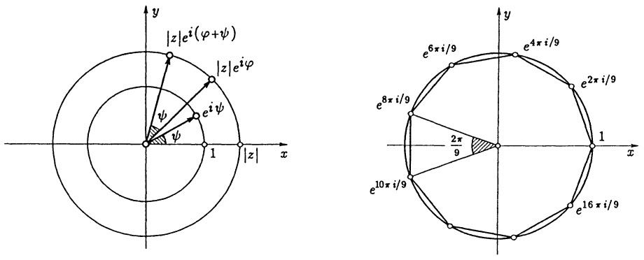

Abb. 58 - $e^{i(\varphi + \psi)} = e^{i\varphi} \cdot e^{i\psi}$

Abb. 59 - Kreisteilung $n = 9$

② Die n-ten Wurzeln von  $a \in C$ . Jede komplexe Nullstelle des Polynoms  $p(x) = x^{n} - a$  mit  $n \in N$ , d.h. jede komplexe Lösung z der Gleichung

$$
z ^ {n} - a = 0,
$$

heißt n-te Wurzel von a.  $\sqrt[n]{a}$  bezeichnet die Menge dieser Nullstellen.

Für $a = 1$ spricht man von den $n$-ten Einheitswurzeln. Mit $\zeta_k := e^{i\frac{2\pi k}{n}}$ gilt

$$
\sqrt [ n ]{1} = \left\{\zeta_ {0}, \zeta_ {1}, \zeta_ {2}, \dots , \zeta_ {n - 1} \right\} = \left\{1, e ^ {i \frac {2 \pi}{n}}, e ^ {i \frac {4 \pi}{n}}, \dots , e ^ {i \frac {2 \pi (n - 1)}{n}} \right\}. \tag {10}
$$

Diese n Zahlen erfüllen alle wegen (8) die Gleichung  $z^{n}=1$ , sie liegen auf dem Einheitskreis, bilden die Ecken eines regelmäßigen n-Ecks und gehen nacheinander durch eine Drehung um den Winkel $\frac{2\pi}{n}$ aus der 1 hervor ($\rightarrow$ Abb. 59). Wegen Satz 2.8 kann es keine weiteren Nullstellen von $z^n - 1$ geben.

Für $a = |a|e^{i\varphi}$ mit $-\pi < \varphi \leq \pi$ bildet man zunächst die reelle Wurzel ${}^n\sqrt{|a|}$ und erhält mit (10) und $w := {}^n\sqrt{|a|}e^{i\frac{\varphi}{n}}$ als $n$-te Wurzel von $a$:

$$
\boxed { \begin{array}{c} \sqrt [ n ]{a} = \left\{w, \zeta_ {1} w, \dots \zeta_ {n - 1} w \right\}. \end{array} }
$$

③ Trigonometrische Formeln kann man sehr einsichtig aus Formeln für  $e^{i\varphi}$  über einen Vergleich entsprechender Realteile (bzw. Imaginärteile) herleiten.

## Beispiel.

Mit (8) ist $\cos 3\varphi + i\sin 3\varphi = (\cos \varphi + i\sin \varphi)^{3} = \cos^{3}\varphi + 3i\cos^{2}\varphi\sin \varphi + 3\cos \varphi(i\sin \varphi)^{2} + i^{3}\sin^{3}\varphi = (\cos^{3}\varphi - 3\cos \varphi\sin^{2}\varphi) + i(3\cos^{2}\varphi\sin \varphi - \sin^{3}\varphi)$. Wegen $\cos^{2}\varphi + \sin^{2}\varphi = 1$ gilt daher

$$
\cos 3 \varphi = 4 \cos^ {3} \varphi - 3 \cos \varphi , \quad \sin 3 \varphi = 3 \sin \varphi - 4 \sin^ {3} \varphi.
$$

3.5 Harmonische Schwingungen. Eine Funktion $f: \mathbb{R} \to \mathbb{R}$ heißt periodisch mit der Periode $2l$, wenn $f(x + 2l) = f(x)$ für alle $x \in \mathbb{R}$ gilt. Die Sinus- und Cosinusfunktion sind $2\pi$-periodisch. In der Abb. 61 sind zwei weitere periodische Funktionen dargestellt.

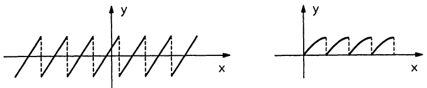

Abb. 60 - Periodische Funktionen

Definition. Als Schwingung bezeichnet man einen Vorgang, der durch eine periodische Funktion des „Zeitparameters“ $t \in \mathbb{R}$ beschrieben wird. Eine durch

$$
s (t) = A \cos (\omega t + \alpha), \quad t \in \mathbb {R}, \tag {11}
$$

mit festen $A, \omega, \alpha \in \mathbb{R}$ dargestellte Schwingung heißt rein oder harmonisch. A heißt Amplitude (Schwingungsweite), $\omega t + \alpha$ die Phase, $\alpha$ die Nullphase und $\omega$ die Kreisfrequenz der Schwingung. Die Schwingungsdauer (Periode) beträgt $T = \frac{2\pi}{\omega}$, die Schwingungszahl oder Frequenz $v = \frac{1}{T} = \frac{\omega}{2\pi}$.

Man deutet $s(t)$ als „Auslenkung“ zur Zeit $t$, d.i. bei einer geradlinigen Schwingung eines Massenpunktes die momentane Entfernung aus der Gleichgewichtslage. Wegen $\cos(\omega t + \alpha) = \sin(\omega t + \alpha + \frac{\pi}{2})$ kann jede harmonische Schwingung auch als „reine Sinusschwingung“ dargestellt werden. Man achte dabei aber auf die veränderte Phase.

Beispiel. Spannung  $U(t) = U_{0} \cos \omega t$  und Stromstärke  $I(t) = I_{0} \cos (\omega t + \alpha)$  eines Wechselstroms sind harmonische Schwingungen. □

Komplexe Darstellung. Wegen der De-Moivre-Formeln (8) vereinfacht sich die Behandlung harmonischer Schwingungen ganz erheblich, indem man $s(t) = A \cos(\omega t + \alpha)$ (bzw. $s(t) = A \sin(\omega t + \alpha)$) als Realteil (bzw. Imaginärteil) der komplexen Kreisbewegung

$$
z (t) := A \cos (\omega t + \alpha) + i A \sin (\omega t + \alpha)
$$

$$
\begin{array}{l} = A e ^ {i (\omega t + \alpha)} = (A e ^ {i \alpha}) e ^ {i \omega t} \tag {12} \\ = a e ^ {i \omega t}. \\ \end{array}
$$

auffaßt. Man nennt (12) die komplexe Form und den Faktor  $a := Ae^{i\alpha}$  die komplexe Amplitude der Schwingung.

Zeigerdiagramm. In der komplexen Zahlenebene beschreibt $z(t) = ae^{i(\omega t + \alpha)}$, $t \in \mathbb{R}$, die Bewegung eines mit konstanter Winkelgeschwindigkeit $\omega$ um den Nullpunkt kreisenden Zeigers der Länge $|a| = A$, der für $t = 0$ nach $a = Ae^{i\alpha}$ weist.

$s(t) = A \cos(\omega t + \alpha)$  ist die Projektion des Zeigers auf die x-Achse.

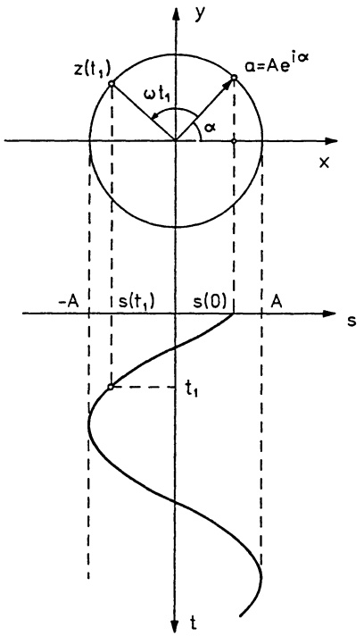

<details>
<summary>text_image</summary>

z(t₁)
ωt₁
α
a=Aeⁱᵝα
x
-A
s(t₁)
s(0)
A
s
t₁
t
</details>

Abb. 61 - Kreisbewegung

Die Überlagerung von Schwingungen erfolgt nach dem Superpositionsprinzip, wonach sich die Wirkungen, d.h. die momentanen Auslenkungen zu jeder Zeit addieren. Bei harmonischen Schwingungen führt dies in der komplexen Darstellung auf die vektorielle Addition der zugehörigen Zeiger. Drehen sich die Zeiger alle mit derselben Winkelgeschwindigkeit  $\omega$ , so gilt dies auch für den resultierenden Zeiger ( $\rightarrow$  Abb. 62). Laufen die Zeiger mit unterschiedlicher Frequenz um, so ist die Überlagerung im allg. nicht mehr periodisch.

Satz 3.3. Die Überlagerung zweier gleichfrequenter harmonischer Schwingungen ist wieder eine harmonische Schwingung derselben Frequenz. Es gilt

$$
A _ {1} \cos (\omega t + \alpha_ {1}) + A _ {2} \cos (\omega t + \alpha_ {2}) = A \cos (\omega t + \alpha)
$$

mit $A = \sqrt{(A_1\cos\alpha_1 + A_2\cos\alpha_2)^2 + (A_1\sin\alpha_1 + A_2\sin\alpha_2)^2}$ und

$$
\alpha = \left\{ \begin{array}{c l} \arccos \frac {A _ {1} \cos \alpha_ {1} + A _ {2} \cos \alpha_ {2}}{A} & , f a l l s A _ {1} \sin \alpha_ {1} + A _ {2} \sin \alpha_ {2} \geq 0, A \neq 0, \\ - \arccos \frac {A _ {1} \cos \alpha_ {1} + A _ {2} \cos \alpha_ {2}}{A} & , f a l l s A _ {1} \sin \alpha_ {1} + A _ {2} \sin \alpha_ {2} <   0, A \neq 0, \\ b e l i e b i g & , f a l l s A = 0. \end{array} \right.
$$

Beweis. Für die komplexe Darstellung der Überlagerung ergibt sich mit (8)

$$
A _ {1} e ^ {i (\omega t + \alpha_ {1})} + A _ {2} e ^ {i (\omega t + \alpha_ {2})} = (A _ {1} e ^ {i \alpha_ {1}} + A _ {2} e ^ {i \alpha_ {2}}) e ^ {i \omega t} = (A e ^ {i \alpha}) e ^ {i \omega t}.
$$

Betrag $A$ und Argument $\alpha$ des komplexen Zeigers $A_{1}e^{i\alpha_{1}} + A_{2}e^{i\alpha_{2}} = (A_{1}\cos \alpha_{1} + A_{2}\cos \alpha_{2}) + i(A_{1}\sin \alpha_{1} + A_{2}\sin \alpha_{2})$ ergeben sich mit den Formeln aus 3.3.

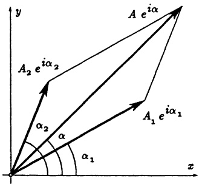

<details>
<summary>text_image</summary>

y
A₂ e^{iα₂}
A e^{iα}
α₂
α
α₁
x
A₁ e^{iα₁}
</details>

Abb. 62a - Addition von zwei Zeigern

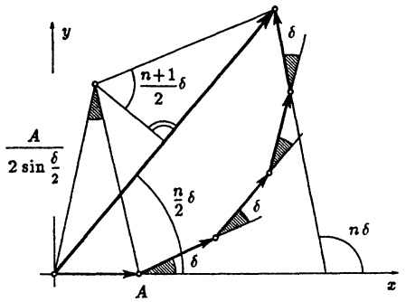

<details>
<summary>text_image</summary>

y
A
/2 sin δ/2
n+1/2 δ
δ
n/2 δ
δ
A
x
n δ
</details>

Abb. 62b - n + 1 Zeiger gleicher Länge

## Beispiele.

1.  $c \cos \omega t + d \sin \omega t = A \cos(\omega t + \alpha)$  mit  $A = \sqrt{c^{2} + d^{2}}$  und  $\alpha = \arg(c - id)$ .
2. In der Wellenoptik (→ Beugung am Spalt, 6.4, Aufgabe 10) benötigt man die Amplitude und Nullphase der Überlagerung von $n+1$ Schwingungen mit gleicher Amplitude $A$, gleicher Frequenz $\omega$ und den Nullphasen $0,\delta,2\delta,\ldots n\delta$. Diese lassen sich am Zeigerdiagramm (→ Abb. 62b) ablesen oder in komplexer Darstellung berechnen:

$$
\begin{array}{l} z (t) = A e ^ {i \omega t} + A e ^ {i (\omega t + \delta)} + \dots + A e ^ {i (\omega t + n \delta)} \\ = A e ^ {i \omega t} \left[ 1 + e ^ {i \delta} + (e ^ {i \delta}) ^ {2} + \dots + (e ^ {i \delta}) ^ {n} \right] \\ = A e ^ {i \omega t} \frac {1 - \left(e ^ {i \delta}\right) ^ {n + 1}}{1 - e ^ {i \delta}} = A e ^ {i \omega t} \frac {e ^ {i \frac {n + 1}{2} \delta} \left(e ^ {- i \frac {n + 1}{2} \delta} - e ^ {i \frac {n + 1}{2} \delta}\right)}{e ^ {i \frac {\delta}{2}} \left(e ^ {- i \frac {\delta}{2}} - e ^ {i \frac {\delta}{2}}\right)} \\ = A e ^ {i \omega t} \frac {e ^ {i \frac {n + 1}{2} \delta} (- 2 i \sin \frac {n + 1}{2} \delta)}{e ^ {i \frac {\delta}{2}} (- 2 i \sin \frac {\delta}{2})} = \left(A \frac {\sin \frac {n + 1}{2} \delta}{\sin \frac {\delta}{2}}\right) e ^ {i (\omega t + \frac {n}{2} \delta)}. \\ \end{array}
$$

Die Überlagerung hat die Amplitude  $A\frac{\sin\frac{n+1}{2}\delta}{\sin\frac{\delta}{2}}$  und die Nullphase  $\frac{n}{2}\delta$ .

Mit  $\omega = 0$  und A = 1 erhält man

$$
\sin \delta + \sin 2 \delta + \dots + \sin n \delta = \frac {\sin \frac {n + 1}{2} \delta \sin \frac {n}{2} \delta}{\sin \frac {\delta}{2}}. \tag {13}
$$

Wegen  $\omega_{1}=\frac{\omega_{1}+\omega_{2}}{2}+\frac{\omega_{1}-\omega_{2}}{2}$ ,  $\omega_{2}=\frac{\omega_{1}+\omega_{2}}{2}-\frac{\omega_{1}-\omega_{2}}{2}$  läßt sich die Superposition zweier komplexer Schwingungen stets als Produkt darstellen:

$$
\boxed {a _ {1} e ^ {i \omega_ {1} t} + a _ {2} e ^ {i \omega_ {2} t} = \left[ a _ {1} e ^ {i \frac {\left(\omega_ {1} - \omega_ {2}\right)}{2} t} + a _ {2} e ^ {- i \frac {\left(\omega_ {1} - \omega_ {2}\right)}{2} t} \right] e ^ {i \frac {\omega_ {1} + \omega_ {2}}{2} t}} \tag {14}
$$

Man spricht hier von einer modulierten Schwingung mit modulierter (komplexer) Amplitude

$$
a (t) = a _ {1} e ^ {i \frac {\omega_ {1} - \omega_ {2}}{2} t} + a _ {2} e ^ {- i \frac {\omega_ {1} - \omega_ {2}}{2} t}.
$$

Eine modulierte Schwingung ist im allg. nicht periodisch. Ist jedoch das Verhältnis der beiden Kreisfrequenzen $\omega_{1}$, $\omega_{2}$ rational, d.h. $\frac{\omega_{1}}{\omega_{2}} = \frac{n_{1}}{n_{2}}$ (mit $n_{1}, n_{2} \in \mathbb{N}$), dann besitzen die beiden Schwingungen $z_{1}(t) = a_{1}e^{i\omega_{1}t}$ und $z_{2}(t) = a_{2}e^{i\omega_{2}t}$ eine gemeinsame Periode $T := \frac{2\pi n_{1}}{\omega_{1}} = \frac{2\pi n_{2}}{\omega_{2}}$; denn wegen $e^{i\omega_{1}T} = e^{i2\pi n_{1}} = 1$ gilt $e^{i\omega_{1}(t+T)} = e^{i\omega_{1}t}$, ebenso $e^{i\omega_{2}(t+T)} = e^{i\omega_{2}t}$. In diesem Fall stellt die Überlagerung tatsächlich eine (nicht notwendig harmonische) Schwingung mit Periode $T$ dar.

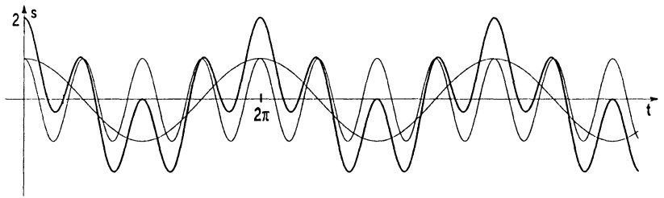

<details>
<summary>line</summary>

| t | Value (Smooth Curve) | Value (Irregular Wave) |
| --- | --- | --- |
| 0 | 2 | 2 |
| \(2\pi\) | ~\(1/4\pi\) | ~\(1/4\pi\) |
</details>

Abb. 63 - $s(t) = \cos t + \cos 4t$

Unterscheiden sich die beiden Kreisfrequenzen $\omega_{1}$ und $\omega_{2}$ nur sehr wenig, d.h. ist $\Omega := |\omega_{1} - \omega_{2}|$ im Verhältnis zu $\omega_{1}$ sehr klein, dann beschreibt die Überlagerung (14) eine „hochfrequente Schwingung“ mit Kreisfrequenz $\approx \omega_{1}$, deren Amplitude sich zwischen dem minimalen Wert $a := \left| |a_{1}| - |a_{2}| \right|$ und dem maximalen Wert $A := |a_{1}| + |a_{2}|$ periodisch mit der „Niederfrequenz“ $\Omega$ ändert. Ein solches Pulsieren der Amplitude vom Wert $a$ über $A$ bis $a$ nennt man Schwebung, $\frac{\Omega}{2\pi}$ heißt Schwebungsfrequenz. Im Falle $a_{1} = a_{2}$ ist die hochfrequente Schwingung harmonisch und ihre Kreisfrequenz $\frac{\omega_{1} + \omega_{2}}{2}$.

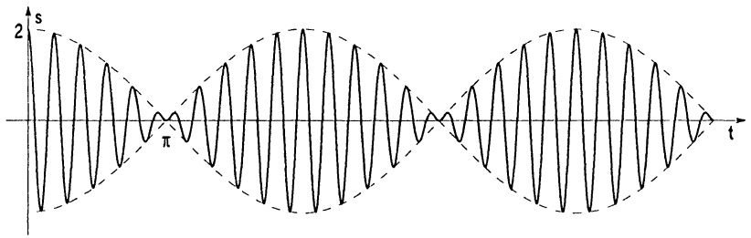

<details>
<summary>line</summary>

| Time (t) | Value (s) |
| --- | --- |
| 0 | 2 |
| \(\pi\) | 0 |
</details>

Abb. 64 - $s(t) = \cos 10t + \cos 11t$

Man beachte: Bis hierher wurde nur die Superposition gleichgerichteter harmonischer Schwingungen betrachtet. Die Schwingungen erfolgen (ausschließlich) entweder parallel zur x-Achse oder zur y-Achse. Etwas anders ist der Sachverhalt bei der Überlagerung ebener Schwingungen mit verschiedenen Schwingungsrichtungen. Die Überlagerung von

$$
\begin{array}{l} \mathbf {s} _ {1} (t) = s _ {1} (t) \binom{a _ {1}}{a _ {2}} \quad \text {(Schwingung längs} \mathbf {a} = \binom{a _ {1}}{a _ {2})} \quad \text {und} \\ \mathbf {s} _ {2} (t) = s _ {2} (t) \binom{b _ {1}}{b _ {2}} \quad \text {(Schwingung längs} \mathbf {b} = \binom{b _ {1}}{b _ {2}}) \\ \end{array}
$$

wird durch

$$
\mathbf {s} (t) = \binom{s _ {1} (t) a _ {1} + s _ {2} (t) b _ {1}}{s _ {1} (t) a _ {2} + s _ {2} (t) b _ {2}}
$$

dargestellt. Dieses ist eine Kurve der Ebene. Die sich aus der Überlagerung von

$$
\mathbf {s} _ {1} (t) = (A _ {1} \cos (\omega_ {1} t + \alpha_ {1})) \mathbf {e} _ {1},
$$

$$
\mathbf {s} _ {2} (t) = (A _ {2} \cos (\omega_ {2} t + \alpha_ {2})) \mathbf {e} _ {2}
$$

ergebenden Kurven

$$
\mathbf {s} (t) = \binom{A _ {1} \cos (\omega_ {1} t + \alpha_ {1})}{A _ {2} \cos (\omega_ {2} t + \alpha_ {2})}
$$

heißen Lissajous-Figuren (benannt nach J. A. LISSAJOUS, 1822–1880).

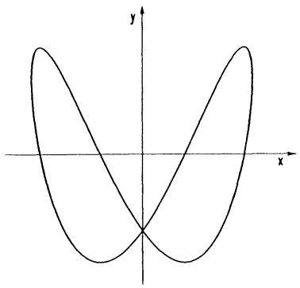

<details>
<summary>natural_image</summary>

Symmetrical parabolic curve plotted on Cartesian coordinate system (x, y axes), no text or labels present
</details>

Abb. 65 - $x(t) = \sin t, y(t) = \sin (2t - \frac{\pi}{4})$

## Aufgaben

1. Man bestätige

$$
\sin 4 \varphi = 8 \cos^ {3} \varphi \sin \varphi - 4 \cos \varphi \sin \varphi
$$

$$
\cos 4 \varphi = 8 \cos^ {4} \varphi - 8 \cos^ {2} \varphi + 1
$$

$$
\sin^ {4} \varphi = \frac {1}{8} (\cos 4 \varphi - 4 \cos 2 \varphi + 3)
$$

$$
\cos^ {4} \varphi = \frac {1}{8} (\cos \varphi + 4 \cos 2 \varphi + 3)
$$

und berechne damit  $\sin\frac{\pi}{16}$ ,  $\cos\frac{\pi}{16}$  und  $\tan\frac{\pi}{16}$ .

2. Man rechne mittels der Beziehung  $2\cos\alpha=e^{i\alpha}+e^{-i\alpha}$  nach :

$$
\left(2 \cos \alpha\right) ^ {5} = 2 \cos 5 \alpha + 4 0 \cos^ {3} \alpha - 1 0 \cos \alpha .
$$

Setze  $\alpha = \frac{\pi}{5}$  und bestimme die Werte für  $\cos(\frac{\pi}{5})$  und  $\sin(\frac{\pi}{5})$  mit Hilfe der Faktorisierung  $x^{5} - 5x^{3} + 5x + 2 = (x^{2} - x - 1)^{2}(x + 2)$ .

3. Eine kubische Gleichung  $x^{3}+ax^{2}+bx+c=0$  wird mit  $z:=x+\frac{a}{3}$  in eine Gleichung ohne quadratischen Anteil umgeformt:

(\*) $z^3 -pz + q = 0$

a) Man zeige, daß im Fall $4p^3 - 27q^2 > 0$ mit $r = \sqrt{\left(\frac{p}{3}\right)^3}$ und $\varphi$ definiert durch $\cos \varphi = \frac{-q}{2r}$ die Zahlen $z_k = 2\sqrt[3]{r} \cos \frac{\varphi + 2k\pi}{3} \quad (k = 0,1,2)$ Lösungen der Gleichung (\*) sind.

b) Man berechne die Lösungen von  $x^{3} + 9x^{2} + 23x + 14 = 0$ .

4. Man bestätige mit vollständiger Induktion nach n, daß für sin α ≠ 0

$$
\cos \alpha + \cos 3 \alpha + \dots + \cos (2 n - 1) \alpha = \frac {\sin (2 n \alpha)}{2 \sin \alpha}.
$$

5. Man bestimme – nach Umformung in Produkt- oder Polynomdarstellung – sämtliche Lösungen im Intervall  $0 \leq x < 2\pi$  von

a)  $\sin 2x - \cos 2x = 1$ ,

b) $\sin x + \sin 2x + \sin 3x = 0$.

6. Die drei Spannungen in einer Drehstromleitung mit Null-Leiter $Mp$ sind

$$
R = U \sin \omega t; S = U \sin \left(\omega t + \frac {2 \pi}{3}\right);
$$

$$
T = U \sin \left(\omega t + \frac {4 \pi}{3}\right) .
$$

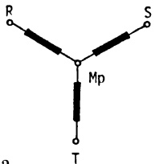

<details>
<summary>chemical</summary>

Simple Y-shaped molecular structure with labeled atoms R, S, T and central Mφ
</details>

a) Wie lauten diese Spannungen in komplexer Darstellung ?
Zeige, daß stets  $R + S + T = 0$ .

b) Bestimme Amplitude und Phase von S - R, T - S, R - T.

7. a) Man berechne Real- und Imaginärteil sowie Betrag und Argument von

$$
\left(\frac {2 + i}{1 - (1 + i) ^ {2}}\right) ^ {9}; \qquad \left(\frac {1 + i}{1 - i}\right) ^ {9 9}; \qquad (\frac {1}{2} (1 + i \sqrt {3})) ^ {n}, \quad n = 0, 1, 2, \dots
$$

b) Man skizziere als Punktmengen in $\mathbb{C}$

$$
\begin{array}{l} \left\{z \in \mathbb {C}; z = 3 - i + 5 e ^ {i t}, 0 \leq t \leq \pi \right\}; \quad \left\{z \in \mathbb {C}; | z - 1 - i | \leq 3 \right\}; \\ \{z \in \mathbb {C}; z ^ {5} = 1 \}. \\ z = t e ^ {i t}, t \geq 0; \quad \operatorname{Re} (\frac {1}{z}) = 1; \quad \operatorname{Im} (z ^ {2}) \leq 2; \quad \arg (1 + z ^ {2}) = 0; \\ | (1 + i) z + (1 - i) | = 5. \\ \end{array}
$$

8. Mittels komplexer Darstellung berechne man die Amplitude $A$ und die Nullphase $\varphi$ von

$$
s (t) = A \sin (\omega t + \varphi) = \sin (\omega t + \varphi_ {1}) + 2 \sin \omega t
$$

für  $\varphi_{1}=2$  und  $\omega=10$ . Für welche Werte von  $\varphi_{1}$  ist A maximal bzw. minimal?

9. Die amplitudenmodulierte Schwingung

$$
S (t) = A \cdot \left(1 + m \cos (2 \pi n t)\right) \cdot \cos (2 \pi N t), \quad t \in \mathbb {R}
$$

ist eine additive Überlagerung von reinen Schwingungen. Welche Frequenzen treten in dieser Superposition auf ? (N Trägerfrequenz, n Modulationsfrequenz, m Modulationsgrad)

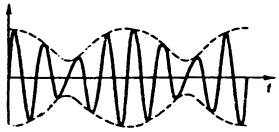

<details>
<summary>natural_image</summary>

Pure sine wave diagram without any text, numbers, or symbols
</details>

Unterdrückt man die Trägerschwingung (Doppelseitenband (DSB) - Modulation im Stereosignal), so erhält man

$$
s (t) = S (t) - A \cos (2 \pi N t) .
$$

- Man bestimme sämtliche Nullstellen von $S(t)$ und $s(t)$ für $0 < m < 1$.
- Für welche Werte von $N, n$ haben $S(t)$ und $s(t)$ dieselben Nullstellen? Stimmen in diesem Falle auch die Vorzeichenwechsel überein?
- Man skizziere $s(t)$ und $S(t)$ für $A=4$, $m=0.5$, $n=1$, $N=5$ und begründe: Aus $s(t)$ kann die Trägerfrequenz $\omega=2\pi N$ nicht decodiert werden. (Deshalb wird ein Pilotton geringer Intensität zusätzlich übertragen.)

## §4. Zahlenfolgen und Grenzwerte

Die charakteristische Methode der Analysis ist die Bildung von Grenzwerten. Wir führen den Grenzwertbegriff anhand reeller Zahlenfolgen ein und übertragen anschließend die dabei gewonnenen Erkenntnisse auf Grenzwerte von Funktionen.

4.1 Folgen. Unter einer Folge reeller Zahlen (oder reellen Zahlenfolge) versteht man eine auf $\mathbb{N}_{0}=\{0,1,2,\ldots\}$ erklärte reellwertige Funktion; d.h. jedem $n\in\mathbb{N}_{0}$ ist ein $a_{n}\in\mathbb{R}$ zugeordnet. Man schreibt hierfür

$$
(a _ {n}) _ {n \in \mathbb {N}} \text {oder} (a _ {n}) _ {n \geq 0}, \text {oder auch} a _ {0}, a _ {1}, a _ {2}, \dots
$$

Die Zahlen $a_{n}$ heißen die Glieder der Folge. Die direkte Vorschrift $n \mapsto a_{n}$ bezeichnen wir als explizites Bildungsgesetz der Folge (es handelt sich meist um eine Formel, mit der $a_{n}$ aus $n$ direkt zu berechnen ist). Demgegenüber ist die rekursive Definition der $a_{n}$ ($\rightarrow$ Kap. 1, 2.6) als implizites Berechnungsgesetz zu verstehen.

Bemerkung. Das erste Glied einer Folge braucht nicht immer  $a_{0}$  zu sein. Durch Umbenennung, etwa  $b_{0} := a_{5}$ ,  $b_{1} := a_{6}, \ldots$ ,  $b_{n} := a_{5+n}$ , erreicht man, daß auch  $a_{5}, a_{6}, a_{7}, \ldots$  eine Folge im Sinne der Definition darstellt; wir bezeichnen sie mit  $(a_{n})_{n \geq 5}$  (allgemein:  $(a_{n})_{n \geq n_{0}}$ ).

## Beispiele.

$a_{n}$ explizit definiert:

1. $a_{n}:= c$ $(n\geq 0,c\in \mathbb{R}$ konstant); $c,c,c,c,\ldots$
2. $a_{n}:= n, \quad n\geq 0; \quad 0,1,2,3,\ldots$
3. $a_{n}:= a_{0} + nd$ $(n\geq 0,d\in \mathbb{R})$ ; $a_0,a_0 + d,a_0 + 2d,\ldots$
Es handelt sich hier um eine arithmetische Folge:  $a_{n+1} - a_n = d$  (konstant).

4. $a_{n}:= a_{0}q^{n}\quad (n\geq 0,q\neq 0$ konstant); $\quad a_0,a_0q,a_0q^2,\dots$

Dieses ist eine geometrische Folge:  $\frac{a_{n+1}}{a_{n}} = q$  (falls  $a_{0} \neq 0$ ).

5.  $a_{n} := (-1)^{n} \frac{4n^{2} + 2n + 1}{3n^{3} + 6} \quad (n \geq 0)$ .

$a_{n}$ rekursiv definiert:

6. $a_0 := 1$, $a_{n+1} = (n + 1)a_n$ ($n \geq 1$),

7. $a_0 := 2$, $a_{n+1} = \frac{1}{2}(a_n + \frac{2}{a_n})$ ($n \geq 1$),

8.  $a_{0} := 1$ ,  $a_{n+1} = \sin a_{n} \quad (n \geq 1)$ .

Eine Zahlenfolge heißt beschränkt, wenn sämtliche Folgenglieder in einem endlichen Intervall liegen, wenn also $K_1 \leq a_n \leq K_2$ oder $|a_n| \leq K$ gilt für alle $n \geq 0$ mit gewissen Konstanten $K_1, K_2$ bzw. $K$. Jede solche Konstante $K_1$ bzw. $K_2$ heißt untere bzw. obere Schranke der Folge $(a_n)_{n \geq 0}$.

Von den im Beispiel genannten Folgen sind 1., 4. (falls $|q| \leq 1$), 5., 7. und 8. beschränkt, die anderen Folgen sind nicht beschränkt.

## 4.2 Definition des Grenzwerts; konvergente Zahlenfolgen.

Definition. Man sagt, die reelle Zahlenfolge  $(a_{n})_{n\geq0}$ , strebt (oder konvergiert) gegen den Grenzwert  $a\in R$ , und man schreibt  $\lim_{n\to\infty}a_{n}=a$  (kurz  $\lim a_{n}=a$ ) oder  $a_{n}\to a$  für  $n\to\infty$  (kurz  $a_{n}\to a$ ), wenn es zu jeder beliebig kleinen vorgegebenen Schranke  $\epsilon>0$  einen Index  $n_{0}\in N$  gibt, so daß gilt

$$
\left| a _ {n} - a \right| <   \epsilon \text {   für   alle   } n \geq n _ {0}.
$$

Anschaulich:  $(a_{n})_{n\geq0}$  konvergiert gegen den Grenzwert a, wenn in jedem noch so kleinen Intervall mit Mittelpunkt a („ε-Umgebung“) ab einem genügend großen Index – der i.a. von der Wahl der Intervallbreite abhängt – schließlich alle Folgenglieder  $a_{n}$  ( $n\geq n_{0}$ ) liegen.

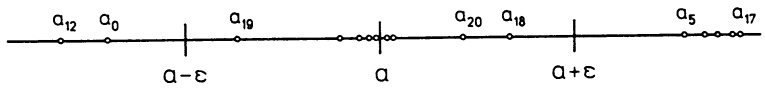

<details>
<summary>text_image</summary>

a₁₂ a₀ a₁₉ a₂₀ a₁₈ a₅ a₁₇
a-ε a a+ε
</details>

Abb. 66 - $a_{n} \in (a - \epsilon, a + \epsilon)$ für alle $n \geq n_{0} = 18$

Von einer Zahlenfolge, die einen Grenzwert besitzt (d.h. die gegen einen Grenzwert strebt) sagt man, sie konvergiert oder sie ist konvergent. Jede gegen 0 konvergierende Folge heißt Nullfolge. Nicht konvergente Folgen heißen divergent.

Satz 4.1. Für jede konvergente Zahlenfolge $(a_{n})_{n\geq 0}$ gilt

a) Eindeutigkeit des Grenzwerts:

Ist $\lim a_{n} = a$ und $\lim a_{n} = b$, so gilt $a = b$.

b) Konvergente Zahlenfolgen sind beschränkt, d.h.,

es gibt eine Konstante K mit  $|a_{n}| \leq K$  für alle  $n \in N$ .

Beweis. a): Im Fall  $a \neq b$  würden gleichzeitig schließlich alle Folgenglieder beliebig nahe sowohl bei a als auch bei b liegen; das ist unmöglich.

b): Jede ε-Umgebung des Grenzwerts und die endlich vielen Folgenglieder außerhalb dieser ε-Umgebung fallen zusammen in ein endliches Intervall.

Definition. Man sagt, eine Folge  $(a_{n})_{n\geq0}$  divergiert (bestimmt) gegen den uneigentlichen Grenzwert  $\infty$  (oder strebt gegen  $\infty$ ) i.Z.

$$
\lim _ {n \to \infty} a _ {n} = \infty \text {oder} a _ {n} \to \infty (f i r n \to \infty),
$$

wenn die Zahlen $a_{n}$ in positiver Richtung über alle Schranken wachsen; d.h., wenn zu jedem noch so großen K die Ungleichung $a_{n} > K$ für schließlich alle $a_{n}$ (ab einem Index $n_{0}$) gilt. Analog ist $\lim_{n\to \infty}a_n = -\infty$ ($bzw.\ a_n \to -\infty$) definiert.

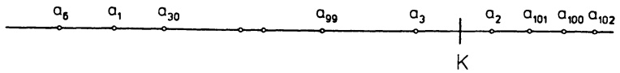

<details>
<summary>text_image</summary>

a₅ a₁ a₃₀ a₉₉ a₃ a₂ a₁₀₁ a₁₀₀ a₁₀₂
K
</details>

Abb. 67 - $a_{n} > K$ für schließlich alle $a_{n}$ (hier ab $n_{0} = 100$)

Beispiel 1.

$$
\boxed {\lim _ {n \to \infty} \frac {1}{n} = 0  .}
$$


Beispiel 2. Die geometrische Folge. Für jede reelle Zahl x gilt

(1)

$$
\boxed \lim _ {n \rightarrow \infty} x ^ {n} = \left\{\begin{array}{c l}0&, \text {falls} | x | <   1,\\\infty&, \text {falls} x > 1,\\\text {unbestimmt}&, \text {falls} x \leq - 1.\end{array}\right.\}
$$

Beweis. Die Aussagen sind anschaulich klar. Zur Einübung der Definition beweisen wir den ersten Fall: Für $x=0$ ist alles klar, für $0<|x|<1$ setzen wir $|x|=\frac{1}{1+p}$ mit $p>0$ und erhalten

$$
| x | ^ {n} = \frac {1}{(1 + p) ^ {n}} = \frac {1}{1 + n p + \cdots + p ^ {n}} <   \frac {1}{n p}.
$$

Nun sei $\epsilon > 0$ (beliebig klein aber fest) vorgegeben. Wählt man $n_0 \in \mathbb{N}$ mit $n_0 > \frac{1}{\epsilon p} = \frac{|x|}{\epsilon(1 - |x|)}$, so ist $|x^n - 0| = |x^n| < \epsilon$ für alle $n \geq n_0$.

Beispiel 3. Die geometrische Reihe. Mit der geometrischen Summenformel ( $\rightarrow$ Kap. 1, §2(5)) gilt für jede reelle Zahl x

$$
s _ {n} = 1 + x + \dots + x ^ {n} = \left\{ \begin{array}{c l} \frac {1 - x ^ {n + 1}}{1 - x} & , \text {falls} x \neq 1 \\ n + 1 & , \text {falls} x = 1 \end{array} \right..
$$

Daher konvergiert die Folge  $(s_{n})_{n\geq0}$  wegen (1) für  $|x|<1$  gegen den Grenzwert  $\frac{1}{1-x}$ . Sie divergiert bestimmt für  $x\geq1$  gegen  $\infty$  und hat für  $x\leq-1$  keinen

Grenzwert. Statt  $\lim_{n\to\infty}s_n$  schreibt man  $1+x+x^2+\cdots$  oder  $\sum_{n=0}^{\infty}x^n$ , so daß

$$
\boxed {\begin{array}{c}\sum_ {n = 0} ^ {\infty} x ^ {n} := 1 + x + x ^ {2} + x ^ {3} + \dots + x ^ {n} + \dots\\:= \lim _ {N \rightarrow \infty} \sum_ {n = 0} ^ {N} x ^ {n} = \left\{\begin{array}{c l}\frac {1}{1 - x}&, \text {falls} | x | <   1\\\infty&, \text {falls} x \geq 1\\\text {unbestimmt}&, \text {falls} x \leq - 1\end{array}\right.\end{array}} \tag {2}
$$

Mit  $x = \frac{p}{q}$  und  $|p| < |q|$  ergibt sich  $1 + \frac{p}{q} + (\frac{p}{q})^{2} + \cdots = \frac{1}{1 - \frac{p}{q}} = \frac{q}{q - p}$ , speziell  $1 + \frac{1}{2} + \frac{1}{4} + \frac{1}{8} + \cdots = 2$ .

Anwendung. Die Eisblume. 1906 hat HELGE VON KOCH (1870–1924) eine beeindruckende Figur mit endlichem Flächeninhalt untersucht, deren Rand ein Fraktal ist und keine endliche Länge besitzt. Die Konstruktion veranschaulicht eine auf einem winterlichen Fenster wachsende Eisblume.

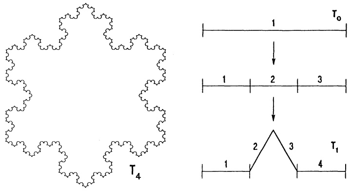

Abb. 68 - Die Von-Koch-Eisblume

Ausgangsfigur $T_{0}$ ist ein gleichseitiges Dreieck mit Seitenlänge $a$. In diskreten Schritten bilden sich daraus rekursiv die Figuren $T_{1}, T_{2}, \ldots, T_{n}, \ldots$ nach dem Gesetz: Ersetze jedes geradlinige Berandungsstück durch vier Strecken, indem über dem mittleren Drittel ein gleichseitiges Dreieck aufgesetzt wird (→ Abb. 68).

Für die Figur  $T_{n}$  gilt: Umfang  $U_{n}=\frac{4}{3}U_{n-1}=\cdots=(\frac{4}{3})^{n}U_{0}=(\frac{4}{3})^{n}3a$ ,

Anzahl der Randstrecken  $K_{n}=4K_{n-1}=\cdots=4^{n}K_{0}=4^{n}\cdot3$ ,

Flächeninhalt der zuletzt aufgesetzten Dreiecke  $\Delta_{n}=\frac{1}{9}\Delta_{n-1}=\cdots=(\frac{1}{9})^{n}\frac{\sqrt{3}}{4}a^{2}$ ,

Flächeninhalt $F_{n} = \frac{\sqrt{3}}{4} a^{2} + \sum_{i=0}^{n-1} \left( 4^{i} \cdot 3 \cdot \left( \frac{1}{9} \right)^{i+1} \frac{\sqrt{3}}{4} \right) a^{2} = \left( 1 + \frac{1}{3} \sum_{i=0}^{n-1} \left( \frac{4}{9} \right)^{i} \right) \frac{\sqrt{3}}{4} a^{2}$.

Mit (1) und (2) ergibt sich für die von-Koch-Eisblume  $T_{\infty}$ :

$$
U _ {\infty} = \lim _ {n \to \infty} U _ {n} = \infty \text {und} F _ {\infty} = \lim _ {n \to \infty} F _ {n} = \left(1 + \frac {1}{3} \frac {9}{9 - 4}\right) \frac {\sqrt {3}}{4} a ^ {2} = \frac {2}{5} \sqrt {3} a ^ {2}.
$$

Beispiel 4. Die harmonische Reihe. Die Folge  $s_{n}=1+\frac{1}{2}+\cdots+\frac{1}{n}$  ( $n\geq1$ ) wächst für  $n\to\infty$  über alle Grenzen, denn

$$
\begin{array}{l} s _ {2 ^ {k + 1}} = 1 + \frac {1}{2} + \left(\frac {1}{3} + \frac {1}{4}\right) + \left(\frac {1}{5} + \dots + \frac {1}{8}\right) + \dots + \left(\frac {1}{2 ^ {k} + 1} + \dots + \frac {1}{2 ^ {k + 1}}\right) \\ \geq 1 + \frac {1}{2} + 2 \cdot \frac {1}{4} + 4 \cdot \frac {1}{8} + \dots + 2 ^ {k} \cdot \frac {1}{2 ^ {k + 1}} = \frac {k + 3}{2}. \text {Es gilt also} \\ \end{array}
$$

$$
\boxed {1 + \frac {1}{2} + \frac {1}{3} + \frac {1}{4} + \dots = \sum_ {n = 1} ^ {\infty} \frac {1}{n} = \infty .} \tag {3}
$$

Beachte. Diese Folge  $(s_{n})_{n\geq1}$  wächst nur sehr langsam. Die numerische Berechnung der Folgenglieder für große Indices,  $s_{1000}=7.4854$ ,  $s_{5000}=9.094508$ ,  $s_{10000}=9.787605$ , kann zur falschen Vermutung  $s_{n}\rightarrow10$  führen.

Definition. Ist  $(a_{n})_{n\geq0}$  eine Folge und  $n_{0}<n_{1}<n_{2}<\cdots$  eine aufsteigende Indexfolge, dann heißt die Folge  $a_{n_{0}},a_{n_{1}},a_{n_{2}},\ldots$  Teilfolge der Folge  $(a_{n})_{n\geq0}$ .

## Beispiele.

1.  $a_{0}, a_{3}, a_{5}, a_{7}, \ldots$  und  $a_{6}, a_{12}, a_{18}, a_{24}, \ldots$  sind Teilfolgen von  $(a_{n})_{n \geq 0}$ .

2. Die gestrichene harmonische Reihe. Streicht man in der harmonischen Reihe (3) jeden Summanden, dessen Nenner n in Dezimaldarstellung eine 0 enthält, so ergibt sich eine konvergente Teilfolge der divergenten Folge  $(s_{n})_{n\geq1}$  aus Beispiel 4:

$$
\begin{array}{l} (\frac {1}{1} + \dots + \frac {1}{9}) + (\frac {1}{1 1} + \dots + \frac {1}{1 9} + \frac {1}{2 1} + \dots + \frac {1}{9 9}) + (\frac {1}{1 1 1} + \dots + \frac {1}{9 9 9}) + \dots \\ \leq 9 \cdot 1 + 9 ^ {2} \cdot \frac {1}{1 0} + 9 ^ {3} \cdot \frac {1}{1 0 0} + \dots = 9 \sum_ {n = 0} ^ {\infty} (\frac {9}{1 0}) ^ {n} = 9 0. \\ \end{array}
$$

Aus den Definitionen folgt direkt:

Jede Teilfolge einer konvergenten Folge konvergiert gegen denselben Grenzwert.

Beispiel. $\lim_{n\to \infty}\frac{1}{n} = 0\Rightarrow \lim_{n\to \infty}\frac{1}{n^2} = 0.$

## §5. Rechenregeln für Grenzwerte und Konvergenzkriterien

5.1 Rechenregeln. Aus gegebenen Folgen  $(a_{n})_{n\geq0}$ ,  $(b_{n})_{n\geq0}$  werden durch Addition, Subtraktion, Multiplikation und Division neue Folgen gewonnen:

$$
c _ {n} := a _ {n} + b _ {n}; d _ {n} := a _ {n} - b _ {n}; e _ {n} := a _ {n} b _ {n}; f _ {n} := \frac {a _ {n}}{b _ {n}} \quad (\text {sofern} b _ {n} \neq 0).
$$

Wiederholte Anwendung dieser Operationen kann bereits zu recht komplizierten Folgen führen. Eine vorgegebene Folge ist in der Regel zuerst daraufhin zu analysieren, aus welchen einfachen (bzw. bekannten) Folgen sie sich zusammensetzt.

Satz 5.1. Grenzwertregeln. Sind $(a_n)_{n \geq 0}$, $(b_n)_{n \geq 0}$ konvergente Zahlenfolgen mit $\lim_{n \to \infty} a_n = a$ und $\lim_{n \to \infty} b_n = b$ dann gilt:

a) $\lim_{n\to \infty}(a_n\pm b_n) = a\pm b,$
b) $\lim_{n\to \infty}(a_n b_n) = ab$ , insbesondere $\lim (ca_n) = ca$ ($c\in \mathbb{R}$) ,
c) ist $a \neq 0$, dann gibt es $n_1 \in \mathbb{N}$ mit $a_n \neq 0$ für alle $n \geq n_1$ und für die Folgen $(a_n)_{n \geq n_1}$, $(b_n)_{n \geq n_1}$ gilt $\lim_{n \to \infty} \frac{1}{a_n} = \frac{1}{a}$, $\lim_{n \to \infty} \frac{b_n}{a_n} = \frac{b}{a}$,
d) $\lim_{n\to \infty}|a_n| = |a|$,
e) $\lim_{n\to \infty}\sqrt{a_n} = \sqrt{a}$ (falls alle $a_{n}\geq 0$).

Beweis. Wir geben nur die wesentlichen Beweisschritte an. Aus $|a_n - a| \to 0$ und $|b_n - b| \to 0$ ergibt sich mit der Dreiecksungleichung ($\to$ Kap. 1, 2.5)

a): $|a_{n} + b_{n} - (a + b)| \leq |a_{n} - a| + |b_{n} - b| \to 0$;
b):  $|a_{n}b_{n}-ab|=|a_{n}b_{n}-a_{n}b+a_{n}b-ab|\leq|a_{n}||b_{n}-b|+|b||a_{n}-a|\to0$ , dabei ist zu beachten, daß die  $a_{n}$  beschränkt sind ( $\rightarrow$  Satz 4.1).

c): Ist $a \neq 0$, dann enthält das Intervall $(a - \frac{|a|}{2}, a + \frac{|a|}{2})$ nicht den Nullpunkt, aber ab einem Index $n_1$ sämtliche Folgenglieder $a_n$, $n \geq n_1$. Für diese $a_n$ gilt $|\frac{1}{a_n} - \frac{1}{a}| = |\frac{a - a_n}{aa_n}| \leq const |a_n - a| \to 0$.

d) folgt aus $||a_n| - |a|| \leq |a_n - a|$.
e): Sind alle $a_{n} \geq 0$, so ist auch $a \geq 0$.

1. Fall: $a = 0$. Wähle $\epsilon > 0$ (beliebig klein) dazu $n_0 \in \mathbb{N}$, so daß $a_n < \epsilon^2$ gilt für alle $n \geq n_0$. Für diese $n$ gilt auch $\sqrt{a_n} < \epsilon$; d.h. $\sqrt{a_n} \to 0$.

2. Fall: $a > 0$. In diesem Fall gilt

$$
| \sqrt {a _ {n}} - \sqrt {a} | = \frac {| \sqrt {a _ {n}} - \sqrt {a} | | \sqrt {a} _ {n} + \sqrt {a} |}{| \sqrt {a _ {n}} + \sqrt {a} |} = \frac {| a _ {n} - a |}{| \sqrt {a _ {n}} + \sqrt {a} |} \leq \frac {| a _ {n} - a |}{\sqrt {a}} \to 0.
$$

## Beispiele.

1. $\lim_{n\to \infty}\frac{n + 1}{n} = \lim_{n\to \infty}\left(1 + \frac{1}{n}\right) = 1 + \lim_{n\to \infty}\frac{1}{n} = 1.$
2. Aus $\lim_{n\to \infty}\frac{n + 1}{n} = 1$ , $\lim_{n\to \infty}\left(\frac{4}{5}\right)^n = 0$ , $\lim_{n\to \infty}\frac{2n + 1}{n^2} = \lim_{n\to \infty}\left(\frac{2}{n} +\frac{1}{n^2}\right) = 0$ folgt

$$
\lim _ {n \to \infty} \left[ \frac {2 n + 1}{n ^ {2}} + \left(\frac {4}{5}\right) ^ {n} \frac {n}{n + 1} \right] = 0.
$$

3. $\lim_{n\to \infty}\sqrt{\frac{6n^4 + 3n^2 + 2}{7n^4 + 12n^3 + 6}} = \lim_{n\to \infty}\sqrt{\frac{6 + \frac{3}{n^2} + \frac{2}{n^4}}{7 + \frac{12}{n} + \frac{6}{n^4}}} = \sqrt{\frac{6}{7}}.$

Eine Warnung: Aus der Existenz von $\lim_{n\to \infty}(a_n\pm b_n)$ folgt i.a. nicht die Konvergenz der einzelnen Folgen $(a_{n})_{n\geq 0}$ bzw. $(b_{n})_{n\geq 0}$. Ebenfalls folgt aus $|a_n|\to |a|$ i.a. keineswegs $a_{n}\rightarrow a$, was man sofort mit den Gegenbeispielen $a_{n}:= (-1)^{n}$, $b_{n}:= (-1)^{n + 1}$ belegen kann.

5.2 Grenzwertbestimmung durch Abschätzung. Eine wichtige Methode, Information über den noch unbekannten (möglichen) Grenzwert einer Folge  $(a_{n})_{n\geq0}$  zu bekommen, besteht darin, für die Folgenglieder  $a_{n}$  „geeignete“ Abschätzungen der Form  $b_{n} \leq a_{n} \leq c_{n}$  mit leichter zugänglichen Folgen  $(b_{n})_{n\geq0}$ ,  $(c_{n})_{n\geq0}$  zu ermitteln.

Satz 5.2. Das Vergleichskriterium. Lassen sich für $n \geq n_1$ die Glieder der Zahlenfolge $(a_n)_{n \geq 0}$ nach oben und unten abschätzen durch $b_n \leq a_n \leq c_n$ mit $\lim_{n \to \infty} b_n = \lim_{n \to \infty} c_n = c$, dann ist die Folge $(a_n)_{n \geq 0}$ konvergent und es gilt $\lim_{n \to \infty} a_n = c$.

Beweis. Zu jedem $\epsilon > 0$ gilt $c - \epsilon \leq b_n \leq a_n \leq c_n \leq c + \epsilon$ für alle hinreichend großen $n$, also $a_n \to c$.

## Beispiele.

1. $\lim_{n\to \infty}\frac{(\sin n)^2}{n} = 0$ ; denn für alle $n\geq 1$ gilt $0\leq \frac{(\sin n)^2}{n}\leq \frac{1}{n}$

2.  $\lim_{n\to\infty}\frac{n}{2^{n}}=0$ ; denn für n>3 gilt  $n^{2}\leq2^{n}$  (einfacher Beweis mit vollständiger Induktion) und damit  $0\leq\frac{n}{2^{n}}\leq\frac{1}{n}$ .

3. $\lim_{n\to \infty}\sqrt[n]{n} = 1$

Beweis. Für  $a_{n} := \sqrt[n]{n} - 1$  gilt

$$
n = (a _ {n} + 1) ^ {n} = 1 + n a _ {n} + \frac {n (n - 1)}{2} a _ {n} ^ {2} + \dots + a _ {n} ^ {n} \quad (\rightarrow \text {Kap. 1, Satz 2.2})
$$

$$
\geq 1 + \frac {n (n - 1)}{2} a _ {n} ^ {2}
$$

und damit $0 \leq a_{n}^{2} \leq \frac{2}{n}$ (für $n \geq 2$). Es folgt $a_{n}^{2} \to 0$ und darum $a_{n} \to 0$ ($\rightarrow$ Satz 5.1e).

Satz 5.3. Limesbildung erhält schwache Ungleichungen. Sind $(a_n)_{n \geq 0}$ und $(b_n)_{n \geq 0}$ konvergente Folgen mit $a_n \leq b_n$ für alle $n \geq n_1$, dann gilt $\lim_{n \to \mathscr{X}} a_n \leq \lim_{n \to \mathscr{X}} b_n$.

Beweis. Für  $c_{n} := b_{n} - a_{n} \geq 0$  ist  $\lim_{n \to \infty} c_{n} \geq 0$  nachzuweisen. Wäre  $\lim_{n \to \infty} c_{n} < 0$ , dann müßten die  $c_{n}$  ab einem Index N negativ sein, das ist ein Widerspruch.☐

Vorsicht! Limesbildung erhält strikte Ungleichungen i.a. nicht: Aus $\lim a_{n}=a$, $\lim b_{n}=b$ und $a_{n}<b_{n}$ für alle $n\geq n_{1}$ folgt i.a. nicht $a<b$ sondern nur $a\leq b$. Man erkennt dies beispielsweise an $a_{n}:=0$, $b_{n}:=\frac{1}{n}$.

5.3 Monotone Folgen. Gemäß 1.2 heißt eine Zahlenfolge  $(a_{n})_{n\geq0}$  genau dann monoton wachsend (bzw. monoton fallend), wenn  $a_{n+1}\geq a_{n}$  (bzw.  $a_{n+1}\leq a_{n}$ ) für alle  $n\geq0$  gilt.

Beispiele.  $a_{n} := n$ ,  $b_{n} := 1 + \frac{1}{2} + \frac{1}{3} + \cdots + \frac{1}{n}$ ,  $c_{n} := 1 + \frac{1}{1!} + \frac{1}{2!} + \cdots + \frac{1}{n!}$  sind monoton wachsende Folgen.

Die Folge  $d_{n} := \left(1 - \frac{1}{n}\right)\left(1 - \frac{2}{n}\right) \cdots \left(1 - \frac{n-1}{n}\right)$ ,  $n \geq 2$ , ist monoton fallend.☐

Beachte:  $a_{n}$  monoton wachsend  $\Longleftrightarrow -a_{n}$  monoton fallend.

Satz 5.4. Das Monotoniekriterium. Jede monoton wachsende oder monoton fallende beschränkte Zahlenfolge ist konvergent.

Beweis. Sei  $(a_{n})_{n\geq0}$  monoton wachsend,  $a:=\sup\{a_{n}; n\geq0\}$  die kleinste obere Schranke der  $a_{n}$  ( $\rightarrow$  Kap. 1, 2.4) und  $\epsilon>0$  (beliebig klein). Da  $a-\epsilon$  keine obere Schranke der Folge ist, gibt es wenigstens ein Folgenglied  $a_{N}$  mit  $a-\epsilon<a_{N}\leq a$ . Aufgrund der Monotonie gilt dann  $a-\epsilon<a_{N}\leq a_{n}\leq a$  für alle  $n\geq N$ , also  $a_{n}\to a$ . Der Fall  $a_{n}$  monoton fallend wird analog behandelt, jedoch mit  $a:=\inf\{a_{n}; n\geq0\}$ , oder man geht zu  $-a_{n}$  über. ☐

Beispiel 1. Die Folge  $a_{n} := 1 + \frac{1}{2^{2}} + \frac{1}{3^{2}} + \cdots + \frac{1}{n^{2}} = \sum_{k=1}^{n} \frac{1}{k^{2}}, n \geq 1,$

ist monoton wachsend und beschränkt, denn für n > 1 gilt

$$
0 \leq \frac {1}{n ^ {2}} \leq \frac {1}{n (n - 1)} = \frac {1}{n - 1} - \frac {1}{n}
$$

und damit

$$
0 \leq a _ {n} \leq 1 + \left(1 - \frac {1}{2}\right) + \left(\frac {1}{2} - \frac {1}{3}\right) + \dots + \left(\frac {1}{n - 1} - \frac {1}{n}\right) = 2 - \frac {1}{n} \leq 2.
$$

Mit dem Monotoniekriterium existiert $\lim_{n\to \infty}a_n$ ; mittels Fourier-Reihen ($\rightarrow$ Bd. 2, Kap. 11, §1) zeigt man

$$
\boxed {\sum_ {k = 1} ^ {\infty} \frac {1}{k ^ {2}} := \lim _ {n \rightarrow \infty} \left(1 + \frac {1}{2 ^ {2}} + \frac {1}{3 ^ {2}} + \dots + \frac {1}{n ^ {2}}\right) = \frac {\pi^ {2}}{6}}
$$

mit der Kreiszahl $\pi = 3.14\ldots$

□

Beispiel 2. Die Folge  $b_{n} := 1 + \frac{1}{1!} + \frac{1}{2!} + \cdots + \frac{1}{n!} = \sum_{k=0}^{n} \frac{1}{k!}, n \geq 0$ , ist monoton wachsend. Sie ist auch beschränkt und damit konvergent, denn aus

$$
0 <   \frac {1}{k !} = \frac {1}{1 \cdot 2 \cdot 3 \cdots k} \leq \frac {1}{1 \cdot 2 \cdot 2 \cdots 2} = \frac {1}{2 ^ {k - 1}} \quad (k \geq 2)
$$

ergibt sich für  $n \geq 2$  die Abschätzung

$$
2 \leq 1 + \frac {1}{1 !} + \frac {1}{2 !} + \dots + \frac {1}{n !} \leq 1 + 1 + \frac {1}{2} + \dots + \frac {1}{2 ^ {n - 1}} \leq 1 + \sum_ {k = 0} ^ {\infty} \left(\frac {1}{2}\right) ^ {k} = 3.
$$

Durch den Grenzwert dieser Folge ist die Eulersche Zahl e definiert:

$$
e := \sum_ {k = 0} ^ {\infty} \frac {1}{k !} = \lim _ {n \to \infty} \left(\sum_ {k = 0} ^ {n} \frac {1}{k !}\right). \tag {1}
$$

Die Ungleichung $2 \leq b_{n} \leq 3$ gilt für alle $n \geq 1$, sie bleibt mit Satz 5.3 auch in der Grenze $n \to \infty$ erhalten, daher erhält man (ohne Rechnung) die grobe Abschätzung $2 \leq e \leq 3$. Die außerordentlich rasche Konvergenz der Folge $(b_{n})_{n \geq 0}$ verdeutlicht eine 11-stellige Rechnung:

$$
\begin{array}{l} b _ {0} = 1 \quad b _ {7} = 2. 7 1 8 2 5 3 9 6 8 3 \\ b _ {1} = 2 \quad b _ {8} = 2. 7 1 8 2 7 8 7 6 9 9 \\ b _ {2} = 2. 5 \quad b _ {9} = 2. 7 1 8 2 8 1 5 2 5 6 \\ b _ {3} = 2. 6 6 6 6 6 6 6 6 6 7 \quad b _ {1 0} = 2. 7 1 8 2 8 1 8 0 1 1 \\ b _ {4} = 2. 7 0 8 3 3 3 3 3 3 3 \quad b _ {1 1} = 2. 7 1 8 2 8 1 8 2 6 2 \\ b _ {5} = 2. 7 1 6 6 6 6 6 6 6 7 \quad b _ {1 2} = 2. 7 1 8 2 8 1 8 2 8 3 \\ \end{array}
$$

$$
b _ {6} = 2. 7 1 8 0 5 5 5 5 5 6 \quad b _ {1 3} = 2. 7 1 8 2 8 1 8 2 8 4. \quad \square
$$

Beispiel 3. Die Folge $c_{n}:=\left(1+\frac{1}{n}\right)^{n}, n\geq1$.

Anwendung: In der Zinsrechnung ist  $c_{n}$  der Faktor, um den sich ein Kapital beim Zinssatz 100% in einem Jahr erhöht, wenn n-mal aufgezinst wird:

$$
\begin{array}{l} \text {Jährlich} \quad : c _ {1} = (1 + 1) ^ {1} = 2, \\ \text {monatlich} \quad : \quad c _ {1 2} \quad = (1 + \frac {1}{1 2}) ^ {1 2} \quad = 2. 6 1 3 0 3 5 2 9 0 2 2 \dots , \\ \text {täglich} \quad : c _ {3 6 5} = \left(1 + \frac {1}{3 6 5}\right) ^ {3 6 5} = 2. 7 1 4 5 6 7 4 8 2 0 2 \dots , \\ \text {jede Minute}: c _ {5 2 5 6 0 0} = (1 + \frac {1}{5 2 5 6 0 0}) ^ {5 2 5 6 0 0} = 2. 7 1 8 2 7 9 2 4 2 5 7 \dots . \\ \end{array}
$$

(Diese Werte liefert das Programmpaket MAPLE V mit variabler Stellenanzahl.)

1. Behauptung. Die Folge  $c_{n}$  ist monoton wachsend.

Beweis. Mit der Bernoulli-Ungleichung (→ Kap. 1, §2) folgt

$$
\begin{array}{l} \frac {c _ {n}}{c _ {n - 1}} = \frac {(n + 1) ^ {n}}{n ^ {n}} \frac {(n - 1) ^ {n - 1}}{n ^ {n - 1}} = \frac {n}{n - 1} \frac {(n + 1) ^ {n} (n - 1) ^ {n}}{n ^ {2 n}} = \frac {n}{n - 1} \left(1 - \frac {1}{n ^ {2}}\right) ^ {n} \\ \geq \frac {n}{n - 1} \left(1 - \frac {1}{n}\right) = 1, \quad \text {das bedeutet} c _ {n} \geq c _ {n - 1}. \\ \end{array}
$$

Tip: Man versuche stets, die Frage nach der Monotonie einer Folge  $(a_{n})_{n\geq0}$  über  $a_{n+1}-a_{n}\geq0$  (bzw.  $\leq0$ ) oder -falls  $a_{n}>0-\frac{a_{n+1}}{a_{n}}\geq1$  (bzw.  $\leq1$ ) zu beantworten.

2. Behauptung. Es gilt  $c_{n} \leq e$ ,  $n \geq 1$ , mit der Eulerschen Zahl e.

Beweis. Für  $n \geq k \geq 1$  gilt

$$
\begin{array}{l} \binom {n} {k} \frac {1}{n ^ {k}} = \frac {n (n - 1) \cdots (n - k + 1)}{k ! n ^ {k}} \quad (\rightarrow \text {Kap.} 1, 2. 7) \\ = \frac {1}{k !} \left(1 - \frac {1}{n}\right) \left(1 - \frac {2}{n}\right) \dots \left(1 - \frac {k - 1}{n}\right) \leq \frac {1}{k !} \\ \end{array}
$$

und deshalb

$$
c _ {n} = \left(1 + \frac {1}{n}\right) ^ {n} = \sum_ {k = 0} ^ {n} \binom {n} {k} \frac {1}{n ^ {k}} \leq \sum_ {k = 0} ^ {n} \frac {1}{k !} \leq e.
$$

Nach dem Monotoniekriterium besitzt die Folge  $c_{n}$  einen Grenzwert  $\leq e$ .

3. Behauptung.  $\lim_{n\to\infty}c_{n}=e$ .

Beweis. Sei  $N \geq 1$  beliebig aber fest gewählt, so gilt für alle n > N

$$
c _ {n} \geq \sum_ {k = 0} ^ {N} \binom {n} {k} \frac {1}{n ^ {k}} = \sum_ {k = 0} ^ {N} \frac {1}{k !} \left(1 - \frac {1}{n}\right) \dots \left(1 - \frac {k - 1}{n}\right) \geq \sum_ {k = 0} ^ {N} \frac {1}{k !} \left(1 - \frac {N}{n}\right) ^ {N}.
$$

Die Ungleichung bleibt auch für  $n \rightarrow \infty$  bestehen ( $\rightarrow$  Satz 5.3), d.h. mit  $b_{N}$  aus Bsp. 2 gilt

$$
\lim _ {n \to \infty} \left(1 + \frac {1}{n}\right) ^ {n} \geq \lim _ {n \to \infty} \sum_ {k = 0} ^ {N} \frac {1}{k !} \left(1 - \frac {N}{n}\right) ^ {N} = \sum_ {k = 0} ^ {N} \frac {1}{k !} = b _ {N}.
$$

Dies gilt für jedes $N \geq 1$ und damit ist - wieder wegen Satz $5.3 - \lim_{n \to \infty} c_n \geq \lim_{N \to \infty} b_N = e$. Wegen Behauptung 2 müssen beide Grenzwerte gleich sein.

$$
\begin{array}{l}\text {Die Euler - Zahl}\\e = \lim _ {n \rightarrow \infty} \left(1 + \frac {1}{n}\right) ^ {n} = \lim _ {n \rightarrow \infty} \sum_ {k = 0} ^ {n} \frac {1}{k !} = 1 + \frac {1}{1 !} + \frac {1}{2 !} + \frac {1}{3 !} + \dots\\e = 2. 7 1 8 2 8 1 8 2 8 4 5 9 0 4 5 2 3 5 3 6 0 2 8 7 \dots .\end{array}\tag {2}
$$

Bemerkung. Beide Folgen streben zwar gegen e, jedoch ist die Folge der Summen  $\sum_{k=0}^{n}\frac{1}{k!}=1+\frac{1}{1!}+\frac{1}{2!}+\cdots+\frac{1}{n!}$  zur näherungsweisen Berechnung der Eulerschen Zahl viel besser geeignet als die Folge der Produkte  $\left(1+\frac{1}{n}\right)^{n}$ , denn diese konvergiert außerordentlich langsam.

Beispiel 4. Von der durch

$$
a _ {0} := 1, \quad a _ {n + 1} := \frac {6 (1 + a _ {n})}{7 + a _ {n}}
$$

rekursiv definierten Folge zeigt man leicht, daß sie beschränkt  $(0 < a_{n} < 2)$  und monoton wachsend ist.

Der noch unbekannte Grenzwert sei $a$. In diesem Fall (und vielen ähnlich gearteten Fällen) führt die Rekursionsformel auf eine $a$ bestimmende Gleichung. Aus $a_n \to a$, also auch $a_{n+1} \to a$, und den Rechenregeln für Grenzwerte folgt $a = \frac{6(1 + a)}{7 + a}$; d.h., $a = 2$ oder $a = -3$. Wegen $a_n \geq 0$ ist $a \geq 0$, daher bleibt nur $\lim_{n \to \infty} a_n = 2$.

5.4 Die Exponentialfunktion. Im vorhergehenden Abschnitt wurde am Beispiel der Zahl e gezeigt, daß wichtige Zahlen als Grenzwerte von Zahlenfolgen definiert sind. Dasselbe trifft auch für Funktionen zu. Von L. EULER wurde die e-Funktion (oder Exponentialfunktion)  $x \mapsto e^{x}$  eingeführt; sie ist einer der fundamentalen Bausteine der Analysis. Für jedes  $x \in R$  sei

$$
\boxed {e ^ {x} := \lim _ {n \to \infty} \left(1 + \frac {x}{n}\right) ^ {n}, x \in \mathbb {R}.}
$$

Damit das eine sinnvolle Definition ist, muß gezeigt werden, daß für jedes $x \in \mathbb{R}$ die Folge $a_{n} := (1 + \frac{x}{n})^{n}$, $n \geq 1$, konvergiert. Für Konvergenzbetrachtungen dürfen wir o.E. zusätzlich $n \geq |x|$ annehmen. Für diese $n$ sind alle $a_{n}$ positiv und es gilt $a_{n} \leq a_{n+1}$, was man ebenso beweist wie die Monotonie der Folge $(1 + \frac{1}{n})^{n}$ ($\rightarrow$ 5.3, Beisp. 3).

Nun wird eine Fallunterscheidung  $x \leq 0$ , x > 0 vorgenommen.

1. Fall.  $x \leq 0$ .

Für $n > -x$ und $x \leq 0$ gilt $0 < 1 + \frac{x}{n} \leq 1$, also auch $0 \leq (1 + \frac{x}{n})^n \leq 1$. Mit dem Monotoniekriterium folgt die Konvergenz gegen einen Grenzwert $\neq 0$.

2. Fall. x > 0.

Die Konvergenz der Folge $b_n := (1 - \frac{x}{n})^n$ ist gesichert ($\rightarrow$ 1. Fall). Für die Folge $a_n b_n = (1 - \frac{x^2}{n^2})^n$ gilt (für $n > x$) nach der Bernoulli-Ungleichung die Abschätzung $1 \geq a_n b_n \geq 1 - \frac{x^2}{n}$, woraus (mit dem Vergleichskriterium) $a_n b_n \to 1$ folgt. Die Grenzwertregeln ergeben nun

$$
\lim _ {n \to \infty} a _ {n} = \lim _ {n \to \infty} \frac {a _ {n} b _ {n}}{b _ {n}} = \frac {\lim a _ {n} b _ {n}}{\lim b _ {n}} = \frac {1}{\lim b _ {n}}.
$$

Also hat auch in diesem Fall  $a_{n}$  einen Grenzwert.

Bemerkung. Was der Wert  $e^{x}$  mit der x-ten Potenz der Zahl e zu tun hat, wird erst in Kap. 3, §4 vollständig geklärt werden. Statt  $e^{x}$  schreibt man häufig $\exp x, \exp x := e^{x} := \lim_{n \to \infty} (1 + \frac{x}{n})^{n}$. Eine andere Darstellungsform, die wegen der schnelleren Konvergenz zur Berechnung von $e^{x}$ besser geeignet ist, besprechen wir in Kap. 5.

\* 5.5 Für Fortgeschrittene: Das Cauchy-Konvergenzkriterium (A.L. CAUCHY, 1789-1857). Damit sind Rückschlüsse auf das Konvergenzverhalten einer Zahlenfolge aus den Abständen der Folgenglieder möglich:

Satz 5.4. Cauchy-Kriterium. Eine Zahlenfolge $(a_n)_{n\geq0}$ ist genau dann konvergent, wenn für alle hinreichend großen Indizes m,n die Differenzbeträge (Abstände) $|a_m - a_n|$ beliebig klein werden; d.h. wenn es zu jeder (noch so kleinen) positiven Zahl $\epsilon$ einen Index $N_\epsilon$ gibt, derart daß

$$
| a _ {m} - a _ {n} | <   \epsilon \quad \text { gilt   für   alle } \quad m, n \geq N _ {\epsilon}.
$$

Die angegebene Bedingung ist notwendig; denn wenn alle Folgenglieder schließlich in der  $\frac{\epsilon}{2}$ -Umgebung vom Grenzwert liegen, haben diese voneinander höchstens den Abstand  $\epsilon$ . Es ist sicher einleuchtend, daß die genannte Bedingung auch hinreichend für die Konvergenz ist. Zum (nicht ganz einfachen) Beweis wird das Vollständigkeitsaxiom benötigt. Wir lassen ihn aus.

Beispiel. Die alternierende harmonische Reihe. Im Gegensatz zur harmonischen Reihe ( $\rightarrow$ §4, Beispiel 4) ist die Summenfolge

$$
a _ {n} := 1 - \frac {1}{2} + \frac {1}{3} - \frac {1}{4} + \dots + (- 1) ^ {n - 1} \frac {1}{n} = \sum_ {k = 1} ^ {n} (- 1) ^ {k + 1} \frac {1}{k}
$$

(bei wechselnden („alternierenden“) Vorzeichen) konvergent.

Beweis. Wir untersuchen für m > n, also  $m = n + k$ , die Differenz

$a_{n+k} - a_n = (-1)^n\left[\frac{1}{n+1} - \frac{1}{n+2} + \frac{1}{n+3} - \cdots + (-1)^{k-1}\frac{1}{n+k}\right].$ Den Ausdruck innerhalb der Klammern kann man in der Form

$\left(\frac{1}{n+1}-\frac{1}{n+2}\right)+\cdots+\left(\frac{1}{n+k-1}-\frac{1}{n+k}\right)$ , falls k gerade,

bzw.

$(\frac{1}{n + 1} - \frac{1}{n + 2}) + \cdots + (\frac{1}{n + k - 2} - \frac{1}{n + k - 1}) + \frac{1}{n + k},$ falls $k$ ungerade,

schreiben. In jedem Fall ist er positiv. Also gilt

$$
\begin{array}{l} \left| a _ {n + k} - a _ {n} \right| = \frac {1}{n + 1} - \frac {1}{n + 2} + \dots + (- 1) ^ {k - 1} \frac {1}{n + k} \\ = \frac {1}{n + 1} - (\frac {1}{n + 2} - \frac {1}{n + 3}) - (\frac {1}{n + 4} - \frac {1}{n + 5}) - \dots \tag {3} \\ <   \frac {1}{n + 1}. \\ \end{array}
$$

□

Bemerkung. Der noch unbekannte Grenzwert sei $a$. Aus (3) folgt für $k \to \infty$ die Abschätzung $|a - a_n| < \frac{1}{n + 1}$. Also wird $a$ durch das Folgenglied $a_n$ mit einer Genauigkeit von $\pm \frac{1}{n + 1}$ approximiert, $a = a_n \pm \frac{1}{n + 1}$. Die Folge $a_n$ konvergiert sehr langsam gegen $a = \ln 2$, ($\rightarrow$ Kap. 5, 2.4).

## Aufgaben

1. a) Man suche ein Bildungsgesetz nachstehender drei Folgen, prüfe auf Monotonie, Beschränktheit, Konvergenz und bestimme ggf. den Limes:

$$
- 3, - 2, - 1, 0, \frac {1}{4}, \frac {3}{9}, \frac {5}{1 6}, \frac {7}{2 5}, \frac {9}{3 6}, \dots ; \quad 0, - 1, \frac {1}{2}, - 2, \frac {1}{4}, - 3, \frac {1}{8}, - 4, \frac {1}{1 6}, \dots ;
$$

$$
\sqrt {5}, \sqrt {5 \sqrt {5}}, \sqrt {5 \sqrt {5 \sqrt {5}}}, \dots .
$$

b) Gibt es eine konvergente Folge  $(a_{n})_{n\geq0}$ , die alle ganzen Zahlen als Werte annimmt?

2. Man berechne die Grenzwerte

a) $\lim_{n\to \infty}\frac{(n - 1)^3}{2n^3 + 3n + 1}$;

b) $\lim_{n\to \infty}\sum_{k = 1}^{n}\frac{1}{k(k + 1)};$

c) $\lim_{n\to \infty}\frac{1}{n^3}\sum_{i = 1}^{n}i(i + 1)$.

3. Die Folge  $(a_{n})_{n\geq0}$  genügt der Rekursion :

$$
a _ {n + 1} = f (a _ {n}) = \frac {3}{4 - a _ {n}}; \quad n = 0, 1, 2, \dots .
$$

a) Man berechne die beiden Fixpunkte a der Rekursion, das sind die beiden Lösungen der Gleichung $x = f(x)$, und bestimme für beide Werte $a$

$$
\lambda (a _ {n}) := \frac {a _ {n + 1} - a}{a _ {n} - a} = \frac {f (a _ {n}) - f (a)}{a _ {n} - a} \quad \text {sowie} \quad \lambda := \lim _ {x \to a} \lambda (x) \quad .
$$

Welcher der Fixpunkte ist anziehend, d.h.  $|\lambda| < 1$ , welcher abstoßend, d.h.  $|\lambda| > 1$ ?

b) Man zeige, daß für den anziehenden Fixpunkt a gilt:

$a_0 < 3, a_0 \neq 1 \Rightarrow 0 < \lambda(a_n) < 1 \Rightarrow (a_n)_{n \geq 0}$ ist monoton und beschränkt
$\Rightarrow \lim_{n \to \infty} a_n = a$.

4. Analog zu Aufgabe 3 untersuche man die beiden Folgen auf Monotonie und Beschränktheit und berechne den Limes:

a) $a_0 = 1$; $a_{n + 1} = \frac{1}{1 + a_n}$, $n = 0,1,2,\dots$.
b) $a_0 = 1; a_{n+1} = \sqrt{1 + a_n}, n = 0, 1, 2, \ldots$

und zeige

$$
1 + \frac {1}{1 + \frac {1}{1 + \ddots}} = \sqrt {1 + \sqrt {1 + \sqrt {1 + \dots}}}
$$

5. Man berechne jeweils den Limes für  $n \rightarrow \infty$ :

$$
a _ {n} = \frac {1}{n + 1} \left(\frac {n ^ {3} + 3 n - 1}{n ^ {2}} + 3 n\right);
$$

$$
a _ {n} = \sqrt {n + \sqrt {n}} - \sqrt {n - \sqrt {n}};
$$

$$
a _ {n} = \frac {1}{n + 2} \sum_ {i = 1} ^ {n} i - \frac {n}{2};
$$

$$
a _ {n} = n \left(\sqrt {5} - \sqrt {5 - \frac {2}{n}}\right).
$$

6. n gleich große, übereinandergestapelte Bretter der Länge 2m sollen nach einer Seite hin soweit wie möglich verschoben werden, ohne daß der Stapel umkippt. Man numeriere die Bretter von oben nach unten und berechne über die Rechenregeln für Schwerpunkte die maximale Verschiebung  $s_{n}$  des obersten Brettes gegenüber dem n-ten.

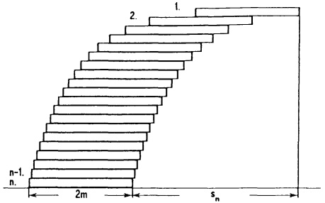

<details>
<summary>text_image</summary>

n-1.
n.
2
1.
2m
sn
</details>

Berechne  $s_{50}$  und  $s_{100}$ . Was ergibt sich für  $s_{n}$  in der Grenze  $n \to \infty$ ?

7. Mit einem programmierbaren Rechner vergleiche man für $x = 1,2,-10$ und $n = 10,100,1000,\ldots$ die Konvergenz von $a_{n}(x) = \left(1 + \frac{x}{n}\right)^{n}$ und $b_{n}(x) = 1 + \frac{x}{1!} +\ldots +\frac{x^{n}}{n!}$ gegen den Grenzwert $e^{x}$.

( $a_{n}$  auch als Produkt berechnen!)

8. Beim Evakuieren eines Behälters vom Volumen $V$ mittels einer Pumpe vom Hubraum $K$ kann der Druck wegen des Volumens $S$ der Anschlußrohre nicht beliebig klein gemacht werden.

Man bestimme (mit dem Boyle-Mariotte-Gesetz) den Druck  $p_{n}$  im Rezipienten nach n Pumpschritten, wenn zu Beginn überall der Außendruck  $p_{0}$  herrscht.

Ablauf eines Schrittes:

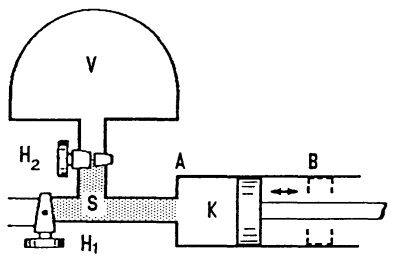

<details>
<summary>text_image</summary>

V
H₂
S
A
B
K
H₁
</details>

$H_{1}$  schließen,  $H_{2}$  öffnen, Kolben von A nach B,

$H_{2}$  schließen,  $H_{1}$  öffnen, Kolben von B nach A,

Was ergibt sich für $\lim_{n\to \infty}p_n$?

9. Ein Kondensator  $K_{1}$  (Kapazität  $C_{1}$ ) mit Spannung  $K_{0}$  und Ladung  $Q_{0}$  soll mit Hilfe eines Kondensators  $K_{2}$  (Kapazität  $C_{2}$ ) sukzessive entladen werden:

n. Schritt:  $K_{1}$  und  $K_{2}$  parallel legen (Spannungsausgleich), Verbindungen lösen,  $K_{2}$  kurzschließen (Entladen).

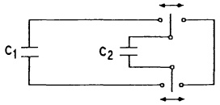

<details>
<summary>text_image</summary>

C₁
C₂
</details>

a) Mit dem Kondensatorgesetz $Q = C \cdot U$ berechne man Ladung $Q_n$ und Spannung $U_n$ von $K_1$ nach dem $n$-ten Entladungsschritt.
b) Man gebe an, wie groß N mindestens sein muß, damit  $U_{n} < \frac{U_{0}}{100}$ .
(Wähle z.B.  $C_{1}=100\mu F$ ,  $C_{2}=5\mu F$ )
c) Man zeige, daß  $Q_{n}$  und  $U_{n}$  konvergieren und berechne den Grenzwert.

10. Man zeige: Aus $\lim_{n\to \infty}a_n = a$ folgt stets $\lim_{n\to \infty}\frac{a_1 + \cdots + a_n}{n} = a$. Die Umkehrung ist im allg. falsch; man gebe dafür ein Beispiel.

11. Man zeige:

a) Die Folge $d_{n} := (1 + \frac{1}{n})^{n+1}$, $n \geq 1$, ist monoton fallend.
b) Für  $n = 1, 2, \cdots$  gilt

$$
1 + \frac {1}{1 !} + \frac {1}{2 !} + \dots + \frac {1}{n !} \leq (1 + \frac {1}{n}) ^ {n + 1}.
$$

12. Die Vermehrung einer Population mit beschränktem Lebensraum hängt sehr empfindlich von der freien Wachstumsrate r ab, wie bereits das einfachste Modell von P.F.VERHULST (1845) zeigt:

Die (auf die größtmögliche Populationszahl bezogene) relative Anzahl $x_{n}$ von Individuen in der n-ten Generation genügt für $0 \leq r \leq 4$ dem rekursiven Entwicklungsgesetz:

$$
x _ {n + 1} = r \cdot x _ {n} \cdot (1 - x _ {n}), \quad n = 0, 1, 2, \dots .
$$

a) Man zeige: $0 \leq x_0 \leq 1 \Rightarrow 0 \leq x_n \leq \frac{r}{4}, n = 1,2,\dots$.
b) Man bestimme die beiden Fixpunkte und bestätige, daß für  $0 \leq r < 3$  stets ein Fixpunkt anziehend ist; ferner zeige man für  $0 < x_{0} < 1$  analog wie in Aufgabe 3:

— Für  $0 \leq r \leq 1$  stirbt die Population stets monoton aus.
— Für  $1 < r \leq 2$  strebt  $x_{n}$  schließlich monoton gegen ein positives Gleichgewicht.
— Für  $2 < r < 2\sqrt{2}$  strebt  $x_{n}$  schließlich oszillierend gegen ein positives Gleichgewicht.

c) Mit dem Anfangswert  $x_{0}=0.1$  und den zwei Werten r=3.2 bzw. r=4 berechne man die Folgenglieder  $x_{n}$  für  $n=1,2,\ldots,20$  und überprüfe am Graphen von  $n\mapsto x_{n}$ :

— Für 3 < r < 1 + $\sqrt{6}$ ≈ 3.4495 pendelt die Bevölkerungszahl schließlich zyklisch zwischen zwei verschiedenen positiven Werten.
— Für  $3.57 < r \leq 4$  verhält sich die beschränkte Folge  $(x_{n})_{n \geq 0}$  total chaotisch, d.h. scheinbar indeterministisch.

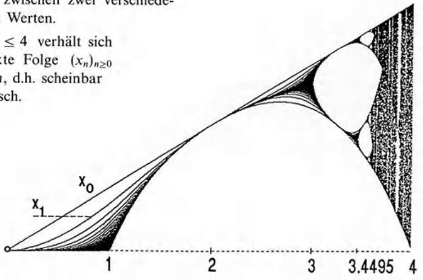

<details>
<summary>contour</summary>

| X | Y |
| --- | --- |
| 0 | 0 |
| 1 | ~0.5 |
| 2 | ~1.5 |
| 3 | ~2.5 |
| 3.4495 | ~2.8 |
</details>

## §6. Funktionengrenzwerte, Stetigkeit

6.1 Definitionen. Gegeben seien $I \subseteq \mathbb{R}$ ein Intervall, $a \in I \cup \{-\infty, \infty\}$ und $f : I \setminus \{a\} \to \mathbb{R}$. Auch wenn $f$ an der Stelle $x = a$ erklärt ist, interessiert dieser Wert im Moment nicht. Wir fragen vielmehr nach dem Verhalten der Funktionswerte $f(x)$, wenn sich das Argument $x (x \neq a)$ der Stelle $x = a$ nähert:

Definition. $f(x)$ hat für $x$ gegen $a$ den rechtsseitigen Grenzwert (bzw. linksseitigen Grenzwert) $c$, in Zeichen $\lim_{x\to a+}f(x)=c$ ($bzw.\ \lim_{x\to a-}f(x)=c$), wenn für jede Zahlenfolge $(x_n)_{n\geq 0}$ aus $I$ mit $x_n\to a$ und $a<x_n$ für alle $n$ ($bzw.\ x_n\to a$ und $x_n<a$ für alle $n$) die Zahlenfolge $(f(x_n))_{n\geq 0}$ gegen $c$ strebt.

$f(x)$ hat für $x$ gegen $a$ den Grenzwert $c$, in Zeichen $\lim_{x\to a}f(x) = c$, wenn gilt $\lim_{x\to a+}f(x) = \lim_{x\to a-}f(x) = c$.

Diese Definiton gilt nicht nur für endliche Werte $a$ und $c$, sondern auch für $a, c \in \{-\infty, \infty\}$. Dabei ist aber für $a = \infty$ nur ein linksseitiger Grenzwert und für $a = -\infty$ nur ein rechtsseitiger Grenzwert möglich; man schreibt

$$
\lim _ {x \to \infty} f (x) = c \quad \lim _ {x \to - \infty} f (x) = c,
$$

d.h. in diesen Fällen schreibt man kein nachgestelltes „+“ bzw. „-“. Ferner sind folgende Schreibweisen üblich:

$$
\begin{array}{l} \lim _ {x \to a} f (x) = c \iff f (x) \to c \text {   für   } x \to a ; \\ \lim _ {x \to a +} f (x) = c \iff f (x) \to c \text {   für   } x \to a, a <   x \iff f (a +) = c ; \\ \lim _ {x \to a -} f (x) = c \iff f (x) \to c \text {   für   } x \to a, x <   a \iff f (a -) = c. \\ \end{array}
$$

Für  $\lim_{x\to a}f(x)=c$  sagt man auch, daß bei der Annäherung von x gegen a die Funktionswerte  $f(x)$  gegen c streben (entsprechend bei der Annäherung von rechts  $(a<x)$  bzw. links  $(x<a)$ ).

Beispiel 1. Die Entier-Funktion. Zu $x \in \mathbb{R}$ bezeichnet $[x]$ die größte ganze Zahl, die kleiner oder gleich $x$ ist. Zum Beispiel $[0.5] = 0$, $[3.8] = 3$, $[-2.7] = -3$. Für jede ganze Zahl $m \in \mathbb{Z}$ gilt

$$
\lim _ {x \to m -} [ x ] = m - 1, \lim _ {x \to m +} [ x ] = m.\quad \square
$$

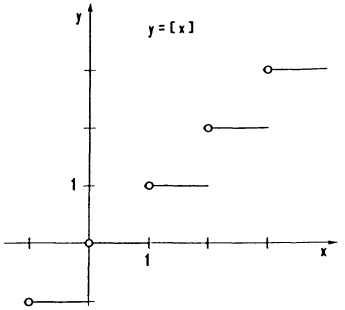

<details>
<summary>scatter</summary>

| X | Y |
| --- | --- |
| 0 | -1 |
| 1 | 1 |
| 2 | 2 |
| 3 | 3 |
</details>

Abb. 69 - y = [x]

Beispiel 2. Die für alle  $x \neq 0$  erklärte Funktion  $f(x) = \sin \frac{1}{x}$  hat für $x \rightarrow 0$ weder einen linksseitigen noch einen rechtsseitigen Grenzwert. Dagegen gilt für die ebenfalls für $x \neq 0$ erklärte Funktion $g(x) = x \sin \frac{1}{x}$

$\lim_{x\to 0}g(x) = \lim_{x\to 0}x\sin{\frac{1}{x}} = 0.$

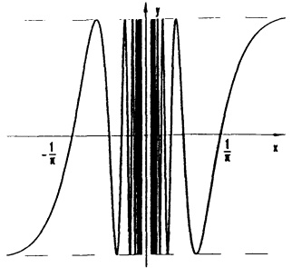

<details>
<summary>contour</summary>

| X | Y |
| --- | --- |
| \(-1/\pi\) | ~0.2 |
| 0 | ~0.9 |
| \(1/\pi\) | ~0.2 |
</details>

Abb. 70 - $y = \sin \frac{1}{x}$

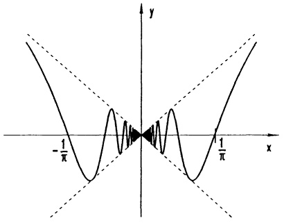

<details>
<summary>contour</summary>

| X-axis | Y-axis (Solid Curve) | Y-axis (Dashed Line 1) | Y-axis (Dashed Line 2) |
| --- | --- | --- | --- |
| \(-1/\pi\) | ~0.5 | — | — |
| 0 | 0 | 0 | 0 |
| \(1/\pi\) | ~0.5 | — | — |
</details>

Abb. 71 - $y = x \sin \frac{1}{x}$

Beispiele 3. $\lim_{x\to 0 + }\frac{1}{x} = \infty ,\lim_{x\to 0 - }\frac{1}{x} = -\infty ,\lim_{x\to 2 - }\frac{2x}{x^2 - 4} = -\infty ,\lim_{x\to 2 + }\frac{2x}{x^2 - 4} = \infty ,$

$$
\lim _ {x \to \infty} \frac {x ^ {2} - 4}{2 x} = \lim _ {x \to \infty} (\frac {1}{2} x - \frac {2}{x}) = \infty .
$$

6.2 Die 6 elementaren Methoden der Grenzwertbestimmung. Die Grenzwert-Regeln und Konvergenz-Sätze für Folgen lassen sich leicht auf Funktionengrenzwerte übertragen:

a Grenzwert-Arithmetik, Grenzwert-Regeln.

Satz 6.1. Aus $\lim_{x\to a}f(x) = c$, $\lim_{x\to a}g(x) = d$ und $c,d\in \mathbb{R}$ folgt

a) $\lim_{x\to a}[f(x)\pm g(x)] = c\pm d,$
b) $\lim_{x\to a}f(x)g(x) = cd$ , insbesondere $\lim_{x\to a}\alpha f(x) = \alpha c (\alpha \in \mathbb{R})$
c) $\lim_{x\to a}\frac{f(x)}{g(x)} = \frac{c}{d}$ (falls $d\neq 0$ ).

Diese Regeln gelten auch für  $a = \pm\infty$  (aber nur für endliche Grenzwerte c, d).

Beispiel 1. Aus $\lim_{x\to 2}x = 2$ folgt

$$
\lim _ {x \to 2} \frac {x ^ {3} + 3 x + 5}{x ^ {2} - 2 x + 1} = \frac {2 ^ {3} + 3 \cdot 2 + 5}{2 ^ {2} - 2 \cdot 2 + 1} = 1 9.
$$

Beispiel 2. Aus $\lim_{x\to 0}\frac{\sin x}{x} = 1$ , $\lim_{x\to 0}\frac{\sqrt{1 + x} - 1}{x} = \frac{1}{2}$ (s.u.) und $\lim_{x\to 0}(x - 5)^2 = 25$ folgt

$$
\lim _ {x \to 0} \frac {(\sqrt {x + 1} - 1) \sin x}{x ^ {2} (x - 5) ^ {2}} = \frac {1}{5 0}.
$$

b Funktionsterme umformen (kürzen oder erweitern).

Beispiel 1.

$$
\lim _ {x \to 1} \frac {x ^ {n} - 1}{x - 1} = \lim _ {x \to 1} (x ^ {n - 1} + x ^ {n - 2} + \dots + x + 1) = n.
$$

Beispiel 2.

$$
\lim _ {x \to 0} \frac {\sqrt {x + 1} - 1}{x} = \lim _ {x \to 0} \frac {(\sqrt {x + 1} - 1) (\sqrt {x + 1} + 1)}{x (\sqrt {x + 1} + 1)} = \lim _ {x \to 0} \frac {1}{\sqrt {x + 1} + 1} = \frac {1}{2}.
$$


Beispiel 3. Für $x \neq 0$ gilt

$$
\begin{array}{l} \frac {\cos x - 1}{x} = \frac {(\cos x - 1) (\cos x + 1)}{x (\cos x + 1)} = \frac {\cos^ {2} x - 1}{x (\cos x + 1)} = - \frac {\sin^ {2} x}{x (\cos x + 1)} \\ = - \frac {\sin x}{x} \cdot \frac {1}{\cos x + 1} \cdot \sin x. \\ \end{array}
$$

Für $x \to 0$ strebt auf der rechten Seite der erste Faktor gegen 1 ($\to$ (2)), der zweite gegen $\frac{1}{2}$ und der dritte gegen 0. Also gilt

$$
\lim _ {x \to 0} \frac {\cos x - 1}{x} = 0. \tag {1}
$$


© Funktionsterme „einschnüren“.

Satz 6.2. Vergleichskriterium. Wenn $g(x) \leq f(x) \leq h(x)$ für alle $x$ in der Nähe von $a$ gilt (bzw. für alle hinreichend großen $x$) und wenn $g(x) \to c$, $h(x) \to c$ für $x \to a$ (bzw. $x \to \infty$), dann gilt auch $\lim_{x \to a} f(x) = c$ (bzw. $\lim_{x \to \infty} f(x) = c$).

Beispiel. Für die Flächeninhalte der drei skizzierten Figuren gilt:

Kleines Dreieck:  $\frac{1}{2}\sin x\cos x$ ,

Kreissektor:  $\frac{x}{2\pi} \cdot 1^{2}\pi = \frac{x}{2}$ ,

großes Dreieck:  $\frac{1}{2} \tan x$ .

Damit ist $\sin x\cos x\leq x\leq \tan x$ , d.h.

$$
\cos x \leq \frac {\sin x}{x} \leq \frac {1}{\cos x}.
$$

Aus $\lim_{x\to 0}\cos x = 1$ folgt mit Satz 6.2

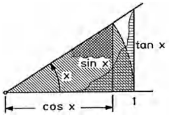

<details>
<summary>text_image</summary>

sin x
x
cos x
1
tan x
</details>

Abb. 72 - Flächenvergleich

$$
\boxed {\lim _ {x \to 0} \frac {\sin x}{x} = 1.} \tag {2}
$$

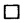

(d) Monotoniekriterium anwenden (→ Satz 5.4), Anwendung in Kap. 4, §1.
(e) L'Hospital-Regel anwenden (→ Kap. 3, Satz 2.9).
f Reihendarstellungen anwenden (→ Kap. 5, §5).

6.3 Asymptoten. a) Man nennt die Gerade x = a eine vertikale Asymptote der Kurve  $y = f(x)$ , wenn beim Grenzübergang  $x \to a$ , x < a oder  $x \to a$ , x > a die Funktionswerte  $f(x)$  gegen  $\infty$  oder  $-\infty$  streben.

b) Die Gerade $y = c$ heißt horizontale Asymptote der Kurve $y = f(x)$, wenn $\lim_{x \to \infty} f(x) = c$ oder $\lim_{x \to -\infty} f(x) = c$ gilt.

c) Als schräge Asymptote der Kurve $y = f(x)$ bezeichnet man die Gerade $y = px + q$, falls $p \neq 0$ und $f(x) - (px + q) \to 0$ für $x \to \infty$ oder $x \to -\infty$. Mit den Grenzwert-Regeln sieht man, daß diese Bedingung gleichbedeutend ist mit $\frac{f(x)}{x} \to p$ und $f(x) - px \to q$ (für $x \to \infty$ oder $x \to -\infty$). Deshalb erfolgt die Bestimmung einer schrägen Asymptote in zwei Schritten:

1. Schritt: Man prüft, ob $\frac{f(x)}{x}$ für $x \to \infty$ oder $x \to -\infty$ gegen eine Konstante $p \neq 0$ strebt. Ist dies der Fall, dann

2. Schritt: Mit dieser Zahl $p$ die Funktion $f(x) - px$ für $x \to \infty$ bzw. $x \to -\infty$ untersuchen. Falls $\lim_{x \to \infty} (f(x) - px) = q$ (bzw. $\lim_{x \to -\infty} (f(x) - px) = q$), dann ist $y = px + q$. Asymptote der Kurve $y = f(x)$.

Beispiel. Die Kurve $y = f(x)$ mit $f(x) = \frac{x(x - 1)}{x + 1}$ hat die vertikale Asymptote $x = -1$ und die schräge Asymptote $y = x - 2$, denn für $x \to \infty$ (und $x \to -\infty$) gilt $\frac{f(x)}{x} = \frac{x - 1}{x + 1} \to 1$ und $f(x) - x = -2\frac{x}{x + 1} \to -2$.

Bemerkung: Die schräge Asymptote erkennt man auch aus der Darstellung  $f(x) = x - 2 + \frac{2}{x + 1}$  (Polynomdivision).

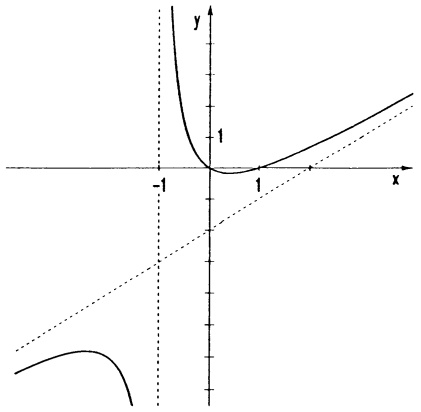

<details>
<summary>contour</summary>

| X | Y (Curve) | Y (Dashed Line) |
| --- | --- | --- |
| -1 | — | 0 |
| 0 | 0 | 0 |
| 1 | 0 | 1 |
</details>

Abb. 73 - $y = \frac{x(x - 1)}{x + 1}$

6.4 Stetigkeit. Sei $I \subseteq \mathbb{R}$ ein Intervall. Man nennt eine Funktion $f: I \to \mathbb{R}$ in $x_0 \in I$ stetig, wenn bei der Annäherung $x \to x_0$ die Funktionswerte $f(x)$ gegen $f(x_0)$ streben. Also

$$
\boxed {f \text {in} x _ {0} \text {stetig}: \Longleftrightarrow \lim _ {x \rightarrow x _ {0}} f (x) = f \left(x _ {0}\right).}
$$

Ist  $x_{0}$  ein Randpunkt von I, so ist  $x \rightarrow x_{0}$  nur als einseitige Annäherung, d.h.  $\lim_{x\to x_{0}}f(x)$  als einseitiger Grenzwert zu verstehen. Die Funktion f heißt auf I stetig, wenn sie in jedem Punkt  $x_{0}\in I$  stetig ist. Die Stetigkeit von  $f:I\to R$  auf I bedeutet anschaulich, daß der Graph  $y=f(x)$  über I eine zusammenhängende Linie darstellt (ohne Lücken und Sprünge); er kann aber durchaus eine oder mehrere Spitzen besitzen.

## Beispiele.

1. Die Entier-Funktion $f(x) = [x]$ ($\rightarrow$ 6.1) ist in allen offenen Intervallen $(m, m+1)$ mit $m \in \mathbb{Z}$ stetig und hat in allen $x = m \in \mathbb{Z}$ Unstetigkeitsstellen (Sprungstellen).
2.  $f(x) = \frac{1}{x}$  ist stetig in allen Punkten  $x \neq 0$ . Da  $f(0)$  nicht definiert ist, stellt sich die Frage nach der Stetigkeit in x = 0 überhaupt nicht.
3.  $f(x) = |x|$  ist überall stetig (mit einer Spitze in x = 0).

Stetige Fortsetzung. Ist eine Funktion $f$ in $x_{0} \in I$ zunächst nicht definiert und existiert der Grenzwert $\lim_{x \to x_{0}} f(x) = c$, dann wird diese Definitionslücke durch die Festsetzung $f(x_{0}) := c$ behoben. $f(x)$ ist damit in $x_{0}$ stetig.

Beispiele. Die Definitionslücken der Funktionen

$$
f (x) = \frac {\sin x}{x}, x \neq 0, g (x) = \frac {\sqrt {x ^ {2} + 1} - 1}{x ^ {2}}, x \neq 0, h (x) = \frac {x ^ {n} - 1}{x - 1}, x \neq 1,
$$

werden mit  $f(0) := 1$ ,  $g(0) := \frac{1}{2}$  und  $h(1) := n$  behoben ( $\rightarrow$  6.2). Danach sind f, g, h auf ganz R stetig.

Die Definitionslücke x = 0 von sin  $\frac{1}{x}$  läßt sich nicht stetig beheben.

Die Spaltfunktion sinc  $x := \frac{\sin x}{x}$  tritt in der Intensitätsverteilung von Licht der Wellenlänge  $\lambda$  auf, wenn es senkrecht auf einen Spalt der Breite a auftrifft und in alle Richtungen  $\beta$  gebeugt wird ( $\rightarrow$  Aufg. 10):

$$
I (\beta) = I _ {0} \operatorname{sinc} ^ {2} \left(\frac {\pi a}{\lambda} \sin \beta\right). \quad \square
$$

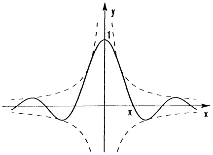

<details>
<summary>contour</summary>

| X | Y (Solid Line) | Y (Dashed Line 1) | Y (Dashed Line 2) |
| --- | --- | --- | --- |
| 0 | 0 | ~-0.5 | ~-0.8 |
| \(\pi/2\) | 1 | ~0.5 | ~-0.8 |
| \(\pi\) | 0 | ~-0.5 | ~-0.8 |
| \(3\pi/2\) | -1 | ~0.5 | ~-0.8 |
| \(\pi\) | -1 | ~-0.5 | ~-0.8 |
</details>

Abb. 74 - $y = \frac{\sin x}{x}$

Aus den Grenzwertregeln von Satz 6.1 folgt

## Satz 6.3. Rechenregeln für stetige Funktionen.

a) Sind $f$ und $g$ auf einem Intervall $I \subseteq \mathbb{R}$ stetig, so gilt das auch für $f + g$, $\alpha f (\alpha \in \mathbb{R})$ und $fg$. Ferner ist $\frac{f}{g}$ stetig in allen $x \in I$ mit $g(x) \neq 0$.
b) Sind $f: I \to \mathbb{R}$, $g: D \to \mathbb{R}$ stetig mit $g(D) \subseteq I$, dann ist auch die Komposition $h: D \to \mathbb{R}$, $h(x) = f(g(x))$ auf $D$ stetig.

Zum Beweis von Teil b) ist nur zu beachten, daß mit  $x \to x_{0} \in D$  zunächst  $g(x)$  gegen  $g(x_{0})$  strebt, dann auch  $f(g(x)) \to f(g(x_{0}))$ . ☐

Die Tragweite dieses einfachen Satzes wird bereits in den folgenden Anwendungen deutlich.

## Satz 6.4.

a) Jedes Polynom  $p(x)=a_{n}x^{n}+\cdots+a_{1}x+a_{0}$  ist auf ganz R stetig.

b) Jede rationale Funktion $f(x) = \frac{p(x)}{q(x)}$ ist in allen $x \in \mathbb{R}$ mit $q(x) \neq 0$ stetig.

Beweis. Offenbar ist  $g(x) = x$  überall stetig. Dann sind auch  $g^{2}(x) = x^{2}, \ldots, g^{n}(x) = x^{n}$  und  $a_{0} + a_{1}g + \cdots + a_{n}g^{n}$  stetig. ☐

Ein Beispiel einer „etwas verschachtelten“ Funktion, die mit Satz 6.3 als stetig erkannt wird – da die einzelnen Bestandteile stetig sind – ist etwa

$$
f (x) = \frac {\sqrt {x ^ {5} + 6 x + \sin^ {4} x} + \sin (x ^ {2})}{\sqrt {\sqrt {x} + \cos^ {2} (3 x ^ {4} + 1)} \cdot x ^ {2}} \quad (x \geq 0).
$$

Die folgenden Eigenschaften einer stetigen Funktion (über einem abgeschlossenen Intervall) werden mehrfach als wichtige Beweismittel benötigt.

Satz 6.5. Für jede auf einem abgeschlossenen Intervall $a \leq x \leq b$ stetige Funktion $f$ gilt:

a) Schrankensatz. Es gibt eine Schranke $K$ mit $|f(x)| < K$ für alle $x \in [a, b]$ (Man sagt, $f$ ist auf $[a, b]$ beschränkt).
b) Satz vom Maximum und Minimum. Es gibt stets Werte $x_0, x_1$ in $[a, b]$, so da$\beta$ $f(x_0) \leq f(x) \leq f(x_1)$ für alle $x \in [a, b]$ (f nimmt auf $[a, b]$ sein Minimum und sein Maximum an).

c) Zwischenwertsatz. Zu jeder Zahl $c$ zwischen dem Minimum $f(x_0)$ und dem Maximum $f(x_1)$ (d.h. $f(x_0) \leq c \leq f(x_1)$) gibt es wenigstens ein $\overline{x} \in [a, b]$ mit $f(\overline{x}) = c$ (jeder Wert zwischen dem Minimum und dem Maximum wird angenommen).

d) Die gleichmäßige Stetigkeit. Zu jeder beliebig kleinen Zahl $\varepsilon > 0$ gibt es eine von $\varepsilon$ abhängige Schranke $\delta > 0$, so daß zwei Funktionswerte sich um höchstens $\varepsilon$ unterscheiden, sobald die Argumente aus einem Teilintervall der Breite $\delta$ stammen, i.Z.

$$
| x - x ^ {\prime} | \leq \delta \implies | f (x) - f (x ^ {\prime}) | \leq \varepsilon .
$$

Der Beweis dieses (bis auf d)) so einleuchtenden Satzes ist nicht einfach; er benötigt wesentlich das Vollständigkeitsaxiom und andere hier nicht behandelte Eigenschaften der reellen Zahlen (Satz von der Intervallschachtelung). Wir lassen ihn aus.

Als einfache Folgerung aus dem Zwischenwertsatz notieren wir

## Satz 6.6. $f(a)f(b)$-Nullstellen-Test.

a) Ist $f : [a, b] \to \mathbb{R}$ stetig und haben $f(a)$ und $f(b)$ entgegengesetzte Vorzeichen ($f(a)f(b) < 0$), dann gibt es wenigstens eine Nullstelle $\overline{x}$ im Innern von $[a, b]$ (also $a < \overline{x} < b$ mit $f(\overline{x}) = 0$).
b) Jedes Polynom mit einem ungeraden Grad ( $\geq 1$ ) hat in R wenigstens eine Nullstelle.

## Anwendung: Das Bisektionsverfahren.

Wenn durch diesen Test die Existenz einer Nullstelle im Intervall  $[a, b]$  gesichert ist, kann diese durch das Bisektionsverfahren mit beliebig vorgegebener Genauigkeit eingegrenzt werden.

Man wähle  $a_{1} := \frac{a + b}{2}$ . Ist das Produkt  $f(a_{1})f(b) \leq 0$ , so liegt eine Nullstelle in  $[a_{1}, b]$ , sonst in  $[a, a_{1}]$ . Nun halbiere man das betreffende Teilintervall und fahre so fort, bis die Länge des letzten Intervalls unter der vorgegebenen Genauigkeit liegt.

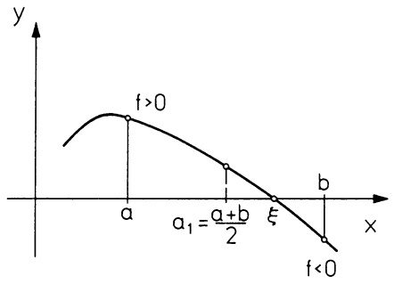

<details>
<summary>line</summary>

| Point | Description |
| --- | --- |
| a | x-intercept of the curve |
| a + b/2 | Intermediate point on the curve |
| \(\xi\) | x-intercept of the curve |
| b | x-intercept of the curve |
| f > 0 | y-intercept of the curve |
| f < 0 | y-intercept of the curve |
</details>

Abb. 75 – Bisektionsverfahren

```txt
' Programm BISEKTION
' --------------------------------------------------- C=(A+B)*0.5
Eps=1.OE-06 Fc=Fn F(C)
Input "A= ",A If Fc*Fa<=0 Then
Input "B= ",B B=C
Fa=Fn F(A) Fb=Fc
Fb=Fn F(B) Else
If Fa*Fb>0 Then A=C
 Print "f(a)f(b) positiv!" Fa=Fc
End Endif
Endif Return
Repeat
  Gosub Bisect Defn F(X)=X*(X*X*X*X+1)+1
Until Abs(A-B)<Eps
print
print "Nullstelle im Intervall:"
print "[";A;",";B;."]
End
```

Beispiel.  $f(x) = x^{5} + x + 1$ . Mit a = -1 und b = 0 ist  $f(a)f(b) < 0$ . Mit dem Programm BISEKTION erhält man eine Nullstelle im Intervall (-0.75487 804413, -0.75487 709045). □

## Aufgaben

1. Man bestimme – falls vorhanden – die Grenzwerte

$$
\lim _ {x \to x} \frac {x}{x + \sin x} \quad ; \quad \lim _ {x \to 0} \frac {| x |}{x} \quad ; \quad \lim _ {x \to - \frac {\pi}{2}} \frac {\sin | x |}{x + \frac {\pi}{2}} \quad ;
$$

$$
\lim _ {x \to 0} \frac {1 - \cos x}{x ^ {2}} \quad ; \quad \lim _ {x \to 0} \frac {e ^ {- x ^ {2}} - 1 + x ^ {2}}{x ^ {4}} \quad ; \quad \lim _ {x \to \infty} \frac {e ^ {x} + x ^ {- x}}{e ^ {x} - e ^ {- x}} \quad ;
$$

$$
\lim _ {x \to 0} \frac {4 x ^ {3} - 2 x ^ {2} + x}{3 x ^ {2} + 2 x}; \quad \lim _ {x \to 2} \frac {x ^ {2} - 5 x + 6}{x ^ {2} - 1 2 x + 2 0}; \quad \lim _ {x \to 1} \left(\frac {1}{1 - x} - \frac {3}{1 - x ^ {3}}\right);
$$

$$
\lim _ {x \rightarrow 0} \frac {\sqrt {1 + x} - 1}{x}; \quad \lim _ {x \rightarrow \infty} \frac {\sqrt {x ^ {2} + 1}}{x + 1}; \quad \lim _ {x \rightarrow \infty} x \left(\sqrt {x ^ {2} + 1} - x\right);
$$

$$
\lim _ {x \to 0} \frac {\sin (\sin x)}{x} \quad ; \quad \lim _ {x \to 0} \frac {\sin x}{\sqrt {x}} \quad ; \quad \lim _ {x \to \frac {\pi}{2}} \left(\frac {\pi}{2} - x\right) \tan x
$$

2. Man berechne  $\lim_{x\to0}\frac{\sin x}{x}$  für  $\alpha$  im Gradmaß, d.h.  $\alpha=\frac{180}{\pi}x$ , und bestimme damit  $\lim_{x\to0}\frac{h\cdot x}{a}$  für gleichschenklige Dreiecke.

3. Für die Funktion $f(x) = \frac{x}{x - 1}$, $x \neq 1$, ermittle man - abhängig von $\epsilon > 0$ und $x_0 \neq 1$ - ein $\delta$, so daß für alle $x$ mit $|x - x_0| < \delta$ gilt: $|f(x) - f(x_0)| < \epsilon$. Wie groß ist $\delta$ für $\epsilon = 0.01$ und $x_0 = 2$, $x_0 = 1.1$, $x_0 = 0.999$?

4. An einer Gleichspannungsquelle mit konstantem Innenwiderstand  $R_{i}$  mißt man bei offenen Klemmen die Spannung E. Die Spannung U, die sich im Betrieb einstellt, hängt vom Lastwiderstand  $R_{L}$  ab.

a) Skizziere und diskutiere $U = U(R_L)$, $0 < R_L < \infty$. Bei welchem $R_L$ ist $U$ maximal? (Spannungsanpassung).
b) Skizziere und diskutiere die Ausgangsleistung $N = U \cdot I = N(R_L)$, $0 < R_L < \infty$. Welche Leistung kann höchstens abgegeben werden? (Leistungsanpassung).

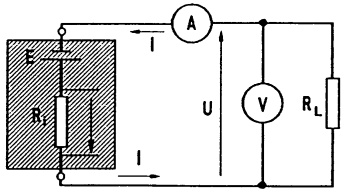

<details>
<summary>text_image</summary>

I
R
I
A
U
V
RL
</details>

5. a) Ist die Funktion $\{x\} := |[x + \frac{1}{2}] - x|$ stetig? (Skizze!)
Begründe die Antwort über $\{x + n\} = \{x\}$, $n$ ganzzahlig.
b) Mit dem Zwischenwertsatz zeige man: Für eine stetige Funktion $f : [a, b] \to [a, b]$ gibt es stets ein $x_0 \in [a, b]$ mit $f(x_0) = x_0$.

6. Die Abbildung durch eine Linse genügt der Beziehung

$$
\frac {1}{b} + \frac {1}{g} = \frac {1}{f}.
$$

(b Bild-, g Gegenstands-, f Brennweite)

a) Man bestimme  $b = b(g)$  als Funktion von g.
b) Wo ist  $b(g)$  stetig, welche Asymptoten besitzt es?

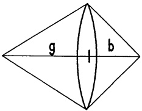

<details>
<summary>text_image</summary>

g
l
b
</details>

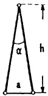

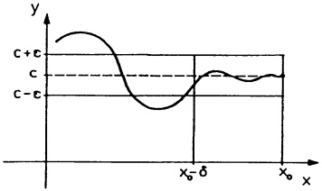

<details>
<summary>line</summary>

| X-axis | Y-axis |
| --- | --- |
| \(x_{0}\) | \(C-\epsilon\) |
| \(x_{0}-\delta\) | \(C\) |
| N/A | \(C+\epsilon\) |
</details>

7. Man bestimme (soweit möglich) den größtmöglichen Definitionsbereich, die Nullstellen, die Pole, die Symmetrie zu den Achsen, das Verhalten für  $x \rightarrow \pm\infty$ , die Asymptoten und die Bereiche mit f < 0, f > 0. Schließlich ist eine sorgfältige Skizze des Graphen von f anzufertigen:

a) $f(x) = \frac{x^4}{(x^2 - 1)|x|}$ ，

b) $f(x) = |x^{2} - 1| + |x| - 1$ .

8. a) Für welche $x$ ist $f(x) = \frac{1 + 2\cos x}{1 - 2\cos x}$ stetig? Berechne $\lim_{x \to \pi} f(x)$.

b) Wo ist  $\frac{1-\sqrt{\cos x}}{1-\cos\sqrt{x}}$  nicht definiert, welcher Grenzwert ergibt sich für  $x\to0$ ?

9. Gegeben ist die Funktion $f(x) = x^4 - x - 10$. Man erstelle eine Vorzeichentabelle für $x = 0, 1, 2, \ldots$ und ermittle die Anzahl der positiven Nullstellen von $f(x)$. Mit dem Bisektionsverfahren bestimme man diese Nullstellen auf $10^{-2}$ genau.

10. Beugung am Spalt

Man denke sich in einem Spalt der Breite $a$ im Abstand $\frac{a}{n}$ voneinander $n+1$ punktförmige Lichtquellen angeordnet, die in alle Richtungen kohärentes Licht der Wellenlänge $\lambda$ und der Amplitude $\frac{A}{n+1}$ abstrahlen.

Beobachtet man die Schwingungen in den Punkten  $A_{0}, A_{1}, \ldots, A_{n}$ , so ergibt sich als Phasenverschiebung zwischen zwei benachbarten Strahlen

$$
\delta = \frac {2 \pi a}{n \lambda} \sin \beta
$$

und als gesamte Phasendifferenz  $\Delta = n\delta$ . Die Amplitude  $A_{n}$  und die Nullphase  $\alpha_{n}$  der Gesamtstrahlung in Richtung  $\beta$  kann man direkt aus Beispiel 2 von 3.5 übernehmen:

$$
A _ {n} (\delta) = \frac {A}{n + 1} \frac {\sin \frac {n + 1}{2} \delta}{\sin \frac {\delta}{2}}, \quad \alpha_ {n} (\delta) = \frac {n}{2} \delta = \frac {\Delta}{2}.
$$

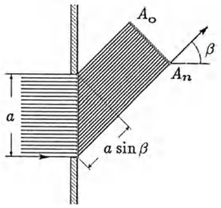

<details>
<summary>text_image</summary>

A₀
β
Aₙ
a
a sin β
</details>

a) Man erweitere Zähler und Nenner mit  $\frac{\delta}{2}$  und berechne für festes n

$$
A _ {n} (0) := \lim _ {\delta \to 0} A _ {n} (\delta).
$$

b) Für die Abhängigkeit der Amplitude  $A_{n}$  von der Phasendifferenz  $\Delta$  ergibt sich in der Grenze  $n \to \infty$  genau die Spaltfunktion. Man bestätige

$$
A (\Delta) := \lim _ {n \rightarrow \infty} A _ {n} \left(\frac {\Delta}{n}\right) = \left\{\begin{array}{c l}A \frac {\sin (\Delta / 2)}{\Delta / 2}&, \text {falls} \Delta \neq 0,\\A&, \text {falls} \Delta = 0.\end{array}\right.
$$

## Kapitel 3

## Differentiation

Die Differentialrechnung wurde – unabhängig voneinander – von GOTTFRIED WILHELM LEIBNIZ (1646-1716) und ISAAC NEWTON (1642-1727) entwickelt. Sie stellt eines der vielseitigsten Hilfsmittel in der mathematischen Behandlung der Naturwissenschaften (einschließlich der Technik) dar.

## §1. Die Ableitung einer differenzierbaren Funktion

1.1 Die Definition der Ableitung. Die Funktion $f$ sei auf dem Intervall $I \subseteq \mathbb{R}$ definiert und $x_0 \in I$. Man sagt, $f$ ist in $x_0$ differenzierbar, wenn der „Differenzenquotient“ $\frac{\Delta f(x)}{\Delta x} := \frac{f(x) - f(x_0)}{x - x_0} = \frac{1}{h}[f(x_0 + h) - f(x_0)]$ für $x \to x_0$, bzw. $h \to 0$ einen endlichen Grenzwert besitzt. Dieser Grenzwert (sofern er existiert) wird mit $f'(x_0)$ bezeichnet. Ferner sagt man, $f$ ist auf $I$ differenzierbar, wenn $f'(x)$ in jedem Punkt $x \in I$ existiert. In diesem Fall ist $x \mapsto f'(x)$ eine auf $I$ erklärte Funktion, die man die Ableitung von $f$ nennt und mit $f'$ bezeichnet. Für $f'(x)$ schreibt man auch $f(x)', \frac{df(x)}{dx}, \frac{d}{dx}f(x)$. Den Übergang von $f$ zu $f'$ nennt man differenzieren oder ableiten.

$$
f ^ {\prime}: I \to \mathbb {R}, f ^ {\prime} (x) := \lim _ {h \to 0} \frac {1}{h} [ f (x + h) - f (x) ] = \frac {d f (x)}{d x} = \frac {d}{d x} f (x).
$$

## Beispiele.

(1)

Funktion

a ) $f(x) = c$ (konstant)

b) $f(x) = ax + b$

c) $f(x) = x^{n}$

d) $f(x) = \sqrt{x}$

Ableitung

$f^{\prime}(x) = 0$

$f^{\prime}(x) = a$

$f^{\prime}(x) = nx^{n - 1}\quad (n\in \mathbb{N})$

$f^{\prime}(x) = \frac{1}{2}\frac{1}{\sqrt{x}}\quad (x > 0)$

Beweis. a) ist ein Sonderfall von b). Für $f(x)=ax+b$ und alle $x_{0}\in\mathbb{R}$ gilt $f^{\prime}(x_{0})=\lim_{x\to x_{0}}\frac{f(x)-f(x_{0})}{x-x_{0}}=\lim_{x\to x_{0}}a=a$. c): Mit der binomischen Formel folgt

$$
\lim _ {h \to 0} \frac {(x + h) ^ {n} - x ^ {n}}{h} = \lim _ {h \to 0} (n x ^ {n - 1} + \frac {n (n - 1)}{2} x ^ {n - 2} h + \dots + n x h ^ {n - 2} + h ^ {n - 1}) = n x ^ {n - 1}.
$$

d): $\frac{\sqrt{x} - \sqrt{x_0}}{x - x_0} = \frac{1}{\sqrt{x} + \sqrt{x_0}} \rightarrow \frac{1}{2\sqrt{x_0}}$ für $x \to x_0$, $x_0 > 0$.