Mit den üblichen Differentiationsregeln und (8) bestätigt man leicht

$$
(x ^ {2} - 1) T _ {n} ^ {\prime \prime} (x) + x T _ {n} ^ {\prime} (x) - n ^ {2} T _ {n} (x) = 0
$$

für alle x,  $|x| < 1$ . Die Polynome  $T_{n}$  oszillieren mit ihren Werten zwischen -1 und +1. Es gilt

$$
T _ {1} (x) = x; \quad T _ {2} (x) = - 1 + 2 x ^ {2};
$$

$$
T _ {3} (x) = - 3 x + 4 x ^ {3};
$$

$$
T _ {4} (x) = 1 - 8 x ^ {2} + 8 x ^ {4}.
$$

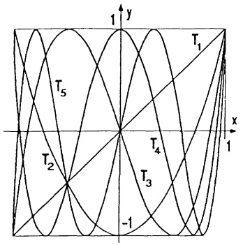

text_image

T₁
T₂
T₃
T₄
T₅
-1
x
y
1

Abb. 92 - Tschebyschev-Polynome

③ Desgleichen besitzen die Tangens- und Cotangensfunktion über den offenen Intervallen  $((2k-1)\frac{\pi}{2},(2k+1)\frac{\pi}{2})$  bzw.  $(2k\pi,(2k+1)\pi)$ ,  $k=0,\pm1,\pm2,\ldots$ , jeweils eine Umkehrfunktion. Wir behandeln nur die Hauptwerte  $(k=0)$ .  $\tan:(-\frac{\pi}{2},\frac{\pi}{2})\to\mathbb{R}$  ist strikt monoton, also umkehrbar. Die Umkehrfunktion heißt Arcustangens.

$$
\boxed {\begin{array}{c}\arctan : \mathbb {R} \rightarrow \left(- \frac {\pi}{2}, \frac {\pi}{2}\right)\\\arctan x = y \iff \tan y = x \quad \text {und} \quad - \frac {\pi}{2} <   y <   \frac {\pi}{2}.\end{array}}
$$

Der Arcuscotangens arccot : $\mathbb{R} \to \mathbb{R}$ ist Umkehrfunktion von cot : $(0, \pi) \to \mathbb{R}$, d.h.

$$
\begin{array}{c}\text {arccot:} \mathbb {R} \rightarrow (0, \pi)\\\operatorname{arccot} x = y \iff \cot y = x \quad \text {und} \quad 0 <   y <   \pi .\end{array}
$$

Die Ableitungen ergeben sich wieder aus (3):

$$
\boxed {\frac {d}{d x} \arctan x = \frac {1}{1 + x ^ {2}}, \quad \frac {d}{d x} \operatorname{arccot} x = - \frac {1}{1 + x ^ {2}} \quad (x \in \mathbb {R}).} \tag {9}
$$

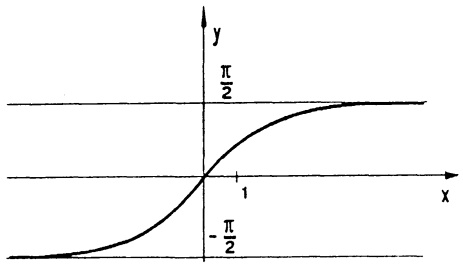

contour

| X | Y |
| --- | --- |
| 0 | \(-\pi/2\) |
| 1 | \(\pi/2\) |

Abb. 93 $y = \arctan x$

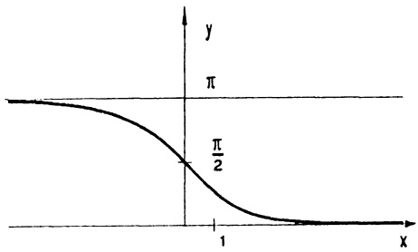

contour

| X | Y |
| --- | --- |
| 0 | \(\pi\) |
| 1 | \(\pi/2\) |

Abb. 94 $y = \operatorname{arccot} x$

Beispiel. Wir suchen denjenigen Punkt $X = (x,0)$ mit $x \geq 0$, von dem aus die Strecke von (1,1) nach (2,2) unter maximalem Winkel $\varphi$ erscheint. Aus $\varphi = \alpha - \beta$, $\cot \alpha = \frac{x - 2}{2}$, $\cot \beta = x - 1$ folgt $\varphi = \varphi(x) = \operatorname{arccot}[(x-2)/2] - \operatorname{arccot}(x-1)$. Wegen $\varphi(0) = \varphi(\infty) = 0$ und $\varphi(x) \geq 0$ existiert eine Maximalstelle $x_0$, für die nach 2.1 $\varphi'(x_0) = 0$ sein muß.

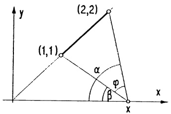

text_image

y
(2,2)
(1,1)
α
φ
β
x

Abb. 95 - Maximales $\varphi$

Die positive Lösung  $x_{0}=2$  von  $0=\varphi'(x)=-\frac{1/2}{1+(x-2)^{2}/4}+\frac{1}{1+(x-1)^{2}}$  ist die gesuchte Maximalstelle. Von  $X_{0}=(2,0)$  aus erscheint die Strecke unter dem maximalen Winkel  $\varphi(2)=\frac{\pi}{4}$ . ☐

## Aufgaben

1. a) Für die Umkehrfunktion $g$ von $f(x) = x^5 + x$ berechne man $g'(0), \ldots, g^{(4)}(0)$. b) Man zeige, daß $f(x) = \tan x - x$ im Intervall $(-\frac{\pi}{2}, \frac{\pi}{2})$ umkehrbar ist und bestätige, daß Umkehrfunktion $g(x)$ die Gleichung $g'(x) = (g(x) + x)^{-2}$ erfüllt.

2. Man berechne die Ableitungen

$$
\arcsin \sqrt {\frac {1 + x ^ {2}}{1 - x ^ {2}}} \quad , \qquad \arctan \frac {x ^ {2}}{\sqrt {x ^ {2} + x + 1}} \quad ,
$$

$$
\sin (2 \arctan x) \quad , \quad x \sqrt {1 - x ^ {2}} + \arcsin x \quad ,
$$

$$
\arcsin (\sin | x |) \quad , \quad \arctan x + \operatorname{arccot} x \quad .
$$

3. Man stelle $\arcsin x$ und $\arccos(-x)$ als Funktion von $\arccos x$ dar.

4. Man differenziere und skizziere den Graphen von

$$
f (x) = \arcsin \frac {2 x}{1 + x ^ {2}}, \quad g (x) = 2 \arctan x
$$

und drücke damit  $f(x)$  durch  $g(x)$  aus.

5. Wie viele verschiedene Werte nimmt die Funktion

$$
F (x) = \arctan x + \arctan \alpha - \arctan \frac {x + \alpha}{1 - \alpha x}
$$

für $\alpha x \neq 1'$ an? Man berechne diese in Abhängigkeit von $\alpha$.

6. Man diskutiere gemäß 2.5 die Funktion $f(x)$, $x \in \mathbb{R}$,

a) $f(x) = \arccos \left|\frac{6x}{9 + x^2}\right|$, b) $f(x) = \arctan \left|\frac{1 + x}{1 - x}\right|$.

7. Ein geradlinig begrenzter Kanal der Breite 10 m mündet rechtwinklig in einen 5 m breiten Bach. Vom Kanal aus sollen Baumstämme in den Bach geflößt werden.

a) Man berechne die Länge $\ell(\varphi)$ eines einzelnen Baumstammes (von vernachlässigbarer Dicke), der sich beim Winkel $\varphi$ verkanet und skizziere $\ell=\ell(\varphi)$ für $0^{o}<\varphi<90^{o}$. Wie lang darf ein Stamm höchstens sein, ohne zu verkanten?
b) Man berechne die Breite $b(\varphi)$ eines 11 m langen Floßes, das sich beim Winkel $\varphi$ verkanet und skizziere $b = b(\varphi)$ für $0^o \leq \varphi \leq 90^o$. Wie breit darf das Floß höchstens sein, ohne zu verkanen? Differenzierbarkeit von $b(\varphi)$ beachten!

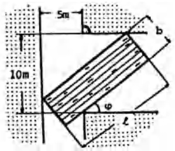

text_image

5m
10m
b
φ
L

Aufg. 7

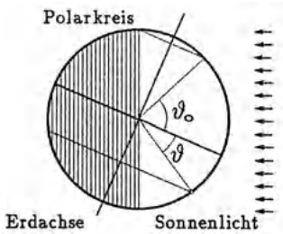

text_image

Polarkreis
Erdachse
Sonnenlicht

Aufg. 8

8. Längster Tag im Jahr. Man rechne nach: Bei Sommersonnenwende ist die Sonnenscheindauer in einem Ort mit der geographischen Breite 9 höchstens

$$
f (\vartheta) = 1 2 \left[ 1 + \frac {2}{\pi} \arcsin (\cot \vartheta_ {0} \tan \vartheta) \right] \text {Stunden, falls} | \vartheta | \leq \vartheta_ {0}.
$$

$\vartheta_{0}=66^{0}30'$ bezeichnet die geographische Breite des nördlichen Polarkreises.

9. Das skizzierte Schubkurbelgetriebe hat den Kurbelradius $r$ und die Pleuellänge $\ell$ ($\ell > 2r$). Man wähle $M = (0,0)$ und bestimme

a) die Lage s des Kreuzkopfes B als Funktion  $s = s(\varphi)$ ;
b) den Winkel $\varphi_{m}$, für den sich $B$ in der Mitte der beiden Ruhelagen $T_{1}$ und $T_{2}$ befindet,
c) die Konstanten $a, b, c$ der Approximation $S(\varphi) = a + b \cos \varphi + c \cos 2\varphi$, so daß $S(0) = s(0)$, $S'(0) = s'(0)$, $S''(0) = s''(0)$, $S(\pi) = s(\pi)$;
d) die maximale Kreuzkopfgeschwindigkeit und die maximale Kreuzkopfbeschleunigung aus der Approximation $s = S(\varphi)$.
e) Für $r = 1$, $\ell = 5$ skizziere man $S, S', S''$ und berechne das Maximum von $|s - S|$ (Approximationsfehler).

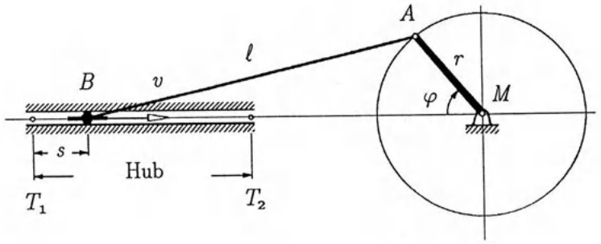

text_image

B
v
l
A
r
φ
M
s
Hub
T₁
T₂

10. Mit dem Brechungsgesetz von SNELLIUS  $\frac{\sin\theta}{\sin\alpha}=R$  ergibt sich für den Streuwinkel  $\varphi$  eines Lichtstrahls in einem Wassertröpfchen mit kreisförmigem Querschnitt

$$
\varphi = f (\theta) = 2 \theta - 4 \arcsin (\frac {\sin \theta}{R}).
$$

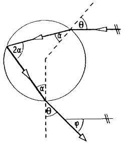

text_image

2α
α
θ
α'
θ
φ

Man rechne dies explizit nach!

Man diskutiere $f(\theta)$ und $f'(\theta)$ für $0 \leq \theta \leq \frac{\pi}{2}$ und bestimme näherungsweise $\theta_0$ mit $f'(\theta_0) = 0$ für $R = 1.331$ (rotes Licht).

( $\theta_{0}$ bestimmt den Winkel mit stärkster Streuintensität und bei einem Regenbogen die Höhe über dem Erdboden.)

## §4. Die Exponential- und Logarithmusfunktion

4.1 Die e-Funktion. Eine in der Theorie und der Praxis gleichermaßen besonders wichtige Funktion ist die von L. EULER eingeführte Exponentialfunktion, kurz e-Funktion genannt (→ Kap. 2, §5):

$$
e ^ {x} := \exp (x) := \lim _ {n \to \infty} \left(1 + \frac {x}{n}\right) ^ {n} \qquad (x \in \mathbb {R}) .
$$

Satz 4.1. Die wichtigsten Eigenschaften der e-Funktion.

a) Positivität.  $e^{0}=1$ ,  $e^{x}>0$  für alle  $x\in R$ .

b) Die Ableitung. Die e-Funktion ist überall differenzierbar und es gilt

$$
\boxed {\frac {d}{d x} e ^ {x} = e ^ {x} \quad (x \in \mathbb {R}).} \tag {1}
$$

c) Charakterisierung durch eine Differentialgleichung. Jede auf einem Intervall $I \subseteq \mathbb{R}$ differenzierbare Funktion, welche $f'(x) = af(x)$ ($x \in I$) erfüllt, ist von der Form $f(x) = ce^{ax}$, mit einer Konstanten $c \in \mathbb{R}$.

d) Die Funktionalgleichung der e-Funktion.

$$
\boxed { \begin{array}{l l} e ^ {x + y} = e ^ {x} e ^ {y} & (x, y \in \mathbb {R}), \\ e ^ {- x} = \frac {1}{e ^ {x}} & (x \in \mathbb {R}). \end{array} }
$$

Beweis. a): Aus der Definition sieht man sofort  $e^{0}=1$  und  $e^{x}\geq0$  für alle x. Daß tatsächlich  $e^{x}>0$  gilt, folgt aus der Stetigkeit (Folgerung aus b)) und aus der Beziehung  $e^{x}e^{-x}=1$  (Sonderfall y=-x in d)).

b): Es ist naheliegend, (1) folgendermaßen zu beweisen:

$$
\frac {d}{d x} e ^ {x} = \frac {d}{d x} \lim _ {n \to \infty} \left(1 + \frac {x}{n}\right) ^ {n} = \lim _ {n \to \infty} \frac {d}{d x} \left(1 + \frac {x}{n}\right) ^ {n} = \lim _ {n \to \infty} \left(1 + \frac {x}{n}\right) ^ {n - 1} = e ^ {x}.
$$

Das ist zwar richtig, es muß aber begründet werden, daß im vorliegenden Fall die Grenzübergänge $\frac{d}{dx}$ und $\lim_{n\to\infty}$ vertauscht werden dürfen. Das ist nicht ganz einfach ($\rightarrow$ Kap. 5, §2). Wir beweisen (1) wie folgt: Nach dem Mittelwertsatz gibt es zu jedem $n\in\mathbb{N}$ ein $\xi_{n}$ zwischen $x$ und $x+h$, so daß gilt

$$
\left(1 + \frac {x + h}{n}\right) ^ {n} = \left(1 + \frac {x}{n}\right) ^ {n} + h \left(1 + \frac {\xi_ {n}}{n}\right) ^ {n - 1}.
$$

Mit den Grenzwert-Regeln (→ Kap. 2, Satz 5.1) folgt hieraus

$$
\lim _ {n \to \infty} \left(1 + \frac {\xi_ {n}}{n}\right) ^ {n} = \frac {1}{h} (e ^ {x + h} - e ^ {x}) .
$$

Nehmen wir zunächst 0 < h < 1 an, also  $x \leq \xi_{n} \leq x + h \leq x + 1$ , dann gilt für hinreichend große n

$$
\left(1 + \frac {x}{n}\right) ^ {n} \leq \left(1 + \frac {\xi_ {n}}{n}\right) ^ {n} \leq \left(1 + \frac {x + h}{n}\right) ^ {n} \leq \left(1 + \frac {x + 1}{n}\right) ^ {n},
$$

woraus bei  $n \rightarrow \infty$  (mit dem soeben ermittelten Grenzwert)

$$
e ^ {x} \leq \frac {1}{h} (e ^ {x + h} - e ^ {x}) \leq e ^ {x + h} \leq e ^ {x + 1}
$$

entsteht. Hieraus erkennt man zuerst (nach Multiplikation mit $h$)

$\lim_{h\to 0 + }(e^{x + h} - e^x) = 0$ und dann $\lim_{h\to 0 + }\frac{1}{h} (e^{x + h} - e^x) = e^x$ . Völlig analog verläuft die linksseitige Annäherung $h\to 0-$ . Damit ist (1) bewiesen.

c): Aus  $(e^{x}e^{-x})' = e^{x}e^{-x} - e^{x}e^{-x} = 0$  folgt  $e^{x}e^{-x} = c_{1}$  mit einer Konstanten  $c_{1} \in R$  ( $\rightarrow$  Satz 2.3e), die sich leicht mit der Wahl x = 0 zu  $c_{1} = 1$  bestimmen läßt. Also gilt

$$
e ^ {x} e ^ {- x} = 1. \tag {2}
$$

Nun gehen wir aus von $f$ mit $f' = af$ und betrachten die Funktion $g(x) := f(x)e^{-ax}$. Da $g'(x) = f'(x)e^{-ax} + f(x)(-ae^{ax}) = e^{-ax}(f'(x) - af(x)) = 0$, folgt $g(x) = f(x)e^{-ax} = c$ mit einer Konstanten $c$, woraus mit (2) die Behauptung $f(x) = ce^{ax}$ folgt.

d): Für jedes  $y \in R$  erfüllt  $f(x) := e^{x+y}$  die Bedingung  $f' = f$ . Deshalb gibt es (nach Teil c)) eine Konstante  $c = c(y)$  mit  $e^{x+y} = c(y)e^{x}$  für alle x. Die Wahl x = 0 zeigt  $c(y) = e^{y}$ . ☐

Daß es sich bei  $\exp(x)=\lim_{n\to\infty}(1+\frac{x}{n})^{n}$  tatsächlich um die x-te Potenz der Euler-

zahl $e = \lim_{n\to \infty}\left(1 + \frac{1}{n}\right)^n = 2.71828\ldots$ handelt, folgt aus

$$
\exp (r x) = [ \exp x ] ^ {r} \quad (\text {fur} x \in \mathbb {R}, r \in \mathbb {Q}). \tag {3}
$$

Beweis. Aus der Funktionalgleichung (→ Satz 4.1d) erhält man leicht mit vollständiger Induktion $\exp(nx) = [\exp x]^{n}$ ($n \in \mathbb{N}$) und damit $\exp x = \exp(n\frac{x}{n}) = (\exp\frac{x}{n})^{n}$, bzw. $\exp(\frac{x}{n}) = (\exp x)^{\frac{1}{n}}$. Für $m, n \in \mathbb{N}$ folgt dann $\exp(\frac{m}{n}x) = (\exp\frac{x}{n})^{m} = (\exp x)^{\frac{m}{n}}$. Diese Beziehung zusammen mit $\exp(-x) = \frac{1}{\exp x}$ zeigt die Gültigkeit von (3) für alle $r \in \mathbb{Q}$.

Der Sonderfall $x = 1$ in (3) zeigt, daß $\exp(r) = e^{r}$ die $r$-te Potenz der Zahl $e = \exp(1)$ ist. Für eine beliebige Zahl $x$ und jede Folge rationaler Zahlen $r_{n} \to x$ ergibt sich nun aufgrund der Stetigkeit der $e$-Funktion

$$
e ^ {x} = \exp (x) = \lim _ {n \to \infty} \exp (r _ {n}) = \lim _ {n \to \infty} e ^ {r _ {n}},
$$

womit die Exponentialschreibweise nachträglich gerechtfertigt ist.

## 4.2 Die Kurve  $y = e^{x}$ . ( $\rightarrow$  Abb. 96)

Die $e$-Funktion ist wegen $(e^{x})^{\prime} = e^{x} > 0$ überall echt monoton wachsend ($\rightarrow$ Satz 2.3), ihr Graph linksgekrümmt ($\rightarrow$ Satz 2.6). Ferner gilt

$$
\begin{array}{l} \boxed { \begin{array}{l} a) \lim _ {x \to \infty} e ^ {x} = \infty , \quad \lim _ {x \to - \infty} e ^ {x} = 0, \\ b) \lim _ {x \to \infty} \frac {e ^ {x}}{x ^ {n}} = \infty (n \in \mathbb {N}). \end{array} } \end{array} \tag {4}
$$

Beweis. a): Für $x > 0$ gilt $(1 + \frac{x}{n})^n \geq 1 + x$ ($\rightarrow$ Bernoullische Ungleichung) für alle $n \in \mathbb{N}$, also auch $e^x \geq 1 + x$. Mit $x \to \infty$ wächst $e^x$ über alle Grenzen. Die andere Behauptung folgt aus $\lim_{x \to -\infty} e^x = \lim_{x \to \infty} e^{-x} = \lim_{x \to \infty} \frac{1}{e^x}$.

b): Der Grenzwert (vom Typ  $\frac{\infty}{\infty}$ ) kann mit der L'Hospital-Regel ( $\rightarrow$  Satz 2.9) bestimmt werden:

$$
\lim _ {x \to \infty} \frac {e ^ {x}}{x ^ {n}} = \lim _ {x \to \infty} \frac {e ^ {x}}{n x ^ {n - 1}} = \dots = \lim _ {x \to \infty} \frac {e ^ {x}}{n !} = \infty .
$$

Die Grenzwertformel (4b) besagt, daß die e-Funktion mit  $x \rightarrow \infty$  schneller anwächst als jede noch so hohe x-Potenz.

## 4.3 Exponentiell wachsende bzw. fallende Prozesse.

In zahlreichen Wachstums- oder Abnahmeprozessen aus der Natur, Technik und anderen Bereichen kann man – aufgrund entsprechender Hypothesen und Versuche – davon ausgehen, daß die den Prozess zur Zeit t beschreibende Größe $u(t)$ einer Differentialgleichung der Form $\dot{u}(t) = au(t)$ genügt, welche besagt, daß die Wachstumsgeschwindigkeit (oder Abnahme-geschwindigkeit, falls $a < 0$) $\dot{u}(t) = \frac{du(t)}{dt}$ stets im gleichen Verhältnis zur vorhandenen „Menge“ $u(t)$ steht.

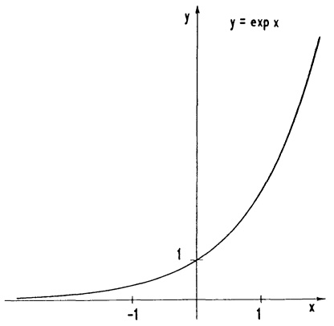

line

| X | Y |
| --- | --- |
| -1 | ~0.2 |
| 0 | 1 |

Abb. 96 - $y = e^{x}$

Nach Satz 4.1 c) verläuft jeder derartige Prozess „exponentiell“, d.h. es gilt $u(t) = ce^{at}$ mit einer Konstanten $c$, die man in der Regel mit $t = 0$ (sonst $t = t_0$) zu $c = u(0)$ bestimmt.

Beispiel 1. Radioaktiver Zerfall. Aufgrund von Beobachtungen geht man davon aus, daß für $N(t)$ Atome eines zerfallenden Stoffes die Anzahl $\Delta N$ der Zerfälle in einem kleinen Zeitintervall $\Delta t$ gegeben ist durch $\Delta N = -kN\Delta t$. Mit der (vernünftigen) Annahme, daß die Funktion $N$ differenzierbar ist, ergibt sich hieraus $\dot{N}(t) = -kN(t)$. ($k > 0$ ist die - vom Material abhängige - Zerfallskonstante.) Satz 4.1 c) führt sofort zum Zerfallsgesetz

$$
N (t) = N (0) e ^ {- k t}.
$$

Die Halbwertszeit $T$ ist definiert durch $N(T) = \frac{1}{2} N(0)$, d.h. $e^{-kT} = \frac{1}{2}$, bzw. $e^{kT} = 2$. Mit der Logarithmusfunktion heißt dies: $T = \frac{1}{k} \ln 2$.

Beispiel 2. Das Newtonsche Abkühlungsgesetz. Eine Substanz der Temperatur $T(t)$ wird in ein Medium der Temperatur $U(t)$ eingetaucht. Für die Temperaturdifferenz $P(t):=T(t)-U(t)$ fand I. Newton (in zahlreichen Versuchen) $\frac{dP}{dt}=\lambda P$. („Die Abkühlungsgeschwindigkeit ist proportional zur Temperaturdifferenz.“) Folglich gilt $P(t)=P(0)e^{\lambda t}$, bzw.

$$
T (t) = (T (0) - U (0)) e ^ {\lambda t} + U (t).
$$

Beispiel 3. Exponentielle Sättigung. Aus dem Ohmschen Gesetz ergibt sich für die Stromstärke $I(t)$ beim Einschalten eines Gleichstroms die Beziehung

$$
L \frac {d I}{d t} + I R = E
$$

mit dem Anfangswert  $I(0) = 0$ . Für die Funktion  $u(t) := I(t) - \frac{E}{R}$  gilt dann

$$
\dot {u} (t) = \dot {I} (t) = \frac {E}{L} - \frac {R}{L} I (t) = - R / L u (t). \text {Es folgt} u (t) = u (0) e ^ {- \frac {R}{L} t}, \text {bzw.}
$$

$$
I (t) = \frac {E}{R} (1 - e ^ {- \frac {R}{L} t}) .
$$

4.4 Der natürliche Logarithmus. Da die $e$-Funktion über $\mathbb{R}$ strikt monoton wächst, besitzt sie eine auf $\exp(\mathbb{R}) = (0,\infty)$ definierte Umkehrfunktion, den natürlichen Logarithmus ln.

$$
\ln : (0, \infty) \to \mathbb {R}, \quad y = \ln x \iff e ^ {y} = x.
$$

Insbesondere gilt (→ §3 (2))

$$
\ln (e ^ {x}) = x \text { für   alle } x \in \mathbb {R}; \quad e ^ {\ln x} = x \text { für   alle } x > 0. \tag {5}
$$

Die Graphen $y = \ln x$, $y = e^x$ liegen symmetrisch zu $y = x$ ($\to$ Satz 3.1). Aus der Definition und der Abb. 97

liest man sofort ab:

$$
\begin{array}{l} \ln 1 = 0, \\ \ln x <   0, \text {falls} 0 <   x <   1, \\ \ln x > 0, \text {falls} x > 1, \\ \ln \text {ist echt monoton wachsend,} \\ \lim _ {x \to \infty} \ln x = \infty , \\ \lim _ {x \to 0 +} \ln x = - \infty , \\ \text {der Graph} y = \ln x \text {ist konvex von oben.} \\ \end{array}
$$

Ferner gilt:

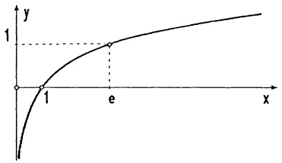

line

| X | Y |
| --- | --- |
| 1 | 1 |

Abb. 97 - $y = \ln x$

Satz 4.2. a) Die ln-Funktion ist überall differenzierbar; für alle x > 0 gilt

$$
\frac {d}{d x} \ln x = \frac {1}{x}. \tag {6}
$$

b) Die Funktionalgleichung der ln-Funktion.

$$
\ln (x y) = \ln x + \ln y \quad \ln \frac {x}{y} = \ln x - \ln y \quad (x, y > 0).
$$

Beweis. a): Die Differentiationsregel (3) aus § 3 ergibt in diesem Fall

$$
\frac {d}{d x} \ln x = \frac {1}{\exp^ {\prime} (\ln x)} = \frac {1}{\exp (\ln x)} = \frac {1}{x}.
$$

b): Für $x, y \in (0, \infty)$ sei $u := \ln x$, $v := \ln y$, dann gilt $x = e^u$, $y = e^v$ und $\ln(xy) = \ln(e^u e^v) = \ln(e^{u+v}) = u + v = \ln x + \ln y$. Der Sonderfall $x = \frac{1}{y}$ zeigt $\ln \frac{1}{y} = -\ln y$.

Die In-Funktion wächst mit  $x \rightarrow \infty$  wesentlich schwächer gegen  $\infty$  als jede n-te Wurzelfunktion, denn es gilt

$$
\lim _ {x \to \infty} \frac {\ln x}{\sqrt [ n ]{x}} = 0,
$$

was man leicht mit der L'Hospital-Regel nachweisen kann.

Beispiel 1. Für die Zerfallskonstante $k$ und die Reichweite $R$ von $\alpha$-Teilchen gilt das Gesetz von GEIGER und NUTTAL:

$$
\ln k = a + b \ln R \quad (\text {mit gewissen Konstanten} a, b).
$$

Aus $kT = \ln 2$ ($\rightarrow$ 4.3) folgt $\ln k + \ln T = \ln(kT) = \ln(\ln 2)$ und damit eine Beziehung $\ln(\ln 2) = a + b \ln R + \ln T$ zwischen Reichweite und Halbwertszeit.

Beispiel 2. Das psychophysische Grundgesetz von WEBER und FECHNER. Ein Reiz der Intensität R verursacht eine Empfindung der Intensität  $E(R)$ . Versuche ergeben  $\Delta E = a \frac{\Delta R}{R}$  mit einer Konstanten a.  $\Delta R \rightarrow 0$  führt auf  $\frac{dE}{dR} = a \cdot \frac{1}{R}$ , also auf  $E(R) = a \ln R + c$  ( $\rightarrow$  (6) und §2 (2)). Als Reizschwelle bezeichnet man den Wert  $R_{0}$  mit  $E(R_{0}) = 0$  und  $E(R) > 0$  falls  $R > R_{0}$ . Damit ergibt sich  $c = -a \ln R_{0}$  und  $E(R) = a \ln R - a \ln R_{0} = a \ln \frac{R}{R_{0}}$ . Das langsame Anwachsen der ln-Funktion verlangt in Bereichen hoher Intensität eine ganz erhebliche Änderung von R, um  $E(R)$  merklich zu beeinflussen.

4.5 Allgemeine Exponentialfunktionen und Logarithmen. Sei $a > 0$. Die Formel $(e^x)^r = e^{rx} \to (3)$ mit $x = \ln a$ ergibt $a^r = e^{r\ln a}$ für jede rationale Zahl $r \in \mathbb{Q}$. Aus diesem Grund definiert man die Potenzen $a^x$ für beliebige $x \in \mathbb{R}$ durch

$$
a ^ {x} := e ^ {x \ln a}, (a > 0). \tag {7}
$$

Man nennt $x \mapsto a^{x}$ ($x \in \mathbb{R}$) die Exponentialfunktion zur Basis $a$. Sämtliche Eigenschaften dieser Funktion leitet man aus der Definition (7) und den Eigenschaften der In-Funktion und der $e$-Funktion her. Insbesondere $a^{x} = \lim_{n \to \infty} a^{r_{n}}$ für jede Folge rationaler Zahlen $r_{n} \to x$. Ferner:

$$
\begin{array}{l} \boxed { \begin{array}{c} a ^ {x} a ^ {y} = a ^ {x + y}; \quad (a b) ^ {x} = a ^ {x} b ^ {x}; \quad (a ^ {x}) ^ {y} = a ^ {x y}; \\ \ln (a ^ {x}) = x \ln a \quad (x, y \in \mathbb {R}, a, b > 0); \\ \frac {d}{d x} a ^ {x} = a ^ {x} \ln a, (x \in \mathbb {R}, a > 0). \end{array} } \end{array} \tag {8}
$$

Für jede reelle Zahl $\alpha\in\mathbb{R}$ ist nach (7) die Potenzfunktion $f(x)=x^{\alpha}=e^{\alpha\ln x}$ für alle $x>0$ definiert. Mit (1), (6) und der Kettenregel berechnen wir die Ableitung: $f'(x)=e^{\alpha\ln x}\frac{\alpha}{x}=\alpha x^{\alpha-1}$. Damit ist endlich die Differentiationsregel

(9)

$$
\boxed {\frac {d}{d x} (x ^ {\alpha}) = \alpha x ^ {\alpha - 1}}
$$

für alle $\alpha \in \mathbb{R}$ bewiesen.

Beispiel 1. Das POISSON-Gasgesetz. Experimentell stellt man fest, daß zwischen dem Druck $p$ und dem Volumen $V$ eines Gases bei einem reversiblen adiabatischen Prozess die Beziehung $\frac{\Delta p}{p} + \gamma \frac{\Delta V}{V} = 0$ besteht (mit einer vom Gas abhängigen Konstanten $\gamma$). Nach Multiplikation mit $\frac{1}{\Delta t}$ wird daraus beim Grenzübergang $\Delta t \to 0$

$$
0 = \frac {\dot {p}}{p} + \gamma \frac {\dot {V}}{V} = \frac {d}{d t} (\ln p + \gamma \ln V) = \frac {d}{d t} \ln (p V ^ {\gamma}).
$$

Es folgt $\ln(pV^{\gamma}) = c$, bzw. $p(t)V(t)^{\gamma} = C$ ($= e^{c}$, konstant).

Beispiel 2. Die allgemeine Höhenformel

$$
p = p _ {0} \left(1 - \frac {\gamma - 1}{\gamma} \frac {\rho_ {0}}{p _ {0}} g h\right) ^ {\frac {\gamma}{\gamma - 1}}
$$

beschreibt den Zusammenhang zwischen dem Druck $p$ und der Höhe $h$ in einem gasgefüllten Behälter. Uns interessiert der Grenzwert $\gamma \to 1$ (Annäherung an ein ideales Gas). Mit $x := \frac{\gamma}{\gamma - 1}$ und $a := -\frac{\rho_0}{p_0}gh$ wird dieser Grenzübergang in $p = p_0 \lim_{x \to \infty} (1 + \frac{a}{x})^x$ beschrieben. Mit der L'Hospital-Regel finden wir $\lim_{x \to \infty} x \ln(1 + \frac{a}{x}) = a$ und damit $\lim_{x \to \infty} (1 + \frac{a}{x})^x = \lim_{x \to \infty} e^{x \ln(1 + a/x)} = e^a$. Demzufolge geht mit $\gamma \to 1$ die allgemeine Höhenformel in die barometrische Höhenformel $p = p_0 e^{-\frac{\rho_0}{p_0}gh}$ über.

Zu jeder Basis $a > 0$ ist die Exponentialfunktion $f(x) = a^x = e^{x\ln a}$ umkehrbar, denn zu jedem $y \in f(\mathbb{R}) = (0, \infty)$ ist die Gleichung $y = e^{x\ln a}$ eindeutig nach $x$ auflösbar: $x = \frac{\ln y}{\ln a}$. Nach Vertauschung von $x$ mit $y$ ($\rightarrow$ 3.1) ergibt sich die explizite Form der Umkehrfunktion $\log_a$ - sie heißt Logarithmus zur Basis $a$ -

$$
\log_ {a} x = \frac {\ln x}{\ln a}, \quad x \in (0, \infty), \tag {10}
$$

aus der man sofort die Rechenregeln abliest (→ Satz 4.2):

$$
\log_ {a} (x y) = \log_ {a} x + \log_ {a} y, \quad \frac {d}{d x} \log_ {a} x = \frac {1}{x \ln a}.
$$

Beachte. Wegen  $a^{x}=e^{x\ln a}$  steht hinter jeder allgemeinen Exponentialfunktion die e-Funktion, und hinter jedem allgemeinen Logarithmus  $\log_{a}$  der natürliche Logarithmus ln. Auch so kompliziert aussehende Funktionen wie etwa

$h(x) = f(x)^{g(x)}$ (alle $f(x) > 0$) sind einfache Kompositionen aus $f, g, \exp$ und $\ln : h(x) = e^{g(x)\ln f(x)}$.

4.6 Die Hyperbelfunktionen sinh, cosh, tanh. Die Funktionen sinus hyperbolicus, cosinus hyperbolicus und tangens hyperbolicus sind für alle  $x \in R$  definiert durch

$$
\begin{array}{l} \boxed {\sinh x := \frac {e ^ {x} - e ^ {- x}}{2}} \\ \cosh x := \frac {e ^ {x} + e ^ {- x}}{2} \\ \tanh x := \frac {\sinh x}{\cosh x} = \frac {e ^ {x} - e ^ {- x}}{e ^ {x} + e ^ {- x}}. \end{array} \tag {11}
$$

Diese recht einfachen Kombinationen aus  $e^{x}$  und  $e^{-x}$  haben ihrer praktischen Bedeutung wegen einen eigenen Namen bekommen.

Beispiel. Ein homogenes, nur durch das Eigengewicht belastetes Seil hat die Form einer Kettenlinie

$$
y (x) = a \cosh (\frac {x - b}{a}) + c.
$$

Hierin sind $a, b, c$ konstant, $a > 0$ ($\rightarrow$ Aufg. 7 und Band 2).

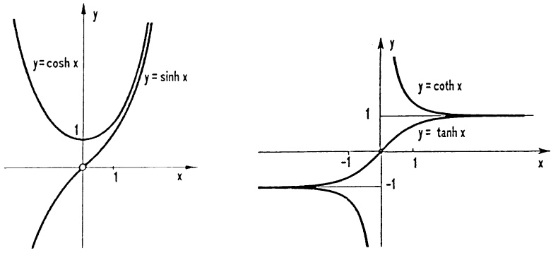

Abb. 98 - Hyperbelfunktionen

In den Rechenregeln besteht eine Analogie zu den Kreisfunktionen. Mit (11) und den Rechenregeln für die e-Funktion verifiziert man leicht

a)  $\sinh(-x) = -\sinh(x)$ ,  $\cosh(-x) = \cosh x$ ,
c)  $\cosh^{2}x - \sinh^{2}x = 1$ .

b) $\sinh (x + y) = \sinh x\cosh y + \cosh x\sinh y,$ $\cosh (x + y) = \cosh x\cosh y + \sinh x\sinh y,$

Aus der Formel (12 c) erklärt sich der Zusatz „hyperbolicus“ im Namen. Ein Punkt mit den kartesischen Koordinaten  $x = \cosh t$ ,  $y = \sinh t$  liegt auf der Hyperbel  $x^{2} - y^{2} = 1$ . Auch die Differentiation dieser „Hyperbelfunktionen“ bereitet keine Mühe:

$$
\sinh^ {\prime} x = \cosh x, \cosh^ {\prime} x = \sinh x, \tanh ^ {\prime} x = \frac {1}{\cosh^ {2} x}. \tag {13}
$$

Beispiel 1. Für die Kettenlinie gilt $y'' = a\sqrt{1 + y'^2}$.

Beispiel 2. Ein Fallschirmspringer hat nach $t$ Sekunden den Fallweg $s(t) = \frac{v_0^2}{g} \ln(\cosh \frac{gt}{v_0})$ zurückgelegt. Seine Geschwindigkeit ist $v(t) = \dot{s} = v_0 \tanh \frac{gt}{v_0}$. Wegen $\lim_{t \to \infty} \tanh t = 1$ gilt $\lim_{t \to \infty} v(t) = v_0$. Das Bewegungsgesetz lautet

$$
v = g (1 - (\frac {v}{v _ {0}}) ^ {2}) .
$$

Die Funktion sinh ist über R echt monoton wachsend, also umkehrbar. Die Umkehrfunktion wird mit arsinh bezeichnet und area sinus hyperbolicus genannt. Der hyperbolische cosinus ist sowohl über  $[0,\infty)$  als auch über  $(-\infty,0]$  umkehrbar (aber nicht über ganz R). Wegen der Symmetrie genügt es, die zu dem „Zweig“ über  $[0,\infty)$  gehörende Umkehrfunktion zu untersuchen, sie heißt area cosinus hyperbolicus (i.Z. arcosh). Die expliziten Darstellungen

$$
\boxed { \begin{array}{l l} \operatorname{arsinh} x = \ln (x + \sqrt {x ^ {2} + 1}) & , \quad - \infty <   x <   \infty \\ \operatorname{arcosh} x = \ln (x + \sqrt {x ^ {2} - 1}) & , \quad 1 \leq x <   \infty \end{array} } \tag {14}
$$

dieser Funktionen gewinnt man durch Auflösen der Gleichungen $y = \frac{e^x - e^{-x}}{2}$, bzw. $y = \frac{e^x + e^{-x}}{2}$ nach $x$ (mit anschließender Vertauschung von $x$ und $y \to 3.1$): Aus $y = \frac{e^x - e^{-x}}{2}$ folgt die quadratische Gleichung $(e^x)^2 - 2ye^x - 1 = 0$ für $e^x$, somit $e^x = y + \sqrt{y^2 + 1}$. Die zweite formale Lösung der quadratischen Gleichung ist wegen $e^x > 0$ sinnlos. Es folgt $x = \operatorname{arsinh} y = \ln(y + \sqrt{y^2 + 1})$. Die andere Gleichung in (14) folgt analog.

Die Umkehrfunktion des hyperbolischen Tangens

$$
\operatorname{artanh} x = \frac {1}{2} \ln \frac {1 + x}{1 - x} \quad (- 1 <   x <   1)
$$

spielt in den Anwendungen keine so große Rolle. Mit (14), (6) und der Kettenregel berechnet man die Ableitung:

$$
\boxed { \begin{array}{l} \frac {d}{d x} \operatorname{arsinh} x = \frac {1}{\sqrt {x ^ {2} + 1}} \quad (x \in \mathbb {R}), \\ \frac {d}{d x} \operatorname{arcosh} x = \frac {1}{\sqrt {x ^ {2} - 1}} \quad (x > 1). \end{array} } \tag {15}
$$

<table><tr><td colspan="3">Die elementaren Funktionen und ihre Ableitungen</td></tr><tr><td> $f$ </td><td> $f'$ </td><td>Bemerkungen</td></tr><tr><td> $x^{\alpha}$ </td><td> $\alpha x^{\alpha-1}$ </td><td>Def. Bereich abh. von  $\alpha$ </td></tr><tr><td> $\sin x$ </td><td> $\cos x$ </td><td></td></tr><tr><td> $\cos x$ </td><td> $-\sin x$ </td><td></td></tr><tr><td> $\tan x$ </td><td> $\frac{1}{\cos^{2}x}$ </td><td> $x \neq (2k+1)\frac{\pi}{2}, k \in \mathbb{Z}$ </td></tr><tr><td> $\cot x$ </td><td> $-\frac{1}{\sin^{2}x}$ </td><td> $x \neq k\pi, k \in \mathbb{Z}$ </td></tr><tr><td> $\arcsin x$ </td><td> $\frac{1}{\sqrt{1-x^{2}}}$ </td><td> $|x| < 1$ </td></tr><tr><td> $\arccos x$ </td><td> $-\frac{1}{\sqrt{1-x^{2}}}$ </td><td> $|x| < 1$ </td></tr><tr><td> $\arctan x$ </td><td> $\frac{1}{1+x^{2}}$ </td><td></td></tr><tr><td> $\operatorname{arccot} x$ </td><td> $-\frac{1}{1+x^{2}}$ </td><td></td></tr><tr><td> $e^{x}$ </td><td> $e^{x}$ </td><td></td></tr><tr><td> $a^{x}$ </td><td> $a^{x}\ln a$ </td><td> $a^{x}=e^{x\ln a}, a>0$ </td></tr><tr><td> $\ln |x|$ </td><td> $\frac{1}{x}$ </td><td> $x \neq 0$ </td></tr><tr><td> $\log_{a}x$ </td><td> $\frac{1}{x\ln a}$ </td><td> $\log_{a}x=\frac{\ln x}{\ln a}, x,a>0$ </td></tr><tr><td> $\sinh x$ </td><td> $\cosh x$ </td><td></td></tr><tr><td> $\cosh x$ </td><td> $\sinh x$ </td><td></td></tr><tr><td> $\tanh x$ </td><td> $\frac{1}{\cosh^{2}x}$ </td><td></td></tr><tr><td> $\operatorname{arsinh} x$ </td><td> $\frac{1}{\sqrt{x^{2}+1}}$ </td><td></td></tr><tr><td> $\operatorname{arcosh} x$ </td><td> $\frac{1}{\sqrt{x^{2}-1}}$ </td><td> $x>1$ </td></tr></table>

## Aufgaben

1. Man diskutiere gemäß 2.5 die Funktionen $f(x)$, $x \in \mathbb{R}$,

$$
f (x) = x ^ {4} e ^ {x}, \quad f (x) = \ln | x - \sqrt {x ^ {2} - 1} |,
$$

$$
f (x) = x ^ {x} \quad , \quad f (x) = x ^ {1 / x} \quad ,
$$

$$
f (x) = \ln (e ^ {3 x} + e ^ {x} - 1), \quad f (x) = \frac {1}{2} \ln | \frac {1 + 5 x ^ {3}}{1 - 5 x ^ {3}} |,
$$

$$
f (x) = e ^ {\arctan x ^ {3}} \quad , \quad f (x) = \frac {e ^ {a x}}{1 + e ^ {a x}} \quad .
$$

2. Man bestimme die Grenzwerte

$$
\lim _ {x \to + \infty} x ^ {2} [ \ln (1 + \frac {1}{x}) - \frac {1}{x + 1} ] \quad \lim _ {x \to - \infty} \frac {\sinh x}{\cosh x},
$$

$$
\lim _ {x \to 0} \frac {e ^ {a x} - e ^ {b x}}{e ^ {x} - 1} \quad \lim _ {x \to + \infty} \frac {e ^ {a x} - e ^ {b x}}{e ^ {x} - 1},
$$

Saubere Fallunterscheidung hinsichtlich $a, b!$

$$
\lim _ {x \to 0 +} (\frac {1}{x}) ^ {x} \quad \lim _ {x \to 1} x ^ {1 / (1 - x)},
$$

$$
\begin{array}{l} \lim _ {x \to 0} (\cos x) ^ {1 / x ^ {2}} \\ \quad \quad \quad \quad \quad \quad \quad \quad \quad \quad \quad \quad \quad \quad \quad \quad \quad \quad \quad \lim _ {x \to \infty} (e ^ {a x} - b x) ^ {1 / x} \end{array} ,
$$

$$
\lim _ {x \to + \infty} (\frac {2 a + x}{a + x}) ^ {x} \quad \lim _ {x \to 0} (\frac {1}{x ^ {2}} - \frac {1}{\sinh^ {2} x}).
$$

3. Man zeige, daß die von A.EINSTEIN eingeführte Funktion strikt monoton fällt:

$$
f (x) = x ^ {2} \frac {e ^ {x}}{(e ^ {x} - 1) ^ {2}}, \quad x > 0.
$$

4. Man berechne die Ableitung von  $f(x)$  für

$$
f (x) = x ^ {(x ^ {x})} \quad f (x) = (x ^ {x}) ^ {x} \quad f (x) = x ^ {1 0 ^ {x}}.
$$

5. Die Strahlungsdichte eines schwarzen Strahlers ist nach M.PLANCK

$$
E (\lambda) = A \cdot \lambda^ {- 5} (e ^ {1. 4 4 / \lambda T} - 1) ^ {- 1}, \quad 0 <   \lambda <   \infty .
$$

(T : Temperatur in °K ; λ Wellenlänge in cm ; A konstant)

Man bestimme die globalen Maximalstellen $\lambda_{m}$ (für festes $T$) und die Konstante $K$ des Verschiebungsgesetzes von WIEN $\lambda_{m} \cdot T = K$.

Wie groß ist  $\lambda_{m}$  bei Sonnentemperatur  $T = 6.000^{\circ}K$ ?

(Hilfe: Setze  $x = \frac{1.44}{\lambda_{m} \cdot T}$  und wende das Newton-Verfahren an.)

6. a) Man verbessere die Näherung  $x_{0}=0.6$  für die Lösung der Gleichung  $f(x)=x\cdot e^{x}-1=0$  durch einen Newton-Schritt.

b) Man begründe, warum es mit dem Newton-Verfahren besser ist, die Gleichung in der Form $g(x) = x - e^{-x} = 0$ zu lösen.

(Hilfe: Betrachte die Quotienten  $f''/f'$  und  $g''/g'$ )

Wie lautet in diesem Falle das rekursive Bildungsgesetz  $x_{n+1} = r(x_n)$  für die Folge der Näherungswerte des Verfahrens?

7. Hängt ein Seil nur unter der Last seines Gewichtes G, so beschreibt es eine Kettenlinie:

$$
y (x) = b + a \cosh \left(\frac {x + c}{a}\right), \quad a > 0.
$$

Die Spannkraft S ist in jedem Punkt des Seiles tangential gerichtet, ihre Horizontalkomponente ist über die gesamte Länge  $\ell$  des Seiles hinweg konstant:  $H = a \cdot \frac{G}{\ell}$ .

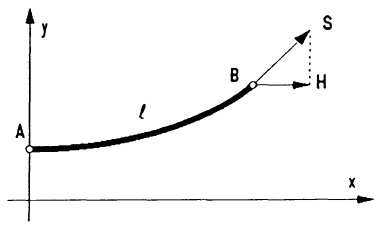

text_image

y
A
ℓ
B
S
H
x

a) Man rechne nach:

$y(x)$ genügt der Differentialgleichung $ay'' = \sqrt{1 + y'^2}$.

b) Ein Seil, 100 N/m schwer, soll zwischen den Punkten A (0 m, 100 m) und B (300 m, 192.8 m) hängen, so daß es in A horizontal einmündet.

\- Man ermittle die drei Bestimmungsgleichungen für $a, b, c$, löse nach $a$ auf und bestätige:

$$
\xi = \frac {3 0 0}{a} \quad \text {erfüllt} \quad \text {die} \quad \text {Gleichung} \quad 1 + \frac {9 2 . 8}{3 0 0} \xi = \cosh \xi .
$$

Diese Gleichung ist mit dem Newton-Verfahren zu lösen!

- Wie groß sind somit die Spannkräfte in $A$ und $B$?
- Bestimme daraus das Gewicht $G$ und schließlich die nötige Seillänge $\ell$.

8. Man bestätige für $a, b > 0$ die Beziehungen $\ln_a x = \frac{\ln_b x}{\ln_b a} = \ln_a e \cdot \ln x, x > 0$.

Als Dämpfungsmaß zwischen Eingangs- und Ausgangsspannung eines elektrischen Schaltkreises definiert man die Einheit Dezibel (dB):  $a = 20 \cdot \ln_{10} \frac{U_{2}}{U_{1}}$ . In welchem Verhältnis stehen  $U_{1}$  und  $U_{2}$ , wenn a = 3, 6, 20, 40 oder 60 dB?

9. Man drücke die möglichen Umkehrfunktionen von  $y = \operatorname{sech} x := \frac{1}{\cosh x}$  durch die In-Funktion aus und skizziere sie.

10. Als (linear) gedämpfte Schwingung bezeichnet man für a > 0

$$
g (x) = e ^ {- a x} \cdot \sin (\omega x + \varphi), \quad x \geq 0.
$$

- Man bestimme Nullstellen, Extrema und Wendepunkte von $g(x)$.
- Für welche $x$ berührt $g(x)$ die Kurven $y = \pm e^{-ax}$?
- Man skizziere die Graphen $y = g(x)$, $y = e^{-ax}$, $y = -e^{-ax}$ für $a = \omega = 1$, $\varphi = \frac{\pi}{4}$.

11. Bei einer Silizium-Gleichrichterdiode Typ 1N4001 gilt zwischen Spannung U und Stromstärke I die Beziehung

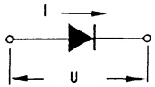

$$
I = I (U) = I _ {S} \cdot \left(e ^ {U / U _ {T}} - 1\right), \quad - 1 0 0 V <   U <   1. 5 V, \quad I \leq 8 A.
$$

Bei  $T = 25^{\circ}C$  ist  $U_{T} = 47mV$  und  $I_{S} = 30nA$ .

- Skizziere die Kennlinie im $(U,I)$-Koordinatensystem.
- Wie nimmt die Spannung $U$ zu, wenn sich der Strom $I$ verzehnfacht?
- Berechne den Gleichstromwiderstand $R = \frac{U}{I}$ und den differentiellen Widerstand $r = \frac{dU}{dI}$ bei $I = 2A$.

12. Wachstumsgesetze (→ 4.3). Man bestätige:

a) Ist $T$ die Zeit, in der sich $N(t)$ jeweils verdoppelt, so gilt für unbeschränktes

exponentielles Wachstum:  $N(t) = N(0) 2^{t/T}$  und  $\frac{\dot{N}(t)}{N(t)} = \frac{\ln 2}{T}$ .

b) Besitzt $N(t)$ eine Sättigungsgrenze $N_{\infty} := \lim_{t \to \infty} N(t)$ und wächst das Verhältnis „besetzter zu freier Lebensraum“ $\frac{N(t)}{N_{\infty} - N(t)}$ exponentiell mit der Verdoppelungszeit $T$, so gilt das logistische Gesetz:

$$
N (t) = N (0)   2 ^ {t / T} \frac {N _ {\infty}}{N _ {\infty} + N (0) (2 ^ {t / T} - 1)} \quad \text {und} \quad \frac {\dot {N} (t)}{N (t)} = \frac {\ln 2}{T} \left(1 - \frac {N (t)}{N _ {\infty}}\right) \quad .
$$

Für $0 < N(t) < \frac{1}{2} N_{\infty}$ ist $\ddot{N}(t) > 0$, für $\frac{1}{2} N_{\infty} < N(t) < N_{\infty}$ ist $\ddot{N}(t) < 0$ (beschleunigtes bzw. gebremstes Wachstum).

c) Erdbevölkerung: Jahr | 1850 | 1900 | 1950 | 1960 | 1970
Mrd. Menschen | 1.171 | 1.608 | 2.423 | 2.982 | 3.632

Ist zwischen 1850 und 1950 das Modell a) mit $T \approx 100$ Jahren akzeptabel?

Ab 1950 nimmt man Modell b) mit $T = 28$ Jahren. Was ergibt sich für $N_{\infty}$?

13. TSCHEBYSCHEV-Polynome (→ 3.3, Bsp. 2) lassen sich auf ganz R fortsetzen:

$$
T _ {n} (x) := \left\{ \begin{array}{l l} \cos (n \arccos x) & , \text {falls} 0 \leq x \leq 1 \\ \cosh (n \operatorname{arcosh} x) & , \text {falls} 1 <   x \end{array} , \quad n = 0, 1, 2, \dots . \right.
$$

a) Man bestimme alle $n$ Nullstellen $x_{k}$ und alle $n+1$ Extremstellen $\xi_{k}$ von $T_{n}(x)$ in $|x|\leq1$ ($k=0,1,2,\ldots n$) und lese die Alternanteneigenschaft ab:

$$
T _ {n} (\xi_ {k + 1}) = - T _ {n} (\xi_ {k}), \quad k = 0, 1, \dots , n - 1.
$$

b) Mit  $\cos n\varphi = \frac{1}{2}(e^{in\varphi} + e^{-in\varphi})$ ,  $\cosh n\varphi = \frac{1}{2}(e^{n\varphi} + e^{-n\varphi})$  und der Funktionalgleichung der Exponentialfunktion ( $\rightarrow 4.1$ ) bestätige man

$$
T _ {n + 1} (x) = 2 x T _ {n} (x) - T _ {n - 1} (x) \quad \text {(Rekursionsformel)}
$$

$$
T _ {n} (x) = \frac {1}{2} \left[ \left(x + \sqrt {x ^ {2} - 1}\right) ^ {n} + \left(x - \sqrt {x ^ {2} - 1}\right) ^ {n} \right].
$$

c) Tschebyschev-Polynome treten bei Tschebyschev-Filtern der Elektrotechnik im Nenner der Übertragungsfunktion auf:

$$
\left| \frac {U _ {2}}{U _ {1}} \right| ^ {2} (\omega) = f _ {n} (\omega) := \frac {1 + \epsilon^ {2}}{1 + \epsilon^ {2} T _ {n} ^ {2} (\omega)}.
$$

Man bestimme mittels b) die explizite Darstellung sowie die Extremstellen von  $f_{4}(\omega)$  (gleichmäßige Welligkeit in  $0 \leq \omega \leq 1$ , steiler Abfall für  $\omega > 1$ ).

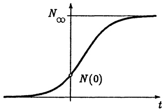

line

| t | Value |
| --- | --- |
| 0 | N(0) |

Aufg. 12 — Logistische Funktion

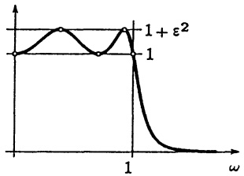

line

| \(\omega\) | Value |
| --- | --- |
| 0 | 1 |
| ~0.25 | Peak |
| ~0.5 | 1 |
| 1 | \(1 + \epsilon^{2}\) |
| >1 | Decay toward 0 |

Aufg. 13 — Funktion $f_{4}(\omega)$

## Kapitel 4

## Integration

Mit der Integration wird das Umkehrproblem gelöst, aus der Ableitung  $f'$  die ursprüngliche Funktion f zu rekonstruieren. Die wesentliche, zur Lösung führende Idee stammt aus dem Mittelwertsatz der Differentialrechnung ( $\rightarrow$  Kap. 3, §2): Zu jeder Zerlegung  $a = x_{0} < x_{1} < \cdots < x_{n-1} < x_{n} = x$  des Intervalls [a, x], auf dem f differenzierbar ist, gibt es Zwischenpunkte  $\xi_{i} \in [x_{i-1}, x_{i}]$ , so daß gilt

$$
f (x _ {i}) - f (x _ {i - 1}) = f ^ {\prime} (\xi_ {i}) (x _ {i} - x _ {i - 1}) \quad (i = 1, 2, \dots , n) .
$$

Summation dieser Gleichungen ergibt

$$
f (x) - f (x _ {0}) = \sum_ {i = 1} ^ {n} f ^ {\prime} (\xi_ {i}) (x _ {i} - x _ {i - 1}).
$$

Da man die  $\xi_{i}$  nicht kennt, ersetzt man sie durch beliebige Zwischenpunkte aus  $[x_{i-1}, x_{i}]$ , und erreicht so bei hinreichend feiner Zerlegung des Grundintervalls  $[a, x]$  durch die entsprechende Summe eine gute Approximation von  $f(x) - f(x_{0})$ . Es wird sich zeigen, daß der auf diesen Ideen beruhende Integralbegriff das geeignete Mittel ist zur Berechnung von Bogenlängen, Flächen- und Rauminhalten, Arbeit, Potentialen, Momenten, magnetischem Fluß, Zirkulation und vielem anderen.

## §1. Das bestimmte Integral

1.1 Die Definition des bestimmten Integrals. Sei f eine auf dem Intervall  $[a,b]$  definierte, beschränkte Funktion, die an höchstens endlich vielen Stellen nicht stetig ist (derartige Funktionen nennt manstückweise stetig). Durch Einfügen von n-1 Teilpunkten

$$
a = x _ {0} <   x _ {1} <   \dots <   x _ {n - 1} <   x _ {n} = b
$$

wird $[a,b]$ in $n$ Teilintervalle $[x_{i-1},x_i]$ zerlegt, sodann wird in jedem Teilintervall irgendein Zwischenpunkt $\xi_i$ mit $x_{i-1} \leq \xi_i \leq x_i$ ausgewählt und schließlich die Summe

$$
Z _ {n} := \sum_ {i = 1} ^ {n} f (\xi_ {i}) (x _ {i} - x _ {i - 1}) \tag {1}
$$

berechnet. Man nennt  $Z_{n}$  eine Zwischensumme oder Riemannsche Summe von f (nach B. RIEMANN, 1826-1866).

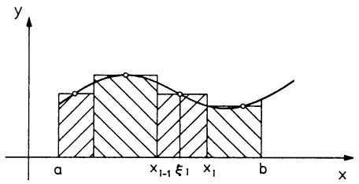

area

| X-axis Point | Description |
| --- | --- |
| a | Start of the shaded area |
| x_{1-1} | Intermediate point on the shaded area |
| \(\xi_1\) | Intermediate point on the shaded area |
| x_1 | End of the shaded area |
| b | End of the shaded area |

Abb. 99 - Riemann-Summe

Man kann zeigen, daß  $\lim_{n\to\infty}Z_n$  existiert, sofern nur die maximale Intervallbreite der einzelnen Unterteilungen mit  $n\to\infty$  gegen Null strebt. Außerdem ist dieser Grenzwert unabhängig davon, wie die Teilpunkte und die Zwischenpunkte gewählt werden. Der für alle derartigen Teilungsfolgen gemeinsame Grenzwert wird mit  $\int_a^b f(x)dx$  bezeichnet und heißt das bestimmte Integral von f über [a,b], die Randpunkte heißen Integrationsgrenzen.

$$
\boxed {\int_ {a} ^ {b} f (x) d x := \lim _ {n \to \infty} \sum_ {i = 1} ^ {n} f (\xi_ {i}) (x _ {i} - x _ {i - 1}).} \tag {2}
$$

Um die Konvergenz der Folge  $(Z_{n})_{n\geq1}$  einzusehen, setzen wir vereinfachend f als stetig voraus und eine Folge immer feiner werdender Unterteilungen von  $[a,b]$ , in der die  $(n+1)$ -te Unterteilung aus der n-ten durch Hinzunahme weiterer Teilpunkte entsteht. Hierzu bilden wir für  $n=1,2,3,\ldots$  mit

$m_{i} := \text{Minimum von } f \text{ auf } [x_{i-1}, x_{i}] \, ,$
$M_{i} := \text{Maximum von } f \text{ auf } [x_{i-1}, x_{i}] \, ,$
die Untersummen

$$
s _ {n} := \sum_ {i = 1} ^ {n} m _ {i} (x _ {i} - x _ {i - 1}),
$$

und die Obersummen

$$
S _ {n} := \sum_ {i = 1} ^ {n} M _ {i} (x _ {i} - x _ {i - 1}).
$$

Mit globalem Minimum $m$ und globalem Maximum $M$ von $f$ auf $[a,b]$ gilt $m \leq m_i \leq f(\xi_i) \leq M_i \leq M$ und deshalb

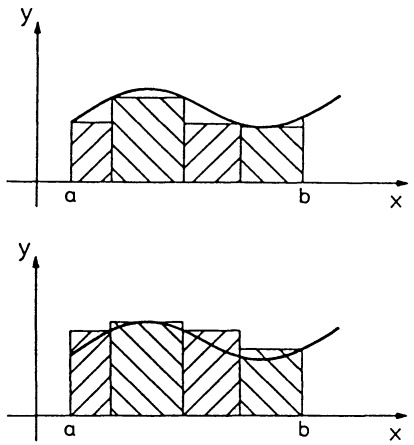

Abb. 100 - Unter- und Obersummen

$$
m (b - a) \leq s _ {n} \leq Z _ {n} \leq S _ {n} \leq M (b - a). \tag {3}
$$

Man sieht leicht, daß die Folge  $(s_{n})_{n\geq1}$  der Untersummen monoton wächst und die Folge der Obersummen  $(S_{n})_{n\geq1}$  monoton fällt. Weil beide Folgen beschränkt sind  $(\rightarrow(3))$ , konvergieren sie  $(\rightarrow\text{Monotonie-Kriterium},\text{Kap. 2},\text{Satz 5.4})$ . Aufgrund der Stetigkeit von f gilt für beliebig kleines  $\epsilon>0$  die Abschätzung  $0\leq M_{i}-m_{i}\leq\epsilon$  für alle i, sobald nur sämtliche Teilintervalle hinreichend klein sind  $(\rightarrow\text{Kap. 2},\text{Satz 6.5d})$ . Damit sieht man  $S_{n}-s_{n}\rightarrow0$  (mit  $n\rightarrow\infty$ ) und es folgt  $\lim_{n\to\infty}s_{n}=\lim_{n\to\infty}S_{n}$ . Mit dem Vergleichskriterium  $(\rightarrow\text{Kap. 2},\text{Satz 6.2})$  folgt

$$
\lim _ {n \to \infty} s _ {n} = \lim _ {n \to \infty} Z _ {n} = \lim _ {n \to \infty} S _ {n}.
$$

Beachte: Das bestimmte Integral  $\int_{a}^{b}f(x)dx$  ist eine Zahl; die „Integra-

tionsvariable“ kann beliebig bezeichnet werden:

$$
\int_ {a} ^ {b} f (x) d x = \int_ {a} ^ {b} f (t) d t = \int_ {a} ^ {b} f (u) d u.
$$

Zur Vermeidung von Fallunterscheidungen setzt man

$$
\int_ {a} ^ {a} f (x) d x := 0; \quad \int_ {b} ^ {a} f (x) d x := - \int_ {a} ^ {b} f (x) d x, \quad \text {falls} a <   b.
$$

## 1.2 Die geometrische Deutung.

1) Ist $f$ über $[a,b]$ stetig, $f(x) \geq 0$ für alle $x \in [a,b]$, dann ist die Riemannsche Summe $Z_n = \sum_{i=1}^{n} f(\xi_i)(x_i - x_{i-1})$ eine Summe von Rechteckflächen, die den Flächeninhalt $I$ des von der Kurve $y = f(x)$, der $x$-Achse und den Geraden $x = a$, $x = b$ begrenzten Flächenstücks approximiert. Je feiner die Zerlegung ist, um so genauer ist die Approximation. Also gilt ($\rightarrow$ (2))

$$
I = \int_ {a} ^ {b} f (x) d x. \tag {4}
$$

(Genau genommen wird hierdurch erst der Flächeninhalt definiert.)

2) Verläuft die Kurve  $y = f(x)$  ganz unterhalb der x-Achse ( $f(x) \leq 0$  für alle  $x \in [a, b]$ ), kann man mit (4) den entsprechenden Flächeninhalt berechnen:

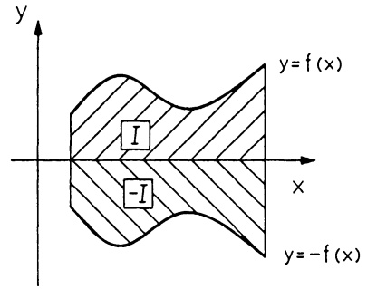

text_image

y
y = f (x)
I
-I
x
y = -f (x)

Abb. 101 - Flächeninhalt mit Formel (4)

$$
I = \int_ {a} ^ {b} - f (x) d x = - \int_ {a} ^ {b} f (x) d x; \quad \mathrm{d.h.} \int_ {a} ^ {b} f (x) d x = - I.
$$

3) Begrenzt $y = f(x)$ Flächenstücke oberhalb und unterhalb der $x$-Achse, dann ist $\int_{a}^{b} f(x) dx$ die Summe der mit einem Vorzeichen versehenen Flächeninhalte; „+“ für die oberhalb der $x$-Achse liegenden Teile, „-“ für die unterhalb der $x$-Achse liegenden Teile.

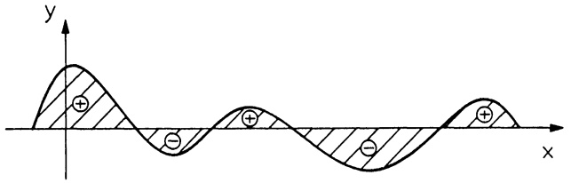

text_image

y
x

Abb. 102 - Flächen zwischen $y = 0$ und $y = f(x)$, mit Vorzeichen

Beispiel 1,2. $\int_{a}^{b}c dx = c(b - a)$ ， $\int_{a}^{b}x dx = \frac{1}{2} (b^{2} - a^{2})$

Beispiel 3. Für die in der Abb. 103 skizzierte stückweise lineare Funktion $f$ gilt

$$
\int_ {- 2} ^ {4} f (x) d x = - I _ {1} + I _ {2} - I _ {3} = - I _ {3} = - 1.
$$

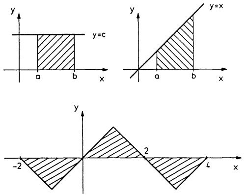

Abb. 103 - Zu den Beispielen 1, 2 und 3

1.3 Elementare Integrationsregeln und der Mittelwertsatz. Sämtliche betrachteten Funktionen seien auf dem abgeschlossenen Intervall  $[a,b]$  stückweise stetig. Aus (2) ergeben sich direkt die folgenden Regeln:

$$
\begin{array}{l} \left| \int_ {a} ^ {b} [ \alpha f (x) + \beta g (x) ] d x = \alpha \int_ {a} ^ {b} f (x) d x + \beta \int_ {a} ^ {b} g (x) d x \quad (\alpha , \beta \in \mathbb {R}) \right.; (5) \\ \left| \int_ {a} ^ {b} f (x) d x = \int_ {a} ^ {c} f (x) d x + \int_ {c} ^ {b} f (x) d x \quad (a \leq c \leq b); \right. (6) \\ f (x) \leq g (x) \quad (a \leq x \leq b) \Rightarrow \int_ {a} ^ {b} f (x) d x \leq \int_ {a} ^ {b} g (x) d x. (7) \\ \end{array}
$$

Satz 1.1. Integralabschätzungen. Ist die Funktion f stetig auf [a, b], so gilt

$$
m \leq f (x) \leq M \quad (a \leq x \leq b) \Rightarrow m (b - a) \leq \int_ {a} ^ {b} f (x) d x \leq M (b - a); \tag {8}
$$

$$
\left| \int_ {a} ^ {b} f (x) d x \right| \leq \int_ {a} ^ {b} | f (x) | d x \quad (a \leq b). \tag {9}
$$

Beweis. (8) folgt aus (7) und der bekannten Formel  $\int_{a}^{b} c dx = c(b - a)$ .

Zu (9): Für alle x gilt  $-|f(x)| \leq f(x) \leq |f(x)|$ , daher folgt mit (7) die Ungleichung  $-\int_{a}^{b}|f(x)|dx \leq \int_{a}^{b}f(x)dx \leq \int_{a}^{b}|f(x)|dx$ .

Es folgt eine für die weitere Theorie wichtige Anwendung.

## Satz 1.2. Mittelwertsatz der Integralrechnung.

Sind die Funktionen $f, g$ auf $[a, b]$ stetig, $g(x) \geq 0$ für alle $x \in [a, b]$, dann gibt es wenigstens eine Stelle $\xi \in [a, b]$ mit

$$
\int_ {a} ^ {b} f (x) g (x) d x = f (\xi) \int_ {a} ^ {b} g (x) d x.
$$

Beweis. Mit dem Minimum $m$ und dem Maximum $M$ von $f$ auf $[a, b]$ gilt $mg(x) \leq f(x)g(x) \leq Mg(x)$ und damit $m\int_{a}^{b} g(x) dx \leq \int_{a}^{b} f(x)g(x) dx \leq M\int_{a}^{b} g(x) dx$. Deshalb ist $\int_{a}^{b} f(x)g(x) dx$ darstellbar in der Form $c\int_{a}^{b} g(x) dx$, mit einer Zahl $c$ zwischen $m$ und $M$, zu der es nach dem Zwischenwertsatz ($\rightarrow$ Kap. 2, Satz 6.5c) wenigstens eine Stelle $\xi \in [a, b]$ gibt mit $c = f(\xi)$.

Der Spezialfall $g(x) = 1$ zeigt

$$
\int_ {a} ^ {b} f (x) d x = f (\xi) (b - a) \text {mit geeignetem} \xi \in [ a, b ]. \tag {10}
$$

Beispiel. Die spezifische Wärme $c$ eines Körpers hängt von seiner Temperatur $T$ ab, $c = c(T)$. Unter der mittleren spezifischen Wärme im Temperaturbereich $T_1 \leq T \leq T_2$ versteht man das Integralmittel $\bar{c} := \frac{1}{T_2 - T_1} \int_{T_1}^{T_2} c(T) dT$, welches nach (10) an wenigstens einer Stelle $\overline{T} \in [T_1, T_2]$ „angenommen“ wird; $\bar{c} = c(\overline{T})$.

1.4 Differentiation und Integration. Der in der Einleitung zu diesem Kapitel skizzierte Weg, aus  $f = F'$  die Funktion F zu konstruieren, führt auch zu einer einfachen Methode, bestimmte Integrale auszuwerten.

Definition. Man nennt eine auf dem Intervall I differenzierbare Funktion F eine Stammfunktion von f, wenn  $F'(x) = f(x)$  für alle  $x \in I$  gilt.

## Satz 1.3. Hauptsatz der Differential- und Integralrechnung.

Ist f eine auf dem Intervall I stetige Funktion,  $a, b \in I$ , dann gilt:

a) Existenz von Stammfunktionen. Die durch

$$
F _ {a} (x) := \int_ {a} ^ {x} f (t) d t \quad (x \in I)
$$

definierte Integralfunktion ist eine Stammfunktion von f ; d.h.

$$
\boxed {\frac {d}{d x} \left(\int_ {a} ^ {x} f (t) d t\right) = f (x).} \tag {11}
$$

Jede andere Stammfunktion von $f$ hat die Form $F(x) = F_{a}(x) + c$, $c \in \mathbb{R}$.

b) Integralberechnung. Mit einer beliebigen Stammfunktion F von f gilt

$$
\left| \int_ {a} ^ {b} f (x) d x = F (x) \Big | _ {a} ^ {b} := F (b) - F (a). \right. \tag {12}
$$

Beweis. a): Aus (6) und (10) folgt

$$
\begin{array}{l} F _ {a} (x + h) - F _ {a} (x) = \int_ {a} ^ {x + h} f (t) d t - \int_ {a} ^ {x} f (t) d t \\ = \int_ {x} ^ {x + h} f (t) d t = f (\xi_ {h}) h \\ \end{array}
$$

mit einer Zahl $\xi_{h}$, die mit $h\to0$ gegen $x$ strebt. Deshalb gilt

$$
F _ {a} ^ {\prime} (x) = \lim _ {h \to 0} \frac {1}{h} [ F _ {a} (x + h) - F _ {a} (x) ] = \lim _ {h \to 0} f (\xi_ {h}) = f (x) .
$$

Jede weitere Funktion $F$ mit $F' = f = F_a'$ hat nach Kap. 3, §2 (2) die Form $F(x) = F_a(x) + c$ mit $c \in \mathbb{R}$.

b): Nach Teil a) gilt $F(x) = \int_{a}^{x} f(t) dt + c$ für $x \in I$. Mit $x = a$ folgt $F(a) = c$, bzw. $\int_{a}^{x} f(t) dt = F(x) - F(a)$ für alle $x \in I$, insbesondere für $x = b$.

Berechnung des bestimmten Integrals. $\int_{a}^{b}f(x)dx$

1. Schritt: Man bestimmt eine Stammfunktion $F$ von $f$ (Probe: $F'(x) = f(x)$).
2. Schritt: Man berechnet $\int_{a}^{b} f(x) dx = F(x) \bigg|_{a}^{b} = F(b) - F(a)$.

Wir befassen uns im folgenden mit den Methoden, zur stetigen Funktion $f$ eine Stammfunktion explizit zu ermitteln.

Definition. Die Menge aller Stammfunktionen von $f$ wird mit $\int f(x)dx$ bezeichnet und heißt unbestimmtes Integral von $f$.

$\int f(x) dx$ besteht nach Teil a) des Hauptsatzes aus allen Funktionen der Form $F(x) + c$ mit $c \in R$ und einer (festen) Stammfunktion $F$ von $f$. Man schreibt dafür $\int f(x) dx = F(x) + c$. Definitionsgemäß gilt

$$
\int f (x) d x = F (x) + c \iff F ^ {\prime} (x) = f (x). \tag {13}
$$

Aus jeder Differentiationsformel  $F' = f$  ist demnach sofort das unbestimmte

Integral von $f$ abzulesen; so findet man zunächst die folgenden Grundintegrale. Die Differentiationsformeln entnehmen wir Kap. 3.

| $F(x)$ | $F'(x) = f(x)$ | $\int f(x) dx = F(x) + c$ | Bemerkg. |
| --- | --- | --- | --- |
| $\frac{1}{n+1} x^{n+1}$ | $x^n$ | $\int x^n dx = \frac{1}{n+1} x^{n+1} + c$ | $n \neq -1$ |
| $\ln \|x\|$ | $\frac{1}{x}$ | $\int \frac{1}{x} dx = \ln \|x\| + c$ | $x \neq 0$ |
| $-\cos x$ | $\sin x$ | $\int \sin x dx = -\cos x + c$ |  |
| $\sin x$ | $\cos x$ | $\int \cos x dx = \sin x + c$ |  |
| $\tan x$ | $\frac{1}{\cos^2 x}$ | $\int \frac{1}{\cos^2 x} dx = \tan x + c$ | $x \neq (2k+1)\pi$ |
| $\cot x$ | $-\frac{1}{\sin^2 x}$ | $\int \frac{1}{\sin^2 x} dx = -\cot x + c$ | $x \neq 2k\pi$ |
| $\arcsin x$ | $\frac{1}{\sqrt{1-x^2}}$ | $\int \frac{dx}{\sqrt{1-x^2}} = \arcsin x + c$ | $\|x\| < 1$ |
| $\arctan x$ | $\frac{1}{1+x^2}$ | $\int \frac{dx}{1+x^2} = \arctan x + c$ |  |
| $\frac{1}{2} \ln \frac{1+x}{1-x}$ | $\frac{1}{1-x^2}$ | $\int \frac{dx}{1-x^2} = \frac{1}{2} \ln \frac{1+x}{1-x} + c$ | $\|x\| < 1$ |
| $\frac{1}{a} e^{ax}$ | $e^{ax}$ | $\int e^{ax} dx = \frac{1}{a} e^{ax} + c$ | $a \neq 0$ |
| $\cosh x$ | $\sinh x$ | $\int \sinh x dx = \cosh x + c$ |  |
| $\sinh x$ | $\cosh x$ | $\int \cosh x dx = \sinh x + c$ |  |
| $\ln (x + \sqrt{1+x^2})$ | $\frac{1}{\sqrt{1+x^2}}$ | $\int \frac{dx}{\sqrt{1+x^2}} = \ln (x + \sqrt{1+x^2}) + c$ |  |
| $\ln \|x + \sqrt{x^2-1}\|$ | $\frac{1}{\sqrt{x^2-1}}$ | $\int \frac{dx}{\sqrt{x^2-1}} = \ln \|x + \sqrt{x^2-1}\| + c$ | $\|x\| > 1$ |

Beispiel 1. Die von der Gravitationskraft $K(x) = \gamma \frac{mM}{x^2}$ längs $[a, b]$ geleistete Arbeit beträgt

$$
A = \int_ {a} ^ {b} K (x) d x = \gamma m M \int_ {a} ^ {b} \frac {d x}{x ^ {2}} = \gamma m M \left(- \frac {1}{x}\right) \Big | _ {a} ^ {b} = \gamma m M \left(\frac {1}{a} - \frac {1}{b}\right). \quad \square
$$

## Beispiel 2.

$$
\int_ {a} ^ {b} \frac {1}{x} d x = \ln | b | - \ln | a | = \ln \frac {| b |}{| a |},
$$

vorausgesetzt,  $[a,b]$  enthält nicht den Nullpunkt. Insbesondere ergibt sich so die Integraldarstellung der In-Funktion:

$$
\boxed {\ln x = \int_ {1} ^ {x} \frac {d t}{t} \quad (x > 0).}
$$

## Beispiel 3.

$$
\int_ {0} ^ {\pi / 2} \sin x d x = - \cos x \bigg | _ {0} ^ {\pi / 2} = 1.
$$

Beispiel 4. $\int_{a}^{b}\frac{dx}{1 + x^{2}} = \arctan b - \arctan a$. Speziell erhält man die Integraldarstellung des Arcustangens:

$$
\boxed {\arctan x = \int_ {0} ^ {x} \frac {d t}{1 + t ^ {2}} \quad (x \in \mathbb {R}).}
$$

## Aufgaben

1. a) Man berechne $F'(x)$ und $F''(x)$ von $F(x) = \int_{0}^{x} \sqrt{1 - t^8} dt$, $-1 \leq x \leq 1$.
b) Mit einfachen Unter- und Obersummen bestätige man

$$
0. 4 9 6 <   F (0. 5) <   0. 5 0 0; \quad 0. 7 3 3 <   F (1) <   1. 0 0.
$$

2. Man berechne die Integrale durch Rationalmachen des Nenners

$$
\int_ {1} ^ {2} \frac {x ^ {2} - 3 x + 4}{\sqrt {x}} d x, \quad \int_ {0} ^ {1} \frac {d x}{\sqrt {x} + \sqrt {x + 1}}.
$$

3. Man bestätige für zweimal stetig differenzierbares  $f(x)$

$$
\int_ {a} ^ {b} x f ^ {\prime \prime} (x) d x = b f ^ {\prime} (b) - f (b) + f (a) - a f ^ {\prime} (a).
$$

4. Für  $\alpha,\beta:[a,b]\to[a,b]$  differenzierbar und f auf [a,b] stetig berechne man

$$
\frac {d}{d x} \bigg (\int_ {\alpha (x)} ^ {\beta (x)} f (t)   d t \bigg)  .
$$

5. Was ist falsch an

$$
\int_ {- 1} ^ {2} \frac {d x}{x ^ {2}} = - \left. \frac {1}{x} \right| _ {- 1} ^ {2} = \frac {1}{2}?
$$

6. Man berechne mit Polynomdivision

$$
\int \frac {x ^ {2} - x + 1}{x - 2} d x, \quad \int \frac {x ^ {4}}{x - 1} d x.
$$

7. (Faßregel von J. KEPLER, 1571 - 1630) Man bestätige, daß der Flächeninhalt $S$ des Bereiches, der von der $x$-Achse, den Geraden $x = a$ und $x = b$ und der kubischen Parabel $y = p(x) = \alpha x^3 + \beta x^2 + \gamma x + \delta$ begrenzt wird, gegeben ist durch

$$
S = \frac {b - a}{6} (y _ {0} + 4 y _ {1} + y _ {2}) ,
$$

wenn  $y_{0}=p(a)$ ,  $y_{1}=p(\frac{a+b}{2})$  und  $y_{2}=p(b)$ .

8. Man diskutiere die Kurve

$$
y = F (x) = \int_ {0} ^ {x} t (t - 1) e ^ {- t ^ {2}} d t.
$$

9. Ein biegeweches Seil nimmt bei einer spezifischen Längenbelastung  $q(x)$  die Form der Seilkurve

$$
y (x) = c \int_ {0} ^ {x} \left(\int_ {0} ^ {u} q (t) d t\right) d u
$$

an. Man berechne die Seilkurve

a) für eine Hängebrücke mit konstantem  $q(x)=q_{0}$ ,
b) für die Kettenlinie (Seil unter Eigenlast)  $q(x) = \cosh x$ ,
c) für  $q(x)=\left\{\begin{array}{ll}q_{1}&,0<x\leq1\\ q_{2}&,1<x\end{array},q_{1}\neq q_{2}\right.$

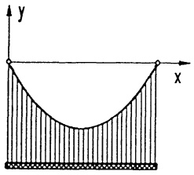

text_image

y
x

## §2. Integrationsregeln

Die 3 Regeln der Differentiation (Linearität, Produktregel und Kettenregel) ergeben mit §1 (13) Regeln zur Berechnung unbestimmter Integrale.

2.1 Linearität. Aus  $F'(x) = f(x)$ ,  $G'(x) = g(x)$  folgt für alle  $a, b \in R$   $af(x) + bg(x) = aF'(x) + bG'(x) = (aF(x) + bG(x))'$ . Das bedeutet für das Integral  $\int(af(x) + bg(x)) dx = aF(x) + bG(x) + c$ ; man schreibt dafür

$$
\boxed {\int (a f (x) + b g (x)) d x = a \int f (x) d x + b \int g (x) d x.} \tag {1}
$$

Beispiel.

$$
\begin{array}{l} \int (a _ {n} x ^ {n} + \dots + a _ {1} x + a _ {0}) d x = a _ {n} \int x ^ {n} d x + \dots + a _ {1} \int x d x + a _ {0} \int d x \\ = \frac {a _ {n}}{n + 1} x ^ {n + 1} + \dots + \frac {a _ {1}}{2} x ^ {2} + a _ {0} x + c. \\ \end{array}
$$

2.2 Partielle Integration. Für je zwei auf einem Intervall $I$ stetig differenzierbare Funktionen $u, v$ ist $uv$ wegen $(uv)' = u'v + uv'$ eine Stammfunktion von $u'v + uv'$. Nach §1 (13) bedeutet das $u(x)v(x) + c = \int(u'(x)v(x) + u(x)v'(x)) dx = \int u'(x)v(x) dx + \int u(x)v'(x) dx$, bzw.

$$
\int u ^ {\prime} (x) v (x) d x = u (x) v (x) - \int u (x) v ^ {\prime} (x) d x. \tag {2}
$$

Für das bestimmte Integral lautet die entsprechende Formel

$$
\int_ {a} ^ {b} u ^ {\prime} (x) v (x) d x = \left. u (x) v (x) \right| _ {a} ^ {b} - \int_ {a} ^ {b} u (x) v ^ {\prime} (x) d x. \tag {3}
$$

Die Berechnung eines Integrals mit Formel (2) bzw. (3) nennt man partielle Integration. Sie gestattet, Integrale der Form  $\int f(x)g(x)dx$  mit dem Ansatz  $f(x)=u'(x)$ ,  $g(x)=v(x)$  auf das oft leichter berechenbare Integral  $\int u(x)v'(x)dx$  zurückzuführen.

## Beispiel 1.

$$
\int x e ^ {x} d x = x e ^ {x} - \int e ^ {x} d x = (x - 1) e ^ {x} + c ;
$$

(Ansatz: $u'(x) = e^x$, $v(x) = x$; $u(x) = e^x$, $v'(x) = 1$)

## Beispiel 2.

$$
\int x ^ {2} \sin x d x = - x ^ {2} \cos x + 2 \int x \cos x d x,
$$

(Ansatz: $u'(x) = \sin x$, $v(x) = x^2$; $u(x) = -\cos x$, $v'(x) = 2x$)

$$
\int x \cos x d x = x \sin x - \int \sin x d x = x \sin x + \cos x + c ;
$$

insgesamt:

$$
\int x ^ {2} \sin x d x = - x ^ {2} \cos x + 2 x \sin x + 2 \cos x + c.
$$

## Beispiel 3.

$$
\begin{array}{l} \int e ^ {a x} \sin b x d x = \frac {1}{a} e ^ {a x} \sin b x - \frac {b}{a} \int e ^ {a x} \cos b x d x \\ = \frac {1}{a} e ^ {a x} \sin b x - \frac {b}{a} \left[ \frac {1}{a} e ^ {a x} \cos b x + \frac {b}{a} \int e ^ {a x} \sin b x d x \right], (a \neq 0). \\ \end{array}
$$

Zweimalige partielle Integration (beide Male mit  $u'(x) = e^{ax}$ ) führt wieder zum gleichen Integral, jedoch auf der rechten Seite mit einem anderen Faktor als auf der linken Seite. Man kann deshalb die Gleichung nach dem gesuchten Integral auflösen und erhält

$$
\int e ^ {a x} \sin (b x) d x = \frac {a e ^ {a x} \sin (b x) - b e ^ {a x} \cos (b x)}{a ^ {2} + b ^ {2}} + c.
$$

So ist beispielsweise im Zeitintervall $0 \leq t \leq \pi$ das Integralmittel der Auslenkung eines nach $y(t) = e^{-3t} \sin 2t$ schwingenden Punktes

$$
\overline {{y}} = \frac {1}{\pi} \int_ {0} ^ {\pi} y (t) d t = \left. \frac {e ^ {- 3 t} (- 3 \sin 2 t - 2 \cos 2 t)}{1 3 \pi} \right| _ {0} ^ {\pi} = \frac {2}{1 3 \pi} (1 - e ^ {- 3 \pi}). \tag {$\square$}
$$

Beispiel 4. Mit dem Ansatz $u'(x) = 1$ erhält man

$$
\int v (x) d x = x v (x) - \int x v ^ {\prime} (x) d x;
$$

speziell

$$
\int \ln x d x = x \ln x - x + c ,
$$

$$
\int \arcsin x d x = x \arcsin x + \sqrt {1 - x ^ {2}} + c.
$$

Beispiel 5. Bei Integralen der Form

$$
\begin{array}{l} S _ {n} := \int_ {a} ^ {b} (\sin x) ^ {n} d x, \quad C _ {n} := \int_ {a} ^ {b} (\cos x) ^ {n} d x, \\ A _ {n} := \int_ {a} ^ {b} x ^ {n} \sin x d x, \quad B _ {n} := \int_ {a} ^ {b} x ^ {n} \cos x d x, \\ E _ {n} := \int_ {a} ^ {b} x ^ {n} e ^ {x} d x, \quad L _ {n} := \int_ {a} ^ {b} (\ln x) ^ {n} d x \\ \end{array}
$$

liefert die sich anbietende partielle Integration jeweils eine Rekursionsformel. Wir erläutern das am Beispiel

$$
S _ {n} := \int_ {0} ^ {\pi / 2} (\sin x) ^ {n} d x \quad (n = 0, 1, 2, \dots).
$$

Aus der Definition liest man sofort  $S_{0} = \frac{\pi}{2}$ ,  $S_{1} = 1$  ab. Für  $n \geq 2$  ergibt eine partielle Integration (mit  $u'(x) = \sin x$ ,  $v(x) = (\sin x)^{n-1}$ )

$$
\begin{array}{l} S _ {n} (x) = - (\cos x) (\sin x) ^ {n - 1} \bigg | _ {0} ^ {\pi / 2} + \int_ {0} ^ {\pi / 2} (n - 1) (\cos x) ^ {2} (\sin x) ^ {n - 2} d x \\ = (n - 1) \int_ {0} ^ {\pi / 2} (1 - (\sin x) ^ {2}) (\sin x) ^ {n - 2} d x = (n - 1) (S _ {n - 2} - S _ {n}). \\ \end{array}
$$

Das bedeutet

$$
S _ {n} = \frac {n - 1}{n} S _ {n - 2} \quad (n \geq 2) .
$$

Aus dieser Rekursionsformel ergibt sich $S_{n} = \frac{n - 1}{n} S_{n - 2} = \frac{n - 1}{n} \cdot \frac{n - 3}{n - 2} S_{n - 4} = \frac{n - 1}{n} \frac{n - 3}{n - 2} \frac{n - 5}{n - 4} S_{n - 6}$, etc., schließlich (wegen $S_{0} = \frac{\pi}{2}$, $S_{1} = 1$) für gerades $n$, $n = 2k$,

$$
S _ {2 k} = \frac {(2 k - 1) (2 k - 3) \cdots 3 \cdot 1}{2 k (2 k - 2) \cdots 4 \cdot 2} \cdot \frac {\pi}{2}
$$

und für ungerades n,  $n = 2k + 1$ ,

$$
S _ {2 k + 1} = \frac {2 k (2 k - 2) \cdots 4 \cdot 2}{(2 k + 1) (2 k - 1) \cdots 5 \cdot 3} \cdot 1.
$$

Bemerkung. Aus diesen beiden Formeln folgt eine interessante bereits 1656 von J. WALLIS angegebene Darstellung der Kreiszahl $\pi$.

Wegen $0 \leq \sin x \leq 1$ im Intervall $[0, \frac{\pi}{2}]$ gilt dort $(\sin x)^{2k+1} \leq (\sin x)^{2k} \leq (\sin x)^{2k-1}$ $(k = 1, 2, 3, \ldots)$ und damit $S_{2k+1} \leq S_{2k} \leq S_{2k-1}$, bzw.

$$
1 \leq \frac {S _ {2 k}}{S _ {2 k + 1}} \leq \frac {S _ {2 k - 1}}{S _ {2 k + 1}}.
$$

Hierin werden die oben berechneten Werte für die  $S_{n}$  eingetragen. Nach einfacher Umformung erhält man  $1 \leq (2k+1)\left[\frac{(2k-1)(2k-3)\cdots3\cdot1}{2k(2k-2)\cdots4\cdot2}\right]^{2}\frac{\pi}{2} \leq \frac{2k+1}{2k}$ . Mit dem Vergleichskriterium ( $\rightarrow$  Kap. 2, Satz 6.2) folgt

$$
\frac {\pi}{2} = \lim _ {k \to \infty} \frac {1}{2 k + 1} \left[ \frac {2 \cdot 4 \cdot \cdots \cdot 2 k}{3 \cdot 5 \cdots (2 k - 1)} \right] ^ {2}.
$$

2.3 Die Substitutionsmethode. Aus der Kettenregel $\frac{d}{dx} F(g(x)) = F'(g(x))g'(x)$ folgt mit §1(13) und $F'(x) = f(x)$

$$
\boxed {\int f (g (x)) g ^ {\prime} (x) d x = F (g (x)) + c.} \tag {4}
$$

Für das bestimmte Integral erhält man damit

$$
\boxed {\int_ {a} ^ {b} f (g (x)) g ^ {\prime} (x) d x = F (g (b)) - F (g (a)) = \int_ {g (a)} ^ {g (b)} f (t) d t.} \tag {5}
$$

Es gibt zwei Versionen der Substitutionsmethode; beide haben das Ziel, Integrale mit Hilfe von (4) bzw. (5) auszuwerten.

1. Version: Berechnung von $\int f(g(x))g'(x)dx$.

1. Schritt: Substitution $g(x) = t$ und $g'(x)dx = dt$.
2. Schritt: Berechnung der Stammfunktion $\int f(t)dt = F(t) + c$.
3. Schritt: Rücksubstitution $t = g(x)$, $F(t) = F(g(x))$.

Insgesamt:

$$
\int f (g (x)) g ^ {\prime} (x) d x = \int f (t) d t = F (t) + c = F (g (x)) + c.
$$

## Beispiel 1.

$$
\int \frac {g ^ {\prime} (x)}{g (x)} d x = \int \frac {d t}{t} = \ln | t | + c = \ln | g (x) | + c \tag {6}
$$

(für jede stetig differenzierbare Funktion g ohne Nullstellen).

## Beispiel 2.

$$
\int \frac {(\ln x) ^ {2}}{x} d x = \int t ^ {2} d t = \frac {1}{3} t ^ {3} + c = \frac {1}{3} (\ln x) ^ {3} + c.
$$

## Beispiel 3.

$$
\int e ^ {\sin x} \cos x d x = \int e ^ {t} d t = e ^ {t} + c = e ^ {\sin x} + c.
$$

## Beispiel 4.

$$
\begin{array}{l} \int \sin (k x + \varphi) d x = \frac {1}{k} \int \sin (k x + \varphi) k d x \quad (k \neq 0) \\ = \frac {1}{k} \int \sin t d t = - \frac {1}{k} \cos t + c = - \frac {1}{k} \cos (k x + \varphi) + c. \\ \end{array}
$$

Für jede ganze Zahl  $k \neq 0$  folgt damit (oder bereits direkt aus (5))

$$
\int_ {0} ^ {2 \pi} \sin (k x + \varphi) d x = 0
$$

mit den beiden Spezialfällen ( $\varphi = 0$ ,  $\varphi = -\pi$ )

$$
\int_ {0} ^ {2 \pi} \sin (k x) d x = 0, \quad \int_ {0} ^ {2 \pi} \cos (k x) d x = 0 \quad (k \neq 0, \text {ganz}). \tag {7}
$$

Aus den trigonometrischen Identitäten (→ Kap. 2, §3(5))

$$
\sin m x \sin n x = \frac {1}{2} [ \cos (m - n) x - \cos (m + n) x ],
$$

$$
\sin m x \cos n x = \frac {1}{2} [ \sin (m + n) x + \sin (m - n) x ] ,
$$

$$
\cos m x \cos n x = \frac {1}{2} [ \cos (m + n) x + \cos (m - n) x ]
$$

folgen nun mit (7) die wichtigen Orthogonalitätsrelationen der Sinus- und Cosinusfunktion:

Für ganze Zahlen  $m, n \geq 0$  gilt

$$
\int_ {0} ^ {2 \pi} \sin m x \sin n x d x = \left\{ \begin{array}{l l} 0 & , \text {falls} m = n = 0 \\ 0 & , \text {falls} m \neq n \\ \pi & , \text {falls} m = n \neq 0 \end{array} \right. \tag {8a}
$$

$$
\int_ {0} ^ {2 \pi} \cos m x \cos n x d x = \left\{ \begin{array}{l l} 2 \pi & , \text {falls} m = n = 0 \\ 0 & , \text {falls} m \neq n \\ \pi & , \text {falls} m = n \neq 0 \end{array} \right. \tag {8b}
$$

$$
\int_ {0} ^ {2 \pi} \sin m x \cos n x d x = 0 . \tag {8c}
$$

□

2. Version: Berechnung von $\int f(x)dx$.

1. Schritt: Substitution $x = g(t)$, $dx = g'(t) dt$ mit einer geeigneten, umkehrbaren Funktion $g$.

2. Schritt: Berechnung $\int f(g(t))g'(t)dt = H(t) + c$.

3. Schritt: Auflösung  $x = g(t)$  nach t, d.h.  $t = h(x)$ , dann ist

$$
\int f (x) d x = H (h (x)) + c.
$$

Beispiel 1. $F(x) = \int \frac{e^{3x}}{e^{2x} - 1} dx$

1. Schritt: Die Substitution $x = \ln t$, $dx = \frac{1}{t} dt$ führt auf

$$
F (\ln t) = \int \frac {t ^ {2}}{t ^ {2} - 1} d t.
$$

2. Schritt: Die Integralberechnung:

$$
\int \frac {t ^ {2}}{t ^ {2} - 1} d t = \int (1 + \frac {1}{t ^ {2} - 1}) d t
$$

$$
= \int d t + \int \frac {d t}{t ^ {2} - 1} = t + \frac {1}{2} \ln \left| \frac {t - 1}{t + 1} \right| + c \quad (\rightarrow \text {Tabelle}).
$$

3. Schritt: Die Rücksubstitution  $t = e^{x}$  bringt

$$
F (x) = e ^ {x} + \frac {1}{2} \ln \left| \frac {e ^ {x} - 1}{e ^ {x} + 1} \right| + c.
$$

Beispiel 2. $F(x) = \int \sqrt{1 - x^2} dx$ ($|x| \leq 1$).

1. Schritt: Die Substitution $x = \sin t$, $dx = \cos t dt$ $(- \frac{\pi}{2} \leq x \leq \frac{\pi}{2})$ führt auf

$$
F (\sin t) = \int \sqrt {1 - \sin^ {2} t} \cos t d t = \int \cos^ {2} t d t \quad (\cos t \geq 0 \text {über} [ - \frac {\pi}{2}, \frac {\pi}{2} ]).
$$

2. Schritt: $\int \cos^2 t dt = \frac{1}{2} (t + \sin t\cos t) + c$ ($\rightarrow$ Aufgabe 1)

3. Schritt: Die Rücksubstitution  $t = \arcsin x$  führt auf

$$
F (x) = \int \sqrt {1 - x ^ {2}} d x = \frac {1}{2} (\arcsin x + x \sqrt {1 - x ^ {2}}) + c.
$$

Hinweis: Zur Berechnung eines bestimmten Integrals  $\int_{\alpha}^{\beta} f(x) dx$  mit der Substitutionsmethode ist es häufig günstiger, direkt von (5) in der Form

$$
\int_ {x} ^ {\beta} f (x) d x = \int_ {a} ^ {b} f (g (t)) g ^ {\prime} (t) d t = F (g (t)) \Big | _ {a} ^ {b}
$$

auszugehen, wobei $a, b$ aus $\alpha = g(a)$, $\beta = g(b)$ zu bestimmen sind. Durch die im 1.Schritt ebenfalls vorzunehmende Substitution der Grenzen ($\alpha$ durch $a$, $\beta$ durch $b$) erspart man sich die Rücksubstitution.

Beispiel.  $I = \int_{0}^{1} \frac{dx}{(1 + x^{2})^{2}}$ .

Die Substitution $x = \tan t$, $dx = \frac{1}{\cos^2 t} dt$ und die neuen Grenzen 0, $\frac{\pi}{4}$ (mit $0 = \tan 0$, $1 = \tan \frac{\pi}{4}$) ergeben

$$
\begin{array}{l} I = \int_ {0} ^ {\pi / 4} \frac {d t}{\cos^ {2} t \left(1 + \frac {\sin^ {2} t}{\cos^ {2} t}\right) ^ {2}} = \int_ {0} ^ {\pi / 4} \cos^ {2} t d t = \frac {1}{2} (t + \sin t \cos t) \Big | _ {0} ^ {\pi / 4} \\ = \frac {\pi}{8} + \frac {1}{4}. \\ \end{array}
$$

2.4 Symmetrien beachten. Häufig lassen sich bestimmte Integrale leichter auswerten, wenn Symmetrie-Eigenschaften des Integranden erkannt und berücksichtigt werden. Für eine gerade Funktion f mit  $f(-x) = f(x)$  gilt

$$
\int_ {- a} ^ {a} f (x) d x = 2 \int_ {0} ^ {a} f (x) d x,
$$

und für eine ungerade Funktion g mit  $g(-x) = -g(x)$  gilt

$$
\int_ {- a} ^ {a} g (x)   d x = 0 ,
$$

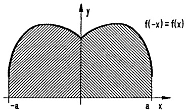

text_image

f(-x) = f(x)
-a	a	x
y

Abb. 104a - Gerade Symmetrie

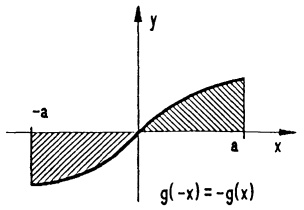

text_image

-a
g(-x) = -g(x)
a x
y

Abb. 104b - Ungerade Symmetrie

was man sofort aufgrund der geometrischen Deutung ( $\rightarrow$  1.2) einsieht, aber auch mittels der Substitution x = -t, dx = -dt leicht bestätigen kann.

## Beispiele.

$$
\int_ {- \pi / 2} ^ {\pi / 2} \cos x d x = 2 \int_ {0} ^ {\pi / 2} \cos x d x = 2; \quad \int_ {- 5} ^ {5} (\sinh x) d x = 0.
$$

## 2.5 Ausblicke. Man sagt,

„die Differentiation gehört zum Handwerk, die Integration zur Kunst“.

Die Ableitung einer Funktion, die sich aus den bisher behandelten „elementaren“ Funktionen zusammensetzt, kann man mit den bekannten Regeln direkt berechnen. Anders verhält es sich bei der Integration. Man kann zwar mit geschickten Ansätzen und zum Teil „trickreichen“ Substitutionen neben den Grundintegralen noch zahlreiche weitere Integrale berechnen ( $\rightarrow$  §3); doch sehr viele Integranden widersetzen sich allen Tricks, sie besitzen (nachweislich) keine aus den elementaren Funktionen zusammengesetzte Stammfunktion. In diesen Fällen liefert das Integral  $F(x) = \int_{a}^{x} f(t) dt$  neue, noch nicht erfaßte Funktionen. Dazu gehören etwa ( $\rightarrow$  §7 und Kap. 5, §5):

a) Der Integralsinus

$$
\mathrm{Si} x := \int_ {0} ^ {x} \frac {\sin t}{t} d t \quad (0 \leq x <   \infty) .
$$

Wegen  $\lim_{t\to0}\frac{\sin t}{t}=1$  ist der Integrand bei t=0 durch 1 zu ersetzen.

b) Die Fehlerfunktion

$$
\Phi (x) := \frac {2}{\sqrt {\pi}} \int_ {0} ^ {x} e ^ {- t ^ {2}} d t \quad (0 \leq x <   \infty).
$$