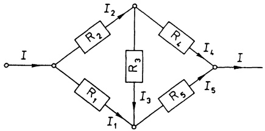
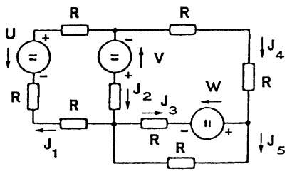
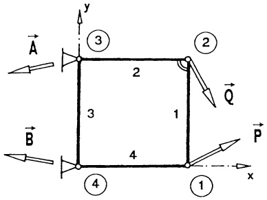
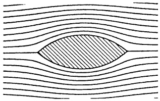
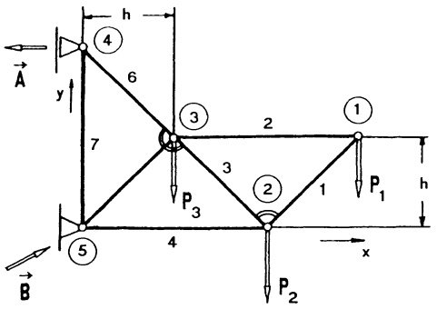
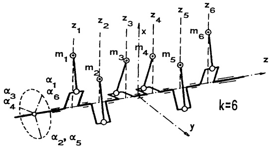
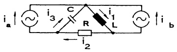
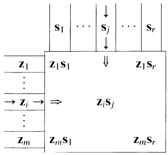
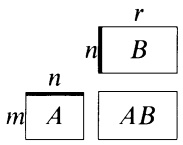

Beispiel. Von einem geradlinig, gleichförmig beschleunigten Massenpunkt (allgemeines Weg-Zeit-Gesetz $s(t) = bt^2 + vt + c$) kennt man dessen Lage $s(a)$, Geschwindigkeit $\dot{s}(a)$ und Beschleunigung $\ddot{s}(a)$ zur Zeit $t = a$. Der Punkt bewegt sich nach dem Weg-Zeit-Gesetz $s(t) = \frac{\ddot{s}(a)}{2}(t - a)^2 + \dot{s}(a)(t - a) + s(a)$. □

## 4.3 Methoden der Reihenentwicklung.

① Mit der Taylor-Formel (1) und dem Nachweis $R_n(x, a) \to 0$ ($\to$ Satz 4.4). Dieses Verfahren ist schwerfällig. Es ist oft günstiger, nach Ⓑ– Ⓔ zu verfahren.
B Bekannte Reihen differenzieren oder integrieren.

Beispiel. (vgl. auch 3.4, 3.5). Aus $\frac{1}{\sqrt{1 - x^2}} = 1 + \frac{1}{2} x^2 + \frac{1 \cdot 3}{2 \cdot 4} x^4 + \frac{1 \cdot 3 \cdot 5}{2 \cdot 4 \cdot 6} x^6 + \cdots$ (für $|x| < 1$) ($\rightarrow$ §3(8)) folgt durch Integration

$$
\arcsin x = x + \frac {1}{2 \cdot 3} x ^ {3} + \frac {1 \cdot 3}{2 \cdot 4 \cdot 5} x ^ {5} + \frac {1 \cdot 3 \cdot 5}{2 \cdot 4 \cdot 6 \cdot 7} x ^ {7} + \dots , \text {falls} | x | <   1.
$$


© Als Summe und/oder Produkt von Funktionen mit bekannter Reihenentwicklung darstellen.

## Beispiele.

1.  $\cosh x = \frac{1}{2}(e^{x} + e^{-x}) = \frac{1}{2}\left(1 + x + \frac{x^{2}}{2!} + \frac{x^{3}}{3!} + \cdots + 1 - x + \frac{x^{2}}{2!} - \frac{x^{3}}{3!} + \cdots\right).$

Dies ergibt - analog für $\sinh x = \frac{1}{2}(e^{x} - e^{-x})$:

$$
\cosh x = 1 + \frac {x ^ {2}}{2 !} + \frac {x ^ {4}}{4 !} + \frac {x ^ {6}}{6 !} + \dots , x \in \mathbb {R}.
$$

$$
\sinh x = x + \frac {x ^ {3}}{3 !} + \frac {x ^ {5}}{5 !} + \frac {x ^ {7}}{7 !} + \dots , x \in \mathbb {R}.
$$

2.  $\frac{\cos x}{1-x}=\cos x\cdot\frac{1}{1-x}=(1-\frac{x^{2}}{2!}+\frac{x^{4}}{4!}-+\cdots)(1+x+x^{2}+\cdots)$

$$
= 1 + x + (1 - \frac {1}{2 !}) x ^ {2} + (1 - \frac {1}{2 !}) x ^ {3} + (1 - \frac {1}{2 !} + \frac {1}{4 !}) x ^ {4} + \dots , | x | <   1.
$$

3. $e^{-x}\sin x + \frac{1}{\sqrt{1 + x}} = \left(\sum_{k = 0}^{\infty}\frac{(-x)^k}{k!}\right)\left(\sum_{k = 0}^{\infty}(-1)^k\frac{x^{2k + 1}}{(2k + 1)!}\right) + \sum_{k = 0}^{\infty}\binom{-\frac{1}{2}}{k}x^k$

$$
= (1 - x + \frac {x ^ {2}}{2} - \frac {x ^ {3}}{3 !} + \dots) (x - \frac {x ^ {3}}{3 !} + \dots) + 1 - \frac {1}{2} x + \frac {3}{8} x ^ {2} - \frac {5}{1 6} x ^ {3} + \dots
$$

$$
= 1 + \frac {1}{2} x - \frac {5}{8} x ^ {2} + \frac {1}{4 8} x ^ {3} + \dots , \quad | x | <   1.
$$


(D) Unbestimmter Ansatz.

Beispiel.

$$
f (x) := \left\{ \begin{array}{c l} \frac {x}{e ^ {x} - 1} & , \text {falls} x \neq 0 \\ 1 & , \text {falls} x = 0 \end{array} \right..
$$

Man setzt an  $\frac{x}{e^{x}-1}=\sum_{k=0}^{\infty}\frac{B_{k}}{k!}x^{k}$  und erhält aus

$$
\begin{array}{l} x = (B _ {0} + \frac {B _ {1}}{1 !} x + \frac {B _ {2}}{2 !} x ^ {2} + \frac {B _ {3}}{3 !} x ^ {3} + \dots) (x + \frac {x ^ {2}}{2 !} + \frac {x ^ {3}}{3 !} + \dots) \\ = B _ {0} x + (B _ {1} + \frac {B _ {0}}{2 !}) x ^ {2} + (\frac {B _ {2}}{2 !} + \frac {B _ {1}}{2 !} + \frac {B _ {0}}{3 !}) x ^ {3} + \dots \\ \end{array}
$$

durch Koeffizientenvergleich

$$
B _ {0} = 1, B _ {1} + \frac {B _ {0}}{2} = 0, \frac {B _ {2}}{2 !} + \frac {B _ {1}}{2 !} + \frac {B _ {0}}{3 !} = 0, \dots .
$$

Man berechnet damit $B_0 = 1$, $B_1 = -\frac{1}{2}$, $B_2 = \frac{1}{6}$, $B_3 = 0$, $B_4 = -\frac{1}{30}, \ldots$. Es bleibt, den Konvergenzradius $R$ der so bestimmten Reihe

$$
1 - \frac {1}{2 \cdot 1 !} x + \frac {1}{6 \cdot 2 !} x ^ {2} - \frac {1}{3 0 \cdot 4 !} x ^ {4} + \dots
$$

zu ermitteln. Das ist gar nicht so einfach. In Band 2 zeigen wir $R = 2\pi$. Übrigens, die $B_{k}$ heißen Bernoulli-Zahlen (nach J. BERNOULLI, 1654–1705). $\square$

⑤ Potenzreihen in Potenzreihen einsetzen.

Es wird eine Potenzreihenentwicklung der Funktion $h(x) := f(g(x))$ bestimmt, für den Fall, daß $f(x) = \sum_{k=0}^{\infty} a_k x^k \quad (|x| < R_1)$, $g(x) = \sum_{n=0}^{\infty} b_n x^n \quad (|x| < R_2)$ bekannt sind. Man kann zeigen:

Werden die Potenzen $g(x)^k = \left( \sum_{n=0}^{\infty} b_n x^n \right)^k$ nach dem Cauchy-Produkt berechnet (→ Satz 1.10),

$$
g (x) ^ {k} = \sum_ {n = 0} ^ {\infty} b _ {k n} x ^ {n},
$$

dann

$$
f (g (x)) = \sum_ {k = 0} ^ {\infty} a _ {k} \left(\sum_ {n = 0} ^ {\infty} b _ {k n} x ^ {n}\right)
$$

nach steigenden x-Potenzen geordnet, so erhält man die in einer Umgebung von 0 konvergierende Potenzreihenentwicklung von  $h(x)$ :

$$
h (x) = f (g (x)) = \sum_ {n = 0} ^ {\infty} \left(\sum_ {k = 0} ^ {\infty} a _ {k} b _ {k n}\right) x ^ {n}.
$$

Beispiel. $f(x) = e^{x}$, $g(x) = e^{x}$, $h(x) = f(g(x)) = e^{e^{x}}$. Aus $f(x) = \sum_{k=0}^{\infty} \frac{x^{k}}{k!}$ und

$$
g (x) ^ {k} = (e ^ {x}) ^ {k} = e ^ {k x} = \sum_ {n = 0} ^ {\infty} \frac {k ^ {n} x ^ {n}}{n !} \text { folgt }
$$

$$
\begin{array}{l} h (x) = \sum_ {k = 0} ^ {\infty} \frac {1}{k !} \left(\sum_ {n = 0} ^ {\infty} \frac {k ^ {n} x ^ {n}}{n !}\right) = \sum_ {n = 0} ^ {\infty} \left(\sum_ {k = 0} ^ {\infty} \frac {k ^ {n}}{k !}\right) \frac {x ^ {n}}{n !} \\ = e + e x + \left(\sum_ {k = 0} ^ {\infty} \frac {k ^ {2}}{k !}\right) \frac {x ^ {2}}{2 !} + \left(\sum_ {k = 0} ^ {\infty} \frac {k ^ {3}}{k !}\right) \frac {x ^ {3}}{3 !} + \dots . \\ \end{array}
$$

Bemerkungen. 1. Unabhängig von der allgemeinen Theorie kann man die Konvergenz der Reihen $\sum_{k=0}^{\infty} \frac{k^n}{k!}$ leicht mit dem Quotientenkriterium nachweisen.

2. Der Eindeutigkeitssatz (→ Satz 3.4) zeigt

$$
h ^ {(n)} (0) = \sum_ {k = 0} ^ {\infty} \frac {k ^ {n}}{k !} \qquad (n = 0, 1, 2, \dots),
$$

speziell

$$
\sum_ {k = 0} ^ {\infty} \frac {k ^ {2}}{k !} = 2 e, \sum_ {k = 0} ^ {\infty} \frac {k ^ {3}}{k !} = 5 e, \sum_ {k = 0} ^ {\infty} \frac {k ^ {4}}{k !} = 1 5 e.
$$

## Aufgaben

1. Man entwickle das Polynom $x^4 - 5x^3 + 5x^2 + x + 2$ nach Potenzen von $(x - 2)$.

2. Man gebe die Taylor-Reihe im Entwicklungspunkt $a = 0$:

a)  $\sqrt[3]{1+x}$ ;
b) $\ln (1 - x + x^2)$;
c)  $\ln\frac{a+x}{a-x}$ ;
d) $\frac{1}{1 - x} \cdot \ln \left(\frac{1}{1 - x}\right)$.

3. a) Man bestimme die Taylor-Reihe um $a = 0$ für $f(x) = \frac{1}{1 - x}$ und gebe die Darstellung des allgemeinen Restgliedes in der Lagrangeschen Form.
b) Welche Darstllung liefert die Summenformel der geometrischen Reihe?

4. Aus der Binomialreihe leite man mittels Differentiation die Taylor-Reihe von arsinh x um a = 0 her.

5. Algorithmus zur Berechnung von sin x für einen 8-stelligen Digitalrechner

a) Bestimme ein $y$ mit $-\frac{\pi}{2} \leq y < \frac{3\pi}{2}$, so daß $\sin y = \sin x$.
b) Bestimme $z$ mit $-\frac{\pi}{2} \leq z \leq \frac{\pi}{2}$, so daß $\sin z = \sin y$.
c) Setze $u = \frac{z}{3}$, $-\frac{\pi}{6} \leq u \leq \frac{\pi}{6}$, und stelle $\sin z$ durch $\sin u$ dar.

d) In $-\frac{\pi}{6} \leq u \leq \frac{\pi}{6}$ stelle man $\sin u$ auf 7 Nach-Komma-Stellen dar durch das passende Taylor-Polynom.

Wie viele Glieder der Taylor-Reihe sind zu berücksichtigen?

6. Man bestimme die ersten fünf Glieder der Taylor-Reihe um $a = 0$ von

a) $g(x) = (1 + \sin x)^x$.

b) $h(x) = \ln \cosh x$.

7. Durch den Ansatz

$$
\frac {1}{\cos x} = E _ {0} - \frac {E _ {2}}{2 !} x ^ {2} + \frac {E _ {4}}{4 !} x ^ {4} - + \dots + \frac {(- 1) ^ {n} E _ {2 n}}{(2 n) !} x ^ {2 n} + \dots , \quad | x | <   \frac {\pi}{2},
$$

sind die Euler-Zahlen  $E_{2n}$  erklärt. Man bestätige die Rekursionsformel

$$
\frac {E _ {2 n}}{0 ! (2 n) !} + \frac {E _ {2 n - 2}}{2 ! (2 n - 2) !} + \dots + \frac {E _ {0}}{(2 n) ! 0 !} = 0
$$

und berechne damit  $E_{0}, E_{2}, \ldots, E_{10}$ .

8. Man entwickel nach Potenzen von x und bestimmte den Konvergenzbereich:

a) $f(x) = \frac{1}{x^3 + 3}$;

b) $g(x) = \sqrt[3]{2 + x^2}$.

9. Gegeben ist die Funktion $y(x) = \frac{(1 + x)^2}{\sqrt{1 - x^3}}$, $-1 \leq x < 1$.

a) Bestimme die Taylor-Polynome 1., 2. und 3. Grades im Punkte $a = 0$ und skizziere sie zusammen mit $y(x)$.
b) Mit Hilfe des Restgliedes in Lagrange-Form gebe man eine Schranke für den relativen Fehler, wenn man  $y(x)$  für  $|x| \leq 0.5$  durch das Taylor-Polynom 2. Grades um a = 0 ersetzt.

10. Man bestätige, daß

$$
\sin (\mu \arcsin x) = \frac {\mu}{1} x - \frac {\mu (\mu^ {2} - 1)}{3 !} x ^ {3} + \frac {\mu (\mu^ {2} - 1) (\mu^ {2} - 3 ^ {2})}{5 !} x ^ {5} \pm \dots , \quad | x | <   1.
$$

## §5. Anwendungen (an Beispielen)

## 5.1 Grenzwertberechnungen.

$$
\frac {x \ln (1 - x)}{\sin^ {2} x} = \frac {x (- x - \frac {x ^ {2}}{2} - \frac {x ^ {3}}{3} - \cdots)}{(x - \frac {x ^ {3}}{3 !} + \cdots) (x - \frac {x ^ {3}}{3 !} + \cdots)} \quad (\text {fur} | x | <   1, \rightarrow \S 3 (5))
$$

Man kann  $x^{2}$  ( $x \neq 0$ ) kürzen und erhält  $\lim_{x \to 0} \frac{x \ln(1 - x)}{\sin^{2} x} = -1$ .

Bemerkung. Diese Methode hat gegenüber der L'Hospital-Regel den Vorteil, daß man keine Ableitungen berechnen muß (sie können gelegentlich recht kompliziert werden) und daß man einen guten Einblick in das Konvergenzverhalten bekommt.

## 5.2 Näherungsformeln (Approximation).

Beispiel 1. Nach A. EINSTEIN beträgt die Energie eines „relativistischen“ Teilchens der Masse  $m = \frac{m_{0}}{\sqrt{1 - (\frac{v}{c})^{2}}}$  ( $m_{0}$  Ruhemasse, v Geschwindigkeit,

c Lichtgeschwindigkeit)  $E = mc^{2}$ . Die kinetische Energie ist definiert als  $E_{kin} := mc^{2} - m_{0}c^{2}$ . Aus

$$
\frac {1}{\sqrt {1 - x ^ {2}}} = 1 + \frac {1}{2} x ^ {2} + \frac {3}{8} x ^ {4} + \frac {5}{1 6} x ^ {6} + \dots \quad (\text {falls} | x | <   1, \rightarrow \S 3 (8))
$$

ergibt sich (mit  $x = \frac{v}{c}$ ) die Näherungsformel

$$
E _ {k i n} = \frac {1}{2} m _ {0} v ^ {2} + \frac {3}{8} m _ {0} v ^ {2} (\frac {v}{c}) ^ {2} \quad (+ \text {Terme   höherer   Ordnung}).
$$

Beispiel 2. Für den Fall mit Luftwiderstand gilt das Weg-Zeit-Gesetz

$$
s (t) = \frac {v _ {0} ^ {2}}{g} \ln \cosh \frac {g t}{v _ {0}}
$$

mit der Grenzgeschwindigkeit  $v_{0}=\lim_{t\to\infty}v(t)$ .

Aus

$$
\ln \cosh x = \frac {x ^ {2}}{2 !} - \frac {2 x ^ {4}}{4 !} + \dots \quad (\rightarrow \text {Aufgabe 6, §4})
$$

ergibt sich die Näherungsformel für kleine Werte von t

$$
s (t) \approx \frac {v _ {0} ^ {2}}{g} \left(\frac {g ^ {2} t ^ {2}}{2 v _ {0} ^ {2}} - \frac {g ^ {4} t ^ {4}}{1 2 v _ {0} ^ {4}}\right).
$$

## 5.3 Die Reihendarstellung und Berechnung einer Integralfunktion mit nicht elementar integrierbarem Integranden.

Beispiel 1. Eine Entwicklung der Fehlerfunktion (→ Kap. 8, 4.5)

$$
\Phi (x) = \int_ {0} ^ {x} e ^ {- t ^ {2}} d t
$$

ergibt sich aus der gliedweisen Integration der Reihe $e^{-t^2} = \sum_{k=0}^{\infty} (-1)^k \frac{t^{2k}}{k!}$ ($t \in \mathbb{R}$):

$$
\Phi (x) = \int_ {0} ^ {x} e ^ {- t ^ {2}} d t = \sum_ {k = 0} ^ {\infty} (- 1) ^ {k} \frac {x ^ {2 k + 1}}{k ! (2 k + 1)}, x \in \mathbb {R}. \tag {1}
$$

Diese Reihendarstellung gestattet die Berechnung der Funktionswerte bis zu jeder gewünschten Genauigkeit, wobei man aber bei der Approximation des Funktionswertes durch die n-te Partialsumme n umso größer wählen muß, je weiter sich x vom Nullpunkt entfernt.

Beispiel 2. Zur Berechnung des elliptischen Integrals

$$
F (\varphi , k) = \int_ {0} ^ {\varphi} \frac {d t}{\sqrt {1 - k ^ {2} \sin^ {2} t}} \quad (0 \leq k ^ {2} <   1)
$$

wird zuerst der Integrand als Reihe dargestellt, dann gliedweise integriert. Mit $x = -k^{2}\sin^{2}t$ ergibt sich aus §3(8)

$$
\frac {1}{\sqrt {1 - k ^ {2} \sin^ {2} t}} = 1 + \frac {1}{2} k ^ {2} \sin^ {2} t + \frac {1 \cdot 3}{2 \cdot 4} k ^ {4} \sin^ {4} t + \frac {1 \cdot 3 \cdot 5}{2 \cdot 4 \cdot 6} k ^ {6} \sin^ {6} t + \dots
$$

$$
F (\varphi , k) = \varphi + \frac {1}{2} k ^ {2} \int_ {0} ^ {\varphi} \sin^ {2} t d t + \frac {1 \cdot 3}{2 \cdot 4} k ^ {4} \int_ {0} ^ {\varphi} \sin^ {4} t d t + \dots .
$$

Speziell für  $\varphi=\frac{\pi}{2}$  erhält man für das vollständige elliptische Integral  $K(k):=F(\frac{\pi}{2},k)$  die Reihe

$$
K (k) = \frac {\pi}{2} \left[ 1 + \left(\frac {1}{2}\right) ^ {2} k ^ {2} + \left(\frac {1 \cdot 3}{2 \cdot 4}\right) ^ {2} k ^ {4} + \left(\frac {1 \cdot 3 \cdot 5}{2 \cdot 4 \cdot 6}\right) ^ {2} k ^ {6} + \dots \right], | k | <   1. \tag {2}
$$

Ebenso verfährt man zur Berechnung des Integralsinus Si  $x = \int_{0}^{x} \frac{\sin t}{t} dt$ , der FRESNEL-Integrale  $\int_{0}^{x} \cos(t^{2}) dt$ ,  $\int_{0}^{x} \sin(t^{2}) dt$  (die in der Optik eine Rolle spielen) und anderer, nicht elementar integrierbarer Funktionen ( $\rightarrow$  Aufg. 4). ☐

## 5.4 Potenzreihenansatz zur Lösung einfacher Differentialgleichungen.

Beispiel. Wir suchen die Auslenkung  $s = s(t)$  aus der Nullage eines Schwingers, der die Bewegungsgleichung

$$
\ddot {s} (t) + t ^ {2} s (t) = 0
$$

erfüllt, der zur Zeit $t = 0$ durch $s = 0$ geht und dort die Geschwindigkeit $v_0$ hat (o.E. $v_0 = 1$),

$$
s (0) = 0, \dot {s} (0) = 1.
$$

Deutung dieser Bewegungsgleichung: Die rücktreibende Kraft ist zu jedem Zeitpunkt proportional zur Auslenkung. Aber der Proportionalitätsfaktor ist nicht konstant (wie beim Hookeschen Gesetz) sondern hat die Form  $mt^{2}$ . Insgesamt nimmt die rücktreibende Kraft mit t (zum Quadrat) zu und mit kleiner werdender Auslenkung ab. Mit dem Ansatz

$$
s (t) = \sum_ {k = 1} ^ {\infty} a _ {k} t ^ {k} = a _ {1} t + a _ {2} t ^ {2} + a _ {3} t ^ {3} + \dots \quad (\text {beachte} s (0) = 0)
$$

erhält man aus

$$
\begin{array}{l} \ddot {s} + t ^ {2} s = 2 a _ {2} + 2 \cdot 3 a _ {3} t + 3 \cdot 4 a _ {4} t ^ {2} + \dots + (n + 1) (n + 2) a _ {n + 2} t ^ {n} + \dots \\ + a _ {1} t ^ {3} + a _ {2} t ^ {4} + \dots + a _ {n - 2} t ^ {n} + \dots = 0 \\ \end{array}
$$

durch Koeffizientenvergleich

$2a_{2}=0,2\cdot3a_{3}=0,3\cdot4a_{4}=0,4\cdot5a_{5}+a_{1}=0,\ldots;$ allgemein

$$
(n + 1) (n + 2) a _ {n + 2} + a _ {n - 2} = 0.
$$

Wegen  $a_{1} = \dot{s}(0) = 1$ ,  $a_{2} = a_{3} = a_{4} = 0$  folgt damit

$$
a _ {1} = 1
$$

$$
a _ {5} = - \frac {1}{5 \cdot 4}
$$

$$
a _ {9} = \frac {1}{9 \cdot 8 \cdot 5 \cdot 4}
$$

$$
a _ {1 3} = - \frac {1}{1 3 \cdot 1 2 \cdot 9 \cdot 8 \cdot 5 \cdot 4}, \text { etc. }
$$

$$
s (t) = t - \frac {1}{4 \cdot 5} t ^ {5} + \frac {1}{4 \cdot 5 \cdot 8 \cdot 9} t ^ {9} - \frac {1}{4 \cdot 5 \cdot 8 \cdot 9 \cdot 1 2 \cdot 1 3} t ^ {1 3} + \dots
$$

Bei der Berechnung der Werte  $s(t)$  müssen mit wachsendem t immer mehr Reihenglieder berücksichtigt werden.


<details>
<summary>line</summary>

| t | s |
| --- | --- |
| 0 | 0 |
| ~0.25 | ~0.8 |
| ~0.5 | ~-0.8 |
| ~0.75 | ~0.6 |
| ~1.0 | ~-0.6 |
| ~1.25 | ~0.4 |
| ~1.5 | ~-0.4 |
| ~1.75 | ~0.3 |
| ~2.0 | ~-0.3 |
| ~2.25 | ~0.2 |
| ~2.5 | ~-0.2 |
| ~2.75 | ~0.1 |
| ~3.0 | ~-0.1 |
</details>

Abb. 136 - Nichtlineare Schwingung


## Aufgaben

1. Mit den Taylor-Reihen berechne man die Grenzwerte

a) $\lim_{x\to 0}\left(\frac{1}{\sin x} -\frac{1}{e^x - 1}\right),$

b) $\lim_{x\to 0}\frac{1 - \cos 2x}{x\sin x},$

c) $\lim_{x\to 1}(1 - x)\tan \frac{\pi}{2} x,$

d) $\lim_{n\to \infty}\sin (2\pi \cdot e\cdot n!$,

e) $\lim_{n\to \infty}n\cdot \sin (2\pi \cdot e\cdot n!)$

2. Das Potential eines Dipols ist bestimmt als Grenzwert  $h \rightarrow 0$  zweier Punktladungen mit entgegengesetzt gleich großer Ladung q im Abstand 2h

$$
V (x, y, z) = \lim _ {h \to 0} \left(\frac {q}{\sqrt {(x - h) ^ {2} + y ^ {2} + z ^ {2}}} - \frac {q}{\sqrt {(x + h) ^ {2} + y ^ {2} + z ^ {2}}}\right) \cdot \frac {1}{2 h}.
$$

Man berechne V über die Taylor-Reihen.

3. Für die Oberfläche eines Drehellipsoids mit den Halbachsen $a$ und $b = a\sqrt{1 + \epsilon^2}$ gilt ($\rightarrow$ Aufg. 3, Kap. 8, §4)

$$
0 = 2 a ^ {2} \pi \left(1 + (\frac {1}{\epsilon} + \epsilon) \arctan \epsilon\right).
$$

Man gebe damit eine Näherungsformel für  $\epsilon > 0$  in Form einer Reihenentwicklung nach  $\epsilon$  (Anwendung in der Vermessungskunde: Oberfläche des Geoids).

4. a) Man gebe die Taylor-Reihe um $a = 0$ samt Konvergenzbereich für die Funktionen

$$
\mathrm{Si} (x) = \int_ {0} ^ {x} \frac {\sin t}{t} d t
$$

(Integralsinus)


<details>
<summary>line</summary>

| X | Y |
| --- | --- |
| 0 | 0 |
| \(\pi\) | \(\pi/2\) |
| \(2\pi\) | \(\pi/2\) |
</details>

und

$$
J _ {0} (x) = \frac {1}{\pi} \int_ {0} ^ {\pi} \cos (x \sin \theta) d \theta
$$

(Besselfunktion)

(Mittelwert einer frequenzmodulierten Schwingung in Abhängigkeit des Frequenzhubes x ).


<details>
<summary>line</summary>

| X | Y |
| --- | --- |
| 0 | 1 |
| ~10 | ~0.25 |
| ~20 | ~0.15 |
| ~30 | ~0.12 |
| ~40 | ~0.1 |
| ~50 | ~0.09 |
| ~60 | ~0.08 |
| ~70 | ~0.07 |
| ~80 | ~0.06 |
| ~90 | ~0.05 |
| ~100 | ~0.04 |
</details>

b) Wieviele Summanden sind nötig, um Si(π) bzw. $J_0(1)$ auf fünf Dezimalstellen nach dem Komma genau zu bestimmen? Berechne damit Si(π) und $J_0(1)$ in dieser Genauigkeit.

c) Man bestätige:  $J_{0}(x)$  genügt der gewöhnlichen Differentialgleichung

$$
x ^ {2} y ^ {\prime \prime} + x y ^ {\prime} + x ^ {2} y = 0.
$$

5. In der räumlichen Potentialtheorie tritt die Entwicklung

$$
\frac {1}{\sqrt {1 - 2 x z + z ^ {2}}} = \sum_ {n = 0} ^ {\infty} P _ {n} (x) z ^ {n}
$$

auf. Man bestimme die Faktoren $P_{0}$, $P_{1}$, $P_{2}$ und vergleiche mit den LEGENDRE-Polynomen ($\rightarrow$ Aufg. 11, Kap. 2, §2).

6. Für die Schwingungsdauer des mathematischen Pendels hat man (→ Aufg. 1, Kap. 4, §7) eine zweite Darstellung

$$
T = 4 \sqrt {\frac {l}{g}} \int_ {0} ^ {x} \frac {d \varphi}{\sqrt {2 (\cos \varphi - \cos \alpha)}}
$$

wobei  $\alpha$  den maximalen Auslenkungswinkel bezeichnet. Man entwickel den Integranden nach Potenzen von  $\cos\varphi$ , führe die Integration nach  $\varphi$  durch und gebe eine Reihenapproximation für T als Funktion von  $\alpha$ .

7. Ein $L = 200 \, \text{m}$ langes Stück einer Eisenbahnschiene soll ausgewechselt werden. Das Ersatzteil ist um $2 \, \text{cm}$ zu lang. Auf welche maximale Höhe $h$ knickt das ungekürzte Stück beim Einbau aus, und welche Gegenkraft $F$ entsteht an den Stoßstellen?

Die exakte Theorie der Knicklinie liefert für $L,\ell,h,\alpha,F$ (vgl. Skizze) die vier Gleichungen

$$
\frac {L k}{h} = K (k) = \int_ {0} ^ {\pi / 2} \frac {d \psi}{\sqrt {1 - k ^ {2} \sin^ {2} \psi}};
$$

$$
\frac {\ell k}{h} = K _ {1} (k) = \int_ {0} ^ {\pi / 2} \frac {1 - 2 k ^ {2} \sin^ {2} \psi}{\sqrt {1 - k ^ {2} \sin^ {2} \psi}} d \psi ;
$$


<details>
<summary>text_image</summary>

F
α
L
h
ℓ
F
</details>

$$
F = \left(\frac {2 k}{h}\right) ^ {2} E J \quad (E J = B i e g e s t e i f i g k e i t); \quad k = \sin \frac {\alpha}{2}.
$$

a) Man verwende für $K(k)$ die Entwicklung (2) und entwickel $K_1(k)$ analog nach $k$. Wie groß ist für $0 \leq k \leq 0.02$ der Fehler höchstens, wenn man die Reihen jeweils nach $k^4$ abbricht (Grobe Restgliedabschätzung!). Diese Polynomapproximationen seien $\overline{K}(k)$ und $\overline{K}_1(k)$.
b) Man löse $L \cdot \overline{K}_1(k) = \ell \cdot \overline{K}(k)$ nach $k$ auf und berechne $h$ und $F$ aus $k, \ell$ und $L$ für $EJ = 3 \cdot 10^5 \mathrm{Nm}^2$.

8. Man bestimme mittels Potenzreihenansatz $y(x) = \sum_{n=0}^{\infty} a_n x^n$ und Koeffizientenvergleich eine zweiparametrige Schar von Lösungen der linearen Differentialgleichung

$$
(x ^ {2} - 1) y ^ {\prime \prime} (x) = 6 y (x) .
$$

Für welche Werte von  $y(0)$  und  $y'(0)$  ist  $y(x)$  ein Polynom?

9. a) Mit der geometrischen Reihe bestätige man die Reihenentwicklungen

$$
F _ {1} (x) := \frac {1}{x} \int_ {0} ^ {x} \frac {d \xi}{1 - \xi} = \sum_ {k = 0} ^ {\infty} \frac {x ^ {k}}{k + 1}, 0 <   x <   1
$$

$$
F _ {n + 1} (x) := \frac {1}{x} \int_ {0} ^ {x} F _ {n} (\xi) d \xi = \sum_ {k = 0} ^ {\infty} \frac {x ^ {k}}{(k + 1) ^ {n + 1}}, \quad 0 <   x <   1, \quad n = 1, 2, \dots .
$$

b) Mittels wiederholter partieller Integration berechne man explizit $F_{1}(x),\ldots F_{4}(x)$ und leite für die folgenden an beiden Grenzen uneigentlichen Integrale ab:

$$
\int_ {0} ^ {1} \frac {\ln x}{x - 1} d x = \lim _ {x \to 1} F _ {2} (x) = \sum_ {k = 1} ^ {\infty} \frac {1}{k ^ {2}} = \frac {\pi^ {2}}{6} \quad (\rightarrow \mathrm{Kap.~2,~5.3}),
$$

$$
\int_ {0} ^ {1} \frac {\ln^ {3} x}{x - 1} d x = 3! \lim _ {x \to 1} F _ {4} (x) = 3! \sum_ {k = 1} ^ {\infty} \frac {1}{k ^ {4}} = \frac {\pi^ {4}}{1 5} \quad (\rightarrow \text {Kap.} 1 1, 3. 1).
$$

c) Man leite mittels geeigneter Substitution hieraus die Werte ab:

$$
\int_ {0} ^ {\infty} \frac {x}{e ^ {x} - 1} d x = \frac {\pi^ {2}}{6}, \quad \int_ {0} ^ {\infty} \frac {x ^ {3}}{e ^ {x} - 1} d x = \frac {\pi^ {4}}{1 5} \quad (\rightarrow \text {Kap.} 4, 4. 3).
$$

## Kapitel 6

## Lineare Algebra

Zur sachgerechten mathematischen Behandlung zahlloser Probleme der Technik, etwa zur Netzwerkberechnung in der Elektrotechnik oder zur Berechnung von Fachwerken in der Statik, zur Lösung (Optimierung) von Transportproblemen, zur qualitativen und quantitativen Diskussion mechanischer dynamischer Systeme (Differentialgleichungssysteme) bedient man sich der Matrizenrechnung. Eine zeitgemäße Darstellung dieses Kalküls erfordert einige Begriffe aus der Theorie „abstrakter“ Vektorräume, ohne die auch die höhere Ingenieurmathematik heute nicht mehr auskommt. Die Grundlagen sollen aber weitgehend recht „konkret“ dargestellt werden. Im Vordergrund steht die Anwendung von Matrizen bei linearen Gleichungssystemen, linearen Abbildungen, Koordinatentransformationen und quadratischen Funktionen.

## §1. Lineare Gleichungssysteme und Matrizen

1.1 Was ist eine Matrix? Eine Matrix vom Typ  $m \times n$  (oder eine  $m \times n$ -Matrix) ist ein rechteckiges Zahlenschema der Form

$$
A = \left( \begin{array}{c c c c} \alpha_ {1 1} & \alpha_ {1 2} & \dots & \alpha_ {1 n} \\ \alpha_ {2 1} & \alpha_ {2 2} & \dots & \alpha_ {2 n} \\ \vdots & \ddots & & \vdots \\ \alpha_ {m 1} & \alpha_ {m 2} & \dots & \alpha_ {m n} \end{array} \right). \tag {1}
$$

Die Zahlen $\alpha_{ij} \in \mathbb{R}$ heißen Komponenten (oder Elemente) der Matrix $A$. Wir schreiben abkürzend

$$
A = (\alpha_ {i j}) _ {m \times n} \tag {2}
$$

oder nur $A = (\alpha_{ij})$, wenn der Typ feststeht.

Die  $m \times 1$ -Matrizen (bzw.  $1 \times n$ -Matrizen) heißen Spaltenmatrizen oder Spaltenvektoren (bzw. Zeilenmatrizen oder Zeilenvektoren), sie haben die Form

$$
\mathbf {s} = \left( \begin{array}{c} \alpha_ {1} \\ \alpha_ {2} \\ \vdots \\ \alpha_ {m} \end{array} \right), \quad \text {bzw.} \mathbf {z} = (\alpha_ {1}, \alpha_ {2}, \dots , \alpha_ {n}).
$$

(Bei nur einer Zeile oder Spalte benötigt man i.a. keinen zusätzlichen Zeilenindex oder Spaltenindex.) Die Matrix  $A = (\alpha_{ij})_{m \times n}$  besteht aus m Zeilenvektoren (mit je n Komponenten)

$$
\mathbf {z} _ {i} := (\alpha_ {i 1}, \alpha_ {i 2}, \dots , \alpha_ {i n}) \quad (1 \leq i \leq m)
$$

bzw. aus n Spaltenvektoren (mit je m Komponenten)

$$
\mathbf {s} _ {j} := \left( \begin{array}{c} \alpha_ {1 j} \\ \alpha_ {2 j} \\ \vdots \\ \alpha_ {m j} \end{array} \right) \qquad (1 \leq j \leq n).
$$

Je nachdem, ob wir die Zeilen oder die Spalten von A hervorheben wollen, schreiben wir

$$
A = \left( \begin{array}{c} \mathbf {z} _ {1} \\ \mathbf {z} _ {2} \\ \vdots \\ \mathbf {z} _ {m} \end{array} \right) (\text {Zeilendarstellung}), \text {bzw.} A = (\mathbf {s} _ {1}, \mathbf {s} _ {2}, \dots , \mathbf {s} _ {n}) (\text {Spaltendarstellung}).
$$

Die  $(i,j)$ -Komponente  $\alpha_{ij}$  gehört dem i-ten Zeilenvektor  $z_{i}$  und dem j-ten Spaltenvektor  $s_{j}$  an. Man sagt,  $\alpha_{ij}$  steht im Schnittpunkt der i-ten Zeile mit der j-ten Spalte (i Zeilenindex, j Spaltenindex). Man kann zur Verdeutlichung die Komponenten einer Matrix durch Kommata trennen, man muß es aber nicht.

Zwei Matrizen $A = (\alpha_{ij})$, $B = (\beta_{ij})$ heißen gleich, i.Z. $A = B$, wenn sie vom gleichen Typ $m \times n$ sind und wenn außerdem $\alpha_{ij} = \beta_{ij}$ gilt für alle $i,j$ mit $1 \leq i \leq m$, $1 \leq j \leq n$.

Beispiel. Die Matrix $A = \begin{pmatrix} 1 & 3 & 5 \\ 2 & 0 & 4 \end{pmatrix}$ ist vom Typ $2 \times 3$, sie hat die Zeilenvektoren $\mathbf{z}_1 = (1,3,5)$, $\mathbf{z}_2 = (2,0,4)$ und die Spaltenvektoren $\mathbf{s}_1 = \begin{pmatrix} 1 \\ 2 \end{pmatrix}$, $\mathbf{s}_2 = \begin{pmatrix} 3 \\ 0 \end{pmatrix}$, $\mathbf{s}_3 = \begin{pmatrix} 5 \\ 4 \end{pmatrix}$. Es gilt $A = \begin{pmatrix} x & x & f \\ y & u & v \end{pmatrix}$ genau dann, wenn $x = 1$, $y = 2$, $x = 3$, $u = 0$, $f = 5$, $v = 4$ (Komponentenvergleich). Man beachte ferner $A \neq \begin{pmatrix} 1 & 3 & 5 & 0 \\ 2 & 0 & 4 & 0 \end{pmatrix}$.

Die Menge aller  $m \times n$ -Matrizen mit Komponenten aus R bezeichnen wir mit  $R^{m \times n}$ , ferner  $R^{n} := R^{n \times 1}$  (Spaltenvektoren),  $R_{n} := R^{1 \times n}$  (Zeilenvektoren).

1.2 Addition, Subtraktion und Multiplikation mit einem Zahlenfaktor. Für $A = (\alpha_{ij})$, $B = (\beta_{ij})$ aus $\mathbb{R}^{m \times n}$ und jede Zahl $\lambda \in \mathbb{R}$ sind die Summe

$A + B$  und das λ-fache λA komponentenweise definiert:

$$
\left( \begin{array}{c c c c} \alpha_ {1 1} & \alpha_ {1 2} & \dots & \alpha_ {1 n} \\ \alpha_ {2 1} & \alpha_ {2 2} & \dots & \alpha_ {2 n} \\ \vdots & \vdots & & \vdots \\ \alpha_ {m 1} & \alpha_ {m 2} & \dots & \alpha_ {m n} \end{array} \right) + \left( \begin{array}{c c c c} \beta_ {1 1} & \beta_ {1 2} & \dots & \beta_ {1 n} \\ \beta_ {2 1} & \beta_ {2 2} & \dots & \beta_ {2 n} \\ \vdots & \vdots & & \vdots \\ \beta_ {m 1} & \beta_ {m 2} & \dots & \beta_ {m n} \end{array} \right)
$$

$$
\begin{array}{r l} & := \left( \begin{array}{c c c} \alpha_ {1 1} + \beta_ {1 1}, & \alpha_ {1 2} + \beta_ {1 2}, & \dots , \alpha_ {1 n} + \beta_ {1 n} \\ \alpha_ {2 1} + \beta_ {2 1}, & \alpha_ {2 2} + \beta_ {2 2}, & \dots , \alpha_ {2 n} + \beta_ {2 n} \\ \vdots & \vdots & \vdots \\ \alpha_ {m 1} + \beta_ {m 1}, & \alpha_ {m 2} + \beta_ {m 2}, & \dots , \alpha_ {m n} + \beta_ {m n} \end{array} \right) \end{array} \tag {3}
$$

$$
\lambda \left( \begin{array}{c c c c} \alpha_ {1 1} & \alpha_ {1 2} & \dots & \alpha_ {1 n} \\ \alpha_ {2 1} & \alpha_ {2 2} & \dots & \alpha_ {2 n} \\ \vdots & \vdots & & \vdots \\ \alpha_ {m 1} & \alpha_ {m 2} & \dots & \alpha_ {m n} \end{array} \right) := \left( \begin{array}{c c c c} \lambda \alpha_ {1 1}, & \lambda \alpha_ {1 2}, & \dots , & \lambda \alpha_ {1 n} \\ \lambda \alpha_ {2 1}, & \lambda \alpha_ {2 2}, & \dots , & \lambda \alpha_ {2 n} \\ \vdots & \vdots & & \vdots \\ \lambda \alpha_ {m 1}, & \lambda \alpha_ {m 2}, & \dots , & \lambda \alpha_ {m n} \end{array} \right)
$$

Beispiel. $\left( \begin{array}{ccc}4 & 3 & 2\\ 1 & 0 & \alpha \end{array} \right) + \left( \begin{array}{ccc}6 & -3 & -1\\ 2 & \beta & \alpha \end{array} \right) = \left( \begin{array}{ccc}10 & 0 & 1\\ 3 & \beta & 2\alpha \end{array} \right)$

$$
0. 5 \left( \begin{array}{c c c} 4 & 3 & 2 \\ 1 & 0 & \alpha \end{array} \right) = \left( \begin{array}{c c c} 2 & \frac {3}{2} & 1 \\ \frac {1}{2} & 0 & \frac {\alpha}{2} \end{array} \right)  .
$$

Für die  $n \times 1$ -Matrizen (Spaltenvektoren) und die  $1 \times n$ -Matrizen (Zeilenvektoren) sehen diese Verknüpfungen wie folgt aus:

$$
\left( \begin{array}{c} \alpha_ {1} \\ \alpha_ {2} \\ \vdots \\ \alpha_ {n} \end{array} \right) + \left( \begin{array}{c} \beta_ {1} \\ \beta_ {2} \\ \vdots \\ \beta_ {n} \end{array} \right) = \left( \begin{array}{c} \alpha_ {1} + \beta_ {1} \\ \alpha_ {2} + \beta_ {2} \\ \vdots \\ \alpha_ {n} + \beta_ {n} \end{array} \right), \quad \lambda \left( \begin{array}{c} \alpha_ {1} \\ \alpha_ {2} \\ \vdots \\ \alpha_ {n} \end{array} \right) = \left( \begin{array}{c} \lambda \alpha_ {1} \\ \lambda \alpha_ {2} \\ \vdots \\ \lambda \alpha_ {n} \end{array} \right), \tag {4}
$$

$$
(\alpha_ {1}, \alpha_ {2}, \dots , \alpha_ {n}) + (\beta_ {1}, \beta_ {2}, \dots , \beta_ {n}) = (\alpha_ {1} + \beta_ {1}, \alpha_ {2} + \beta_ {2}, \dots , \alpha_ {n} + \beta_ {n})
$$

$$
\lambda (\alpha_ {1}, \alpha_ {2}, \dots , \alpha_ {n}) = (\lambda \alpha_ {1}, \lambda \alpha_ {2}, \dots , \lambda \alpha_ {n}).
$$

Aus

$$
\begin{array}{l} \mathbf {a} = \left( \begin{array}{c} \alpha_ {1} \\ \alpha_ {2} \\ \alpha_ {3} \\ \vdots \\ \alpha_ {n} \end{array} \right) = \left( \begin{array}{c} \alpha_ {1} \\ 0 \\ 0 \\ \vdots \\ 0 \end{array} \right) + \left( \begin{array}{c} 0 \\ \alpha_ {2} \\ 0 \\ \vdots \\ 0 \end{array} \right) + \dots + \left( \begin{array}{c} 0 \\ 0 \\ \vdots \\ 0 \\ \alpha_ {n} \end{array} \right) \\ = \alpha_ {1} \left( \begin{array}{c} 1 \\ 0 \\ 0 \\ \vdots \\ 0 \end{array} \right) + \alpha_ {2} \left( \begin{array}{c} 0 \\ 1 \\ 0 \\ \vdots \\ 0 \end{array} \right) + \dots + \alpha_ {n} \left( \begin{array}{c} 0 \\ 0 \\ \vdots \\ 0 \\ 1 \end{array} \right) \\ \end{array}
$$

sieht man, daß sich jeder Spaltenvektor $\mathbf{a} \in \mathbb{R}^{n}$ eindeutig darstellen läßt in der Form

$$
\mathbf {a} = \alpha_ {1} \mathbf {e} _ {1} + \dots + \alpha_ {n} \mathbf {e} _ {n}
$$

mit den Vektoren

$$
\mathbf {e} _ {1} := \left( \begin{array}{c} 1 \\ 0 \\ 0 \\ \vdots \\ 0 \end{array} \right), \quad \mathbf {e} _ {2} := \left( \begin{array}{c} 0 \\ 1 \\ 0 \\ \vdots \\ 0 \end{array} \right), \dots , \quad \mathbf {e} _ {n} := \left( \begin{array}{c} 0 \\ 0 \\ \vdots \\ 0 \\ 1 \end{array} \right).
$$

Das System  $(\mathbf{e}_{1},\ldots,\mathbf{e}_{n})$  der  $e_{i}\in R^{n}$  heißt natürliche Basis des  $R^{n}$ . Völlig analog hierzu wird das aus

$$
\mathbf {e} _ {1} ^ {\prime} := (1, 0, 0, \dots , 0), \quad \mathbf {e} _ {2} ^ {\prime} := (0, 1, 0, \dots , 0), \dots , \quad \mathbf {e} _ {n} ^ {\prime} := (0, \dots , 0, 1)
$$

bestehende System  $(\mathbf{e}_{1}^{\prime},\ldots,\mathbf{e}_{n}^{\prime})$  von Zeilenvektoren des  $R_{n}$  die natürliche Basis des  $R_{n}$  genannt.

(4) zeigt, daß die Matrizenaddition und die Multiplikation mit Skalaren (Zahlenfaktoren) spaltenweise ausgeführt werden kann:

Für $A = (\mathbf{a}_1, \mathbf{a}_2, \ldots, \mathbf{a}_n)$ und $B = (\mathbf{b}_1, \mathbf{b}_2, \ldots, \mathbf{b}_n)$ aus $\mathbb{R}^{m \times n}$ (mit den Spaltenvektoren $\mathbf{a}_i, \mathbf{b}_i \in \mathbb{R}^m$) gilt

$$
A + B = (\mathbf {a} _ {1} + \mathbf {b} _ {1}, \mathbf {a} _ {2} + \mathbf {b} _ {2}, \dots , \mathbf {a} _ {n} + \mathbf {b} _ {n}) ,
$$

$$
\lambda A = (\lambda \mathbf {a} _ {1}, \lambda \mathbf {a} _ {2}, \dots , \lambda \mathbf {a} _ {n}).
$$

(Analog für Zeilen). Zu jeder Matrix $A = (\alpha_{ij})_{m \times n}$ bezeichnet man $(-1)A = (-\alpha_{ij})$ mit $-A$ und erklärt damit die Differenz zweier $m \times n$-Matrizen

$$
B - A := B + (- A) .
$$

Die Matrix

$$
\mathbf {0} := \left( \begin{array}{c c c} 0, 0, \dots , 0 \\ 0, 0, \dots , 0 \\ \vdots & & \vdots \\ 0, 0, \dots , 0 \end{array} \right) \in \mathbb {R} ^ {m \times n},
$$

deren sämtliche Komponenten Null sind, heißt Nullmatrix (vom Typ  $m \times n$ ). Die Nullmatrix  $0 \in R^{n}$  (bzw.  $0 \in R_{n}$ ) wird auch – den sonstigen Bezeichnungen angepaßt – Nullvektor genannt.

Es ist klar, daß sich die Rechengesetze für Zahlen auf Addition, Subtraktion und λ-fache von Matrizen übertragen. Man bestätigt leicht die folgenden grundlegenden Rechenregeln:

a) $A + B = B + A$ für alle $A, B \in \mathbb{R}^{m \times n}$

b)  $(A + B) + C = A + (B + C)$  für alle  $A, B, C \in R^{m \times n}$

c) $A + \mathbf{0} = A$ für alle $A$ und der Nullmatrix $\mathbf{0} \in \mathbb{R}^{m \times n}$

d) $A + (-A) = \mathbf{0}$ für alle $A\in \mathbb{R}^{m\times n}$

(5) e) $(\lambda \mu)A = \lambda (\mu A)$ für alle $\lambda, \mu \in \mathbb{R}, A \in \mathbb{R}^{m \times n}$

f) $1A = A$ für alle $A \in \mathbb{R}^{m \times n}$

g) $(\lambda + \mu)A = \lambda A + \mu A$ für alle $\lambda, \mu \in \mathbb{R}$, $A, B \in \mathbb{R}^{m \times n}$

h) $\hat{\lambda}(A + B) = \hat{\lambda} A + \hat{\lambda} B$ für alle $\lambda \in \mathbb{R}$, $A, B \in \mathbb{R}^{m \times n}$.

1.3 Lineare Gleichungssysteme und Matrizen. Augenfällig ist das Auftreten von Matrizen in linearen Gleichungssystemen. Ein lineares Gleichungssystem mit m linearen Gleichungen für n Unbekannte  $x_{1},\ldots,x_{n}$  hat die Form

$$
\alpha_ {1 1} x _ {1} + \alpha_ {1 2} x _ {2} + \dots + \alpha_ {1 n} x _ {n} = \beta_ {1}
$$

$$
\alpha_ {2 1} x _ {1} + \alpha_ {2 2} x _ {2} + \dots + \alpha_ {2 n} x _ {n} = \beta_ {2}
$$

(6)

$$
\begin{array}{c c c} \cdot & \cdot & \cdot \\ \cdot & \cdot & \cdot \\ \cdot & \cdot & \cdot \end{array}
$$

$$
\alpha_ {m 1} x _ {1} + \alpha_ {m 2} x _ {2} + \dots + \alpha_ {m n} x _ {n} = \beta_ {m}
$$

mit den Koeffizienten  $\alpha_{ij} \in R$  und den Absolutgliedern  $\beta_{i} \in R$ .

(Kommt eine Unbekannte in einer Gleichung nicht vor, dann hat sie dort den Koeffizienten 0.) Für (6) schreibt man

$$
\left( \begin{array}{c c c c} \alpha_ {1 1} & \alpha_ {1 2} & \dots & \alpha_ {1 n} \\ \alpha_ {2 1} & \alpha_ {2 2} & \dots & \alpha_ {2 n} \\ \vdots & \vdots & & \vdots \\ \alpha_ {m 1} & \alpha_ {m 2} & \dots & \alpha_ {m n} \end{array} \right) \left( \begin{array}{c} x _ {1} \\ x _ {2} \\ \vdots \\ x _ {n} \end{array} \right) = \left( \begin{array}{c} \beta_ {1} \\ \beta_ {2} \\ \vdots \\ \beta_ {m} \end{array} \right) \tag {7}
$$

oder kurz

(8) $A\mathbf{x} = \mathbf{b}$

mit der Koeffizientenmatrix $A = (\alpha_{ij}) \in \mathbb{R}^{m \times n}$, dem Spaltenvektor $\mathbf{x}$ mit den unbekannten Komponenten $x_i$ und dem Spaltenvektor $\mathbf{b}$ der rechten Seite. In der $i$-ten Zeile der Koeffizientenmatrix stehen die Koeffizienten der $i$-ten Gleichung, die $j$-te Spalte von $A$ „gehört“ zur Unbekannten $x_j$ (dort stehen die Koeffizienten von $x_j$) ($1 \leq i \leq m$, $1 \leq j \leq n$).

Das lineare Gleichungssystem (6) bzw. (8) heißt homogen, wenn $\mathbf{b} = \mathbf{0}$ (d.h. $\beta_{1} = \beta_{2} = \cdots = \beta_{m} = 0$) gilt, andernfalls inhomogen.

Beispiel 1. Im abgebildeten Netzwerk mit bekannten Widerständen $R_{i}\Omega$ gelten nach den KIRCHHOFFSchen Gesetzen für die gerichteten Gleichströme die

folgenden Bedingungen

$$
I _ {1} \quad + I _ {2} \quad = I
$$

$$
I _ {2} \quad - I _ {3} \quad - I _ {4} \quad = 0
$$

$$
I _ {1} \quad + I _ {3} \quad - I _ {5} = 0
$$

$$
- R _ {1} I _ {1} + R _ {2} I _ {2} + R _ {3} I _ {3} \quad = 0
$$

$$
- R _ {3} I _ {3} + R _ {4} I _ {4} - R _ {5} I _ {5} = 0
$$



<details>
<summary>flowchart</summary>

```mermaid
graph LR
  Input["I"] --> Node1((" ))
  Node1 --> R2["R2"]
  Node1 --> R1["R1"]
  Node1 --> I1["I1"]
  R2 --> I2["I2"]
  R1 --> I3["I3"]
  I1 --> I3
  I2 --> R3["R3"]
  I3 --> R3
  R3 --> R4["R4"]
  R3 --> I4["I4"]
  R4 --> I5["I5"]
  I4 --> Output["I"]
  I5 --> Output
  Output --> Input
```
</details>

Abb. 137 - Stromkreis 1

Die Koeffizientenmatrix hiervon lautet („fehlende“ Koeffizienten sind Null)

$$
A = \left( \begin{array}{c c c c c} 1 & 1 & 0 & 0 & 0 \\ 0 & 1 & - 1 & - 1 & 0 \\ 1 & 0 & 1 & 0 & - 1 \\ - R _ {1} & R _ {2} & R _ {3} & 0 & 0 \\ 0 & 0 & - R _ {3} & R _ {4} & - R _ {5} \end{array} \right) .
$$

Beispiel 2. Für die Bewegung eines Massenpunktes P seien die kartesischen Koordinaten des Geschwindigkeitsvektors  $\dot{x}, \dot{y}, \dot{z}$  in Abhängigkeit von den Ortskoordinaten x, y, z gegeben:

$$
\begin{array}{l} \dot {x} (t) = 2 x (t) + 3 y (t) - z (t) \\ \dot {y} (t) = \quad x (t) + y (t) \\ \dot {z} (t) = - 3 x (t) + 5 y (t) + 7 z (t). \\ \end{array}
$$

Diejenigen Punkte, in denen die Geschwindigkeit  $\dot{x} = v_{1}$ ,  $\dot{y} = v_{2}$ ,  $\dot{z} = v_{3}$  erreicht wird, berechnet man aus dem linearen Gleichungssystem

$$
\left( \begin{array}{c c c} 2 & 3 & - 1 \\ 1 & 1 & 0 \\ - 3 & 5 & 7 \end{array} \right) \left( \begin{array}{c} x \\ y \\ z \end{array} \right) = \left( \begin{array}{c} v _ {1} \\ v _ {2} \\ v _ {3} \end{array} \right) .
$$

Ein Spaltenvektor $\mathbf{c} \in \mathbb{R}^{n}$ mit den Komponenten $c_{1}, c_{2}, \ldots, c_{n} \in \mathbb{R}$ heißt eine Lösung des Systems (6) bzw. (8), wenn für $x_{i} = c_{i}$ ($1 \leq i \leq n$) die $m$ Gleichungen in (6) tatsächlich erfüllt sind; bzw. - was dasselbe ist - wenn $A\mathbf{c} = \mathbf{b}$ gilt. Häufig wird eine Lösung in der Form $x_{1} = c_{1}$, $x_{2} = c_{2}, \ldots, x_{n} = c_{n}$ angegeben. Ein homogenes System $A\mathbf{x} = \mathbf{0}$ besitzt stets mindestens eine Lösung, nämlich die Nullösung (oder triviale Lösung) $x_{1} = x_{2} = \cdots = x_{n} = 0$.

Nicht jedes System ist lösbar. Es treten die drei folgenden Fälle auf:

(A) Das Gleichungssystem besitzt keine Lösung.

Beispiel.

$$
3 x _ {1} + 2 x _ {2} = 1
$$

$$
3 x _ {1} + 2 x _ {2} = 2
$$


(B) Das Gleichungssystem besitzt genau eine Lösung.

Beispiel.

$$
3 x _ {1} + 2 x _ {2} = 1
$$

$$
3 x _ {1} + x _ {2} = 5 \quad (x _ {1} = 3, x _ {2} = - 4)
$$


© Das Gleichungssystem besitzt unendlich viele Lösungen.

Beispiel. $3x_{1} + 2x_{2} = 1$

Für jede Zahl $\lambda$ ist $x_{1} = \frac{1}{3}(1 - 2\lambda)$, $x_{2} = \lambda$ eine Lösung.


Zwei lineare Gleichungssysteme $A\mathbf{x}=\mathbf{b}$, $B\mathbf{x}=\mathbf{c}$ für $x_{1},\ldots,x_{n}$ (nicht notwendig mit derselben Anzahl von Gleichungen) heißen äquivalent, wenn sie dieselbe Lösungsmenge besitzen.

Ein nach CARL FRIEDRICH GAUSS (1777–1855) benanntes Lösungsverfahren basiert auf der Beobachtung, daß bei folgenden Umformungen das Gleichungssystem (6) in ein dazu äquivalentes übergeht:

① Vertauschung zweier Gleichungen.
② Multiplikation einer Gleichung mit einer Zahl  $\alpha \neq 0$ .
③ Addition (bzw. Subtraktion) des Vielfachen einer Gleichung zu (bzw. von) einer anderen.

Da diese Umformungen mit Umformungen vom gleichen Typ rückgängig gemacht werden können, ändern sie nichts an der Lösungsmenge.

Diese Umformungen werden übersichtlicher, wenn sie an der sogenannten erweiterten Koeffizientenmatrix

$$
(A | \mathbf {b}) := \left( \begin{array}{c c c c c} \alpha_ {1 1} & \alpha_ {1 2} & \dots & \alpha_ {1 n} & \beta_ {1} \\ \alpha_ {2 1} & \alpha_ {2 2} & \dots & \alpha_ {2 n} & \beta_ {2} \\ \vdots & \vdots & & \vdots & \vdots \\ \alpha_ {m 1} & \alpha_ {m 2} & \dots & \alpha_ {m n} & \beta_ {m} \end{array} \right) \tag {9}
$$

ausgeführt werden. Man erweitert A um die von den anderen Koeffizienten durch einen senkrechten Strich getrennte Spalte der Absolutglieder.

Die den Gleichungsumformungen ①, ②, ③ entsprechenden Veränderungen der Matrix (A|b) heißen elementare Zeilenumformungen, das sind:

① Vertauschen zweier Zeilen.
② Multiplikation einer Zeile mit einer Zahl  $\alpha \neq 0$ .
③ Addition (bzw. Subtraktion) des  $\alpha$ -fachen einer Zeile zu einer anderen.

Also gilt

Entsteht $(B|\mathbf{c})$ aus $(A|\mathbf{b})$ durch endlich viele elementare Zeilenumformungen, dann sind $A\mathbf{x} = \mathbf{b}$ und $B\mathbf{x} = \mathbf{c}$ äquivalent.

## 1.4 Das Gauß'sche Lösungsverfahren.

1) Das homogene System Ax = 0. In diesem Fall formen wir nur die „einfache“ Koeffizientenmatrix

$$
A = \left( \begin{array}{c c c c} \alpha_ {1 1} & \alpha_ {1 2} & \dots & \alpha_ {1 n} \\ \alpha_ {2 1} & \alpha_ {2 2} & \dots & \alpha_ {2 n} \\ \vdots & \vdots & & \vdots \\ \alpha_ {m 1} & \alpha_ {m 2} & \dots & \alpha_ {m n} \end{array} \right)
$$

um, die rechte Seite des Gleichungssystems bleibt ja bei den Umformungen ①, ②, ③ konstant gleich 0 (Nullvektor). Das Gauß-Verfahren (die sogenannte Gauß'sche Elimination) besteht aus zwei Teilen

a der Vorwärtselimination,
b der Rückwärtssubstitution.

(a) Die Vorwärtselimination. Man bringt durch eventuelle Zeilenvertauschung eine Zahl ≠ 0 an die erste Stelle der ersten Spalte und annulliert die darunterstehenden Zahlen durch Subtraktion eines passenden Vielfachen der neuen ersten Zeile von der zweiten, dritten, ... D.h., ist – nach eventuell vorhergehender Zeilenvertauschung - $\alpha_{11} \neq 0$, dann subtrahiert man das $\frac{\alpha_{21}}{\alpha_{11}}$-fache der ersten Zeile von der zweiten, das $\frac{\alpha_{31}}{\alpha_{11}}$-fache der ersten Zeile von der dritten, etc.

Auf diese Weise entsteht aus A eine Matrix B der Form

$$
B = \left(\boxed { \begin{array}{c} \blacksquare \\ 0 \\ 0 \\ \vdots \\ 0 \end{array} } \begin{array}{c} * \dots * * * \dots * \\ 0 \dots 0 * * \dots * \\ 0 \dots 0 * * \dots * \\ \vdots & \vdots & \vdots & \vdots & \vdots \\ 0 \dots 0 * * \dots * \end{array} \right) = \left( \begin{array}{c c c c c} \blacksquare * * * \dots * \\ & & & & \\ & & & A _ {1} & \\ & & & & \end{array} \right)
$$

mit einer  $(m-1)\times n$ -Matrix  $A_{1}$ , deren vordere s Spalten Null sind,  $s\geq1$  (beim ersten Eliminationsschritt können unter Umständen auch in anderen Spalten unterhalb der ersten Zeile lauter Nullen entstehen). An der ■-Stelle steht eine Zahl  $\neq0$ , über die an den \*-Stellen stehenden Zahlen wird nichts Näheres gesagt. Im Fall  $A_{1}=0$  (Nullmatrix) ist die Elimination bereits beendet. Andernfalls  $(A_{1}\neq0)$  wiederholt man im 2. Eliminationsschritt denselben Rechenschritt an der ersten von Null verschiedenden Spalte von  $A_{1}$  (die erste Zeile von B bleibt unverändert), etc., bis man nach höchstens m-1-Eliminationsschritten zu einer Matrix M gelangt, die eine sogenannte Zeilenstufenform besitzt:

$$
M = \left( \begin{array}{c c c c c c c c c c} \boxed {\blacksquare} & * & * & * & * & * & \dots & * & \dots & * \\ 0 & 0 & \blacksquare & * & * & * & \dots & * & \dots & * \\ \vdots & & 0 & \blacksquare & * & * & & \vdots & & \vdots \\ & & \vdots & 0 & 0 & \blacksquare & & \\ 0 & & 0 & \dots & 0 & \boxed {\blacksquare} & * & \dots & * \\ 0 & & 0 & & & 0 & 0 & \dots & 0 \\ \vdots & & \vdots & & & \vdots & \vdots & & \vdots \\ 0 & & 0 & \dots & & 0 & 0 & \dots & 0 \end{array} \right) \quad \left\{ \begin{array}{l} r \\ m - r \end{array} \right. \tag {10}
$$

Es stehen an den ■-Stellen Zahlen ≠ 0, an den \*-Stellen irgendwelche sich aus der Rechnung ergebenden Zahlen, an allen anderen Stellen in M nur die Null.

## Kennzeichen der Zeilenstufenform:

- In jeder Zeile stehen links vor ■ nur Nullen.
- Liest man von oben nach unten, so rückt ■ pro Zeile um mindestens eine Stelle nach rechts.

Das homogene Gleichungssystem $M\mathbf{x} = \mathbf{0}$ ist äquivalent zu $A\mathbf{x} = \mathbf{0}$.

$^{b}$ Die Rückwärtssubstitution erläutern wir zuerst an einem Beispiel. Aus $A$ sei durch Vorwärtselimination (elementare Zeilenumformungen) die folgende Matrix entstanden:

$$
M = \left( \begin{array}{c c c c c} x _ {1} & x _ {2} & x _ {3} & x _ {4} & x _ {5} \\ \downarrow & \downarrow & \downarrow & \downarrow & \downarrow \\ \boxed {1} & - 2 & 3 & 4 & 2 \\ 0 & 0 & \boxed {2} & 1 & - 4 \\ 0 & 0 & 0 & \boxed {- 1} & 3 \\ 0 & 0 & 0 & 0 & 0 \end{array} \right)
$$

Das Gleichungssystem $M\mathbf{x} = \mathbf{0}$ lautet explizit

$$
x _ {1} - 2 x _ {2} + 3 x _ {3} + 4 x _ {4} + 2 x _ {5} = 0
$$

(11) $2x_{3} + x_{4} - 4x_{5} = 0$

$$
- x _ {4} + 3 x _ {5} = 0
$$

Es beschreibt nur die Abhängigkeit der zu den ■-Stellen gehörenden Unbekannten  $x_{1}$ ,  $x_{3}$ ,  $x_{4}$  (man nennt sie die abhängigen Variablen) von  $x_{2}$ ,  $x_{5}$ , die man nun, da sie keiner weiteren Bedingung unterworfen sind, als unabhängige Variable (oder freie Parameter) ansieht, die jeden beliebigen Wert annehmen können. Wir setzen

$$
x _ {2} = \lambda_ {1}, \quad x _ {5} = \lambda_ {2} \quad (\lambda_ {i} \in \mathbb {R} \text {variabel}),
$$

bringen im Gleichungssystem $M\mathbf{x}=0$ die freien Variablen auf die rechte Seite

$$
\begin{array}{l} x _ {1} + 3 x _ {3} + 4 x _ {4} = 2 x _ {2} - 2 x _ {5} = 2 \lambda_ {1} - 2 \lambda_ {2} \\ 2 x _ {3} + x _ {4} = 4 x _ {5} \quad = \quad 4 \lambda_ {2} \\ x _ {4} = 3 x _ {5} \quad = \quad 3 \lambda_ {2} \\ \end{array}
$$

und berechnen daraus der Reihe nach (von unten nach oben)  $x_{4}$ ,  $x_{3}$ ,  $x_{1}$  in Abhängigkeit von  $\lambda_{1}$ ,  $\lambda_{2}$ .

$$
x _ {4} = 3 \lambda_ {2}, x _ {3} = \frac {1}{2} \lambda_ {2}, x _ {1} = 2 \lambda_ {1} - 1 5. 5 \lambda_ {2}.
$$

Die derart bestimmte (parameterabhängige) Lösung

$$
\left( \begin{array}{c} x _ {1} \\ x _ {2} \\ x _ {3} \\ x _ {4} \\ x _ {5} \end{array} \right) = \left( \begin{array}{c} 2 \lambda_ {1} - 1 5. 5 \lambda_ {2} \\ \lambda_ {1} \\ 0. 5 \lambda_ {2} \\ 3 \lambda_ {2} \\ \lambda_ {2} \end{array} \right) = \lambda_ {1} \left( \begin{array}{c} 2 \\ 1 \\ 0 \\ 0 \\ 0 \end{array} \right) + \lambda_ {2} \left( \begin{array}{c} - 1 5. 5 \\ 0 \\ 0. 5 \\ 3 \\ 1 \end{array} \right)
$$

$(\lambda_{1},\lambda_{2}\in\mathbb{R})$ heißt allgemeine Lösung, jede spezielle Wahl der Parameter $\lambda_{1}$, $\lambda_{2}$ ergibt eine spezielle (oder partikuläre) Lösung. So ergibt etwa $\lambda_{1}=1$, $\lambda_{2}=0$ die spezielle Lösung $x_{1}=2$, $x_{2}=1$, $x_{3}=x_{4}=x_{5}=0$.

## Allgemein:

- Die in (10) zu den Spalten ohne ■ -Stelle gehörenden Unbekannten sind die freien Variablen, sie werden der Reihe nach gleich $\lambda_{1}, \lambda_{2}, \ldots, \lambda_{n-r}$ gesetzt.
- Im (10) zugeordneten Gleichungssystem bringt man die freien Variablen auf die rechte Seite, ersetzt sie durch den ihnen zugewiesenen „Wert“ $\lambda_i$ und berechnet der Reihe nach von unten nach oben die zu ■ -Stellen gehörenden abhängigen Variablen (in Abhängigkeit von $\lambda_1, \lambda_2, \ldots, \lambda_{n-r}$). Die derart bestimmte Lösung heißt allgemeine Lösung des Systems, jede spezielle Wahl für die $\lambda_1, \ldots, \lambda_{n-r}$ ergibt eine spezielle (oder partikuläre) Lösung.

## Beispiel.

$$
\begin{array}{l} x _ {1} - 4 x _ {2} + 2 x _ {3} \quad = 0 \\ 2 x _ {1} - 3 x _ {2} - x _ {3} - 5 x _ {4} = 0 \\ 3 x _ {1} - 7 x _ {2} + x _ {3} - 5 x _ {4} = 0 \\ x _ {2} - x _ {3} - x _ {4} = 0 \\ \end{array}
$$

Die Gauß-Elimination führt von der Koeffizientenmatrix

$$
A = \left( \begin{array}{c c c c} 1 & - 4 & 2 & 0 \\ 2 & - 3 & - 1 & - 5 \\ 3 & - 7 & 1 & - 5 \\ 0 & 1 & - 1 & - 1 \end{array} \right) \quad \text {zu} \quad M = \left( \begin{array}{c c c c} \framebox {1} & - 4 & 2 & 0 \\ 0 & \framebox {1} & - 1 & - 1 \\ 0 & 0 & 0 & 0 \\ 0 & 0 & 0 & 0 \end{array} \right) .
$$

Die Unbekannten $x_{3}$, $x_{4}$ sind frei wählbar: $x_{3} = \lambda_{1}$, $x_{4} = \lambda_{2}$. Die Rückwärts-substitution ergibt

$$
x _ {2} = x _ {3} + x _ {4} = \lambda_ {1} + \lambda_ {2}, \quad x _ {1} = 4 x _ {2} - 2 x _ {3} = 2 \lambda_ {1} + 4 \lambda_ {2}.
$$

Die allgemeine Lösung lautet

$$
\left( \begin{array}{c} x _ {1} \\ x _ {2} \\ x _ {3} \\ x _ {4} \end{array} \right) = \lambda_ {1} \left( \begin{array}{c} 2 \\ 1 \\ 1 \\ 0 \end{array} \right) + \lambda_ {2} \left( \begin{array}{c} 4 \\ 1 \\ 0 \\ 1 \end{array} \right) \qquad (\lambda_ {1}, \lambda_ {2} \in \mathbb {R}).
$$

Spezielle Parameterwerte ergeben spezielle Lösungen.

Man nennt die Anzahl der von Null verschiedenen Zeilen (also die Anzahl der ■-Stellen) in der aus A mittels Gauß-Elimination erzielten Zeilenstufen-matrix M (→ (10)) den Rang von A, i.Z. Rang A. In §4 wird gezeigt, daß Rang A nur von der Matrix A und nicht von den speziellen Eliminationsschritten abhängt.

Satz 1.1. n - Rang A Variable frei wählbar. Sei $A \in \mathbb{R}^{m \times n}$.

a) Das homogene Gleichungssystem $A\mathbf{x} = \mathbf{0}$ hat genau dann als einzige Lösung $x_1 = \cdots = x_n = 0$, wenn Rang $A = n$ gilt ( $n = \text{Anzahl der Unbekannten}$ ).
b) Die allgemeine Lösung des linearen Gleichungssystems $A\mathbf{x} = \mathbf{0}$ enthält $n - \text{Rang } A$ freie Variable.
c) Ist die Anzahl der Gleichungen kleiner als die Anzahl der Unbekannten  $(m < n)$ , dann besitzt Ax = 0 von Null verschiedene Lösungen.

Beweis. b): Es gibt n - Rang A Spalten in M ohne ■ -Stelle. Jede der zu diesen Spalten gehörenden Variablen ist „frei“.

a): Gibt es in jeder Spalte eine ■ -Stelle (d.h. Rang A = n), dann gibt es keine freie Variable, die Rückwärtssubstitution zeigt  $x_{n} = 0$ ,  $x_{n-1} = 0$ ,  $\ldots$ ,  $x_{1} = 0$ .
c): Aus Rang $A \leq m$ ($\rightarrow$ (10)) und $m < n$ folgt $n - \text{Rang } A \geq n - m \geq 1$. Also enthält die allgemeine Lösung von $A\mathbf{x} = 0$ wenigstens eine freie Variable, etwa $x_k = \lambda$. Die Wahl $\lambda = 1$ ergibt die von Null verschiedene Lösung $x_1 = *, \ldots, x_k = 1, \ldots, x_n = *$.

2) Das inhomogene lineare Gleichungssystem Ax = b.

In diesem Fall besteht der Lösungsweg aus drei Teilen:

(a) der Vorwärtselimination an der erweiterten Matrix  $(A|\mathbf{b})$ ,
⑥ einer Lösbarkeitsentscheidung,
© der Rückwärtssubstitution.

(a) Die erweiterte Koeffizientenmatrix  $(A|b)$  wird mittels Gauß'scher Elimination  $(\rightarrow\mathbf{1})$  in  $(M|\mathbf{d})$  umgewandelt, mit M in Zeilenstufenform.

$$
(M | \mathbf {d}) = \left( \begin{array}{c c c c c c c c c c} \boxed {\bullet} & * & * & * & * & * & \dots & * & \dots & * \\ \hline 0 & 0 & \boxed {\bullet} & * & * & * & \dots & * & \dots & * \\ \vdots & & 0 & 0 & \boxed {\bullet} & * & & \vdots & & \vdots \\ & & \vdots & & 0 & 0 \end{array} \right| \begin{array}{l} \delta_ {1} \\ \vdots \\ \delta_ {r} \\ \delta_ {r + 1} \\ \vdots \\ \delta_ {m} \end{array} \tag {12}
$$

⑥ Die Lösbarkeitsentscheidung. Ist eine der Zahlen $\delta_{r+1},\ldots,\delta_{m}$ in (12) von Null verschieden, etwa nach Zeilenvertauschung $\delta_{r+1}\neq0$, dann ist $M\mathbf{x}=\mathbf{d}$, also auch $A\mathbf{x}=\mathbf{b}$, nicht lösbar. Denn die $(r+1)$-te Gleichung in $M\mathbf{x}=\mathbf{d}$ gibt den Widerspruch

$$
0 x _ {1} + \dots + 0 x _ {n} = \delta_ {r + 1} \neq 0.
$$

Im Fall  $\delta_{r+1}=\cdots=\delta_{m}=0$  berechnet man die Lösungen mittels

(c) Rückwärtssubstitution, völlig analog wie im homogenen Fall. Dieser Schritt kann dadurch vereinfacht werden, daß man zuerst die spezielle (partikuläre) Lösung $\mathbf{v}_{0} \in \mathbb{R}^{n}$ berechnet, in der die freien Variablen sämtlich den Wert Null haben, und dann die allgemeine Lösung des homogenen Systems $M\mathbf{x} = \mathbf{0}$ bestimmt. Denn es gilt

Satz 1.2. Sei $A \in \mathbb{R}^{m \times n}$, $\mathbf{b} \in \mathbb{R}^m$.

a) Lösbarkeitstest. Das inhomogene lineare Gleichungssystem $A\mathbf{x} = \mathbf{b}$ ist genau dann lösbar, wenn gilt

$$
\operatorname{Rang} (A | \mathbf {b}) = \operatorname{Rang} A.
$$

b) Struktur der Lösungsmenge. Ist das System Ax = b lösbar, dann läßt sich die allgemeine Lösung darstellen in der Form

$$
\mathbf {v} = \mathbf {v} _ {0} + \mathbf {u}
$$

mit einer speziellen Lösung  $v_{0}$  und der allgemeinen Lösung u des zugehörigen homogenen Systems.

c) Anzahl der freien Variablen. Ist $A\mathbf{x} = \mathbf{b}$ lösbar, dann enthält die allgemeine Lösung ($n - \text{Rang } A$) freie Variable ($n = \text{Anzahl der Unbekannten}$).

Beweis. a): Die Bedingung  $\delta_{r+1} = \cdots = \delta_{m} = 0 (\rightarrow (12))$  ist gleichbedeutend damit, daß die aus A und  $(A|b)$  erzielten Zeilenstufenmatrizen eine gleiche Anzahl von ■-Stellen besitzen, also mit Rang A = Rang  $(A|b)$ .

b): Mit $A\mathbf{u} = \mathbf{0}$ und $A\mathbf{v}_0 = \mathbf{b}$ gilt auch $A(\mathbf{v}_0 + \mathbf{u}) = \mathbf{b}$ und andererseits folgt aus $A\mathbf{v} = \mathbf{b}$, $A\mathbf{v}_0 = \mathbf{b}$, daß die Differenz $\mathbf{u} := \mathbf{v} - \mathbf{v}_0$ das homogene System $A\mathbf{x} = \mathbf{0}$ löst. c) folgt aus Teil b) und Satz 1.1.

Beispiel 1. Die KIRCHHOFFschen Regeln für elektrische Stromkreise lauten:

$$
\text {Die Summe der} \left\{ \begin{array}{c} \text {Teilströme in jedem Knoten} \\ \text {Teilspannungen in jeder Masche} \end{array} \right\} \text {ist Null}.
$$

Um das lineare Gleichungssystem für die fünf Teilströme des skizzierten Gleichstromkreises für  $R = 300\Omega$ , U = V = 300V, W = 200V zu bestimmen, wählen wir die Stromrichtung wie skizziert.

Von den drei Knotenbedingungen lauten zwei:  $I_{1}+I_{3}-I_{2}-I_{5}=0$  und  $I_{3}+I_{4}-I_{5}=0$ . Dazu nehmen wir drei Maschenbedingungen:  $I_{3}R-W+I_{5}R=0$ ,  $3RI_{1}-U-V+RI_{2}=0$  und  $V+W-I_{3}R-I_{2}R+2I_{4}R=0$ . Alle weiteren möglichen Bedingungen



<details>
<summary>text_image</summary>

U
=
-
R
=
+
V
R
J4
R
J1
R
J2
J3
W
II
R
R
J5
</details>

Abb. 138 - Stromkreis 2

hängen linear von diesen 5 Gleichungen ab. Mit den gegebenen Zahlenwerten erhält man für die fünf Ströme in der Maßeinheit Ampère das Gleichungssystem

$$
\left( \begin{array}{c c c c c c} 1 & - 1 & 1 & 0 & - 1 & 0 \\ 0 & 0 & 1 & 1 & - 1 & 0 \\ 0 & 0 & 3 0 0 & 0 & 3 0 0 & 2 0 0 \\ 9 0 0 & 3 0 0 & 0 & 0 & 0 & 6 0 0 \\ 0 & 3 0 0 & 3 0 0 & - 6 0 0 & 0 & 5 0 0 \end{array} \right).
$$

Der Eliminationsschritt ⓐ liefert

$$
\left( \begin{array}{c c c c c c} 1 & - 1 & 1 & 0 & - 1 & 0 \\ 0 & 1 & 1 & - 2 & 0 & 5 / 3 \\ 0 & 0 & 1 & 1 & - 1 & 0 \\ 0 & 0 & 0 & 1 & - 2 & - 2 / 3 \\ 0 & 0 & 0 & 0 & 1 & 8 / 3 9 \end{array} \right).
$$

Das Gleichungssystem hat also eine eindeutige Lösung

$$
(I _ {1}, I _ {2}, I _ {3}, I _ {4}, I _ {5}) = \frac {1}{3 9} (1 7, 2 7, 1 8, - 1 0, 8) .
$$

Beispiel 2. Auf das skizzierte ebene Fachwerk mit 4 Stäben und 4 Knoten wirken zwei Kräfte $\overrightarrow{P}$ und $\overrightarrow{Q}$ ein, sie rufen in jedem Stabende eine Reaktion in Richtung des Stabes hervor; in den festen Auflagern ③ und ④ sind $\overrightarrow{A}$ bzw. $\overrightarrow{B}$ die Reaktionen. Die Gleichgewichtsbedingungen lauten



<details>
<summary>text_image</summary>

A
y
③
②
2
Q
B
3
1
4
④
①
P
x
</details>

Abb. 139 - Ebenes Fachwerk

Die Summe aller  $\left\{\begin{array}{c}auf\ einen\ Knoten\\ in\ einem\ Stab\end{array}\right\}$  wirkenden Kräfte ist Null.

Sie liefern ein lineares Gleichungssystem für die Komponenten der Lagerreaktionen und die skalaren Stabkräfte  $S_{i}$  ( $S_{i} > 0 : Zugstab, S_{i} < 0 : Druckstab$ ):

Knoten ① :  $S_{1}\left(\begin{array}{c}0\\-1\end{array}\right)+S_{4}\left(\begin{array}{c}1\\0\end{array}\right)+\vec{P}=\vec{0}$

Knoten ② :  $S_{1}\begin{pmatrix}0\\ 1\end{pmatrix}$  +  $S_{2}\begin{pmatrix}1\\ 0\end{pmatrix}$  +  $\vec{Q}=\vec{0}$

Knoten ③ : $S_2 \begin{pmatrix} -1 \\ 0 \end{pmatrix} + S_3 \begin{pmatrix} 0 \\ 1 \end{pmatrix} + \vec{A} = \vec{0}$

Knoten ④ :  $S_{3}\left(\begin{array}{c}0\\-1\end{array}\right)+S_{4}\left(\begin{array}{c}-1\\0\end{array}\right)+\vec{B}=\vec{0}$

d.h. $\left( \begin{array}{ccccccc|c}0 & 0 & 0 & 1 & 0 & 0 & 0 & 0 & -P_{1}\\ -1 & 0 & 0 & 0 & 0 & 0 & 0 & 0 & -P_{2}\\ 0 & 1 & 0 & 0 & 0 & 0 & 0 & 0 & -Q_{1}\\ 1 & 0 & 0 & 0 & 0 & 0 & 0 & 0 & -Q_{2}\\ 0 & -1 & 0 & 0 & 1 & 0 & 0 & 0 & 0\\ 0 & 0 & 1 & 0 & 0 & 1 & 0 & 0 & 0\\ 0 & 0 & 0 & -1 & 0 & 0 & 1 & 0 & 0\\ 0 & 0 & -1 & 0 & 0 & 0 & 0 & 1 & 0 \end{array} \right)\quad \text{mit dem Unbekanntenvektor}\quad \mathbf{x} = (S_1, S_2, S_3, S_4, A_1, A_2, B_1, B_2).$

Elimination liefert hieraus

$$
\left(\begin{array}{c c c c c c c c}1&0&0&0&0&0&0&0\\0&1&0&0&0&0&0&0\\0&0&1&0&0&1&0&0\\0&0&0&1&0&0&0&0\\0&0&0&0&1&0&0&0\\0&0&0&0&0&1&0&1\\0&0&0&0&0&0&1&0\\0&0&0&0&0&0&0&0\end{array}\right)\begin{array}{c}P _ {2}\\- Q _ {1}\\0\\- P _ {1}\\- Q _ {1}\\0\\- P _ {1}\\P _ {2} + Q _ {2}\end{array}\left. \right)
$$

Der Rang der Matrix A des Systems ist stets 7. Man hat also zwei Fälle zu unterscheiden:

a)  $P_{2} + Q_{2} \neq 0$ : Rang  $(A|\mathbf{b}) = 8 > \text{Rang } A$ , das System ist nicht lösbar: Die Resultante von  $\overrightarrow{P}$  und  $\overrightarrow{Q}$  besitzt eine Komponente  $\neq 0$  in y-Richtung, die nicht auf die Lager übertragen werden kann;

das Stabwerk ist kinematisch unbestimmt.

b)  $P_{2} + Q_{2} = 0$ : Rang  $(A|\mathbf{b}) = 7 = \text{Rang } A$ . Es existiert eine einparametrige Lösungsschar:

$$
\left( \begin{array}{c} A _ {1} \\ A _ {2} \\ B _ {1} \\ B _ {2} \end{array} \right) = \left( \begin{array}{c} - Q _ {1} \\ 0 \\ - P _ {1} \\ 0 \end{array} \right) + \lambda \left( \begin{array}{c} 0 \\ - 1 \\ 0 \\ 1 \end{array} \right); \quad \left( \begin{array}{c} S _ {1} \\ S _ {2} \\ S _ {3} \\ S _ {4} \end{array} \right) = \left( \begin{array}{c} P _ {2} \\ - Q _ {1} \\ 0 \\ - P _ {1} \end{array} \right) + \lambda \left( \begin{array}{c} 0 \\ 0 \\ 1 \\ 0 \end{array} \right)
$$

$A_{1}$ ,  $B_{1}$ ,  $S_{1}$ ,  $S_{2}$  und  $S_{4}$  sind eindeutig bestimmt; wegen der festen Einspannung kann  $S_{3}$  und  $A_{2}$  nicht eindeutig aus  $\overrightarrow{P}$  und  $\overrightarrow{Q}$  bestimmt werden;

das Stabwerk ist statisch unbestimmt.

□

## Aufgaben

1. Man löse die linearen Gleichungssysteme

a) $5x - 7y = 3$

$$
- 1 0 x + 1 4 y = - 6
$$

b) $2x - z = 1$

$$
2 x + 4 y - z = 1
$$

$$
- x + 8 y + 3 z = 2
$$

c) $x + 2y + 3z = 4$

$$
4 x + 5 y + 6 z = 0
$$

$$
7 x + 8 y + 9 z = 4
$$

d) $x_{1} + 2x_{2} + x_{3} + x_{4} = 0$

$$
2 x _ {1} + x _ {2} + x _ {3} + 2 x _ {4} = 0
$$

$$
x _ {1} + 2 x _ {2} + 2 x _ {3} + x _ {4} = 0
$$

$$
x _ {1} + x _ {2} + x _ {3} + x _ {4} = 0
$$

e) $x_{1} + x_{3} - x_{4} + 4x_{5} = 2$

$$
2 x _ {1} + x _ {2} + x _ {3} + x _ {4} - x _ {5} = 5
$$

$$
x _ {1} + 2 x _ {2} + 3 x _ {3} + 8 x _ {4} + x _ {5} = 1
$$

$$
3 x _ {1} - 3 x _ {2} + x _ {3} - 1 8 x _ {4} + 9 x _ {5} = 8.
$$

2. Man bestimme - abhängig von $x$ - sämtliche Lösungen des linearen Gleichungssystems im $\mathbb{R}^{4}$:

a) $\left( \begin{array}{ccc|c}1 & 1 & 3 / 2 & 2 & 0\\ 2 & 3 & 7 / 2 & 3 & 0\\ 3 & 2 & x + 4 & 6x + 7 & 0\\ 4 & 5 & 7 & 30 & 0 \end{array} \right),$

b)

$$
x _ {1} + x _ {2} + x _ {3} + x _ {4} = \alpha
$$

$$
x _ {1} - x _ {2} - x _ {3} - x _ {4} = \alpha - 4
$$

$$
x _ {1} + x _ {2} - x _ {3} - x _ {4} = \alpha + 1
$$

$$
3 x _ {1} + x _ {2} + x _ {3} - x _ {4} = \quad 0 \quad .
$$

3. Im skizzierten Quadrat ist in den 8 Kästchen mit \* eine reelle Zahl einzusetzen, so daß die 3 Zeilensummen, die 3 Spaltensummen und die Diagonalsummen den Wert 15 haben.

| * | 9 | * |
| --- | --- | --- |
| * | * | * |
| * | * | * |

4. Für welche Werte von $t$ schneiden sich die vier Ebenen im $\mathbb{R}^3$:

$$
y + z = 0; \quad 2 x - y + z = 0; \quad x + y = 2 t; \quad 2 (x - y) + t (z + 1) = 0
$$

5. Man schreibe das lineare Gleichungssystem $\sum_{i=1}^{n}(i-k)x_i = 1, k = 1,2,\ldots,n$ in Matrizenform explizit aus und bestimme durch Gauss-Elimination die allgemeine Lösung für $n = 1, n = 2, n = 3$.

6. Man bestimme reelle Zahlen  $x_{i}$   $(0 \leq i \leq n+1)$ , für die gilt

$$
x _ {0} = 0, \quad x _ {i - 1} - 2 x _ {i} + x _ {i + 1} = 0 \quad (1 \leq i \leq n), \quad x _ {n + 1} = 1.
$$

7. Dimensionsanalyse des Strömungswiderstandes eines Schiffes.

Im cgs - Maßsystem gilt für die Einheiten:

Dichte des Wassers    ρ : cm⁻³ g¹ sec⁰ ,
Schiffsgeschwindigkeit   v : cm¹ g⁰ sec⁻¹ ,
benetzte Oberfläche    O : cm² g⁰ sec⁰ ,
Schiffsmasse         m : cm⁰ g¹ sec⁰ ,
Bremsverzögerung     b : cm¹ g⁰ sec⁻² .



<details>
<summary>natural_image</summary>

Abstract diagram with wavy lines and a shaded oval shape (no text or symbols)
</details>

Welche Formeln des Typs

$$
\rho^ {\alpha} v ^ {\beta} O ^ {\gamma} m ^ {\delta} b ^ {\epsilon} = K
$$

sind vom Maßsystem her möglich, wenn K eine dimensionslose Zahl sein soll?

Welche Formeln ergeben sich für die Widerstandskraft $W = mb$?

8. a) Für das skizzierte Fachwerk mit 7 Stäben und 5 Knoten stelle man (→ Beisp. 2) das lineare Gleichungssystem für die 10 skalaren Größen $S_{1},\ldots,S_{7},A_{1},B_{1},B_{2}$ auf $(A_{2}=0)$.

b) Wie lautet die Lösung für  $P_{1} = 10N$ ,  $P_{2} = 20N$ ,  $P_{3} = 30N$ .
c) Man löse das Gleichungssystem für allgemeine Lasten $P_{1}$, $P_{2}$, $P_{3}$ und lese die $7 \times 3$-Matrix $E$ der Einflußzahlen ab, so daß



<details>
<summary>text_image</summary>

A
y
h
4
6
7
3
2
1
P3
3
2
1
P1
h
5
4
x
B
P2
</details>

$$
\left( \begin{array}{c} S _ {1} \\ \vdots \\ S _ {7} \end{array} \right) = E \left( \begin{array}{c} P _ {1} \\ P _ {2} \\ P _ {3} \end{array} \right) .
$$

9. Der Massenausgleich 2. Ordnung einer k-Zylindermaschine liefert für die Impulse (I 1), (I 2) und die Momente (M 1), (M 2) der 1. und 2. Ordnung die Bedingungen: (Kurbelwinkel $\alpha_i$, Massen $m_i > 0$, Massenschwerpunkt in $z = 0$; $z_i \neq z_j$ für $i \neq j$, $k > 1$.)

(I1) $\sum_{i=1}^{k} m_i \sin \alpha_i = 0, \sum_{i=1}^{k} m_i \cos \alpha_i = 0.$

(M1) $\sum_{i=1}^{k} m_i z_i \sin \alpha_i = 0, \sum_{i=1}^{k} m_i z_i \cos \alpha_i = 0.$

(I2) $\sum_{i=1}^{k} m_i \sin 2\alpha_i = 0, \sum_{i=1}^{k} m_i \cos 2\alpha_i = 0.$

(M2) $\sum_{i=1}^{k} m_i z_i \sin 2x_i = 0$, $\sum_{i=1}^{k} m_i z_i \cos 2x_i = 0$.



<details>
<summary>text_image</summary>

z1
z2
z3
z4
z5
z6
m1
m2
m3
m4
m5
m6
α1
α2, α5
α3
α4
y
k=6
</details>

a) Wie lautet die Matrix $A$ des homogenen linearen Gleichungssystems, das die Vektoren $\mathbf{m} = (m_1, \ldots, m_k)$ und $\mathbf{m}\mathbf{z} = (m_1 z_1, \ldots, m_k z_k)$ erfüllen müssen? Warum ist $\mathbf{m}\mathbf{z}$ nie ein Vielfaches von $\mathbf{m}$? Welchen Rang darf $A$ bei Massenausgleich höchstens haben?
b) Bestimme A, Rang A und löse Ax = 0 für die 2 Fälle:

4 Zylinder: Zündfolge 1 - 3 - 4 - 2, $\alpha_{1} = \alpha_{4} = 0$; $\alpha_{2} = \alpha_{3} = 180^{o}$;

6 Zylinder: Zündfolge 1 -5 -3 -6 -2 -4, $\alpha_{1} = \alpha_{6} = 0$; $\alpha_{5} = \alpha_{2} = 120^{o}$; $\alpha_{3} = \alpha_{4} = 240^{o}$.

Ist in beiden Fällen Massenausgleich zweiter Ordnung möglich?

c) Gibt es für den üblichen Aufbau einer Vierzylindermaschine

$$
m _ {1} = \dots = m _ {4} = m, \quad z _ {1} = - z _ {4} = 3 z _ {2} = - 3 z _ {3}
$$

Kurbelwinkel  $\alpha_{i}$ , so daß Massenausgleich zweiter Ordnung vorliegt?

10. Für den skizzierten Wechselstromkreis stelle man das komplexwertige lineare Gleichungssystem für die 3 Teilströme $i_{1}$, $i_{2}$, $i_{3}$ auf und löse es für die aufgeprägten Quellströme $i_{a}$ und $i_{b}$.



<details>
<summary>text_image</summary>

iₐ
i₃
C
R
i₁
L
i₂
i_b
</details>

11. Numerische Problematik bei linearen Gleichungssystemen

a) Man löse  $\left(\begin{array}{cc}1044.005 & 696 \\ 174 & 116\end{array}\right)\left(\begin{array}{c}x \\ y\end{array}\right)=\left(\begin{array}{c}696 \\ 116\end{array}\right)$ .
b) Man „löse“ mit dem Taschenrechner

$$
\left( \begin{array}{c c} 1 0 4 4. 0 0 4 5 & 6 9 6. 0 0 2 8 \\ 1 7 4. 0 0 0 8 & 1 1 6. 0 0 0 5 \end{array} \right) \binom{x}{y} = \binom{6 9 6. 0 0 3 4}{1 1 6. 0 0 0 6}.
$$

c) Die Lösung von b) erfüllt gleichzeitig die beiden linearen Gleichungssysteme

$$
\left( \begin{array}{c c} 1 0 4 4 & 6 9 6 \\ 1 7 4 & 1 1 6 \end{array} \right) \binom{x}{y} = \binom{6 9 6}{1 1 6}; \quad \left( \begin{array}{c c} 4 5 & 2 8 \\ 8 & 5 \end{array} \right) \binom{x}{y} = \binom{3 4}{6}.
$$

Man bestätige dies, bestimme diese gemeinsame Lösung und löse damit b).

## §2. Die Matrizenmultiplikation

2.1 „Zeile mal Spalte“. Das Produkt ab eines Zeilenvektors  $a \in R_{n}$  und eines Spaltenvektors  $b \in R^{n}$  (beide mit n Komponenten  $\alpha_{1}, \alpha_{2}, \ldots, \alpha_{n}$  bzw.  $\beta_{1}, \beta_{2}, \ldots, \beta_{n}$ ) ist definiert durch

$$
\mathbf {a} \mathbf {b} = \left(\alpha_ {1}, \alpha_ {2}, \dots , \alpha_ {n}\right) \left( \begin{array}{c} \beta_ {1} \\ \beta_ {2} \\ \vdots \\ \beta_ {n} \end{array} \right) := \alpha_ {1} \beta_ {1} + \alpha_ {2} \beta_ {2} + \dots + \alpha_ {n} \beta_ {n} = \sum_ {i = 1} ^ {n} \alpha_ {i} \beta_ {i} \tag {1}
$$

Beachte: Das Produkt „Zeile mal Spalte“ ist eine Zahl.

$$
\text {Beispiel 1.} \quad (2, 3, 0, 5, 1) \left( \begin{array}{c} 0 \\ 1 \\ 4 \\ 1 \\ 0 \end{array} \right) = 2 \cdot 0 + 3 \cdot 1 + 0 \cdot 4 + 5 \cdot 1 + 1 \cdot 0 = 8.
$$

Beispiel 2. Eine lineare Gleichung  $\alpha_{1}x_{1}+\alpha_{2}x_{2}+\cdots+\alpha_{n}x_{n}=\beta$  schreibt man kurz als Produkt  $a x=\beta$ , mit dem Zeilenvektor  $\mathbf{a}=(\alpha_{1},\ldots,\alpha_{n})$  und dem Spaltenvektor der Unbekannten x.

Man verifiziert mühelos die folgenden Rechengesetze:

$$
(\mathbf {a} _ {1} + \mathbf {a} _ {2}) \mathbf {b} = \mathbf {a} _ {1} \mathbf {b} + \mathbf {a} _ {2} \mathbf {b}, \quad \mathbf {a} (\mathbf {b} _ {1} + \mathbf {b} _ {2}) = \mathbf {a b} _ {1} + \mathbf {a b} _ {2}
$$

(2) $\alpha (\mathbf{ab}) = (\alpha \mathbf{a})\mathbf{b} = \mathbf{a}(\alpha \mathbf{b}),$

für alle $\mathbf{a},\mathbf{a}_{1},\mathbf{a}_{2}\in\mathbb{R}_{n}$ (Zeilen), $\mathbf{b},\mathbf{b}_{1},\mathbf{b}_{2}\in\mathbb{R}^{n}$ (Spalten), $\alpha\in\mathbb{R}$.

2.2 Die Multiplikation zweier Matrizen. Das Produkt einer  $m \times n$ -Matrix

$$
A = (\alpha_ {i j}) _ {m \times n} = \left( \begin{array}{c} {\bf z} _ {1} \\ {\bf z} _ {2} \\ \vdots \\ {\bf z} _ {m} \end{array} \right) \qquad (\text {Zeilendarstellung,} \to 1. 1)
$$

mit einer  $n \times r$ -Matrix

$$
B = (\beta_ {i j}) _ {n \times r} = (\mathbf {s} _ {1}, \mathbf {s} _ {2}, \dots , \mathbf {s} _ {r}) \quad \text {(Spaltendarstellung,} \to 1. 1)
$$

ist definiert durch

$$
A B := \left( \begin{array}{c c c c} \mathbf {z} _ {1} \mathbf {s} _ {1} & \mathbf {z} _ {1} \mathbf {s} _ {2} & \dots & \mathbf {z} _ {1} \mathbf {s} _ {r} \\ \mathbf {z} _ {2} \mathbf {s} _ {1} & \mathbf {z} _ {2} \mathbf {s} _ {2} & \dots & \mathbf {z} _ {2} \mathbf {s} _ {r} \\ \vdots & \vdots & & \vdots \\ \mathbf {z} _ {m} \mathbf {s} _ {1} & \mathbf {z} _ {m} \mathbf {s} _ {2} & \dots & \mathbf {z} _ {m} \mathbf {s} _ {r} \end{array} \right) \in \mathbb {R} ^ {m \times r}. \tag {3}
$$

Die $i$-te Zeile von $AB$ ist $(\mathbf{z}_i\mathbf{s}_1, \mathbf{z}_i\mathbf{s}_2, \ldots, \mathbf{z}_i\mathbf{s}_r)$ ($1 \leq i \leq m$), die $j$-te Spalte
$\begin{pmatrix} \mathbf{z}_1\mathbf{s}_j \\ \mathbf{z}_2\mathbf{s}_j \\ \vdots \\ \mathbf{z}_m\mathbf{s}_j \end{pmatrix}$ ($1 \leq j \leq r$). Demnach berechnet sich die $(i,j)$-Komponente von $AB = (c_{ij})_{m \times r}$ nach der Vorschrift „$i$-te Zeile mal $j$-te Spalte“:

$$
c _ {i j} = \mathbf {z} _ {i} \mathbf {s} _ {j} = (\alpha_ {i 1}, \alpha_ {i 2}, \dots , \alpha_ {i n}) \left( \begin{array}{c} \beta_ {1 j} \\ \beta_ {2 j} \\ \vdots \\ \beta_ {n j} \end{array} \right) = \sum_ {k = 1} ^ {n} \alpha_ {i k} \beta_ {k j} \quad \left( \begin{array}{c} 1 \leq i \leq m \\ 1 \leq j \leq r \end{array} \right). \tag {4}
$$

Beachte: $AB$ ist nur erklärt für $A \in \mathbb{R}^{m \times n}$ und $B \in \mathbb{R}^{n \times r}$, d.h., Spaltenzahl von $A = \text{Zeilenzahl von } B$". In diesem Fall liegt $AB$ in $\mathbb{R}^{m \times r}$.

Man sagt kurz: „m × n mal n × r ergibt m × r“.

## Beispiel.

$$
\left( \begin{array}{c c c c c} 4 & 3 & 0 & 1 & 2 \\ 2 & 1 & 4 & 0 & 1 \\ 0 & 0 & 4 & 1 & 0 \\ 2 & 0 & 1 & 0 & 4 \end{array} \right) \left( \begin{array}{c c c} 1 & 2 & 0 \\ 0 & 4 & 2 \\ 3 & 0 & 1 \\ 1 & 1 & 3 \\ 0 & 0 & 4 \end{array} \right) = \left( \begin{array}{c c c} 5 & 2 1 & 1 7 \\ 1 4 & 8 & 1 0 \\ 1 3 & 1 & 7 \\ 5 & 4 & 1 7 \end{array} \right).
$$



<details>
<summary>text_image</summary>

S₁ | ... | ↓ Sⱼ | ... | Sᵣ
Z₁ Z₁S₁ ↓ Z₁Sᵣ
⋮
→ Zᵢ → ⇒ ZᵢSⱼ
⋮
Zₘ ZₘS₁ ZₘSᵣ
</details>



<details>
<summary>text_image</summary>

r
n B
n
m A AB
</details>

Abb. 140 - Schema der Matrizenmultiplikation.

Die in (3) enthaltenen Sonderfälle $r = 1$ bzw. $m = 1$ stellen wir gesondert heraus:

Für $A \in \mathbb{R}^{m \times n}$, $\mathbf{s} \in \mathbb{R}^n$ bzw. $B \in \mathbb{R}^{n \times r}$, $\mathbf{z} \in \mathbb{R}_n$ gilt

$$
A \mathbf {s} = \left( \begin{array}{c} \mathbf {z} _ {1} \mathbf {s} \\ \mathbf {z} _ {2} \mathbf {s} \\ \vdots \\ \mathbf {z} _ {m} \mathbf {s} \end{array} \right), \quad \mathbf {z} B = (\mathbf {z s} _ {1}, \mathbf {z s} _ {2}, \dots , \mathbf {z s} _ {r}). \tag {5}
$$

Damit ergibt sich die übersichtliche Spalten- bzw. Zeilendarstellung des Produkts (→ (3))

$$
A B = (A \mathbf {s} _ {1}, A \mathbf {s} _ {2}, \dots , A \mathbf {s} _ {r}) = \left( \begin{array}{c} \mathbf {z} _ {1} B \\ \mathbf {z} _ {2} B \\ \vdots \\ \mathbf {z} _ {m} B \end{array} \right), \tag {6}
$$

wenn A die Zeilen  $z_{i}$  ( $1 \leq i \leq m$ ) und B die Spalten  $s_{j}$  ( $1 \leq j \leq r$ ) hat.

2.3 Rechenregeln. Das für  $A = (\alpha_{ij})_{m \times n}$  und den Spaltenvektor  $x \in R^{n}$  mit (5) und (1) explizit berechnete Produkt Ax lautet

$$
\left( \begin{array}{c c c c} \alpha_ {1 1} & \alpha_ {1 2} & \dots & \alpha_ {1 n} \\ \alpha_ {2 1} & \alpha_ {2 2} & \dots & \alpha_ {2 n} \\ \vdots & \vdots & & \vdots \\ \alpha_ {m 1} & \alpha_ {m 2} & \dots & \alpha_ {m n} \end{array} \right) \left( \begin{array}{c} x _ {1} \\ x _ {2} \\ \vdots \\ x _ {n} \end{array} \right) = \left( \begin{array}{c} \alpha_ {1 1} x _ {1} + \alpha_ {1 2} x _ {2} + \dots + \alpha_ {1 n} x _ {n} \\ \alpha_ {2 1} x _ {1} + \alpha_ {2 2} x _ {2} + \dots + \alpha_ {2 n} x _ {n} \\ \vdots \\ \alpha_ {m 1} x _ {1} + \alpha_ {m 2} x _ {2} + \dots + \alpha_ {m n} x _ {n} \end{array} \right) \tag {7}
$$

In der bisher nur als Abkürzung verstandenen Schreibweise $A\mathbf{x} = \mathbf{b}$ für ein lineares Gleichungssystem, erhält die linke Seite jetzt mit (7) die richtige Deutung. Die rechte Seite in (7) kann man auch schreiben als $x_{1}\mathbf{a}_{1} + \cdots + x_{n}\mathbf{a}_{n}$ mit den Spaltenvektoren $\mathbf{a}_{i}$ von $A$. Also gilt für $A = (\mathbf{a}_{1}, \ldots, \mathbf{a}_{n}) \in \mathbb{R}^{m \times n}$, $\mathbf{x} \in \mathbb{R}^{n}$ die nützliche Multiplikationsformel

$$
A \mathbf {x} = x _ {1} \mathbf {a} _ {1} + x _ {2} \mathbf {a} _ {2} + \dots + x _ {n} \mathbf {a} _ {n}. \tag {8}
$$

Hierin $\mathbf{x} = \mathbf{e}_i$ (d.h. $x_{i} = 1$, $x_{j} = 0$ für $j \neq i$) eingetragen, zeigt

$$
A \mathbf {e} _ {i} = \mathbf {a} _ {i} \quad (i \text {-te Spalte von} A, \quad 1 \leq i \leq n) . \tag {9a}
$$

Ebenso erhält man

$$
\mathbf {e} _ {i} ^ {\prime} A = \mathbf {z} _ {i} \quad (i - \text {te Zeile von} A, \quad 1 \leq i \leq m), \tag {9b}
$$

wobei  $\mathbf{e}_{i}^{\prime}=(0,\ldots,0,1,0,\ldots,0)$  mit 1 an der i-ten Stelle.

Die Matrix

$$
E _ {n} := \left( \begin{array}{c c c c} 1 & 0 & \dots & 0 \\ 0 & 1 & \ddots & \vdots \\ \vdots & \ddots & \ddots & 0 \\ 0 & \dots & 0 & 1 \end{array} \right) \in \mathbb {R} ^ {n \times n}
$$

heißt $n \times n$-Einheitsmatrix, sie hat die Spaltendarstellung $E_n = (\mathbf{e}_1, \ldots, \mathbf{e}_n)$ mit den Vektoren $\mathbf{e}_i$ der natürlichen Basis des $\mathbb{R}^n$. Besteht keine Unklarheit über $n$, dann schreiben wir kurz $E$ statt $E_n$.

Satz 2.1. Rechenregeln. Für alle Matrizen $A, A_1, A_2 \in \mathbb{R}^{m \times n}$, $B, B_1, B_2 \in \mathbb{R}^{n \times r}$, $C \in \mathbb{R}^{r \times s}$ gilt:

a) $(A_{1} + A_{2})B = A_{1}B + A_{2}B$ ， $A(B_{1} + B_{2}) = AB_{1} + AB_{2}$
b)  $\alpha(AB)=(\alpha A)B=A(\alpha B)\quad(\alpha\in\mathbb{R})$ ,
c)  $A(BC) = (AB)C$ ,
d) $E_{m}A = AE_{n} = A$

Aber im allgemeinen

e) $AB\neq BA$

Beweis. Direktes Nachrechnen (wird vereinfacht mit (3), (2), (6) und (9)).


Wiederum gewährleisten diese Rechenregeln, daß man im wesentlichen wie gewohnt mit Matrizen rechnen kann. Wegen c) kann man in einem Matrizenprodukt mit mehr als zwei Faktoren auf Klammerungen verzichten:  $ABC := (AB)C = A(BC)$ ,  $ABCD := (AB)(CD) = ((AB)C)D = \cdots$ . Das Matrizenprodukt ist aber nicht kommutativ; d.h., im allgemeinen gilt  $AB \neq BA$ , selbst wenn beide Produkte erklärt sind ( $\rightarrow$  Aufg. 1). Für die aus lauter Nullen bestehende Matrix 0 (vom geeigneten Typ) gilt selbstverständlich 0A = A0 = 0. Ferner gilt:

$$
(\alpha_ {1} A _ {1} + \dots \alpha_ {k} A _ {k}) (\beta_ {1} B _ {1} + \dots + \beta_ {l} B _ {l}) = \alpha_ {1} \beta_ {1} A _ {1} B _ {1} + \dots + \alpha_ {k} \beta_ {l} A _ {k} B _ {l}
$$

für alle  $A_{i} \in R^{m \times n}$ ,  $B_{j} \in R^{n \times r}$ ,  $\alpha_{i}, \beta_{j} \in R$ .

Auch für die Potenzen  $A^{k}$  einer (quadratischen)  $n \times n$ -Matrix

$$
A ^ {0} := E, A ^ {k + 1} := A ^ {k} A \quad (\mathrm{d.h.} A ^ {k} = A A \dots A, k \mathrm{mal})
$$

gelten die üblichen Rechenregeln $A^{k}A^{l}=A^{k+l}$, $(A^{k})^{l}=A^{kl}$ für $k,l\in\mathbb{N}_{0}$.

2.4 Die Transponierte einer Matrix. Jeder  $m \times n$ -Matrix  $A = (\alpha_{ij})$  zugeordnet ist die transponierte Matrix  $A^{T}$  (die Transponierte von A), deren i-te Zeile aus den Koeffizienten der i-ten Spalte von A besteht ( $1 \leq i \leq n$ ). Explizit: zu

$$
A = \left( \begin{array}{c c c c} \framebox {\alpha_ {1 1}} & \framebox {\alpha_ {1 2}} & \dots & \framebox {\alpha_ {1 n}} \\ \framebox {\alpha_ {2 1}} & \framebox {\alpha_ {2 2}} & \dots & \framebox {\alpha_ {2 n}} \\ \vdots & \vdots & & \vdots \\ \framebox {\alpha_ {m 1}} & \framebox {\alpha_ {m 2}} & \dots & \framebox {\alpha_ {m n}} \end{array} \right)
$$

ist die Transponierte  $A^{T}$  definiert durch

$$
A ^ {T} := \left( \begin{array}{c c c c} \boxed {\alpha_ {1 1}, \alpha_ {2 1}, \dots \alpha_ {m 1}} \\ \boxed {\alpha_ {1 2}, \alpha_ {2 2}, \dots \alpha_ {m 2}} \\ \vdots & \vdots & & \vdots \\ \boxed {\alpha_ {1 n}, \alpha_ {2 n}, \dots \alpha_ {m n}} \end{array} \right) \leftarrow \begin{array}{l} ① \\ ② \\ \text {n} \end{array}
$$

Beachte: Die Transponierte einer  $m \times n$ -Matrix ist eine  $n \times m$ -Matrix.

Speziell:

$$
(\alpha_ {1}, \alpha_ {2}, \dots , \alpha_ {n}) ^ {T} = \left( \begin{array}{c} \alpha_ {1} \\ \alpha_ {2} \\ \vdots \\ \alpha_ {n} \end{array} \right), \quad \left( \begin{array}{c} \beta_ {1} \\ \beta_ {2} \\ \vdots \\ \beta_ {n} \end{array} \right) ^ {T} = (\beta_ {1}, \beta_ {2}, \dots , \beta_ {n}).
$$

Aus den Spalten von A werden die Zeilen von  $A^{T}$ , dabei werden gleichzeitig aus den Zeilen von A die Spalten von  $A^{T}$ .

## Beispiele.

$$
(1, 2, 3, 4) ^ {T} = \left( \begin{array}{c} 1 \\ 2 \\ 3 \\ 4 \end{array} \right), \left( \begin{array}{c} 1 \\ 0 \\ x \end{array} \right) ^ {T} = (1, 0, x), \left( \begin{array}{c c c c} 1 & 2 & 3 & 4 \\ 0 & 1 & 0 & x \\ \beta & x & 2 & 4 \end{array} \right) ^ {T} = \left( \begin{array}{c c c} 1 & 0 & \beta \\ 2 & 1 & x \\ 3 & 0 & 2 \\ 4 & x & 4 \end{array} \right). \tag {$\square$}
$$

Es gelten folgende Rechenregeln:

$$
\begin{array}{l l l} \text {a)} & (A + B) ^ {T} = A ^ {T} + B ^ {T} & \text {fur alle} A, B \in \mathbb {R} ^ {m \times n} \\ \text {b)} & (\alpha A) ^ {T} = \alpha A ^ {T} & \text {fur alle} A \in \mathbb {R} ^ {m \times n}, \alpha \in \mathbb {R} \\ \text {c)} & (A ^ {T}) ^ {T} = A & \text {fur alle} A \in \mathbb {R} ^ {m \times n} \\ \text {d)} & (A B) ^ {T} = B ^ {T} A ^ {T} & \text {fur alle} A \in \mathbb {R} ^ {m \times n}, B \in \mathbb {R} ^ {n \times p} \end{array} \tag {10}
$$

Beweis. a), b), c) sind direkt aus der Definition ersichtlich, d) ist mit (3) leicht nachzurechnen; dabei ist zu beachten

$$
\mathbf {z} \mathbf {s} = (\alpha_ {1}, \dots , \alpha_ {n}) \left( \begin{array}{c} \beta_ {1} \\ \vdots \\ \beta_ {n} \end{array} \right) = \sum \alpha_ {i} \beta_ {i} = (\beta_ {1}, \dots , \beta_ {n}) \left( \begin{array}{c} \alpha_ {1} \\ \vdots \\ \alpha_ {n} \end{array} \right) = \mathbf {s} ^ {T} \mathbf {z} ^ {T}.
$$

Definition. Eine  $n \times n$ -Matrix A heißt symmetrisch, wenn  $A^{T} = A$  gilt, sie heißt schiefsymmetrisch, falls  $A^{T} = -A$ .

Für $A = (\alpha_{ij}) \in \mathbb{R}^{n \times n}$ ist $(\alpha_{i1}, \alpha_{i2}, \ldots, \alpha_{in})$ die $i$-te Zeile von $A$ und $(\alpha_{1i}, \alpha_{2i}, \ldots, \alpha_{ni})$ die $i$-te Zeile von $A^T$ (entstanden aus der $i$-ten Spalte von $A$). Also gilt

$$
A ^ {T} = A \quad \Longleftrightarrow \alpha_ {i j} = \alpha_ {j i} \quad (1 \leq i \leq n, 1 \leq j \leq n),
$$

$$
A ^ {T} = - A \iff \alpha_ {i j} = - \alpha_ {j i} \quad (1 \leq i \leq n, 1 \leq j \leq n).
$$

Insbesondere gilt  $\alpha_{ii}=0$  für die Diagonalelemente einer schiefsymmetrischen Matrix.

Für jede Matrix $A \in \mathbb{R}^{n \times n}$ sind nach (10) die Matrizen $A + A^T$, $AA^T$ symmetrisch und $A - A^T$ schiefsymmetrisch.

Die Einheitsmatrix ist symmetrisch.

Eine symmetrische Matrix $A = A^{T} = (\alpha_{ij})$ ist wegen $\alpha_{ij} = \alpha_{ji}$ symmetrisch zu der durch $\alpha_{11},\ldots,\alpha_{nn}$ bestimmten Diagonalen.

## Beispiele.

$$
\left( \begin{array}{c c c} 1 & 2 & 3 \\ 2 & 4 & 6 \\ 3 & 6 & 5 \end{array} \right), \left( \begin{array}{c c c c} 1 & 2 & - 1 & 5 \\ 2 & 2 & 0 & 3 \\ - 1 & 0 & 3 & - 7 \\ 5 & 3 & - 7 & - 1 \end{array} \right) \quad (\text {symmetrisch})
$$

$$
\left( \begin{array}{r r r} 0 & 1 & 2 \\ - 1 & 0 & 3 \\ - 2 & - 3 & 0 \end{array} \right), \left( \begin{array}{c c c c} 0 & 1 & - 3 & - 5 \\ - 1 & 0 & - 4 & 0 \\ 3 & 4 & 0 & 2 \\ 5 & 0 & - 2 & 0 \end{array} \right) \quad \text {(schiefsymmetrisch)}
$$

Symmetrische Matrizen spielen in der Theorie der quadratischen Formen eine wichtige Rolle ( $\rightarrow$  §7). Wir werden in §4 die Transponierte einer Matrix heranziehen, um Ergebnisse über Zeilen einer Matrix auf entsprechende Aussagen für Spalten (und umgekehrt) zu übertragen.

2.5 Invertierbare Matrizen. In diesem Abschnitt betrachten wir „quadratische“ $n \times n$-Matrizen. Mit $E$ bezeichnen wir stets die Einheitsmatrix $E = (\mathbf{e}_1, \ldots, \mathbf{e}_n)$.

Definition. Eine  $n \times n$ -Matrix A heißt invertierbar, wenn es eine  $n \times n$ -Matrix B gibt, so daß gilt AB = BA = E. In diesem Fall ist die Matrix B eindeutig bestimmt, sie wird meist mit  $A^{-1}$  bezeichnet (d.h.  $A^{-1} := B$ ), und heißt inverse Matrix oder die Inverse von A.

Die Eindeutigkeit der Inversen liefert der

Satz 2.2. Wenn es zur Matrix $A \in \mathbb{R}^{n \times n}$ zwei Matrizen $B, C \in \mathbb{R}^{n \times n}$ gibt mit $BA = AC = E$, dann ist $A$ invertierbar und $B = C = A^{-1}$.

Beweis. $B = BE = B(AC) = (BA)C = EC = C$. Also gilt $BA = AB = E$ und es gibt zu $A$ keine andere Matrix mit dieser Eigenschaft; d.h. es ist $B = A^{-1}$.

□

Beispiele. 1. Die Einheitsmatrix $E = EE$ ist invertierbar, $E^{-1} = E$.

2. Für  $A = \begin{pmatrix} a & b \\ c & d \end{pmatrix} \in R^{2 \times 2}$  mit  $ad - bc \neq 0$  und  $B = \frac{1}{ad - bc} \begin{pmatrix} d & -b \\ -c & a \end{pmatrix}$

gilt $AB = BA = E$, also ist $A$ invertierbar, $A^{-1} = B$.

## Satz 2.3.

a) Die Inverse einer invertierbaren  $n \times n$ -Matrix A ist invertierbar;  $(A^{-1})^{-1} = A$ .
b) Das Produkt AB zweier invertierbarer  $n \times n$ -Matrizen ist invertierbar;  $(AB)^{-1} = B^{-1} A^{-1}$ .
c) Die Transponierte $A^T$ einer $n \times n$-Matrix ist genau dann invertierbar, wenn $A$ invertierbar ist. In diesem Fall gilt $(A^T)^{-1} = (A^{-1})^T$.

Beweis. a), b): Zu den Matrizen $A^{-1}$, $AB$ erfüllen $A$ bzw. $B^{-1}A^{-1}$ die Bedingung $AA^{-1} = A^{-1}A = E$, $B^{-1}A^{-1}(AB) = (AB)B^{-1}A^{-1} = E$. Sie sind deshalb nach Satz 2.2 die eindeutig bestimmten Inversen von $A^{-1}$ und $AB$.

c) folgt durch Transponieren von  $AA^{-1} = A^{-1}A = E$  bzw. von  $A^{T}(A^{T})^{-1} = (A^{T})^{-1}A^{T} = E$  mit (10d).

Für endlich viele invertierbare  $n \times n$ -Matrizen  $A_{1}, \ldots, A_{k}$  folgt damit

$$
(A _ {1} A _ {2} \dots A _ {k}) ^ {- 1} = A _ {k} ^ {- 1} \dots A _ {2} ^ {- 1} A _ {1} ^ {- 1}. \tag {11}
$$

(Man beachte in (11) die Änderung der Reihenfolge.)

Die Bedeutung der invertierbaren Matrizen für lineare Gleichungssysteme ergibt sich daraus, daß jede Matrizengleichung

$$
A X = B \quad \text { mit } B, X \in \mathbb {R} ^ {n \times k}
$$

mit einer invertierbaren  $n \times n$ -Matrix A eine eindeutig bestimmte Lösung  $X = A^{-1}B$  besitzt. (Man multipliziere die Gleichung beidseitig von links mit  $A^{-1}$ .)

Satz 2.4. Für eine $n \times n$-Matrix A sind folgende Aussagen äquivalent (d.h., ist eine der Aussagen wahr, so gilt das auch für alle anderen):

a) A ist invertierbar.
b) Es gibt eine  $n \times n$ -Matrix B mit AB = E.
c) Es gibt eine $n \times n$-Matrix $C$ mit $CA = E$.
d) $A\mathbf{x} = \mathbf{0}\Rightarrow \mathbf{x} = \mathbf{0}$
e) Rang $A = n$.

Beweis. $a) \Rightarrow c)$: Man nehme $C = A^{-1}$.

$c) \Rightarrow d): A\mathbf{x} = 0 \Rightarrow CA\mathbf{x} = E\mathbf{x} = \mathbf{x} = 0.$

$d) \Rightarrow e)$ : Satz 1.1.

$e) \Rightarrow b)$: Nach Satz 1.2 ist jedes lineare Gleichungssystem $A\mathbf{x} = \mathbf{b}$ mit $\mathbf{b} \in \mathbb{R}^n$ eindeutig lösbar; insbesondere gibt es zu den Vektoren $\mathbf{e}_i$ der natürlichen Basis des $\mathbb{R}^n$ genau einen Vektor $\mathbf{b}_i$ mit $A\mathbf{b}_i = \mathbf{e}_i$. Also gilt für die $n \times n$-Matrix $B = (\mathbf{b}_1, \ldots, \mathbf{b}_n)$ die Gleichung $AB = (A\mathbf{b}_1, \ldots, A\mathbf{b}_n) = (\mathbf{e}_1, \ldots, \mathbf{e}_n) = E$.

$b) \Rightarrow a)$: Aus $AB = E$ folgt $B^{T}A^{T} = E$. Der bereits bewiesene Schluß „, c) $\Rightarrow e)$ $\Rightarrow b)$ “ garantiert die Existenz einer $n \times n$-Matrix $D$ mit $A^{T}D = E$. Also ist $A^{T}$ und damit $A$ invertierbar ($\rightarrow$ Satz 2.2, Satz 2.3). Am Beweisschema

$$
a) \Rightarrow c) \Rightarrow d) \Rightarrow e) \Rightarrow b) \Rightarrow a)
$$

erkennt man, daß tatsächlich sämtliche Aussagen äquivalent sind.


2.6 Diagonal- und Dreiecksmatrizen. In einer quadratischen  $n \times n$ -Matrix  $A = (\alpha_{ij})$  nennt man die Zahlen  $\alpha_{ii}$  ( $1 \leq i \leq n$ ) Diagonalelemente; man sagt, sie stehen auf der Diagonalen von A. Unterhalb der Diagonalen stehen  $\alpha_{ij}$  mit i > j, oberhalb die Zahlen  $\alpha_{ij}$  mit i < j. Man nennt A eine untere (bzw. obere) Dreiecksmatrix, wenn sie höchstens auf und unterhalb (bzw. oberhalb) der Diagonalen von Null verschiedene Elemente hat.

$$
A = \left( \begin{array}{c c c c} \boxed {\alpha_ {1 1}} & \alpha_ {1 2} & \dots & \alpha_ {1 n} \\ \alpha_ {2 1} & \alpha_ {2 2} & & \\ \vdots & & \ddots & \vdots \\ \alpha_ {n 1} & \dots & & \boxed {\alpha_ {n n}} \end{array} \right)
$$

Die Diagonale von $A$.

$$
A = \left( \begin{array}{c c c c} \alpha_ {1 1} & \alpha_ {1 2} & \dots & \alpha_ {1 n} \\ \hline 0 & \alpha_ {2 2} & & \\ \vdots & & \ddots & \vdots \\ 0 & \dots & 0 & \alpha_ {n n} \end{array} \right)
$$

Eine obere Dreiecksmatrix.

$$
A = \left( \begin{array}{c c c c} \framebox {\alpha_ {1 1}} & 0 & \dots & 0 \\ \alpha_ {2 1} & \alpha_ {2 2} & & \vdots \\ \vdots & & \ddots & 0 \\ \alpha_ {n 1} & \alpha_ {n 2} & \dots & \alpha_ {n n} \end{array} \right)
$$

Eine untere Dreiecksmatrix.

Die Transponierte einer oberen Dreiecksmatrix ist eine untere Dreiecksmatrix (und umgekehrt).

Satz 2.5. Eine (untere oder obere) Dreiecksmatrix ist genau dann invertierbar, wenn sämtliche Diagonalelemente von Null verschieden sind.