Beweis. Mit einer Dreiecksmatrix A hat das homogene Gleichungssystem  $Ax = 0$  genau dann nur die triviale Lösung x = 0, wenn alle Diagonalelemente  $\neq 0$  sind. Die Behauptung folgt nun aus Satz 2.4. ☐

Spezielle Dreiecksmatrizen sind die Diagonalmatrizen

$$
\operatorname{Diag} \left(\alpha_ {1}, \alpha_ {2}, \dots , \alpha_ {n}\right) := \left( \begin{array}{c c c c} \alpha_ {1} & 0 & \dots & 0 \\ 0 & \alpha_ {2} & \ddots & \vdots \\ \vdots & \ddots & \ddots & 0 \\ 0 & \dots & 0 & \alpha_ {n} \end{array} \right) .
$$

Sind alle  $\alpha_{i} \neq 0$ , dann gilt

$$
\mathrm{Diag} \left(\alpha_ {1}, \dots , \alpha_ {n}\right) ^ {- 1} = \mathrm{Diag} \left(\frac {1}{\alpha_ {1}}, \frac {1}{\alpha_ {2}}, \dots , \frac {1}{\alpha_ {n}}\right).
$$

Die Berechnung der Inversen anderer Matrizen erfolgt in §4.4.

Zum vertieften Studium der Matrizen werden einige Begriffe und Ergebnisse der im nächsten Paragraphen dargestellten Theorie der Vektorräume benötigt.

## Aufgaben

1. Für $a = (1,2,5,0,6,3)$, $b = (2,1,1,8,4,-1)$, $c = (1,0,2,-1,0,2)$ berechne man die Produkte $ab^{T}$, $a^{T}b$, $(ac^{T})b$, $a(c^{T}b)$.

2. Man prüfe, ob AB = BA, falls

$$
A = \left( \begin{array}{c c c c} 0 & 9 & - 1 5 & 1 2 \\ 0 & 0 & - 6 & 6 \\ 0 & 0 & 0 & 1 0 \\ 0 & 0 & 0 & 0 \end{array} \right), \qquad B = \left( \begin{array}{c c c c} 1 & - 3 & - 1 & 2 2 \\ 0 & 1 & 2 & - 2 \\ 0 & 0 & 1 & 0 \\ 0 & 0 & 0 & 1 \end{array} \right),
$$

und berechne $A^T B^T$, $B^T A^T$, $(AB)^T$, $A^2$, $B^2$, $A^3$, $B^3$.

3. Welche Matrizen $B = \begin{pmatrix} a & b \\ c & d \end{pmatrix}$ sind mit $A = \begin{pmatrix} 1 & 2 \\ 0 & 3 \end{pmatrix}$ vertauschbar. d.h. wann gilt $AB = BA$?

Dazu löse man das  $4 \times 4$ -Gleichungssystem für a, b, c, d.

4. In  $R^{3\times3}$  bestimme man für die Matrix  $A=\begin{pmatrix}1&2&3\\1&2&3\\3&1&0\end{pmatrix}$

a) alle  $B \neq 0$  mit AB = 0,
b) alle  $C \neq 0$  mit CA = 0,
c) alle D mit AD = DA.

5. Man bestätige durch vollständige Induktion nach n :

$$
\left( \begin{array}{c c c} 1 & 1 & 0 \\ 0 & 1 & 1 \\ 0 & 0 & 1 \end{array} \right) ^ {n} = \left( \begin{array}{c c c} 1 & n & \frac {1}{2} n (n - 1) \\ 0 & 1 & n \\ 0 & 0 & 1 \end{array} \right) .
$$

6. Für $A = \left( \begin{array}{cccc}\lambda & 1 & 0 & \cdots & 0\\ 0 & \lambda & 1 &  & \vdots \\ 0 & 0 & \lambda & \ddots & 0\\ \vdots &  & \ddots & \ddots & 1\\ 0 & \cdots & 0 & 0 & \lambda \end{array} \right)\in \mathbb{R}^{n\times n}$ zeige man explizit daß

$$
A B = B A \quad \Longleftrightarrow \quad B = \beta_ {0} E + \beta_ {1} A + \dots + \beta_ {n - 1} A ^ {n - 1}.
$$

7. Man berechne die Inverse von  $\begin{pmatrix}1&0&0\\0&2&0\\0&0&3\end{pmatrix}$  und  $\begin{pmatrix}1&1&0\\0&1&1\\0&0&1\end{pmatrix}$  und bestimme da-
mit ein  $A \in R^{3 \times 3}$  mit  $\begin{pmatrix}1&0&0\\0&2&0\\0&0&3\end{pmatrix}A\begin{pmatrix}1&1&0\\0&1&1\\0&0&1\end{pmatrix} = \begin{pmatrix}1&2&3\\4&5&1\\2&3&4\end{pmatrix}$ .

8. Man rechnne nach, daß  $E - N \in R^{n \times n}$  eine Inverse der Form  $E + N + \cdots + N^{k-1}$  besitzt, wenn  $N^{k} = 0$  ist. Wie lautet  $(E - N)^{-1}$  für

$$
N = \left( \begin{array}{c c c c c} 0 & 1 & 0 & \dots & 0 \\ 0 & 0 & 1 & & \vdots \\ 0 & 0 & 0 & \ddots & 0 \\ \vdots & & \ddots & \ddots & 1 \\ 0 & \dots & 0 & 0 & 0 \end{array} \right) \quad ?
$$

9. Man rechnen nach, daß für $A = \begin{pmatrix} 2 & 0 & 1 \\ 3 & 1 & 2 \\ 0 & 1 & 1 \end{pmatrix}$ gilt: $A^3 - 4A^2 + 3A = E$ und bestimme daraus $A^{-1}$ als Polynom in $A$.

10. Man zeige für  $A, B \in R^{n \times n}$

$$
E - A B \quad \text {invertierbar} \iff E - B A \quad \text {invertierbar}.
$$

## §3. Vektorräume

3.1 Der „abstrakte“ Vektorraum. Immer wieder trifft man in der Mathematik auf Mengen, deren Elemente man addieren und mit einem Zahlenfaktor multiplizieren kann; etwa die räumlichen („geometrischen“) Vektoren, die  $m \times n$ -Matrizen (mit den Sonderfällen  $m = 1, n = 1$ ) oder die Menge aller auf einem Intervall definierten Funktionen  $f : I \to R$ . Man beobachtet, daß für diese Rechenoperationen dieselben grundlegenden Regeln gelten, die auch das Rechnen mit Vektoren des Anschauungsraumes beherrschen ( $\rightarrow$ §1 (5)). Zur einheitlichen Herleitung der sich daraus ergebenden Konsequenzen wurde der Begriff des (abstrakten) Vektorraumes eingeführt.

Definition. Eine nichtleere Menge $V$, in der man zu je zwei Elementen $\mathbf{a}, \mathbf{b} \in V$ eine Summe $\mathbf{a} + \mathbf{b} \in V$ und zu jedem Element $\mathbf{a} \in V$ und zu jedem Zahlenfaktor $\lambda \in \mathbb{R}$ das $\lambda$-fache $\lambda a \in V$ bilden kann, heißt ein $\mathbb{R}$-Vektorraum (oder Vektorraum über $\mathbb{R}$, bzw. linearer Raum über $\mathbb{R}$), wenn folgende acht Rechengesetze (die Vektorraum-Axiome) erfüllt sind:

(V.1) Die Addition ist kommutativ; d.h. für alle $\mathbf{a},\mathbf{b}\in V$ gilt $\mathbf{a} + \mathbf{b} = \mathbf{b} + \mathbf{a}$.
(V.2) Die Addition ist assoziativ; d.h. für alle $\mathbf{a},\mathbf{b},\mathbf{c}\in V$ gilt $(\mathbf{a} + \mathbf{b}) + \mathbf{c} =$ $\mathbf{a} + (\mathbf{b} + \mathbf{c})$ .
(V.3) Es gibt ein Element $\mathbf{0} \in V$, Nullelement oder Nullvektor genannt, mit $\mathbf{a} + \mathbf{0} = \mathbf{a}$ für alle $\mathbf{a} \in V$.
(V.4) Zu jedem $\mathbf{a} \in V$ gibt es genau ein mit $-\mathbf{a}$ bezeichnetes Element in $V$ mit $\mathbf{a} + (-\mathbf{a}) = 0$.
(V.5) $1\mathbf{a} = \mathbf{a}$ für alle $\mathbf{a}$ (Zahlenfaktor $1 \in \mathbb{R}$).
(V.6) $\lambda (\mu \mathbf{a}) = (\lambda \mu)\mathbf{a}$ für alle $\hat{\lambda},\mu \in \mathbb{R}$, $\mathbf{a}\in V$.
(V.7) $\lambda (\mathbf{a} + \mathbf{b}) = \lambda \mathbf{a} + \lambda \mathbf{b}$ für alle $\lambda \in \mathbb{R}$, $\mathbf{a},\mathbf{b}\in V$.
(V.8) $(\lambda + \mu)\mathbf{a} = \lambda \mathbf{a} + \mu \mathbf{a}$ für alle $\lambda, \mu \in \mathbb{R}, \mathbf{a} \in V$.

Die Elemente eines Vektorraumes nennt man Vektoren; statt $\mathbf{a} + (-\mathbf{b})$ schreibt man $\mathbf{a} - \mathbf{b}$ (Differenz).

Die Axiome (V.1)–(V.8) garantieren, daß man mit Summen, Differenzen und Vielfachen wie gewohnt rechnen darf. Wegen (V.2) kann man in endlichen Summen  $a_{1}+a_{2}+\cdots+a_{n}$  auf Klammern verzichten und aus den Distributivgesetzen (V.7), (V.8) folgt  $(\lambda_{1}+\lambda_{2}+\cdots+\lambda_{k})(\mathbf{a}_{1}+\mathbf{a}_{2}+\cdots+\mathbf{a}_{n})=\lambda_{1}\mathbf{a}_{1}+\cdots+\lambda_{k}\mathbf{a}_{n}$

$(\lambda_{i}\in\mathbb{R},\mathbf{a}_{j}\in V)$. Außerdem gelten die Vorzeichenregeln

$$
- \mathbf {a} = (- 1) \mathbf {a}, \quad - (- \mathbf {a}) = \mathbf {a}, \quad - (\mathbf {a} + \mathbf {b}) = (- \mathbf {a}) + (- \mathbf {b}) = - \mathbf {a} - \mathbf {b}, \quad \text {etc.}
$$

Mit den Einzelheiten wollen wir uns nicht aufhalten. Das Nullelement wird überall einheitlich mit 0 bezeichnet. Bei Gefahr der Verwechslung schreibt man  $0_{V}$  für den Nullvektor in V. So gilt

$$
\lambda \mathbf {a} = \mathbf {0} _ {V} \iff \lambda = 0 \text {oder} \mathbf {a} = \mathbf {0} _ {V}.
$$

Beispiel 1. Ein Vergleich von (5), §1, mit (V.1)–(V.8) zeigt, daß die Menge aller  $m \times n$ -Matrizen, zusammen mit der komponentenweisen Addition und skalaren Multiplikation ein R-Vektorraum ist. Insbesondere sind

$$
\mathbb {R} _ {n} = \left\{\left(\alpha_ {1}, \dots , \alpha_ {n}\right); \alpha_ {i} \in \mathbb {R} \right\} \quad \text {(Zeilenvektorraum)}
$$

$\operatorname{mit}\left(\alpha_{1},\dots,\alpha_{n}\right)+\left(\beta_{1},\dots,\beta_{n}\right)=\left(\alpha_{1}+\beta_{1},\dots,\alpha_{n}+\beta_{n}\right),$

$$
\lambda (\alpha_ {1}, \dots , \alpha_ {n}) = (\lambda \alpha_ {1}, \dots , \lambda \alpha_ {n}) \quad (\lambda \in \mathbb {R})
$$

und

$$
\mathbb {R} ^ {n} = \left\{\left( \begin{array}{c} \alpha_ {1} \\ \alpha_ {2} \\ \vdots \\ \alpha_ {n} \end{array} \right); \alpha_ {i} \in \mathbb {R} \right\} \quad (\text {Spaltenvektorraum})
$$

mit

$$
\left( \begin{array}{c} \alpha_ {1} \\ \alpha_ {2} \\ \vdots \\ \alpha_ {n} \end{array} \right) + \left( \begin{array}{c} \beta_ {1} \\ \beta_ {2} \\ \vdots \\ \beta_ {n} \end{array} \right) = \left( \begin{array}{c} \alpha_ {1} + \beta_ {1} \\ \alpha_ {2} + \beta_ {2} \\ \vdots \\ \alpha_ {n} + \beta_ {n} \end{array} \right), \quad \lambda \left( \begin{array}{c} \alpha_ {1} \\ \alpha_ {2} \\ \vdots \\ \alpha_ {n} \end{array} \right) = \left( \begin{array}{c} \lambda \alpha_ {1} \\ \lambda \alpha_ {2} \\ \vdots \\ \lambda \alpha_ {n} \end{array} \right) \qquad (\lambda \in \mathbb {R})
$$

$\mathbb{R}$-Vektorräume. $\mathbb{R}^{3}$ (mit diesen Verknüpfungen) ist ein mathematisches Modell des Raumes der „geometrischen“ Vektoren ($\rightarrow$ Kap. 1, §4).

Beispiel 2. $\mathbb{P}_n := \left\{\alpha_0 + \alpha_1 x + \cdots + \alpha_n x^n; \alpha_i \in \mathbb{R} \quad (i = 0, \dots, n)\right\}$,

die Menge aller reellen Polynome vom Grad ≤ n ist mit der üblichen Addition und skalaren Multiplikation von Polynomen ein Vektorraum (mit dem Nullvektor $p(x) = 0$ für alle x, und dem zu $q(x) = \alpha_0 + \alpha_1 x + \cdots + \alpha_n x^n$, „entgegengesetzten“ Vektor $-q(x) = -\alpha_0 - \alpha_1 x - \cdots - \alpha_n x^n$). □

Beispiel 3. Für jedes Intervall $I \subseteq \mathbb{R}$ ist

$$
\mathscr {C} ^ {0} (I) := \left\{f: I \to \mathbb {R}; f \text {stetig} \right\},
$$

die Menge aller auf $I$ stetigen reellen Funktionen, mit der üblichen "punktweisen" Addition $f + g$ und skalaren Multiplikation $\lambda f$ von Funktionen

$$
(f + g) (x) := f (x) + g (x), \quad (\lambda f) (x) := \lambda f (x)
$$

ein Vektorraum mit Nullvektor 0,  $0(x) = 0$  für alle  $x \in I$ , und dem zu jedem  $f \in \mathcal{C}^{0}(I)$  entgegengesetzten Vektor -f,  $(-f)(x) = -f(x)$  für alle  $x \in I$ . ☐

3.2 Unterräume, Linearkombinationen, lineare Hülle. Im folgenden sei $V$ ein $\mathbb{R}$-Vektorraum (etwa $\mathbb{R}^n$, $\mathbb{P}_n$ oder $\mathcal{C}^0(I)$).

Definition. Eine nichtleere Teilmenge $U \subseteq V$ heißt Unterraum (oder linearer Teilraum) von $V$, wenn mit je zwei Elementen $\mathbf{u}, \mathbf{v} \in U$ auch deren Summe $\mathbf{u} + \mathbf{v}$ in $U$ liegt und wenn mit jedem $\mathbf{u} \in U$ und $\lambda \in \mathbb{R}$ das $\lambda$-fache $\lambda\mathbf{u}$ ebenfalls in $U$ liegt. D.h., wenn gilt:

(U.1) $\mathbf{u},\mathbf{v}\in U\Longrightarrow \mathbf{u} + \mathbf{v}\in U$
(U.2) $\mathbf{u} \in U$, $\lambda \in \mathbb{R} \Longrightarrow \lambda \mathbf{u} \in U$.

Ein Unterraum „erbt“ vom umfassenden Vektorraum die Addition und skalare Multiplikation (man sagt, er ist „abgeschlossen“ bezüglich dieser Operationen) und ist damit selbst ein R-Vektorraum. Denn mit  $a \in U$  liegt nach (U.2) der Vektor  $-\mathbf{a} = (-1)\mathbf{a}$  in U, und auch  $\mathbf{a} + (-\mathbf{a}) = \mathbf{0} \in U$  nach (U.1). Alle anderen Vektorraumgesetze sind für Elemente aus U ebenfalls erfüllt, da sie ja nach Voraussetzung für alle Elemente aus V gelten. Hierin liegt einer der Gründe, sich beim Studium der Vektorräume nicht nur auf  $R^{n}$  zu beschränken, meistens werden Unterräume des  $R^{n}$  von Bedeutung sein und für diese soll die Theorie angewendet werden.

Beispiel 1. Jeder Vektorraum $V$ besitzt die „trivialen“ Unterräume $U = \{\mathbf{0}\}$ (Nullraum) und $U = V$.

Beispiel 2. Zu jedem Vektor $\mathbf{v} \in V$ ist

$$
\mathbb {R} \mathbf {v} := \{\alpha \mathbf {v}; \alpha \in \mathbb {R} \}
$$

ein Unterraum von $V$. Im Spezialfall $V = \mathbb{R}^3$ besteht $\mathbb{R}\mathbf{v}$ aus allen zu $\mathbf{v}$ parallelen Vektoren (einschließlich des Nullvektors).

Beispiel 3. $U := \left\{\begin{array}{l}\left( \begin{array}{c}\alpha_{1}\\ \alpha_{2}\\ \alpha_{3}\\ \alpha_{4} \end{array} \right) \in \mathbb{R}^{4}; 2\alpha_{1} + 3\alpha_{2} + \alpha_{4} = 0\end{array} \right\}$ ist Unterraum von $\mathbb{R}^4$.

Vorsicht: $U := \left\{\begin{array}{l}\left( \begin{array}{c}\alpha_{1}\\ \alpha_{2}\\ \alpha_{3}\\ \alpha_{4} \end{array} \right) \in \mathbb{R}^{4}; 2\alpha_{1} + 3\alpha_{2} + \alpha_{4} = 1\end{array} \right\}$ ist kein Unterraum. □

Beispiel 4. Für jede $m \times n$-Matrix $A \in \mathbb{R}^{m \times n}$ ist

$$
\text {Kern} A := \left\{\mathbf {x} \in \mathbb {R} ^ {n}; A \mathbf {x} = \mathbf {0} \right\},
$$

die Lösungsmenge eines homogenen Gleichungssystems, ein Unterraum von $\mathbb{R}^{n}$.

Beweis. Wegen $\mathbf{0} \in \operatorname{Kern} A$ ist die Menge nicht leer. Sind $\mathbf{u}, \mathbf{v} \in \operatorname{Kern} A$ und $\lambda \in \mathbb{R}$ dann gilt $A(\mathbf{u} + \mathbf{v}) = A\mathbf{u} + A\mathbf{v} = \mathbf{0} + \mathbf{0} = \mathbf{0}$ und $A(\lambda \mathbf{u}) = \lambda(A\mathbf{u}) = \lambda\mathbf{0} = \mathbf{0}$, also liegen auch $\mathbf{u} + \mathbf{v}$ und $\lambda\mathbf{u}$ in Kern $A$.

Definition. Jede aus endlich vielen Vektoren  $v_{1}, v_{2}, \ldots, v_{k} \in V$  gebildete Summe der Form

$$
\sum_ {i = 1} ^ {k} \alpha_ {i} \mathbf {v} _ {i} = \alpha_ {1} \mathbf {v} _ {1} + \alpha_ {2} \mathbf {v} _ {2} + \dots + \alpha_ {k} \mathbf {v} _ {k}
$$

mit den Koeffizienten  $\alpha_{i} \in R$  heißt eine Linearkombination der  $v_{i}$ . Eine solche Linearkombination wird trivial genannt, wenn sämtliche  $\alpha_{i}$  gleich Null sind. Die Menge aller Linearkombinationen der  $v_{i}$ ,

$$
\operatorname{Lin} (\mathbf {v} _ {1}, \dots , \mathbf {v} _ {k}) := \left\{\sum_ {i = 1} ^ {k} \alpha_ {i} \mathbf {v} _ {i}; \alpha_ {i} \in \mathbb {R} \quad (1 \leq i \leq k) \right\},
$$

heißt lineare Hülle der  $v_{i}$ .

Ohne Mühe sieht man, daß die lineare Hülle Lin( $v_{1},\ldots,v_{k}$ ) ein Unterraum von V ist, denn

$$
(\sum_ {i = 1} ^ {k} \alpha_ {i} \mathbf {v} _ {i}) + (\sum_ {i = 1} ^ {k} \beta_ {i} \mathbf {v} _ {i}) = \sum_ {i = 1} ^ {k} (\alpha_ {i} + \beta_ {i}) \mathbf {v} _ {i}, \quad \lambda (\sum_ {i = 1} ^ {k} \alpha_ {i} \mathbf {v} _ {i}) = \sum_ {i = 1} ^ {k} (\lambda \alpha_ {i}) \mathbf {v} _ {i}.
$$

Beispiel. Für die Vektoren $\mathbf{v}_1 = \begin{pmatrix} 1 \\ 1 \\ 0 \\ 0 \end{pmatrix}$, $\mathbf{v}_2 = \begin{pmatrix} 1 \\ 0 \\ -1 \\ 1 \end{pmatrix}$, $\mathbf{v}_3 = \begin{pmatrix} 1 \\ 2 \\ 3 \\ 0 \end{pmatrix}$ aus $\mathbb{R}^4$ gilt

$$
\begin{array}{l} \operatorname{Lin} (\mathbf {v} _ {1}, \mathbf {v} _ {2}, \mathbf {v} _ {3}) = \{\alpha \mathbf {v} _ {1} + \beta \mathbf {v} _ {2} + \gamma \mathbf {v} _ {3}; \alpha , \beta , \gamma \in \mathbb {R} \} \\ = \{\left( \begin{array}{c} \alpha + \beta + \gamma \\ \alpha + 2 \gamma \\ - \beta + 3 \gamma \\ \beta \end{array} \right); \alpha , \beta , \gamma \in \mathbb {R} \}\ . \\ \end{array}
$$

Dieses ist ein Unterraum von $\mathbb{R}^4$.

□

Im nächsten Paragraphen werden uns insbesondere die lineare Hülle der Zeilenvektoren (Zeilenraum) und die lineare Hülle der Spaltenvektoren (Spaltenraum) einer  $m \times n$ -Matrix interessieren.

Definition. Man sagt, ein Unterraum U von V wird von den Vektoren  $v_{1}, v_{2}, \ldots, v_{k}$  erzeugt, oder  $(\mathbf{v}_{1}, \mathbf{v}_{2}, \ldots, \mathbf{v}_{k})$  ist ein Erzeugendensystem von U, wenn

$$
U = \mathrm{Lin} (\mathbf {v} _ {1}, \mathbf {v} _ {2}, \dots , \mathbf {v} _ {k}).
$$

Beispiel 1. Die Vektoren $\mathbf{e}_1 = (1,0,0,0)$, $\mathbf{e}_2 = (0,1,0,0)$, $\mathbf{e}_3 = (0,0,1,0)$, $\mathbf{e}_4 = (0,0,0,1)$ erzeugen den Vektorraum $\mathbb{R}_4$. Derselbe Vektorraum wird aber auch erzeugt von den Vektoren $\mathbf{e}_1 + \mathbf{e}_2$, $\mathbf{e}_1 - \mathbf{e}_2$, $\mathbf{e}_1 + \mathbf{e}_2 + \mathbf{e}_3$, $\mathbf{e}_1 - \mathbf{e}_2 + \mathbf{e}_4$ (aber auch von zahllosen anderen Systemen). Allgemein: Die Vektoren $\mathbf{e}_i$ ($1 \leq i \leq n$) der natürlichen Basis des $\mathbb{R}_n$ erzeugen $\mathbb{R}_n$ (analog für $\mathbb{R}^n$).

Beispiel 2. Der Unterraum

$$
\left\{\left( \begin{array}{c} x \\ y \\ z \end{array} \right) \in \mathbb {R} ^ {3}; 3 x + y + z = 0 \right\} \subseteq \mathbb {R} ^ {3} \quad (\text {eine Ebene durch den Nullpunkt})
$$

wird erzeugt von den Vektoren $\mathbf{u}_1 = \begin{pmatrix} -1 \\ 3 \\ 0 \end{pmatrix}$, $\mathbf{u}_2 = \begin{pmatrix} -1 \\ 0 \\ 3 \end{pmatrix}$.

Beispiel 3. Der Vektorraum

$$
\{f \in \mathscr {C} ^ {0} (\mathbb {R}); f ^ {\prime \prime} (x) + f (x) = 0 \text {fur alle} x \in \mathbb {R} \}
$$

wird erzeugt von den Funktionen $f_1(x) = \sin x$, $f_2(x) = \cos x$; denn nach Kap. 3, 2.2, Beispiel 3 ist jede differenzierbare Funktion $f: \mathbb{R} \to \mathbb{R}$, welche die Gleichung $f'' + f = 0$ erfüllt, eine Linearkombination aus sin und cos.

Beachte. Wegen  $v_{1} = 1v_{1} + 0v_{2} + \cdots + 0v_{k}$ ,  $v_{2} = 0v_{1} + 1v_{2} + \cdots + 0v_{k}$ , etc., liegen die Vektoren  $v_{i}$  selbst in der von ihnen erzeugten linearen Hülle,  $v_{i} \in \text{Lin}(v_{1}, \ldots, v_{k})$ .

Es stellt sich nun die Frage, unter welchen Voraussetzungen zur Erzeugung von  $U = \text{Lin}(\mathbf{v}_{1}, \mathbf{v}_{2}, \ldots, \mathbf{v}_{k})$  tatsächlich sämtliche Vektoren  $v_{i}$  benötigt werden.

Definition. a) Endlich viele Vektoren  $v_{1}, v_{2}, \ldots, v_{k}$  des R-Vektorraumes V heißen linear abhängig, wenn es Zahlen  $\alpha_{1}, \alpha_{2}, \ldots, \alpha_{k} \in R$  gibt, die nicht sämtlich gleich Null sind, so daß gilt  $\alpha_{1}v_{1} + \alpha_{2}v_{2} + \cdots + \alpha_{k}v_{k} = 0$ .

b) Die Vektoren  $v_{1}, v_{2}, \ldots, v_{k}$  heißen linear unabhängig, wenn sie nicht linear abhängig sind; d.h.,

$$
\alpha_ {1} \mathbf {v} _ {1} + \alpha_ {2} \mathbf {v} _ {2} + \dots + \alpha_ {k} \mathbf {v} _ {k} = 0 \Rightarrow \alpha_ {1} = \alpha_ {2} = \dots = \alpha_ {k} = 0.
$$

Um die Vektoren $\mathbf{v}_{1},\ldots,\mathbf{v}_{k}\in V$ auf lineare Unabhängigkeit bzw. lineare Abhängigkeit zu überprüfen, ist (mit noch unbekannten $x_{i}\in\mathbb{R}$) die Gleichung

$$
x _ {1} \mathbf {v} _ {1} + x _ {2} \mathbf {v} _ {2} + \dots + x _ {k} \mathbf {v} _ {k} = 0 \tag {1}
$$

zu betrachten. Laut Definition gilt:

(a)  $v_{1}, \ldots, v_{k}$  linear abhängig

$$
\begin{array}{r l} \Longleftrightarrow & (1) \text {besitzt eine Lösung} x _ {1} = \alpha_ {1}, \dots , x _ {k} = \alpha_ {k} \text {mit} \\ & \text {wenigstens einem} \alpha_ {i} \neq 0. \end{array}
$$

b  $v_{1},\ldots,v_{k}$  linear unabhängig

$$
\Longleftrightarrow (1) \text {ist nur durch} x _ {1} = \dots = x _ {k} = 0 \text {lösbar}.
$$

Die Sonderfälle k = 1, k = 2:

$$
\mathbf {v} \in V \text {linear unabhängig} \iff (\alpha \mathbf {v} = 0 \Rightarrow \alpha = 0) \iff \mathbf {v} \neq 0
$$

u, v linear abhängig  $\Longleftrightarrow$  es gibt  $\alpha, \beta \in R$ , nicht beide gleich Null, mit

$$
\begin{array}{l} \alpha \mathbf {u} + \beta \mathbf {v} = 0 \\ \Longleftrightarrow \mathbf {u} = - \frac {\beta}{\alpha} \mathbf {v} (\text {falls} \alpha \neq 0) \text {oder} \mathbf {v} = - \frac {\alpha}{\beta} \mathbf {u} (\text {falls} \beta \neq 0). \\ \end{array}
$$

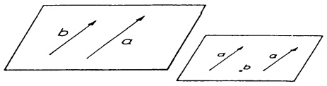

<details>
<summary>text_image</summary>

b
a
a
b
</details>

Abb. 141a - linear abhängig

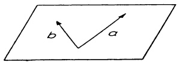

<details>
<summary>text_image</summary>

b
a
</details>

Abb. 141b - linear unabhängig

Allgemein gilt: Die Vektoren  $v_{1},\ldots,v_{k}\in V$  sind genau dann linear abhängig, wenn einer von ihnen als Linearkombination der anderen darstellbar ist.

Beweis. Aus  $\alpha_{1}v_{1}+\cdots+\alpha_{k}v_{k}=0$  mit mindestens einem Koeffizienten  $\alpha_{i}\neq0$  folgt

$$
\mathbf {v} _ {i} = - \frac {1}{\alpha_ {i}} (\alpha_ {1} \mathbf {v} _ {1} + \dots + \alpha_ {i - 1} \mathbf {v} _ {i - 1} + \alpha_ {i + 1} \mathbf {v} _ {i + 1} + \dots + \alpha_ {k} \mathbf {v} _ {k}).
$$

Ist umgekehrt  $v_{i} = \beta_{1}v_{1} + \cdots + \beta_{i-1}v_{i-1} + \beta_{i+1}v_{i+1} + \cdots + \beta_{k}v_{k}$  ( $v_{i}$  fehlt auf der rechten Seite), dann gilt

$$
0 = \beta_ {1} \mathbf {v} _ {1} + \dots + \beta_ {i - 1} \mathbf {v} _ {i - 1} - 1 \mathbf {v} _ {i} + \beta_ {i + 1} \mathbf {v} _ {i + 1} + \dots + \beta_ {k} \mathbf {v} _ {k}.
$$

Der Koeffizient bei  $v_{i}$  ist  $\neq 0$ , also sind die Vektoren linear abhängig.

Ferner ergeben sich aus der Definition leicht die folgenden Eigenschaften:

a) Jedes endliche System von Vektoren, das linear abhängige Vektoren enthält, ist linear abhängig.
(2) b) Jedes endliche System von Vektoren, das den Nullvektor enthält, ist linear abhängig.
c) Jedes Teilsystem eines Systems linear unabhängiger Vektoren ist linear unabhängig.

Beweis. a) Sind (nach eventueller Änderung der Reihenfolge) in  $v_{1}, v_{2}, \ldots, v_{k}$  die ersten l Vektoren linear abhängig,  $\alpha_{1}v_{1} + \cdots + \alpha_{l}v_{l} = 0$  mit wenigstens einem Koeffizienten  $\alpha_{i} \neq 0$ , dann gilt auch  $\alpha_{1}v_{1} + \cdots + \alpha_{l}v_{l} + 0v_{l+1} + \cdots + 0v_{k} = 0$  (nicht alle Koeffizienten  $\neq 0$ ).

b) ist ein Sonderfall von a), 10 = 0.

c) Wäre ein Teilsystem linear abhängig, dann würde das nach a) auch für das gesamte System gelten.

Beispiel 1. Die Vektoren $\mathbf{v}_{1}=(1,2,3)$, $\mathbf{v}_{2}=(0,2,1)$, $\mathbf{v}_{3}=(1,4,4)$ des $\mathbb{R}_{3}$ sind linear abhängig. Es gilt $\mathbf{v}_{1}+\mathbf{v}_{2}-\mathbf{v}_{3}=(0,0,0)$ bzw. $\mathbf{v}_{3}=\mathbf{v}_{1}+\mathbf{v}_{2}$, was anschaulich besagt, daß $\mathbf{v}_{3}$ parallel zu der von $\mathbf{v}_{1},\mathbf{v}_{2}$ aufgespannten Ebene liegt. □

Beispiel 2. Die Vektoren $\mathbf{e}_{1},\mathbf{e}_{2},\ldots,\mathbf{e}_{n}$ der natürlichen Basis des $\mathbb{R}^{n}$ (bzw. des $\mathbb{R}_{n},\to1.1$) sind linear unabhängig. Denn die Gleichung

$$
x _ {1} \mathbf {e} _ {1} + \dots + x _ {n} \mathbf {e} _ {n} = \left( \begin{array}{c} x _ {1} \\ x _ {2} \\ \vdots \\ x _ {n} \end{array} \right) = \left( \begin{array}{c} 0 \\ 0 \\ \vdots \\ 0 \end{array} \right)
$$

hat als einzige Lösung  $x_{1}=x_{2}=\cdots=x_{n}=0$ .

Satz 3.1. a) In einer Matrix in Zeilenstufenform (→ (10), §1) sind die von Null verschiedenen Zeilenvektoren linear unabhängig.

b) In einer Matrix in (analoger) Spaltenstufenform sind die von Null verschiedenen Spalten linear unabhängig.

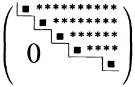

<details>
<summary>text_image</summary>

0
* * * * * * *
* * * * * *
* * * * *
* ****
</details>

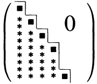

<details>
<summary>text_image</summary>

0
* * * * * * * * * * * * * * * * * * * * * * * * * * * * * * * * * * * * * * * * * * * * * * * * * * * * * * * * * * * * * * * * * * * * * * * * * * * * * * * * * * * * * * * * * * * * * * * * * * * * * *
*   **   ***   ****   ***   ****   ***   ****   ***   ****   ***   ****   ***   ****   ***   ****   ***   ****   ***   ****   ***   ****   ***   ****   ***   ****   ***   ****   ***   ****   ***   ****   ***   ****   ***   ****   ***   ****   ***   ****   ***   ****   ***   ****   ***   ****   ***   ****   ***   ****   ***   ****   ***   **    **    **    **    **    **    **    **    **    **    **    **    **    **    **    **    **    **    **    **    **    **    **    **    **    **    **    **    **    **    **    **    **    **    **    **    **    **    **    **    **    **    **    **    **    **    **    **    **    **    **  0
</details>

Beweis. a): Sind  $\mathbf{z}_{1} = (0, \ldots, 0, \alpha_{1i}, \ldots, \alpha_{1n})$ ,  $\mathbf{z}_{2} = (0, \ldots, 0, \alpha_{2j}, \ldots, \alpha_{2n}), \ldots$ ,  $\mathbf{z}_{r} = (0, \ldots, 0, \alpha_{rs}, \ldots, \alpha_{rn})$  die von Null verschiedenen Zeilen der Zeilenstufenmatrix ( $1 \leq i < j < \cdots < s \leq n$ ,  $\alpha_{1i} \neq 0$ ,  $\alpha_{2j} \neq 0, \ldots, \alpha_{rs} \neq 0$ ), dann folgt aus

$$
x _ {1} \mathbf {z} _ {1} + x _ {2} \mathbf {z} _ {2} + \dots + x _ {r} \mathbf {z} _ {r} = \mathbf {0} \quad (\text {Nullvektor in} \mathbb {R} _ {n})
$$

komponentenweise  $x_{1}\alpha_{1i}=0$ , also  $x_{1}=0$ ; dann  $x_{2}\alpha_{2j}=0$ , also  $x_{2}=0$ , etc.,  $x_{3}=\cdots=x_{r}=0$ .

b) folgt aus a) durch Übergang zur Transponierten.

In einer  $n \times n$ -Matrix  $A = (\mathbf{a}_{1}, \ldots, \mathbf{a}_{n})$  sind die Spaltenvektoren  $a_{i} \in R^{n}$  genau dann linear unabhängig, wenn  $Ax = x_{1}a_{1} + \cdots + x_{n}a_{n} = 0$  ( $\rightarrow$  (8), §2) nur die Lösung x = 0 besitzt.

Das ist genau dann der Fall, wenn A invertierbar ist (→ Satz 2.4). Also gilt:

Satz 3.2. Für eine $n \times n$-Matrix A sind die folgenden Aussagen äquivalent:

a) A ist invertierbar.
b) Die Spalten von A sind linear unabhängig.
c) Die Zeilen von A sind linear unabhängig.

Zur Äquivalenz von c) mit a) beachte man nur, daß die Zeilen von A zu Spalten von  $A^{T}$  werden ( $\rightarrow$  Satz 2.4).

Nun sei wieder V ein beliebiger R-Vektorraum.

Satz 3.3. Für Vektoren $\mathbf{v}_{1},\ldots,\mathbf{v}_{k},\mathbf{w}\in V$ gilt:

a) Lin $(\mathbf{v}_1, \ldots, \mathbf{v}_k, \mathbf{w}) = \operatorname{Lin}(\mathbf{v}_1, \ldots, \mathbf{v}_k) \iff \mathbf{w} \in \operatorname{Lin}(\mathbf{v}_1, \ldots, \mathbf{v}_k)$.
b) Die Vektoren $\mathbf{v}_{1},\ldots,\mathbf{v}_{k}$ sind linear unabhängig $\Longleftrightarrow$ Zur Erzeugung von Lin $(\mathbf{v}_{1},\ldots,\mathbf{v}_{k})$ kann kein $\mathbf{v}_{i}$ ($1\leq i\leq k$) weggelassen werden (in diesem Fall nennt man $(\mathbf{v}_{1},\ldots,\mathbf{v}_{k})$ ein minimales Erzeugendensystem).

Beweis. a) „⇒“: $\mathbf{w} \in \operatorname{Lin}\left(\mathbf{v}_1, \ldots, \mathbf{v}_k, \mathbf{w}\right) = \operatorname{Lin}\left(\mathbf{v}_1, \ldots, \mathbf{v}_k\right)$.

„←“: Falls $\mathbf{w}=\alpha_{1}\mathbf{v}_{1}+\cdots+\alpha_{k}\mathbf{v}_{k}$, dann gilt

$$
\lambda_ {1} \mathbf {v} _ {1} + \dots + \lambda_ {k} \mathbf {v} _ {k} + \mu \mathbf {w} = \sum_ {i = 1} ^ {k} \lambda_ {i} \mathbf {v} _ {i} + \mu \sum_ {i = 1} ^ {k} \alpha_ {i} \mathbf {v} _ {i} = \sum_ {i = 1} ^ {k} (\lambda_ {i} + \mu \alpha_ {i}) \mathbf {v} _ {i}
$$

für alle $\lambda_{i},\mu\in\mathbb{R}$. Also ist jede Linearkombination von $\mathbf{v}_{1},\ldots,\mathbf{v}_{k},\mathbf{w}$ bereits eine Linearkombination von $\mathbf{v}_{1},\ldots,\mathbf{v}_{k}$; $\mathbf{w}$ wird zur Erzeugung der linearen Hülle nicht benötigt.

b): Nach a) kann man genau dann ein  $v_{i} \in \{v_{1}, \ldots, v_{k}\}$  zur Erzeugung der Hülle weglassen, wenn sich  $v_{i}$  als Linearkombination der anderen darstellen läßt. Das ist genau dann der Fall, wenn  $v_{1}, \ldots, v_{i}, \ldots, v_{k}$  linear abhängig sind. ☐

## 3.3 Basis und Dimension.

Definition. Ein System (n-Tupel)  $(\mathbf{v}_{1},\mathbf{v}_{2},\ldots,\mathbf{v}_{n})$  von Vektoren aus V heißt eine Basis des R-Vektorraumes V, wenn gilt:

(B.1) Die Vektoren  $v_{1}, v_{2}, \ldots, v_{n}$  sind linear unabhängig.
(B.2) Die $\mathbf{v}_i$ erzeugen $V$, d.h. $V = \mathrm{Lin}(\mathbf{v}_1, \mathbf{v}_2, \ldots, \mathbf{v}_n)$.

Die Bedeutung einer Basis ergibt sich aus folgender Eigenschaft:

Satz 3.4 Ist $(\mathbf{v}_1, \mathbf{v}_2, \ldots, \mathbf{v}_n)$ eine Basis von $V$, dann gibt es zu jedem Vektor $\mathbf{a} \in V$ genau ein $n$-Tupel reeller Zahlen $(\alpha_1, \alpha_2, \ldots, \alpha_n)$ mit

$$
\mathbf {a} = \alpha_ {1} \mathbf {v} _ {1} + \alpha_ {2} \mathbf {v} _ {2} + \dots + \alpha_ {n} \mathbf {v} _ {n}.
$$

Ferner sind je m Vektoren aus V linear abhängig, falls m > n.

Beweis. Nach (B.2) ist jeder Vektor $\mathbf{a} \in V$ als Linearkombination $\mathbf{a} = \sum_{i=1}^{n} \alpha_i \mathbf{v}_i$ der $\mathbf{v}_i$ darstellbar. Diese Darstellung ist eindeutig; denn aus $\mathbf{a} = \sum \alpha_i \mathbf{v}_i = \sum \beta_i \mathbf{v}_i$ folgt $\sum (\alpha_i - \beta_i) \mathbf{v}_i = 0$ und deshalb $\alpha_i - \beta_i = 0$ bzw. $\alpha_i = \beta_i$ für $i = 1, 2, \ldots, n$ (nach (B.1)).

Nun nehmen wir m Vektoren  $w_{1}, w_{2}, \ldots, w_{m}$  aus V, m > n, stellen diese eindeutig dar in der Form

$$
\begin{array}{l} \mathbf {w} _ {1} = \alpha_ {1 1} \mathbf {v} _ {1} + \alpha_ {2 1} \mathbf {v} _ {2} + \dots + \alpha_ {n 1} \mathbf {v} _ {n} \\ \mathbf {w} _ {2} = \alpha_ {1 2} \mathbf {v} _ {1} + \alpha_ {2 2} \mathbf {v} _ {2} + \dots + \alpha_ {n 2} \mathbf {v} _ {n} \\ \begin{array}{c}\bullet \\ \bullet \\ \bullet \end{array} \\ \mathbf {w} _ {m} = \alpha_ {1 m} \mathbf {v} _ {1} + \alpha_ {2 m} \mathbf {v} _ {2} + \dots + \alpha_ {n m} \mathbf {v} _ {n} \\ \end{array}
$$

und bestimmen dazu reelle Zahlen $\lambda_{1},\ldots,\lambda_{m}$, die nicht sämtlich Null sind, so daß gilt:

$$
\begin{array}{l} \alpha_ {1 1} \lambda_ {1} + \alpha_ {1 2} \lambda_ {2} + \dots + \alpha_ {1 m} \lambda_ {m} = 0 \\ \alpha_ {2 1} \lambda_ {1} + \alpha_ {2 2} \lambda_ {2} + \dots + \alpha_ {2 m} \lambda_ {m} = 0 \\ \begin{array}{c c} \cdot & \cdot \\ \cdot & \cdot \\ \cdot & \cdot \end{array} \\ \alpha_ {n 1} \lambda_ {1} + \alpha_ {n 2} \lambda_ {2} + \dots + \alpha_ {n m} \lambda_ {m} = 0. \\ \end{array}
$$

Wegen $m > n$ ist das stets möglich ($\rightarrow$ Satz 1.1). Mit diesen Zahlen $\lambda_{i}$ gilt

$$
\begin{array}{l} \lambda_ {1} \mathbf {w} _ {1} + \dots + \lambda_ {m} \mathbf {w} _ {m} = (\alpha_ {1 1} \lambda_ {1} + \dots + \alpha_ {1 m} \lambda_ {m}) \mathbf {v} _ {1} + \dots + (\alpha_ {n 1} \lambda_ {1} + \dots + \alpha_ {n m} \lambda_ {m}) \mathbf {v} _ {n} \\ = 0 \mathbf {v} _ {1} + \dots + 0 \mathbf {v} _ {n} = 0. \\ \end{array}
$$

Also sind die Vektoren  $w_{1},\ldots,w_{m}$  (m>n) linear abhängig.

Beispiel 1.  $V = R^{2}$  (Vektoren einer Ebene) anschaulich:

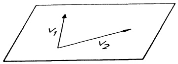

<details>
<summary>text_image</summary>

v₁
v₂
</details>

Abb. 142a - Basis in $\mathbb{R}^2$

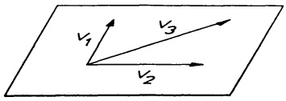

<details>
<summary>text_image</summary>

V₁
V₃
V₂
</details>

Abb. 142b - Keine Basis in $\mathbb{R}^2$

□

Beispiel 2. Die natürliche Basis $(\mathbf{e}_1, \mathbf{e}_2, \ldots, \mathbf{e}_n)$ des $\mathbb{R}^n$ (bzw. $\mathbb{R}_n, \to 1.1$) ist eine

Basis im Sinne der obigen Definition. Wesentlich allgemeiner gilt:

Satz 3.5. Die Zeilen (bzw. Spalten) einer invertierbaren $n \times n$-Matrix bilden eine Basis des $\mathbb{R}_n$ (bzw. $\mathbb{R}^n$).

Beweis. Sei $A = (\mathbf{a}_1, \ldots, \mathbf{a}_n)$ mit den Spalten $\mathbf{a}_i \in \mathbb{R}^n$ invertierbar. Nach Satz 3.2 sind $\mathbf{a}_1, \mathbf{a}_2, \ldots, \mathbf{a}_n$ linear unabhängig. Also gilt (B.1). Nun sei $\mathbf{v} \in \mathbb{R}^n$ (beliebig). Mit $(\alpha_1, \ldots, \alpha_n)^T := A^{-1}\mathbf{v}$ zeigt Formel (8), §2

$$
\mathbf {v} = A (A ^ {- 1} \mathbf {v}) = \alpha_ {1} \mathbf {a} _ {1} + \dots + \alpha_ {n} \mathbf {a} _ {n}.
$$

Damit ist auch (B.2) nachgewiesen.

Beispiel 3. Die Polynome $1, x + 1, (x + 1)^2, \ldots, (x + 1)^n$ bilden eine Basis des $\mathbb{R}$-Vektorraumes $\mathbb{P}_n$ aller Polynome vom Grad $\leq n$. Denn es gilt

1. Aus  $\alpha_{0}\cdot1+\alpha_{1}(x+1)+\cdots+\alpha_{n}(x+1)^{n}=0$  für alle x folgt  $\alpha_{0}=\alpha_{1}=\cdots=\alpha_{n}=0$  (also gilt (B.1)).
2. Jedes $p \in \mathbb{P}_n$ läßt sich nach Kap. 5, §3 in der Form $p(x) = \sum_{i=0}^{\infty} x_i (x+1)^i$ darstellen (das ist (B.2)).

Definition. Ein Vektorraum $V$ heißt endlichdimensional oder endlich erzeugt, wenn es endlich viele Vektoren $\mathbf{w}_{1},\ldots,\mathbf{w}_{r}\in V$ mit $V=\mathrm{Lin}(\mathbf{w}_{1},\mathbf{w}_{2},\ldots,\mathbf{w}_{r})$ gibt.

Im folgenden werden fundamentale Eigenschaften endlichdimensionaler Vektorräume zusammengestellt.

Satz 3.6. Basisergänzungssatz. In einem endlichdimensionalen Vektorraum $V \neq \{0\}$ bilden linear unabhängige Vektoren $\mathbf{v}_1, \ldots, \mathbf{v}_k$ bereits eine Basis $(\mathbf{v}_1, \ldots, \mathbf{v}_k)$, oder man kann sie durch Hinzunahme weiterer Vektoren $\mathbf{u}_1, \ldots, \mathbf{u}_l$ zu einer Basis $(\mathbf{v}_1, \ldots, \mathbf{v}_k, \mathbf{u}_1, \ldots, \mathbf{u}_l)$ von $V$ ergänzen.

Beweis. Sei $V = \text{Lin}(\mathbf{w}_1, \ldots, \mathbf{w}_r)$. Offenbar gilt dann auch $V = \text{Lin}(\mathbf{v}_1, \ldots, \mathbf{v}_k, \mathbf{w}_1, \ldots, \mathbf{w}_r)$ ($\to$ Satz 3.3). Nun lassen wir all die $\mathbf{w}_i$ weg, die zur Erzeugung dieser linearen Hülle nicht benötigt werden. Das sind entweder alle, in diesem Fall gilt bereits $V = \text{Lin}(\mathbf{v}_1, \ldots, \mathbf{v}_k)$ und $(\mathbf{v}_1, \ldots, \mathbf{v}_k)$ ist eine Basis von $V$, oder es gilt – wenn wir die verbleibenden $\mathbf{w}_i$ mit $\mathbf{u}_1, \ldots, \mathbf{u}_l$ bezeichnen – $V = \text{Lin}(\mathbf{v}_1, \ldots, \mathbf{v}_k, \mathbf{u}_1, \ldots, \mathbf{u}_l)$, worin kein weiterer Vektor $\mathbf{u}_j$ weggelassen werden kann.

Behauptung:  $(\mathbf{v}_{1},\ldots,\mathbf{v}_{k},\mathbf{u}_{1},\ldots,\mathbf{u}_{l})$  ist eine Basis von V.

Beweis. Da nach Konstruktion (B.2) erfüllt ist, braucht nur (B.1) nachgewiesen zu werden: Nehmen wir an,  $v_{1},\ldots,v_{k},u_{1},\ldots,u_{l}$  wären linear abhängig. Dann gäbe es Zahlen  $\alpha_{i},\beta_{j}$ , nicht alle gleich Null, mit

$$
\alpha_ {1} \mathbf {v} _ {1} + \dots + \alpha_ {k} \mathbf {v} _ {k} + \beta_ {1} \mathbf {u} _ {1} + \dots + \beta_ {l} \mathbf {u} _ {l} = 0. \tag {3}
$$

Hierin müßte aufgrund der linearen Unabhängigkeit der  $v_{i}$  wenigstens ein  $\beta_{j}$  von Null verschieden sein. In diesem Fall könnte man (3) nach dem entsprechenden  $u_{j}$  auflösen und  $u_{j}$  bei der Erzeugung von  $\operatorname{Lin}(\mathbf{v}_{1},\ldots,\mathbf{v}_{k},\mathbf{u}_{1},\ldots,\mathbf{u}_{l})$  weglassen ( $\rightarrow$  Satz 3.3). Das ist aber nach Konstruktion nicht mehr möglich. ☐

Satz 3.7. Basislänge = Dimension. Jeder endlich erzeugte Vektorraum $V \neq \{\mathbf{0}\}$ besitzt eine (endliche) Basis $(\mathbf{v}_1, \ldots, \mathbf{v}_n)$. Ist $(\mathbf{w}_1, \ldots, \mathbf{w}_m)$ ebenfalls eine Basis von $V$, dann gilt $m = n$. Die gemeinsame „Länge“ $n$ aller Basen von $V$ heißt die Dimension von $V$, abgekürzt Dim $V$. Zur Vermeidung von Fallunterscheidungen setzt man Dim $\{\mathbf{0}\} = 0$.

Beweis. $V$ enthält nach Voraussetzung wenigstens einen Vektor $\mathbf{v} = \mathbf{v}_1 \neq 0$. Satz 3.6 mit $k = 1$ zeigt die Existenz einer Basis $(\mathbf{v}_1, \ldots, \mathbf{v}_n)$ von $V$. Nach Satz 3.4 sind je $n + 1$ Vektoren aus $V$ linear abhängig. Ist nun $(\mathbf{w}_1, \ldots, \mathbf{w}_m)$ eine weitere Basis, so gilt deshalb $m \leq n$. Ein Rollentausch (beginne mit der Basis $(\mathbf{w}_1, \ldots, \mathbf{w}_m)$ und nehme dann die Basis $(\mathbf{v}_1, \ldots, \mathbf{v}_n)$ hinzu) zeigt $n \leq m$. Insgesamt $m = n$.

## Beispiele.

$$
\mathrm{Dim} \mathbb {R} ^ {n} = \mathrm{Dim} \mathbb {R} _ {n} = n,
$$

$$
\mathrm{Dim} \mathbb {P} _ {n} = n + 1 \quad (\rightarrow 3. 1, \text {Bsp.} 2),
$$

$$
\text {Dim} \{f: \mathbb {R} \rightarrow \mathbb {R}; f \text {zweimal stetig differenzierbar}
$$

$$
\text {mit} f ^ {\prime \prime} + f = 0 \} = 2. \tag {4}
$$

$$
\mathrm{Dim} \left\{\left( \begin{array}{c} x \\ y \\ z \end{array} \right) \in \mathbb {R} ^ {3}; 3 x + y + z = 0 \right\} = 2.
$$

In jedem der Beispiele ist eine Basis entsprechender Länge bekannt.

□

Folgerung. Ist $r$ die Maximalzahl linear unabhängiger Vektoren aus $\mathbf{v}_{1},\mathbf{v}_{2},\ldots,\mathbf{v}_{k}$, dann gilt

$$
r = \mathrm{Dim} \operatorname{Lin} \left(\mathbf {v} _ {1}, \mathbf {v} _ {2}, \dots , \mathbf {v} _ {k}\right).
$$

Beweis. Nach eventueller Umnumerierung seien $\mathbf{v}_{1},\ldots,\mathbf{v}_{r}$ linear unabhängig und $\mathbf{v}_{1},\ldots,\mathbf{v}_{r},\mathbf{v}_{j}$ (für $r+1\leq j\leq k$) linear abhängig. Aus Satz 3.3 folgt Lin $(\mathbf{v}_{1},\ldots,\mathbf{v}_{k})=\operatorname{Lin}(\mathbf{v}_{1},\ldots,\mathbf{v}_{r})$; $(\mathbf{v}_{1},\ldots,\mathbf{v}_{r})$ ist eine Basis dieser linearen Hülle und deshalb gilt $r=\operatorname{Dim}\operatorname{Lin}(\mathbf{v}_{1},\ldots,\mathbf{v}_{k})$. □

Satz 3.8. In einem $\mathbb{R}$-Vektorraum $V$ der Dimension $n$ gilt:

a) Je n linear unabhängige Vektoren aus $V$ bilden bereits eine Basis von $V$.
b) Jedes Erzeugendensystem von $V$ mit $n$ Elementen ist eine Basis von $V$.
c) Je  $n + 1$  Vektoren aus V sind linear abhängig.

Beweis. a): Es braucht nur (B.2) nachgewiesen zu werden. Das geschieht wie im Beweis von Satz 3.5.

b): Sei $V = \operatorname{Lin}(\mathbf{w}_1, \ldots, \mathbf{w}_n)$. Durch Fortlassen der $\mathbf{w}_i$, die zur Erzeugung nicht benötigt werden, entsteht eine Basis der Länge $n$ ($\rightarrow$ Satz 3.3, Satz 3.7). Also darf kein $\mathbf{w}_i$ weggelassen werden.

c): → Satz 3.4.

Beispiel. Je 4 Vektoren des $\mathbb{R}^{3}$, 7 Vektoren des $\mathbb{R}_{6},\ldots,n+1$ Vektoren des $\mathbb{R}^{n}$ sind linear abhängig (ohne Rechnung!).

Satz 3.9. Dimension der Unterräume. Jeder Unterraum U eines endlichdimensionalen Vektorraums V ist endlichdimensional; im Fall  $U \neq V$  gilt

$$
\mathrm{Dim} U <   \mathrm{Dim} V.
$$

Beweis. Sei $U \neq \{0\}$ und $(\mathbf{u}_1, \ldots, \mathbf{u}_r)$ ein System mit der größtmöglichen Anzahl linear unabhängiger Vektoren aus $U$. Nach Satz 3.8 c) gilt $r \leq n$. Für jeden beliebigen Vektor $\mathbf{u} \in U$ sind die $r + 1$ Vektoren $\mathbf{u}_1, \ldots, \mathbf{u}_r, \mathbf{u}$ linear abhängig und deshalb $\mathbf{u}$ als Linearkombination der $\mathbf{u}_i$ darstellbar; d.h. $U = \text{Lin}(\mathbf{u}_1, \ldots, \mathbf{u}_r)$. Folglich ist $(\mathbf{u}_1, \ldots, \mathbf{u}_r)$ eine Basis von $U$, $r = \text{Dim } U \leq n = \text{Dim } V$. Im Fall $r = n$ ist das nach Satz 3.8 a) bereits eine Basis von $V$, also $U = V$.

Mit Satz 3.9 ist gesichert, daß die Sätze 3.6–3.8 für jeden Unterraum eines endlichdimensionalen Vektorraumes V anwendbar sind.

Beispiel. Sei $A \in \mathbb{R}^{n \times n}$, $A \neq \mathbf{0}$. Nach Satz 3.9 besitzt der Unterraum Kern $A := \{ \mathbf{x} \in \mathbb{R}^n : A\mathbf{x} = \mathbf{0} \}$ des $\mathbb{R}^n$ wenigstens eine Basis $(\mathbf{u}_1, \ldots, \mathbf{u}_k)$ mit $k < n$ Vektoren. Jede andere Basis von Kern $A$ besteht nach Satz 3.7 ebenfalls aus $k$ linear unabhängigen Lösungsvektoren von $A\mathbf{x} = \mathbf{0}$. Ein einfaches Verfahren zur Berechnung einer Basis von Kern $A$ wird in 4.4 angegeben.

## Aufgaben

1. Welche der folgenden Mengen sind lineare Teilräume des  $R^{n}$ :

a) $\{\mathbf{x};x_1 = a\},\quad a\in \mathbb{R};$ b) $\{\mathbf{x};x_1 = 0\} \cup \{\mathbf{x};x_2 = 0\}$
c) $\{\mathbf{x};x_1\geq 0\}$ d) $\{\mathbf{x};x_1 = 0\} \cap \{\mathbf{x};x_2 = 0\}$
e) $\{\mathbf{x};x_1\cdot x_2 = 0\}$ ; f) $\{\mathbf{x};|x| = 1\}$ ?

2. Es seien $U$, $V$ Unterräume des $\mathbb{R}^{10}$ mit $\mathrm{Dim} U = 5$, $\mathrm{Dim} V = 7$. Welche Möglichkeiten gibt es für $\mathrm{Dim} \mathrm{Lin}(\mathbf{u}_1, ..., \mathbf{u}_r, \mathbf{v}_1, ..., \mathbf{v}_s)$, für $\mathbf{u}_i \in U$, $\mathbf{v}_j \in V$ ($1 \leq i \leq r \leq 5$, $1 \leq j \leq s \leq 7$)? Man gebe für jede Möglichkeit explizit ein Beispiel an.

3. Die Vektoren $\mathbf{a} = (1, -2, 5, -3)^T$, $\mathbf{b} = (2, 3, 1, -4)^T$ und $\mathbf{c} = (3, 8, -3, -5)^T$ erzeugen einen linearen Teilraum $W$ des $\mathbb{R}^4$. Bestimme die Dimension von $W$. Man vervollständige diese Basis zu einer Basis des $\mathbb{R}^4$.

4. Durch die vier Polynome wird ein Vektorraum $V$ erzeugt

$p(t) = t^3 - 2t^2 + 4t + 1$, $r(t) = t^3 + 6t - 5$,

$q(t) = 2t^{3} - 3t^{2} + 9t - 1,$ $s(t) = 2t^3 -5t^2 +7t + 5.$

Man bestimme Dim V und gebe eine Basis für V an.

5. Für welche  $\alpha,\beta\in R$  sind die Vektoren des  $R_{3}$  linear unabhängig?

a)  $(\alpha^{2},1,\beta)$ ,  $(\beta,-1,1)$ ;
b)  $(x,0,1)$ ,  $(0,x,2)$ ,  $(3,2,\beta)$ .

6. Man gebe jeweils 3 verschiedene Basen der folgenden Vektorräume an:

a)  $R^{3}$ ;
b) $V = \{(\alpha, \beta, \gamma) \in \mathbb{R}^3; 2\alpha + 3\beta = 0\}$;
c) $V = \{p(x)\in \mathbb{P}_n;p(1) = 0\}$

## §4. Elementarmatrizen und elementare Umformungen

4.1 Zeilenraum und Spaltenraum. Sei A eine  $m \times n$ -Matrix mit den Zeilen  $z_{1}, \ldots, z_{m} \in R_{n}$  und den Spalten  $a_{1}, \ldots, a_{n} \in R^{m}$ . Man nennt

$$
\mathrm{Lin} \left(\mathbf {z} _ {1}, \dots , \mathbf {z} _ {m}\right) = \{\sum_ {i = 1} ^ {m} \lambda_ {i} \mathbf {z} _ {i}; \lambda_ {i} \in \mathbb {R} \}
$$

den Zeilenraum von A und

$$
\operatorname{Lin} \left(\mathbf {a} _ {1}, \dots , \mathbf {a} _ {n}\right) = \{\sum_ {i = 1} ^ {n} \lambda_ {i} \mathbf {a} _ {i}; \lambda_ {i} \in \mathbb {R} \}
$$

den Spaltenraum von A. Nach der Folgerung zu Satz 3.7 ist die Dimension des Zeilenraumes (Spaltenraumes) gleich der Maximalzahl linear unabhängiger Zeilen (Spalten) von A. Da beim Transponieren aus den Zeilen Spalten und aus den Spalten Zeilen werden, spiegeln sich alle Eigenschaften des Zeilenraumes (Spaltenraumes) von A wieder im Spaltenraum (Zeilenraum) von  $A^{T}$ . Wegen

$$
A \mathbf {x} = \sum_ {i = 1} ^ {n} x _ {i} \mathbf {a} _ {i} (\text {fur} \mathbf {x} \in \mathbb {R} ^ {n}, \rightarrow (8), \S 2) \text {gilt:}
$$

$$
\begin{array}{l} \text {Spaltenraum von} A = \left\{A \mathbf {x}; \mathbf {x} \in \mathbb {R} ^ {n} \right\}, \tag {1} \\ \text {Zeilenraum von} A = \left\{\mathbf {y} ^ {T} A; \mathbf {y} \in \mathbb {R} ^ {m} \right\}. \\ \end{array}
$$

Satz 4.1. Für alle $A \in \mathbb{R}^{m \times n}$ und alle invertierbaren Matrizen $P \in \mathbb{R}^{m \times m}$, $Q \in \mathbb{R}^{n \times n}$ gilt:

A und AQ haben denselben Spaltenraum, A und PA denselben Zeilenraum.

Beweis. Wegen $A\mathbf{x} = (AQ)(Q^{-1}\mathbf{x}) = AQ\mathbf{x}'$ mit $\mathbf{x}' = Q^{-1}\mathbf{x}$ liegt jedes Element des Spaltenraumes von $A$ im Spaltenraum von $AQ$ und umgekehrt ($\rightarrow$ (1)). Der analoge Schluß mit $\mathbf{y}^T A = \mathbf{y}^TP^{-1}PA$ liefert die Behauptung für den Zeilenraum.

4.2 Elementarmatrizen. Zeilen- und Spaltenraum einer Matrix werden mit elementaren Zeilen- bzw. Spaltenumformungen vom Typ ①, ②, ③ untersucht.

Typ ① : Vertauschung zweier Zeilen (Spalten).
Typ ②: Multiplikation einer Zeile (Spalte) mit Zahlenfaktor ≠ 0.
Typ ③ : Addition des Vielfachen einer Zeile (Spalte) zu einer anderen.

Hinter diesen Umformungen verbergen sich Multiplikationen mit besonderen invertierbaren Matrizen, den sogenannten Elementarmatrizen.

Definition. Eine  $m \times m$ -Matrix  $\tilde{E}$  heißt Elementarmatrix vom Typ ⓘ, wenn sie aus der  $m \times m$ -Einheitsmatrix E durch eine elementare Zeilenumformung vom Typ ⓘ hervorgeht. Wir sagen,  $\tilde{E}$  gehört zu dieser Umformung.

Beispiele (für $m = 3$).

$$
\begin{array}{l} \left(\begin{array}{c}{\mathbf {e} _ {1}}\\{\mathbf {e} _ {2}}\\{\mathbf {e} _ {3}}\end{array}\right) = \left(\begin{array}{c c c}1&0&0\\0&1&0\\0&0&1\end{array}\right) \quad (\text {Typ} \quad ②; \mathbf {e} _ {1} \rightarrow 1 \mathbf {e} _ {1}). \\ \left(\begin{array}{c}{\mathbf {e} _ {1}}\\{\alpha \mathbf {e} _ {2}}\\{\mathbf {e} _ {3}}\end{array}\right) = \left(\begin{array}{c c c}1&0&0\\0&\alpha&0\\0&0&1\end{array}\right) (\alpha \neq 0) \quad \text {(Typ ② ;} \mathbf {e} _ {2} \rightarrow \alpha \mathbf {e} _ {2}). \\ \left(\begin{array}{c}\mathbf {e} _ {2}\\\mathbf {e} _ {1}\\\mathbf {e} _ {3}\end{array}\right) = \left(\begin{array}{c c c}0&1&0\\1&0&0\\0&0&1\end{array}\right) \quad (\text {Typ} \quad ①; \mathbf {e} _ {1} \rightarrow \mathbf {e} _ {2}, \mathbf {e} _ {2} \rightarrow \mathbf {e} _ {1}). \\ \left(\begin{array}{c}\mathbf {e} _ {1} + \alpha \mathbf {e} _ {3}\\\mathbf {e} _ {2}\\\mathbf {e} _ {3}\end{array}\right) = \left(\begin{array}{c c c}1&0&\alpha\\0&1&0\\0&0&1\end{array}\right) \quad (\text {Typ} ③; \mathbf {e} _ {1} \rightarrow \mathbf {e} _ {1} + \alpha \mathbf {e} _ {3}). \\ \end{array}
$$


Satz 4.2. a) Entsteht $\tilde{A}$ aus $A \in \mathbb{R}^{m \times n}$ durch eine elementare Zeilenumformung (bzw. Spaltenumformung), dann gilt

$$
\tilde {A} = \tilde {E} A \quad (\text {bzw.} \tilde {A} = A \tilde {E} ^ {T}) \tag {2}
$$

mit der zugehörigen Elementarmatrix $\tilde{E}$.

b) Die Elementarmatrizen sind invertierbar, die Inversen sind ebenfalls Elementarmatrizen.

c) Entsteht $M$ bzw. $N$ aus $A \in \mathbb{R}^{m \times n}$ durch endlich viele elementare Zeilen- bzw. Spaltenumformungen, dann gibt es invertierbare Matrizen $P \in \mathbb{R}^{m \times m}$, $Q \in \mathbb{R}^{n \times n}$ mit

$$
M = P A, \quad N = A Q. \tag {3}
$$

P ist Produkt von Elementarmatrizen, ebenso Q.

Beweis. a): $\tilde{A}$ entstehe aus $A$ (mit den Zeilen $\mathbf{z}_i$) durch die Zeilenumformung $\mathbf{z}_i \to \mathbf{z}_i + \alpha \mathbf{z}_j$ ($x \in \mathbb{R}, i \neq j$) vom Typ ③. Die Formeln (6) und (9) aus §2 zeigen, wenn $\mathbf{e}_1, \ldots, \mathbf{e}_m$ die Zeilen der $m \times m$-Einheitsmatrix $E$ bezeichnen,

$$
\tilde {A} = \left( \begin{array}{c} \mathbf {z} _ {1} \\ \vdots \\ \mathbf {z} _ {i} + \alpha \mathbf {z} _ {j} \\ \vdots \\ \mathbf {z} _ {m} \end{array} \right) = \left( \begin{array}{c} \mathbf {e} _ {1} A \\ \vdots \\ \mathbf {e} _ {i} A + \alpha \mathbf {e} _ {j} A \\ \vdots \\ \mathbf {e} _ {m} A \end{array} \right) = \left( \begin{array}{c} \mathbf {e} _ {1} \\ \vdots \\ \mathbf {e} _ {i} + \alpha \mathbf {e} _ {j} \\ \vdots \\ \mathbf {e} _ {m} \end{array} \right) A = \tilde {E} A.
$$

Analog für die anderen Typen. Entsteht dagegen $\tilde{A}$ aus $A$ durch eine Spaltenumformung, dann entsteht $\tilde{A}^{T}$ aus $A^{T}$ durch die gleichartige Zeilenumformung, also $\tilde{A}^{T} = \tilde{E} A^{T}$, bzw. $\tilde{A} = A\tilde{E}^{T}$ ($\rightarrow$ (10), §2).

b): Eine Elementarmatrix $Z$ kann mit einer elementaren Zeilenumformung in $E$ zurückverwandelt werden; $\tilde{Z} = E$. Nach (2) gilt $E = \tilde{E} Z$, also $Z^{-1} = \tilde{E}$.
c) ergibt sich durch Mehrfachanwendung von (2).

Beziehung (3) zusammen mit Satz 4.1 ergibt die

Folgerung. Der Zeilenraum einer Matrix ändert sich nicht bei elementaren Zeilenumformungen, der Spaltenraum nicht bei elementaren Spaltenumformungen.

Wird nun die Matrix A nach dem Gauß-Verfahren (Vorwärtselimination, → §1) mit elementaren Zeilenumformungen umgewandelt in eine Matrix M in Zeilenstufenform und in ganz analoger Weise mit Spaltenumformungen (Vorwärtselimination mit den Spalten von links nach rechts) in eine Matrix N in Spaltenstufenform,

$$
M = \left( \begin{array}{c c} \square & * * * * * * * \\ & \square & * * * * * * \\ & & \square & * * * * * \\ & 0 & & \square \\ & & & \end{array} \right) \Bigg \} _ {r}, \quad N = \left(\underbrace {\square} _ {p} \quad 0 \quad n - p\right) \tag {4}
$$

dann bilden nach Satz 3.1 und obiger Folgerung die von Null verschiedenen Zeilen von M (bzw. Spalten von N) eine Basis des Zeilenraumes von A (bzw. Spaltenraumes von A). Insbesondere gilt

$$
\begin{array}{l} r = \text {Dimension des Zeilenraumes} A \\ = \text {Maximalzahl linear unabhängiger Zeilen von} A, \\ \end{array}
$$

(5)

$$
p = \text {Dimension des Spaltenraumes von} A
$$

$$
= \text {Maximalzahl linear unabhängiger Spalten}.
$$

Damit erhält die in §1 gegebene Definition

$$
\text {,,Rang} A = \text {Anzahl der \blacksquare -Stellen in} M ^ {\prime \prime}
$$

eine neue Fassung:

$$
\text {Rang} A = \text {Dimension des Zeilenraumes von} A
$$

Ferner gibt es nach Satz 4.2 invertierbare Matrizen P, Q mit M = PA, N = AQ.

4.3 Der Rang und die P-Q-Normalform.  $\begin{pmatrix} E_{s} & 0 \\ 0 & 0 \end{pmatrix} \in R^{m \times n}$  bezeichnet die Matrix, die an den ersten s Diagonalstellen eine 1 und sonst nur Nullen hat.

Satz 4.3. Für jede $m \times n$-Matrix A gilt

a) „Zeilenrang = Spaltenrang“.

$$
\begin{array}{l} \text {Rang} A = \text {Dimension des Zeilenraumes von} A \\ = \text {Dimension des Spaltenraumes von} A. \\ \end{array}
$$

b) Die Dimensionsformel. Rang $A + \mathrm{Dim}(\mathrm{Kern}A) = n$.

c) Die P-Q-Normalform. Es gibt invertierbare Matrizen $P \in \mathbb{R}^{m \times m}$, $Q \in \mathbb{R}^{n \times n}$, derart daß

$$
P A Q = \left( \begin{array}{c c} E _ {r} & 0 \\ 0 & 0 \end{array} \right), \qquad r = \operatorname{Rang} A.
$$

d) Eine Basis von Kern A. Sind $P \in \mathbb{R}^{m \times m}$, $Q = (\mathbf{q}_1, \ldots, \mathbf{q}_n) \in \mathbb{R}^{n \times n}$ invertierbare Matrizen mit $PAQ = \begin{pmatrix} E_s & 0 \\ 0 & 0 \end{pmatrix}$, dann gilt $s = r$ und die letzten $n - r$ Spalten $\mathbf{q}_{r+1}, \ldots, \mathbf{q}_n$ von $Q$ bilden eine Basis von Kern A.

Beweis. c): Offenbar kann man die Matrix M = PA aus (4) mit elementaren Spaltenumformungen, was nach Satz 4.2 der Multiplikation von rechts mit einer invertierbaren Matrix Q entspricht, umwandeln in

$$
P A Q = \left( \begin{array}{c c} E _ {r} & 0 \\ 0 & 0 \end{array} \right), \qquad r = \operatorname{Rang} A.
$$

$$
\begin{array}{l} \Longleftrightarrow \quad \left( \begin{array}{c c} E _ {s} & 0 \\ 0 & 0 \end{array} \right) \left( \begin{array}{c} y _ {1} \\ \vdots \\ y _ {n} \end{array} \right) = \mathbf {0} \quad \text {mit} \quad \mathbf {y} := Q ^ {- 1} \mathbf {x} \\ \Longleftrightarrow \quad y _ {1} = \dots = y _ {s} = 0 \quad \text {und} \quad y _ {s + 1}, \dots , y _ {n} \in \mathbb {R} \text {beliebig} \\ \Longleftrightarrow \quad \mathbf {x} = Q (y _ {s + 1} \mathbf {e} _ {s + 1} + \dots + y _ {n} \mathbf {e} _ {n}) = y _ {s + 1} \mathbf {q} _ {s + 1} + \dots + y _ {n} \mathbf {q} _ {n} \\ \end{array}
$$

d): $\mathbf{x} \in \operatorname{Kern} A \iff A\mathbf{x} = \mathbf{0} \iff PAQ(Q^{-1}\mathbf{x}) = \mathbf{0}$

(→ (9), §2). Also erzeugen die linear unabhängigen Vektoren  $q_{s+1}, \ldots, q_{n}$  den Unterraum Kern A und bilden deshalb eine Basis von Kern A (→ Satz 3.2). Insbesondere ist Dim (Kern A) = n - s, d.h. s ist eindeutig bestimmt durch s = n - Dim (Kern A). In Verbindung mit c) ergibt dies r = n - Dim (Kern A) (das ist Teil b) und s = r.

a): Mit N = AQ aus (4) wird durch elementare Zeilenumformungen

$$
P A Q = \left( \begin{array}{c c} E _ {p} & 0 \\ 0 & 0 \end{array} \right), \qquad p = \text {Dim (Spaltenraum)}
$$

mit einer invertierbaren Matrix P. Nach dem soeben bewiesenen Teil c) gilt p = Rang A. Damit ist alles bewiesen. □

Folgerungen. Für $A \in \mathbb{R}^{m \times n}$ gilt

$$
\text {Rang} A ^ {T} = \text {Rang} A, \tag {6}
$$

$$
\text {Rang} (P A Q) = \text {Rang} A \quad \text {fur alle invertierbaren} \tag {7}
$$

$$
P \in \mathbb {R} ^ {m \times n}, Q \in \mathbb {R} ^ {n \times n}.
$$

Beweis. Da die Zeilen von  $A^{T}$  aus den (transponierten) Spalten von A bestehen, gilt

$$
\begin{array}{l} \text {Rang} A ^ {T} = \text {Maximalzahl linear unabhängiger Spalten von} A \\ = \operatorname{Rang} A. \\ \end{array}
$$

Eine „P-Q-Normalform“ $P_1(PAQ)Q_1 = \begin{pmatrix} E_s & 0 \\ 0 & 0 \end{pmatrix}$ mit $s = \text{Rang } PAQ$ ist wegen $(P_1P)A(QQ_1) = P_1(PAQ)Q_1$ auch eine „P-Q-Normalform“ von $A$, also gilt $s = r = \text{Rang } A$.

Formel (7) bildet die Grundlage schneller Rangberechnungen; sie besagt (nach Satz 4.2):

Der Rang einer Matrix ändert sich nicht sowohl bei elementaren Zeilen- als auch bei elementaren Spaltenumformungen.

Beispiel. Die Matrix

$$
\mathrm{A} = \left( \begin{array}{c c c c} 1 & - 1 & 2 & 3 \\ 2 & 2 & 0 & 2 \\ 4 & 1 & - 1 & - 1 \\ 1 & 2 & 3 & 0 \end{array} \right)
$$

hat, wie man schnell mit elementaren Zeilen- und Spaltenumformungen feststellt, den Rang 4. Demnach bilden die Zeilen eine Basis des  $R_{4}$  und die Spalten eine Basis des  $R^{4}$ . A ist invertierbar. ☐

4.4 Rechenverfahren. Aus zwei Matrizen  $A = (\alpha_{ij}) \in \mathbb{R}^{m \times n}$ ,  $B = (\beta_{ij}) \in \mathbb{R}^{m \times k}$  gleicher Zeilenzahl bilden wir eine  $m \times (n + k)$ -Matrix

$$
(A, B) := \left( \begin{array}{c c c c c c} \alpha_ {1 1} & \dots & \alpha_ {1 n} & \beta_ {1 1} & \dots & \beta_ {1 k} \\ \vdots & & \vdots & \vdots & & \vdots \\ \alpha_ {m 1} & \dots & \alpha_ {m n} & \beta_ {m 1} & \dots & \beta_ {m k} \end{array} \right). \tag {8}
$$

Umgekehrt kann man eine Matrix durch eine (gedachte) Trennung zwischen zwei Spalten auf diese Weise in zwei „Blöcke“ zerlegen.

Ganz analog ist für Matrizen  $A \in R^{m \times n}$ ,  $C \in R^{k \times n}$  gleicher Spaltenzahl die Matrix  $\begin{pmatrix} A \\ C \end{pmatrix}$  definiert. Wiederholung solcher Zusammensetzungen bzw. Trennung zwischen Spalten und/oder Zeilen führt auf die sogenannten Blockmatrizen

$$
\left( \begin{array}{c c c} A _ {1 1} & \dots & A _ {1 k} \\ \vdots & & \vdots \\ A _ {l 1} & \dots & A _ {l k} \end{array} \right)  ,
$$

wobei die nebeneinander stehenden Matrizen  $A_{i1},\ldots,A_{ik}$  gleich viele Zeilen und die untereinander angeordneten Matrizen  $A_{1j},\ldots,A_{lj}$  gleich viele Spalten haben ( $1 \leq i \leq l, 1 \leq j \leq k$ ).

Besitzen $A$, $B$ die Spaltendarstellungen $A = (\mathbf{a}_1, \ldots, \mathbf{a}_n)$, $B = (\mathbf{b}_1, \ldots, \mathbf{b}_k)$, so ist $(A, B) = (\mathbf{a}_1, \ldots, \mathbf{a}_n, \mathbf{b}_1, \ldots, \mathbf{b}_k)$ (entsprechend für Zeilen) und nach der Multiplikationsformel (6), §2, gilt für alle $P \in \mathbb{R}^{m \times m}$, $Q \in \mathbb{R}^{n \times n}$

$$
P (A, B) = (P A, P B),
$$

(9) $\left( \begin{array}{c}A\\ C \end{array} \right)Q = \left( \begin{array}{c}AQ\\ CQ \end{array} \right).$

## A) Rechenverfahren, die nur Zeilenumformungen erfordern:

An zwei Matrizen gleicher Zeilenzahl $A \in \mathbb{R}^{m \times n}$, $B \in \mathbb{R}^{m \times k}$ werden wie im nebenstehenden Schema gleichzeitig dieselben elementaren Zeilenumformungen ausgeführt, bis man zu $(M, N)$ gelangt. Dann gibt es nach Satz 4.2 eine invertierbare $m \times m$-Matrix $P$ mit $(M, N) = P(A, B) = (PA, PB)$, d.h.

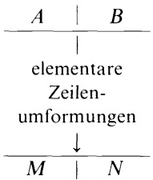

<details>
<summary>flowchart</summary>

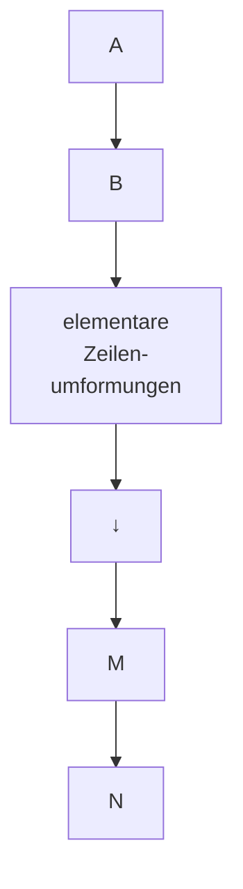
</details>

(10) $M = PA, N = PB$.

Mit einer speziellen Wahl der Anfangs- und/oder Enddaten kann eine explizite Darstellung von P erreicht werden.

Ⓐ Berechnung von P mit M = PA (→ Satz 4.2).

Mit $B = E \in \mathbb{R}^{m \times m}$ zeigt (10)

$$
M = P A, \quad N = P.
$$

D.h., dieselben elementaren Zeilenumformungen, die A in M umwandeln, führen gleichzeitig von E zur invertierbaren  $m \times m$ -Matrix P mit

$$
M = P A, \text {bzw.} \quad A = P ^ {- 1} M.
$$

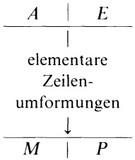

<details>
<summary>flowchart</summary>

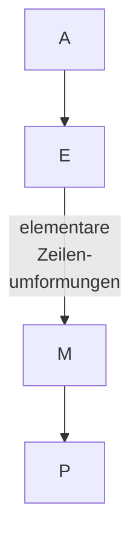
</details>

P ist ein Produkt von Elementarmatrizen.

## Beispiel.

<table><tr><td colspan="4">A</td><td colspan="3">E</td><td>Protokoll</td></tr><tr><td>1</td><td>-4</td><td>2</td><td>0</td><td>1</td><td>0</td><td>0</td><td></td></tr><tr><td>2</td><td>-3</td><td>-1</td><td>-5</td><td>0</td><td>1</td><td>0</td><td></td></tr><tr><td>3</td><td>-7</td><td>1</td><td>-5</td><td>0</td><td>0</td><td>1</td><td></td></tr><tr><td>1</td><td>-4</td><td>2</td><td>0</td><td>1</td><td>0</td><td>0</td><td></td></tr><tr><td>0</td><td>5</td><td>-5</td><td>-5</td><td>-2</td><td>1</td><td>0</td><td> $\mathbf{z}_{2} - 2\mathbf{z}_{1}$ </td></tr><tr><td>0</td><td>5</td><td>-5</td><td>-5</td><td>-3</td><td>0</td><td>1</td><td> $\mathbf{z}_{3} - 3\mathbf{z}_{1}$ </td></tr><tr><td>1</td><td>-4</td><td>2</td><td>0</td><td>1</td><td>0</td><td>0</td><td></td></tr><tr><td>0</td><td>1</td><td>-1</td><td>-1</td><td> $-\frac{2}{5}$ </td><td> $\frac{1}{5}$ </td><td>0</td><td> $\frac{1}{5}\mathbf{z}_{2}$ </td></tr><tr><td>0</td><td>0</td><td>0</td><td>0</td><td>-1</td><td>-1</td><td>1</td><td> $\mathbf{z}_{3} - \mathbf{z}_{2}$ </td></tr><tr><td colspan="4">= M</td><td colspan="3">= P</td><td></td></tr></table>

Also gilt  $(PA = M)$ :

$$
\left( \begin{array}{r r r} 1 & 0 & 0 \\ - 2 / 5 & 1 / 5 & 0 \\ - 1 & - 1 & 1 \end{array} \right) \left( \begin{array}{r r r r} 1 & - 4 & 2 & 0 \\ 2 & - 3 & - 1 & - 5 \\ 3 & - 7 & 1 & - 5 \end{array} \right) = \left( \begin{array}{r r r r} 1 & - 4 & 2 & 0 \\ 0 & 1 & - 1 & - 1 \\ 0 & 0 & 0 & 0 \end{array} \right).
$$


Berechnung der Inversen (Zeilenverfahren, Gauß-Jordan-Verfahren)

Jede invertierbare Matrix $A \in \mathbb{R}^{n \times n}$ läßt sich allein durch elementare Zeilenumformungen in die $n \times n$-Einheitsmatrix $E$ umwandeln. Denn mit $A$ ist auch die mittels Vorwärtselimination aus $A$ entstandene Zeilenstufenmatrix

$$
M _ {1} = \left( \begin{array}{c c c} \blacksquare & & * \\ 0 & \ddots & \blacksquare \end{array} \right)
$$

invertierbar (Rang A = Rang  $M_{1}$  = n), alle Diagonalelemente sind ≠ 0

(→ Satz 3.1). Die Rückwärtselimination (von unten nach oben) und Normierung der Diagonalstellen zu 1 führt von $M_{1}$ zu $E$.

Nach Ⓐ - mit M = E - ergibt sich
E = PA, also  $P = A^{-1}$ .

Da mit P auch  $A = P^{-1}$  ein Produkt von Elementarmatrizen ist, haben wir außerdem das nützliche Beweismittel:

<table><tr><td>A</td><td>E</td></tr><tr><td></td><td>|</td></tr><tr><td colspan="2">Gauß-Elimination(Vorwärts- und Rückwärtselimination im 1.Block)</td></tr><tr><td></td><td>↓</td></tr><tr><td>E</td><td> $A^{-1}$ </td></tr></table>

Satz 4.4. Jede invertierbare $n \times n$-Matrix ist darstellbar als Produkt von $n \times n$-Elementarmatrizen.

Beispiel.

<table><tr><td colspan="3">A</td><td colspan="3">E</td><td>Protokoll</td></tr><tr><td>1</td><td>2</td><td>3</td><td>1</td><td>0</td><td>0</td><td></td></tr><tr><td>2</td><td>1</td><td>0</td><td>0</td><td>1</td><td>0</td><td></td></tr><tr><td>1</td><td>0</td><td>2</td><td>0</td><td>0</td><td>1</td><td></td></tr><tr><td>1</td><td>2</td><td>3</td><td>1</td><td>0</td><td>0</td><td></td></tr><tr><td>0</td><td>-3</td><td>-6</td><td>-2</td><td>1</td><td>0</td><td> $\mathbf{z}_{2} - 2\mathbf{z}_{1}$ </td></tr><tr><td>0</td><td>-2</td><td>-1</td><td>-1</td><td>0</td><td>1</td><td> $\mathbf{z}_{3} - \mathbf{z}_{1}$ </td></tr><tr><td>1</td><td>2</td><td>3</td><td>1</td><td>0</td><td>0</td><td></td></tr><tr><td>0</td><td>-3</td><td>-6</td><td>-2</td><td>1</td><td>0</td><td></td></tr><tr><td>0</td><td>0</td><td>3</td><td> $\frac{1}{3}$ </td><td> $-\frac{2}{3}$ </td><td>1</td><td> $\mathbf{z}_{3} - \frac{2}{3}\mathbf{z}_{2}$ </td></tr><tr><td>1</td><td>2</td><td>0</td><td> $\frac{2}{3}$ </td><td> $\frac{2}{3}$ </td><td>-1</td><td> $\mathbf{z}_{1} - \mathbf{z}_{3}$ </td></tr><tr><td>0</td><td>1</td><td>0</td><td> $\frac{4}{9}$ </td><td> $\frac{1}{9}$ </td><td> $-\frac{2}{3}$ </td><td> $-\frac{1}{3}(\mathbf{z}_{2} + 2\mathbf{z}_{3})$ </td></tr><tr><td>0</td><td>0</td><td>1</td><td> $\frac{1}{9}$ </td><td> $-\frac{2}{9}$ </td><td> $\frac{1}{3}$ </td><td> $\frac{1}{3}\mathbf{z}_{3}$ </td></tr><tr><td>1</td><td>0</td><td>0</td><td> $-\frac{2}{9}$ </td><td> $\frac{4}{9}$ </td><td> $\frac{1}{3}$ </td><td> $\mathbf{z}_{1} - 2\mathbf{z}_{2}$ </td></tr><tr><td>0</td><td>1</td><td>0</td><td> $\frac{4}{9}$ </td><td> $\frac{1}{9}$ </td><td> $-\frac{2}{3}$ </td><td></td></tr><tr><td>0</td><td>0</td><td>1</td><td> $\frac{1}{9}$ </td><td> $-\frac{2}{9}$ </td><td> $\frac{1}{3}$ </td><td></td></tr></table>

Damit gilt:

$$
\left( \begin{array}{c c c} 1 & 2 & 3 \\ 2 & 1 & 0 \\ 1 & 0 & 2 \end{array} \right) ^ {- 1} = \left( \begin{array}{c c c} - \frac {2}{9} & \frac {4}{9} & \frac {1}{3} \\ \frac {4}{9} & \frac {1}{9} & - \frac {2}{3} \\ \frac {1}{9} & - \frac {2}{9} & \frac {1}{3} \end{array} \right)  .
$$


© Matrixgleichungen (Gauß-Verfahren).

Das in Ⓑ beschriebene Verfahren liefert bei allgemeiner rechter Seite $B \in \mathbb{R}^{n \times k}$ die eindeutig bestimmte Lösung $X = A^{-1}B$ der Matrixgleichung $AX = B$ ($X, B \in \mathbb{R}^{n \times k}$, $A \in \mathbb{R}^{n \times n}$ invertierbar). Denn mit $M = E$ zeigt (10) $N = A^{-1}B$.

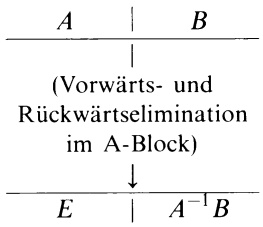

<details>
<summary>flowchart</summary>

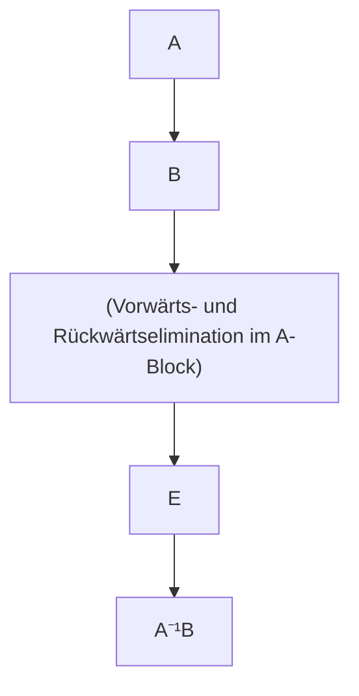
</details>

⑭ Die LR-Zerlegung.

Bringt man eine invertierbare $n \times n$-Matrix $A$ nach $\textcircled{A}$ nur mit Vorwärtselimination (Zeilenumformungen vom Typ $\textcircled{3}$) auf eine obere Dreiecksmatrix $M$, und kommt man dabei ohne Zeilenvertauschungen aus, dann beobachtet man auf der rechten Seite (des Rechenschemas) nur Veränderungen unterhalb der Diagonalen; d.h. $P$ ist eine untere Dreiecksmatrix mit lauter Einsen auf der Diagonalen. Es ist eine einfache Übung nachzuweisen (etwa anhand $\textcircled{B}$), daß auch $P^{-1}$ dieselbe Gestalt hat. Die Formel $A = P^{-1}M$ ($\rightarrow$ $\textcircled{A}$) besagt in diesem Fall:

A besitzt eine Produktzerlegung A = LR in eine untere Dreiecksmatrix  $L = P^{-1}$  (mit lauter Einsen auf der Diagonalen) und eine obere Dreiecksmatrix R = M (mit Diagonalelementen ≠ 0).

Diese sogenannte LR- oder Dreieckszerlegung ist sehr vorteilhaft für die Auflösung der Matrixgleichung AX = B, insbesondere dann, wenn diese für verschiedene rechte Seiten zu lösen ist: Man berechnet zuerst die Matrix Y (vom gleichen Typ wie X) mit LY = B und damit X aus RX = Y. Diese Rechnungen gestalten sich aufgrund der Dreiecksform von L und R recht einfach. (→ Programm GAUSS)

In der Praxis wird die LR-Zerlegung sehr oft direkt aus dem Ansatz A = LR bestimmt. (→ Aufgabe 5)

Beispiel. An dem zu Ⓑ angegebenen Beispiel kann man bereits nach der Vorwärtselimination $A = P^{-1}M$ ablesen:

$$
\left( \begin{array}{l l l} 1 & 2 & 3 \\ 2 & 1 & 0 \\ 1 & 0 & 2 \end{array} \right) = \left( \begin{array}{c c c} 1 & 0 & 0 \\ - 2 & 1 & 0 \\ \frac {1}{3} & - \frac {2}{3} & 1 \end{array} \right) ^ {- 1} \left( \begin{array}{c c c} 1 & 2 & 3 \\ 0 & - 3 & - 6 \\ 0 & 0 & 3 \end{array} \right) = \left( \begin{array}{l l l} 1 & 0 & 0 \\ 2 & 1 & 0 \\ 1 & \frac {2}{3} & 1 \end{array} \right) \left( \begin{array}{c c c} 1 & 2 & 3 \\ 0 & - 3 & - 6 \\ 0 & 0 & 3 \end{array} \right) \quad \square
$$

## B) Rechenverfahren, die nur Spaltenumformungen erfordern,

verlaufen nach folgendem Schema an  $A \in R^{m \times n}$  und  $C \in R^{k \times n}$ :

$$
\frac {A}{C} \left|\begin{array}{l l}&\text {elementare Spaltenumformungen}\\&\text {an A und gleichzeitig an C}\end{array}\right.\rightarrow \left|\begin{array}{c}M\\\hline N\end{array}\right..
$$

Nach Satz 4.2 gibt es eine invertierbare $n \times n$-Matrix $Q$ gleicher Spaltenzahl mit $\binom{M}{N} = \binom{A}{C} Q = \binom{AQ}{CQ} (\rightarrow (9))$, also $M = AQ$, $N = CQ$.

So berechnet man etwa die „Transformationsmatrix“ Q nach diesem Schema mit C = E (der  $n \times n$ -Einheitsmatrix).

⑤ Eine Basis für Kern A (Spaltenverfahren).

Sei $A \in \mathbb{R}^{m \times n}$. Wir bestimmen für den Lösungsraum Kern $A$ des homogenen linearen Gleichungssystems $Ax = 0$ wie folgt eine Basis:

$$
\frac {A}{E} \left|\begin{array}{l}\text {Vorwärtselimination für Spalten (von links}\\\text {nach rechts) im A - Block; diese Spalten-}\\\text {umformungen gleichzeitig an E ausführen}\end{array}\rightarrow \left|\begin{array}{c}N\\\hline Q\end{array}\right.\right.
$$

mit $N = (\mathbf{v}_1, \ldots, \mathbf{v}_r, \mathbf{0}, \ldots, \mathbf{0})$ in Spaltenstufenform $(\rightarrow(4)$, mit $\mathbf{v}_i \neq \mathbf{0}$, $r = \text{Rang } A$) und $Q = (\mathbf{q}_1, \ldots, \mathbf{q}_r, \mathbf{q}_{r+1}, \ldots, \mathbf{q}_n)$ (Spaltendarstellung). Nach Satz 4.3 gilt:

$$
(\mathbf {q} _ {r + 1}, \mathbf {q} _ {r + 2}, \dots , \mathbf {q} _ {n}) \quad \text {ist eine Basis von Kern A} . \tag {11}
$$

Die allgemeine Lösung von  $Ax = 0 \cdot lautet \quad x = \lambda_{1} q_{r+1} + \cdots + \lambda_{n-r} q_{n} \quad (\lambda_{i} \in R)$ .

Beispiel. Für die Matrix

$$
A = \left( \begin{array}{c c c c} 3 & 6 & 9 & - 3 \\ 0 & 2 & 6 & 1 0 \\ 1 5 & 3 4 & 5 8 & 3 \\ - 9 & - 1 0 & - 3 & 4 9 + \alpha \end{array} \right)
$$

ist in Abhängigkeit von  $\alpha$  eine Basis von Kern A zu bestimmen:

$$
\begin{array}{c c c c}3&6&9&- 3\\0&2&6&1 0\\1 5&3 4&5 8&3\\- 9&- 1 0&- 3&4 9 + \alpha\\\hline 1&0&0&0\\0&1&0&0\\0&0&1&0\\0&0&0&1\end{array}\rightarrow\begin{array}{c c c c}3&0&0&0\\0&2&6&1 0\\1 5&4&1 3&1 8\\- 9&8&2 4&4 0 + \alpha\\\hline 1&- 2&- 3&1\\0&1&0&0\\0&0&1&0\\0&0&0&1\end{array}\rightarrow\begin{array}{c c c c}3&0&0&0\\0&2&0&0\\1 5&4&1&- 2\\- 9&8&0&\alpha\\\hline 1&- 2&3&1 1\\0&1&- 3&- 5\\0&0&1&0\\0&0&0&1\end{array}\rightarrow\begin{array}{c c c c}3&0&0&0\\0&2&0&0\\1 5&4&1&0\\- 9&8&0&\alpha\\\hline 1&- 2&3&1 7\\0&1&- 3&- 1 1\\0&0&1&2\\0&0&0&1\end{array}
$$

Fall 1: $\alpha \neq 0 \Rightarrow \operatorname{Rang} A = 4$; Kern $A = \{\mathbf{0}\}$.

Fall 2: $\alpha = 0 \Rightarrow \operatorname{Rang} A = 3$; Dim Kern $A = 1$.

$$
\text {Kern} A = \left\{t \left( \begin{array}{c} 1 7 \\ - 1 1 \\ 2 \\ 1 \end{array} \right); t \in \mathbb {R} \right\}.
$$

Eine Mischung aus dem Gauß-Verfahren (→ §1) und dem vorstehenden Spaltenverfahren zur Lösung von Ax = 0 ergibt eine übersichtlich strukturierte Lösung der inhomogenen linearen Gleichung $Ax = b$ ($A \in \mathbb{R}^{m \times n}$, $b \in \mathbb{R}^m$, $b \neq 0$): Man beginnt mit dem Gauß-Verfahren; d.h., (A|b) wird mit elementaren Zeilenumformungen umgewandelt zu (M|d) mit M in Zeilenstufenform. $Mx = d$ besitzt genau dieselben Lösungen wie $Ax = b$. Im Fall der Lösbarkeit (Rang M = Rang (M|d)) berechnet man zuerst die spezielle (partikuläre) Lösung $v_0$, in der die freien Variablen den Wert Null haben. Dann bestimmt man mit dem Spaltenverfahren eine Basis $(u_1, \ldots, u_{n-r})$ von Kern M (= Kern A), was wegen der Dreiecksform von M recht einfach ist. Damit wird die allgemeine Lösung von $Ax = b$ dargestellt in der Form (→ Satz 1.2)

$$
\mathbf {x} = \mathbf {v} _ {0} + \lambda_ {1} \mathbf {u} _ {1} + \dots + \lambda_ {n - r} \mathbf {u} _ {n - r} \quad (\lambda_ {i} \in \mathbb {R}, r = \operatorname{Rang} A).
$$

Im nachfolgenden Programm GAUSS ist das Prinzip der LR-Zerlegung realisiert, wobei aber zusätzlich Zeilenvertauschungen vorgenommen (und gespeichert) werden, so daß in jedem Gauß-Eliminationsschritt das betragsgrößte Element einer Restspalte zum ■-Element (Pivot-Element) wird. Um bestmögliche numerische Ergebnisse zu erzielen, wird das Gleichungssystem zunächst äquilibriert, indem jede Gleichung durch die Länge des entsprechenden Zeilenvektors von A dividiert wird. Mit der fertigen „LR-Zerlegung“ kann die Rückwärtssubstitution mit verschiedenen rechten Seiten wiederholt werden.

```vba
' Programm GAUSS
' -------------------          ' ---- Zeilenvertauschung ---
Print "DIMENSION N=";              D=-D
Input N                      For J=0 To M
M=N-1                          Y=A(K,J)
Dim A(M,M),B(M),C(M)           A(K,J)=A(L,J)
Print "A ZEILENWEISE:"         A(L,J)=Y
For I=1 To N                  Next J
    For J=1 To N               C(L)=C(K)
        Print "A"+Str$(I)+Str$(J); Endif
        Input A(I-1,J-1)          ' -------------------
Next J                        C(K)=L
Next I                        D=D*A(K,K)
' ---- Zeilen skalieren ---- Exit If X<1.0E-09
For I=0 To M                   U=K
    Y=0                         X=A(K,K)
    For S=0 To M               If K<M Then
        Y=A(I,S)*A(I,S)+Y       For J=K+1 To M
Next S                          Y=-A(K,J)
If Y=0 Then                     V=J
    Print " A singulaer"       Gosub Scalar2
    End                       A(K,J)=-Y/X
Else                           Next J
    C(I)=1/Sqr(Y)      Endif
Endif                          Next K
Next I                        If Abs(D)<1.0E-09 Then
' ------ LR-Zerlegung ------   Print "A SINGULAER"
D=1                          End
For K=0 To M               Endif
    L=K                         Print "D=";D
    X=0                         ' -------------------
    V=K                         Repeat
    For I=K To M             Print "RECHTE SEITE"
        Y=-A(I,K)         For I=1 To N
        U=I                          Print "B"+Str$(I);
        Gosub Scalar2       Input B(I-1)
        A(I,K)=-Y           Next I
        Y=Abs(Y*C(I))      For I=0 To M
        If Y>X Then          Y=C(I)
            X=Y                          If I<>Y Then
                L=I                          X=B(I)
        Endif                          B(I)=B(Y)
Next I                        B(Y)=X
If L<>K Then          Endif
                            Next I
```

<div class="docvortex-algorithm" style="white-space: pre-wrap; font-family:monospace;">
U=O
For I=O To M
    Y=B(I)
    V=I-1
    Gosub Scalar1
    B(I)=-Y/A(I,I)
Next I
V=M
For I=M To O Step -l
    Y=B(I)
    U=I+1
    Gosub Scalar1
    B(I)=-Y
Next I
Print "ERGEBNIS"
For I=1 To N
    Print "X"+Str$(I)+"=";B(I-1)
Next I
Print "Neue rechte Seite (j/n)"
Input R$
Until R\$="n"
</div>

## Aufgaben

1. Für die folgenden Matrizen bestimme man

a) den Rang r (Zeilen- u. Spaltenumformungen!),
b) eine Basis des Zeilenraumes,
c) eine Basis des Spaltenraumes,
d) Matrizen P, Q, so daß  $PAQ = \begin{pmatrix} E_{r} & 0 \\ 0 & 0 \end{pmatrix}$ :

$$
\left( \begin{array}{c c c} 1 & 2 & 3 \\ 4 & 5 & 6 \\ 7 & 8 & 9 \end{array} \right) \qquad \left( \begin{array}{c c c c c} 1 & 3 & 1 & - 2 & - 3 \\ 1 & 4 & 3 & - 1 & - 4 \\ 2 & 3 & - 4 & - 7 & - 3 \\ 3 & 8 & 1 & - 7 & - 8 \end{array} \right) \qquad \left( \begin{array}{c c c c c} 1 & - 1 & 2 & 3 & 0 \\ 0 & 1 & 0 & 1 & 1 \\ 1 & 0 & 1 & 0 & 1 \\ 0 & 0 & 0 & 1 & 0 \\ 0 & 1 & 0 & 0 & 1 \end{array} \right).
$$

2. Mittels Zeilenverfahren Ⓑ berechne – falls möglich – die Inversen von

$$
\left( \begin{array}{c c c} 1 & 0 & - 1 \\ 3 & 1 & - 3 \\ 1 & 2 & - 2 \end{array} \right) \quad \left( \begin{array}{c c c c} 1 & 3 & - 1 & 4 \\ 2 & 5 & - 1 & 3 \\ 0 & 4 & - 3 & 1 \\ - 3 & 1 & - 5 & - 2 \end{array} \right) \quad \left( \begin{array}{c c c c c} 1 / 2 & 1 / 3 & 1 / 4 & 1 / 5 & 1 / 6 \\ 1 / 3 & 1 / 4 & 1 / 5 & 1 / 6 & 1 / 7 \\ 1 / 4 & 1 / 5 & 1 / 6 & 1 / 7 & 1 / 8 \\ 1 / 5 & 1 / 6 & 1 / 7 & 1 / 8 & 1 / 9 \\ 1 / 6 & 1 / 7 & 1 / 8 & 1 / 9 & 1 / 1 0 \end{array} \right)
$$

und stelle die 3 × 3-Matrix als Produkt von Elementarmatrizen dar.

3. Man löse die Matrixgleichung AX = B gemäß Verfahren ©, analog dazu BY = A und berechne schließlich zur Kontrolle XY für

$$
\text {a)} \quad A = \left( \begin{array}{c c c} 1 & 3 & - 1 \\ 2 & 5 & - 1 \\ 0 & 4 & - 3 \end{array} \right), B = \left( \begin{array}{c c c} 1 & 3 & 1 \\ 1 & 4 & 3 \\ 2 & 3 & - 4 \end{array} \right);
$$

$$
\text {b)} A = \left( \begin{array}{r r r r} 1 & 2 & - 2 & 1 \\ 2 & 5 & - 2 & 2 \\ - 2 & - 4 & 3 & 0 \\ 1 & 3 & 0 & 2 \end{array} \right), B = \left( \begin{array}{r r r r} 1 & 0 & - 1 & 0 \\ 2 & - 1 & - 2 & 3 \\ - 1 & 2 & 2 & - 4 \\ 0 & 1 & 2 & - 5 \end{array} \right).
$$

4. a) Mittels Zeilenumformungen bestimme man gemäß Ⓓ für A eine untere Dreiecksmatrix P und eine obere Dreiecksmatrix R, so daß PA = R und leite daraus die LR-Zerlegung von A ab:

$$
A = \left( \begin{array}{c c c c} 3 & 6 & 9 & - 3 \\ 0 & 2 & 6 & 1 0 \\ 1 5 & 3 4 & 5 8 & 3 \\ - 9 & - 1 0 & - 3 & 5 0 \end{array} \right) = \mathrm{LR} = \left( \begin{array}{c c c} 1 & & 0 \\ * & & 1 \end{array} \right) \left( \begin{array}{c c c} * & & * \\ & \ddots & \\ 0 & & * \end{array} \right) .
$$

b) Man bestätige, daß  $A = \begin{pmatrix} 2 & 6 & 13 \\ 0 & 0 & 4 \\ 0 & 3 & 16 \end{pmatrix}$  invertierbar ist aber keine LR-Zerlegung besitzt!

5. a) Man bestimme die LR-Zerlegung:

$$
\begin{array}{l} H = \left( \begin{array}{l l l l} 1 / 2 & 1 / 3 & 1 / 4 & 1 / 5 \\ 1 / 3 & 1 / 4 & 1 / 5 & 1 / 6 \\ 1 / 4 & 1 / 5 & 1 / 6 & 1 / 7 \\ 1 / 5 & 1 / 6 & 1 / 7 & 1 / 8 \end{array} \right) = \mathrm{LR} = (*) ((*)) \\ = \left( \begin{array}{c c c c} 1 & & 0 \\ l _ {2 1} & 1 & & \\ l _ {3 1} & l _ {3 2} & 1 & \\ l _ {4 1} & l _ {4 2} & l _ {4 3} & 1 \end{array} \right) \left( \begin{array}{c c c c} r _ {1 1} & r _ {1 2} & r _ {1 3} & r _ {1 4} \\ & r _ {2 2} & r _ {2 3} & r _ {2 4} \\ & & r _ {3 3} & r _ {3 4} \\ & 0 & & r _ {4 4} \end{array} \right) \\ \end{array}
$$

— durch Zeilenverfahren Ⓓ ,
— direkt aus (\*): LR ausmultiplizieren und auflösen nach $r_{11}, l_{21}, l_{31}, \ldots$.

6. Man bestimme – abhängig von  $\alpha$  – mittels Spaltenverfahren Ⓔ eine Basis von Kern A für die Matrizen A

$$
\left( \begin{array}{c c c c} 1 & 1 & 2 & 3 \\ 2 & 3 & 3 & 7 \\ 4 & 5 & 3 0 & 1 4 \\ 3 & 2 & 6 \alpha + 7 & 2 \alpha + 8 \end{array} \right), \qquad \left( \begin{array}{c c c c} 1 & 1 & 1 & 1 \\ 2 & 0 & 2 & 6 \\ 3 & 2 & 1 & - 1 \\ 0 & 0 & 1 & \alpha \\ 5 & - 1 & 1 & 5 \end{array} \right).
$$

7. Man zeige für eine invertierbare Matrix A

a) $A = A^{T} \Rightarrow A^{-1} = (A^{-1})^{T}$,
b) $A = -A^{T} \Rightarrow A^{-1} = -(A^{-1})^{T}$.

8. Es seien $A \in \mathbb{R}^{m \times n}$ und $B \in \mathbb{R}^{n \times m}$ mit $AB = 0$. Man beweise oder widerlege mit einem Beispiel:

a) Es gilt auch BA = 0,
b) Rang $A = n \Rightarrow B = 0$,
c) Rang $A = m \Rightarrow B = 0$.

9. Man zeige, daß jede invertierbare Matrix allein durch elementare Zeilenumformungen vom Typ ③ auf die Form $\mathrm{Diag}(1,\dots,1,d)$ mit $d\neq 0$ gebracht werden kann.

10. Pseudo-Inverse einer Matrix $A \in \mathbb{R}^{m \times n}$ nennt man eine Matrix $A^{+} \in \mathbb{R}^{n \times m}$, für welche

(i) $A^{+}AA^{+} = A^{+}$
(ii) $AA^{+}A = A$ .

a) Man zeige: Für $A = \begin{pmatrix} E_r & 0 \\ 0 & 0 \end{pmatrix}$ ist $A^T$ eine Pseudo-Inverse.
b) Man bestätige: Sind $P \in \mathbb{R}^{m \times m}$, $Q = \in \mathbb{R}^{n \times n}$ invertierbar und $A^+$ Pseudo-Inverse von $A$, so ist $B^+ = Q^{-1} A^+ P^{-1}$ Pseudoinverse von $B = PAQ$.
c) Man bestimme eine Pseudoinverse für  $\begin{pmatrix}0&1\\0&0\end{pmatrix}$  und  $\begin{pmatrix}1&0&1\\2&3&8\end{pmatrix}$ .

## §5. Determinanten

5.1 Einführung. Determinanten wurden bereits 1678 von G. W. LEIBNIZ eingeführt, sie waren aber – aufgrund ihrer komplizierten Berechnung – für lange Zeit als magisches Rechenmittel verrufen und nur den Könnern vorbehalten. Man kann mit ihnen elementargeometrische Größen äußerst elegant beschreiben, die Lösung eines linearen Gleichungssystems mit invertierbarer Koeffizientenmatrix direkt als Funktion der Koeffizienten darstellen und schließlich den Test „Rang A < n“ bei einer  $n \times n$ -Matrix auf eine bloße Nullabfrage zurückführen.

2-reihige Determinanten. Das von zwei Vektoren $\mathbf{a}=\begin{pmatrix}\alpha_{1}\\ \alpha_{2}\end{pmatrix},\mathbf{b}=\begin{pmatrix}\beta_{1}\\ \beta_{2}\end{pmatrix}$ der $(x,y)$-Ebene erzeugte Parallelogramm hat nach Kap. 1, §5.3 den Flächeninhalt

$$
F = \left| \left( \begin{array}{c} \alpha_ {1} \\ \alpha_ {2} \\ 0 \end{array} \right) \times \left( \begin{array}{c} \beta_ {1} \\ \beta_ {2} \\ 0 \end{array} \right) \right| = | \alpha_ {1} \beta_ {2} - \alpha_ {2} \beta_ {1} |.
$$

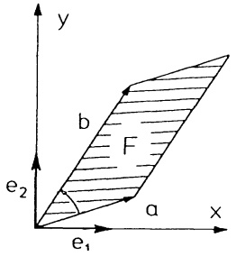

<details>
<summary>text_image</summary>

y
b
F
e₂
a
x
e₁
</details>

Abb. 143 - Parallelogrammfläche

Es ist $F = \alpha_{1}\beta_{2} - \alpha_{2}\beta_{1} \geq 0$, wenn die Drehung von $\mathbf{a}$ nach $\mathbf{b}$ über den kleineren Winkel positiv (gegen den Uhrzeigersinn) erfolgt, andernfalls gilt $-F = \alpha_{1}\beta_{2} - \alpha_{2}\beta_{1} \leq 0$. Die Zahl

$$
\det A := \alpha_ {1} \beta_ {2} - \alpha_ {2} \beta_ {1} \tag {1}
$$

heißt Determinante der  $2 \times 2$ -Matrix  $A = \begin{pmatrix} \alpha_{1} & \beta_{1} \\ \alpha_{2} & \beta_{2} \end{pmatrix}$ . Man berechnet sie nach dem Schema +

$$
\det \left( \begin{array}{c c} \alpha_ {1} & \beta_ {1} \\ \times & \\ \alpha_ {2} & \beta_ {2} \end{array} \right) = \alpha_ {1} \beta_ {2} - \alpha_ {2} \beta_ {1}.
$$

Es ist det  $A = \pm F = 0$  genau dann, wenn a, b parallel sind (oder einer der beiden der Nullvektor ist). Damit ist gezeigt:

$$
\begin{array}{l} \binom{\alpha_ {1}}{\alpha_ {2}}, \binom{\beta_ {1}}{\beta_ {2}} \text {linear abhängig} \Longleftrightarrow \det \left( \begin{array}{c c} \alpha_ {1} & \beta_ {1} \\ \alpha_ {2} & \beta_ {2} \end{array} \right) = 0 \\ A = \left( \begin{array}{c c} \alpha_ {1} & \beta_ {1} \\ \alpha_ {2} & \beta_ {2} \end{array} \right) \text {invertierbar} \iff \det A \neq 0 \\ \end{array}
$$

bzw., äquivalent dazu

Beispiel.  $\det\begin{pmatrix}1&3\\2&5\end{pmatrix}=1\cdot5-2\cdot3=-1\neq0$ . Die Matrix ist invertierbar;
 $\left(\begin{array}{cc}1 & 3 \\ 2 & 5\end{array}\right)^{-1}=(-1)\begin{pmatrix}5 & -3 \\ -2 & 1\end{pmatrix}.$

Ferner: Der Flächeninhalt des von  $\begin{pmatrix}1\\2\end{pmatrix}$  und  $\begin{pmatrix}3\\5\end{pmatrix}$  aufgespannten Parallelogramms beträgt  $F = |\det A| = 1$ .

3-reihige Determinanten. Ein Spat mit den bezüglich einer kartesischen Basis dargestellten Kanten

$$
\mathbf {a} _ {1} = \left( \begin{array}{c} \alpha_ {1 1} \\ \alpha_ {2 1} \\ \alpha_ {3 1} \end{array} \right), \mathbf {a} _ {2} = \left( \begin{array}{c} \alpha_ {1 2} \\ \alpha_ {2 2} \\ \alpha_ {3 2} \end{array} \right), \mathbf {a} _ {3} = \left( \begin{array}{c} \alpha_ {1 3} \\ \alpha_ {2 3} \\ \alpha_ {3 3} \end{array} \right)
$$

hat nach Kap. 1, §5.4 das Volumen

$$
\begin{array}{l} V = | [ \mathbf {a} _ {1}, \mathbf {a} _ {2}, \mathbf {a} _ {3} ] | \tag {2} \\ = | \alpha_ {1 1} (\alpha_ {2 2} \alpha_ {3 3} - \alpha_ {3 2} \alpha_ {2 3}) - \alpha_ {2 1} (\alpha_ {1 2} \alpha_ {3 3} - \alpha_ {3 2} \alpha_ {1 3}) + \alpha_ {3 1} (\alpha_ {1 2} \alpha_ {2 3} - \alpha_ {2 2} \alpha_ {1 3}) | \\ \end{array}
$$

Die bisher als Spatprodukt bekannte Zahl

$$
\det A := [ \mathbf {a} _ {1}, \mathbf {a} _ {2}, \mathbf {a} _ {3} ]
$$

heißt auch Determinante der 3 × 3-Matrix

$$
A = \left( \begin{array}{c c c} \alpha_ {1 1} & \alpha_ {1 2} & \alpha_ {1 3} \\ \alpha_ {2 1} & \alpha_ {2 2} & \alpha_ {2 3} \\ \alpha_ {3 1} & \alpha_ {3 2} & \alpha_ {3 3} \end{array} \right) .
$$

Es gilt $V = \det A > 0$, wenn $(\mathbf{a}_1, \mathbf{a}_2, \mathbf{a}_3)$ ein Rechtssystem ist. $V = \det A = 0$ genau dann, wenn der Spat entartet ist, d.h. wenn $\mathbf{a}_1, \mathbf{a}_2, \mathbf{a}_3$ linear abhängig sind. In anderen Worten:

$$
\begin{array}{c} \text {Rang} A <   3 \iff \det A = 0, \text {bzw.} \\ \text {Rang} A = 3 \iff A \text {invertierbar} \iff \det A \neq 0. \end{array}
$$

Die auf der rechten Seite von (2) eingeklammerten Faktoren erkennt man als Determinanten gewisser  $2 \times 2$ -Matrizen. D.h.,

$$
\det A = \alpha_ {1 1} \det \left( \begin{array}{l l} \alpha_ {2 2} & \alpha_ {2 3} \\ \alpha_ {3 2} & \alpha_ {3 3} \end{array} \right) - \alpha_ {2 1} \det \left( \begin{array}{l l} \alpha_ {1 2} & \alpha_ {1 3} \\ \alpha_ {3 2} & \alpha_ {3 3} \end{array} \right) + \alpha_ {3 1} \det \left( \begin{array}{l l} \alpha_ {1 2} & \alpha_ {1 3} \\ \alpha_ {2 2} & \alpha_ {2 3} \end{array} \right) \tag {3}
$$

Anschaulich:

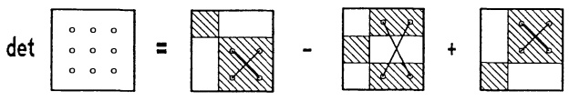

<details>
<summary>text_image</summary>

det = - +
</details>

Abb. 144 - 3 × 3-Determinante

Für $3 \times 3$-Matrizen gibt es die nach dem französischen Mathematiker P. F. SARRUS (1798 - 1861) benannte Regel:

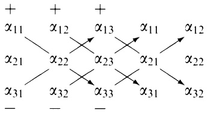

<details>
<summary>flowchart</summary>

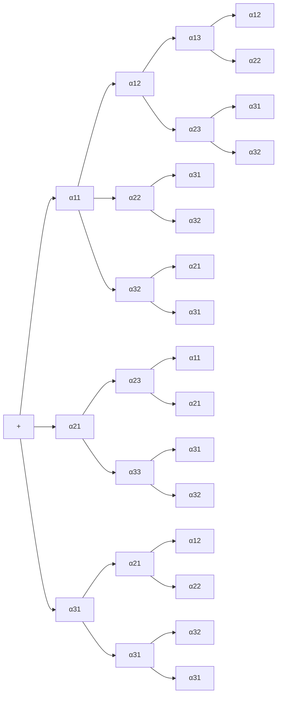
</details>

Man schreibt die ersten beiden Spalten noch einmal rechts neben A, addiert die längs der ↘-Diagonalen zu bildenden Produkte und subtrahiert die längs ↗ berechneten Produkte. Man erhält

$$
\begin{array}{l} \det A = \alpha_ {1 1} \alpha_ {2 2} \alpha_ {3 3} + \alpha_ {1 2} \alpha_ {2 3} \alpha_ {3 1} + \alpha_ {1 3} \alpha_ {2 1} \alpha_ {3 2} - \alpha_ {3 1} \alpha_ {2 2} \alpha_ {1 3} \\ - \alpha_ {3 2} \alpha_ {2 3} \alpha_ {1 1} - \alpha_ {3 3} \alpha_ {2 1} \alpha_ {1 2} . \\ \end{array}
$$

Beispiel.

$$
A = \left( \begin{array}{c c c} 0 & - 2 & 3 \\ - 2 & 1 & - 2 \\ 3 & 6 & 5 \end{array} \right) \quad \begin{array}{c} 0 \\ - 2 \\ 3 \end{array} \begin{array}{c} - 2 \\ 1 \\ 6 \end{array} \begin{array}{c} - 2 \\ - 2 \\ 5 \end{array} \begin{array}{c} 3 \\ - 2 \\ 3 \end{array} \begin{array}{c} 0 \\ - 2 \\ 1 \\ 6 \end{array}
$$

det $A = 0 + 12 - 36 - 9 - 0 - 20 = -53$. Die Matrix ist invertierbar, die Spalten bilden eine Basis des $\mathbb{R}^3$, aber kein Rechtssystem. Der von den Spalten (in kartesischen Koordinaten) aufgespannte Spat hat das Volumen $V = |\det A| = 53$.

Bemerkung. Die Regel von SARRUS läßt sich nicht auf die in 5.2 definierten n-reihigen Determinanten mit n > 3 übertragen.

5.2 Definition der Determinante einer  $n \times n$ -Matrix. Als Verallgemeinerung der beiden Sonderfälle n = 2, n = 3 ergibt sich für beliebiges  $n \in N$  die folgende

(4)

Rekursive Definition der Determinante det $A$, $A = (\alpha_{ij}) \in \mathbb{R}^{n \times n}$.

Für $n = 1$, d.h. $A = (\alpha_{11})$, ist $\det A := \alpha_{11}$.

Für $n \geq 2$ ist (Entwicklung von det $A$ nach der ersten Spalte)

$$
\det A := \alpha_ {1 1} \det A _ {1 1} - \alpha_ {2 1} \det A _ {2 1} + \alpha_ {3 1} \det A _ {3 1}
$$

$$
- + \dots + (- 1) ^ {n + 1} \alpha_ {n 1} \det A _ {n 1},
$$

wobei $A_{i1}$ die $(n-1)\times(n-1)$-Matrix bezeichnet, die aus $A$ durch Entfernen (Streichen) der ersten Spalte und der $i$-ten Zeile entsteht $(1\leq i\leq n)$.

Für det A ist ebenfalls die Bezeichnung  $|A|$  üblich.

Die folgende Abbildung veranschaulicht (4):

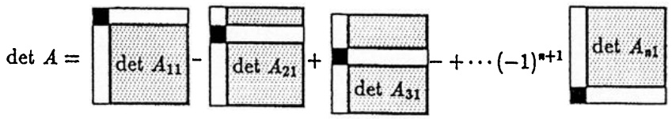

<details>
<summary>text_image</summary>

det A = 
det A₁₁ - 
det A₂₁ + 
det A₃₁ - + ... (-1)ⁿ⁺¹ 
det Aₙ₁
</details>

Abb. 145 - Entwicklung nach der 1. Spalte

Beispiel.

$$
A = \left( \begin{array}{c c c c} 1 & 2 & 0 & 1 \\ 3 & - 2 & 1 & 0 \\ 0 & 6 & 3 & - 2 \\ 2 & 4 & 3 & 1 \end{array} \right), A _ {1 1} = \left( \begin{array}{c c c} - 2 & 1 & 0 \\ 6 & 3 & - 2 \\ 4 & 3 & 1 \end{array} \right)
$$

$$
A _ {2 1} = \left( \begin{array}{c c c} 2 & 0 & 1 \\ 6 & 3 & - 2 \\ 4 & 3 & 1 \end{array} \right), A _ {3 1} = \left( \begin{array}{c c c} 2 & 0 & 1 \\ - 2 & 1 & 0 \\ 4 & 3 & 1 \end{array} \right), A _ {4 1} = \left( \begin{array}{c c c} 2 & 0 & 1 \\ - 2 & 1 & 0 \\ 6 & 3 & - 2 \end{array} \right)
$$

$\operatorname{det} A = 1 \cdot \operatorname{det} A_{11} - 3 \cdot \operatorname{det} A_{21} + 0 \cdot \operatorname{det} A_{31} - 2 \cdot \operatorname{det} A_{41}$

$$
= - 3 2 - 3 \cdot 2 4 - 2 \cdot (- 1 6) = - 7 2.
$$

Bemerkung. Wendet man (4) rekursiv in (4) auf det  $A_{i1}$  ( $1 \leq i \leq n$ ) an, so ergibt sich zum Schluß die sogenannte vollständige Entwicklung der Determinante

$$
\det A = \sum_ {i = (i _ {1}, \dots , i _ {n})} (- 1) ^ {\epsilon (i)} \alpha_ {i _ {1} 1} \alpha_ {i _ {2} 2} \dots \alpha_ {i _ {n} n},
$$

wobei sich die Summe über alle Permutationen  $i = (i_{1}, \ldots, i_{n})$  der Zahlen  $1, 2, \ldots, n$  erstreckt, und  $\epsilon(i)$  gleich der Anzahl der Vertauschungen ist, die erforderlich sind, um  $(i_{1}, \ldots, i_{n})$  in die natürliche Reihenfolge zu bringen.

Die vollständige Entwicklung besteht aus $n!$ Summanden. Da mit wachsendem $n$ die Fakultät $n!$ rapide ansteigt ($7!=5040$), sucht man nach Eigenschaften, die eine schnellere Berechnung von det $A$, etwa durch Rückführung auf den folgenden Spezialfall, erlauben.

Satz 5.1. Für eine obere Dreiecksmatrix gilt

$$
\det \left( \begin{array}{c c c c} \alpha_ {1 1} & * & \dots & * \\ 0 & \alpha_ {2 2} & \ddots & \vdots \\ \vdots & \ddots & \ddots & * \\ 0 & \dots & 0 & \alpha_ {n n} \end{array} \right) = \alpha_ {1 1} \alpha_ {2 2} \dots \alpha_ {n n}.
$$

Speziell: $\det E = 1$, $\det (\alpha E) = \alpha^n$ ($E \in \mathbb{R}^{n \times n}$).

Beweis. Wegen  $\alpha_{21}=\cdots=\alpha_{n1}=0$  reduziert sich (4) auf

$\operatorname*{det} A = \alpha_{11} \operatorname*{det}\left( \begin{array}{c} \alpha_{22} \\ 0 \end{array} \cdot \begin{array}{c} * \\ \alpha_{nn} \end{array} \right) = \alpha_{11} \alpha_{22} \operatorname*{det}\left( \begin{array}{c} \alpha_{33} \\ 0 \end{array} \cdot \begin{array}{c} * \\ \alpha_{nn} \end{array} \right) = \cdots = \alpha_{11} \alpha_{22} \dots \alpha_{nn}.$

## Beispiele.

$$
\det \left( \begin{array}{c c c c} 3 & 4 & 0 & 2 \\ 0 & 1 & 4 & 5 \\ 0 & 0 & - 2 & 6 \\ 0 & 0 & 0 & 1 \end{array} \right) = - 6; \quad \det \left( \begin{array}{c c c c c} 7 & 3 & 4 & 2 & 1 \\ 0 & 0 & 2 & 4 & 1 \\ 0 & 0 & 5 & - 1 & 2 \\ 0 & 0 & 0 & 4 & 3 \\ 0 & 0 & 0 & 0 & 6 \end{array} \right) = 0.
$$

5.3 Rechenregeln für Determinanten. Der folgende Satz enthält die grundlegenden Eigenschaften der Determinante.

Satz 5.2. a) det ist linear in jeder Zeile. Damit ist gemeint:

1. Ein gemeinsamer Faktor einer Zeile von A kann aus det A herausgezogen werden.
2. Besteht eine Zeile von A aus einer Summe,  $z_{i} = a + b$ , dann besitzt det A die entsprechende Summenzerlegung. In Formeln:

$$
\det \left( \begin{array}{c} \mathbf {z} _ {1} \\ \vdots \\ \alpha \mathbf {z} _ {i} \\ \vdots \\ \mathbf {z} _ {n} \end{array} \right) = \alpha \det \left( \begin{array}{c} \mathbf {z} _ {1} \\ \vdots \\ \mathbf {z} _ {i} \\ \vdots \\ \mathbf {z} _ {n} \end{array} \right), \quad \det \left( \begin{array}{c} \mathbf {z} _ {1} \\ \vdots \\ \mathbf {a} + \mathbf {b} \\ \vdots \\ \mathbf {z} _ {n} \end{array} \right) = \det \left( \begin{array}{c} \mathbf {z} _ {1} \\ \vdots \\ \mathbf {a} \\ \vdots \\ \mathbf {z} _ {n} \end{array} \right) + \det \left( \begin{array}{c} \mathbf {z} _ {1} \\ \vdots \\ \mathbf {b} \\ \vdots \\ \mathbf {z} _ {n} \end{array} \right).
$$

b) det ist alternierend. Das bedeutet: Entsteht $\tilde{A}$ aus $A \in \mathbb{R}^{n \times n}$ durch Vertauschung zweier Zeilen, dann gilt det $\tilde{A} = -\det A$; insbesondere det $A = 0$, falls $A$ zwei gleiche Zeilen enthält.

Beweis. a) beweist man leicht mit vollständiger Induktion  $(n = 1, 2, \ldots)$  und der Rekursionsformel (4).

b): Wegen der alternierenden Vorzeichen erkennt man an (4) (ebenfalls mit vollständiger Induktion), daß sich bei Vertauschung zweier benachbarter Zeilen das Vorzeichen ändert. Da man die Vertauschung zweier beliebiger Zeilen von A stets durch eine ungerade Anzahl von Vertauschungen benachbarter Zeilen erzielen kann, ist nun alles bewiesen. Sind zwei Zeilen von A gleich, so gilt mit einer Vertauschung dieser beiden Zeilen det A = -det A ; das ist nur mit det A = 0 möglich.

Satz 5.3. Die Rechenregeln für Determinanten. Für alle $A, B \in \mathbb{R}^{n \times n}$ gilt:

a) Die Änderung bei elementaren Zeilen- bzw. Spaltenumformungen. Entsteht $\tilde{A}$ aus A durch eine elementare Zeilen- oder Spaltenumformung vom Typ ⓘ, dann ändert sich die Determinante wie folgt:

$$
\begin{array}{l} \begin{array}{l} \text {Typ} \quad ①: \quad \det \tilde {A} = - \det A, \\ \text {Typ} \quad ②: \quad \det \tilde {A} = \alpha \det A \quad (\text {Faktor} \alpha \neq 0), \end{array} \tag {5} \\ \text {Typ} \quad ③: \quad \det \tilde {A} = \det A. \\ \end{array}
$$

b) Symmetrie in Zeilen und Spalten.

$$
\det A ^ {T} = \det A ;
$$

insbesondere gilt Satz 5.2 entsprechend für Spalten.

c) Multiplikationssatz.

(6) $\operatorname{det}(AB) = (\operatorname{det} A)(\operatorname{det} B)$.

d) Invertierbarkeits-Test. A invertierbar $\iff$ det $A \neq 0$;

äquivalent dazu: Rang A < n  $\Longleftrightarrow$  det A = 0.

Beweis. a): Für die Zeilenumformungen vom Typ ① und ② stehen die Formeln in Satz 5.2. Für Typ ③ ($\mathbf{z}_i \to \mathbf{z}_i + \alpha \mathbf{z}_j$) verwendet man die Linearität in der $i$-ten Zeile und det $\begin{pmatrix} \dot{\mathbf{z}}_j \\ \vdots \\ \mathbf{z}_j \\ \vdots \end{pmatrix} = 0$. Die Gültigkeit dieser Formeln bei Spaltenumformungen ergibt sich rückwirkend, sobald b) bewiesen ist.

d): Mit elementaren Zeilenumformungen läßt sich $A$ in eine obere Dreiecksmatrix $M$ umwandeln. Nach (5) gilt $\det M = \gamma \det A$ mit $\gamma \neq 0$. Damit: $A$ invertierbar $\iff$ sämtliche Diagonalelemente in $M$ sind $\neq 0$ ($\rightarrow 4.4$ Ⓑ)) $\iff$ $\det M \neq 0$ ($\rightarrow$ Satz 5.1) $\iff$ $\det A \neq 0$.

c): (5) (für Zeilenumformungen) zeigt für $A = E$ wegen det $E = 1$, daß es sich bei den Koeffizienten jeweils um die Determinante der zugehörigen Elementarmatrix $\tilde{E}$ handelt ($\tilde{A} = \tilde{E}A, \to \text{Satz } 4.2$); deshalb läßt sich (5) in der einheitlichen Form

(7) $\operatorname{det}(\tilde{E} A) = \operatorname{det}\tilde{E} \cdot \operatorname{det}A$

angeben. Also gilt (6) für Elementarmatrizen, damit auch für alle endlichen Produkte von Elementarmatrizen und deshalb ( $\rightarrow$  Satz 4.4) für alle invertierbaren A, B.

Ist A oder B nicht invertierbar, so auch AB nicht und es gilt det AB = det A det B = 0.

b): Ist $A$ nicht invertierbar, so gilt nach d) $\det A = 0 = \det A^T$. Wegen Satz 4.4 und (6) braucht nur noch $\det \tilde{E} = \det \tilde{E}^T$ für jede Elementarmatrix nachgewiesen zu werden. Das geschieht direkt: Für $\tilde{E}$ vom Typ ① oder