9. Als Drehspiegelung bezeichnet man im  $R^{3}$  eine Drehung um 0 (Achsenrichtung a,  $|a| = 1$ , Drehwinkel  $\varphi$ ) mit anschließender Spiegelung an der Ebene  $x \cdot a = 0$ .

a) Man zerlege x und y wie skizziert orthogonal längs a und leite daraus eine Vektorgleichung für  $x \mapsto y$  ab.
b) Man bestimme die Matrix $D$ der Drehspiegelung und leite aus Spur $D$ und $D - D^{T}$ Formeln für $\cos \varphi$ und die Komponenten von $\mathbf{a}$ ab.

Welche Ausnahmefälle sind zu beachten?

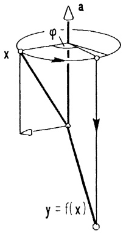

<details>
<summary>text_image</summary>

a
φ
x
y = f(x)
</details>

10. Man berechne die Achsenrichtung und den Winkel der Drehung mit den Euler-Winkeln  $\psi = 45^{\circ}$ ,  $\theta = 45^{\circ}$ ,  $\varphi = 90^{\circ}$ .

11. Die Matrizen $V = \begin{pmatrix} 0 & -1 & 0 \\ 1 & 0 & 0 \\ 0 & 0 & 1 \end{pmatrix}$, $T = \begin{pmatrix} 0 & 0 & 1 \\ 1 & 0 & 0 \\ 0 & 1 & 0 \end{pmatrix}$ beschreiben zwei Drehungen, die den Würfel mit den acht Ecken ($\pm 1, \pm 1, \pm 1$) in sich überführen.

a) Man bestimme die Drehachsen von $V$ und $T$ und berechne $V^{2}$, $V^{3}$, $V^{4}$, $V^{-1}$, $T^{2}$, $T^{3}$, $T^{-1}$.

Welche Drehwinkel haben somit V und T?

b) Berechne $VT$, $(VT)^{2}$, $TV$, $(TV)^{2}$, die zugehörigen Drehachsen und Drehwinkel und bestätige die Beziehung $VT = T^{2}V^{3}$.

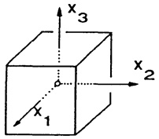

<details>
<summary>text_image</summary>

x₁
x₂
x₃
</details>

c) Begründe: Durch geeignete Produkte von V und T erhält man alle 24 Drehungen, die den Würfel in sich abbilden (Hexaeder-Gruppe).

12. (Darstellung eines 4D-Würfels)

Der Würfel  $W = \left\{ x \in R^{4} ; |x_{1}| \leq 1, |x_{2}| \leq 1, |x_{3}| \leq 1, 0 \leq x_{4} \leq 2 \right\}$  wird

zunächst in Richtung des Vektors  $(1,1,1,-2)^{T}$  in den 3-dimensionalen Teilraum  $x_{4}=0$  projiziert und anschließend parallel zu  $(2,1,-4,0)^{T}$  in die 2-dimensionale Ebene  $x_{3}=x_{4}=0$  abgebildet.

Man bestimme die Matrix A der gesamten Abbildung

$$
f: \mathbb {R} ^ {4} \to \mathbb {R} ^ {4}, f (x) = A x, x \in \mathbb {R} ^ {4},
$$

und skizziere das Bild aller Kanten von W.

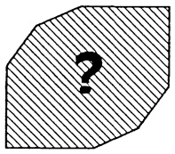

<details>
<summary>natural_image</summary>

Simple geometric shape with a question mark inside, no text or symbols present
</details>

13. a) Man berechne die Eigenwerte und Eigenvektoren folgender Matrizen A :

$$
A = \left( \begin{array}{c c} 5 & 6 \\ 0 & 5 \end{array} \right); \quad B = \left( \begin{array}{c c c} - 2 & - 8 & - 1 2 \\ 1 & 4 & 4 \\ 0 & 0 & 1 \end{array} \right).
$$

b) Man bestimme – falls möglich – invertierbare Matrizen P und Q, so daß  $D_{A} = P^{-1}AP$  und  $D_{B} = Q^{-1}BQ$  Diagonalgestalt besitzen und berechne  $D_{A}$  bzw.  $D_{B}$ . Mit Hilfe von P ermittle man explizit  $A^{100}$ .

14. Man berechne Eigenwerte und Eigenvektoren von

$$
\left( \begin{array}{c c c c} a & b & b & b \\ b & a & b & b \\ b & b & a & b \\ b & b & b & a \end{array} \right), \qquad \left( \begin{array}{c c c} 7 & - 2 & 1 \\ - 2 & 1 0 & - 2 \\ 1 & - 2 & 7 \end{array} \right), \qquad \left( \begin{array}{c c c c} 4 & 1 & 0 & 0 \\ - 3 & 1 & 1 & 1 \\ 0 & 0 & 4 & 1 \\ 1 & 0 & - 3 & 0 \end{array} \right).
$$

Hilfe: Die dritte Matrix besitzt einen dreifachen Eigenwert.

15. Die Matrix $N$ ist nilpotent; denn $N^{3}=0$. Welche Eigenwerte hat somit $N$? Man berechne alle Eigenvektoren von $N$, $N^{2}$ und $N^{3}$.

$$
N = \left( \begin{array}{c c c c} 1 2 & 2 0 & - 2 & - 1 0 \\ - 3 & - 4 & 1 & - 1 \\ 9 & 1 4 & - 2 & - 4 \\ 3 & 6 & 0 & - 6 \end{array} \right)
$$

16. Zwei Matrizen $A, B \in \mathbb{R}^{n \times n}$ heißen simultan diagonalisierbar, wenn es eine invertierbare Matrix $P$ gibt, so daß $P^{-1}AP$ und $P^{-1}BP$ beide Diagonalgestalt besitzen. Man zeige:

a) A, B simultan diagonalisierbar  $\Rightarrow$  AB = BA.
b) Hat $A$ paarweise verschiedene Eigenwerte, so gilt $AB = BA \Rightarrow A, B$ simultan diagonalisierbar.

17. Für den skizzierten linearen elektrischen Vierpol gilt zwischen Ein- und Ausgang die Beziehung

$$
\binom{u _ {1}}{i _ {1}} = A \binom{u _ {2}}{i _ {2}}
$$

mit der Kettenmatrix

$$
A = \left( \begin{array}{c c} \frac {R _ {2} + R _ {3}}{R _ {2}} & R _ {3} \\ \frac {R _ {1} + R _ {2} + R _ {3}}{R _ {1} R _ {2}} & \frac {R _ {1} + R _ {3}}{R _ {1}} \end{array} \right)  .
$$

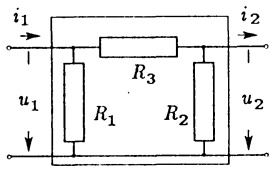

<details>
<summary>text_image</summary>

i₁ →
↓
u₁ ↓
R₃
R₁ R₂
i₂ →
↓
u₂ ↓
</details>

a) Man bestätige, daß der Vierpol passiv ist, d.h. daß det A = 1 gilt und berechne die Eigenwerte und Eigenvektoren von A. Für welche Werte von  $\frac{u_{1}}{i_{1}}$ ,  $i_{1} \neq 0$ , hat man

$$
\text {Widerstandsanpassung, d.h.} \quad \frac {u _ {2}}{i _ {2}} = \frac {u _ {1}}{i _ {1}} \quad ?
$$

Was ergibt sich für  $R_{1}=R_{2}=1\Omega$ ,  $R_{3}=40\Omega$ ?

b) Der Vierpol heißt symmetrisch, wenn  $R_{1} = R_{2}$ . Für diesen Fall bestimme man Zahlen g und Z, so daß

$$
A = \left( \begin{array}{c c} \cosh g & Z \sinh g \\ \frac {1}{Z} \sinh g & \cosh g \end{array} \right)  .
$$

Man drücke die Kettenmatrix  $A^{n}$  der Kettenschaltung von n symmetrischen

Vierpolen mit derselben Kettenmatrix A über die Additionstheoreme von sinh, cosh durch g und Z aus und interpretiere Z als Wellenwiderstand aus dem Grenzübergang  $n \rightarrow \infty$ .

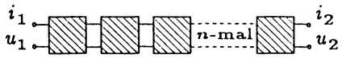

<details>
<summary>text_image</summary>

i₁
u₁
n-mal
i₂
u₂
</details>

## §7. Symmetrische Matrizen und quadratische Formen

7.1 Quadratische Formen. Mit Hilfe von Matrizen gestaltet sich die Beschreibung und Behandlung von Funktionen in mehreren Veränderlichen besonders übersichtlich. Eine auf einer Teilmenge $D \subseteq \mathbb{R}^n$ erklärte Funktion $f : D \to \mathbb{R}$, $\mathbf{x} \mapsto f(\mathbf{x}) =: f(x_1, \ldots, x_n)$, wird als reelle Funktion der $n$ reellen Veränderlichen $x_1, \ldots, x_n$ bezeichnet. Die Vektorkoordinaten $x_i$ werden auch als Ortskoordinaten des Punktes $X = (x_1, \ldots, x_n)$ aufgefaßt.

Jede derartige Funktion läßt sich unter entsprechenden Voraussetzungen nach einem Satz von TAYLOR (→ Kap. 7) in der Form

$$
\begin{array}{l} f (x _ {1}, \dots , x _ {n}) = \alpha_ {0} + \sum_ {i = 1} ^ {n} \alpha_ {i} x _ {i} + \sum_ {i, j = 1} ^ {n} \alpha_ {i j} x _ {i} x _ {j} + \text {Terme höherer Ordnung in den} x _ {i} \\ = \alpha_ {0} + \mathbf {a} ^ {T} \mathbf {x} + \mathbf {x} ^ {T} A \mathbf {x} + \dots \\ \end{array}
$$

mit $\alpha_0 \in \mathbb{R}$, $\mathbf{a}^T = (\alpha_1, \ldots, \alpha_n) \in \mathbb{R}_n$, $\mathbf{x}^T = (x_1, \ldots, x_n)$ und $A = (\alpha_{ij}) \in \mathbb{R}^{n \times n}$ darstellen. Wegen $x_i x_j = x_j x_i$ kann man hierin $\alpha_{ij}$ durch $\frac{1}{2} (\alpha_{ij} + \alpha_{ji})$ ersetzen. Es bedeutet daher keine Einschränkung, wenn man von einer symmetrischen Matrix $A = A^T$ ausgeht. Wir befassen uns hier mit den algebraischen Methoden, den Anteil $p(\mathbf{x}) = \alpha_0 + \mathbf{a}^T \mathbf{x} + \mathbf{x}^T A \mathbf{x}$ zu untersuchen.

Definition. Eine Funktion $p:\mathbb{R}^n\to \mathbb{R}$ der Form

$$
p (\mathbf {x}) = \alpha_ {0} + \mathbf {a} ^ {T} \mathbf {x} + \mathbf {x} ^ {T} A \mathbf {x} = \alpha_ {0} + \sum_ {i = 1} ^ {n} \alpha_ {i} x _ {i} + \sum_ {i, j = 1} ^ {n} \alpha_ {i j} x _ {i} x _ {j}
$$

mit $\alpha_0 \in \mathbb{R}$, $\mathbf{a}^T \in \mathbb{R}_n$, $A = A^T \in \mathbb{R}^{n \times n}$ heißt quadratisches Polynom in den Variablen $x_1, \ldots, x_n$.

Im Fall  $\alpha_{0}=0$ , a=0, also  $p(\mathbf{x})=\mathbf{x}^{T}A\mathbf{x}$ , heißt p eine quadratische Form. Ist zusätzlich A eine Diagonalmatrix, so heißt p rein quadratisch.

Beispiel 1. Die Rotationsenergie $T = \frac{1}{2} \vec{\omega}^T J \vec{\omega}$ eines starren Körpers ist eine quadratische Form in den Koordinaten $\omega_i$ des Drehgeschwindigkeitsvektors $\vec{\omega}$; $J = J^T$ der Trägheitstensor bezogen auf den Massenmittelpunkt ($\to$ Aufg. 8).

Beispiel 2. Der Spannungstensor (→ 6.1, Beisp. 9)

$$
S = \left( \begin{array}{c c c} \sigma_ {x} & \tau_ {x y} & \tau_ {x z} \\ \tau_ {x y} & \sigma_ {y} & \tau_ {y z} \\ \tau_ {x z} & \tau_ {y z} & \sigma_ {z} \end{array} \right)
$$

eines unter Krafteinwirkung stehenden elastischen Körpers in einem Punkt $P$ ist symmetrisch. Mit dem Normalenvektor $\mathbf{n}$, $|\mathbf{n}| = 1$, eines Schnittes durch $P$ ist die Zerlegung $S\mathbf{n} = \mathbf{s} + \mathbf{t}$ des Spannungsvektors in die zu $\mathbf{n}$ parallele Normalenspannung $\mathbf{t}$ und die dazu senkrechte Schubspannung $\mathbf{s}$ verbunden.

$\mathbf{n} \cdot \mathbf{s} = 0$ und $\mathbf{n} \cdot \mathbf{t} = |\mathbf{t}|$ zeigen $\mathbf{n}^{T} S \mathbf{n} = |\mathbf{t}|$; d.h., der Betrag der Normalenspannung berechnet sich aus der quadratischen Form $q(\mathbf{x}) = \mathbf{x}^{T} S \mathbf{x}$. Gelegentlich sind auch die Ellipsoide $\mathbf{x}^{T} S \mathbf{x} = c$ ($c \in \mathbb{R}$ konstant, $c > 0$) von Interesse.

Beispiel 3. Mit $A = \mathrm{Diag}(\lambda_1, \ldots, \lambda_n)$ lautet die rein quadratische Form

$$
q (\mathbf {x}) = \mathbf {x} ^ {T} D \mathbf {x} = \lambda_ {1} x _ {1} ^ {2} + \lambda_ {2} x _ {2} ^ {2} + \dots + \lambda_ {n} x _ {n} ^ {2}. \tag {1}
$$

Beispiel 4. Ein einfaches Problem der Ausgleichsrechnung ist die Bestimmung einer Geraden $y = ax + b$, die „möglichst genau“ zwischen $n$ Meßpunkten $(x_i, y_i)$ verläuft, in dem Sinne, daß das quadratische Polynom $q(u, v) := \sum_{i=1}^{n} (y_i - ux_i - v)^2$ in $(u, v) = (a, b)$ ein Minimum annimmt. (Wir kommen darauf zurück, → Kap. 7).

7.2 Die Hauptachsentransformation. Es ist $q(\mathbf{x}) = \mathbf{x}^T A\mathbf{x}$ die Darstellung der quadratischen Form $q: \mathbb{R}^n \to \mathbb{R}$ bezüglich der gegebenen natürlichen Basis. Der Übergang zu einer anderen Basis $B = (\mathbf{b}_1, \ldots, \mathbf{b}_n)$ geschieht mit der Substitution $\mathbf{x} = B\mathbf{y}$ ($\rightarrow$ (8), §6). $y_1, \ldots, y_n$ sind die Koordinaten des Punktes $X = (x_1, \ldots, x_n)$ im Koordinatensystem $(0; \mathbf{b}_1, \ldots, \mathbf{b}_n)$. Dabei ergibt sich

$$
q (\mathbf {x}) = q (B \mathbf {y}) = (B \mathbf {y}) ^ {T} A (B \mathbf {y}) = \mathbf {y} ^ {T} (B ^ {T} A B) \mathbf {y} =: \tilde {q} (\mathbf {y}). \tag {2}
$$

Definition. Als Hauptachsensystem der quadratischen Form $q(\mathbf{x}) = \mathbf{x}^T A\mathbf{x}$ (bzw. der symmetrischen Matrix $A = A^T \in \mathbb{R}^{n \times n}$) bezeichnet man eine Orthonormalbasis $B = (\mathbf{b}_1, \ldots, \mathbf{b}_n)$ des $\mathbb{R}^n$, wenn $q$ im Koordinatensystem $(0; \mathbf{b}_1, \ldots, \mathbf{b}_n)$ rein quadratisch ist.

Bemerkung. Nach (2) und obigem Beispiel 3 ist eine Orthonormalbasis B genau dann ein Hauptachsensystem für A, wenn  $B^{T}AB$  eine Diagonalmatrix ist.

Die folgenden Eigenschaften symmetrischer Matrizen garantieren, daß jede quadratische Form wenigstens ein Hauptachsensystem besitzt.

## Satz 7.1. Das Eigenwertproblem bei symmetrischen Matrizen.

Für jede reelle symmetrische $n \times n$-Matrix $A = A^T$ gilt:

a) Alle Eigenwerte von A sind reell.
b) Eigenvektoren zu verschiedenen Eigenwerten von A sind orthogonal.
c) Algebraische und geometrische Vielfachheit jedes Eigenwertes sind gleich.

Beweis. a): Ist $\lambda \in \mathbb{C}$ ein Eigenwert und $\mathbf{b} \in \mathbb{C}^n$ ($\mathbf{b} \neq \mathbf{0}$) ein Eigenvektor von $A$, dann folgt aus $Ab = \lambda b$ durch Übergang zu den komplex konjugierten Vektoren (man nehme komponentenweise die konjugiert komplexen Zahlen)

$A\bar{\mathbf{b}} = \overline{A\bar{\mathbf{b}}} = \bar{\lambda}\bar{\mathbf{b}}$ und damit $\lambda\mathbf{b}^{T}\bar{\mathbf{b}} = (A\mathbf{b})^{T}\bar{\mathbf{b}} = \mathbf{b}^{T}A^{T}\bar{\mathbf{b}} = \mathbf{b}^{T}A\bar{\mathbf{b}} = \bar{\lambda}\mathbf{b}^{T}\bar{\mathbf{b}}$. Wegen $\mathbf{b}^{T}\bar{\mathbf{b}} = \sum |b_{i}|^{2} > 0$ ergibt sich $\lambda = \bar{\lambda}$, also $\lambda \in \mathbb{R}$.

b): Aus $A\mathbf{b} = \lambda\mathbf{b}$, $A\mathbf{c} = \mu\mathbf{c}$ folgt $\lambda\mathbf{b}^{T}\mathbf{c} = (A\mathbf{b})^{T}\mathbf{c} = \mathbf{b}^{T}(A^{T}\mathbf{c}) = \mathbf{b}^{T}(A\mathbf{c}) = \mu\mathbf{b}^{T}\mathbf{c}$, was im Fall $\lambda \neq \mu$ die Orthogonalität $\mathbf{b}^{T}\mathbf{c} = 0$ nach sich zieht.

c): Sei $\mu \in \mathbb{R}$ ein Eigenwert von $A$ der algebraischen Vielfachheit $k$, $\chi_A(\lambda) = (\mu - \lambda)^k p(\lambda)$ mit $p(\mu) \neq 0$ und $(\mathbf{b}_1, \ldots, \mathbf{b}_l)$ eine Basis des Eigenraumes $V(\mu)$, ergänzt zu einer Basis $B = (\mathbf{b}_1, \ldots, \mathbf{b}_l, \mathbf{b}_{l+1}, \ldots, \mathbf{b}_n)$ des $\mathbb{R}^n$. Man kann annehmen, daß die Matrix $B$ orthogonal ist, andernfalls ist noch das Schmidtsche Orthonormierungsverfahren ($\rightarrow$ 6.5) anzuwenden. Bezüglich dieser Basis wird $\mathbf{x} \mapsto A\mathbf{x}$ dargestellt durch $B^{-1}AB = B^TAB$ ($\rightarrow$ (11), §6) in der „Blockform“

$$
B ^ {T} A B = \left((A \mathbf {b} _ {1}) _ {B}, \dots , (A \mathbf {b} _ {l}) _ {B}, \dots , (A \mathbf {b} _ {n}) _ {B}\right) = \left( \begin{array}{c c c c c c c} \mu & 0 & \dots & 0 & 0 & \dots & 0 \\ 0 & \mu & \ddots & \vdots & \vdots & & \vdots \\ \vdots & \ddots & \ddots & 0 & & \\ 0 & \dots & 0 & \mu & 0 & \dots & 0 \\ \hline 0 & \dots & 0 & & \\ \vdots & & \vdots & & \mathbf {A} _ {1} \\ 0 & \dots & 0 & & \end{array} \right) \Bigg \} l.
$$

Wesentlich ist, daß im rechten oberen  $l \times (n - l)$ -Block lauter Nullen stehen; denn  $B^{T}AB$  muß mit A symmetrisch sein. Damit gilt

$$
(\mu - \lambda) ^ {k} p (\lambda) = \chi_ {A} (\lambda) = \chi_ {B ^ {T} A B} (\lambda) = (\mu - \lambda) ^ {l} \det (A _ {1} - \lambda E). \tag {3}
$$

Ferner ist $\mu - \lambda$ kein Faktor von det $(A_1 - \lambda E)$. Denn wäre $\mu$ ein Eigenwert von $A_1$, dann hätte $B^T AB$ einen Eigenvektor $\mathbf{c} \in \operatorname{Lin}(\mathbf{e}_{l+1}, \ldots, \mathbf{e}_n)$ zum Eigenwert $\mu$ und demzufolge $A$ einen weiteren, von $\mathbf{b}_1, \ldots, \mathbf{b}_l$ linear unabhängigen Eigenvektor $B\mathbf{c} \in \operatorname{Lin}(\mathbf{b}_{l+1}, \ldots, \mathbf{b}_n)$ zum Eigenwert $\mu$, was $\operatorname{Dim} V(\mu) = l$ widerspräche.

Ein Vergleich der  $(\mu-\lambda)$ -Potenzen auf beiden Seiten von (3) zeigt l=k. ☐

Satz 7.2. Die Hauptachsentransformation. Zu jeder quadratischen Form $q(\mathbf{x}) = \mathbf{x}^T A\mathbf{x}$, bzw. zu jeder reellen symmetrischen $n \times n$-Matrix $A$, gibt es wenigstens ein Hauptachsensystem. Man berechnet es wie folgt:

Zu jedem der verschiedenen Eigenwerte $\lambda_{i}$ von $A$ bestimmt man eine Orthonormalbasis $(\mathbf{b}_{1}^{(i)},\mathbf{b}_{2}^{(i)},\ldots,\mathbf{b}_{k_{i}}^{(i)})$ von $(A-\lambda_{i}E)\mathbf{x}=\mathbf{0}$ ($\rightarrow 6.5$), $1\leq i\leq r$. Diese Teilbasen, in angegebener Reihenfolge zusammengesetzt, ergeben ein Hauptachsensystem

$$
B = (\mathbf {b} _ {1} ^ {(1)}, \dots , \mathbf {b} _ {k _ {1}} ^ {(1)}, \mathbf {b} _ {1} ^ {(2)}, \dots , \mathbf {b} _ {k _ {2}} ^ {(2)}, \dots , \mathbf {b} _ {1} ^ {(r)}, \dots , \mathbf {b} _ {k _ {r}} ^ {(r)}),
$$

für das

$$
B ^ {T} A B = \operatorname{Diag} \left(\underbrace {\lambda_ {1} , \dots , \lambda_ {1}} _ {k _ {1} - m a l}, \underbrace {\lambda_ {2} , \dots , \lambda_ {2}} _ {k _ {2} - m a l}, \dots , \underbrace {\lambda_ {r} , \dots , \lambda_ {r}} _ {k _ {r} - m a l}\right)
$$

gilt und demzufolge  $q(\mathbf{x}) = q(B\mathbf{y}) = \lambda_{1}y_{1}^{2} + \cdots + \lambda_{r}y_{n}^{2}$ .

Beweis. Nach Satz 7.1 a) und c) erhält man durch die Zusammensetzung tatsächlich eine volle Basis des  $R^{n}$ . Wegen Satz 7.1 b) muß die Orthonormierung nur innerhalb der Eigenräume erfolgen.

Bemerkung. Die Bestimmung einer orthogonalen Matrix B, so daß  $B^{T}AB$  Diagonalform hat, nennt man orthogonale Diagonalisierung der Matrix A.

Für n = 2,3 ergeben sich folgende Vereinfachungen:

n=2: Zu  $A = \begin{pmatrix} a & b \\ b & c \end{pmatrix}$ ,  $b \neq 0$ , berechnet man die Lösungen  $\lambda_{1}, \lambda_{2}$  von  $\lambda^{2} - (a + c)\lambda + (ac - b^{2}) = 0$ ; dazu eine normierte Lösung  $\mathbf{b} = \begin{pmatrix} b_{1} \\ b_{2} \end{pmatrix}$  der Gleichung  $(A - \lambda_{1}E)\mathbf{x} = \mathbf{0}$ . Für den anderen Hauptachsenvektor gibt es nur die Möglichkeit  $\pm c$ ,  $c := \begin{pmatrix} -b_{2} \\ b_{1} \end{pmatrix}$ . Mit diesem  $(\mathbf{b}, \mathbf{c})$  ist  $(O; \mathbf{b}, \mathbf{c})$  ein kartesisches Koordinatensystem.

n=3: Ist $A = A^{T} \in \mathbb{R}^{3 \times 3}$ keine Diagonalmatrix, dann sind wenigstens zwei verschiedene Eigenwerte (Lösungen von det $(A - \lambda E) = 0$) $\lambda_{1} \neq \lambda_{2}$ vorhanden. Man bestimmt entweder für $i = 1,2$ je eine normierte Lösung $\mathbf{b}_{i}$ von $(A - \lambda_{i}E)\mathbf{x} = \mathbf{0}$, oder, falls $\lambda_{1}$ die Vielfachheit 2 hat, zwei normierte und orthogonale Lösungen von $(A - \lambda_{1}E)\mathbf{x} = \mathbf{0}$. Die dritte Hauptachse ist parallel zu $\mathbf{b}_{3} := \mathbf{b}_{1} \times \mathbf{b}_{2}$. $B = (\mathbf{b}_{1}, \mathbf{b}_{2}, \mathbf{b}_{3})$ ist ein (kartesisches, d.h. rechtsorientiertes) Hauptachsensystem für $A$.

Beispiel 1. Die Matrix $A = \begin{pmatrix} 2 & 1 \\ 1 & 3 \end{pmatrix}$ hat die Eigenwerte $\lambda_1 = \frac{1}{2}(5 + \sqrt{5})$, $\lambda_2 = \frac{1}{2}(5 - \sqrt{5})$. Eine Lösung von $(A - \lambda_1 E)\mathbf{x} = \mathbf{0}$ ist $\mathbf{x} = (1, \frac{1}{2} + \frac{1}{2}\sqrt{5})^T$ und demnach ist $(\mathbf{b}, \mathbf{c})$ ein Hauptachsensystem für $A$ mit

$$
\mathbf {b} = \frac {1}{\sqrt {1 0 + 2 \sqrt {5}}} \binom{2}{1 + \sqrt {5}}, \quad \mathbf {c} = \frac {1}{\sqrt {1 0 + 2 \sqrt {5}}} \binom{- 1 - \sqrt {5}}{2}.
$$

Die quadratische Form  $q(x,y)=(x,y)A\left(\begin{matrix}x\\ y\end{matrix}\right)=2x^{2}+2xy+3y^{2}$  hat im Koordinatensystem  $(O;\mathbf{b},\mathbf{c})$  die Darstellung

$$
q (x, y) = \lambda_ {1} u ^ {2} + \lambda_ {2} v ^ {2} = \frac {1}{2} (5 + \sqrt {5}) u ^ {2} + \frac {1}{2} (5 - \sqrt {5}) v ^ {2},
$$

wobei $\left( \begin{array}{c}x\\ y \end{array} \right) = (\mathbf{b},\mathbf{c})\binom{u}{v} = \frac{1}{\sqrt{10 + 2\sqrt{5}}}\left( \begin{array}{cc}2 & -1 - \sqrt{5}\\ 1 + \sqrt{5} & 2 \end{array} \right)\binom{u}{v}.$

Beispiel 2. Die Rotationsenergie eines starren Körpers sei

$$
T = 5 \omega_ {1} ^ {2} + 5 \omega_ {2} ^ {2} + 5 \omega_ {3} ^ {2} + 8 \omega_ {1} \omega_ {2} + 8 \omega_ {1} \omega_ {3} + 8 \omega_ {2} \omega_ {3} = \frac {1}{2} \vec {\omega} ^ {T} J \vec {\omega}
$$

mit dem Trägheitstensor

$$
J = \left( \begin{array}{c c c} 1 0 & 8 & 8 \\ 8 & 1 0 & 8 \\ 8 & 8 & 1 0 \end{array} \right).
$$

Aus det  $(J - \lambda E) = 0$  ergeben sich die Eigenwerte (Hauptträgheitsmomente)

$$
\lambda_ {1} = 2, \quad \lambda_ {2} = 2 6, \quad \lambda_ {3} = 2,
$$

dazu ein Hauptachsensystem (die Hauptträgheitsrichtungen)

$$
\mathbf {b} _ {1} = \frac {1}{\sqrt {2}} \left( \begin{array}{c} 1 \\ - 1 \\ 0 \end{array} \right), \quad \mathbf {b} _ {2} = \frac {1}{\sqrt {3}} \left( \begin{array}{c} 1 \\ 1 \\ 1 \end{array} \right), \quad \mathbf {b} _ {3} = \mathbf {b} _ {1} \times \mathbf {b} _ {2} = \frac {1}{\sqrt {6}} \left( \begin{array}{c} - 1 \\ - 1 \\ 2 \end{array} \right). \quad \square
$$

Beispiel 3. Die quadratische Form

$$
q (x, y, z) = x ^ {2} + 6 x y - 2 y ^ {2} - 2 y z + z ^ {2}
$$

ist durch die $3 \times 3$-Matrix $A = \begin{pmatrix} 1 & 3 & 0 \\ 3 & -2 & -1 \\ 0 & -1 & 1 \end{pmatrix}$ bestimmt.

Die Lösungen von det  $(A - \lambda E) = 0$  sind  $\lambda_{1} = 1$ ,  $\lambda_{2} = 3$ ,  $\lambda_{3} = -4$ . Jeweils normierte Lösung von  $(A - \lambda_{i}E)\mathbf{x} = \mathbf{0}$  (i = 1, 2) sind  $\mathbf{b}_{1} = \frac{1}{\sqrt{10}}(1, 0, 3)^{T}$ ,  $\mathbf{b}_{2} = \frac{1}{\sqrt{14}}(3, 2, -1)^{T}$ . Mit  $b_{3} := b_{1} \times b_{2}$  ist  $(\mathbf{b}_{1}, \mathbf{b}_{2}, \mathbf{b}_{3})$  ein (kartesisches) Hauptachsensystem und

$$
B = \left( \begin{array}{c c c} \frac {1}{\sqrt {1 0}} & \frac {3}{\sqrt {1 4}} & - \frac {3}{\sqrt {3 5}} \\ 0 & \frac {2}{\sqrt {1 4}} & \frac {5}{\sqrt {3 5}} \\ \frac {3}{\sqrt {1 0}} & - \frac {1}{\sqrt {1 4}} & \frac {1}{\sqrt {3 5}} \end{array} \right)
$$

eine Drehmatrix mit

$$
B ^ {T} A B = \left( \begin{array}{c c c} 1 & 0 & 0 \\ 0 & 3 & 0 \\ 0 & 0 & - 4 \end{array} \right)  .
$$

7.3 Quadriken. Als Quadrik (oder Hyperfläche zweiter Ordnung) bezeichnet man die Menge aller Punkte  $X = (x_{1}, \ldots, x_{n}) \in \mathbb{R}_{n}$ , die eine Gleichung erfüllen der Form

$$
\boxed { \begin{array}{c} p (\mathbf {x}) = \mathbf {x} ^ {T} A \mathbf {x} + \mathbf {a} ^ {T} \mathbf {x} + \beta = 0, \\ A = A ^ {T} \in \mathbb {R} ^ {n \times n}, \mathbf {a} \in \mathbb {R} ^ {n}, \beta \in \mathbb {R}. \end{array} }
$$

Die Quadrik liegt in Normalform vor, wenn  $x^{T}Ax$  rein quadratisch ist und  $a^{T}x + \beta$  durch keine affine Substitution verkürzt werden kann.

Im Fall n = 2 hat man 9, im Fall n = 3 insgesamt 17 Typen von verschiedenen Normalformen, die in den folgenden Tabellen aufgeführt sind:

## Die Normalformen der Quadriken im  $R_{3}$  (Konstante a, b, c, p alle ≠ 0)

Rang $A = 3$ (Alle Eigenwerte $\neq 0$)

$$
\frac {x ^ {2}}{a ^ {2}} + \frac {y ^ {2}}{b ^ {2}} + \frac {z ^ {2}}{c ^ {2}} - 1 = 0
$$

$$
\frac {x ^ {2}}{a ^ {2}} + \frac {y ^ {2}}{b ^ {2}} + \frac {z ^ {2}}{c ^ {2}} + 1 = 0
$$

$$
\frac {x ^ {2}}{a ^ {2}} + \frac {y ^ {2}}{b ^ {2}} - \frac {z ^ {2}}{c ^ {2}} + 1 = 0
$$

$$
\frac {x ^ {2}}{a ^ {2}} + \frac {y ^ {2}}{b ^ {2}} - \frac {z ^ {2}}{c ^ {2}} - 1 = 0
$$

$$
\frac {x ^ {2}}{a ^ {2}} + \frac {y ^ {2}}{b ^ {2}} + \frac {z ^ {2}}{c ^ {2}} = 0
$$

$$
\frac {x ^ {2}}{a ^ {2}} + \frac {y ^ {2}}{b ^ {2}} - \frac {z ^ {2}}{c ^ {2}} = 0
$$

Ellipsoid (evtl. Kugel)

leere Menge

zweischaliges Hyperboloid

einschaliges Hyperboloid

Punkt

Kegel

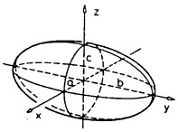

<details>
<summary>text_image</summary>

z
c
a
b
x
y
</details>

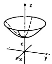

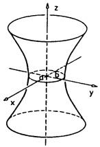

<details>
<summary>text_image</summary>

z
x
y
D+ - B
</details>

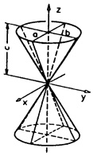

Rang $A = 2$ (Ein Eigenwert $= 0$)

$$
\frac {x ^ {2}}{a ^ {2}} + \frac {y ^ {2}}{b ^ {2}} - 2 p z = 0
$$

$$
\frac {x ^ {2}}{a ^ {2}} - \frac {y ^ {2}}{b ^ {2}} - 2 p z = 0
$$

$$
\frac {x ^ {2}}{a ^ {2}} + \frac {y ^ {2}}{b ^ {2}} + 1 = 0
$$

$$
\frac {x ^ {2}}{a ^ {2}} + \frac {y ^ {2}}{b ^ {2}} - 1 = 0
$$

$$
\frac {x ^ {2}}{a ^ {2}} - \frac {y ^ {2}}{b ^ {2}} + 1 = 0
$$

$$
\frac {x ^ {2}}{a ^ {2}} + \frac {y ^ {2}}{b ^ {2}} = 0
$$

$$
\frac {x ^ {2}}{a ^ {2}} - \frac {y ^ {2}}{b ^ {2}} = 0
$$

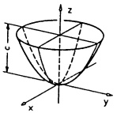

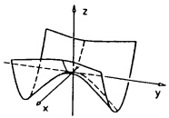

<details>
<summary>text_image</summary>

3D coordinate system diagram with x, y, z axes and a curved surface intersecting the plane
</details>

elliptisches Paraboloid

hyperbolisches Paraboloid

leere Menge

elliptischer Zylinder

hyperbolischer Zylinder

Gerade

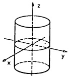

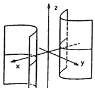

<details>
<summary>text_image</summary>

Diagram showing 3D coordinate system with x, y, z axes and a curved surface intersecting the z-axis
</details>

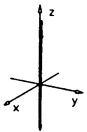

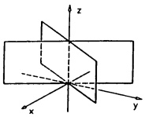

<details>
<summary>text_image</summary>

3D coordinate system diagram with x, y, z axes and a rectangular prism-like structure
</details>

Ebenenpaar mit Schnittgerade

Rang $A = 1$ (Zwei Eigenwerte $= 0$)

$$
x ^ {2} - 2 p y = 0
$$

$$
x ^ {2} - a ^ {2} = 0
$$

$$
x ^ {2} + a ^ {2} = 0
$$

$$
x ^ {2} = 0
$$

parabolischer Zylinder

paralleles Ebenenpaar

leere Menge

Ebene

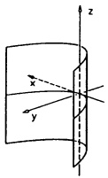

<details>
<summary>text_image</summary>

Diagram showing a 3D coordinate system with x, y, and z axes intersecting at a point, likely illustrating a geometric or physical concept.
</details>

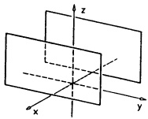

<details>
<summary>natural_image</summary>

3D coordinate system diagram with x, y, z axes and two overlapping planes (no labels or text)
</details>

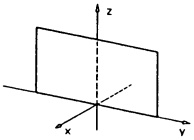

<details>
<summary>natural_image</summary>

3D coordinate system diagram with x, y, z axes and a rectangular plane intersecting the x-axis (no text or labels)
</details>

## Die Normalformen der Quadriken im  $R_{2}$  (Konstante a, b, p alle ≠ 0)

Rang $A = 2$ (Alle Eigenwerte $\neq 0$)

$$
\frac {x ^ {2}}{a ^ {2}} + \frac {y ^ {2}}{b ^ {2}} - 1 = 0
$$

$$
\frac {x ^ {2}}{a ^ {2}} + \frac {y ^ {2}}{b ^ {2}} + 1 = 0
$$

$$
\frac {x ^ {2}}{a ^ {2}} - \frac {y ^ {2}}{b ^ {2}} - 1 = 0
$$

$$
x ^ {2} + a ^ {2} y ^ {2} = 0
$$

$$
x ^ {2} - a ^ {2} y ^ {2} = 0
$$

Ellipse (evtl. Kreis)

leere Menge

Hyperbel

Punkt

Geradenpaar mit Schnittpunkt

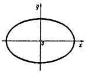

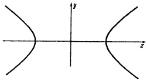

<details>
<summary>natural_image</summary>

Symmetrical hyperbolic curve plotted on Cartesian coordinate axes (x, y), no text or symbols present
</details>

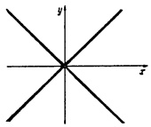

<details>
<summary>natural_image</summary>

Pure geometric diagram of intersecting lines forming a star-like pattern on Cartesian axes (no text or symbols)
</details>

Rang $A = 1$ (Ein Eigenwert $= 0$)

$$
x ^ {2} - 2 p y = 0
$$

$$
x ^ {2} - a ^ {2} = 0
$$

$$
x ^ {2} + a ^ {2} = 0
$$

$$
x ^ {2} = 0
$$

Parabel

paralleles Geradenpaar

leere Menge

Gerade $x = 0$

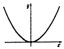

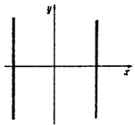

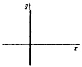

## Die Transformation einer Quadrik auf Normalform erfolgt in zwei Schritten:

1. Schritt: Die Hauptachsentransformation des quadratischen Anteils, $B^T AB = \text{Diag}(\lambda_1, \ldots, \lambda_n)$ mit einem Hauptachsensystem $B = (\mathbf{b}_1, \ldots, \mathbf{b}_n)$ von $A$, liefert über die Substitution $\mathbf{x} = By$ die Darstellung der Quadrik im Koordinatensystem $(O; \mathbf{b}_1, \ldots, \mathbf{b}_n)$ durch

$$
\lambda_ {1} y _ {1} ^ {2} + \dots + \lambda_ {n} y _ {n} ^ {2} + \gamma_ {1} y _ {1} + \dots + \gamma_ {n} y _ {n} + \beta = 0 \tag {4}
$$

mit gewissen Zahlen $\gamma_{i}\in\mathbb{R}$.

2. Schritt : Mit der anschließenden Substitution

$$
z _ {i} = \left\{ \begin{array}{c l} y _ {i} & , \text {falls} \lambda_ {i} = 0 \\ y _ {i} + \frac {\gamma_ {i}}{2 \lambda_ {i}} & , \text {falls} \lambda_ {i} \neq 0 \end{array} \right.
$$

(d.i. eine quadratische Ergänzung) werden die linearen Terme – falls möglich – „wegsubstituiert“. Diese Substitution entspricht einer Verschiebung des bereits gedrehten Koordinatensystems in einen anderen Ursprung (→ (9), §6). Schreiben wir $\mathbf{z} = \mathbf{y} + \mathbf{u}$, so folgt der Übergang von den x-Koordinaten zu den z-Koordinaten über die Substitution

$$
\mathbf {x} = B \mathbf {y} = B (\mathbf {z} - \mathbf {u}) = B \mathbf {z} - B \mathbf {u}.
$$

D.h. im Koordinatensystem  $(-(B\mathbf{u})^{T};\mathbf{b}_{1},\ldots,\mathbf{b}_{n})$  hat die Quadrik die Gleichung

$$
\lambda_ {1} z _ {1} ^ {2} + \dots + \lambda_ {r} z _ {r} ^ {2} + \mu_ {r + 1} z _ {r + 1} + \dots + \mu_ {n} z _ {n} + \gamma = 0, \tag {5}
$$

wobei wir  $\lambda_{1},\ldots,\lambda_{r}\neq0$  und  $\lambda_{r+1}=\cdots=\lambda_{n}=0$  angenommen haben. Ist einer der Koeffizienten  $\mu_{r+1},\ldots,\mu_{n}$  von Null verschieden, etwa  $\mu_{k}\neq0$ , kann man sogar  $\gamma=0$  annehmen (andernfalls wird noch einmal  $\zeta_{k}=z_{k}+\frac{\gamma}{\mu_{k}}$  substituiert).

Bemerkung. Ist $A$ invertierbar, also $\lambda_i \neq 0$ ($1 \leq i \leq n$), dann hat die transformierte Gleichung die Form $\lambda_1 z_1^2 + \cdots + \lambda_n z_n^2 + \gamma = 0$. Mit jedem Punkt $X = (z_1, \ldots, z_n)$ liegt auch $(\pm z_1, \ldots, \pm z_n)$ auf der Quadrik. Der neue Ursprung ist der Mittelpunkt (oder das Zentrum) der Quadrik. In diesem Fall ist das Zentrum $\mathbf{m}$ der Quadrik $\mathbf{x}^T A\mathbf{x} + \mathbf{a}^T \mathbf{x} + \beta = \mathbf{0}$ die eindeutige Lösung von $A\mathbf{m} = -\frac{1}{2}\mathbf{a}$ und es gilt $\gamma = \beta + \frac{1}{2}\mathbf{a}^T\mathbf{m} = \frac{\det Q}{\det A}$ mit der $4 \times 4$-Matrix $Q := \begin{pmatrix} A & \frac{1}{2}\mathbf{a} \\ \frac{1}{2}\mathbf{a}^T & \beta \end{pmatrix}$.

Ganz allgemein (also $A$ nicht notwendig invertierbar) kann man stets versuchen, zuerst $Ax = -\frac{1}{2}a$ zu lösen. Mit einer Lösung $m$ und der Substitution $x = y + m$, d.i. eine Verschiebung des Koordinatensystems in den Punkt $M$, vereinfacht sich die Gleichung der Quadrik zu $y^T A y + \gamma = 0$ mit $\gamma = \beta + \frac{1}{2} a^T m$.

Beispiel 1. Der Typ und die Normalform des Kegelschnitts $q(x, y) = 2x^{2} + 2xy + 3y^{2} = 1$ ergeben sich allein aus den Eigenwerten der Matrix $A = \begin{pmatrix} 2 & 1 \\ 1 & 3 \end{pmatrix}$. Schritt 2 ist überflüssig. Mit Bsp. 1 von 7.2 liegt eine im $(x, y)$-System gedrehte Ellipse vor mit den Hauptachsenlängen $a = \sqrt{2 / (5 + \sqrt{5})}$, $b = \sqrt{2 / (5 - \sqrt{5})}$.

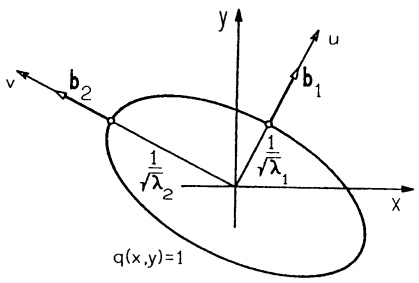

<details>
<summary>text_image</summary>

v
b₂
1/√λ₂
y
u
b₁
1/√λ₁
x
q(x,y)=1
</details>

Abb. 155 - $2x^{2} + 2xy + 3y^{2} = 1$

Beispiel 2. Es sind Typ und Normalform zu bestimmen für die Quadrik

$$
q (x, y, z) = - x ^ {2} - y ^ {2} + z ^ {2} + 6 x y + 2 x z + 2 y z - 1 2 x + 4 y - 1 0 z - 1 1 = 0.
$$

1. Schritt. Die Matrix  $A = \begin{pmatrix} -1 & 3 & 1 \\ 3 & -1 & 1 \\ 1 & 1 & 1 \end{pmatrix}$  hat die Eigenwerte  $\lambda_{1} = 3$ ,  $\lambda_{2} = -4$ ,  $\lambda_{3} = 0$ . Dazu das Hauptachsensystem

$$
\mathbf {b} _ {1} = \frac {1}{\sqrt {3}} \left( \begin{array}{c} 1 \\ 1 \\ 1 \end{array} \right), \quad \mathbf {b} _ {2} = \frac {1}{\sqrt {2}} \left( \begin{array}{c} 1 \\ - 1 \\ 0 \end{array} \right), \quad \mathbf {b} _ {3} = \mathbf {b} _ {1} \times \mathbf {b} _ {2} = \frac {1}{\sqrt {6}} \left( \begin{array}{c} 1 \\ 1 \\ - 2 \end{array} \right).
$$

Mit der Substitution

$$
\left( \begin{array}{c} x \\ y \\ z \end{array} \right) = B \left( \begin{array}{c} x ^ {\prime} \\ y ^ {\prime} \\ z ^ {\prime} \end{array} \right) = \frac {1}{\sqrt {6}} \left( \begin{array}{c c c} \sqrt {2} & \sqrt {3} & 1 \\ \sqrt {2} & - \sqrt {3} & 1 \\ \sqrt {2} & 0 & - 2 \end{array} \right) \left( \begin{array}{c} x ^ {\prime} \\ y ^ {\prime} \\ z ^ {\prime} \end{array} \right)
$$

geht die Gleichung der Quadrik über in

$$
3 (x ^ {\prime}) ^ {2} - 4 (y ^ {\prime}) ^ {2} - 6 \sqrt {3} x ^ {\prime} - 8 \sqrt {2} y ^ {\prime} + 2 \sqrt {6} z ^ {\prime} - 1 1 = 0.
$$

2. Schritt. Durch quadratische Ergänzung ergibt sich die Verschiebung

$$
x ^ {\prime \prime} = x ^ {\prime} - \sqrt {3}, \quad y ^ {\prime \prime} = y ^ {\prime} + \sqrt {2},
$$

dazu  $z'' = z' - \sqrt{6}$  und man hat die Normalform

$$
3 (x ^ {\prime \prime}) ^ {2} - 4 (y ^ {\prime \prime}) ^ {2} + 2 \sqrt {6} z ^ {\prime \prime} = 0.
$$

Den Typ liest man durch Vorzeichenvergleich aus der Tabelle ab: Hyperbolisches Paraboloid. Die Normalform wird im Koordinatensystem  $((\sqrt{3}, -\sqrt{2}, \sqrt{6})B^{T}; \mathbf{b}_{1}, \mathbf{b}_{2}, \mathbf{b}_{3})$  angenommen. ☐

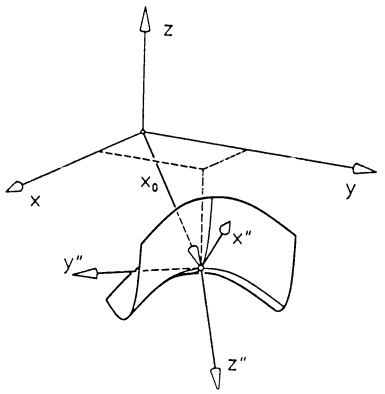

<details>
<summary>text_image</summary>

z
x
x₀
y
x″
y″
z″
</details>

Abb. 156 - Hyperbolisches Paraboloid

Beispiel 3. Zur Quadrik $p(x, y, z) = x^2 - yz - 2x + 3y - 3z + 4 = 0$ gehört die Matrix $A = \begin{pmatrix} 1 & 0 & 0 \\ 0 & 0 & -1/2 \\ 0 & -1/2 & 0 \end{pmatrix}$; sie hat die Eigenwerte $\lambda_1 = 1$, $\lambda_2 = \frac{1}{2}$, $\lambda_3 = -\frac{1}{2}$ mit den normierten Eigenvektoren

$$
\mathbf {b} _ {1} = \left( \begin{array}{c} 1 \\ 0 \\ 0 \end{array} \right), \quad \mathbf {b} _ {2} = \frac {1}{\sqrt {2}} \left( \begin{array}{c} 0 \\ 1 \\ - 1 \end{array} \right), \quad \mathbf {b} _ {3} = \mathbf {b} _ {1} \times \mathbf {b} _ {2} = \frac {1}{\sqrt {2}} \left( \begin{array}{c} 0 \\ 1 \\ 1 \end{array} \right).
$$

Mit der Substitution $\begin{pmatrix} x \\ y \\ z \end{pmatrix} = \frac{1}{\sqrt{2}} \begin{pmatrix} \sqrt{2} & 0 & 0 \\ 0 & 1 & 1 \\ 0 & -1 & 1 \end{pmatrix} \begin{pmatrix} x' \\ y' \\ z' \end{pmatrix}$ und quadratischer

Ergänzung entsteht

$$
\begin{array}{l} 0 = p (x, y, z) = x ^ {\prime 2} + \frac {1}{2} y ^ {\prime 2} - \frac {1}{2} z ^ {\prime 2} - 2 x ^ {\prime} + 3 \sqrt {2} y ^ {\prime} + 4 \\ = (x ^ {\prime} - 1) ^ {2} + \frac {1}{2} (y ^ {\prime} + 3 \sqrt {2}) ^ {2} - \frac {1}{2} z ^ {\prime 2} - 6 \\ = (x ^ {\prime \prime}) ^ {2} + \frac {1}{2} (y ^ {\prime \prime}) ^ {2} - \frac {1}{2} (z ^ {\prime \prime}) ^ {2} - 6. \\ \end{array}
$$

Es handelt sich also um ein einschaliges Hyperboloid. Die gesamte Substitution

$$
\left( \begin{array}{c} x \\ y \\ z \end{array} \right) = B \binom{x ^ {\prime}}{y ^ {\prime}} = B \binom{x ^ {\prime \prime} + 1}{y ^ {\prime \prime} - 3 / \sqrt {2}} = \frac {1}{\sqrt {2}} \left( \begin{array}{c c c} \sqrt {2} & 0 & 0 \\ 0 & 1 & 1 \\ 0 & - 1 & 1 \end{array} \right) \left( \begin{array}{c} x ^ {\prime \prime} \\ y ^ {\prime \prime} \\ z ^ {\prime \prime} \end{array} \right) + \left( \begin{array}{c} 1 \\ - 3 \\ 3 \end{array} \right)
$$

liefert die Normalform im Koordinatensystem  $((1,-3,3);\mathbf{b}_{1},\mathbf{b}_{2},\mathbf{b}_{3})$ .

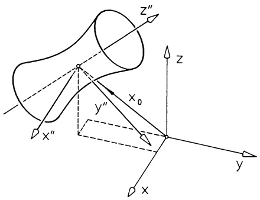

<details>
<summary>text_image</summary>

z''
x₀
y''
x''
z
y
x
</details>

Abb. 157 - Einschaliges Hyperboloid

\* 7.4 Die nichtorthogonale Diagonalisierung einer symmetrischen Matrix.

Die Hauptachsenbestimmung führt auf ein Eigenwertproblem und damit auf eine Polynomgleichung det  $(A - \lambda E) = 0$ . Damit ist zwar die theoretische Kennzeichnung erledigt, jedoch ist die exakte Lösung dieser Gleichung in der Praxis oft gar nicht mit algebraischen Mitteln möglich. Man muß dann mit numerischen Näherungsverfahren arbeiten.

Die folgende nichtorthogonale Diagonalisierung kommt ohne Eigenwerte aus und ist stets mit rationalen Rechenoperationen durchführbar. Man erhält zwar nicht die Hauptachsen, jedoch ist damit bei Quadriken eine schnelle Typbestimmung und bei quadratischen Formen ein wichtiger Positivtest möglich.

Eine Vorbetrachtung: Sei $S \in \mathbb{R}^{n \times n}$ eine Elementarmatrix. Nach §4 entsteht $SAS^{T}$ aus $A$ durch die zu $S$ gehörende elementare Zeilenumformung mit der anschließenden analogen elementaren Spaltenumformung. $A \to SAS^{T}$ bezeichnen wir kurz als ZS-Umformung („Zeilen-Spalten-Umformung“).

Die Hauptachsentransformation $B^{T}AB = \text{Diag}(\lambda_{1},\ldots,\lambda_{n})$ ist mit einer Zerlegung von $B$ in ein Produkt von Elementarmatrizen somit auch zu deuten als eine endliche Folge von ZS-Umformungen.

Wir beschreiben nun ein Verfahren, das A mittels ZS-Umformungen ebenfalls auf Diagonalform bringt, jedoch i.a. nicht mit den Eigenwerten von A auf der Diagonalen:

Gegeben $A = (a_{ij}) \in \mathbb{R}^{n \times n}$, $A = A^T$. Es sind drei Fälle zu unterscheiden:

(a)  $a_{11} \neq 0$ . Mit den Umformungen  $z_{i} \rightarrow z_{i} - \frac{a_{i1}}{a_{11}} z_{1}$ ,  $s_{i} \rightarrow s_{i} - \frac{a_{1i}}{a_{11}} s_{1}$  werden die Koeffizienten  $a_{1i} = a_{i1} (i = 2, \ldots, n)$  der ersten Zeile und der ersten Spalte annulliert.
$⑤$ $a_{11} = 0$ , aber $a_{ii}\neq 0$ für ein $i$ . Durch Vertauschen der $i$ -ten mit der ersten Zeile und anschließend der $i$ -ten mit der ersten Spalte liegt (a) vor.
(c)  $a_{ii}=0\ (1\leq i\leq n)$ , aber  $a_{ij}=a_{ji}\neq0$  für ein Indexpaar  $(i,j)$ . Man addiert die j-te Zeile zur i-ten, dann die j-te Spalte zur i-ten und erhält eine Matrix, deren i-tes Diagonalelement  $2a_{ij}\neq0$  ist. Jetzt liegt (a) oder (b) vor.

Auf diese Weise entsteht aus A mittels ZS-Umformungen eine Matrix der Form

$$
\left( \begin{array}{c c c c} \alpha_ {1} & 0 & \dots & 0 \\ 0 & & \\ \vdots & & \mathbf {A} _ {1} \\ 0 & & \end{array} \right)
$$

mit einer symmetrischen  $(n-1)\times(n-1)$ -Matrix  $A_{1}$ , die in gleicher Weise weiterbehandelt wird, bis man zu  $\operatorname{Diag}(\alpha_{1},\ldots,\alpha_{n})$  gelangt.

Das Produkt der zu den Zeilenumformungen gehörenden Elementarmatrizen bezeichnen wir mit $W^{T}$, dann gehört zu allen Spaltenumformungen die (invertierbare) Matrix $W$ und es gilt ($\rightarrow$ Sätz 4.2)

$$
W ^ {T} A W = \mathrm{Diag} \left(\alpha_ {1}, \dots , \alpha_ {n}\right)  . \tag {6}
$$

Beispiel.

<table><tr><td colspan="4">A</td><td colspan="4">E</td></tr><tr><td>1</td><td>-1</td><td>-2</td><td>1</td><td>1</td><td>0</td><td>0</td><td>0</td></tr><tr><td>-1</td><td>2</td><td>-2</td><td>3</td><td>0</td><td>1</td><td>0</td><td>0</td></tr><tr><td>-2</td><td>-2</td><td>3</td><td>1</td><td>0</td><td>0</td><td>1</td><td>0</td></tr><tr><td>1</td><td>3</td><td>1</td><td>1</td><td>0</td><td>0</td><td>0</td><td>1</td></tr><tr><td colspan="4"> $\Downarrow$ </td><td colspan="4"> $\Downarrow$ </td></tr><tr><td colspan="4">mit</td><td colspan="4">nur</td></tr><tr><td colspan="4">ZS-Umformungen</td><td colspan="4">Z-Umformungen</td></tr><tr><td colspan="4"> $\Downarrow$ </td><td colspan="4"> $\Downarrow$ </td></tr><tr><td>1</td><td>0</td><td>0</td><td>0</td><td>1</td><td>0</td><td>0</td><td>0</td></tr><tr><td>0</td><td>1</td><td>0</td><td>0</td><td>1</td><td>1</td><td>0</td><td>0</td></tr><tr><td>0</td><td>0</td><td>-17</td><td>0</td><td>6</td><td>4</td><td>1</td><td>0</td></tr><tr><td>0</td><td>0</td><td>0</td><td> $\frac{89}{17}$ </td><td> $\frac{29}{17}$ </td><td> $\frac{8}{17}$ </td><td> $\frac{19}{17}$ </td><td>1</td></tr><tr><td colspan="4">Diag ( $\alpha_1, \dots, \alpha_n$ )</td><td colspan="4"> $W^T$ </td></tr></table>

□

Anwendung zur schnellen Typerkennung einer Quadrik. Analog zu 7.3 wird die Gleichung einer Quadrik  $p(\mathbf{x}) = 0$  über eine Substitution  $x = W y + u$  mit (6) und passendem u auf Normalform gebracht. An dieser Normalform kann man auf jeden Fall den Typ der Quadrik erkennen. Dieser ist gemäß 7.3 aus der Anzahl der positiven und der Anzahl der negativen Eigenwerte ablesbar.

Man nennt das Zahlentripel  $(p,q,s)$  mit der Anzahl p der positiven, q der negativen und s der „verschwindenden“ (=0) Eigenwerte von A die Signatur von A. (Vielfach heißt p-q die Signatur.) Die Signatur läßt sich an jeder (nicht notwendig orthogonalen) Diagonalisierung ablesen; denn es gilt:

Satz 7.4. Trägheitssatz von J. J. SYLVESTER, (1814-1897). Ist $A \in \mathbb{R}^{n \times n}$ symmetrisch und $W \in \mathbb{R}^{n \times n}$ invertierbar (det $W \neq 0$), dann haben $A$ und $W^T A W$ die gleiche Signatur.

Beweis. Wegen $p + q = r = \text{Rang } A$ (= Anzahl der Eigenwerte ≠ 0) und $s = n - r$ braucht nur noch gezeigt zu werden, daß $A$ und $W^T AW$ dieselbe Anzahl positiver Eigenwerte haben. Da sich bei orthogonaler Diagonalisierung die Eigenwerte nicht ändern (→ Satz 6.6c), können wir ausgehen von

$$
A = \operatorname{Diag} \left(\lambda_ {1}, \dots , \lambda_ {p}, \lambda_ {p + 1}, \dots , \lambda_ {r}, 0, \dots , 0\right),
$$

$$
W ^ {T} A W = \operatorname{Diag} \left(\beta_ {1}, \dots , \beta_ {t}, \beta_ {t + 1}, \dots , \beta_ {r}, 0, \dots , 0\right)
$$

mit den positiven Eigenwerten $\lambda_{1},\ldots,\lambda_{p}$ von $A$ und $\beta_{1},\ldots,\beta_{t}$ von $W^{T}AW$. In

$$
p (\mathbf {x}) = \mathbf {x} ^ {T} A \mathbf {x} = \lambda_ {1} x _ {1} ^ {2} + \dots + \lambda_ {p} x _ {p} ^ {2} - | \lambda_ {p + 1} | x _ {p + 1} ^ {2} - \dots - | \lambda_ {r} | x _ {r} ^ {2}
$$

substituieren wir $\mathbf{x} = W\mathbf{y}$, d.h.

$$
p (\mathbf {x}) = p (W \mathbf {y}) = \mathbf {y} ^ {T} W ^ {T} A W \mathbf {y} = \beta_ {1} y _ {1} ^ {2} + \dots + \beta_ {t} y _ {t} ^ {2} - | \beta_ {t + 1} | y _ {t + 1} ^ {2} - \dots - | \beta_ {r} | y _ {r} ^ {2}.
$$

Hierzu betrachten wir das homogene lineare Gleichungssystem (in $x_{1},\ldots ,x_{n}$)

$$
x _ {p + 1} = \dots = x _ {r} = 0, \quad y _ {1} = \dots = y _ {t} = 0.
$$

Wäre $p > t$, dann hätte dieses System $r - p + t = r - (p - t) < r \leq n$ Gleichungen in $n$ Unbekannten $x_1, \ldots, x_n$ und damit wenigstens eine Lösung $\mathbf{x} \neq \mathbf{0}$ ($\rightarrow$ Satz 1.1). Für diese Lösung $\mathbf{x}$ würde $p(\mathbf{x}) = \lambda_1 x_1^2 + \cdots + \lambda_p x_p^2 = -(|\beta_{t+1}|y_{t+1}^2 + \cdots + |\beta_r|y_r^2)$ gelten, also auch $x_1 = \cdots = x_p = 0$. Das ist ein Widerspruch. Also gilt $p \leq t$ und aus gleichem Grund $t \leq p$, somit $t = p$.

Beispiel. $A = \begin{pmatrix} 1 & 2 & 2 & 3 \\ 2 & 0 & 0 & 2 \\ 2 & 0 & 3 & 1 \\ 3 & 2 & 1 & 0 \end{pmatrix}$ wird mit ZS-Umformungen umgewandelt in

Diag (1, -4, 3, -16). Also besitzt A zwei positive und zwei negative Eigenwerte, Rang A = 4. Die Quadrik  $p(\mathbf{x}) = \mathbf{x}^{T} A \mathbf{x} = 1$  hat demzufolge in einem (noch nicht näher bestimmten) Hauptachsensystem die Gleichung

$$
a _ {1} ^ {2} y _ {1} ^ {2} + a _ {2} ^ {2} y _ {2} ^ {2} - a _ {3} ^ {2} y _ {3} ^ {2} - a _ {4} ^ {2} y _ {4} ^ {2} = 1 \quad (\text {mit} a _ {i} := \sqrt {| \lambda_ {i} |}, \lambda_ {i} \text {Eigenwert}). \quad \square
$$

Bemerkung. Die nichtorthogonale Transformation der Gleichung  $p(\mathbf{x}) = \mathbf{x}^{T} A\mathbf{x} + \mathbf{a}^{T} \mathbf{x} + \beta = 0$  auf Normalform läßt sich auch mittels quadratischer Ergänzung erreichen.

Beispiel. Gegeben sei die Quadrik

$$
q (x, y, z) = x ^ {2} + 6 y ^ {2} - z ^ {2} + 6 x y + 2 x z + 4 x - 6 y - 8 z + 5 = 0.
$$

Diese wird (schrittweise) mit quadratischen Ergänzungen umgeformt zu

$$
\begin{array}{l} q (x, y, z) = (x + 3 y + z + 2) ^ {2} - 3 (y + z + 3) ^ {2} + (z + 3) ^ {2} + 1 9 \\ = (x ^ {\prime}) ^ {2} - 3 (y ^ {\prime}) ^ {2} + (z ^ {\prime}) ^ {2} + 1 9 = 0 \\ \end{array}
$$

mit  $x' := x + 3y + z + 2$ ,  $y' := y + z + 3$ ,  $z' := z + 3$ .

Also liegt ein zweischaliges Hyperboloid vor. Die Umrechnung

$$
\left( \begin{array}{c} x \\ y \\ z \end{array} \right) = \left( \begin{array}{c c c} 1 & - 3 & 2 \\ 0 & 1 & - 1 \\ 0 & 0 & 1 \end{array} \right) \left( \begin{array}{c} x ^ {\prime} \\ y ^ {\prime} \\ z ^ {\prime} \end{array} \right) + \left( \begin{array}{c} 1 \\ 0 \\ - 3 \end{array} \right)
$$

liefert die Normalform der Flächengleichung

$$
\frac {(x ^ {\prime}) ^ {2}}{1 9} - \frac {3 (y ^ {\prime}) ^ {2}}{1 9} + \frac {(z ^ {\prime}) ^ {2}}{1 9} + 1 = 0
$$

im (schiefwinkligen) Koordinatensystem  $\left((1,0,-3);\begin{pmatrix}1\\0\\0\end{pmatrix},\begin{pmatrix}-3\\1\\0\end{pmatrix},\begin{pmatrix}2\\-1\\1\end{pmatrix}\right)$ . ☐

7.5 Positiv definite Matrizen. Die Bestimmung der Extremwerte einer reellen Funktion in n Veränderlichen ist eng verbunden mit der Frage, wann eine quadratische Form  $q(\mathbf{x}) = \mathbf{x}^{T} A\mathbf{x}$  für  $x \neq 0$  nur positive oder nur negative Werte annimmt ( $\rightarrow$  Kap. 7).

Definition. Eine quadratische Form $q(\mathbf{x}) = \mathbf{x}^T A\mathbf{x}$, bzw. die zugehörige symmetrische Matrix $A \in \mathbb{R}^{n \times n}$, heißt positiv definit (negativ definit), wenn aus $\mathbf{x} \neq \mathbf{0}$ stets $q(\mathbf{x}) > 0$ ($q(\mathbf{x}) < 0$) folgt. Die quadratische Form heißt indefinit, wenn sie sowohl positive als auch negative Werte annimmt. Sie heißt positiv (negativ) semidefinit, wenn stets $q(\mathbf{x}) \geq 0$ ($q(\mathbf{x}) \leq 0$) gilt.

Beispiel 1. Der Trägheitstensor eines rotierenden starren Körpers ist positiv definit ( $T = \vec{\omega}^{T} J \vec{\omega} > 0$ , falls  $\vec{\omega} \neq 0$ ). ☐

Beispiel 2. In der speziellen Relativitätstheorie spielen die nach H.A. LORENTZ (1853-1928) benannten Transformationen

$$
\left( \begin{array}{c} x ^ {\prime} \\ y ^ {\prime} \\ z ^ {\prime} \\ t ^ {\prime} \end{array} \right) = \mathrm{W} \left( \begin{array}{c} x \\ y \\ z \\ t \end{array} \right), \quad \mathrm{W} \in \mathbb {R} ^ {4 \times 4},
$$

des Raum-Zeit-Kontinuums $\mathbb{R}^{4}$, welche die quadratische Form

$$
q (x, y, z, t) = x ^ {2} + y ^ {2} + z ^ {2} - c ^ {2} t ^ {2}
$$

invariant lassen (d.h. für die $q(x', y', z', t') = q(x, y, z, t)$ gilt) eine wichtige Rolle. Diese quadratische Form ist indefinit; es gibt „raumartige“ Vektoren $\mathbf{u} \in \mathbb{R}^4$ mit $q(\mathbf{u}) > 0$ und „zeitartige“ Vektoren $\mathbf{v} \in \mathbb{R}^4$ mit $q(\mathbf{v}) < 0$.

## Satz 7.3.

a)  $D = \text{Diag}(\alpha_{1}, \ldots, \alpha_{n})$  ist genau dann positiv definit, wenn alle  $\alpha_{i}$  positiv sind.
b) $A = A^T$ ist genau dann positiv definit, wenn $W^T AW$ für irgend eine invertierbare $n \times n$-Matrix $W$ positiv definit ist.
c)  $A = A^{T}$  ist genau dann positiv definit, wenn sämtliche Eigenwerte von A positiv sind.

Beweis. a):  $q(\mathbf{x}) = \mathbf{x}^{T} D \mathbf{x} = \sum \alpha_{i} x_{i}^{2} > 0$  für alle  $x \neq 0 \iff$  alle  $\alpha_{i} > 0$ .

b): $A$ positiv definit $\Longrightarrow \mathbf{x}^T (W^T AW)\mathbf{x} = (W\mathbf{x})^T A(W\mathbf{x}) > 0$ für alle $\mathbf{x}\neq \mathbf{0}$. $W^{T}AW$ positiv definit $\Longrightarrow (W^{-1})^{T}(W^{T}AW)W^{-1} = A$ positiv definit.

c) folgt aus a), b) mit einem Hauptachsensystem W.

Beispiel. Die Matrix  $A = \begin{pmatrix} 1 & 2 & -2 \\ 2 & 5 & -4 \\ -2 & -4 & 5 \end{pmatrix}$  ist positiv definit; denn die Eigenwerte  $\lambda_{1} = 1$ ,  $\lambda_{2} = 5 + \sqrt{24}$ ,  $\lambda_{3} = 5 - \sqrt{24}$  sind positiv. ☐

Die Positivität einer Matrix wird nur in Ausnahmefällen durch Berechnung der Eigenwerte entschieden (man vgl. die 7.4 einleitenden Bemerkungen). Hingegen beinhaltet Satz 7.3 einen durchaus praktikablen Test:

1. Positivitätstest: Die reelle symmetrische  $n \times n$ -Matrix A ist genau dann positiv definit, wenn in einer (nicht notwendig orthogonalen) Diagonalisierung

$$
W ^ {T} A W = \mathrm{Diag} \left(\alpha_ {1}, \dots , \alpha_ {n}\right)
$$

alle $\alpha_{i}$ positiv sind.

Man beachte: für  $A = (\alpha_{ij})_{n \times n}$  gilt  $e_{i}^{T} A e_{i} = a_{ii}$  und damit die notwendige Bedingung:

$$
\boxed {A = A ^ {T} \text {positiv definit} \implies a _ {i i} > 0 \quad (1 \leq i \leq n).}
$$

Im folgenden gehen wir deshalb stets davon aus, daß die Diagonalelemente einer auf Positivität zu überprüfenden Matrix positiv sind.

Sonderfall $n = 2$: Die Matrix $A = \begin{pmatrix} a & b \\ b & d \end{pmatrix}$ wird mit einer ZS-Umformung in $\left( \begin{array}{ccc}a & 0 &  &  \\ 0 & ad - b^2 \end{array} \right)$ umgewandelt. Also gilt:

$$
\boxed {\left( \begin{array}{c c} a & b \\ b & d \end{array} \right) \text {positiv definit} \Longleftrightarrow a > 0 \text {und} a d - b ^ {2} > 0.} \tag {7}
$$

Beispiel. $A = \begin{pmatrix} 3 & -2 \\ -2 & 5 \end{pmatrix}$ ist positiv definit; denn $a = 3 > 0$ und det $A = 11 > 0$. Die quadratische Form $q(x, y) = (x, y)A\begin{pmatrix} x \\ y \end{pmatrix} = 3x^2 - 4xy + 5y^2$ nimmt für $(x, y) \neq (0, 0)$ nur positive Werte an.

Sonderfall n = 3 :  $A = \begin{pmatrix} a_{1} & a_{2} & a_{3} \\ a_{2} & a_{4} & a_{5} \\ a_{3} & a_{5} & a_{6} \end{pmatrix}$  wird mit ZS-Umformungen in

$$
\left( \begin{array}{c c c} a _ {1} & 0 & 0 \\ 0 & & \mathrm{A} _ {1} \\ 0 & & \end{array} \right) \quad \text {mit} A _ {1} = \left( \begin{array}{c c} a _ {1} a _ {4} - a _ {2} ^ {2}, & a _ {1} a _ {5} - a _ {2} a _ {3} \\ a _ {1} a _ {5} - a _ {2} a _ {3}, & a _ {1} a _ {6} - a _ {3} ^ {2} \end{array} \right)
$$

umgewandelt. Offenbar ist A genau dann positiv definit, wenn  $a_{1} > 0$  und  $A_{1}$  positiv definit ist. Aus (7) ergibt sich (nach leichter Umformung):

$$
\begin{array}{l} A = \left( \begin{array}{c c c} a _ {1} & a _ {2} & a _ {3} \\ a _ {2} & a _ {4} & a _ {5} \\ a _ {3} & a _ {5} & a _ {6} \end{array} \right) \text {positiv definit} \\ \Longleftrightarrow a _ {1} > 0, \quad \det \left( \begin{array}{c c} a _ {1} & a _ {2} \\ a _ {2} & a _ {4} \end{array} \right) > 0, \quad \det A > 0. \end{array} \tag {8}
$$

Beispiel. $A = \begin{pmatrix} 5 & -2 & 2 \\ -2 & 6 & -1 \\ 2 & -1 & 4 \end{pmatrix}$ ist positiv definit; denn $a_1 = 5 > 0$, $\det \begin{pmatrix} 5 & -2 \\ -2 & 6 \end{pmatrix} > 0$, $\det A = 83 > 0$.

Dieses Verfahren, mit Induktion auf  $n \times n$ -Matrizen fortgesetzt, ergibt den

2. Positivitätstest (C. G. JACOBI, 1804 - 1851):

$A = A^{T} = (a_{ij}) \in \mathbb{R}^{n \times n}$  ist genau dann positiv definit, wenn die Determinanten der n „Hauptuntermatrizen“  $H_{i}$  positiv sind:

$$
H _ {1} = a _ {1 1}, \quad H _ {2} = \left( \begin{array}{c c} a _ {1 1} & a _ {1 2} \\ a _ {2 1} & a _ {2 2} \end{array} \right), \dots , \quad H _ {k} = \left( \begin{array}{c c c} a _ {1 1} & \dots & a _ {1 k} \\ \vdots & & \vdots \\ a _ {k 1} & \dots & a _ {k k} \end{array} \right), \dots , \quad H _ {n} = A.
$$

## Beispiel.

Die Matrix $A = \begin{pmatrix} 1 & 0 & 2 & 0 & 1 \\ 0 & 1 & 0 & 2 & -3 \\ 2 & 0 & 8 & 2 & 2 \\ 0 & 2 & 2 & 9 & -4 \\ 1 & -3 & 2 & -4 & 12 \end{pmatrix}$ ist positiv definit; denn $a_{11} = 1 > 0$,

$\begin{array}{l}\operatorname*{det}\left( \begin{array}{cc}1 & 0\\ 0 & 1 \end{array} \right) = 1 > 0, \operatorname*{det}\left( \begin{array}{ccc}1 & 0 & 2\\ 0 & 1 & 0\\ 2 & 0 & 8 \end{array} \right) = 4 > 0, \operatorname*{det}\left( \begin{array}{ccc}1 & 0 & 2 & 0\\ 0 & 1 & 0 & 2\\ 2 & 0 & 8 & 2\\ 0 & 2 & 2 & 9 \end{array} \right) = 16 > 0\\ \text{und}\det A = 16 > 0. \end{array}$

Ergänzung: Eine positiv definite Matrix A kann man mit ZS-Umformungen auf die Einheitsmatrix E transformieren; hierbei kommt man ohne Zeilen- bzw. Spaltenvertauschungen aus. Daraus ergibt sich:

A positiv definit  $\Longleftrightarrow A = LL^{T}$  mit einer invertierbaren unteren Dreiecksmatrix L.

Im vorhergehenden Beispiel gilt $A = LL^T$ mit $L = \begin{pmatrix} 1 & 0 & 0 & 0 & 0 \\ 0 & -1 & 0 & 0 & 0 \\ 2 & 0 & 2 & 0 & 0 \\ 0 & -2 & 1 & -2 & 0 \\ 1 & 3 & 0 & -1 & 1 \end{pmatrix}$.

Dieses L hat sowohl positive als auch negative Eigenwerte. Man kann aber zeigen, daß es eine Zerlegung  $MM^{T}$  mit einer unteren Dreiecksmatrix M gibt, die nur positive Diagonalelemente besitzt (CHOLESKY-Zerlegung).

Das folgende Programm benutzt zur Berechnung von Eigenwerten und Eigenvektoren einer symmetrischen Matrix ein Verfahren, dessen Grundidee auf JACOBI zurückgeht, nämlich mit geeigneten Drehungen sukzessive die Elemente außerhalb der Diagonalen betragsmäßig zu verkleinern. Über das Produkt der Drehmatrizen sind die Eigenvektoren bestimmt, die stets ein Orthonormalsystem bilden.

```txt
'------ Programm JACOBI --------------- For I=0 To M
Print "DIMENSION N="; For J=I To M
Input N If O\$="Y" Or O\$="y" Then
M=N-1 B(I,I)=1
Dim A(M,M) Endif
Print "Mit Eigenvektor Y/N "; Print "A"+Str\$(I+1)+Str\$(J+1);
Input O\$ Input A(I,J)
If O\$="Y" Or O\$="y" Then Next J
 Dim B(M,M) Next I
Endif
```

```vba
Repeat
    S=O
    For P=O To M-1
        For Q=P+1 To M
            R=A(P,Q)
            A=A(P,P)
            B=A(Q,Q)
            A(P,Q)=O
            If (Abs(R)+Abs(A)<=Abs(A)) And
                (Abs(R)+Abs(B)<=Abs(B)) Then
                R=O
            Else
                E=(B-A)/2/R
                If E=O Then
                    E=1
                Else
                    E=1/(E+Sgn(E)*Sqr(1+E*E))
                Endif
                C=1/Sqr(1+E*E)
                D=C*E
                A(P,P)=A-E*R
                A(Q,Q)=B+E*R
                If P>O Then
                    V=Q
                    X=P
                    For I=O To P-1
                        U=I
                        W=I
                        Gosub Rot
                        Next I
                    Endif
                    If Q<>P+1 Then
                        V=Q
                        W=P
                        For K=P+1 To Q-1
                            U=K
                            X=K
                            Gosub Rot
                            Next K
                        Endif

If Q<>M Then
U=Q
W=P
For J=Q+1 To M
V=J
X=L
Gosub Rot
Next J
Next J
End if
End if
End if
End if
End if
End if
End if
End if
End if
End if
End if
End if
End if
End if
End if
End if
End if
End if
End if
End if
End if
End if
End if
End if
End if
End if
End if
End if
End if
End if
End if
End if
End if
End if

If O$="Y" Or O$="y" Then
For J=O To M

B=B(Q,J)
A=B(P,J)
B(P,J)=C*A-D*B
B(Q,J)=D*A+C*B

Next J

End if

End if

Next Q

Next P

Until S=0

' -----------------
For I=O To M

Print "X"+Str$(I+1)+"=";A(I,I)

Next I

If O$="Y" Or O$="y" Then

For I=O To M

Print Str$(I+1)+"".EIG.VECT:"
For J=O To M

Print B(I,J)

Next J

Next I

End if

End if

Procedure Rot

B=A(U,V)

A=A(W,X)

A(W,X)=C*A-D*B

A(U,V)=D*A+C*B

Return
```

## Aufgaben

1. Man bestimme die Hauptachsenform der Quadriken

a) $Q: 2x^{2} + 2y^{2} - z^{2} - 2xy + 4xz + 4yz - 6(x + y + z) + 9 = 0$
b) $Q: 2x^{2} + 3y^{2} + 4z^{2} - 4xy - 4yz + 2x + 2y + 2z + 3 = 0$.

Wie lautet die zugehörige Koordinatentransformation?

2. Man bestimme für die Quadrik

$$
9 (x ^ {2} + y ^ {2} + z ^ {2}) + \alpha (x + 2 y + 2 z - 1) ^ {2} = \alpha
$$

- die Matrixdarstellung $\mathbf{x}^T A\mathbf{x} + \mathbf{a}^T\mathbf{x} + d = 0$
- abhängig von $\alpha$ eine Hauptachsenform mit zugehöriger Koordinatensubstitution,
- den Flächentyp für $\alpha = -2$.

3. Gegeben ist die quadratische Form

$$
q (x _ {1}, x _ {2}, x _ {3}) = x _ {1} ^ {2} + 8 x _ {2} ^ {2} + x _ {3} ^ {2} - 4 x _ {1} x _ {2} + 2 a x _ {2} x _ {3}.
$$

a) Für welche Werte von a ist q positiv definit?
b) Für welchen Wert von $a$ ist $\mathbf{v} = (1,0,1)^T$ eine Hauptachsenrichtung von $q$? Für diesen Fall bestimme man

- die Hauptachsenform für $q$,
- die zugehörige Koordinatensubstitution,
- den Typ der Fläche $q(x_{1}, x_{2}, x_{3}) + 2x_{1} + x_{2} + x_{3} = 0$.

4. Gegeben ist die Quadrik

$$
Q: \alpha (x y + x z + y z) + z = 0
$$

und die Gerade $g: x = y = z$.

a) Man bestätige, daß $g$ für alle Werte von $\alpha$ parallel zu einer Hauptachse von $Q$ verläuft, und lese daraus einen Eigenwert von $Q$ ab.
b) Unabhängig von  $\alpha$  liegen stets zwei Geraden durch 0 ganz auf Q. Wie lauten diese?
c) Für welche  $\alpha$  ist Q eine Rotationsfläche?
d) Man bestimme eine Hauptachsenform von $Q$, die zugehörige Koordinatensubstitution und den Flächentyp von $Q$ in Abhängigkeit von $\alpha$.

5. Gegeben ist die Quadrik $Q$ und die Gerade $g$

$$
\begin{array}{l} Q: (6 5 + 1 6 \alpha) x ^ {2} + (1 7 + 6 4 \alpha) y ^ {2} + (8 0 + \alpha) z ^ {2} + \\ + (1 - \alpha) (6 4 x y - 8 x z + 1 6 y z) + 1 2 6 x + 7 2 y + 7 2 z = 0, \\ g: 2 x + y = 8 z + y = 0. \\ \end{array}
$$

a) Für welche Werte von  $\alpha$  gibt es zwei Geraden durch 0, die ganz auf Q liegen?
b) Man bestätige, daß g für alle Werte von  $\alpha$  parallel zu einer Hauptachse von Q verläuft, und lese daraus einen Eigenwert von Q ab.
c) Aus der Tatsache, daß $Q$ für alle $\alpha$ eine Rotationsfläche ist, bestimme man – ohne die charakteristische Gleichung von $Q$ aufzustellen – die Hauptachsenform von $Q$, die zugehörige Koordinatensubstitution und den Flächentyp von $Q$ in Abhängigkeit von $\alpha$.

6. Die Ellipse  $\gamma$  ist als Schnitt des Ellipsoids Q mit der Ebene E bestimmt:

$$
Q: x ^ {2} + 2 y ^ {2} + 3 z ^ {2} = 1; E: 2 x + y + 2 z = 0.
$$

Zur Berechnung der Hauptachsen von γ bestimme man

a) die Basisvektoren  $b_{1}, b_{2}, b_{3}$  eines  $(\xi, \eta, \zeta)$ -Koordinatensystems, in dem E die Gleichung  $\zeta = 0$  besitzt,
b) die zugehörige Koordinatensubstitution und die  $(\xi,\eta,\zeta)$ -Gleichung von Q,
c) die  $(\xi,\eta)$ -Gleichung und die Hauptachsenform von  $\gamma$ .

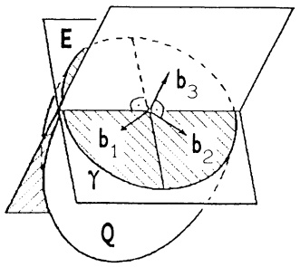

<details>
<summary>text_image</summary>

E
b₃
b₁
γ
b₂
Q
</details>

7. Ein zylindrischer Stahlstab (Radius $r = 1\mathrm{cm}$, Länge $l = 1\mathrm{m}$) wird um $10^{\circ}$ verdrillt. Das HOOKESche Gesetz liefert als Spannungstensor S mit der Materialkonstanten $k = 13.6\mathrm{N/mm^{2}}$:

$$
S = k \left( \begin{array}{c c c} 0 & 0 & - y \\ 0 & 0 & x \\ - y & x & 0 \end{array} \right) .
$$

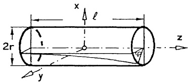

<details>
<summary>text_image</summary>

x
ℓ
2r
y
z
</details>

a) Man berechne die Hauptspannungen (Eigenwerte) und Hauptspannungsrichtungen (Eigenvektoren) von S für jeden Punkt  $(x, y, z)$  des Stabes.
b) Die Normalspannung, d.i. der Betrag der Komponente von Sn längs n ergibt sich als quadratische Form in n :

$$
\sigma (\mathbf {n}) = \mathbf {n} ^ {T} S \mathbf {n}.
$$

Die Schubspannung, d.i. die dazu senkrechte Komponente lautet

$$
\tau (\mathbf {n}) = | S \mathbf {n} - \sigma (\mathbf {n}) \mathbf {n} |.
$$

Ist $\tau (\mathbf{n})$ auch eine quadratische Form in $\mathbf{n}$?

In welchen Punkten des Stabes und für welche Schnitte ist $\sigma(\mathbf{n})$ bzw. $\tau(\mathbf{n})$ am größten?

8. Eine zylindrische Schwungscheibe ($r = h = 30\,\text{cm}$, Masse $M = 1\,\text{kg}$) hat am Rand eine punktförmige Unwucht der Masse $m = 0.1\,\text{kg}$. In dem (körperfesten) skizzierten Koordinatensystem lautet der Trägheitstensor

$$
I = \left( \begin{array}{c c c} \frac {M}{1 2} (3 r ^ {2} + 4 h ^ {2}) + m h ^ {2} & 0 & - m r h \\ 0 & \frac {M}{1 2} (3 r ^ {2} + 4 h ^ {2}) + m (h ^ {2} + r ^ {2}) & 0 \\ - m r h & 0 & \frac {M}{2} r ^ {2} + m r ^ {2} \end{array} \right)  .
$$

Rotiert die Scheibe mit dem (momentanen) Drehgeschwindigkeitsvektor  $\vec{\omega}$ , so hat sie

die Rotationsenergie $T = \frac{1}{2}\vec{\omega}^T I\vec{\omega}$,

den Drehimpuls  $\vec{L} = I\vec{\omega}$ .

Bei freier Bewegung ist  $\vec{L}$  konstant und  $\vec{\omega}$  rotiert um  $\vec{L}$ . Dies wird Nutation bezeichnet.

a) Man berechne $I$ sowie $\vec{L}$ und $T$ für $\vec{\omega} = \vec{e}_3$.
b) Man bestimme die Eigenwerte und Eigenvektoren von $I$.

(Hauptträgheitsmomente und Hauptträgheitsachsen)

c) Für welche Richtungen der Drehachse $\vec{\omega}$, $|\vec{\omega}| = 1$, wird die Rotationsenergie maximal bzw. minimal? (Permanente Drehungen ohne Nutation)

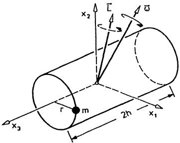

<details>
<summary>text_image</summary>

x₂
r
m
2h
x₁
x₃
ω
</details>

## Knobelecke

5 gleichgroße reguläre Tetraeder sind so ineinander geschachtelt (→ Skizze), daß die 20 Ecken zugleich die Eckpunkte eines regulären Dodekaeders bilden. Die Vereinigung der 5 Tetraeder stellt ein nicht konvexes Polyeder dar. Ihr gemeinsamer Durchschnitt ist ein Ikosaeder. Seine 12 Eckpunkte sind genau die einspringenden (konkaven) Ecken des Polyeders. Wieviele Ecken, Kanten und Seitenflächen besitzt das Polyeder?

Es gibt 12 Elemente der Gruppe $SO(3)$, die ein Tetraeder in sich überführen und 60 Elemente in $SO(3)$, die das Polyeder auf sich abbilden. Man bestätige dies.

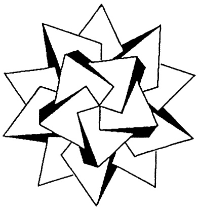

<details>
<summary>natural_image</summary>

Abstract geometric star-like pattern composed of overlapping triangles (no text or symbols)
</details>

Originalskizze von Prof. A. Leutbecher

# Kapitel 7

# Funktionen in mehreren Variablen

# Teil 1: Differentiation

In der mathematischen Behandlung von Naturvorgängen treten oft Funktionen auf, die von mehreren Variablen  $x_{1},\ldots,x_{n}$  abhängen (etwa von den Ortskoordinaten x,y,z, von der Zeit t, vom Druck  $p,\ldots$ ) und deren Wertebereich mehrdimensional ist. Zur Differentialrechnung mit diesen Funktionen benötigt man die gesamte in Kap. 6 entwickelte Lineare Algebra. Es ist daher vorteilhaft,

die $n$ Variablen zu einem variablen Spaltenvektor $\mathbf{x} = \begin{pmatrix} x_1 \\ \vdots \\ x_n \end{pmatrix} \in \mathbb{R}^n$ zusammenzufassen. Im folgenden untersuchen wir deshalb Funktionen $\mathbf{f}: D \to \mathbb{R}^m$, mit $D \subseteq \mathbb{R}^n$, die jedem Spaltenvektor $\mathbf{x} = (x_1, \ldots, x_n)^T \in D$ einen mit $\mathbf{f}(\mathbf{x})$ oder $\mathbf{f}(x_1, \ldots, x_n)$ bezeichneten Vektor in $\mathbb{R}^m$ zuordnen. Hierfür schreiben wir künftig

$$
\mathbf {f}: \mathbb {R} ^ {n} \supseteq D \to \mathbb {R} ^ {m},
$$

$$
\mathbf {x} = \left( \begin{array}{c} x _ {1} \\ \vdots \\ x _ {n} \end{array} \right) \mapsto \mathbf {f} (x _ {1}, \dots , x _ {n}) = \left( \begin{array}{c} f _ {1} (\mathbf {x}) \\ \vdots \\ f _ {m} (\mathbf {x}) \end{array} \right).
$$

$R^{n}$ heißt Urbildraum, D Definitionsbereich, $R^{m}$ Bildraum und das Bild der Funktion f ist $\mathbf{f}(D)=\{\mathbf{f}(\mathbf{x});\mathbf{x}\in D\}$. Funktionen in mehreren Variablen, insbesondere wenn der Bildraum mehrdimensional ist, werden häufig als Abbildungen oder Transformationen (aus dem $R^{n}$ in den $R^{m}$) bezeichnet.

Vereinbarung. Jede Funktion $\mathbf{f}:\mathbb{R}^{n}\supseteq D\to\mathbb{R}^{m}$, mit der Spaltenvektoren des $\mathbb{R}^{n}$ auf Spaltenvektoren des $\mathbb{R}^{m}$ abgebildet werden, ist zugleich eine Funktion, die jedem Punkt $X=(x_{1},\ldots,x_{n})$ mit zugehörigem Ortsvektor $\mathbf{x}=(x_{1},\ldots,x_{n})^{T}\in D$ den Vektor $\mathbf{f}(\mathbf{x})$ zuordnet. Wir schreiben dafür $\mathbf{f}(X):=\mathbf{f}(\mathbf{x})=\mathbf{f}(x_{1},\ldots,x_{n})$ bzw. $(x_{1},\ldots,x_{n})\mapsto\mathbf{f}(x_{1},\ldots,x_{n})$.

Statt „Punkt $X = (x_{1}, \ldots, x_{n})$ mit Ortsvektor $\mathbf{x} = \begin{pmatrix} x_{1} \\ \vdots \\ x_{n} \end{pmatrix} \in \mathbb{R}^{n}$

sagt man kurz „Punkt $\mathbf{x} \in \mathbb{R}^{n}$“. In diesem Sinne fassen wir $\mathbb{R}^{n}$ als Punktraum und jede Teilmenge $D \subseteq \mathbb{R}^{n}$ als Punktmenge auf.

Zuerst behandeln wir die Sonderfälle

$$
n = 1, \text {d.h.} \quad \mathbf {f}: \mathbb {R} \supseteq I \to \mathbb {R} ^ {m} \quad (\text {Kurven im} \mathbb {R} ^ {m}, \to \S 1),
$$

$$
m = 1, \mathrm{d.h.} \quad f: \mathbb {R} ^ {n} \supseteq D \to \mathbb {R} \quad (\text {Skalarenfelder}, \rightarrow \S 2).
$$

Der allgemeine Fall ($m > 1$, $n > 1$) läßt sich hierauf zurückführen ($\rightarrow$ §4).

## §1. Kurven im  $R^{n}$

1.1 Parameterdarstellungen. In der Praxis hat man häufig das Problem, ein geometrisches Gebilde „Kurve“ oder „Weg“ analytisch, d.h. durch Funktionen, darzustellen. In der Ebene sind bereits einige Darstellungsarten bekannt:

Die evtl. nur abschnittsweise explizite Darstellung  $y = f(x)$  als Graph einer Funktion, die Polardarstellung  $r = r(\varphi)$  ( $\rightarrow$  Kap. 4, §5), die implizite Darstellung  $F(x, y) = 0$  (etwa bei den Kegelschnitten) und die Parameterdarstellung ( $\rightarrow$  Kap. 4, §5). Für die allgemeine Behandlung eignet sich am besten die Parameterdarstellung mit der Vorstellung, daß die Kurve die Bahn eines bewegten Punktes darstellt, der zur Zeit t den Ortsvektor  $\mathbf{x}(t)$  besitzt.

Wir betrachten daher vektorwertige, auf einem Intervall $I \subseteq \mathbb{R}$ erklärte Funktionen $\mathbf{x}: I \to \mathbb{R}^n$. Jede derartige Funktion besteht aus $n$ Komponentenfunktionen $x_i: I \to \mathbb{R} \quad (1 \leq i \leq n)$, d.h.

$$
\mathbf {x} (t) = \left( \begin{array}{c} x _ {1} (t) \\ x _ {2} (t) \\ \vdots \\ x _ {n} (t) \end{array} \right), \quad t \in I.
$$

Der für die Analysis grundlegende Grenzwertbegriff wird komponentenweise erklärt:

$$
\boxed {\lim _ {t \to t _ {0}} \left( \begin{array}{c} x _ {1} (t) \\ x _ {2} (t) \\ \vdots \\ x _ {n} (t) \end{array} \right) = \left( \begin{array}{c} c _ {1} \\ c _ {2} \\ \vdots \\ c _ {n} \end{array} \right) := \lim _ {t \to t _ {0}} x _ {i} (t) = c _ {i} \quad (1 \leq i \leq n).}
$$

Dementsprechend heißt $\mathbf{x}: I \to \mathbb{R}^n$ in $t_0 \in I$ (auf $I$) stetig, bzw. differenzierbar, wenn alle Komponentenfunktionen in $t_0 \in I$ (auf $I$) stetig, bzw. differenzierbar sind. Aus gleichem Grunde ist die Ableitung komponentenweise zu berechnen.

$$
\boxed {\dot {\mathbf {x}} (t) = \frac {d}{d t} \mathbf {x} (t) = \lim _ {h \rightarrow 0} \frac {1}{h} [ \mathbf {x} (t + h) - \mathbf {x} (t) ] = \left(\begin{array}{c}\dot {x} _ {1} (t)\\\dot {x} _ {2} (t)\\\vdots\\\dot {x} _ {n} (t)\end{array}\right)}
$$

mit $\dot{x}_i(t) = \frac{d}{dt} x_i(t)$. Man nennt $\dot{\mathbf{x}}(t)$ den Tangentialvektor von $\mathbf{x}$ an der Stelle $t \in I$ ($\rightarrow$ Kap. 4, §5 für $n = 2$). Stellt $t \to \mathbf{x}(t)$ das „Weg-Zeit-Gesetz“ eines bewegten Punktes dar, dann bestimmt $\dot{\mathbf{x}}(t)$ dessen Momentangeschwindigkeit, sie ist tangential zur Bahn. Im Fall $\dot{\mathbf{x}}(t_0) = 0$ ist der Punkt zur Zeit $t = t_0$ in Ruhe.

Für vektorwertige Funktionen $\mathbf{x},\mathbf{y}:I\to\mathbb{R}^{n}$ und $\alpha,\beta\in\mathbb{R}$ bestätigt man leicht

die folgenden Ableitungsregeln :

(1)

a) $\frac{d}{dt} (\alpha \mathbf{x}(t) + \beta \mathbf{y}(t)) = \alpha \dot{\mathbf{x}} (t) + \beta \dot{\mathbf{y}} (t)$ (Linearität),
b) $\frac{d}{dt}[\mathbf{x}(t)\cdot\mathbf{y}(t)]=\dot{\mathbf{x}}(t)\cdot\mathbf{y}(t)+\mathbf{x}(t)\cdot\dot{\mathbf{y}}(t)$
$(Produktregel für das Skalarprodukt)$,
c) $\frac{d}{dt}[\mathbf{x}(t)\times\mathbf{y}(t)]=\dot{\mathbf{x}}(t)\times\mathbf{y}(t)+\mathbf{x}(t)\times\dot{\mathbf{y}}(t)$
$(Produktregel für das \times-Produkt, n=3 ) ,$

d) $\frac{d}{dt} [\alpha(t)\mathbf{x}(t)] = \dot{\alpha}(t)\mathbf{x}(t) + \alpha(t)\dot{\mathbf{x}}(t)$ (Produktregel für Multiplikation mit skalarer Funktion).

Insbesondere folgt wegen  $|\mathbf{x}(t)|^{2} = \mathbf{x}(t) \cdot \mathbf{x}(t)$  aus (1b):

$$
| \mathbf {x} (t) | = \text {const} \quad (t \in I) \implies \mathbf {x} (t) \cdot \dot {\mathbf {x}} (t) = 0 \quad \text {fur alle} t \in I. \tag {2}
$$

Die Parameterdarstellungen eignen sich, dem Begriff „Kurve“ eine Bedeutung zu geben, die auch im  $R^{n}$  ( $n \geq 1$ ) sinnvoll ist.

Definition. Es sei $G \subseteq \mathbb{R}^n$ und $[a, b] \subseteq \mathbb{R}$ ein abgeschlossenes Intervall. Wir nennen jede stetig differenzierbare Funktion $\mathbf{x} : [a, b] \to G$ ein Kurvenstück in $G$ mit Anfangspunkt $\mathbf{x}(a)$, Endpunkt $\mathbf{x}(b)$ und der Spur $\{\mathbf{x}(t) ; a \leq t \leq b\}$. $\dot{\mathbf{x}}(a)$, $\dot{\mathbf{x}}(b)$ sind als einseitige Ableitungen zu verstehen. Ein Kurvenstück $\mathbf{x}$ heißt regulär, wenn $\dot{\mathbf{x}}(t) \neq 0$ gilt für alle $t \in [a, b]$.

Bemerkungen. 1. Unter einer Kurve versteht man eine Kette von aneinanderhängenden Kurvenstücken (→ Kap. 8, §2). Für die Differentialrechnung beschränken wir uns auf Kurvenstücke.

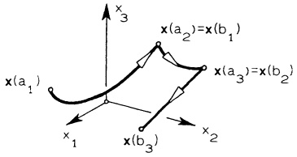

<details>
<summary>text_image</summary>

x(a₁)
x(a₂)=x(b₁)
x(a₃)=x(b₂)
x(b₃)
x₁
x₂
</details>

Abb. 158 - Kurve

2. Statt „Spur eines Kurvenstücks“ sagt man oft kurz „ein Kurvenstück“. D.h. sowohl die Punktmenge  $\{\mathbf{x}(t); t \in [a, b]\} \subseteq R^{n}$  als auch die Funktion  $x : [a, b] \to R^{n}$  werden als Kurvenstück bezeichnet. Aus dem Zusammenhang wird stets klar sein, was gemeint ist. Steht die anschauliche Deutung im Vordergrund, dann nennt man  $x : [a, b] \to R^{n}$  eine Parameterdarstellung des Kurvenstücks  $\{\mathbf{x}(t); a \leq t \leq b\}$ .

Die zum Parameterwert $t \in [a, b]$ eines regulären Kurvenstücks $\mathbf{x} : [a, b] \to \mathbb{R}^n$ bestimmte Zahl

(3)

$$
s (t) := \int_ {a} ^ {t} | \dot {\mathbf {x}} (t) | d t
$$

heißt Bogenlänge des Kurvenstücks über  $[a,t]$ . Für n = 2,3 ist das tatsächlich die Länge des durch x parametrisierten Bogens „über“ [a, t], wobei gegebenenfalls mehrfaches Durchlaufen einer Schleife berücksichtigt wird.  $L(\mathbf{x}) := s(b)$  ist die Länge des Kurvenstücks x. Nach Kap. 4, Satz 1.3 gilt

$$
\frac {d s}{d t} = \dot {s} (t) = | \dot {\mathbf {x}} (t) | . \tag {4}
$$

Man nennt (→ Kap. 4, 6.1)

$$
\begin{array}{l} \boxed {d s := | \dot {\mathbf {x}} (t) | d t \text {das (skalare) Bogenelement},} \\ d \mathbf {x} := \dot {\mathbf {x}} (t) d t \text {das vektorielle Bogenelement von} \mathbf {x}. \end{array} \tag {5}
$$

$(ds \text{ ist – in erster Näherung – die im Zeitintervall } [t, t + dt] \text{ zurückgelegte Weglänge, } dx \text{ ein zum Tangentialvektor } \dot{x}(t) \text{ paralleler Vektor der Länge } ds.)$

1.2 Das begleitende Dreibein, Krümmung, Torsion. Die Bewegung eines Massenpunktes längs einer durch $\mathbf{x} : [a, b] \to \mathbb{R}^3$ parametrisierten Spur und die Auswirkung von Kräften und Momenten in den einzelnen Kurvenpunkten $\mathbf{x}(t)$ wird am besten in einem der Geometrie der Spur angepaßten begleitenden kartesischen Koordinatensystem $(\mathbf{x}(t); \mathbf{T}, \mathbf{N}, \mathbf{B})$ beschrieben, in dem sich auch die Vektoren $\mathbf{T}, \mathbf{N}, \mathbf{B}$ der kartesischen Basis mit dem Parameter $t$ verändern. Wir setzen bei Bedarf für $\mathbf{x}$ Differenzierbarkeit von jeweils benötigter Ordnung voraus, ferner sei $\dot{\mathbf{x}}(t) \neq 0$ für alle $t \in [a, b]$, d.h. $\mathbf{x}$ regular.

Ⓐ Der Tangentenvektor $\mathbf{T}(t)$. Ist $\dot{\mathbf{x}}(t) \neq 0$ so nennt man den Einheitsvektor

$$
\boxed {\mathbf {T} (t) := \frac {1}{| \dot {\mathbf {x}} (t) |} \dot {\mathbf {x}} (t) \quad \text {Tangenteneinheitsvektor}} \tag {6}
$$

oder kurz den Tangentenvektor der Kurve an der Parameterstelle $t$. Die Gleichung (Parameterdarstellung) der Kurventangente in $\mathbf{x}(t_0)$ lautet

$$
\mathbf {x} (\lambda) = \mathbf {x} (t _ {0}) + \lambda \mathbf {T} (t _ {0}) \quad (\lambda \in \mathbb {R}).
$$

⑧ Der Hauptnormalenvektor $\mathbf{N}(t)$ und der Binormalenvektor $\mathbf{B}(t)$. Ist die Kurve $\mathbf{x} : [a, b] \to \mathbb{R}^3$ zweimal (komponentenweise) stetig differenzierbar, $t \in [a, b]$ eine Parameterstelle mit $\dot{\mathbf{x}}(t) \neq \mathbf{0}$ und $\dot{\mathbf{T}}(t) \neq \mathbf{0}$, so nennt man die nach (2) zu $\mathbf{T}(t)$ orthogonalen Einheitsvektoren

$$
\begin{array}{l l} \mathbf {N} (t) := \frac {1}{| \dot {\mathbf {T}} (t) |} \dot {\mathbf {T}} (t) & \text {Hauptnormalen(einheits)vektor}, \\ \mathbf {B} (t) := \mathbf {T} (t) \times \mathbf {N} (t) & \text {Binormalen(einheits)vektor} \end{array} \tag {7}
$$

und das Rechtssystem  $(\mathbf{T}(t),\mathbf{N}(t),\mathbf{B}(t))$  das begleitende Dreibein der Kurve an

der Parameterstelle $t$. Ferner heißt die von $\mathbf{T}(t)$ und $\mathbf{N}(t)$ aufgespannte Ebene durch $\mathbf{x}(t)$,

$$
\mathbf {r} (\lambda , \mu) = \mathbf {x} (t) + \lambda \mathbf {T} (t) + \mu \mathbf {N} (t)
$$

$(\lambda,\mu\in\mathbb{R})$ , die Schmiegebene der Kurve an der Stelle t. Man gewinnt sie als Grenzlage der Ebene durch  $\mathbf{x}(t)$  und zwei weitere Kurvenpunkte.

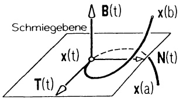

<details>
<summary>text_image</summary>

Schmiegebene
B(t)
x(b)
x(t)
T(t)
N(t)
x(a)
</details>

Abb. 159 - Begleitendes Dreibein

© Die Krümmung. Die Änderungsrate  $\frac{1}{\Delta s}\Delta T := \frac{1}{s(t_1) - s(t)}[\mathbf{T}(t_1) - \mathbf{T}(t)]$  des Tangentenvektors, bezogen auf die Bogenlänge, beschreibt anschaulich das mittlere Krümmungsverhalten der Kurve im Parameterintervall  $[t_1, t]$  (bzw.  $[t, t_1]$ ). Mit der L'Hospital-Regel erhält man

$$
\lim _ {t _ {1} \to t} \frac {1}{\Delta s} \Delta \mathbf {T} = \frac {1}{\dot {s} (t)} \dot {\mathbf {T}} (t) \quad \text {den Krümmungsvektor},
$$

seine Länge ist mit (4)

$$
\kappa (t) := \frac {1}{\dot {s} (t)} | \dot {\mathbf {T}} (t) | = \frac {| \dot {\mathbf {T}} (t) |}{| \dot {\mathbf {x}} (t) |} \quad \text {die Krümmung}
$$

der Kurve an der Stelle $t$.

Für die Darstellung von x und x im begleitenden Dreibein (T, N, B) ergibt sich aus (4), (6) und nach der Differentiation mit (1) und (8)

$$
\begin{array}{l} \dot {\mathbf {x}} (t) = \dot {s} (t) \mathbf {T} (t), \\ \ddot {\mathbf {x}} (t) = \ddot {s} (t) \mathbf {T} (t) + \dot {s} (t) ^ {2} \kappa (t) \mathbf {N} (t). \end{array} \tag {9}
$$

## Kinematische Deutung:

Stellt $\mathbf{x} : [a, b] \to \mathbb{R}^3$ mit $\dot{\mathbf{x}}(t) \neq \mathbf{0}$ die Bewegung eines Massenpunktes dar, so ist dessen Geschwindigkeitsvektor $\dot{\mathbf{x}}(t) = \dot{s}(t)\mathbf{T}(t)$ tangential zur Bahn (in Durchlaufrichtung) und dem Betrage nach gleich der Momentangeschwindigkeit $\dot{s}(t)$. Der Beschleunigungsvektor $\ddot{\mathbf{x}}(t)$ hat $\ddot{s}(t)\mathbf{T}(t)$ als Tangential- und $\dot{s}(t)^2\kappa(t)\mathbf{N}(t)$ als Normalkomponente. Daraus liest man ab, daß

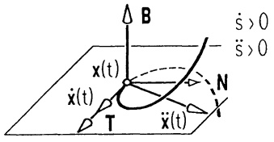

<details>
<summary>text_image</summary>

B
x(t)
ẋ(t)
T
ẍ(t)
N
ṡ > 0
s̈ > 0
</details>

Abb. 160 - Kinematik

$\frac{1}{\kappa(t)}$ als Radius eines Krümmungskreises in der Schmiegebene gedeutet werden kann, falls $\kappa(t) \neq 0$.

Mit $\mathbf{T} \times \mathbf{T} = 0$, $\mathbf{T} \times \mathbf{N} = \mathbf{B}$ ergibt (9) $\dot{\mathbf{x}}(t) \times \ddot{\mathbf{x}}(t) = \dot{s}(t)^3\kappa(t)\mathbf{B}(t)$. Wegen $|\mathbf{B}(t)| = 1$ folgt $|\dot{\mathbf{x}}(t) \times \ddot{\mathbf{x}}(t)| = \dot{s}(t)^3\kappa(t)$. Also gelten

$$
\kappa (t) = \frac {| \dot {\mathbf {x}} (t) \times \ddot {\mathbf {x}} (t) |}{| \dot {\mathbf {x}} (t) | ^ {3}}, \tag {10}
$$

$$
\mathbf {B} (t) = \frac {1}{| \dot {\mathbf {x}} (t) \times \ddot {\mathbf {x}} (t) |} \dot {\mathbf {x}} (t) \times \ddot {\mathbf {x}} (t) \tag {11}
$$

(vorausgesetzt  $\dot{\mathbf{x}}(t) \times \ddot{\mathbf{x}}(t) \neq 0$ ).

Bemerkungen. 1. Formel (10) ergibt für eine ebene Kurve $t \to \begin{pmatrix} x(t) \\ y(t) \\ 0 \end{pmatrix}$ die Krümmung $\kappa = \frac{|\dot{x}\ddot{y} - \dot{y}\ddot{x}|}{(\dot{x}^2 + \dot{y}^2)^{3/2}}$; d.h. die hier definierte Krümmung stimmt mit der in Kap. 4, 5.4 eingeführten Krümmung nur bis aufs Vorzeichen überein. (Nur falls $\dot{x}\ddot{y} - \dot{y}\ddot{x} > 0$ ist, haben $\mathbf{n}$ ($\rightarrow$ Kap. 4, 5.2) und $\mathbf{N}$ dieselbe Richtung.) 2. Aufgrund der Formel (11) bestimmt man das begleitende Dreibein $(\mathbf{T}, \mathbf{N}, \mathbf{B})$ in der Reihenfolge $\mathbf{T} = \frac{1}{|\dot{\mathbf{x}}|}\dot{\mathbf{x}}$, $\mathbf{B} = \frac{1}{|\dot{\mathbf{x}} \times \ddot{\mathbf{x}}|}\dot{\mathbf{x}} \times \ddot{\mathbf{x}}$, $\mathbf{N} = \mathbf{B} \times \mathbf{T}$.

D Die Torsion. Das Herauswinden der Kurve aus der Schmiegebene wird durch die Änderungsrate des Binormalenvektors, bezogen auf die Bogenlänge, beschrieben. Man nennt

$$
\lim _ {t _ {1} \to t} \frac {1}{s (t _ {1}) - s (t)} [ \mathbf {B} (t _ {1}) - \mathbf {B} (t) ] = \frac {1}{\dot {s} (t)} \dot {\mathbf {B}} (t) \quad \text {den Torsionsvektor}
$$

der Kurve an der Stelle $t$.

Nach (2) ist $\dot{\mathbf{B}}$ orthogonal zu $\mathbf{B}$ und wegen $\dot{\mathbf{B}} = \frac{d}{dt} (\mathbf{T} \times \mathbf{N}) = \dot{\mathbf{T}} \times \mathbf{N} + \mathbf{T} \times \dot{\mathbf{N}} = \mathbf{T} \times \dot{\mathbf{N}}$ auch orthogonal zu $\mathbf{T}$, also parallel zu $\mathbf{N}$. D.h., es gibt eine skalare Funktion $\tau = \tau(t)$ - man nennt sie die Torsion der Kurve $\mathbf{x}$ - mit

$$
\frac {1}{\dot {s} (t)} \dot {\mathbf {B}} (t) = - \tau (t) \mathbf {N} (t). \tag {12}
$$

Es gilt

$$
\tau (t) = \frac {\det \left(\dot {\mathbf {x}} (t) , \ddot {\mathbf {x}} (t) , \dddot {\mathbf {x}} (t)\right)}{| \dot {\mathbf {x}} (t) \times \ddot {\mathbf {x}} (t) | ^ {2}}. \tag {13}
$$

Beweis. Aus $\mathbf{B} \cdot \mathbf{N} = 0$ folgt $\dot{\mathbf{B}} \cdot \mathbf{N} + \mathbf{B} \cdot \dot{\mathbf{N}} = 0$, deshalb führt (12) auf $\tau = -\frac{1}{\dot{s}} \dot{\mathbf{B}} \cdot \mathbf{N} = \frac{1}{\dot{s}} \mathbf{B} \cdot \dot{\mathbf{N}}$. Auf der rechten Seite setzen wir $\mathbf{B}$ aus (11) und $\dot{\mathbf{N}}$ aus der nochmals differenzierten 2. Gleichung (9) ein und erhalten nach leichter Rechnung mit (10) die Behauptung.

Wir fassen zusammen:

Satz 1.1. Eine dreimal differenzierbare Kurve $\mathbf{x}:[a,b]\to\mathbb{R}^{3}$ besitzt an jeder Parameterstelle $t$ mit $\dot{\mathbf{x}}(t)\times\ddot{\mathbf{x}}(t)\neq\mathbf{0}$

$$
\begin{array}{l l} \text {den Tangentenvektor} & \mathbf {T} (t) = \frac {1}{| \dot {\mathbf {x}} (t) |} \dot {\mathbf {x}} (t), \\ \text {den Binormalenvektor} & \mathbf {B} (t) = \frac {1}{| \dot {\mathbf {x}} (t) \times \ddot {\mathbf {x}} (t) |} \dot {\mathbf {x}} (t) \times \ddot {\mathbf {x}} (t), \\ \text {den Hauptnormalenvektor} & \mathbf {N} (t) = \mathbf {B} (t) \times \mathbf {T} (t), \\ \text {die Krümmung} & \kappa (t) = \frac {| \dot {\mathbf {x}} (t) \times \ddot {\mathbf {x}} (t) |}{| \dot {\mathbf {x}} | ^ {3}}, \\ \text {die Torsion} & \tau (t) = \frac {\det (\dot {\mathbf {x}} (t) , \ddot {\mathbf {x}} (t) , \dddot {\mathbf {x}} (t))}{| \dot {\mathbf {x}} (t) \times \ddot {\mathbf {x}} (t) | ^ {2}}. \end{array}
$$

Beispiel. Die neutrale Faser einer Schraubenfeder wird dargestellt durch

$$
\mathbf {x} (t) = \left( \begin{array}{c} r \cos t \\ r \sin t \\ h t \end{array} \right)
$$

mit  $0 \leq t \leq 2\pi n$ , dabei ist r der Radius,  $2\pi h$  die Ganghöhe und n die Windungszahl.

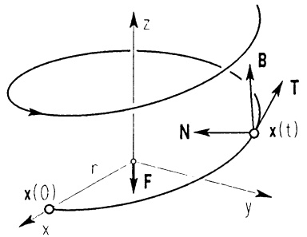

<details>
<summary>text_image</summary>

z
B
T
N
x(t)
r
F
x(0)
x
y
</details>

Abb. 161 - Schraublinie

Mit $\dot{\mathbf{x}}(t) = \begin{pmatrix} -r\sin t \\ r\cos t \\ h \end{pmatrix}, \ddot{\mathbf{x}}(t) = \begin{pmatrix} -r\cos t \\ -r\sin t \\ 0 \end{pmatrix}, \ddot{\mathbf{x}}(t) = \begin{pmatrix} r\sin t \\ -r\cos t \\ 0 \end{pmatrix}$ und der

Abkürzung  $R := |\dot{\mathbf{x}}(t)| = \sqrt{r^{2} + h^{2}}$  erhält man

$$
\mathbf {T} (t) = \frac {1}{R} \left( \begin{array}{c} - r \sin t \\ r \cos t \\ h \end{array} \right); \quad \mathbf {N} (t) = \left( \begin{array}{c} - \cos t \\ - \sin t \\ 0 \end{array} \right); \quad \mathbf {B} (t) = \frac {1}{R} \left( \begin{array}{c} h \sin t \\ - h \cos t \\ r \end{array} \right).
$$

$$
\text {Krümmung} \quad \kappa (t) = \frac {r}{r ^ {2} + h ^ {2}} \quad (\text {konstant}),
$$

$$
\text { Torsion } \quad \tau (t) = \frac {h}{r ^ {2} - h ^ {2}} \quad (\text { konstant }).
$$

Eine Belastung $\mathbf{F} = -Fe_{3}$ mit der Schraubachse als Wirkungslinie ($\rightarrow$ Abb. 161, Kap. 1, 7.1) erzeugt in jedem Punkt $\mathbf{x}(t)$ das Moment

$$
\mathbf {m} (t) = - \mathbf {x} (t) \times \mathbf {F} = r F \left( \begin{array}{c} \sin t \\ - \cos t \\ 0 \end{array} \right).
$$

Dieses besitzt in der begleitenden Basis (T, N, B) die Zerlegung

$$
\mathbf {m} = (\mathbf {m} \cdot \mathbf {T}) \mathbf {T} + (\mathbf {m} \cdot \mathbf {N}) \mathbf {N} + (\mathbf {m} \cdot \mathbf {B}) \mathbf {B} = - \frac {F r ^ {2}}{R} \mathbf {T} + \frac {F r h}{R} \mathbf {B}.
$$

Man nennt  $m_{T} := -\frac{Fr^{2}}{R}T$  die Torsionskomponente und  $m_{B} := \frac{Frh}{R}B$  die Biegekomponente des Moments. ( $\rightarrow$  Aufg. 7) ☐

## Bemerkungen.

1. Diese Ergebnisse sind nur auf reguläre Kurvenstücke $\mathbf{x} : [a, b] \to \mathbb{R}^3$ anwendbar. Besitzt $\mathbf{x}$ singuläre Stellen $t_0 \in [a, b]$ mit $\dot{\mathbf{x}}(t_0) = 0$, so sind Grenzwertbetrachtungen $t \to t_0+$ und $t \to t_0-$ durchzuführen.

Beispiel.

$$
\mathbf {x} (t) = \binom{\frac {1}{3} t ^ {3}}{\frac {1}{2} t ^ {2}}, \quad t \in \mathbb {R},
$$

ist in t = 0 singular, da |x(0)| = 0.

$$
\mathbf {T} (t) = \frac {t}{| t | \sqrt {t ^ {2} + 1}} \binom{t}{1} \quad (\text {fur} t \neq 0)
$$

strebt bei  $t \rightarrow 0-$  gegen  $T_{1} = \begin{pmatrix} 0 \\ -1 \end{pmatrix}$ ,

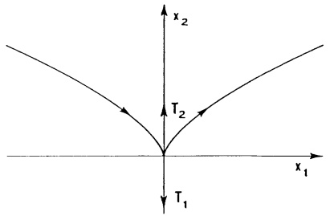

<details>
<summary>text_image</summary>

x₂
T₂
x₁
T₁
</details>

Abb. 162 - Neilsche Parabel

bei  $t \rightarrow 0+$  gegen  $T_{2} = \begin{pmatrix} 0 \\ 1 \end{pmatrix}$ . Obwohl wegen  $\dot{x}(0) = 0$  durch  $\dot{x}$  keine Tangentenrichtung festgelegt wird, besitzt die Kurve im Ursprung eine Tangente, nämlich die y-Achse.

2. Ist  $\kappa(t)=0$  für ein Teilintervall  $\alpha\leq t\leq\beta$ , dann stellt x über  $[\alpha,\beta]$  eine Gerade dar; N, B werden dort nicht benötigt.
3. Falls  $\tau(t)=0$  für  $\alpha\leq t\leq\beta$ , dann verläuft das entsprechende Kurvenstück ganz in der Schmiegebene.

\* 1.3 Ergänzung: Der natürliche Parameter und die Frenetschen Formeln.

Für die Bewegung auf einer regulären Kurve ist die eindeutige Ortsbestimmung  $\mathbf{x}(t)$  nicht nur durch Vorgabe der „Zeit“ t, sondern auch durch den bis zu diesem Zeitpunkt zurückgelegten Weg  $s = s(t)$  möglich. Denn wegen  $\dot{s}(t) = |\dot{\mathbf{x}}(t)| > 0$  ist  $s = s(t)$  als monotone Funktion (zumindest theoretisch) eindeutig nach t auflösbar,  $t = t(s)$ .

Man sagt, die Kurve

$$
\mathbf {y}: [ 0, L ] \to \mathbb {R} ^ {3}, \quad \mathbf {y} (s) := \mathbf {x} (t (s)),
$$

entsteht aus der regulären Kurve x durch Umparametrisierung auf Bogenlänge. Offenbar besitzen x und y dieselbe Spur. Über  $\mathbf{y}(s(t)) = \mathbf{x}(t)$  kommt man zur ursprünglichen Parameterdarstellung zurück. Die Kettenregel und (3) Kap. 3, §3 ergeben

$$
\frac {d}{d s} \mathbf {y} (s) = \frac {d}{d s} \mathbf {x} (t (s)) = \dot {\mathbf {x}} (t (s)) \frac {d}{d s} t (s) = \frac {1}{\dot {s} (t (s))} \dot {\mathbf {x}} (t (s)) = \mathbf {T}.
$$

Die Bogenlänge als Parameter (man spricht vom natürlichen Parameter) ist dadurch ausgezeichnet, daß der die Kurve begleitende Tangentialvektor $\frac{d}{ds}\mathbf{y}(s)$ konstant den Betrag 1 hat; dadurch ergeben sich besonders elegante Formeln:

Satz 1.2. Formeln von FRENET (1816-1900). Für eine dreimal stetig differenzierbare, auf Bogenlänge parametrisierte Kurve $\mathbf{y} : [0, L] \to \mathbb{R}^3$, die überall eine Krümmung $\kappa(s) \neq 0$ besitzt, gelten folgende Ableitungsformeln:

$$
\begin{array}{l} \begin{array}{l} \frac {d \mathbf {T}}{d s} = + \kappa \mathbf {N} \\ \frac {d \mathbf {N}}{d s} = - \kappa \mathbf {T} + \tau \mathbf {B} \end{array} \tag {14} \\ \frac {d \mathbf {B}}{d s} = \quad - \tau \mathbf {N} \quad . \\ \end{array}
$$

Beweis. In diesem Fall ($\dot{s}=1$, $\ddot{s}=0$) lauten die Beziehungen (6), (9) und (12) $\mathbf{T}=\frac{dy}{ds}$, $\frac{d\mathbf{T}}{ds}=\frac{d^{2}\mathbf{y}}{ds^{2}}=\kappa\mathbf{N}$, $\frac{dB}{ds}=-\tau\mathbf{N}$. Nun braucht man nur noch $\mathbf{N}=\mathbf{B}\times\mathbf{T}$ nach $s$ abzuleiten und erhält die dritte Ableitungsformel.

Damit kann man den Satz von S. LIE (1842-1899) beweisen, daß eine auf Bogenlänge parametrisierte Kurve im wesentlichen durch $\kappa = \kappa(s)$ und $\tau = \tau(s)$ bestimmt ist. Durch das Differentialgleichungssystem (14) werden $\mathbf{T}(s)$, $\mathbf{N}(s)$, $\mathbf{B}(s)$ bei Vorgabe der Anfangslage $\mathbf{T}(0)$, $\mathbf{N}(0)$, $\mathbf{B}(0)$ und stetig differenzierbarer Funktionen $\kappa, \tau : [0, L] \to \mathbb{R}$ bis auf längentreue Abbildungen eindeutig bestimmt ($\rightarrow$ Band 2, Kap. 9, §8, Aufg. 19).

Beispiel. Die Raumkurve

$$
\mathbf {x} (t) = \frac {1}{2} e ^ {t} \left( \begin{array}{c} \cos t \\ \sin t \\ \sqrt {2} \end{array} \right), t \in \mathbb {R},
$$

liegt auf dem Kegel  $2x^{2} + 2y^{2} - z^{2} = 0$  und hat als Projektion in die  $(x, y)$ -Ebene eine logarithmische Spirale  $r = \frac{1}{2}e^{\varphi}$  ( $r, \varphi$  Polarkoordinaten).

Wegen $\dot{\mathbf{x}}(t) = \frac{1}{2} e^{t}\left( \begin{array}{c}\cos t - \sin t\\ \sin t + \cos t\\ \sqrt{2} \end{array} \right)$

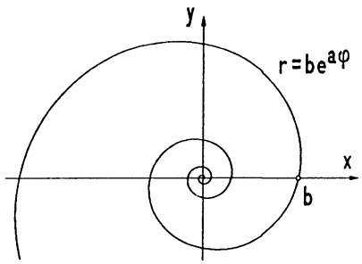

<details>
<summary>text_image</summary>

r=be^{aφ}
y
x
b
</details>

Abb. 163 - Logarithmische Spirale

ist $s(t) = \int_{-\infty}^{t} |\dot{\mathbf{x}}(\tau)| d\tau = e^t$, d.h. $t = \ln(s)$, $s > 0$. Mit der Bogenlänge als Parameter erhält man aus der Darstellung

$$
\mathbf {y} (s) = \frac {1}{2} s \left( \begin{array}{c} \cos \ln s \\ \sin \ln s \\ \sqrt {2} \end{array} \right), s > 0:
$$

$$
\mathbf {T} = \frac {d}{d s} \mathbf {y} (s) = \frac {1}{2} \left( \begin{array}{c} \cos \ln s - \sin \ln s \\ \sin \ln s + \cos \ln s \\ \sqrt {2} \end{array} \right), \quad \frac {d}{d s} \mathbf {T} = \frac {1}{2 s} \left( \begin{array}{c} - \sin \ln s - \cos \ln s \\ \cos \ln s - \sin \ln s \\ 0 \end{array} \right),
$$

$$
\kappa (s) = | \frac {d \mathbf {T}}{d s} | = \frac {1}{2 s} \sqrt {2},   \mathbf {N} = \frac {1}{\sqrt {2}} \left( \begin{array}{c} - \sin \ln s - \cos \ln s \\ \cos \ln s - \sin \ln s \\ 0 \end{array} \right),
$$

$$
\tau (s) = \left| \frac {d}{d s} \mathbf {N} + \kappa \mathbf {T} \right| = \frac {1}{2 s} \sqrt {2}.
$$

## Aufgaben

1. Man berechne den Winkel, unter dem alle Tangenten der Kurve

$$
x (t) = \sqrt {2}, y (t) = t ^ {2} - \frac {1}{4} \ln t, z (t) = t ^ {2} + \frac {1}{4} \ln t \quad (1 \leq t \leq 2)
$$

auf die  $(x,y)$ -Ebene treffen, und berechne ihre Bogenlänge.

2. Gegeben ist die räumliche Spirale

$$
\mathbf {x} (t) = \left( \begin{array}{c} t \cos t \\ t \sin t \\ 2 t \end{array} \right), \quad t \geq 0.
$$

Man berechne das begleitende Dreibein (T,N,B) für x. Wie groß ist die Krümmung κ und die Torsion τ im Punkt 0? Welche Kurve ergibt sich in der Projektion auf die Ebene z = 0?

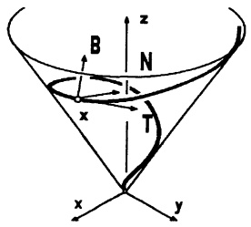

<details>
<summary>text_image</summary>

B
N
x
T
x
y
z
</details>

3. Man zeige, daß alle Geraden durch den Ursprung die (ebene) logarithmische Spirale $r = e^{-\varphi}$ unter konstantem Winkel treffen, wie groß ist dieser?

4. Gegeben ist die Epizykloide

$$
\mathbf {w} (t) = \binom{\cos 3 t + 3 \sin t}{3 \cos t - \sin 3 t}, \quad 0 \leq t \leq 2 \pi .
$$

a) Man bestimme die singulären Punkte ($\dot{x} = \dot{y} = 0$) und in diesen Punkten die Richtungen der Tangenten über die möglichen Grenzwerte $\lim \dot{y}(t) / \dot{x}(t)$.
b) Man berechne die Bogenlänge der Kurve und in jedem Punkt die Krümmung.
c) In welchen Punkten wird $r = |\mathbf{w}(t)|$ maximal? Skizziere w samt Durchlaufsinn.

5. Die Raumkurve (Fenster der VIVIANI)

$$
\mathbf {x} (t) = \left( \begin{array}{c} \cos t \\ \sin t \\ 2 \sin \frac {t}{2} \end{array} \right), 0 \leq t \leq 4 \pi ,
$$

entsteht durch Verschneidung des Drehzylinders $x^{2} + y^{2} = 1$ mit der Kugel $(x + 1)^{2} + y^{2} + z^{2} = 4$. Man bestätige dies, berechne $(\mathbf{T}, \mathbf{N}, \mathbf{B})$ für $t = 0$ und $t = 2\pi$ und drücke die Bogenlänge der Kurve durch das vollständige elliptische Integral

$$
E (k) = \int_ {0} ^ {\frac {\pi}{2}} \sqrt {1 - k ^ {2} \sin^ {2} \varphi} d \varphi \quad \text {aus.}
$$

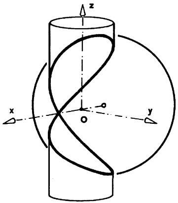

<details>
<summary>text_image</summary>

z
x
o
y
</details>