6. Im Straßenbau wird der Übergang von der Geraden in eine kreisförmige Kurve durch Klothoiden-Bögen modelliert, da sie folgende natürliche Parameterdarstellung besitzen:

$\kappa = c \cdot s$ , Krümmung wächst proportional mit Bogenlänge.

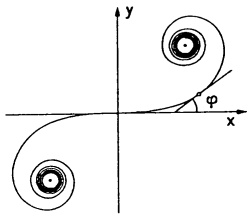

<details>
<summary>text_image</summary>

y
φ
x
</details>

Man bestimme daraus den Tangentenwinkel $\varphi$ als Funktion $\varphi(s)$ der Bogenlänge und stelle damit $x = x(s)$ und $y = y(s)$ als Funktionen von $s$ dar, so daß wie in der Skizze $x(0) = y(0) = y'(0) = 0$ und $x'(0) = 1$.

( Hilfe:  $\kappa = \left| \frac{d\varphi}{ds} \right|$ ;  $x'^{2} + y'^{2} = 1$ ;  $\frac{y'}{x'} = \tan \varphi$ ; Integrale für x und y sind nicht elementar lösbar ! )

7. Die neutrale Faser einer Schraubenfeder wird dargestellt durch

$$
\mathbf {x} (t) = \left( \begin{array}{c} r \cos t \\ r \sin t \\ h t \end{array} \right), \quad 0 \leq t \leq 2 n \pi
$$

(r : Radius,  $2\pi h$  : Ganghöhe, n : Windungszahl).

a) Man drücke Krümmung κ und Torsion τ von x(t) sowohl durch die Höhe H und die Länge L der Feder als auch über den Winkel α aus (vgl. Skizze).

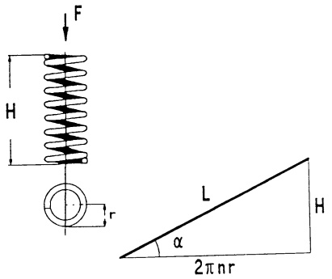

<details>
<summary>text_image</summary>

F
H
r
L
α
2πnr
H
</details>

b) Eine Belastung $F$ der Feder in Richtung der Schraubachse ruft im Federstahl primär Torsion hervor und reduziert die Höhe auf $H(F)$. Die Torsionsgleichung lautet (in erster Näherung)

$$
G J \cdot [ \tau - \tau (F) ] = F \cdot r
$$

(GJ : Torsionssteifigkeit, τ(F) : Torsion mit Last F).

Man leite daraus eine Beziehung zwischen  $H(F)$  und F her und stelle die Federrate

$$
c = \lim _ {F \to 0} \frac {F}{H - H (F)}
$$

in erster Näherung als Funktion von $r$, $L$ und $GJ$ dar $(\frac{H}{L} \ll 1)$.

c) Die Federbeine eines VW K70 (Baujahr 1972) haben die Daten

Federstahl :  $GJ = 2.24 \cdot 10^{6} N cm^{2}$ ;

Vorderachse :  $r = 7.6 \, cm$ ,  $H = 12.6 \, cm$ , n = 5.5 ;

Hinterachse :  $r = 6.3 \, cm$ ,  $H = 18.7 \, cm$ , n = 7.5 .

Berechne jeweils die Länge des Federstahls und die Federrate c.

Wie weit sinkt das Auto vorne und hinten ein, wenn es gleichmäßig mit 1500 N belastet wird?


<details>
<summary>natural_image</summary>

Line drawing of a mechanical suspension or spring assembly (no text or symbols)
</details>

8. Im CAD werden ebene Kurven durch B-Splines dargestellt, da sie eine schnelle Beeinflussung der Form durch wenige sogenannte Kontrollpunkte erlauben. Im einfachsten Fall setzt man diese Kurven aus kubischen Kurvenstücken zusammen, für die man die BEZIER-BERNSTEIN-Darstellung verwendet.

$$
\mathbf {w} (t) = (1 - t) ^ {3} \mathbf {k} _ {0} + \binom {3} {1} t (1 - t) ^ {2} \mathbf {k} _ {1} + \binom {3} {2} t ^ {2} (1 - t) \mathbf {k} _ {2} + t ^ {3} \mathbf {k} _ {3}, 0 \leq t \leq 1.
$$

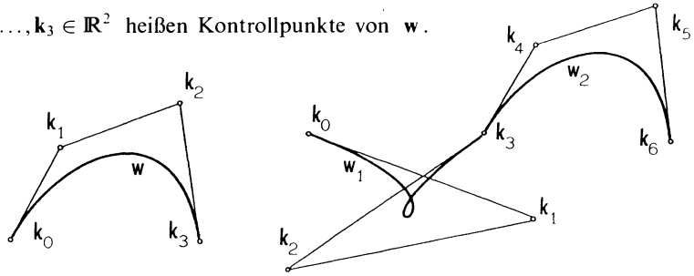

a) Man rechnen nach: w verbindet  $k_{0}$  und  $k_{3}$ , Tangentenrichtung in  $k_{0}$  ist  $k_{1}-k_{0}$ , in  $k_{3}$  ist sie  $k_{2}-k_{3}$ .
b) Warum liegt w ganz im (konvexen) Viereck mit den Ecken  $k_{0}$ ,  $k_{1}$ ,  $k_{2}$ ,  $k_{3}$ ? (Hilfe: Die Polynomfaktoren vor  $k_{0},\ldots,k_{3}$  sind positiv und in der Summe 1.)
c) Welche Bedingungen müssen für eine Kurve erfüllt sein, die aus zwei Bezier-Kurvenstücken  $w_{1}$ ,  $w_{2}$  zusammengestzt ist, damit  $\dot{x}$  und  $\ddot{x}$  im gemeinsamen Kontrollpunkt stetig sind?

## §2. Reellwertige Funktionen mehrerer reeller Veränderlicher.

2.1 Grundlagen. Unter einer reellen Funktion von $n$ reellen Veränderlichen versteht man eine auf einer Teilmenge $D \subseteq \mathbb{R}^n$ erklärte Funktion $f : D \to \mathbb{R}$ mit Werten in $\mathbb{R}$. Sie ordnet jedem Punkt (bzw. Vektor) $\mathbf{x} = (x_1, \ldots, x_n)^T \in D$ des Definitionsbereiches in eindeutiger Weise eine reelle Zahl $z = f(\mathbf{x}) = f(x_1, \ldots, x_n)$ zu. Für Funktionen von 2 oder 3 Veränderlichen schreibt man üblicherweise auch $f(x, y)$ bzw. $f(x, y, z)$.

Die Zuordnung $\mathbf{x} \mapsto f(x_1, \ldots, x_n)$ kann gegeben sein

1. durch eine explizite Rechenvorschrift, z.B.

$$
f (x, y) = 3 x y + 2 x + 5 y - 7 \quad (D = \mathbb {R} ^ {2}), \text { oder }
$$

$$
f (x, y, z) = e ^ {x + y} \cdot 3 z \cdot \sin (x z) + \ln (x ^ {2} + y ^ {2}) + 5 z \quad (D = \mathbb {R} ^ {3} \setminus \{0 \}),
$$

2. durch eine implizite Gleichung, z.B. bezeichne $f(x,y)$ die eindeutig bestimmte positive Lösung $z$ der Gleichung $z^{3}-xz-y=0$ ($x\in\mathbb{R}$, $y>0$),
3. durch eine kompliziertere Vorschrift, etwa in Form einer Differentialgleichung oder in Tabellenform.

Eine reellwertige Funktion $f: \mathbb{R}^{n} \supseteq D \to \mathbb{R}$ wird häufig als Skalarenfeld oder Belegungsfunktion bezeichnet, insbesondere dann, wenn jeder Punkt $\mathbf{x} \in D$ mit der Maßzahl $f(\mathbf{x})$ einer skalaren physikalischen Größe (etwa Ladungsdichte, Temperatur) „belegt“ ist.

Als besonders vorteilhaft zur Diskussion einer Funktion $f: \mathbb{R}^{n} \supseteq D \to \mathbb{R}$, erweist es sich, $f$ auf gezielt gewählten Teilbereichen von $D$ zu untersuchen. Das sind in erster Linie

\- die Niveaumengen oder Niveauhyperflächen von $f$ zum (konstanten) Niveau $c \in \mathbb{R}$:

$$
N _ {c} := \left\{\mathbf {x} \in D; f (\mathbf {x}) = c \right\},
$$

\- alle zu einer Koordinatenachse parallelen Geraden, die $D$ treffen. Man erhält damit die „partiellen“ Funktionen von $f$:

$$
x _ {i} \mapsto f (a _ {1}, \dots , a _ {i - 1}, x _ {i}, a _ {i + 1}, \dots , a _ {n})
$$

mit $a = (a_{1},\dots ,a_{n})\in D$ konstant.

Wie im Falle n = 1 läßt sich jeder Funktion  $f : D \to R$  auch der Graph

$$
\Gamma_ {f} := \left\{\left(\mathbf {x}, f (\mathbf {x})\right); \mathbf {x} \in D \right\} \subseteq \mathbb {R} ^ {n + 1}
$$

zuordnen. Er besteht aus allen Punkten  $(x_{1},\ldots,x_{n},x_{n+1})$  mit  $x_{n+1}=f(x_{1},\ldots,x_{n})$  und kann somit als Niveauhyperfläche der Funktion

$$
F (x _ {1}, \dots , x _ {n}, x _ {n + 1}) = x _ {n + 1} - f (x _ {1}, \dots , x _ {n})
$$

zum Niveau 0 angesehen werden. Wir nennen $F(x_{1},\ldots,x_{n+1})=0$ die implizite und $x_{n+1}=f(x_{1},\ldots,x_{n})$ die explizite Darstellung des Graphen $\Gamma_{f}$.

All diese Begriffe sind für n = 2 und n = 3 sehr anschaulich zu interpretieren:

$n = 2: N_{c}$ ist in der Regel eine ebene Kurve, „die Niveaukurve $f(x,y) = c$“. Man nennt $f(x,y) = c$ die implizite Gleichung (oder Darstellung) dieser Kurve. Beschreibt etwa $T = f(x,y)$ die Temperaturverteilung (Druckverteilung) auf einer Platte $D \subseteq \mathbb{R}^{2}$, dann ist $f(x,y) = T_{0}$ die Gleichung einer Isotherme (Isobare). Ist $f(x,y) = c$ nach $y$ auflösbar in der Form $y = h(x,c)$, dann nennt man dieses eine explizite Darstellung der Niveaukurve.

Beispiele. 1. Die Gerade $2x + 3y = 5$ ist die Niveaukurve der Funktion $f(x,y) = 2x + 3y$ zum Niveau $c = 5$. Die explizite Darstellung lautet $y = -\frac{2}{3}x + \frac{5}{3}$.

2. Der Kreis $x^{2} + y^{2} = r^{2} \quad (r > 0)$ ($\rightarrow$ Abb. 165) ist die Niveaukurve der Funktion $f(x, y) = x^{2} + y^{2}$ zum Niveau $r^{2}$. Diese Kurve ist nicht überall explizit durch eine einzige Funktion $y = h(x)$ darstellbar. Sie besteht vielmehr aus zwei Teilen, die explizit darstellbar sind: $y = \sqrt{r^{2} - x^{2}}$ und $y = -\sqrt{r^{2} - x^{2}}$ ($-r \leq x \leq r$). Allgemein ist ein Kegelschnitt $ax^{2} + by^{2} + cxy + dx + ey + f = 0$ die Niveaukurve eines quadratischen Polynoms in $x, y$.

3. Jeder Graph  $y = h(x)$  einer (stetigen) Funktion der einen Variablen x kann als Niveaukurve  $F(x, y) = y - f(x) = 0$  einer Funktion von zwei Veränderlichen angesehen werden.

Im Falle $n = 2$ wird der Graph $\Gamma_{f}$ als Fläche im $\mathbb{R}^{3}$ veranschaulicht. $D$ ist Teilmenge der $(x,y)$-Ebene und über $(x,y) \in D$ liegt der Flächenpunkt $(x,y,z)$ mit $z = f(x,y)$.

Die Graphen der „partiellen“ Funktionen  $z = f(a_{1}, y)$  und  $z = f(x, a_{2})$  entstehen durch Schnitt des Graphen  $\Gamma_{f}$  mit den zur z-Achse parallelen Ebenen:  $x = a_{1}$  bzw.  $y = a_{2}$ . Zur Untersuchung des Graphen  $\Gamma_{f}$  im Punkt  $(a_{1}, a_{2})$  wird man auf diese beiden Schnittkurven zurückgreifen.

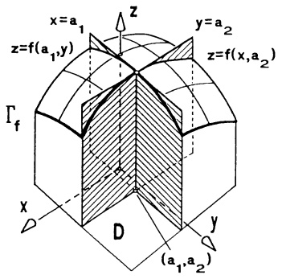

<details>
<summary>text_image</summary>

x=a₁
z=f(a₁,y)
Γf
x
D
y=a₂
z=f(x,a₂)
(a₁,a₂)
</details>

Abb. 164 - Partielle Funktionen

Über der Niveaulinie $f(x,y)=c$ in $D$ liegen alle Punkte von $\Gamma_{f}$ mit derselben „Höhe“ $z=c$. Sie ist die senkrechte Projektion der Schnittkurve der Fläche $z=f(x,y)$ mit der Ebene $z=c$ in die $(x,y)$-Ebene (Höhenlinien einer Landkarte).

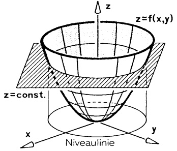

<details>
<summary>text_image</summary>

z
z=f(x,y)
z=const.
x
y
Niveaulinie
</details>

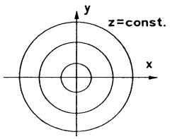

<details>
<summary>text_image</summary>

z=const.
y
x
</details>

Abb. 165 - Graph und Niveaulinie von $f(x, y) = x^2 + y^2$

n=3: $N_c$ ist (unter Zusatzvoraussetzungen an $f$) eine Fläche im $\mathbb{R}^3$, „die Niveaufläche $f(x,y,z) = c$“. Man nennt $f(x,y,z) = c$ die implizite Gleichung (oder Darstellung) dieser Fläche. Ist diese Gleichung für einen Teilbereich explizit in der Form $z = h(x,y,c)$ auflösbar, dann nennt man dieses eine explizite Darstellung des entsprechenden Flächenstücks.

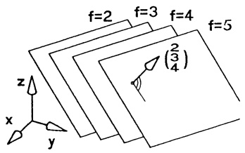

<details>
<summary>text_image</summary>

f=2
f=3
f=4
f=5
(2/3/4)
z
x
y
</details>

Abb. 166 - Niveauflächen von $f = 2x + 3y + 4z$

Beispiele. 1. Die Ebene $2x + 3y + 4z = 5$ ist Niveaufläche der linearen Funktion $f(x,y,z) = 2x + 3y + 4z$

2. Niveaufläche eines quadratischen Polynoms in drei Veränderlichen ist jede Quadrik  $x^{T}Ax+b^{T}x+c=0$  im  $R^{3}$ . ☐

Der Graph $\Gamma_{f}$ einer Funktion von drei Variablen ist Teilmenge des $\mathbb{R}^{4}$ und daher für eine Veranschaulichung von $f$ nicht geeignet.

2.2 Grenzwerte und Stetigkeit. Begriffe der anschaulichen Geometrie des  $R^{1}$ ,  $R^{2}$ ,  $R^{3}$  wurden in Kap. 6, 6.3, für beliebige  $n \in N$  in den  $R^{n}$  übernommen. So wird der Abstand zweier Punkte  $x, y \in R^{n}$  definiert durch

$$
| \mathbf {x} - \mathbf {y} | = \sqrt {\sum_ {i = 1} ^ {n} (x _ {i} - y _ {i}) ^ {2}}.
$$

Zu festem $\mathbf{a} \in \mathbb{R}^n$ und $r > 0$ heißt die Punktmenge

$$
U _ {r} (\mathbf {a}) := \{\mathbf {x} \in \mathbb {R} ^ {n}: | \mathbf {x} - \mathbf {a} | <   r \}
$$

r-Umgebung von a.

Für $n = 1$ ist $U_{r}(a)$ das offene Intervall $a - r < x < a + r$,

für $n=2$ besteht $U_{r}(\mathbf{a})$ aus allen Punkten der Kreisscheibe mit dem Mittelpunkt $\mathbf{a}$ und Radius $r$ ohne Randpunkte,

für n = 3 ist  $U_{r}(\mathbf{a})$  eine Kugel um a mit dem Radius r ohne die Punkte der Kugeloberfläche.

Bereits für reelle, auf einem Intervall $I \subseteq \mathbb{R}$ definierte Funktionen ist nicht nur deren Verhalten im Innern von $I$, sondern auch in den Randpunkten von Bedeutung ($\rightarrow$ Kap. 2, §5 und Kap. 3). Zur Beschreibung ähnlicher Sachverhalte im $\mathbb{R}^n$ benötigen wir einige Begriffe.

Definition. Sei D eine Teilmenge des $\mathbb{R}^{n}$.

a) Ein Punkt $\mathbf{a} \in D$ heißt innerer Punkt von $D$, wenn es eine $r$-Umgebung von $\mathbf{a}$ gibt, die ganz in $D$ enthalten ist.
b) D heißt offen, wenn jeder Punkt von D ein innerer Punkt ist.
c) Ein Punkt $\mathbf{b} \in \mathbb{R}^{n}$ heißt Randpunkt von $D$, wenn jede $r$-Umgebung von $\mathbf{b}$ sowohl mindestens einen Punkt aus $D$ als auch mindestens einen nicht zu $D$ gehörenden Punkt enthält. Die Menge aller Randpunkte von $D$ heißt Rand von $D$ und wird mit $\partial D$ bezeichnet.
d) Eine Menge heißt abgeschlossen, wenn sie alle ihre Randpunkte enthält.

## Beispiele.

1. Die „offene“ Kreisscheibe (ohne Rand)

$$
K = \{(x, y); (x - x _ {0}) ^ {2} + (y - y _ {0}) ^ {2} <   r ^ {2} \}
$$

ist eine offene Menge mit dem Rand  $\partial K : (x - x_{0})^{2} + (y - y_{0})^{2} = r^{2}$ .

2. Das „Rechteck“ $Q = \{ (x, y) ; 2 \leq x < 3, -1 < y \leq 2 \}$ ($\rightarrow$ Abb. 167a) ist weder offen noch abgeschlossen. Alle Punkte $(x, y)$ mit $2 < x < 3, -1 < y < 2$ sind innere Punkte. Der Rand enthält sowohl Punkte, die zu $Q$ gehören (etwa $(2, y)$ mit $-1 < y \leq 2$) als auch solche, die nicht zu $Q$ gehören (etwa $(x, -1)$ mit $2 \leq x \leq 3$).

Offene Mengen werden oft durch strikte Ungleichungen in der Form

$$
U = \{\mathbf {x} \in \mathbb {R} ^ {n}; g _ {1} (\mathbf {x}) <   0, \dots , g _ {r} (\mathbf {x}) <   0 \}
$$

beschrieben, wobei $g_1, \ldots, g_r$ stetige Funktionen in $n$ Veränderlichen sind. Für $\mathbf{x} \in \partial U$ gilt $g_i(\mathbf{x}) = 0$ für wenigstens ein $i$. (Kurz: $U$ wird berandet von den Hyperflächen $g_i(\mathbf{x}) = 0$.)

$$
U \cup \partial U = \left\{\mathbf {x} \in \mathbb {R} ^ {n}; g _ {1} (\mathbf {x}) \leq 0, \dots , g _ {r} (\mathbf {x}) \leq 0 \right\}.
$$

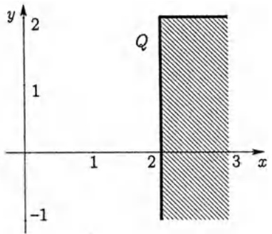

<details>
<summary>text_image</summary>

y
2
1
Q
1
2
3 x
-1
</details>

Abb. 167a - Randpunkte

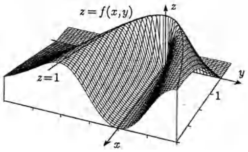

<details>
<summary>text_image</summary>

z = f(x,y)
z=1
y
x
1
</details>

Abb. 167b - Die Parabelfalte

Definition. Sei $f:\mathbb{R}^n\supseteq D\to \mathbb{R}$ und $\mathbf{a}\in D\cup \partial D$

a) $f$ hat in a den Grenzwert $c \in \mathbb{R}$, in Zeichen

$$
\lim _ {\mathbf {x} \to \mathbf {a}} f (\mathbf {x}) = c \quad \text {(oder} f (\mathbf {x}) \to c \text {fur} \mathbf {x} \to \mathbf {a}),
$$

wenn es zu jeder (beliebig kleinen) Schranke $\epsilon > 0$ eine $r$-Umgebung $U_r(\mathbf{a})$ gibt, so daß $|f(\mathbf{x}) - c| \leq \epsilon$ für alle $\mathbf{x} \in D \cap U_r(\mathbf{a})$ gilt.

b) $f$ heißt in $\mathbf{a} \in D$ stetig, wenn $\lim_{\mathbf{x} \to \mathbf{a}} f(\mathbf{x}) = f(\mathbf{a})$ gilt.
c) $f$ heißt auf $D$ stetig, wenn $f$ in allen $\mathbf{a} \in D$ stetig ist.

Die aus Kap. 2 bekannten Rechenregeln für Grenzwerte und stetige Funktionen gelten auch hier: Summe, Produkt, Quotient stetiger Funktionen sind stetig.

Beispiel. Die Projektionen  $p_{i}: R^{n} \rightarrow R$ ,  $p_{i}(\mathbf{x}) = x_{i}$  sind stetig. Aufgrund der soeben genannten Rechenregeln ist dann auch jede lineare Funktion  $l: R^{n} \rightarrow R$ ,  $l(\mathbf{x}) = \mathbf{a}^{T} \mathbf{x} = a_{1}x_{1} + a_{2}x_{2} + \cdots + a_{n}x_{n}$ , jedes Polynom in n Variablen

$$
p (\mathbf {x}) = \sum_ {1 \leq k _ {i} \leq m} \alpha_ {k _ {1} k _ {2} \dots k _ {n}} x _ {1} ^ {k _ {1}} x _ {2} ^ {k _ {2}} \dots x _ {n} ^ {k _ {n}}
$$

und jede rationale Funktion  $f(\mathbf{x}) = \frac{p(\mathbf{x})}{q(\mathbf{x})}$  stetig, falls  $q(\mathbf{x}) \neq 0$ .

Die Stetigkeit von $f(x,y)$ in $(x_0,y_0)$ ergibt sich noch nicht aus der Stetigkeit der partiellen Funktionen $x\mapsto f(x,y_0)$ und $y\mapsto f(x_0,y)$.

Gegenbeispiel. Die Parabelfalte (→ Abb. 167b)

$$
f (x, y) := \left\{ \begin{array}{c l} \frac {2 x y ^ {2}}{x ^ {2} + y ^ {4}} & , \text {falls} x > 0, \\ 0 & , \text {falls} x \leq 0. \end{array} \right.
$$

Sowohl $x \mapsto f(x,0) = 0$ als auch $y \mapsto f(0,y) = 0$ und $t \mapsto f(tu,tv) = \frac{2tuv^2}{u^2 + t^2v^4}$ ($u > 0$) sind stetig. Dagegen ist $f(x,y)$ für $y > 0$ auf der Parabel $x = y^2$ konstant 1. Daher ist $f$ unstetig in (0,0).

Definition. a) Eine Menge $D \subseteq \mathbb{R}^n$ heißt beschränkt, wenn es eine Konstante $K > 0$ gibt mit

$$
| \mathbf {x} | <   K \quad f u r a l l e \mathbf {x} \in D.
$$

b) Die abgeschlossenen und beschränkten Mengen des $\mathbb{R}^{n}$ nennt man kompakt.

Beispielsweise ist die „Vollkugel“ um a vom Radius r,

$$
U _ {r} (\mathbf {a}) := \left\{\mathbf {x} \in \mathbb {R} ^ {n}; | \mathbf {x} - \mathbf {a} | \leq r \right\},
$$

(einschließlich des Randes  $|x - a| = r$ ) kompakt.

Ebenso wie im Fall einer Variablen (→ Satz 6.5, Kap. 2) gilt (ohne Beweis):

## Satz 2.1.

a) Satz vom Minimum und Maximum. Jede auf einer kompakten Menge $D \subseteq \mathbb{R}^n$ stetige Funktion nimmt auf $D$ ein Minimum und ein Maximum an; d.h., es gibt $\mathbf{a}, \mathbf{b} \in D$ mit $f(\mathbf{b}) \leq f(\mathbf{x}) \leq f(\mathbf{a})$ für alle $\mathbf{x} \in D$.

b) Satz von der gleichmäßigen Stetigkeit. Jede auf einer kompakten Menge $D \subseteq \mathbb{R}^n$ stetige Funktion ist dort gleichmäßig stetig; d.h. zu $\epsilon > 0$ gibt es ein $\delta > 0$, so daß für alle $\mathbf{x}, \mathbf{y} \in D$ gilt

$$
| \mathbf {x} - \mathbf {y} | <   \delta \Rightarrow | f (\mathbf {x}) - f (\mathbf {y}) | <   \epsilon .
$$

Satz 2.1 ist im allgemeinen falsch, wenn $D$ nicht kompakt ist ($\rightarrow$ eine Variable). Ist nun $D$ beliebig und besitzt die stetige Funktion $f: D \to \mathbb{R}$ in jedem Randpunkt $\mathbf{a} \in \partial D$ einen Grenzwert $c(\mathbf{a}) = \lim_{\mathbf{x} \to \mathbf{a}} f(\mathbf{x})$, so wird $f$ durch

$$
\tilde {f} (\mathbf {x}) := \left\{ \begin{array}{l l} f (\mathbf {x}) & , \text {falls} \mathbf {x} \in D \\ c (\mathbf {x}) & , \text {falls} \mathbf {x} \in \partial D \end{array} \right.
$$

zu einer stetigen Funktion  $\tilde{f}: D \cup \partial D \to R$  auf der abgeschlossenen Menge  $D \cup \partial D$  fortgesetzt.

Eine wichtige Eigenschaft stetiger Funktionen ergibt sich leicht aus der Definition: Ist $f: D \to \mathbb{R}$ stetig und $f(\mathbf{a}) > 0$, dann gilt $f(\mathbf{x}) > 0$ für alle $\mathbf{x} \in D \cap U_r(\mathbf{a})$ mit geeignetem $r > 0$.

2.3 Partielle Ableitungen, der Gradient. Sei $D \subseteq \mathbb{R}^n$ offen, $f : D \to \mathbb{R}$ und $\mathbf{a} = (a_1, a_2, \ldots, a_n) \in D$. Existiert die Ableitung der „partiellen“ Funktion

$$
x _ {i} \mapsto f (a _ {1}, \dots , a _ {i - 1}, x _ {i}, a _ {i + 1}, \dots , a _ {n})
$$

an der Stelle $x_{i}=a_{i}$, so nennt man diese die partielle Ableitung von $f$ nach $x_{i}$ im Punkte $\mathbf{a}$; sie wird mit

$$
\left. \frac {\partial f (\mathbf {x})}{\partial x _ {i}} \right| _ {\mathbf {x} = \mathbf {a}} \quad \text {oder} \quad \frac {\partial f}{\partial x _ {i}} (\mathbf {a})
$$

bezeichnet. Das Zeichen „∂“ anstelle von „d“ soll verdeutlichen, daß von einer Funktion mit mehreren Variablen das Änderungsverhalten bezüglich einer einzelnen Veränderlichen untersucht wird, wobei für das Differenzieren die anderen Variablen als Konstante anzusehen sind:

$$
\begin{array}{r l}\frac {\partial f (\mathbf {x})}{\partial x _ {i}}&:= \lim _ {t \rightarrow 0} \frac {1}{t} \left[ f (x _ {1}, \dots , x _ {i} + t, \dots , x _ {n}) - f (x _ {1}, \dots , x _ {i}, \dots , x _ {n}) \right]\\&= \lim _ {t \rightarrow 0} \frac {1}{t} \left[ f (\mathbf {x} + t \mathbf {e} _ {i}) - f (\mathbf {x}) \right]\end{array}\tag {1}
$$

Für die partiellen Ableitungen sind ebenfalls die Bezeichnungen $f_{x_i}$ üblich, bzw. $f_x, f_y, f_z, f_t, \ldots$, wenn die Variablen $x, y, z, t, \ldots$ lauten. Dementsprechend schreibt man für die höheren partiellen Ableitungen

$$
f _ {x x} = \frac {\partial^ {2} f}{\partial x ^ {2}}, \quad f _ {x y} = (f _ {x}) _ {y} = \frac {\partial}{\partial y} \left(\frac {\partial f}{\partial x}\right), \quad \text {etc.}
$$

$f$ heißt partiell differenzierbar (bzw. stetig partiell differenzierbar), wenn alle partiellen Ableitungen $f_{N_i}$ existieren (und stetig sind).

Beispiele. 1. $f(x,y) = x^{2}y^{3} + y\ln x$ $(x > 0)$

$$
f _ {x} (x, y) = 2 y ^ {3} x + \frac {y}{x}, \quad f _ {y} (x, y) = 3 x ^ {2} y ^ {2} + \ln x,
$$

$$
f _ {x x} (x, y) = 2 y ^ {3} - \frac {y}{x ^ {2}}, \quad f _ {y y} (x, y) = 6 x ^ {2} y, \quad f _ {x y} (x, y) = 6 y ^ {2} x + \frac {1}{x} = f _ {y x} (x, y).
$$

2. Der Schalldruck einer ebenen Schallwelle wird bestimmt durch

$$
p (x, y, z, t) = A \sin (\alpha x + \beta y + \gamma z - \omega t)
$$

$\frac{\partial p}{\partial x} = \alpha A \cos(\alpha x + \beta y + \gamma z - \omega t)$ beschreibt (bei fester Zeit) die Änderung in x-Richtung.

$\frac{\partial p}{\partial t} = -\omega A \cos(\alpha x + \beta y + \gamma z - \omega t)$ bestimmt am festen Ort $(x, y, z)$ die zeitliche (momentane) Änderung.

Faßt man die partiellen Ableitungen einer Funktion zu einem Vektor zusammen,

so erhält man den Gradienten von $f$ an der Stelle $\mathbf{x}$:

$$
\operatorname{grad} f (\mathbf {x}) := \left( \begin{array}{c} \frac {\partial f}{\partial x _ {1}} (\mathbf {x}) \\ \frac {\partial f}{\partial x _ {2}} (\mathbf {x}) \\ \vdots \\ \frac {\partial f}{\partial x _ {n}} (\mathbf {x}) \end{array} \right) \in \mathbb {R} ^ {n}  .
$$

$\mathbf{x} \mapsto \text{grad } f(\mathbf{x})$ ist eine vektorwertige Funktion (ein „Vektorfeld“ → §4): Jedem $\mathbf{x} \in D$ wird der Vektor grad $f(\mathbf{x}) \in \mathbb{R}^{n}$ zugeordnet (vorausgesetzt, $f$ ist partiell differenzierbar).

Beispiel.  $f(x,y,z)=e^{x+2y}+2x\sin z+z^{2}xy,$

$$
\operatorname{grad} f (x, y, z) = \left( \begin{array}{c} f _ {x} (x, y, z) \\ f _ {y} (x, y, z) \\ f _ {z} (x, y, z) \end{array} \right) = \left( \begin{array}{c} e ^ {x + 2 y} + 2 \sin z + z ^ {2} y \\ 2 e ^ {x + 2 y} + z ^ {2} x \\ 2 x \cos z + 2 z x y \end{array} \right).
$$

f heißt zweimal (k-mal) partiell differenzierbar, wenn alle zweiten partiellen Ableitungen

$$
f _ {x _ {i} x _ {j}} = (f _ {x _ {i}}) _ {x _ {j}} = \frac {\hat {c}}{\hat {c} x _ {j}} \left(\frac {\hat {c} f}{\hat {c} x _ {i}}\right) \qquad (1 \leq i, j \leq n)
$$

(alle $k$-ten Ableitungen $f_{X_{i_1} \ldots X_{i_k}}$) existieren. Sind sämtliche dieser Ableitungen stetig, dann heißt $f$ zweimal (bzw. $k$-mal) stetig partiell differenzierbar.

Wir bezeichnen die Menge aller auf einer offenen Menge $D \subseteq \mathbb{R}^n$ $k$-mal stetig partiell differenzierbaren Funktionen $f : D \to \mathbb{R}$ mit $\mathscr{C}^k(D, \mathbb{R})$ und nennen $f \in \mathscr{C}^k(D, \mathbb{R})$ eine $\mathscr{C}^k$-Funktion.

$$
\mathscr {C} ^ {k} (D, \mathbb {R}) := \{f: D \rightarrow \mathbb {R}; f k \text {-mal stetig partiell differenzierbar} \}
$$

$$
\mathscr {C} ^ {0} (D, \mathbb {R}) := \{f: D \to \mathbb {R}; f \text {ist stetig} \}
$$

Im vorhergehenden ersten Beispiel sahen wir $f_{xy} = f_{yx}$. Dies ist nicht immer der Fall:

Gegenbeispiel. Es sei  $f(x,y)=\left\{\begin{array}{cc}xy\frac{x^{2}-y^{2}}{x^{2}+y^{2}} & , (x,y) \neq (0,0) \\ 0 & , (x,y) = (0,0)\end{array}\right.$ .

Da für alle $x, y \in \mathbb{R}$ stets $f(x,0) = f(0,y) = 0$, gilt $f_x(0,0) = f_y(0,0) = 0$. Für $(x,y) \neq (0,0)$ erhält man durch Differentiation

$$
f _ {x} = y \left(\frac {x ^ {2} - y ^ {2}}{x ^ {2} + y ^ {2}} + \frac {4 x ^ {2} y ^ {2}}{(x ^ {2} + y ^ {2}) ^ {2}}\right) ,
$$

$$
f _ {y} = x \left(\frac {x ^ {2} - y ^ {2}}{x ^ {2} + y ^ {2}} - \frac {4 x ^ {2} y ^ {2}}{(x ^ {2} + y ^ {2}) ^ {2}}\right) .
$$

Damit folgt für  $f_{xy} = \frac{\partial}{\partial y} \left( \frac{\partial f}{\partial x} \right)$

$$
f _ {x y} (0, 0) = \lim _ {y \to 0} \frac {f _ {x} (0 , y) - f _ {x} (0 , 0)}{y} = \lim _ {y \to 0} \frac {- y ^ {2}}{y ^ {2}} = - 1
$$

und andererseits

$$
f _ {y x} (0, 0) = \lim _ {x \to 0} \frac {f _ {y} (x , 0) - f _ {y} (0 , 0)}{x} = \lim _ {x \to 0} \frac {x ^ {2}}{x ^ {2}} = 1.
$$

## Satz 2.2 von SCHWARZ über die Vertauschbarkeit der partiellen Ableitungen.

Für jede $\mathscr{C}^2$-Funktion $f: D \to \mathbb{R}$, $D \subseteq \mathbb{R}^n$ offen, gilt

$$
\boxed {\frac {\partial}{\partial x _ {i}} \left(\frac {\partial f}{\partial x _ {j}}\right) = \frac {\partial}{\partial x _ {j}} \left(\frac {\partial f}{\partial x _ {i}}\right) \quad (1 \leq i, j \leq n).} \tag {2}
$$

Beweis für $n = 2$. Sei $(x_0, y_0) \in D$ und $t \in \mathbb{R}$ so klein, daß das Quadrat $Q$ mit den Eckpunkten  $(x_{0}, y_{0})$ ,  $(x_{0} + t, y_{0})$ ,  $(x_{0}, y_{0} + t)$ ,  $(x_{0} + t, y_{0} + t)$  ganz in D enthalten ist. Für

$$
g (x) := f (x, y _ {0} + t) - f (x, y _ {0})
$$

gilt  $g'(x) = f_x(x, y_0 + t) - f_x(x, y_0)$  und durch Mehrfachanwendung des Mittelwertsatzes für Funktionen einer Veränderlichen folgt

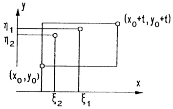

<details>
<summary>text_image</summary>

y
η₁
η₂
(x₀+t, y₀+t)
(x₀,y₀)
ξ₂
ξ₁
x
</details>

Abb. 168 - Zu $f_{xy} = f_{yx}$

$$
\begin{array}{l} h (t) := f (x _ {0} + t, y _ {0} + t) - f (x _ {0} + t, y _ {0}) - f (x _ {0}, y _ {0} + t) + f (x _ {0}, y _ {0}) \\ = g (x _ {0} + t) - g (x _ {0}) \\ = g ^ {\prime} (\xi_ {1}) t = [ f _ {x} (\xi_ {1}, y _ {0} + t) - f _ {x} (\xi_ {1}, y _ {0}) ] t \\ = f _ {x y} (\xi_ {1}, \eta_ {1}) t ^ {2} \\ \end{array}
$$

mit $\xi_{1}$ zwischen $x_{0}+t$ und $x_{0}$ bzw. $\eta_{1}$ zwischen $y_{0}+t$ und $y_{0}$. Ebenso - mit $\tilde{g}(y):=f(x_{0}+t,y)-f(x_{0},y)-\text{folgt } h(t)=\tilde{g}(y_{0}+t)-\tilde{g}(y_{0})=f_{yx}(\xi_{2},\eta_{2})t^{2}$ mit $(\xi_{2},\eta_{2})\in Q$ und damit

$$
f _ {x y} (\xi_ {1}, \eta_ {1}) = f _ {y x} (\xi_ {2}, \eta_ {2}).
$$

Aufgrund der Stetigkeit folgt beim Grenzübergang $t \to 0$ die Behauptung: $f_{xy}(x_0, y_0) = f_{yx}(x_0, y_0)$.

Eine Mehrfachanwendung dieses Satzes zeigt etwa für eine Funktion in x, y, z  $f_{xyx} = f_{xxy} = f_{yxx}$ ,  $f_{xyz} = f_{zyx} = f_{yzx} = \cdots$ , etc., vorausgesetzt, sämtliche vorkommenden Ableitungen sind stetig.

2.4 Die totale Ableitung und lineare Approximation. Die Approximation einer Funktion durch eine (einfachere) „Ersatzfunktion“ ist ein zentrales Thema der Analysis. Zur Beschreibung der Approximationsgüte verwenden wir folgende Abkürzung:

Definition des „o-Symbols“. Für zwei Funktionen $f, g : \mathbb{R}^{n} \supseteq D \to \mathbb{R}$ und $\mathbf{x}_{0} \in D$, $k \in \mathbb{N}$, schreibt man

$$
\begin{array}{l}f (\mathbf {x}) = g (\mathbf {x}) + o (| \mathbf {x} - \mathbf {x} _ {0} | ^ {k}) \quad \text {(fur} \mathbf {x} \rightarrow \mathbf {x} _ {0})\\\text {falls} \lim _ {\mathbf {x} \rightarrow \mathbf {x} _ {0}} \frac {f (\mathbf {x}) - g (\mathbf {x})}{| \mathbf {x} - \mathbf {x} _ {0} | ^ {k}} = 0.\end{array}\tag {3}
$$

Das so definierte $o$-Symbol ist keine eindeutig festgelegte Funktion. Die Gleichung $f(\mathbf{x}) = g(\mathbf{x}) + o(|\mathbf{x} - \mathbf{x}_0|^k)$ besagt, daß der bei der Approximation von $f$ durch $g$ in der Nähe des Punktes $\mathbf{x}_0$ gemachte Fehler $R(\mathbf{x}, \mathbf{x}_0) := f(\mathbf{x}) - g(\mathbf{x})$ klein ist im Vergleich zu $|\mathbf{x} - \mathbf{x}_0|^k$, in dem Sinne, daß $\lim_{\mathbf{x} \to \mathbf{x}_0} \frac{R(\mathbf{x}, \mathbf{x}_0)}{|\mathbf{x} - \mathbf{x}_0|^k} = 0$ gilt. Insbesondere folgt

$$
\lim _ {\mathbf {x} \to \mathbf {x} _ {0}} (f (\mathbf {x}) - g (\mathbf {x})) = \lim _ {\mathbf {x} \to \mathbf {x} _ {0}} R (\mathbf {x}, \mathbf {x} _ {0}) = \lim _ {\mathbf {x} \to \mathbf {x} _ {0}} | \mathbf {x} - \mathbf {x} _ {0} | ^ {k} \frac {R (\mathbf {x} , \mathbf {x} _ {0})}{| \mathbf {x} - \mathbf {x} _ {0} | ^ {k}} = 0. \tag {4}
$$

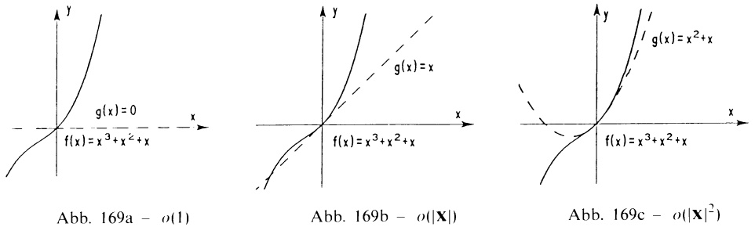

Die Approximation einer differenzierbaren Funktion einer Variablen $f: I \to \mathbb{R}$ ($I \subseteq \mathbb{R}$ ein offenes Intervall) in der Umgebung von $x_0 \in I$ durch die lineare Funktion $g(x) = f(x_0) + f'(x_0)(x - x_0)$ ($\rightarrow$ Kap. 3, §1.3) wird mit dem $o$-Symbol geschrieben als

$$
f (x) = f (x _ {0}) + f ^ {\prime} (x _ {0}) (x - x _ {0}) + o (| x - x _ {0} |) \tag {5}
$$

Für Funktionen von mehreren Variablen gewährleistet die partielle Differenzierbarkeit allein noch nicht die analoge Approximation durch lineare Funktionen ( $\rightarrow$  Aufg. 6).

Definition. Sei $D \subseteq \mathbb{R}^n$ offen. Eine Funktion $f: D \to \mathbb{R}$ heißt in $\mathbf{x}_0 \in D$ total differenzierbar (oder linear approximierbar), wenn es einen Vektor $\mathbf{a} \in \mathbb{R}^n$ mit

$$
f (\mathbf {x}) = f (\mathbf {x} _ {0}) + \mathbf {a} \cdot (\mathbf {x} - \mathbf {x} _ {0}) + o (| \mathbf {x} - \mathbf {x} _ {0} |) \tag {6}
$$

(für x nahe  $x_{0}$ ) gibt.

Satz 2.3. Ist $f$ in $\mathbf{x}_{0}\in D$ total differenzierbar, $f(\mathbf{x}) = f(\mathbf{x}_{0}) + \mathbf{a}\cdot (\mathbf{x} - \mathbf{x}_{0}) + o(|\mathbf{x} - \mathbf{x}_{0}|)$, dann gilt:

a) $f$ ist in $\mathbf{x}_0$ stetig;
b) $\lim_{t\to 0}\frac{1}{t} [f(\mathbf{x}_0 + t\mathbf{v}) - f(\mathbf{x}_0)] = \mathbf{a}\cdot \mathbf{v}$ (für alle $\mathbf{v}\in \mathbb{R}^n$ , $\mathbf{v}\neq 0$ );
c) $f$ ist partiell differenzierbar und $\mathbf{a}$ eindeutig bestimmt als $\mathbf{a} = \operatorname{grad} f(\mathbf{x}_0)$.

Beweis. a) folgt aus (4).

b): Für Punkte der Geraden  $x_{0} + tv$  ergibt (6)  $f(\mathbf{x}_{0} + tv) - f(\mathbf{x}_{0}) = t\mathbf{a} \cdot \mathbf{v} + o(|tv|)$ . Division durch t mit anschließendem Grenzübergang  $t \to 0$  liefert die Behauptung.

c): Man nimmt $\mathbf{v} = \mathbf{e}_i$ in b) und erhält mit (1) $\frac{\partial f}{\partial x_i} (\mathbf{x}_0) = \mathbf{a} \cdot \mathbf{e}_i = a_i$ (die $i$-te Koordinate von $\mathbf{a}$).

Im Sinne der Definition (6) bedeutet also

$$
\begin{array}{l} f (\mathbf {x}) = f \left(\mathbf {x} _ {0}\right) + \operatorname{grad} f \left(\mathbf {x} _ {0}\right) \cdot \left(\mathbf {x} - \mathbf {x} _ {0}\right) + o \left(| \mathbf {x} - \mathbf {x} _ {0} |\right) \\ \text {die lineare Approximation von} f (\mathbf {x}) \text {nahe bei} \mathbf {x} _ {0}. \end{array} \tag {7}
$$

Anschauliche Deutung für $n = 2$: Die „über“ $D \subseteq \mathbb{R}^2$ liegende Fläche (der Graph) $z = f(x, y)$ wird in der Nähe

des Flächenpunktes  $(x_{0}, y_{0}, f(x_{0}, y_{0}))$  durch die Ebene

$$
\begin{array}{l} z = f (x _ {0}, y _ {0}) + f _ {x} (x _ {0}, y _ {0}) (x - x _ {0}) + \\ + f _ {y} (x _ {0}, y _ {0}) (y - y _ {0}) \\ \end{array}
$$

mit einem Fehler

$$
R (x, y) = o \left(\sqrt {(x - x _ {0}) ^ {2} + (y - y _ {0}) ^ {2}}\right)
$$

approximiert. Diese Ebene heißt Tangentialbene der Fläche $z = f(x, y)$ im Punkt $(x_0, y_0, f(x_0, y_0))$. Sie enthält sämtliche Flächentangenten ($\rightarrow$ 3.1). □

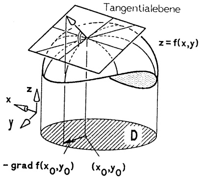

<details>
<summary>text_image</summary>

Tangentialebene
z = f(x,y)
x
y
z
D
- grad f(x₀,y₀) (x₀,y₀)
</details>

Abb. 170 - Tangentialebene

Bemerkung. Über die tatsächliche Größe des Fehlers bei der Approximation von $f(\mathbf{x})$ durch $f(\mathbf{x}_{0}) + \text{grad } f(\mathbf{x}_{0}) \cdot (\mathbf{x} - \mathbf{x}_{0})$ werden wir erst in 3.2 genauere Angaben machen. Vorerst begnügen wir uns mit der qualitativen Fehlerangabe $o(|\mathbf{x} - \mathbf{x}_{0}|)$.

Satz 2.4. Jede $\mathcal{C}^{1}$-Funktion $f: D \to \mathbb{R}$ ($D \subseteq \mathbb{R}^{n}$ offen) ist auf $D$ (d.h. in allen Punkten von $D$) total differenzierbar.

Beweis für $n=2$. Sei $(x_{0},y_{0})\in D$. Für alle $(x,y)$ aus einer (hinreichend kleinen) $r$-Umgebung $U_{r}(x_{0},y_{0})\subseteq D$ gilt nach dem Mittelwertsatz für Funktionen

einer Veränderlichen

$$
\begin{array}{l} f (x, y) - f (x _ {0}, y _ {0}) = f (x, y) - f (x _ {0}, y) + f (x _ {0}, y) - f (x _ {0}, y _ {0}) \\ = f _ {x} (\xi , y) (x - x _ {0}) + f _ {y} (x _ {0}, \eta) (y - y _ {0}) \\ \end{array}
$$

mit $\xi$ zwischen $x$ und $x_0$, $\eta$ zwischen $y$ und $y_0$. Es folgt

$$
f (x, y) = f (x _ {0}, y _ {0}) + \operatorname{grad} f (x _ {0}, y _ {0}) \cdot \binom{x - x _ {0}}{y - y _ {0}} + R (x, y)
$$

mit der Funktion

$$
\begin{array}{l} R (x, y) = [ f _ {x} (\xi , y) - f _ {x} (x _ {0}, y _ {0}) ] (x - x _ {0}) + [ f _ {y} (x _ {0}, \eta) - f _ {y} (x _ {0}, y _ {0}) ] (y - y _ {0}) \\ = o \left(\sqrt {(x - x _ {0}) ^ {2} + (y - y _ {0}) ^ {2}}\right). \\ \end{array}
$$

Die letzte Beziehung ergibt sich aus der Stetigkeit von  $f_{x}$  und  $f_{y}$  und aus  $\frac{|x - x_{0}|}{\sqrt{(x - x_{0})^{2} + (y - y_{0})^{2}}} \leq 1$ ,  $\frac{|y - y_{0}|}{\sqrt{(x - x_{0})^{2} + (y - y_{0})^{2}}} \leq 1$ . ☐

Beispiele. 1. In der Umgebung von (1,1) lautet die lineare Approximation der $\mathcal{C}^{1}$-Funktion $f(x,y)=x^{4}+2x^{3}y^{2}+y$:

$$
\begin{array}{l} f (x, y) = f (1, 1) + \operatorname{grad} f (1, 1) \cdot \binom{x - 1}{y - 1} + o \big (\sqrt {(x - 1) ^ {2} + (y - 1) ^ {2}} \big) \\ = 4 + 1 0 (x - 1) + 5 (y - 1) + o \left(\sqrt {(x - 1) ^ {2} + (y - 1) ^ {2}}\right). \\ \end{array}
$$

Dementsprechend ist

$$
z = 4 + 1 0 (x - 1) + 5 (y - 1)
$$

die Gleichung der Tangentialebene der Fläche  $z = x^{4} + 2x^{3}y^{2} + y$  im Flächenpunkt (1,1,4).

2. Die lineare Approximation der  $C^{1}$ -Funktion  $f(x,y,z)=e^{y+2y}+z\sin y+x$  im Nullpunkt lautet

$$
\begin{array}{l} f (x, y, z) = f (0, 0, 0) + f _ {x} (0, 0, 0) x + f _ {y} (0, 0, 0) y + f _ {z} (0, 0, 0) z + o \left(\sqrt {x ^ {2} + y ^ {2} + z ^ {2}}\right) \\ = 1 + 2 x + 2 y + o \left(\sqrt {x ^ {2} + y ^ {2} + z ^ {2}}\right). \\ \end{array}
$$

2.5 Einfache Anwendungen. Für einfache Näherungs- und Fehlerrechnungen wird in (7) der „o-Anteil“ vernachlässigt und  $f(\mathbf{x})$  in der Nähe des Punktes  $x_{0}$  durch  $f(\mathbf{x}_{0}) + \text{grad } f(\mathbf{x}_{0}) \cdot (\mathbf{x} - \mathbf{x}_{0})$  ersetzt. Man schreibt dafür

$$
f (\mathbf {x}) \approx f (\mathbf {x} _ {0}) + \text {grad} f (\mathbf {x} _ {0}) \cdot (\mathbf {x} - \mathbf {x} _ {0}). \tag {8}
$$

① Näherungsrechnung. Beispiel.  $f(x,y) = x^{y} = e^{y \ln x}$  wird in (1,3) angenähert durch  $f(x,y) \approx 1 + 3(x - 1) + 0(y - 1)$ ; speziell  $1.02^{3.01} \approx 1.06$  (der genaue Wert:  $1.02^{3.01} = 1.061418168\ldots$ ).

② Fehlerrechnung. Werden statt der wahren Werte  $\mathbf{x} = (x_{1}, \ldots, x_{n})$  die Näherungswerte  $\mathbf{x}_{0} = (x_{01}, \ldots, x_{0n})$  gemessen, dann belasten die Meßfehler  $|\Delta x_{i}| = |x_{i} - x_{0i}|$  den Funktionswert mit dem Fehler

$$
\begin{array}{l} \left| \Delta f (\mathbf {x}) \right| = \left| f (\mathbf {x}) - f (\mathbf {x} _ {0}) \right| = \left| \operatorname{grad} f (\mathbf {x} _ {0}) \cdot (\mathbf {x} - \mathbf {x} _ {0}) + o (| \mathbf {x} - \mathbf {x} _ {0} |) \right| \\ \leq \sum_ {i = 1} ^ {n} \left| \frac {\partial f}{\partial x _ {i}} (\mathbf {x} _ {0}) \right| | \Delta x _ {i} | + o (| \mathbf {x} - \mathbf {x} _ {0} |). \\ \end{array}
$$

Sind für die einzelnen Messungen Fehlerschranken  $|\Delta x_{i}| \leq s_{i}$  bekannt, so erhält man eine ungefähre Fehlerschranke S für die Funktionswerte ( $|\Delta f(\mathbf{x})| \leq S$ )

$$
S \approx \sum_ {i = 1} ^ {n} \left| \frac {\partial f}{\partial x _ {i}} (\mathbf {x} _ {0}) \right| s _ {i}.
$$

Beispiel. Für den Elastizitätsmodul E eines Stabes mit quadratischem Querschnitt gilt beim skizzierten Versuchsaufbau

$$
E = 4 F l ^ {3} h ^ {- 1} a ^ {- 4}.
$$

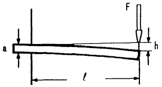

<details>
<summary>text_image</summary>

a
l
h
F
</details>

Abb. 171 - Biegung

Mißt man $l = 50\text{cm}$ (auf $1\%$), $a = 2\text{cm}$ (auf $1\%$), $h = 2\text{mm}$ (auf $3\%$) und $F = 130\text{N}$ (auf $0.5\%$ genau), so gibt die Fehlerrechnung (mit linearer Approximation)

$$
\begin{array}{l} \left| \frac {\Delta E}{E} \right| \approx \frac {1}{| E |} \left| E _ {F} \Delta F + E _ {l} \Delta l + E _ {h} \Delta h + E _ {a} \Delta a \right| \\ \leq | \frac {\Delta F}{F} | + 3 | \frac {\Delta l}{l} | + | - 1 | | \frac {\Delta h}{h} | + | - 4 | | \frac {\Delta a}{a} | \\ \approx 0. 1 0 5 \\ \end{array}
$$

Obiger Versuchsaufbau liefert E auf 10.5% genau, d.h.

$$
E = 2 0 3 1 2 5. 0 0 0 \pm 2 1 3 2 8. 0 0 0 \frac {\mathrm{N}}{\mathrm{mm} ^ {2}}.
$$

Direktes Auswerten von E durch Eintragen der Intervallgrenzen liefert bei den gegebenen Genauigkeiten und Maßeinheiten

$$
2 0 3 1 2 5. 0 0 0 - 2 0 1 5 9. 4 5 1 \leq E \leq 2 0 3 1 2 5. 0 0 0 + 2 2 6 0 0. 7 2 0.
$$

③ Newton-Verfahren zur näherungsweisen Lösung eines nichtlinearen Gleichungssystems im  $R^{2}$

$$
f (x, y) = 0, \quad g (x, y) = 0
$$

(mit $\mathcal{C}^1$-Funktionen $f, g$):

Mit einem Startwert (Näherungswert)  $(x_{0}, y_{0})$  ersetzt man mit (8) dieses System durch das lineare Gleichungssystem

$$
\begin{array}{l} f (x _ {0}, y _ {0}) + f _ {x} (x _ {0}, y _ {0}) (x - x _ {0}) + f _ {y} (x _ {0}, y _ {0}) (y - y _ {0}) = 0 \\ g (x _ {0}, y _ {0}) + g _ {x} (x _ {0}, y _ {0}) (x - x _ {0}) + g _ {y} (x _ {0}, y _ {0}) (y - y _ {0}) = 0, \\ \end{array}
$$

für das man im Fall

$$
\Delta := \det \left( \begin{array}{c c} f _ {x} (x _ {0}, y _ {0}) & f _ {y} (x _ {0}, y _ {0}) \\ g _ {x} (x _ {0}, y _ {0}) & g _ {y} (x _ {0}, y _ {0}) \end{array} \right) \neq 0
$$

mit der Cramerschen Regel (→ Kap. 6, 5.6) eine verbesserte Näherung

$$
\begin{array}{l} x _ {1} = x _ {0} + \frac {1}{\Delta} \det \left( \begin{array}{c c} - f (x _ {0}, y _ {0}) & f _ {y} (x _ {0}, y _ {0}) \\ - g (x _ {0}, y _ {0}) & g _ {y} (x _ {0}, y _ {0}) \end{array} \right) , \\ y _ {1} = y _ {0} + \frac {1}{\Delta} \det \left( \begin{array}{c c} f _ {x} (x _ {0}, y _ {0}) & - f (x _ {0}, y _ {0}) \\ g _ {x} (x _ {0}, y _ {0}) & - g (x _ {0}, y _ {0}) \end{array} \right) \\ \end{array}
$$

berechnet. Mit diesem Wert  $(x_{1}, y_{1})$  als Startwert kann das Verfahren wiederholt werden.

Beispiel 1. Zur Darstellung der Zahnflanken von Stirnradgetrieben verwendet man die Kreisevolvente γ

$$
\mathbf {x} (t) = \binom{r \sin t - r t \cos t}{r \cos t + r t \sin t - r}
$$

(d.i. die Ortskurve des Endpunktes eines Fadens, der von einem Kreis abgewickelt wird).

Soll γ die Punkte (0,0) und (a,b) verbinden, so führt dies auf zwei nicht-lineare Gleichungen für r und t :

$$
f (r, t) := r \sin t - r t \cos t - a = 0
$$

$$
g (r, t) := r \cos t + r t \sin t - r - b = 0.
$$

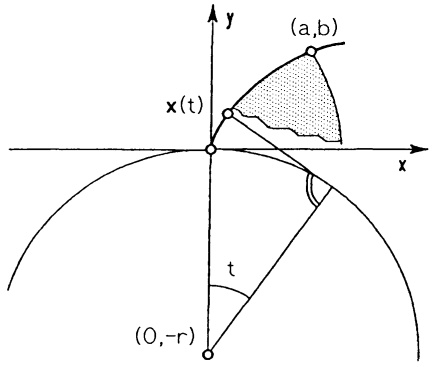

<details>
<summary>text_image</summary>

y
(a,b)
x(t)
x
t
(0,-r)
</details>

Abb. 172 - Zahnflanke

Lineare Approximation von $f$ und $g$ im Punkt $(r_0, t_0)$ liefert das lineare Gleichungssystem

$$
\left( \begin{array}{c c} \sin t _ {0} - t _ {0} \cos t _ {0} & r _ {0} t _ {0} \sin t _ {0} \\ \cos t _ {0} + t _ {0} \sin t _ {0} - 1 & r _ {0} t _ {0} \cos t _ {0} \end{array} \right) \binom{r - r _ {0}}{t - t _ {0}} + \binom{f (r _ {0}, t _ {0})}{g (r _ {0}, t _ {0})} = 0.
$$

Hierbei ist die Determinante $\Delta = r_0 t_0 (\sin t_0 - t_0)$ stets $\neq 0$, sofern nur $r_0 t_0 \neq 0$. Die Lösung $(r_1, t_1)$ liefert eine verbesserte Näherung

$$
\binom{r _ {1}}{t _ {1}} = \binom{r _ {0}}{t _ {0}} - \frac {1}{\Delta} \left( \begin{array}{c c} r _ {0} t _ {0} \cos t _ {0} & - r _ {0} t _ {0} \sin t _ {0} \\ 1 - \cos t _ {0} - t _ {0} \sin t _ {0} & \sin t _ {0} - t _ {0} \cos t _ {0} \end{array} \right) \binom{f (r _ {0}, t _ {0})}{g (r _ {0}, t _ {0})}.
$$

Für  $(a,b)=(1,1)$  und die Startwerte  $(r_{0},t_{0})=(2,1.2)$  liefert ein kleines Rechnerprogramm folgende rasch konvergierenden Näherungswerte:

$$
\begin{array}{l} r _ {0} = 2 \quad t _ {0} = 1. 2 \\ r _ {1} = 2. 1 2 5 9 8 6 6 6 9 5 \quad t _ {1} = 1. 1 7 4 4 9 0 8 0 2 6 \\ r _ {2} = 2. 1 2 8 9 1 3 0 1 2 7 \quad t _ {2} = 1. 1 7 5 0 4 3 8 9 0 3 \\ r _ {3} = 2. 1 2 8 9 1 4 5 2 3 9 \quad t _ {3} = 1. 1 7 5 0 4 2 6 2 8 9 \\ \end{array}
$$

Man beachte, daß dieses Verfahren keine eindeutige Lösung liefert: Mit dem Startwert  $(r_{0}, t_{0}) = (1, 8)$  liefert obiges Programm nach 5 Schritten die Näherung

$$
r = 0. 1 8 2 2 3, \quad t = 8. 4 3 8 1,
$$

die für die technische Aufgabenstellung nicht brauchbar ist. □

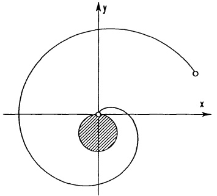

<details>
<summary>text_image</summary>

Mathematical diagram showing a spiral curve in Cartesian coordinates with a shaded region and a point on the curve.
</details>

Abb. 173 - Kreisevolvente

Beispiel 2. Bairstow-Verfahren zur näherungsweisen Berechnung aller komplexen Nullstellen eines reellen Polynoms

$$
p (x) = a _ {0} x ^ {n} + a _ {1} x ^ {n - 1} + \dots + a _ {n} \quad \left(a _ {i} \in \mathbb {R}, a _ {0} \neq 0\right).
$$

Ein quadratisches Polynom $q(x) = x^{2} - ux - v$ ist genau dann ein Teiler von $p(x)$, wenn in der Zerlegung ($\rightarrow$ Kap. 2, 2.5 (7))

$$
p (x) = (x ^ {2} - u x - v) h (x) + (a x + b)
$$

die Koeffizienten $a, b$ des Restes verschwinden, d.h. wenn $u, v$ Lösungen sind von

$$
a = a (u, v) = 0, \quad b = b (u, v) = 0.
$$

Dieses Gleichungssystem, das für $n \geq 2$ stets eine Lösung in $\mathbb{R}^2$ besitzt ($\rightarrow$ Kap. 2, Satz 2.10), wird mit dem zweidimensionalen Newton-Verfahren näherungsweise gelöst. Die Berechnung von $a(u,v)$ und $b(u,v)$ erfolgt mit dem Horner-Schema ($\rightarrow$ Kap. 2, §2). Ist eine Näherungslösung $\tilde{u},\tilde{v}$ gefunden, so gibt die quadratische Gleichung $x^2 - \tilde{u} x - \tilde{v} = 0$ zwei Nullstellen von $p(x)$. Da das Horner-Schema gleichzeitig die Koeffizienten von $h(x)$ liefert, kann der Algorithmus sofort an $h(x)$ wiederholt werden.

Die Wahl von günstigen Startwerten  $u_{0}, v_{0}$  ist i.a. schwierig, daher muß mitunter mehrfach mit unterschiedlichen  $u_{0}, v_{0}$  begonnen werden.

```txt
' Programm BAIRSTOW
' ---------------------------------------------------      Repeat
Input "Polynomgrad=";N          Bk=0
Eps=1.OE-07              Bk_1=0
Steps=30                  Ck=0
M=N                     Ck_1=0
Dim B(N),C(N)                 For K=0 To M-1
For I=0 To N                    Ck_2=Ck_1
    Print "a"+Str$(I)           Ck_1=Ck
    Input B(I)                   Bk_2=Bk_1
Next I                           Bk_1=Bk
While M>2                        Bk=B(K)+U*Bk_1+V*Bk_2
    Start:                             C(K)=Bk
    Input "Startwerte UO= ,VO= ";U;V   Next K
S=0
```

```txt
Bk_2=Bk_1
    Bk_1=Bk
    Bk=B(M)+U*Bk_1+V*Bk_2
    C(M)=Bk
    Det=Ck_1*Ck_1-Ck_2*Ck
    If Det=0 Then
        Print "Neue Startwerte!"
        Goto Start
    Endif
    U=U+(Bk*Ck_2-Bk_1*Ck_1)/Det
    V=V+(Bk_1*Ck-Bk*Ck_1)/Det
    S=S+1
    If S=Steps Then
        Print "Neue Startwerte!"
        Goto Start
    Endif
Until Abs(Bk_1)+Abs(Bk)<Eps
Gosub Quadr_gleichg
M=M-2
For K=0 To M
    B(K)=C(K)
Next K
Wend
If M=1 Then
    Print "rccllc Wurzel:";-B(1)/B(0)
Else
    U=-B(1)/B(0)
    V=-B(2)/B(0)
    Gosub Quadr_gleichg
Endif
End
```


2.6 Die Richtungsableitung, der Anstieg und die Kettenregel. Die partiellen Ableitungen  $\frac{\partial f}{\partial x_{i}}(\mathbf{x})$  geben gemäß (1) die „momentane“ Änderung der Funktionswerte in Richtung der Koordinatenachsen (d.h. in  $e_{i}$ -Richtung) an. Es wäre unvernünftig, sich auf diese Richtungen zu beschränken.

Zu jedem Vektor $\mathbf{v} \in \mathbb{R}^{n}$, $\mathbf{v} \neq 0$, nennen wir den Grenzwert

$$
\hat {c} _ {\mathbf {v}} f (\mathbf {x}) := \lim _ {t \to 0} \frac {1}{t} [ f (\mathbf {x} + t \mathbf {v}) - f (\mathbf {x}) ] \tag {9}
$$

(sofern er existiert) die Ableitung von $f$ an der Stelle $\mathbf{x}$ längs $\mathbf{v}$. Ist $\mathbf{v}$ ein Einheitsvektor ($|\mathbf{v}| = 1$), dann heißt $\partial_{\mathbf{v}}f(\mathbf{x})$ die Richtungsableitung (oder Anstieg) von $f$ an der Stelle $\mathbf{x}$ in Richtung $\mathbf{v}$.

Bemerkung. Für  $\partial_{\mathbf{v}}f(\mathbf{x})$  sind die Bezeichnungen  $\frac{\partial f}{\partial\mathbf{v}}(\mathbf{x})$  oder  $D_{\mathbf{v}}f(\mathbf{x})$  ebenfalls weit verbreitet.

Betrachtet man die Einschränkung von $f$ längs der Geraden $\mathbf{x}+tv$ (in Richtung $\mathbf{v}$), also $h(t):=f(\mathbf{x}+tv)$, dann gilt $\dot{h}(0)=\partial_{\mathbf{v}}f(\mathbf{x})$ und deshalb

$$
\partial_ {\mathbf {v}} f (\mathbf {x}) > 0 \Rightarrow f (\mathbf {x}) \text { nimmt in Richtung } \mathbf {v} \text { zu },
$$

$$
\partial_ {\mathbf {v}} f (\mathbf {x}) <   0 \Rightarrow f (\mathbf {x}) \text {nimmt in Richtung v ab.}
$$

Eine anschauliche Deutung für $n = 2$:

Die Schnittkurve des Graphen $z = f(x, y)$ mit der zur $z$-Achse parallelen Ebene durch die Gerade

$$
\binom{x _ {0}}{y _ {0}} + t \binom{v _ {1}}{v _ {2}}, \mathbf {v} = \binom{v _ {1}}{v _ {2}}, | \mathbf {v} | = 1,
$$

besitzt die Parameterdarstellung

$$
\mathbf {x} (t) = \left( \begin{array}{c} x _ {0} + t v _ {1} \\ y _ {0} + t v _ {2} \\ f (x _ {0} + t v _ {1}, y _ {0} + t v _ {2}) \end{array} \right)
$$

mit dem Tangentialvektor

$$
\dot {\mathbf {x}} (t) = \left( \begin{array}{c} v _ {1} \\ v _ {2} \\ \hat {c}, f (x _ {0}, y _ {0}) \end{array} \right)
$$

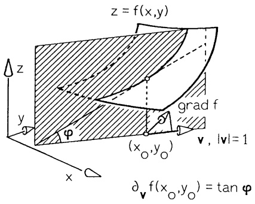

<details>
<summary>text_image</summary>

z = f(x,y)
grad f
y
φ
(x₀,y₀)
v, |v|=1
∂_v f(x₀,y₀) = tan φ
x
</details>

Abb. 174 - Richtungsableitung

im Kurvenpunkt  $(x_{0},y_{0},f(x_{0},y_{0}))$ . Die Tangente hat in der Tat den Anstieg  $\hat{c}_{\nu}f(x_{0},y_{0})$ . ☐

Eine physikalische Deutung für $n=2$: Ein Massenpunkt überquert eine ebene Platte mit konstanter Geschwindigkeit $\mathbf{v}=(v_{1},v_{2})^{T}$ (nicht notwendig $|\mathbf{v}|=1$). Herrscht auf der Platte die Temperaturverteilung $T=f(x,y)$, so gilt für die momentane Temperaturänderung des Punktes in $(x_{0},y_{0})$

$$
\lim _ {t \to 0} \frac {1}{t} \left[ f (x _ {0} + t v _ {1}, y _ {0} + t v _ {2}) - f (x _ {0}, y _ {0}) \right] = \partial_ {\mathbf {v}} f (x _ {0}, y _ {0}).
$$

Aus den Sätzen 2.3 und 2.4 folgt:

Satz 2.5. Für jede auf der offenen Menge $D \subseteq \mathbb{R}^n$ total differenzierbare Funktion $f$ (insbesondere für $f \in \mathcal{C}^1(D, \mathbb{R})$) und für jeden Vektor $\mathbf{v} \in \mathbb{R}^n$, $\mathbf{v} \neq 0$, gilt

$$
\partial_ {\mathbf {v}} f (\mathbf {x}) = \operatorname{grad} f (\mathbf {x}) \cdot \mathbf {v} = \sum_ {i = 1} ^ {n} f _ {x _ {i}} (\mathbf {x}) v _ {i}.\tag {10}
$$

Mit $|\mathbf{v}| = 1$ stellt (10) die Richtungsableitung (bzw. den Anstieg) von $f$ an der Stelle $\mathbf{x}$ in Richtung $\mathbf{v}$ dar.

Beispiele. 1. Der Anstieg der Funktion $f(x,y)=x^{2}+y^{2}$ im Punkt (1,1) in Richtung des (Einheits-) Vektors $\mathbf{v}=(\sin\alpha,\cos\alpha)^{T}$ beträgt

$$
\hat {c} _ {\mathbf {v}} f (\mathbf {x}) = \operatorname{grad} f (1, 1) \cdot \binom{\cos \alpha}{\sin \alpha} = (2, 2) \binom{\cos \alpha}{\sin \alpha} = 2 (\cos \alpha + \sin \alpha).
$$

2. Der mit der Geschwindigkeit $\mathbf{v} = (2,4,7)^{T}$ (Einheiten vernachlässigt) einen Raum mit der Temperaturverteilung $T = f(x,y,z) = 2xy + 4yz$ durchquerende Massenpunkt erfährt im Punkt (1,1,1) die momentane Temperaturänderung

$$
\hat {c} _ {\mathbf {v}} f (1, 1, 1) = \operatorname{grad} f (1, 1, 1) \cdot \left( \begin{array}{c} 2 \\ 4 \\ 7 \end{array} \right) = \left( \begin{array}{c} 2 \\ 6 \\ 4 \end{array} \right) \left( \begin{array}{c} 2 \\ 4 \\ 7 \end{array} \right) = 5 6.
$$

3. Für die durch  $A = A^{T} \in R^{n \times n}$  bestimmte quadratische Form q gilt:

$$
\boxed { \begin{array}{r l} q (\mathbf {x}) & = \mathbf {x} ^ {T} A \mathbf {x}, \\ \hat {c} _ {\mathbf {v}} q (\mathbf {x}) & = 2 (A \mathbf {x}) \cdot \mathbf {v}, \\ \operatorname{grad} q (\mathbf {x}) & = 2 A \mathbf {x}. \end{array} } \tag {11}
$$

Beweis.

$$
\begin{array}{l} \hat {c} _ {\mathbf {v}} q (\mathbf {x}) = \lim _ {t \to 0} \frac {1}{t} [ q (\mathbf {x} + t \mathbf {v}) - q (\mathbf {x}) ] \\ = \lim _ {t \to 0} (\mathbf {v} ^ {T} A \mathbf {x} + \mathbf {x} ^ {T} A \mathbf {v} + t \mathbf {v} ^ {T} A \mathbf {v}) = 2 (A \mathbf {x}) \cdot \mathbf {v}. \\ \end{array}
$$

Die physikalische Deutung der Ableitung längs v legt es nahe, das Änderungsverhalten der Funktion f längs einer im Definitionsbereich verlaufenden Kurve (Bahn eines bewegten Punktes) zu untersuchen.

Satz 2.6. Die Kettenregel. Für jede $\mathcal{C}^{1}$-Funktion $f: D \to \mathbb{R}$. $D \subseteq \mathbb{R}^{n}$ offen, und für jedes Kurvenstück $\mathbf{x}: \mathbb{R} \supseteq [a, b] \to D$ gilt

$$
\begin{array}{r l} \frac {d}{d t} f (\mathbf {x} (t)) & = \frac {d}{d t} f \left(x _ {1} (t), x _ {2} (t), \dots , x _ {n} (t)\right) \\ & = f _ {x _ {1}} (\mathbf {x} (t)) \dot {x} _ {1} (t) + \dots + f _ {x _ {n}} (\mathbf {x} (t)) \dot {x} _ {n} (t) = \operatorname{grad} f (\mathbf {x} (t)) \cdot \dot {\mathbf {x}} (t). \end{array} \tag {12}
$$

Beweis. Aus der linearen Approximation (7) in einem Kurvenpunkt $\mathbf{x}(t)$ nahe $\mathbf{x}_{0} := \mathbf{x}(t_{0})$, $f(\mathbf{x}(t)) - f(\mathbf{x}_{0}) = \text{grad } f(\mathbf{x}_{0}) \cdot (\mathbf{x}(t) - \mathbf{x}_{0}) + R(\mathbf{x}(t), \mathbf{x}_{0})$ mit dem Fehler $R(\mathbf{x}, \mathbf{x}_{0}) = o(|\mathbf{x} - \mathbf{x}_{0}|)$, ergibt sich nach Division durch $t - t_{0}$ und Grenzübergang $t \to t_{0}$ die Behauptung; denn es gilt

$$
\lim _ {t \to t _ {0}} \frac {R (\mathbf {x} (t) , \mathbf {x} _ {0})}{t - t _ {0}} = \lim _ {t \to t _ {0}} \frac {| \mathbf {x} (t) - \mathbf {x} _ {0} |}{t - t _ {0}} \cdot \frac {R (\mathbf {x} (t) , \mathbf {x} _ {0})}{| \mathbf {x} (t) - \mathbf {x} _ {0} |} = 0.
$$

Die Kettenregel benötigt man immer dann, wenn neue Variable eingeführt werden und die partiellen Ableitungen in bezug auf diese Veränderlichen zu berechnen sind.

Beispiel 1. Polarkoordinaten im $\mathbb{R}^{2}$. Durch $x = r\cos\varphi$, $y = r\sin\varphi$ wird die Funktion $f(x,y)$, $(x,y) \in D \subseteq \mathbb{R}^{2}$, transformiert in

$$
F (r, \varphi) := f (r \cos \varphi , r \sin \varphi).
$$

Für die partiellen Ableitungen von $F$ ergibt sich aus der Kettenregel (falls $f \in \mathcal{C}^2(D)$)

$$
\begin{array}{l} F _ {r} = f _ {x} \cos \varphi + f _ {y} \sin \varphi , \\ F _ {\varphi} = f _ {x} (- r \sin \varphi) + f _ {y} (r \cos \varphi), \\ F _ {r r} = f _ {x x} \cos^ {2} \varphi + 2 f _ {x y} \cos \varphi \sin \varphi + f _ {y y} \sin^ {2} \varphi , \\ F _ {r \varphi} = f _ {x x} (- r \sin \varphi \cos \varphi) + f _ {x y} r (\cos^ {2} \varphi - \sin^ {2} \varphi) + f _ {y y} (r \sin \varphi \cos \varphi) \\ - f _ {x} \sin \varphi + f _ {y} \cos \varphi , \\ F _ {\varphi \varphi} = f _ {x x} (r ^ {2} \sin^ {2} \varphi) + 2 f _ {x y} (- r ^ {2} \cos \varphi \sin \varphi) + f _ {y y} (r ^ {2} \cos^ {2} \varphi) - f _ {x} r \cos \varphi \\ - f _ {y} r \sin \varphi . \\ \end{array}
$$

Löst man diese Beziehungen nach den partiellen Ableitungen von $f$ auf, so erhält man für $r \neq 0$

$$
\boxed { \begin{array}{l} f _ {x} = F _ {r} \cos \varphi - \frac {1}{r} F _ {\varphi} \sin \varphi \\ f _ {y} = F _ {r} \sin \varphi + \frac {1}{r} F _ {\varphi} \cos \varphi \end{array} }
$$

und für den LAPLACE-Operator

$$
\Delta f := f _ {x x} + f _ {y y} = F _ {r r} + \frac {1}{r} F _ {r} + \frac {1}{r ^ {2}} F _ {\varphi \varphi}. \tag {13}
$$

## Beispiel 2. Kugelkoordinaten im $\mathbb{R}^{3}$. Durch

$$
x = r \cos \varphi \sin \theta , y = r \sin \varphi \sin \theta , z = r \cos \theta (0 \leq \varphi <   2 \pi , 0 \leq \theta \leq \pi)
$$

erhält man für die Funktion  $f(x, y, z)$

$$
F (r, \varphi , \theta) := f (r \cos \varphi \sin \theta , r \sin \varphi \sin \theta , r \cos \theta).
$$

Mehrfache Anwendung der Kettenregel und anschließendes Auflösen ergibt für den LAPLACE-Operator

$$
\begin{array}{r l} \Delta f & := f _ {x x} + f _ {y y} + f _ {z z} = \\ & = F _ {r r} + \frac {2}{r} F _ {r} + \frac {1}{r ^ {2} \sin^ {2} \theta} F _ {\varphi \varphi} + \frac {1}{r ^ {2}} F _ {\theta \theta} + \frac {1}{r ^ {2}} (\cot \theta) F _ {\theta}. \end{array} \tag {14}
$$

## Aufgaben

1. Gegeben sind die Funktionen  $f : R^{2} \rightarrow R$

$$
f (x, y) = x ^ {2} - y ^ {2}, \quad f (x, y) = \sqrt {| x y |}, \quad f (x, y) = | x | + | y |.
$$

a) Zur Veranschaulichung im  $R^{3}$  bestimme und skizziere man

- die Niveaulinien $(f(x,y) = \mathrm{const})$
- die Graphen der Einschränkungen (x = const bzw. y = const
- den Graphen $z = f(x, y)$ im Schrägbild.

$$
\text {bzw.} y / x = \text {const})
$$

b) Soweit möglich berechne man grad f und  $\Delta f = \frac{\partial^{2}f}{\partial x^{2}} + \frac{\partial^{2}f}{\partial y^{2}}$  und skizziere einige Gradienten.

2. a) Berechne die ersten und zweiten partiellen Ableitungen von

$$
f = \ln \sqrt {x ^ {2} + y ^ {2}}: \quad f = \arctan \frac {y}{x}, x \neq 0.
$$

Welchen Wert hat jeweils  $f_{xx} + f_{yy}$ ?

b) Wie lautet jeweils die Gleichung der Tangentialebene im Punkt mit $x = 2$, $y = 1$?

c) Für die Funktion  $f(x,y) = \arctan \frac{y}{x}, x \neq 0$ , bestimme man

\- den Gradienten grad $f$ im Punkt (1,2),

\- die Richtungsableitung $d, f$ im Punkt (1,2) mit $\mathbf{v}$ in Richtung von $\begin{pmatrix} 1 \\ -1 \end{pmatrix}$.

\- $\frac{dz}{dt}$, wenn $z = f(t - \sin t, 1 - \cos t)$, $t \in \mathbb{R}$.

3. Die Funktion  $z = f(p, q)$  ist definiert als die größte reelle Wurzel von

$$
z ^ {2} + p z + q = 0.
$$

Wie lautet der Definitionsbereich von $f$; wie lauten die Höhenlinien $z = \text{const.}$ und die partiellen Ableitungen $\frac{\partial z}{\partial p}, \frac{\partial z}{\partial q}$?

4. Man berechne die ersten und zweiten partiellen Ableitungen der Funktion

$$
f (x, y, z) = x \cdot e ^ {x y / z}.
$$

5. Für  $f, g : R^{n} \rightarrow R$  rechne man nach:

$$
\mathrm{grad} (f \cdot g) = g \mathrm{grad} f + f \mathrm{grad} g,
$$

$$
\Delta (f \cdot g) = f \Delta g + 2 (\operatorname{grad} f) \cdot (\operatorname{grad} g) + g \Delta f.
$$

6. Gegeben ist die Funktion (Sinuskegel)

$$
f (x, y) = \left\{ \begin{array}{c l} \frac {x ^ {3} - 3 x y ^ {2}}{x ^ {2} + y ^ {2}} & , (x, y) \neq (0, 0) \\ 0 & , (x, y) = (0, 0) \end{array} \right.
$$

- Man berechne gradf für alle $(x,y)\in\mathbb{R}$.
- Sind $f_{x}$ und $f_{y}$ in $(0,0)$ stetig?
- Besitzt $f$ in $(0,0)$ eine Tangentialebene?

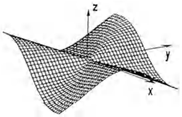

<details>
<summary>text_image</summary>

z
y
x
</details>

7. Die Funktion $U = f(x, y)$, $(x, y) \in \mathbb{R}^2$, hat in Polarkoordinaten $(r, \varphi)$ die Gestalt (Sinusparaboloid):

$$
U = F (r, \varphi) = f (r \cos \varphi , r \sin \varphi) = r ^ {2} \sin 4 \varphi .
$$

Man berechne:

$-F_{r}, F_{\varphi}, F_{rr}, F_{r\varphi}, F_{\varphi r}, F_{\varphi \varphi} \text{ für } r = 0,$
- $f_{x}, f_{y}$ ausgedrückt durch $F_{r}, F_{\varphi}$,
- grad $U$ in der Basis $(\mathbf{e}_r, \mathbf{e}_{\varphi})$, ($\rightarrow$ §1, Aufgabe 5),
- $f_{xx}(0,0)$, $f_{xy}(0,0)$, $f_{yx}(0,0)$, $f_{yy}(0,0)$.
Ist $f_{yx}(0,0) = f_{xy}(0,0)$ und ist
$F_{r\varphi}(0,\varphi) = F_{\varphi r}(0,\varphi)$?

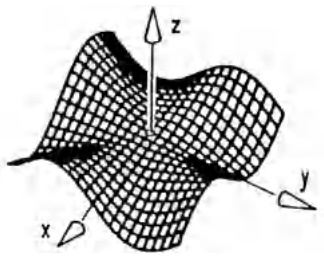

<details>
<summary>text_image</summary>

z
y
x
</details>

8. Die Funktion

$$
u (x, y, t) = \sin x \cos y \cos (x + y) \cos (x - y) \cos \omega t
$$

beschreibt für $t > 0$ die Transversalschwingung einer biegeweichen Membran in dem Quadrat $|x| + |y| \leq \frac{\pi}{2}$.

a) Man zeige: u löst die Schwingungsgleichung

$$
\frac {\partial^ {2} u}{\partial t ^ {2}} = c ^ {2} \Delta u = c ^ {2} \left(\frac {\partial^ {2} u}{\partial x ^ {2}} + \frac {\partial^ {2} u}{\partial y ^ {2}}\right) .
$$

In welchem Zusammenhang stehen c und ω?

b) In welchen Punkten ist zu allen Zeiten $t$ stets $u = 0$ (Knotenlinie)?

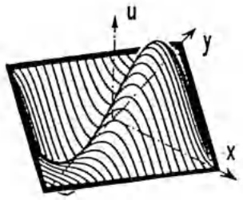

<details>
<summary>text_image</summary>

Diagram showing a wavy surface with coordinate axes labeled x, y, u and directional arrows indicating flow or field direction.
</details>

9. Die Schnittkurve K der beiden Flächen

$$
\begin{array}{l} z = f (x, y) = 2 x ^ {3} y - x ^ {2} y ^ {3} \\ z = g (x, y) = 3 x y ^ {3} + x ^ {3} y ^ {2} - 5 \\ \end{array}
$$

durchstößt die x, y-Ebene in der Nähe des Punktes  $(x_{0}, y_{0}) = (1, 1)$ . Zur Verbesserung dieses Wertes bestimme man:

a) die Tangentialebene von  $z = f(x, y)$  in  $(x_{0}, y_{0})$ ;
b) die Tangentialebene von  $z = g(x, y)$  in  $(x_{0}, y_{0})$ ;
c) den Schnittpunkt  $(x_{1},y_{1})$  der Schnittgeraden dieser beiden Ebenen mit der Ebene z = 0 ;
d) die Werte $f(x_1, y_1)$ und $g(x_1, y_1)$.

10. Man zeige: Die Funktion  $f : R^{2} \rightarrow R$

$$
f (x, y) = \left\{ \begin{array}{c l} e ^ {- y ^ {2} / x} & , x \neq 0 \\ 1 & , x = 0 \end{array} \right.
$$

ist eingeschränkt auf die Geraden $y = mx$, $m \in \mathbb{R}$, stetig.

Ist $f$ über $\mathbb{R}^2$ stetig? Man skizziere einige Niveaulinien von $f$.

## §3. Anwendungen der Differentiation

## 3.1 Die Bedeutung des Gradienten.

① Richtung des stärksten Anstiegs. Für eine $\mathcal{C}^{1}$-Funktion $f: \mathbb{R}^{n} \supseteq D \to \mathbb{R}$ ist der Anstieg im Punkt $\mathbf{x} \in D$ in Richtung eines Vektors $\mathbf{v} \in \mathbb{R}^{n}$, $|\mathbf{v}| = 1$, gegeben durch $\partial_{\mathbf{v}} f(\mathbf{x}) = \text{grad } f(\mathbf{x}) \cdot \mathbf{v} = |\text{grad } f(\mathbf{x})| \cos \alpha$, wobei $\alpha$ den Winkel zwischen $\text{grad } f(\mathbf{x})$ und $\mathbf{v}$ bezeichnet ($\rightarrow \S(10)$ und Kap. 1, §5). Dieser Anstieg ist am größten für $\cos \alpha = 1$, d.h. für $\alpha = 0$. Also gilt für $\text{grad } f(\mathbf{x}) \neq \mathbf{0}$:

Richtung von grad  $f(\mathbf{x})=$

= Richtung des maximalen Anstiegs der Funktion f in x
= Richtung mit größtem Zuwachs von f in x.

Da $f$ genau dann ansteigt, wenn $-f$ abfällt, erhält man damit gleichzeitig die Richtung des stärksten Abnehmens („Abfalls“) der

Funktionswerte, nämlich  $-\text{grad } f(\mathbf{x})$ .

Speziell ergibt sich für den Graphen einer $\mathscr{C}^{1}$-Funktion $f: \mathbb{R}^{2} \supseteq D \to \mathbb{R}$: Im Punkt $(x, y)$ erfolgt der steilste Anstieg der Fläche $z = f(x, y)$ in Richtung von $\text{grad } f(x, y)$. Die Ebene senkrecht zur $(x, y)$-Ebene durch den Flächenpunkt $(x, y, f(x, y))$ längs $\text{grad } f(x, y)$ schneidet den Graphen in der „Fallinie“.

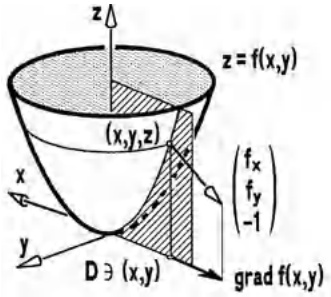

<details>
<summary>text_image</summary>

z
z = f(x,y)
(x,y,z)
f_x
f_y
-1
y
D ∃ (x,y)
grad f(x,y)
</details>

Abb. 175 - grad $f(x, y)$

Anwendungen. 1. Die elektrische Feldstärke $\mathbf{E}(\mathbf{x})$ im Punkt $\mathbf{x} \in D \subseteq \mathbb{R}^3$ hat die Richtung des stärksten Spannungsabfalls in einem elektrostatischen Spannungsfeld $U(\mathbf{x})$, da $\mathbf{E}(\mathbf{x}) = -\text{grad } U(\mathbf{x})$ ($\rightarrow$ Kap. 8, 2.5).

Beispiel. Das Potential einer Punktladung in $O$ ist $U(\mathbf{x}) = \frac{c}{|\mathbf{x}|}$, $\mathbf{x} \neq \mathbf{0}$, $c \in \mathbb{R}$, mit der Feldstärke $\mathbf{E}(\mathbf{x}) = -c \operatorname{grad} \frac{1}{|\mathbf{x}|} = \frac{c}{|\mathbf{x}|^3} \mathbf{x}$.

2. Das Gradientenverfahren zur Bestimmung von Maximum (oder Minimum) einer Funktion $f$. Ausgehend von einem Startwert $\mathbf{x}_0$ bestimmt man in Richtung von $\operatorname{grad} f(\mathbf{x}_0)$ (bzw. $-\operatorname{grad} f(\mathbf{x}_0)$) einen Punkt

$$
\mathbf {x} _ {1} = \mathbf {x} _ {0} + h \operatorname{grad} f (\mathbf {x} _ {0})
$$

mit einer dem Problem angepaßten Schrittweite h > 0 (h < 0).

Im Falle $f(\mathbf{x}_1) < f(\mathbf{x}_0)$ (bzw. $f(\mathbf{x}_1) > f(\mathbf{x}_0)$) ist man zu weit gegangen, man versucht es deshalb noch einmal mit halber Schrittweite: $\mathbf{x}_1 = \mathbf{x}_0 + \frac{h}{2} \operatorname{grad} f(\mathbf{x}_0)$.

Ist $f(\mathbf{x}_1) > f(\mathbf{x}_0)$ (bzw. $f(\mathbf{x}_1) < f(\mathbf{x}_0)$), so nimmt man $\mathbf{x}_1$ als neuen Startwert und wiederholt das Verfahren. Auf diese Weise nähert man sich auf einem Streckenzug in $D$ einer Maximal- (bzw. Minimal-) Stelle der Funktion. Diese Stelle hängt vom gewählten Startwert ab und bestimmt nicht notwendig das globale Maximum (bzw. Minimum) von $f$ auf $D$ ($\rightarrow 3.4$).

Beispiel. Bei der Struktursynthese ebener Kurbelgetriebe stellt sich die Aufgabe, aus N Meßpunkten  $(x_{i}, y_{i})$  in der Ebene eine Kreisbahn zu rekonstruieren. Da die Punkte für N > 3 im allgemeinen nicht auf einem Kreis liegen, bestimmt man die Mittelpunktskoordinaten x, y und den Radius r als Minimalstelle der Fehlerquadratfunktion

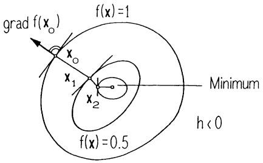

<details>
<summary>text_image</summary>

grad f(x₀)
f(x) = 1
x₀
x₁
x₂
Minimum
h < 0
f(x) = 0.5
</details>

Abb. 176 - Gradientenverfahren

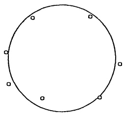

<details>
<summary>natural_image</summary>

Simple circular diagram with six marked points (no text or symbols)
</details>

Abb. 177 - Interpolation mit Kreis

$$
F (x, y, r) = \sum_ {i = 1} ^ {N} \left(\sqrt {(x _ {i} - x) ^ {2} + (y _ {i} - y) ^ {2}} - r\right) ^ {2}.
$$

Wählt man die Startwerte über einen Kreis, der durch drei der N Punkte  $(x_{i}, y_{i})$  geht, so liefert das Gradientenverfahren für das skizzierte Beispiel nach wenigen Schritten eine brauchbare „Lösung“. Zur Programmierung der Schrittweitenhalbierung und des Abbruchkriteriums ( $\rightarrow$  Programm NLSQ in 3.5). ☐

② Tangenten und Tangentialebene.

Sei $D \subseteq \mathbb{R}^n$ offen und $f : D \to \mathbb{R}$ eine $\mathcal{C}^1$-Funktion, dann definiert $f(\mathbf{x}) = c$ ($c \in \mathbb{R}$ konstant) eine Hyperfläche in $D$. Für jede parametrisierte Kurve $t \mapsto \mathbf{x}(t)$ auf dieser Hyperfläche gilt $f(\mathbf{x}(t)) = c \quad (t \in I)$, und mit der Kettenregel (12) von §2 folgt

$$
\mathrm{grad} f (\mathbf {x} (t)) \cdot \dot {\mathbf {x}} (t) = 0 . \tag {1}
$$

Diese Formel werten wir nun getrennt für n = 2 und n = 3 aus.

n = 2 : In jedem Punkt $(x_0, y_0)$ der Niveaukurve $f(x, y) = c$ ist grad $f(x_0, y_0)$ orthogonal zur Kurventangente. Man sagt auch,

grad  $f(x_{0}, y_{0})$  ist im Kurvenpunkt  $(x_{0}, y_{0})$  orthogonal zur Niveaukurve  $f(x, y) = c$ .

Diese Feststellung liefert für den Fall  $\text{grad } f(x_{0}, y_{0}) \neq 0$  sofort die

Normalengleichung der Tangente an die Niveaukurve $f(x,y) = c$ im Kurvenpunkt $(x_0,y_0)$:

$$
f _ {x} (x _ {0}, y _ {0}) (x - x _ {0}) + f _ {y} (x _ {0}, y _ {0}) (y - y _ {0}) = 0.
$$

Speziell ergibt dieses für den Graph $y = f(x)$ einer Funktion in einer Veränderlichen, implizit dargestellt durch $F(x,y) = y - f(x) = 0$, die Gleichung der Kurventangente grad $F(x_0,y_0) \cdot \begin{pmatrix} x - x_0 \\ y - y_0 \end{pmatrix} = 0$, also $y - y_0 - f'(x_0)(x - x_0) = 0$.

n = 3 : In jedem Punkt  $\mathbf{x}_{0} = (x_{0}, y_{0}, z_{0})$  der durch  $f(\mathbf{x}) = f(x, y, z) = c$  implizit

dargestellten Fläche ist grad  $f(\mathbf{x}_{0})$  orthogonal zu den Tangenten sämtlicher parametrisierten Flächenkurven durch diesen Punkt. Kurz: grad  $f(\mathbf{x}_{0})$  ist orthogonal zu allen Tangenten an die Fläche im Punkt  $x_{0}$ , bzw.

grad $f(\mathbf{x})$ ist in jedem Flächenpunkt orthogonal zur Niveaufläche $f(\mathbf{x}) = c$.

Die Ebene, die von den Tangenten an die Fläche in einem Flächenpunkt aufgespannt wird, heißt Tangentialebene.

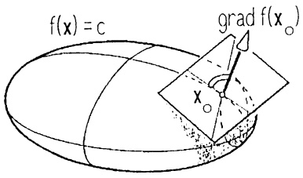

<details>
<summary>text_image</summary>

f(x) = c
grad f(x₀)
</details>

Abb. 178 - Tangentialebene

Ist $\operatorname{grad} f(\mathbf{x}_0) \neq \mathbf{0}$, so ist $\operatorname{grad} f(\mathbf{x}_0) \cdot (\mathbf{x} - \mathbf{x}_0) = 0$ eine Normalengleichung, d.h. explizit

Normalengleichung der Tangentialebene an die Niveaufläche
$f(x,y,z) = c$ im Flächenpunkt $(x_0, y_0, z_0)$:

$$
f _ {x} (x _ {0}, y _ {0}, z _ {0}) (x - x _ {0}) + f _ {y} (x _ {0}, y _ {0}, z _ {0}) (y - y _ {0}) + f _ {z} (x _ {0}, y _ {0}, z _ {0}) (z - z _ {0}) = 0.
$$

Speziell ergibt sich für den Graph einer $\mathcal{C}^{1}$-Funktion $z = f(x, y)$, dargestellt als Niveaufläche $F(x, y, z) = z - f(x, y) = 0$, die (bekannte, $\rightarrow$ 2.4) Gleichung der

Tangentialebene $\operatorname{grad} F(x_0, y_0, z_0) \cdot \begin{pmatrix} x - x_0 \\ y - y_0 \\ z - z_0 \end{pmatrix} = 0$, also

$$
z - z _ {0} = f _ {x} (x _ {0}, y _ {0}) (x - x _ {0}) + f _ {y} (x _ {0}, y _ {0}) (y - y _ {0}).
$$

Beispiele 1. Die Kreistangente im Punkt  $(x_{0}, y_{0})$  an  $(x - u)^{2} + (y - v)^{2} = r^{2}$  hat die Gleichung  $2(x_{0} - u)(x - x_{0}) + 2(y_{0} - v)(y - y_{0}) = 0$ . Dieses kann mit der Kreisgleichung leicht umgeformt werden zur bekannten Formel

$$
(x _ {0} - u) (x - u) + (y _ {0} - v) (y - v) = r ^ {2}.
$$

2. Das Paraboloid

$$
\frac {x ^ {2}}{a ^ {2}} + \frac {y ^ {2}}{b ^ {2}} - 2 p z = 0 \quad (p \neq 0)
$$

besitzt im Flächenpunkt  $(x_{0}, y_{0}, z_{0})$  die Tangentialebene

$$
\frac {x _ {0} (x - x _ {0})}{a ^ {2}} + \frac {y _ {0} (y - y _ {0})}{b ^ {2}} - p (z - z _ {0}) = 0.
$$

Eine leichte Umformung erbringt

$$
\frac {x _ {0} x}{a ^ {2}} + \frac {y _ {0} y}{b ^ {2}} - p (z + z _ {0}) = 0.
$$

3.2 Approximation höherer Ordnung; die TAYLOR-Formel. Wir verallgemeinern die TAYLOR-Formel für Funktionen einer Veränderlichen (→ Kap. 5, §4) auf $\mathcal{C}^{k}$-Funktionen $f: \mathbb{R}^{n} \supseteq D \to \mathbb{R}$ in $n \geq 1$ Veränderlichen. Dazu betrachten wir für $\mathbf{x} \in D$ und $\mathbf{v} \in \mathbb{R}^{n}$ die Funktion $h(t) := f(\mathbf{x} + t\mathbf{v})$ ($0 \leq t \leq 1$) der einen reellen Variablen $t$, vorausgesetzt, die ganze $\mathbf{x}$ mit $\mathbf{x} + \mathbf{v}$ verbindende Strecke liegt in $D$. Vereinfachend setzen wir deshalb voraus, daß $D$ ein konvexes Gebiet ist, d.h.

1. D ist offen,
2. $\mathbf{x},\mathbf{y}\in D\Rightarrow \mathbf{x} + t(\mathbf{y} - \mathbf{x})\in D$ für alle $t\in [0,1]$.

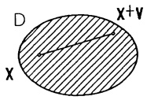

<details>
<summary>text_image</summary>

D
x
x+v
</details>

Abb. 179a - Konvexes Gebiet

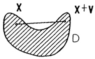

Abb. 179b - Kein konvexes Gebiet

Die Taylor-Formel für  $h(t)$  an der Stelle t = 0 lautet

$$
h (1) = h (0) + \dot {h} (0) + \frac {1}{2 !} \ddot {h} (0) + \dots + \frac {1}{k !} h ^ {(k)} (0) + \frac {1}{(k + 1) !} h ^ {(k + 1)} (\xi_ {k}) \tag {4}
$$

mit einer Zahl $\xi_{k}$ zwischen 0 und 1 ($\rightarrow$ Kap. 5, §4(1)). Die Ableitungen $h^{(l)}(t)$, bzw. $h^{(l)}(0)$, berechnen wir mit der Kettenregel. Sie lassen sich mit dem Differentialoperator

$$
\partial_ {\mathbf {v}} = v _ {1} \frac {\partial}{\partial x _ {1}} + \dots + v _ {n} \frac {\partial}{x _ {n}}
$$

übersichtlich darstellen, wobei zu beachten ist, daß

$$
\partial_ {\mathbf {v}}: \mathscr {C} ^ {l} (D, \mathbb {R}) \to \mathscr {C} ^ {l - 1} (D, \mathbb {R}), \quad f (\mathbf {x}) \mapsto \partial_ {\mathbf {v}} f (\mathbf {x}),
$$

(die Ableitung längs v) linear ist und  $\partial_{\mathbf{v}}^{l}f(\mathbf{x}) = \partial_{\mathbf{v}}(\ldots(\partial_{\mathbf{v}}f(x))\ldots)$  die l-malige Anwendung von  $\partial_{v}$  bedeutet. Man erhält

$$
\begin{array}{l} h (1) = f (\mathbf {x} + \mathbf {v}), \quad h (0) = f (\mathbf {x}), \\ \dot {h} (t) = \operatorname{grad} f (\mathbf {x} + t \mathbf {v}) \cdot \mathbf {v}, \quad \dot {h} (0) = \partial_ {\mathbf {v}} f (\mathbf {x}), \\ \ddot {h} (t) = \sum_ {i = 1} ^ {n} v _ {i} \left[ \operatorname{grad} f _ {x _ {i}} (\mathbf {x} + t \mathbf {v}) \cdot \mathbf {v} \right], \quad \ddot {h} (0) = \partial_ {\mathbf {v}} ^ {2} f (\mathbf {x}), \quad \text {etc.:} h ^ {(l)} (0) = \partial_ {\mathbf {v}} ^ {l} f (\mathbf {x}). \\ \end{array}
$$

Diese Werte in (4) eingetragen ergeben:

Satz 3.1. Die Taylor-Formel für $n$ Variable. Ist $D \subseteq \mathbb{R}^n$ ein konvexes Gebiet, $f \in \mathcal{C}^{k+1}(D, \mathbb{R})$, $\mathbf{x} \in D$, dann gilt mit $\mathbf{x} + \mathbf{v} \in D$ die Approximationsformel

$$
f (\mathbf {x} + \mathbf {v}) = f (\mathbf {x}) + \partial_ {\mathbf {v}} f (\mathbf {x}) + \frac {1}{2 !} \partial_ {\mathbf {v}} ^ {2} f (\mathbf {x}) + \dots + \frac {1}{k !} \partial_ {\mathbf {v}} ^ {k} f (\mathbf {x}) + R _ {k} (\mathbf {x}, \mathbf {v})
$$

$$
\begin{array}{l} m i t d e m R e s t g l i e d \quad R _ {k} (\mathbf {x}, \mathbf {v}) = \frac {1}{(k + 1) !} \hat {c} _ {\mathbf {v}} ^ {k + 1} f (\mathbf {x} + \xi_ {k} \mathbf {v}) \tag {5} \\ \text {mit einer Zahl} \xi_ {k} \text {zwischen 0 und 1} \quad (\partial_ {\mathbf {v}} = \sum_ {i = 1} ^ {n} v _ {i} \frac {\partial}{\partial x _ {i}}). \\ \end{array}
$$

Die Taylor-Formel dient zur Approximation von $f(\mathbf{x})$ in der Umgebung eines festen Punktes $\mathbf{x}_{0}\in D$ durch ein Polynom, das sog. Taylor-Polynom

$$
p (\mathbf {x}) := f \left(\mathbf {x} _ {0}\right) + \hat {c} _ {\mathbf {v}} f \left(\mathbf {x} _ {0}\right) + \dots + \frac {1}{k !} \hat {c} _ {\mathbf {v}} ^ {k} f \left(\mathbf {x} _ {0}\right)
$$

(mit $\mathbf{v} := \mathbf{x} - \mathbf{x}_0$). Der dabei auftretende Fehler $R_k(\mathbf{x}, \mathbf{x}_0) := f(\mathbf{x}) - p(\mathbf{x})$ geht schneller gegen Null als $|\mathbf{x} - \mathbf{x}_0|^k$; es gilt

$$
f (\mathbf {x}) = p (\mathbf {x}) + o (| \mathbf {x} - \mathbf {x} _ {0} | ^ {k}). \tag {6}
$$

Beweis für k = 2: Für den Fehler gilt (mit  $v = x - x_{0}$ ) nach der Taylor-Formel

$$
R _ {2} (\mathbf {x}, \mathbf {x} _ {0}) = \frac {1}{3 !} \hat {c} _ {\mathbf {v}} ^ {3} f (\mathbf {x} + \xi_ {2} \mathbf {v}) = \frac {1}{3 !} \sum_ {i, j, k = 1} ^ {n} v _ {i} v _ {j} v _ {l} f _ {x _ {i} x _ {j} x _ {l}} (\mathbf {x} + \xi_ {2} \mathbf {v}).
$$

Ist $f$ eine $\mathcal{C}^3$-Funktion, so ist $f_{x_i,x_j,x_l}(\mathbf{x} + \xi \mathbf{v})$ mit $\mathbf{v}\to 0$ beschränkt, ebenso $\frac{v_i}{|\mathbf{v}|}\leq 1$ für alle $i$ ($\mathbf{v}\neq 0$). Daher strebt $\frac{R_2(\mathbf{x},\mathbf{x}_0)}{|\mathbf{v}|^2} = \frac{1}{3!}\sum f_{x_i,x_j,x_l}(\mathbf{x} + \xi_2\mathbf{v})\frac{v_i}{|\mathbf{v}|}\frac{v_j}{|\mathbf{v}|} v_l$ gegen 0 ($\mathbf{v}\rightarrow 0$).

Für eine  $C^{k}$ -Funktion ( $k \geq 2$ ) heißt die nach Satz 2.2 symmetrische Matrix

$$
H _ {f} (\mathbf {x}) := (f _ {X _ {i} X _ {j}} (\mathbf {x})) = \left( \begin{array}{c c c} f _ {X _ {1} X _ {1}} (\mathbf {x}), & \dots , & f _ {X _ {1} X _ {n}} (\mathbf {x}) \\ \vdots & & \vdots \\ f _ {X _ {n} X _ {1}} (\mathbf {x}), & \dots , & f _ {X _ {n} X _ {n}} (\mathbf {x}) \end{array} \right)
$$

die HESSE-Matrix von $f$ im Punkt $\mathbf{x}$.

Wegen  $\hat{c}_{\mathbf{v}}f(\mathbf{x})=\operatorname{grad}f(\mathbf{x})\cdot\mathbf{v}$  und  $\partial_{\mathbf{v}}^{2}f(\mathbf{x})=\mathbf{v}^{T}H_{f}(\mathbf{x})\mathbf{v}$  lautet die Taylorformel (5) (mit  $x=x_{0}, v=x-x_{0}$ ) in den vielbenutzten Spezialfällen k=0,1,2 wie folgt:

a) $f(\mathbf{x}) = f(\mathbf{x}_0) + \text{grad } f(\tilde{\mathbf{x}}) \cdot (\mathbf{x} - \mathbf{x}_0)$
    mit $\tilde{\mathbf{x}}$ auf der Strecke von $\mathbf{x}_0$ nach $\mathbf{x}$ (Mittelwertsatz),
b) $f(\mathbf{x}) = f(\mathbf{x}_0) + \mathrm{grad}f(\mathbf{x}_0)\cdot (\mathbf{x} - \mathbf{x}_0) + \frac{1}{2} (\mathbf{x} - \mathbf{x}_0)^T H_f(\mathbf{x}^*)(\mathbf{x} - \mathbf{x}_0)$ mit $\mathbf{x}^*$ auf der Strecke von $\mathbf{x}_0$ nach $\mathbf{x}$,
c) $f(\mathbf{x}) = f(\mathbf{x}_0) + \mathrm{grad}f(\mathbf{x}_0)\cdot (\mathbf{x} - \mathbf{x}_0) + \frac{1}{2} (\mathbf{x} - \mathbf{x}_0)^T H_f(\mathbf{x}_0)(\mathbf{x} - \mathbf{x}_0)$ $+o(|\mathbf{x} - \mathbf{x}_0|^2)$

## Die anschauliche Deutung von (7c) für $n = 2,3$.

n = 2: Der Graph $z = f(x, y)$ wird in einer Umgebung des Flächenpunktes $(x_0, y_0, f(x_0, y_0))$ approximiert durch die Schmiegquadrik

$$
\begin{array}{l} z = f (x _ {0}, y _ {0}) + f _ {x} (x _ {0}, y _ {0}) (x - x _ {0}) + f _ {y} (x _ {0}, y _ {0}) (y - y _ {0}) + \\ + \frac {1}{2} f _ {x x} (x _ {0}, y _ {0}) (x - x _ {0}) ^ {2} + f _ {x y} (x _ {0}, y _ {0}) (x - x _ {0}) (y - y _ {0}) + \frac {1}{2} f _ {y y} (x _ {0}, y _ {0}) (y - y _ {0}) ^ {2}. \\ \end{array}
$$

Dieses ist, falls  $H_{f}(x_{0}, y_{0}) \neq 0$ , ein Paraboloid oder ein parabolischer Zylinder. Man nennt den Flächenpunkt über  $(x_{0}, y_{0})$  flach, wenn die Schmiegquadrik eine Ebene ist  $(H_{f}(x_{0}, y_{0}) = 0)$ , der Punkt heißt elliptisch (hyperbolisch, parabolisch), wenn die Schmiegquadrik ein elliptisches Paraboloid (bzw. ein hyperbolisches Paraboloid, ein parabolischer Zylinder) ist.

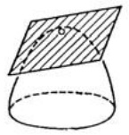

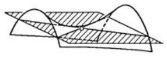

<details>
<summary>natural_image</summary>

Pure geometric diagram showing intersecting curved and shaded planes without any text, numbers, or symbols
</details>

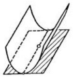

<details>
<summary>natural_image</summary>

Pure geometric diagram showing a curved surface intersecting a plane, with no text, numbers, or symbols.
</details>

Abb. 180 - Elliptischer, hyperbolischer, parabolischer Flächenpunkt

Beispiel. Der Affensattel

$$
z = x ^ {3} - 3 x y ^ {2}
$$

hat im Punkt  $(x,y)=(0,0)$  einen Flachpunkt mit der  $(x,y)$ -Ebene als Tangentialebene. Die Hesse-Matrix lautet

$$
H _ {f} = \left( \begin{array}{c c} 6 x & - 6 y \\ - 6 y & - 6 x \end{array} \right) ,
$$

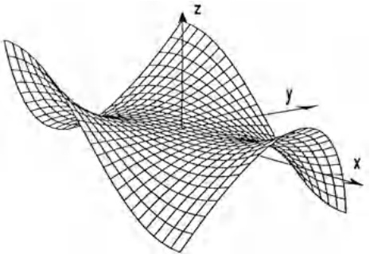

<details>
<summary>natural_image</summary>

3D wireframe surface plot with x, y, z axes labeled (no numerical data or annotations)
</details>

Abb. 181 - Affensattel

ihre Determinante  $-36(x^{2} + y^{2})$  ist außerhalb von  $(0,0)$  stets < 0, d.h. jeder Punkt der Fläche mit  $(x,y) \neq (0,0)$  ist hyperbolisch. □ n = 3: Die Niveaufläche $f(x,y,z) = c$ wird in der Nähe eines Flächenpunktes $(x_0,y_0,z_0)$ approximiert durch die Quadrik

$$
\operatorname{grad} f (x _ {0}, y _ {0}, z _ {0}) \cdot \left( \begin{array}{c} x - x _ {0} \\ y - y _ {0} \\ z - z _ {0} \end{array} \right) + \frac {1}{2} \left( \begin{array}{c} x - x _ {0} \\ y - y _ {0} \\ z - z _ {0} \end{array} \right) ^ {T} H _ {f} (x _ {0}, y _ {0}, z _ {0}) \left( \begin{array}{c} x - x _ {0} \\ y - y _ {0} \\ z - z _ {0} \end{array} \right) = 0.
$$

Beispiel. Als Schmiegquadrik besitzt die Niveaufläche

$$
x \cos y + y \cos z + z \cos x = 2
$$

im Flächenpunkt (0,0,2) ein zweischaliges Hyperboloid

$$
x + (\cos 2) y + (z - 2) - x ^ {2} - (\sin 2) y (z - 2) = 0.
$$

Bemerkung. Wird (auf irgend eine Weise) eine Approximation der Form

$$
f (\mathbf {x}) = \alpha_ {0} + \sum_ {i} \alpha_ {i} (x _ {i} - x _ {0 i}) + \sum_ {i, j} \alpha_ {i j} (x _ {i} - x _ {0 i}) (x _ {j} - x _ {0 j}) + \dots + o (| \mathbf {x} - \mathbf {x} _ {0} | ^ {k})
$$

ermittelt, dann sieht man leicht durch Differenzenbildung mit der Taylor-Formel, daß es sich hierbei bereits um die Taylor-Approximation handelt. Diese Beobachtung erlaubt die Berechnung der Taylor-Approximation aus bekannten Reihenentwicklungen ( $\rightarrow$  Kap. 5, 4.3).

$$
\begin{array}{l} \text {Beispiel.} e ^ {x + y} + \sin (x y) = 1 + x + y + \frac {1}{2} (x + y) ^ {2} + \frac {1}{3 !} (x + y) ^ {3} + x y - \frac {1}{3 !} (x y) ^ {3} + \\ o ((x ^ {2} + y ^ {2}) ^ {3 / 2}). \end{array}
$$

3.3 Implizite Funktionen. Um eine Funktion $g: \mathbb{R} \supseteq D \to \mathbb{R}$ mit den Methoden der Differentialrechnung zu diskutieren, war es bis hierher im konkreten

Fall stets nötig, daß g durch einen expliziten Formelausdruck  $y = g(x)$  mit den elementaren Funktionen der Analysis ( $\rightarrow$  Kap. 2 u. 3) darstellbar ist.

Hat man dagegen den Zusammenhang zwischen x und y implizit durch eine reelle Gleichung  $f(x,y)=0$  gegeben, so ist „y als Funktion von x“ noch nicht eindeutig festgelegt, da es zu einem festen  $x_{0}$  mehrere Lösungen y von  $f(x_{0},y)=0$  geben kann.

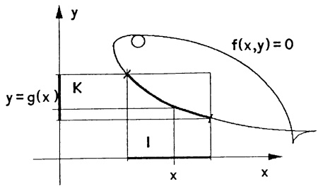

<details>
<summary>text_image</summary>

y
f(x,y)=0
y=g(x)
K
I
x
x
</details>

Abb. 182 - Implizite Funktion

Definition. Sei $f: \mathbb{R}^2 \supset D \to \mathbb{R}$. Man sagt, durch $f(x,y) = 0$ ist auf dem Intervall $I \subseteq \mathbb{R}$ eine implizite Funktion $g: I \to K$ mit Werten in $K \subseteq \mathbb{R}$ erklärt, wenn es zu jedem $x \in I$ genau ein $y \in K$ gibt mit $(x,y) \in D$ und $f(x,y) = 0$. Dieses $y$ wird mit $g(x)$ bezeichnet.

Anschaulich: Der im Rechteck  $\{(x,y); x \in I, y \in K\}$  verlaufende Bogen der Niveaulinie  $f(x,y) = 0$  ist als Graph  $y = g(x)$  darstellbar.

Beispiele. 1. Durch $f(x,y)=3x+2y-1=0$ ($D=\mathbb{R}^{2}$) ist die implizite Funktion $g:\mathbb{R}\to\mathbb{R}$, $g(x)=\frac{1}{2}(1-3x)$ erklärt. In diesem Fall ist $f(x,y)=0$ explizit für jedes $x\in\mathbb{R}$ eindeutig nach $y$ auflösbar.

2. Durch  $f(x, y) = e^{y} + y^{3} + x^{3} + x^{2} - 1 = 0 \quad (D = \mathbb{R}^{2})$  ist ebenfalls genau eine implizite Funktion  $g : R \to R$  erklärt; denn zu jedem  $x \in R$  hat die Gleichung  $e^{y} + y^{3} = 1 - x^{2} - x^{3}$  genau eine Lösung  $y =: g(x) (h(y) := e^{y} + y^{3})$  ist strikt monoton wachsend und hat als Wertebereich R). Durch formale Manipulation kann die Gleichung  $e^{y} + y^{3} + x^{3} + x^{2} - 1 = 0$  nicht nach y aufgelöst werden. Ohne eine explizite Darstellung zu besitzen, ist daher nur die Existenz einer (eindeutig bestimmten) Funktion g gesichert mit

$$
e ^ {g (x)} + g (x) ^ {3} + x ^ {3} + x ^ {2} - 1 = 0.
$$

3. Durch  $x^{2} + y^{2} - 1 = 0$  sind implizit zwei Funktionen  $g_{1}: [-1,1] \to [0,1]$ ,  $g_{1}(x) = \sqrt{1 - x^{2}}$  und  $g_{2}: [-1,1] \to [-1,0]$ ,  $g_{2}(x) = -\sqrt{1 - x^{2}}$  erklärt. ☐

Satz 3.2 über implizite Funktionen. Sei $D \subseteq \mathbb{R}^2$ offen und $f : D \to \mathbb{R}$ stetig partiell differenzierbar. Ist $(x_0, y_0) \in D$ ein Punkt der Niveaumenge $f(x, y) = 0$ mit $f_y(x_0, y_0) \neq 0$, dann gibt es Intervalle $I \subseteq \mathbb{R}$ und $K \subseteq \mathbb{R}$ mit Mittelpunkt $x_0$ bzw. $y_0$ so daß gilt:

a) $R = \{(x,y); x \in I, y \in K\} \subseteq D$ und $f_y(x,y) \neq 0$ für alle $(x,y) \in R$.
b) Durch  $f(x,y)=0$  ist auf I eindeutig eine differenzierbare implizite Funktion  $g:I\to K$  (mit Werten in K) erklärt mit der Ableitung

$$
g ^ {\prime} (x) = - \frac {f _ {x} (x , g (x))}{f _ {y} (x , g (x))} = - \frac {f _ {x} (x , y)}{f _ {y} (x , y)} \quad \text { für   alle } x \in I . \tag {8}
$$

Beweis. Wir gehen aus von  $(x_{0}, y_{0}) = (0, 0)$  und  $f_{y}(0, 0) > 0$ , was man durch Koordinatenverschiebung und evtl. Übergang zu -f stets erreichen kann.

a): Aufgrund der Stetigkeit von  $f_{y}$  gilt  $f_{y}(x,y) > 0$  in einer ganzen Umgebung  $U = \{(x,y); x^{2} + y^{2} < c^{2}\} \quad (c > 0)$  des Nullpunkts.

b): Wir betrachten nun $f$ nur noch auf Rechtecken $\{(x,y); -\alpha \leq x \leq \alpha, -\beta \leq y \leq \beta\}$, die ganz in $U$ enthalten sind. Da die Funktion $y \to f(0,y)$ (mit $f(0,0) = 0$) echt monoton wächst ($\rightarrow$ Kap. 3), gilt $f(0,-\beta) < 0$, $f(0,\beta) > 0$ und deshalb (wegen der Stetigkeit) $f(x,-\beta) < 0$, $f(x,\beta) > 0$ für ein hinreichend kleines Intervall $-\alpha \leq x \leq \alpha$.

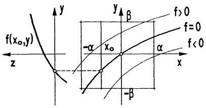

<details>
<summary>text_image</summary>

f(x₀,y)
z
y
β
f > 0
f = 0
f < 0
-α
x₀
α
x
-β
</details>

Abb. 183 - Zum Beweis

Mit solchem  $\alpha$  wählen wir  $I := (-\alpha, \alpha)$ ,  $K := (-\beta, \beta)$ . Für  $x \in I$  ist (wieder wegen  $f_y(x, y) > 0$ ) die Funktion  $y \to f(x, y)$  echt monoton wachsend und deshalb gibt es genau ein  $y \in K$  mit  $f(x, y) = 0$ .

Das zu  $x \in I$  eindeutig bestimmte y mit  $f(x, y) = 0$  wird mit  $g(x)$  bezeichnet. Für jede Folge  $(x_{n})_{n \geq 1}$  aus I mit  $x_{n} \to x$  gilt  $g(x_{n}) \to g(x)$  (wegen  $f(x_{n}, g(x_{n})) \to$ $f(x,y)$; also ist $g$ stetig. Für $x \in I$, $y = g(x)$, $\Delta y = g(x + \Delta x) - g(x)$ und $\Delta x$ hinreichend klein gilt nach dem Mittelwertsatz ($\rightarrow$ (7a)) $f(x + \Delta x, y + \Delta y) - f(x,y) = f_x(\xi,\eta)\Delta x + f_y(\xi,\eta)\Delta y$ mit $\xi$ (bzw. $\eta$) zwischen $x$ und $x + \Delta x$ (bzw. $y$ und $y + \Delta y$). Aus $f(x,g(x)) = f(x + \Delta x,g(x + \Delta x)) = 0$ und der Stetigkeit der partiellen Ableitungen ergibt sich

$$
\frac {\Delta y}{\Delta x} = - \frac {f _ {x} (\xi , \eta)}{f _ {y} (\xi , \eta)} \rightarrow - \frac {f _ {x} (x , y)}{f _ {y} (x , y)} \quad (\text {fur} \Delta x \rightarrow 0).
$$

Bemerkung. Zu Teil b) des Satzes sagt man auch:

$f(x,y)=0$ ist um $(x_{0},y_{0})$ lokal eindeutig durch eine implizite Funktion $y=g(x)$ auflösbar. Das Wort „lokal“ bezieht sich stets auf eine nicht näher beschriebene Umgebung eines Punktes, hier $(x_{0},y_{0})$.

Nachdem die Differenzierbarkeit bewiesen ist, berechnet man die Ableitung mit der Kettenregel aus der Identität  $f(x,g(x)) = 0$  und fährt auch für die höheren Ableitungen von  $g(x)$  so fort:

$$
\begin{array}{l} f (x, g (x)) = 0 \Rightarrow f _ {x} (x, g (x)) + f _ {y} (x, g (x)) g ^ {\prime} (x) = 0 \\ \Rightarrow \quad \left(f _ {x} + f _ {y} g ^ {\prime}\right) _ {x} + \left(f _ {x} + f _ {y} g ^ {\prime}\right) _ {y} g ^ {\prime} = 0 \\ \Rightarrow \quad (f _ {x x} + f _ {y x} g ^ {\prime}) + f _ {y} g ^ {\prime \prime} + (f _ {x y} + f _ {y y} g ^ {\prime}) g ^ {\prime} = 0 \\ \end{array}
$$

etc.

Nach  $g'$  bzw.  $g''$  aufgelöst, erhält man

$$
\begin{array}{l} g ^ {\prime} (x) = - \frac {f _ {x}}{f _ {y}}; g ^ {\prime \prime} (x) = - \frac {1}{f _ {y}} \left(f _ {x x} + 2 f _ {x y} g ^ {\prime} + f _ {y y} g ^ {\prime 2}\right), \\ = - \frac {1}{f _ {y} ^ {3}} \left(f _ {x x} (f _ {y}) ^ {2} - 2 f _ {x y} f _ {x} f _ {y} + f _ {y y} (f _ {x}) ^ {2}\right). \\ \end{array}
$$

Insbesondere gilt damit in Punkten mit  $g'(x) = 0$  stets  $g''(x) = -\frac{f_{xx}(x, y)}{f_y(x, y)}$ , d.h.

Die durch $f(x,y)=0$ bestimmte implizite Funktion $y=g(x)$ hat in $(x,y)$ eine horizontale Tangente, wenn

$$
f (x, y) = 0, \quad f _ {x} (x, y) = 0, \quad f _ {y} (x, y) \neq 0.
$$

x ist eine lokale Maximumstelle, wenn  $\frac{f_{xx}(x,y)}{f_{y}(x,y)}>0$ ,

lokale Minimumstelle, wenn  $\frac{f_{xx}(x,y)}{f_{y}(x,y)} < 0.$

Beispiel. Für die Funktion  $g(x)$  im obigen Beispiel 2 gilt

$$
g ^ {\prime} (x) = - \frac {f _ {x} (x , y)}{f _ {y} (x , y)} = - \frac {3 x ^ {2} + 2 x}{e ^ {y} + 3 y ^ {2}},
$$

wobei y durch  $f(x,y)=0$  aus x bestimmt ist. Für x=0 und  $x=-\frac{2}{3}$  ist  $g'(x)=0$ . Mit  $f_{xx}(x,y)=6x+2$  hat  $g(x)$  in 0 eine lokale Maximum- und in  $-\frac{2}{3}$  eine lokale Minimumstelle. □

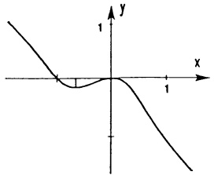

<details>
<summary>line</summary>

| X | Y |
| --- | --- |
| 0 | ~1.5 |
| 0.2 | 0 |
| 0.4 | ~-0.3 |
| 0.6 | 0 |
| 0.8 | ~-0.3 |
| 1 | ~-1.5 |
</details>

Abb. 184 - $f(x, y) = e^{y} + y^{3} + x^{3} + x^{2} = 1$

Satz 3.2 gilt allgemein für $\mathcal{C}^{1}$-Funktionen $f: \mathbb{R}^{n} \supseteq D \to \mathbb{R}$ in einer Umgebung eines Punktes $(a_{1}, a_{2}, \ldots, a_{n}) \in D$ mit

$$
f (a _ {1}, a _ {2}, \dots , a _ {n}) = 0, \quad f _ {x _ {n}} (a _ {1}, \dots , a _ {n}) \neq 0:
$$

Es gibt eine Umgebung $U$ des Punktes $(a_{1},\ldots ,a_{n - 1})$ und ein offenes Intervall $K\subseteq \mathbb{R}$, das $a_{n}$ enthält, so daß gilt

a)  $R := \{(x_1, \ldots, x_{n-1}, x_n); (x_1, \ldots, x_{n-1}) \in U, x_n \in K\} \subseteq D \text{ und } f_{x_n}(\mathbf{x}) \neq 0 \text{ für alle } \mathbf{x} \in R.$
b) Zu jedem Punkt  $(x_{1},\ldots,x_{n-1})\in U$  gibt es genau eine Zahl  $x_{n}\in K$  mit  $f(x_{1},\ldots,x_{n-1},x_{n})=0$ . Durch  $x_{n}:=g(x_{1},\ldots,x_{n-1})$  ist eine partiell differenzierbare Funktion  $g:U\to K$  erklärt mit den Ableitungen

$$
\frac {\partial g}{\partial x _ {i}} (x _ {1}, \dots , x _ {n - 1}) = - \frac {f _ {x _ {i}} (x _ {1} , \dots , x _ {n})}{f _ {x _ {n}} (x _ {1} , \dots , x _ {n})} \quad (1 \leq i \leq n - 1) . \tag {9}
$$

Geometrische Deutung für $n = 3$. Die Niveaufläche $f(x, y, z) = 0$ einer $\mathcal{C}^1$-Funktion ist um jeden Flächenpunkt $(a, b, c)$ mit $f_z(a, b, c) \neq 0$ (Tangentialebene nicht parallel zur $z$-Achse) lokal darstellbar als Graph $z = g(x, y)$ einer $\mathcal{C}^1$-Funktion $g$.

Beispiel. Durch  $f(x,y,z)=x\cos y+y\cos z+z\cos x-2=0$  ist implizit eine Funktion  $z=g(x,y)$  erklärt. Es gilt  $g(0,0)=2$

$$
g _ {x} (0, 0) = - \frac {f _ {x} (0 , 0 , 2)}{f _ {z} (0 , 0 , 2)} = - \frac {\cos y - z \sin x}{- y \sin z + \cos x} \Bigg | _ {(0, 0, 2)} = - 1,
$$

$$
g _ {y} (0, 0) = - \frac {f _ {y} (0 , 0 , 2)}{f _ {z} (0 , 0 , 2)} = - \frac {- x \sin y + \cos z}{- y \sin z + \cos x} \bigg | _ {(0, 0, 2)} = - \cos 2.
$$

3.4 Lokale Minima und Maxima. Sei $f: D \to \mathbb{R}$ eine Funktion von $n$ Variablen. Ein Punkt $\mathbf{a} \in D$ heißt lokale (oder relative) Maximalstelle (bzw. Minimalstelle) von $f$, wenn es eine $r$-Umgebung $U_r(\mathbf{a}) = \{\mathbf{x} \in \mathbb{R}^n; |\mathbf{x} - \mathbf{a}| < r\}$ von $\mathbf{a}$ gibt, so daß für alle $\mathbf{x} \in U_r \cap D$ gilt:

$$
f (\mathbf {x}) \leq f (\mathbf {a}) \quad \text {(bzw.} f (\mathbf {a}) \leq f (\mathbf {x}))
$$

Gelten diese Ungleichungen jeweils für alle $\mathbf{x} \in D$, dann heißt $\mathbf{a}$ eine globale