(oder absolute) Maximal- bzw. Minimalstelle. Die Zahl  $f(\mathbf{a})$  heißt (fallweise) lokales oder globales Maximum oder Minimum. Ein Extremum oder Extremwert (lokal oder global) ist ein Minimum oder ein Maximum.

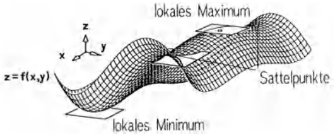

text_image

z=f(x,y)
lokales Maximum
Sattelpunkte
lokales. Minimum

Abb. 185 - Extremstellen von $z = f(x, y)$

Eine der Hauptaufgaben der angewandten Analysis ist die Bestimmung der Extremalstellen einer Funktion  $f(\mathbf{x})$  auf einem Bereich D. Man schreibt hierfür

$$
f (\mathbf {x}) = \operatorname{Extr}! \quad (\mathbf {x} \in D)
$$

(bzw.  $f(\mathbf{x}) = \max!$  oder  $f(\mathbf{x}) = \min!$ ).

Je nachdem ob die Extremalstellen im Innern oder auf dem Rand von D liegen, hat man unterschiedliche Charakterisierungen:

## Satz 3.3. Lokale Extrema im Innern von $D$.

Ist $f$ auf $U_{r}(\mathbf{a})$, $\mathbf{a} \in \mathbb{R}^{n}$, eine $\mathcal{C}^{1}$-Funktion, so gilt

$$
\mathbf {a} \text {ist lokale Extremstelle von} f \Rightarrow \operatorname{grad} f (\mathbf {a}) = \mathbf {0}.
$$

Beweis. Nach Voraussetzung besitzt die reelle Funktion einer Variablen $h(t) := f(\mathbf{a} + t\mathbf{e}_i)$ in $t = 0$ eine (innere) lokale Extremalstelle. Also gilt $0 = \dot{h}(0) = \frac{\partial f}{\partial x_i}(\mathbf{a}) \quad (1 \leq i \leq n)$.

Man nennt $\mathbf{a} \in \mathbb{R}^{n}$ einen stationären Punkt von $f$, wenn $\operatorname{grad} f(\mathbf{a}) = 0$ gilt. Satz 3.3 besagt, daß man die inneren lokalen Extremalstellen unter den stationären Punkten zu suchen hat. Einen stationären Punkt, der keine Extremalstelle ist, bezeichnen wir als Sattelpunkt. Zur Identifizierung eignet sich das folgende Ergebnis.

## Satz 3.4. Extremstellen-Test für $n$ Variable.

Ist $U \subseteq \mathbb{R}^{n}$ offen, $\mathbf{a} \in U$ ein stationärer Punkt einer Funktion $f \in \mathcal{C}^{2}(U, \mathbb{R})$ und $H_{f}(\mathbf{a}) = (f_{X_{i}, X_{j}}(\mathbf{a})) \in \mathbb{R}^{n \times n}$ die Hesse-Matrix von $f$ in $\mathbf{a}$, dann gilt:

a)  $H_{f}(\mathbf{a})$  positiv definit  $\Rightarrow$  a ist lokale Minimalstelle,
b)  $H_{f}(\mathbf{a})$  negativ definit  $\Rightarrow$  a ist lokale Maximalstelle,
c)  $H_{f}(\mathbf{a})$  indefinit  $\Rightarrow$  a ist Sattelpunkt.

Beweis. Mit grad  $f(\mathbf{a}) = 0$  und (7) gilt für alle x in einer r-Umgebung von a

$$
f (\mathbf {x}) - f (\mathbf {a}) = \frac {1}{2} (\mathbf {x} - \mathbf {a}) ^ {T} H _ {f} (\mathbf {a} ^ {*}) (\mathbf {x} - \mathbf {a}) \tag {10}
$$

mit einem $\mathbf{a}^{*}$ zwischen $\mathbf{x}$ und $\mathbf{a}$. $H_{f}(\mathbf{x})$ ist stetig und daher mit $H_{f}(\mathbf{a})$ auch in einer ganzen Umgebung von $\mathbf{a}$ positiv definit (bzw. negativ definit, bzw. indefinit). In dieser Umgebung ist die rechte Seite von (10) im Fall a) stets positiv, im Fall b) stets negativ, also $f(\mathbf{x}) \geq f(\mathbf{a})$ bzw. $f(\mathbf{x}) \leq f(\mathbf{a})$. Im Fall c) ist $f(\mathbf{x}) - f(\mathbf{a})$ in jeder Umgebung von $\mathbf{a}$ sowohl positiv als auch negativ.

Spezialfall n=2. Sei  $\mathbf{a}=(a_{1},a_{2})$  stationärer Punkt einer  $C^{2}$ -Funktion f in 2 Variablen. Unter Berücksichtigung des Positivitäts-Tests ( $\rightarrow$  Kap. 6, 7.5) liefert in diesem Fall Satz 3.4 mit der Hesse-Matrix

$$
H _ {f} (\mathbf {a}) = \left( \begin{array}{c c} f _ {x x} (\mathbf {a}) & f _ {x y} (\mathbf {a}) \\ f _ {y x} (\mathbf {a}) & f _ {y y} (\mathbf {a}) \end{array} \right)
$$

den Extremstellen-Test für 2 Variable:

$\mathbf{a} = (a_{1}.a_{2})$ stationärer Punkt, d.h. $f_{x}(\mathbf{a}) = f_{y}(\mathbf{a}) = 0$.

a)  $\det H_{f}(\mathbf{a}) > 0$ ,  $f_{xx}(\mathbf{a}) > 0 \Rightarrow \mathbf{a}$  lokale Minimalstelle,
b)  $\det H_{f}(\mathbf{a}) > 0$ ,  $f_{xx}(\mathbf{a}) < 0 \Rightarrow \mathbf{a}$  lokale Maximalstelle,
c)  $\det H_{f}(\mathbf{a}) < 0 \Rightarrow \mathbf{a} \text{ ist Sattelpunkt.}$

Beispiel 1. (n = 2). Die Funktion

$$
f (x, y) = 2 x ^ {4} + y ^ {4} - 2 x ^ {2} - 2 y ^ {2},
$$

$(x,y)\in\mathbb{R}^{2}$ , hat 9 stationäre Punkte

$\mathbf{a}_1 = (0,0)$ ， $\mathbf{a}_2 = (0,1)$

$\mathbf{a}_3 = (0, -1)$, $\mathbf{a}_4 = (\frac{1}{\sqrt{2}}, 0)$,

$\mathbf{a}_5 = \left(\frac{1}{\sqrt{2}}, 1\right), \quad \mathbf{a}_6 = \left(\frac{1}{\sqrt{2}}, -1\right),$

$\mathbf{a}_7 = \left(-\frac{1}{\sqrt{2}}, 0\right), \quad \mathbf{a}_8 = \left(-\frac{1}{\sqrt{2}}, 1\right),$

$\mathbf{a}_{9} = \left(-\frac{1}{\sqrt{2}}, - 1\right)$

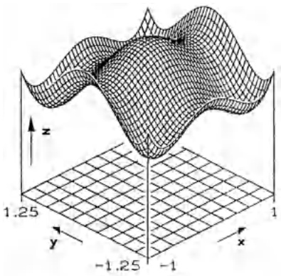

surface_3d

| Axis | Range |
| --- | --- |
| x | -1.25~1.25 |
| y | -1.25~1.25 |
| z | -1.25~1.25 |

Abb. 186 - $z = 2x^{4} + y^{4} - 2x^{2} - 2y^{2}$

Für diese Punkte gilt

|  | $\mathbf{a}_{1}$ | $\mathbf{a}_{2}$ | $\mathbf{a}_{3}$ | $\mathbf{a}_{4}$ | $\mathbf{a}_{5}$ | $\mathbf{a}_{6}$ | $\mathbf{a}_{7}$ | $\mathbf{a}_{8}$ | $\mathbf{a}_{9}$ |
| --- | --- | --- | --- | --- | --- | --- | --- | --- | --- |
| $f_{xx}(\mathbf{a}_{i})$ | -4 | -4 | -4 | 8 | 8 | 8 | 8 | 8 | 8 |
| $f_{yy}(\mathbf{a}_{i})$ | -4 | 8 | 8 | -4 | 8 | 8 | -4 | 8 | 8 |
| $f_{xy}(\mathbf{a}_{i})$ | 0 | 0 | 0 | 0 | 0 | 0 | 0 | 0 | 0 |
| $\det H_{f}(\mathbf{a}_{i})$ | 16 | -32 | -32 | -32 | 64 | 64 | -32 | 64 | 64 |

Demnach hat $f$ bei $\mathbf{a}_{1}$ ein lokales Maximum, bei $\mathbf{a}_{5}$, $\mathbf{a}_{6}$, $\mathbf{a}_{8}$, $\mathbf{a}_{9}$ lokale Minima und Sattelpunkte in $\mathbf{a}_{2}$, $\mathbf{a}_{3}$, $\mathbf{a}_{4}$, $\mathbf{a}_{7}$.

Der Fall det  $H_{f}(\mathbf{a}) = 0$ . Hier muß man direkt das Vorzeichenverhalten von  $f(\mathbf{x}) - f(\mathbf{a})$  entweder längs Schnitten oder sogar in vollen Umgebungen von a untersuchen.

Beispiel 2 ($n = 2$). Für die Funktion $f(x, y) = (y - 2x^{2})(y - x^{2})$, $(x, y) \in \mathbb{R}^{2}$, ist $(0, 0)$ ein stationärer Punkt mit $f(0, 0) = 0$ und det $H_{f}(0, 0) = 0$. Obwohl die Funktion längs aller geraden Schnitte in $(0, 0)$ ein lokales Minimum besitzt, ist $(0, 0)$ ein Sattelpunkt, da $f(x, y) < 0$ für alle $(x, y)$ mit $x^{2} < y < 2x^{2}$ und $f(x, y) > 0$ für $y > 2x^{2}$ oder $y < x^{2}$.

Beispiel 3 (n = 3). $u(x, y, t) = \sin x \cos y \cos (x + y) \cos (x - y) \cos \omega t$ beschreibt für $t \geq 0$ die Transversalschwingung einer biegeweichen Membran in dem Quadrat $D : |x| + |y| \leq \frac{\pi}{2}$ ($\rightarrow$ §2, Aufg. 8). Wann und wo die größte Auslenkung eintritt, ist bestimmt durch grad $u(x, y, t) = 0$. Die Bedingung $u_t = 0$ führt auf

$$
\sin x \cos y \cos (x + y) \cos (x - y) \sin \omega t = 0,
$$

d.h.  $t = \frac{k\pi}{\omega} \quad (k \in \mathbb{Z})$  oder x = 0 oder  $y = \frac{\pi}{2}$  oder  $|x| + |y| = \frac{\pi}{2}$ . Letzteres ist der Rand, x = 0 ist eine Knotenlinie. Differentiation nach x bzw. y liefert

$$
\begin{array}{l} u _ {x} = \cos y \cos x [ \cos (x + y) \cos (x - y) - 2 \sin^ {2} x ] \cos \omega t, \\ u _ {y} = - \sin x \sin y [ \cos (x + y) \cos (x - y) + 2 \cos^ {2} y ] \cos \omega t. \\ \end{array}
$$

Da $\cos x$ und $\cos y$ nur im Rand verschwinden, bleibt nur der Fall $y = 0$ und $\cos^2 x - 2\sin^2 x = 0$. Das liefert die beiden Punkte $(x,y) = (\pm \arccos \sqrt{\frac{2}{3}},0)$. Für $t = \frac{k\pi}{\omega}$ ist somit die maximale Auslenkung $u = \pm \frac{2}{9}\sqrt{3}$.

\* 3.5 Ausgleichsrechnung. Sind in der Praxis die Werte gewisser Konstanten $x_{1}, \ldots, x_{n}$ aus experimentellen Messungen zu bestimmen, so treten folgende Probleme auf:

a) Jede Beobachtung birgt einen Meßfehler, daher werden zur Sicherheit stets mehr Messungen durchgeführt, als zur eindeutigen Bestimmung der  $x_{i}$  nötig sind.

b) Im allgemeinen sind die Werte  $x_{i}$  nicht unmittelbar meßbar, sondern nur implizit über die (bekannten) Gesetzmäßigkeiten des Versuchsaufbaus aus den Meßgrößen  $y_{1},\ldots,y_{m}$  ableitbar.

Nach Abschluß der Messungen liegt somit ein überbestimmtes Gleichungssystem für die  $x_{i}$  vor:

$$
y _ {1} = f _ {1} (x _ {1}, \dots , x _ {n}),
$$

$$
\vdots \quad \vdots \quad m > n. \tag {11}
$$

$$
y _ {m} = f _ {m} (x _ {1}, \dots , x _ {n}).
$$

Nimmt man an, daß jede der Größen $y_i$ mit derselben Meßunsicherheit behaftet ist, so wendet man seit C. F. GAUSS die Methode der kleinsten Quadrate an, um eine „Lösung“ x zu bestimmen, welche die unvermeidlichen Reste

$y_{i} - f_{i}(x_{1},\ldots ,x_{n})$ gleichmäßig minimiert, d.h. für welche

$$
F (x _ {1}, \dots , x _ {n}) := \sum_ {i = 1} ^ {m} \left(y _ {i} - f _ {i} (x _ {1}, \dots , x _ {n})\right) ^ {2} = \operatorname{Min}!
$$

Man bezeichnet ein solches x als „im quadratischen Mittel beste“ oder „ausgleichende“ Lösung von (11) und unterscheidet zwischen linearen und nichtlinearen Ausgleichsproblemen, je nachdem ob alle Funktionen  $f_{i}$  linear in den  $x_{i}$  sind oder nicht.

① Lineare Ausgleichsprobleme. In diesem Falle stellt (11) ein überbestimmtes lineares Gleichungssystem dar,

$$
A \mathbf {x} = \mathbf {y}, \quad A \in \mathbb {R} ^ {m \times n}, m > n,
$$

es führt auf das Minimalproblem

(12) $F(\mathbf{x}) = |A\mathbf{x} - \mathbf{y}|^2 = \mathrm{Min}!$

mit quadratischem Polynom

$$
F (\mathbf {x}) = (A \mathbf {x} - \mathbf {y}) ^ {T} (A \mathbf {x} - \mathbf {y}) = \mathbf {x} ^ {T} A ^ {T} A \mathbf {x} - 2 \mathbf {x} ^ {T} A ^ {T} \mathbf {y} + \mathbf {y} ^ {T} \mathbf {y}.
$$

Daher ist Satz 3.3 anwendbar und man erhält als notwendige Bedingung für die Lösung von (12) mit Formel (11) aus §2

$$
\mathrm{grad} F (\mathbf {x}) = 2 A ^ {T} A \mathbf {x} - 2 A ^ {T} \mathbf {y} = \mathbf {0};
$$

das ist ein lineares $n \times n$-Gleichungssystem

(13) $A^T A\mathbf{x} = A^T\mathbf{y}$

Man nennt (13) die Gauß-Normalgleichung des linearen Ausgleichsproblems (12).

Beispiel. Wird ein Fahrzeug aus der Geschwindigkeit v auf Stillstand herabgebremst, so setzt man für den Bremsweg y eine quadratische Abhängigkeit von v an

$$
y = a v ^ {2} + b v + c.
$$

Zur Bestimmung von a, b, c werden 5 Messungen durchgeführt

| $v_{i}$[km/h] | 9 | 17 | 17 | 25 | 35 |
| --- | --- | --- | --- | --- | --- |
| $y_{i}$[m] | 3 | 9 | 5 | 14 | 23 |

Die Normalgleichung

$$
\left( \begin{array}{c c c} \sum v _ {i} ^ {4} & \sum v _ {i} ^ {3} & \sum v _ {i} ^ {2} \\ \sum v _ {i} ^ {3} & \sum v _ {i} ^ {2} & \sum v _ {i} \\ \sum v _ {i} ^ {2} & \sum v _ {i} & \sum 1 \end{array} \right) \binom{a}{b}
$$

ergibt ohne Maßeinheiten das Gleichungssystem mit Koeffizientenmatrix

$$
\left( \begin{array}{c c c c} 2 0 6 4 8 5 3 & 6 9 0 5 5 & 2 5 0 9 & 4 1 2 1 4 \\ 6 9 0 5 5 & 2 5 0 9 & 1 0 3 & 1 4 2 0 \\ 2 5 0 9 & 1 0 3 & 5 & 5 4 \end{array} \right)
$$

und eindeutiger Lösung

$$
a \approx 0. 0 1 2, b \approx 0. 2 5 9, c \approx - 0. 5 2 5.
$$

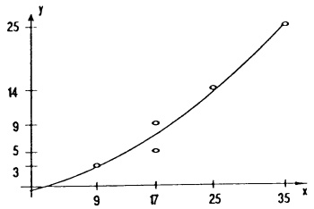

scatter

| X | Y |
| --- | --- |
| 9 | 4 |
| 17 | 5 |
| 17 | 9 |
| 25 | 14 |
| 35 | 25 |

Abb. 187 - Ausgleichende Parabel

Allgemein gilt

## Satz 3.5.

a) Das lineare Ausgleichsproblem (12) ist immer lösbar.
b) Die Lösungen von (12) und (13) stimmen überein.
c) Für zwei Lösungen  $x, x_{0}$  von (12) oder (13) gilt stets  $Ax = Ax_{0}$ .

Ist Rang A = n, so ist die Ausgleichslösung eindeutig.

Beweis. a): Da $F(\mathbf{x}) \geq 0$ für alle $\mathbf{x} \in \mathbb{R}^n$, muß jede Normalform des quadra-

tischen Polynoms  $F(\mathbf{x})$  die Gestalt  $\alpha_{1}^{2}z_{1}^{2}+\cdots+\alpha_{r}^{2}z_{r}^{2}+\gamma^{2}$  besitzen ( $\rightarrow$  Kap. 6, 7.3). Der minimale quadratische Fehler ist also  $\gamma^{2}$ , er wird in den Punkten mit den z-Koordinaten  $z_{1}=\ldots=z_{r}=0$  angenommen.

b): Mit Satz 3.3 erfüllt jede Minimalstelle $\mathbf{x}_{0}$ die Normalgleichung (13). Ist umgekehrt $\mathbf{x}_{0}$ eine Lösung von (13), so gilt $A^{T}(Ax_{0}-\mathbf{y})=\mathbf{0}$, d.h. das Residuum $\mathbf{r}=Ax_{0}-\mathbf{y}$ ist orthogonal zu allen Spalten von $A$ und damit orthogonal zu $Ax$ für jedes $\mathbf{x}\in\mathbb{R}^{n}$, folglich gilt

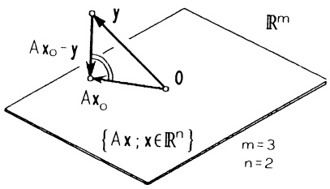

text_image

A x₀ - y
y
O
A x₀
{A x ; x ∈ Rⁿ}
m = 3
n = 2

Abb. 188 - Lineare Ausgleichung

$$
| A \mathbf {x} - \mathbf {y} | ^ {2} = | A \mathbf {x} - A \mathbf {x} _ {0} + A \mathbf {x} _ {0} - \mathbf {y} | ^ {2} = | A \mathbf {x} - A \mathbf {x} _ {0} | ^ {2} + | \mathbf {r} | ^ {2} \geq | \mathbf {r} | ^ {2}. \tag {14}
$$

Daher nimmt  $|Ax - y|^{2}$  sein Minimum  $\gamma^{2} = r^{2}$  für  $x = x_{0}$  an.

c): Ist x eine weitere Lösung von (12), so muß mit (14)  $|Ax - Ax_{0}| = 0$  sein. Für RangA = n folgt aus  $A(\mathbf{x} - \mathbf{x}_{0}) = \mathbf{0}$  sofort  $x = x_{0}$ . ☐

Der Satz zeigt bereits zwei Wege auf, wie man im konkreten Fall die Ausgleichslösung bestimmen kann:

1. Weg (Direkte Lösung der Normalgleichung).
Berechne  $B = A^{T}A$ ,  $z = A^{T}y$  und löse  $Bx = z$  mit Gauss-Elimination.

2. Weg (Über orthogonale Transformation).

Mittels ebener Drehungen, Spiegelungen oder über das SCHMIDT-Orthogonalisierungsverfahren wird sukzessive eine orthogonale Matrix P berechnet, so daß PA obere Dreiecksgestalt besitzt, d.h.

$$
P A = \binom{D}{0} \left\{ \begin{array}{l} n \\ m - n \end{array} \right., \quad D = \left( \begin{array}{c c c} ^ {*} & \ddots & * \\ 0 & & * \end{array} \right) .
$$

Mit $\mathbf{h} := P\mathbf{y} = \begin{pmatrix} \mathbf{h}_1 \\ \mathbf{h}_2 \end{pmatrix}$, $\mathbf{h}_1 \in \mathbb{R}^n$, $\mathbf{h}_2 \in \mathbb{R}^{m-n}$ folgt damit ($\rightarrow$ Kap. 6, Satz 6.2) $|A\mathbf{x} - \mathbf{y}|^2 = |PA\mathbf{x} - P\mathbf{y}|^2 = |D\mathbf{x} - \mathbf{h}_1|^2 + |\mathbf{h}_2|^2$. Das Minimum wird also erreicht, wenn $D\mathbf{x} = \mathbf{h}_1$. Dieses $n \times n$ Gleichungssystem besitzt bereits Stufenform und ist daher leicht aufzulösen.

In der Anwendung ist der zweite Weg zwar aufwendiger, aber in den numerischen Ergebnissen dafür zuverlässiger.

In der folgenden Procedure Linfit wird (nach Weg 2) Ax = y über sog. HOUSEHOLDER-Spiegelungen auf Stufenform gebracht. (Zur Vereinfachung wird die rechte Seite y als  $(n+1)$ -te Spalte einer  $m \times (n+1)$ -Matrix A(I, K) gespeichert.)

Procedure Linfit
  ' ---- n Householder-Spiegelungen
  For I=1 To N
    S=0
    For J=I To M
      S=S+A(J,I)*A(J,I)
    Next J
    If S=0 Then
      Print "Matrix singulaer"
        End
    Endif
    V=Sqr(S)
    If A(I,I)&gt;0 Then
      V=-V
    Endif
    X(I)=V
    F=S-V*A(I,I)
    A(I,I)=A(I,I)-V
    For K=I+1 To N+1

S=0
For J=I To M
    S=S+A(J,I)*A(J,K)
Next J
S=S/F
For J=I To M
    A(J,K)=A(J,K)-A(J,I)*S
Next J
Next K
Next I
' ---- Aufloesung -------------------
X(N)=A(N,N+1)/X(N)
For I=N-1 To 1 Step -1
S=A(I,N+1)
For J=I+1 To N
    S=S-A(I,J)*X(J)
Next J
X(I)=S/X(I)
Next I

Return

② Nichtlineare Ausgleichsprobleme. In diesem Falle kann die „beste Lösung“ von (11) meist nur angenähert bestimmt werden. Das einfachste Verfahren wurde bereits im Beispiel von 3.1 vorgestellt: Man wendet das Gradientenverfahren auf die Funktion $F(\mathbf{x}) = |\mathbf{y} - \mathbf{f}(\mathbf{x})|^2$ an. In vielen Fällen ist es jedoch vorteilhafter, für einen Näherungswert $\bar{\mathbf{x}}$, der verbessert werden soll, die lineare Approximation bereits in den Gleichungen (11) durchzuführen:

$y_{1} = f_{1}(\bar{\mathbf{x}}) + \mathrm{grad}  f_{1}(\bar{\mathbf{x}})\cdot (\mathbf{x} - \bar{\mathbf{x}}) + o(|\mathbf{x} - \bar{\mathbf{x}}|),$ $\vdots \qquad \qquad \qquad \qquad \qquad \qquad \qquad \qquad \qquad \qquad \qquad \qquad \qquad \qquad \qquad \qquad \qquad \qquad y_{m} = f_{m}(\bar{\mathbf{x}}) + \mathrm{grad}  f_{m}(\bar{\mathbf{x}})\cdot (\mathbf{x} - \bar{\mathbf{x}}) + o(|\mathbf{x} - \bar{\mathbf{x}}|).$

Anstelle von  $|\mathbf{y}-\mathbf{f}(\mathbf{x})|=\operatorname{Min!}$  wird somit das lineare Ausgleichsproblem

$$
| \mathbf {y} - \mathbf {f} (\bar {\mathbf {x}}) - \mathcal {J} _ {\mathbf {f}} (\bar {\mathbf {x}}) (\mathbf {x} - \bar {\mathbf {x}}) | ^ {2} = \min! \tag {15}
$$

gelöst, wobei die $m \times n$-Matrix $\quad \mathcal{J}_{\mathbf{f}}(\bar{\mathbf{x}}) = \begin{pmatrix} (\text{grad } f_1(\bar{\mathbf{x}}))^T \\ \vdots \\ (\text{grad } f_m(\bar{\mathbf{x}}))^T \end{pmatrix}$

die Funktional- oder Jacobi-Matrix von $\mathbf{f}:\mathbb{R}^{n}\to\mathbb{R}^{m}$ an der Stelle $\bar{\mathbf{x}}$ bezeichnet ($\rightarrow\S4$). Die Lösung $\mathbf{x}-\bar{\mathbf{x}}$ von (15) liefert dann die Richtung, in welcher der nächste verbesserte Näherungswert $\hat{\mathbf{x}}$ für die Ausgleichslösung zu suchen ist. Genauso wie beim Gradientenverfahren wird $\hat{\mathbf{x}}$ durch fortschreitende Halbierung von $\mathbf{x}-\bar{\mathbf{x}}$ so bestimmt, daß $|\mathbf{y}-\mathbf{f}(\hat{\mathbf{x}})|<|\mathbf{y}-\mathbf{f}(\bar{\mathbf{x}})|$ .

'Programm NLSQ ------------------- Gosub F(Al,B1,Cl)
Dim F(6),X(3),A(6,4),T(6),Y(6) Exit If F&lt;FO
M=6 Lambda=Lambda/2
N=3 Until Lambda&lt;0.002
For I=1 to M Exit If (Lambda&lt;0.002)
Input "t(i), y(i)= ",T(I),Y(I) If F&lt;FO Then
Next I A=Al
Input "a,b,c= ",A,B,C B=Bl
Gosub F(A,B,C) C=Cl
FO=F FO=F
L=0 Endif
Repeat L=L+1
For I=1 To M Until L=30
A(I,1)=1 Print "Steps, a, b, c= ",L,A,B,C
A(I,2)=Exp(C*T(I)) End
A(I,3)=B*T(I)*Exp(C*T(I)) '---------------------------------------------------
A(I,4)=F(I) Procedure F(A,B,C)
Next I F=O
Gosub Linfit For I=1 To M
Lambda=1 F(I)=Y(I)-A-B*Exp(C*T(I))
Repeat F=F+F(I)*F(I)
Al=A+Lambda*X(1) Next I
Bl=B+Lambda*X(2) F=Sqr(F)
Cl=C+Lambda*X(3) Return

Beispiel. Die Temperatur y eines Körpers klingt als Funktion der Zeit t exponentiell auf einen asymptotischen Wert a ab. Für die nichtlineare Abhängigkeit

$$
y (t) = a + b e ^ {c t}
$$

sollen die Konstanten $a, b$ [°C] und $c$ [Std$^{-1}$] durch Ausgleichsrechnung aus 6 Meßwerten bestimmt werden:

$$
\begin{array}{c c c c c c c} t _ {i} & 1 & 2 & 3 & 5 & 7 & 8 \\ \hline y _ {i} & 1 0 & 8 & 6 & 5. 5 & 5. 2 & 5 \end{array}
$$

Mit grad $f_{i}(a,b,c)^{T} = (1,e^{ct_{i}},bt_{i}e^{ct_{i}})$ liefert das Programm NLSQ für die Startwerte $a = 5$, $b = 1$, $c = -1$ nach 8 Schritten die Ausgleichslösung

$$
a \approx 5. 0 0 8 9 2, \quad b \approx 9. 6 9 1 3 6, \quad c \approx - 0. 6 4 7 9 8.
$$

In jedem Näherungsschritt wird das lineare Ausgleichsproblem mit der Procedure LINFIT gelöst.

3.6 Extremwertaufgaben mit Nebenbedingungen. In zahlreichen Extremwertaufgaben  $f(x_{1},\ldots,x_{n}) = \text{Extr!}$  ist die Menge der zulässigen Punkte  $\mathbf{x} = (x_{1},\ldots,x_{n})$  eingeschränkt durch eine oder mehrere Nebenbedingungen der Form  $g_{1}(x_{1},\ldots,x_{n}) = 0,\ldots,g_{k}(x_{1},\ldots,x_{n}) = 0$ ; d.h., die zulässigen x liegen auf einer Hyperfläche oder im Durchschnitt verschiedener Hyperflächen.

Wir behandeln zuerst den Fall $k = 1$.

Sei $M := \{ \mathbf{x} \in \mathbb{R}^n ; g(\mathbf{x}) = 0 \}$. Man sagt, $\mathbf{a} \in M$ ist eine Maximalstelle (Minimalstelle) von $f$ unter der Nebenbedingung $g(\mathbf{x}) = 0$, wenn es eine Umgebung $U_r(\mathbf{a})$ gibt, so daß $f(\mathbf{x}) \leq f(\mathbf{a})$ ($f(\mathbf{a}) \leq f(\mathbf{x})$) gilt für alle $\mathbf{x} \in U_r(\mathbf{a}) \cap M$. Die entsprechende Aufgabe kennzeichnen wir durch

$$
f (\mathbf {x}) = \operatorname{Extr}!
$$

$$
\mathrm{NB.} \quad g (\mathbf {x}) = 0.
$$

1. Methode (Die explizite Methode). Man löst, falls möglich,  $g(\mathbf{x}) = 0$  nach einer Variablen auf, sagen wir  $x_{n} = h(x_{1}, \ldots, x_{n-1})$ , und eliminiert über diese Substitution  $x_{n}$  aus f. Es entsteht das Extremalproblem ohne Nebenbedingungen:

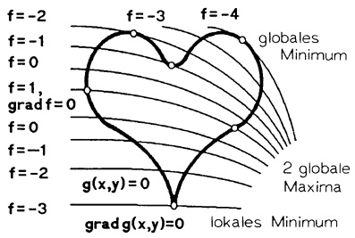

text_image

f=-2
f=-1
f=0
f=1,
grad f=0
f=0
f=-1
f=-2
f=-3
f=-3
f=-4
globales
Minimum
2 globale
Maxima
g(x,y)=0
grad g(x,y)=0
lokales Minimum

Abb. 189 - $f(x) = \mathrm{Extr!}$, $g(x) = 0$

$$
f (x _ {1}, \dots , x _ {n - 1}, h (x _ {1}, \dots , x _ {n - 1})) = \mathrm{Extr}!
$$

Beispiel. Gesucht sind die wärmsten und die kältesten Punkte auf der Sphäre  $x^{2} + y^{2} + z^{2} = 1$  bei einer Temperaturverteilung  $T(x, y, z) = xy + xz$ . Da in  $(x, y, z)$  und  $(-x, -y, -z)$  dieselbe Temperatur herrscht, genügt es, die Extremwerte auf der Hemisphäre  $x = \sqrt{1 - y^{2} - z^{2}}$  zu bestimmen.

$$
F (y, z) := T \left(x (y, z), y, z\right) = (y + z) \sqrt {1 - y ^ {2} - z ^ {2}} = \operatorname{Extr}!
$$

Auf dem Kreis $x = 0$, $y^{2} + z^{2} = 1$ gibt es keine Punkte extremaler Temperatur, dort ist $T = 0$. Für $y^{2} + z^{2} < 1$ berechnen wir über $F_{y} = F_{z} = 0$ die stationären

Punkte. Für diese muß gelten

$$
2 y ^ {2} + z ^ {2} + y z = 1, \quad y ^ {2} + 2 z ^ {2} + y z = 1.
$$

Man erhält also für  $y^{2} + z^{2} < 1$  nur die Lösungen  $y = z = \pm \frac{1}{2}$  und damit auf der Sphäre die möglichen Extremalpunkte

$$
\begin{array}{l} \mathbf {a} = \left(\frac {1}{\sqrt {2}}, \frac {1}{2}, \frac {1}{2}\right), \qquad - \mathbf {a} = \left(- \frac {1}{\sqrt {2}}, - \frac {1}{2}, - \frac {1}{2}\right), \\ \mathbf {b} = \left(\frac {1}{\sqrt {2}}, - \frac {1}{2}, - \frac {1}{2}\right), \quad - \mathbf {b} = \left(- \frac {1}{\sqrt {2}}, \frac {1}{2}, \frac {1}{2}\right). \\ \end{array}
$$

Die stetige Temperaturverteilung hat auf der Sphäre Punkte minimaler und maximaler Temperatur (→ Satz 2.1), daher sind wegen $T(\mathbf{a}) = T(-\mathbf{a}) = \frac{1}{4}\sqrt{2}$, $T(\mathbf{b}) = T(-\mathbf{b}) = -\frac{1}{4}\sqrt{2}$ die Punkte $\mathbf{a}$, $-\mathbf{a}$ die Maximalstellen, $\mathbf{b}$, $-\mathbf{b}$ die Minimalstellen.

2. Methode (Parametrisierung der Nebenbedingungen). Im Fall zweier Variablen, beispielsweise, bestimmt man eine Parameterdarstellung $x = x(t)$, $y = y(t)$, $t \in I$, der Kurve $g(x, y) = 0$ und löst für $F(t) := f(x(t), y(t))$ das gewöhnliche Extremalproblem $F(t) = \text{Extr!}$ ($\to$ Kap. 3, §2, dabei sind die Randpunkte von $I$ nicht zu vergessen!).

Die 3. Methode (die Lagrange-Multiplikatorregel) basiert auf der folgenden Beobachtung

Satz 3.6. Zu jeder Lösung a des Extremalproblems

$$
f (\mathbf {x}) = \mathrm{Extr!} \quad \mathrm{NB.} \quad g (\mathbf {x}) = 0
$$

mit  $C^{1}$ -Funktionen f, g und grad  $g(\mathbf{a}) \neq \mathbf{0}$  gibt es eine Zahl  $\lambda_{0} \in R$ , so daß gilt

$$
\operatorname{grad} f (\mathbf {a}) + \lambda_ {0} \operatorname{grad} g (\mathbf {a}) = \mathbf {0}.
$$

Beweis. Sei $\mathbf{a} = (a_{1},\ldots,a_{n})$. Wegen grad $g(\mathbf{a}) \neq \mathbf{0}$ können wir (nach evtl. Umnumerierung) $g_{x_{n}}(\mathbf{a}) \neq 0$ annehmen. Dann ist nach dem Satz über implizite Funktionen die Nebenbedingung $g(x_{1},\ldots,x_{n}) = 0$ „lokal“ (um $\mathbf{x} = \mathbf{a}$) nach $x_{n}$ auflösbar, $x_{n} = h(x_{1},\ldots,x_{n-1})$. Die Voraussetzung besagt nun, daß $f(x_{1},\ldots,x_{n-1},h(x_{1},\ldots,x_{n-1}))$ in $(a_{1},\ldots,a_{n-1})$ ein lokales Extremum besitzt. Folglich gilt ($\rightarrow$ Satz 2.6 und Satz 3.2)

$$
\begin{array}{l} 0 = f _ {x _ {i}} (\mathbf {a}) + f _ {x _ {n}} (\mathbf {a}) h _ {x _ {i}} (a _ {1}, \dots , a _ {n - 1}) \\ = f _ {x _ {i}} (\mathbf {a}) - f _ {x _ {n}} (\mathbf {a}) g _ {x _ {i}} (\mathbf {a}) g _ {x _ {n}} (\mathbf {a}) ^ {- 1} \quad (1 \leq i \leq n - 1). \\ \end{array}
$$

Mit  $\lambda_{0} := -f_{x_{n}}(\mathbf{a})g_{x_{n}}(\mathbf{a})^{-1}$  folgt die Behauptung.

Geometrische Interpretation. Unter den Annahmen von Satz 3.6 müssen die Gradienten von f und g in einem Extremalpunkt parallel sein.

Im Falle n = 2 bedeutet dies, daß sich die Kurve  $g(\mathbf{x}) = 0$  und die Niveaulinie  $f(\mathbf{x}) = f(\mathbf{a})$  im Extremalpunkt berühren.

$\lambda_{0}$ heißt Lagrange-Multiplikator und das sich aus dem Satz ergebende Lösungsverfahren nennt man die

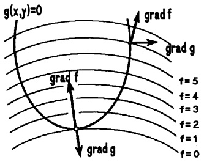

text_image

g(x,y)=0
grad f
grad g
grad f
f=5
f=4
f=3
f=2
f=1
f=0

Abb. 190 - Lagrange-Multiplikator

## Lagrange-Multiplikatorregel:

1. Schritt. Man bildet die Hilfsfunktion

$$
L (x _ {1}, \dots , x _ {n}, \lambda) = f (x _ {1}, \dots , x _ {n}) + \lambda g (x _ {1}, \dots , x _ {n})
$$

in  $n+1$  Variablen  $x_{1},\ldots,x_{n},\lambda$  und berechnet grad L.

2. Schritt. Man bestimmt die Lösungen  $(a_{1},\ldots,a_{n},\lambda_{0})$  des i.a. nichtlinearen Gleichungssystems grad  $L(x_{1},\ldots,x_{n},\lambda)=0$ , d.h.

$$
L _ {x _ {1}} = f _ {x _ {1}} (x _ {1}, \dots , x _ {n}) + \lambda g _ {x _ {1}} (x _ {1}, \dots , x _ {n}) = 0
$$

$$
L _ {x _ {2}} = f _ {x _ {2}} (x _ {1}, \dots , x _ {n}) + \lambda g _ {x _ {2}} (x _ {1}, \dots , x _ {n}) = 0
$$

$$
\begin{array}{c c c} \cdot & \cdot & \cdot \\ \cdot & \cdot & \cdot \\ \cdot & \cdot & \cdot \end{array}
$$

$$
L _ {x _ {n}} = f _ {x _ {n}} (x _ {1}, \dots , x _ {n}) + \lambda g _ {x _ {n}} (x _ {1}, \dots , x _ {n}) = 0
$$

$$
L _ {\lambda} = \quad g (x _ {1}, \dots , x _ {n}) \quad = 0
$$

3. Schritt. Man untersucht, welche der gefundenen Werte  $(a_{1},\ldots,a_{n})$  tatsächlich Extremalstellen sind.  $\lambda_{0}$  spielt keine Rolle mehr. Die Kriterien, ob ein Extremum vorliegt oder nicht, sind äußerst unhandlich. In den meisten praktischen Problemen lassen sich die Extrema unter gefundenen Punkten „aus physikalischen Gründen“ oder durch direkten Vergleich der Funktionswerte erkennen. Schließlich sind noch die Punkte b, in denen f,g nicht differenzierbar sind oder für die grad  $g(\mathbf{b})=\mathbf{0}$  ist, getrennt zu untersuchen ( $\rightarrow$  Abb. 189).

Völlig analog verfährt man bei k (k < n) Nebenbedingungen:

Sind $f, g_{1}, \ldots, g_{k}$ $\mathcal{C}^{1}$-Funktionen und $\operatorname{grad} g_{1}(\mathbf{x}), \ldots, \operatorname{grad} g_{k}(\mathbf{x})$ für alle $\mathbf{x} \in M$, $M = \{\mathbf{x} \in \mathbb{R}^{n}; g_{1}(\mathbf{x}) = \cdots = g_{k}(\mathbf{x}) = 0\}$, linear unabhängig, dann findet man die Lösung des Extremalproblems mit den Nebenbedingungen

$$
f (x _ {1}, \dots , x _ {n}) = \mathrm{Extr}! \quad \mathrm{NB}. \quad g _ {1} (x _ {1}, \dots , x _ {n}) = \dots = g _ {k} (x _ {1}, \dots , x _ {n}) = 0
$$

unter den stationären Punkten der Lagrange-Hilfsfunktion

$$
L (x _ {1}, \dots , x _ {n}, \lambda_ {1}, \dots , \lambda_ {k}) = f (\mathbf {x}) + \lambda_ {1} g _ {1} (\mathbf {x}) + \dots + \lambda_ {k} g _ {k} (\mathbf {x}).
$$

Beispiel 1. Es ist das Volumen des größten Quaders mit achsenparallelen Kanten innerhalb des Ellipsoids  $\frac{x^{2}}{a^{2}} + \frac{y^{2}}{b^{2}} + \frac{z^{2}}{c^{2}} = 1$  zu bestimmen.

Das Problem

$$
V = (2 x) (2 y) (2 z) = 8 x y z = \max! \quad \mathrm{NB}. \quad \frac {x ^ {2}}{a ^ {2}} + \frac {y ^ {2}}{b ^ {2}} + \frac {z ^ {2}}{c ^ {2}} - 1 = 0
$$

wird mit der Multiplikatorregel gelöst.

1. Schritt. Die Hilfsfunktion: $L(x,y,z,\lambda) = 8xyz + \lambda (\frac{x^2}{a^2} +\frac{y^2}{b^2} +\frac{z^2}{c^2} -1)$.

2. Schritt.  $\operatorname{grad} L = 0$ :

$$
\begin{array}{l} L _ {x} = 8 y z + \lambda \frac {2 x}{a ^ {2}} \quad = 0 \\ L _ {y} = 8 x z + \lambda \frac {2 y}{b ^ {2}} \quad = 0 \\ L _ {z} = 8 x y + \lambda \frac {2 z}{c ^ {2}} \quad = 0 \\ L _ {\lambda} = \frac {x ^ {2}}{a ^ {2}} + \frac {y ^ {2}}{b ^ {2}} + \frac {z ^ {2}}{c ^ {2}} - 1 = 0. \\ \end{array}
$$

Multiplikation der ersten (2., 3.) Gleichung mit $x$ (bzw. $y, z$) ergibt $-4xyz = \lambda \frac{x^2}{a^2} = \lambda \frac{y^2}{b^2} = \lambda \frac{z^2}{c^2}$, also $\lambda \neq 0$ ($\lambda = 0$ führt auf die Minimallösung $V = 0$) und $\frac{3x^2}{a^2} = 1$ bzw. $x = \frac{a}{\sqrt{3}}$, $y = \frac{b}{\sqrt{3}}$, $z = \frac{c}{\sqrt{3}}$.

Das maximale Volumen beträgt  $V_{max} = \frac{8}{9}\sqrt{3}abc$ .

Beispiel 2. Es sind die Scheitelpunkte der Ellipse  $x^{2} + xy + y^{2} = 5$  zu bestimmen, das sind die Punkte mit größten oder kleinsten Abstand zum Nullpunkt:

$$
\begin{array}{l} f (x, y) = x ^ {2} + y ^ {2} = \mathrm{Extr!} \quad \mathrm{NB.} \quad x ^ {2} + x y + y ^ {2} - 5 = 0. \\ L = f + \lambda g = x ^ {2} + y ^ {2} + \lambda (x ^ {2} + x y + y ^ {2} - 5), \\ L _ {x} = 2 x + \lambda (2 x + y) \quad = 0 \\ L _ {y} = 2 y + \lambda (x + 2 y) \quad = 0 \\ L _ {\lambda} = x ^ {2} + x y + y ^ {2} - 5 = 0. \\ \end{array}
$$

Offenbar muß $\lambda \neq 0$ sein. $yL_{x} - xL_{y} = 0$ ergibt $x^{2} - y^{2} = 0$, d.h. $x = \pm y$. Aus $x = y$ folgt $x = \pm \sqrt{\frac{5}{3}}$ und aus $x = -y$ folgt $x = \pm \sqrt{5}$. Die Scheitelpunkte sind also $(\sqrt{\frac{5}{3}}, \sqrt{\frac{5}{3}})$, $(- \sqrt{\frac{5}{3}}, -\sqrt{\frac{5}{3}})$ und $(\sqrt{5}, -\sqrt{5})$, $(- \sqrt{5}, \sqrt{5})$.

## Beispiel 3.

$$
f (x _ {1}, \dots , x _ {n}) = x _ {1} ^ {2} x _ {2} ^ {2} \dots x _ {n} ^ {2} = \max! \quad \mathrm{NB}. \quad x _ {1} ^ {2} + \dots + x _ {n} ^ {2} - 1 = 0.
$$

Aus

$$
\begin{array}{l} 2 x _ {1} x _ {2} ^ {2} x _ {3} ^ {2} \dots x _ {n} ^ {2} + \lambda 2 x _ {1} = 0 \\ 2 x _ {1} ^ {2} x _ {2} x _ {3} ^ {2} \dots x _ {n} ^ {2} + \lambda 2 x _ {2} = 0 \\ 2 x _ {1} ^ {2} \dots x _ {n - 1} ^ {2} x _ {n} + \lambda 2 x _ {n} = 0 \\ x _ {1} ^ {2} + \dots + x _ {n} ^ {2} - 1 \quad = 0 \\ \end{array}
$$

: :

folgt sofort  $-x_{1}^{2}x_{2}^{2}\cdots x_{n}^{2}=\lambda x_{1}^{2}=\lambda x_{2}^{2}=\cdots=\lambda x_{n}^{2}$ , also  $x_{i}^{2}=\frac{1}{n}$ . Wegen  $f(\mathbf{0})=0$  handelt es sich um die laut Satz 2.1 vorhandenen Maximalstellen; d.h. für alle Punkte der Sphäre  $x_{1}^{2}+\cdots+x_{n}^{2}=1$  gilt

$$
x _ {1} ^ {2} x _ {2} ^ {2} \dots x _ {n} ^ {2} \leq (\frac {1}{n}) ^ {n}.
$$

Sind $a_1, \ldots, a_n$ beliebige positive reelle Zahlen und

$$
b _ {i} ^ {2} := \frac {a _ {i}}{a _ {1} + \cdots + a _ {n}}
$$

dann gilt  $b_{1}^{2}+\cdots+b_{n}^{2}=1$  und damit  $b_{1}^{2}b_{2}^{2}\cdots b_{n}^{2}=\frac{a_{1}a_{2}\cdots a_{n}}{(a_{1}+\cdots+a_{n})^{n}}\leq(\frac{1}{n})^{n}$ , d.h.

$$
\sqrt [ n ]{a _ {1} a _ {2} \cdots a _ {n}} \leq \frac {a _ {1} + \cdots + a _ {n}}{n}.
$$

Das geometrische Mittel ist nie größer als das arithmetischen Mittel.

Beispiel 4. Es werden die Extremwerte der quadratischen Form $q(\mathbf{x}) = \mathbf{x}^T A\mathbf{x}$ auf der Sphäre $\{\mathbf{x} \in \mathbb{R}^n; |\mathbf{x}| = 1\}$ gesucht $(A = A^T \in \mathbb{R}^{n \times n})$:

$$
\mathbf {x} ^ {T} A \mathbf {x} = \operatorname{Extr}! \quad \mathrm{NB}. \quad 1 - \mathbf {x} ^ {T} \mathbf {x} = 0.
$$

Mit der Lagrange-Hilfsfunktion $L(\mathbf{x},\lambda) = \mathbf{x}^T A\mathbf{x} + \lambda (1 - \mathbf{x}^T\mathbf{x})$ entsteht das Gleichungssystem $(\rightarrow \S 2,(11))$

$$
L _ {x _ {i}} = 2 \mathbf {e} _ {i} ^ {T} A \mathbf {x} - 2 \lambda x _ {i} = 0
$$

$$
L _ {\lambda} = 1 - \mathbf {x} ^ {T} \mathbf {x} = 0,
$$

welches gleichbedeutend ist mit dem Eigenwertproblem $A\mathbf{x} = \lambda \mathbf{x}$, $|\mathbf{x}| = 1$. Die Extremwerte sind also unter $q(\mathbf{x}) = \mathbf{x}^T A\mathbf{x} = \lambda \mathbf{x}^T \mathbf{x} = \lambda$ zu suchen.

Ergebnis. Der kleinste Eigenwert von $A$ ist das Minimum, der größte Eigenwert das Maximum der quadratischen Form $q(\mathbf{x}) = \mathbf{x}^T A\mathbf{x}$ auf der Sphäre $\{\mathbf{x} \in \mathbb{R}^n ; |\mathbf{x}| = 1\}$. Diese Extrema werden für die zugehörigen Eigenvektoren der Länge 1 angenommen.

Anwendung in der Mechanik. Der maximale (minimale) Wert der Normalspannung $\sigma = \mathbf{n}^{T}S\mathbf{n}$, $|\mathbf{n}| = 1$, in einem Punkt eines elastisch belasteten Körpers ist der größte (kleinste) Eigenwert des Spannungstensors $S$. Die entsprechenden Eigenvektoren bestimmen die Hauptspannungsrichtungen. ($\rightarrow$ Kap. 6, 6.1, Bsp.9 und §7, Aufg. 7).

Zusammen mit der Charakterisierung von Extremstellen im Innern eines Gebiets ( $\rightarrow$  3.4) gilt für das Extremalproblem einer Funktion f auf dem durch Hyperflächen  $g_{i}(\mathbf{x}) = 0$  begrenzten Bereich

$$
U = \{\mathbf {x} \in \mathbb {R} ^ {n}; g _ {1} (\mathbf {x}) \leq 0, \dots , g _ {r} (\mathbf {x}) \leq 0 \}:
$$

## Die Kandidaten für Extremstellen von $f:U\to\mathbb{R}$ sind

a) die Ecken von U (falls vorhanden, eindeutige Lösungen von möglichen Kombinationen  $g_{i}(\mathbf{x}) = g_{j}(\mathbf{x}) = \cdots = g_{k}(\mathbf{x}) = 0$ , sonst  $g_{l}(\mathbf{x}) < 0$ );
b) die Extremalstellen in den berandenden Kurven-, Flächen- und Hyperflächenstücken von U, die man entweder
- mit der Lagrange-Multiplikatorregel
oder
- durch Parametrisierung bzw. Einsetzen der entsprechenden Nebenbedingungen
bestimmt;
c) die stationären Stellen von $f$ im Innern von $U$:
d) die Punkte in U, in denen f nicht differenzierbar ist.

$$
\{\mathbf {x} \in \mathbb {R} ^ {n}; g _ {1} (\mathbf {x}) <   0, \dots , g _ {r} (\mathbf {x}) <   0 \};
$$

Der größte bzw. kleinste Funktionswert an den Stellen a), b), c), d) liefert das globale Maximum bzw. Minimum von f auf U.

Die Bestimmung der Ecken und der Stücke, die U beranden, ist für n > 2 meist sehr schwierig, im  $R^{2}$  über eine Skizze von U zu erledigen.

Beispiel. Gesucht sind die Extremwerte von  $f(x,y)=3x^{2}-2xy+y^{2}$  auf der Kreisscheibe  $x^{2}+y^{2}\leq1$ . Fall a) und d) treten nicht auf.

c) Lokale Extremstellen im Innern  $x^{2} + y^{2} < 1$ .

$$
f _ {x} = f _ {y} = 0; \quad \mathrm{d.h.} \quad 6 x - 2 y = 0, \quad 2 y - 2 x = 0.
$$

Es gibt nur einen stationären Punkt  $(x,y)=(0,0)$  im Innern. Da  $H_{f}(0,0)=$ 
 $=\left(\begin{array}{cc}6 & -2 \\ -2 & 2\end{array}\right)$  positiv definit ist, besitzt f in  $(0,0)$  ein lokales Minimum.

b) Die Extremstellen auf dem Rand

$$
f (x, y) = \mathrm{Extr!} \quad \mathrm{NB.} \quad x ^ {2} + y ^ {2} - 1 = 0
$$

bestimmen wir mit der Multiplikatorregel:

$$
L (x, y, \lambda) = 3 x ^ {2} - 2 x y + y ^ {2} + \lambda (x ^ {2} + y ^ {2} - 1).
$$

$$
L _ {x} = 6 x - 2 y + 2 \lambda x = 0,
$$

$$
L _ {y} = - 2 x + 2 y + 2 \lambda y = 0,
$$

$$
L _ {\lambda} = \quad x ^ {2} + y ^ {2} - 1 \quad = 0.
$$

Wie in Beispiel 4 ist ein Eigenwertproblem zu lösen: Die Eigenwerte sind $\lambda_{1}=2+\sqrt{2},\lambda_{2}=2-\sqrt{2}$, dazu die normierten Eigenvektoren

$$
\mathbf {a} = \frac {1}{\sqrt {4 - 2 \sqrt {2}}} \binom{1}{1 - \sqrt {2}}, \quad \mathbf {b} = \frac {1}{\sqrt {4 + 2 \sqrt {2}}} \binom{1}{1 + \sqrt {2}}.
$$

Globales Maximum in $\mathbf{a}, -\mathbf{a}: f(\mathbf{a}) = f(-\mathbf{a}) = \lambda_1 = 2 + \sqrt{2}$,

Globales Minimum in 0:  $f(\mathbf{0}) = 0$ .

□

## Aufgaben

1. Man bestimme für die Funktion

$$
f (x, y) = x ^ {2} e ^ {y / 3} (y - 3) - \frac {1}{2} y ^ {2}, \quad (x, y) \in \mathbb {R} ^ {2},
$$

- $\operatorname{grad} f$ und die Hesse-Matrix $H_{f}$,
- die Taylor-Annäherung 2. Ordnung im Punkt (0,0),
- den Typ der Flächenpunkte auf dem Graphen $z = f(x, y)$ längs $x = 0$,
- die Taylor-Reihe von $f(x,y)$ samt Konvergenzbereich über die Exponentialreihe.

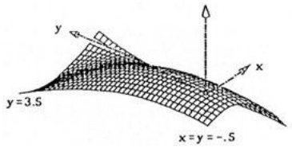

text_image

y
y = 3.5
x = y = -.5

$$
z = x ^ {2} e x p (y / 3) (y - 3) -. 5 y ^ {2}
$$

2. Für die Funktion  $f(x, y) = y^{4} - 3xy^{2} + x^{3}$  bestimme man

a) die lokalen und die globalen Extremstellen und die Sattelpunkte,
b) die Extremwerte auf $\{(x,y):|x|\leq\frac{5}{2},|y|\leq2\}$.
c) die Taylor-Reihe im Punkt  $\left(\frac{3}{2},\frac{3}{2}\right)$ .

3. Für die Funktion

$$
f (x, y) = \left\{ \begin{array}{c l} \frac {\sin 2 \sqrt {x ^ {2} + y ^ {2}}}{\sqrt {x ^ {2} + y ^ {2}}} & , (x, y) \neq (0, 0) \\ 2 & , (x, y) = (0, 0) \end{array} \right.
$$

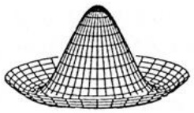

natural_image

3D wireframe diagram of a conical structure with grid lines, no text or symbols present

bestimme man:

a) die Tangentialebene an den Graphen $z = f(x, y)$ im Punkt $(\frac{\pi}{2}, 0, 0)$.
b) die Taylor-Entwicklung bis zur 2. Ordnung in (0,0) und $(\frac{\pi}{2},0)$.

4. Man entwickel nach der Taylorformel bis zur 2. Potenz von x, y:

a)  $f(x, y) = x^{2} \sin \frac{xy}{2} \text{ um } (1, \pi),$
b)  $f(x, y) = (x^{2} - 2y^{2}) \cdot (4 + xy)^{-1/2} \text{ um } (0, 0),$
c) $f(x,y) = x^{2} - \cos (\frac{x}{y})$ in $(\pi ,1)$.

5. Man bestimme und skizziere den Bereich der Halbebene $x > 0$, in dem die Hesse-Matrix $H_{g}(x,y)$ der Funktion $g(x,y) = x^{y}$, $x > 0$, indefinit ist.

6. Man bestätige, daß  $y + 2x = e^{2y/x}$  für x > 0 zwei verschiedene Auflösungen  $y = f(x)$  besitzt und bestimme deren gemeinsamen Definitionsbereich.

Man bestimme und diskutiere die Stellen mit  $f'(x) = 0$  und skizziere beide Graphen. Wie lauten die entsprechenden Antworten für die Auflösung  $x = g(y)$ ?

7. Gegeben ist die Kurve $g(x, y) = 12y^5 - 20xy^3 + 5x^4 = 0$, $x > 0$, $y > 0$.

a) In der Umgebung welcher Punkte ist implizit eine Funktion  $y = f(x)$  bestimmt?
Berechne dort  $f' = \frac{dy}{dx}$  implizit.
b) In welchen Punkten der Kurve ist  $f' = 0$ ? Berechne für diese Kurvenpunkte den Wert von  $f''$ .

8. Die Cassini-Kurven  $N_{k}$  sind die Niveaulinien  $(f(x,y)=k)$  der Funktion

$$
f (x, y) = [ (x + 1) ^ {2} + y ^ {2} ] \cdot [ (x - 1) ^ {2} + y ^ {2} ], x, y \in \mathbb {R}.
$$

a) Auf welcher Kurve $T$ liegen die Punkte mit Tangenten parallel zur $x$-Achse?
Für welche Werte von k hat  $N_{k}$  genau 4 derartige Punkte?
b) Für den Fall $k = 1$ (Lemniskate) diskutiere man die Auflösungen nach $y$ mit maximalem Definitionsbereich und bestimme man die Tangenten in $(x, y) = (0, 0)$.
c) Für welches $k > 1$ verschwindet die Krümmung von $N_{k}$ in den Punkten mit $x = 0$ (Rennbahnkurve)?
Man skizziere die Kurve!

9. Die KEPLER-Gleichung

$$
\frac {2 \pi}{T} t = \psi - \epsilon \sin \psi
$$

bestimmt den Ort eines Planeten auf einer Ellipsenbahn in Abhängigkeit von der Zeit $t$ nach dem 2. Kepler-Gesetz ($0 < \epsilon < 1$ numerische Exzentrizität der Ellipse, $\psi = \star AOQ$, $T$ Umlaufzeit).

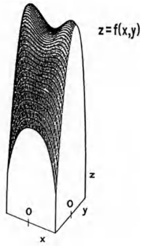

text_image

z=f(x,y)
O
O
y
x
z

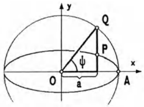

text_image

y
Q
ψ
P
O
a
x
A

Man zeige, daß implizit genau eine Funktion  $\psi = \psi(t)$  definiert ist und bestimme ihre Extremstellen ( $\rightarrow$  Band 2: Kap. 9, §3, Aufg. 11 und Kap. 11, 4.5).

10. Gilt für die $\mathcal{C}^{1}$-Funktion $f: \mathbb{R}^{3} \to \mathbb{R}$ im Punkt $\mathbf{x} \quad f_{x} \neq 0$, $f_{y} \neq 0$, $f_{z} \neq 0$, so kann in einer Umgebung nach $x$, $y$ und $z$ aufgelöst werden: $x = x(y,z)$, $y = y(x,z)$, $z = z(x,y)$. Man zeige, daß für die Ableitungen dieser Funktionen

$$
\frac {\partial x}{\partial y} \cdot \frac {\partial y}{\partial z} \cdot \frac {\partial z}{\partial x} = - 1
$$

gilt und überprüfe dies an der Van-der-Waals-Gleichung  $f(p,V,T)=pV-RT$ .

11. Wird eine Schraubenfeder belastet, so ruft dies Torsion und Biegung im Werkstoff hervor. Ist F die Belastung in Richtung der Schraubachse, so sind folgende Kenngrößen der Feder Funktionen von F: Die Höhe H, der Radius r, die Windungszahl n, die Torsion τ und die Krümmung κ. Die Werte für F = 0 seien  $H_{0}$ ,  $r_{0}$ ,  $n_{0}$ ,  $\tau_{0}$  bzw.  $\kappa_{0}$ . Konstant bleiben bei Belastung L: die Länge, GJ: die Torsions- und EJ: die Biegesteifigkeit des Werkstoffes.

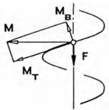

text_image

M
M_B
M_T
F

Zerlegt man in jedem Punkt der Feder das Belastungsmoment $M^{1}$ in $M_B$: das Biege- und $M_T$: das Torsionsmoment ($\rightarrow$ Bsp. in 1.2), so erhält man drei implizite Gleichungen für $H(F)$, $r(F)$ und $n(F)$:

Die Torsionsgleichung  $GJ(\tau_{0}-\tau)=-m_{T}$  liefert ( $\rightarrow$   $\S1$  (14))

$$
G J \cdot (\frac {H _ {0}}{L r _ {0}} \sqrt {L ^ {2} - H _ {0} ^ {2}} - \frac {H}{L r} \sqrt {L ^ {2} - H ^ {2}}) = F \cdot r \cdot \sqrt {L ^ {2} - H ^ {2}} .
$$

Die Biegegleichung  $EJ(\kappa_{0}-\kappa)=-m_{B}$  ergibt

$$
(**) E J \cdot (\frac {L ^ {2} - H _ {0} ^ {2}}{r _ {0}} - \frac {L ^ {2} - H ^ {2}}{r}) = - F \cdot r \cdot L \cdot H.
$$

$n = n(F)$ ist bestimmt durch die Beziehung

$$
(2 n \pi r) ^ {2} + H ^ {2} = L ^ {2}.
$$

a) Für welche Belastung  $F_{max}$  ergibt sich aus (\*) und (\*\*)  $H(F_{max}) = 0?$
b) Man berechne aus (\*), (\*\*), (\*\*\* ) $H'(0)$, $r'(0)$ und $n'(0)$ und bestätige (mit $\sin x_0 = \frac{H_0}{L}$) die gebräuchlichen Näherungen:

$$
H - H _ {0} \approx H ^ {\prime} (0) \cdot F = - L r _ {0} ^ {2} (\frac {\cos^ {2} \alpha_ {0}}{G J} + \frac {\sin^ {2} \alpha_ {0}}{E J}) \cdot F
$$

$$
r - r _ {0} \approx r ^ {\prime} (0) \cdot F = r _ {0} ^ {3} \sin \alpha_ {0} \left(\frac {2}{G J} - \frac {\cos 2 \alpha_ {0}}{E J \cos^ {2} \alpha_ {0}}\right) \cdot F
$$

$$
n - n _ {0} \approx n ^ {\prime} (0) \cdot F = \frac {1}{2 \pi} r _ {0} L \sin \alpha_ {0} \cos \alpha_ {0} [ \frac {1}{E J} - \frac {1}{G J} ] \cdot F.
$$

12. Man löse im  $R^{2}$

$$
f (x, y) = x ^ {2} - x y + y ^ {2} - x = \mathrm{Extr!}
$$

$$
\mathrm{NB.} \quad g (x, y) = x ^ {2} + y ^ {2} - 1 \leq 0.
$$

Ist hier auch ein Eigenwertproblem versteckt?

13. Gegeben ist die reelle Funktion $f(x, y) = \sin[\pi(x^2 + y)] + \cos(\pi y)$ über dem Bereich (der reellen Ebene) $A = \{(x, y); 0 \leq y \leq 1 - x^2\}$.

a) Man skizziere A.
b) Man bestimme die stationären Punkte von  $z = f(x, y)$  im Innern von A.
c) Man diskutiere die Funktion  $g(x) := f(x,0)$  in  $|x| \leq 1$ .
Gefragt sind: $g'(x)$, $g''(x)$, die Symmetrie zu den Achsen, die Extrema, die Wendepunkte, die Monotonie- und Konvexitätsbereiche sowie eine sorgfältige Skizze. (Hinweis: Für $u \approx .6532712$ ist $\cos u = 2u \cdot \sin u$)
d) Wo liegen die lokalen Extremstellen von $z = f(x, y)$ auf $y = 1 - x^{2}$, $y \geq 0$?
e) Man ermittle Lage und Wert der globalen Extrema von $z = f(x, y)$ auf $A$ und trage die Punkte in die Skizze von $A$ ein.

14. Die größte Raute in einem Würfel.

Für welche Werte von $a, b$ ($-1 \leq a, b \leq +1$) ist das ebene Viereck mit den vier Ecken $A = (1, a, -1)$, $B = (b, 1, -1)$, $C = (-1, -a, 1)$, $D = (-b, -1, 1)$ ein gleichseitiges mit maximalem Flächeninhalt?

Tip: Lagrange-Multiplikatorenregel verwenden!

15. Von allen Vierecken mit gegebenen Seiten a, b, c, d (in der skizzierten Reihenfolge) ist das flächengrößte stets ein Sehenviereck. Man zeige dies mittels Lagrange-Multiplikatorregel.

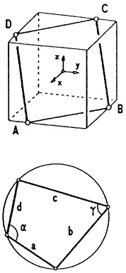

16. Für eine Rinne mit Trapez-Querschnitt gebe man den Zusammenhang  $f(h, \alpha, A, U) = 0$  für die Höhe h, den Neigungswinkel  $\alpha$ , den Querschnittsinhalt A und U gemäß Skizze. Man löse damit für

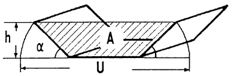

text_image

h
α
A
U

$$
0 \leq h \leq \frac {U}{2} \sin x, \quad 0 \leq x \leq \frac {\pi}{2}
$$

die Optimierungsaufgaben:

a) Maximaler Inhalt A bei vorgegebenem Umfang  $U = U_{0}!$
b) Minimaler Materialaufwand U bei festem Inhalt  $A = A_{0}!$

\- In welchem Zusammenhang stehen die Lösungen? (Dualität)

17. Ein KFZ-Radlager mit 14 Kugeln soll so vorgespannt werden, daß sich bei einer vertikalen Belastung des Innenrings mit F = 3000N eine möglichst kleine maximale Kugelpressung einstellt:

Jede Kugel des Lagers wird radial belastet, gepreßt und elastisch verformt: Die Vorspannung drückt den Innenring konzentrisch um  $e[\mu m]$  gegen den Außenring, die Last F verschiebt ihn um  $x[\mu m]$  in x-Richtung nach unten.

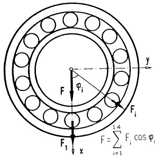

text_image

F
φᵢ
y
F₁
F₁
x
F = ∑_{i=1}^{1.4} Fᵢ cos φᵢ

Die radiale Verformung  $\delta_{i}$  der i-ten Kugel lautet somit (in erster Näherung)

$$
\delta_ {i} = e + x \cos \varphi_ {i}, \quad i = 1, 2, \dots , 1 4.
$$

Der Zusammenhang zwischen Preßlast $F_{i}$ und Verformung $\delta_{i}$ ist nach G. HERTZ:

$$
F _ {i} = C \cdot (\delta_ {i}) _ {+} ^ {3 / 2} := \left\{ \begin{array}{c l} C \delta_ {i} ^ {3 / 2}, & \text {falls} \delta_ {i} \geq 0 \\ 0, & \text {falls} \delta_ {i} <   0 \end{array} ; \quad i = 1, 2, \dots , 1 4. \right.
$$

(C ist eine von der Form des Lagers abhängige Konstante, hier  $C = 10 \frac{N}{\mu m}^{3/2}$ .) Ist wie in der Skizze  $\varphi_{1} = 0$  und  $\varphi_{i+1} = \frac{2\pi i}{14}$ , so erhält man:

$$
F = F (e, x) = C \cdot \sum_ {i = 1} ^ {1 4} (e + x \cos \frac {\pi i}{7}) _ {+} ^ {3 / 2} \cdot \cos \frac {\pi i}{7}; \tag {*}
$$

$$
F _ {1} = F _ {1} (e, x) = C \cdot (e + x) _ {+} ^ {3 / 2}. \quad (\text {Maximale Kugellast im Lager})
$$

a) Keine Vorspannung: Setze e = 0 und berechne x aus F = 3000N.
Wie groß ist die maximale Kugellast $F_{1}(0,x)$, wie viele Kugeln sind belastet?
b) Optimale Vorspannung: Man löse die Extremwertaufgabe

$$
F _ {1} (e, x) = \mathrm{Min}!, \quad F (e, x) = 3 0 0 0 \mathrm{N}, \quad e _ {0} \geq 0, x _ {0} > 0
$$

mit der Lagrange-Multiplikatorregel!

(Hilfe: Eliminiere den Multiplikator und leite eine Gleichung für  $\frac{e}{x}$  her; diese ist mit dem Newton-Verfahren numerisch zu lösen!)

Ergebnis:  $e = 8.182\mu m$ ,  $x = 10.88\mu m$ . Die maximale Kugellast ist bei b) um 11.2% kleiner als bei a). Dafür sind stets 11 Kugeln belastet.

## §4. Vektorwertige Funktionen

4.1 Die Differentiation. Wir betrachten Funktionen (Abbildungen), die jedem Punkt (Ortsvektor) $\mathbf{x} \in D \subseteq \mathbb{R}^{n}$ einen Vektor $\mathbf{f}(\mathbf{x}) \in \mathbb{R}^{m}$ zuordnen

$$
\mathbf {f}: \mathbb {R} ^ {n} \supseteq D \to \mathbb {R} ^ {m}, \quad \mathbf {f} (\mathbf {x}) = \left( \begin{array}{c} f _ {1} (\mathbf {x}) \\ f _ {2} (\mathbf {x}) \\ \vdots \\ f _ {m} (\mathbf {x}) \end{array} \right) = \left( \begin{array}{c} f _ {1} (x _ {1}, x _ {2}, \ldots , x _ {n}) \\ f _ {2} (x _ {1}, x _ {2}, \ldots , x _ {n}) \\ \vdots \\ f _ {m} (x _ {1}, x _ {2}, \ldots , x _ {n}) \end{array} \right)
$$

und übertragen sämtliche Begriffe aus §2 über die Komponentenfunktionen $f_i$ auf die vektorwertige Funktion $\mathbf{f}$:

Definition. Für $\mathbf{f}:\mathbb{R}^n\supseteq D\to \mathbb{R}^m$ und $\mathbf{x},\mathbf{x}_0\in D$ gilt

a) Der Grenzwert, die partielle Differentiation und die „klein-o“-Notation sind jeweils komponentenweise erklärt (→ 2.2-2.4):

$$
\lim _ {\mathbf {x} \to \mathbf {x} _ {0}} \mathbf {f} (\mathbf {x}) := \left( \begin{array}{c} \lim _ {\mathbf {x} \to \mathbf {x} _ {0}} f _ {1} (\mathbf {x}) \\ \lim _ {\mathbf {x} \to \mathbf {x} _ {0}} f _ {2} (\mathbf {x}) \\ \vdots \\ \lim _ {\mathbf {x} \to \mathbf {x} _ {0}} f _ {m} (\mathbf {x}) \end{array} \right); \qquad \frac {\partial \mathbf {f}}{\partial x _ {i}} (\mathbf {x}) := \left( \begin{array}{c} \frac {\partial f _ {1}}{\partial x _ {i}} (\mathbf {x}) \\ \frac {\partial f _ {2}}{\partial x _ {i}} (\mathbf {x}) \\ \vdots \\ \frac {\partial f _ {m}}{\partial x _ {i}} (\mathbf {x}) \end{array} \right),
$$

$$
\mathbf {f} (\mathbf {x}) = o (| \mathbf {x} - \mathbf {x} _ {0} |) \iff f _ {k} (\mathbf {x}) = o (| \mathbf {x} - \mathbf {x} _ {0} |), k = 1, 2, \dots , m.
$$

b) f ist genau dann stetig, partiell differenzierbar oder eine $\mathcal{C}^{r}$-Funktion, wenn sämtliche Komponentenfunktionen $f_{k}$ von $\mathbf{f}$, $k = 1,2,\ldots,m$, stetig, partiell differenzierbar bzw. $\mathcal{C}^{r}$-Funktionen sind.

c) f heißt in $\mathbf{x}_{0} \in D$ total differenzierbar oder linear approximierbar, wenn es eine $m \times n$-Matrix $A$ und eine ganze $r$-Umgebung $U_{r}(\mathbf{x}_{0}) = \{\mathbf{x} \in \mathbb{R}^{n} ; |\mathbf{x} - \mathbf{x}_{0}| < r\}$ in $D$ gibt, so daß für alle $\mathbf{x} \in U_{r}(\mathbf{x}_{0})$ gilt

$$
\mathbf {f} (\mathbf {x}) = \mathbf {f} (\mathbf {x} _ {0}) + A \left(\mathbf {x} - \mathbf {x} _ {0}\right) + o (| \mathbf {x} - \mathbf {x} _ {0} |) . \tag {1}
$$

Aus (1) folgt die lineare Approximierbarkeit aller Komponentenfunktionen, d.h.

$$
f _ {k} (\mathbf {x}) = f _ {k} (\mathbf {x} _ {0}) + \mathrm{grad}   f _ {k} (\mathbf {x} _ {0}) \cdot (\mathbf {x} - \mathbf {x} _ {0}) + o (| \mathbf {x} - \mathbf {x} _ {0} |) , k = 1, \dots , m .
$$

Definiert man daher die

Funktional- oder Jacobi-Matrix von f in  $x_{0}$

$$
\mathcal {J} _ {\mathbf {f}} (\mathbf {x} _ {0}) := \left( \begin{array}{c} \operatorname{grad} f _ {1} (\mathbf {x} _ {0}) ^ {T} \\ \operatorname{grad} f _ {2} (\mathbf {x} _ {0}) ^ {T} \\ \vdots \\ \operatorname{grad} f _ {m} (\mathbf {x} _ {0}) ^ {T} \end{array} \right) = \left(\frac {\partial \mathbf {f}}{\partial x _ {1}} (\mathbf {x} _ {0}), \dots , \frac {\partial \mathbf {f}}{\partial x _ {n}} (\mathbf {x} _ {0})\right) = \left(\frac {\partial f _ {i}}{\partial x _ {j}} (\mathbf {x} _ {0})\right) _ {m \times n},
$$

so ist die Matrix $A$ in (1) mit Satz 2.3 eindeutig bestimmt als $A = \mathcal{J}_{\mathbf{f}}(\mathbf{x}_0)$.

Merke. Die Zeilen der Jacobi-Matrix sind die Gradienten der Komponenten von f (als Zeilenvektoren geschrieben), die Spalten der Jacobi-Matrix sind die partiellen Ableitungen des Spaltenvektors f.

Satz 2.4 läßt sich leicht auf den Fall m > 1 übertragen. Dagegen gilt der Mittelwertsatz und damit die Taylor-Formel 3.1 für m > 1 nicht!

Satz 4.1 Sei $\mathbf{f}:\mathbb{R}^{n}\supseteq D\to \mathbb{R}^{m}$ eine $\mathcal{C}^1$ -Abbildung, dann gilt:

a) f ist für alle  $x \in D$  linear approximierbar.
b) Ist D konvex (→ 3.2), dann gibt es ein ξ, 0 < ξ < 1, so daβ

$$
\left| \mathbf {f} (\mathbf {x}) - \mathbf {f} (\mathbf {x} _ {0}) \right| \leq \left| \mathcal {J} _ {\mathbf {f}} \big (\mathbf {x} _ {0} + \xi (\mathbf {x} - \mathbf {x} _ {0}) \big) (\mathbf {x} - \mathbf {x} _ {0}) \right|.
$$

Man schreibt hierfür kurz

$$
\mathbf {f} (\mathbf {x}) \approx \mathbf {f} (\mathbf {x} _ {0}) + \mathcal {J} _ {\mathbf {f}} (\mathbf {x} _ {0}) \left(\mathbf {x} - \mathbf {x} _ {0}\right) \quad \text {mit einem Fehler} o (| \mathbf {x} - \mathbf {x} _ {0} |). \tag {2}
$$

Beispiel 1. Jede lineare Abbildung $\mathbf{f}:\mathbb{R}^{n}\to\mathbb{R}^{m}$ mit $\mathbf{f}(\mathbf{x})=A\mathbf{x}, A\in\mathbb{R}^{m\times n}$, ist total differenzierbar. Die Jacobi-Matrix ist gerade ihre Abbildungsmatrix

$$
\mathcal {J} _ {\mathbf {f}} (\mathbf {x}) = A \quad \text {fur alle} \mathbf {x} \in \mathbb {R} ^ {n}. \tag {3}
$$

Beispiel 2. Polarkoordinaten. Der Streifen $D$ der kartesischen $(r, \varphi)$-Ebene $D = \{(r, \varphi); 0 \leq r < \infty, 0 \leq \varphi < 2\pi\}$ wird mittels

$$
\mathbf {x} (r, \varphi) = \binom{r \cos \varphi}{r \sin \varphi}
$$

so auf die kartesische x-Ebene abgebildet, daß zu jedem Punkt  $x \neq 0$  genau ein  $(r, \varphi) \in D$  gehört. Die Jacobi-Matrix dieser Abbildung lautet

$$
\mathcal {J} _ {\mathbf {x}} (r, \varphi) = \left(\frac {\partial \mathbf {x}}{\partial r}, \frac {\partial \mathbf {x}}{\partial \varphi}\right) = \left( \begin{array}{c c} \cos \varphi & - r \sin \varphi \\ \sin \varphi & r \cos \varphi \end{array} \right)  .
$$

Die Ableitungsregeln bestätigt man leicht mit (1):

Für $\mathbf{x} \in \mathbb{R}^n$, $\mathbf{v}(\mathbf{x}), \mathbf{w}(\mathbf{x}) \in \mathbb{R}^m$, $f(\mathbf{x}) \in \mathbb{R}$ und $\alpha, \beta \in \mathbb{R}$ gilt

(4)

a) $\mathcal{J}_{\alpha \mathbf{v} + \beta \mathbf{w}}(\mathbf{x}) = \alpha \mathcal{J}_{\mathbf{v}}(\mathbf{x}) + \beta \mathcal{J}_{\mathbf{w}}(\mathbf{x})$
(Linearität),
b) $\mathcal{J}_f\mathbf{v}(\mathbf{x}) = f(\mathbf{x})\mathcal{J}_{\mathbf{v}}(\mathbf{x}) + \mathbf{v}(\mathbf{x})\mathcal{J}_f(\mathbf{x}) = f(\mathbf{x})\mathcal{J}_{\mathbf{v}}(\mathbf{x}) + \mathbf{v}(\mathbf{x})(\mathrm{grad}f(\mathbf{x}))^T$
(Produktregel für Multiplikation mit skalarer Funktion),
c) $\mathcal{J}_{\mathbf{v}^T\mathbf{w}}(\mathbf{x}) = \mathbf{v}(\mathbf{x})^T\mathcal{J}_{\mathbf{w}}(\mathbf{x}) + \mathbf{w}(\mathbf{x})^T\mathcal{J}_{\mathbf{v}}(\mathbf{x})$
(Produktregel für das Skalarprodukt),
d) $\mathcal{J}_{\mathbf{v}\times \mathbf{w}}(\mathbf{x}) = \mathbf{v}(\mathbf{x})\times \mathcal{J}_{\mathbf{w}}(\mathbf{x}) - \mathbf{w}(\mathbf{x})\times \mathcal{J}_{\mathbf{v}}(\mathbf{x})$
(Produktregel für das ×-Produkt, m = 3).

Beachte. In (4b) ist der zweite Summand kein Skalarprodukt, sondern eine $m \times n$-Matrix („Spalte × Zeile“).

Das Produkt „Spaltenvektor × Matrix“ in (4d) ist spaltenweise zu verstehen.

Beispiel 3. Die quasilineare Abbildung $\mathbf{f}(\mathbf{x}) = f(\mathbf{x})A\mathbf{x}$ mit der skalaren $\mathcal{C}^1$-Funktion $f: \mathbb{R}^n \supseteq D \to \mathbb{R}$ und der konstanten Matrix $A \in \mathbb{R}^{m \times n}$ besitzt die Jacobi-Matrix

$$
\mathcal {J} _ {\mathbf {f}} (\mathbf {x}) = f (\mathbf {x}) A + (A \mathbf {x}) (\operatorname{grad} \varphi (\mathbf {x})) ^ {T}.
$$

4.2 Die Kettenregel. Zwei Abbildungen $\mathbf{f}:\mathbb{R}^{n}\supseteq D\to\mathbb{R}^{m},\mathbf{g}:\mathbb{R}^{m}\supseteq G\to\mathbb{R}^{q}$ mit $\mathbf{f}(D)\subseteq G$, nacheinander ausgeführt, ergeben das Kompositum

$$
\mathbf {g} \circ \mathbf {f}: D \to \mathbb {R} ^ {q}, \quad (\mathbf {g} \circ \mathbf {f}) (\mathbf {x}) := \mathbf {g} (\mathbf {f} (\mathbf {x})).
$$

Satz 4.2. Die Kettenregel. Sind $\mathbf{f}:\mathbb{R}^{n}\supseteq D\to\mathbb{R}^{m}$ in $\mathbf{x}_{0}\in D$ und $\mathbf{g}:\mathbb{R}^{m}\supseteq G\to\mathbb{R}^{q}$ in $\mathbf{f}(\mathbf{x}_{0})\in G$ linear approximierbar, dann ist das Kompositum $\mathbf{g}\circ\mathbf{f}$ in $\mathbf{x}_{0}$ ebenfalls linear approximierbar und es gilt

$$
\boxed {\mathcal {J} _ {\mathrm{gof}} (\mathbf {x} _ {0}) = \mathcal {J} _ {\mathrm{g}} (\mathbf {f} (\mathbf {x} _ {0})) \mathcal {J} _ {\mathrm{f}} (\mathbf {x} _ {0})} \tag {5}
$$

Beweis. Unter den Voraussetzungen folgt aus (1)

$$
\begin{array}{l} \mathbf {g} (\mathbf {f} (\mathbf {x})) = \mathbf {g} (\mathbf {f} (\mathbf {x} _ {0})) + \mathcal {J} _ {\mathbf {g}} (\mathbf {f} (\mathbf {x} _ {0})) (\mathbf {f} (\mathbf {x}) - \mathbf {f} (\mathbf {x} _ {0})) + o (| \mathbf {f} (\mathbf {x}) - \mathbf {f} (\mathbf {x} _ {0}) |) \\ = \mathbf {g} (\mathbf {f} (\mathbf {x} _ {0})) + \mathcal {J} _ {\mathbf {g}} (\mathbf {f} (\mathbf {x} _ {0})) \mathcal {J} _ {\mathbf {f}} (\mathbf {x} _ {0}) (\mathbf {x} - \mathbf {x} _ {0}) + o (| \mathbf {x} - \mathbf {x} _ {0} |) . \\ \end{array}
$$

Also ist $\mathbf{g} \circ \mathbf{f}$ in $\mathbf{x}_0$ linear approximierbar und es gilt (5).

Anwendung: Basiswechsel. Wir legen im $\mathbb{R}^{n}$ ein neues Koordinatensystem $K = (P; \mathbf{b}_{1}, \mathbf{b}_{2}, \ldots, \mathbf{b}_{n})$ fest und wählen außerdem im $\mathbb{R}^{m}$ eine neue Basis $(\mathbf{w}_{1}, \ldots, \mathbf{w}_{m})$. Der Punkt $\mathbf{x} \in \mathbb{R}^{n}$ hat im Koordinatensystem $K$ den Koordinatenvektor $\mathbf{y}$, der durch

$$
\mathbf {x} = B \mathbf {y} + \mathbf {p} \tag {6}
$$

mit der orthogonalen $n \times n$-Matrix $B = (\mathbf{b}_1, \ldots, \mathbf{b}_n)$ und $\mathbf{p} = \overrightarrow{OP}$ bestimmt ist ($\rightarrow$ Kap. 6, 6.6). Analog hat ein Vektor $\mathbf{v} \in \mathbb{R}^m$ bezüglich der Basis ($\mathbf{w}_1, \ldots, \mathbf{w}_m$) den Koordinatenvektor $\mathbf{w} \in \mathbb{R}^m$, so daß

$$
\mathbf {v} = W \mathbf {w} \tag {7}
$$

mit der invertierbaren  $m \times m$ -Matrix  $W = (\mathbf{w}_{1}, \ldots, \mathbf{w}_{m})$ .

Eine Funktion $\mathbf{f}:\mathbb{R}^{n}\supset D\to\mathbb{R}^{m}$ besitzt nach diesem Koordinaten- und Basiswechsel eine andere Darstellung $\mathbf{g}:\mathbb{R}^{n}\supset D^{*}\to\mathbb{R}^{m}$: Setzt man $\mathbf{v}=\mathbf{f}(\mathbf{x})$, so ist $\mathbf{g}$ aus (6) und (7) implizit bestimmt durch

$$
\mathbf {v} = \mathbf {f} (\mathbf {x}) = \mathbf {f} (B \mathbf {y} + \mathbf {p}) = W \mathbf {w} = W \mathbf {g} (\mathbf {y}).
$$

Diese Gleichung ist nach $\mathbf{w} = \mathbf{g}(\mathbf{y})$ auflösbar, so daß

$$
\mathbf {y} \in D ^ {*} \Longleftrightarrow \mathbf {x} = B \mathbf {y} + \mathbf {p} \in D, \tag {8}
$$

$$
\mathbf {g} (\mathbf {y}) = W ^ {- 1} \mathbf {f} (B \mathbf {y} + \mathbf {p}).
$$

Mit der Kettenregel (5) und (3) folgt sofort

$$
\mathcal {J} _ {\mathrm{g}} (\mathbf {y} _ {0}) = W ^ {- 1} \mathcal {J} _ {\mathrm{f}} (\mathbf {x} _ {0}) B, \quad \mathbf {x} _ {0} = B \mathbf {y} _ {0} + \mathbf {p}. \tag {9}
$$

Bemerkung. Mit (8) und (9) lassen sich sehr leicht Eigenschaften einer Funktion f untersuchen, die unabhängig von den gewählten Koordinatensystemen im Argument- und im Bildraum sind. Hierzu gehören die Stetigkeit, die Differenzierbarkeit und geometrische Eigenschaften von Gradient und  $J_{f}$  ( $\rightarrow$  4.3).

4.3 Räumliche Skalaren- und Vektorfelder. Der Anschauungsraum wird, wie üblich, nach Wahl eines kartesischen Koordinatensystems  $I = (O; \mathbf{e}_{1}, \mathbf{e}_{2}, \mathbf{e}_{3})$  durch  $R^{3}$  und jeder räumliche Bereich durch eine Teilmenge  $D \subseteq R^{3}$  dargestellt, wobei Punkte durch ihre Ortsvektoren charakterisiert werden. ( $\rightarrow$  Vereinbarung zu Beginn Kap. 7)

Ein Skalarenfeld (eine Belegungsfunktion) $f: \mathbb{R}^3 \supseteq D \to \mathbb{R}$ ordnet jedem Punkt $\mathbf{x} \in D$ eine Zahl $f(\mathbf{x})$ zu. Unter einem (räumlichen) Vektorfeld verstehen wir eine Funktion $\mathbf{v}: D \to \mathbb{R}^3$, die jedem Punkt $\mathbf{x} \in D$ einen Vektor $\mathbf{v}(\mathbf{x})$ zuordnet. Man stellt sich vor, daß in jedem Punkt $\mathbf{x} \in D$ der Vektor $\mathbf{v}(\mathbf{x})$ (etwa ein Kraftvektor oder ein Geschwindigkeitsvektor) angeheftet ist.

Eine Kurve in $D$ heißt Feldlinie des Vektorfeldes $\mathbf{v}$, wenn der Vektor $\mathbf{v}(\mathbf{x})$ in jedem Kurvenpunkt $\mathbf{x}$ parallel zur Kurventangente ist. Wir sprechen von einem $C^r$-Skalarenfeld $f$ bzw. $C^r$-Vektorfeld $\mathbf{v}$ auf $D$, wenn $f$ bzw. $\mathbf{v}$ $C^r$-Funktion, d.h. $r$-mal stetig partiell differenzierbar sind.

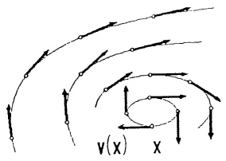

text_image

v(x)
x

Abb. 191 - Vektorfeld, Feldlinien

## Beispiel 1. Die starre Drehung.

Eine Rechtsdrehung mit konstanter Winkelgeschwindigkeit ω um eine Achse durch den Nullpunkt mit Richtungsvektor  $\mathbf{a} = (a_{1}, a_{2}, a_{3})^{T}$ ,  $|a| = 1$ , wird nach Kap. 6, 6.4 dargestellt durch

$$
\begin{array}{l} \mathbf {x} (t) = (\cos \omega t) \mathbf {x} _ {0} + \\ + (1 - \cos \omega t) (\mathbf {x} _ {0} \cdot \mathbf {a}) \mathbf {a} + \\ + \sin \omega t \mathbf {a} \times \mathbf {x} _ {0}, \\ \end{array}
$$

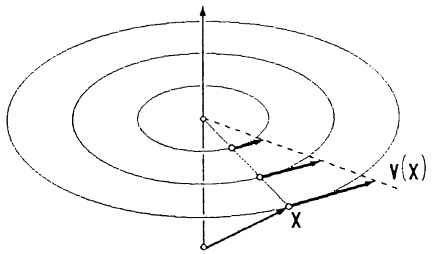

text_image

v(x)
x

Abb. 192 - Starre Drehung

wobei  $x_{0}$  die Lage zur Zeit t = 0 bezeichnet.

Für die Geschwindigkeit $\mathbf{v}(t)=\dot{\mathbf{x}}(t)$ gilt demnach

$$
\mathbf {v} (t) = \omega (- \sin \omega t \mathbf {x} _ {0} + \sin \omega t (\mathbf {x} _ {0} \cdot \mathbf {a}) \mathbf {a} + \cos \omega t \mathbf {a} \times \mathbf {x} _ {0}) = \omega \mathbf {a} \times \mathbf {x} (t).
$$

Man nennt $\mathbf{w} = \omega\mathbf{a}$ die vektorielle Winkelgeschwindigkeit. Damit hat das Geschwindigkeitsfeld einer gleichförmigen Drehbewegung die Darstellung

$$
\mathbf {v} (\mathbf {x}) = \mathbf {w} \times \mathbf {x} = \omega \mathbf {a} \times \mathbf {x}. \tag {10}
$$

$\mathbf{x} \mapsto \mathbf{v}(\mathbf{x}) = \omega \mathbf{a} \times \mathbf{x}$ ist eine lineare Abbildung $\mathbf{x} \mapsto V\mathbf{x}$ mit konstanter Matrix $V \in \mathbb{R}^{3 \times 3}$, daher gilt ($\rightarrow$ (3) und Kap. 6, 6.1)

$$
\mathcal {J} _ {\mathbf {v}} (\mathbf {x}) = V = (\mathbf {v} (\mathbf {e} _ {1}), \mathbf {v} (\mathbf {e} _ {2}), \mathbf {v} (\mathbf {e} _ {3})) = \omega \left( \begin{array}{c c c} 0 & - a _ {3} & a _ {2} \\ a _ {3} & 0 & - a _ {1} \\ - a _ {2} & a _ {1} & 0 \end{array} \right) .
$$

Offensichtlich ist $V$ schiefsymmetrisch ($V^{T} = -V$). Daher ist insbesondere Spur $\mathcal{J}_{\mathbf{v}}(\mathbf{x}) = 0$ und damit $\operatorname{div}\mathbf{v} = 0$ für alle $\mathbf{x} \in \mathbb{R}^{3}$ ($\rightarrow 4.4$).

## Beispiel 2. Das zentrale Kraftfeld.

Eine Punktmasse M im Ursprung zieht (nach NEWTON) die Punktmasse m in  $X = (x_{1}, x_{2}, x_{3})$ ,  $x = \overrightarrow{OX}$ , mit der Gravitationskraft

$$
\mathbf {K} (\mathbf {x}) = \frac {c}{| \mathbf {x} | ^ {3}} \mathbf {x}, \quad \mathbf {x} \neq \mathbf {0},
$$

an  $(c = -\gamma mM, \gamma > 0)$ .

Handelt es sich in O und X um elektrische Ladungen der Stärke Q bzw. q, so gilt (nach COULOMB) für die elektrische Anziehungskraft dieselbe Gesetzmäßigkeit mit c = kqQ, k > 0.

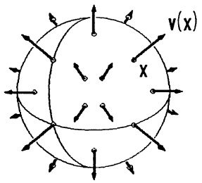

text_image

V(X)
X

Abb. 193 - Zentralfeld

Das zentrale Kraftfeld $\mathbf{K}(\mathbf{x})$ ist quasilinear ($\rightarrow$ Bsp. 3, 4.1), daher ergibt sich mit Ableitungsregel (4c) und der Einheitsmatrix $E \in \mathbb{R}^{3 \times 3}$ für $\mathbf{x} \neq \mathbf{0}$

$$
\begin{array}{l} \mathcal {J} _ {\mathbf {K}} (\mathbf {x}) = \mathbf {x} \left(\operatorname{grad} \frac {c}{| \mathbf {x} | ^ {3}}\right) ^ {T} + \frac {c}{| \mathbf {x} | ^ {3}} E = \frac {c}{| \mathbf {x} | ^ {5}} \left[ (\mathbf {x} ^ {T} \mathbf {x}) E - 3 \mathbf {x x} ^ {T} \right] \\ = \frac {c}{| \mathbf {x} | ^ {5}} \left( \begin{array}{c c c} x _ {2} ^ {2} + x _ {3} ^ {2} - 2 x _ {1} ^ {2} & - 3 x _ {1} x _ {2} & - 3 x _ {1} x _ {3} \\ - 3 x _ {1} x _ {2} & x _ {1} ^ {2} + x _ {3} ^ {2} - 2 x _ {2} ^ {2} & - 3 x _ {2} x _ {3} \\ - 3 x _ {1} x _ {3} & - 3 x _ {2} x _ {3} & x _ {1} ^ {2} + x _ {2} ^ {2} - 2 x _ {3} ^ {2} \end{array} \right)  . \\ \end{array}
$$

$\mathcal{J}_{\mathbf{K}}(\mathbf{x})$ ist stets eine symmetrische Matrix mit $\operatorname{Spur} \mathcal{J}_{\mathbf{K}}(\mathbf{x}) = 0$ ($\rightarrow 4.4$).

□

## Beispiel 3. Der magnetische Wirbel.

Ein gerader stromdurchflossener Draht hat die Richtung der  $e_{3}$ -Achse. Nach AMPÈRE bildet sich das magnetische Feld

$$
\mathbf {H} (\mathbf {x}) = \frac {c}{| \mathbf {x} | ^ {2} - (\mathbf {e} _ {3} \cdot \mathbf {x}) ^ {2}} \mathbf {e} _ {3} \times \mathbf {x}
$$

$$
= \frac {c}{x _ {1} ^ {2} + x _ {2} ^ {2}} \left( \begin{array}{c} - x _ {2} \\ x _ {1} \\ 0 \end{array} \right) ,
$$

$$
(x _ {1}, x _ {2}) \neq (0, 0), c > 0.
$$

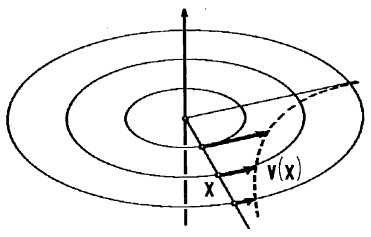

text_image

x
V(x)

Abb. 194 - Magnetischer Wirbel

Dieses Feld ist wieder quasilinear (→ Bsp. 3, 4.1) und mit der Ableitungsregel (4c) ergibt sich

$$
\mathcal {J} _ {\mathbf {H}} (\mathbf {x}) = \frac {c}{(x _ {1} ^ {2} + x _ {2} ^ {2}) ^ {2}} \left( \begin{array}{c c c} 2 x _ {1} x _ {2} & x _ {2} ^ {2} - x _ {1} ^ {2} & 0 \\ x _ {2} ^ {2} - x _ {1} ^ {2} & - 2 x _ {1} x _ {2} & 0 \\ 0 & 0 & 0 \end{array} \right)  .
$$

Obwohl die Feldlinien wie in Bsp. 1 Kreise sind, ist $\mathcal{J}_{\mathbf{H}}(\mathbf{x})$ hier eine symmetrische Matrix, d.h. für $(x_{1}, x_{2}) \neq (0, 0)$ ist $\operatorname{rot} \mathbf{H}(\mathbf{x}) = \mathbf{0} (\rightarrow 4.4)$. Außerdem ist für $(x_{1}, x_{2}) \neq (0, 0)$ Spur $J_{\mathbf{H}}(\mathbf{x}) = 0$, d.h. $\operatorname{div} \mathbf{H}(\mathbf{x}) = 0$.

## Beispiel 4. Die laminare Rohrströmung.

Eine zähe Flüssigkeit wird durch ein zur  $x_{2}$ -Achse koaxiales Rohr vom Radius r mit geringer Geschwindigkeit gepreßt, so daß eine laminare Strömung eintritt. Das Geschwindigkeitsfeld wurde unabhängig voneinander um 1850 von dem deutschen

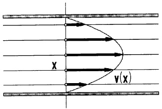

text_image

X
v(x)

Abb. 195 Rohrströmung

Ingenieur G. HAGEN und dem französischen Arzt POISEUILLE bestimmt zu

$$
\mathbf {v} (x _ {1}, x _ {2}, x _ {3}) = c \left( \begin{array}{c} 0 \\ r ^ {2} - x _ {1} ^ {2} - x _ {3} ^ {2} \\ 0 \end{array} \right), \qquad x _ {1} ^ {2} + x _ {3} ^ {2} \leq r ^ {2}, c > 0.
$$

Die Jacobi-Matrix berechnen wir direkt:

$$
\mathcal {J} _ {\mathbf {v}} (\mathbf {x}) = c \left( \begin{array}{c c c} 0 & 0 & 0 \\ - 2 x _ {1} & 0 & - 2 x _ {3} \\ 0 & 0 & 0 \end{array} \right), \qquad x _ {1} ^ {2} + x _ {3} ^ {2} \leq r ^ {2}.
$$

$\mathcal{J}_{\mathbf{v}}(\mathbf{x})$  ist i.a. weder symmetrisch noch schiefsymmetrisch, jedoch ist mit Spur  $J_{v}=0$  auch hier div v=0 ( $\rightarrow4.4$ ). ☐

4.4 Gradient, Divergenz, Rotation, Laplace-Operator. Jedem $\mathscr{C}^{1}$-Skalarenfeld $f: \mathbb{R}^{3} \supseteq D \to \mathbb{R}$ wird das Vektorfeld „Gradient“ zugeordnet

$$
\operatorname{grad} f: D \to \mathbb {R} ^ {3}, \quad \operatorname{grad} f (\mathbf {x}) := \left( \begin{array}{c} \frac {\partial f}{\partial x _ {1}} (\mathbf {x}) \\ \frac {\partial f}{\partial x _ {2}} (\mathbf {x}) \\ \frac {\partial f}{\partial x _ {3}} (\mathbf {x}) \end{array} \right),
$$

jedem $\mathcal{C}^2$-Skalarenfeld $f : \mathbb{R}^3 \supseteq D \to \mathbb{R}$ mit dem Laplace-Operator $\Delta$, J.S. LAPLACE (1749 - 1827), das Skalarenfeld $\Delta f$:

$$
\Delta f: D \to \mathbb {R}, \qquad \Delta f (\mathbf {x}) = \frac {\partial^ {2} f}{\partial x _ {1} ^ {2}} (\mathbf {x}) + \frac {\partial^ {2} f}{\partial x _ {2} ^ {2}} (\mathbf {x}) + \frac {\partial^ {2} f}{\partial x _ {3} ^ {2}} (\mathbf {x}).
$$

Zu jedem $\mathcal{C}^{1}$-Vektorfeld $\mathbf{v} : \mathbb{R}^{3} \supseteq D \to \mathbb{R}^{3}$ definiert man ein Skalarenfeld „Divergenz“ div $\mathbf{v}$ und ein Vektorfeld „Rotation“ rot $\mathbf{v}$:

$$
\begin{array}{l}\operatorname{div} \mathbf {v}: D \rightarrow \mathbb {R}, \operatorname{div} \mathbf {v} (\mathbf {x}) = \frac {\partial v _ {1}}{\partial x _ {1}} (\mathbf {x}) + \frac {\partial v _ {2}}{\partial x _ {2}} (\mathbf {x}) + \frac {\partial v _ {3}}{\partial x _ {3}} (\mathbf {x})\\\operatorname{rot} \mathbf {v}: D \rightarrow \mathbb {R} ^ {3}, \operatorname{rot} \mathbf {v} (\mathbf {x}) = \left(\begin{array}{c}\frac {\partial v _ {3}}{\partial x _ {2}} (\mathbf {x}) - \frac {\partial v _ {2}}{\partial x _ {3}} (\mathbf {x})\\\frac {\partial v _ {1}}{\partial x _ {3}} (\mathbf {x}) - \frac {\partial v _ {3}}{\partial x _ {1}} (\mathbf {x})\\\frac {\partial v _ {2}}{\partial x _ {1}} (\mathbf {x}) - \frac {\partial v _ {1}}{\partial x _ {2}} (\mathbf {x})\end{array}\right).\end{array}\tag {11}
$$

Mittels Volumen- und Oberflächenintegrale zeigt man (→ Kap. 8), daß div v die „Quelldichte von v“ und rot v die „Wirbeldichte von v“ beschreibt.

Beispiele. Für die Vektorfelder der 4 Beispiele aus 4.3 gilt

|  | Starre Drehung | Zentrales Kraftfeld |
| --- | --- | --- |
| $\mathbf{v}(x)$ | $\omega \mathbf{a} \times \mathbf{x}$ | $c\|\mathbf{x}\|^{-3}\mathbf{x}$, $\mathbf{x} \neq 0$ |
| $\text{div } \mathbf{v}(\mathbf{x})$ | 0 | 0, $\mathbf{x} \neq 0$ |
| $\text{rot } \mathbf{v}(\mathbf{x})$ | $2\omega \mathbf{a}$ | 0, $\mathbf{x} \neq 0$ |

<table><tr><td></td><td colspan="2">Magnetischer Wirbel</td><td>Laminare Rohrströmung</td></tr><tr><td> $\mathbf{v}(\mathbf{x})$ </td><td colspan="2"> $\frac{c}{x_1^2 + x_2^2} \begin{pmatrix} -x_2 \\ x_1 \\ 0 \end{pmatrix}, x_1^2 + x_2^2 \neq 0$ </td><td> $c \begin{pmatrix} 0 \\ r^2 - x_1^2 - x_3^2 \\ 0 \end{pmatrix}, x_1^2 + x_3^2 \leq r^2$ </td></tr><tr><td>div  $\mathbf{v}(\mathbf{x})$ </td><td colspan="2">0,  $x_1^2 + x_2^2 \neq 0$ </td><td>0,  $x_1^2 + x_3^2 \leq r^2$ </td></tr><tr><td>rot  $\mathbf{v}(\mathbf{x})$ </td><td colspan="2">0,  $x_1^2 + x_2^2 \neq 0$ </td><td> $2c \begin{pmatrix} x_3 \\ 0 \\ -x_1 \end{pmatrix}, x_1^2 + x_3^2 \leq r^2$ </td></tr></table>

Sämtliche 4 Vektorfelder sind in ihrem Definitionsbereich quellfrei (div v = 0). Für die starre Drehung hat rot v(x) in jedem x konstant die Richtung der Drehachse und den Betrag 2ω. Der magnetische Wirbel und das zentrale Kraftfeld sind in x ≠ 0, die Rohrströmung nur längs der Rohrachse wirbelfrei. □

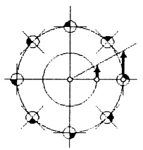

natural_image

Geometric diagram showing a circle with eight smaller circles and an arrow indicating rotation or transformation (no text or symbols)

Abb. 196a - Starre Drehung |rot v| = 2ω

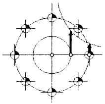

natural_image

Pure geometric diagram with concentric circles and arrows, no text or symbols present

Abb. 196b - Magn.Wirbel |rot v| = 0, x ≠ 0

Bereits die Darstellung der Felder $f$, $\mathbf{v}$ hängt vom gewählten Koordinatensystem ab, aber noch vielmehr die durch partielle Ableitungen gewonnenen Felder grad $f$, $\Delta f$, div $\mathbf{v}$ und rot $\mathbf{v}$.

Im folgenden soll gezeigt werden, daß in einem festen Punkt X der Wert von div v und  $\Delta f$  sowie die durch grad f und rot v dargestellten Vektoren unabhängig vom gewählten kartesischen Koordinatensystem I sind.

Dazu die Darstellung mit der Jacobi-Matrix:

$$
\begin{array}{c} \text {grad} f (\mathbf {x} _ {0}) = \mathcal {J} _ {f} (\mathbf {x} _ {0}) ^ {T} \\ \text {div} \mathbf {v} (\mathbf {x} _ {0}) = \text {Spur} \mathcal {J} _ {\mathbf {v}} (\mathbf {x} _ {0}) \\ (\text {rot} \mathbf {v} (\mathbf {x} _ {0})) \times (\mathbf {x} - \mathbf {x} _ {0}) = [ \mathcal {J} _ {\mathbf {v}} (\mathbf {x} _ {0}) - \mathcal {J} _ {\mathbf {v}} (\mathbf {x} _ {0}) ^ {T} ] (\mathbf {x} - \mathbf {x} _ {0}). \end{array} \tag {12}
$$

Beweis. Die beiden ersten Beziehungen liest man direkt aus den Definitionen ab. Die dritte folgt aus der Tatsache, daß $S = A - A^{T}$ für jede quadratische Matrix $A$ schiefsymmetrisch ist $(S^{T} = -S)$ und für jedes $S \in \mathbb{R}^{3 \times 3}$ gilt

$$
S ^ {T} = - S \iff S = \left( \begin{array}{c c c} 0 & s _ {1 2} & s _ {1 3} \\ - s _ {1 2} & 0 & s _ {2 3} \\ - s _ {1 3} & - s _ {2 3} & 0 \end{array} \right) \iff S \mathbf {x} = \mathbf {w} \times \mathbf {x} \text {mit} \mathbf {w} = \left( \begin{array}{c} - s _ {2 3} \\ s _ {1 3} \\ - s _ {1 2} \end{array} \right).
$$

Mit $S = A - A^{T}$ ist $\mathbf{w} = \begin{pmatrix} a_{32} - a_{23} \\ a_{13} - a_{31} \\ a_{21} - a_{12} \end{pmatrix}$, so daß $\mathbf{w} = \operatorname{rot}\mathbf{v}(\mathbf{x}_0)$ für $A = \mathcal{J}_{\mathbf{v}}(\mathbf{x}_0)$ folgt.

Wegen (10) beschreibt $\mathbf{x} \mapsto S\mathbf{x} = \mathbf{w} \times \mathbf{x}$ das Geschwindigkeitsfeld einer Drehung, daher der Name „Rotation“.

Da die Zerlegung  $A = \frac{1}{2}(A + A^{T}) + \frac{1}{2}(A - A^{T})$  einer Matrix in den symmetrischen und den schiefsymmetrischen Anteil eindeutig ist, nennt man das Drehfeld

$$
\mathbf {x} \mapsto \frac {1}{2} (\operatorname{rot} \mathbf {v} (\mathbf {x} _ {0})) \times \mathbf {x}
$$

den „Rotationsanteil der linearen Approximation $\mathbf{x} \mapsto \mathcal{J}_{\mathbf{v}}(\mathbf{x}_0)\mathbf{x}^{\prime\prime}$.

## Satz 4.2. Transformationsformeln.

Sind $I = (O; \mathbf{e}_1, \mathbf{e}_2, \mathbf{e}_3)$, $K = (P; \mathbf{b}_1, \mathbf{b}_2, \mathbf{b}_3)$ zwei kartesische Koordinatensysteme im Raum und ist $\mathbf{p} = \overrightarrow{OP} \in \mathbb{R}^3$, $B = (\mathbf{b}_1, \mathbf{b}_2, \mathbf{b}_3) \in \mathbb{R}^{3 \times 3}$ die Darstellung von $K$ bezüglich $I$, so gilt

<table><tr><td>System</td><td>I</td><td>K</td></tr><tr><td>Basis</td><td> $E = (\mathbf{e}_1, \mathbf{e}_2, \mathbf{e}_3)$ </td><td> $B = (\mathbf{b}_1, \mathbf{b}_2, \mathbf{b}_3), \quad B^T = B^{-1}$ </td></tr><tr><td>Punkt X</td><td> $\mathbf{x}^T = (x_1, x_2, x_3)$ </td><td> $\mathbf{y}^T = (y_1, y_2, y_3) = (\mathbf{x}^T - \mathbf{p}^T)B$ </td></tr><tr><td>Vektor  $\overrightarrow{XY}$ </td><td> $\mathbf{v}$ </td><td> $\mathbf{w} = B^T \mathbf{v}$ </td></tr><tr><td rowspan="2">Skalarenfeld $f : D \to \mathbb{R}$ </td><td> $f(\mathbf{x})$ </td><td> $g(\mathbf{y}) = f(B\mathbf{y} + \mathbf{p})$ </td></tr><tr><td> $\mathcal{J}_f(\mathbf{x})$ </td><td> $\mathcal{J}_g(\mathbf{y}) = \mathcal{J}_f(\mathbf{x})B$ </td></tr><tr><td>Gradient</td><td> $\text{grad } f(\mathbf{x}) = \mathcal{J}_f(\mathbf{x})^T$ </td><td> $\text{grad } g(\mathbf{y}) = B^T \text{grad } f(\mathbf{x})$ </td></tr><tr><td rowspan="2">Vektorfeld $\mathbf{v} : D \to \mathbb{R}^3$ </td><td> $\mathbf{v}(\mathbf{x})$ </td><td> $\mathbf{w}(\mathbf{y}) = B^T \mathbf{v}(B\mathbf{y} + \mathbf{p})$ </td></tr><tr><td> $\mathcal{J}_\mathbf{v}(\mathbf{x})$ </td><td> $\mathcal{J}_\mathbf{w}(\mathbf{y}) = B^T \mathcal{J}_\mathbf{v}(\mathbf{x})B$ </td></tr><tr><td>Divergenz</td><td> $\text{div } \mathbf{v}(\mathbf{x})$ </td><td> $\text{div } \mathbf{w}(\mathbf{y}) = \text{div } \mathbf{v}(\mathbf{x})$ </td></tr><tr><td>Rotation</td><td> $\text{rot } \mathbf{v}(\mathbf{x})$ </td><td> $\text{rot } \mathbf{w}(\mathbf{y}) = B^T \text{rot } \mathbf{v}(\mathbf{x})$ </td></tr></table>

Beweis. Bis auf die Divergenz und Rotation folgt alles aus den Formeln (6) - (9). Dazu setze man beim Skalarfeld $m = 1$ und $W = 1$ und beim Vektorfeld $m = n$ und $W = B$.

$$
\operatorname{div} \mathbf {w} (\mathbf {y}) = \operatorname{Spur} \mathcal {J} _ {\mathbf {w}} (\mathbf {y}) = \operatorname{Spur} (B ^ {T} \mathcal {J} _ {\mathbf {v}} (\mathbf {x}) B) = \operatorname{Spur} \mathcal {J} _ {\mathbf {v}} (\mathbf {x}) = \operatorname{div} \mathbf {v} (\mathbf {x}).
$$

(Spur A ist die Summe der Eigenwerte von A,  $B^{T}AB$  und A haben die gleichen Eigenwerte, → Kap. 6, 6.7.)

$$
\begin{array}{l} \left(\operatorname{rot} \mathbf {w} (\mathbf {y})\right) \times \mathbf {z} = \left(\mathcal {J} _ {\mathbf {w}} (\mathbf {y}) - \mathcal {J} _ {\mathbf {w}} (\mathbf {y}) ^ {T}\right) \mathbf {z} = \left[ B ^ {T} \left(\mathcal {J} _ {\mathbf {v}} (\mathbf {x}) - \mathcal {J} _ {\mathbf {v}} (\mathbf {x}) ^ {T}\right) B \right] \mathbf {z} \\ = B ^ {T} \left[ \operatorname{rot} \mathbf {v} (\mathbf {x}) \times (B \mathbf {z}) \right] = \left(B ^ {T} \operatorname{rot} \mathbf {v} (\mathbf {x})\right) \times (B ^ {T} B \mathbf {z}) \\ = \left(B ^ {T} \operatorname{rot} \mathbf {v} (\mathbf {x})\right) \times \mathbf {z}. \\ \end{array}
$$

$(B^{T}$ ist eine Drehmatrix, daher gilt $B^{T}(\mathbf{a}\times \mathbf{b}) = (B^{T}\mathbf{a})\times (B^{T}\mathbf{b}).$

Folgerung: Koordinateninvarianz. Der Wert von div v(x) ist unabhängig vom Koordinatensystem, in dem man v darstellt und die partiellen Ableitungen berechnet. Dasselbe gilt für die Richtung und die Länge von rot v(x) und grad v(x).

Unter geeigneten Differenzierbarkeitsvoraussetzungen bestätigt man leicht durch explizites Nachrechnen die

## Rechenregeln:

a) rot(grad f) = 0 „Gradientenfeld ist wirbelfrei“,
b) div(rot v) = 0 „Feld der Rotation ist quellfrei“,
c) $\operatorname{div}(\operatorname{grad} f) = \Delta f$,
d) $\operatorname{div}(f\mathbf{v}) = (\operatorname{grad} f) \cdot \mathbf{v} + f \operatorname{div} \mathbf{v}$,
e) $\operatorname{rot}(f\mathbf{v}) = (\operatorname{grad} f) \times \mathbf{v} + f \operatorname{rot}\mathbf{v}$,
f) rot(rot v) = grad(div v) - Δv (Laplace - Operator komponentenweise).

Beispiel. Nach J.C. MAXWELL gilt im Vakuum für die (zeitabhängige) elektrische Feldstärke  $\mathbf{E}(\mathbf{x},t)$  und die magnetische Feldstärke  $\mathbf{H}(\mathbf{x},t)$  (SI-Einheiten mit den Feldkonstanten  $\mu_{0}=0.4\pi\cdot10^{-6}$  H/m,  $\epsilon_{0}=8.854\cdot10^{-12}$  F/m)

$$
\mu_ {0} \frac {\partial \mathbf {H}}{\partial t} = - \operatorname{rot} \mathbf {E}, \qquad \epsilon_ {0} \frac {\partial \mathbf {E}}{\partial t} = \operatorname{rot} \mathbf {H}, \qquad \operatorname{div} \mathbf {E} = 0, \qquad \operatorname{div} \mathbf {H} = 0.
$$

Diese vier partiellen Differentialgleichungen beschreiben die zeitabhängige Koppelung zwischen den Feldern E und H. Sind  $\mathbf{E}(\mathbf{x},t)$  und  $\mathbf{H}(\mathbf{x},t)$  beide  $C^{2}$ -Vektorfelder, so kann man mit Rechenregel f) und dem Satz von Schwarz je eine Differentialgleichung für E und H alleine herleiten:

$$
\mu_ {0} \operatorname{rot} \frac {\partial \mathbf {H}}{\partial t} = \operatorname{rot} (- \operatorname{rot} \mathbf {E}) = - \big (\operatorname{grad} (\operatorname{div} \mathbf {E}) - \Delta \mathbf {E} \big) = \Delta \mathbf {E},
$$

andererseits ist mit  $c_{0}=\frac{1}{\sqrt{\mu_{0}\epsilon_{0}}}$  (Lichtgeschwindigkeit im Vakuum)

$$
\frac {\partial}{\partial t} \frac {\partial \mathbf {E}}{\partial t} = \frac {1}{\epsilon_ {0}} \frac {\partial}{\partial t} \operatorname{rot} \mathbf {H} = \frac {1}{\epsilon_ {0}} \operatorname{rot} \frac {\partial \mathbf {H}}{\partial t} = c _ {0} ^ {2} \Delta \mathbf {E}.
$$

Analog ergibt sich für $\mathbf{H}:\frac{\partial^{2}\mathbf{H}}{\partial t^{2}}=c_{0}^{2}\Delta\mathbf{H}$. D.h. jede Komponente von $\mathbf{E}$ und $\mathbf{H}$ erfüllt die 3-dimensionale Wellengleichung (Elektromagnetische Wellen)

$$
\frac {\partial^ {2} u}{\partial t ^ {2}} = c _ {0} ^ {2} \left(\frac {\partial^ {2} u}{\partial x _ {1} ^ {2}} + \frac {\partial^ {2} u}{\partial x _ {2} ^ {2}} + \frac {\partial^ {2} u}{\partial x _ {3} ^ {2}}\right).
$$

Mit dem symbolischen Vektor („Nabla-Operator“) $\nabla := \begin{pmatrix} \frac{\partial}{\partial x_1} \\ \frac{\partial}{\partial x_2} \\ \frac{\partial}{\partial x_3} \end{pmatrix}$

lassen sich die vier Felder formal als Produkte schreiben

$$
\mathrm{grad} f = \nabla f, \quad \Delta f = \nabla \cdot \nabla f,
$$

$$
\mathrm{div} \mathbf {v} = \nabla \cdot \mathbf {v}, \quad \mathrm{rot} \mathbf {v} = \nabla \times \mathbf {v}.
$$

Beim Umgang mit ∇ ist jedoch Vorsicht geboten, man kann mit diesem formalen Vektor wegen der Produktregel der Differentiation nicht immer so rechnen, wie mit „echten“ Vektoren (→ Aufg. 5).

## Aufgaben

1. Gegeben ist die Abbildung $\mathbf{f}:\mathbb{R}^{2}\setminus\{\mathbf{0}\}\to\mathbb{R}^{2}$

$$
\mathbf {f} (\mathbf {x}) = \binom{u (x, y)}{v (x, y)} = \frac {1}{x ^ {2} + y ^ {2}} \binom{x}{y}, \quad \mathbf {x} \neq \mathbf {0}.
$$

a) Für welche Punkte x ist  $\mathbf{f}(\mathbf{x}) = \mathbf{x}$  (Fixpunkte)?
b) Man berechne die Jacobi-Matrix $\mathcal{J}_{\mathrm{f}}$. In welchen Punkten $\mathbf{x}$ ist $\mathcal{J}_{\mathrm{f}}$ invertierbar.

2. Gegeben sind vier Geschwindigkeitsfelder im  $R^{2}$  ( $r = \sqrt{x^{2} + y^{2}}$ )

$$
\mathbf {v} (\mathbf {x}) = (u (x, y), v (x, y)) ^ {T} \quad (c, \epsilon , M \text {   konstant   })
$$

- laminar, translatorisch : u = c ; v = 0 ;
- laminare Gegenströmung :  $u = c \cdot y$ ; v = 0 ;
- isolierte Quelle : $u = \epsilon \frac{x}{x^2 + y^2}$; $v = \epsilon \frac{y}{x^2 + y^2}$ ($r > 0$);
- Dipolströmung : $u = M \frac{y^2 - x^2}{(x^2 + y^2)^2}$; $v = -M \frac{2xy}{(x^2 + y^2)^2}$ ($r > 0$);

a) Man skizziere jeweils das Vektorfeld samt einigen Stromlinien.
b) Man berechne $\mathcal{J}_{\mathbf{v}}$, div $\mathbf{v}$, rot $\mathbf{v}$.

3. Gegeben sind die Vektorfelder im $\mathbb{R}^3$

a) $\mathbf{v}(\mathbf{x}) = 2xy\mathbf{e}_1 + (3z^3 +x^2)\mathbf{e}_2 + 9yz^2\mathbf{e}_3$
b) $\mathbf{v}(\mathbf{x}) = \frac{1}{|\mathbf{x}|^3}\mathbf{e}_1 - \frac{3x}{|\mathbf{x}|^5}\mathbf{x} \quad (\mathbf{x} \neq \mathbf{0})$.

Man berechne $\mathcal{J}_{\mathbf{v}}$, div $\mathbf{v}$ und rot $\mathbf{v}$.

4. In kartesischen Koordinaten ist im $\mathbb{R}^3$

$$
\mathbf {f} (\mathbf {x}) = (x ^ {2}, y ^ {2}, - x z) ^ {T}, \quad \mathbf {g} (\mathbf {x}) = (- y, x, 0) ^ {T}.
$$

Man berechne  $\nabla(\mathbf{f} \cdot \mathbf{g})$ ,  $\nabla \cdot (\mathbf{f} \times \mathbf{g})$  und  $\nabla \times (\mathbf{f} \times \mathbf{g})$ .

5. Für zwei  $C^{1}$ -Vektorfelder f, g im  $R^{3}$  hat man mit der „Nabla-Schreibweise“

$$
\mathrm{div} (\mathbf {f} \times \mathbf {g}) = \nabla \cdot (\mathbf {f} \times \mathbf {g}).
$$

Wendet man die Regeln für das Spatprodukt an, so hätte man formal die Beziehung

$\nabla\cdot(\mathbf{f}\times\mathbf{g})=\mathbf{g}\cdot(\nabla\times\mathbf{f})=-\mathbf{f}\cdot(\nabla\times\mathbf{g})$ ,

$$
\mathrm{div} (\mathbf {f} \times \mathbf {g}) = \mathbf {g} \cdot \mathrm{rot} \mathbf {f} = - \mathbf {f} \cdot \mathrm{rot} \mathbf {g}.
$$

Wie lautet die richtige Formel, die div(f × g) über die Rotation von f und g ausdrückt?

6. Gegeben sind im  $R^{2}$  mit den kartesischen Koordinaten  $(x, y)$

die Transformation von Polar- auf kartesische Koordinaten $u: (r, \varphi) \mapsto (x, y)$,

die Kurve  $\gamma(t):\mathbb{R}\to\mathbb{R}^{2}$  mit der Darstellung  $(r,\varphi)=(t^{2},\omega t)$  in Polarkoordinaten, das Skalarenfeld  $s:\mathbb{R}^{2}\to\mathbb{R}$  mit  $s(x,y)=x^{2}-y^{2}$ .

Man berechne

- die Jacobi-Matrizen $\mathcal{J}_{\gamma} = \dot{\gamma}$, $\mathcal{J}_u$ und $\mathcal{J}_s = (\text{grad } s)^T$,
- die explizite Darstellung von $s \circ u \circ \gamma$ und daraus direkt $\frac{d}{dt} s \circ u \circ \gamma$,
- mittels Kettenregel die Jacobi-Matrix von $(s\circ u)$ und $\frac{d}{dt}s\circ u\circ \gamma$

\- die Richtungsableitung von $s$ in Transversalrichtung $\mathbf{v} = \mathbf{e}_{\varphi} = (-\sin \varphi, \cos \varphi)^T$ im Kurvenpunkt $\gamma\left(\frac{\pi}{4\omega}\right)$.

7. Man berechne div grad U und rot grad U für die skalaren Felder im  $R^{3}$

a)  $U(\mathbf{x}) = z e^{x^{2} y}$ ,
b) $U(\mathbf{x}) = \frac{\mathbf{p} \cdot \mathbf{x}}{|\mathbf{x}|^3}, \mathbf{x} \neq \mathbf{0}$ (Dipolpotential mit Achsenrichtung $\mathbf{p} \in \mathbb{R}^3$).

8. Ein gerader prismatischer Stab der Länge $L$ aus elastischem homogenen Werkstoff hat als Querschnitt ein gleichseitiges Dreieck $A$ mit der Höhe $h$. Der Schwerpunkt des Stabes liegt im Koordinatenursprung (vgl. Skizze). Der Stab wird längs $z$ um den Winkel $\varphi$ verdrillt. Ein Punkt $(x,y,z)$ mit $|z|\ll\frac{L}{\varphi}$ hat nach der Torsion in guter Näherung die Koordinaten $\mathbf{x}^{*}=\mathbf{F}(\mathbf{x})$ mit

$$
x ^ {*} = x - \frac {\varphi}{L} y z
$$

(F) $y^{*} = y + \frac{\varphi}{L}xz$

$$
z ^ {s} = z + \frac {\varphi}{2 L h} (3 y ^ {2} x - x ^ {3}).
$$

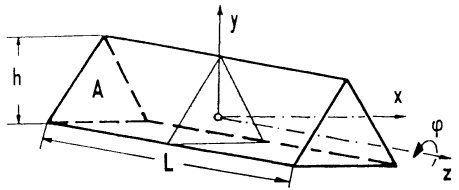

text_image

h
A
L
y
x
φ
z

Den Verformungszustand beschreibt das Vektorfeld der Verschiebungen $\mathbf{v}=\mathbf{x}^{*}-\mathbf{x}$:

$(I^{\prime})$ $\mathbf{v} = \mathbf{v}(\mathbf{x}) = \mathbf{F}(\mathbf{x}) - \mathbf{x}$

a) In welche Flächen verwölben sich die ebenen Schnitte $x = 0$ bzw. $z = 0$ durch die „Torsion“ F (gefragt ist die Gleichung $f(x^{*}, y^{*}, z^{*}) = 0$ und der Name des Flächentyps)? Welche Punkte in den Schnitten bleiben fest?
b) Man berechne die Funktionalmatrizen $\mathcal{J}_{\mathrm{F}}(\mathbf{x})$ und $\mathcal{J}_{\mathrm{v}}(\mathbf{x})$ und $\operatorname{div}\mathbf{v}(\mathbf{x})$, $\operatorname{rot}\mathbf{v}(\mathbf{x})$.
c) Man berechne (jeweils als Funktion von x):

den Verzerrungstensor :  $V_{\nu} = \frac{1}{2}(\mathcal{J}_{\nu} + \mathcal{J}_{\nu}^{T})$ ;

den Rotationstensor :  $R_{v} = \frac{1}{2}(\mathcal{J}_{v} - \mathcal{J}_{v}^{T})$ ;

den Spannungstensor :  $S_{v} = 2G V_{v}$ ,

(G bezeichnet den Schubmodul) ;

die Spannungsvektoren in A :  $\mathbf{p}_{A}=S,\begin{pmatrix}0\\ 1\end{pmatrix}$ .

9. Man rechne explizit für zwei Vektorfelder $\mathbf{v}(\mathbf{x}),\mathbf{w}(\mathbf{x})\in\mathcal{C}^{1}(\mathbb{R}^{3},\mathbb{R}^{3})$ nach:

$$
\boxed {\mathrm{grad} (\mathbf {v} \cdot \mathbf {w}) = \mathcal {J} _ {\mathbf {v}} ^ {T} \mathbf {w} + \mathcal {J} _ {\mathbf {w}} ^ {T} \mathbf {v}.}
$$

Zur Kontrolle setze man  $\mathbf{v}=(x,-y,xz)^{T}$  und  $\mathbf{w}=(z^{2}-y^{2},x^{2}-z^{2},y^{2}-x^{2})^{T}$ .

# Kapitel 8

# Funktionen in mehreren Variablen.

# Teil 2: Integration

## §1. Parameterintegrale

1.1 Parameterintegrale. Die meisten höheren Funktionen der Analysis treten entweder als Integralfunktionen  $G(x) = \int_{a}^{x} g(t) dt$  auf ( $\rightarrow$  Kap. 4) oder sie besitzen eine Integraldarstellung der Form

$$
F (x) = \int_ {c} ^ {d} f (x, y) d y ,
$$

worin der Integrand vom Parameter x abhängt.

Typische Beispiele hierfür sind:

Die Gammafunktion $\Gamma(x) := \int_{0}^{\infty} t^{x-1} e^{-t} dt \quad (x > 0), \quad (\rightarrow \text{Kap. 4, §4})$,

die Besselfunktionen  $J_{n}(x) := \frac{1}{\pi} \int_{0}^{\pi} \cos(x \sin t - nt) dt \quad (n \in \mathbb{Z})$ ,

die Laplace-Transformierte  $F(x) := \int_{0}^{\mathcal{L}} f(t) e^{-xt} dt$ .

Die Differentiation und Integration dieser Darstellungen gelingt mit der Theorie von Funktionen im $\mathbb{R}^{2}$ ($\rightarrow$ Kap. 7, §2).

Ⓐ Eigentliche Parameterintegrale.

## Satz 1.1. Grenzwertvertauschung mit bestimmtem Parameterintegral.

Sei $D = [a, b] \times [c, d] = \{ (x, y) ; a \leq x \leq b, c \leq y \leq d \}$ ein abgeschlossenes Rechteck in $\mathbb{R}^2$ und $f : D \to \mathbb{R}$ stetig. Dann gilt für die Integralfunktion

$$
F (x) := \int_ {c} ^ {d} f (x, y) d y, \quad a \leq x \leq b,
$$

a) $F$ ist in $[a,b]$ stetig,

b) Satz von FUBINI,

$$
\int_ {a} ^ {b} F (x) d x = \int_ {a} ^ {b} \left(\int_ {c} ^ {d} f (x, y) d y\right) d x = \int_ {c} ^ {d} \left(\int_ {a} ^ {b} f (x, y) d x\right) d y,
$$

c) ist zusätzlich f auf [a,b] stetig partiell nach x differenzierbar, dann ist F differenzierbar mit der Ableitung

$$
F ^ {\prime} (x) = \frac {d}{d x} \int_ {c} ^ {d} f (x, y) d y = \int_ {c} ^ {d} \frac {\partial f}{\partial x} (x, y) d y. \tag {1}
$$

Beweis. a): Aufgrund der gleichmäßigen Stetigkeit ( $\rightarrow$  Kap. 7, Satz 2.1) von f auf D gibt es zu  $\varepsilon > 0$  ein  $\delta > 0$ , so daß gilt:

$$
| f (x, y) - f (x _ {0}, y) | <   \varepsilon \text { für   alle } y, \text { sofern   nur } | x - x _ {0} | \leq \delta .
$$

Für diese x gilt dann  $|F(x)-F(x_{0})|\leq\int_{c}^{d}|f(x,y)-f(x_{0},y)|dy\leq\varepsilon(d-c)$ . Also ist F stetig.

c): Ist darüberhinaus  $f_{x}$  stetig, dann folgt mit dem Mittelwertsatz

$$
\frac {1}{h} [ F (x + h) - F (x) ] = \int_ {c} ^ {d} \frac {f (x + h , y) - f (x , y)}{h} d y = \int_ {c} ^ {d} f _ {x} (\xi , y) d y
$$

mit $\xi$ zwischen $x$ und $x + h$. Nach a) (mit $f_x$ statt $f$) strebt die rechte Seite bei $h \to 0$ gegen $\int_{c}^{d} f_x(x, y) dy$.

b): Die Funktion $H(x) := \int_{c}^{d} \left( \int_{a}^{x} f(t, y) dt \right) dy$ erfüllt die Voraussetzung von c). Mit (1) und Satz 1.3 von Kap. 4 folgt $H'(x) = \int_{c}^{d} f(x, y) dy$ und damit $\int_{a}^{b} \left( \int_{c}^{d} f(x, y) dy \right) dx = \int_{a}^{b} H'(x) dx = H(b) - H(a) = H(b)$.

## Beispiel 1.

$$
F (x) = \int_ {1} ^ {\pi} \frac {\sin (t x)}{t} d t, \quad F ^ {\prime} (x) = \int_ {1} ^ {\pi} \cos (t x) d t, \quad F ^ {\prime \prime} (x) = - \int_ {1} ^ {\pi} t \sin (t x) d t.
$$

## Beispiel 2. Die BESSEL-Funktionen

$$
J _ {n} (x) := \frac {1}{\pi} \int_ {0} ^ {\pi} \cos (x \sin t - n t) d t \quad (n = 0, \pm 1, \pm 2, \dots)
$$

gehören zu den besonders wichtigen Funktionen der angewandten Analysis. Sie wurden zuerst von F.W. BESSEL (1784–1846) zur Berechnung der Planetenbahnen verwendet. In der Folge kamen zahlreiche Anwendungen in den Ingenieurwissenschaften hinzu. Sie treten beispielsweise auf bei der Amplitudenberechnung der harmonischen Oberwellen in einer frequenzmodulierten Schwingung.

Für $y(x) := \int_{0}^{\pi} \cos(x \sin t - nt) dt$, d.h. $y(x) = \pi J_n(x)$, gilt nach Satz 1.1

$$
\begin{array}{l} y ^ {\prime} (x) = - \int_ {0} ^ {\pi} \sin (x \sin t - n t) \cdot \sin t d t \\ = - x \int_ {0} ^ {\pi} \cos^ {2} t \cos (x \sin t - n t) d t + n \int_ {0} ^ {\pi} \cos t \cos (x \sin t - n t) d t \\ \end{array}
$$

(partielle Integration mit  $\dot{u} = \sin t$ ,  $v = \sin(x \sin t - nt)$ ).

Ferner gilt (ebenfalls mit (1))

$$
y ^ {\prime \prime} (x) = - \int_ {0} ^ {\pi} \cos (x \sin t - n t) \sin^ {2} t d t ,
$$

und somit

$$
x ^ {2} y ^ {\prime \prime} (x) + x y ^ {\prime} (x) + (x ^ {2} - n ^ {2}) y (x) = 0.
$$

D.h., die Besselfunktion $J_{n}$ ist eine Lösung der Bessel-Differentialgleichung $(\rightarrow$ Bd. 2)

$$
x ^ {2} y ^ {\prime \prime} + x y ^ {\prime} + (x ^ {2} - n ^ {2}) y = 0.
$$

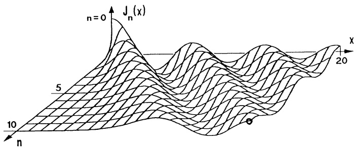

text_image

n=0
J_n(x)
5
10
n
20
x

Abb. 197 - Bessel-Funktion, abhängig von $x$ und $n$

Hängen im Parameterintegral auch die Integrationsgrenzen vom Parameter x ab, dann gilt statt (1) für stetig differenzierbare Funktionen g, h die

$$
\boxed { \begin{array}{l} \text {LEIBNIZ - Regel} \\ \frac {d}{d x} \int_ {g (x)} ^ {h (x)} f (x, y) d y = \int_ {g (x)} ^ {h (x)} f _ {x} (x, y) d y + f (x, h (x)) h ^ {\prime} (x) - f (x, g (x)) g ^ {\prime} (x). \end{array} } \tag {2}
$$

Beweis. Man wende auf $F(x, u, v) := \int_{u}^{v} f(x, y) dy$ mit $u = g(x)$, $v = h(x)$ die Kettenregel an (→ Kap. 7, Satz 2.6):

$$
\frac {d}{d x} F (x, g (x), h (x)) = F _ {x} + F _ {u} u ^ {\prime} + F _ {v} v ^ {\prime}.
$$

□