## Beispiel 1.

$$
I (\alpha) := \int_ {0} ^ {\alpha^ {2}} \cos (\alpha t ^ {2}) d t; \quad \frac {d I}{d \alpha} = - \int_ {0} ^ {\alpha^ {2}} t ^ {2} \sin (\alpha t ^ {2}) d t + 2 \alpha \cos \alpha^ {5}. \tag {$\square$}
$$

## Beispiel 2. Für

$$
x (t) := \frac {1}{k} \int_ {0} ^ {t} f (u) \sin k (t - u) d u
$$

(mit $f:\mathbb{R}\to \mathbb{R}$ stetig) gilt

$$
\begin{array}{l} \dot {x} (t) = \int_ {0} ^ {t} f (u) \cos k (t - u) d u , \\ \ddot {x} (t) = f (t) - k \int_ {0} ^ {t} f (u) \sin k (t - u) d u. \\ \end{array}
$$

Folglich ist  $x = x(t)$  eine Lösung der Schwingungsgleichung ( $\rightarrow$  Bd. 2)

$$
\ddot {x} + k ^ {2} x = f (t) \text {mit den Anfangswerten} x (0) = \dot {x} (0) = 0.
$$

B Uneigentliche Parameterintegrale. Ein dem Satz 1.1 entsprechendes Ergebnis für uneigentliche Integrale, also für Integrale der Form

$$
\int_ {c} ^ {d} f (x, y) d y = \lim _ {\varepsilon \to 0} \int_ {c} ^ {d - \varepsilon} f (x, y) d y , \quad \int_ {c} ^ {\infty} f (x, y) d y = \lim _ {d \to \infty} \int_ {c} ^ {d} f (x, y) d y ,
$$

gilt nur unter der zusätzlichen Voraussetzung, daß einige der vorkommenden Integrale „gleichmäßig konvergieren“. Wir gehen hier auf diesen Begriff nicht näher ein, sondern formulieren den entsprechenden Satz (ohne Beweis) in einer speziellen Form, die für die meisten Anwendungen ausreicht.

Satz 1.2. Ist f auf dem einseitig offenen „Rechteck“

$$
D = \{(x, y); a \leq x \leq b, c \leq y <   d \} \quad (d \in \mathbb {R} \cup \{\infty \})
$$

stetig und stetig partiell nach x differenzierbar und gibt es Funktionen g,h : [c,d) → R , für die gilt

1.  $|f(x,y)| \leq g(y)$  und  $|f_{x}(x,y)| \leq h(y)$  für alle  $(x,y) \in D$ ,

2. die uneigentlichen Integrale

$$
\int_ {c} ^ {d} g (y) d y, \int_ {c} ^ {d} h (y) d y \quad b z w. \quad \int_ {c} ^ {\infty} g (y) d y, \int_ {c} ^ {\infty} h (y) d y
$$

konvergieren,

dann konvergiert für jedes  $x \in [a, b]$  das uneigentliche Integral

$$
F (x) := \int_ {c} ^ {d} f (x, y) d y \quad \text {bzw.} \quad F (x) := \int_ {c} ^ {\infty} f (\ddot {x}, y) d y
$$

und die dadurch definierte Funktion F ist differenzierbar mit der Ableitung

$$
F ^ {\prime} (x) = \int_ {c} ^ {d} f _ {x} (x, y) d y \quad b z w. \quad F ^ {\prime} (x) = \int_ {c} ^ {\infty} f _ {x} (x, y) d y . \tag {3}
$$

Beispiel 1.

$$
F (x) := \int_ {0} ^ {\infty} e ^ {- t ^ {2}} \cos (x t) d t
$$

ist für jedes  $x \in R$  konvergent und besitzt die Ableitung

$$
F ^ {\prime} (x) = \int_ {0} ^ {\infty} - t e ^ {- t ^ {2}} \sin (x t) d t = - \frac {x}{2} F (x)
$$

(mit partieller Integration; $\dot{u} = te^{-t^2}$ $v = \sin (xt)$ ).

Denn  $f(x,t) := e^{-t^{2}} \cos(xt)$  ist eine  $C^{1}$ -Funktion; es gelten die Abschätzungen

$$
| f (x, t) | \leq e ^ {- t ^ {2}}, \quad | f _ {x} (x, t) | = - t e ^ {- t ^ {2}} \sin (x t) \leq t e ^ {- t ^ {2}};
$$

und  $\int_{0}^{\infty}e^{-t^{2}}dt$ ,  $\int_{0}^{\infty}te^{-t^{2}}dt$  konvergieren wegen  $e^{-t^{2}}<e^{-t}$  für t>1.

$(\rightarrow \mathrm{Satz} 1.2 \mathrm{mit} g(t) = e^{-t^2}, h(t) = te^{-t^2}.)$

□

Beispiel 2. Die Ableitung der Gammafunktion $\Gamma(x) = \int_{0}^{\infty} e^{-t} t^{x-1} dt$ ($x > 0$) läßt sich ebenfalls mit (3) berechnen. Die Abschätzungen, mit denen die Konvergenz des an beiden Integralgrenzen uneigentlichen Integrals nachgewiesen wurde, zeigen, daß die Voraussetzungen aus Satz 1.2 erfüllt sind.

$$
\begin{array}{l} \Gamma^ {\prime} (x) = \int_ {0} ^ {\infty} e ^ {- t} t ^ {x - 1} \ln t   d t , \\ \Gamma^ {\prime \prime} (x) = \int_ {0} ^ {\infty} e ^ {- t} t ^ {x - 1} (\ln t) ^ {2} d t. \\ \end{array}
$$

□

Gegenbeispiel. Das uneigentliche Integral  $\int_{0}^{\infty}e^{-st}\cos t dt$  konvergiert nicht gleichmäßig für  $s\geq0$ :

Einerseits liefert zweimalige partielle Integration

$$
\lim _ {s \to 0} \int_ {0} ^ {\infty} e ^ {- s t} \cos t d t = \lim _ {s \to 0} \frac {s}{1 + s ^ {2}} = 0,
$$

andererseits hätte man mit Satz 1.2 – falsch angewendet –

$$
\lim _ {s \to 0} \int_ {0} ^ {\infty} e ^ {- s t} \cos t d t = \int_ {0} ^ {\infty} \lim _ {s \to 0} e ^ {- s t} \cos t d t = \int_ {0} ^ {\infty} \cos t d t = \lim _ {t \to \infty} \sin t ;
$$

d.h.  $\lim_{t\to\infty}\sin t=0$ , das ist ein Widerspruch.

□

## Aufgaben

1. Für  $0 \leq x \leq 1$ ,  $y \geq 0$  ist die Funktion  $f(x, y) = xy e^{-xy}$  gegeben.

a) Man diskutiere und skizziere  $x \mapsto f(x, y)$  für festes y.
b) Man berechne  $g(x) := \lim_{y \to \infty} f(x, y)$  für jedes  $x \in [0,1]$ . Gilt

$$
\lim _ {y \to \infty} \int_ {0} ^ {1} f (x, y) d x = \int_ {0} ^ {1} g (x) d x \text {?}
$$

2. Man wiederhole Aufgabe 1 mit $f(x, y) = \frac{x^2}{y^2} e^{-x / y}$, $0 \leq x < \infty$, $0 < y < \infty$.

3. Man berechne

a) $F^{\prime}(1)$ für $F(x) = \int_{1 / x}^{x^{2}}\frac{e^{sx}}{x + s} ds.$

b) $F(e), F'(e), F''(e)$ für $F(x) = \int_{e}^{x} \ln (x \ln y) dy, x > 1$.

4. Man rechne direkt nach: Für die Funktion $f(x, y) = (2 - xy)xye^{-xy}$ ist

$$
\int_ {0} ^ {1} \left(\int_ {0} ^ {\infty} f (x, y) d y\right) d x \neq \int_ {0} ^ {\infty} \left(\int_ {0} ^ {1} f (x, y) d x\right) d y.
$$

5. a) Man bestätige für die BESSEL-Funktionen $J_{n}(x)$

– durch partielle Integration die Rekursionsformel:

(i) $J_{n + 1}(x) + J_{n - 1}(x) = \frac{2n}{x} J_n(x)\quad ,x\neq 0,$

\- durch die Substitution $t = \pi -\tau$

(ii) $J_{-n}(x) = (-1)^{n}J_{n}(x)$.

b) Mittels (i) und (ii) berechne man $J_{n}(3)$ für $-5 \leq n \leq 5$ rekursiv aus $J_{0}(3) = -0.2600519549 \ldots$ und $J_{1}(3) = 0.3390589585 \ldots$.

## §2. Kurvenintegrale

2.1 Das Kurvenintegral einer skalaren Funktion. Das bestimmte Integral  $\int_{0}^{a}g(t)dt$  einer reellen Funktion  $g:[0,a]\to R$  stellt den einfachsten Fall eines Kurvenintegrals dar. Es ist interpretierbar als Integral über ein Skalarenfeld längs der Strecke  $\mathbf{x}(t)=t\mathbf{e}_{1},\quad0\leq t\leq a$ . Die Verallgemeinerung auf beliebige Kurven im  $R^{n}$  liefert ein Mittel, um in der Physik die Masse und den Schwerpunkt von krummen Stäben, die Arbeit in Kraftfeldern und die Zirkulation in Strömungsfeldern zu berechnen und in der Theorie von Vektorfeldern zu einem Gradientenfeld das Potential zu bestimmen.

Definition. Sei $D \subseteq \mathbb{R}^n$ offen, $\mathbf{w} : [a, b] \to D$ ein Kurvenstück und $f$ eine skalare Belegungsfunktion auf dem Kurvenstück, so daß $t \mapsto f(\mathbf{w}(t))$ stetig ist. Dann heißt

$\int_{\mathbf{w}}fds:= \int_{a}^{b}f(\mathbf{w}(t))|\dot{\mathbf{w}} (t)|dt$

das Kurvenintegral von f längs w.

Das Kurvenintegral besitzt im Fall $n = 3$ folgende anschauliche Deutung, aus der sich auch die Anwendungen ergeben. Das Kurvenstück besitze im Kurvenpunkt $\mathbf{w}(t)$ die Belegung mit der skalaren Größe (Masse, Ladung,...) $f(\mathbf{w}(t))$. Zur Berechnung der Gesamtbelegung wird das Kurvenstück durch Aufteilung

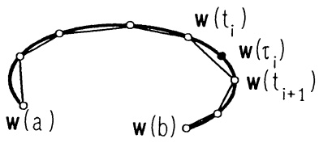

flowchart

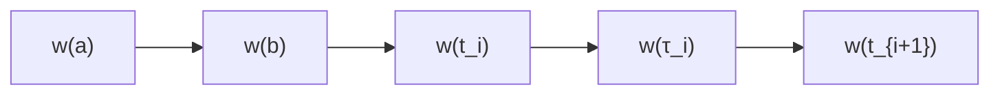

Abb. 198 - Kurvenintegral

des Parameterintervalls $a = t_0 < t_1 < \cdots < t_m = b$ in Bögen über $[t_{i-1}, t_i]$ ($1 \leq i \leq m$) der Länge $\Delta s_i = \int_{t_{i-1}}^{t_i} |\dot{\mathbf{w}}(t)| dt = |\dot{\mathbf{w}}(\tau_i)| \Delta t_i$ mit einem Zwischenwert $\tau_i$ ($t_{i-1} \leq \tau_i \leq t_i, \to$ Kap. 4, §1(10)) zerlegt. Durch das Produkt

$$
f (\mathbf {w} (\tau_ {i})) \Delta s _ {i} = f (\mathbf {w} (\tau_ {i})) | \dot {\mathbf {w}} (\tau_ {i}) | \Delta t _ {i}
$$

wird die Belegung des i-ten Bogens approximiert, die Gesamtbelegung durch

$$
Z _ {n} = \sum_ {i = 1} ^ {n} f (\mathbf {w} (\tau_ {i})) | \dot {\mathbf {w}} (\tau_ {i}) | \Delta t _ {i}.
$$

Dieses ist eine RIEMANN-Summe, die aufgrund der geforderten Stetigkeit mit $n \to \infty$ und $\Delta t_i \to 0$ gegen das Integral $\int_a^b f(\mathbf{w}(t))|\dot{\mathbf{w}}(t)|dt$ konvergiert.

Berechnung des Kurvenintegrals $I = \int_{\mathbb{W}} f ds \text{ im } \mathbb{R}^3$.

1. Schritt: Das Kurvenstück parametrisieren,

$$
\mathbf {w} (t) = \left(x (t), y (t), z (t)\right) ^ {T}, a \leq t \leq b.
$$

2. Schritt: Das Bogenelement durch Differentiation bestimmen,

$$
d s = | \dot {\mathbf {w}} (t) | d t = \sqrt {\dot {x} ^ {2} (t) + \dot {y} ^ {2} (t) + \dot {z} ^ {2} (t)} d t.
$$

3. Schritt : Eintragen: $\mathbf{w}(t)$ im Integranden: $f = f(\mathbf{w}(t))$, das Bogenelement $ds = |\dot{\mathbf{w}}(t)|dt$, $a, b$ als Integrationsgrenzen.

$$
I = \int_ {a} ^ {b} f (x (t), y (t), z (t)) \sqrt {\dot {x} ^ {2} (t) + \dot {y} ^ {2} (t) + \dot {z} ^ {2} (t)} d t
$$

als bestimmtes Integral ausrechnen (→ Kap. 4).

Mit der Sprechweise von Kap. 4, 6.1 lautet der Sachverhalt anschaulich: Das Bogenelement ds im Kurvenpunkt $\mathbf{w}(t)$ trägt die Belegung $dm = f(\mathbf{w}(t))ds = f(\mathbf{w}(t))|\dot{\mathbf{w}}(t)|dt$; die „kontinuierliche Summation“ – also die Integration – ergibt die Gesamtbelegung

$$
M = \int_ {\mathbf {w}} d m = \int_ {\mathbf {w}} f d s = \int_ {a} ^ {b} f (\mathbf {w} (t)) | \dot {\mathbf {w}} (t) | d t.
$$

Bemerkung. Was durch diese anschauliche Deutung unmittelbar einleuchtet, läßt sich auch explizit leicht beweisen:

Durchlaufen zwei Kurvenstücke $\mathbf{w}:[a,b]\to\mathbb{R}^{n}$ und $\mathbf{u}:[c,d]\to\mathbb{R}^{n}$ dieselbe Spur $\{\mathbf{w}(t);a\leq t\leq b\}=\{\mathbf{u}(t);c\leq t\leq d\}$ genau gleich oft, dann gilt

$$
\int_ {a} ^ {b} f (\mathbf {w} (t)) | \dot {\mathbf {w}} (t) | d t = \int_ {c} ^ {d} f (\mathbf {u} (t)) | \dot {\mathbf {u}} (t) | d t.
$$

Die Schreibweise  $\int_{w} f ds$  symbolisiert diese Unabhängigkeit von einer speziellen Parameterdarstellung.

Beispiel. Es ist die Masse  $M = \int_{w} \rho ds$  der abgebildeten Schraubenfeder mit linearer Massendichte  $\rho(x, y, z) = x^{2}y^{2} + z^{2}$  zu berechnen.

1. Schritt: Das Kurvenstück darstellen:

$$
x = 2 \cos t, y = 2 \sin t, z = \frac {1}{2} t, 0 \leq t \leq 4 \pi .
$$

2. Schritt: Das Bogenelement berechnen:

$$
d s = \sqrt {\dot {x} ^ {2} + \dot {y} ^ {2} + \dot {z} ^ {2}} d t = \frac {1}{2} \sqrt {1 7} d t.
$$

3. Schritt : Einsetzen und ausrechnen:

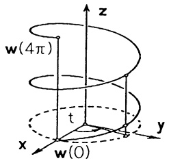

text_image

w(4\pi)
z
t
x
y
w(0)

Abb. 199 - Schraublinie

$$
\begin{array}{l} M = \int_ {\mathbf {w}} \rho d s = \int_ {\mathbf {w}} (x ^ {2} y ^ {2} + z ^ {2}) d s = \int_ {0} ^ {4 \pi} [ (2 \cos t) ^ {2} (2 \sin t) ^ {2} + \frac {1}{4} t ^ {2} ] \frac {1}{2} \sqrt {1 7} d t \\ = \frac {1 7}{2} \left(\frac {1 6}{3} \pi^ {3} + 8 \pi\right). \\ \end{array}
$$

Beispiele für spezielle Integrationswege.

1. Das Integral längs einer zur z-Achse parallelen Strecke.

1. Schritt: Die Strecke $\mathbf{w}(t) = (x_0, y_0, t)^T$, $z_0 \leq t \leq z_1$.
2. Schritt: Das Bogenelement ds = dt.
3. Schritt: Einsetzen (und ausrechnen) $\int_{\mathbf{w}} f ds = \int_{z_0}^{z_1} f(x_0, y_0, t) dt$.
2. Das Integral längs eines Graphen  $y = g(x)$  in der Ebene  $z = z_{0}$ .

1. Schritt: Das Kurvenstück $\mathbf{w}(x) = (x, g(x), z_0)^T$, $a \leq x \leq b$.

2. Schritt: Das Bogenelement  $ds = \sqrt{1 + g'(x)^{2}} dx$ .

3. Schritt: Das Integral $\int_{\mathbf{w}} f ds = \int_{a}^{b} f(x, g(x), z_0) \sqrt{1 + g'(x)^2} dx$.

Es ist zweckmäßig, den Begriff des Kurvenintegrals auf Integrationswege zu erweitern, die aus (stetig differenzierbaren) Kurvenstücken zusammengesetzt werden.

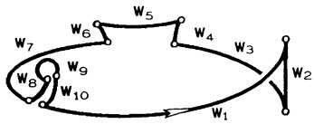

flowchart

Abb. 200 - Kurve

Definition. a) Unter einer Kurve $\mathbf{w}$ in $D \subseteq \mathbb{R}^n$ verstehen wir eine endliche Folge $\mathbf{w}_1, \ldots, \mathbf{w}_k$ von (stetig differenzierbaren) Kurvenstücken $\mathbf{w}_i : [a_i, b_i] \to D$ ($i = 1, \ldots, k$) mit $\mathbf{w}_i(b_i) = \mathbf{w}_{i+1}(a_{i+1})$ ($1 \leq i \leq k-1$).

b) Für eine aus den Kurvenstücken $\mathbf{w}_{1},\ldots,\mathbf{w}_{k}$ bestehende Kurve und für jede stetige Funktion $f:\mathrm{Spur}\mathbf{w}\to\mathbb{R}$ ist das Kurvenintegral von $f$ längs $\mathbf{w}$ definiert durch

$$
\boxed {\int_ {\mathbf {w}} f d s := \int_ {\mathbf {w} _ {1}} f d s + \dots + \int_ {\mathbf {w} _ {k}} f d s.} \tag {2}
$$

Beispiel. Die Kurve w führt, wie skizziert, auf achsenparallelen Strecken vom Ursprung O zum Punkt  $(x_{0}, y_{0}, z_{0})$ , Belegungsfunktion sei  $f(\mathbf{x}) = |\mathbf{x}|^{2}$ :

$$
\begin{array}{l} \int_ {\mathbf {w}} | \mathbf {x} | ^ {2} d s = \int_ {0} ^ {x _ {0}} (t ^ {2} + 0 + 0) d t + \\ + \int_ {0} ^ {y _ {0}} (x _ {0} ^ {2} + t ^ {2} + 0) d t + \\ + \int_ {0} ^ {z _ {0}} (x _ {0} ^ {2} + y _ {0} ^ {2} + t ^ {2}) d t \\ = \frac {1}{3} x _ {0} ^ {3} + x _ {0} ^ {2} y _ {0} + \frac {1}{3} y _ {0} ^ {3} + x _ {0} ^ {2} z _ {0} + y _ {0} ^ {2} z _ {0} + \frac {1}{3} z _ {0} ^ {3}. \\ \end{array}
$$

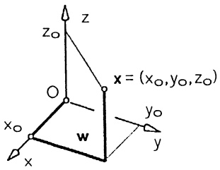

text_image

z
x = (x₀,y₀,z₀)
y₀
w
x₀
y
x

Abb. 201 - Streckenzug

Durch die Anordnung auf $\mathbb{R}$ ergibt sich eine Orientierung (Durchlaufrichtung) eines Kurvenstücks $\mathbf{w}:[a,b]\to\mathbb{R}^{n}$ bzw. der Spur vom Anfangspunkt hin zum Endpunkt. In der graphischen Darstellung wird das durch einen entsprechenden Pfeil gekennzeichnet. Eine aus Stücken $\mathbf{w}_{i}:[a_{i},b_{i}]\to\mathbb{R}^{n}$ ($1\leq i\leq k$) bestehende Kurve wird vom Anfangspunkt $\mathbf{w}_{1}(a_{1})$ über die „Verbindungspunkte“ $\mathbf{w}_{i}(b_{i})=\mathbf{w}_{i+1}(a_{i+1})$ ($1\leq i\leq k-1$) zum Endpunkt $\mathbf{w}_{k}(b_{k})$ durchlaufen.

Das zum Kurvenstück $\mathbf{w}:[a,b]\to\mathbb{R}^{n}$ definierte Kurvenstück

$$
\mathbf {w} ^ {*}: [ a, b ] \rightarrow \mathbb {R} ^ {n}, \quad \mathbf {w} ^ {*} (t) := \mathbf {w} (a + b - t), \tag {3}
$$

hat die gleiche Spur wie $\mathbf{w}$, sie wird jedoch von $\mathbf{w}^{*}(a)=\mathbf{w}(b)$ (Endpunkt von $\mathbf{w}$) nach $\mathbf{w}^{*}(b)=\mathbf{w}(a)$ (Anfangspunkt von $\mathbf{w}$) durchlaufen. Die zur Kurve $\mathbf{w}$, bestehend aus den Stücken $\mathbf{w}_{1},\ldots,\mathbf{w}_{k}$,

entgegengesetzt durchlaufenen Kurve $\mathbf{w}^{*}$ besteht (der Reihe nach) aus $\mathbf{w}_{k}^{*},\ldots,\mathbf{w}_{1}^{*}$. Da in der Integraldefinition (1) die Durchlaufrichtung nicht eingeht, gilt offenbar

$$
\int_ {\mathbf {w}} f d s = \int_ {\mathbf {w} ^ {*}} f d s. \tag {4}
$$

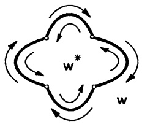

flowchart

```mermaid
graph TD
  A["Start"] --> B["Flow Arrow 1"]
  B --> C["Flow Arrow 2"]
  C --> D["Flow Arrow 3"]
  D --> E["Flow Arrow 4"]
  E --> F["Flow Arrow 5"]
  F --> G["Flow Arrow 6"]
  G --> H["Flow Arrow 7"]
  H --> I["Flow Arrow 8"]
  I --> J["Flow Arrow 9"]
  J --> K["Flow Arrow 10"]
  K --> L["Flow Arrow 11"]
  L --> M["Flow Arrow 12"]
  M --> N["Flow Arrow 13"]
  N --> O["Flow Arrow 14"]
  O --> P["Flow Arrow 15"]
  P --> Q["Flow Arrow 16"]
  Q --> R["Flow Arrow 17"]
  R --> S["Flow Arrow 18"]
  S --> T["Flow Arrow 19"]
  T --> U["Flow Arrow 20"]
  U --> V["Flow Arrow 21"]
  V --> W["Flow Arrow 22"]
  W --> X["Flow Arrow 23"]
  X --> Y["Flow Arrow 24"]
  Y --> Z["Flow Arrow 25"]
```

Abb. 202 - Durchlaufsinn

Aus der Definition ergeben sich für alle Kurven $\mathbf{w}$ in $D$, $f, g \in \mathcal{C}^{0}(D, \mathbb{R})$, $\alpha \in \mathbb{R}$, folgende Rechenregeln:

$$
\boxed { \begin{array}{c} \int_ {\mathrm{w}} \alpha f d s = \alpha \int_ {\mathrm{w}} f d s, \\ \int_ {\mathrm{w}} (f + g) d s = \int_ {\mathrm{w}} f d s + \int_ {\mathrm{w}} g d s. \\ \text {(Linearität des Kurvenintegrals)} \end{array} } \tag {5}
$$

Ferner gilt für jedes Kurvenstück $\mathbf{w}:[a,b]\to\mathbb{R}^{n}$ der Mittelwertsatz:

$$
\boxed {\int_ {\mathbf {w}} f d s = f (\tilde {\mathbf {x}}) \cdot L} \tag {6}
$$

mit einem Kurvenpunkt  $\tilde{x}$  und der Kurvenlänge L.

Beweis. Der Mittelwertsatz für bestimmte Integrale (→ Kap. 4, Satz 1.2) gibt

$$
\begin{array}{l} \int_ {\mathbf {w}} f d s = \int_ {a} ^ {b} f (\mathbf {w} (t)) | \dot {\mathbf {w}} (t) | d t = f (\tilde {\mathbf {x}}) \int_ {a} ^ {b} | \dot {\mathbf {w}} (t) | d t \\ = f (\tilde {\mathbf {x}}) \cdot L. \\ \end{array}
$$

## 2.2 Anwendungen.

① Bogenlänge. Die Länge $L(\mathbf{w})$ eines Kurvenstücks $\mathbf{w}:[a,b]\to\mathbb{R}^{3}$ beträgt nach Kap. 7, §1

$$
L (\mathbf {w}) = \int_ {\mathbf {w}} d s = \int_ {a} ^ {b} | \dot {\mathbf {w}} (t) | d t = \int_ {a} ^ {b} \sqrt {\dot {x} (t) ^ {2} + \dot {y} (t) ^ {2} + \dot {z} (t) ^ {2}} d t. \tag {7}
$$

Eine aus den Kurvenstücken  $w_{1},\ldots,w_{k}$  bestehende Kurve hat die Länge  $L = L(\mathbf{w}_{1}) + \cdots + L(\mathbf{w}_{k})$ , wobei mehrfach durchlaufene Stücke entsprechend oft gezählt werden.

b Masse (oder Ladung, bzw. irgendeine Belegung). Stellt  $\rho(x,y,z)$  die Massendichte einer Kurve w (eines Seiles oder Drahtes) dar, so nennt man  $dm = \rho(x,y,z)ds$  ein Massenelement. Die Gesamtmasse beträgt

$$
M = \int_ {\mathbf {w}} d m = \int_ {\mathbf {w}} \rho (x, y, z) d s . \tag {8}
$$

(c) Momente und Massenmittelpunkt. Die $k$-ten Momente (bezüglich der Ko-ordinatenebenen) eines in $(x, y, z)$ befindlichen Massenpunktes der Masse $dm$ sind $x^{k}dm$, $y^{k}dm$, $z^{k}dm$. Demzufolge berechnen sich die $k$-ten Momente der Kurve w wie folgt:

$$
\begin{array}{l} M _ {x, k} = \int_ {\mathbf {w}} x ^ {k} d m = \int_ {\mathbf {w}} x ^ {k} \rho (x, y, z) d s, \\ M _ {y, k} = \int_ {\mathbf {w}} y ^ {k} d m = \int_ {\mathbf {w}} y ^ {k} \rho (x, y, z) d s, \\ M _ {z, k} = \int_ {\mathbf {w}} z ^ {k} d m = \int_ {\mathbf {w}} z ^ {k} \rho (x, y, z) d s. \end{array} \tag {9}
$$

Für k = 1 sind das die statischen Momente, für k = 2 die Trägheitsmomente.

Der Punkt $S = (x_{S}, y_{S}, z_{S})$, in dem eine Punktmasse der Größe $M$ ($\rightarrow$ (8)) dasselbe statische Moment wie $\mathbf{w}$ besitzt, bezeichnet man als Massenmittelpunkt (Schwerpunkt).

$$
\boxed { \begin{array}{l} \text {Schwerpunkt} S = (x _ {S}, y _ {S}, z _ {S}) \text {zur Massendichte} \rho , \\ \text {Gesamtmasse} M = \int_ {\mathrm{w}} \rho d s: \\ x _ {S} = \frac {1}{M} \int_ {\mathrm{w}} x \rho (x, y, z) d s, y _ {S} = \frac {1}{M} \int_ {\mathrm{w}} y \rho (x, y, z) d s, z _ {S} = \frac {1}{M} \int_ {\mathrm{w}} z \rho (x, y, z) d s. \end{array} } \tag {10}
$$

Im Fall homogener Massenverteilung, $\rho(x,y,z)=\mathrm{const}$, fällt der Massenmittelpunkt der Kurve w mit ihrem geometrischen Schwerpunkt zusammen.

$$
\begin{array}{l} \text {Der (geometrische) Schwerpunkt} \bar {S} = (\bar {x}, \bar {y}, \bar {z}) \text {bei}\\ \text {einer Gesamtlänge} L = \int_ {\mathrm{w}} d s: \\ \bar {x} = \frac {1}{L} \int_ {\mathrm{w}} x d s, \bar {y} = \frac {1}{L} \int_ {\mathrm{w}} y d s, \bar {z} = \frac {1}{L} \int_ {\mathrm{w}} z d s. \end{array} \tag {11}
$$

Man beachte: Sowohl der Massenmittelpunkt als auch der Schwerpunkt sind i.a. keine Kurvenpunkte.

Beispiel. Die Schraubenlinie (→ Abb. 199)

$$
\mathbf {w} (t) = (r \cos t, r \sin t, h t) ^ {T}, \quad 0 \leq t \leq 2 \pi n,
$$

hat die Bogenlänge

$$
L = \int_ {0} ^ {2 \pi n} \sqrt {r ^ {2} + h ^ {2}} d t = \sqrt {r ^ {2} + h ^ {2}} \cdot 2 \pi n = 2 \pi n R, \quad R = \sqrt {r ^ {2} + h ^ {2}}.
$$

Für ganzzahliges n ist  $\bar{x} = \bar{y} = 0$  und mit der Höhe  $H = 2\pi nh$  ist

$$
\overline {{z}} = \frac {1}{2 \pi n R} \int_ {0} ^ {2 \pi n} h t R d t = \frac {4 \pi^ {2} n ^ {2} h R}{2 \cdot 2 \pi n R} = \pi n h = \frac {H}{2},
$$

d.h.  $\overline{S} = (0, 0, \frac{1}{2}H)$  liegt nicht auf w.

Mit der Massenbelegung  $\rho = z$  ergibt sich

$$
M = \int_ {0} ^ {2 \pi n} h t \cdot R d t = 2 \pi^ {2} n ^ {2} h R.
$$

Wieder ist  $x_{S} = y_{S} = 0$ , und es ergibt sich mit

$$
z _ {S} = \frac {1}{2 \pi^ {2} n ^ {2} h R} \int_ {0} ^ {2 \pi n} h t \cdot h t \cdot R d t = \frac {4}{3} h n \pi = \frac {2}{3} H
$$

als Massenmittelpunkt  $S = (0, 0, \frac{2}{3}H)$ .

2.3 Die Integration eines Vektorfeldes längs einer Kurve. Für Vektoren $\mathbf{x} = (x_1, \ldots, x_n)^T$, $\mathbf{y} = (y_1, \ldots, y_n)^T \in \mathbb{R}^n$ ist das Skalarprodukt $\mathbf{x} \cdot \mathbf{y}$ definiert durch ($\rightarrow$ Kap. 6, 6.3) $\mathbf{x} \cdot \mathbf{y} = \sum_{i=1}^{n} x_i y_i$. Die Zahl $|\mathbf{x}| = \left( \sum_{i=1}^{n} x_i^2 \right)^{1/2}$ heißt Betrag des Vektors $\mathbf{x}$ und zu einem Einheitsvektor $\mathbf{e}$ (d.h. $|\mathbf{e}| = 1$) nennt man $\mathbf{x} \cdot \mathbf{e}$ die skalare Komponente von $\mathbf{x}$ in $\mathbf{e}$-Richtung. Offenbar gilt $\mathbf{x} = (\mathbf{x} \cdot \mathbf{e})\mathbf{e} + \mathbf{n}$ mit dem zu $\mathbf{e}$ orthogonalen Vektor $\mathbf{n} = \mathbf{x} - (\mathbf{x} \cdot \mathbf{e})\mathbf{e}$ ($\rightarrow$ Kap. 1, §5(6) für $n = 3$).

Definition. Sei $D \subseteq \mathbb{R}^n$ offen. $\mathbf{w} : [a, b] \to D$ eine reguläre Kurve und $\mathbf{v} : D \to \mathbb{R}^n$ ein stetiges Vektorfeld. Man nennt

$$
\int_ {\mathbf {w}} \mathbf {v} \cdot d \mathbf {x} := \int_ {a} ^ {b} \mathbf {v} (\mathbf {w} (t)) \cdot \dot {\mathbf {w}} (t) d t \tag {12}
$$

das Kurvenintegral von v längs w.

## Bemerkungen.

1. Mit  $\mathbf{T}(t):=\frac{1}{|\dot{\mathbf{w}}(t)|}\dot{\mathbf{w}}(t)\quad(\rightarrow\mathrm{Kap.~7},$

§1) lautet (12)

$$
\begin{array}{l} \int_ {\mathbf {w}} \mathbf {v} \cdot d \mathbf {x} = \int_ {a} ^ {b} \left[ \mathbf {v} (\mathbf {w} (t)) \cdot \mathbf {T} (t) \right] | \dot {\mathbf {w}} (t) | d t \\ = \int_ {\mathbf {w}} (\mathbf {v} \cdot \mathbf {T}) d s. \\ \end{array}
$$

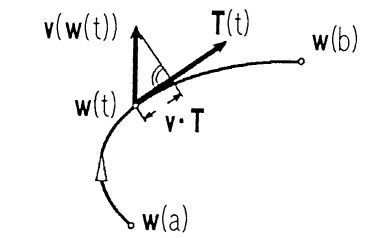

text_image

v(w(t))
T(t)
w(b)
w(t)
v·T
w(a)

Abb. 203 - Integral eines Vektorfeldes

Es handelt sich also um das Kurvenintegral $\int_{\mathbf{w}} f ds$ der skalaren Tangentialkomponente $f = \mathbf{v} \cdot \mathbf{T}$ des Vektorfeldes längs der Kurve $\mathbf{w}$.

2. Offenbar gelten für stetige Vektorfelder u, v und  $\alpha \in R$  folgende Rechenregeln (die Linearität):

$$
\int_ {\mathbf {w}} (\mathbf {u} + \mathbf {v}) \cdot d \mathbf {x} = \int_ {\mathbf {w}} \mathbf {u} \cdot d \mathbf {x} + \int_ {\mathbf {w}} \mathbf {v} \cdot d \mathbf {x}, \tag {13}
$$

$$
\int_ {\mathbf {w}} \alpha \mathbf {v} \cdot d \mathbf {x} = \alpha \int_ {\mathbf {w}} \mathbf {v} \cdot d \mathbf {x}.
$$

3. Bei einer Änderung der „Integrationsrichtung“, d.h. beim Übergang von w zur entgegengesetzt durchlaufenen Kurve $\mathbf{w}^{*}$ ($\rightarrow$ (3)) geht der Tangentialvektor $\mathbf{T}$ in $-\mathbf{T}$ über. Deshalb gilt

$$
\int_ {\mathbf {w} ^ {*}} \mathbf {v} \cdot d \mathbf {x} = - \int_ {\mathbf {w}} \mathbf {v} \cdot d \mathbf {x}. \tag {14}
$$

4. Sinngemäß zu (2) ist das Kurvenintegral von Vektorfeldern längs stückweise regulärer Kurven erklärt.

5. Man nennt eine Kurve w geschlossen, wenn der Anfangspunkt mit dem Endpunkt zusammenfällt. In diesem Fall schreiben wir

$$
\oint_ {\mathbf {w}} f d s \quad \mathrm{bzw.} \quad \oint_ {\mathbf {w}} \mathbf {v} \cdot d \mathbf {x}.
$$

6. Die linke Seite von (12) wird mit $d\mathbf{x} = (dx_1, \ldots, dx_n)^T$ gern „explizit“ in folgender Form angegeben:

$$
\int_ {\mathbf {w}} \mathbf {v} \cdot d \mathbf {x} = \int_ {\mathbf {w}} v _ {1} d x _ {1} + v _ {2} d x _ {2} + \dots + v _ {n} d x _ {n}.
$$

Mit indexfreier Schreibweise im  $R^{3}$ , d.h. mit  $x = x_{1}$ ,  $y = x_{2}$ ,  $z = x_{3}$ :

Berechnung des Kurvenintegrals im $\mathbb{R}^3$.

$$
A = \int_ {\mathbf {w}} \mathbf {v} \cdot d \mathbf {x} = \int_ {\mathbf {w}} v _ {1} d x + v _ {2} d y + v _ {3} d z.
$$

1. Schritt: Das Kurvenstück parametrisieren,

$$
\mathbf {w} (t) = \left(x (t), y (t), z (t)\right) ^ {T}, a \leq t \leq b.
$$

2. Schritt: Das vektorielle Bogenelement berechnen,

$$
d \mathbf {x} = \dot {\mathbf {w}} (t) d t = \left(\dot {x} (t), \dot {y} (t), \dot {z} (t)\right) ^ {T} d t.
$$

3. Schritt: Parameterdarstellung, vektorielles Bogenelement, Parametergrenzen eintragen,

$$
A = \int_ {a} ^ {b} \left[ v _ {1} (\mathbf {w} (t)) \dot {x} (t) + v _ {2} (\mathbf {w} (t)) \dot {y} (t) + v _ {3} (\mathbf {w} (t)) \dot {z} (t) \right] d t
$$

als bestimmtes Integral ausrechnen (→ Kap. 4).

## Beispiel 1.

$$
A = \int_ {\mathbf {w}} x ^ {2} y   d x + (x - z) d y + (x y z) d z
$$

längs des Graphen  $y = x^{3}$   $(0 \leq x \leq 2)$  in der Ebene z = 2.

1. Schritt: Die Kurve $x = t$, $y = t^3$, $z = 2$, $0 \leq t \leq 2$.
2. Schritt: $dx = dt$, $dy = 3t^2 dt$, $dz = 0$.

$$
3. S c h r i t t: A = \int_ {0} ^ {2} (t ^ {2} t ^ {3} + (t - 2) 3 t ^ {2}) d t = \frac {2 0}{3}.
$$

Beispiel 2. Das Integral über den isolierten Wirbel im $\mathbb{R}^2$ ($\rightarrow$ Kap. 7, 4.3)

$$
\mathbf {v} (x, y) = \frac {1}{x ^ {2} + y ^ {2}} \binom{- y}{x}, (x, y) \neq (0, 0),
$$

längs des einmal positiv durchlaufenen Einheitskreises w um (0,0).

$$
A = \int_ {\mathbf {w}} v _ {1} d x + v _ {2} d y = \int_ {\mathbf {w}} \frac {1}{x ^ {2} + y ^ {2}} (- y d x + x d y)
$$

1. Schritt: $x = \cos t$, $y = \sin t$, $0 \leq t \leq 2\pi$.
2. Schritt:  $dx = -\sin t dt$ ,  $dy = \cos t dt$ .
3. Schritt: $A = \int_{0}^{2\pi} [\sin^2 t + \cos^2 t] dt = 2\pi$. (→ 2.5, letztes Beispiel)

## 2.4 Anwendungen und Beispiele.

(a) Arbeit. Die von einer Kraft K im Kurvenpunkt  $\mathbf{w}(t)$  längs des Weges  $d\mathbf{x} = \dot{\mathbf{w}}(t)dt$  geleistete Arbeit beträgt  $dA = \mathbf{K} \cdot d\mathbf{x} = (\mathbf{K} \cdot \mathbf{T})ds$ . Demnach beträgt die von K längs w geleistete Arbeit

$$
A = \int_ {\mathbf {w}} \mathbf {K} \cdot d \mathbf {x}.
$$

In einem elektrischen Feld E liefert das (negative) „Arbeitsintegral“ den Spannungsabfall längs w (→ Kap. 7, 3.1):

$$
U = - \int_ {\mathbf {w}} \mathbf {E} \cdot d \mathbf {x}.
$$

Beispiel. Geführte Bewegung. Gleitet ein Teilchen der Masse m im vertikalen Schwerefeld  $\mathbf{K} = (0, 0, -mg)^{T}$  nicht frei, sondern reibungsfrei längs einer Leitkurve w, so sind im Bewegungsgesetz die von der Massenträgheit herrührenden Scheinkräfte zu berücksichtigen. Rechnet man im begleitenden Dreibein (T, N, B) von w ( $\rightarrow$  Kap. 7, 1.2), so lautet die Bewegungsgleichung:

$$
m \ddot {\mathbf {x}} = \mathbf {K} + F _ {N} \mathbf {N} + F _ {B} \mathbf {B}.
$$

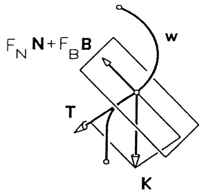

text_image

F_N N + F_B B
w
T
K

Abb. 204 - Geführte Bewegung

Das Kurvenintegral über dieses Kräftegleichgewicht zeigt in der Energiebilanz der Bewegung, daß  $F_{N}$  und  $F_{B}$  keinen Energiebeitrag leisten:

$$
\begin{array}{l} \int_ {\mathbf {w}} m (\ddot {\mathbf {x}} \cdot d \mathbf {x}) = \int_ {\mathbf {w}} \mathbf {K} \cdot d \mathbf {x} + F _ {N} \int_ {\mathbf {w}} \mathbf {N} \cdot d \mathbf {x} + F _ {B} \int_ {\mathbf {w}} \mathbf {B} \cdot d \mathbf {x}, \\ \int_ {\mathbf {w}} m (\dot {\mathbf {x}} \cdot \ddot {\mathbf {x}}) d t = \int_ {\mathbf {w}} \mathbf {K} \cdot d \mathbf {x} + F _ {N} \int_ {\mathbf {w}} (\mathbf {N} \cdot \mathbf {T}) d s + F _ {B} \int_ {\mathbf {w}} (\mathbf {B} \cdot \mathbf {T}) d s. \\ \end{array}
$$

Integration der linken Seite ergibt mit  $v(t) = |\dot{\mathbf{x}}(t)|$  und  $N \cdot T = B \cdot T = 0$ :

$$
m \int_ {a} ^ {b} (\dot {x} \ddot {x} + \dot {y} \ddot {y} + \dot {z} \ddot {z}) d t = \frac {1}{2} m (\dot {x} ^ {2} + \dot {y} ^ {2} + \dot {z} ^ {2}) \Big | _ {t = a} ^ {b} = \frac {1}{2} m \big (v ^ {2} (b) - v ^ {2} (a) \big) = \int_ {\mathbf {w}} \mathbf {K} \cdot d \mathbf {x}.
$$

Mit $\ddot{\mathbf{x}} = v\mathbf{T} + v^{2}\kappa \mathbf{N}$ ($\rightarrow$ Kap. 7, §1(9)) erhält man nach skalarer Multiplikation der Bewegungsgleichung mit $\mathbf{N}$ bzw. $\mathbf{B}$:

$$
F _ {N} = m v ^ {2} \kappa - \mathbf {K} \cdot \mathbf {N}, \quad F _ {B} = - \mathbf {K} \cdot \mathbf {B}.
$$

⑥ Zirkulation und Fluß. In der Strömungslehre heißt das Integral eines Geschwindigkeitsfeldes v längs einer geschlossenen Kurve w,

$$
\oint_ {\mathbf {w}} \mathbf {v} \cdot d \mathbf {x} = \oint_ {\mathbf {w}} (\mathbf {v} \cdot \mathbf {T}) d s ,
$$

die Zirkulation des Feldes v längs w. Es wird die skalare Tangentialkomponente von v längs w aufintegriert.

Liegt w in einer Ebene, so bezeichnet man das Integral über die Normalkomponente von v als Fluß des Feldes v durch w :

$$
\oint_ {\mathbf {w}} \mathbf {v} \cdot d \mathbf {n} := \oint_ {\mathbf {w}} (\mathbf {v} \cdot \mathbf {n}) d s.
$$

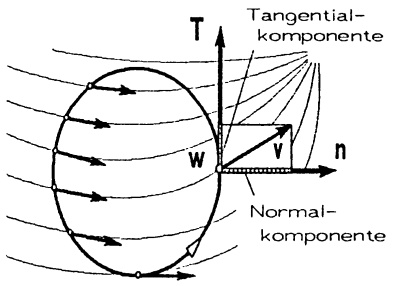

text_image

T
Tangential-
komponente
w
v
n
Normal-
komponente

Abb. 205 - Fluß, Zirkulation

n bezeichnet dabei in jedem Kurvenpunkt

den äußeren Normalenvektor, der aus T durch eine Drehung um  $-90^{\circ}$  ensteht. Er hat für  $\mathbf{w}(t)=\begin{pmatrix}x(t)\\y(t)\end{pmatrix}$  die Darstellung  $\mathbf{n}(t)=\frac{1}{\sqrt{\dot{x}^{2}+\dot{y}^{2}}}\begin{pmatrix}\dot{y}(t)\\-\dot{x}(t)\end{pmatrix}$  und weist bei positivem Umlauf stets ins Äußere von w ( $\rightarrow3.5$ , Bsp.2).

Der Mittelwertsatz (6) gibt die Deutung für die physikalische Anwendung:

$$
\oint_ {\mathbf {w}} \mathbf {v} \cdot d \mathbf {x} = (\mathbf {v} (\hat {t}) \cdot \mathbf {T} (\hat {t})) L; \oint_ {\mathbf {w}} \mathbf {v} \cdot d \mathbf {n} = (\mathbf {v} (\tilde {t}) \cdot \mathbf {n} (\tilde {t})) L.
$$

Zirkulation längs $\mathbf{w} =$ (mittlere skalare Tangentialkomponente von $\mathbf{v}$ längs $\mathbf{w}$) · (Länge von $\mathbf{w}$),

Fluß durch $\mathbf{w} =$ (mittlere skalare Normalkomponente von $\mathbf{v}$ längs $\mathbf{w}$) · (Länge von $\mathbf{w}$).

Beispiel. Ebene Gegenströmung.

$$
\mathbf {v} = \binom{c y}{0}, c > 0.
$$

Für den positiv durchlaufenen Kreis $\mathbf{w}(t) = (\cos t, 1 + \sin t)^T$, $0 \leq t \leq 2\pi$, ist

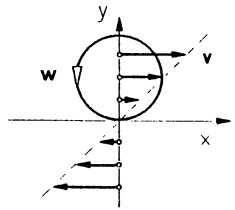

text_image

y
w
v
x

Abb. 206 - Gegenströmung

die Zirkulation: $\oint_{\mathbf{w}} \mathbf{v} \cdot d\mathbf{x} = \int_{0}^{2\pi} \binom{c(1 + \sin t)}{0} \cdot \binom{-\sin t}{\cos t} dt = -\pi c,$

der Fluß: $\oint_{\mathbf{w}} \mathbf{v} \cdot d\mathbf{n} = \int_{0}^{2\pi} \binom{c(1 + \sin t)}{0} \cdot \binom{\cos t}{\sin t} dt = 0.$

Längs w hat v die mittlere skalare Tangentialkomponente  $-\frac{\pi c}{2\pi} = -\frac{c}{2}$ . Negative Zirkulation bedeutet, daß die Strömung längs w überwiegend im Uhrzeigersinn verläuft. Fluß=0 bedeutet, es fließt genausoviel in das Kreisinnere hinein wie heraus (die Gegenströmung ist quellfrei: div v = 0).

2.5 Das Potential eines Gradientenfeldes. In völliger Analogie zu den Verhältnissen bei Funktionen in einer reellen Variablen (→ Kap. 4, 1.4) liefert das Kurvenintegral das geeignete Mittel, zur „Ableitung“ grad f einer Funktion $f: \mathbb{R}^{n} \supseteq D \to \mathbb{R}$ von n Veränderlichen eine Stammfunktion zu rekonstruieren. Anstelle eines zusammenhängenden Intervalles ist hier als Definitionsbereich einer Funktion ein Gebiet im $\mathbb{R}^{n}$ zu wählen.

Definition. Eine Teilmenge $G \subseteq \mathbb{R}^n$ heißt Gebiet, wenn gilt:

1. $G$ ist offen, d.h. zu jedem $\mathbf{x}_0 \in G$ liegt eine ganze $\epsilon$-Umgebung $U_{\epsilon}(\mathbf{x}_0) = \{\mathbf{x}; |\mathbf{x} - \mathbf{x}_0| < \epsilon\}$ ganz in $G$.

2. G ist zusammenhängend, d.h. zu je zwei Punkten  $x_{0}$ ,  $y_{0}$  aus G gibt es eine reguläre Kurve  $w : [a, b] \to G$  mit  $\mathbf{w}(a) = \mathbf{x}_{0}$ ,  $\mathbf{w}(b) = \mathbf{y}_{0}$ .

Definition. Sei $G \subseteq \mathbb{R}^n$ ein Gebiet. Man nennt ein Vektorfeld $\mathbf{v} \in \mathcal{C}^0(G, \mathbb{R}^n)$ konservativ oder ein Potential-, bzw. ein Gradientenfeld, wenn es eine Funktion $f \in \mathcal{C}^1(G, \mathbb{R})$ gibt mit

$$
\mathbf {v} (\mathbf {x}) = \operatorname{grad} f (\mathbf {x}) \quad (\mathbf {x} \in G).
$$

In diesem Fall heißt f Stammfunktion und U := -f eine Potentialfunktion (oder ein Potential) von v.

Bemerkungen. 1. In einem konservativen Kraftfeld repräsentiert das Potential die potentielle Energie. Das Vorzeichen ist so gewählt, daß $\mathbf{v} = -\text{grad } U$ in Richtung des stärksten Potentialabfalls zeigt ($\rightarrow$ Kap. 7, 3.1).

2. Für jede durch ein konservatives Kraftfeld $\mathbf{K} = -\text{grad } U$ hervorgerufene Bewegung $\mathbf{x} = \mathbf{x}(t)$ leitet man aus dem Gesetz von NEWTON den Energieerhaltungssatz ab (daher die Bezeichnung „konservativ“):

$$
\begin{array}{l} \mathbf {0} = m \ddot {\mathbf {x}} - \mathbf {K} = m \ddot {\mathbf {x}} + \operatorname{grad} U , \\ 0 = m \ddot {\mathbf {x}} \cdot \dot {\mathbf {x}} + \mathrm{grad} U \cdot \dot {\mathbf {x}} = \frac {d}{d t} \left[ \frac {m}{2} \dot {\mathbf {x}} (t) \cdot \dot {\mathbf {x}} (t) + U (\mathbf {x} (t)) \right], \\ \end{array}
$$

$const. = \frac{m}{2} |\dot{\mathbf{x}}(t)|^{2} + U(\mathbf{x}(t)) = ,,kinetische Energie + potentielle Energie“.$

Satz 2.1. 1. Hauptsatz für Kurvenintegrale. Ist $\mathbf{v}: G \to \mathbb{R}^n$ ein stetiges Gradientenfeld auf dem Gebiet $G \subseteq \mathbb{R}^n$ mit einer Stammfunktion $f$, dann gilt für jedestückweise reguläre Kurve $\mathbf{w}$ in $G$ mit Anfangspunkt $\mathbf{w}(a)$ und Endpunkt $\mathbf{w}(b)$

$$
\int_ {\mathbf {w}} \mathbf {v} \cdot d \mathbf {x} = f (\mathbf {w} (b)) - f (\mathbf {w} (a)). \tag {15}
$$

Beweis. Zunächst nehmen wir an, daß w aus einem regulären Kurvenstück $\mathbf{w}:[a,b]\to G$ besteht. Dafür gilt ($\rightarrow$ Kap. 7, §2(12))

$$
\begin{array}{l} \int_ {\mathbf {w}} \mathbf {v} \cdot d \mathbf {x} = \int_ {\mathbf {w}} \operatorname{grad} f \cdot d \mathbf {x} = \int_ {a} ^ {b} \operatorname{grad} f (\mathbf {w} (t)) \cdot \dot {\mathbf {w}} (t) d t \\ = \int_ {a} ^ {b} \left[ \frac {d}{d t} f (\mathbf {w} (t)) \right] d t = f (\mathbf {w} (b)) - f (\mathbf {w} (a)). \\ \end{array}
$$

Bei mehreren aneinanderhängenden Kurvenstücken $\mathbf{w}_{i}:[a_{i},b_{i}]\to G$ ($1\leq i\leq k$) ist dieses stückweise anzuwenden. Mit $\mathbf{w}_{i}(b_{i})=\mathbf{w}_{i+1}(a_{i+1})$ ($1\leq i\leq k-1$) folgt die Behauptung.

Beispiel 1. Die von der Zentralkraft $\mathbf{K} = \frac{a}{|\mathbf{x}|^3}\mathbf{x}$ ($\mathbf{x} \neq \mathbf{0}$) mit dem Potential $U = \frac{a}{|\mathbf{x}|}$ längs einer nicht durch den Nullpunkt gehenden regulären Kurve $\mathbf{w} : [a, b] \to \mathbb{R}^3$ geleistete Arbeit beträgt

$$
\int_ {\mathbf {w}} \mathbf {K} \cdot d \mathbf {x} = - \int_ {\mathbf {w}} \operatorname{grad} U \cdot d \mathbf {x} = U (\mathbf {w} (a)) - U (\mathbf {w} (b)).
$$

Beispiel 2. Das elektrische Feld (unrealistisch, dafür leicht zu rechnen)

$$
\mathbf {E}: \mathbb {R} ^ {3} \rightarrow \mathbb {R} ^ {3}, \quad \mathbf {E} (x, y, z) = \left(\begin{array}{c}2 x y + z ^ {3}\\x ^ {2} + 3 z\\3 z ^ {2} x + 3 y\end{array}\right)
$$

besitzt das Potential $U(x, y, z) = -(x^2y + xz^3 + 3zy)$.

Der Spannungsabfall zwischen den Punkten $P = (1, 1, 1)$ und $Q = (3, 4, 5)$ längs einer (stückweise) regulären Kurve $\mathbf{w}$ ist wegunabhängig:

$$
\int_ {\mathbf {w}} \mathbf {E} \cdot d \mathbf {x} = - \int_ {\mathbf {w}} \mathrm{grad} U \cdot d \mathbf {x} = U (P) - U (Q) = 4 6 6
$$

(Einheiten wurden weggelassen). Ganz allgemein ist die Spannung in einem konservativen elektrischen Feld zwischen zwei Punkten P und Q gleich der entsprechenden Potentialdifferenz.

Bemerkung. Aus dem 1. Haupsatz folgt auch die bereits bekannte Tatsache (→ Kap. 7, Satz 2.3), daß sich zwei Stammfunktionen eines konservativen Vektorfeldes nur um eine additive Konstante unterscheiden.

Satz 2.2. Für ein stetiges Vektorfeld $\mathbf{v} \in \mathcal{C}^{0}(G, \mathbb{R}^{n})$ auf einem Gebiet $G \subseteq \mathbb{R}^{n}$ sind folgende Aussagen äquivalent:

a) v ist ein Potentialfeld.
b) Für alle regulären Kurven w in G hängt  $\int_{w} v \cdot dx$  nur vom Anfangs- und Endpunkt von w ab. (Man sagt, das Integral ist wegunabhängig.)
c) Für alle geschlossenen regulären Kurven w in G gilt

$$
\oint_ {\mathbf {w}} \mathbf {v} \cdot d \mathbf {x} = 0.
$$

Beweis. a) $\Longrightarrow$ b): $\rightarrow$ Satz 2.1.

b)  $\Longrightarrow$  c): Eine geschlossene Kurve w wird in Kurvenstücke  $w_{1}$ ,  $w_{2}$  unterteilt. Nach Voraussetzung gilt

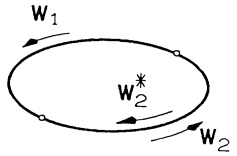

text_image

w₁
w₂*
w₂

Abb. 207 - Wegzerlegung

$$
\int_ {\mathbf {w} _ {1}} \mathbf {v} \cdot d \mathbf {x} = \int_ {\mathbf {w} _ {2} ^ {*}} \mathbf {v} \cdot d \mathbf {x} \quad \text {und deshalb}
$$

$$
\int_ {\mathbf {W}} \mathbf {v} \cdot d \mathbf {x} = \int_ {\mathbf {W} _ {1}} \mathbf {v} \cdot d \mathbf {x} + \int_ {\mathbf {W} _ {2}} \mathbf {v} \cdot d \mathbf {x} = \int_ {\mathbf {W} _ {1}} \mathbf {v} \cdot d \mathbf {x} - \int_ {\mathbf {W} _ {2} ^ {*}} \mathbf {v} \cdot d \mathbf {x} = 0.
$$

c)  $\Longrightarrow$  b): wird ebenso bewiesen. Man bildet aus zwei verschiedenen Kurven mit denselben Anfangs- und Endpunkten eine geschlossene Kurve.

b) $\Longrightarrow$ a): Zu $\mathbf{x}$, $\mathbf{x}_0 \in G$ ($\mathbf{x}_0$ fest) wird $f: G \to \mathbb{R}$ definiert durch

$$
f (\mathbf {x}) := \int_ {\mathbf {x} _ {0}} ^ {\mathbf {x}} \mathbf {v} \cdot d \mathbf {x} := \int_ {\mathbf {w}} \mathbf {v} \cdot d \mathbf {x}
$$

mit einer beliebigen  $x_{0}$  mit x verbindenden regulären Kurve in G. Aufgrund der Voraussetzung ist diese Definition sinnvoll (wegunabhängig). Zu zeigen ist, daß  $\operatorname{grad} f = v$ .

Für kleine $h \in \mathbb{R}$ liegt mit $\mathbf{x}$ die ganze $\mathbf{x}$ mit $\mathbf{x} + h\mathbf{e}_1$ verbindende Strecke in $G$ und es gilt

$$
\begin{array}{l} f (\mathbf {x} + h \mathbf {e} _ {1}) - f (\mathbf {x}) = \int_ {\mathbf {x}} ^ {\mathbf {x} + h \mathbf {e} _ {1}} \mathbf {v} \cdot d \mathbf {x} \\ = \int_ {0} ^ {h} v _ {1} (\mathbf {x} + t \mathbf {e} _ {1}) d t \\ = v _ {1} (\mathbf {x} + t ^ {*} \mathbf {e} _ {1}) h \\ \end{array}
$$

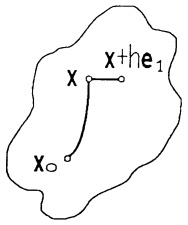

text_image

x + he₁
x
x₀

Abb. 208 - Weg für $\frac{\partial f}{\partial x_1}$

mit einem $t^{*}$ zwischen 0 und $h$ ($\rightarrow$ Kap. 4, §1(10)). Damit folgt

$$
\frac {\partial}{\partial x _ {1}} f (\mathbf {x}) = \lim _ {h \to 0} \frac {1}{h} [ f (\mathbf {x} + h \mathbf {e} _ {1}) - f (\mathbf {x}) ] = v _ {1} (\mathbf {x}).
$$

Ebenso zeigt man $\frac{\partial}{\partial x_i} f(\mathbf{x}) = v_i(\mathbf{x}), i = 2, \ldots, n$.

□

Ob ein $\mathcal{C}^{1}$-Vektorfeld $\mathbf{v}: G \to \mathbb{R}^{n}$ ein Potential besitzt, kann in der Umgebung eines Punktes direkt an der JACOBI-Matrix $\mathcal{J}_{\mathbf{v}}(\mathbf{x}) = \left(\frac{\partial v_{i}}{\partial x_{j}}(\mathbf{x})\right)_{n \times n}$ abgelesen werden. Um diese Kennzeichnung auf ganz $G$ zu übertragen, muß eine Zusatzforderung getroffen werden:

Definition. Ein Gebiet  $G \subseteq R^{n}$  heißt einfach zusammenhängend, wenn jede geschlossene, doppelpunktfreie Kurve in G stetig auf einen Punkt in G zusammengezogen werden kann, ohne daß G verlassen wird.

## Beispiele im $\mathbb{R}^2$ .

a) Einfach zusammenhängend im  $R^{2}$  ist (anschaulich) jedes Gebiet ohne Loch; etwa  $R^{2}$ , das Innere eines Kreises, eine Halbebene.
b) Nicht einfach zusammenhängend ist jedes Gebiet mit Löchern, etwa die „punktierte“ Ebene  $R^{2} \setminus \{0\}$ , das Gebiet zwischen zwei ineinanderliegenden Kreisen.

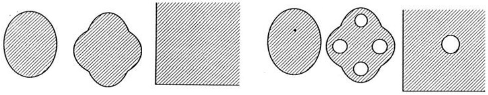

natural_image

Six abstract geometric shapes with varying fill patterns and shading, including shaded regions and irregular shapes (no text or symbols)

Abb. 209 - einfach zusammenhängend

- nicht einfach zusammenhängend im $\mathbb{R}^{2}$

## Beispiele im $\mathbb{R}^{3}$.

a) Einfach zusammenhängend ist jedes Gebiet ohne Henkel, etwa  $R^{3}$ , das Innere eines Quaders oder einer Kugel, ein von zwei konzentrischen Kugeln begrenztes Gebiet. Diese Gebiete bleiben einfach zusammenhängend, wenn jeweils endlich viele Punkte entfernt werden. Insbesondere ist der punktierte Raum  $R^{3} \setminus \{0\}$  einfach zusammenhängend.
b) Nicht einfach zusammenhängend ist jedes Gebiet mit Henkeln; ein Torus, der  $R^{3}$  ohne eine Gerade oder ohne einen Kreis ist ebenfalls nicht einfach zusammenhängend.

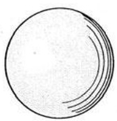

natural_image

Simple circular diagram with three curved lines extending from its center (no text or symbols)

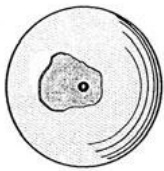

natural_image

Simple line drawing of a cell with nucleus and cytoplasm (no text or labels)

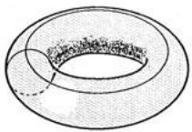

natural_image

Diagram of concentric rings with a shaded inner region, no text or symbols present

Abb. 210 – einfach zusammenhängend

- nicht einfach zusammenhängend im $\mathbb{R}^{3}$

Satz 2.3. 2. Hauptsatz für Kurvenintegrale. Ein $\mathcal{C}^{1}$-Vektorfeld $\mathbf{v}: G \to \mathbb{R}^{n}$ auf einem einfach zusammenhängenden Gebiet $G \subseteq \mathbb{R}^{n}$ ist genau dann ein Potentialfeld, wenn die „Integrabilitätsbedingung“

$$
\mathcal {J} _ {\mathbf {v}} (\mathbf {x}) = \mathcal {J} _ {\mathbf {v}} (\mathbf {x}) ^ {T} \quad f u r a l l e \mathbf {x} \in G
$$

erfüllt ist (d.h.  $\frac{\partial v_{i}}{\partial x_{k}} = \frac{\partial v_{k}}{\partial x_{i}}, i, k = 1, \ldots, n$ ).

Beweis. Aus $\mathbf{v} = \operatorname{grad} f$ mit einer $\mathcal{C}^2$-Funktion $f: G \to \mathbb{R}$ folgt mit dem Satz von Schwarz ($\rightarrow$ Kap. 7, Satz 2.2) $\frac{\partial v_i}{\partial x_j} = \frac{\partial}{\partial x_j} \frac{\partial}{\partial x_i} f = \frac{\partial}{\partial x_i} (\frac{\partial}{x_j} f) = \frac{\partial v_j}{\partial x_i}$.

Weiter zeigen wir, daß aus $\mathcal{J}_{\mathbf{v}}(\mathbf{x}) = \mathcal{J}_{\mathbf{v}}(\mathbf{x})^T$ für alle $\mathbf{x} \in G$ die „lokale Integrabilität“ folgt, indem wir zu jedem $\mathbf{x}_0 \in G$ und jeder $r$-Umgebung $U_r(\mathbf{x}_0) \subseteq G$ ein Potential $f$ zu $\mathbf{v}$ auf $U_r(\mathbf{x}_0)$ explizit als Kurvenintegral (über die $\mathbf{x}_0$ mit $\mathbf{x} \in U_r(\mathbf{x}_0)$ verbindenden Strecke) angeben:

$$
f (\mathbf {x}) := \int_ {0} ^ {1} \mathbf {v} \big (\mathbf {x} _ {0} + t (\mathbf {x} - \mathbf {x} _ {0}) \big) \cdot (\mathbf {x} - \mathbf {x} _ {0}) d t.
$$

Hierfür gilt

$$
\begin{array}{l} \mathrm{grad} f (\mathbf {x}) = \int_ {0} ^ {1} \mathrm{grad} \left[ \mathbf {v} (\mathbf {w} (t)) \cdot (\mathbf {x} - \mathbf {x} _ {0}) \right] d t \quad \text {(komponentenweise Satz 1.1)} \\ = \int_ {0} ^ {1} \left[ t \mathcal {J} _ {\mathbf {v}} (\mathbf {w} (t)) ^ {T} (\mathbf {x} - \mathbf {x} _ {0}) + \mathbf {v} (\mathbf {w} (t)) \right] d t \quad (\rightarrow \text {Aufg. 9, Kap. 7, §4)} \\ = \int_ {0} ^ {1} \left[ t \mathcal {J} _ {\mathrm{v}} (\mathbf {w} (t)) (\mathbf {x} - \mathbf {x} _ {0}) + \mathbf {v} (\mathbf {w} (t)) \right] d t \quad \text {(nach Voraussetzung)} \\ = \int_ {0} ^ {1} \frac {d}{d t} [ t \mathbf {v} (\mathbf {w} (t)) ] d t \quad (\rightarrow \text {Kettenregel}) \\ = \left. t \mathbf {v} (\mathbf {w} (t)) \right| _ {0} ^ {1} = \mathbf {v} (\mathbf {x}). \\ \end{array}
$$

Für ein beliebiges  $x \in G$  wählt man als Integrationsweg w einen Streckenzug. Da G einfach zusammenhängend ist, hängt  $f(\mathbf{x})$  nicht vom gewählten Steckenzug ab. (Das zeigen wir nicht!)

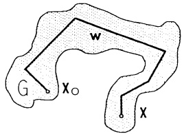

text_image

w
G
X₀
X

Abb. 211 - Integrationsweg

Bemerkungen. 1. Ist G nicht einfach zusammenhängend, dann ist Satz 2.3 nur auf einfach zusammenhängende Teilgebiete  $G' \subseteq G$  anwendbar. Die jeweils auf den Teilgebieten  $G'$  existierenden Potentiale lassen sich i.a. nicht zu einem Potential auf G fortsetzen.

Gegenbeispiel. Der auf $G = \mathbb{R}^2 \setminus \{0\}$ definierte isolierte Wirbel

$$
\mathbf {v} (x, y) = \frac {1}{x ^ {2} + y ^ {2}} \binom{- y}{x}
$$

erfüllt die Integrabilitätsbedingung $\frac{\partial v_{1}}{\partial y} = \frac{\partial v_{2}}{\partial x}$. Er besitzt aber kein Potential auf ganz $G$: Mit Satz 2.2 müßte $A = \oint_{\mathbf{w}} \mathbf{v} \cdot d\mathbf{x} = 0$ sein auf dem Kreis $\mathbf{w}(t) = (\cos t, \sin t)$, $0 \leq t \leq 2\pi$. Mit Bsp. 2 aus 2.3 ist aber $A = 2\pi$.

2. Für Vektorfelder im  $R^{3}$  ist die Integrabilitätsbedingung  $\mathcal{J}_{\mathbf{v}}(\mathbf{x}) = \mathcal{J}_{\mathbf{v}}(\mathbf{x})^{T}$  gleichbedeutend mit  $\operatorname{rot}\mathbf{v}(\mathbf{x}) = \mathbf{0}$  ( $\rightarrow$  Kap. 7, 4.4). Deshalb lautet der zweite Hauptsatz im  $R^{3}$ :

$G \subseteq R^{3}$ einfach zusammenhängendes Gebiet, $v \in C^{1}(G, R^{3})$:

v Potentialfeld in $G \quad \Longleftrightarrow \quad \text{rot } \mathbf{v} = \mathbf{0}$ für alle $\mathbf{x} \in G$.

3. Neben dem skalaren Potential eines Vektorfeldes im  $R^{3}$  ist auch noch ein vektorwertiges Potential, das sog. Vektorpotential für Vektorfelder definiert ( $\rightarrow$  5.4).

2.6 Die praktische Bestimmung eines Potentials  $(n = 3)$ . Die Beweise der Sätze 2.2, 2.3 sind konstruktiv, da jeweils eine Stammfunktion angegeben wird. Man hat damit bereits als erste Möglichkeit:

Ⓐ Methode mit Kurvenintegral.

1. Schritt: Besitzt das $\mathcal{C}^{1}$-Vektorfeld $\mathbf{v}: G \to \mathbb{R}^{3}$ ein Potential? rot $\mathbf{v} \neq 0$ für ein $\mathbf{x} \in G \implies$ kein Potentialfeld.
2. Schritt: rot $\mathbf{v} = 0$ und $G$ einfach zusammenhängend, dann wählt man $\mathbf{x}_0 \in G$ fest und zu $\mathbf{x} \in G$ eine geeignete Kurve $\mathbf{w}$ in $G$, die $\mathbf{x}_0$ mit $\mathbf{x}$ verbindet.
$f: G \to \mathbb{R}, f(\mathbf{x}) := \int_{\mathbf{w}} \mathbf{v} \cdot d\mathbf{x}$ ist eine Stammfunktion.

Die bevorzugten Wege von  $x_{0}$  nach x, sofern sie in G verlaufen, sind

\- die Strecke $\mathbf{w}(t) = \mathbf{x}_0 + t(\mathbf{x} - \mathbf{x}_0)$, $0 \leq t \leq 1$; in diesem Fall gilt

$$
f (\mathbf {x}) = \int_ {0} ^ {1} \mathbf {v} (\mathbf {x} _ {0} + t (\mathbf {x} - \mathbf {x} _ {0})) \cdot (\mathbf {x} - \mathbf {x} _ {0}) d t ;
$$

\- ein Streckenzug, stückweise parallel zu den Koordinatenachsen, etwa von $(x_0, y_0, z_0)$ über $(x, y_0, z_0)$ und $(x, y, z_0)$ nach $(x, y, z)$. Die Stammfunktion stellt sich dar als sogenanntes Hakenintegral

$$
f (x, y, z) = \int_ {x _ {0}} ^ {x} v _ {1} (t, y _ {0}, z _ {0}) d t + \int_ {y _ {0}} ^ {y} v _ {2} (x, t, z _ {0}) d t + \int_ {z _ {0}} ^ {z} v _ {3} (x, y, t) d t.
$$

## B Ansatzmethode.

Man löst die drei partiellen Differentialgleichungen  $\operatorname{grad} f = v$  zur Bestimmung von f durch dreimaliges unbestimmtes Integrieren; dazwischen muß zweimal partiell differenziert werden:

1. Schritt: Der Ansatz  $f_{x}=v_{1}$ ,  $f_{y}=v_{2}$ ,  $f_{z}=v_{3}$ .
Ist G einfach zusammenhängend?
2. Schritt: Durch unbestimmte Integration nach $x$ (bei konstant gehaltenem $y$ und $z$) $f_x(x, y, z) = v_1(x, y, z)$ lösen:

$$
f (x, y, z) = \int v _ {1} (x, y, z) d x + c (y, z).
$$

Die „Integrationskonstante“ c hängt von y und z ab.

3. Schritt: Durch partielle Differentiation von $f$ nach $y$ und Ansatz $f_y = v_2$ eine Gleichung für $\frac{\partial}{\partial y} c(y,z)$ herleiten:

$$
\frac {\partial}{\partial y} \int v _ {1} (x, y, z) d x + c _ {y} (y, z) = f _ {y} = v _ {2}.
$$

Tritt in dieser Gleichung noch x auf, so ist rot v ≠ 0, d.h. die Integrabilitätsbedingung verletzt ⇒ fertig!

4. Schritt: Durch unbestimmte Integration nach y das  $c(y,z)$  aus  $c_{y}(y,z)=h(y,z):=v_{2}-\int v_{1y}dx$  bestimmen,

$$
c (y, z) = \int h (y, z) d y + d (z),
$$

und oben eintragen:

$$
f (x, y, z) = \int v _ {1} (x, y, z) d x + \int h (y, z) d y + d (z) .
$$

Die „Integrationskonstante“ d hängt von z ab.

5. Schritt: Durch partielle Differentiation von $f$ nach $z$ und Ansatz $f_{z}=v_{3}$ eine Gleichung für $d^{\prime}(z)$ bestimmen.
Tritt hierin noch y auf, ist rot v ≠ 0 implique fertig!

6. Schritt:  $d(z)$  durch unbestimmte Integration nach z bestimmen.

## Beispiel 1. Zentralfelder besitzen die Form

$$
\mathbf {v} (\mathbf {x}) = \varphi (| \mathbf {x} - \mathbf {z} |) (\mathbf {x} - \mathbf {z})
$$

mit einer Funktion $\varphi\in\mathcal{C}^{1}(\mathbb{R}\setminus\{0\},\mathbb{R})$, die meist einen Pol in 0 besitzt. $\mathbf{z}$ ist das Zentrum und $\mathbf{v}$ ist auf $\mathbb{R}^{3}\setminus\{\mathbf{z}\}$ ein $\mathcal{C}^{1}$-Vektorfeld. Wir setzen zur Kürze $\mathbf{z}=\mathbf{0}$, d.h. $\mathbf{v}(\mathbf{x})=\varphi(|\mathbf{x}|)\mathbf{x}$.

v ist ein Potentialfeld, da  $G = R^{3} \setminus \{0\}$  einfach zusammenhängend ist und

$$
(\rightarrow \text {Kap.} 7, \S 4 (4 \mathrm{a}), A = E)
$$

$$
\mathcal {J} _ {\mathbf {v}} (\mathbf {x}) = \frac {1}{| \mathbf {x} |} \varphi^ {\prime} (| \mathbf {x} |) \mathbf {x x} ^ {T} + \varphi (| \mathbf {x} |) E = \mathcal {J} _ {\mathbf {v}} (\mathbf {x}) ^ {T}.
$$

Berechnung von $f$ mit Methode Ⓐ: Wir wählen einen Integrationsweg $\mathbf{w}$ von $\mathbf{x}_{0} \neq \mathbf{0}$ nach $\mathbf{x} \neq \mathbf{0}$, der aus zwei Kurvenstücken $\mathbf{w}_{1}, \mathbf{w}_{2}$ besteht:

$\mathbf{w}_{1}$ ist ein beliebiges reguläres Kurvenstück auf der Sphäre um $O$ mit Radius $|\mathbf{x}_{0}|$, das $\mathbf{x}_{0}$ mit dem Punkt $\mathbf{x}_{1} = \frac{|\mathbf{x}_{0}|}{|\mathbf{x}|}\mathbf{x}$ verbindet. $\mathbf{w}_{2}$ ist die

Strecke $\mathbf{w}_2(t) = t\frac{1}{|\mathbf{x}|}\mathbf{x}, |\mathbf{x}_0| \leq t \leq |\mathbf{x}|.$

Wegen $\mathbf{v}(\mathbf{w}_1(t))\cdot \dot{\mathbf{w}}_1(t) = 0$ gilt

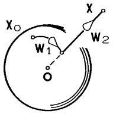

text_image

X₀
W₁
O
X
W₂

Abb. 212 - Integrationsweg

$$
f (\mathbf {x}) = \int_ {\mathbf {w}} \mathbf {v} \cdot d \mathbf {x} = \int_ {\mathbf {W} _ {2}} \mathbf {v} \cdot d \mathbf {x} = \int_ {| \mathbf {x} _ {0} |} ^ {| \mathbf {x} |} \varphi (t) t d t.
$$

Für das Gravitationsfeld ist $\varphi(t)=\frac{1}{t^{3}}$, d.h. das Newton-Potential, gilt

$$
U (\mathbf {x}) = - f (\mathbf {x}) = - \int_ {| \mathbf {x} _ {0} |} ^ {| \mathbf {x} |} \frac {t}{t ^ {3}} d t = \frac {1}{| \mathbf {x} |} - \frac {1}{| \mathbf {x} _ {0} |}.
$$

## Beispiel 2.

$$
\mathbf {v} (x, y, z) = \left( \begin{array}{c} y ^ {2} \cos x \\ 2 y \sin x + e ^ {2 z} \\ 2 y e ^ {2 z} \end{array} \right), \quad G = \mathbb {R} ^ {3}.
$$

$G = \mathbb{R}^{3}$ ist einfach zusammenhängend! Rechnung mit Methode Ⓑ:

1. Schritt: $f_{x} = y^{2}\cos x$, $f_{y} = 2y\sin x + e^{2z}$, $f_{z} = 2ye^{2z}$.
2. Schritt: Die erste Gleichung zeigt  $f(x,y,z)=y^{2}\sin x+c(y,z)$ .
3. Schritt: $f_y = 2y \sin x + c_y(y, z) = 2y \sin x + e^{2z} \implies c_y(y, z) = e^{2z}$.
4. Schritt: $c(y, z) = ye^{2z} + d(z) \implies f(x, y, z) = y^2 \sin x + ye^{2z} + d(z)$.
5. Schritt: $f_{z} = 2ye^{2z} + d'(z) = 2ye^{2z} \implies d'(z) = 0$.
6. Schritt: $d(z) = \mathrm{const}$.

Eine Stammfunktion lautet demnach  $f(x,y,z)=y^{2}\sin x+ye^{2z}+\mathrm{const.}$

## Aufgaben

1. Man berechne Länge und geometrischen Mittelpunkt der Kurven

a) $\mathbf{w}(t) = (t, t^2, \frac{2}{3} t^3)^T$, $0 \leq t \leq 1$,
b) $\mathbf{w}(t) = e^{-t}(\cos t, \sin t, 1)^T$, $0 < t < \infty$ (Spirale),
c) $\mathbf{w}(t) = a(t - \sin t, 1 - \cos t, 0)^T$, $0 \leq t \leq 2\pi$ (Zykloide),
d)  $r = a(1 + \cos \varphi)$ ,  $0 \leq \varphi \leq 2\pi$  (Kardioide).

2. Linienladung. Die Strecke w von  $-\frac{\ell}{2}$  bis  $\frac{\ell}{2}$  auf der x-Achse ist elektrisch homogen geladen. Man berechne das Coulomb-Potential im Raumpunkt y als

$$
U (\mathbf {y}) = \int_ {\mathbf {w}} \frac {d s}{| \mathbf {y} - \mathbf {x} |}, \mathbf {y} \in \mathbb {R} ^ {3} \backslash \mathbf {w}.
$$

Was geschieht für  $y \rightarrow y_{0}$ , falls  $y_{0} \in w$ ?

3. Man berechne die ebenen Kurvenintegrale $\int_{\mathbf{w}_i} \mathbf{v} \cdot d\mathbf{x}$ für die drei Wege

$w_{1}$  Verbindungsstrecke von (0,1) und (1,2),

$w_{2}$  wie skizziert,

$$
\mathbf {w} _ {3} (t) = (t, t ^ {2} + 1), 0 \leq t \leq 1,
$$

für die beiden Vektorfelder

a) $\mathbf{v} = (x^{2} - y, y^{2} + x)^{T}$,

b) $\mathbf{v} = (x^3 - 3xy^2, y^3 - 3yx^2)^T$.

4. Für die Raumkurve (Viviani-Fenster)

$$
\mathbf {w} (t) := \left( \begin{array}{c} \cos t \\ \sin t \\ 2 \sin \frac {t}{2} \end{array} \right), \qquad 0 \leq t \leq 4 \pi ,
$$

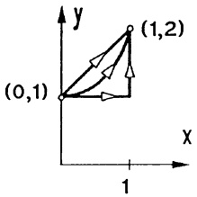

text_image

(0,1)
(1,2)
1

deute und berechne man  $\int_{w} k \cdot d x$  für das Vektorfeld  $\mathbf{k}(\mathbf{x}) = -|\mathbf{x}|^{-3} \mathbf{x}$ .

5. Für das Vektorfeld des magnetischen Wirbels

$$
\mathbf {v} (\mathbf {x}) = \frac {1}{x ^ {2} + y ^ {2}} \binom{- y}{x}, \quad \mathbf {x} \neq \mathbf {0},
$$

berechne man  $\int_{w} v \cdot d x$  längs der drei skizzierten Wege w von (5,0) nach (-3,4).

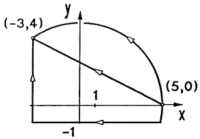

text_image

(-3,4)
1
(5,0)
-1
x
y

6. Gegeben ist das räumliche Vektorfeld

$$
\mathbf {v} (\mathbf {x}) = [ \ln (1 + | \mathbf {x} | ^ {2}) ] \mathbf {x}, \quad \mathbf {x} \in \mathbb {R} ^ {3}.
$$

a) Man bestimme rot  $\mathbf{v}(\mathbf{x})$ . Besitzt  $\mathbf{v}(\mathbf{x})$  ein Potential in  $R^{3}$ ?
b) Man berechne $U(\mathbf{a}) = \int_{\mathbf{w}} \mathbf{v} \cdot d\mathbf{x}$ für die Verbindungsstrecke $\mathbf{w}$ von 0 nach $\mathbf{a}$.

7. Für welche Werte von a liegt ein Potentialfeld vor?

$$
\mathbf {v} (\mathbf {x}) = (\frac {a y}{(x - y) ^ {2}}, \frac {2 x}{(x - y) ^ {2}} + 1, z) ^ {T}, \quad \mathbf {x} \in \mathbb {R} ^ {3}, \quad x \neq y.
$$

Welche maximalen Definitionsbereiche sind möglich?

8. Für welche Werte $a, b, c, \alpha, \beta, \gamma$ besitzt das Vektorfeld $\mathbf{v}(\mathbf{x})$ ein Potential $U(\mathbf{x})$?

$$
\mathbf {v} (\mathbf {x}) = \frac {1}{(x + y + z) ^ {3}} (x + y - 3 z, a x + b y + c z, \alpha x + \beta y + \gamma z) ^ {T}
$$

Man berechne $U(\mathbf{x})$ und ein maximales einfach zusammenhängendes Definitionsgebiet $G$ für $U(\mathbf{x})$.

## §3. Die Integration über ebene Bereiche

3.1 Der Flächeninhalt. Der Flächeninhalt eines Rechtecks mit den Seitenlängen  $\Delta x$ ,  $\Delta y$  beträgt  $\Delta x\Delta y$ ; daraus werden bekanntlich die Flächeninhaltsformeln für Dreiecke, n-Ecke und elementarer Figuren abgeleitet. Wir befassen uns hier zunächst mit der Frage, welchen ebenen Bereichen überhaupt ein Flächeninhalt zugeordnet werden kann.

Sei $k \in \mathbb{N}$. Durch das Gitter achsenparalleler Koordinatenlinien $x = n \cdot 2^{-k}$, $y = n \cdot 2^{-k}$ ($n = 0, \pm 1, \pm 2, \ldots$) wird die $(x, y)$-Ebene in Quadrate mit dem

Flächeninhalt $2^{-2k}$ zerlegt.

Sei $M \subseteq \mathbb{R}^{2}$ eine beliebige beschränkte Punktmenge der $(x,y)$-Ebene, $s_{k}(M)$ der Flächeninhalt aller Quadrate, die einschließlich ihres Randes ganz in $M$ liegen (Anzahl $\cdot 2^{-2k}$), und $S_{k}(M)$ der gesamte Flächeninhalt der (abgeschlossenen) Quadrate, die mindestens einen Punkt von $M$ enthalten. Offenbar gilt

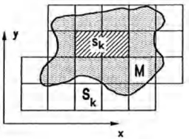

text_image

y
Sk
M
Sk
x

Abb. 213 – Flächenausschöpfung

$$
s _ {k} (M) \leq S _ {k} (M); \quad s _ {k} (M) \leq s _ {k + 1} (M); \quad S _ {k + 1} (M) \leq S _ {k} (M).
$$

Also existieren (→ Kap. 2, Satz 5.4)

$$
F _ {i} (M) := \lim _ {k \to \infty} s _ {k} (M) \quad \text {, der innere Inhalt ``},
$$

$$
F _ {a} (M) := \lim _ {k \rightarrow \infty} S _ {k} (M) \quad , \text {der äußere Inhalt}".
$$

Man nennt M Riemann-meßbar, wenn  $F_{a}(M) = F_{i}(M) =: F(M)$ ; in diesem Fall heißt  $F(M)$  der Flächeninhalt von M.

Standardbeispiel einer nicht Riemann-meßbaren Menge ist

$$
M = \{(x, y); 0 \leq x \leq 1, 0 \leq y \leq 1 \text {und} x, y \in \mathbb {Q} \}
$$

mit $F_{i}(M) = 0$, $F_{a}(M) = 1$.

Andererseits gilt (ohne Beweis) für (→ 2.5) Gebiete $G \subset \mathbb{R}^2$:

Ein beschränktes Gebiet $G \subseteq \mathbb{R}^2$ mit stückweise regulärem Rand besitzt einen Flächeninhalt $F = \lim_{k \to \infty} s_k(G) = \lim_{k \to \infty} S_k(G)$.

Für jede Riemann-meßbare Menge M zusammen mit einer Menge N, die nur aus endlich vielen Punkten und endlich vielen regulären Kurvenstücken besteht, gilt

$$
F (M) = F (M \cup N) = F (M \setminus N); \tag {1}
$$

insbesondere  $F(N)=0$ . Man nennt deshalb N eine Nullmenge.

## 3.2 Definition und einfache Eigenschaften des Doppelintegrals. Im Hinblick auf die technischen Anwendungen beschränken wir uns bei den Integrationsbereichen für Doppelintegrale auf einfach zu charakterisierende Mengen:

## Definition. Ein Bereich  $B \subseteq R^{2}$  heißt regulär, wenn

1. der Rand  $\partial B$  aus endlich vielen regulären Kurvenstücken besteht,
2. das Innere $B \setminus \partial B$ ein nicht leeres, beschränktes Gebiet im $\mathbb{R}^2$ ist ($\rightarrow 2.5$),
3. B abgeschlossen ist, d.h.  $\partial B \subseteq B$ .

Es wird manchmal erforderlich sein, daß einzelne Punkte oder Kurvenstücke – als Ausnahmemengen – herauszunehmen sind. Aus diesem Grunde lassen wir als Integrationsbereich auch $B \setminus N$ zu, wobei $B$ ein regulärer Bereich und $N$ eine Nullmenge darstellt, die aus höchstens endlich vielen Punkten und/oder regulären (glatten) Kurvenstücken besteht.

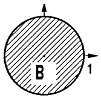

text_image

B
1

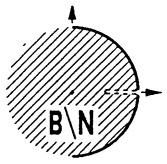

text_image

B\N

Abb. 214 - B N mit $N = \{(0,0)\} \cup \{(x,0):\frac{1}{2}\leq x\leq 1\} \cup \{\mathbf{X}:|\mathbf{X}| = 1,x\leq 0\},B = \{| \mathbf{X}|\leq 1\}$

Ferner sei $f: B \to \mathbb{R}$ eine beschränkte Funktion (d.h. $m \leq f(x, y) \leq M$ für alle $(x, y) \in B$), die auf $B \setminus N$ stetig ist.

Durch ein Netz regulärer Kurven wird $B$ in $n$ Teilbereiche $B_{1},\ldots,B_{n}$ zerlegt. Jeder Bereich $B_{i}$ hat einen Durchmesser $\delta(B_{i})$, definiert als Infimum der Durchmesser aller Kreise, die $B_{i}$ ganz überdecken. Außerdem besitzt $B_{i}$ gem. 3.1 einen Flächeninhalt $\Delta F_{i}$.

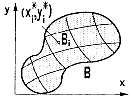

text_image

y
(x_i^*, y_i^*)
B_i
B
x

Abb. 215 - Zerlegung von $B$

Wir wählen nun für jedes $i = 1,2,\ldots,n$ einen beliebigen Punkt $(x_{i}^{*},y_{i}^{*})\in B_{i}$ und bilden die RIEMANN-Summe

$$
Z _ {n} := \sum_ {i = 1} ^ {n} f (x _ {i} ^ {*}, y _ {i} ^ {*}) \Delta F _ {i}. \tag {2}
$$

Unter den gegebenen Voraussetzungen an $f$ und $B$ läßt sich – ähnlich wie beim Einfachintegral ($\rightarrow$ Kap. 4, §1) – zeigen, daß bei ständiger Verfeinerung des Netzes die Riemann-Summen $Z_{n}$ gegen einen festen Grenzwert konvergieren, der unabhängig ist von den einzelnen Zerlegungsfolgen und den ausgewählten Punkten $(x_{i}^{*}, y_{i}^{*}) \in B_{i}$, sofern nur der maximale Durchmesser

$$
\delta_ {m a x} := \max \{\delta (B _ {i}); 1 \leq i \leq n \}
$$

gegen Null strebt. Dieser für alle Teilungsfolgen gemeinsame Grenzwert wird

mit

$$
\iint_ {B} f (x, y) d F \quad \text {oder} \quad \iint_ {B} f d F
$$

bezeichnet und heißt Doppelintegral (oder Gebietsintegral, kurz: Integral) von f über B. Das Symbol dF heißt Flächenelement.

$$
\boxed {\iint_ {B} f (x, y) d F := \lim _ {\substack {\delta_ {\max} \rightarrow 0\\n \rightarrow \infty}} \sum_ {i = 1} ^ {n} f \left(x _ {i} ^ {*}, y _ {i} ^ {*}\right) \Delta F _ {i}} \tag{3}
$$

Wegen (1) ist der Einfluß der Nullmenge N auf die Riemann-Summen unwesentlich, also gilt

$$
\iint_ {B} f d F = \iint_ {B \setminus N} f d F. \tag {4}
$$

Das hier eingeführte Integral ist „eigentlich“ im Gegensatz zu den „uneigentlichen“ Integralen, in denen der Integrationsbereich nicht beschränkt oder der Integrand auf dem Rand nicht definiert ist.

## Die geometrische Deutung.

(a) Flächeninhalt. Mit  $f(x,y)=1$  ist jede Riemann-Summe (2) gleich dem Flächeninhalt von B. Also gilt

$$
F = \iint_ {B} d F \quad \text {Flächeninhalt von} B.\tag {5}
$$

⑥ Volumen. Ist  $f(x,y) \geq 0$  für alle  $(x,y) \in B$ , dann stellt

$$
V = \iint_ {B} f d F \tag {6}
$$

das Volumen des senkrecht auf der  $(x, y)$ -Ebene stehenden Zylinderabschnitts mit Grundfläche B und der Deckfläche  $z = f(x, y)$  dar.

Denn das Volumen des auf $B_{i}$ stehenden Zylinders der Höhe $f(x_{i}^{*},y_{i}^{*})$ beträgt $\Delta V_{i}=f(x_{i}^{*},y_{i}^{*})\Delta F_{i}$. Das Gesamtvolumen $V$ wird durch

$$
Z _ {n} = \sum_ {i = 1} ^ {n} f (x _ {i} ^ {*}, y _ {i} ^ {*}) \Delta F _ {i} \text {approximiert, d.h.}
$$

$$
V = \lim _ {n \to \infty} \sum f (x _ {i} ^ {*}, y _ {i} ^ {*}) \Delta F _ {i}.
$$

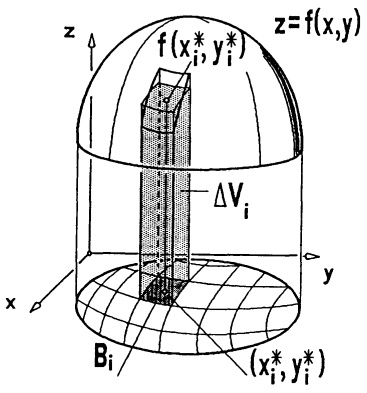

text_image

z
f(x_i*, y_i*)
ΔV_i
z=f(x,y)
y
x
Bi
(x_i*, y_i*)

Abb. 216 - Volumen unter Graph $f$

Die Rechenregeln ergeben sich direkt aus der Definition:

$$
\iint_ {B} (a f + b g) d F = a \iint_ {B} f d F + b \iint_ {B} g d F, \quad a, b \in \mathbb {R}. \tag {7}
$$

(Linearität)

$$
f (x, y) \leq g (x, y) \text {   für   alle   } (x, y) \in B \Rightarrow \iint_ {B} f d F \leq \iint_ {B} g d F . \tag {8}
$$

(Monotonie)

$$
\iint_ {B} f d F = \iint_ {B _ {1}} f d F + \iint_ {B _ {2}} f d F. \tag {9}
$$

(Additivität),

falls B durch eine stückweise reguläre Kurve in zwei Teilbereiche  $B_{1}$ ,  $B_{2}$  zerlegt wird.

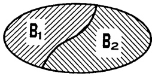

text_image

B₁
B₂

Abb. 217 - Additivität

Als Mittelwert oder Integralmittel der Funktion f auf B bezeichnet man die Zahl

$$
\frac {1}{F} \iint_ {B} f d F
$$

mit dem Flächeninhalt $F = \iint_{B} dF$ von $B$. Wie im Fall einer Variablen

(→ Kap. 4, Satz 1.2) beweist man den

Satz 3.1. Mittelwertsatz. Ist $B$ zusammenhängend und abgeschlossen, dann gibt es zu jeder stetigen Funktion $f: B \to \mathbb{R}$ einen Punkt $(x^{*}, y^{*})$ in $B$ mit

$$
\iint_ {B} f d F = f (x ^ {*}, y ^ {*}) \cdot F. \tag {10}
$$

3.3 Die Berechnung des Doppelintegrals in kartesischen Koordinaten. Bei der Zerlegung der  $(x,y)$ -Ebene durch ein achsenparalleles Gitter entstehen Rechtecke mit Seitenlängen  $\Delta x$ ,  $\Delta y$  und Flächeninhalt  $\Delta F = \Delta x \Delta y$ . Versteht man das Integral  $\iint_{B} f \, dF$  als Grenzwert von Riemann-Summen bezüglich derartiger Teilungen, dann schreibt man

$$
\iint_ {B} f (x, y) d x d y := \iint_ {B} f (x, y) d F
$$

und nennt $dF = dxdy$ das Flächenelement in kartesischen Koordinaten.

Für eine große Klasse von Integrationsbereichen läßt sich die Berechnung des Gebietsintegrals auf zwei nacheinander auszuführende „Einfachintegrationen“ zurückführen.

Definition. Wir nennen $B_{1} \subseteq \mathbb{R}^{2}$ einen Normalbereich vom Typ I, wenn es $a, b \in \mathbb{R}$ und $\mathcal{C}^{1}$-Funktionen $g, h : [a, b] \to \mathbb{R}$ gibt mit $g(x) \leq h(x)$ und

$$
B _ {1} = \left\{(x, y); a \leq x \leq b, g (x) \leq y \leq h (x) \right\}.
$$

Ein Normalbereich vom Typ II hat die Form

$$
B _ {2} = \{(x, y); l (y) \leq x \leq r (y), c \leq y \leq d \}
$$

mit $c,d\in \mathbb{R}$ und $\mathcal{C}^1$ -Funktionen

$l,r:[c,d]\to\mathbb{R}\ m i t\ l(y)\leq r(y).$

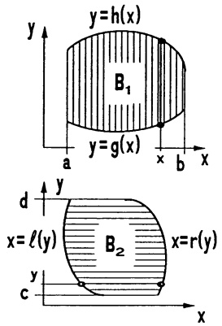

Abb. 218 - Normalbereiche

## Satz 3.2. Die Integration über Normalbereiche.

a) Für jede stetige Funktion  $f : B_{1} \to R$  auf einem Normalbereich  $B_{1} \subseteq R^{2}$  vom Typ I gilt

$$
\boxed {\iint_ {B _ {1}} f (x, y) d x d y = \int_ {a} ^ {b} \left(\int_ {g (x)} ^ {h (x)} f (x, y) d y\right) d x.} \tag {11}
$$

b) Für jede stetige Funktion  $f : B_{2} \rightarrow R$  auf einem Normalbereich vom Typ II gilt

$$
\boxed {\iint_ {B _ {2}} f (x, y) d x d y = \int_ {c} ^ {d} \left(\int_ {l (y)} ^ {r (y)} f (x, y) d x\right) d y.} \tag {12}
$$

Beweis. a): Wir legen auf $B = B_{1}$ ein Netz äquidistanter x- und y-Linien im

Abstand  $\Delta x$  bzw.  $\Delta y$  und indizieren die B ganz überdeckenden Rechtecke streifenweise ( $\rightarrow$  Abb. 219).

$B_{1k}, B_{2k}, \ldots, B_{n_k k}$ seien die Rechtecke des $k$-ten Vertikalstreifens der Breite $\Delta x$, $k = 1, \ldots, m$. Mit $(x_k^*, y_{ik}^*) \in B_{ik}$ bilden wir die Riemann-Summe

$$
\sum_ {k = 1} ^ {m} \left(\sum_ {i = 1} ^ {n} f (x _ {k} ^ {*}, y _ {i k} ^ {*}) \Delta y\right) \Delta x,
$$

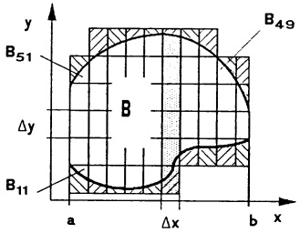

text_image

y
B51
B
Δy
B11
a
Δx
b
x
B49

Abb. 219 – Streifenüberdeckung

die sich von  $Z_{n}$  aus (2) nur um die Anteile der in Abb. 219 schraffierten Randbereiche unterscheidet. Beim Grenzübergang  $(\Delta x)^{2} + (\Delta y)^{2} \rightarrow 0$  strebt dieser Unterschied gegen Null. Die innere Summe führt in der Grenze  $\Delta y \rightarrow 0$ auf  $\int_{g(x_{k}^{*})}^{h(x_{k}^{*})}f(x_{k}^{*},y)dy$  und man erkennt, daß die gesamte Doppelsumme beim Grenzübergang  $(\Delta x)^{2}+(\Delta y)^{2}\rightarrow0$  gegen  $\int_{a}^{b}\left(\int_{g(x)}^{h(x)}f(x,y)dy\right)dx$  strebt.

b) analog mit Summation längs Horizontalstreifen.

Ein beliebiger, stückweise durch Graphen  $y = g(x)$  bzw.  $x = r(y)$  berandeter Integrationsbereich B wird durch ach-

senparallele Schnitte in Normalbereiche $B_{1}, B_{2}, \ldots, B_{n}$ vom Typ I oder II zerlegt. Die Integration gelingt dann mit (9), (11), (12):

$$
\iint_ {B} f d F = \iint_ {B _ {1}} f d F + \dots + \iint_ {B _ {n}} f d F.
$$

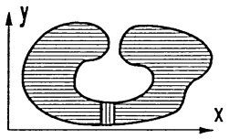

natural_image

Diagram of a shaded 3D region in the X-Y coordinate plane (no text or labels)

Abb. 220 - Zerlegung in Normalbereiche

Man beachte: Die Zerlegung von B in Normalbereiche ist keineswegs eindeutig. Meist ist eine spezielle Aufteilunge für die Integration am günstigsten.

Besitzt B sowohl eine Darstellung als Normalbereich vom Typ I als auch vom Typ II

$$
\begin{array}{l} B = \{(x, y): a \leq x \leq b, g (x) \leq y \leq h (x) \} \\ = \left\{(x, y); c \leq y \leq d, l (y) \leq x \leq r (y) \right\}, \\ \end{array}
$$

dann gilt

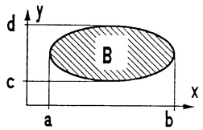

text_image

d
y
B
c
a
b
x

Abb. 221 - Normalbereich Typ I u. II

$$
\iint_ {B} f d F = \int_ {a} ^ {b} \left(\int_ {g (x)} ^ {h (x)} f (x, y) d y\right) d x = \int_ {c} ^ {d} \left(\int_ {l (y)} ^ {r (y)} f (x, y) d x\right) d y.
$$

Speziell erhält man für Rechtecke

$$
R = \{(x, y); a \leq x \leq b, c \leq y \leq d \}
$$

den bekannten Satz von FUBINI über die Vertauschung der Integrationsreihenfolge (→ §1):

$$
\iint_ {R} f d F = \int_ {a} ^ {b} \left(\int_ {c} ^ {d} f (x, y) d y\right) d x = \int_ {c} ^ {d} \left(\int_ {a} ^ {b} f (x, y) d x\right) d y.
$$

Ferner ist erwähnenswert, daß sich aus (5) und (11) die bekannte Formel für den Flächeninhalt des Normalbereichs $B = \{ (x, y) ; a \leq x \leq b, g(x) \leq y \leq h(x) \}$ ergibt ($\rightarrow$ Kap. 4, §5(12))

$$
F = \iint_ {B} d F = \int_ {a} ^ {b} \left(\int_ {g (x)} ^ {h (x)} d y\right) d x = \int_ {a} ^ {b} (h (x) - g (x)) d x.
$$

Berechnung des Doppelintegrals $I = \iint_{B} f(x, y) \, dx \, dy$.

1. Schritt: Man stellt $B$ als Normalbereich dar, bzw. zerlegt $B$ durch achsenparallele Schnitte in Normalbereiche, $B = B_{1} \cup B_{2} \cup \cdots \cup B_{m}$.
2. Schritt: Ist $B_k$ vom Typ I, so berechnet man zuerst das Parameterintegral $F(x) := \int_{g(x)}^{h(x)} f(x,y) dy$ und damit

$$
I _ {k} := \int_ {a} ^ {b} F (x) d x;
$$

für $B_{k}$ vom Typ II ist $I_{k}:=\int_{c}^{d}G(y)dy$ mit

$$
G (y) := \int_ {l (y)} ^ {r (y)} f (x, y)   d x.
$$

3. Schritt:  $I = I_{1} + I_{2} + \cdots + I_{m}$ .

Beispiel 1. B sei berandet von y = x, xy = 1 und y = 2. Wir bestimmen

a) den Flächeninhalt  $F = \iint_{B} dx dy$ ,

b) $V = \iint_{B} \frac{y^2}{x^2} dxdy$, das Volumen des auf $B$ stehenden Zylinderabschnitts mit Deckfläche $z = \frac{y^2}{x^2}$.

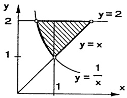

area

| Curve | Description |
| --- | --- |
| y = 1/x | Shaded region bounded by the lines y = 1/x and y = 2 |
| y = 1/x | Diagonal line passing through (0,1) and (1,1) |
| y = 2 | Diagonal line passing through (1,2) and (2,2) |

Abb. 222 - Bereich B

1. Schritt: Die Darstellung als Normalbereich vom Typ II,

$$
B = \left\{\left(x, y\right); 1 \leq y \leq 2, \frac {1}{y} \leq x \leq y \right\}.
$$

2. Schritt :

a) $F = \int_{1}^{2}\left(\int_{1 / y}^{y}dx\right)dy = \int_{1}^{2}(y - \frac{1}{y})dy = \frac{3}{2} -\ln 2.$
b) $V = \int_{1}^{2}\left(\int_{1 / y}^{y}\frac{y^2}{x^2} dx\right)dy = \int_{1}^{2}\left[-\frac{y^2}{x}\right]_{x = 1 / y}^{x = y}dy = \int_{1}^{2}(-y + y^3)dy = \frac{9}{4}$.

Alternativ: Zerlegt man B längs des Schnittes x = 1 in zwei Normalbereiche vom Typ I, so ergibt sich

$$
V = \iint_ {B} f d x d y = \int_ {1 / 2} ^ {1} \left(\int_ {1 / x} ^ {2} \frac {y ^ {2}}{x ^ {2}} d y\right) d x + \int_ {1} ^ {2} \left(\int_ {x} ^ {2} \frac {y ^ {2}}{x ^ {2}} d y\right) d x
$$

$$
= \int_ {1 / 2} ^ {1} (\frac {8}{3 x ^ {2}} - \frac {1}{3 x ^ {5}}) d x + \int_ {1} ^ {2} (\frac {8}{3 x ^ {2}} - \frac {x}{3}) d x = \frac {9}{4}.
$$

Beispiel 2. Der Durchdringungskörper der beiden Zylinder  $x^{2}+y^{2}=1$  und  $x^{2}+z^{2}=1$  besitzt aus Symmetriegründen das Volumen  $V=8V_{1}$  mit dem Volumen  $V_{1}$  des auf dem Viertelkreis

$$
B = \left\{(x, y); 0 \leq x \leq 1, 0 \leq y \leq \sqrt {1 - x ^ {2}} \right\}
$$

stehenden Zylinderabschnitts mit Deckfläche  $z = \sqrt{1 - x^{2}}$ . Mit (6) und (11) erhält man

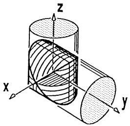

text_image

3D geometric diagram showing a cylinder intersected by a sphere in Cartesian coordinates (x, y, z)

Abb. 223 - Schnitt zweier Zylinder

$$
\iint_ {B} \sqrt {1 - x ^ {2}} d x d y = \int_ {0} ^ {1} \left(\int_ {0} ^ {\sqrt {1 - x ^ {2}}} \sqrt {1 - x ^ {2}} d y\right) d x = \int_ {0} ^ {1} (1 - x ^ {2}) d x = \frac {2}{3}.
$$

Also gilt $V = 8V_{1} = \frac{16}{3}$.

3.4 Weitere Anwendungen und Beispiele. Wir stellen uns  $f : B \rightarrow R$  als eine Belegungsfunktion des ebenen Flächenstücks B vor, etwa die Flächendichte der Masse einer inhomogenen Platte, oder die Ladungs- oder Temperaturverteilung auf B. Für die sich ständig wiederholenden vier Schritte

1. Zerlegung von B in n Teilbereiche mit Flächeninhalt  $\Delta F_{i}$ ,
2. Approximation der Belegung eines solchen Bereichs durch

$$
\Delta M _ {i} := f (x _ {i} ^ {*}, y _ {i} ^ {*}) \Delta F _ {i},
$$

3. Approximation der Gesamtbelegung durch die Riemann-Summe

$$
\sum_ {i = 1} ^ {n} \Delta M _ {i} = \sum_ {i = 1} ^ {n} f (x _ {i} ^ {*}, y _ {i} ^ {*}) \Delta F _ {i},
$$

4. Grenzübergang,

verwenden wir wieder die bereits für Einfachintegrale und Kurvenintegrale als zweckmäßig erkannte, abkürzende Sprechweise (→ Kap. 4, 6.1):

- $B$ ist in Flächenelemente $dF$ zerlegt,
- das Flächenelement im Punkt  $(x,y)$  trägt die Belegung  $dM = f(x,y)dF$ ,
- Gesamtbelegung von $B$ ist $M = \iint_{B} dM = \iint_{B} f(x, y) dF$.

a Masse, Ladung.

$$
M = \iint_ {B} \mu (x, y) d F \tag {13}
$$

ist die Masse der Platte B mit ebener Massendichteverteilung  $\mu: B \rightarrow R$ ; bzw.

$Q = \iint_{B} \epsilon(x, y) \, dF$  die Ladung auf B mit Ladungsdichte  $\epsilon : B \to R$ .

b Momente und Massenmittelpunkt. Ein Flächenelement $dF$ besitzt bei der Massendichte $\mu(x,y)$ die Masse $dm = \mu(x,y)dF$ und demnach die $k$-ten axialen Momente $x^{k}dm = x^{k}\mu(x,y)dF$, $y^{k}dm = y^{k}\mu(x,y)dF$. Es ergeben sich die Gesamtmomente:

$$
M _ {x, k} := \iint_ {B} x ^ {k} \mu (x, y) d F, \quad M _ {y, k} := \iint_ {B} y ^ {k} \mu (x, y) d F. \tag {14}
$$

Das k-te polare Moment ist definiert durch

$$
M _ {0, k} := \iint_ {B} \sqrt {x ^ {2} + y ^ {2}} ^ {k} \mu (x, y) d F. \tag {15}
$$

Als Massenmittelpunkt (oder Schwerpunkt) der Fläche (Platte) B bezeichnet man denjenigen Punkt  $S = (x_{S}, y_{S})$ , in dem eine Punktmasse der Größe M dieselben statischen (=ersten) Momente besitzt wie B :

$$
x _ {S} = \frac {1}{M} \iint_ {B} x \mu (x, y) d F, \quad y _ {S} = \frac {1}{M} \iint_ {B} y \mu (x, y) d F \tag {16}
$$

(mit M aus (13)).

Beispiel. Es soll der Schwerpunkt (Massenmittelpunkt) der zwischen den Geraden x = 2, y = 1 und dem Parabelbogen  $y = x^{2}$  eingespannten inhomogenen Platte B mit ebener Massendichte  $\mu(x, y) = x^{2} + y^{2}$  bestimmt werden.

a) $B$ ist Normalbereich,

$$
B = \left\{(x, y); 1 \leq x \leq 2, 1 \leq y \leq x ^ {2} \right\}.
$$

b) Die Masse $(\rightarrow (13), (11))$:

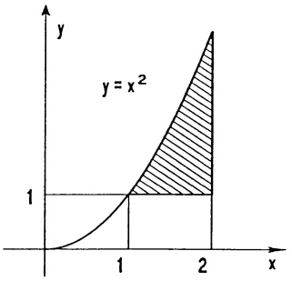

area

| X | Y |
| --- | --- |
| 1 | 1 |
| 2 | 1 |

Abb. 224 - Massenschwerpunkt

$$
\begin{array}{l} M = \iint_ {B} (x ^ {2} + y ^ {2}) d x d y = \int_ {1} ^ {2} \left(\int_ {1} ^ {x ^ {2}} (x ^ {2} + y ^ {2}) d y\right) d x \\ = \int_ {1} ^ {2} \left[ y x ^ {2} + \frac {1}{3} y ^ {3} \right] _ {y = 1} ^ {y = x ^ {2}} d x = \int_ {1} ^ {2} (\frac {1}{3} x ^ {6} + x ^ {4} - x ^ {2} - \frac {1}{3}) d x = \frac {1 0 0 6}{1 0 5}. \\ \end{array}
$$

c) Die ersten axialen Momente (→ (14), (11)):

$$
M _ {x} = \int_ {1} ^ {2} \left(\int_ {1} ^ {x ^ {2}} x (x ^ {2} + y ^ {2}) d y\right) d x = \frac {1 3 5}{8};
$$

$$
M _ {y} = \int_ {1} ^ {2} \left(\int_ {1} ^ {x ^ {2}} y (x ^ {2} + y ^ {2}) d y\right) d x = \frac {2 7 5 3}{1 2 6}.
$$

d) Der Schwerpunkt (→ (16)):

$$
x _ {S} = \frac {1}{M} M _ {x} = 1. 7 6 1 3 0 7 \dots , \quad y _ {S} = \frac {1}{M} M _ {y} = 2. 2 8 0 4 8 4 \dots .
$$

Der geometrische Schwerpunkt $\overline{S} = (\overline{x}, \overline{y})$ des ebenen Flächenstücks ergibt sich aus (16) mit $\mu(x, y) = \mu_0$ (= const). Man erhält

$$
\overline {{x}} = \frac {1}{F} \iint_ {B} x d F, \quad \overline {{y}} = \frac {1}{F} \iint_ {B} y d F \quad \text {mit} F = \iint_ {B} d F.
$$

Beispiel. Der geometrische Schwerpunkt des Normalbereichs

$$
B = \{(x, y); a \leq x \leq b, 0 \leq y \leq g (x) \}
$$

hat die Koordinaten

$$
\begin{array}{l} \overline {{x}} = \frac {1}{F} \iint_ {B} x d x d y = \frac {1}{F} \int_ {a} ^ {b} \left(\int_ {0} ^ {g (x)} x d y\right) d x = \frac {1}{F} \int_ {a} ^ {b} x g (x) d x \\ \overline {{y}} = \frac {1}{F} \iint_ {B} y d x d y = \frac {1}{F} \int_ {a} ^ {b} \left(\int_ {0} ^ {g (x)} y d y\right) d x = \frac {1}{F} \int_ {a} ^ {b} \frac {1}{2} g (x) ^ {2} d x \\ \end{array}
$$

mit  $F = \int_{a}^{b} g(x) dx$ . Speziell erhält man für  $g(x) = \sqrt{r^{2} - x^{2}}$  über dem Intervall  $-r \leq x \leq r$  den Schwerpunkt  $\overline{S} = (\overline{x}, \overline{y}) = (0, \frac{4r}{3\pi})$  des skizzierten Halbkreises.

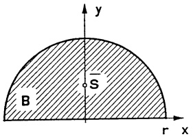

text_image

y
B
S
r x

Abb. 225 - Geometrischer Schwerpunkt

□

3.5 Der Satz von GREEN. Im folgenden behandeln wir eine wichtige Beziehung zwischen dem Doppelintegral über ein Gebiet und dem Kurvenintegral längs dessen Randkurve. Damit ist neben 3.3 eine zweite Methode zur Berechnung von Doppelintegralen gegeben:

Sei $B \subseteq \mathbb{R}^{2}$ ein regulärer Bereich, dessen Rand $\partial B$ aus endlich vielen geschlossenen, stückweise glatten Kurven $\mathbf{w}_{1}, \mathbf{w}_{2}, \ldots, \mathbf{w}_{n}$ besteht. Die Parametrisierung sei so, daß B stets links zur Durchlaufrichtung liegt (positiver Umlauf).

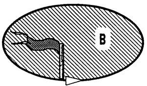

text_image

B

$\partial \pmb {B} = \mathbf{w}_1$

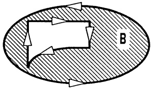

natural_image

Diagram showing a shaded oval with arrows and a labeled region 'B' (no text or symbols within the shape)

$\partial B = \mathbf{W}_1 \cup \mathbf{W}_2$

Abb. 226 - Gebiete, positiv umlaufen

Unter dem Integral eines Vektorfeldes v längs  $\partial B$  verstehen wir die Summe

$$
\int_ {\partial B} \mathbf {v} \cdot d \mathbf {x} := \int_ {\mathbf {w} _ {1}} \mathbf {v} \cdot d \mathbf {x} + \dots + \int_ {\mathbf {w} _ {n}} \mathbf {v} \cdot d \mathbf {x}.
$$

Satz 3.3. Satz von GREEN (1793–1841). Seien B, ∂B wie oben beschrieben und  $D \subseteq R^{2}$  eine offene Menge mit  $B \subseteq D$ , dann gilt für jedes ebene  $C^{1}$ -Vektorfeld  $v : D \to R^{2}$

$$
\int_ {\partial B} \mathbf {v} \cdot d \mathbf {x} = \iint_ {B} \left(\frac {\partial v _ {2}}{\partial x} - \frac {\partial v _ {1}}{\partial y}\right) d x d y.
$$

Beweis. 1. Spezialfall: $v_{2}(x,y) \equiv 0$ und $B = \{(x,y); a \leq x \leq b, g(x) \leq y \leq h(x)\}$ Normalbereich vom Typ I. $\partial B$ besteht aus

$$
\mathbf {w} _ {1} (x) = \binom{x}{g (x)}, \quad a \leq x \leq b,
$$

$$
\mathbf {w} _ {2} (y) = \binom{b}{y}, \quad g (b) \leq y \leq h (b),
$$

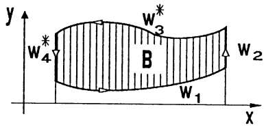

text_image

y
w4*
w3*
B
W2
W1
x

Abb. 227 - Normalbereich, Typ I

und  $w_{3}^{*}$ ,  $w_{4}^{*}$  mit den entgegengesetzt durchlaufenen Kurven

$$
\mathbf {w} _ {3} (x) = \binom{x}{h (x)}, a \leq x \leq b; \quad \mathbf {w} _ {4} (y) = \binom{a}{y}, g (a) \leq y \leq h (a).
$$

Mit  $v_{2}=0$  gilt

$$
\begin{array}{l} \int_ {\partial B} \mathbf {v} \cdot d \mathbf {x} = \int_ {\mathbf {w} _ {1}} v _ {1} d x + \int_ {\mathbf {w} _ {2}} v _ {1} d x - \int_ {\mathbf {w} _ {3}} v _ {1} d x - \int_ {\mathbf {w} _ {4}} v _ {1} d x \\ = \int_ {a} ^ {b} v _ {1} (x, g (x)) d x + 0 - \int_ {a} ^ {b} v _ {1} (x, h (x)) d x - 0 \\ = - \int_ {a} ^ {b} \left(\int_ {\mathrm{g} (x)} ^ {h (x)} \frac {\partial v _ {1}}{\partial y} (x, y) d y\right) d x = - \iint_ {B} \frac {\partial v _ {1}}{\partial y} d x d y. \\ \end{array}
$$

2. Spezialfall:  $v_{1}(x,y) \equiv 0$  und B Normalbereich vom Typ II: Eine anloge Rechnung gibt  $\int_{\partial B} v \cdot d x = \iint_{B} \frac{\partial v_{2}}{\partial x} dx dy$ .