Jeder Normalbereich I läßt sich in Normalbereiche vom Typ II zerlegen und umgekehrt, ebenso allgemeine Bereiche; daher ist alles durch Addition der beiden Spezialfälle zu beweisen. Die Kurvenintegrale über die (stets zweimal in entgegengesetzter Richtung durchlaufenen) Hilfslinien heben sich weg.

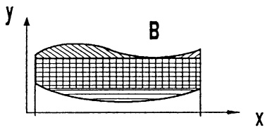

text_image

y
B
x

Abb. 228 - Zerlegung Typ I in Typ II

Mit  $v_{1}=0$ ,  $v_{2}=x$  bzw.  $v_{1}=-y$ ,  $v_{2}=0$  etc. ergeben sich einige wichtige Sonderfälle:

a Der Flächeninhalt von B,

$$
F = \iint_ {B} d x d y = \int_ {\partial B} x d y = - \int_ {\partial B} y d x = \frac {1}{2} \int_ {\partial B} - y d x + x d y.
$$

⑥ Für die 2. Momente der homogenen Platte B mit $\mu(x,y)=1$ ergibt sich mit $\mathbf{v}=(-x^{2}y,0)^{T}$ bzw. $\mathbf{v}=(0,\frac{1}{3}x^{3})^{T}$

und analog

$$
M _ {x, 2} = - \int_ {\partial B} x ^ {2} y d x = \frac {1}{3} \int_ {\partial B} x ^ {3} d y
$$

$$
M _ {y, 2} = \int_ {\hat {c} B} x y ^ {2} d y = - \frac {1}{3} \int_ {\hat {c} B} y ^ {3} d x.
$$

© Der geometrische Schwerpunkt von B ist

$$
\overline {{x}} = - \frac {1}{F} \int_ {\partial B} x y d x = \frac {1}{2 F} \int_ {\partial B} x ^ {2} d y, \quad \overline {{y}} = \frac {1}{F} \int_ {\partial B} x y d y = - \frac {1}{2 F} \int_ {\partial B} y ^ {2} d x.
$$

Beispiel 1. Der geometrische Schwerpunkt des Bereiches, der von der Zykloide

$$
\mathbf {w} _ {1} (t) = a \binom{2 \pi - t + \sin t}{1 - \cos t}, \quad 0 \leq t \leq 2 \pi ,
$$

und der Strecke

$$
\mathbf {w} _ {2} (t) = \binom{t}{0}, \quad 0 \leq t \leq 2 \pi a,
$$

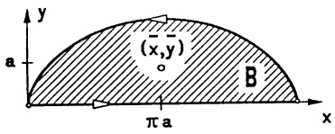

text_image

y
(a, y)
(x,y)
B
π a
x

Abb. 229 - Zykloide

begrenzt wird, hat die Koordinaten

$$
\overline {{x}} = \pi a \text {und} \overline {{y}} = - \frac {\frac {1}{2} \int_ {\hat {c} B} y ^ {2} d x}{\int_ {\hat {c} B} y d x} = \frac {\frac {a ^ {3}}{2} \int_ {0} ^ {2 \pi} (1 - \cos t) ^ {3} d t + 0}{a ^ {2} \int_ {0} ^ {2 \pi} (1 - \cos t) ^ {2} d t + 0} = \frac {5}{6} a.
$$

Beispiel 2. Ebener Satz von Gauss. Ist $u:D\to\mathbb{R}$ eine $\mathscr{C}^{2}$-Funktion, so ergibt sich mit $v_{1}=-\frac{\partial u}{\partial y}$ und $v_{2}=\frac{\partial u}{\partial x}$ sofort $\frac{\partial v_{2}}{\partial x}-\frac{\partial v_{1}}{\partial y}=\frac{\partial^{2}u}{\partial x^{2}}+\frac{\partial^{2}u}{\partial y^{2}}=\Delta u$. Der Satz von Green liefert somit

$$
\begin{array}{l} \iint_ {B} \Delta u   d x d y = \int_ {\partial B} - u _ {y}   d x + u _ {x}   d y \\ = \int_ {\partial B} \mathrm{grad} u \cdot \mathbf {n} d s \\ = \int_ {\partial B} \partial_ {\mathbf {n}} u d s. \\ \end{array}
$$

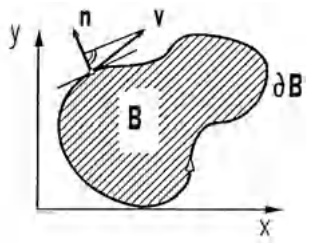

text_image

y
n
v
B
∂B
x

Abb. 230 - Satz von Gauss

Hierbei ist $\mathbf{n} = \begin{pmatrix} \dot{y} \\ -\dot{x} \end{pmatrix}$ der stets nach außen weisende Normalenvektor mit $|\mathbf{n}| = 1$, wenn $s \mapsto (x(s), y(s))$ die Parametrisierung von $\partial B$ mit der Bogenlänge $s$ darstellt. Liegt eine harmonische Funktion $u$ mit $\Delta u = 0$ vor, so ist das Integralmittel über die Normalableitung $\partial_{\mathbf{n}} u$ längs $\partial B$ stets Null ($\rightarrow 5.4$).

## Aufgaben

1. Man skizziere den Integrationsbereich, berechne das Integral und vertausche die Integrationsreihenfolge:

$$
\int_ {0} ^ {1} \int_ {y} ^ {y ^ {2} + 1} x ^ {2} y   d x d y .
$$

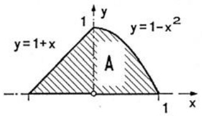

text_image

y=1+x
A
y=1-x²
1
1
x

2. Man berechne den geometrischen Schwerpunkt:

a) Skizzierter ebener Bereich A,
b) $T = \{(x,y)\in \mathbb{R};y^{2}\leq 2px,y\geq 0,0\leq x\leq x_{0},p,x_{0} > 0\} .$

3. Man berechne den Flächeninhalt des von der Astroide ( $\rightarrow$  Abb. 114)
 $x = \cos^{3} t$ ,  $y = \sin^{3} t$ ,  $0 \leq t \leq 2\pi$ , begrenzten Bereichs.

4. Man skizziere die Bereiche und berechne die Schwerpunktkoordinaten:

a) $\{(x,y); x^2 + y^2 \leq 20, y \geq x + 2\}$
b) Berandung ist  $\sqrt{x} + \sqrt{y} = \sqrt{a}$ , a > 0, x = 0, y = 0.

5. Aus der Kugel  $x^{2} + y^{2} + z^{2} \leq 4a^{2}$  wird das zylindrische Loch  $x^{2} + y^{2} \leq 2ax$  ausgebohrt. Wie groß ist das Restvolumen?

6. Man berechne den Inhalt der Fläche, die von der Hypozykloide mit 3 Spitzen berandet wird:

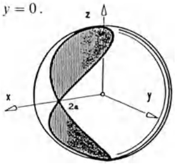

text_image

y = 0.
x
2π
y
z

$$
x = a (2 \cos t + \cos 2 t); \quad y = a (2 \sin t - \sin 2 t).
$$

7. Man berechne das Kurvenintegral $\oint_{\mathbf{w}} \frac{xdy - ydx}{x^2 + y^2}$ über eine geschlossene Kurve $\mathbf{w}$ mit Hilfe des Greenschen Satzes.
8. Man berechne mit dem Satz von Green den geometrischen Schwerpunkt des Bereichs im 1. Quadranten, der von $y = x$, $y = 1 / x$ und $y = \frac{x}{4}$ berandet wird.
9. Das Trägheitsmoment eines ebenen Bereiches B bezüglich einer Achse ist

$$
I _ {p} = \iint_ {B} \delta^ {2} (x, y) d x d y ,
$$

wobei $\delta^{2}(x,y)$ das Abstandsquadrat des Punktes $(x,y)$ von der Achse bezeichnet. Man berechne die Trägheitsmomente bezüglich der $x$- und $y$-Achse für die Bereiche mit den Berandungen

a) Ellipse  $\frac{x^{2}}{a^{2}}+\frac{y^{2}}{b^{2}}=1$ ,
b) Quadrat  $|x + y| + |x - y| = 2$ ,
c) $x^{4} + y^{4} = x^{2} + y^{2}$.

10. Bei der Torsion von Körpern mit nicht kreisförmigem Querschnitt bleiben die Querschnitte nicht eben (Theorie von ST. VENANT).

Anstelle des polaren Trägheitsmomentes $I_p$ tritt der Drillungswiderstand $I^*$. Am Beispiel eines prismatischen Stabes (Querschnitt: Gleichseitiges Dreieck mit Höhe $h$) ergibt sich aus dem Spannungsvektor $p_4$ ($\rightarrow$ Kap. 7, §4, Aufg. 9)

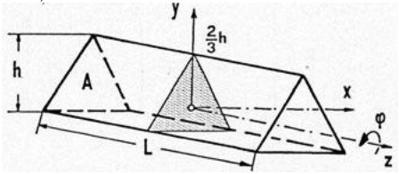

text_image

h
A
L
y
2/3 h
x
φ
z

$$
I ^ {*} = \frac {1}{2 h} \iint_ {A} \left| \left( \begin{array}{c} x \\ y \\ 0 \end{array} \right) \times \left( \begin{array}{c} 3 y ^ {2} + 3 x ^ {2} - 2 h y \\ 6 x y + 2 h x \\ 0 \end{array} \right) \right| d F.
$$

a) Man bestimme den Drillungswiderstand  $I^{*}$ .
b) Man berechne $I_p = \iint_{A} (x^2 + y^2) dF$ und bestätige, daß $I^* = \frac{3}{5} I_p$. D.h. die Querschnitt-Verwölbung reduziert den Torsionswiderstand!

## §4. Die Integration über Flächen im Raum

4.1 Parameterdarstellungen. Neben die explizite Flächendarstellung als Graph  $z = h(x, y)$ ,  $(x, y) \in D$ , und die implizite Darstellung als Niveaufläche  $f(x, y, z) = \text{const tritt nun die für Detailuntersuchungen besonders vorteilhafte Parameterdarstellung}$ .

Wir stellen uns vor, daß eine Fläche im Raum durch stetige Verformung aus einer ebenen Fläche hervorgeht. Da unter stetigen Funktionen aber sehr „pathologische“ Bilder entstehen können, machen wir für unsere Zwecke angemessene Einschränkungen.

Definition. Sei D ein regulärer Bereich in einem Gebiet G der  $(u,v)$ -Ebene. Unter der Parameterdarstellung eines regulären Flächenstücks verstehen wir die Einschränkung einer  $C^{1}$ -Funktion  $x: G \to R^{3}$ ,  $\mathbf{x}(u,v) = (x(u,v), y(u,v), z(u,v))^{T}$  auf D mit den Eigenschaften:

1. Für beliebige Punkte  $(u,v)\neq(u',v')$  aus D ist stets  $\mathbf{x}(u,v)\neq\mathbf{x}(u',v')$ ,
2.  $\mathbf{x}_{u}(u,v)\times\mathbf{x}_{v}(u,v)\neq\mathbf{0}$ für alle $(u,v)\in D$.

Die Punktmenge $S = \{(x(u,v), y(u,v), z(u,v)) ; (u,v) \in D\}$ ist das dargestellte reguläre Flächenstück.

Nach Voraussetzung 1. gibt es zu jedem Punkt $(x, y, z) \in S$ genau einen Punkt $(u, v)$ des Parameterbereichs $D$ mit $x = x(u, v)$, $y = y(u, v)$, $z = z(u, v)$.

Variiert man nur einen Parameter und hält den anderen fest, dann entstehen die beiden Kurvenscharen auf $S$

$$
\begin{array}{l} u \mapsto \mathbf {x} (u, v) \quad (v = \text {const}), \\ v \mapsto \mathbf {x} (u, v) \quad (u = \text {const}), \\ \end{array}
$$

die man als Parameterlinien $v = \text{const}$ bzw. $u = \text{const}$ bezeichnet. Mit der Voraussetzung 2. wird gefordert, daß die Tangentialvektoren

$$
\boxed {\mathbf {x} _ {u} (u, v) = \left( \begin{array}{c} \frac {\partial x}{\partial u} (u, v) \\ \frac {\partial y}{\partial u} (u, v) \\ \frac {\partial z}{\partial u} (u, v) \end{array} \right), \quad \mathbf {x} _ {v} (u, v) = \left( \begin{array}{c} \frac {\partial x}{\partial v} (u, v) \\ \frac {\partial y}{\partial v} (u, v) \\ \frac {\partial z}{\partial v} (u, v) \end{array} \right)}
$$

an die Parameterlinien in allen Punkten  $(u,v)\in D$  linear unabhängig sind.

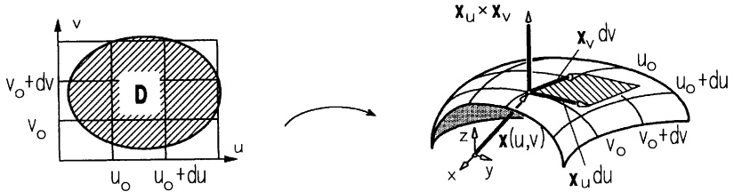

text_image

v
v_o+dv
D
u_o u_o+du
u
x_u × x_v
x_v dv
u_o
u_o+du
z
x(u,v)
y
x_u du
v_o v_o+dv

Abb. 231 – Parameterlinien auf Flächenstück

Die von  $x_{u}$  und  $x_{v}$  aufgespannte Ebene durch den Flächenpunkt  $\mathbf{x}(u,v)$  ist die Tangentialebene mit der Parameterdarstellung

$$
\mathbf {v} (\lambda , \mu) = \mathbf {x} (u, v) + \lambda \mathbf {x} _ {u} (u, v) + \mu \mathbf {x} _ {v} (u, v), \quad \lambda , \mu \in \mathbb {R}.
$$

Der auf der Tangentialebene durch  $\mathbf{x}(u,v)$  senkrecht stehende Einheitsvektor

$$
\boxed {\mathbf {n} := \frac {1}{\left| \mathbf {x} _ {u} \times \mathbf {x} _ {v} \right|} \mathbf {x} _ {u} \times \mathbf {x} _ {v}} \tag {1}
$$

heißt Flächennormale (im betreffenden Punkt).

Für ein reguläres Kurvenstück  $t \mapsto \begin{pmatrix} u(t) \\ v(t) \end{pmatrix}$ ,  $t_{0} \leq t \leq t_{1}$ , im Parameterbereich

D ist das Bild  $\mathbf{w}(t):=\mathbf{x}(u(t),v(t))$  eine reguläre Flächenkurve, deren Tangentialvektor  $\dot{\mathbf{w}}=\mathbf{x}_{u}\dot{u}+\mathbf{x}_{v}\dot{v}\quad(\rightarrow\text{Kettenregel},\text{Kap.~7,~}\S2(12))$  ebenfalls in der Tangentialbene (durch  $\mathbf{x}(u,v)$ ) liegt. Die Bogenlänge  $s(t)=\int_{t_{0}}^{t}|\dot{\mathbf{w}}(t)|dt$  ergibt sich wegen

$$
| \dot {\mathbf {w}} | ^ {2} = \dot {\mathbf {w}} \cdot \dot {\mathbf {w}} = (\mathbf {x} _ {u} \cdot \mathbf {x} _ {u}) \dot {u} ^ {2} + 2 (\mathbf {x} _ {u} \cdot \mathbf {x} _ {v}) \dot {u} \dot {v} + (\mathbf {x} _ {v} \cdot \mathbf {x} _ {v}) \dot {v} ^ {2}
$$

aus den metrischen Fundamentalgrößen

$$
E := \mathbf {x} _ {u} \cdot \mathbf {x} _ {u}; \quad F := \mathbf {x} _ {u} \cdot \mathbf {x} _ {v}; \quad G := \mathbf {x} _ {v} \cdot \mathbf {x} _ {v}. \tag {2}
$$

Diese bestimmen nicht nur die Längenmessung auf $S$, sondern auch die Messung von Winkeln ($\rightarrow$ Aufg. 5,6) und Flächeninhalte ($\rightarrow$ (6)). Aus der Identität $|\mathbf{a} \times \mathbf{b}|^{2} = |\mathbf{a}|^{2}|\mathbf{b}|^{2} - (\mathbf{a} \cdot \mathbf{b})^{2}$ ($\rightarrow$ Kap. 1, §5) folgt

$$
\boxed {| \mathbf {x} _ {u} \times \mathbf {x} _ {v} | ^ {2} = E G - F ^ {2}.} \tag {3}
$$

Bilden die Parameterlinien ein orthogonales Netz, d.h. schneiden sich in jedem Flächenpunkt  $\mathbf{x}(u_{0},v_{0})$  die Parameterlinien  $u=u_{0}$ ,  $v=v_{0}$  unter einem rechten Winkel, dann gilt überall F=0.

Als Rand des Flächenstücks S wird das x-Bild des Randes von D bezeichnet:

$$
\partial S := \left\{\mathbf {x} (u, v); (u, v) \in \partial D \right\}.
$$

Die Oberfläche der in den technischen Anwendungen auftretenden dreidimensionalen Körper kann in der Regel nicht durch ein einziges reguläres Flächenstück dargestellt werden. Man denke etwa an einen Würfel oder Zylinderstumpf mit Ecken und Kanten. Wir verstehen deshalb unter einer stückweise regulären Fläche S die Vereinigung endlich vieler regulärer Flächenstücke  $S_{i}$ , von denen je zwei längs einem oder mehrerer gemeinsamer Randstücke aneinanderstoßen, aber sonst keine anderen Punkte gemeinsam haben. Der Rand  $\partial S$  von S wird aus allen Randstücken gebildet, die nur zu einem der regulären Flächenstücke  $S_{i}$  gehören. Man nennt S geschlossen, wenn  $\partial S$  leer ist.

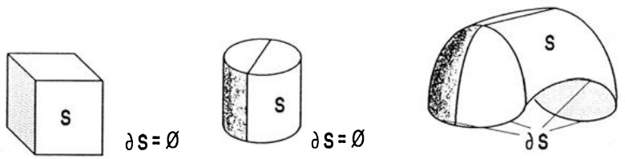

text_image

S
∂S = Ø
S
∂S = Ø
S
∂S

Abb. 232 – stückweise reguläre Flächen

## 4.2 Beispiele.

① Ebenen. Für $\mathbf{a},\mathbf{b}\in\mathbb{R}^{3}$ mit $\mathbf{a}\times\mathbf{b}\neq0$ stellt $\mathbf{x}(u,v)=\mathbf{x}_{0}+u\mathbf{a}+v\mathbf{b}$, $(u,v)\in D$, ein Ebenenstück dar. Die Parameterlinien $u=\mathrm{const}$, $v=\mathrm{const}$ sind Geraden parallel zu $\mathbf{b}$ bzw. $\mathbf{a}$. $\mathbf{x}_{u}=\mathbf{a}$, $\mathbf{x}_{v}=\mathbf{b}$. $E=|\mathbf{a}|^{2}$, $F=\mathbf{a}\cdot\mathbf{b}$, $G=|\mathbf{b}|^{2}$.

② Graphen. Aus der expliziten Darstellung eines Flächenstücks als Graph $z = h(x, y)$, $h \in \mathcal{C}^{1}(D, \mathbb{R})$, erhält man sofort die Parameterdarstellung

$$
\mathbf {x} (x, y) = \left( \begin{array}{c} x \\ y \\ h (x, y) \end{array} \right), \quad (x, y) \in D . \tag {4}
$$

Parameterlinien sind die Schnitte mit den Ebenen x = const bzw. y = const.

$$
\mathbf {x} _ {x} = \left( \begin{array}{c} 1 \\ 0 \\ h _ {x} \end{array} \right), \quad \mathbf {x} _ {y} = \left( \begin{array}{c} 0 \\ 1 \\ h _ {y} \end{array} \right),
$$

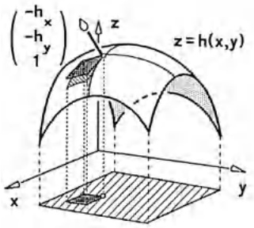

text_image

(-h_x)
(-h_y)
1
z
z = h(x,y)
x
y

Abb. 233 - $z = h(x, y)$

$$
\mathbf {x} _ {x} \times \mathbf {x} _ {y} = \left( \begin{array}{c} - h _ {x} \\ - h _ {y} \\ 1 \end{array} \right), \quad E = 1 + h _ {x} ^ {2}, \quad F = h _ {x} h _ {y}, \quad G = 1 + h _ {y} ^ {2}.
$$

③ Drehflächen. Aus einem regulären Kurvenstück $t \mapsto \begin{pmatrix} x(t) \\ 0 \\ z(t) \end{pmatrix}$, $t_0 \leq t \leq t_1$, ohne Doppelpunkte mit $x(t) > 0$ entsteht nach Kap. 6, §6, bei Drehung um die $z$-Achse mit dem Winkel $\varphi_0$ ($0 \leq \varphi_0 < 2\pi$) ein reguläres Flächenstück mit der Parameterdarstellung

$$
\mathbf {x} (t, \varphi) = \left( \begin{array}{c c c} \cos \varphi & - \sin \varphi & 0 \\ \sin \varphi & \cos \varphi & 0 \\ 0 & 0 & 1 \end{array} \right) \left( \begin{array}{c} x (t) \\ 0 \\ z (t) \end{array} \right) = \left( \begin{array}{c} x (t) \cos \varphi \\ x (t) \sin \varphi \\ z (t) \end{array} \right), \tag {5}
$$

definiert auf $D = \{ (t, \varphi) ; t_0 \leq t \leq t_1, 0 \leq \varphi \leq \varphi_0 \}$. Die Parameterlinien $t = \text{const}$ sind die Breitenkreise, $\varphi = \text{const}$ die Meridiane.

$$
\mathbf {x} _ {t} = \left( \begin{array}{c} \dot {x} (t) \cos \varphi \\ \dot {x} (t) \sin \varphi \\ \dot {z} (t) \end{array} \right), \mathbf {x} _ {\varphi} = \left( \begin{array}{c} - x (t) \sin \varphi \\ x (t) \cos \varphi \\ 0 \end{array} \right);
$$

$$
\mathbf {x} _ {t} \times \mathbf {x} _ {\varphi} = \left( \begin{array}{c} - x \dot {z} \cos \varphi \\ - x \dot {z} \sin \varphi \\ x \dot {x} \end{array} \right)  ,
$$

$$
E = \dot {x} ^ {2} + \dot {z} ^ {2}, F = 0, G = x ^ {2}.
$$

Da überall F = 0 gilt, bilden die Parameterlinien ein orthogonales Netz.

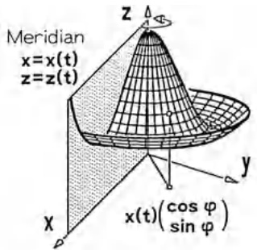

text_image

Meridian
x=x(t)
z=z(t)
x
y
x(t)(cos φ)
(sin φ)

Abb. 234 - Drehfläche

$(x(t) > 0 \text{ wurde vorausgesetzt, damit die Regularitätsbedingung } |\mathbf{x}_t \times \mathbf{x}_\varphi| = \sqrt{x^2(\dot{x}^2 + \dot{z}^2)} \neq 0 \text{ erfüllt ist.})$

Da bei einer vollen Umdrehung die Meridiane $\varphi = 0$ und $\varphi = 2\pi$ aufeinanderfallen, ist die gesamte Drehfläche $S$ (d.h. $0 \leq \varphi \leq 2\pi$) nur stückweise regulär (man nehme etwa die beiden zu $0 \leq \varphi \leq \pi$ und $\pi \leq \varphi \leq 2\pi$ gehörigen Flächenstücke). Der Rand $\partial S$ der gesamten Drehfläche besteht aus den beiden Breitenkreisen $\varphi \mapsto (x(t_i) \cos \varphi, x(t_i) \sin \varphi, z(t_i))^T$, $i = 0,1$.

## Sonderfälle.

(a) Der Kegelstumpf (nur die Mantelfläche) (→ Abb. 235).

$$
\mathbf {x} (t, \varphi) = \left( \begin{array}{c} t \cos \varphi \\ t \sin \varphi \\ b (1 - \frac {t}{a}) \end{array} \right), a _ {0} \leq t \leq a, 0 \leq \varphi \leq 2 \pi , \mathbf {x} _ {t} \times \mathbf {x} _ {\varphi} = (\frac {b}{a} t \cos \varphi , \frac {b}{a} t \sin \varphi , t).
$$

⑥ Der Zylinderstumpf (die Mantelfläche) (→ Abb. 236).

$$
\mathbf {x} (z, \varphi) = \left( \begin{array}{c} r \cos \varphi \\ r \sin \varphi \\ z \end{array} \right), z _ {0} \leq z \leq z _ {1}, 0 \leq \varphi \leq 2 \pi , \mathbf {x} _ {z} \times \mathbf {x} _ {\varphi} = (- r \cos \varphi , - r \sin \varphi , 0).
$$

© Die Sphäre (Kugeloberfläche) mit Zentrum O und Radius r (→ Abb. 237).

$$
\mathbf {x} (\psi , \varphi) = \left( \begin{array}{c} r \sin \psi \cos \varphi \\ r \sin \psi \sin \varphi \\ r \cos \psi \end{array} \right), \quad 0 \leq \psi \leq \pi , \quad 0 \leq \varphi \leq 2 \pi .
$$

Im Nord- und Südpol ( $\psi = 0, \pi$ ) ist  $x_{\psi} \times x_{\varphi} = 0$ , längs des Halbkreises  $\varphi = 0$  ist die Darstellung nicht eineindeutig. Diese Ausnahmepunkte spielen aber als Nullmenge für das Oberflächenintegral keine Rolle.

$$
\mathbf {x} _ {\psi} \times \mathbf {x} _ {\varphi} = (r ^ {2} \sin^ {2} \psi \cos \varphi , r ^ {2} \sin^ {2} \psi \sin \varphi , r ^ {2} \sin \psi \cos \psi) ^ {T} = (r \sin \psi) \mathbf {x} (\psi , \varphi).
$$

$$
E = \mathbf {x} _ {\psi} \cdot \mathbf {x} _ {\psi} = r ^ {2}, F = \mathbf {x} _ {\psi} \cdot \mathbf {x} _ {\varphi} = 0, G = \mathbf {x} _ {\varphi} \cdot \mathbf {x} _ {\varphi} = r ^ {2} \sin^ {2} \psi .
$$

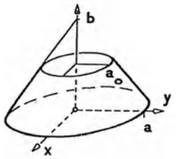

text_image

b
a
y
a
ρ
x

Abb. 235 - Kegelstumpf

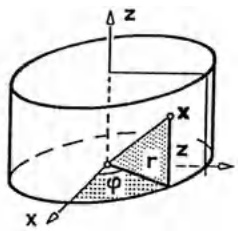

text_image

z
x
r
φ
x

Abb. 236 - Zylinderstumpf

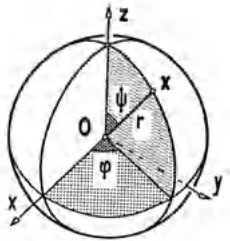

text_image

z
ψ
r
O
φ
x
y

Abb. 237 - Sphäre

(d) Der Torus (die Ringfläche) T entsteht durch Drehung des Kreises

$$
x = R + r \sin \psi , \quad z = r \cos \psi ,
$$

$0 \leq \psi \leq 2\pi$ mit festem „inneren“ und „äußeren“ Radius r bzw. R, r < R,

$$
\mathbf {x} (\psi , \varphi) = \left( \begin{array}{c} (R + r \sin \psi) \cos \varphi \\ (R + r \sin \psi) \sin \varphi \\ r \cos \psi \end{array} \right)  .
$$

(Nur stückweise regulär, Rand $\partial T$ leer)

$$
E = r ^ {2}, F = 0, G = (R + r \sin \psi) ^ {2}.
$$

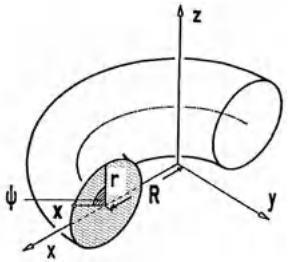

text_image

z
ψ
x
r
R
y
x

Abb. 238 - Torus

© Die Wendelfläche entsteht durch Schraubung einer Geraden, die die Schraubachse senkrecht schneidet; die Parameterdarstellung eines Flächenstücks ist mit $a = \text{const} > 0$:

$$
\mathbf {x} (r, \varphi) = \left( \begin{array}{c} r \cos \varphi \\ r \sin \varphi \\ a \varphi \end{array} \right), \begin{array}{l} r _ {0} \leq r \leq r _ {1} \\ \varphi_ {0} \leq \varphi \leq \varphi_ {1} \end{array} .
$$

$$
\mathbf {x} _ {r} = \left( \begin{array}{c} \cos \varphi \\ \sin \varphi \\ 0 \end{array} \right), \quad \mathbf {x} _ {\varphi} = \left( \begin{array}{c} - r \sin \varphi \\ r \cos \varphi \\ a \end{array} \right),
$$

$$
\mathbf {x} _ {r} \times \mathbf {x} _ {\varphi} = \left( \begin{array}{c} a \sin \varphi \\ - a \cos \varphi \\ r \end{array} \right) .
$$

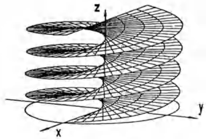

natural_image

3D wireframe model of a helical surface with x, y, z axes labeled (no text or symbols beyond axis labels)

Abb. 239 - Wendelfläche mit $r_0 = -r_1$ und $\varphi_0 = 0$, $\varphi_1 = 4\pi$

$$
E = \mathbf {x} _ {r} \cdot \mathbf {x} _ {r} = 1, \quad F = 0, \quad G = \mathbf {x} _ {\varphi} \cdot \mathbf {x} _ {\varphi} = r ^ {2} + a ^ {2}.
$$

## 4.3 Der Flächeninhalt.

Sei $\mathbf{x}:\mathbb{R}^2\supseteq D\to \mathbb{R}^3$

$$
\mathbf {x} (u, v) = (x (u, v), y (u, v), z (u, v)) ^ {T},
$$

die Parameterdarstellung eines regulären Flächenstücks S. Ein kleines Teilstück  $\Delta S$ , berandet von den Parameterlinien  $u = u_{0}$ ,  $u = u_{0} + \Delta u$ ,  $v = v_{0}$ ,  $v = v_{0} + \Delta v$ , läßt sich über die lineare Approximation ( $\rightarrow$  Kap. 7, §4(2))

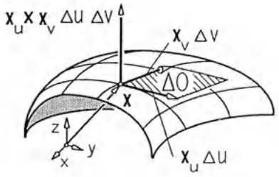

text_image

x_u x x_v \u0394 u \u0394 v \u0394
x_v \u0394 v
\u0394 O
x
z
y
x_u \u0394 u

Abb. 240 - Flächenelement

$$
\mathbf {x} (u, v) \approx \left( \begin{array}{c c} x _ {u} (u _ {0}, v _ {0}) & x _ {v} (u _ {0}, v _ {0}) \\ y _ {u} (u _ {0}, v _ {0}) & y _ {v} (u _ {0}, v _ {0}) \\ z _ {u} (u _ {0}, v _ {0}) & z _ {v} (u _ {0}, v _ {0}) \end{array} \right) \binom{u - u _ {0}}{v - v _ {0}} + \mathbf {x} (u _ {0}, v _ {0})
$$

näherungsweise darstellen als Parallelogramm, das von den im Flächenpunkt  $\mathbf{x}(u_{0},v_{0})$  angetragenen Vektoren  $\mathbf{x}_{u}(u_{0},v_{0})\Delta u$ ,  $\mathbf{x}_{v}(u_{0},v_{0})\Delta v$  aufgespannt wird und den Flächeninhalt

$$
\Delta O = | \mathbf {x} _ {u} (u _ {0}, v _ {0}) \times \mathbf {x} _ {v} (u _ {0}, v _ {0}) | \Delta u \Delta v
$$

besitzt (→ Kap. 1, §3).

Wird nun $S$ durch ein Netz von Parameterlinien in $n$ Teilstücke $\Delta S_{1},\ldots,\Delta S_{n}$ zerlegt und jedes Teilstück $\Delta S_{i}$ durch das entsprechende Parallelogramm mit dem Flächeninhalt $\Delta O_{i}=|\mathbf{x}_{u}(u_{i},v_{i})\times\mathbf{x}_{v}(u_{i},v_{i})|\Delta u\Delta v$ approximiert, dann ergibt bei stets feiner werdender Teilung der Grenzwert ($\rightarrow$ §3, (3))

$$
\lim _ {n \to \infty} \sum_ {i = 1} ^ {n} | \mathbf {x} _ {u} (u _ {i}, v _ {i}) \times \mathbf {x} _ {v} (u _ {i}, v _ {i}) | \Delta u \Delta v = \iint_ {D} | \mathbf {x} _ {u} \times \mathbf {x} _ {v} | d u   d v
$$

den Flächeninhalt von S.

Genau genommen ist dieses die Definition des Flächeninhalts von S ; aufgrund der Voraussetzungen über S existiert der Grenzwert.

Der Flächeninhalt $O(S)$ eines regulären Flächenstücks $\mathbf{x}:D\to\mathbb{R}^{3}$ ist

$$
O (S) = \iint_ {D} | \mathbf {x} _ {u} \times \mathbf {x} _ {v} | d u d v. \tag {6}
$$

In der bewährten Kurzform ( $\rightarrow$  3.4): Das von den benachbarten Parameterlinien  $u = u_{0}$ ,  $u = u_{0} + du$ ,  $v = v_{0}$ ,  $v = v_{0} + dv$  berandete Flächenstück bestimmt das skalare Flächenelement (Oberflächenelement)

$$
d O = | \mathbf {x} _ {u} \times \mathbf {x} _ {v} | d u d v. \tag {7}
$$

Der gesamte Flächeninhalt ergibt sich durch „Summation“ über alle Elemente. Mit den metrischen Fundamentalgrößen E, F, G (→ (3)) lautet die Oberflächenformel (6)

$$
O (S) = \iint_ {D} \sqrt {E G - F ^ {2}} d u d v \tag {8}
$$

mit den Sonderfällen (→ 4.2 ②, ③):

(a) Oberflächeninhalt des Graphen  $z = h(x, y)$ ,  $(x, y) \in D$ ,

$$
O = \iint_ {D} \sqrt {1 + h _ {x} ^ {2} + h _ {y} ^ {2}} d x d y . \tag {9}
$$

⑥ Oberflächeninhalt der Drehfläche (5) - mit  $\varphi_{0}=2\pi$

$$
O = \iint_ {D} \sqrt {x ^ {2} (\dot {x} ^ {2} + \dot {z} ^ {2})} d t d \varphi = 2 \pi \int_ {t _ {o}} ^ {t _ {1}} x \sqrt {\dot {x} ^ {2} + \dot {z} ^ {2}} d t. \tag {10}
$$

Beispiel 1. Die Oberfläche der Kugel mit dem Radius $r$. Mit $E = r^2$, $F = 0$, $G = r^2 \sin^2 \psi$ und $D = \{(\psi, \varphi); 0 \leq \psi \leq \pi, 0 \leq \varphi \leq 2\pi\}$ ($\rightarrow$ 4.2c) ergibt sich aus (8) oder (10)

$$
O = \iint_ {D} r ^ {2} | \sin \psi | d \psi d \varphi = 2 \pi r ^ {2} \int_ {0} ^ {\pi} \sin \psi d \psi = 4 \pi r ^ {2}.
$$

Beispiel 2. Die Torusoberfläche. Mit $E = r^2$, $F = 0$, $G = (R + r \sin \psi)^2$ und $D = \{(\psi, \varphi) ; 0 \leq \psi \leq 2\pi, 0 \leq \varphi \leq 2\pi\}$ ($\rightarrow$ 4.2) erhält man

$$
O = \iint_ {D} r (R + r \sin \psi) d \psi d \varphi = 2 \pi r \int_ {0} ^ {2 \pi} (R + r \sin \psi) d \psi = 4 \pi^ {2} r R . \tag {$\square$}
$$

Beispiel 3. Der Graph z = xy stellt ein hyperbolisches Paraboloid dar. Der Oberflächeninhalt für  $x^{2} + y^{2} \leq 1$  ergibt sich zu

$$
\begin{array}{l} O = \iint_ {0 \leq x ^ {2} + y ^ {2} \leq 1} \sqrt {1 + x ^ {2} + y ^ {2}} d x d y = \int_ {- 1} ^ {1} \left(\int_ {- \sqrt {1 - x ^ {2}}} ^ {\sqrt {1 - x ^ {2}}} \sqrt {1 + x ^ {2} + y ^ {2}} d y\right) d x \\ = \frac {2}{3} \pi (\sqrt {2} ^ {3} - 1). \\ \end{array}
$$

Mit (10) bestätigt man die 1. Regel von GULDIN (1577 - 1643):

Der Oberflächeninhalt einer Drehfläche beträgt  $2\pi r_{0}l$  mit der Länge l und dem Drehachsenabstand  $r_{0}$  des Schwerpunkts eines Meridianschnitts.

Beweis. Bei entsprechender Lage des Koordinatensystems gilt nach (10) $O = 2\pi \int_{t_0}^{t_1} x ds$ mit $ds = \sqrt{\dot{x}^2 + \dot{y}^2} dt$, bzw. $O = 2\pi l\bar{x}$ mit der Schwerpunktskoordinate $\bar{x} = \frac{1}{l} \int_{t_0}^{t_1} x ds$.

4.4 Das Oberflächenintegral einer skalaren Funktion. Ist auf einem regulären Flächenstück mit der Parameterdarstellung $\mathbf{x}:\mathbb{R}^{2}\supseteq D\to\mathbb{R}^{3}$ eine skalare Belegungsfunktion gegeben, so „trägt“ ein (von Parameterlinien eingeschlossenes) Flächenelement $dO=|\mathbf{x}_{u}\times\mathbf{x}_{v}|dudv$ ($\rightarrow(7)$) die Belegung $f(x(u,v),y(u,v),z(u,v))|\mathbf{x}_{u}\times\mathbf{x}_{v}|dudv$. Die Gesamtbelegung erhält man durch Integration über $D$.

Definition. Ist $\mathbf{x}:\mathbb{R}^{2}\supseteq D\to\mathbb{R}^{3}$ eine Parameterdarstellung des regulären Flächenstücks $S$ und $f$ ein auf $S$ stetiges Skalarenfeld, dann nennt man

$$
\iint_ {S} f d O := \iint_ {D} f (x (u, v), y (u, v), z (u, v)) | \mathbf {x} _ {u} (u, v) \times \mathbf {x} _ {v} (u, v) | d u d v \tag {11}
$$

das Oberflächenintegral von f über S.

Für eine aus regulären Flächenstücken $S_{1},\ldots,S_{n}$ bestehende stickweise reguläre Fläche $S$ definiert man das Oberflächenintegral durch

$$
\iint_ {S} f d O := \iint_ {S _ {1}} f d O + \dots + \iint_ {S _ {n}} f d O.
$$

Für das Oberflächenintegral gelten offenbar die üblichen Rechenregeln: Linearität, Monotonie, Additivität und der Mittelwertsatz:

Das Integralmittel wird in einem Flächenpunkt angenommen; d.h. es gibt einen Punkt  $\mathbf{x}(u^{*},v^{*})$  auf dem regulären Flächenstück S mit

$$
f \left(\mathbf {x} (u ^ {*}, v ^ {*})\right) = \frac {1}{O (S)} \iint_ {S} f d O. \tag {12}
$$

Berechnung des Oberflächenintegrals  $I = \iint_{S} f dO$ .

1. Schritt: Die Parameterdarstellung und den Parameterbereich angeben $\mathbf{x}: D \to \mathbb{R}^3$ (evtl. stückweise).
2. Schritt: Die partiellen Ableitungen $\mathbf{x}_u$, $\mathbf{x}_v$ und das Oberflächenelement $dO = |\mathbf{x}_u \times \mathbf{x}_v| \, dudv = \sqrt{EG - F^2} \, dudv$ berechnen.
3. Schritt: Eintragen und ebenes Doppelintegral über $D$ ausrechnen:

$$
\iint_ {S} f d O = \iint_ {D} f (x (u, v), y (u, v), z (u, v)) | \mathbf {x} _ {u} (u, v) \times \mathbf {x} _ {v} (u, v) | d u d v.
$$

Beispiel 1. Das axiale Trägheitsmoment der Kugelschale $x^{2} + y^{2} + z^{2} = R^{2}$ mit homogener Dichte und Gesamtmasse $m$ um die $z$-Achse ist ($\rightarrow$ 4.2c)

$$
\begin{array}{l} I = \iint_ {S} (x ^ {2} + y ^ {2}) \cdot \frac {m}{4 \pi R ^ {2}} d O \\ = \frac {m}{4 \pi R ^ {2}} \int_ {0} ^ {2 \pi} \int_ {0} ^ {\pi} R ^ {2} \sin^ {2} \psi \cdot R ^ {2} \sin \psi d \psi d \varphi = \frac {2}{3} m R ^ {2}. \\ \end{array}
$$

Beispiel 2. Für den geometrischen Schwerpunkt $(\bar{x},\bar{y},\bar{z})$ des Teils der Fläche $3z = 2(x^{3/2} + y^{3/2})$, der von den Ebenen $x = 0$, $y = 0$, $x + y = 1$ ausgeschnitten wird, gilt $\bar{y} = \bar{x}$ mit

$$
\bar {x} = \frac {\int_ {x = 0} ^ {1} \left(\int_ {y = 0} ^ {1 - x} x \sqrt {1 + x + y} d y\right) d x}{\int_ {x = 0} ^ {1} \left(\int_ {y = 0} ^ {1 - x} \sqrt {1 + x + y} d y\right) d x} = \frac {2 6 - 1 5 \sqrt {2}}{1 4}
$$

und

$$
\bar {z} = \frac {\int_ {x = 0} ^ {1} \left(\int_ {y = 0} ^ {1 - x} \frac {2}{3} (x ^ {2 / 3} + y ^ {2 / 3}) \sqrt {1 + x + y} d y\right) d x}{\int_ {x = 0} ^ {1} \left(\int_ {y = 0} ^ {1 - x} \sqrt {1 + x + y} d y\right) d x} = \frac {6 1 \sqrt {2} - 1 5 \ln (1 + \sqrt {2})}{9 6 (\sqrt {2} + 1)}.\quad \square
$$

Beispiel 3. Das elektrostatische Potential $U(\mathbf{a})$ einer homogenen mit Dichte $\rho$ geladenen Fläche $S$ im Punkt $\mathbf{a} \notin S$ ist nach COULOMB

$$
U (\mathbf {a}) = \iint_ {S} \frac {\rho}{| \mathbf {x} - \mathbf {a} |} d O.
$$

Ist $S$ der Kegelmantel ($\rightarrow$ Abb. 235) $x^{2}+y^{2}=z^{2}$, $0\leq z\leq1$, und $\mathbf{a}=(0,0,1)$, so ergibt sich ($\rightarrow$ 4.2a) mit $\mathbf{x}(t)=(t\cos\varphi,t\sin\varphi,t)$, $0\leq t\leq1$, $0\leq\varphi\leq2\pi$,

$$
\begin{array}{l} U (\mathbf {a}) = \int_ {t = 0} ^ {1} \int_ {\varphi = 0} ^ {2 \pi} \frac {\rho}{\sqrt {t ^ {2} + (t - 1) ^ {2}}} \sqrt {2} t d \varphi d t = 2 \sqrt {2} \rho \pi \int_ {0} ^ {1} \frac {t d t}{\sqrt {2 t ^ {2} - 2 t + 1}} \\ = \rho \pi \cdot \ln (3 + 2 \sqrt {2}). \\ \end{array}
$$

□

Die eingangs angegebene Motivation für die Definition zeigt auch wesentliche Anwendungsbereiche des Oberflächenintegrals auf.

① Der Flächeninhalt $O = \iint_{S} dO \quad (\rightarrow 4.3)$.
b Masse, Ladung, Momente, Massenmittelpunkt.

Bei gegebener Flächendichte  $\rho$  der Masse bzw.  $\epsilon$  der Ladung stellen

$$
\begin{array}{l} M = \iint_ {S} \rho (x, y, z) d O \quad \text {die Gesamtmasse}, \\ Q = \iint_ {S} \epsilon (x, y, z) d O \quad \text {die Gesamtladung} \\ \end{array}
$$

der Fläche S dar. Die k-ten Momente von S sind definiert als

$$
M _ {x, k} = \iint_ {S} x ^ {k} \rho (x, y, z) d O; \quad M _ {y, k} = \iint_ {S} y ^ {k} \rho (x, y, z) d O;
$$

$$
M _ {z, k} = \iint_ {S} z ^ {k} \rho (x, y, z) d O.
$$

Der Massenmittelpunkt hat die Koordinaten

$$
x _ {S} = \frac {1}{M} M _ {x, 1}; \quad y _ {S} = \frac {1}{M} M _ {y, 1}; \quad z _ {S} = \frac {1}{M} M _ {z, 1}.
$$

Für den geometrischen Schwerpunkt  $(\bar{x}, \bar{y}, \bar{z})$  von S ergibt sich mit  $\rho = const$

$$
\bar {x} = \frac {1}{O} \iint_ {S} x d O; \quad \bar {y} = \frac {1}{O} \iint_ {S} y d O; \quad \bar {z} = \frac {1}{O} \iint_ {S} z d O.
$$

## 4.5 Die Transformationsformel für Gebietsintegrale.

Definition. Eine Parameterdarstellung  $x : D \to S$ ,  $x = x(u, v)$ ,  $y = y(u, v)$ , eines ebenen regulären Flächenstücks S heißt auch Koordinatentransformation; d.h.

1. $x = x(u,v)$, $y = y(u,v)$ sind $\mathscr{C}^1$-Funktionen,
2. aus  $x(u,v)=x(u',v')$  und  $y(u,v)=y(u',v')$  folgt  $(u,v)=(u',v')$ ,
3. $|x_u y_v - x_v y_u| \neq 0$ für alle $(u, v) \in D$.

Die Parameterlinien heißen dann Koordinatenlinien und man nennt das Netz der Koordinatenlinien ein (krummliniges) Koordinatensystem auf S.

Viele praktische Probleme auf S, insbesondere auch die Integration, lassen sich durch die Wahl eines dem Problem oder der Geometrie von S angepaßten Koordinatensystems vereinfachen.

Wird nun ein Gebietsintegral $\iint_{S} f dF$ als Grenzwert von Riemann-Summen berechnet, dann ist der Wert unabhängig von den speziellen Zerlegungen von $S$ ($\rightarrow$ §3.2). Bei der Zerlegung durch die kartesischen Koordinatenlinien entsteht einerseits $\iint_{S} f dF = \iint_{S} f(x, y) dxdy$ ($\rightarrow$ §3.3). Andererseits führt die Zerlegung längs der neuen Koordinatenlinien auf $\iint_{S} f dF = \iint_{D} f |x_u y_v - x_v y_u| dudv$ ($\rightarrow$ 4.4). Mit der Funktional- oder JACOBI-Determinante

$$
\frac {\partial (x , y)}{\partial (u , v)} := \det \left( \begin{array}{c c} x _ {u} (u, v) & x _ {v} (u, v) \\ y _ {u} (u, v) & y _ {v} (u, v) \end{array} \right)
$$

ergibt sich deshalb

Satz 4.1. Die Transformationsformel. Entsteht der reguläre Bereich $S \subseteq \mathbb{R}^2$ unter der Koordinatentransformation $x = x(u,v)$, $y = y(u,v)$ aus $D$, dann gilt für jedes auf $S$ stetige Skalarenfeld $f$ die Transformationsformel

$$
\boxed {\iint_ {S} f (x, y) d x d y = \iint_ {D} f (x (u, v), y (u, v)) \left| \frac {\partial (x , y)}{\partial (u , v)} \right| d u d v.} \tag {13}
$$

Die Integration durch Substitution (Transformationsformel):

In $\iint_{S} f(x, y) dxdy$ ersetzt man

• die Variablen x, y durch die Funktion  $x(u,v)$ ,  $y(u,v)$ ,
- das Flächenelement $dxdy$ durch $\left|\frac{\partial(x,y)}{\partial(u,v)}\right|dudv$,
• den Integrationsbereich S durch den Parameterbereich D.

Zusatz. Wegen §3 (4) darf man in (13) die Bereiche $S$ und $D$ durch $S \setminus N$ bzw. $D \setminus M$ mit Nullmengen $M$, $N$ (gemäß 3.1) ersetzen. Insbesondere bleibt (13) gültig für $\mathscr{C}^1$-Transformationen $\mathbf{x}: D \to S$, die nur auf $D \setminus M$ (mit einer

Nullmenge M) beide Regularitätsbedingngen erfüllen.

## Sonderfälle.

① Affine Koordinaten.

$$
x = a u + b v + x _ {0}, y = c u + d v + y _ {0} \quad \text {mit} a d - b c \neq 0, d F = | a d - b c | d u d v.
$$

$$
\iint_ {S} f (x, y) d x d y = \iint_ {D} f (a u + b v + x _ {0}, c u + d v + y _ {0}) | a d - b c | d u d v. \tag {14}
$$

② Polarkoordinaten.

$$
x = r \cos \varphi , y = r \sin \varphi , d F = r d r d \varphi .
$$

$$
\boxed {\iint_ {S} f (x, y) d x d y = \iint_ {D} f (r \cos \varphi , r \sin \varphi) r d r d \varphi .} \tag {15}
$$

③ Elliptische Koordinaten.

$$
x = a \cosh u \cos v ,
$$

$$
y = a \sinh u \sin v, \quad a > 0,
$$

$$
d F = a ^ {2} (\cosh^ {2} u - \cos^ {2} v) d u d v.
$$

Beispiel 1. Ellipsenfläche. Unter der linearen Transformation x = au, y = bv, a > 0, b > 0 entsteht

$$
E: \frac {x ^ {2}}{a ^ {2}} + \frac {y ^ {2}}{b ^ {2}} \leq 1 \text {aus} K: u ^ {2} + v ^ {2} \leq 1. \text {Also gilt} (\rightarrow (1 4))
$$

$$
F (E) = \iint_ {E} d x d y = \iint_ {K} a b   d u d v = a b \pi .
$$

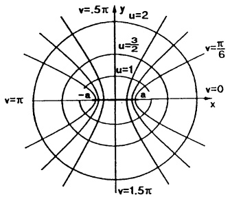

text_image

v=.5π y
u=2
u=3/2
u=1
v=π/6
v=0
x
-a
a
v=1.5π

Abb. 241 - Elliptische Koordinaten

Beispiel 2. Das Trägheitsmoment der homogenen Kreisscheibe  $K : x^{2} + y^{2} \leq 1$  bezüglich der y-Achse beträgt

$$
M = \rho_ {0} \iint_ {K} x ^ {2} d x d y.
$$

In Polarkoordinaten $x = r \cos \varphi$, $y = r \sin \varphi$ wird $K \setminus \{0, 0\}$ durch $D = \{(r, \varphi) ; 0 < r \leq 1, 0 < \varphi \leq 2\pi\}$ dargestellt. Also gilt ($\rightarrow$ (15))

$$
M _ {2} = \rho_ {0} \iint_ {D} r ^ {2} \cos^ {2} \varphi r d r d \varphi = \rho_ {0} \int_ {0} ^ {2 \pi} \cos^ {2} \varphi d \varphi \int_ {0} ^ {1} r ^ {3} d r = \rho_ {0} \frac {\pi}{4}. \quad \square
$$

Beispiel 3. Für die GAUSS- oder Normalverteilung $F(x) := \frac{1}{\sqrt{\pi}} \int_{-\infty}^{x} e^{-t^2} dt$ gilt $\lim_{x \to \infty} F(x) = 1$; d.h.

$$
\boxed {\int_ {- \mathcal {L}} ^ {\mathcal {L}} e ^ {- x ^ {2}} d x = \sqrt {\pi} .}
$$

Beweis. Für  $I(R) := \int_{0}^{R} e^{-x^{2}} dx$  gilt  $\frac{1}{2}I = \lim_{R \to \infty} I(R)$  und

$$
I (R) ^ {2} = \int_ {0} ^ {R} e ^ {- x ^ {2}} d x \int_ {0} ^ {R} e ^ {- y ^ {2}} d y = \int_ {0} ^ {R} \left(\int_ {0} ^ {R} e ^ {- (x ^ {2} + y ^ {2})} d x\right) d y = \iint_ {Q (R)} e ^ {- (x ^ {2} + y ^ {2})} d x d y
$$

mit dem Quadrat $Q(R)$ ($\rightarrow$ Abb. 242). Für die Viertelkreisflächen $K(R)$ und $K(\sqrt{2}R)$ ($\rightarrow$ Abb. 242) gilt nach Transformation auf Polarkoordinaten

$$
\iint_ {K (R)} e ^ {- (x ^ {2} + y ^ {2})} d x d y = \int_ {0} ^ {\pi / 2} \left(\int_ {0} ^ {R} e ^ {- r ^ {2}} r d r\right) d \varphi = \frac {\pi}{4} (1 - e ^ {- R ^ {2}})
$$

$$
\iint_ {K (\vee 2 R)} e ^ {- (x ^ {2} + y ^ {2})} d x d y = \frac {\pi}{4} (1 - e ^ {- 2 R ^ {2}}).
$$

Also hat man

$$
\frac {\pi}{4} (1 - e ^ {- R ^ {2}}) \leq I (R) ^ {2} \leq \frac {\pi}{4} (1 - e ^ {- 2 R ^ {2}}),
$$

und mit  $R \rightarrow \infty$  folgt die Behauptung.

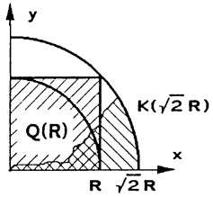

text_image

y
K(√2 R)
Q(R)
R √2 R
x

Abb. 242 - Integrationsbereich

Beispiel 4. Das polare Trägheitsmoment

$$
T = \iint_ {S} (x ^ {2} + y ^ {2}) d x d y (\rho = 1)
$$

der in der Abb. 243 skizzierten Platte S wird mit der Transformation

$$
x ^ {2} - y ^ {2} = u \quad (1 \leq u \leq 9)
$$

$$
x y \quad = v \quad (2 \leq v \leq 4)
$$

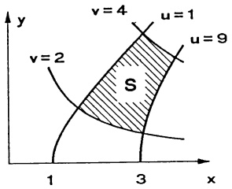

text_image

y
v=4
u=1
u=2
S
1
3
x

Abb. 243 - Platte

auf „Hyperbelkoordinaten“ bestimmt:

$$
x = x (u, v) = \frac {1}{\sqrt {2}} \sqrt {u + \sqrt {u ^ {2} + 4 v ^ {2}}} ,
$$

$$
y = y (u, v) = \frac {1}{\sqrt {2}} \sqrt {- u + \sqrt {u ^ {2} + 4 v ^ {2}}}
$$

mit  $\frac{\partial(x,y)}{\partial(u,v)} = \frac{1}{2\sqrt{u^{2} + 4v^{2}}}$ . Aus der Transformationsformel (13) erhält man dann

$$
T = \int_ {1} ^ {9} \left(\int_ {2} ^ {4} \sqrt {u ^ {2} + 4 v ^ {2}} \cdot \frac {1}{2 \sqrt {u ^ {2} + 4 v ^ {2}}} d v\right) d u = 8.
$$

## 4.6 Das Oberflächenintegral eines Vektorfeldes.

Definition. Ist $S$ ein durch die Parameterdarstellung $\mathbf{x}:\mathbb{R}^{2}\supseteq D\to\mathbb{R}^{3}$ gegebenes reguläres Flächenstück mit der Normalenrichtung $\mathbf{n}=\frac{1}{|\mathbf{x}_{u}\times\mathbf{x}_{v}|}\mathbf{x}_{u}\times\mathbf{x}_{v}$ in jedem Flächenpunkt und $\mathbf{v}$ ein auf $S$ stetiges Vektorfeld, dann nennt man das Flächenintegral der skalaren Normalkomponente $\mathbf{v}\cdot\mathbf{n}$, also

$$
\boxed {\iint_ {S} \mathbf {v} \cdot d \mathbf {O} := \iint_ {S} (\mathbf {v} \cdot \mathbf {n}) d O = \iint_ {D} [ \mathbf {v}, \mathbf {x} _ {u}, \mathbf {x} _ {v} ] d u d v,} \tag {16}
$$

den Fluß von v durch S.

$dO = ndO = x_u \times x_v$ dudv nennt man vektorielles Oberflächenelement von S (→ (7)). Der Integrand auf der rechten Seite von (16) ist das Spatprodukt $[v, x_u, x_v] = \det \begin{pmatrix} v_1 & x_u & x_v \\ v_2 & y_u & y_v \\ v_3 & z_u & z_v \end{pmatrix}$ (→ (11) und Kap. 1, 5.4).

Physikalische Deutung. Für das Geschwindigkeitsfeld v einer stationären Flüssigkeitsströmung stellt das Spatprodukt

$[\mathbf{v},\mathbf{x}_{u}du,\mathbf{x}_{v}dv]=[ \mathbf{v},\mathbf{x}_{u},\mathbf{x}_{v}]dudv$ das Volumen der Flüssigkeitsmenge dar, die pro Zeiteinheit durch das Oberflächenelement $dO$ strömt. Also gibt der Fluß $\iint_{S}\mathbf{v}\cdot d\mathbf{O}$ das Gesamtvolumen der Flüssigkeitsmenge an, die pro Zeiteinheit durch $S$ zu der durch n ausgezeichneten Seite hindurchströmt.

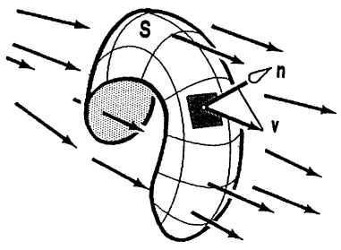

text_image

S
n
v

Abb. 244 - Fluß durch S

Beachte. Wird der Fluß zur anderen „Flächenseite“ gesucht, dann ist n durch -n zu ersetzen.

Sonderfall: Der Fluß des Vektorfeldes v durch den Graphen  $z = h(x, y)$ ,  $(x, y) \in D$ , beträgt

$$
\iint_ {S} \mathbf {v} \cdot d \mathbf {O} = \iint_ {D} \det \left( \begin{array}{c c c} v _ {1} & 1 & 0 \\ v _ {2} & 0 & 1 \\ v _ {3} & z _ {x} & z _ {y} \end{array} \right) d x d y \tag {17}
$$

$$
= \iint_ {D} (- v _ {1} z _ {x} - v _ {2} z _ {y} + v _ {3}) d x d y
$$

(mit  $v_{i} := v_{i}(x, y, h(x, y))$  im Integranden, i = 1, 2, 3).

Beispiel 1. Der Fluß des elektrischen Feldes $\mathbf{E} = \frac{cq}{|\mathbf{x}|^3}\mathbf{x}$ einer Punktladung $q$ im Ursprung durch die Sphäre $S: |\mathbf{x}| = R$ (von innen nach außen) beträgt wegen $\mathbf{E} \cdot \mathbf{n} = \frac{cq}{R^2}$ auf $S$

$$
\iint_ {S} (\mathbf {E} \cdot \mathbf {n}) d O = \iint_ {S} \frac {c q}{R ^ {2}} d O = \frac {c q}{R ^ {2}} \iint_ {S} d O = 4 \pi c q.
$$

Beispiel 2. Wir berechnen den Fluß $\iint_{S} \mathbf{v} \cdot d\mathbf{O}$ des Geschwindigkeitsfeldes

$$
\mathbf {v} (x, y, z) = \left( \begin{array}{c} 2 z \\ x + y \\ 0 \end{array} \right)
$$

a) durch das Flächenstück S der Ebene  $x + 2y + 3z = 4$  im ersten Oktanten (zu der Seite hin, die den Nullpunkt nicht enthält),
b) durch die Sphäre  $S : x^{2} + y^{2} + z^{2} = r^{2}$  (von innen nach außen).

a): Über $D = \{(x, y) ; 0 \leq x \leq 4, 0 \leq y \leq \frac{1}{2}(4 - x)\}$ ist $S$ der Graph von $z = \frac{1}{3}(4 - x - 2y)$. Mit (17) ergibt sich

$$
\begin{array}{l} \iint_ {S} \mathbf {v} \cdot d \mathbf {O} = \int_ {0} ^ {4} \left(\int_ {0} ^ {\frac {1}{2} (4 - x)} \left(\frac {2}{9} (4 - x - 2 y) + \frac {2}{3} (x + y)\right) d y\right) d x \\ = \int_ {0} ^ {4} \frac {1}{3 6} (8 0 + 8 x - 7 x ^ {2}) d x = \frac {1 7 6}{2 7}. \\ \end{array}
$$

b): In der Parameterdarstellung ( $\rightarrow$  4.2c)

$$
\mathbf {x} (\psi , \varphi) = \left( \begin{array}{c} r \sin \psi \cos \varphi \\ r \sin \psi \sin \varphi \\ r \cos \psi \end{array} \right)  , \quad \begin{array}{l} 0 \leq \psi \leq \pi \\ 0 \leq \varphi \leq 2 \pi \end{array}  , \quad \text {gilt} \quad \mathbf {n} = \left( \begin{array}{c} \sin \psi \cos \varphi \\ \sin \psi \sin \varphi \\ \cos \psi \end{array} \right)  .
$$

Das Oberflächenelement ist  $dO = r^{2} \sin \psi d\psi d\varphi$ , der Fluß beträgt daher

$$
\begin{array}{l} \iint_ {S} (\mathbf {v} \cdot \mathbf {n}) d O = \int_ {0} ^ {\pi} (\int_ {0} ^ {2 \pi} \left( \begin{array}{c} 2 r \cos \psi \\ r \sin \psi (\sin \varphi + \cos \varphi) \\ 0 \end{array} \right) \cdot \left( \begin{array}{c} \sin \psi \cos \varphi \\ \sin \psi \sin \varphi \\ \cos \psi \end{array} \right) r ^ {2} \sin \psi d \varphi) d \psi \\ = \frac {4}{3} \pi r ^ {3}. \\ \end{array}
$$

4.7 Der Satz von STOKES. Der Satz von GREEN besitzt eine Verallgemeinerung für räumliche zweiseitige Flächen, bei denen man eindeutig von einer unteren und oberen (bzw. inneren und äußeren) Seite reden kann.

Ein reguläres Flächenstück $\mathbf{x}:\mathbb{R}^{2}\supseteq D\to S$ ist stets zweiseitig. Wählt man das Vorzeichen für $\mathbf{n}=\pm\frac{1}{|\mathbf{x}_{u}\times\mathbf{x}_{r}|}\mathbf{x}_{u}\times\mathbf{x}_{r}$ einheitlich für alle Punkte auf $S$, so wird die Oberseite von $S$ bestimmt: $\mathbf{n}$ im Flächenpunkt angetragen weist aus der Oberseite heraus. ($\rightarrow$ Abb. 245).

Eine stückweise reguläre Fläche ist zweiseitig oder orientierbar, wenn sich die Oberseiten der Flächenstücke $S_{k}$ so wählen lassen, daß sich der Umlaufsinn über die „Kanten“ $S_{k} \cap S_{j}$ hinweg „stetig fortsetzt“ ($\rightarrow$ Abb. 245).

Das Möbius-Band ist nicht zweiseitig (→ Abb. 246).

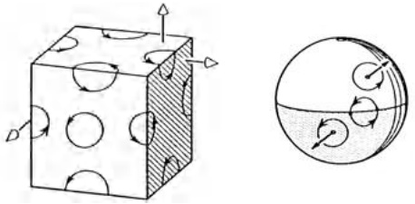

natural_image

Two technical diagrams showing a 3D cube with circular holes and directional arrows, alongside a circular cross-section view (no text or symbols)

Abb. 245 - Zweiseitige Flächen

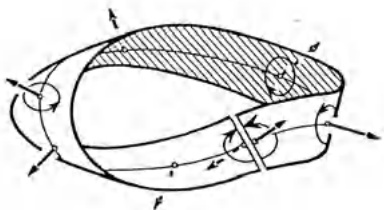

text_image

Technical diagram showing a mechanical or fluidic component with labeled axes and directional arrows indicating flow or motion.

Abb. 246 - Möbius-Band

Das folgende bedeutende Ergebnis läßt sich über die Projektionen in die Koordinatenebenen auf den Satz von GREEN zurückführen (ohne Beweis).

Wir wählen eine für die Praxis ausreichende, anschauliche Sprechweise; die präzise Formulierung würde diesen Rahmen sprengen.

Satz 4.2. Satz von STOKES (1819–1903) Sei S eine zweiseitige, stückweise reguläre Fläche mit überschneidungsfreier und geschlossener Randkurve ∂S, die so durchlaufen wird, daß S „links“ liegt und der Umlaufsinn zusammen mit der Nor-

malenrichtung n von S eine Rechts-schraubung ergibt (→ Abb. 247).

Ferner sei $U \subseteq \mathbb{R}^3$ eine offene Menge, die $S$ enthält. Dann gilt für alle $\mathcal{C}^1$-Vektorfelder $\mathbf{v}: U \to \mathbb{R}^3$

$$
\oint_ {\hat {C} S} \mathbf {v} \cdot d \mathbf {x} = \iint_ {S} (\operatorname{rot} \mathbf {v} \cdot \mathbf {n}) d O. \tag {18}
$$

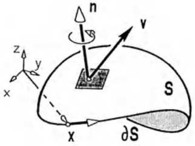

text_image

n
v
z
y
x
S
x
∂S

Abb. 247 - Satz von Stokes

Beispiel 1. Ist $S$ ein ebener Bereich in der $(x,y)$-Ebene und $\mathbf{v} = (v_1, v_2, 0)^T$ ein ebenes Vektorfeld, so folgt aus (18) der Satz von Green in der Ebene, da

$$
\mathrm{rot} \mathbf {v} \cdot \mathbf {n} = \frac {\partial v _ {2}}{\partial x} - \frac {\partial v _ {1}}{\partial y}
$$

mit $\mathbf{n} = (0,0,1)^{T}$

Beispiel 2. Sei $\mathbf{v}(x,y,z) = \left( \begin{array}{c} - y^3 \\ x^3 \\ -z^3 \end{array} \right)$ das Geschwindigkeitsfeld einer turbulenten

Strömung im Zylinder  $x^{2} + y^{2} = 1$ . Wir bestimmen die Zirkulation von v längs der Schnittkurve  $\partial S$  des Zylinders mit der Ebene  $x + y + z = 1$  bzgl. der in der Abb. 248 angegebenen Umlaufrichtung.

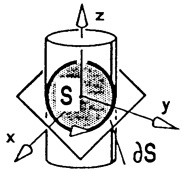

text_image

z
S
y
x
∂S

Abb. 248 - Zylinderströmung

1. Methode: Mit der Parameterdarstellung

$$
t \mapsto \left( \begin{array}{c} \cos t \\ \sin t \\ 1 - \sin t - \cos t \end{array} \right), \quad 0 \leq t \leq 2 \pi ,
$$

von  $\partial S$  die Zirkulation  $\oint_{\partial S} v \cdot dx$  gemäß (2.3) ausrechnen.

2. Methode: Mit der Integralformel

$$
\oint_ {\hat {c} S} \mathbf {v} \cdot d \mathbf {x} = \iint_ {S} (\operatorname{rot} \mathbf {v} \cdot \mathbf {n}) d O,
$$

der Parametrisierung $\mathbf{x}(x,y)=\left(\begin{array}{c}x\\ y\\ 1-x-y\end{array}\right), (x,y)\in K$ (Einheitskreisscheibe), und $\operatorname{rot}\mathbf{v}=\nabla\times\mathbf{v}=(0,0,3(x^{2}+y^{2}))^{T}$. Der Normalenvektor $\mathbf{x}_{x}\times\mathbf{x}_{y}=(1,1,1)^{T}$ weist in die richtige Richtung. Also gilt (nach Übergang zu Polarkoordinaten)

$$
\oint_ {\partial S} \mathbf {v} \cdot d \mathbf {x} = \iint_ {K} [ \operatorname{rot} \mathbf {v}, \mathbf {x} _ {x}, \mathbf {x} _ {y} ] d x d y = 3 \iint_ {K} (x ^ {2} + y ^ {2}) d x d y = \frac {3}{2} \pi .
$$

Man beachte, daß in (18) die Fläche S durch jede andere in  $\partial S$  eingespannte Fläche (mit entsprechender „Oberseite“) ersetzt werden kann:

$$
\iint_ {S _ {1}} \mathrm{rot} \mathbf {v} \cdot d \mathbf {O} = \iint_ {S _ {2}} \mathrm{rot} \mathbf {v} \cdot d \mathbf {O}.
$$

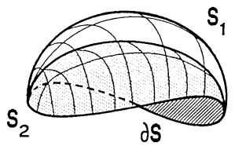

text_image

S₁
S₂
∂S

Abb. 249 - Gleicher Rand $\hat{c}S$

Beispiel. Für die obere Hemisphäre $S: x^{2} + y^{2} + z^{2} = 1$, $z \geq 0$ und die Einheitskreisscheibe $K$ (Normalenrichtungen „nach oben“) ergibt sich mit dem Vektorfeld $\mathbf{v} = (x, x + y, x + y + z)^{T}$:

$$
\iint_ {S} (\operatorname{rot} \mathbf {v} \cdot \mathbf {n}) d O = \iint_ {K} (\operatorname{rot} \mathbf {v} \cdot \mathbf {e} _ {3}) d x d y = \iint_ {K} \left( \begin{array}{c} 1 \\ - 1 \\ 1 \end{array} \right) \cdot \left( \begin{array}{c} 0 \\ 0 \\ 1 \end{array} \right) d x d y = \pi . \quad \square
$$

Die vordergründige Bedeutung von (18) ist, daß sich die schwierige Berechnung einer Zirkulation  $\oint_{cS} v \cdot dx$  möglicherweise auf ein einfacheres Flächenintegral zurückführen läßt oder umgekehrt. Der wahre Nutzen der Formel zeigt sich aber erst in den theoretischen Anwendungen, insbesondere in der Hydrodynamik und der Elektrizitätslehre ( $\rightarrow 5.5$ ).

Koordinatenunabhängige Interpretation der Rotation: Mit dem Integralsatz von STOKES erhält man für jedes  $C^{1}$ -Vektorfeld v :

Sei S ein reguläres Flächenstück im Definitionsbereich von v, x ein Flächenpunkt und  $\partial S_{r}$  die Randkurve der Fläche  $S_{r}$ , die von einer Kugel um x mit Radius r aus S ausgeschnitten wird (mit entsprechender Orientierung). Nach (18) und dem Mittelwertsatz für Flächenintegrale gilt

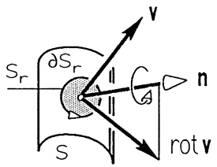

text_image

Sr
∂Sr
S
A
n
rot v

Abb. 250 - Deutung von rot V

$$
\oint_ {\hat {C} S _ {r}} \mathbf {v} \cdot d \mathbf {x} = \iint_ {S _ {r}} (\operatorname{rot} \mathbf {v} \cdot \mathbf {n}) d O = (\operatorname{rot} \mathbf {v} \cdot \mathbf {n}) (\tilde {\mathbf {x}}) \cdot O (S _ {r})
$$

mit einem Punkt  $\tilde{x}$  auf  $S_{r}$  und der Oberfläche  $O(S_{r})$ . Also gilt

$$
(\operatorname{rot} \mathbf {v} \cdot \mathbf {n}) (\mathbf {x}) = \lim _ {r \to 0} \frac {1}{O (S _ {r})} \oint_ {\hat {C} S _ {r}} \dot {\mathbf {v}} \cdot d \mathbf {x}.
$$

Auf der rechten Seite steht die „Zirkulation pro Flächeneinheit“ auf S in Form eines Differentialquotienten. Diese Größe heißt Wirbelstärke von v um n :

(rot v·n)(x) gibt im Punkt x die Zirkulation des Vektorfeldes v pro Flächeneinheit an, für jedes reguläre Flächenstück senkrecht zu n.

Die Wirbelstärke (der Rotationseffekt) ist am größten, wenn n in Richtung rot v zeigt.

## Aufgaben

1. Das Paraboloid P hat die Parameterdarstellung

$$
\mathbf {x} (u, v) = \frac {1}{2} \left( \begin{array}{c} u + v \\ u - v \\ 2 u v \end{array} \right), \quad (u, v) \in \mathbb {R} ^ {2}.
$$

a) Man berechne  $x_{u}$ ,  $x_{v}$ ,  $x_{u} \times x_{v}$  und damit die metrischen Fundamentalgrößen E, F und G. Welche Raumkurven werden durch u = const. und v = const. dargestellt? In welchen Punkten von P schneiden sich u- und v-Linien senkrecht?

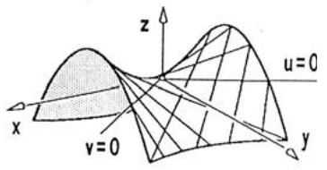

text_image

z
u=0
x
v=0
y

b) Welche Bogenlänge hat die Kurve C auf P mit der Parameterdarstellung

$$
u = 2 t, \quad v = 3 t, \quad 0 \leq t \leq 1
$$

c) Welchen Oberflächeninhalt hat das Flächenstück auf P mit  $x^{2} + y^{2} \leq 4$ ?

2. Der Membranmantel eines Kühlturms hat die Form eines einschaligen Rotationshyperboloids: Das Hyperbelstück

$$
\frac {x ^ {2}}{3 7 ^ {2}} - \frac {z ^ {2}}{6 7 ^ {2}} = 1, - 1 1 4 \leq z \leq 3 2, x > 0,
$$

wird um die z-Achse gedreht. Wie groß ist die Oberfläche (Längeneinheit m)?

3. Die Kuppel der Reaktorstation in Garching hat die Form eines halben Rotationsellip-soids (in m)

$$
\frac {x ^ {2}}{1 5 ^ {2}} + \frac {y ^ {2}}{1 5 ^ {2}} + \frac {z ^ {2}}{3 0 ^ {2}} = 1, \quad z \geq 0.
$$

Welchen Flächeninhalt hat das Blechdach?

Hilfe: Man verwende als Flächenparameter Polarkoordinaten $r, \varphi$ in der $(x, y)$-Ebene.

4. Wie groß ist die Oberfläche des Durchdringungskörpers der beiden Zylinder  $x^{2}+y^{2}=1$  und  $x^{2}+z^{2}=1$ ?

5. MERCATOR-Projektion der Sphäre.

Die Sphäre ohne Nord- und Südpol besitzt die Parametrisierung

$$
\mathbf {x} (u, v) = \frac {1}{\cosh v} \left( \begin{array}{c} \cos u \\ \sin u \\ \sinh v \end{array} \right), \quad \begin{array}{c} - \pi \leq u <   \pi \\ v \in \mathbb {R} \end{array} .
$$

a) Man stelle $u$ und $v$ durch die geographische Länge und Breite der Sphäre dar, d.h. durch $\varphi$ und $\frac{\pi}{2}-\psi$ in Kugelkoordinaten.

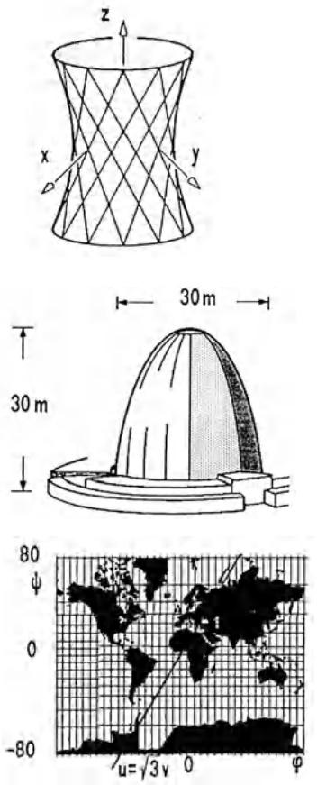

b) Man berechne $\mathbf{x}_{u}$, $\mathbf{x}_{v}$ und zeige, daß $(u,v)\mapsto\mathbf{x}(u,v)$ winkeltreu ist, d.h. $E=G$ und $F=0$.

Die Winkel in der  $(u,v)$ -Karte stimmen mit den Winkeln auf der Sphäre überein.

c) Die Kurve / auf der Sphäre, die durch den Punkt $\mathbf{x} = (1,0,0)$ geht und jeden Meridian unter $60^{\circ}$ schneidet, hat in der $(u,v)$-Karte die Gleichung

$$
u = \sqrt {3} v, \quad - \infty <   v <   \infty .
$$

Wie oft trifft / auf den Nullmeridian? Berechne die Bogenlänge von / (Kugel-Loxodrome).

d) Man drücke das Integral für die Kugeloberfläche in dieser Parameterdarstellung aus.

6. Projiziert man die Sphäre $S: x^{2} + y^{2} + z^{2} = R^{2}$ von der $z$-Achse aus horizontal auf den berührenden Zylinder $Z: x^{2} + y^{2} = R^{2}$, so erhält man die LAMBERT-Parametrisierung der Sphäre

(L) $\mathbf{x} = \left( \begin{array}{c}\sqrt{R^2 - v^2}\cos \frac{u}{R}\\ \sqrt{R^2 - v^2}\sin \frac{u}{R}\\ v \end{array} \right),\qquad 0\leq u <   2R\pi , - R\leq v\leq R.$

a) Man berechne  $x_{u}$ ,  $x_{v}$ ,  $x_{u} \times x_{v}$ . In welchen Punkten von S ist die Darstellung regulär?
b) Man bestätige, daß die Parametrisierung flächentreu ist, d.h. in jedem regulären Punkt gilt  $|x_{u} \times x_{v}| = 1$ , und berechne damit die Kugeloberfläche.

c) Man setze R = 1 und in (L) der Reihe nach y = 0; z = 0; x = y; x = z. Die vier resultierenden  $(u,v)$ -Gleichungen bestimmen den Rand des Parameterbereiches U in der  $(u,v)$ -Ebene, der das skizzierte Flächenstück B auf S bestimmt. Man skizziere U und berechne damit den Flächeninhalt von B.

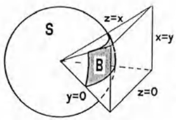

text_image

S
z=x
B
x=y
y=0
z=0

7. Welchen Flächeninhalt hat das Viviani-Fenster  $S_{1} \cup S_{2}$ :

$$
\begin{array}{l} S _ {1}: x ^ {2} + y ^ {2} + z ^ {2} = 1; \quad x \geq 0; \quad x ^ {2} + y ^ {2} \geq x; \\ S _ {2}: x ^ {2} + y ^ {2} = x; \quad | z | \leq 1; \quad x ^ {2} + y ^ {2} + z ^ {2} \geq 1 \\ \end{array}
$$

Vergleiche mit dem Flächeninhalt der Halbsphäre und des Zylinders.

(Hilfe: $S_{1}$ : Lambert-Koordinaten; $S_{2}$ : Zylinderkoordinaten.)

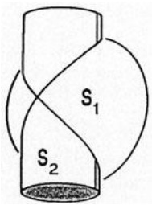

text_image

S₁
S₂

8. BEZIER-Flächenstücke.

Beim rechnerischen Entwurf (CAD) einer Autokarosserie setzt man die Blechhaut näherungsweise aus Flächenstücken S zusammen, die jeweils durch 16 Punkte  $r_{kj}$ ,  $0 \leq j, k \leq 3$  über die Formel

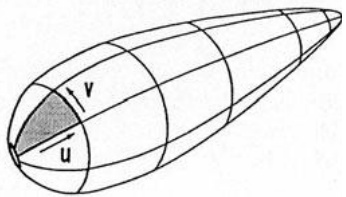

text_image

v
u

$$
\mathbf {x} = \sum_ {j = 0} ^ {3} \sum_ {k = 0} ^ {3} \mathbf {r} _ {k j} \binom {3} {j} \binom {3} {k} u ^ {j} (1 - u) ^ {3 - j} v ^ {k} (1 - v) ^ {3 - k}, \quad 0 \leq u, v \leq 1,
$$

bestimmt sind (bikubische Splines).

Man bestätige:

a) $\mathbf{r}_{00}$, $\mathbf{r}_{03}$, $\mathbf{r}_{30}$, $\mathbf{r}_{33}$ liegen auf $S$.

b) Für die Flächennormale in  $r_{00}$  gilt:

$$
\mathbf {x} _ {u} \times \mathbf {x} _ {v} = 9 \cdot (\mathbf {r} _ {1 0} - \mathbf {r} _ {0 0}) \times (\mathbf {r} _ {0 1} - \mathbf {r} _ {0 0}).
$$

c) Für die gemischte partielle Ableitung gilt

$$
\mathbf {x} _ {u v} (0, 0) = 9 (\mathbf {r} _ {0 0} - \mathbf {r} _ {0 1} - \mathbf {r} _ {1 0} + \mathbf {r} _ {1 1}) .
$$

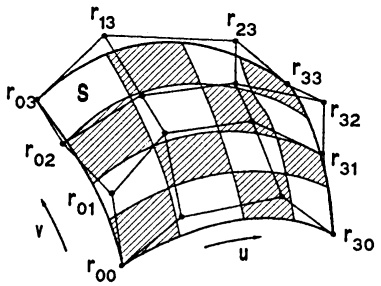

text_image

r13
r23
r33
S
r03
r02
r01
v
r00
u
r32
r31
r30

9. Gegeben ist die Fläche

$$
S: z = 8 - \sqrt {x ^ {2} + y ^ {2}} ^ {3}; \quad x ^ {2} + y ^ {2} \leq 4.
$$

Das Vektorfeld $\mathbf{v}$ lautet in kartesischen Koordinaten $\mathbf{v} = (y^3, 0, 0)^T$.

a) Man skizziere $S$.
b) Mit dem Satz von STOKES berechne man mit einer zur z-Achse weisenden Normale n

$$
\iint_ {S} \mathrm{rot}   \mathbf {v} \cdot \mathbf {n}   d O.
$$

11. Eine Parkhausauffahrt hat die Gestalt eines Wendelflächenstücks:

$$
\mathbf {x} (t) = (r \cos t, r \sin t, t) ^ {T}, 5 m \leq r \leq 9 m, 0 \leq t \leq 2 \pi.
$$

Man berechne den Flächeninhalt und vergleiche ihn mit dem Inhalt des Kreisringes, der den Grundriß der Fläche bestimmt.

12. Gegeben ist das Möbius-Band M

$$
\mathbf {x} (u, v) = \left( \begin{array}{c} (2 + u \cos v) \cos 2 v \\ (2 + u \cos v) \sin 2 v \\ u \sin v \end{array} \right), \quad \begin{array}{l} 0 \leq u \leq 1 \\ 0 \leq v <   2 \pi \end{array} ,
$$

und das Vektorfeld des magnetischen Wirbels (→ Kap. 7, 4.1)

$$
\mathbf {v} = (\frac {- y}{x ^ {2} + y ^ {2}}, \frac {x}{x ^ {2} + y ^ {2}}, 0) ^ {T}, \quad x ^ {2} + y ^ {2} > 0.
$$

Man berechne

a) $\iint_{M} \operatorname{rot} \mathbf{v} \cdot d\mathbf{O} = \iint_{M} [\operatorname{rot} \mathbf{v}, \mathbf{x}_u, \mathbf{x}_v] du dv,$

b)  $\int\limits_{\partial M}v\cdot dx$  für die durch  $x_{u}\times x_{v}$  bestimmte Rich-
tung auf  $\partial M$ . Warum ist (18) nicht anwendbar?

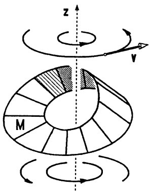

text_image

z
v
M

## §5. Die Integration über dreidimensionale Bereiche

5.1 Definition und einfache Eigenschaften des Dreifachintegrals. Die Ideen und Methoden aus §3 werden nun auf die Behandlung entsprechender räumlicher Probleme übertragen.

a Das Volumen. Der  $(x,y,z)$ -Raum wird durch die zu den Koordinatenebenen parallelen Ebenen

$$
x = n \cdot 2 ^ {- k}, \quad y = n \cdot 2 ^ {- k}, \quad z = n \cdot 2 ^ {- k} \quad (n = 0, \pm 1, \pm 2, \dots)
$$

in Würfel mit dem Volumen  $2^{-3k}$  zerlegt. Für eine beschränkte Menge  $M \subseteq R^{3}$  bezeichne  $s_{k}(M)$  bzw.  $S_{k}(M)$  das Gesamtvolumen aller ganz in M enthaltenen Würfel, bzw. aller Würfel, die mit M wenigstens einen Punkt gemeinsam haben. Man nennt M Riemann-meßbar (im  $R^{3}$ ) und  $V(M)$  das Volumen (oder den Inhalt) von M, wenn  $V(M) = \lim_{k \to \infty} s_{k}(M) = \lim_{k \to \infty} S_{k}(M)$ .

Besteht eine Menge  $N \subseteq R^{3}$  nur aus jeweils endlich vielen Punkten, regulären Kurvenstücken und regulären Flächenstücken, so bezeichnet man sie wegen  $V(N) = 0$  als (dreidimensionale) Nullmenge. Für jede meßbare Menge  $M \subseteq R^{3}$  mit Volumen  $V(M)$  und jede Nullmenge N gilt

$$
V (M) = V (M \cup N) = V (M \setminus N) . \tag {1}
$$

Völlig ausreichend für die Anwendung ist die Beschränkung auf reguläre Bereiche  $B \subseteq R^{3}$  mit den Eigenschaften:

1. Der Rand  $\partial B$  (die „Oberfläche“ von B) besteht aus endlich vielen stückweise regulären Flächen.
2. $B \setminus \partial B$ (das „Innere“ von $B$) ist ein nicht leeres, beschränktes Gebiet im $\mathbb{R}^3$ (offen und zusammenhängend).
3. $B$ ist abgeschlossen, d.h. $\partial B \subseteq B$.

Es läßt sich zeigen (ohne Beweis):

Jeder reguläre Bereich  $B \subseteq R^{3}$  ist Riemann-meßbar mit einem Volumen  $V(B) \neq 0$ .

⑥ Das Volumenintegral. $B \subseteq \mathbb{R}^3$ sei ein regulärer räumlicher Bereich und $f$ ein auf $B$ stetiges Skalarenfeld (eine Belegungsfunktion). Zur Berechnung der „Gesamtbelegung“ von $B$ wird der Bereich durch reguläre Schnittflächen in reguläre Teilbereiche $B_1, \ldots, B_n$ mit den jeweiligen Volumen $\Delta V_1, \ldots, \Delta V_n$ zerlegt. Für jedes

$i = 1,2,\dots,n$ wird die Belegung von $V_{i}$ durch $f(x_{i},y_{i},z_{i})\Delta V_{i}$ (mit beliebigem

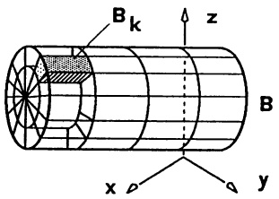

text_image

B_k
z
B
x
y

Abb. 251 – Bereichzerlegung

Punkt  $(x_{i}, y_{i}, z_{i}) \in V_{i}$  approximiert, die Gesamtbelegung durch die Riemann-

Summe $Z_{n} = \sum_{i = 1}^{n}f(x_{i},y_{i},z_{i})\Delta V_{i}$

Da B regulär ist und f stetig, läßt sich zeigen, daß die Riemann-Summen bei stets feiner werdender Unterteilung gegen einen festen Grenzwert konvergieren, sofern der maximale Durchmesser  $\delta_{max}$  der Teilbereiche dabei gegen Null geht. Außerdem ist der Grenzwert unabhängig von der speziellen Form der Schnitte. Der Grenzwert

$$
\iiint_ {B} f d V := \lim _ {\substack {n \to \infty \\ \delta_ {m a x} \to 0}} \sum_ {i = 1} ^ {n} f (x _ {i}, y _ {i}, z _ {i}) \Delta V _ {i}
$$

heißt Dreifachintegral oder Volumenintegral von f über B. Das Symbol dV heißt Volumenelement.

Für das Volumenintegral gelten die üblichen Rechenregeln: Linearität, Monotonie, Additivität und der Mittelwertsatz ( $\rightarrow$  3.2).

Bildet man die Riemann-Summen bezüglich Schnittebenen parallel zu den drei Koordinatenebenen, dann bezeichnet man das Volumenintegral mit

$$
\iiint_ {B} f   d x d y d z \quad \text {oder} \quad \iiint_ {B} f (x, y, z) d x d y d z
$$

und man sagt, $dV = dxdydz$ sei die Darstellung des Volumenelements bezüglich kartesischer Koordinaten.

Läßt sich $B$ als Abschnitt eines geraden Zylinders darstellen mit dem regulären Bereich $D$ der $(x,y)$-Ebene als Querschnitt, unten und oben begrenzt von den Graphen $z = g(x,y)$ bzw. $z = h(x,y)$, d.h. $B = \{(x,y,z); (x,y) \in D, g(x,y) \leq z \leq h(x,y)\}$ ($D \subseteq \mathbb{R}^2$ regular, $g,h\mathcal{C}^1$-Funktionen) und faßt man in der Riemann-Summe die Summanden so zusammen, daß „säulenförmig“ zuerst über alle in $z$-Richtung übereinander liegenden Teilbereiche summiert wird, so erhält man die Darstellung über ein Doppelintegral:

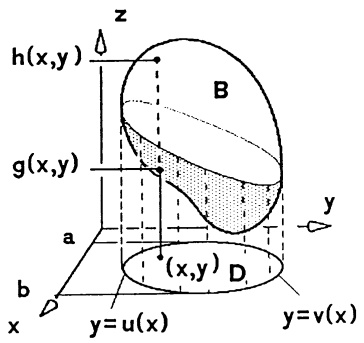

text_image

h(x,y)
g(x,y)
B
y
x
y=u(x)
y=v(x)
b
a
D
(x,y)

Abb. 252 - Säulenintegral

$$
\iiint_ {B} f d x d y d z = \iint_ {D} \left(\int_ {g (x, y)} ^ {h (x, y)} f (x, y, z) d z\right) d x d y. \tag {2}
$$

Analoge Formeln erhält man für Zylinderabschnitte „über“ den anderen Koordinatenebenen. Ist zusätzlich D ein ebener Normalbereich, etwa

$$
B = \left\{(x, y, z); a \leq x \leq b, u (x) \leq y \leq v (x), g (x, y) \leq z \leq h (x, y) \right\},
$$

dann folgt aus (2) und §3, (11)

$$
\iiint_ {B} f d x d y d z = \int_ {a} ^ {b} (\int_ {u (x)} ^ {v (x)} (\int_ {g (x, y)} ^ {h (x, y)} f (x, y, z) d z) d y) d x. \tag {3}
$$

Für den Sonderfall des Quaders

$$
B = \left\{\left(x, y, z\right); x _ {0} \leq x \leq x _ {1}, y _ {0} \leq y \leq y _ {1}, z _ {0} \leq z \leq z _ {1} \right\}
$$

ergibt sich der Satz von FUBINI: Die Integrationsreihenfolge ist beliebig, d.h.

$$
\begin{array}{l} \iiint_ {B} f d x d y d z = \int_ {x _ {0}} ^ {x _ {1}} \left(\int_ {y _ {0}} ^ {y _ {1}} \left(\int_ {z _ {0}} ^ {z _ {1}} f (x, y, z) d z\right) d y\right) d x \tag {4} \\ = \int_ {z _ {0}} ^ {z _ {1}} \left(\int_ {x _ {0}} ^ {x _ {1}} \left(\int_ {y _ {0}} ^ {y _ {1}} f (x, y, z) d y\right) d x\right) d z = \dots . \\ \end{array}
$$

5.2 Einfache Anwendungsbeispiele des Volumenintegrals ergeben sich aus den der Definition vorausgehenden Bemerkungen.

① Volumen. Das Volumen eines regulären räumlichen Bereiches  $B \subseteq R^{3}$  beträgt

$$
V (B) = \iiint_ {B} d V. \tag {5}
$$

Speziell:

$$
V (B) = \iint_ {D} (h (x, y) - g (x, y)) d x d y
$$

für den oben durch $z = h(x, y)$ und unten durch $z = g(x, y)$ begrenzten Abschnitt des geraden Zylinders mit Querschnitt $D$ ($\rightarrow$ §3(6)).

② Masse, Momente, Schwerpunkt.
① Masse:  $M = \iiint_{B} \rho dV$ , Massendichte  $\rho$ .
b k-te Momente:  $M_{yz,k} = \iiint_{B} x^{k} \rho(x, y, z) dV$ ;  $M_{zx,k}$ ,  $M_{xy,k}$  analog.
(c) Axiales Trägheitsmoment: $T = \iiint_{B} r^{2} \rho dV$ mit dem Achsenabstand $r(x, y, z)$ des Punktes $(x, y, z) \in B$.
(d) Der Schwerpunkt (Massenmittelpunkt) von $B$ (variable Massendichte $\rho$): $x_{S} = \frac{1}{M} M_{yz,1}$; $y_{S} = \frac{1}{M} M_{zx,1}$; $z_{S} = \frac{1}{M} M_{xy,1}$. Der geometrische Schwerpunkt wird ebenso mit $\rho \equiv 1$ bestimmt.

⑤ Gesamtbelegung  $Q = \iiint_{B} q(x, y, z) dV$  bei spezifischer (auf die Volumeneinheit bezogener) Belegung q (etwa elektrische Ladung, Wärme, etc.).

Beispiel 1. Das axiale Trägheitsmoment des Würfels  $-1 \leq x, y, z \leq 1$  um die z-Achse lautet

$$
I = \int_ {- 1} ^ {1} \int_ {- 1} ^ {1} \int_ {- 1} ^ {1} (x ^ {2} + y ^ {2}) d x d y d z = \int_ {z = - 1} ^ {1} \left(\int_ {y = - 1} ^ {1} (\frac {2}{3} + 2 y ^ {2}) d y\right) d z = \frac {1 6}{3}. \quad \square
$$

Beispiel 2. Der Bereich $B$, der von dem Ellipsoid $\frac{x^2}{a^2} + \frac{y^2}{b^2} + \frac{z^2}{c^2} = 1$ und dem Kegel $\frac{x^2}{a^2} + \frac{y^2}{b^2} = \frac{z^2}{c^2}$ berandet wird und in $z \geq 0$ liegt, ist darstellbar in der Form

$$
\sqrt {\frac {x ^ {2}}{a ^ {2}} + \frac {y ^ {2}}{b ^ {2}}} \leq \frac {z}{c} \leq \sqrt {1 - \frac {x ^ {2}}{a ^ {2}} - \frac {y ^ {2}}{b ^ {2}}}
$$

mit  $(x,y)$  aus dem Normalbereich  $\frac{x^{2}}{a^{2}}+\frac{y^{2}}{b^{2}}\leq\frac{1}{2}$  (der Kegel und das Ellipsoid schneiden sich längs der Ellipse  $\frac{x^{2}}{a^{2}}+\frac{y^{2}}{b^{2}}=\frac{1}{2}$ ). Damit ergibt sich für das Volumen von B

$$
V (B) = \iiint_ {B} d x d y d z = \iint_ {\frac {x ^ {2}}{a ^ {2}} + \frac {y ^ {2}}{b ^ {2}} \leq \frac {1}{2}} \left(\int_ {c \sqrt {\frac {x ^ {2}}{a ^ {2}} + \frac {y ^ {2}}{b ^ {2}}}} ^ {c \sqrt {1 - \frac {1}{a ^ {2}} - \frac {1}{b ^ {2}}}} 1 d z\right) d x d y.
$$

Nach Übergang zu elliptischen Koordinaten $x = \rho a \cos \varphi$, $y = \rho b \sin \varphi$, $0 \leq \rho \leq \frac{1}{\sqrt{2}}$, $0 \leq \varphi \leq 2\pi$:

$$
\begin{array}{l} V (B) = \int_ {\varphi = 0} ^ {2 \pi} \int_ {\rho = 0} ^ {1 / \sqrt {2}} (\int_ {c \rho} ^ {c \sqrt {1 - \rho^ {2}}} 1 d z) a b \rho d \rho d \varphi \\ = 2 \pi a b c \int_ {\rho = 0} ^ {1 / \sqrt {2}} (\rho \sqrt {1 - \rho^ {2}} - \rho^ {2}) d \rho = \frac {1}{3} \pi a b c (2 - \sqrt {2}). \\ \end{array}
$$

Für die z-Koordinate des geometrischen Schwerpunkts erhält man (unabhängig von a und b)

$$
\bar {z} = \frac {1}{V (B)} \iiint_ {B} z d x d y d z = \frac {6 + 3 \sqrt {2}}{1 6} c.
$$

5.3 Die Transformationsformel für Volumenintegrale. Sei $B \subseteq \mathbb{R}^3$ ein dreidimensionaler regulärer Bereich. Unter einer Koordinatentransformation auf

B verstehen wir eine  $C^{1}$ -Abbildung  $(u,v,w)^{T}\mapsto\mathbf{x}(u,v,w)=\left(\begin{array}{c}x(u,v,w)\\y(u,v,w)\\z(u,v,w)\end{array}\right)$  eines

regulären Bereiches U des  $(u,v,w)$ -Raumes auf B mit den Eigenschaften

1. Für beliebige Punkte  $(u,v,w) \neq (u',v',w')$  aus U ist stets  $\mathbf{x}(u,v,w) \neq \mathbf{x}(u',v',w')$ .
2. Für alle  $(u,v,w)\in U$  sind die Vektoren  $\mathbf{x}_{u}(u,v,w)$ ,  $\mathbf{x}_{v}(u,v,w)$ ,  $\mathbf{x}_{w}(u,v,w)$  linear unabhängig.

Zu festem $u = u_0$ stellt $(v, w) \mapsto \mathbf{x}(u_0, v, w)$ die Koordinatenfläche $u = u_0$ dar; ebenso sind die anderen Koordinatenflächen $v = v_0$, $w = w_0$ erklärt. Der von „benachbarten“ Koordinatenflächen ausgeschnittene Bereich, also das Bild des Quaders $u_0 \leq u \leq u_0 + \Delta u$, $v_0 \leq v \leq v_0 + \Delta v$, $w_0 \leq w \leq w_0 + \Delta w$, wird mittels linearer Approximation angenähert durch einen Spat dargestellt, der von den drei im Punkt $\mathbf{x}(u_0, v_0, w_0)$ angetragenen Vektoren $\mathbf{x}_u(u_0, v_0, w_0)\Delta u$, $\mathbf{x}_t(u_0, v_0, w_0)\Delta v$, $\mathbf{x}_w(u_0, v_0, w_0)\Delta w$ aufgespannt wird. Das Volumen dieses Spats beträgt

$$
\Delta V = | [ \mathbf {x} _ {u}, \mathbf {x} _ {v}, \mathbf {x} _ {w} ] | \Delta u \Delta v \Delta w = \left| \frac {\partial (x , y , z)}{\partial (u , v , w)} \right| \Delta u \Delta v \Delta w
$$

mit der JACOBI-Determinante (oder Funktionaldeterminante)

$$
\boxed {\frac {\partial (x , y , z)}{\partial (u , v , w)} := \det \left( \begin{array}{c c c} x _ {u} & x _ {v} & x _ {w} \\ y _ {u} & y _ {v} & y _ {w} \\ z _ {u} & z _ {v} & z _ {w} \end{array} \right) .}
$$

Analog wie im ebenen Fall beweist man

Satz 5.1. Die Transformationsformel für Volumenintegrale. Entsteht der reguläre Bereich $B \subseteq \mathbb{R}^3$ unter der Koordinatentransformation $x = x(u, v, w)$, $y = y(u, v, w)$, $z = z(u, v, w)$ aus dem regulären Bereich $U \subseteq \mathbb{R}^3$, dann gilt für jedes auf $B$ stetige Skalarenfeld $f$ die Transformationsformel

$$
\boxed { \begin{array}{l} \iint_ {B} f (x, y, z) d x d y d z = \\ \quad = \iint_ {U} f (x (u, v, w), y (u, v, w), z (u, v, w)) \left| \frac {\partial (x , y , z)}{\partial (u , v , w)} \right| d u d v d w. \end{array} } \tag {6}
$$

Man nennt

$$
d V = \left| \frac {\partial (x , y , z)}{\partial (u , v , w)} \right| d u d v d w
$$

das Volumenelement in B bezüglich der  $(u, v, w)$ -Koordinaten.

Zusatz. Wegen  $\iiint_{B}fdV = \iiint_{B\setminus N}fdV$  für jede (dreidimensionale) Nullmenge N gilt die Formel (6) auch für Transformationen, welche obige „Regularitätsbedingungen“ 1. und 2. nur auf Bereichen der Form  $U \setminus M$  mit Nullmengen M erfüllen.

## Sonderfälle.

① Affine Koordinaten.

$\mathbf{x} = A\mathbf{u} + \mathbf{x}_0, A \in \mathbb{R}^{3 \times 3}$ mit $\det A \neq 0$. $dV = |\det A|dudvdw$.

$$
\iint_ {B} f (\mathbf {x}) d x d y d z = \iint_ {U} f (A \mathbf {u} + \mathbf {x} _ {0}) | \det A | d u d v d w.
$$

② Zylinderkoordinaten.

$$
x = r \cos \varphi , y = r \sin \varphi , z = z,
$$

$$
d V = r d r d \varphi d z.
$$

$$
\begin{array}{l} \iiint_ {B} f d x d y d z = \\ = \iint_ {U} f (r \cos \varphi , r \sin \varphi , z) r d r d \varphi d z. \\ \end{array}
$$

③ Kugelkoordinaten.

$$
x = r \sin \psi \cos \varphi ,
$$

$$
y = r \sin \psi \sin \varphi ,
$$

$$
z = r \cos \psi (\rightarrow 4. 2).
$$

$$
d V = r ^ {2} \sin \psi d r d \psi d \varphi .
$$

$$
\begin{array}{l} \iiint_ {B} f   d x d y d z = \\ \iint_ {U} \tilde {f} (r, \psi , \varphi) r ^ {2} \sin \psi d r d \psi d \varphi \\ \end{array}
$$

mit

$$
\tilde {f} (r, \psi , \varphi) = f (r \sin \psi \cos \varphi , r \sin \psi \sin \varphi , r \cos \psi).
$$

④ Abgeflachte Drehellipsoid-Koordinaten.

$$
x = a \cosh \eta \sin \psi \cos \varphi , \quad 0 \leq \eta , a > 0,
$$

$$
y = a \cosh \eta \sin \psi \sin \varphi , \quad 0 \leq \psi \leq \pi ,
$$

$$
z = a \sinh \eta \cos \psi \quad , \quad 0 \leq \varphi \leq 2 \pi.
$$

$$
d V = a ^ {3} \bigl (\cosh^ {2} \eta - \sin^ {2} \psi \bigr) \cosh \eta \sin \psi d \eta d \psi d \varphi .
$$

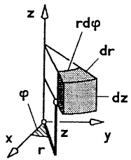

text_image

z
rdφ
dr
dz
φ
x
r
y
z

Abb. 253 - Zylinderkoordinaten

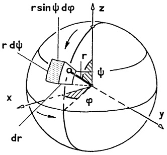

text_image

r sin ψ dφ
z
r dψ
r
ψ
x
dr
φ
y

Abb. 254 - Kugelkoordinaten

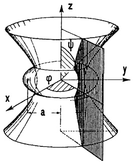

text_image

z
ψ
φ
y
x
a

Abb. 255 – Abgeflachte Drehellipsoid -Koordinaten

## Beispiel 1. Die 2. Regel von GULDIN.

Das Volumen eines Drehkörpers beträgt  $V = 2\pi r_{0}F$  mit dem Flächeninhalt F des (auf einer Seite der Drehachse gelegenen regulären) Meridianschnitts und dem Drehachsenabstand  $r_{0}$  des Flächenschwerpunkts.

Beweis. Wir drehen um die z-Achse und wählen einen Meridianschnitt S in der  $(x,z)$ -Ebene. Vereinfachend nehmen wir an, daß S ein Normalbereich ist:

$$
S = \{(x, z); z _ {0} \leq z \leq z _ {1}, g (z) \leq x \leq h (z) \}.
$$

In Zylinderkoordinaten besitzt die Drehfigur B die Koordinaten  $z_{0} \leq z \leq z_{1}$ ,  $g(z) \leq r \leq h(z)$ ,  $0 \leq \varphi \leq 2\pi$ ;

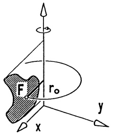

text_image

F
r₀
x
y

Abb. 256 - 2. Guldin-Regel

$$
\begin{array}{l} \text {also gilt} V = \iiint_ {B} d V = \int_ {0} ^ {2 \pi} \left(\int_ {z _ {0}} ^ {z _ {1}} \left(\int_ {g (z)} ^ {h (z)} r d r\right) d z\right) d \varphi \\ = 2 \pi \iint_ {S} x d x d z = 2 \pi F \cdot \frac {1}{F} \iint_ {S} x d F. \quad \square \\ \end{array}
$$

Beispiel 2. Der abgebildete Kugelausschnitt hat in Kugelkoordinaten die Darstellung

$$
\mathrm{K} = \left\{\left(\mathrm{r}, \varphi , \psi\right); 0 \leq \mathrm{r} \leq 1, 0 \leq \varphi \leq 2 \pi , 0 \leq \psi \leq \frac {\pi}{1 2} \right\}.
$$

Also gilt

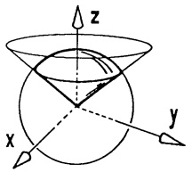

text_image

z
x
y

Abb. 257 - Kugelausschnitt

$$
\iiint_ {K} f d x d y d z = \int_ {0} ^ {1} \left(\int_ {0} ^ {2 \pi} \left(\int_ {0} ^ {\pi / 1 2} \tilde {f} (r, \varphi , \psi) r ^ {2} \sin \psi d \psi\right) d \varphi\right) d r. \tag {$\square$}
$$

Beispiel 3. Das axiale Trägheitsmoment der vollen Kugel K vom Radius R mit homogener Dichte der Gesamtmasse 1 um die z-Achse beträgt

$$
I = \iiint_ {K} (x ^ {2} + y ^ {2}) d x d y d z.
$$

In Kugelkoordinaten ergibt sich

$$
I = \int_ {0} ^ {2 \pi} \int_ {0} ^ {\pi} \int_ {0} ^ {R} (r ^ {2} \sin^ {2} \psi) r ^ {2} \sin \psi d r d \psi d \varphi = 2 \pi \cdot \frac {1}{5} R ^ {5} \cdot \frac {4}{3} = \frac {8}{1 5} \pi R ^ {5}. \tag {$\square$}
$$

5.4 Der Divergenzsatz gibt eine wichtige Beziehung zwischen dem Volumenintegral über einen Bereich und dem Oberflächenintegral über dessen Randfläche. Mit ihm wird deutlich, daß div v tatsächlich eine Quelldichte ist.

## Satz 5.2. Der Divergenzsatz von GAUSS.

Sei B ein regulärer räumlicher Bereich mit einer Oberfläche  $\partial B$ , die aus endlich vielen geschlossenen, stückweise regulären orientierbaren Flächen besteht, die sich höchstens in Randpunkten treffen. Bezeichnet n die aus allen regulären Oberflächenstücken aus B nach außen weisende Einheitsnormale, dann gilt für alle in einer Umgebung von B erklärten  $C^{1}$ -Vektorfelder v die Integralformel

$$
\iiint_ {B} (\operatorname{div} \mathbf {v}) d V = \iint_ {\partial B} (\mathbf {v} \cdot \mathbf {n}) d O.
$$

Beweisskizze. Zunächst sei $B$ ein achsenparalleler Quader: $B = \{(x, y, z) ; 0 \leq x \leq a, 0 \leq y \leq b, 0 \leq z \leq c\}$. v ist die Summe der drei Vektorfelder $v_1\mathbf{e}_1, v_2\mathbf{e}_3, v_3\mathbf{e}_3$. Mit $\text{div}(v_3\mathbf{e}_3) = \frac{\partial v_3}{\partial z}$ bestätigt man

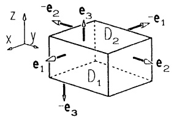

text_image

z
x
y
-e₂
e₃
D₂
-e₁
e₁
D₁
e₂
-e₃

Abb. 258 - Satz von Gauss

$$
\begin{array}{l} \iiint_ {B} \frac {\partial v _ {3}}{\partial z} d x d y d z = \iint_ {D _ {1}} \left(\int_ {0} ^ {c} \frac {\partial v _ {3}}{\partial z} d z\right) d x d y \\ = \iint_ {D _ {1}} [ v _ {3} (x, y, c) - v _ {3} (x, y, 0) ] d x d y. \\ \end{array}
$$

Die Grundfläche $D_1$ (mit $\mathbf{n} = -\mathbf{e}_3$) bzw. die Deckfläche $D_2$ (mit $\mathbf{n} = \mathbf{e}_3$) sind explizit darstellbar als Graph $z = 0$ bzw. $z = c$, deshalb gelten ($\rightarrow$ §4(17))

$$
\begin{array}{l} \iint_ {D _ {2}} (v _ {3} \mathbf {e} _ {3} \cdot \mathbf {e} _ {3}) d O = \iint_ {D _ {2}} v _ {3} (x, y, c) d x d y , \\ \iint_ {D _ {1}} (v _ {3} \mathbf {e} _ {3} \cdot - \mathbf {e} _ {3}) d O = - \iint_ {D _ {1}} v _ {3} (x, y, 0) d x d y. \\ \end{array}
$$

Die jeweilige Normale n der anderen 4 Seitenflächen $D_{3},\ldots,D_{6}$ ist orthogonal zu $\mathbf{e}_{3}$, d.h. $\mathbf{n}\cdot\mathbf{e}_{3}=0$, also gilt $\iint_{D_{i}}(v_{3}\mathbf{e}_{3}\cdot\mathbf{n})dO=0$ ($i=3,\ldots,6$) und damit

$$
\iint_ {B} \frac {\partial v _ {3}}{\partial z} d x d y d z = \iint_ {\partial B} (v _ {3} \mathbf {e} _ {3} \cdot \mathbf {n}) d O.
$$

Ebenso zeigt man

$$
\iiint_ {B} \frac {\partial v _ {2}}{\partial y} d x d y d z = \iint_ {\partial B} (v _ {2} \mathbf {e} _ {2} \cdot \mathbf {n}) d O, \quad \iiint_ {B} \frac {\partial v _ {1}}{\partial x} d x d y d z = \iint_ {\partial B} (v _ {1} \mathbf {e} _ {1} \cdot \mathbf {n}) d O.
$$

Die Addition dieser Ergebnisse liefert die angegebene Integralformel für Quader. Beliebige Bereiche werden dann durch Quader „ausgeschöpft“, wobei sich die Integrale über die „Zwischenwände“ aufheben, da die zugehörigen Normalenvektoren entgegengesetzt gerichtet sind.

Koordinatenunabhängige Interpretation der Divergenz: Nach dem Divergenzsatz ist der Fluß des Vektorfeldes v durch die Körperoberfläche (von innen nach außen) gleich dem Volumenintegral der Divergenz div v. Ist  $P = (x, y, z) \in B$  und  $K_{r}$  eine Kugel um P mit dem Radius r, die ganz in B liegt, dann gilt für den Fluß durch die Kugeloberfläche  $S_{r}$  mit dem Divergenzsatz und dem Mittelwertsatz

$$
\iint_ {S _ {r}} (\mathbf {v} \cdot \mathbf {n}) d O = \iiint_ {K _ {r}} (\operatorname{div} \mathbf {v}) d V = \operatorname{div} \mathbf {v} (x ^ {*}, y ^ {*}, z ^ {*}) \cdot V (K _ {r})
$$

mit einem Punkt  $(x^{*}, y^{*}, z^{*})$  in  $K_{r}$  und dem Volumen  $V(K_{r}) = \iiint_{K_{r}} dV$ . Damit ergibt sich

$$
\mathrm{div} \mathbf {v} (x, y, z) = \lim _ {r \to 0} \frac {1}{V (K _ {r})} \iint_ {S _ {r}} (\mathbf {v} \cdot \mathbf {n}) d O
$$

(„Fluß pro Volumeneinheit“ im Sinne eines Differentialquotienten). Die Divergenz mißt also den aus der Volumeneinheit heraustretenden Fluß; d.h. (div v)(x,y,z) ist die Quelldichte von v im Punkt (x,y,z). Man nennt den Punkt (x,y,z) eine Quelle bzw. Senke, wenn div v(x,y,z) > 0 bzw. div v(x,y,z) < 0. Das Vektorfeld v heißt quellenfrei, wenn überall div v(x,y,z) = 0 gilt.

Beispiel 1. Der Fluß des Feldes $\mathbf{v}(x,y,z)=\begin{pmatrix}2z\\ x+y\\ 0\end{pmatrix}$ durch die Oberfläche der Kugel $K:x^{2}+y^{2}+z^{2}\leq r^{2}$ (von innen nach außen) beträgt

$$
\iint_ {S} (\mathbf {v} \cdot \mathbf {n}) d O = \iiint_ {K} \operatorname{div} \mathbf {v} d V = \iiint_ {K} d V = \frac {4}{3} \pi r ^ {3}.
$$

Beispiel 2. Der Fluß des Feldes $\mathbf{v} = \begin{pmatrix} xy^2 \\ x^2y \\ y \end{pmatrix}$ durch die Oberfläche des Zylinderabschnitts $B = \{(x, y, z); x^2 + y^2 \leq 1, -1 \leq z \leq 1\}$ beträgt

$$
\iint_ {S} (\mathbf {v} \cdot \mathbf {n}) d O = \iiint_ {B} (\operatorname{div} \mathbf {v}) d V = \iiint_ {B} (x ^ {2} + y ^ {2}) d x d y d z = \pi
$$

(nach Übergang zu Zylinderkoordinaten).

In diesem Beispiel ist wegen div  $v = x^{2} + y^{2} \neq 0$  für  $(x, y) \neq (0, 0)$  jeder Punkt außerhalb der z-Achse ein Quellpunkt.