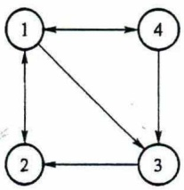
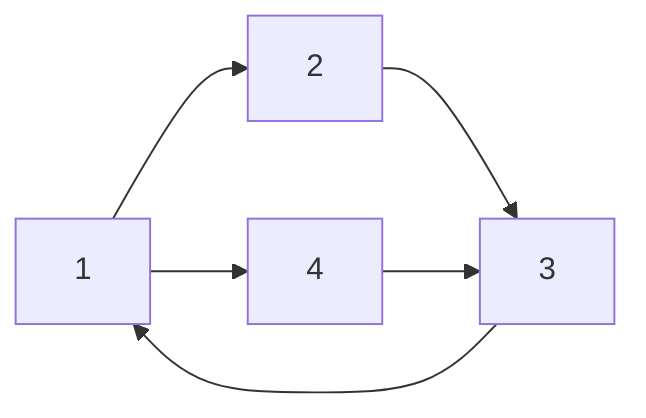
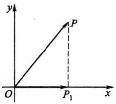
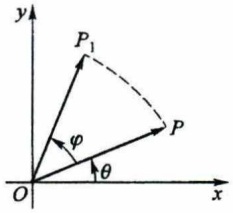

# 第2章 矩阵及其运算

原始 PDF 第 28–59 页。

# 第2章

# 矩阵及其运算

本章将介绍代数学中的重要工具——矩阵，并讨论矩阵的各种运算以及矩阵的分块表示法.

## § 1 线性方程组和矩阵

## 一、线性方程组

设有 $n$ 个未知数 $m$ 个方程的线性方程组

$$
\left\{ \begin{array}{l} a _ {1 1} x _ {1} + a _ {1 2} x _ {2} + \dots + a _ {1 n} x _ {n} = b _ {1}, \\ a _ {2 1} x _ {1} + a _ {2 2} x _ {2} + \dots + a _ {2 n} x _ {n} = b _ {2}, \\ \dots \dots \\ a _ {m 1} x _ {1} + a _ {m 2} x _ {2} + \dots + a _ {m n} x _ {n} = b _ {m}, \end{array} \right. \tag {1}
$$

其中  $a_{ij}$  是第 i 个方程的第 j 个未知数的系数， $b_{i}$  是第 i 个方程的常数项， $i=1,2,\cdots,m$ ;  $j=1,2,\cdots,n$ ，当常数项  $b_{1},b_{2},\cdots,b_{m}$  不全为零时，线性方程组(1)叫做 n 元非齐次线性方程组，当  $b_{1},b_{2},\cdots,b_{m}$  全为零时，(1)式成为

$$
\left\{ \begin{array}{l} a _ {1 1} x _ {1} + a _ {1 2} x _ {2} + \dots + a _ {1 n} x _ {n} = 0, \\ a _ {2 1} x _ {1} + a _ {2 2} x _ {2} + \dots + a _ {2 n} x _ {n} = 0, \\ \dots \dots \\ a _ {m 1} x _ {1} + a _ {m 2} x _ {2} + \dots + a _ {m n} x _ {n} = 0, \end{array} \right. \tag {2}
$$

叫做 n 元齐次线性方程组.

n 元线性方程组往往简称为线性方程组或方程组.

对于 n 元齐次线性方程组(2),  $x_{1}=x_{2}=\cdots=x_{n}=0$  一定是它的解, 这个解叫做齐次

24

---

§1 线性方程组和矩阵

线性方程组(2)的零解.如果一组不全为零的数是(2)的解,则它叫做齐次线性方程组 (2)的非零解.齐次线性方程组(2)一定有零解,但不一定有非零解.

例如

$$
\text {①} \left\{ \begin{array}{l} x - y = 0, \\ x + y = 2; \end{array} \right. \quad \text {②} \left\{ \begin{array}{l} x - y = 0, \\ x + y = 1, \\ x + y = 2; \end{array} \right. \quad \text {③} \left\{ \begin{array}{l} x _ {1} - x _ {2} = 0, \\ 2 x _ {1} - 2 x _ {2} = 0, \\ 3 x _ {1} - 3 x _ {2} = 0 \end{array} \right.
$$

就是三个二元线性方程组,并且③是齐次方程组.

下面讨论这三个方程组的解. 方程组①: 易知其有惟一解 $x = y = 1$; 方程组②: 显然不存在数 $x$ 和 $y$ 使 $x + y = 1$ 和 $x + y = 2$ 同时成立, 故方程组②无解; 方程组③: 设 $s$ 为任一数, 那么 $x_{1} = x_{2} = s$ 是③的解, 从而方程组③有无限多个解.

这样看来,对于线性方程组需要讨论以下问题:(1) 它是否有解?(2) 在有解时它的解是否惟一?(3) 如果有多个解,如何求出它的所有解?

对于线性方程组(1)，上述诸问题的答案完全取决于它的 $mn$ 个系数 $a_{ij}$ ($i=1,2,\cdots,m$; $j=1,2,\cdots,n$) 和右端的常数项 $b_1, b_2, \cdots, b_m$ 所构成的 $m$ 行 $n+1$ 列的矩形数表

$$
\begin{array}{c c c c c} a _ {1 1} & a _ {1 2} & \dots & a _ {1 n} & b _ {1} \\ a _ {2 1} & a _ {2 2} & \dots & a _ {2 n} & b _ {2} \\ \vdots & \vdots & & \vdots & \vdots \\ a _ {m 1} & a _ {m 2} & \dots & a _ {m n} & b _ {m} \end{array} ,
$$

这里横排称为行,竖排称为列;而对于齐次线性方程组(2)的相应问题的答案也完全取决于它的mn个系数 $a_{ij}(i=1,2,\cdots,m;j=1,2,\cdots,n)$ 所构成的m行n列的矩形数表

$$
\begin{array}{c c c c} a _ {1 1} & a _ {1 2} & \dots & a _ {1 n} \\ a _ {2 1} & a _ {2 2} & \dots & a _ {2 n} \\ \vdots & \vdots & & \vdots \\ a _ {m 1} & a _ {m 2} & \dots & a _ {m n} \end{array} .
$$

由此我们引入矩阵的概念.

## 二、矩阵的定义

定义1 由 $mn$ 个数 $a_{ij}$ $(i = 1,2,\dots ,m;j = 1,2,\dots ,n)$ 排成的 $m$ 行 $n$ 列的数表

$$
\begin{array}{c c c c} a _ {1 1} & a _ {1 2} & \dots & a _ {1 n} \\ a _ {2 1} ^ {\prime} & a _ {2 2} & \dots & a _ {2 n} \\ \vdots & \vdots & & \vdots \\ a _ {m 1} & a _ {m 2} & \dots & a _ {m n} \end{array}
$$

考研电子书网站:www.pdf2book.com

25

---

第2章 矩阵及其运算

称为 $m$ 行 $n$ 列矩阵, 简称 $m \times n$ 矩阵. 为表示它是一个整体, 总是加一个括弧, 并用大写黑体字母表示它, 记作

$$
\boldsymbol {A} = \left( \begin{array}{c c c c} a _ {1 1} & a _ {1 2} & \dots & a _ {1 n} \\ a _ {2 1} & a _ {2 2} & \dots & a _ {2 n} \\ \vdots & \vdots & & \vdots \\ a _ {m 1} & a _ {m 2} & \dots & a _ {m n} \end{array} \right),
$$

这 $m \times n$ 个数称为矩阵 $\mathbf{A}$ 的元素, 简称为元, 数 $a_{ij}$ 位于矩阵 $\mathbf{A}$ 的第 $i$ 行第 $j$ 列, 称为矩阵 $\mathbf{A}$ 的 $(i,j)$ 元. 以数 $a_{ij}$ 为 $(i,j)$ 元的矩阵可简记作 $(a_{ij})$ 或 $(a_{ij})_{m \times n}$. $m \times n$ 矩阵 $\mathbf{A}$ 也记作 $A_{m \times n}$.

元素是实数的矩阵称为实矩阵,元素是复数的矩阵称为复矩阵,本书中的矩阵除特别说明外,都指实矩阵. 公众号: 旗胜考研

行数与列数都等于 $n$ 的矩阵称为 $\underline{n}$ 阶矩阵或 $\underline{n}$ 阶方阵. $n$ 阶矩阵 $A$ 也记作 $A_{n}$.

只有一行的矩阵

$$
A = (a _ {1} a _ {2} \dots a _ {n})
$$

称为行矩阵,又称行向量.为避免元素间的混淆,行矩阵也记作

$$
A = (a _ {1}, a _ {2}, \dots , a _ {n}).
$$

只有一列的矩阵

$$
\boldsymbol {B} = \left( \begin{array}{c} b _ {1} \\ b _ {2} \\ \vdots \\ b _ {m} \end{array} \right)
$$

称为列矩阵,又称列向量.

两个矩阵的行数相等、列数也相等时, 就称它们是同型矩阵. 如果 $A = (a_{ij})$ 与 $B = (b_{ij})$ 是同型矩阵, 并且它们的对应元素相等, 即

$$
a _ {i j} = b _ {i j} \quad (i = 1, 2, \dots , m; j = 1, 2, \dots , n),
$$

那么就称矩阵 A 与矩阵 B 相等, 记作

$$
A = B.
$$

元素都是零的矩阵称为零矩阵,记作 O. 注意不同型的零矩阵是不同的.

例1 对于非齐次线性方程组

$$
\left\{ \begin{array}{l} a _ {1 1} x _ {1} + a _ {1 2} x _ {2} + \dots + a _ {1 n} x _ {n} = b _ {1}, \\ a _ {2 1} x _ {1} + a _ {2 2} x _ {2} + \dots + a _ {2 n} x _ {n} = b _ {2}, \\ \dots \dots \\ a _ {m 1} x _ {1} + a _ {m 2} x _ {2} + \dots + a _ {m n} x _ {n} = b _ {m}, \end{array} \right. \tag {1}
$$

26

---

§1 线性方程组和矩阵

有如下几个有用的矩阵:

$$
\boldsymbol {A} = (a _ {i j}), \quad \boldsymbol {x} = \left( \begin{array}{c} x _ {1} \\ x _ {2} \\ \vdots \\ x _ {n} \end{array} \right), \quad \boldsymbol {b} = \left( \begin{array}{c} b _ {1} \\ b _ {2} \\ \vdots \\ b _ {m} \end{array} \right), \quad \boldsymbol {B} = \left( \begin{array}{c c c c c} a _ {1 1} & a _ {1 2} & \dots & a _ {1 n} & b _ {1} \\ a _ {2 1} & a _ {2 2} & \dots & a _ {2 n} & b _ {2} \\ \vdots & \vdots & & \vdots & \vdots \\ a _ {m 1} & a _ {m 2} & \dots & a _ {m n} & b _ {m} \end{array} \right),
$$

其中 A 称为系数矩阵, x 称为未知数矩阵, b 称为常数项矩阵, B 称为增广矩阵.

矩阵的应用非常广泛,下面再举几例.

例 2 某工厂向三个商店(编号 1,2,3)发送四种产品(编号 I, II, III, IV)的数量可列成矩阵

$$
\begin{array}{c c c c c} \text {商店} & \text {产品} \\ & \mathrm{I} & \mathrm{II} & \mathrm{III} & \mathrm{IV} \\ 1 & \left( \begin{array}{l l l l} a _ {1 1} & a _ {1 2} & a _ {1 3} & a _ {1 4} \\ a _ {2 1} & a _ {2 2} & a _ {2 3} & a _ {2 4} \\ a _ {3 1} & a _ {3 2} & a _ {3 3} & a _ {3 4} \end{array} \right), \end{array}
$$

其中 $a_{ij}$ 为工厂向第 $i$ 家商店发送第 $j$ 种产品的数量.

这四种产品的单价及单件质量也可列成矩阵

$$
\boldsymbol {B} = \begin{array}{c c c} {\text {产品}} & {\text {单价}} & {\text {单件质量}} \\ {\mathrm{I}} & {\left( \begin{array}{c c} {b _ {1 1}} & {b _ {1 2}} \\ {b _ {2 1}} & {b _ {2 2}} \\ {b _ {3 1}} & {b _ {3 2}} \\ {b _ {4 1}} & {b _ {4 2}} \end{array} \right),} \\ {\mathrm{II}} & & \\ {\mathrm{III}} & & \\ {\mathrm{IV}} & & \end{array}
$$

其中 $b_{i1}$ 为第 $i$ 种产品的单价，$b_{i2}$ 为第 $i$ 种产品的单件质量.

例 3 四个城市间的单向航线如图 2.1 所示. 若令

$a_{ij} = \left\{ \begin{array}{l}1, \text{从 } i \text{ 市到 } j \text{ 市有 1 条单向航线,}\\ 0, \text{从 } i \text{ 市到 } j \text{ 市没有单向航线,} \end{array} \right.$

则图 2.1 可用矩阵表示为

$$
\boldsymbol {A} = (\boldsymbol {a} _ {i j}) = \left( \begin{array}{c c c c} 0 & 1 & 1 & 1 \\ 1 & 0 & 0 & 0 \\ 0 & 1 & 0 & 0 \\ 1 & 0 & 1 & 0 \end{array} \right).
$$

flowchart

图2.1

一般地,若干个点之间的单向通道都可用这样的矩阵表示.

例 4 n 个变量  $x_{1}, x_{2}, \cdots, x_{n}$  与 m 个变量  $y_{1}, y_{2}, \cdots, y_{m}$  之间的关系式

考研电子书网站:www.pdf2book.com

27

---

第2章 矩阵及其运算

$$
\left\{ \begin{array}{l} y _ {1} = a _ {1 1} x _ {1} + a _ {1 2} x _ {2} + \dots + a _ {1 n} x _ {n}, \\ y _ {2} = a _ {2 1} x _ {1} + a _ {2 2} x _ {2} + \dots + a _ {2 n} x _ {n}, \\ \dots \dots \\ y _ {m} = a _ {m 1} x _ {1} + a _ {m 2} x _ {2} + \dots + a _ {m n} x _ {n} \end{array} \right. \tag {3}
$$

表示一个从变量 $x_{1}, x_{2}, \cdots, x_{n}$ 到变量 $y_{1}, y_{2}, \cdots, y_{m}$ 的线性变换，其中 $a_{ij}$ 为常数。线性变换(3)的系数 $a_{ij}$ 构成矩阵 $\mathbf{A} = (a_{ij})_{m \times n}$。

给定了线性变换(3)，它的系数所构成的矩阵(称为系数矩阵)也就确定了.反之，如果给出一个矩阵作为线性变换的系数矩阵，则线性变换也就确定了.在这个意义上，线性变换和矩阵之间存在着一一对应的关系.

例如线性变换

$$
\left\{ \begin{array}{l} y _ {1} = \lambda_ {1} x _ {1}, \\ y _ {2} = \lambda_ {2} x _ {2}, \\ \dots \dots \\ y _ {n} = \lambda_ {n} x _ {n} \end{array} \right.
$$

对应 $n$ 阶方阵

$$
\boldsymbol {A} = \left( \begin{array}{c c c c} \lambda_ {1} & 0 & \dots & 0 \\ 0 & \lambda_ {2} & \dots & 0 \\ \vdots & \vdots & & \vdots \\ 0 & 0 & \dots & \lambda_ {n} \end{array} \right).
$$

这个方阵的特点是:从左上角到右下角的直线(叫做对角线)以外的元素都是0.这种方阵称为对角矩阵.对角矩阵也记作

$$
\Lambda = \mathrm{diag} (\lambda_ {1}, \lambda_ {2}, \dots , \lambda_ {n});
$$

当  $\lambda_{1}=\lambda_{2}=\cdots=\lambda_{n}=1$  时的线性变换叫做恒等变换，它对应的 n 阶方阵

$$
\boldsymbol {E} = \left( \begin{array}{c c c c} 1 & 0 & \dots & 0 \\ 0 & 1 & \dots & 0 \\ \vdots & \vdots & & \vdots \\ 0 & 0 & \dots & 1 \end{array} \right)
$$

叫做 $n$ 阶单位矩阵. 这个方阵的特点是: 对角线上的元素都是 1, 其他元素都是 0. 即单位矩阵 $\pmb{E}$ 的 $(i,j)$ 元 $\delta_{ij}$ 为

$$
\delta_ {i j} = \left\{ \begin{array}{l l} 1, \text {当} i = j, \\ 0, \text {当} i \neq j \end{array} \right. (i, j = 1, 2, \dots , n).
$$

由于矩阵和线性变换之间存在一一对应的关系,因此可以利用矩阵来研究线性变换,也可以利用线性变换来解释矩阵的含义.

28

---

§2 矩阵的运算

例如矩阵 $\begin{pmatrix}1&0\\0&0\end{pmatrix}$ 所对应的线性变换

$$
\left\{ \begin{array}{l} x _ {1} = x, \\ y _ {1} = 0 \end{array} \right.
$$

可看作是 $xOy$ 平面上把向量 $\overrightarrow{OP} = \begin{pmatrix} x \\ y \end{pmatrix}$ 变换为向量 $\overrightarrow{OP_1} = \begin{pmatrix} x_1 \\ y_1 \end{pmatrix} = \begin{pmatrix} x \\ 0 \end{pmatrix}$ 的变换（或看作把点 $P$ 变换为点 $P_1$ 的变换，参看图2.2），由于向量 $\overrightarrow{OP_1}$ 是向量 $\overrightarrow{OP}$ 在 $x$ 轴上的投影向量（即点 $P_1$ 是点 $P$ 在 $x$ 轴上的投影），因此这是一个投影变换。

text_image

y
P
O
P₁ x

图2.2

又如矩阵 $\begin{pmatrix}\cos\varphi&-\sin\varphi\\ \sin\varphi&\cos\varphi\end{pmatrix}$ 对应的线性变换

$$
\left\{ \begin{array}{l} x _ {1} = x \cos \varphi - y \sin \varphi , \\ y _ {1} = x \sin \varphi + y \cos \varphi \end{array} \right.
$$

把 $xOy$ 平面上的向量 $\overrightarrow{OP} = \begin{pmatrix} x \\ y \end{pmatrix}$ 变换为向量 $\overrightarrow{OP_1} = \begin{pmatrix} x_1 \\ y_1 \end{pmatrix}$. 设 $\overrightarrow{OP}$ 的长度为 $r$, 辐角为 $\theta$, 即设 $x = r\cos \theta, y = r\sin \theta$, 那么

$$
x _ {1} = r (\cos \varphi \cos \theta - \sin \varphi \sin \theta) = r \cos (\theta + \varphi),
$$

$$
y _ {1} = r (\sin \varphi \cos \theta + \cos \varphi \sin \theta) = r \sin (\theta + \varphi),
$$

表明 $\overrightarrow{OP_{1}}$ 的长度为r而辐角为 $\theta+\varphi$ .因此,这是把向量 $\overrightarrow{OP}$ （依逆时针方向）旋转 $\varphi$ 角(即把点P以原点为中心逆时针旋转 $\varphi$ 角)的旋转变换(参看图2.3).

text_image

y
P₁
φ
θ
O
x
P

图2.3

## § 2 矩阵的运算

## 一、矩阵的加法

定义 2 设有两个  $m \times n$  矩阵  $A = (a_{ij})$  和  $B = (b_{ij})$ ，那么矩阵 A 与 B 的和记作  $A + B$ ，规定为

29

---

第2章 矩阵及其运算

$$
\boldsymbol {A} + \boldsymbol {B} = \left( \begin{array}{c c c c} a _ {1 1} + b _ {1 1} & a _ {1 2} + b _ {1 2} & \dots & a _ {1 n} + b _ {1 n} \\ a _ {2 1} + b _ {2 1} & a _ {2 2} + b _ {2 2} & \dots & a _ {2 n} + b _ {2 n} \\ \vdots & \vdots & & \vdots \\ a _ {m 1} + b _ {m 1} & a _ {m 2} + b _ {m 2} & \dots & a _ {m n} + b _ {m n} \end{array} \right).
$$

应该注意, 只有当两个矩阵是同型矩阵时, 这两个矩阵才能进行加法运算.

矩阵加法满足下列运算规律(设 A, B, C 都是  $m \times n$  矩阵):

(i)  $A + B = B + A$ ;
(ii)  $(A+B)+C=A+(B+C)$ .

设矩阵 $A = (a_{ij})$ ，记

$$
- A = (- a _ {i j}),
$$

-A 称为矩阵 A 的负矩阵, 显然有

$$
A + (- A) = O,
$$

由此规定矩阵的减法为

$$
A - B = A + (- B).
$$

## 二、数与矩阵相乘

定义 3 数  $\lambda$  与矩阵 A 的乘积记作  $\lambda A$  或  $A\lambda$ ，规定为

$$
\lambda A = A \lambda = \left( \begin{array}{c c c c} \lambda a _ {1 1} & \lambda a _ {1 2} & \dots & \lambda a _ {1 n} \\ \lambda a _ {2 1} & \lambda a _ {2 2} & \dots & \lambda a _ {2 n} \\ \vdots & \vdots & & \vdots \\ \lambda a _ {m 1} & \lambda a _ {m 2} & \dots & \lambda a _ {m n} \end{array} \right).
$$

数乘矩阵满足下列运算规律(设 A, B 为  $m \times n$  矩阵,  $\lambda$ ,  $\mu$  为数):

(i)  $(\lambda\mu)A=\lambda(\mu A)$ ;

(ii)  $(\lambda + \mu)A = \lambda A + \mu A;$

(iii) $\lambda (\mathbf{A} + \mathbf{B}) = \lambda \mathbf{A} + \lambda \mathbf{B}$.

矩阵加法与数乘矩阵统称为矩阵的线性运算.

## 三、矩阵与矩阵相乘

设有两个线性变换

$$
\left\{ \begin{array}{l} y _ {1} = a _ {1 1} x _ {1} + a _ {1 2} x _ {2} + a _ {1 3} x _ {3}, \\ y _ {2} = a _ {2 1} x _ {1} + a _ {2 2} x _ {2} + a _ {2 3} x _ {3}, \end{array} \right. \tag {4}
$$

30

---

§2 矩阵的运算

$$
\left\{ \begin{array}{l} x _ {1} = b _ {1 1} t _ {1} + b _ {1 2} t _ {2}, \\ x _ {2} = b _ {2 1} t _ {1} + b _ {2 2} t _ {2}, \\ x _ {3} = b _ {3 1} t _ {1} + b _ {3 2} t _ {2}, \end{array} \right. \tag {5}
$$

若想求出从 $t_1, t_2$ 到 $y_1, y_2$ 的线性变换，可将(5)代入(4)，便得

$$
\left\{ \begin{array}{l} y _ {1} = (a _ {1 1} b _ {1 1} + a _ {1 2} b _ {2 1} + a _ {1 3} b _ {3 1}) t _ {1} + (a _ {1 1} b _ {1 2} + a _ {1 2} b _ {2 2} + a _ {1 3} b _ {3 2}) t _ {2}, \\ y _ {2} = (a _ {2 1} b _ {1 1} + a _ {2 2} b _ {2 1} + a _ {2 3} b _ {3 1}) t _ {1} + (a _ {2 1} b _ {1 2} + a _ {2 2} b _ {2 2} + a _ {2 3} b _ {3 2}) t _ {2}. \end{array} \right. \tag {6}
$$

线性变换(6)可看成是先作线性变换(5)再作线性变换(4)的结果.我们把线性变换(6)叫做线性变换(4)与(5)的乘积,相应地,把(6)所对应的矩阵定义为(4)与(5)所对应的矩阵的乘积,即

$$
\left( \begin{array}{l l l} a _ {1 1} & a _ {1 2} & a _ {1 3} \\ a _ {2 1} & a _ {2 2} & a _ {2 3} \end{array} \right) \left( \begin{array}{l l} b _ {1 1} & b _ {1 2} \\ b _ {2 1} & b _ {2 2} \\ b _ {3 1} & b _ {3 2} \end{array} \right) = \left( \begin{array}{l l} a _ {1 1} b _ {1 1} + a _ {1 2} b _ {2 1} + a _ {1 3} b _ {3 1} & a _ {1 1} b _ {1 2} + a _ {1 2} b _ {2 2} + a _ {1 3} b _ {3 2} \\ a _ {2 1} b _ {1 1} + a _ {2 2} b _ {2 1} + a _ {2 3} b _ {3 1} & a _ {2 1} b _ {1 2} + a _ {2 2} b _ {2 2} + a _ {2 3} b _ {3 2} \end{array} \right).
$$

一般地,我们有

定义 4 设  $\boldsymbol{A}=(a_{ij})$  是一个  $m \times s$  矩阵,  $\boldsymbol{B}=(b_{ij})$  是一个  $s \times n$  矩阵, 那么规定矩阵 A 与矩阵 B 的乘积是一个  $m \times n$  矩阵  $\boldsymbol{C}=(c_{ij})$ , 其中

$$
c _ {i j} = a _ {i 1} b _ {1 j} + a _ {i 2} b _ {2 j} + \dots + a _ {i s} b _ {s j} = \sum_ {k = 1} ^ {s} a _ {i k} b _ {k j} \quad (i = 1, 2, \dots , m; j = 1, 2, \dots , n), \tag {7}
$$

并把此乘积记作

$$
\boldsymbol {C} = \boldsymbol {A} \boldsymbol {B}.
$$

按此定义,一个  $1 \times s$  行矩阵与一个  $s \times 1$  列矩阵的乘积是一个 1 阶方阵,也就是一个数

$$
(a _ {i 1}, a _ {i 2}, \dots , a _ {i s}) \left( \begin{array}{c} b _ {1 j} \\ b _ {2 j} \\ \vdots \\ b _ {s j} \end{array} \right) = a _ {i 1} b _ {1 j} + a _ {i 2} b _ {2 j} + \dots + a _ {i s} b _ {s j} = \sum_ {k = 1} ^ {s} a _ {i k} b _ {k j} = c _ {i j},
$$

由此表明乘积矩阵 AB = C 的  $(i, j)$  元  $c_{ij}$  就是 A 的第 i 行与 B 的第 j 列的乘积.

必须注意: 只有当第一个矩阵(左矩阵)的列数等于第二个矩阵(右矩阵)的行数时, 两个矩阵才能相乘.

例5 求矩阵

$$
\boldsymbol {A} = \left( \begin{array}{c c c c} 4 & - 1 & 2 & 1 \\ 1 & 1 & 0 & 3 \\ 0 & 3 & 1 & 4 \end{array} \right) \quad \text {与} \quad \boldsymbol {B} = \left( \begin{array}{c c} 1 & 2 \\ 0 & 1 \\ 3 & 0 \\ - 1 & 2 \end{array} \right)
$$

考研电子书网站:www.pdf2book.com

31

---

第2章 矩阵及其运算

的乘积 ${AB}$ .

解 因为 A 是  $3 \times 4$  矩阵, B 是  $4 \times 2$  矩阵, A 的列数等于 B 的行数, 所以矩阵 A 与 B 可以相乘, 其乘积 AB = C 是一个  $3 \times 2$  矩阵. 按公式(7)有

$$
\begin{array}{l} \boldsymbol {C} = \boldsymbol {A} \boldsymbol {B} = \left( \begin{array}{c c c c} 4 & - 1 & 2 & 1 \\ 1 & 1 & 0 & 3 \\ 0 & 3 & 1 & 4 \end{array} \right) \left( \begin{array}{c c} 1 & 2 \\ 0 & 1 \\ 3 & 0 \\ - 1 & 2 \end{array} \right) \\ = \left( \begin{array}{c c} 4 \times 1 + (- 1) \times 0 + 2 \times 3 + 1 \times (- 1) & 4 \times 2 + (- 1) \times 1 + 2 \times 0 + 1 \times 2 \\ 1 \times 1 + 1 \times 0 + 0 \times 3 + 3 \times (- 1) & 1 \times 2 + 1 \times 1 + 0 \times 0 + 3 \times 2 \\ 0 \times 1 + 3 \times 0 + 1 \times 3 + 4 \times (- 1) & 0 \times 2 + 3 \times 1 + 1 \times 0 + 4 \times 2 \end{array} \right) \\ = \left( \begin{array}{c c} 9 & 9 \\ - 2 & 9 \\ - 1 & 1 1 \end{array} \right). \\ \end{array}
$$

例6 求矩阵

$$
\boldsymbol {A} = \left( \begin{array}{c c} {- 2} & {4} \\ {1} & {- 2} \end{array} \right) \quad \text {与} \quad \boldsymbol {B} = \left( \begin{array}{c c} {2} & {4} \\ {- 3} & {- 6} \end{array} \right)
$$

的乘积 $AB$ 及 $BA$.

解 按公式(7)，有

$$
\begin{array}{l} \boldsymbol {A} \boldsymbol {B} = \left( \begin{array}{c c} - 2 & 4 \\ 1 & - 2 \end{array} \right) \left( \begin{array}{c c} 2 & 4 \\ - 3 & - 6 \end{array} \right) = \left( \begin{array}{c c} - 1 6 & - 3 2 \\ 8 & 1 6 \end{array} \right), \\ \boldsymbol {B} \boldsymbol {A} = \left( \begin{array}{c c} 2 & 4 \\ - 3 & - 6 \end{array} \right) \left( \begin{array}{c c} - 2 & 4 \\ 1 & - 2 \end{array} \right) = \left( \begin{array}{c c} 0 & 0 \\ 0 & 0 \end{array} \right). \\ \end{array}
$$

在例5中，$\pmb{A}$ 是 $3 \times 4$ 矩阵，$\pmb{B}$ 是 $4 \times 2$ 矩阵，乘积 $\pmb{AB}$ 有意义而 $\pmb{BA}$ 却没有意义。由此可知，在矩阵的乘法中必须注意矩阵相乘的顺序。$\pmb{AB}$ 是 $\pmb{A}$ 左乘 $\pmb{B}$（$\pmb{B}$ 被 $\pmb{A}$ 左乘）的乘积，$\pmb{BA}$ 是 $\pmb{A}$ 右乘 $\pmb{B}$ 的乘积，$\pmb{AB}$ 有意义时，$\pmb{BA}$ 可能没有意义。又若 $\pmb{A}$ 是 $m \times n$ 矩阵，$\pmb{B}$ 是 $n \times m$ 矩阵，则 $\pmb{AB}$ 与 $\pmb{BA}$ 都有意义，但 $\pmb{AB}$ 是 $m$ 阶方阵，$\pmb{BA}$ 是 $n$ 阶方阵，当 $m \neq n$ 时 $\pmb{AB} \neq \pmb{BA}$。即使 $m = n$，即 $\pmb{A}, \pmb{B}$ 是同阶方阵，如例6，$\pmb{A}$ 与 $\pmb{B}$ 都是2阶方阵，从而 $\pmb{AB}$ 与 $\pmb{BA}$ 也都是2阶方阵，但 $\pmb{AB}$ 与 $\pmb{BA}$ 仍然可以不相等。总之，矩阵的乘法不满足交换律，即在一般情形下，$\pmb{AB} \neq \pmb{BA}$。

对于两个 n 阶方阵 A, B, 若 AB = BA, 则称方阵 A 与 B 是可交换的.

例6还表明,矩阵 $A\neq O,B\neq O$ ,但却有BA=O.这就提醒读者要特别注意:若有两个矩阵A,B满足AB=O,不能得出A=O或B=O的结论;若 $A\neq O$ 而 $A(X-Y)=O$ ,也不能得出X=Y的结论.

矩阵的乘法虽不满足交换律,但仍满足下列结合律和分配律(假设运算都是可

32

---

§2 矩阵的运算

行的):

(i)  $(AB)C=A(BC)$ ;
(ii)  $\lambda(\boldsymbol{A}\boldsymbol{B})=(\lambda\boldsymbol{A})\boldsymbol{B}=\boldsymbol{A}(\lambda\boldsymbol{B})$  (其中  $\lambda$  为数);
(iii)  $A(B+C)=AB+AC,(B+C)A=BA+CA.$

对于单位矩阵 E, 容易验证

$$
E _ {m} A _ {m \times n} = A _ {m \times n}, \quad A _ {m \times n} E _ {n} = A _ {m \times n},
$$

或简写成

$$
E A = A E = A.
$$

可见单位矩阵 E 在矩阵乘法中的作用类似于数 1 在数的乘法中的作用.

矩阵

$$
\lambda E = \left( \begin{array}{c c c c} \lambda & & & \\ & \lambda & & \\ & & \ddots & \\ & & & \lambda \end{array} \right)
$$

称为纯量矩阵.由 $(\lambda E)A=\lambda A,A(\lambda E)=\lambda A$ ，可知纯量矩阵 $\lambda E$ 与矩阵A的乘积等于数 $\lambda$ 与A的乘积.当A为n阶方阵时，有

$$
(\lambda E _ {n}) A _ {n} = \lambda A _ {n} = A _ {n} (\lambda E _ {n}),
$$

表明纯量矩阵  $\lambda E$  与任何同阶方阵都是可交换的.

有了矩阵的乘法,就可以定义方阵的幂.设 A 是 n 阶方阵,定义

$$
A ^ {1} = A, \quad A ^ {2} = A ^ {1} A ^ {1}, \quad \dots , \quad A ^ {k + 1} = A ^ {k} A ^ {1},
$$

其中 $k$ 为正整数, 这就是说, $\pmb{A}^{k}$ 就是 $k$ 个 $\pmb{A}$ 连乘 (约定 $\pmb{A}^{0} = \pmb{E}$).

由于矩阵乘法适合结合律,所以方阵的幂满足以下运算规律:

$$
\boldsymbol {A} ^ {k} \boldsymbol {A} ^ {l} = \boldsymbol {A} ^ {k + l}, \quad (\boldsymbol {A} ^ {k}) ^ {l} = \boldsymbol {A} ^ {k l},
$$

其中 $k, l$ 为非负整数. 又因矩阵乘法一般不满足交换律, 所以对于两个 $n$ 阶矩阵 $\pmb{A}$ 与 $\pmb{B}$, 一般说来 $(\pmb{AB})^k \neq \pmb{A}^k \pmb{B}^k (k \geqslant 2)$, 但当 $\pmb{A}$ 与 $\pmb{B}$ 可交换时, 有 $(\pmb{AB})^k = \pmb{A}^k \pmb{B}^k$. 类似可知, 当 $\pmb{A}, \pmb{B}$ 可交换时, $(\pmb{A} + \pmb{B})^2 = \pmb{A}^2 + 2\pmb{A}\pmb{B} + \pmb{B}^2, (\pmb{A} - \pmb{B})(\pmb{A} + \pmb{B}) = \pmb{A}^2 - \pmb{B}^2$ 等公式成立.

矩阵的乘法有着多方面的应用,下面举两个例子:

例 2(续) 前已得到两个矩阵:

$$
A = \begin{array}{l} \text {商店} \\ 1 \\ 2 \\ 3 \end{array} \left( \begin{array}{c c c c} a _ {1 1} & a _ {1 2} & a _ {1 3} & a _ {1 4} \\ a _ {2 1} & a _ {2 2} & a _ {2 3} & a _ {2 4} \\ a _ {3 1} & a _ {3 2} & a _ {3 3} & a _ {3 4} \end{array} \right) \quad \text {和} \quad B = \begin{array}{l} \text {产品 单价 单件质量} \\ I \\ I I \\ I I I \\ I V \end{array} \left( \begin{array}{c c} b _ {1 1} & b _ {1 2} \\ b _ {2 1} & b _ {2 2} \\ b _ {3 1} & b _ {3 2} \\ b _ {4 1} & b _ {4 2} \end{array} \right).
$$

考研电子书网站:www.pdf2book.com

33

---

第2章 矩阵及其运算

记 C=AB, 那么

$$
c _ {i 1} = a _ {i 1} b _ {1 1} + a _ {i 2} b _ {2 1} + a _ {i 3} b _ {3 1} + a _ {i 4} b _ {4 1}
$$

是该工厂向第 $i$ 家商店所发产品的总价 $(i = 1,2,3)$

$$
c _ {i 2} = a _ {i 1} b _ {1 2} + a _ {i 2} b _ {2 2} + a _ {i 3} b _ {3 2} + a _ {i 4} b _ {4 2}
$$

是该工厂向第 $i$ 家商店所发产品的总质量 $(i = 1,2,3)$，因此可形象地写为

$$
C = A B = 2 \left( \begin{array}{c c c c} a _ {1 1} & a _ {1 2} & a _ {1 3} & a _ {1 4} \\ a _ {2 1} & a _ {2 2} & a _ {2 3} & a _ {2 4} \\ a _ {3 1} & a _ {3 2} & a _ {3 3} & a _ {3 4} \end{array} \right) _ {3 \times 4} \quad \begin{array}{l l l} \text {单价} & \text {单件质量} \\ \mathrm{I} & b _ {1 1} & b _ {1 2} \\ \mathrm{II} & b _ {2 1} & b _ {2 2} \\ \mathrm{III} & b _ {3 1} & b _ {3 2} \\ \mathrm{IV} & b _ {4 1} & b _ {4 2} \end{array} _ {4 \times 2}
$$

总价 · 总质量

$$
= 2 \left( \begin{array}{c c c} c _ {1 1} & & c _ {1 2} \\ c _ {2 1} & & c _ {2 2} \\ c _ {3 1} & & c _ {3 2} \end{array} \right) _ {3 \times 2}.
$$

进一步,如果  $D=\begin{pmatrix}1&1&1\\0&-1&1\end{pmatrix}$ ,且

$$
\boldsymbol {H} = \boldsymbol {D} (\boldsymbol {A B}) = \boldsymbol {D C} = \left( \begin{array}{c c c} 1 & 1 & 1 \\ 0 & - 1 & 1 \end{array} \right) \left( \begin{array}{c c} c _ {1 1} & c _ {1 2} \\ c _ {2 1} & c _ {2 2} \\ c _ {3 1} & c _ {3 2} \end{array} \right) = \left( \begin{array}{c c} h _ {1 1} & h _ {1 2} \\ h _ {2 1} & h _ {2 2} \end{array} \right),
$$

那么  $h_{11}$  和  $h_{12}$  分别是该厂向三个商店发出产品的总价和总质量,  $h_{21}$  和  $h_{22}$  分别是第 3 家商店超出第 2 家商店的价款和质量.

例7 上节例1中 $n$ 元线性方程组

$$
\left\{ \begin{array}{l} a _ {1 1} x _ {1} + a _ {1 2} x _ {2} + \dots + a _ {1 n} x _ {n} = b _ {1}, \\ a _ {2 1} x _ {1} + a _ {2 2} x _ {2} + \dots + a _ {2 n} x _ {n} = b _ {2}, \\ \dots \dots \\ a _ {m 1} x _ {1} + a _ {m 2} x _ {2} + \dots + a _ {m n} x _ {n} = b _ {m}, \end{array} \right. \tag {1}
$$

利用矩阵乘法可写成矩阵形式

$$
A _ {m \times n} x _ {n \times 1} = b _ {m \times 1}, \tag {$1^{\prime$}}
$$

其中  $\boldsymbol{A}=(a_{ij})$  为系数矩阵,  $x=\begin{pmatrix}x_{1}\\x_{2}\\\vdots\\x_{n}\end{pmatrix}$  为未知数矩阵,  $b=\begin{pmatrix}b_{1}\\b_{2}\\\vdots\\b_{m}\end{pmatrix}$  为常数项矩阵. 特别地, 当

34

---

§2 矩阵的运算

$b = 0$ 时得到 $m$ 个方程的 $n$ 元齐次线性方程组的矩阵形式

$$
A _ {m \times n} x _ {n \times 1} = 0 _ {m \times 1}.
$$

又,上节例4中的线性变换

$$
\left\{ \begin{array}{l} y _ {1} = a _ {1 1} x _ {1} + a _ {1 2} x _ {2} + \dots + a _ {1 n} x _ {n}, \\ y _ {2} = a _ {2 1} x _ {1} + a _ {2 2} x _ {2} + \dots + a _ {2 n} x _ {n}, \\ \dots \dots \\ y _ {m} = a _ {m 1} x _ {1} + a _ {m 2} x _ {2} + \dots + a _ {m n} x _ {n}, \end{array} \right. \tag {3}
$$

利用矩阵的乘法,可记作

$$
y = A x, \tag {$3^{\prime$}}
$$

其中

$$
\boldsymbol {A} = (a _ {i j}), \quad \boldsymbol {x} = \left( \begin{array}{c} x _ {1} \\ x _ {2} \\ \vdots \\ x _ {n} \end{array} \right), \quad \boldsymbol {y} = \left( \begin{array}{c} y _ {1} \\ y _ {2} \\ \vdots \\ y _ {m} \end{array} \right).
$$

这里,列向量(列矩阵)x 表示 n 个变量  $x_{1}, x_{2}, \cdots, x_{n}$ , 列向量 y 表示 m 个变量  $y_{1}, y_{2}, \cdots, y_{m}$ . 线性变换  $(3')$  把 x 变成 y, 相当于用矩阵 A 左乘 x 得到 y.

例如,由第2章§1可知,用矩阵 $A=\begin{pmatrix}\cos\varphi&-\sin\varphi\\\sin\varphi&\cos\varphi\end{pmatrix}$ 左乘向量 $\overrightarrow{OP}=\begin{pmatrix}x\\y\end{pmatrix}$ ,相当于把向量 $\overrightarrow{OP}$ 按逆时针方向旋转 $\varphi$ 角(参看图2.3).进一步还可推知,用 $A^{n}=\begin{pmatrix}\cos\varphi&-\sin\varphi\\\sin\varphi&\cos\varphi\end{pmatrix}^{n}$ 左乘向量 $\overrightarrow{OP}$ ,相当于把向量 $\overrightarrow{OP}$ 按逆时针方向旋转n个 $\varphi$ 角,即旋转 $n\varphi$ 角,而旋转 $n\varphi$ 角的变换所对应的矩阵为 $\begin{pmatrix}\cos n\varphi&-\sin n\varphi\\\sin n\varphi&\cos n\varphi\end{pmatrix}$ ,亦即成立

$$
\left( \begin{array}{c c} \cos \varphi & - \sin \varphi \\ \sin \varphi & \cos \varphi \end{array} \right) ^ {n} = \left( \begin{array}{c c} \cos n \varphi & - \sin n \varphi \\ \sin n \varphi & \cos n \varphi \end{array} \right).
$$

上式也可以按矩阵幂的定义来证明.

## 四、矩阵的转置

定义 5 把矩阵 A 的行换成同序数的列得到一个新矩阵, 叫做 A 的转置矩阵, 记作  $A^{T}$ .

例如矩阵

$$
A = \left( \begin{array}{c c c} 1 & 2 & 0 \\ 3 & - 1 & 1 \end{array} \right)
$$

考研电子书网站:www.pdf2book.com

35

---

第2章 矩阵及其运算

的转置矩阵为

$$
\boldsymbol {A} ^ {\mathrm{T}} = \left( \begin{array}{c c} 1 & 3 \\ 2 & - 1 \\ 0 & 1 \end{array} \right).
$$

矩阵的转置也是一种运算,满足下述运算规律(假设运算都是可行的):

(i)  $(\boldsymbol{A}^{\mathrm{T}})^{\mathrm{T}}=\boldsymbol{A};$
(ii)  $(\boldsymbol{A}+\boldsymbol{B})^{\mathrm{T}}=\boldsymbol{A}^{\mathrm{T}}+\boldsymbol{B}^{\mathrm{T}};$
(iii)  $(\lambda A)^{\mathrm{T}}=\lambda A^{\mathrm{T}};$
(iv) $(\mathbf{AB})^{\mathrm{T}} = \mathbf{B}^{\mathrm{T}}\mathbf{A}^{\mathrm{T}}.$

这里仅证明（iv). 设 $A = (a_{ij})_{m \times s}, B = (b_{ij})_{s \times n}$, 记 $AB = C = (c_{ij})_{m \times n}, B^{\mathrm{T}} A^{\mathrm{T}} = D = (d_{ij})_{n \times m}$. 于是按公式(7)，有

$$
c _ {j i} = \sum_ {k = 1} ^ {s} a _ {j k} b _ {k i},
$$

而  $B^{T}$  的第 i 行为  $(b_{1i}, b_{2i}, \cdots, b_{si})$ ,  $A^{T}$  的第 j 列为  $(a_{j1}, a_{j2}, \cdots, a_{js})^{T}$ , 因此

$$
d _ {i j} = \sum_ {k = 1} ^ {s} b _ {k i} a _ {j k} = \sum_ {k = 1} ^ {s} a _ {j k} b _ {k i},
$$

所以

$$
d _ {i j} = c _ {j i} \quad (i = 1, 2, \dots , n; j = 1, 2, \dots , m),
$$

即  $D=C^{T}$ ，亦即

$$
\boldsymbol {B} ^ {\mathrm{T}} \boldsymbol {A} ^ {\mathrm{T}} = (\boldsymbol {A B}) ^ {\mathrm{T}}.
$$

证毕

例8 已知

$$
\boldsymbol {A} = \left( \begin{array}{c c c} 2 & 0 & - 1 \\ 1 & 3 & 2 \end{array} \right), \quad \boldsymbol {B} = \left( \begin{array}{c c c} 1 & 7 & - 1 \\ 4 & 2 & 3 \\ 2 & 0 & 1 \end{array} \right),
$$

求 $(\boldsymbol{AB})^{\mathrm{T}}$ .

解法1 因为

$$
\boldsymbol {A} \boldsymbol {B} = \left( \begin{array}{c c c} 2 & 0 & - 1 \\ 1 & 3 & 2 \end{array} \right) \left( \begin{array}{c c c} 1 & 7 & - 1 \\ 4 & 2 & 3 \\ 2 & 0 & 1 \end{array} \right) = \left( \begin{array}{c c c} 0 & 1 4 & - 3 \\ 1 7 & 1 3 & 1 0 \end{array} \right),
$$

所以

$$
(\boldsymbol {A} \boldsymbol {B}) ^ {\mathrm{T}} = \left( \begin{array}{c c} 0 & 1 7 \\ 1 4 & 1 3 \\ - 3 & 1 0 \end{array} \right).
$$

36

---

§2 矩阵的运算

解法 2  $(\boldsymbol{A}\boldsymbol{B})^{\mathrm{T}}=\boldsymbol{B}^{\mathrm{T}}\boldsymbol{A}^{\mathrm{T}}=\begin{pmatrix}1&4&2\\7&2&0\\-1&3&1\end{pmatrix}\begin{pmatrix}2&1\\0&3\\-1&2\end{pmatrix}=\begin{pmatrix}0&17\\14&13\\-3&10\end{pmatrix}.$

设 $\mathbf{A}$ 为 $n$ 阶方阵, 如果满足 $\mathbf{A}^{\mathrm{T}} = \mathbf{A}$, 即

$$
a _ {i j} = a _ {j i} \quad (i, j = 1, 2, \dots , n),
$$

那么 A 称为对称矩阵. 对称矩阵的特点是: 它的元素以对角线为对称轴对应相等.

例 9 设列矩阵  $\boldsymbol{X}=(x_{1},x_{2},\cdots,x_{n})^{\mathrm{T}}$  满足  $X^{T}X=1,E$  为 n 阶单位矩阵, H=E-2XX $^{T}$ , 证明 H 是对称矩阵, 且  $HH^{T}=E$ .

证明前先提醒读者注意: $X^{T}X=x_{1}^{2}+x_{2}^{2}+\cdots+x_{n}^{2}$ 是1阶方阵,也就是一个数,而 $XX^{T}$ 是n阶方阵.

证 因为

$$
\boldsymbol {H} ^ {\mathrm{T}} = \left(\boldsymbol {E} - 2 \boldsymbol {X} \boldsymbol {X} ^ {\mathrm{T}}\right) ^ {\mathrm{T}} = \boldsymbol {E} ^ {\mathrm{T}} - 2 \left(\boldsymbol {X} \boldsymbol {X} ^ {\mathrm{T}}\right) ^ {\mathrm{T}} = \boldsymbol {E} - 2 \boldsymbol {X} \boldsymbol {X} ^ {\mathrm{T}} = \boldsymbol {H},
$$

所以 H 是对称矩阵.

$$
\begin{array}{l} \boldsymbol {H} \boldsymbol {H} ^ {\mathrm{T}} = \boldsymbol {H} ^ {2} = (\boldsymbol {E} - 2 \boldsymbol {X} \boldsymbol {X} ^ {\mathrm{T}}) ^ {2} = \boldsymbol {E} - 4 \boldsymbol {X} \boldsymbol {X} ^ {\mathrm{T}} + 4 (\boldsymbol {X} \boldsymbol {X} ^ {\mathrm{T}}) (\boldsymbol {X} \boldsymbol {X} ^ {\mathrm{T}}) \\ = E - 4 X X ^ {\mathrm{T}} + 4 X (X ^ {\mathrm{T}} X) X ^ {\mathrm{T}} = E - 4 X X ^ {\mathrm{T}} + 4 X X ^ {\mathrm{T}} = E. \\ \end{array}
$$

## 五、方阵的行列式

定义 6 由 n 阶方阵 A 的元素所构成的行列式(各元素的位置不变), 称为方阵 A 的行列式, 记作  $\det A$  或  $|A|$ .

应该注意,方阵与行列式是两个不同的概念,n阶方阵是 $n^{2}$ 个数按一定方式排成的数表,而n阶行列式则是这些数(也就是数表A)按一定的运算法则所确定的一个数.

由 A 确定  $\left|A\right|$  的这个运算满足下述运算规律(设 A, B 为 n 阶方阵,  $\lambda$  为数):

(i)  $\left|A^{T}\right|=\left|A\right|$  (行列式性质1),
(ii)  $\left|\lambda A\right|=\lambda^{n}\left|A\right|$ ,
(iii)  $\left|AB\right|=\left|A\right|\left|B\right|$ .

我们仅证明(iii)，且仅就 $n = 2$ 的情形写出证明，$n \geqslant 3$ 的情形类似可证. 设 $A = (a_{ij}), B = (b_{ij})$. 记四阶行列式

$$
D = \left| \begin{array}{c c c c} a _ {1 1} & a _ {1 2} & 0 & 0 \\ a _ {2 1} & a _ {2 2} & 0 & 0 \\ - 1 & 0 & b _ {1 1} & b _ {1 2} \\ 0 & - 1 & b _ {2 1} & b _ {2 2} \end{array} \right| = \left| \begin{array}{c c} A & O \\ - E & B \end{array} \right|,
$$

由第1章例10可知 $D = |\mathbf{A}||\mathbf{B}|$. 今在 $D$ 中以 $b_{11}$ 乘第1列, $b_{21}$ 乘第2列都加到第3列上; 再以 $b_{12}$ 乘第1列, $b_{22}$ 乘第2列都加到第4列上, 即

考研电子书网站:www.pdf2book.com

37

---

第2章 矩阵及其运算

$$
\begin{array}{l} D \xlongequal {c _ {3} + b _ {1 1} c _ {1} + b _ {2 1} c _ {2}} \left| \begin{array}{c c c c} a _ {1 1} & a _ {1 2} & a _ {1 1} b _ {1 1} + a _ {1 2} b _ {2 1} & 0 \\ a _ {2 1} & a _ {2 2} & a _ {2 1} b _ {1 1} + a _ {2 2} b _ {2 1} & 0 \\ - 1 & 0 & . & 0 \\ 0 & - 1 & & 0 \end{array} \right| b _ {1 2} \\ \frac {c _ {4} + b _ {1 2} c _ {1} + b _ {2 2} c _ {2}}{\text {一}} \left| \begin{array}{c c c c} a _ {1 1} & a _ {1 2} & a _ {1 1} b _ {1 1} + a _ {1 2} b _ {2 1} & a _ {1 1} b _ {1 2} + a _ {1 2} b _ {2 2} \\ a _ {2 1} & a _ {2 2} & a _ {2 1} b _ {1 1} + a _ {2 2} b _ {2 1} & a _ {2 1} b _ {1 2} + a _ {2 2} b _ {2 2} \\ - 1 & 0 & 0 & 0 \\ 0 & - 1 & 0 & 0 \end{array} \right| = \left| \begin{array}{c c} A & X \\ - E & O \end{array} \right|, \\ \end{array}
$$

其中2阶矩阵 $X = (x_{ij})$ ，因 $x_{ij} = a_{i1}b_{1j} + a_{i2}b_{2j}$ ，由公式(7)知 $X = AB.$ 再对上式最后一个行列式作两次行对换: $r_1\leftrightarrow r_3,r_2\leftrightarrow r_4$ ，得

$$
D = (- 1) ^ {2} \left| \begin{array}{c c} - E & O \\ A & X \end{array} \right| = (- 1) ^ {2} | - E | | X | = (- 1) ^ {2} (- 1) ^ {2} | X | = | X | = | A B |.
$$

于是

$$
\left| \boldsymbol {A} \boldsymbol {B} \right| = \left| \boldsymbol {A} \right| \left| \boldsymbol {B} \right|.
$$

证毕

由(iii)可知,对于 n 阶矩阵 A,B,一般来说  $AB \neq BA$ ,但总有

$$
\left| \boldsymbol {A} \boldsymbol {B} \right| = \left| \boldsymbol {B} \boldsymbol {A} \right|.
$$

例10 行列式 $|\mathbf{A}|$ 的各个元素的代数余子式 $A_{ij}$ 所构成的矩阵

$$
\boldsymbol {A} ^ {*} = \left( \begin{array}{c c c c} A _ {1 1} & A _ {2 1} & \dots & A _ {n 1} \\ A _ {1 2} & A _ {2 2} & \dots & A _ {n 2} \\ \vdots & \vdots & & \vdots \\ A _ {1 n} & A _ {2 n} & \dots & A _ {n n} \end{array} \right),
$$

称为矩阵 A 的伴随矩阵. 试证

$$
A A ^ {*} = A ^ {*} A = | A | E.
$$

证 设 $A = (a_{ij})$ ，记 $AA^{*} = (b_{ij})$ ，则

$$
b _ {i j} = a _ {i 1} A _ {j 1} + a _ {i 2} A _ {j 2} + \dots + a _ {i n} A _ {j n} = \left\{ \begin{array}{c l} {| A |,} & {\text {当} i = j,} \\ {0,} & {\text {当} i \neq j,} \end{array} \right.
$$

故

$$
\boldsymbol {A} \boldsymbol {A} ^ {*} = \left( \begin{array}{c c c c} | \boldsymbol {A} | & & & \\ & | \boldsymbol {A} | & & \\ & & \ddots & \\ & & & | \boldsymbol {A} | \end{array} \right) = | \boldsymbol {A} | \boldsymbol {E}.
$$

类似地,有

$$
A ^ {*} A = | A | E.
$$

38

---

§3 逆矩阵

## § 3 逆 矩 阵

## 一、逆矩阵的定义、性质和求法

在数的乘法中,对不等于零的数 a 总存在惟一的数 b,使 ab=ba=1,此数 b 即是 a 的倒数,即  $b=\frac{1}{a}=a^{-1}$ . 利用倒数,数的除法可转化为乘积的形式:  $x\div a=x\cdot\frac{1}{a}=x\cdot a^{-1}$ , 这里  $a\neq0$ . 把这一思想应用到矩阵的运算中我们引入逆矩阵的定义.

定义7 对于 $n$ 阶矩阵 $\mathbf{A}$, 如果有一个 $n$ 阶矩阵 $\mathbf{B}$, 使

$$
\boldsymbol {A} \boldsymbol {B} = \boldsymbol {B} \boldsymbol {A} = \boldsymbol {E},
$$

则称矩阵 A 是可逆的, 并把矩阵 B 称为 A 的逆矩阵.

如果矩阵 A 是可逆的,那么 A 的逆矩阵是惟一的.这是因为:若 B,C 都是 A 的逆矩阵,则有

$$
\boldsymbol {B} = \boldsymbol {B} \boldsymbol {E} = \boldsymbol {B} (\boldsymbol {A C}) = (\boldsymbol {B A}) \boldsymbol {C} = \boldsymbol {E C} = \boldsymbol {C},
$$

所以 $\pmb{A}$ 的逆矩阵是惟一的.

$\pmb{A}$ 的逆矩阵记作 $A^{-1}$. 即若 $AB = BA = E$, 则 $B = A^{-1}$.

定理1 若矩阵 $A$ 可逆, 则 $|A| \neq 0$.

证 $A$ 可逆, 即有 $A^{-1}$, 使 $AA^{-1} = E$. 故 $|A| \cdot |A^{-1}| = |E| = 1$, 所以 $|A| \neq 0$. 证毕定理2 若 $|A| \neq 0$, 则矩阵 $A$ 可逆, 且

$$
\boldsymbol {A} ^ {- 1} = \frac {1}{| \boldsymbol {A} |} \boldsymbol {A} ^ {*}, \tag {8}
$$

其中 $A^{*}$ 为矩阵 $\pmb{A}$ 的伴随矩阵.

证 由例10知

$$
A A ^ {*} = A ^ {*} A = | A | E,
$$

因 $|A| \neq 0$ ，故有

$$
A \frac {1}{| A |} A ^ {*} = \frac {1}{| A |} A ^ {*} A = E,
$$

所以,按逆矩阵的定义,即知 A 可逆,且有

$$
A ^ {- 1} = \frac {1}{| A |} A ^ {*}.
$$

证毕

当 $|A| = 0$ 时, $A$ 称为奇异矩阵, 否则称非奇异矩阵. 由上面两定理可知: $A$ 是可逆矩阵的充分必要条件是 $|A| \neq 0$, 即可逆矩阵就是非奇异矩阵.

考研电子书网站:www.pdf2book.com

39

---

第2章 矩阵及其运算

由定理 2, 可得下述推论.

推论 设 A, B 为 n 阶矩阵, 若 AB = E (或 BA = E), 则 A 可逆且  $B = A^{-1}$ .

证 $|A||B| = |E| = 1$ ，故 $|A|\neq 0$ ，因而 $A^{-1}$ 存在，于是

$$
\boldsymbol {B} = \boldsymbol {E} \boldsymbol {B} = (\boldsymbol {A} ^ {- 1} \boldsymbol {A}) \dot {\boldsymbol {B}} = \boldsymbol {A} ^ {- 1} (\boldsymbol {A B}) = \boldsymbol {A} ^ {- 1} \boldsymbol {E} = \boldsymbol {A} ^ {- 1}.
$$

证毕

逆矩阵满足下述运算规律:

(i) 若 A 可逆, 则  $A^{-1}$  亦可逆, 且  $(A^{-1})^{-1}=A$ ;
(ii) 若 A 可逆, 数  $\lambda \neq 0$ , 则  $\lambda A$  可逆, 且  $(\lambda A)^{-1} = \frac{1}{\lambda} A^{-1}$ ;
（iii）若 A, B 为同阶矩阵且均可逆，则 AB 亦可逆，且

$$
(A B) ^ {- 1} = B ^ {- 1} A ^ {- 1}.
$$

证 $(\mathbf{AB})(\mathbf{B}^{-1}\mathbf{A}^{-1}) = \mathbf{A}(\mathbf{BB}^{-1})\mathbf{A}^{-1} = \mathbf{A}\mathbf{E}\mathbf{A}^{-1} = \mathbf{A}\mathbf{A}^{-1} = \mathbf{E}$, 由推论, 即有 $\mathbf{AB}$ 可逆且 $(\mathbf{AB})^{-1} = \mathbf{B}^{-1}\mathbf{A}^{-1}$. 证毕

(iv) 若 A 可逆, 则  $A^{T}$  亦可逆, 且  $(\boldsymbol{A}^{\mathrm{T}})^{-1} = (\boldsymbol{A}^{-1})^{\mathrm{T}}$ .

证 $A^{\mathrm{T}}(A^{-1})^{\mathrm{T}} = (A^{-1}A)^{\mathrm{T}} = E^{\mathrm{T}} = E,$

所以

$$
(A ^ {T}) ^ {- 1} = (A ^ {- 1}) ^ {T}.
$$

证毕

当 A 可逆时, 还可定义

$$
\boldsymbol {A} ^ {- k} = \left(\boldsymbol {A} ^ {- 1}\right) ^ {k},
$$

其中 $k$ 为正整数. 这样, 当 $\pmb{A}$ 可逆, $\lambda, \mu$ 为整数时, 有

$$
A ^ {\lambda} A ^ {\mu} = A ^ {\lambda + \mu}, \quad (A ^ {\lambda}) ^ {\mu} = A ^ {\lambda \mu}.
$$

例 11 求 2 阶可逆矩阵  $A=\begin{pmatrix}a&b\\c&d\end{pmatrix}$  的逆矩阵.

解 $|A| = ad - bc, A^* = \begin{pmatrix} d & -b \\ -c & a \end{pmatrix},$

利用逆矩阵公式(8)，有

$$
A ^ {- 1} = \frac {1}{| A |} A ^ {*} = \frac {1}{a d - b c} \left( \begin{array}{c c} d & - b \\ - c & a \end{array} \right).
$$

例 12 求方阵  $A=\begin{pmatrix}1&2&3\\ 2&2&1\\ 3&4&3\end{pmatrix}$  的逆矩阵.

解 求得 $|A| = 2 \neq 0$，知 $A^{-1}$ 存在。再计算 $|A|$ 的余子式

$$
\begin{array}{l} M _ {1 1} ^ {\prime} = 2, \quad M _ {1 2} = 3, \quad M _ {1 3} = 2, \\ M _ {2 1} = - 6, \quad M _ {2 2} = - 6, \quad M _ {2 3} = - 2, \\ M _ {3 1} = - 4, \quad M _ {3 2} = - 5, \quad M _ {3 3} = - 2, \\ \end{array}
$$

40

---

§3 逆矩阵

得

$$
\boldsymbol {A} ^ {*} = \left( \begin{array}{c c c} M _ {1 1} & - M _ {2 1} & M _ {3 1} \\ - M _ {1 2} & M _ {2 2} & - M _ {3 2} \\ M _ {1 3} & - M _ {2 3} & M _ {3 3} \end{array} \right) = \left( \begin{array}{c c c} 2 & 6 & - 4 \\ - 3 & - 6 & 5 \\ 2 & 2 & - 2 \end{array} \right),
$$

所以

$$
A ^ {- 1} = \frac {1}{| A |} A ^ {*} = \left( \begin{array}{c c c} 1 & 3 & - 2 \\ - \frac {3}{2} & - 3 & \frac {5}{2} \\ 1 & 1 & - 1 \end{array} \right).
$$

## 二、逆矩阵的初步应用

可逆矩阵在线性代数中占有重要地位,它的应用是多方面的,下面举几个例子.

例13 设

$$
\boldsymbol {A} = \left( \begin{array}{c c c} 1 & 2 & 3 \\ 2 & 2 & 1 \\ 3 & 4 & 3 \end{array} \right), \quad \boldsymbol {B} = \left( \begin{array}{c c} 2 & 1 \\ 5 & 3 \end{array} \right), \quad \boldsymbol {C} = \left( \begin{array}{c c} 1 & 3 \\ 2 & 0 \\ 3 & 1 \end{array} \right),
$$

求矩阵 $X$ 使其满足

$$
A X B = C.
$$

解 若 $A^{-1}, B^{-1}$ 存在, 则用 $A^{-1}$ 左乘上式, $B^{-1}$ 右乘上式, 有

$$
A ^ {- 1} A X B B ^ {- 1} = A ^ {- 1} C B ^ {- 1},
$$

即

$$
X = A ^ {- 1} C B ^ {- 1}.
$$

由例12知 $|A| \neq 0$，而 $|B| = 1$，故知 $A, B$ 都可逆，且

$$
\boldsymbol {A} ^ {- 1} = \left( \begin{array}{c c c} 1 & 3 & - 2 \\ - \frac {3}{2} & - 3 & \frac {5}{2} \\ 1 & 1 & - 1 \end{array} \right), \quad \boldsymbol {B} ^ {- 1} = \left( \begin{array}{c c} 3 & - 1 \\ - 5 & 2 \end{array} \right),
$$

于是

$$
\begin{array}{l} \boldsymbol {X} = \boldsymbol {A} ^ {- 1} \boldsymbol {C} \boldsymbol {B} ^ {- 1} = \left( \begin{array}{c c c} 1 & 3 & - 2 \\ - \frac {3}{2} & - 3 & \frac {5}{2} \\ 1 & 1 & - 1 \end{array} \right) \left( \begin{array}{c c} 1 & 3 \\ 2 & 0 \\ 3 & 1 \end{array} \right) \left( \begin{array}{c c} 3 & - 1 \\ - 5 & 2 \end{array} \right) \\ = \left( \begin{array}{c c} 1 & 1 \\ 0 & - 2 \\ 0 & 2 \end{array} \right) \left( \begin{array}{c c} 3 & - 1 \\ - 5 & 2 \end{array} \right) = \left( \begin{array}{c c} - 2 & 1 \\ 1 0 & - 4 \\ - 1 0 & 4 \end{array} \right). \\ \end{array}
$$

考研电子书网站:www.pdf2book.com

41

---

第2章 矩阵及其运算

例14 设 $P = \begin{pmatrix} 1 & 2 \\ 1 & 4 \end{pmatrix}, A = \begin{pmatrix} 1 & 0 \\ 0 & 2 \end{pmatrix}, AP = P\Lambda$，求 $A^n$.

解  $\left|P\right|=2,\quad P^{-1}=\frac{1}{2}\begin{pmatrix}4&-2\\-1&1\end{pmatrix},$

$$
A = P \Lambda P ^ {- 1}, \quad A ^ {2} = P \Lambda P ^ {- 1} P \Lambda \dot {P} ^ {- 1} = P \Lambda^ {2} P ^ {- 1}, \quad \dots , \quad A ^ {n} = P \Lambda^ {n} P ^ {- 1},
$$

而

$$
\boldsymbol {A} = \left( \begin{array}{c c} 1 & 0 \\ 0 & 2 \end{array} \right), \quad \boldsymbol {A} ^ {2} = \left( \begin{array}{c c} 1 & 0 \\ 0 & 2 \end{array} \right) \left( \begin{array}{c c} 1 & 0 \\ 0 & 2 \end{array} \right) = \left( \begin{array}{c c} 1 & 0 \\ 0 & 2 ^ {2} \end{array} \right), \quad \dots , \quad \boldsymbol {A} ^ {n} = \left( \begin{array}{c c} 1 & 0 \\ 0 & 2 ^ {n} \end{array} \right),
$$

故

$$
\begin{array}{l} \boldsymbol {A} ^ {n} = \left( \begin{array}{l l} 1 & 2 \\ 1 & 4 \end{array} \right) \left( \begin{array}{l l} 1 & 0 \\ 0 & 2 ^ {n} \end{array} \right) \frac {1}{2} \left( \begin{array}{c c} 4 & - 2 \\ - 1 & 1 \end{array} \right) = \frac {1}{2} \left( \begin{array}{c c} 1 & 2 ^ {n + 1} \\ 1 & 2 ^ {n + 2} \end{array} \right) \left( \begin{array}{c c} 4 & - 2 \\ - 1 & 1 \end{array} \right) \\ = \frac {1}{2} \left( \begin{array}{l l} 4 - 2 ^ {n + 1} & 2 ^ {n + 1} - 2 \\ 4 - 2 ^ {n + 2} & 2 ^ {n + 2} - 2 \end{array} \right) = \left( \begin{array}{c c} 2 - 2 ^ {n} & 2 ^ {n} - 1 \\ 2 - 2 ^ {n + 1} & 2 ^ {n + 1} - 1 \end{array} \right). \\ \end{array}
$$

设  $\varphi(x)=a_{0}+a_{1}x+\cdots+a_{m}x^{m}$  为 x 的 m 次多项式, A 为 n 阶矩阵, 记

$$
\varphi (\mathbf {A}) = a _ {0} \mathbf {E} + a _ {1} \mathbf {A} + \dots + a _ {m} \mathbf {A} ^ {m},
$$

$\varphi(A)$ 称为矩阵A的m次多项式.

因为矩阵 $A^k, A'$ 和 $\pmb{E}$ 都是可交换的，所以矩阵 $\pmb{A}$ 的两个多项式 $\varphi(A)$ 和 $f(A)$ 也是可交换的，即总有

$$
\varphi (\boldsymbol {A}) f (\boldsymbol {A}) = f (\boldsymbol {A}) \varphi (\boldsymbol {A}),
$$

从而关于 $A$ 的多项式可以像数 $x$ 的多项式一样相乘或分解因式.例如

$$
(E + A) (2 E - A) = 2 E + A - A ^ {2},
$$

$$
(E - A) ^ {3} = E - 3 A + 3 A ^ {2} - A ^ {3}.
$$

我们常用例14中计算 $A^k$ 的方法来计算 $\pmb{A}$ 的多项式 $\varphi(A)$，这就是

(i) 若 $A = P\Lambda P^{-1}$, 则 $A^{k} = P\Lambda^{k}P^{-1}$, 从而

$$
\varphi (\boldsymbol {A}) = a _ {0} \boldsymbol {E} + a _ {1} \boldsymbol {A} + \dots + a _ {m} \boldsymbol {A} ^ {m} = P a _ {0} \boldsymbol {E} \boldsymbol {P} ^ {- 1} + P a _ {1} \boldsymbol {\Lambda} \boldsymbol {P} ^ {- 1} + \dots + P a _ {m} \boldsymbol {\Lambda} ^ {m} \boldsymbol {P} ^ {- 1} = P \varphi (\boldsymbol {\Lambda}) \boldsymbol {P} ^ {- 1}.
$$

(ii) 若  $\boldsymbol{\Lambda}=\mathrm{diag}(\lambda_{1},\lambda_{2},\cdots,\lambda_{n})$  为对角矩阵，则  $\boldsymbol{\Lambda}^{k}=\mathrm{diag}(\lambda_{1}^{k},\lambda_{2}^{k},\cdots,\lambda_{n}^{k})$ ，从而

$$
\varphi (\Lambda) = a _ {0} E + a _ {1} \Lambda + \dots + a _ {m} \Lambda^ {m}
$$

$$
= a _ {0} \left( \begin{array}{c c c c} 1 & & & \\ & 1 & & \\ & & \ddots & \\ & & & 1 \end{array} ,\right) + a _ {1} \left( \begin{array}{c c c c} \lambda_ {1} & & & \\ & \lambda_ {2} & & \\ & & \ddots & \\ & & & \lambda_ {n} \end{array} \right) + \dots + a _ {m} \left( \begin{array}{c c c c} \lambda_ {1} ^ {m} & & & \\ & \lambda_ {2} ^ {m} & & \\ & & \ddots & \\ & & & \lambda_ {n} ^ {m} \end{array} \right)
$$

42

---

§3 逆矩阵

$$
= \left( \begin{array}{c c c c} \varphi (\lambda_ {1}) & & & \\ & \varphi (\lambda_ {2}) & & \\ & & \ddots & \\ & & & \varphi (\lambda_ {n}) \end{array} \right).
$$

上式表明当  $\Lambda=\mathrm{diag}(\lambda_{1},\lambda_{2},\cdots,\lambda_{n})$  为 n 阶对角矩阵时， $\varphi(\Lambda)$  也是 n 阶对角矩阵，且它的第 i 个对角元为  $\varphi(\lambda_{i})$ ，归结为数的多项式计算  $(i=1,2,\cdots,n)$ ，这给计算  $\varphi(\Lambda)$  以及经由 (i) 来计算  $\varphi(A)$  带来很大的方便。请看下例，在第 5 章中将进一步讨论这个问题。

例15 设 $P = \begin{pmatrix} -1 & 1 & 1 \\ 1 & 0 & 2 \\ 1 & 1 & -1 \end{pmatrix}, \Lambda = \begin{pmatrix} 1 & & \\ & 2 & \\ & & -3 \end{pmatrix}, \mathbf{A}\mathbf{P} = \mathbf{P}\mathbf{A}$, 求 $\varphi(\mathbf{A}) = \mathbf{A}^3 + 2\mathbf{A}^2 - 3\mathbf{A}$.

解  $\left|P\right|= \begin{vmatrix}-1 & 1 & 1 \\ 1 & 0 & 2 \\ 1 & 1 & -1 \end{vmatrix} \xlongequal{r_{1}+r_{3}} \begin{vmatrix}0 & 2 & 0 \\ 1 & 0 & 2 \\ 1 & 1 & -1 \end{vmatrix}=6,$

故 P 可逆, 从而

$$
\boldsymbol {A} = \boldsymbol {P} \boldsymbol {\Lambda} \boldsymbol {P} ^ {- 1}, \quad \varphi (\boldsymbol {A}) = \boldsymbol {P} \varphi (\boldsymbol {\Lambda}) \boldsymbol {P} ^ {- 1}.
$$

而 $\varphi(1) = 0, \varphi(2) = 10, \varphi(-3) = 0$，故 $\varphi(A) = \mathrm{diag}(0, 10, 0)$.

$$
\begin{array}{l} \varphi (\boldsymbol {A}) = \boldsymbol {P} \varphi (\boldsymbol {\Lambda}) \boldsymbol {P} ^ {- 1} = \left( \begin{array}{c c c} - 1 & 1 & 1 \\ 1 & 0 & 2 \\ 1 & 1 & - 1 \end{array} \right) \left( \begin{array}{c c c} 0 & & \\ & 1 0 & \\ & & 0 \end{array} \right) \frac {1}{| \boldsymbol {P} |} \boldsymbol {P} ^ {*} \\ = \frac {1 0}{6} \left( \begin{array}{c c c} 0 & 1 & 0 \\ 0 & 0 & 0 \\ 0 & 1 & 0 \end{array} \right) \left( \begin{array}{c c c} A _ {1 1} & A _ {2 1} & A _ {3 1} \\ A _ {1 2} & A _ {2 2} & A _ {3 2} \\ A _ {1 3} & A _ {2 3} & A _ {3 3} \end{array} \right) = \frac {5}{3} \left( \begin{array}{c c c} A _ {1 2} & A _ {2 2} & A _ {3 2} \\ 0 & 0 & 0 \\ A _ {1 2} & A _ {2 2} & A _ {3 2} \end{array} \right), \\ \end{array}
$$

而

$$
A _ {1 2} = - \left| \begin{array}{c c} 1 & 2 \\ 1 & - 1 \end{array} \right| = 3, \quad A _ {2 2} = \left| \begin{array}{c c} - 1 & 1 \\ 1 & - 1 \end{array} \right| = 0, \quad A _ {3 2} = - \left| \begin{array}{c c} - 1 & 1 \\ 1 & 2 \end{array} \right| = 3,
$$

于是

$$
\varphi (A) = 5 \left( \begin{array}{c c c} 1 & 0 & 1 \\ 0 & 0 & 0 \\ 1 & 0 & 1 \end{array} \right).
$$

考研电子书网站:www.pdf2book.com

43

---

第2章 矩阵及其运算

## § 4 克拉默法则

在第1章例1中,我们利用二阶行列式求解了由两个二元线性方程组成的方程组.现在进行推广,介绍求解由n个n元线性方程组成的方程组的克拉默法则.

克拉默法则 设有 n 个未知数  $x_{1}, x_{2}, \cdots, x_{n}$  的 n 个线性方程的方程组

$$
\left\{ \begin{array}{l} a _ {1 1} x _ {1} + a _ {1 2} x _ {2} + \dots + a _ {1 n} x _ {n} = b _ {1}, \\ a _ {2 1} x _ {1} + a _ {2 2} x _ {2} + \dots + a _ {2 n} x _ {n} = b _ {2}, \\ \dots \dots \\ a _ {n 1} x _ {1} + a _ {n 2} x _ {2} + \dots + a _ {n n} x _ {n} = b _ {n}, \end{array} \right. \tag {9}
$$

如果线性方程组(9)的系数矩阵 $A$ 的行列式不等于零，即

$$
| \boldsymbol {A} | = \left| \begin{array}{c c c c} a _ {1 1} & a _ {1 2} & \dots & a _ {1 n} \\ a _ {2 1} & a _ {2 2} & \dots & a _ {2 n} \\ \vdots & \vdots & & \vdots \\ a _ {n 1} & a _ {n 2} & \dots & a _ {n n} \end{array} \right| \neq 0,
$$

那么方程组(9)有惟一解

$$
x _ {1} = \frac {\left| A _ {1} \right|}{\left| A \right|}, \quad x _ {2} = \frac {\left| A _ {2} \right|}{\left| A \right|}, \quad \dots , \quad x _ {n} = \frac {\left| A _ {n} \right|}{\left| A \right|},
$$

其中  $A_{j}(j=1,2,\cdots,n)$  是把系数矩阵 A 中第 j 列的元素用方程组右端的常数项代替后所得到的 n 阶矩阵，即

$$
\boldsymbol {A} _ {j} = \left( \begin{array}{c c c c c c c} a _ {1 1} & \dots & a _ {1, j - 1} & b _ {1} & a _ {1, j + 1} & \dots & a _ {1 n} \\ \vdots & & \vdots & \vdots & \vdots & & \vdots \\ a _ {n 1} & \dots & a _ {n, j - 1} & b _ {n} & a _ {n, j + 1} & \dots & a _ {n n} \end{array} \right).
$$

证 把方程组(9)写成矩阵方程

$$
A x = b,
$$

这里 $A = (a_{ij})_{n\times n}$ 为 $n$ 阶矩阵，因 $\left|A\right|\neq 0$ ，故 $A^{-1}$ 存在

令 $x = A^{-1}b$ ，有

$$
A x = A A ^ {- 1} b = b,
$$

表明  $x=A^{-1}b$  是方程组(9)的解.

由 Ax=b，有  $A^{-1}Ax=A^{-1}b$ ，即  $x=A^{-1}b$ ，根据逆矩阵的惟一性，知  $x=A^{-1}b$  是方程组 (9) 的惟一解.

由逆矩阵公式 $A^{-1} = \frac{1}{|A|} A^*$，有 $x = A^{-1}b = \frac{1}{|A|} A^* b$，即

44

---

§ 4 克拉默法则

$$
\left( \begin{array}{c} x _ {1} \\ x _ {2} \\ \vdots \\ x _ {n} \end{array} \right) = \frac {1}{| \boldsymbol {A} |} \left( \begin{array}{c c c c} A _ {1 1} & A _ {2 1} & \dots & A _ {n 1} \\ A _ {1 2} & A _ {2 2} & \dots & A _ {n 2} \\ \vdots & \vdots & & \vdots \\ A _ {1 n} & A _ {2 n} & \dots & A _ {n n} \end{array} \right) \left( \begin{array}{c} b _ {1} \\ b _ {2} \\ \vdots \\ b _ {n} \end{array} \right) = \frac {1}{| \boldsymbol {A} |} \left( \begin{array}{c} b _ {1} A _ {1 1} + b _ {2} A _ {2 1} + \dots + b _ {n} A _ {n 1} \\ b _ {1} A _ {1 2} + b _ {2} A _ {2 2} + \dots + b _ {n} A _ {n 2} \\ \vdots \\ b _ {1} A _ {1 n} + b _ {2} A _ {2 n} + \dots + b _ {n} A _ {n n} \end{array} \right),
$$

亦即

$$
x _ {j} = \frac {1}{| A |} (b _ {1} A _ {1 j} + b _ {2} A _ {2 j} + \dots + b _ {n} A _ {n j}) = \frac {1}{| A |} | A _ {j} | \quad (j = 1, 2, \dots , n). \quad \text {证毕}
$$

克拉默法则可视为行列式的一个应用,而所给出的证明又可看作逆矩阵的一个应用.它解决的是方程个数与未知数个数相等并且系数行列式不等于零的线性方程组.所以它既是第1章例1中用二阶行列式求解方程组的推广,又是下一章中求解一般线性方程组的一个特殊的情形.

例16 分别用克拉默法则和逆矩阵方法求解线性方程组

$$
\left\{ \begin{array}{l} x _ {1} - x _ {2} - x _ {3} = 2, \\ 2 x _ {1} - x _ {2} - 3 x _ {3} = 1, \\ 3 x _ {1} + 2 x _ {2} - 5 x _ {3} = 0. \end{array} \right.
$$

解 （1）用克拉默法则. 因方程组的系数矩阵的行列式  $\left|A\right|= \begin{vmatrix}1 & -1 & -1 \\ 2 & -1 & -3 \\ 3 & 2 & -5 \end{vmatrix}=3 \neq$

0, 由克拉默法则, 它有惟一解, 并且

$$
x _ {1} = \frac {1}{| A |} \left| \begin{array}{c c c} 2 & - 1 & - 1 \\ 1 & - 1 & - 3 \\ 0 & 2 & - 5 \end{array} \right| \stackrel {r _ {1} \leftrightarrow r _ {2}} {=} - \frac {1}{3} \left| \begin{array}{c c c} 1 & - 1 & - 3 \\ 2 & - 1 & - 1 \\ 0 & 2 & - 5 \end{array} \right| \stackrel {r _ {2} - 2 r _ {1}} {\overline {{r _ {3} - 2 r _ {2}}}} - \frac {1}{3} \left| \begin{array}{c c c} 1 & - 1 & - 3 \\ 0 & 1 & 5 \\ 0 & 0 & - 1 5 \end{array} \right| = 5,
$$

$$
x _ {2} = \frac {1}{| A |} \left| \begin{array}{l l l} 1 & 2 & - 1 \\ 2 & 1 & - 3 \\ 3 & 0 & - 5 \end{array} \right| \frac {r _ {2} - 2 r _ {1}}{\overline {{r _ {3} - 3 r _ {1}}}} \frac {1}{3} \left| \begin{array}{c c c} 1 & 2 & - 1 \\ 0 & - 3 & - 1 \\ 0 & - 6 & - 2 \end{array} \right| = 0,
$$

$$
x _ {3} = \frac {1}{| A |} \left| \begin{array}{c c c} 1 & - 1 & 2 \\ 2 & - 1 & 1 \\ 3 & 2 & 0 \end{array} \right| \frac {r _ {2} - 2 r _ {1}}{\overline {{r _ {3} - 3 r _ {1}}}} \frac {1}{3} \left| \begin{array}{c c c} 1 & - 1 & 2 \\ 0 & 1 & - 3 \\ 0 & 5 & - 6 \end{array} \right| = \frac {1}{3} \left| \begin{array}{c c} 1 & - 3 \\ 5 & - 6 \end{array} \right| = 3.
$$

(2) 用逆矩阵方法. 因  $\left|A\right|=3\neq0$ , 故 A 可逆, 于是

$$
\boldsymbol {x} = \boldsymbol {A} ^ {- 1} \boldsymbol {b} = \left( \begin{array}{c c c} 1 & - 1 & - 1 \\ 2 & - 1 & - 3 \\ 3 & 2 & - 5 \end{array} \right) ^ {- 1} \left( \begin{array}{c} 2 \\ 1 \\ 0 \end{array} \right) = \frac {1}{3} \left( \begin{array}{c c c} 1 1 & - 7 & 2 \\ 1 & - 2 & 1 \\ 7 & - 5 & 1 \end{array} \right) \left( \begin{array}{c} 2 \\ 1 \\ 0 \end{array} \right) = \frac {1}{3} \left( \begin{array}{c} 1 5 \\ 0 \\ 9 \end{array} \right) = \left( \begin{array}{c} 5 \\ 0 \\ 3 \end{array} \right),
$$

即有

考研电子书网站:www.pdf2book.com

45

---

第2章 矩阵及其运算

$$
\left\{ \begin{array}{l} x _ {1} = 5, \\ x _ {2} = 0, \\ x _ {3} = 3. \end{array} \right.
$$

## § 5 矩阵分块法

对于行数和列数较多的矩阵 A, 运算时常采用分块法, 使大矩阵的运算化成小矩阵的运算. 将矩阵 A 用若干条纵线和横线分成许多个小矩阵, 每一个小矩阵称为 A 的子块, 以子块为元素的形式上的矩阵称为分块矩阵.

例如将 $3 \times 4$ 矩阵

$$
\boldsymbol {A} = \left( \begin{array}{c c c c} a _ {1 1} & a _ {1 2} & a _ {1 3} & a _ {1 4} \\ a _ {2 1} & a _ {2 2} & a _ {2 3} & a _ {2 4} \\ a _ {3 1} & a _ {3 2} & a _ {3 3} & a _ {3 4} \end{array} \right)
$$

分成子块的分法很多,下面举出三种分块形式:

(i) $\begin{pmatrix}a_{11}&a_{12}&a_{13}&a_{14}\\a_{21}&a_{22}&a_{23}&a_{24}\\ \hline a_{31}&a_{32}&a_{33}&a_{34}\end{pmatrix},$

(ii) $\left( \begin{array}{c|cc:c}a_{11} & a_{12} & a_{13} & a_{14}\\ a_{21} & a_{22} & a_{23} & a_{24}\\ \hline a_{31} & a_{32} & a_{33} & a_{34} \end{array} \right),$

(iii) $\begin{pmatrix}a_{11}&a_{12}&a_{13}&a_{14}\\a_{21}&a_{22}&a_{23}&a_{24}\\a_{31}&a_{32}&a_{33}&a_{34}\end{pmatrix}.$

分法(i)可记为

$$
\boldsymbol {A} = \left( \begin{array}{c c} \boldsymbol {A} _ {1 1} & \boldsymbol {A} _ {1 2} \\ \boldsymbol {A} _ {2 1} & \boldsymbol {A} _ {2 2} \end{array} \right),
$$

其中

$$
\boldsymbol {A} _ {1 1} = \left( \begin{array}{l l} a _ {1 1} & a _ {1 2} \\ a _ {2 1} & a _ {2 2} \end{array} \right), \quad \boldsymbol {A} _ {1 2} = \left( \begin{array}{l l} a _ {1 3} & a _ {1 4} \\ a _ {2 3} & a _ {2 4} \end{array} \right), \quad \boldsymbol {A} _ {2 1} = (a _ {3 1}, a _ {3 2}), \quad \boldsymbol {A} _ {2 2} = (a _ {3 3}, a _ {3 4}),
$$

即 $A_{11}, A_{12}, A_{21}, A_{22}$ 为 $\pmb{A}$ 的子块，而 $\pmb{A}$ 形式上成为以这些子块为元的分块矩阵。分法(ii)及(iii)的分块矩阵请读者写出。

本章 §2 证明公式 $|AB| = |A||B|$ 时出现的矩阵 $\begin{pmatrix} A & O \\ -E & B \end{pmatrix}$ 及 $\begin{pmatrix} A & AB \\ -E & O \end{pmatrix}$ 正是分块矩阵, 在那里是把四个矩阵拼成一个大矩阵, 这与把大矩阵分成多个小矩阵是同一个概念的两个方面. 公众号: 旗胜考研

分块矩阵的运算规则与普通矩阵的运算规则相类似,分别说明如下:

(i) 设矩阵 A 与 B 的行数相同、列数相同, 采用相同的分块法, 有

46

---

§5 矩阵分块法

$$
\boldsymbol {A} = \left( \begin{array}{c c c c} \boldsymbol {A} _ {1 1} & \boldsymbol {A} _ {1 2} & \dots & \boldsymbol {A} _ {1 r} \\ \boldsymbol {A} _ {2 1} & \boldsymbol {A} _ {2 2} & \dots & \boldsymbol {A} _ {2 r} \\ \vdots & \vdots & & \vdots \\ \boldsymbol {A} _ {s 1} & \boldsymbol {A} _ {s 2} & \dots & \boldsymbol {A} _ {s r} \end{array} \right), \quad \boldsymbol {B} = \left( \begin{array}{c c c c} \boldsymbol {B} _ {1 1} & \boldsymbol {B} _ {1 2} & \dots & \boldsymbol {B} _ {1 r} \\ \boldsymbol {B} _ {2 1} & \boldsymbol {B} _ {2 2} & \dots & \boldsymbol {B} _ {2 r} \\ \vdots & \vdots & & \vdots \\ \boldsymbol {B} _ {s 1} & \boldsymbol {B} _ {s 2} & \dots & \boldsymbol {B} _ {s r} \end{array} \right),
$$

其中 $A_{ij}$ 与 $\pmb{B}_{ij}$ 的行数相同、列数相同，那么

$$
\boldsymbol {A} + \boldsymbol {B} = \left( \begin{array}{c c c c} \boldsymbol {A} _ {1 1} + \boldsymbol {B} _ {1 1} & \boldsymbol {A} _ {1 2} + \boldsymbol {B} _ {1 2} & \dots & \boldsymbol {A} _ {1 r} + \boldsymbol {B} _ {1 r} \\ \boldsymbol {A} _ {2 1} + \boldsymbol {B} _ {2 1} & \boldsymbol {A} _ {2 2} + \boldsymbol {B} _ {2 2} & \dots & \boldsymbol {A} _ {2 r} + \boldsymbol {B} _ {2 r} \\ \vdots & \vdots & & \vdots \\ \boldsymbol {A} _ {s 1} + \boldsymbol {B} _ {s 1} & \boldsymbol {A} _ {s 2} + \boldsymbol {B} _ {s 2} & \dots & \boldsymbol {A} _ {s r} + \boldsymbol {B} _ {s r} \end{array} \right).
$$

(ii) 设  $A = \begin{pmatrix} A_{11} & A_{12} & \cdots & A_{1r} \\ A_{21} & A_{22} & \cdots & A_{2r} \\ \vdots & \vdots & & \vdots \\ A_{s1} & A_{s2} & \cdots & A_{sr} \end{pmatrix}, \lambda$  为数, 那么

$$
\lambda \boldsymbol {A} = \left( \begin{array}{c c c c} \lambda \boldsymbol {A} _ {1 1} & \lambda \boldsymbol {A} _ {1 2} & \dots & \lambda \boldsymbol {A} _ {1 r} \\ \lambda \boldsymbol {A} _ {2 1} & \lambda \boldsymbol {A} _ {2 2} & \dots & \lambda \boldsymbol {A} _ {2 r} \\ \vdots & \vdots & & \vdots \\ \lambda \boldsymbol {A} _ {s 1} & \lambda \boldsymbol {A} _ {s 2} & \dots & \lambda \boldsymbol {A} _ {s r} \end{array} \right).
$$

(iii) 设 A 为  $m \times l$  矩阵, B 为  $l \times n$  矩阵, 分块成

$$
\boldsymbol {A} = \left( \begin{array}{c c c c} \boldsymbol {A} _ {1 1} & \boldsymbol {A} _ {1 2} & \dots & \boldsymbol {A} _ {1 t} \\ \boldsymbol {A} _ {2 1} & \boldsymbol {A} _ {2 2} & \dots & \boldsymbol {A} _ {2 t} \\ \vdots & \vdots & & \vdots \\ \boldsymbol {A} _ {s 1} & \boldsymbol {A} _ {s 2} & \dots & \boldsymbol {A} _ {s t} \end{array} \right), \quad \boldsymbol {B} = \left( \begin{array}{c c c c} \boldsymbol {B} _ {1 1} & \boldsymbol {B} _ {1 2} & \dots & \boldsymbol {B} _ {1 r} \\ \boldsymbol {B} _ {2 1} & \boldsymbol {B} _ {2 2} & \dots & \boldsymbol {B} _ {2 r} \\ \vdots & \vdots & & \vdots \\ \boldsymbol {B} _ {t 1} & \boldsymbol {B} _ {t 2} & \dots & \boldsymbol {B} _ {t r} \end{array} \right),
$$

其中 $A_{i1}, A_{i2}, \cdots, A_{it}$ 的列数分别等于 $B_{1j}, B_{2j}, \cdots, B_{tj}$ 的行数，那么

$$
\boldsymbol {A B} = \left( \begin{array}{c c c c} \boldsymbol {C} _ {1 1} & \boldsymbol {C} _ {1 2} & \dots & \boldsymbol {C} _ {1 r} \\ \boldsymbol {C} _ {2 1} & \boldsymbol {C} _ {2 2} & \dots & \boldsymbol {C} _ {2 r} \\ \vdots & \vdots & & \vdots \\ \boldsymbol {C} _ {s 1} & \boldsymbol {C} _ {s 2} & \dots & \boldsymbol {C} _ {s r} \end{array} \right),
$$

其中

$$
\boldsymbol {C} _ {i j} = \sum_ {k = 1} ^ {t} \boldsymbol {A} _ {i k} \boldsymbol {B} _ {k j} \quad (i = 1, 2, \dots , s; j = 1, 2, \dots , r).
$$

例17 设

47

---

第2章 矩阵及其运算

$$
\boldsymbol {A} = \left( \begin{array}{r r r r} 1 & 0 & 0 & 0 \\ 0 & 1 & 0 & 0 \\ - 1 & 2 & 1 & 0 \\ 1 & 1 & 0 & 1 \end{array} \right), \quad \boldsymbol {B} = \left( \begin{array}{r r r r} 1 & 0 & 1 & 0 \\ - 1 & 2 & 0 & 1 \\ 1 & 0 & 4 & 1 \\ - 1 & - 1 & 2 & 0 \end{array} \right),
$$

求AB.

解 把 $A, B$ 分块成

$$
\begin{array}{l} \boldsymbol {A} = \left( \begin{array}{c c c c} 1 & 0 & 0 & 0 \\ 0 & 1 & 0 & 0 \\ \hdashline - 1 & 2 & 1 & 0 \\ 1 & 1 & 0 & 1 \end{array} \right) = \left( \begin{array}{c c} \boldsymbol {E} & \boldsymbol {O} \\ \boldsymbol {A} _ {1} & \boldsymbol {E} \end{array} \right), \\ \boldsymbol {B} = \left( \begin{array}{c c c c} 1 & 0 & 1 & 0 \\ - 1 & 2 & 0 & 1 \\ \hdashline 1 & 0 & 4 & 1 \\ - 1 & - 1 & 2 & 0 \end{array} \right) = \left( \begin{array}{c c} \boldsymbol {B} _ {1 1} & \boldsymbol {E} \\ \boldsymbol {B} _ {2 1} & \boldsymbol {B} _ {2 2} \end{array} \right), \\ \end{array}
$$

则

$$
\boldsymbol {A} \boldsymbol {B} = \left( \begin{array}{c c} \boldsymbol {E} & \boldsymbol {O} \\ \boldsymbol {A} _ {1} & \boldsymbol {E} \end{array} \right) \left( \begin{array}{c c} \boldsymbol {B} _ {1 1} & \boldsymbol {E} \\ \boldsymbol {B} _ {2 1} & \boldsymbol {B} _ {2 2} \end{array} \right) = \left( \begin{array}{c c} \boldsymbol {B} _ {1 1} & \boldsymbol {E} \\ \boldsymbol {A} _ {1} \boldsymbol {B} _ {1 1} + \boldsymbol {B} _ {2 1} & \boldsymbol {A} _ {1} + \boldsymbol {B} _ {2 2} \end{array} \right),
$$

而

$$
\boldsymbol {A} _ {1} \boldsymbol {B} _ {1 1} + \boldsymbol {B} _ {2 1} = \left( \begin{array}{c c} - 1 & 2 \\ 1 & 1 \end{array} \right) \cdot \left( \begin{array}{c c} 1 & 0 \\ - 1 & 2 \end{array} \right) + \left( \begin{array}{c c} 1 & 0 \\ - 1 & - 1 \end{array} \right) = \left( \begin{array}{c c} - 3 & 4 \\ 0 & 2 \end{array} \right) + \left( \begin{array}{c c} 1 & 0 \\ - 1 & - 1 \end{array} \right) = \left( \begin{array}{c c} - 2 & 4 \\ - 1 & 1 \end{array} \right),
$$

$$
\boldsymbol {A} _ {1} + \boldsymbol {B} _ {2 2} = \left( \begin{array}{c c} - 1 & 2 \\ 1 & 1 \end{array} \right) + \left( \begin{array}{c c} 4 & 1 \\ 2 & 0 \end{array} \right) = \left( \begin{array}{c c} 3 & 3 \\ 3 & 1 \end{array} \right),
$$

于是

$$
\boldsymbol {A} \boldsymbol {B} = \left( \begin{array}{c c c c} 1 & 0 & 1 & 0 \\ - 1 & 2 & 0 & 1 \\ \hdashline - 2 & 4 & 3 & 3 \\ - 1 & 1 & 3 & 1 \end{array} \right).
$$

$$
\text {(iv)} \text {设} \boldsymbol {A} = \left( \begin{array}{c c c c} \boldsymbol {A} _ {1 1} & \boldsymbol {A} _ {1 2} & \dots & \boldsymbol {A} _ {1 r} \\ \boldsymbol {A} _ {2 1} & \boldsymbol {A} _ {2 2} & \dots & \boldsymbol {A} _ {2 r} \\ \vdots & \vdots & & \vdots \\ \boldsymbol {A} _ {s 1} & \boldsymbol {A} _ {s 2} & \ddots & \boldsymbol {A} _ {s r} \end{array} \right), \text {则} \boldsymbol {A} ^ {\mathrm{T}} = \left( \begin{array}{c c c c} \boldsymbol {A} _ {1 1} ^ {\mathrm{T}} & \boldsymbol {A} _ {2 1} ^ {\mathrm{T}} & \dots & \boldsymbol {A} _ {s 1} ^ {\mathrm{T}} \\ \boldsymbol {A} _ {1 2} ^ {\mathrm{T}} & \boldsymbol {A} _ {2 2} ^ {\mathrm{T}} & \dots & \boldsymbol {A} _ {s 2} ^ {\mathrm{T}} \\ \vdots & \vdots & & \vdots \\ \boldsymbol {A} _ {1 r} ^ {\mathrm{T}} & \boldsymbol {A} _ {2 r} ^ {\mathrm{T}} & \dots & \boldsymbol {A} _ {s r} ^ {\mathrm{T}} \end{array} \right).
$$

（v）设 $\pmb{A}$ 为 $n$ 阶方阵，若 $\pmb{A}$ 的分块矩阵只有在对角线上有非零子块，其余子块都为零矩阵，且在对角线上的子块都是方阵，即

48

---

§5 矩阵分块法

$$
A = \left( \begin{array}{c c c} A _ {1} & & O \\ & A _ {2} & \\ & & \ddots \\ O & & A _ {s} \end{array} \right),
$$

其中  $A_{i}$  ( $i=1,2,\cdots,s$ ) 都是方阵, 那么称 A 为分块对角矩阵.

分块对角矩阵的行列式具有性质

$$
\left| \boldsymbol {A} \right| = \left| \boldsymbol {A} _ {1} \right| \left| \boldsymbol {A} _ {2} \right| \dots \left| \boldsymbol {A} _ {s} \right|.
$$

由此性质可知, 若  $\left|A_{i}\right|\neq0\left(i=1,2,\cdots,s\right)$ , 则  $\left|A\right|\neq0$ , 并有

$$
\boldsymbol {A} _ {\cdot} ^ {- 1} = \left( \begin{array}{c c c c} \boldsymbol {A} _ {1} ^ {- 1} & & & \boldsymbol {O} \\ & \boldsymbol {A} _ {2} ^ {- 1} & & \\ & & \ddots & \\ & & & \ddots \\ \boldsymbol {O} & & & \boldsymbol {A} _ {s} ^ {- 1} \end{array} \right).
$$

例18 设 $A = \begin{pmatrix} 5 & 0 & 0 \\ 0 & 3 & 1 \\ 0 & 2 & 1 \end{pmatrix}$, 求 $A^{-1}$.

解因

$$
\boldsymbol {A} = \left( \begin{array}{c c c} 5 & 0 & 0 \\ \hdashline 0 & 3 & 1 \\ 0 & 2 & 1 \end{array} \right) = \left( \begin{array}{c c} \boldsymbol {A} _ {1} & \boldsymbol {O} \\ \boldsymbol {O} & \boldsymbol {A} _ {2} \end{array} \right),
$$

$$
\boldsymbol {A} _ {1} = (5), \quad \boldsymbol {A} _ {1} ^ {- 1} = \left(\frac {1}{5}\right); \quad \boldsymbol {A} _ {2} = \left( \begin{array}{c c} 3 & 1 \\ 2 & 1 \end{array} \right), \quad \boldsymbol {A} _ {2} ^ {- 1} = \left( \begin{array}{c c} 1 & - 1 \\ - 2 & 3 \end{array} \right),
$$

所以

$$
\boldsymbol {A} ^ {- 1} = \left( \begin{array}{c c c} \frac {1}{5} & 0 & 0 \\ \hline 0 & 1 & - 1 \\ 0 & - 2 & 3 \end{array} \right).
$$

对矩阵分块时,有两种分块法应予特别重视,这就是按列分块和按行分块.

$m \times n$ 矩阵 $A$ 有 $n$ 列, 称为矩阵 $A$ 的 $n$ 个列向量, 若第 $j$ 列记作

$$
\boldsymbol {a} _ {j} = \left( \begin{array}{c} \boldsymbol {a} _ {1 j} \\ \boldsymbol {a} _ {2 j} \\ \vdots \\ \boldsymbol {a} _ {m j} \end{array} \right),
$$

则 $A$ 可按列分块为

考研电子书网站:www.pdf2book.com

49

---

第2章 矩阵及其运算

$$
A = (a _ {1}, a _ {2}, \dots , a _ {n});
$$

$m \times n$ 矩阵 A 有 m 行, 称为矩阵 A 的 m 个行向量. 若第 i 行记作

$$
\boldsymbol {\alpha} _ {i} ^ {\mathrm{T}} = (a _ {i 1}, a _ {i 2}, \dots , a _ {i n}) ①,
$$

则 $\mathbf{A}$ 可按行分块为

$$
\boldsymbol {A} = \left( \begin{array}{c} \boldsymbol {\alpha} _ {1} ^ {\mathrm{T}} \\ \boldsymbol {\alpha} _ {2} ^ {\mathrm{T}} \\ \vdots \\ \boldsymbol {\alpha} _ {m} ^ {\mathrm{T}} \end{array} \right).
$$

对于矩阵 $A = (a_{ij})_{m \times s}$ 与矩阵 $B = (b_{ij})_{s \times n}$ 的乘积矩阵 $AB = C = (c_{ij})_{m \times n}$, 若把 $A$ 按行分成 $m$ 块, 把 $B$ 按列分成 $n$ 块, 便有

$$
\boldsymbol {A} \boldsymbol {B} = \left( \begin{array}{c} \boldsymbol {\alpha} _ {1} ^ {\mathrm{T}} \\ \boldsymbol {\alpha} _ {2} ^ {\mathrm{T}} \\ \vdots \\ \boldsymbol {\alpha} _ {m} ^ {\mathrm{T}} \end{array} \right) (\boldsymbol {b} _ {1}, \boldsymbol {b} _ {2}, \dots , \boldsymbol {b} _ {n}) = \left( \begin{array}{c c c c} \boldsymbol {\alpha} _ {1} ^ {\mathrm{T}} \boldsymbol {b} _ {1} & \boldsymbol {\alpha} _ {1} ^ {\mathrm{T}} \boldsymbol {b} _ {2} & \dots & \boldsymbol {\alpha} _ {1} ^ {\mathrm{T}} \boldsymbol {b} _ {n} \\ \boldsymbol {\alpha} _ {2} ^ {\mathrm{T}} \boldsymbol {b} _ {1} & \boldsymbol {\alpha} _ {2} ^ {\mathrm{T}} \boldsymbol {b} _ {2} & \dots & \boldsymbol {\alpha} _ {2} ^ {\mathrm{T}} \boldsymbol {b} _ {n} \\ \vdots & \vdots & & \vdots \\ \boldsymbol {\alpha} _ {m} ^ {\mathrm{T}} \boldsymbol {b} _ {1} & \boldsymbol {\alpha} _ {m} ^ {\mathrm{T}} \boldsymbol {b} _ {2} & \dots & \boldsymbol {\alpha} _ {m} ^ {\mathrm{T}} \boldsymbol {b} _ {n} \end{array} \right) = (c _ {i j}) _ {m \times n},
$$

其中

$$
c _ {i j} = \boldsymbol {\alpha} _ {i} ^ {\mathrm{T}} \boldsymbol {b} _ {j} = (a _ {i 1}, a _ {i 2}, \dots , a _ {i s}) \left( \begin{array}{c} b _ {1 j} \\ b _ {2 j} \\ \vdots \\ b _ {s j} \end{array} \right) = \sum_ {k = 1} ^ {s} a _ {i k} b _ {k j},
$$

由此可进一步领会矩阵相乘的定义.

例 19 证明矩阵 A = O 的充分必要条件是方阵  $A^{T}A = O$ .

证 条件的必要性是显然的,下面证明条件的充分性.

设  $\boldsymbol{A}=(a_{ij})_{m\times n}$ ，把 A 按列分块为  $\boldsymbol{A}=(\boldsymbol{a}_{1},\boldsymbol{a}_{2},\cdots,\boldsymbol{a}_{n})$ ，则

$$
\boldsymbol {A} ^ {\mathrm{T}} \boldsymbol {A} = \left( \begin{array}{c} \boldsymbol {a} _ {1} ^ {\mathrm{T}} \\ \boldsymbol {a} _ {2} ^ {\mathrm{T}} \\ \vdots \\ \boldsymbol {a} _ {n} ^ {\mathrm{T}} \end{array} \right) (\boldsymbol {a} _ {1}, \boldsymbol {a} _ {2}, \dots , \boldsymbol {a} _ {n}) = \left( \begin{array}{c c c c} \boldsymbol {a} _ {1} ^ {\mathrm{T}} \boldsymbol {a} _ {1} & \boldsymbol {a} _ {1} ^ {\mathrm{T}} \boldsymbol {a} _ {2} & \dots & \boldsymbol {a} _ {1} ^ {\mathrm{T}} \boldsymbol {a} _ {n} \\ \boldsymbol {a} _ {2} ^ {\mathrm{T}} \boldsymbol {a} _ {1} & \boldsymbol {a} _ {2} ^ {\mathrm{T}} \boldsymbol {a} _ {2} & \dots & \boldsymbol {a} _ {2} ^ {\mathrm{T}} \boldsymbol {a} _ {n} \\ \vdots & \vdots & & \vdots \\ \boldsymbol {a} _ {n} ^ {\mathrm{T}} \boldsymbol {a} _ {1} & \boldsymbol {a} _ {n} ^ {\mathrm{T}} \boldsymbol {a} _ {2} & \dots & \boldsymbol {a} _ {n} ^ {\mathrm{T}} \boldsymbol {a} _ {n} \end{array} \right),
$$

即 $A^{\mathrm{T}}A$ 的 $(i,j)$ 元为 $\pmb{a}_i^{\mathrm{T}}\pmb{a}_j$ ，因 $A^{\mathrm{T}}A = O$ ，故

$$
\boldsymbol {a} _ {i} ^ {\mathrm{T}} \boldsymbol {a} _ {j} = 0 \quad (i, j = 1, 2, \dots , n),
$$

特殊地,有

<small>① 今后列向量(列矩阵)常用小写黑体字母表示,如 a,α,x 等,而行向量(行矩阵)则用列向量的转置表示,如  $a^{T},\alpha^{T},x^{T}$  等.</small>

50

---

§5 矩阵分块法

$$
\boldsymbol {a} _ {j} ^ {\mathrm{T}} \boldsymbol {a} _ {j} = 0 \quad (j = 1, 2, \dots , n),
$$

而

$$
\boldsymbol {a} _ {j} ^ {\mathrm{T}} \boldsymbol {a} _ {j} = (  \boldsymbol {a} _ {1 j}, \boldsymbol {a} _ {2 j}, \dots , \boldsymbol {a} _ {m j}) \left( \begin{array}{c} \boldsymbol {a} _ {1 j} \\ \boldsymbol {a} _ {2 j} \\ \vdots \\ \boldsymbol {a} _ {m j} \end{array} \right) = \boldsymbol {a} _ {1 j} ^ {2} + \boldsymbol {a} _ {2 j} ^ {2} + \dots + \boldsymbol {a} _ {m j} ^ {2},
$$

由 $a_{1j}^{2} + a_{2j}^{2} + \dots +a_{mj}^{2} = 0$ ，再因 $a_{ij}$ 为实数，得

$$
a _ {1 j} = a _ {2 j} = \dots = a _ {m j} = 0 \quad (j = 1, 2, \dots , n),
$$

即

$$
A = 0.
$$

本例阐明了矩阵 $A$ 与方阵 $\mathbf{A}^{\mathrm{T}}\mathbf{A}$ 之间的一种关系. 特别地, 当 $A = a$ 为列向量时, 由于 $\mathbf{a}^{\mathrm{T}}\mathbf{a}$ 为 $1 \times 1$ 矩阵, 即 $\mathbf{a}^{\mathrm{T}}\mathbf{a}$ 是一个数, 这时, 本例的结论可叙述为: 列向量 $a = 0$ 的充分必要条件是 $\mathbf{a}^{\mathrm{T}}\mathbf{a} = 0$.

利用矩阵的按列(按行)分块,还可以给出线性方程组的另一矩阵表示形式.

重新回到线性方程组

$$
\left\{ \begin{array}{l} a _ {1 1} x _ {1} + a _ {1 2} x _ {2} + \dots + a _ {1 n} x _ {n} = b _ {1}, \\ a _ {2 1} x _ {1} + a _ {2 2} x _ {2} + \dots + a _ {2 n} x _ {n} = b _ {2}, \\ \dots \dots \\ a _ {m 1} x _ {1} + a _ {m 2} x _ {2} + \dots + a _ {m n} x _ {n} = b _ {m}, \end{array} \right. \tag {1}
$$

它的矩阵乘积形式为

$$
A _ {m \times n} x _ {n \times 1} = b _ {m \times 1}. \tag {$1^{\prime$}}
$$

若  $x_{1}=\xi_{11},x_{2}=\xi_{21},\cdots,x_{n}=\xi_{n1}$  为方程组(1)的解，则  $x=\xi=\begin{pmatrix}\xi_{11}\\ \xi_{21}\\\vdots\\\xi_{n1}\end{pmatrix}$  称为方程组( $1'$ )的解

向量.

(1') 式中, 把 A 按列分块, 把 x 按行分块, 由分块矩阵的乘法有

$$
(\boldsymbol {a} _ {1}, \boldsymbol {a} _ {2}, \dots , \boldsymbol {a} _ {n}) \left( \begin{array}{c} x _ {1} \\ x _ {2} \\ \vdots \\ x _ {n} \end{array} \right) = \boldsymbol {b},
$$

即

$$
x _ {1} \boldsymbol {a} _ {1} + x _ {2} \boldsymbol {a} _ {2} + \dots + x _ {n} \boldsymbol {a} _ {n} = \boldsymbol {b}. \tag {10}
$$

考研电子书网站:www.pdf2book.com

51

---

第 2 章 矩阵及其运算

其实把方程组(1)表示成

$$
\left( \begin{array}{c} a _ {1 1} \\ a _ {2 1} \\ \vdots \\ a _ {m 1} \end{array} \right) x _ {1} + \left( \begin{array}{c} a _ {1 2} \\ a _ {2 2} \\ \vdots \\ a _ {m 2} \end{array} \right) x _ {2} + \dots + \left( \begin{array}{c} a _ {1 n} \\ a _ {2 n} \\ \vdots \\ a _ {m n} \end{array} \right) x _ {n} = \left( \begin{array}{c} b _ {1} \\ b _ {2} \\ \vdots \\ b _ {m} \end{array} \right),
$$

也即是(10)式.

(1')和(10)是线性方程组(1)的两种变形.今后,它们与(1)将混同使用而不加区分,解与解向量亦不加区别.

## 习题二

1. 计算下列乘积:

(1) $\begin{pmatrix}4&3&1\\1&-2&3\\5&7&0\end{pmatrix}\begin{pmatrix}7\\2\\1\end{pmatrix};$

(2) (1,2,3) $\begin{pmatrix}3\\2\\1\end{pmatrix}$ ;

(3) $\begin{pmatrix}2\\1\\3\end{pmatrix}(-1,2);$

(4) $\begin{pmatrix}2&1&4&0\\1&-1&3&4\end{pmatrix}\begin{pmatrix}1&3&1\\0&-1&2\\1&-3&1\\4&0&-2\end{pmatrix};$

(5) \((x\_{1}, x\_{2}, x\_{3})\left( \begin{array}{ccc}a\_{11} & a\_{12} & a\_{13}\\ a\_{12} & a\_{22} & a\_{23}\\ a\_{13} & a\_{23} & a\_{33} \end{array} \right)\left( \begin{array}{c}x\_{1}\\ x\_{2}\\ x\_{3} \end{array} \right).\]

2. 设  $A = \begin{pmatrix} 1 & 1 & 1 \\ 1 & 1 & -1 \\ 1 & -1 & 1 \end{pmatrix}$ ,  $B = \begin{pmatrix} 1 & 2 & 3 \\ -1 & -2 & 4 \\ 0 & 5 & 1 \end{pmatrix}$ , 求 3AB - 2A 及  $A^{T}B$ .

3. 已知两个线性变换

$$
\left\{ \begin{array}{l} x _ {1} = 2 y _ {1} + y _ {3}, \\ x _ {2} = - 2 y _ {1} + 3 y _ {2} + 2 y _ {3}, \\ x _ {3} = 4 y _ {1} + y _ {2} + 5 y _ {3}, \end{array} \right. \quad \left\{ \begin{array}{l} y _ {1} = - 3 z _ {1} + z _ {2}, \\ y _ {2} = 2 z _ {1} + z _ {3}, \\ y _ {3} = - z _ {2} + 3 z _ {3}, \end{array} \right.
$$

求从  $z_{1}, z_{2}, z_{3}$  到  $x_{1}, x_{2}, x_{3}$  的线性变换.

4. 设  $A = \begin{pmatrix} 1 & 2 \\ 1 & 3 \end{pmatrix}$ ,  $B = \begin{pmatrix} 1 & 0 \\ 1 & 2 \end{pmatrix}$ , 问:

(1) AB = BA 吗?
(2) $(A+B)^{2}=A^{2}+2AB+B^{2}$  吗?
(3) $(A+B)(A-B)=A^{2}-B^{2}$  吗?

5. 举反例说明下列命题是错误的:

(1) 若  $A^{2}=O$ ，则 A=O；

52

---

习题二

(2) 若  $A^{2}=A$ ，则 A=O 或 A=E；
(3) 若 AX = AY，且  $A \neq O$ ，则 X = Y.

6. (1) 设  $A = \begin{pmatrix} 1 & 0 \\ \lambda & 1 \end{pmatrix}$ ，求  $A^{2}, A^{3}, \cdots, A^{k}$ ;

(2) 设  $A = \begin{pmatrix} \lambda & 1 & 0 \\ 0 & \lambda & 1 \\ 0 & 0 & \lambda \end{pmatrix}$ ，求  $A^{4}$ .

7. (1) 设  $A = \begin{pmatrix} 3 & 1 \\ 1 & -3 \end{pmatrix}$ ，求  $A^{50}$  和  $A^{51}$ ;

(2) 设  $a=\begin{pmatrix}2\\1\\-3\end{pmatrix},b=\begin{pmatrix}1\\2\\4\end{pmatrix},A=ab^{T},$  求  $A^{100}.$

8.（1）设 $A, B$ 为 $n$ 阶矩阵，且 $A$ 为对称矩阵，证明 $\pmb{B}^{\mathrm{T}}\pmb{AB}$ 也是对称矩阵；
(2) 设 A, B 都是 n 阶对称矩阵, 证明 AB 是对称矩阵的充分必要条件是 AB = BA;
(3) 设 A 为 n 阶方阵, 若满足  $A^{T} = -A$ , 即  $a_{ij} = -a_{ji}$  ( $i, j = 1, 2, \cdots, n$ ), 则称 A 为反对称矩阵 (亦称为反称矩阵). 设 A, B 都是 n 阶反对称矩阵, 证明 AB 是反对称矩阵的充分必要条件是 AB = -BA.

9. 求下列矩阵的逆矩阵:

(1) $\begin{pmatrix}1&2\\2&5\end{pmatrix};$

(2) $\begin{pmatrix}\cos\theta&-\sin\theta\\ \sin\theta&\cos\theta\end{pmatrix};$

(3) $\begin{pmatrix}1&2&-1\\3&4&-2\\5&-4&1\end{pmatrix};$

(4) $\begin{pmatrix}a_{1}&&0\\&a_{2}&\\&&\ddots\\0&&a_{n}\end{pmatrix}(a_{1}a_{2}\cdots a_{n}\neq0).$

10. 已知线性变换

$$
\left\{ \begin{array}{l} x _ {1} = 2 y _ {1} + 2 y _ {2} + y _ {3}, \\ x _ {2} = 3 y _ {1} + y _ {2} + 5 y _ {3}, \\ x _ {3} = 3 y _ {1} + 2 y _ {2} + 3 y _ {3}, \end{array} \right.
$$

求从变量 $x_{1}, x_{2}, x_{3}$ 到变量 $y_{1}, y_{2}, y_{3}$ 的线性变换.

11. 设 $J$ 是元素全为 1 的 $n (n \geqslant 2)$ 阶方阵. 证明 $E - J$ 是可逆方阵, 且 $(E - J)^{-1} = E - \frac{1}{n - 1} J$, 这里 $E$ 是与 $J$ 同阶的单位矩阵.

12. 设  $A^{k}=O$  (k 为正整数), 证明

$$
(E - A) ^ {- 1} = E + A + A ^ {2} + \dots + A ^ {k - 1}.
$$

13. 设方阵 $A$ 满足 $A^2 - A - 2E = O$，证明 $A$ 及 $A + 2E$ 都可逆，并求 $A^{-1}$ 及 $(A + 2E)^{-1}$.

14. 解下列矩阵方程:

(1) $\begin{pmatrix}2&5\\1&3\end{pmatrix}X=\begin{pmatrix}4&-6\\2&1\end{pmatrix};$
(2) $X\begin{pmatrix}2&1&-1\\2&1&0\\1&-1&1\end{pmatrix}=\begin{pmatrix}1&-1&3\\4&3&2\end{pmatrix};$

考研电子书网站:www.pdf2book.com

53

---

第2章 矩阵及其运算

(3) $\begin{pmatrix}1&4\\-1&2\end{pmatrix}X\begin{pmatrix}2&0\\-1&1\end{pmatrix}=\begin{pmatrix}3&1\\0&-1\end{pmatrix};$
(4) $AXB=C$, 其中 $A=\begin{pmatrix}2&1\\5&4\end{pmatrix}, B=\begin{pmatrix}1&3&3\\1&4&3\\1&3&4\end{pmatrix}, C=\begin{pmatrix}1&0&-1\\1&-2&0\end{pmatrix}.$

15. 分别应用克拉默法则和逆矩阵解下列线性方程组:

(1) $\left\{ \begin{array}{l}x_{1} + 2x_{2} + 3x_{3} = 1,\\ 2x_{1} + 2x_{2} + 5x_{3} = 2,\\ 3x_{1} + 5x_{2} + x_{3} = 3; \end{array} \right.$

(2) $\left\{ \begin{array}{l}x_{1} + x_{2} + x_{3} = 2,\\ x_{1} + 2x_{2} + 4x_{3} = 3,\\ x_{1} + 3x_{2} + 9x_{3} = 5. \end{array} \right.$

16. 设 $A$ 为3阶矩阵, $|A| = \frac{1}{2}$, 求 $|(2A)^{-1} - 5A^*$|.

17. 设  $A = \begin{pmatrix} 0 & 3 & 3 \\ 1 & 1 & 0 \\ -1 & 2 & 3 \end{pmatrix}$ ,  $A\dot{B} = A + 2B$ , 求 B.

18. 设  $A=\begin{pmatrix}1&0&1\\0&2&0\\1&0&1\end{pmatrix}$ ，且  $AB+E=A^{2}+B$ ，求 B.

19. 设 $A = \mathrm{diag}(1, -2, 1), A^{*}BA = 2BA - 8E$，求 $B$.

20. 已知矩阵 $A$ 的伴随矩阵 $A^{*} = \mathrm{diag}(1,1,1,8)$, 且 $ABA^{-1} = BA^{-1} + 3E$, 求 $B$.

21. 设 $P^{-1}AP = \Lambda$，其中 $P = \begin{pmatrix} -1 & -4 \\ 1 & 1 \end{pmatrix}, A = \begin{pmatrix} -1 & 0 \\ 0 & 2 \end{pmatrix}$，求 $A^{11}$.

22. 设 $AP = PA$，其中 $P = \begin{pmatrix} 1 & 1 & 1 \\ 1 & 0 & -2 \\ 1 & -1 & 1 \end{pmatrix}, A = \begin{pmatrix} -1 & & \\ & 1 & \\ & & 5 \end{pmatrix}$，求 $\varphi(A) = A^8(5E - 6A + A^2)$.

23. 设矩阵 $A$ 可逆, 证明其伴随矩阵 $A^{*}$ 也可逆, 且 $(A^{*})^{-1} = (A^{-1})^{*}$.

24. 设 $n$ 阶矩阵 $\pmb{A}$ 的伴随矩阵为 $\pmb{A}^{*}$, 证明:

(1) 若  $\left|A\right|=0$ ，则  $\left|A^{*}\right|=0$ ; (2)  $\left|A^{*}\right|=\left|A\right|^{n-1}$ .

25. 计算  $\begin{pmatrix}1&2&1&0\\0&1&0&1\\0&0&2&1\\0&0&0&3\end{pmatrix}\begin{pmatrix}1&0&3&1\\0&1&2&-1\\0&0&-2&3\\0&0&0&-3\end{pmatrix}.$
26. 设  $A = \begin{pmatrix} 3 & 4 & 0 & 0 \\ 4 & -3 & 0 & 0 \\ 0 & 0 & 2 & 0 \\ 0 & 0 & 2 & 2 \end{pmatrix}$ ，求  $|A^{8}|$  及  $A^{4}$ .
27. 设 $n$ 阶矩阵 $\mathbf{A}$ 及 $s$ 阶矩阵 $\mathbf{B}$ 都可逆, 求 $\begin{pmatrix} O & A \\ B & O \end{pmatrix}^{-1}$.

54

---

习题二

28. 求下列矩阵的逆矩阵:

(1) $\begin{pmatrix}5&2&0&0\\2&1&0&0\\0&0&8&3\\0&0&5&2\end{pmatrix};$

(2) $\begin{pmatrix}0&0&\frac{1}{5}\\2&1&0\\4&3&0\end{pmatrix}.$

考研电子书网站:www.pdf2book.com

55
