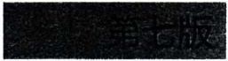
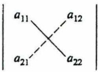
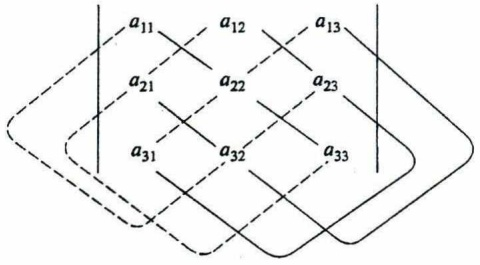
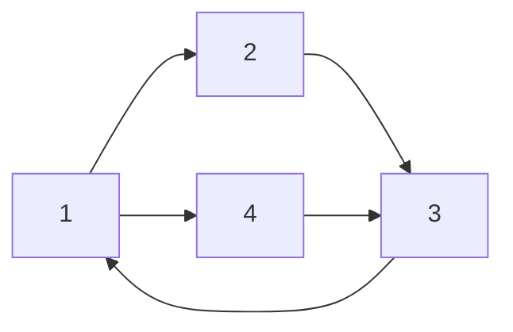

## 工程数学 线性代数

第七版

同济大学数学科学学院 编

# 工程数学

# 线性代数

同济大学数学科学学院 编

## 目录

## 第1章 行列式 …… 1

§ 1 二阶与三阶行列式 …… 1
§ 2 全排列和对换 …… 4
§ 3 n 阶行列式的定义 …… 6
§ 4 行列式的性质 …… 7
§ 5 行列式按行(列)展开 …… 15

习题一 20

## 第 2 章 矩阵及其运算 …… 24

§ 1 线性方程组和矩阵…… 24
§ 2 矩阵的运算…… 29
§ 3 逆矩阵…… 39
§ 4 克拉默法则…… 44
§ 5 矩阵分块法……46

习题二 52

## 第3章 矩阵的初等变换与线性方程组 56

§ 1 矩阵的初等变换……56
§ 2 矩阵的秩……66
§ 3 线性方程组的解……71

习题三 78

## 第 4 章 向量组的线性相关性 …… 82

§ 1 向量组及其线性组合……82

§ 2 向量组的线性相关性……87

§ 3 向量组的秩…… 91

§ 4 向量空间 …… 95

§ 5 线性方程组的解的结构 …… 101

习题四 109

## 第 5 章 相似矩阵及二次型 …… 114

§ 1 向量的内积、长度及正交性…… 114

§ 2 方阵的特征值与特征向量 …… 120

§ 3 相似矩阵 …… 124

§ 4 对称矩阵的对角化 …… 127

§ 5 二次型及其标准形 …… 131

§ 6 用配方法化二次型成标准形 …… 135

§ 7 正定二次型 …… 136

习题五 138

## \*第6章 线性空间与线性变换 …… 142

§ 1 线性空间的定义与性质 …… 142

§ 2 维数、基与坐标…… 146

§ 3 基变换与坐标变换 …… 148

§ 4 线性变换 …… 150

§ 5 线性变换的矩阵表示式 …… 153

习题六 157

## 部分习题参考答案 160

## 第1章

## 行列式

行列式是线性代数中常用的工具.本章主要介绍 $n$ 阶行列式的定义、性质及其计算方法.

## § 1 二阶与三阶行列式

## 一、二元线性方程组与二阶行列式

用消元法解二元线性方程组

$$
\left\{ \begin{array}{l} a _ {1 1} x _ {1} + a _ {1 2} x _ {2} = b _ {1}, \\ a _ {2 1} x _ {1} + a _ {2 2} x _ {2} = b _ {2}. \end{array} \right. \tag {1}
$$

为消去未知数 $x_{2}$, 以 $a_{22}$ 与 $a_{12}$ 分别乘上述两方程的两端, 然后两个方程相减, 得

$$
(a _ {1 1} a _ {2 2} - a _ {1 2} a _ {2 1}) x _ {1} = b _ {1} a _ {2 2} - a _ {1 2} b _ {2};
$$

类似地,消去 $x_{1}$ ,得

$$
(a _ {1 1} a _ {2 2} - a _ {1 2} a _ {2 1}) x _ {2} = a _ {1 1} b _ {2} - b _ {1} a _ {2 1}.
$$

当 $a_{11}a_{22} - a_{12}a_{21}\neq 0$ 时，求得方程组(1)的解为

$$
x _ {1} = \frac {b _ {1} a _ {2 2} - a _ {1 2} b _ {2}}{a _ {1 1} a _ {2 2} - a _ {1 2} a _ {2 1}}, \quad x _ {2} = \frac {a _ {1 1} b _ {2} - b _ {1} a _ {2 1}}{a _ {1 1} a _ {2 2} - a _ {1 2} a _ {2 1}}. \tag {2}
$$

(2)式中的分子、分母都是四个数分两对相乘再相减而得,其中分母 $a_{11}a_{22}-a_{12}a_{21}$ 是由方程组(1)的四个系数确定的,把这四个数按它们在方程组(1)中的位置,排成二行二列(横排称行、竖排称列)的数表

$$
\begin{array}{l} \begin{array}{c c} \boldsymbol {a} _ {1 1} & \boldsymbol {a} _ {1 2} \\ & , \end{array} \tag {3} \\ a _ {2 1} \quad a _ {2 2} \\ \end{array}
$$

表达式 $a_{11}a_{22} - a_{12}a_{21}$ 称为数表(3)所确定的二阶行列式，并记作

$$
\left| \begin{array}{l l} a _ {1 1} & a _ {1 2} \\ a _ {2 1} & a _ {2 2} \end{array} \right| \tag {4}
$$

数 ${a}_{ij}\left( {i,j = 1,2}\right)$ 称为行列式(4)的元素或元. 元素 ${a}_{ij}$ 的第一个下标 $i$ 称为行标, 表明该元素位于第 $i$ 行；第二个下标 $j$ 称为列标,表明该元素位于第 $j$ 列. 位于第 $i$ 行第 $j$ 列的元素称为行列式(4)的(i,j)元.

上述二阶行列式的定义,可用对角线法则来记忆.参看图1.1,把 $a_{11}$ 到 $a_{22}$ 的实连线称为主对角线, $a_{12}$ 到 $a_{21}$ 的虚连线称为副对角线,于是二阶行列式便是主对角线上的两元素之积减去副对角线上两元素之积所得的差.

图1.1

利用二阶行列式的概念,(2)式中 $x_{1},x_{2}$ 的分子也可写成二阶行列式,即

$$
b _ {1} a _ {2 2} - a _ {1 2} b _ {2} = \left| \begin{array}{c c} b _ {1} & a _ {1 2} \\ b _ {2} & a _ {2 2} \end{array} \right|, \quad a _ {1 1} b _ {2} - b _ {1} a _ {2 1} = \left| \begin{array}{c c} a _ {1 1} & b _ {1} \\ a _ {2 1} & b _ {2} \end{array} \right|.
$$

若记

$$
D = \left| \begin{array}{l l} a _ {1 1} & a _ {1 2} \\ a _ {2 1} & a _ {2 2} \end{array} \right|, \quad D _ {1} = \left| \begin{array}{l l} b _ {1} & a _ {1 2} \\ b _ {2} & a _ {2 2} \end{array} \right|, \quad D _ {2} = \left| \begin{array}{l l} a _ {1 1} & b _ {1} \\ a _ {2 1} & b _ {2} \end{array} \right|,
$$

则(2)式可写成

$$
x _ {1} = \frac {D _ {1}}{D} = \frac {\left| \begin{array}{l l} b _ {1} & a _ {1 2} \\ b _ {2} & a _ {2 2} \end{array} \right|}{\left| \begin{array}{l l} a _ {1 1} & a _ {1 2} \\ a _ {2 1} & a _ {2 2} \end{array} \right|}, \quad x _ {2} = \frac {D _ {2}}{D} = \frac {\left| \begin{array}{l l} a _ {1 1} & b _ {1} \\ a _ {2 1} & b _ {2} \end{array} \right|}{\left| \begin{array}{l l} a _ {1 1} & a _ {1 2} \\ a _ {2 1} & a _ {2 2} \end{array} \right|}.
$$

注意这里的分母 $D$ 是由方程组(1)的系数所确定的二阶行列式(称系数行列式), $x_{1}$ 的分子 $D_{1}$ 是用常数项 $b_{1}, b_{2}$ 替换 $D$ 中第 1 列的元素 $a_{11}, a_{21}$ 所得的二阶行列式, $x_{2}$ 的分子 $D_{2}$ 是用常数项 $b_{1}, b_{2}$ 替换 $D$ 中第 2 列的元素 $a_{12}, a_{22}$ 所得的二阶行列式.

例 1 求解二元线性方程组 公众号:旗胜考研

$$
\left\{ \begin{array}{l} 3 x _ {1} - 2 x _ {2} = 1 2, \\ 2 x _ {1} + x _ {2} = 1. \end{array} \right.
$$

解 由于

$$
\begin{array}{l} D \vDash \left| \begin{array}{c c} 3 & - 2 \\ 2 & 1 \end{array} \right| = 3 - (- 4) = 7 \neq 0, \\ D _ {1} = \left| \begin{array}{c c} 1 2 & - 2 \\ 1 & 1 \end{array} \right| = 1 2 - (- 2) = 1 4, \\ \end{array}
$$

$$
D _ {2} = \left| \begin{array}{c c} 3 & 1 2 \\ 2 & 1 \end{array} \right| = 3 - 2 4 = - 2 1,
$$

因此

$$
x _ {1} = \frac {D _ {1}}{D} = \frac {1 4}{7} = 2, \quad x _ {2} = \frac {D _ {2}}{D} = \frac {- 2 1}{7} = - 3.
$$

## 二、三阶行列式

定义1 设有9个数排成3行3列的数表

$$
\begin{array}{l} a _ {1 1} \quad a _ {1 2} \quad a _ {1 3} \\ a _ {2 1} \quad a _ {2 2} \quad a _ {2 3}, \tag {5} \\ a _ {3 1} \quad a _ {3 2} \quad a _ {3 3} \\ \end{array}
$$

记

$$
\begin{array}{l} \left| \begin{array}{c c c} a _ {1 1} & a _ {1 2} & a _ {1 3} \\ a _ {2 1} & a _ {2 2} & a _ {2 3} \\ a _ {3 1} & a _ {3 2} & a _ {3 3} \end{array} \right| \\ = a _ {1 1} a _ {2 2} a _ {3 3} + a _ {1 2} a _ {2 3} a _ {3 1} + a _ {1 3} a _ {2 1} a _ {3 2} - a _ {1 1} a _ {2 3} a _ {3 2} - a _ {1 2} a _ {2 1} a _ {3 3} - a _ {1 3} a _ {2 2} a _ {3 1}, \tag {6} \\ \end{array}
$$

(6)式称为数表(5)所确定的三阶行列式.

上述定义表明三阶行列式含6项，每项均为不同行不同列的三个元素的乘积再冠以正负号，其规律遵循图1.2所示的对角线法则:图中有三条实线看做是平行于主对角线的连线，三条虚线看做是平行于副对角线的连线，实线上三元素的乘积冠正号，虚线上三元素的乘积冠负号。

text_image

a₁₁ a₁₂ a₁₃
a₂₁ a₂₂ a₂₃
a₃₁ a₃₂ a₃₃

图1.2

类似于二元线性方程组与二阶行列式,考虑三元线性方程组时,若方程组的系数行列式非零,也可用三阶行列式来表示未知数 $x_{1},x_{2},x_{3}$ （见第2章§4）.

例2 计算三阶行列式

$$
D = \left| \begin{array}{c c c} 1 & 2 & - 4 \\ - 2 & 2 & 1 \\ - 3 & 4 & - 2 \end{array} \right|.
$$

解 按对角线法则,有

$$
\begin{array}{l} D = 1 \times 2 \times (- 2) + 2 \times 1 \times (- 3) + (- 4) \times (- 2) \times 4 - 1 \times 1 \times 4 - 2 \times (- 2) \times (- 2) - (- 4) \times 2 \times (- 3) \\ = - 4 - 6 + 3 2 - 4 - 8 - 2 4 = - 1 4. \\ \end{array}
$$

例3 求解方程

$$
\left| \begin{array}{c c c} 1 & 1 & 1 \\ 2 & 3 & x \\ 4 & 9 & x ^ {2} \end{array} \right| = 0.
$$

解 方程左端的三阶行列式

$$
D = 3 x ^ {2} + 4 x + 1 8 - 9 x - 2 x ^ {2} - 1 2 = x ^ {2} - 5 x + 6,
$$

由 $x^{2} - 5x + 6 = 0$ 解得 $x = 2$ 或 $x = 3$.

对角线法则只适用于二阶与三阶行列式,为研究四阶及更高阶行列式,下面先介绍有关全排列的知识,然后引出 n 阶行列式的概念.

## § 2 全排列和对换

## 一、排列及其逆序数

把 $n$ 个不同的元素（如取自然数 $\{1,2,\dots ,n\}$ )排成一行，叫做这 $n$ 个元素的全排列（也简称 $n$ 元排列），所有 $n$ 元排列构成的集合记为 $S_{n}$. $S_{n}$ 中所含元素的个数即 $n$ 元排列的个数，记为 $\left|S_n\right|$，可计算如下:

从 $n$ 个元素中任取一个放在第一个位置上，有 $n$ 种取法；

从剩下的 n-1 个元素中任取一个放在第二个位置上,有 n-1 种取法;

这样继续下去,直到最后只剩下一个元素放在第 n 个位置上,只有 1 种取法.于是

$$
\mid S _ {n} \mid = n \times (n - 1) \times \dots \times 3 \times 2 \times 1 = n!
$$

例如用1,2,3三个数字作排列,排列总数 $|S_{3}|=3\times2\times1=6$ ,它们是

$$
1 2 3, 2 3 1, 3 1 2, 1 3 2, 2 1 3, 3 2 1.
$$

对于 $n$ 个不同的元素, 先规定各元素之间有一个标准次序 (例如 $n$ 个不同的自然数, 可规定由小到大为标准次序), 于是在这 $n$ 个元素的任一排列中, 当某一对元素的先后次序与标准次序不同时, 就说它构成 1 个逆序. 一个排列中所有逆序的总数叫做这个排列的逆序数. 将排列 $p_1 p_2 \cdots p_n$ 的逆序数记为 $t(p_1 p_2 \cdots p_n)$.

逆序数为奇数的排列叫做奇排列,逆序数为偶数的排列叫做偶排列.

下面来讨论计算排列的逆序数的方法.

不失一般性,不妨设 n 个元素为 1 至 n 这 n 个自然数,并规定由小到大为标准次序.设  $p_{1}p_{2}\cdots p_{n}$  为这 n 个自然数的一个排列,考虑元素  $p_{i}(i=1,2,\cdots,n)$ ,如果比  $p_{i}$  大的且排在  $p_{i}$  前面的元素有  $t_{i}$  个,就说  $p_{i}$  这个元素的逆序数是  $t_{i}$ .全体元素的逆序数之

总和

$$
t = t _ {1} + t _ {2} + \dots + t _ {n} = \sum_ {i = 1} ^ {n} t _ {i}
$$

即是这个排列的逆序数.

例 4 求排列 32514 的逆序数.

解 在排列 32514 中:

3 排在首位,逆序数  $t_{1}=0$ ;
2 的前面比 2 大的数有一个(3)，故逆序数  $t_{2}=1$ ;
5 是最大数, 逆序数  $t_{3}=0$ ;

1 的前面比 1 大的数有三个  $(3,2,5)$ ，故逆序数  $t_{4}=3$ ;
4 的前面比 4 大的数有一个(5)，故逆序数 $t_5 = 1$，于是这个排列的逆序数为

$$
t = \sum_ {i = 1} ^ {5} t _ {i} = 0 + 1 + 0 + 3 + 1 = 5.
$$

## 二、对换

在排列中,将任意两个元素对调,其余的元素不动,这种作出新排列的操作叫做对换.将相邻两个元素对换,叫做相邻对换.

定理 1 一个排列中的任意两个元素对换，排列改变奇偶性.

证 仍不妨设元素为从1开始的自然数(从小到大为标准次序).先证相邻对换的情形.

设排列为 $a_1a_2\cdots a_labb_1b_2\cdots b_m$，对换 $a$ 与 $b$，变为 $a_1a_2\cdots a_lbab_1b_2\cdots b_m$。显然，$a_1, a_2, \cdots, a_l; b_1, b_2, \cdots, b_m$ 这些元素的逆序数经过对换并不改变，而 $a, b$ 两元素的逆序数改变为:当 $a < b$ 时，经对换后 $a$ 的逆序数增加 1 而 $b$ 的逆序数不变；当 $a > b$ 时，经对换后 $a$ 的逆序数不变而 $b$ 的逆序数减少 1。所以排列 $a_1a_2\cdots a_labb_1b_2\cdots b_m$ 与排列 $a_1a_2\cdots a_lbab_1b_2\cdots b_m$ 的奇偶性不同。

再证一般对换的情形.

设排列为 $a_1a_2\cdots a_lab_1b_2\cdots b_mbc_1c_2\cdots c_n$，把它作 $m$ 次相邻对换，变成 $a_1a_2\cdots a_labb_1b_2\cdots b_mc_1c_2\cdots c_n$，再作 $m+1$ 次相邻对换，变成 $a_1a_2\cdots a_lbb_1b_2\cdots b_mac_1c_2\cdots c_n$。总之，经 $2m+1$ 次相邻对换，排列 $a_1a_2\cdots a_lab_1b_2\cdots b_mbc_1c_2\cdots c_n$ 变成排列 $a_1a_2\cdots a_lbb_1b_2\cdots b_mac_1c_2\cdots c_n$，所以这两个排列的奇偶性相反。证毕

推论 奇排列对换成标准排列的对换次数为奇数，偶排列对换成标准排列的对换次数为偶数.

证 由定理1知对换的次数就是排列奇偶性的变化次数,而标准排列是偶排列(逆序数为0),因此知推论成立.证毕

## § 3 n 阶行列式的定义

为了给出 $n$ 阶行列式的定义, 先来研究三阶行列式的结构. 三阶行列式定义为

$$
\begin{array}{l} \left| \begin{array}{c c c} a _ {1 1} & a _ {1 2} & a _ {1 3} \\ a _ {2 1} & a _ {2 2} & a _ {2 3} \\ a _ {3 1} & a _ {3 2} & a _ {3 3} \end{array} \right| \\ = a _ {1 1} a _ {2 2} a _ {3 3} + a _ {1 2} a _ {2 3} a _ {3 1} + a _ {1 3} a _ {2 1} a _ {3 2} - a _ {1 1} a _ {2 3} a _ {3 2} - a _ {1 2} a _ {2 1} a _ {3 3} - a _ {1 3} a _ {2 2} a _ {3 1}. \tag {6} \\ \end{array}
$$

容易看出:

(i) (6)式右边的每一项都恰是三个元素的乘积, 这三个元素位于不同的行、不同的列. 因此, (6)式右端的任一项除正负号外可以写成 $a_{1p_1} a_{2p_2} a_{3p_3}$. 这里第一个下标(行标)排成标准次序 123, 而第二个下标(列标)排成 $p_1 p_2 p_3$, 它是 1, 2, 3 三个数的某个排列. 这样的排列共有 6 种, 对应 (6)式右端共含 6 项.

(ii) 各项的正负号与列标的排列对照.

带正号的三项列标排列是 123,231,312;

带负号的三项列标排列是 132,213,321.

经计算可知前三个排列都是偶排列,而后三个排列都是奇排列.因此各项所带的正负号可以表示为 $(-1)^{t}$ ,其中t为列标排列的逆序数.

总之,三阶行列式可以写成

$$
\left| \begin{array}{c c c} a _ {1 1} & a _ {1 2} & a _ {1 3} \\ a _ {2 1} & a _ {2 2} & a _ {2 3} \\ a _ {3 1} & a _ {3 2} & a _ {3 3} \end{array} \right| = \sum_ {p _ {1} p _ {2} p _ {3} \in S _ {3}} (- 1) ^ {t (p _ {1} p _ {2} p _ {3})} a _ {1 p _ {1}} a _ {2 p _ {2}} a _ {3 p _ {3}},
$$

其中 $t(p_1p_2p_3)$ 为排列 $p_1p_2p_3$ 的逆序数，$\Sigma$ 表示对1,2,3三个数的所有排列 $p_1p_2p_3$ 取和.

仿此,可以把行列式推广到一般情形.

定义 2 设有  $n^{2}$  个数, 排成 n 行 n 列的数表

$$
\begin{array}{c c c c c} & a _ {1 1} & a _ {1 2} & \dots & a _ {1 n} \\ & a _ {2 1} & a _ {2 2} & \dots & a _ {2 n} \\ & \vdots & \vdots & & \vdots \\ , & a _ {n 1} & a _ {n 2} & \dots & a _ {n n} \end{array} ,
$$

作出表中位于不同行不同列的 $n$ 个数的乘积，并冠以符号 $(-1)^{t(p_1p_2\cdots p_n)}$ ，得到形如

$$
\left(- 1\right) ^ {t (p _ {1} p _ {2} \dots p _ {n})} a _ {1 p _ {1}} a _ {2 p _ {2}} \dots a _ {n p _ {n}} \tag {7}
$$

的项,其中 $p_{1}p_{2}\cdots p_{n}$ 为自然数 $1,2,\cdots,n$ 的一个排列, $t(p_{1}p_{2}\cdots p_{n})$ 为这个排列的逆序数.由于这样的排列共有n!个,因而形如(7)式的项共有n!项.所有这n!项的代数和

$$
\sum_ {p _ {1} p _ {2} \dots p _ {n} \in S _ {n}} (- 1) ^ {t (p _ {1} p _ {2} \dots p _ {n})} a _ {1 p _ {1}} a _ {2 p _ {2}} \dots a _ {n p _ {n}}
$$

称为 n 阶行列式, 记作

$$
D = \left| \begin{array}{c c c c} a _ {1 1} & a _ {1 2} & \dots & a _ {1 n} \\ a _ {2 1} & a _ {2 2} & \dots & a _ {2 n} \\ \vdots & \vdots & & \vdots \\ a _ {n 1} & a _ {n 2} & \dots & a _ {n n} \end{array} \right|,
$$

简记作  $\det(a_{ij})$ ，其中数  $a_{ij}$  为行列式 D 的  $(i,j)$  元.

按此定义的二阶、三阶行列式，与 §1 中用对角线法则定义的二阶、三阶行列式显然是一致的。当 $n = 1$ 时，一阶行列式 $|a| = a$，注意不要与绝对值记号相混淆。

主对角线以下(上)的元素都为0的行列式叫做上(下)三角形行列式;特别地,主对角线以下和以上的元素都为0的行列式叫做对角行列式.

例 5 证明:(1) 下三角形行列式

$$
D = \left| \begin{array}{c c c c} a _ {1 1} & & & \\ a _ {2 1} & a _ {2 2} & & 0 \\ \vdots & \vdots & \ddots & \\ a _ {n 1} & a _ {n 2} & \dots & a _ {n n} \end{array} \right| = a _ {1 1} a _ {2 2} \dots a _ {n n};
$$

(2) 对角行列式

$$
\left| \begin{array}{c c c c} \lambda_ {1} & & & \\ & \lambda_ {2} & & \\ & & \ddots & \\ & & & \lambda_ {n} \end{array} \right| = \lambda_ {1} \lambda_ {2} \dots \lambda_ {n}.
$$

证（1）由于当 $j > i$ 时，$a_{ij} = 0$，故 $D$ 中可能不为0的元素 $a_{ip_i}$，其下标应有 $p_i \leqslant i$，即 $p_1 \leqslant 1, p_2 \leqslant 2, \dots, p_n \leqslant n$，而 $p_1 + p_2 + \dots + p_n = 1 + 2 + \dots + n$，因此 $p_1 = 1, p_2 = 2, \dots, p_n = n$，所以 $D$ 中可能不为0的项只有一项 $(-1)^{t(12 \dots n)} a_{11} a_{22} \dots a_{nn}$. 此项的符号 $(-1)^{t(12 \dots n)} = (-1)^0 = 1$，所以

$$
D = a _ {1 1} a _ {2 2} \dots a _ {n n}.
$$

(2) 由(1)即得.

## § 4 行列式的性质

记

$$
D = \left| \begin{array}{c c c c} a _ {1 1} & a _ {1 2} & \dots & a _ {1 n} \\ a _ {2 1} & a _ {2 2} & \dots & a _ {2 n} \\ \vdots & \vdots & & \vdots \\ a _ {n 1} & a _ {n 2} & \dots & a _ {n n} \end{array} \right|, \quad D ^ {\mathrm{T}} = \left| \begin{array}{c c c c} a _ {1 1} & a _ {2 1} & \dots & a _ {n 1} \\ a _ {1 2} & a _ {2 2} & \dots & a _ {n 2} \\ \vdots & \vdots & & \vdots \\ a _ {1 n} & a _ {2 n} & \dots & a _ {n n} \end{array} \right|,
$$

行列式  $D^{T}$  称为行列式 D 的转置行列式.

## 性质1 行列式与它的转置行列式相等.

证 记  $D=\det(a_{ij})$  的转置行列式  $D^{\mathrm{T}}=\det(b_{ij})$ ，即  $D^{\mathrm{T}}$  的  $(i,j)$  元为  $b_{ij}$ ，则  $b_{ij}=a_{ji}(i,j=1,2,\cdots,n)$ ，按定义

$$
D ^ {\mathrm{T}} = \sum (- 1) ^ {t} b _ {1 p _ {1}} b _ {2 p _ {2}} \dots b _ {n p _ {n}} = \sum (- 1) ^ {t} a _ {p _ {1} 1} a _ {p _ {2} 2} \dots a _ {p _ {n} n}.
$$

下证 ${D} = {D}^{\mathrm{T}}$ .

对于行列式 $D$ 的任一项

$$
(- 1) ^ {t} a _ {1 p _ {1}} \dots a _ {i p _ {i}} \dots a _ {j p _ {j}} \dots a _ {n p _ {n}},
$$

其中 $12 \cdots i \cdots j \cdots n$ 为标准排列, $t$ 为排列 $p_1 p_2 \cdots p_i \cdots p_j \cdots p_n$ 的逆序数, 对换元素 $a_{ip_i}$ 与 $a_{jp_j}$ 成

$$
(- 1) ^ {t} a _ {1 p _ {1}} \dots a _ {j p _ {j}} \dots a _ {i p _ {i}} \dots a _ {n p _ {n}},
$$

这时,这一项的值不变,而行标排列与列标排列同时作了一次相应的对换.设新的行标排列 $12\cdots j\cdots i\cdots n$ 的逆序数为r,则r为奇数;设新的列标排列 $p_{1}p_{2}\cdots p_{j}\cdots p_{i}\cdots p_{n}$ 的逆序数为 $t_{1}$ ,则

$$
(- 1) ^ {t _ {1}} = - (- 1) ^ {t}.
$$

故

$$
(- 1) ^ {t} = - (- 1) ^ {t _ {1}} = (- 1) ^ {r} (- 1) ^ {t _ {1}} = (- 1) ^ {r + t _ {1}},
$$

于是

$$
(- 1) ^ {t} a _ {1 p _ {1}} \dots a _ {i p _ {i}} \dots a _ {j p _ {j}} \dots a _ {n p _ {n}} = (- 1) ^ {r + t _ {1}} a _ {1 p _ {1}} \dots a _ {j p _ {j}} \dots a _ {i p _ {i}} \dots a _ {n p _ {n}}.
$$

这就表明,对换乘积中两元素的次序,从而行标排列与列标排列同时作了相应的对换,则行标排列与列标排列的逆序数之和并不改变奇偶性.经一次对换是如此,经多次对换当然还是如此.于是,经过若干次对换,使

列标排列  $p_{1}p_{2}\cdots p_{n}$  （逆序数为 t）变为标准排列（逆序数为 0）；

行标排列则相应地从标准排列变为某个新的排列, 设此新排列为  $q_{1}q_{2}\cdots q_{n}$ , 其逆序数为 s, 则有

$$
(- 1) ^ {t} a _ {1 p _ {1}} a _ {2 p _ {2}} \dots a _ {n p _ {n}} = (- 1) ^ {s} a _ {q _ {1} 1} a _ {q _ {2} 2} \dots a _ {q _ {n} n}.
$$

又,如果上式左边乘积的第 $i$ 个元素 $a_{ip_i}$ 为 $a_{ij}$,那么它必定是上式右边乘积的第 $j$ 个元素,即 $a_{ip_i} = a_{ij} = a_{q_jj}$.可见排列 $q_1q_2\cdots q_n$ 由排列 $p_1p_2\cdots p_n$ 惟一确定.

综上可知: 对于 D 中任一项  $(-1)^{\prime}a_{1p_{1}}a_{2p_{2}}\cdots a_{np_{n}}$ ，总有且仅有  $D^{T}$  中的某一项$(-1)^{s}a_{q_{1}1}a_{q_{2}2}\cdots a_{q_{n}n}$ 与之对应并相等；反之，对于 $D^{T}$ 中的任一项 $(-1)^{t}a_{p_{1}1}a_{p_{2}2}\cdots a_{p_{n}n}$ ，也总有且仅有D中的某一项 $(-1)^{s}a_{1q_{1}}a_{2q_{2}}\cdots a_{nq_{n}}$ 与之对应并相等，于是D与 $D^{T}$ 中的项可以一一对应并相等，从而 $D=D^{T}$ .证毕

由此性质可知,行列式中的行与列具有同等的地位,行列式的性质凡是对行成立的对列也同样成立,反之亦然.

性质 2 对换行列式的两行(列), 行列式变号.

证 设行列式

$$
D _ {1} = \left| \begin{array}{c c c c} b _ {1 1} & b _ {1 2} & \dots & b _ {1 n} \\ b _ {2 1} & b _ {2 2} & \dots & b _ {2 n} \\ \vdots & \vdots & & \vdots \\ b _ {n 1} & b _ {n 2} & \dots & b _ {n n} \end{array} \right|
$$

是由行列式 $D = \det (a_{ij})$ 对换 $i,j$ 两行得到的，即当 $k\neq i,j$ 时， $b_{kp} = a_{kp}$ ；当 $k = i,j$ 时， $b_{ip} = a_{jp},b_{jp} = a_{ip}$ ，于是

$$
\begin{array}{l} D _ {1} = \sum (- 1) ^ {t} b _ {1 p _ {1}} \dots b _ {i p _ {i}} \dots b _ {j p _ {j}} \dots b _ {n p _ {n}} = \sum (- 1) ^ {t} a _ {1 p _ {1}} \dots a _ {j p _ {i}} \dots a _ {i p _ {j}} \dots a _ {n p _ {n}} \\ = \sum (- 1) ^ {\prime} a _ {1 p _ {1}} \dots a _ {i p _ {j}} \dots a _ {j p _ {i}} \dots a _ {n p _ {n}}, \\ \end{array}
$$

其中 $12\cdots i\cdots j\cdots n$ 为标准排列，$t$ 为排列 $p_1p_2\cdots p_i\cdots p_j\cdots p_n$ 的逆序数.设排列 $p_1p_2\cdots p_j\cdots p_i\cdots p_n$ 的逆序数为 $t_1$ ，则 $(-1)' = -(1)^{t_1}$ ，故

$$
D _ {1} = - \sum (- 1) ^ {t _ {1}} a _ {1 p _ {1}} \dots a _ {i p _ {j}} \dots a _ {j p _ {i}} \dots a _ {n p _ {n}} = - D.
$$

证毕

以 $r_i$ 表示行列式的第 $i$ 行, 以 $c_i$ 表示第 $i$ 列. 对换 $i, j$ 两行记作 $r_i \leftrightarrow r_j$, 对换 $i, j$ 两列记作 $c_i \leftrightarrow c_j$.

推论 若行列式有两行(列)完全相同,则此行列式等于零.

证 把这两行对换,有 D = -D, 故 D = 0.

证毕

性质3 行列式的某一行(列)中所有的元素都乘同一数 $k$, 等于用数 $k$ 乘此行列式. 第 $i$ 行(或列)乘 $k$, 记作 $r_i \times k$ (或 $c_i \times k$).

推论1 行列式中某一行(列)的所有元素的公因子可以提到行列式记号的外面. 即

$$
\left| \begin{array}{c c c c} a _ {1 1} & a _ {1 2} & \dots & a _ {1 n} \\ \vdots & \vdots & & \vdots \\ k a _ {i 1} & k a _ {i 2} & \dots & k a _ {i n} \\ \vdots & \vdots & & \vdots \\ a _ {n 1} & a _ {n 2} & \dots & a _ {n n} \end{array} \right| = k \left| \begin{array}{c c c c} a _ {1 1} & a _ {1 2} & \dots & a _ {1 n} \\ \vdots & \vdots & & \vdots \\ a _ {i 1} & a _ {i 2} & \dots & a _ {i n} \\ \vdots & \vdots & & \vdots \\ a _ {n 1} & a _ {n 2} & \dots & a _ {n n} \end{array} \right|.
$$

推论 2 行列式中如果有两行(列)元素成比例, 则此行列式等于零.

性质 4 若行列式的某一行(列)的元素都是两数之和,例如第 i 行的元素都是两数之和:

$$
D = \left| \begin{array}{c c c c} a _ {1 1} & a _ {1 2} & \dots & a _ {1 n} \\ \vdots & \vdots & & \vdots \\ a _ {i 1} + a _ {i 1} ^ {\prime} & a _ {i 2} + a _ {i 2} ^ {\prime} & \dots & a _ {i n} + a _ {i n} ^ {\prime} \\ \vdots & \vdots & & \vdots \\ a _ {n 1} & a _ {n 2} & \dots & a _ {n n} \end{array} \right|,
$$

则 $D$ 等于下列两个行列式之和:

$$
D = \left| \begin{array}{c c c c} a _ {1 1} & a _ {1 2} & \dots & a _ {1 n} \\ \vdots & \vdots & & \vdots \\ a _ {i 1} & a _ {i 2} & \dots & a _ {i n} \\ \vdots & \vdots & & \vdots \\ a _ {n 1} & a _ {n 2} & \dots & a _ {n n} \end{array} \right| + \left| \begin{array}{c c c c} a _ {1 1} & a _ {1 2} & \dots & a _ {1 n} \\ \vdots & \vdots & & \vdots \\ a _ {i 1} ^ {\prime} & a _ {i 2} ^ {\prime} & \dots & a _ {i n} ^ {\prime} \\ \vdots & \vdots & & \vdots \\ a _ {n 1} & a _ {n 2} & \dots & a _ {n n} \end{array} \right|.
$$

性质5 把行列式的某一行(列)的各元素乘同一数然后加到另一行(列)对应的元素上去,行列式不变.

例如以数 $k$ 乘第 $i$ 行加到第 $j$ 行上（记作 $r_j + kr_i$），有

$$
\left| \begin{array}{c c c c} a _ {1 1} & a _ {1 2} & \dots & a _ {1 n} \\ \vdots & \vdots & & \vdots \\ a _ {i 1} & a _ {i 2} & \dots & a _ {i n} \\ \vdots & \vdots & & \vdots \\ a _ {j 1} & a _ {j 2} & \dots & a _ {j n} \\ \vdots & \vdots & & \vdots \\ a _ {n 1} & a _ {n 2} & \dots & a _ {n n} \end{array} \right| \stackrel {{r _ {j} + k r _ {i}}} {{=}} \left| \begin{array}{c c c c} a _ {1 1} & a _ {1 2} & \dots & a _ {1 n} \\ \vdots & \vdots & & \vdots \\ a _ {i 1} & a _ {i 2} & \dots & a _ {i n} \\ \vdots & \vdots & & \vdots \\ a _ {j 1} + k a _ {i 1} & a _ {j 2} + k a _ {i 2} & \dots & a _ {j n} + k a _ {i n} \\ \vdots & \vdots & & \vdots \\ a _ {n 1} & a _ {n 2} & \dots & a _ {n n} \end{array} \right| (i \neq j).
$$

(以数 k 乘第 i 列加到第 j 列上, 记作  $c_{j} + kc_{i}$ .)

以上诸性质请读者证明之.

上述性质 4 表明: 当某一行(或列)的元素为两数之和时, 行列式关于该行(或列)可分解为两个行列式. 若 n 阶行列式每个元素都表示成两数之和, 则它可分解成  $2^{n}$  个行列式. 例如二阶行列式

$$
\left| \begin{array}{c c} a + x & b + y \\ c + z & d + w \end{array} \right| = \left| \begin{array}{c c} a & b + y \\ c & d + w \end{array} \right| + \left| \begin{array}{c c} x & b + y \\ z & d + w \end{array} \right| = \left| \begin{array}{c c} a & b \\ c & d \end{array} \right| + \left| \begin{array}{c c} a & y \\ c & w \end{array} \right| + \left| \begin{array}{c c} x & b \\ z & d \end{array} \right| + \left| \begin{array}{c c} x & y \\ z & w \end{array} \right|.
$$

性质2,3,5介绍了行列式关于行和关于列的三种运算，即 $r_i \leftrightarrow r_j, r_i \times k, r_i + kr_j$ 和 $c_i \leftrightarrow c_j, c_i \times k, c_i + kc_j$ ，利用这些运算可简化行列式的计算，特别是利用运算 $r_i + kr_j$ （或 $c_i + kc_j$）可以把行列式中许多元素化为0.计算行列式常用的一种方法就是利用运算 $r_i +$ $k{r}_{j}$ 把行列式化为上三角形行列式,从而算得行列式的值.请看以下几个例题.

例6 计算 $n$ 阶行列式

$$
D = \left| \begin{array}{c c c c} & & & a _ {1 n} \\ 0 & & a _ {2, n - 1} & a _ {2 n} \\ & \ddots & \vdots & \vdots \\ a _ {n 1} & \dots & a _ {n, n - 1} & a _ {n n} \end{array} \right|; \quad (2) \left| \begin{array}{c c c c} & & & \lambda_ {1}. \\ & & \lambda_ {2} \\ & \ddots \\ \lambda_ {n} \end{array} \right| \tag {1}
$$

解（1）应注意 $D$ 不是上(下)三角形行列式，但可以通过行的对换化为上三角形行列式.先把 $D$ 的第 $n$ 行依次与第 $n - 1$ 行……第1行对换（共 $n - 1$ 次对换），得行列式 $D_{1}$.由性质 $2, D_{1} = (-1)^{n - 1}D$ ，或 $D = (-1)^{n - 1}D_{1}$，这里

$$
D _ {1} = \left| \begin{array}{c c c c c} a _ {n 1} & a _ {n 2} & \dots & a _ {n, n - 1} & a _ {n n} \\ 0 & 0 & \dots & 0 & a _ {1 n} \\ \vdots & \vdots & & \vdots & \vdots \\ 0 & a _ {n - 1, 2} & \dots & a _ {n - 1, n - 1} & a _ {n - 1, n} \end{array} \right|,
$$

再把 $D_{1}$ 的第 $n$ 行依次与第 $n - 1$ 行……第2行对换（共 $n - 2$ 次对换），得一新的行列式……循此，$D$ 经过共

$$
(n - 1) + (n - 2) + \dots + 1 = \frac {1}{2} n (n - 1)
$$

次行的对换成为上三角形行列式

$$
\left| \begin{array}{c c c c} a _ {n 1} & a _ {n 2} & \dots & a _ {n n} \\ & a _ {n - 1, 2} & \dots & a _ {n - 1, n} \\ & & \ddots & \vdots \\ & 0 & & a _ {1 n} \end{array} \right|,
$$

于是 $D = (-1)^{n - 1}D_{1} = \dots = (-1)^{\frac{1}{2} n(n - 1)}a_{1n}a_{2,n - 1}\dots a_{n1};$

(2) 由(1)得

$$
\left| \begin{array}{c c c c} & & & \lambda_ {1} \\ & & \lambda_ {2} \\ & \ddots & \\ \lambda_ {n} & & \end{array} \right| = (- 1) ^ {\frac {n (n - 1)}{2}} \lambda_ {1} \lambda_ {2} \dots \lambda_ {n}.
$$

例7 计算

$$
D = \left| \begin{array}{c c c c} 3 & 1 & - 1 & 2 \\ - 5 & 1 & 3 & - 4 \\ 2 & 0 & 1 & - 1 \\ 1 & - 5 & 3 & - 3 \end{array} \right|.
$$

解 $D\xrightarrow{c_1\leftrightarrow c_2} -\left|\begin{array}{cccc}1 & 3 & -1 & 2\\ 1 & -5 & 3 & -4\\ 0 & 2 & 1 & -1\\ -5 & 1 & 3 & -3 \end{array}\right| \xrightarrow[r_4 + 5r_1]{r_2 - r_1} -\left|\begin{array}{ccc}1 & 3 & -1 & 2\\ 0 & -8 & 4 & -6\\ 0 & 2 & 1 & -1\\ 0 & 16 & -2 & 7 \end{array}\right|$

$$
\begin{array}{l} \underline {{\underline {{r _ {2} \leftrightarrow r _ {3}}}}} \left| \begin{array}{c c c c} 1 & 3 & - 1 & 2 \\ 0 & 2 & 1 & - 1 \\ 0 & - 8 & 4 & - 6 \\ 0 & 1 6 & - 2 & 7 \end{array} \right| \underline {{\underline {{r _ {3} + 4 r _ {2}}}}} \left| \begin{array}{c c c c} 1 & 3 & - 1 & 2 \\ 0 & 2 & 1 & - 1 \\ 0 & 0 & 8 & - 1 0 \\ 0 & 0 & - 1 0 & 1 5 \end{array} \right| \\ = 1 0 \left| \begin{array}{c c c c} 1 & 3 & - 1 & 2 \\ 0 & 2 & 1 & - 1 \\ 0 & 0 & 4 & - 5 \\ 0 & 0 & - 2 & 3 \end{array} \right| \stackrel {r _ {4} + \frac {1}{2} r _ {3}} {=} 1 0 \left| \begin{array}{c c c c} 1 & 3 & - 1 & 2 \\ 0 & 2 & 1 & - 1 \\ 0 & 0 & 4 & - 5 \\ 0 & 0 & 0 & \frac {1}{2} \end{array} \right| = 1 0 \times 4 = 4 0. \\ \end{array}
$$

在上述解法中,先用了运算 $c_{1} \leftrightarrow c_{2}$, 其目的是把 $a_{11}$ 换成 1, 从而利用运算 $r_{i} - a_{i1} r_{1}$, 即可把 $a_{i1} (i = 2,3,4)$ 变为 0. 如果不先作 $c_{1} \leftrightarrow c_{2}$, 则由于原式中 $a_{11} = 3$, 需用运算 $r_{i} - \frac{a_{i1}}{3} r_{1}$ 把 $a_{i1}$ 变为 0, 这样计算时就比较麻烦. 第二步把 $r_{2} - r_{1}$ 和 $r_{4} + 5r_{1}$ 写在一起, 这是两次运算, 并把第一次运算结果的书写省略了.

例8 计算

$$
D = \left| \begin{array}{c c c c} 3 & 1 & 1 & 1 \\ 1 & 3 & 1 & 1 \\ 1 & 1 & 3 & 1 \\ 1 & 1 & 1 & 3 \end{array} \right|.
$$

解 这个行列式的特点是各列 4 个数之和都是 6. 今把第 2,3,4 行同时加到第 1 行, 提出公因子 6, 然后各行减去第一行:

$$
D \xlongequal {r _ {1} + r _ {2} + r _ {3} + r _ {4}} \left| \begin{array}{l l l l} 6 & 6 & 6 & 6 \\ 1 & 3 & 1 & 1 \\ 1 & 1 & 3 & 1 \\ 1 & 1 & 1 & 3 \end{array} \right| = 6 \left| \begin{array}{l l l l} 1 & 1 & 1 & 1 \\ 1 & 3 & 1 & 1 \\ 1 & 1 & 3 & 1 \\ 1 & 1 & 1 & 3 \end{array} \right| \xlongequal [ r _ {4} - r _ {1} ] {r _ {2} - r _ {1}} 6 \left| \begin{array}{l l l l} 1 & 1 & 1 & 1 \\ 0 & 2 & 0 & 0 \\ 0 & 0 & 2 & 0 \\ 0 & 0 & 0 & 2 \end{array} \right| = 4 8.
$$

例9 计算

$$
D = \left| \begin{array}{c c c c} a & b & c & d \\ a & a + b & a + b + c & a + b + c + d \\ a & 2 a + b & 3 a + 2 b + c & 4 a + 3 b + 2 c + d \\ a & 3 a + b & 6 a + 3 b + c & 1 0 a + 6 b + 3 c + d \end{array} \right|.
$$

解 从第 4 行开始, 后行减前行,

$$
D \frac {r _ {4} - r _ {3}}{r _ {2} - r _ {1}} \left| \begin{array}{c c c c} a & b & c & d \\ 0 & a & a + b & a + b + c \\ 0 & a & 2 a + b & 3 a + 2 b + c \\ 0 & a & 3 a + b & 6 a + 3 b + c \end{array} \right| \xlongequal {r _ {4} - r _ {3}} \left| \begin{array}{c c c c} a & b & c & d \\ 0 & a & a + b & a + b + c \\ 0 & 0 & a & 2 a + b \\ 0 & 0 & a & 3 a + b \end{array} \right|
$$

$$
\underline {{\underline {{r _ {4} - r _ {3}}}}} \left| \begin{array}{c c c c} a & b & c & d \\ 0 & a & a + b & a + b + c \\ 0 & 0 & a & 2 a + b \\ 0 & 0 & 0 & a \end{array} \right| = a ^ {4}.
$$

上述诸例中都用到把几个运算写在一起的省略写法,这里要注意各个运算的次序一般不能颠倒,这是由于后一次运算是作用在前一次运算结果上的.例如

$$
\begin{array}{l} \left| \begin{array}{c c} a & b \\ c & d \end{array} \right| \stackrel {{r _ {1} + r _ {2}}} {{=}} \left| \begin{array}{c c} a + c & b + d \\ c & d \end{array} \right| \stackrel {{r _ {2} - r _ {1}}} {{=}} \left| \begin{array}{c c} a + c & b + d \\ - a & - b \end{array} \right|, \\ \left| \begin{array}{l l} a & b \\ c & d \end{array} \right| \stackrel {{r _ {2} - r _ {1}}} {{=}} \left| \begin{array}{c c} a & b \\ c - a & d - b \end{array} \right| \stackrel {{r _ {1} + r _ {2}}} {{=}} \left| \begin{array}{c c} c & d \\ c - a & d - b \end{array} \right|, \\ \end{array}
$$

可见当两次运算次序不同时所得结果不同.忽视后一次运算是作用在前一次运算的结果上,就会出错,例如

$$
\left| \begin{array}{l l} a & b \\ c & d \end{array} \right| \frac {r _ {1} + r _ {2}}{\overline {{r _ {2} - r _ {1}}}} \left| \begin{array}{l l} a + c & b + d \\ c - a & d - b \end{array} \right|,
$$

这样的运算是错误的,出错的原因在于第二次运算找错了对象.

此外还要注意运算 $r_i + r_j$ 与 $r_j + r_i$ 的区别，$r_i + kr_j$ 是约定的行列式运算记号，不能写作 $kr_j + r_i$（这里不能套用加法的交换律）.

上述诸例都是利用运算 $r_i + kr_j$ 把行列式化为上三角形行列式，用归纳法不难证明（这里不证）任何 $n$ 阶行列式总能利用运算 $r_i + kr_j$ 化为上三角形行列式，或化为下三角形行列式（这时要先把 $a_{1n}, a_{2n}, \cdots, a_{n-1,n}$ 化为0). 类似地，利用列运算 $c_i + kc_j$ ，也可把行列式化为上三角形行列式或下三角形行列式.

例10 设

$$
D = \left| \begin{array}{c c c c c c} a _ {1 1} & \dots & a _ {1 k} & & & \\ \vdots & & \vdots & & 0 & \\ a _ {k 1} & \dots & a _ {k k} & & & \\ c _ {1 1} & \dots & c _ {1 k} & b _ {1 1} & \dots & b _ {1 n} \\ \vdots & & \vdots & \vdots & & \vdots \\ c _ {n 1} & \dots & c _ {n k} & b _ {n 1} & \dots & b _ {n n} \end{array} \right|,
$$

$$
D _ {1} = \det (a _ {i j}) = \left| \begin{array}{c c c} a _ {1 1} & \dots & a _ {1 k} \\ \vdots & & \vdots \\ a _ {k 1} & \dots & a _ {k k} \end{array} \right|, \quad D _ {2} = \det (b _ {i j}) = \left| \begin{array}{c c c} b _ {1 1} & \dots & b _ {1 n} \\ \vdots & & \vdots \\ b _ {n 1} & \dots & b _ {n n} \end{array} \right|,
$$

证明: $D=D_{1}D_{2}.$

证 对 $D_{1}$ 作运算 $r_i + \lambda r_j$ ，把 $D_{1}$ 化为下三角形行列式，设为

$$
D _ {1} = \left| \begin{array}{c c c} p _ {1 1} & & 0 \\ \vdots & \ddots & \\ p _ {k 1} & \dots & p _ {k k} \end{array} \right| = p _ {1 1} \dots p _ {k k},
$$

对 $D_{2}$ 作运算 $c_{i} + \lambda c_{j}$, 把 $D_{2}$ 化为下三角形行列式, 设为

$$
D _ {2} = \left| \begin{array}{c c c} q _ {1 1} & & 0 \\ \vdots & \ddots & \\ q _ {n 1} & \dots & q _ {n n} \end{array} \right| = q _ {1 1} \dots q _ {n n}.
$$

于是,对 D 的前 k 行作运算  $r_{i}+\lambda r_{j}$ , 再对后 n 列作运算  $c_{i}+\lambda c_{j}$ , 把 D 化为下三角形行列式

$$
D = \left| \begin{array}{c c c c c c} p _ {1 1} & & & & & \\ \vdots & \ddots & & & 0 & \\ p _ {k 1} & \dots & p _ {k k} & & \\ c _ {1 1} & \dots & c _ {1 k} & q _ {1 1} & & \\ \vdots & & \vdots & \vdots & \ddots & \\ c _ {n 1} & \dots & c _ {n k} & q _ {n 1} & \dots & q _ {n n} \end{array} \right|,
$$

故

$$
D = p _ {1 1} \dots p _ {k k} q _ {1 1} \dots q _ {n n} = D _ {1} D _ {2}.
$$

例11 计算 $2n$ 阶行列式

$$
D _ {2 n} = \left| \begin{array}{c c c c c c} a & & & & & b \\ & \ddots & & & \ddots \\ & & a & b & & \\ & & c & d & & \\ & \ddots & & & \ddots \\ c & & & & & d \\ \hline & & & & 2 n \end{array} \right|,
$$

其中未写出的元素为0.

解 把 $D_{2n}$ 中的第 $2n$ 行依次与第 $2n - 1$ 行……第2行对换（作 $2n - 2$ 次相邻两行

的对换),再把第 $2n$ 列依次与第 $2n - 1$ 列……第2列对换,得

$$
D _ {2 n} = (- 1) ^ {2 (2 n - 2)} \left| \begin{array}{c c c c c c c c} a & b & 0 & & \dots & & & 0 \\ c & d & 0 & & \dots & & & 0 \\ 0 & 0 & a & & & & & b \\ & & & \ddots & & & \ddots \\ \vdots & \vdots & & & a & b & \\ & & & & c & d \\ & & & \ddots & & & \ddots \\ 0 & 0 & c & & & & d \end{array} \right|, \underbrace {} _ {2 (n - 1)}
$$

根据例 10 的结果,有

$$
D _ {2 n} = D _ {2} D _ {2 (n - 1)} = (a d - b c) D _ {2 (n - 1)}.
$$

以此作递推公式,即得

$$
D _ {2 n} = (a d - b c) ^ {2} D _ {2 (n - 2)} = \dots = (a d - b c) ^ {n - 1} D _ {2} = (a d - b c) ^ {n}.
$$

## § 5 行列式按行(列)展开

一般说来,低阶行列式的计算比高阶行列式的计算要简便,于是,我们自然地考虑用低阶行列式来表示高阶行列式的问题.为此,先引进余子式和代数余子式的概念.

在 $n$ 阶行列式中, 把 $(i,j)$ 元 $a_{ij}$ 所在的第 $i$ 行和第 $j$ 列划去后, 留下来的 $n-1$ 阶行列式叫做 $(i,j)$ 元 $a_{ij}$ 的余子式, 记作 $M_{ij}$; 记

$$
A _ {i j} = (- 1) ^ {i + j} M _ {i j},
$$

$A_{ij}$ 叫做 $(i,j)$ 元 $a_{ij}$ 的代数余子式.

例如四阶行列式

$$
D = \left| \begin{array}{c c c c} a _ {1 1} & a _ {1 2} & a _ {1 3} & a _ {1 4} \\ a _ {2 1} & a _ {2 2} & a _ {2 3} & a _ {2 4} \\ a _ {3 1} & a _ {3 2} & a _ {3 3} & a _ {3 4} \\ a _ {4 1} & a _ {4 2} & a _ {4 3} & a _ {4 4} \end{array} \right|
$$

中(3,2)元 $a_{32}$ 的余子式和代数余子式分别为

$$
M _ {3 2} = \left| \begin{array}{l l l} a _ {1 1} & a _ {1 3} & \dot {a} _ {1 4} \\ a _ {2 1} & a _ {2 3} & a _ {2 4} \\ a _ {4 1} & a _ {4 3} & a _ {4 4} \end{array} \right|, \quad A _ {3 2} = (- 1) ^ {3 + 2} M _ {3 2} = - M _ {3 2}.
$$

引理 一个 $n$ 阶行列式, 如果其中第 $i$ 行所有元素除 $(i,j)$ 元 $a_{ij}$ 外都为零, 那么这个行列式等于 $a_{ij}$ 与它的代数余子式的乘积, 即

$$
D = a _ {i j} A _ {i j}.
$$

证 先证 $i = j = 1$ 的情形. 此时

$$
D = \left| \begin{array}{c c c c} a _ {1 1} & 0 & \dots & 0 \\ a _ {2 1} & a _ {2 2} & \dots & a _ {2 n} \\ \vdots & \vdots & & \vdots \\ a _ {n 1} & a _ {n 2} & \dots & a _ {n n} \end{array} \right|,
$$

这是例10中当 $k = 1$ 时的特殊情形，按例10的结论，即有

$$
D = a _ {1 1} M _ {1 1},
$$

又

$$
A _ {1 1} = (- 1) ^ {1 + 1} M _ {1 1} = M _ {1 1},
$$

从而

$$
D = a _ {1 1} A _ {1 1}.
$$

再证一般情形.此时

$$
D = \left| \begin{array}{c c c c c} a _ {1 1} & \dots & a _ {1 j} & \dots & a _ {1 n} \\ \vdots & & \vdots & & \vdots \\ 0 & \dots & a _ {i j} & \dots & 0 \\ \vdots & & \vdots & & \vdots \\ a _ {n 1} & \dots & a _ {n j} & \dots & a _ {n n} \end{array} \right|.
$$

为了利用前面的结果，把 $D$ 的行列作如下调换:把 $D$ 的第 $i$ 行依次与第 $i - 1$ 行、第 $i - 2$ 行……第1行对换，这样数 $a_{ij}$ 就换成 $(1,j)$ 元，对换的次数为 $i - 1$.再把第$j$ 列依次与第 $j - 1$ 列、第 $j - 2$ 列……第1列对换，这样数 $a_{ij}$ 就换成(1,1)元，对换的次数为 $j - 1$.总之，经 $i + j - 2$ 次对换，把数 $a_{ij}$ 换成(1,1)元，所得的行列式 $D_{1} = (-1)^{i + j - 2}D = (-1)^{i + j}D$ ，而 $D_{1}$ 中(1,1)元的余子式就是 $D$ 中 $(i,j)$ 元的余子式 $M_{ij}$.

由于 $D_{1}$ 的(1,1)元为 $a_{ij}$, 第1行其余元素都为0, 利用前面的结果, 有

$$
D _ {1} = a _ {i j} M _ {i j},
$$

于是

$$
D = (- 1) ^ {i + j} D _ {1} = (- 1) ^ {i + j} a _ {i j} M _ {i j} = a _ {i j} A _ {i j}.
$$

证毕

定理 2 行列式等于它的任一行(列)的各元素与其对应的代数余子式乘积之和, 即

$$
D = a _ {i 1} A _ {i 1} + a _ {i 2} A _ {i 2} + \dots + a _ {i n} A _ {i n} \quad (i = 1, 2, \dots , n)
$$

或

$$
D = a _ {1 j} A _ {1 j} + a _ {2 j} A _ {2 j} + \dots + a _ {n j} A _ {n j} \quad (j = 1, 2, \dots , n).
$$

证 $D = \left| \begin{array}{cccc}a_{11} & a_{12} & \dots & a_{1n}\\ \vdots & \vdots &  & \vdots \\ a_{i1} + 0 + \dots +0 & 0 + a_{i2} + \dots +0 & \dots & 0 + \dots +0 + a_{in}\\ \vdots & \vdots &  & \vdots \\ a_{n1} & a_{n2} & \dots & a_{nn} \end{array} \right|$

$$
= \left| \begin{array}{c c c c} a _ {1 1} & a _ {1 2} & \dots & a _ {1 n} \\ \vdots & \vdots & & \vdots \\ a _ {i 1} & 0 & \dots & 0 \\ \vdots & \vdots & & \vdots \\ a _ {n 1} & a _ {n 2} & \dots & a _ {n n} \end{array} \right| + \left| \begin{array}{c c c c} a _ {1 1} & a _ {1 2} & \dots & a _ {1 n} \\ \vdots & \vdots & & \vdots \\ 0 & a _ {i 2} & \dots & 0 \\ \vdots & \vdots & & \vdots \\ a _ {n 1} & a _ {n 2} & \dots & a _ {n n} \end{array} \right| + \dots + \left| \begin{array}{c c c c} a _ {1 1} & a _ {1 2} & \dots & a _ {1 n} \\ \vdots & \vdots & & \vdots \\ 0 & 0 & \dots & a _ {i n} \\ \vdots & \vdots & & \vdots \\ a _ {n 1} & a _ {n 2} & \dots & a _ {n n} \end{array} \right|,
$$

根据引理,即得

$$
D = a _ {i 1} A _ {i 1} + a _ {i 2} A _ {i 2} + \dots + a _ {i n} A _ {i n} \quad (i = 1, 2, \dots , n).
$$

类似地,若按列证明,可得

$$
D = a _ {1 j} A _ {1 j} + a _ {2 j} A _ {2 j} + \dots + a _ {n j} A _ {n j} \quad (j = 1, 2, \dots , n). \quad \text {证毕}
$$

这个定理叫做行列式按行(列)展开法则.利用这一法则并结合行列式的性质,可以简化行列式的计算.

例 7(续) 用行列式按行(列)展开法则计算例 7 中的行列式

$$
D = \left| \begin{array}{c c c c} 3 & 1 & - 1 & 2 \\ - 5 & 1 & 3 & - 4 \\ 2 & 0 & 1 & - 1 \\ 1 & - 5 & 3 & - 3 \end{array} \right|.
$$

解 保留 $a_{33}$, 把第 3 行其余元素变为 0, 然后按第 3 行展开,

$$
\begin{array}{l} D \xlongequal [ c _ {4} + c _ {3} ] {c _ {1} - 2 c _ {3}} \left| \begin{array}{c c c c} 5 & 1 & - 1 & 1 \\ - 1 1 & 1 & 3 & - 1 \\ 0 & 0 & 1 & 0 \\ - 5 & - 5 & 3 & 0 \end{array} \right| = (- 1) ^ {3 + 3} \left| \begin{array}{c c c} 5 & 1 & 1 \\ - 1 1 & 1 & - 1 \\ - 5 & - 5 & 0 \end{array} \right| \\ \underline {{\underline {{r _ {2} + r _ {1}}}}} \left| \begin{array}{c c c} 5 & 1 & 1 \\ - 6 & 2 & 0 \\ - 5 & - 5 & 0 \end{array} \right| = (- 1) ^ {1 + 3} \left| \begin{array}{c c} - 6 & 2 \\ - 5 & - 5 \end{array} \right| \underline {{\underline {{c _ {1} - c _ {2}}}}} \left| \begin{array}{c c} - 8 & 2 \\ 0 & - 5 \end{array} \right| = 4 0. \\ \end{array}
$$

例 12 证明范德蒙德(Vandermonde)行列式

$$
D _ {n} = \left| \begin{array}{c c c c} 1 & 1 & \dots & 1 \\ x _ {1} & x _ {2} & \dots & x _ {n} \\ x _ {1} ^ {2} & x _ {2} ^ {2} & \dots & x _ {n} ^ {2} \\ \vdots & \vdots & & \vdots \\ x _ {1} ^ {n - 1} & x _ {2} ^ {n - 1} & \dots & x _ {n} ^ {n - 1} \end{array} \right| = \prod_ {n \geqslant i > j \geqslant 1} (x _ {i} - x _ {j}), \tag {8}
$$

其中记号“$\Pi$”表示全体同类因子的乘积.

证 用数学归纳法. 因为

$$
D _ {2} = \left| \begin{array}{c c} 1 & 1 \\ x _ {1} & x _ {2} \end{array} \right| = x _ {2} - x _ {1} = \prod_ {2 \geqslant i > j \geqslant 1} (x _ {i} - x _ {j}),
$$

所以当 $n = 2$ 时(8)式成立.现在假设(8)式对于 $n - 1$ 阶范德蒙德行列式成立，要证(8)式对 $n$ 阶范德蒙德行列式也成立.

为此,设法把 $D_{n}$ 降阶:从第n行开始,后行减去前行的 $x_{1}$ 倍,有

$$
D _ {n} = \left| \begin{array}{c c c c c} 1 & 1 & 1 & \dots & 1 \\ 0 & x _ {2} - x _ {1} & x _ {3} - x _ {1} & \dots & x _ {n} - x _ {1} \\ 0 & x _ {2} (x _ {2} - x _ {1}) & x _ {3} (x _ {3} - x _ {1}) & \dots & x _ {n} (x _ {n} - x _ {1}) \\ \vdots & \vdots & \vdots & & \vdots \\ 0 & x _ {2} ^ {n - 2} (x _ {2} - x _ {1}) & x _ {3} ^ {n - 2} (x _ {3} - x _ {1}) & \dots & x _ {n} ^ {n - 2} (x _ {n} - x _ {1}) \end{array} \right|,
$$

按第1列展开，并把每列的公因子 $(x_{i} - x_{1})$ 提出，就有

$$
D _ {n} = (x _ {2} - x _ {1}) (x _ {3} - x _ {1}) \dots (x _ {n} - x _ {1}) \left| \begin{array}{c c c c} 1 & 1 & \dots & 1 \\ x _ {2} & x _ {3} & \dots & x _ {n} \\ \vdots & \vdots & & \vdots \\ x _ {2} ^ {n - 2} & x _ {3} ^ {n - 2} & \dots & x _ {n} ^ {n - 2} \end{array} \right|,
$$

上式右端的行列式是 $n - 1$ 阶范德蒙德行列式，按归纳法假设，它等于所有 $(x_{i} - x_{j})$ 因子的乘积，其中 $n\geqslant i > j\geqslant 2.$ 故

$$
D _ {n} = \left(x _ {2} - x _ {1}\right) \left(x _ {3} - x _ {1}\right) \dots \left(x _ {n} - x _ {1}\right) \prod_ {n \geqslant i > j \geqslant 2} \left(x _ {i} - x _ {j}\right) = \prod_ {n \geqslant i > j \geqslant 1} \left(x _ {i} - x _ {j}\right). \quad \text {证毕}
$$

例11和例12都是计算 $n$ 阶行列式. 计算 $n$ 阶行列式, 常要使用数学归纳法, 在比较简单的情形 (如例11), 可省略归纳法的叙述格式, 但归纳法的主要步骤是不可能省略的. 这主要步骤是: 导出递推公式 (例11中导出 $D_{2n} = (ad - bc)D_{2(n - 1)}$) 及检验 $n = 1$ 时结论成立 (例11中最后用到 $D_{2} = ad - bc$).

下面来推导行列式的另一重要性质,并将它作为定理2的推论.

设有 $n$ 阶行列式 $D = \det(a_{ij})$, 我们已得到它的按第 $j$ 行展开式

$$
D = a _ {j 1} A _ {j 1} + a _ {j 2} A _ {j 2} + \dots + a _ {j n} A _ {j n}.
$$

因诸 $A_{jk}(k = 1,2,\dots ,n)$ 都是先划去了 $D$ 中第 $j$ 行再经计算而得，所以当第 $j$ 行元素依次取为 $b_{1},b_{2},\dots ,b_{n}$ 时就有

$$
D _ {j} = \left| \begin{array}{c c c c} a _ {1 1} & a _ {1 2} & \dots & a _ {1 n} \\ \vdots & \vdots & & \vdots \\ a _ {j - 1, 1} & a _ {j - 1, 2} & \dots & a _ {j - 1, n} \\ b _ {1} & b _ {2} & \dots & b _ {n} \\ a _ {j + 1, 1} & a _ {j + 1, 2} & \dots & a _ {j + 1, n} \\ \vdots & \vdots & & \vdots \\ a _ {n 1} & a _ {n 2} & \dots & a _ {n n} \end{array} \right| = b _ {1} A _ {j 1} + b _ {2} A _ {j 2} + \dots + b _ {n} A _ {j n}. \tag {9}
$$

这里 $D_{j}$ 表示除第 $j$ 行外其余各行均与 $D$ 相同的行列式.

特别地, 当 $b_{1}, b_{2}, \cdots, b_{n}$ 依次取为 $D = \det(a_{ij})$ 的第 $i$ 行 ($i \neq j$) 各元素时, 上式仍成立. 但此时因 $D_{j}$ 中第 $j$ 行与第 $i$ 行两行相同, 故 $D_{j} = 0$, 从而有

$$
a _ {i 1} A _ {j 1} + a _ {i 2} A _ {j 2} + \dots + a _ {i n} A _ {j n} = 0 \quad (i \neq j).
$$

对列作相仿的讨论可知

$$
\left| \begin{array}{c c c c c c c} a _ {1 1} & \dots & a _ {1, j - 1} & b _ {1} & a _ {1, j + 1} & \dots & a _ {1 n} \\ \vdots & & \vdots & \vdots & \vdots & & \vdots \\ a _ {n 1} & \dots & a _ {n, j - 1} & b _ {n} & a _ {n, j + 1} & \dots & a _ {n n} \end{array} \right| = b _ {1} A _ {1 j} + b _ {2} A _ {2 j} + \dots + b _ {n} A _ {n j}. \tag {10}
$$

特别地，有

$$
a _ {1 i} A _ {1 j} + a _ {2 i} A _ {2 j} + \dots + a _ {n i} A _ {n j} = 0 \quad (i \neq j).
$$

这样得到了下述推论:

推论 行列式某一行(列)的元素与另一行(列)的对应元素的代数余子式乘积之和等于零. 即

$$
a _ {i 1} A _ {j 1} + a _ {i 2} A _ {j 2} + \dots + a _ {i n} A _ {j n} = 0, \quad i \neq j
$$

或

$$
a _ {1 i} A _ {1 j} + a _ {2 i} A _ {2 j} + \dots + a _ {n i} A _ {n j} = 0, \quad i \neq j.
$$

综合定理 2 及其推论,有关于代数余子式的重要性质:

$$
\sum_ {k = 1} ^ {n} a _ {k i} A _ {k j} = \left\{ \begin{array}{l l} D, & \text {当} i = j, \\ 0, & \text {当} i \neq j \end{array} \right.
$$

或

$$
\sum_ {k = 1} ^ {n} a _ {i k} A _ {j k} = \left\{ \begin{array}{l l} D, & \text {当} i = j, \\ 0, & \text {当} i \neq j. \end{array} \right.
$$

例13 设

$$
D = \left| \begin{array}{c c c c} 3 & - 5 & 2 & 1 \\ 1 & 1 & 0 & - 5 \\ - 1 & 3 & 1 & 3 \\ 2 & - 4 & - 1 & - 3 \end{array} \right|,
$$

D 的  $(i,j)$  元的余子式和代数余子式依次记作  $M_{ij}$  和  $A_{ij}$ ，求

$$
A _ {1 1} + A _ {1 2} + A _ {1 3} + A _ {1 4} \quad \text {及} \quad M _ {1 1} + M _ {2 1} + M _ {3 1} + M _ {4 1}.
$$

解 按(9)式可知 $A_{11} + A_{12} + A_{13} + A_{14}$ 等于用1,1,1,1代替 $D$ 的第1行所得的行列式，即

$$
\begin{array}{l} A _ {1 1} + A _ {1 2} + A _ {1 3} + A _ {1 4} \\ = \left| \begin{array}{c c c c} 1 & 1 & 1 & 1 \\ 1 & 1 & 0 & - 5 \\ - 1 & 3 & 1 & 3 \\ 2 & - 4 & - 1 & - 3 \end{array} \right| \frac {r _ {4} + r _ {3}}{\overline {{r _ {3} - r _ {1}}}} \left| \begin{array}{c c c c} 1 & 1 & 1 & 1 \\ 1 & 1 & 0 & - 5 \\ - 2 & 2 & 0 & 2 \\ 1 & - 1 & 0 & 0 \end{array} \right| \\ = \left| \begin{array}{r r r} 1 & 1 & - 5 \\ - 2 & 2 & 2 \\ 1 & - 1 & 0 \end{array} \right| \stackrel {{c _ {2} + c _ {1}}} {{=}} \left| \begin{array}{r r r} 1 & 2 & - 5 \\ - 2 & 0 & 2 \\ 1 & 0 & 0 \end{array} \right| = \left| \begin{array}{c c} 2 & - 5 \\ 0 & 2 \end{array} \right| = 4. \\ \end{array}
$$

按(10)式可知

$$
\begin{array}{l} M _ {1 1} + M _ {2 1} + M _ {3 1} + M _ {4 1} = A _ {1 1} - A _ {2 1} + A _ {3 1} - A _ {4 1} \\ = \left| \begin{array}{r r r r} 1 & - 5 & 2 & 1 \\ - 1 & 1 & 0 & - 5 \\ 1 & 3 & 1 & 3 \\ - 1 & - 4 & - 1 & - 3 \end{array} \right| \stackrel {r _ {4} + r _ {3}} {=} \left| \begin{array}{r r r r} 1 & - 5 & 2 & 1 \\ - 1 & 1 & 0 & - 5 \\ 1 & 3 & 1 & 3 \\ 0 & - 1 & 0 & 0 \end{array} \right| \\ = (- 1) \left| \begin{array}{c c c} 1 & 2 & 1 \\ - 1 & 0 & - 5 \\ 1 & 1 & 3 \end{array} \right| \stackrel {r _ {1} - 2 r _ {3}} {=} - \left| \begin{array}{c c c} - 1 & 0 & - 5 \\ - 1 & 0 & - 5 \\ 1 & 1 & 3 \end{array} \right| = 0. \\ \end{array}
$$

## 习题一

1. 利用对角线法则计算下列三阶行列式:

(1) $\begin{vmatrix}2&0&1\\1&-4&-1\\-1&8&3\end{vmatrix};$

(2) $\begin{vmatrix}a&b&c\\b&c&a\\c&a&b\end{vmatrix};$

(3) $\begin{vmatrix}1&1&1\\a&b&c\\a^{2}&b^{2}&c^{2}\end{vmatrix};$

(4) $\begin{vmatrix}x & y & x+y \\ y & x+y & x \\ x+y & x & y\end{vmatrix}.$

2. 按自然数从小到大为标准次序, 求下列排列的逆序数:

(1) 1234;

(2) 4132;

(3) 3421;

(4) 2413;

(5)  $13\cdots(2n-1)24\cdots(2n)$ ;

(6)  $13\cdots(2n-1)(2n)(2n-2)\cdots2.$

3. 写出四阶行列式中含有因子  $a_{11}a_{23}$  的项.

4. 计算下列行列式:

(1) $\begin{vmatrix}4&1&2&4\\1&2&0&2\\10&5&2&0\\0&1&1&7\end{vmatrix};$

(2) $\begin{vmatrix}2&1&4&1\\3&-1&2&1\\1&2&3&2\\5&0&6&2\end{vmatrix};$

(3) $\begin{vmatrix}-ab&ac&ae\\bd&-cd&de\\bf&cf&-ef\end{vmatrix};$

(4) $\begin{vmatrix}1&1&1\\a&b&c\\b+c&c+a&a+b\end{vmatrix};$

(5) $\begin{vmatrix}a&1&0&0\\-1&b&1&0\\0&-1&c&1\\0&0&-1&d\end{vmatrix};$

(6) $\begin{vmatrix}1&2&3&4\\1&3&4&1\\1&4&1&2\\1&1&2&3\end{vmatrix}.$

5. 求解下列方程:

(1) $\begin{vmatrix}x+1&2&-1\\2&x+1&1\\-1&1&x+1\end{vmatrix}=0;$

(2) $\begin{vmatrix}1&1&1&1\\x&a&b&c\\x^{2}&a^{2}&b^{2}&c^{2}\\x^{3}&a^{3}&b^{3}&c^{3}\end{vmatrix}=0,$ 其中a,b,c互不相等.

6. 证明:

(1) $\begin{vmatrix}a^{2}&ab&b^{2}\\ 2a&a+b&2b\\ 1&1&1\end{vmatrix}=(a-b)^{3};$

(2) $\begin{vmatrix} ax+by & ay+bz & az+bx \\ ay+bz & az+bx & ax+by \\ az+bx & ax+by & ay+bz \end{vmatrix} = (a^3 + b^3) \begin{vmatrix} x & y & z \\ y & z & x \\ z & x & y \end{vmatrix};$

(3) $\begin{vmatrix}a^{2}&(a+1)^{2}&(a+2)^{2}&(a+3)^{2}\\b^{2}&(b+1)^{2}&(b+2)^{2}&(b+3)^{2}\\c^{2}&(c+1)^{2}&(c+2)^{2}&(c+3)^{2}\\d^{2}&(d+1)^{2}&(d+2)^{2}&(d+3)^{2}\end{vmatrix}=0;$

(4) $\begin{vmatrix}1&1&1&1\\a&b&c&d\\a^{2}&b^{2}&c^{2}&d^{2}\\a^{4}&b^{4}&c^{4}&d^{4}\end{vmatrix}=(a-b)(a-c)(a-d)(b-c)(b-d)(c-d)(a+b+c+d);$

(5)

$$
\left| \begin{array}{c c c c} x & - 1 & 0 & 0 \\ 0 & x & - 1 & 0 \\ 0 & 0 & x & - 1 \\ a _ {0} & a _ {1} & a _ {2} & a _ {3} \end{array} \right| = a _ {3} x ^ {3} + a _ {2} x ^ {2} + a _ {1} x + a _ {0}.
$$

7. 设 $n$ 阶行列式 $D = \det(a_{ij})$, 把 $D$ 上下翻转、逆时针旋转 $90^{\circ}$ 或依副对角线翻转, 依次得

$$
D _ {1} = \left| \begin{array}{c c c c} a _ {n 1} & a _ {n 2} & \dots & a _ {n n} \\ \vdots & \vdots & & \vdots \\ a _ {2 1} & a _ {2 2} & \dots & a _ {2 n} \\ a _ {1 1} & a _ {1 2} & \dots & a _ {1 n} \end{array} \right|, D _ {2} = \left| \begin{array}{c c c c} a _ {1 n} & a _ {2 n} & \dots & a _ {n n} \\ \vdots & \vdots & & \vdots \\ a _ {1 2} & a _ {2 2} & \dots & a _ {n 2} \\ a _ {1 1} & a _ {2 1} & \dots & a _ {n 1} \end{array} \right|, D _ {3} = \left| \begin{array}{c c c c} a _ {n n} & \dots & a _ {2 n} & a _ {1 n} \\ \vdots & & \vdots & \vdots \\ a _ {n 2} & \dots & a _ {2 2} & a _ {1 2} \\ a _ {n 1} & \dots & a _ {2 1} & a _ {1 1} \end{array} \right|,
$$

证明 $D_{1} = D_{2} = (-1)^{\frac{n(n - 1)}{2}}D, D_{3} = D.$

8. 计算下列行列式 $(D_{k}$ 为 k 阶行列式):

(1) $D_{n} = \left| \begin{array}{cccc}a & & & & 1\\ & a & & & \\ & & \ddots & & \\ 1 & & & & a \end{array} \right|$ ,其中对角线上元素都是 $a$ ，未写出的元素都是0；

(2) $D_{n}=\left|\begin{array}{cccc}x&a&\cdots&a\\a&a&\cdots&a\\\vdots&\vdots&&\vdots\\a&a&\cdots&x\end{array}\right|$ ;

(3) $D_{n+1}=\begin{vmatrix}a^{n}&(a-1)^{n}&\cdots&(a-n)^{n}\\a^{n-1}&(a-1)^{n-1}&\cdots&(a-n)^{n-1}\\ \vdots&\vdots&&\vdots\\ a&a-1&\cdots&a-n\\ 1&1&\cdots&1\end{vmatrix};$

(4) $D_{2n} = \left| \begin{array}{cccc}a_n &  &  &  &  & b_n\\  & \ddots &  &  & \ddots &  \\  &  & a_1 & b_1 &  &  \\  &  & c_1 & d_1 &  &  \\  & \ddots &  &  & \ddots &  \\ c_n &  &  &  &  & d_n \end{array} \right|$ 其中未写出的元素都是0；

(5) $D_{n}=\left|\begin{array}{cccc}1+a_{1}&a_{1}&\cdots&a_{1}\\a_{2}&1+a_{2}&\cdots&a_{2}\\ \vdots&\vdots&&\vdots\\a_{n}&a_{n}&\cdots&1+a_{n}\end{array}\right|;$

(6) $D_{n}=\det(a_{ij})$ , 其中  $a_{ij}=|i-j|$ ;
(7) $D_{n}=\left|\begin{array}{cccc}1+a_{1}&1&\cdots&1\\1&1+a_{2}&\cdots&1\\\vdots&\vdots&&\vdots\\1&1&\cdots&1+a_{n}\end{array}\right|$ ，其中 $a_{1}a_{2}\cdots a_{n}\neq0.$

9. 设 $D = \left| \begin{array}{cccc} 3 & 1 & -1 & 2 \\ -5 & 1 & 3 & -4 \\ 2 & 0 & 1 & -1 \\ 1 & -5 & 3 & -3 \end{array} \right|$, $D$ 的 $(i,j)$ 元的代数余子式记作 $A_{ij}$, 求

$$
A _ {3 1} + 3 A _ {3 2} - 2 A _ {3 3} + 2 A _ {3 4}.
$$

# 第2章

# 矩阵及其运算

本章将介绍代数学中的重要工具——矩阵，并讨论矩阵的各种运算以及矩阵的分块表示法.

## § 1 线性方程组和矩阵

## 一、线性方程组

设有 $n$ 个未知数 $m$ 个方程的线性方程组

$$
\left\{ \begin{array}{l} a _ {1 1} x _ {1} + a _ {1 2} x _ {2} + \dots + a _ {1 n} x _ {n} = b _ {1}, \\ a _ {2 1} x _ {1} + a _ {2 2} x _ {2} + \dots + a _ {2 n} x _ {n} = b _ {2}, \\ \dots \dots \\ a _ {m 1} x _ {1} + a _ {m 2} x _ {2} + \dots + a _ {m n} x _ {n} = b _ {m}, \end{array} \right. \tag {1}
$$

其中  $a_{ij}$  是第 i 个方程的第 j 个未知数的系数， $b_{i}$  是第 i 个方程的常数项， $i=1,2,\cdots,m$ ;  $j=1,2,\cdots,n$ ，当常数项  $b_{1},b_{2},\cdots,b_{m}$  不全为零时，线性方程组(1)叫做 n 元非齐次线性方程组，当  $b_{1},b_{2},\cdots,b_{m}$  全为零时，(1)式成为

$$
\left\{ \begin{array}{l} a _ {1 1} x _ {1} + a _ {1 2} x _ {2} + \dots + a _ {1 n} x _ {n} = 0, \\ a _ {2 1} x _ {1} + a _ {2 2} x _ {2} + \dots + a _ {2 n} x _ {n} = 0, \\ \dots \dots \\ a _ {m 1} x _ {1} + a _ {m 2} x _ {2} + \dots + a _ {m n} x _ {n} = 0, \end{array} \right. \tag {2}
$$

叫做 n 元齐次线性方程组.

n 元线性方程组往往简称为线性方程组或方程组.

对于 n 元齐次线性方程组(2),  $x_{1}=x_{2}=\cdots=x_{n}=0$  一定是它的解, 这个解叫做齐次线性方程组(2)的零解.如果一组不全为零的数是(2)的解,则它叫做齐次线性方程组 (2)的非零解.齐次线性方程组(2)一定有零解,但不一定有非零解.

例如

$$
\text {①} \left\{ \begin{array}{l} x - y = 0, \\ x + y = 2; \end{array} \right. \quad \text {②} \left\{ \begin{array}{l} x - y = 0, \\ x + y = 1, \\ x + y = 2; \end{array} \right. \quad \text {③} \left\{ \begin{array}{l} x _ {1} - x _ {2} = 0, \\ 2 x _ {1} - 2 x _ {2} = 0, \\ 3 x _ {1} - 3 x _ {2} = 0 \end{array} \right.
$$

就是三个二元线性方程组,并且③是齐次方程组.

下面讨论这三个方程组的解. 方程组①: 易知其有惟一解 $x = y = 1$; 方程组②: 显然不存在数 $x$ 和 $y$ 使 $x + y = 1$ 和 $x + y = 2$ 同时成立, 故方程组②无解; 方程组③: 设 $s$ 为任一数, 那么 $x_{1} = x_{2} = s$ 是③的解, 从而方程组③有无限多个解.

这样看来,对于线性方程组需要讨论以下问题:(1) 它是否有解?(2) 在有解时它的解是否惟一?(3) 如果有多个解,如何求出它的所有解?

对于线性方程组(1)，上述诸问题的答案完全取决于它的 $mn$ 个系数 $a_{ij}$ ($i=1,2,\cdots,m$; $j=1,2,\cdots,n$) 和右端的常数项 $b_1, b_2, \cdots, b_m$ 所构成的 $m$ 行 $n+1$ 列的矩形数表

$$
\begin{array}{c c c c c} a _ {1 1} & a _ {1 2} & \dots & a _ {1 n} & b _ {1} \\ a _ {2 1} & a _ {2 2} & \dots & a _ {2 n} & b _ {2} \\ \vdots & \vdots & & \vdots & \vdots \\ a _ {m 1} & a _ {m 2} & \dots & a _ {m n} & b _ {m} \end{array} ,
$$

这里横排称为行,竖排称为列;而对于齐次线性方程组(2)的相应问题的答案也完全取决于它的mn个系数 $a_{ij}(i=1,2,\cdots,m;j=1,2,\cdots,n)$ 所构成的m行n列的矩形数表

$$
\begin{array}{c c c c} a _ {1 1} & a _ {1 2} & \dots & a _ {1 n} \\ a _ {2 1} & a _ {2 2} & \dots & a _ {2 n} \\ \vdots & \vdots & & \vdots \\ a _ {m 1} & a _ {m 2} & \dots & a _ {m n} \end{array} .
$$

由此我们引入矩阵的概念.

## 二、矩阵的定义

定义1 由 $mn$ 个数 $a_{ij}$ $(i = 1,2,\dots ,m;j = 1,2,\dots ,n)$ 排成的 $m$ 行 $n$ 列的数表

$$
\begin{array}{c c c c} a _ {1 1} & a _ {1 2} & \dots & a _ {1 n} \\ a _ {2 1} ^ {\prime} & a _ {2 2} & \dots & a _ {2 n} \\ \vdots & \vdots & & \vdots \\ a _ {m 1} & a _ {m 2} & \dots & a _ {m n} \end{array}
$$

称为 $m$ 行 $n$ 列矩阵, 简称 $m \times n$ 矩阵. 为表示它是一个整体, 总是加一个括弧, 并用大写黑体字母表示它, 记作

$$
\boldsymbol {A} = \left( \begin{array}{c c c c} a _ {1 1} & a _ {1 2} & \dots & a _ {1 n} \\ a _ {2 1} & a _ {2 2} & \dots & a _ {2 n} \\ \vdots & \vdots & & \vdots \\ a _ {m 1} & a _ {m 2} & \dots & a _ {m n} \end{array} \right),
$$

这 $m \times n$ 个数称为矩阵 $\mathbf{A}$ 的元素, 简称为元, 数 $a_{ij}$ 位于矩阵 $\mathbf{A}$ 的第 $i$ 行第 $j$ 列, 称为矩阵 $\mathbf{A}$ 的 $(i,j)$ 元. 以数 $a_{ij}$ 为 $(i,j)$ 元的矩阵可简记作 $(a_{ij})$ 或 $(a_{ij})_{m \times n}$. $m \times n$ 矩阵 $\mathbf{A}$ 也记作 $A_{m \times n}$.

元素是实数的矩阵称为实矩阵,元素是复数的矩阵称为复矩阵,本书中的矩阵除特别说明外,都指实矩阵. 公众号: 旗胜考研

行数与列数都等于 $n$ 的矩阵称为 $\underline{n}$ 阶矩阵或 $\underline{n}$ 阶方阵. $n$ 阶矩阵 $A$ 也记作 $A_{n}$.

只有一行的矩阵

$$
A = (a _ {1} a _ {2} \dots a _ {n})
$$

称为行矩阵,又称行向量.为避免元素间的混淆,行矩阵也记作

$$
A = (a _ {1}, a _ {2}, \dots , a _ {n}).
$$

只有一列的矩阵

$$
\boldsymbol {B} = \left( \begin{array}{c} b _ {1} \\ b _ {2} \\ \vdots \\ b _ {m} \end{array} \right)
$$

称为列矩阵,又称列向量.

两个矩阵的行数相等、列数也相等时, 就称它们是同型矩阵. 如果 $A = (a_{ij})$ 与 $B = (b_{ij})$ 是同型矩阵, 并且它们的对应元素相等, 即

$$
a _ {i j} = b _ {i j} \quad (i = 1, 2, \dots , m; j = 1, 2, \dots , n),
$$

那么就称矩阵 A 与矩阵 B 相等, 记作

$$
A = B.
$$

元素都是零的矩阵称为零矩阵,记作 O. 注意不同型的零矩阵是不同的.

例1 对于非齐次线性方程组

$$
\left\{ \begin{array}{l} a _ {1 1} x _ {1} + a _ {1 2} x _ {2} + \dots + a _ {1 n} x _ {n} = b _ {1}, \\ a _ {2 1} x _ {1} + a _ {2 2} x _ {2} + \dots + a _ {2 n} x _ {n} = b _ {2}, \\ \dots \dots \\ a _ {m 1} x _ {1} + a _ {m 2} x _ {2} + \dots + a _ {m n} x _ {n} = b _ {m}, \end{array} \right. \tag {1}
$$

有如下几个有用的矩阵:

$$
\boldsymbol {A} = (a _ {i j}), \quad \boldsymbol {x} = \left( \begin{array}{c} x _ {1} \\ x _ {2} \\ \vdots \\ x _ {n} \end{array} \right), \quad \boldsymbol {b} = \left( \begin{array}{c} b _ {1} \\ b _ {2} \\ \vdots \\ b _ {m} \end{array} \right), \quad \boldsymbol {B} = \left( \begin{array}{c c c c c} a _ {1 1} & a _ {1 2} & \dots & a _ {1 n} & b _ {1} \\ a _ {2 1} & a _ {2 2} & \dots & a _ {2 n} & b _ {2} \\ \vdots & \vdots & & \vdots & \vdots \\ a _ {m 1} & a _ {m 2} & \dots & a _ {m n} & b _ {m} \end{array} \right),
$$

其中 A 称为系数矩阵, x 称为未知数矩阵, b 称为常数项矩阵, B 称为增广矩阵.

矩阵的应用非常广泛,下面再举几例.

例 2 某工厂向三个商店(编号 1,2,3)发送四种产品(编号 I, II, III, IV)的数量可列成矩阵

$$
\begin{array}{c c c c c} \text {商店} & \text {产品} \\ & \mathrm{I} & \mathrm{II} & \mathrm{III} & \mathrm{IV} \\ 1 & \left( \begin{array}{l l l l} a _ {1 1} & a _ {1 2} & a _ {1 3} & a _ {1 4} \\ a _ {2 1} & a _ {2 2} & a _ {2 3} & a _ {2 4} \\ a _ {3 1} & a _ {3 2} & a _ {3 3} & a _ {3 4} \end{array} \right), \end{array}
$$

其中 $a_{ij}$ 为工厂向第 $i$ 家商店发送第 $j$ 种产品的数量.

这四种产品的单价及单件质量也可列成矩阵

$$
\boldsymbol {B} = \begin{array}{c c c} {\text {产品}} & {\text {单价}} & {\text {单件质量}} \\ {\mathrm{I}} & {\left( \begin{array}{c c} {b _ {1 1}} & {b _ {1 2}} \\ {b _ {2 1}} & {b _ {2 2}} \\ {b _ {3 1}} & {b _ {3 2}} \\ {b _ {4 1}} & {b _ {4 2}} \end{array} \right),} \\ {\mathrm{II}} & & \\ {\mathrm{III}} & & \\ {\mathrm{IV}} & & \end{array}
$$

其中 $b_{i1}$ 为第 $i$ 种产品的单价，$b_{i2}$ 为第 $i$ 种产品的单件质量.

例 3 四个城市间的单向航线如图 2.1 所示. 若令

$a_{ij} = \left\{ \begin{array}{l}1, \text{从 } i \text{ 市到 } j \text{ 市有 1 条单向航线,}\\ 0, \text{从 } i \text{ 市到 } j \text{ 市没有单向航线,} \end{array} \right.$

则图 2.1 可用矩阵表示为

$$
\boldsymbol {A} = (\boldsymbol {a} _ {i j}) = \left( \begin{array}{c c c c} 0 & 1 & 1 & 1 \\ 1 & 0 & 0 & 0 \\ 0 & 1 & 0 & 0 \\ 1 & 0 & 1 & 0 \end{array} \right).
$$

flowchart

图2.1

一般地,若干个点之间的单向通道都可用这样的矩阵表示.

例 4 n 个变量  $x_{1}, x_{2}, \cdots, x_{n}$  与 m 个变量  $y_{1}, y_{2}, \cdots, y_{m}$  之间的关系式

$$
\left\{ \begin{array}{l} y _ {1} = a _ {1 1} x _ {1} + a _ {1 2} x _ {2} + \dots + a _ {1 n} x _ {n}, \\ y _ {2} = a _ {2 1} x _ {1} + a _ {2 2} x _ {2} + \dots + a _ {2 n} x _ {n}, \\ \dots \dots \\ y _ {m} = a _ {m 1} x _ {1} + a _ {m 2} x _ {2} + \dots + a _ {m n} x _ {n} \end{array} \right. \tag {3}
$$

表示一个从变量 $x_{1}, x_{2}, \cdots, x_{n}$ 到变量 $y_{1}, y_{2}, \cdots, y_{m}$ 的线性变换，其中 $a_{ij}$ 为常数。线性变换(3)的系数 $a_{ij}$ 构成矩阵 $\mathbf{A} = (a_{ij})_{m \times n}$。

给定了线性变换(3)，它的系数所构成的矩阵(称为系数矩阵)也就确定了.反之，如果给出一个矩阵作为线性变换的系数矩阵，则线性变换也就确定了.在这个意义上，线性变换和矩阵之间存在着一一对应的关系.

例如线性变换

$$
\left\{ \begin{array}{l} y _ {1} = \lambda_ {1} x _ {1}, \\ y _ {2} = \lambda_ {2} x _ {2}, \\ \dots \dots \\ y _ {n} = \lambda_ {n} x _ {n} \end{array} \right.
$$

对应 $n$ 阶方阵

$$
\boldsymbol {A} = \left( \begin{array}{c c c c} \lambda_ {1} & 0 & \dots & 0 \\ 0 & \lambda_ {2} & \dots & 0 \\ \vdots & \vdots & & \vdots \\ 0 & 0 & \dots & \lambda_ {n} \end{array} \right).
$$

这个方阵的特点是:从左上角到右下角的直线(叫做对角线)以外的元素都是0.这种方阵称为对角矩阵.对角矩阵也记作

$$
\Lambda = \mathrm{diag} (\lambda_ {1}, \lambda_ {2}, \dots , \lambda_ {n});
$$

当  $\lambda_{1}=\lambda_{2}=\cdots=\lambda_{n}=1$  时的线性变换叫做恒等变换，它对应的 n 阶方阵

$$
\boldsymbol {E} = \left( \begin{array}{c c c c} 1 & 0 & \dots & 0 \\ 0 & 1 & \dots & 0 \\ \vdots & \vdots & & \vdots \\ 0 & 0 & \dots & 1 \end{array} \right)
$$

叫做 $n$ 阶单位矩阵. 这个方阵的特点是: 对角线上的元素都是 1, 其他元素都是 0. 即单位矩阵 $\pmb{E}$ 的 $(i,j)$ 元 $\delta_{ij}$ 为

$$
\delta_ {i j} = \left\{ \begin{array}{l l} 1, \text {当} i = j, \\ 0, \text {当} i \neq j \end{array} \right. (i, j = 1, 2, \dots , n).
$$

由于矩阵和线性变换之间存在一一对应的关系,因此可以利用矩阵来研究线性变换,也可以利用线性变换来解释矩阵的含义.