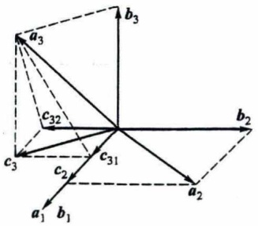
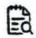

例9 设齐次线性方程组

$$
\left\{ \begin{array}{l} x _ {1} + 2 x _ {2} + x _ {3} - 2 x _ {4} = 0, \\ 2 x _ {1} + 3 x _ {2} - x _ {4} = 0, \\ x _ {1} - x _ {2} - 5 x _ {3} + 7 x _ {4} = 0 \end{array} \right.
$$

的全体解向量构成的向量组为 S, 求 S 的秩.

解 先解方程,为此把系数矩阵 A 化成行最简形矩阵:

$$
\boldsymbol {A} = \left( \begin{array}{c c c c} 1 & 2 & 1 & - 2 \\ 2 & 3 & 0 & - 1 \\ 1 & - 1 & - 5 & 7 \end{array} \right) \overbrace {r _ {3} - r _ {1}} ^ {r _ {2} - 2 r _ {1}} \left( \begin{array}{c c c c} 1 & 2 & 1 & - 2 \\ 0 & - 1 & - 2 & 3 \\ 0 & - 3 & - 6 & 9 \end{array} \right) \overbrace {r _ {2} \times (- 1)} ^ {r _ {1} + 2 r _ {2}} \left( \begin{array}{c c c c} 1 & 0 & - 3 & 4 \\ 0 & 1 & 2 & - 3 \\ 0 & 0 & 0 & 0 \end{array} \right),
$$

得

$$
\left\{ \begin{array}{l} x _ {1} = 3 x _ {3} - 4 x _ {4}, \\ x _ {2} = - 2 x _ {3} + 3 x _ {4}, \end{array} \right.
$$

令自由未知数 $x_{3} = c_{1}, x_{4} = c_{2}$, 得通解

$$
\left( \begin{array}{c} x _ {1} \\ x _ {2} \\ x _ {3} \\ x _ {4} \end{array} \right) = c _ {1} \left( \begin{array}{c} 3 \\ - 2 \\ 1 \\ 0 \end{array} \right) + c _ {2} \left( \begin{array}{c} - 4 \\ 3 \\ 0 \\ 1 \end{array} \right) \quad (c _ {1}, c _ {2} \in \mathbb {R}),
$$

把上式记作 $x = c_{1}\pmb{\xi}_{1} + c_{2}\pmb{\xi}_{2}$ ，知

$$
S = \left\{\boldsymbol {x} \mid \boldsymbol {x} = c _ {1} \boldsymbol {\xi} _ {1} + c _ {2} \boldsymbol {\xi} _ {2}, c _ {1}, c _ {2} \in \mathbb {R} \right\},
$$

即 $S$ 能由向量组 $\pmb{\xi}_1, \pmb{\xi}_2$ 线性表示. 又因 $\pmb{\xi}_1, \pmb{\xi}_2$ 的四个分量显然不成比例, 故 $\pmb{\xi}_1, \pmb{\xi}_2$ 线性无关. 因此根据最大无关组的等价定义知 $\pmb{\xi}_1, \pmb{\xi}_2$ 是 $S$ 的最大无关组, 从而 $R_S = 2$.

对于只含有限个 n 维向量的向量组  $A: a_{1}, a_{2}, \cdots, a_{m}$ ，它可以构成矩阵  $\boldsymbol{A} = (\boldsymbol{a}_{1}, \boldsymbol{a}_{2}, \cdots, \boldsymbol{a}_{m})$ 。把定义 5 与上章矩阵的最高阶非零子式及矩阵的秩的定义作比较，容易想到向量组 A 的秩就等于矩阵 A 的秩，即有

定理 6 矩阵的秩等于它的列向量组的秩,也等于它的行向量组的秩.

证 设 $A = (a_{1}, a_{2}, \cdots, a_{m}), R(A) = r$，并设 $r$ 阶子式 $D_{r} \neq 0$. 根据定理4，由 $D_{r} \neq 0$ 知 $D_{r}$ 所在的 $r$ 列构成的 $n \times r$ 矩阵的秩为 $r$，故此 $r$ 列线性无关；又由 $A$ 中所有 $r + 1$ 阶子式均为零，知 $A$ 中任意 $r + 1$ 个列向量构成的 $n \times (r + 1)$ 矩阵的秩 $< r + 1$，故此 $r + 1$ 列线性相关. 因此 $D_{r}$ 所在的 $r$ 列是 $A$ 的列向量组的一个最大无关组，所以列向量组的秩等于 $r$.

类似可证矩阵 A 的行向量组的秩也等于  $R(A)$ .

证毕

今后向量组  $a_{1}, a_{2}, \cdots, a_{m}$  的秩也记作  $R(a_{1}, a_{2}, \cdots, a_{m})$ .

从上述证明中可见: 若  $D_{r}$  是矩阵 A 的一个最高阶非零子式, 则  $D_{r}$  所在的 r 列即是 $\pmb{A}$ 的列向量组的一个最大无关组, $D_{r}$ 所在的 $r$ 行即是 $\pmb{A}$ 的行向量组的一个最大无关组.这一事实在下面的例题中得到应用.

例10 设矩阵

$$
\boldsymbol {A} = \left( \begin{array}{c c c c c} 2 & - 1 & - 1 & 1 & 2 \\ 1 & 1 & - 2 & 1 & 4 \\ 4 & - 6 & 2 & - 2 & 4 \\ 3 & 6 & - 9 & 7 & 9 \end{array} \right),
$$

求矩阵 A 的列向量组的一个最大无关组, 并把不属于最大无关组的列向量用最大无关组线性表示.

解 对 A 施行初等行变换变为行阶梯形矩阵(参看第 3 章 §1 引例)

$$
A \stackrel {r} {\sim} \left( \begin{array}{c c c c c} 1 & 1 & - 2 & 1 & 4 \\ 0 & 1 & - 1 & 1 & 0 \\ 0 & 0 & 0 & 1 & - 3 \\ 0 & 0 & 0 & 0 & 0 \end{array} \right),
$$

知 $R(A) = 3$ ，故列向量组的最大无关组合3个向量.而三个非零行的首元在第1,2,4三列，故 $\pmb{a}_1,\pmb{a}_2,\pmb{a}_4$ 为列向量组的一个最大无关组

为把 $a_3, a_5$ 用 $a_1, a_2, a_4$ 线性表示，把 $A$ 再变成行最简形矩阵

$$
\boldsymbol {A} \stackrel {{r}} {{\sim}} \left( \begin{array}{c c c c c} 1 & 0 & - 1 & 0 & 4 \\ 0 & 1 & - 1 & 0 & 3 \\ 0 & 0 & 0 & 1 & - 3 \\ 0 & 0 & 0 & 0 & 0 \end{array} \right),
$$

把上述行最简形矩阵记作 $B = (b_{1}, b_{2}, b_{3}, b_{4}, b_{5})$，则方程 $Ax = 0$ 与 $Bx = 0$ 同解，即方程

$$
x _ {1} \boldsymbol {a} _ {1} + x _ {2} \boldsymbol {a} _ {2} + x _ {3} \boldsymbol {a} _ {3} + x _ {4} \boldsymbol {a} _ {4} + x _ {5} \boldsymbol {a} _ {5} = \mathbf {0}
$$

与

$$
x _ {1} \boldsymbol {b} _ {1} + x _ {2} \boldsymbol {b} _ {2} + x _ {3} \boldsymbol {b} _ {3} + x _ {4} \boldsymbol {b} _ {4} + x _ {5} \boldsymbol {b} _ {5} = \mathbf {0}
$$

同解.现在

$$
\begin{array}{l} \boldsymbol {b} _ {3} = \left( \begin{array}{c} - 1 \\ - 1 \\ 0 \\ 0 \end{array} \right) = (- 1) \left( \begin{array}{c} 1 \\ 0 \\ 0 \\ 0 \end{array} \right) + (- 1) \left( \begin{array}{c} 0 \\ 1 \\ 0 \\ 0 \end{array} \right) = - \boldsymbol {b} _ {1} - \boldsymbol {b} _ {2}, \\ \boldsymbol {b} _ {5} = 4 \boldsymbol {b} _ {1} + 3 \boldsymbol {b} _ {2} - 3 \boldsymbol {b} _ {4}, \\ \end{array}
$$

此即 $x_{1} = -1, x_{2} = -1, x_{3} = -1, x_{4} = 0, x_{5} = 0$ 与 $x_{1} = 4, x_{2} = 3, x_{3} = 0, x_{4} = -3, x_{5} = -1$ 是 $Bx = 0$ 的解，因此也是 $Ax = 0$ 的解.

故也有

$$
\boldsymbol {a} _ {3} = - \boldsymbol {a} _ {1} - \boldsymbol {a} _ {2}, \quad \boldsymbol {a} _ {5} = 4 \boldsymbol {a} _ {1} + 3 \boldsymbol {a} _ {2} - 3 \boldsymbol {a} _ {4}.
$$

依据向量组的秩的定义及定理6可知前面介绍的定理1、定理2、定理3、定理4中出现的矩阵的秩都可改为向量组的秩.例如定理2可叙述为

定理 2' 向量组  $b_{1}, b_{2}, \cdots, b_{l}$  能由向量组  $a_{1}, a_{2}, \cdots, a_{m}$  线性表示的充分必要条件是

$$
R (\boldsymbol {a} _ {1}, \boldsymbol {a} _ {2}, \dots , \boldsymbol {a} _ {m}) = R (\boldsymbol {a} _ {1}, \boldsymbol {a} _ {2}, \dots , \boldsymbol {a} _ {m}, \boldsymbol {b} _ {1}, \boldsymbol {b} _ {2}, \dots , \boldsymbol {b} _ {l}).
$$

这里记号  $R(a_{1},a_{2},\cdots,a_{m})$  既可理解为矩阵的秩,也可理解成向量组的秩.

前面我们建立定理1、定理2、定理3时，限制向量组只含有限个向量，现在我们要去掉这一限制，把定理1、定理2、定理3推广到一般情形。推广的方法是利用向量组的最大无关组作过渡。下面仅推广定理9，定理1和定理2的推广请读者自行完成。

定理 3' 若向量组 B 能由向量组 A 线性表示, 则  $R_{B} \leqslant R_{A}$ .

证 设 $R_{A} = s, R_{B} = t$，并设向量组 $A$ 和 $B$ 的最大无关组依次为

$$
A _ {0}: \pmb {a} _ {1}, \pmb {a} _ {2}, \dots , \pmb {a} _ {s} \quad \text {和} \quad B _ {0}: \pmb {b} _ {1}, \pmb {b} _ {2}, \dots , \pmb {b} _ {t},
$$

由于向量组 $B_{0}$ 能由向量组 $B$ 线性表示，向量组 $B$ 能由向量组 $A$ 线性表示，向量组 $A$ 能由向量组 $A_{0}$ 线性表示，因此向量组 $B_{0}$ 能由向量组 $A_{0}$ 线性表示，根据定理3，有

$$
R (\boldsymbol {b} _ {1}, \boldsymbol {b} _ {2}, \dots , \boldsymbol {b} _ {i}) \leqslant R (\boldsymbol {a} _ {1}, \boldsymbol {a} _ {2}, \dots , \boldsymbol {a} _ {s}),
$$

即 $t \leqslant s$.

证毕

今后,定理3与定理3'将不加区别,都称定理3.定理1和2与推广后的定理也不加区别.

例11 设向量组 $B$ 能由向量组 $A$ 线性表示, 且它们的秩相等, 证明向量组 $A$ 与向量组 $B$ 等价.

证 设向量组 $A$ 和 $B$ 合并成向量组 $C$, 根据定理 2, 因向量组 $B$ 能由向量组 $A$ 表示, 故 $R_A = R_C$, 又已知 $R_B = R_A$, 故有 $R_A = R_B = R_C$. 根据定理 2 的推论, 知向量组 $A$ 与向量组 $B$ 等价.

## § 4 向量空间

本章 §1 中把 $n$ 维向量的全体所构成的集合 $\mathbb{R}^n$ 叫做 $n$ 维向量空间. 下面介绍向量空间的有关知识.

定义6 设 $V$ 为 $n$ 维向量的集合, 如果集合 $V$ 非空, 且集合 $V$ 对于向量的加法及

数乘两种运算封闭,那么就称集合 V 为向量空间.

所谓封闭,是指在集合 V 中可以进行向量的加法及数乘两种运算.具体地说,就是:若  $a \in V, b \in V$ , 则  $a + b \in V$ ; 若  $a \in V, \lambda \in R$ , 则  $\lambda a \in V$ .

例12 3维向量的全体 $\mathbb{R}^3$ 是一个向量空间. 因为任意两个3维向量之和仍然是3维向量, 数 $\lambda$ 乘3维向量也仍然是3维向量, 它们都属于 $\mathbb{R}^3$. 我们可以用有向线段形象地表示3维向量, 从而向量空间 $\mathbb{R}^3$ 可形象地看作以坐标原点为起点的有向线段的全体. 由于以原点为起点的有向线段与其终点一一对应, 因此 $\mathbb{R}^3$ 也可看作取定坐标原点的点空间.

类似地, $n$ 维向量的全体 $\mathbb{R}^n$ 也是一个向量空间. 不过当 $n > 3$ 时, 它没有直观的几何意义.

例13 集合

$$
V = \{\boldsymbol {x} \mid \boldsymbol {x} = (0, x _ {2}, \dots , x _ {n}) ^ {\mathrm{T}}, x _ {2}, x _ {3}, \dots , x _ {n} \in \mathbb {R} \}
$$

是一个向量空间.因为若  $\boldsymbol{a}=(0,a_{2},\cdots,a_{n})^{\mathrm{T}}\in V,\boldsymbol{b}=(0,b_{2},\cdots,b_{n})^{\mathrm{T}}\in V,\lambda\in\mathbb{R}$ ，则

$$
\begin{array}{l} \boldsymbol {a} + \boldsymbol {b} = (0, a _ {2} + b _ {2}, \dots , a _ {n} + b _ {n}) ^ {\mathrm{T}} \in V, \\ \lambda \boldsymbol {a} = (0, \lambda a _ {2}, \dots , \lambda a _ {n}) ^ {\mathrm{T}} \in V. \\ \end{array}
$$

例14 集合

$$
V = \{\boldsymbol {x} \mid \boldsymbol {x} = (1, x _ {2}, \dots , x _ {n}) ^ {\mathrm{T}}, x _ {2}, x _ {3}, \dots , x _ {n} \in \mathbb {R} \}
$$

不是向量空间,因为若  $\boldsymbol{a}=(1,a_{2},\cdots,a_{n})^{\mathrm{T}}\in V$ ,则

$$
2 \boldsymbol {a} = (2, 2 a _ {2}, \dots , 2 a _ {n}) ^ {\mathrm{T}} \notin V.
$$

例15 $n$ 元齐次线性方程组的解集

$$
S = \{\boldsymbol {x} \mid \boldsymbol {A} \boldsymbol {x} = \boldsymbol {0} \}
$$

是一个向量空间（称为齐次线性方程组的解空间）. 因为若 $\xi_{1} \in S, \xi_{2} \in S, \lambda \in \mathbb{R}$, 则 $A(\xi_{1} + \xi_{2}) = A\xi_{1} + A\xi_{2} = 0 + 0 = 0$, 即 $\xi_{1} + \xi_{2} \in S; A(\lambda \xi_{1}) = \lambda (A\xi_{1}) = \lambda 0 = 0$, 即 $\lambda \xi_{1} \in S$.

例16 非齐次线性方程组的解集

$$
S = \{\boldsymbol {x} \mid \boldsymbol {A} \boldsymbol {x} = \boldsymbol {b} \}
$$

不是向量空间.因为当 $S$ 为空集时，$S$ 不是向量空间；当 $S$ 非空时，若 $\pmb{\eta} \in S$，则 $A(2\pmb{\eta}) = 2b \neq b$，故 $2\pmb{\eta} \notin S$.

例 17 设 a, b 为两个已知的 n 维向量, 集合

$$
V = \{\lambda a + \mu b \mid \lambda , \mu \in \mathbb {R} \}
$$

是一个向量空间. 因为若 $x_{1} = \lambda_{1}a + \mu_{1}b, x_{2} = \lambda_{2}a + \mu_{2}b, k \in \mathbb{R}$, 则有

$$
\begin{array}{l} \boldsymbol {x} _ {1} + \dot {\boldsymbol {x}} _ {2} = (\lambda_ {1} + \lambda_ {2}) \boldsymbol {a} + (\mu_ {1} + \mu_ {2}) \boldsymbol {b} \in V, \\ k x _ {1} = (k \lambda_ {1}) a + (k \mu_ {1}) b \in V. \\ \end{array}
$$

这个向量空间称为由向量 $a, b$ 所生成的向量空间，也可记为 $\operatorname{Span}\{a, b\}$.

一般地，由向量组  $a_{1}, a_{2}, \cdots, a_{m}$  所生成的向量空间为

$$
L = \{\lambda_ {1} \boldsymbol {a} _ {1} + \lambda_ {2} \boldsymbol {a} _ {2} + \dots + \lambda_ {m} \boldsymbol {a} _ {m} | \lambda_ {1}, \lambda_ {2}, \dots , \lambda_ {m} \in \mathbb {R} \},
$$

可记为  $\operatorname{Span}\left\{a_{1},a_{2},\cdots,a_{m}\right\}$ .

例 18 设向量组  $a_{1}, a_{2}, \cdots, a_{m}$  与向量组  $b_{1}, b_{2}, \cdots, b_{s}$  等价，记

$$
L _ {1} = \{\lambda_ {1} a _ {1} + \lambda_ {2} a _ {2} + \dots + \lambda_ {m} a _ {m} | \lambda_ {1}, \lambda_ {2}, \dots , \lambda_ {m} \in \mathbb {R} \},
$$

$$
L _ {2} = \{\mu_ {1} \boldsymbol {b} _ {1} + \mu_ {2} \boldsymbol {b} _ {2} + \dots + \mu_ {s} \boldsymbol {b} _ {s} \mid \mu_ {1}, \mu_ {2}, \dots , \mu_ {s} \in \mathbb {R} \},
$$

试证 $L_{1} = L_{2}$

证 设 $x \in L_1$，则 $x$ 可由 $a_1, a_2, \cdots, a_m$ 线性表示。因 $a_1, a_2, \cdots, a_m$ 可由 $b_1, b_2, \cdots, b_s$ 线性表示，故 $x$ 可由 $b_1, b_2, \cdots, b_s$ 线性表示，所以 $x \in L_2$。这就是说，若 $x \in L_1$，则 $x \in L_2$，因此 $L_1 \subseteq L_2$.

类似地可证: 若  $x \in L_{2}$ ，则  $x \in L_{1}$ ，因此  $L_{2} \subseteq L_{1}$ .

因为  $L_{1} \subseteq L_{2}, L_{2} \subseteq L_{1}$ ，所以  $L_{1} = L_{2}$ .

定义 7 设有向量空间  $V_{1}$  及  $V_{2}$ ，若  $V_{1} \subseteq V_{2}$ ，就称  $V_{1}$  是  $V_{2}$  的子空间.

例如任何由 $n$ 维向量所组成的向量空间 $V$, 总有 $V \subseteq \mathbb{R}^n$, 这样的向量空间总是 $\mathbb{R}^n$ 的子空间. 据此可知, 例13、例15、例17中的向量空间均是 $\mathbb{R}^n$ 的子空间.

定义 8 设 V 为向量空间, 如果 r 个向量  $a_{1}, a_{2}, \cdots, a_{r} \in V$ , 且满足

(i)  $a_{1}, a_{2}, \cdots, a_{r}$  线性无关；
(ii) V 中任一向量都可由  $a_{1}, a_{2}, \cdots, a_{r}$  线性表示，

那么向量组  $a_{1}, a_{2}, \cdots, a_{r}$  称为向量空间 V 的一个基，r 称为向量空间 V 的维数，记为  $\dim V = r$ ，并称 V 为 r 维向量空间.

如果向量空间 V 没有基,那么 V 的维数为 0.0 维向量空间只含一个零向量 0.

若把向量空间 V 看作向量组, 则由最大无关组的等价定义可知, V 的基就是向量组的最大无关组, V 的维数就是向量组的秩.

例如, 由例8知, 任何 $n$ 个线性无关的 $n$ 维向量都可以是向量空间 $\mathbb{R}^n$ 的一个基, 且由此可知 $\mathbb{R}^n$ 的维数为 $n$, 所以我们把 $\mathbb{R}^n$ 称为 $n$ 维向量空间.

又如,向量空间

$$
V = \{(0, x _ {2}, \dots , x _ {n}) ^ {\mathrm{T}} | x _ {2}, x _ {3}, \dots , x _ {n} \in \mathbb {R} \}
$$

的一个基可取为  $\boldsymbol{e}_{2}=(0,1',0,\cdots,0)^{\mathrm{T}},\cdots,\boldsymbol{e}_{n}=(0,\cdots,0,1)^{\mathrm{T}}$ . 并由此可知它是 n-1 维向量空间.

设由向量组  $a_{1}, a_{2}, \cdots, a_{m}$  所生成的向量空间

$$
L = \{\lambda_ {1} a _ {1} + \lambda_ {2} a _ {2} + \dots + \lambda_ {m} a _ {m} \mid \lambda_ {1}, \lambda_ {2}, \dots , \lambda_ {m} \in \mathbb {R} \},
$$

显然向量空间 L 与向量组  $a_{1}, a_{2}, \cdots, a_{m}$  等价，所以向量组  $a_{1}, a_{2}, \cdots, a_{m}$  的最大无关组就是 L 的一个基，向量组  $a_{1}, a_{2}, \cdots, a_{m}$  的秩就是 L 的维数.

若向量组  $a_{1}, a_{2}, \cdots, a_{r}$  是向量空间 V 的一个基，则 V 可表示为

$$
V = \{\lambda_ {1} \boldsymbol {a} _ {1} + \lambda_ {2} \boldsymbol {a} _ {2} + \dots + \lambda_ {r} \boldsymbol {a} _ {r} \mid \lambda_ {1}, \lambda_ {2}, \dots , \lambda_ {r} \in \mathbb {R} \},
$$

即 V 是基所生成的向量空间  $Span\{a_{1}, a_{2}, \cdots a_{r}\}$ ，这就较清楚地显示出向量空间 V 的构造.

例如齐次线性方程组的解空间 $S = \{x \mid Ax = 0\}$, 若能找到解空间的一个基 $\xi_1, \xi_2, \dots, \xi_{n-r}$, 则解空间可表示为

$$
S = \left\{c _ {1} \pmb {\xi} _ {1} + c _ {2} \pmb {\xi} _ {2} + \dots + c _ {n - r} \pmb {\xi} _ {n - r} \mid c _ {1}, c _ {2}, \dots , c _ {n - r} \in \mathbb {R} \right\}.
$$

定义9 如果在向量空间 V 中取定一个基  $a_{1}, a_{2}, \cdots, a_{r}$ ，那么 V 中任一向量 x 可惟一地表示为

$$
\boldsymbol {x} = \lambda_ {1} \boldsymbol {a} _ {1} + \lambda_ {2} \boldsymbol {a} _ {2} + \dots + \lambda_ {r} \boldsymbol {a} _ {r},
$$

这个有序数组  $\lambda_{1},\lambda_{2},\cdots,\lambda_{r}$  称为向量 x 在基  $a_{1},a_{2},\cdots,a_{r}$  下的坐标，并记作  $(\lambda_{1},\lambda_{2},\cdots,\lambda_{r})^{\mathrm{T}}$ .

特别地, 在 n 维向量空间  $R^{n}$  中取单位坐标向量组  $e_{1}, e_{2}, \cdots, e_{n}$  为基, 则以  $x_{1}, x_{2}, \cdots, x_{n}$  为分量的向量 x 可表示为

$$
\boldsymbol {x} = x _ {1} \boldsymbol {e} _ {1} + x _ {2} \boldsymbol {e} _ {2} + \dots + x _ {n} \boldsymbol {e} _ {n},
$$

可见向量在基 $e_{1},e_{2},\cdots,e_{n}$ 下的坐标就是该向量的分量.因此, $e_{1},e_{2},\cdots,e_{n}$ 叫做 $R^{n}$ 中的自然基.

例19 设

$$
\boldsymbol {A} = (\boldsymbol {a} _ {1}, \boldsymbol {a} _ {2}, \boldsymbol {a} _ {3}) = \left( \begin{array}{r r r} 2 & 2 & - 1 \\ 2 & - 1 & 2 \\ - 1 & 2 & 2 \end{array} \right), \quad \boldsymbol {B} = (\boldsymbol {b} _ {1}, \boldsymbol {b} _ {2}) = \left( \begin{array}{r r} 1 & 4 \\ 0 & 3 \\ - 4 & 2 \end{array} \right).
$$

验证 $a_1, a_2, a_3$ 是 $\mathbb{R}^3$ 的一个基，并求 $b_1, b_2$ 在这个基下的坐标.

解 要证  $a_{1}, a_{2}, a_{3}$  是  $R^{3}$  的一个基, 只要证  $a_{1}, a_{2}, a_{3}$  线性无关, 即只要证  $A \sim E$ .

设 $b_{1} = x_{11}a_{1} + x_{21}a_{2} + x_{31}a_{3}, b_{2} = x_{12}a_{1} + x_{22}a_{2} + x_{32}a_{3}$，即

$$
(\boldsymbol {b} _ {1}, \boldsymbol {b} _ {2}) = (\boldsymbol {a} _ {1}, \boldsymbol {a} _ {2}, \boldsymbol {a} _ {3}) \left( \begin{array}{c c} x _ {1 1} & x _ {1 2} \\ x _ {2 1} & x _ {2 2} \\ x _ {3 1} & x _ {3 2} \end{array} \right),
$$

记作 B = AX.

对矩阵 $(A, B)$ 施行初等行变换，若 $A$ 能变为 $E$，则 $a_1, a_2, a_3$ 为 $\mathbb{R}^3$ 的一个基，且当 $A$ 变为 $E$ 时，$B$ 变为 $X = A^{-1}B$.

$$
(A, B) = \left( \begin{array}{r r r r r} 2 & 2 & - 1 & 1 & 4 \\ 2 & - 1 & 2 & 0 & 3 \\ - 1 & 2 & 2 & - 4 & 2 \end{array} \right) ^ {\frac {1}{3} \underbrace {(r _ {1} + r _ {2} + r _ {3})} _ {r _ {2} - 2 r _ {1}}} \left( \begin{array}{r r r r r} 1 & 1 & 1 & - 1 & 3 \\ 0 & - 3 & 0 & 2 & - 3 \\ 0 & 3 & 3 & - 5 & 5 \end{array} \right)
$$

$$
\frac {r _ {2} \div (- 3)}{r _ {3} \div 3} \left( \begin{array}{c c c c c} 1 & 1 & 1 & - 1 & 3 \\ 0 & 1 & 0 & - \frac {2}{3} & 1 \\ 0 & 1 & 1 & - \frac {5}{3} & \frac {5}{3} \end{array} \right) \overbrace {r _ {3} - r _ {2}} ^ {r _ {1} - r _ {3}} \left( \begin{array}{c c c c c} 1 & 0 & 0 & \frac {2}{3} & \frac {4}{3} \\ 0 & 1 & 0 & - \frac {2}{3} & 1 \\ 0 & 0 & 1 & - 1 & \frac {2}{3} \end{array} \right).
$$

因有 $A \sim E$，故 $a_1, a_2, a_3$ 为 $\mathbb{R}^3$ 的一个基，且

$$
(\boldsymbol {b} _ {1}, \boldsymbol {b} _ {2}) = (\boldsymbol {a} _ {1}, \boldsymbol {a} _ {2}, \boldsymbol {a} _ {3}) \left( \begin{array}{c c} \frac {2}{3} & \frac {4}{3} \\ - \frac {2}{3} & 1 \\ - 1 & \frac {2}{3} \end{array} \right),
$$

即 $b_{1}, b_{2}$ 在基 $a_{1}, a_{2}, a_{3}$ 中的坐标依次为

$$
\frac {2}{3}, - \frac {2}{3}, - 1 \quad \text {和} \quad \frac {4}{3}, 1, \frac {2}{3}.
$$

定义 10 在向量空间 V 中取定两个基  $a_{1}, a_{2}, \cdots, a_{n}$  与  $b_{1}, b_{2}, \cdots, b_{n}$ . 设  $b_{i} = p_{1i}a_{1} + p_{2i}a_{2} + \cdots + p_{ni}a_{n}$  ( $i = 1, 2, \cdots, n$ ), 则

$$
\left\{ \begin{array}{l} \boldsymbol {b} _ {1} = p _ {1 1} \boldsymbol {a} _ {1} + p _ {2 1} \boldsymbol {a} _ {2} + \dots + p _ {n 1} \boldsymbol {a} _ {n}, \\ \boldsymbol {b} _ {2} = p _ {1 2} \boldsymbol {a} _ {1} + p _ {2 2} \boldsymbol {a} _ {2} + \dots + p _ {n 2} \boldsymbol {a} _ {n}, \\ \dots \dots \\ \dot {\boldsymbol {b}} _ {n} = p _ {1 n} \boldsymbol {a} _ {1} + p _ {2 n} \boldsymbol {a} _ {2} + \dots + p _ {n n} \boldsymbol {a} _ {n}, \end{array} \right.
$$

利用矩阵,也可形式地写为

$$
(\boldsymbol {b} _ {1}, \boldsymbol {b} _ {2}, \dots , \boldsymbol {b} _ {n}) = (\boldsymbol {a} _ {1}, \boldsymbol {a} _ {2}, \dots , \boldsymbol {a} _ {n}) \boldsymbol {P},
$$

这里

$$
\boldsymbol {P} = \left( \begin{array}{c c c c} p _ {1 1} & p _ {1 2} & \dots & p _ {1 n} \\ p _ {2 1} & p _ {2 2} & \dots & p _ {2 n} \\ \vdots & \vdots & & \vdots \\ p _ {n 1} & p _ {n 2} & \dots & p _ {n n} \end{array} \right),
$$

此式即称为基变换公式,矩阵 P 称为从基  $a_{1}, a_{2}, \cdots, a_{n}$  到基  $b_{1}, b_{2}, \cdots, b_{n}$  的过渡矩阵.

定义11 设 $a_1, a_2, \cdots, a_n$ 与 $b_1, b_2, \cdots, b_n$ 是向量空间 $V$ 的两个基. $\forall \alpha \in V$, 设 $\alpha$ 在基 $a_1, a_2, \cdots, a_n$ 下的坐标为 $x$, 在基 $b_1, b_2, \cdots, b_n$ 下的坐标为 $y$, 即

$$
\boldsymbol {\alpha} = x _ {1} \boldsymbol {a} _ {1} + x _ {2} \boldsymbol {a} _ {2} + \dots + x _ {n} \boldsymbol {a} _ {n} = (\boldsymbol {a} _ {1}, \boldsymbol {a} _ {2}, \dots , \boldsymbol {a} _ {n}) \boldsymbol {x}, \quad \boldsymbol {x} = \left( \begin{array}{c} x _ {1} \\ x _ {2} \\ \vdots \\ x _ {n} \end{array} \right),
$$

$$
\boldsymbol {\alpha} = y _ {1} \boldsymbol {b} _ {1} + y _ {2} \boldsymbol {b} _ {2} + \dots + y _ {n} \boldsymbol {b} _ {n} = (\boldsymbol {b} _ {1}, \boldsymbol {b} _ {2}, \dots , \boldsymbol {b} _ {n}) \boldsymbol {y}, \quad \boldsymbol {y} = \left( \begin{array}{c} y _ {1} \\ y _ {2} \\ \vdots \\ y _ {n} \end{array} \right).
$$

若从  $a_{1}, a_{2}, \cdots, a_{n}$  到  $b_{1}, b_{2}, \cdots, b_{n}$  的过渡矩阵为 P，则

$$
\boldsymbol {\alpha} = (\boldsymbol {b} _ {1}, \boldsymbol {b} _ {2}, \dots , \boldsymbol {b} _ {n}) \boldsymbol {y} = (\boldsymbol {a} _ {1}, \boldsymbol {a} _ {2}, \dots , \boldsymbol {a} _ {n}) \boldsymbol {P} \boldsymbol {y},
$$

从而 x = Py，此即称为坐标变换公式。

例20 在 $\mathbb{R}^3$ 中取定一个基 $a_1, a_2, a_3$，再取一个新基 $b_1, b_2, b_3$，设 $A = (a_1, a_2, a_3)$，$B = (b_1, b_2, b_3)$. 求从基 $a_1, a_2, a_3$ 到基 $b_1, b_2, b_3$ 的过渡矩阵 $P$，并求向量 $\alpha (\alpha \in \mathbb{R}^3)$ 在两个基下的坐标变换公式.

解 因

$$
(\boldsymbol {a} _ {1}, \boldsymbol {a} _ {2}, \boldsymbol {a} _ {3}) = (\boldsymbol {e} _ {1}, \boldsymbol {e} _ {2}, \boldsymbol {e} _ {3}) \boldsymbol {A}, \quad (\boldsymbol {e} _ {1}, \boldsymbol {e} _ {2}, \boldsymbol {e} _ {3}) = (\boldsymbol {a} _ {1}, \boldsymbol {a} _ {2}, \boldsymbol {a} _ {3}) \boldsymbol {A} ^ {- 1}.
$$

故

$$
(\boldsymbol {b} _ {1}, \boldsymbol {b} _ {2}, \boldsymbol {b} _ {3}) = (\boldsymbol {e} _ {1}, \boldsymbol {e} _ {2}, \boldsymbol {e} _ {3}) \boldsymbol {B} = (\boldsymbol {a} _ {1}, \boldsymbol {a} _ {2}, \boldsymbol {a} _ {3}) \boldsymbol {A} ^ {- 1} \boldsymbol {B},
$$

即基变换公式为

$$
(\boldsymbol {b} _ {1}, \boldsymbol {b} _ {2}, \boldsymbol {b} _ {3}) = (\boldsymbol {a} _ {1}, \boldsymbol {a} _ {2}, \boldsymbol {a} _ {3}) \boldsymbol {P},
$$

其中矩阵  $P=A^{-1}B$  即为从旧基到新基的过渡矩阵. 公众号:旗胜考研

设向量 $\alpha$ 在旧基和新基下的坐标分别为 $y_{1}, y_{2}, y_{3}$ 和 $z_{1}, z_{2}, z_{3}$，即

$$
\boldsymbol {\alpha} = (\boldsymbol {a} _ {1}, \boldsymbol {a} _ {2}, \boldsymbol {a} _ {3}) \left( \begin{array}{l} y _ {1} \\ y _ {2} \\ y _ {3} \end{array} \right), \quad \boldsymbol {\alpha} = (\boldsymbol {b} _ {1}, \boldsymbol {b} _ {2}, \boldsymbol {b} _ {3}) \left( \begin{array}{l} z _ {1} \\ z _ {2} \\ z _ {3} \end{array} \right),
$$

故  $A\begin{pmatrix}y_{1}\\y_{2}\\y_{3}\end{pmatrix}=B\begin{pmatrix}z_{1}\\z_{2}\\z_{3}\end{pmatrix}$ ，得  $\begin{pmatrix}z_{1}\\z_{2}\\z_{3}\end{pmatrix}=B^{-1}A\begin{pmatrix}y_{1}\\y_{2}\\y_{3}\end{pmatrix}$ ，即

$$
\left( \begin{array}{c} z _ {1} \\ z _ {2} \\ z _ {3} \end{array} \right) = \boldsymbol {P} ^ {- 1} \left( \begin{array}{c} y _ {1} \\ y _ {2} \\ y _ {3} \end{array} \right),
$$

这就是从旧坐标到新坐标的坐标变换公式.

例21 设 $\mathbb{R}^3$ 的两个基I和II为

$$
\mathrm{I}: \boldsymbol {a} _ {1} = \left( \begin{array}{l} 1 \\ 0 \\ 0 \end{array} \right), \boldsymbol {a} _ {2} = \left( \begin{array}{l} 1 \\ 1 \\ 0 \end{array} \right), \boldsymbol {a} _ {3} = \left( \begin{array}{l} 1 \\ 1 \\ 1 \end{array} \right); \quad \mathrm{II}: \boldsymbol {b} _ {1} = \left( \begin{array}{l} 1 \\ 2 \\ 1 \end{array} \right), \boldsymbol {b} _ {2} = \left( \begin{array}{l} 2 \\ 3 \\ 3 \end{array} \right), \boldsymbol {b} _ {3} = \left( \begin{array}{l} 3 \\ 7 \\ 1 \end{array} \right),
$$

(1) 求由基Ⅰ到基Ⅱ的过渡矩阵；

(2) 设向量 c 在基Ⅰ下的坐标为 -2, 1, 2, 求 c 在基Ⅱ下的坐标.

解（1）由基I到基Ⅱ的过渡矩阵 $P = A^{-1}B$ ，其中 $A = (a_{1},a_{2},a_{3}),B = (b_{1},b_{2},b_{3})$ .用矩阵的初等行变换把矩阵 $(A,B)$ 中的 $A$ 变成 $\pmb{E}$ ，则 $\pmb{B}$ 相应地变成 $A^{-1}B$

$$
\begin{array}{l} (A, B) = (a _ {1}, a _ {2}, a _ {3}, b _ {1}, b _ {2}, b _ {3}) \\ = \left( \begin{array}{c c c c c c} 1 & 1 & 1 & 1 & 2 & 3 \\ 0 & 1 & 1 & 2 & 3 & 7 \\ 0 & 0 & 1 & 1 & 3 & 1 \end{array} \right) \stackrel {{r}} {{\sim}} \left( \begin{array}{c c c c c c} 1 & 0 & 0 & - 1 & - 1 & - 4 \\ 0 & 1 & 0 & 1 & 0 & 6 \\ 0 & 0 & 1 & 1 & 3 & 1 \end{array} \right) \\ \end{array}
$$

于是,过渡矩阵  $P=\begin{pmatrix}-1&-1&-4\\1&0&6\\1&3&1\end{pmatrix}$ .

(2) 易求得  $P^{-1}=\begin{pmatrix}-18&-11&-6\\5&3&2\\3&2&1\end{pmatrix}$ ，故向量 c 在基Ⅱ下的坐标（向量）为

$$
\boldsymbol {P} ^ {- 1} \left( \begin{array}{c} - 2 \\ 1 \\ 2 \end{array} \right) = \left( \begin{array}{c c c} - 1 8 & - 1 1 & - 6 \\ 5 & 3 & 2 \\ 3 & 2 & 1 \end{array} \right) \left( \begin{array}{c} - 2 \\ 1 \\ 2 \end{array} \right) = \left( \begin{array}{c} 1 3 \\ - 3 \\ - 2 \end{array} \right),
$$

即向量 $c$ 在基Ⅱ下的坐标为13,-3,-2.

## § 5 线性方程组的解的结构

在上一章中,我们已经介绍了用矩阵的初等行变换解线性方程组的方法,并建立了两个重要定理,即

（1）n 个未知数的齐次线性方程组 Ax=0 有非零解的充分必要条件是系数矩阵的秩  $R(A)<n$ .
(2) $n$ 个未知数的非齐次线性方程组 $Ax = b$ 有解的充分必要条件是系数矩阵 $A$ 的秩等于增广矩阵 $\pmb{B}$ 的秩, 且当 $R(A) = R(B) = n$ 时方程组有惟一解, 当 $R(A) = R(B) = r < n$ 时方程组有无限多个解.

下面我们用向量组线性相关性的理论来讨论线性方程组的解.

## 一、齐次线性方程组

设有齐次线性方程组

$$
\left\{ \begin{array}{l} a _ {1 1} x _ {1} + a _ {1 2} x _ {2} + \dots + a _ {1 n} x _ {n} = 0, \\ a _ {2 1} x _ {1} + a _ {2 2} x _ {2} + \dots + a _ {2 n} x _ {n} = 0, \\ \dots \dots \\ a _ {m 1} x _ {1} + a _ {m 2} x _ {2} + \dots + a _ {m n} x _ {n} = 0, \end{array} \right. \tag {1}
$$

记

$$
\boldsymbol {A} = \left( \begin{array}{c c c c} a _ {1 1} & a _ {1 2} & \dots & a _ {1 n} \\ a _ {2 1} & a _ {2 2} & \dots & a _ {2 n} \\ \vdots & \vdots & & \vdots \\ a _ {m 1} & a _ {m 2} & \dots & a _ {m n} \end{array} \right), \quad \boldsymbol {x} = \left( \begin{array}{c} x _ {1} \\ x _ {2} \\ \vdots \\ x _ {n} \end{array} \right),
$$

则(1)式可写成

$$
\boldsymbol {A} \boldsymbol {x} = \boldsymbol {0}. \tag {2}
$$

若

$$
\boldsymbol {x} = \boldsymbol {\xi} _ {1} = \left( \begin{array}{c} \boldsymbol {\xi} _ {1 1} \\ \boldsymbol {\xi} _ {2 1} \\ \vdots \\ \boldsymbol {\xi} _ {n 1} \end{array} \right)
$$

是方程组(1)的解向量,它也就是方程(2)的解.

由本章例 15 知, 方程组(1)的解集 $S = \{x \mid Ax = 0\}$ 是一个向量空间. 只要找到向量空间的一个基, 就能精确描述该空间.

设 $S_0: \xi_1, \xi_2, \cdots, \xi_t$ 为 $S$ 的一个基，则 $x = k_1\xi_1 + k_2\xi_2 + \cdots + k_t\xi_t (k_1, k_2, \cdots, k_t \in \mathbb{R})$ 就是方程(2)的通解.

齐次线性方程组的解空间的一个基称为该齐次线性方程组的基础解系.由上面的讨论可知,要求齐次线性方程组的通解,只需求出它的基础解系.

上一章我们用初等行变换的方法求线性方程组的通解,下面我们用同一方法来求齐次线性方程组的基础解系.

设方程组(1)的系数矩阵 $\pmb{A}$ 的秩为 $r$ ，并不妨设 $\pmb{A}$ 的前 $r$ 个列向量线性无关，于是$\pmb{A}$ 的行最简形矩阵为.

$$
\boldsymbol {B} = \left( \begin{array}{c c c c c c} 1 & \dots & 0 & b _ {1 1} & \dots & b _ {1, n - r} \\ \vdots & & \vdots & \vdots & & \vdots \\ 0 & \dots & 1 & b _ {r 1} & \dots & b _ {r, n - r} \\ 0 & & & \dots & & 0 \\ \vdots & & & & & \vdots \\ 0 & & & \dots & & 0 \end{array} \right),
$$

与 $\pmb{B}$ 对应，即有方程组

$$
\left\{ \begin{array}{l} x _ {1} = - b _ {1 1} x _ {r + 1} - \dots - b _ {1, n - r} x _ {n}, \\ \dots \dots \\ x _ {r} = - b _ {r 1} x _ {r + 1} - \dots - b _ {r, n - r} x _ {n}, \end{array} \right. \tag {3}
$$

把 $x_{r + 1}, x_{r + 2}, \dots, x_n$ 作为自由未知数，并令它们依次等于 $c_1, c_2, \dots, c_{n - r}$，可得方程组（1）的通解

$$
\left( \begin{array}{c} x _ {1} \\ \vdots \\ x _ {r} \\ x _ {r + 1} \\ x _ {r + 2} \\ \vdots \\ x _ {n} \end{array} \right) = c _ {1} \left( \begin{array}{c} - b _ {1 1} \\ \vdots \\ - b _ {r 1} \\ 1 \\ 0 \\ \vdots \\ 0 \end{array} \right) + c _ {2} \left( \begin{array}{c} - b _ {1 2} \\ \vdots \\ - b _ {r 2} \\ 0 \\ 1 \\ \vdots \\ 0 \end{array} \right) + \dots + c _ {n - r} \left( \begin{array}{c} - b _ {1, n - r} \\ \vdots \\ - b _ {r, n - r} \\ 0 \\ 0 \\ \vdots \\ 1 \end{array} \right).
$$

把上式记作

$$
x = c _ {1} \xi_ {1} + c _ {2} \xi_ {2} + \dots + c _ {n - r} \xi_ {n - r},
$$

可知解空间 $S$ 中的任一向量 $\pmb{x}$ 能由 $\pmb{\xi}_{1},\pmb{\xi}_{2},\dots ,\pmb{\xi}_{n - r}$ 线性表示，又因为矩阵 $(\pmb{\xi}_1,$ $\pmb{\xi}_2,\dots ,\pmb{\xi}_{n - r})$ 中有 $n - r$ 阶子式 $|E_{n - r}|\neq 0$ ，故 $R(\pmb {\xi}_1,\pmb {\xi}_2,\dots ,\pmb {\xi}_{n - r}) = n - r$ ，所以 $\pmb {\xi}_1,\pmb {\xi}_2,\dots ,\pmb {\xi}_{n - r}$ 线性无关.根据基的定义，即知 $\pmb {\xi}_1,\pmb {\xi}_2,\dots ,\pmb {\xi}_{n - r}$ 是解空间 $S$ 的一个基，即 $\pmb {\xi}_1,\pmb {\xi}_2,\dots ,\pmb {\xi}_{n - r}$ 是方程组(1)的基础解系.

在上面的讨论中,我们先求出齐次线性方程组的通解,再从通解求得基础解系.其实我们也可先求基础解系,再写出通解.这只需在得到方程组(3)以后,令自由未知数 $x_{r+1},x_{r+2},\cdots,x_{n}$ 取下列n-r组数

$$
\left( \begin{array}{c} 1 \\ 0 \\ \vdots \\ 0 \end{array} \right), \quad \left( \begin{array}{c} 0 \\ 1 \\ \vdots \\ 0 \end{array} \right), \quad \dots , \quad \left( \begin{array}{c} 0 \\ 0 \\ \vdots \\ 1 \end{array} \right),
$$

由(3)即可得 $\begin{pmatrix}x_{1}\\x_{2}\\\vdots\\x_{r}\end{pmatrix}$ 依次为

$$
\left( \begin{array}{c} - b _ {1 1} \\ - b _ {2 1} \\ \vdots \\ - b _ {r 1} \end{array} \right), \quad \left( \begin{array}{c} - b _ {1 2} \\ - b _ {2 2} \\ \vdots \\ - b _ {r 2} \end{array} \right), \quad \dots , \quad \left( \begin{array}{c} - b _ {1, n - r} \\ - b _ {2, n - r} \\ \vdots \\ - b _ {r, n - r} \end{array} \right),
$$

合起来便得基础解系

$$
\boldsymbol {\xi} _ {1} = \left( \begin{array}{c} - b _ {1 1} \\ - b _ {2 1} \\ \vdots \\ - b _ {r 1} \\ 1 \\ 0 \\ \vdots \\ 0 \end{array} \right), \quad \boldsymbol {\xi} _ {2} = \left( \begin{array}{c} - b _ {1 2} \\ - b _ {2 2} \\ \vdots \\ - b _ {r 2} \\ 0 \\ 1 \\ \vdots \\ 0 \end{array} \right), \quad \dots , \quad \boldsymbol {\xi} _ {n - r} = \left( \begin{array}{c} - b _ {1, n - r} \\ - b _ {2, n - r} \\ \vdots \\ - b _ {r, n - r} \\ 0 \\ 0 \\ \vdots \\ 1 \end{array} \right).
$$

依据以上的讨论,还可推得

定理7 设 $m \times n$ 矩阵 $\pmb{A}$ 的秩 $R(A) = r$，则 $n$ 元齐次线性方程组 $Ax = 0$ 的解空间 $S$ 的维数 $\dim S = n - r$（即该齐次线性方程组的自由未知数的个数）.

当 $R(A) = n$ 时, 方程(1)只有零解, 没有基础解系 (此时解空间 $S$ 只含一个零向量); 当 $R(A) = r < n$ 时, 由定理7可知方程组(1)的基础解系含 $n - r$ 个向量. 因此, 由最大无关组的性质可知, 方程组(1)的任何 $n - r$ 个线性无关的解都可构成它的基础解系. 并由此可知齐次线性方程组的基础解系并不是惟一的, 它的通解的形式也不是惟一的.

例22 求齐次线性方程组

$$
\left\{ \begin{array}{c} x _ {1} + x _ {2} - x _ {3} - x _ {4} = 0, \\ 2 x _ {1} - 5 x _ {2} + 3 x _ {3} + 2 x _ {4} = 0, \\ 7 x _ {1} - 7 x _ {2} + 3 x _ {3} + x _ {4} = 0 \end{array} \right.
$$

的基础解系与通解.

解 对系数矩阵 A 作初等行变换变为行最简形矩阵,有

$$
\boldsymbol {A} = \left( \begin{array}{c c c c} 1 & 1 & - 1 & - 1 \\ 2 & - 5 & 3 & 2 \\ 7 & - 7 & 3 & 1 \end{array} \right) \xrightarrow [ r _ {3} - 7 r _ {1} ]{r _ {2} - 2 r _ {1}} \left( \begin{array}{c c c c} 1 & 1 & - 1 & - 1 \\ 0 & - 7 & 5 & 4 \\ 0 & - 1 4 & 1 0 & 8 \end{array} \right)
$$

$$
\underbrace {r _ {3} - 2 r _ {2}} _ {\text {r} _ {1} - r _ {2}} \left( \begin{array}{c c c c} 1 & 1 & - 1 & - 1 \\ 0 & - 7 & 5 & 4 \\ 0 & 0 & 0 & 0 \end{array} \right) \underbrace {r _ {2} \times \left(- \frac {1}{7}\right)} _ {\text {r} _ {1} - r _ {2}} \left( \begin{array}{c c c c} 1 & 0 & - \frac {2}{7} & - \frac {3}{7} \\ 0 & 1 & - \frac {5}{7} & - \frac {4}{7} \\ 0 & 0 & 0 & 0 \end{array} \right),
$$

便得

$$
\left\{ \begin{array}{l} x _ {1} = \frac {2}{7} x _ {3} + \frac {3}{7} x _ {4}, \\ x _ {2} = \frac {5}{7} x _ {3} + \frac {4}{7} x _ {4}, \end{array} \right. \tag {*}.
$$

令 $\begin{pmatrix}x_{3}\\x_{4}\end{pmatrix}$ 取 $\begin{pmatrix}1\\0\end{pmatrix}$ 及 $\begin{pmatrix}0\\1\end{pmatrix}$ ，则对应的 $\begin{pmatrix}x_{1}\\x_{2}\end{pmatrix}$ 为 $\begin{pmatrix}\frac{2}{7}\\ \frac{5}{7}\end{pmatrix}$ 及 $\begin{pmatrix}\frac{3}{7}\\ \frac{4}{7}\end{pmatrix}$ ，即得基础解系

$$
\boldsymbol {\xi} _ {1} = \left( \begin{array}{c} \frac {2}{7} \\ \frac {5}{7} \\ 1 \\ 0 \end{array} \right), \quad \boldsymbol {\xi} _ {2} = \left( \begin{array}{c} \frac {3}{7} \\ \frac {4}{7} \\ 0 \\ 1 \end{array} \right),
$$

并由此写出通解

$$
\left( \begin{array}{c} x _ {1} \\ x _ {2} \\ x _ {3} \\ x _ {4} \end{array} \right) = c _ {1} \left( \begin{array}{c} \frac {2}{7} \\ \frac {5}{7} \\ 1 \\ 0 \end{array} \right) + c _ {2} \left( \begin{array}{c} \frac {3}{7} \\ \frac {4}{7} \\ 0 \\ 1 \end{array} \right) \quad (c _ {1}, c _ {2} \in \mathbb {R}).
$$

上一章中线性方程组的解法是从（\*）式写出通解（从通解的表达式即可得基础解系），现在从（\*）式先取基础解系，再写出通解，两种解法其实没有多少差别。

根据 $(*)$ 式,如果取 $\begin{pmatrix}x_{3}\\x_{4}\end{pmatrix}$ 为 $\begin{pmatrix}1\\1\end{pmatrix}$ 及 $\begin{pmatrix}1\\-1\end{pmatrix}$ ,对应的 $\begin{pmatrix}x_{1}\\x_{2}\end{pmatrix}$ 为

$$
\left( \begin{array}{c} {{\frac {5}{7}}} \\ {{\frac {9}{7}}} \end{array} \right) \quad \text {及} \quad \left( \begin{array}{c} {{- \frac {1}{7}}} \\ {{\frac {1}{7}}} \end{array} \right),
$$

即得不同的基础解系

$$
\boldsymbol {\eta} _ {1} = \left( \begin{array}{c} \frac {5}{7} \\ \frac {9}{7}. \\ 1 \\ 1 \end{array} \right), \quad \boldsymbol {\eta} _ {2} = \left( \begin{array}{c} - \frac {1}{7} \\ \frac {1}{7} \\ 1 \\ - 1 \end{array} \right),
$$

从而得通解

$$
\left( \begin{array}{c} x _ {1} \\ x _ {2} \\ x _ {3} \\ x _ {4} \end{array} \right) = k _ {1} \left( \begin{array}{c} \frac {5}{7} \\ \frac {9}{7} \\ 1 \\ 1 \end{array} \right) + k _ {2} \left( \begin{array}{c} - \frac {1}{7} \\ \frac {1}{7} \\ 1 \\ - 1 \end{array} \right) \quad (k _ {1}, k _ {2} \in \mathbb {R}).
$$

显然 $\pmb{\xi}_1, \pmb{\xi}_2$ 与 $\pmb{\eta}_1, \pmb{\eta}_2$ 是等价的，两个通解虽然形式不一样，但都含两个任意常数，且都可表示方程组的任一解.

上述解法中,由于行最简形矩阵的结构,将 $x_{3},x_{4}$ 选为自由未知数最方便.如果要选 $x_{1},x_{2}$ 为自由未知数,那么就不能采用上述化系数矩阵为行最简形矩阵的“标准程序”,而要稍作变化,具体如下:

$$
\boldsymbol {A} = \left( \begin{array}{c c c c} 1 & 1 & - 1 & - 1 \\ 2 & - 5 & 3 & 2 \\ 7 & - 7 & 3 & 1 \end{array} \right) \underbrace {\frac {r _ {2} + 2 r _ {1}}{r _ {3} + r _ {1}}} _ {r _ {1} \times (- 1)} \left( \begin{array}{c c c c} - 1 & - 1 & 1 & 1 \\ 4 & - 3 & 1 & 0 \\ 8 & - 6 & 2 & 0 \end{array} \right) \underbrace {\frac {r _ {3} - 2 r _ {2}}{r _ {1} - r _ {2}}} _ {} \left( \begin{array}{c c c c} - 5 & 2 & 0 & 1 \\ 4 & - 3 & 1 & 0 \\ 0 & 0 & 0 & 0 \end{array} \right),
$$

上式最后一个矩阵虽不是行最简形矩阵,但也具备行最简形矩阵的功能.按照这个矩阵,取 $x_{1},x_{2}$ 为自由未知数,便可写出通解

$$
\left\{ \begin{array}{l l} x _ {3} = - 4 x _ {1} + 3 x _ {2}, \\ x _ {4} = 5 x _ {1} - 2 x _ {2} \end{array} \right. \quad (x _ {1}, x _ {2} \text {可任意取值}),
$$

即

$$
\left( \begin{array}{c} x _ {1} \\ x _ {2} \\ x _ {3} \\ x _ {4} \end{array} \right) = c _ {1} \left( \begin{array}{c} 1 \\ 0 \\ - 4 \\ 5 \end{array} \right) + c _ {2} \left( \begin{array}{c} 0 \\ 1 \\ 3 \\ - 2 \end{array} \right) \quad (c _ {1}, c _ {2} \in \mathbb {R}),
$$

而对应的基础解系为

$$
\left( \begin{array}{c} 1 \\ 0 \\ - 4 \\ 5 \end{array} \right), \quad \left( \begin{array}{c} 0 \\ 1 \\ 3 \\ - 2 \end{array} \right).
$$

定理 7 不仅是线性方程组各种解法的理论基础,而且在讨论向量组的线性相关性时也很有用.

例23 设 $A_{m \times n} B_{n \times l} = O$，证明 $R(A) + R(B) \leqslant n$.

证 记  $\boldsymbol{B}=(\boldsymbol{b}_{1},\boldsymbol{b}_{2},\cdots,\boldsymbol{b}_{l})$ ，则

$$
A (b _ {1}, b _ {2}, \dots , b _ {l}) = (0, 0, \dots , 0),
$$

即

$$
A b _ {i} = 0 \quad (i = 1, 2, \dots , l),
$$

表明矩阵 B 的 l 个列向量都是齐次方程组 Ax=0 的解. 记方程组 Ax=0 的解空间为 S, 由  $b_{i} \in S$ , 知有  $R(\boldsymbol{b}_{1}, \boldsymbol{b}_{2}, \cdots, \boldsymbol{b}_{l}) \leqslant \dim S$ , 而由定理 7 有  $\dim S = n - R(A)$ , 故  $R(A) + R(B) \leqslant n$ .

例24 设 $n$ 元齐次线性方程组 $Ax = 0$ 与 $Bx = 0$ 同解，证明 $R(A) = R(B)$.

证 由于方程组 Ax=0 与 Bx=0 有相同的解空间, 设为 S, 则由定理 7 即有  $\dim S = n - R(A) = n - R(B)$ . 因此  $R(A) = \dot{R}(B)$ .

例25 证明 $R(\mathbf{A}^{\mathrm{T}}\mathbf{A}) = R(\mathbf{A}).$

证 根据例24的结论,只需证明齐次方程组 $Ax = 0$ 与 $(A^{\mathrm{T}}A)x = 0$ 同解:

若 $x$ 满足 $Ax = 0$ ，则有 $A^{\mathrm{T}}(Ax) = 0$ ，即 $(A^{\mathrm{T}}A)x = 0;$

若 $x$ 满足 $(A^{\mathrm{T}}A)x = 0$ ，则 $x^{\mathrm{T}}(A^{\mathrm{T}}A)x = 0$ ，即 $(Ax)^{\mathrm{T}}(Ax) = 0$ ，从而 $Ax = 0$ （参见第2章例19).

综上可知方程组 $Ax = 0$ 与 $(A^{\mathrm{T}}A)x = 0$ 同解，因此 $R(A^{\mathrm{T}}A) = R(A)$.

## 二、非齐次线性方程组

设有非齐次线性方程组

$$
\left\{ \begin{array}{l} a _ {1 1} x _ {1} + a _ {1 2} x _ {2} + \dots + a _ {1 n} x _ {n} = b _ {1}, \\ a _ {2 1} x _ {1} + a _ {2 2} x _ {2} + \dots + a _ {2 n} x _ {n} = b _ {2}, \\ \dots \dots \\ a _ {m 1} x _ {1} + a _ {m 2} x _ {2} + \dots + a _ {m n} x _ {n} = b _ {m}, \end{array} \right. \tag {4}
$$

它也可写作向量方程

$$
A x = b, \tag {5}
$$

向量方程(5)的解也就是方程组(4)的解向量,它具有

性质1 设 $x = \eta_{1}$ 及 $x = \eta_{2}$ 都是向量方程(5)的解, 则 $x = \eta_{1} - \eta_{2}$ 为对应的齐次线性方程组

$$
A x = 0 \tag {6}
$$

的解.

证因

$$
A (\boldsymbol {\eta} _ {1} - \boldsymbol {\eta} _ {2}) = A \boldsymbol {\eta} _ {1} - A \boldsymbol {\eta} _ {2} = b - b = 0,
$$

即  $x=\eta_{1}-\eta_{2}$  满足方程(6).

证毕

性质2 设 $x = \eta$ 是方程(5)的解, $x = \xi$ 是方程(6)的解, 则 $x = \xi + \eta$ 仍是方程(5)的解.

证因

$$
A (\xi + \eta) = A \xi + A \eta = 0 + b = b,
$$

即  $x=\xi+\eta$  满足方程(5).

证毕

于是,如果求得方程(5)的一个解  $\eta^{*}$  (称为特解),那么方程(5)的通解为

$$
\boldsymbol {x} = k _ {1} \boldsymbol {\xi} _ {1} + k _ {2} \boldsymbol {\xi} _ {2} + \dots + k _ {n - r} \boldsymbol {\xi} _ {n - r} + \boldsymbol {\eta} ^ {*} \quad (k _ {1}, k _ {2}, \dots , k _ {n - r} \in \mathbb {R}),
$$

其中  $\xi_{1},\xi_{2},\cdots,\xi_{n-r}$  是方程(6)的基础解系.

事实上,由性质2知上式右端向量总是方程(5)的解;反过来,设 $x^{0}$ 为方程(5)的任一解,由性质1知 $x^{0}-\eta^{*}$ 是方程(6)的解,从而可由其基础解系线性表示为

$$
x ^ {0} - \eta^ {*} = k _ {1} ^ {0} \xi_ {1} + k _ {2} ^ {0} \xi_ {2} + \dots + k _ {n - r} ^ {0} \xi_ {n - r},
$$

即

$$
x ^ {0} = \eta^ {*} + k _ {1} ^ {0} \xi_ {1} + k _ {2} ^ {0} \xi_ {2} + \dots + k _ {n - r} ^ {0} \xi_ {n - r}.
$$

至此我们已得到了非齐次线性方程组的解的结构:

非齐次方程组的通解 $=$ 对应的齐次方程组的通解 $+$ 非齐次方程组的一个特解.

例26 求解方程组

$$
\left\{ \begin{array}{l} x _ {1} - x _ {2} - x _ {3} + x _ {4} = 0, \\ x _ {1} - x _ {2} + x _ {3} - 3 x _ {4} = 1, \\ x _ {1} - x _ {2} - 2 x _ {3} + 3 x _ {4} = - \frac {1}{2}. \end{array} \right.
$$

解 对增广矩阵 $\pmb{B}$ 施行初等行变换:

$$
\boldsymbol {B} = \left( \begin{array}{c c c c c} 1 & - 1 & - 1 & 1 & 0 \\ 1 & - 1 & 1 & - 3 & 1 \\ 1 & - 1 & - 2 & 3 & \frac {1}{2} \end{array} \right) \xrightarrow [ r _ {3} - r _ {1} ]{r _ {2} - r _ {1}} \left( \begin{array}{c c c c c} 1 & - 1 & - 1 & 1 & 0 \\ 0 & 0 & 2 & - 4 & 1 \\ 0 & 0 & - 1 & 2 & \frac {1}{2} \end{array} \right)
$$

$$
\overbrace {r _ {2} \times \frac {1}{2}} ^ {r _ {1} - r _ {3}} \left( \begin{array}{c c c c c} 1 & - 1 & 0 & - 1 & \frac {1}{2} \\ 0 & 0 & 1 & - 2 & \frac {1}{2} \\ 0 & 0 & 0 & 0 & 0 \end{array} \right),
$$

可见 $R(A) = R(B) = 2$ ，故方程组有解，并有

$$
\left\{ \begin{array}{l} x _ {1} = x _ {2} + x _ {4} + \frac {1}{2}, \\ x _ {3} = 2 x _ {4} + \frac {1}{2}. \end{array} \right.
$$

取 $x_{2} = x_{4} = 0$ ，则 $x_{1} = x_{3} = \frac{1}{2}$ 即得方程组的一个解

$$
\boldsymbol {\eta} ^ {*} = \left( \begin{array}{c} \frac {1}{2} \\ 0 \\ \frac {1}{2} \\ 0 \end{array} \right),
$$

在对应的齐次线性方程组 $\left\{\begin{aligned}x_{1}&=x_{2}+x_{4},\\ x_{3}&=2x_{4}\end{aligned}\right.$ 中，取 $\begin{pmatrix}x_{2}\\ x_{4}\end{pmatrix}$ 为 $\begin{pmatrix}1\\ 0\end{pmatrix}$ 及 $\begin{pmatrix}0\\ 1\end{pmatrix}$ ，则 $\begin{pmatrix}x_{1}\\ x_{3}\end{pmatrix}$ 为 $\begin{pmatrix}1\\ 0\end{pmatrix}$ 及 $\begin{pmatrix}1\\ 2\end{pmatrix}$ ，
即得对应的齐次线性方程组的基础解系

$$
\boldsymbol {\xi} _ {1} = \left( \begin{array}{c} 1 \\ 1 \\ 0 \\ 0 \end{array} \right), \quad \boldsymbol {\xi} _ {2} = \left( \begin{array}{c} 1 \\ 0 \\ 2 \\ 1 \end{array} \right),
$$

于是所求通解为

$$
\left( \begin{array}{c} x _ {1} \\ x _ {2} \\ x _ {3} \\ x _ {4} \end{array} \right) = c _ {1} \left( \begin{array}{c} 1 \\ 1 \\ 0 \\ 0 \end{array} \right) + c _ {2} \left( \begin{array}{c} 1 \\ 0 \\ 2 \\ 1 \end{array} \right) + \left( \begin{array}{c} \frac {1}{2} \\ 0 \\ \frac {1}{2} \\ 0 \end{array} \right) \quad (c _ {1}, c _ {2} \in \mathbb {R}).
$$

## 习题四

1. 已知向量组

$$
A: \boldsymbol {a} _ {1} = \left( \begin{array}{c} 0 \\ 1 \\ 2 \\ 3 \end{array} \right), \boldsymbol {a} _ {2} = \left( \begin{array}{c} 3 \\ 0 \\ 1 \\ 2 \end{array} \right), \boldsymbol {a} _ {3} = \left( \begin{array}{c} 2 \\ 3 \\ 0 \\ 1 \end{array} \right); \quad B: \boldsymbol {b} _ {1} = \left( \begin{array}{c} 2 \\ 1 \\ 1 \\ 2 \end{array} \right), \boldsymbol {b} _ {2} = \left( \begin{array}{c} 0 \\ - 2 \\ 1 \\ 1 \end{array} \right), \boldsymbol {b} _ {3} = \left( \begin{array}{c} 4 \\ 4 \\ 1 \\ 3 \end{array} \right),
$$

证明向量组 B 能由向量组 A 线性表示,但向量组 A 不能由向量组 B 线性表示.

2. 已知向量组

$$
A: \boldsymbol {a} _ {1} = \left( \begin{array}{c} 0 \\ 1 \\ 1 \end{array} \right), \boldsymbol {a} _ {2} = \left( \begin{array}{c} 1 \\ 1 \\ 0 \end{array} \right); \quad B: \boldsymbol {b} _ {1} = \left( \begin{array}{c} - 1 \\ 0 \\ 1 \end{array} \right), \boldsymbol {b} _ {2} = \left( \begin{array}{c} 1 \\ 2 \\ 1 \end{array} \right), \boldsymbol {b} _ {3} = \left( \begin{array}{c} 3 \\ 2 \\ - 1 \end{array} \right),
$$

证明向量组 A 与向量组 B 等价.

3. 判定下列向量组是线性相关还是线性无关:

(1) $\begin{pmatrix}-1\\3\\1\end{pmatrix},\begin{pmatrix}2\\1\\0\end{pmatrix},\begin{pmatrix}1\\4\\1\end{pmatrix};$

(2) $\begin{pmatrix}2\\3\\0\end{pmatrix},\begin{pmatrix}-1\\4\\0\end{pmatrix},\begin{pmatrix}0\\0\\2\end{pmatrix}.$

4. 问 $a$ 取什么值时下列向量组线性相关？

$$
\boldsymbol {a} _ {1} = \left( \begin{array}{c} a \\ 1 \\ 1 \end{array} \right), \boldsymbol {a} _ {2} = \left( \begin{array}{c} 1 \\ a \\ - 1 \end{array} \right), \boldsymbol {a} _ {3} = \left( \begin{array}{c} 1 \\ - 1 \\ a \end{array} \right).
$$

5. 设矩阵 $A = a a^{\mathrm{T}} + b b^{\mathrm{T}}$，这里 $a, b$ 为 $n$ 维列向量。证明:

(1)  $R(A) \leqslant 2;$
(2) 当 a, b 线性相关时,  $R(A) \leqslant 1$ .
6. 设  $a_{1}, a_{2}$  线性无关,  $a_{1} + b, a_{2} + b$  线性相关, 求向量 b 用  $a_{1}, a_{2}$  线性表示的表示式.
7. 设  $a_{1}, a_{2}$  线性相关,  $b_{1}, b_{2}$  也线性相关, 问  $a_{1} + b_{1}, a_{2} + b_{2}$  是否一定线性相关? 试举例说明之.
8. 举例说明下列各命题是错误的:

(1) 若向量组  $a_{1}, a_{2}, \cdots, a_{m}$  是线性相关的，则  $a_{1}$  可由  $a_{2}, \cdots, a_{m}$  线性表示；

(2) 若有不全为 0 的数  $\lambda_{1}, \lambda_{2}, \cdots, \lambda_{m}$ ，使

$$
\lambda_ {1} \boldsymbol {a} _ {1} + \lambda_ {2} \boldsymbol {a} _ {2} + \dots + \lambda_ {m} \boldsymbol {a} _ {m} + \lambda_ {1} \boldsymbol {b} _ {1} + \lambda_ {2} \boldsymbol {b} _ {2} + \dots + \lambda_ {m} \boldsymbol {b} _ {m} = \mathbf {0}
$$

成立，则 $a_{1},a_{2},\cdots,a_{m}$ 线性相关， $b_{1},b_{2},\cdots,b_{m}$ 亦线性相关；

(3) 若只有当  $\lambda_{1}, \lambda_{2}, \cdots, \lambda_{m}$  全为 0 时, 等式

$$
\lambda_ {1} a _ {1} + \lambda_ {2} a _ {2} + \dots + \lambda_ {m} a _ {m} + \lambda_ {1} b _ {1} + \lambda_ {2} b _ {2} + \dots + \lambda_ {m} b _ {m} = 0
$$

才能成立,则  $a_{1},a_{2},\cdots,a_{m}$  线性无关, $b_{1},b_{2},\cdots,b_{m}$  亦线性无关;

(4) 若  $a_{1}, a_{2}, \cdots, a_{m}$  线性相关,  $b_{1}, b_{2}, \cdots, b_{m}$  亦线性相关, 则有不全为 0 的数  $\lambda_{1}, \lambda_{2}, \cdots, \lambda_{m}$ , 使

$$
\lambda_ {1} a _ {1} + \lambda_ {2} a _ {2} + \dots + \lambda_ {m} a _ {m} = 0, \lambda_ {1} b _ {1} + \lambda_ {2} b _ {2} + \dots + \lambda_ {m} b _ {m} = 0
$$

同时成立.

9. 设 $b_{1} = a_{1} + a_{2}, b_{2} = a_{2} + a_{3}, b_{3} = a_{3} + a_{4}, b_{4} = a_{4} + a_{1}$，证明向量组 $b_{1}, b_{2}, b_{3}, b_{4}$ 线性相关.

10. 设  $b_{1}=a_{1}, b_{2}=a_{1}+a_{2}, \cdots, b_{r}=a_{1}+a_{2}+\cdots+a_{r}$ ，且向量组  $a_{1}, a_{2}, \cdots, a_{r}$  线性无关，证明向量组  $b_{1}, b_{2}, \cdots, b_{r}$  线性无关.

11. 设向量组  $a_{1}, a_{2}, a_{3}$  线性无关, 判断向量组  $b_{1}, b_{2}, b_{3}$  的线性相关性:

(1) $b_{1}=a_{1}+a_{2},b_{2}=2a_{2}+3a_{3},b_{3}=5a_{1}+3a_{2};$
(2) $b_{1}=a_{1}+2a_{2}+3a_{3},b_{2}=2a_{1}+2a_{2}+4a_{3},b_{3}=3a_{1}+a_{2}+3a_{3};$
(3) $b_{1}=a_{1}-a_{2},b_{2}=2a_{2}+a_{3},b_{3}=a_{1}+a_{2}+a_{3}.$

12. 设向量组  $B:b_{1}, b_{2}, \cdots, b_{r}$  能由向量组  $A:a_{1}, a_{2}, \cdots, a_{s}$  线性表示为

$$
(\dot {\boldsymbol {b}} _ {1}, \boldsymbol {b} _ {2}, \dots , \boldsymbol {b} _ {r}) = (\boldsymbol {a} _ {1}, \boldsymbol {a} _ {2}, \dots , \boldsymbol {a} _ {s}) \boldsymbol {K},
$$

其中 K 为  $s \times r$  矩阵, 且向量组 A 线性无关. 证明向量组 B 线性无关的充分必要条件是矩阵 K 的秩  $R(K) = r$ .

13. 求下列向量组的秩, 并求一个最大无关组:

(1)  $a_{1}=\left(\begin{array}{c}1\\2\\-1\\4\end{array}\right),a_{2}=\left(\begin{array}{c}9\\100\\10\\4\end{array}\right),a_{3}=\left(\begin{array}{c}-2\\-4\\2\\-8\end{array}\right);$

(2) $\boldsymbol{a}_{1}=\begin{pmatrix}1\\2\\1\\3\end{pmatrix},\boldsymbol{a}_{2}=\begin{pmatrix}4\\-1\\-5\\-6\end{pmatrix},\boldsymbol{a}_{3}=\begin{pmatrix}1\\-3\\-4\\-7\end{pmatrix}.$

14. 利用初等行变换求下列矩阵的列向量组的一个最大无关组, 并把其余列向量用最大无关组线性表示:

(1) $\begin{pmatrix}25&31&17&43\\75&94&53&132\\75&94&54&134\\25&32&20&48\end{pmatrix};$

(2) $\begin{pmatrix}1&1&2&2&1\\0&2&1&5&-1\\2&0&3&-1&3\\1&1&0&4&-1\end{pmatrix}.$

15. 设向量组  $\begin{pmatrix} a \\ 3 \\ 1 \end{pmatrix}$ ,  $\begin{pmatrix} 2 \\ b \\ 3 \end{pmatrix}$ ,  $\begin{pmatrix} 1 \\ 2 \\ 1 \end{pmatrix}$ ,  $\begin{pmatrix} 2 \\ 3 \\ 1 \end{pmatrix}$  的秩为 2, 求 a, b.

16. 设向量组 $A: \pmb{a}_1, \pmb{a}_2$；向量组 $B: \pmb{a}_1, \pmb{a}_2, \pmb{a}_3$；向量组 $C: \pmb{a}_1, \pmb{a}_2, \pmb{a}_4$ 的秩为 $R_A = R_B = 2, R_C = 3$，求向量组 $D: \pmb{a}_1, \pmb{a}_2, 2\pmb{a}_3 - 3\pmb{a}_4$ 的秩。

17. 设有 n 维向量组  $A: a_{1}, a_{2}, \cdots, a_{n}$ ，证明它们线性无关的充分必要条件是:任一 n 维向量都可由它们线性表示.

18. 设向量组  $a_{1}, a_{2}, \cdots, a_{m}$  线性相关，且  $a_{1} \neq 0$ ，证明存在某个向量  $a_{k} (2 \leqslant k \leqslant m)$ ，使  $a_{k}$  能由  $a_{1}, a_{2}, \cdots, a_{k-1}$  线性表示.

19. 设  $\left\{\begin{aligned}\boldsymbol{\beta}_{1}&=\quad\boldsymbol{\alpha}_{2}+\boldsymbol{\alpha}_{3}+\cdots+\boldsymbol{\alpha}_{n},\\ \boldsymbol{\beta}_{2}&=\boldsymbol{\alpha}_{1}\quad+\boldsymbol{\alpha}_{3}+\cdots+\boldsymbol{\alpha}_{n},\\ \cdots\cdots\\ \boldsymbol{\beta}_{n}&=\boldsymbol{\alpha}_{1}+\boldsymbol{\alpha}_{2}+\cdots+\boldsymbol{\alpha}_{n-1},\end{aligned}\right.$  证明向量组  $\alpha_{1},\alpha_{2},\cdots,\alpha_{n}$  与向量组  $\beta_{1},\beta_{2},\cdots,\beta_{n}$  等价.

20. 已知 3 阶矩阵 A 与 3 维列向量 x 满足  $A^{3}x = 3Ax - A^{2}x$ ，且向量组 x, Ax,  $A^{2}x$  线性无关.

（1）记 $y = Ax, z = Ay, P = (x, y, z)$，求3阶矩阵 $B$，使 $AP = PB$；（2）求 $|A|$.

21. 设

$$
V _ {1} = \left\{\left(x _ {1}, x _ {2}, \dots , x _ {n}\right) ^ {\mathrm{T}} \mid x _ {1}, x _ {2}, \dots , x _ {n} \in \mathbb {R}, \text {满足} x _ {1} + x _ {2} + \dots + x _ {n} = 0 \right\},
$$

$$
V _ {2} = \left\{\left(x _ {1}, x _ {2}, \dots , x _ {n}\right) ^ {\mathrm{T}} \mid x _ {1}, x _ {2}, \dots , x _ {n} \in \mathbb {R}, \text {满足} x _ {1} + x _ {2} + \dots + x _ {n} = 1 \right\},
$$

问 $V_{1}, V_{2}$ 是不是向量空间？为什么？

22. 由 $a_1 = (1,1,0,0)^{\mathrm{T}}, a_2 = (1,0,1,1)^{\mathrm{T}}$ 所生成的向量空间记作 $L_1$, 由 $b_1 = (2,-1,3,3)^{\mathrm{T}}, b_2 = (0,1,-1,-1)^{\mathrm{T}}$ 所生成的向量空间记作 $L_2$, 试证 $L_1 = L_2$.

23. 验证 $\boldsymbol{a}_1 = (1, -1, 0)^{\mathrm{T}}, \boldsymbol{a}_2 = (2, 1, 3)^{\mathrm{T}}, \boldsymbol{a}_3 = (3, 1, 2)^{\mathrm{T}}$ 为 $\mathbb{R}^3$ 的一个基，并把 $\boldsymbol{v}_1 = (5, 0, 7)^{\mathrm{T}}, \boldsymbol{v}_2 = (-9, -8, -13)^{\mathrm{T}}$ 用这个基线性表示.

24. 已知 $\mathbb{R}^3$ 的两个基为

$$
\boldsymbol {a} _ {1} = \left( \begin{array}{c} 1 \\ 1 \\ 1 \end{array} \right), \boldsymbol {a} _ {2} = \left( \begin{array}{c} 1 \\ 0 \\ - 1 \end{array} \right), \boldsymbol {a} _ {3} = \left( \begin{array}{c} 1 \\ 0 \\ 1 \end{array} \right) \quad \text {及} \quad \boldsymbol {b} _ {1} = \left( \begin{array}{c} 1 \\ 2 \\ 1 \end{array} \right), \boldsymbol {b} _ {2} = \left( \begin{array}{c} 2 \\ 3 \\ 4 \end{array} \right), \boldsymbol {b} _ {3} = \left( \begin{array}{c} 3 \\ 4 \\ 3 \end{array} \right),
$$

(1) 求由基  $a_{1}, a_{2}, a_{3}$  到基  $b_{1}, b_{2}, b_{3}$  的过渡矩阵 P;
(2) 设向量 x 在前一基中的坐标为  $(1,1,3)^{\mathrm{T}}$ ，求它在后一基中的坐标.

25. 求下列齐次线性方程组的基础解系:

(1) $\left\{ \begin{array}{l}x_{1} - 8x_{2} + 10x_{3} + 2x_{4} = 0,\\ 2x_{1} + 4x_{2} + 5x_{3} - x_{4} = 0,\\ 3x_{1} + 8x_{2} + 6x_{3} - 2x_{4} = 0; \end{array} \right.$
(2) $\left\{ \begin{array}{l} 2x_{1} - 3x_{2} - 2x_{3} + x_{4} = 0, \\ 3x_{1} + 5x_{2} + 4x_{3} - 2x_{4} = 0, \\ 8x_{1} + 7x_{2} + 6x_{3} - 3x_{4} = 0; \end{array} \right.$
(3) $nx_{1} + (n - 1)x_{2} + \dots + 2x_{n - 1} + x_{n} = 0.$

26. 设 $A = \begin{pmatrix} 2 & -2 & 1 & 3 \\ 9 & -5 & 2 & 8 \end{pmatrix}$, 求一个 $4 \times 2$ 矩阵 $B$, 使 $AB = O$, 且 $R(B) = 2$.

27. 求一个齐次线性方程组, 使它的基础解系为

$$
\boldsymbol {\xi} _ {1} = (0, 1, 2, 3) ^ {\mathrm{T}}, \quad \boldsymbol {\xi} _ {2} = (3, 2, 1, 0) ^ {\mathrm{T}}.
$$

28. 设四元齐次线性方程组

$$
\mathrm{I}: \left\{ \begin{array}{l} x _ {1} + x _ {2} = 0, \\ x _ {2} - x _ {4} = 0; \end{array} \right. \quad \mathrm{II}: \left\{ \begin{array}{l} x _ {1} - x _ {2} + x _ {3} = 0, \\ x _ {2} - x _ {3} + x _ {4} = 0, \end{array} \right.
$$

求:(1) 方程组 I 与 II 的基础解系;(2) I 与 II 的公共解.

29. 设 $n$ 阶矩阵 $\mathbf{A}$ 满足 $\mathbf{A}^2 = \mathbf{A}, \mathbf{E}$ 为 $n$ 阶单位矩阵, 证明

$$
R (\boldsymbol {A}) + R (\boldsymbol {A} - \boldsymbol {E}) = n.
$$

提示: 利用矩阵秩的性质⑥和⑧.

30. 设 $A$ 为 $n$ 阶矩阵 $(n \geqslant 2)$, $A^{*}$ 为 $A$ 的伴随矩阵, 证明

$$
R \left(\boldsymbol {A} ^ {*}\right) = \left\{ \begin{array}{l l} n, & \text {当} R (\boldsymbol {A}) = n, \\ 1, & \text {当} R (\boldsymbol {A}) = n - 1, \\ 0, & \text {当} R (\boldsymbol {A}) \leqslant n - 2. \end{array} \right.
$$

31. 求下列非齐次线性方程组的一个解及对应的齐次线性方程组的基础解系:

(1) $\left\{ \begin{array}{l}x_{1} + x_{2} = 5,\\ 2x_{1} + x_{2} + x_{3} + 2x_{4} = 1,\\ 5x_{1} + 3x_{2} + 2x_{3} + 2x_{4} = 3; \end{array} \right.$

(2) $\left\{ \begin{array}{l}x_{1} - 5x_{2} + 2x_{3} - 3x_{4} = 11,\\ 5x_{1} + 3x_{2} + 6x_{3} - x_{4} = -1,\\ 2x_{1} + 4x_{2} + 2x_{3} + x_{4} = -6. \end{array} \right.$

32. 设四元非齐次线性方程组的系数矩阵的秩为 3, 已知 $\eta_{1}, \eta_{2}, \eta_{3}$ 是它的三个解向量, 且

$$
\boldsymbol {\eta} _ {1} = \left( \begin{array}{c} 2 \\ 3 \\ 4 \\ 5 \end{array} \right), \quad \boldsymbol {\eta} _ {2} + \boldsymbol {\eta} _ {3} = \left( \begin{array}{c} 1 \\ 2 \\ 3 \\ 4 \end{array} \right),
$$

求该方程组的通解.

33. 设有向量组 $A: \boldsymbol{a}_1 = \begin{pmatrix} \alpha \\ 2 \\ 10 \end{pmatrix}, \boldsymbol{a}_2 = \begin{pmatrix} -2 \\ 1 \\ 5 \end{pmatrix}, \boldsymbol{a}_3 = \begin{pmatrix} -1 \\ 1 \\ 4 \end{pmatrix}$ 及向量 $\boldsymbol{b} = \begin{pmatrix} 1 \\ \beta \\ -1 \end{pmatrix}$, 问 $\alpha, \beta$ 为何值时:

(1) 向量 b 不能由向量组 A 线性表示；

(2) 向量 b 能由向量组 A 线性表示, 且表示式惟一;
(3) 向量 b 能由向量组 A 线性表示, 且表示式不惟一, 并求一般表示式.

34. 设

$$
\boldsymbol {a} = \left( \begin{array}{l} a _ {1} \\ a _ {2} \\ a _ {3} \end{array} \right), \quad \boldsymbol {b} = \left( \begin{array}{l} b _ {1} \\ b _ {2} \\ b _ {3} \end{array} \right), \quad \boldsymbol {c} = \left( \begin{array}{l} c _ {1} \\ c _ {2} \\ c _ {3} \end{array} \right) \quad (a _ {i} ^ {2} + b _ {i} ^ {2} \neq 0, i = 1, 2, 3),
$$

证明三直线 $\left\{\begin{aligned}l_{1}:a_{1}x+b_{1}y+c_{1}&=0,\\ l_{2}:a_{2}x+b_{2}y+c_{2}&=0,\end{aligned}\right.$ 相交于一点的充分必要条件为:向量组a,b线性无关,且向量组a,b,c
 $l_{3}:a_{3}x+b_{3}y+c_{3}=0$

线性相关.

35. 设矩阵 $A = (a_{1}, a_{2}, a_{3}, a_{4})$，其中 $a_{2}, a_{3}, a_{4}$ 线性无关，$a_{1} = 2a_{2} - a_{3}$，向量 $b = a_{1} + a_{2} + a_{3} + a_{4}$，求方程 $Ax = b$ 的通解。
36. 设  $\eta^{*}$  是非齐次线性方程组 Ax=b 的一个解,  $\xi_{1}, \xi_{2}, \cdots, \xi_{n-r}$  是对应的齐次线性方程组的一个基础解系. 证明:

(1)  $\eta^{*}, \xi_{1}, \xi_{2}, \cdots, \xi_{n-r}$  线性无关；
(2)  $\eta^{*}, \eta^{*} + \xi_{1}, \eta^{*} + \xi_{2}, \cdots, \eta^{*} + \xi_{n-r}$  线性无关.

37. 设  $\eta_{1}, \eta_{2}, \cdots, \eta_{s}$  是非齐次线性方程组 Ax=b 的 s 个解， $k_{1}, k_{2}, \cdots, k_{s}$  为实数，满足  $k_{1} + k_{2} + \cdots + k_{s} = 1$ . 证明

$$
x = k _ {1} \eta_ {1} + k _ {2} \eta_ {2} + \dots + k _ {s} \eta_ {s}
$$

也是它的解.

38. 设非齐次线性方程组 Ax=b 的系数矩阵的秩为  $r, \eta_{1}, \eta_{2}, \cdots, \eta_{n-r+1}$  是它的  $n-r+1$  个线性无关的解（由题 36 知它确有  $n-r+1$  个线性无关的解）。试证它的任一解可表示为

$$
x = k _ {1} \boldsymbol {\eta} _ {1} + k _ {2} \boldsymbol {\eta} _ {2} + \dots + k _ {n - r + 1} \boldsymbol {\eta} _ {n - r + 1} \quad (\text {其中} k _ {1} + k _ {2} + \dots + k _ {n - r + 1} = 1).
$$

第 4 章自测题

# 第5章

# 相似矩阵及二次型

本章主要讨论方阵的特征值与特征向量、方阵的相似对角化和二次型的化简等问题.

## § 1 向量的内积、长度及正交性

定义1 设有 $n$ 维向量

$$
\boldsymbol {x} = \left( \begin{array}{c} x _ {1} \\ x _ {2} \\ \vdots \\ x _ {n} \end{array} \right), \quad \boldsymbol {y} = \left( \begin{array}{c} y _ {1} \\ y _ {2} \\ \vdots \\ y _ {n} \end{array} \right),
$$

令

$$
(x, y) = x _ {1} y _ {1} + x _ {2} y _ {2} + \dots + x _ {n} y _ {n},
$$

$(x,y)$ 称为向量 $x$ 与 $y$ 的内积.

内积是两个向量之间的一种运算,其结果是一个实数,用矩阵记号表示,当 x 与 y 都是列向量时,有

$$
(x, y) = x ^ {T} y.
$$

内积具有下列性质(其中 x,y,z 为 n 维向量, $\lambda$  为实数):

(i)  $(x,y)=(y,x)$ ,
(ii)  $(\lambda x, y) = \lambda(x, y)$ ,
(iii)  $(x+y,z)=(x,z)+\left(\dot{y},z\right)$ ,
(iv) 当 x=0 时, $(x,x)=0$ ; 当  $x\neq0$  时, $(x,x)>0$ .

这些性质可根据内积定义直接证明,请读者给出相关证明.利用这些性质,还可证

明施瓦茨(Schwarz)不等式(这里不证)

$$
(x, y) ^ {2} \leqslant (x, x) (y, y).
$$

在解析几何中,我们曾引进向量的数量积

$$
\boldsymbol {x} \cdot \boldsymbol {y} = | \boldsymbol {x} | | \boldsymbol {y} | \cos \theta ,
$$

且在直角坐标系中,有数量积的计算公式

$$
(x _ {1}, x _ {2}, x _ {3}) \cdot (y _ {1}, y _ {2}, y _ {3}) = x _ {1} y _ {1} + x _ {2} y _ {2} + x _ {3} y _ {3},
$$

$n$ 维向量的内积是数量积的一种推广, 但 $n$ 维向量没有 3 维向量那样直观的长度和夹角的概念, 因此只能按数量积的直角坐标计算公式来推广. 并且反过来, 利用内积来定义 $n$ 维向量的长度和夹角.

定义2 令

$$
\| x \| = \sqrt {(x , x)} = \sqrt {x _ {1} ^ {2} + x _ {2} ^ {2} + \cdots + x _ {n} ^ {2}},
$$

$\| x\|$ 称为 $n$ 维向量 $\pmb{x}$ 的长度（或范数）.

向量的长度具有下述性质:

(i) 非负性 当 $x \neq 0$ 时, $\| x \| > 0$; 当 $x = 0$ 时, $\| x \| = 0$,
(ii) 齐次性  $\|\lambda x\| = |\lambda| \|x\|$ ,

可见这里所定义的向量长度具有解析几何中向量长度的基本属性.

当 $\| x\| = 1$ 时，称 $x$ 为单位向量.若 $a\neq 0$ ，取 $x = \frac{1}{\|a\|} a$ ，则 $x$ 是一个单位向量.由向量 $a$ 得到 $x$ 的过程称为把向量 $a$ 单位化

由施瓦茨不等式,有

$$
- 1 \leqslant \frac {(x , y)}{\| x \| \| y \|} \leqslant 1 \quad (\text {当} \| x \| \| y \| \neq 0 \text {时}),
$$

于是有下面的定义:

当 $x \neq 0, y \neq 0$ 时，

$$
\theta = \arccos \frac {(x , y)}{\| x \| \| y \|}
$$

称为 n 维向量 x 与 y 的夹角.

当 $(x,y)=0$ 时,称向量x与y正交.显然,零向量与任何向量都正交.

所谓正交向量组,是指一组两两正交的非零向量.下面讨论正交向量组的性质:

定理 1 若 n 维向量  $a_{1}, a_{2}, \cdots, a_{r}$  是一组两两正交的非零向量，则  $a_{1}, a_{2}, \cdots, a_{r}$  线性无关.

证 设有  $\lambda_{1},\lambda_{2},\cdots,\lambda_{r}$  使

$$
\lambda_ {1} \boldsymbol {a} _ {1} + \lambda_ {2} \boldsymbol {a} _ {2} + \dots + \lambda_ {r} \boldsymbol {a} _ {r} = \boldsymbol {0},
$$

以 $a_1$ 与上式两端作内积，因当 $i \geqslant 2$ 时，$(a_1, a_i) = 0$，故得

$$
\lambda_ {1} (\boldsymbol {a} _ {1}, \boldsymbol {a} _ {1}) = 0,
$$

因  $a_{1} \neq 0$ ，故  $(a_{1}, a_{1}) = \|a_{1}\|^{2} \neq 0$ ，从而必有  $\lambda_{1} = 0$ 。类似可证  $\lambda_{2} = 0, \cdots, \lambda_{r} = 0$ 。于是向量组  $a_{1}, a_{2}, \cdots, a_{r}$  线性无关。证毕

例1 已知3维向量空间 $\mathbb{R}^3$ 中两个向量

$$
\boldsymbol {a} _ {1} = \left( \begin{array}{c} 1 \\ 1 \\ 1 \end{array} \right), \quad \boldsymbol {a} _ {2} = \left( \begin{array}{c} 1 \\ - 2 \\ 1 \end{array} \right)
$$

正交,试求一个非零向量 $a_{3}$ ,使 $a_{1},a_{2},a_{3}$ 两两正交.

解记

$$
\boldsymbol {A} = \binom{\boldsymbol {a} _ {1} ^ {\mathrm{T}}}{\boldsymbol {a} _ {2} ^ {\mathrm{T}}} = \left( \begin{array}{c c c} 1 & 1 & 1 \\ 1 & - 2 & 1 \end{array} \right),
$$

$a_{3}$  应满足齐次线性方程组 Ax=0，即

$$
\left( \begin{array}{c c c} 1 & 1 & 1 \\ 1 & - 2 & 1 \end{array} \right) \left( \begin{array}{c} x _ {1} \\ x _ {2} \\ x _ {3} \end{array} \right) = \binom{0}{0},
$$

由

$$
A \stackrel {r} {\sim} \left( \begin{array}{c c c} 1 & 1 & 1 \\ 0 & - 3 & 0 \end{array} \right) \stackrel {r} {\sim} \left( \begin{array}{c c c} 1 & 0 & 1 \\ 0 & 1 & 0 \end{array} \right),
$$

得 $\left\{\begin{aligned}x_{1}&=-x_{3}\\ x_{2}&=0\end{aligned}\right.$ ，从而有基础解系 $\begin{pmatrix}-1\\ 0\\ 1\end{pmatrix}$ .取 $a_{3}=\begin{pmatrix}-1\\ 0\\ 1\end{pmatrix}$ 即合所求.

定义 3 设 n 维向量  $\xi_{1}, \xi_{2}, \cdots, \xi_{r}$  是向量空间  $V (V \subseteq \mathbb{R}^{n})$  的一个基，若  $\xi_{1}, \xi_{2}, \cdots, \xi_{r}$  两两正交，且都是单位向量，则称  $\xi_{1}, \xi_{2}, \cdots, \xi_{r}$  是 V 的一个标准正交基.

例如

$$
\boldsymbol {\xi} _ {1} = \left( \begin{array}{c} \frac {1}{\sqrt {2}} \\ \frac {1}{\sqrt {2}} \\ 0 \\ 0 \end{array} \right), \quad \boldsymbol {\xi} _ {2} = \left( \begin{array}{c} \frac {1}{\sqrt {2}} \\ - \frac {1}{\sqrt {2}} \\ 0 \\ 0 \end{array} \right), \quad \boldsymbol {\xi} _ {3} = \left( \begin{array}{c} 0 \\ 0 \\ \frac {1}{\sqrt {2}} \\ \frac {1}{\sqrt {2}} \end{array} \right), \quad \boldsymbol {\xi} _ {4} = \left( \begin{array}{c} 0 \\ 0 \\ \frac {1}{\sqrt {2}} \\ - \frac {1}{\sqrt {2}} \end{array} \right)
$$

就是  $R^{4}$  的一个标准正交基.

若  $\xi_{1},\xi_{2},\cdots,\xi_{r}$  是 V 的一个标准正交基,那么 V 中任一向量 a 应能由  $\xi_{1},\xi_{2},\cdots,\xi_{r}$  线性表示,设表示式为

$$
\boldsymbol {a} = \lambda_ {1} \boldsymbol {\xi} _ {1} + \lambda_ {2} \boldsymbol {\xi} _ {2} + \dots + \lambda_ {r} \boldsymbol {\xi} _ {r},
$$

为求其中的系数  $\lambda_{i}(i=1,2,\cdots,r)$ ，可用  $\xi_{i}^{T}$  左乘上式，有

$$
\boldsymbol {\xi} _ {i} ^ {\mathrm{T}} \boldsymbol {a} = \lambda_ {i} \boldsymbol {\xi} _ {i} ^ {\mathrm{T}} \boldsymbol {\xi} _ {i} = \lambda_ {i},
$$

即

$$
\lambda_ {i} = \boldsymbol {\xi} _ {i} ^ {\mathrm{T}} \boldsymbol {a} = (\boldsymbol {a}, \boldsymbol {\xi} _ {i}),
$$

这就是向量在标准正交基下的坐标的计算公式.利用这个公式能方便地求得向量的坐标,因此,我们在给向量空间取基时常常取标准正交基.

设 $a_1, a_2, \cdots, a_r$ 是向量空间 $V$ 的一个基, 要求 $V$ 的一个标准正交基. 这也就是要找一组两两正交的单位向量 $\xi_1, \xi_2, \cdots, \xi_r$, 使 $\xi_1, \xi_2, \cdots, \xi_r$ 与 $a_1, a_2, \cdots, a_r$ 等价. 这样一个问题, 称为把基 $a_1, a_2, \cdots, a_r$ 标准正交化.

我们可以用以下办法把 $a_{1},a_{2},\cdots,a_{r}$ 标准正交化:取

$$
\boldsymbol {b} _ {1} = \boldsymbol {a} _ {1},
$$

$$
\boldsymbol {b} _ {2} = \boldsymbol {a} _ {2} - \frac {(\boldsymbol {a} _ {2} , \boldsymbol {b} _ {1})}{(\boldsymbol {b} _ {1} , \boldsymbol {b} _ {1})} \boldsymbol {b} _ {1},
$$

...

$$
\boldsymbol {b} _ {r} = \boldsymbol {a} _ {r} - \frac {(\boldsymbol {a} _ {r} , \boldsymbol {b} _ {1})}{(\boldsymbol {b} _ {1} , \boldsymbol {b} _ {1})} \boldsymbol {b} _ {1} - \frac {(\boldsymbol {a} _ {r} , \boldsymbol {b} _ {2})}{(\boldsymbol {b} _ {2} , \boldsymbol {b} _ {2})} \boldsymbol {b} _ {2} - \dots - \frac {(\boldsymbol {a} _ {r} , \boldsymbol {b} _ {r - 1})}{(\boldsymbol {b} _ {r - 1} , \boldsymbol {b} _ {r - 1})} \boldsymbol {b} _ {r - 1},
$$

容易验证 $b_{1},b_{2},\cdots,b_{r}$ 两两正交，且 $b_{1},b_{2},\cdots,b_{r}$ 与 $a_{1},a_{2},\cdots,a_{r}$ 等价.

然后把它们单位化,即取

$$
\xi_ {1} = \frac {1}{\| \boldsymbol {b} _ {1} \|} \boldsymbol {b} _ {1}, \quad \xi_ {2} = \frac {1}{\| \boldsymbol {b} _ {2} \|} \boldsymbol {b} _ {2}, \quad \dots , \quad \xi_ {r} = \frac {1}{\| \boldsymbol {b} _ {r} \|} \boldsymbol {b} _ {r},
$$

就是 V 的一个标准正交基.

上述从线性无关向量组  $a_{1}, a_{2}, \cdots, a_{r}$  导出正交向量组  $b_{1}, b_{2}, \cdots, b_{r}$  的过程称为施密特(Schmidt)正交化. 它不仅满足  $b_{1}, b_{2}, \cdots, b_{r}$  与  $a_{1}, a_{2}, \cdots, a_{r}$  等价, 还满足: 对任何  $k (1 \leqslant k \leqslant r)$ , 向量组  $b_{1}, b_{2}, \cdots, b_{k}$  与  $a_{1}, a_{2}, \cdots, a_{k}$  等价.

例2 设 $a_1 = \begin{pmatrix} 1 \\ 2 \\ -1 \end{pmatrix}, a_2 = \begin{pmatrix} -1 \\ 3 \\ 1 \end{pmatrix}, a_3 = \begin{pmatrix} 4 \\ -1 \\ 0 \end{pmatrix}$, 试用施密特正交化把这组向量标准正交化.

解 取

$$
\boldsymbol {b} _ {1} = \boldsymbol {a} _ {1},
$$

$$
\boldsymbol {b} _ {2} = \boldsymbol {a} _ {2} - \frac {(\boldsymbol {a} _ {2} , \boldsymbol {b} _ {1})}{\| \boldsymbol {b} _ {1} \| ^ {2}} \boldsymbol {b} _ {1} = \left( \begin{array}{c} - 1 \\ 3 \\ 1 \end{array} \right) - \frac {4}{6} \left( \begin{array}{c} 1 \\ 2 \\ - 1 \end{array} \right) = \frac {5}{3} \left( \begin{array}{c} - 1 \\ 1 \\ 1 \end{array} \right),
$$

$$
\boldsymbol {b} _ {3} = \boldsymbol {a} _ {3} - \frac {(\boldsymbol {a} _ {3} , \boldsymbol {b} _ {1})}{\| \boldsymbol {b} _ {1} \| ^ {2}} \boldsymbol {b} _ {1} - \frac {(\boldsymbol {a} _ {3} , \boldsymbol {b} _ {2})}{\| \boldsymbol {b} _ {2} \| ^ {2}} \boldsymbol {b} _ {2} = \left( \begin{array}{c} 4 \\ - 1 \\ 0 \end{array} \right) - \frac {1}{3} \left( \begin{array}{c} 1 \\ 2 \\ - 1 \end{array} \right) + \frac {5}{3} \left( \begin{array}{c} - 1 \\ 1 \\ 1 \end{array} \right) = 2 \left( \begin{array}{c} 1 \\ 0 \\ 1 \end{array} \right).
$$

再把它们单位化,取

$$
\boldsymbol {\xi} _ {1} = \frac {\boldsymbol {b} _ {1}}{\| \boldsymbol {b} _ {1} \|} = \frac {1}{\sqrt {6}} \left( \begin{array}{c} 1 \\ 2 \\ - 1 \end{array} \right), \quad \boldsymbol {\xi} _ {2} = \frac {\boldsymbol {b} _ {2}}{\| \boldsymbol {b} _ {2} \|} = \frac {1}{\sqrt {3}} \left( \begin{array}{c} - 1 \\ 1 \\ 1 \end{array} \right), \quad \boldsymbol {\xi} _ {3} = \frac {\boldsymbol {b} _ {3}}{\| \boldsymbol {b} _ {3} \|} = \frac {1}{\sqrt {2}} \left( \begin{array}{c} 1 \\ 0 \\ 1 \end{array} \right),
$$

$\xi_{1},\xi_{2},\xi_{3}$  即合所求.

本例中各向量如图 5.1 所示. 用解析几何的术语解释如下:

$b_{2}=a_{2}-c_{2}$ ，而 $c_{2}$ 为 $a_{2}$ 在 $b_{1}$ 上的投影向量，即

$$
\boldsymbol {c} _ {2} = \left(\boldsymbol {a} _ {2}, \frac {\boldsymbol {b} _ {1}}{\| \boldsymbol {b} _ {1} \|}\right) \frac {\boldsymbol {b} _ {1}}{\| \boldsymbol {b} _ {1} \|} = \frac {(\boldsymbol {a} _ {2} , \boldsymbol {b} _ {1})}{\| \boldsymbol {b} _ {1} \| ^ {2}} \boldsymbol {b} _ {1}.
$$

$b_{3}=a_{3}-c_{3}$ ，而 $c_{3}$ 为 $a_{3}$ 在平行于 $b_{1},b_{2}$ 的平面上的投影向量，由于 $b_{1}\perp b_{2}$ ，故 $c_{3}$ 等于 $a_{3}$ 分别在 $b_{1},b_{2}$ 上的投影向量 $c_{31}$ 及 $c_{32}$ 之和，即

text_image

a₃
b₃
c₃₂
c₃₁
c₃
c₂
a₂
b₂
a₁ b₁

图5.1

$$
c _ {3} = c _ {3 1} + c _ {3 2} = \frac {(a _ {3} , b _ {1})}{\| b _ {1} \| ^ {2}} b _ {1} + \frac {(a _ {3} , b _ {2})}{\| b _ {2} \| ^ {2}} b _ {2}.
$$

例 3 已知  $a_{1}=\begin{pmatrix}1\\ 1\\ 1\end{pmatrix}$ ，求一组非零向量  $a_{2},a_{3}$ ，使  $a_{1},a_{2},a_{3}$  两两正交.

解 $a_2, a_3$ 应满足方程 $a_1^{\mathrm{T}} x = 0$，即

$$
x _ {1} + x _ {2} + x _ {3} = 0,
$$

它的基础解系为

$$
\boldsymbol {\xi} _ {1} = \left( \begin{array}{c} - 1 \\ 1 \\ 0 \end{array} \right), \quad \boldsymbol {\xi} _ {2} = \left( \begin{array}{c} - 1 \\ 0 \\ 1 \end{array} \right),
$$

把基础解系正交化,亦即取 公众号: 旗胜考研

$$
\begin{array}{l} \boldsymbol {a} _ {2} = \boldsymbol {\xi} _ {1} = \left( \begin{array}{c} - 1 \\ 1 \\ 0 \end{array} \right), \\ \boldsymbol {a} _ {3} = \boldsymbol {\xi} _ {2} - \frac {(\boldsymbol {\xi} _ {2} , \boldsymbol {\xi} _ {1})}{(\boldsymbol {\xi} _ {1} , \boldsymbol {\xi} _ {1})} \boldsymbol {\xi} _ {1} = \left( \begin{array}{c} - 1 \\ 0 \\ 1 \end{array} \right) - \frac {1}{2} \left( \begin{array}{c} - 1 \\ 1 \\ 0 \end{array} \right) = \frac {1}{2} \left( \begin{array}{c} - 1 \\ - 1 \\ 2 \end{array} \right), \\ \end{array}
$$

图

几何直观

因 $a_2, a_3$ 是 $\xi_1, \xi_2$ 的线性组合，故它们仍与 $a_1$ 正交，于是 $a_2, a_3$ 即合所求.

定义4 如果 $n$ 阶矩阵 $\pmb{A}$ 满足

$$
\boldsymbol {A} ^ {\mathrm{T}} \boldsymbol {A} = \boldsymbol {E} (\text {即} \boldsymbol {A} ^ {- 1} = \boldsymbol {A} ^ {\mathrm{T}}),
$$

那么称 A 为正交矩阵.

上式用 A 的列向量表示, 即是

$$
\left( \begin{array}{c} \boldsymbol {a} _ {1} ^ {\mathrm{T}} \\ \boldsymbol {a} _ {2} ^ {\mathrm{T}} \\ \vdots \\ \boldsymbol {a} _ {n} ^ {\mathrm{T}} \end{array} \right) (\boldsymbol {a} _ {1}, \boldsymbol {a} _ {2}, \dots , \boldsymbol {a} _ {n}) = \boldsymbol {E},
$$

这也就是 $n^2$ 个关系式

$$
\boldsymbol {a} _ {i} ^ {\mathrm{T}} \boldsymbol {a} _ {j} = \left\{ \begin{array}{l l} 1, \text {当} i = j, \\ 0, \text {当} i \neq j \end{array} \right. (i, j = 1, 2, \dots , n),
$$

这就说明:方阵 A 为正交矩阵的充分必要条件是 A 的列向量都是单位向量,且两两正交.

因为  $A^{T}A=E$  与  $AA^{T}=E$  等价, 所以上述结论对 A 的行向量亦成立.

由此可见，$n$ 阶正交矩阵 $\pmb{A}$ 的 $n$ 个列(行)向量构成向量空间 $\mathbb{R}^n$ 的一个标准正交基.

例 4 验证矩阵

$$
\boldsymbol {P} = \left( \begin{array}{c c c c} \frac {1}{2} & - \frac {1}{2} & \frac {1}{2} & - \frac {1}{2} \\ \frac {1}{2} & - \frac {1}{2} & - \frac {1}{2} & \frac {1}{2} \\ \frac {1}{\sqrt {2}} & \frac {1}{\sqrt {2}} & 0 & 0 \\ 0 & 0 & \frac {1}{\sqrt {2}} & \frac {1}{\sqrt {2}} \end{array} \right)
$$

是正交矩阵.

证 P 的每个列向量都是单位向量,且两两正交,所以 P 是正交矩阵.

正交矩阵有下述性质:

(i) 若 A 为正交矩阵, 则  $A^{-1}=A^{T}$  也是正交矩阵, 且  $|A|=1$  或 -1;
(ii) 若 A 和 B 都是正交矩阵, 则 AB 也是正交矩阵.

这些性质都可根据正交矩阵的定义直接证得,请读者证明之.

定义 5 若 P 为正交矩阵, 则线性变换 y = Px 称为正交变换.

设 y = Px 为正交变换, 则有

$$
\| y \| = \sqrt {y ^ {\mathrm{T}} y} = \sqrt {x ^ {\mathrm{T}} P ^ {\mathrm{T}} P x} = \sqrt {x ^ {\mathrm{T}} x} = \| x \|\cdot
$$

由于  $\|x\|$  表示向量的长度, 相当于线段的长度, 因此  $\|y\| = \|x\|$  说明经正交变换线段长度保持不变(从而三角形的形状保持不变), 这是正交变换的优良特性.

## § 2 方阵的特征值与特征向量

工程技术中的一些问题,如振动问题和稳定性问题,常可归结为求一个方阵的特征值和特征向量的问题.数学中诸如方阵的对角化及解微分方程组等问题,也都要用到特征值的理论.

定义6 设 $A$ 是 $n$ 阶矩阵, 如果数 $\lambda$ 和 $n$ 维非零列向量 $x$ 使关系式

$$
\boldsymbol {A} \boldsymbol {x} = \lambda \boldsymbol {x} \tag {1}
$$

成立,那么这样的数  $\lambda$  称为矩阵 A 的特征值,非零向量 x 称为 A 的对应于特征值  $\lambda$  的特征向量.

(1)式也可写成

$$
(A - \lambda E) x = 0,
$$

这是 $n$ 个未知数 $n$ 个方程的齐次线性方程组, 它有非零解的充分必要条件是系数行列式

$$
\left| \boldsymbol {A} - \lambda \boldsymbol {E} \right| = 0,
$$

即

$$
\left| \begin{array}{c c c c} a _ {1 1} - \lambda & a _ {1 2} & \dots & a _ {1 n} \\ a _ {2 1} & a _ {2 2} - \lambda & \dots & a _ {2 n} \\ \vdots & \vdots & & \vdots \\ a _ {n 1} & a _ {n 2} & \dots & a _ {n n} - \lambda \end{array} \right| = 0.
$$

上式是以 $\lambda$ 为未知数的一元 $n$ 次方程, 称为矩阵 $\pmb{A}$ 的特征方程, 其左端 $|\pmb{A} - \lambda \pmb{E}|$ 是 $\lambda$ 的 $n$ 次多项式, 记作 $f(\lambda)$, 称为矩阵 $\pmb{A}$ 的特征多项式. 显然, $\pmb{A}$ 的特征值就是特征方程的解. 特征方程在复数范围内恒有解, 其个数为方程的次数 (重根按重数计算), 因此, $n$ 阶矩阵 $\pmb{A}$ 在复数范围内有 $n$ 个特征值.

设 n 阶矩阵  $\boldsymbol{A}=(a_{ij})$  的特征值为  $\lambda_{1},\lambda_{2},\cdots,\lambda_{n}$ ，不难证明①

(i)  $\lambda_{1}+\lambda_{2}+\cdots+\lambda_{n}=a_{11}+a_{22}+\cdots+a_{nn}$  （其中  $a_{11}+a_{22}+\cdots+a_{nn}$  称为 A 的迹，记为  $\mathrm{tr}(A)$ ）；
(ii)  $\lambda_{1}\lambda_{2}\cdots\lambda_{n}=|A|$ .

由(ii)可知 A 是可逆矩阵的充分必要条件是它的 n 个特征值全不为零.

<small>①  $f(\lambda)=(\lambda_{1}-\lambda)(\lambda_{2}-\lambda)\cdots(\lambda_{n}-\lambda)$ ，其中  $\lambda^{0}$  和  $\lambda^{n-1}$  的系数依次为  $\lambda_{1}\lambda_{2}\cdots\lambda_{n}$  和  $(-1)^{n-1}(\lambda_{1}+\lambda_{2}+\cdots+\lambda_{n})$ ，故只需证明多项式  $|A-\lambda E|$  中  $\lambda^{0}$  和  $\lambda^{n-1}$  的系数依次为  $|A|$  和  $(-1)^{n-1}(a_{11}+a_{22}+\cdots+a_{nn})$ .</small>

证明拓展

设 $\lambda = \lambda_{i}$ 为矩阵 $A$ 的一个特征值，则由方程

$$
(A - \lambda_ {i} E) x = 0
$$

可求得非零解 $x = p_{i}$, 那么 $p_{i}$ 便是 $\pmb{A}$ 的对应于特征值 $\lambda_{i}$ 的特征向量. (若 $\lambda_{i}$ 为实数, 则 $p_{i}$ 可取实向量; 若 $\lambda_{i}$ 为复数, 则 $p_{i}$ 为复向量.)

例 5 求矩阵  $A=\begin{pmatrix}3&-1\\-1&3\end{pmatrix}$  的特征值和特征向量.

解 $A$ 的特征多项式为

$$
\left| \boldsymbol {A} - \lambda \boldsymbol {E} \right| = \left| \begin{array}{c c} 3 - \lambda & - 1 \\ - 1 & 3 - \lambda \end{array} \right| = (3 - \lambda) ^ {2} - 1 = 8 - 6 \lambda + \lambda^ {2} = (4 - \lambda) (2 - \lambda),
$$

所以 A 的特征值为  $\lambda_{1}=2,\lambda_{2}=4.$

当  $\lambda_{1}=2$  时, 对应的特征向量应满足

$$
\left( \begin{array}{c c} 3 - 2 & - 1 \\ - 1 & 3 - 2 \end{array} \right) \binom{x _ {1}}{x _ {2}} = \binom{0}{0},
$$

即

$$
\left( \begin{array}{c c} 1 & - 1 \\ - 1 & 1 \end{array} \right) \binom{x _ {1}}{x _ {2}} = \binom{0}{0},
$$

解得 $x_{1} = x_{2}$ ，所以对应的特征向量可取为

$$
\boldsymbol {p} _ {1} = \binom{1}{1}.
$$

当 $\lambda_{2} = 4$ 时，由

$$
\left( \begin{array}{c c} 3 - 4 & - 1 \\ - 1 & 3 - 4 \end{array} \right) \binom{x _ {1}}{x _ {2}} = \binom{0}{0},
$$

即

$$
\left( \begin{array}{c c} - 1 & - 1 \\ - 1 & - 1 \end{array} \right) \binom{x _ {1}}{x _ {2}} = \binom{0}{0},
$$

解得 $x_{1} = -x_{2}$ ，所以对应的特征向量可取为

$$
\boldsymbol {p} _ {2} = \binom{- 1}{1}.
$$

显然, 若  $p_{i}$  (i=1,2) 是矩阵  $A'$  的对应于特征值  $\lambda_{i}$  的特征向量, 则  $k p_{i}$  ( $k \neq 0$ ) 也是对应于  $\lambda_{i}$  的特征向量.

例6 求矩阵

$$
\boldsymbol {A} = \left( \begin{array}{c c c} - 1 & 1 & 0 \\ - 4 & 3 & 0 \\ 1 & 0 & 2 \end{array} \right)
$$

的特征值和特征向量.

解 $A$ 的特征多项式为

$$
\left| \boldsymbol {A} - \lambda \boldsymbol {E} \right| = \left| \begin{array}{c c c} - 1 - \lambda & 1 & 0 \\ - 4 & 3 - \lambda & 0 \\ 1 & 0 & 2 - \lambda \end{array} \right| = (2 - \lambda) (1 - \lambda) ^ {2},
$$

所以 A 的特征值为  $\lambda_{1}=2,\lambda_{2}=\lambda_{3}=1$ .

当  $\lambda_{1}=2$  时, 解方程  $(A-2E)x=0$ . 由

$$
\dot {\boldsymbol {A}} - 2 \boldsymbol {E} = \left( \begin{array}{c c c} - 3 & 1 & 0 \\ - 4 & 1 & 0 \\ 1 & 0 & 0 \end{array} \right) \sim \left( \begin{array}{c c c} 1 & 0 & 0 \\ 0 & 1 & 0 \\ 0 & 0 & 0 \end{array} \right),
$$

得基础解系

$$
\boldsymbol {p} _ {1} = \left( \begin{array}{c} 0 \\ 0 \\ 1 \end{array} \right),
$$

所以 $kp_{1} (k \neq 0)$ 是对应于 $\lambda_{1} = 2$ 的全部特征向量.

当 $\lambda_{2} = \lambda_{3} = 1$ 时，解方程 $(A - E)x = 0.$ 由

$$
\boldsymbol {A} - \boldsymbol {E} = \left( \begin{array}{c c c} {- 2} & {1} & {0} \\ {- 4} & {2} & {0} \\ {1} & {0} & {1} \end{array} \right) \stackrel {{r}} {{\sim}} \left( \begin{array}{c c c} {1} & {0} & {1} \\ {0} & {1} & {2} \\ {0} & {0} & {0} \end{array} \right),
$$

得基础解系

$$
\boldsymbol {p} _ {2} = \left( \begin{array}{c} - 1 \\ - 2 \\ 1 \end{array} \right),
$$

所以 $kp_{2} (k \neq 0)$ 是对应于 $\lambda_{2} = \lambda_{3} = 1$ 的全部特征向量.

例 7 设  $\lambda$  是方阵 A 的特征值, 证明:

(1) $\lambda^{2}$ 是 $A^{2}$ 的特征值;
(2) 当 A 可逆时,  $\frac{1}{\lambda}$  是  $A^{-1}$  的特征值.

证 因 $\lambda$ 是 $A$ 的特征值, 故有 $p \neq 0$ 使 $Ap = \lambda p$. 于是

(1) 因为  $A^{2}p = A(Ap) = A(\lambda p) = \lambda(Ap) = \lambda^{2}p$ ，所以  $\lambda^{2}$  是  $A^{2}$  的特征值.

(2) 当 A 可逆时, 由  $Ap = \lambda p$ , 有  $p = \lambda A^{-1}p$ , 因  $p \neq 0$ , 知  $\lambda \neq 0$ , 故

$$
A ^ {- 1} p = \frac {1}{\lambda} p,
$$

所以 $\frac{1}{\lambda}$ 是 $A^{-1}$ 的特征值.

按此例类推,不难证明:若  $\lambda$  是 A 的特征值,则  $\lambda^{k}$  是  $A^{k}$  的特征值; $\varphi(\lambda)$  是  $\varphi(A)$  的特征值(其中  $\varphi(\lambda)=a_{0}+a_{1}\lambda+\cdots+a_{m}\lambda^{m}$  是  $\lambda$  的多项式, $\varphi(A)=a_{0}E+a_{1}A+\cdots+a_{m}A^{m}$  是矩阵 A 的多项式).这是特征值的一个重要性质.

例8 设3阶矩阵 $\pmb{A}$ 的特征值为 $1, -1, 2$，求 $A^{*} + 3A - 2E$ 的特征值.

解 因 $\pmb{A}$ 的特征值全不为0, 知 $\pmb{A}$ 可逆, 故 $A^{*} = |A|A^{-1}$, 而 $|A| = \lambda_{1}\lambda_{2}\lambda_{3} = -2$, 所以

$$
A ^ {*} + 3 A - 2 E = - 2 A ^ {- 1} + 3 A - 2 E.
$$

把上式记作 $\varphi(A)$, 有 $\varphi(\lambda) = -\frac{2}{\lambda} + 3\lambda - 2$. 这里, $\varphi(A)$ 虽不是矩阵多项式, 但也具有矩阵多项式的特性, 从而可得 $\varphi(A)$ 的特征值为 $\varphi(1) = -1, \varphi(-1) = -3, \varphi(2) = 3$.

下面介绍特征向量的一些性质.

定理 2 设  $\lambda_{1}, \lambda_{2}, \cdots, \lambda_{m}$  是方阵 A 的 m 个特征值,  $p_{1}, p_{2}, \cdots, p_{m}$  依次是与之对应的特征向量, 如果  $\lambda_{1}, \lambda_{2}, \cdots, \lambda_{m}$  各不相等, 则  $p_{1}, p_{2}, \cdots, p_{m}$  线性无关.

证 用数学归纳法.

当 $m = 1$ 时，因特征向量 $\pmb{p}_1\neq \mathbf{0}$ ，故只含一个向量的向量组 $\pmb{p}_{1}$ 线性无关.

假设当 m=k-1 时结论成立, 要证当 m=k 时结论也成立. 即假设向量组  $p_{1}, p_{2}, \cdots, p_{k-1}$  线性无关, 要证向量组  $p_{1}, p_{2}, \cdots, p_{k}$  线性无关. 为此, 设有

$$
x _ {1} \boldsymbol {p} _ {1} + x _ {2} \boldsymbol {p} _ {2} + \dots + x _ {k - 1} \boldsymbol {p} _ {k - 1} + x _ {k} \boldsymbol {p} _ {k} = \mathbf {0}, \tag {2}
$$

用 $\mathbf{A}$ 左乘上式，得

$$
x _ {1} A p _ {1} + x _ {2} A p _ {2} + \dots + x _ {k - 1} A p _ {k - 1} + x _ {k} A p _ {k} = 0,
$$

即

$$
x _ {1} \lambda_ {1} p _ {1} + x _ {2} \lambda_ {2} p _ {2} + \dots + x _ {k - 1} \lambda_ {k - 1} p _ {k - 1} + x _ {k} \lambda_ {k} p _ {k} = 0. \tag {3}
$$

(3)式减去(2)式的 $\lambda_{k}$ 倍，得

$$
x _ {1} (\lambda_ {1} - \lambda_ {k}) p _ {1} + x _ {2} (\lambda_ {2} - \lambda_ {k}) p _ {2} + \dots + x _ {k - 1} (\lambda_ {k - 1} - \lambda_ {k}) p _ {k - 1} = 0.
$$

按归纳假设  $p_{1}, p_{2}, \cdots, p_{k-1}$  线性无关，故  $x_{i}(\lambda_{i}-\lambda_{k}) = 0 (i=1,2,\cdots,k-1)$ . 而  $\lambda_{i}-\lambda_{k} \neq 0 (i=1,2,\cdots,k-1)$ ，于是得  $x_{i}=0 (i=1,2,\cdots,k-1)$ ，代入(2)式得  $x_{k}p_{k}=0$ ，而  $p_{k} \neq 0$ ，得  $x_{k}=0$ . 因此，向量组  $p_{1}, p_{2}, \cdots, p_{k}$  线性无关. 证毕

推论 设  $\lambda_{1}$  和  $\lambda_{2}$  是方阵 A 的两个不同特征值,  $\xi_{1}, \xi_{2}, \cdots, \xi_{s}$  和  $\eta_{1}, \eta_{2}, \cdots, \eta_{t}$  分别是对应于  $\lambda_{1}$  和  $\lambda_{2}$  的线性无关的特征向量, 则  $\xi_{1}, \xi_{2}, \cdots, \xi_{s}, \eta_{1}, \eta_{2}, \cdots, \eta_{t}$  线性无关. (证明留作习题.)

上述推论表明:对应于两个不同特征值的线性无关的特征向量组,合起来仍是线

性无关的.这一结论对 $m(m\geqslant 2)$ 个特征值的情形也成立.

例9 设 $\lambda_{1}$ 和 $\lambda_{2}$ 是矩阵 $A$ 的两个不同的特征值, 对应的特征向量依次为 $p_{1}$ 和 $p_{2}$, 证明 $p_{1} + p_{2}$ 不是 $A$ 的特征向量.

证 按题设, 有 $A\pmb{p}_{1} = \lambda_{1}\pmb{p}_{1}, A\pmb{p}_{2} = \lambda_{2}\pmb{p}_{2}$, 故

$$
A (\boldsymbol {p} _ {1} + \boldsymbol {p} _ {2}) = \lambda_ {1} \boldsymbol {p} _ {1} + \lambda_ {2} \boldsymbol {p} _ {2}.
$$

用反证法, 假设  $p_{1} + p_{2}$  是 A 的特征向量, 则应存在数  $\lambda$ , 使  $A(p_{1} + p_{2}) = \lambda(p_{1} + p_{2})$ , 于是

$$
\lambda \left(\boldsymbol {p} _ {1} + \boldsymbol {p} _ {2}\right) = \lambda_ {1} \boldsymbol {p} _ {1} + \lambda_ {2} \boldsymbol {p} _ {2},
$$

即

$$
(\lambda_ {1} - \lambda) \boldsymbol {p} _ {1} + (\lambda_ {2} - \lambda) \boldsymbol {p} _ {2} = \mathbf {0},
$$

因 $\lambda_1 \neq \lambda_2$，按定理 2 知 $p_1, p_2$ 线性无关，故由上式得 $\lambda_1 - \lambda = \lambda_2 - \lambda = 0$，即 $\lambda_1 = \lambda_2$，与题设矛盾。因此 $p_1 + p_2$ 不是 $A$ 的特征向量。

## § 3 相似矩阵

定义7 设 $A, B$ 都是 $n$ 阶矩阵, 若有可逆矩阵 $\pmb{P}$, 使

$$
P ^ {- 1} A P = B,
$$

则称 B 是 A 的相似矩阵, 或说矩阵 A 与 B 相似. 对 A 进行运算  $P^{-1}AP$  称为对 A 进行相似变换, 可逆矩阵 P 称为把 A 变成 B 的相似变换矩阵.

定理3 若 $n$ 阶矩阵 $\pmb{A}$ 与 $\pmb{B}$ 相似, 则 $\pmb{A}$ 与 $\pmb{B}$ 的特征多项式相同, 从而 $\pmb{A}$ 与 $\pmb{B}$ 的特征值亦相同.

证 因 $\pmb{A}$ 与 $\pmb{B}$ 相似, 即有可逆矩阵 $\pmb{P}$, 使 $P^{-1}AP = B$. 故

$$
\begin{array}{l} \left| \boldsymbol {B} - \lambda \boldsymbol {E} \right| = \left| \boldsymbol {P} ^ {- 1} \boldsymbol {A} \boldsymbol {P} - \boldsymbol {P} ^ {- 1} (\lambda \boldsymbol {E}) \boldsymbol {P} \right| = \left| \boldsymbol {P} ^ {- 1} (\boldsymbol {A} - \lambda \boldsymbol {E}) \boldsymbol {P} \right| \\ = | \boldsymbol {P} ^ {- 1} | | \boldsymbol {A} - \lambda \boldsymbol {E} | | \boldsymbol {P} | = | \boldsymbol {A} - \lambda \boldsymbol {E} |. \quad \text {证毕} \\ \end{array}
$$

推论 若 $n$ 阶矩阵 $A$ 与对角矩阵

$$
\boldsymbol {\Lambda} = \left( \begin{array}{c c c c} \lambda_ {1} & & & \\ & \lambda_ {2} & & \\ & & \ddots & \\ & & & \lambda_ {n} \end{array} \right)
$$

相似, 则  $\lambda_{1}, \lambda_{2}, \cdots, \lambda_{n}$  即是 A 的 n 个特征值.

证 因  $\lambda_{1}, \lambda_{2}, \cdots, \lambda_{n}$  即是 A 的 n 个特征值，由定理 3 知  $\lambda_{1}, \lambda_{2}, \cdots, \lambda_{n}$  也就是 A 的 n 个特征值.
证毕