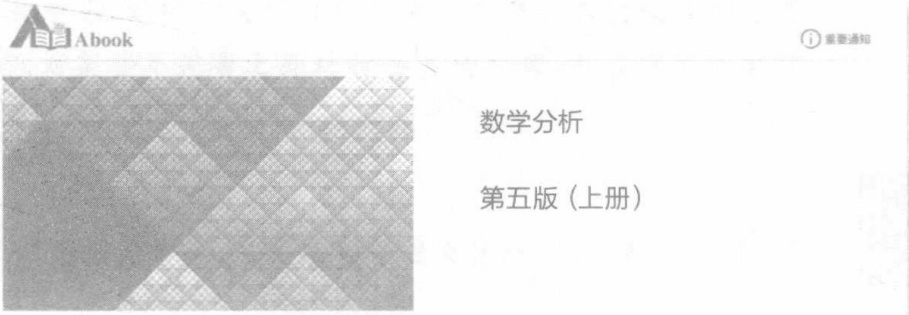

# 封面、前言与目录

原始 PDF 第 1–11 页。

十二五普通高等教育本科分级电话注册

“十二五”普通高等教育本科国家级规划教材

# 数学分析

## 第五版（上册）

华东师范大学数学科学学院 编

非外借

高等教育出版社

---

“十二五”普通高等教育本科国家级规划教材

# 数学分析

第五版（上册）

华东师范大学数学科学学院 编

seal

THE EAST CHINA NORMAL UNIVERSITY
英師範大學

高等教育出版社·北京

---

## 内容提要

本书是“十二五”普通高等教育本科国家级规划教材、普通高等教育“十一五”国家级规划教材和面向21世纪课程教材，主要内容包括实数集与函数、数列极限、函数极限、函数的连续性、导数和微分、微分中值定理及其应用、实数的完备性、不定积分、定积分、定积分的应用、反常积分等，附录为实数理论和积分表，书后附微积分学简史。

本次修订是在第四版的基础上对一些内容进行适当调整，使教材逻辑性更合理，并适当补充数字资源。第五版仍旧保持前四版“内容选取适当，深入浅出，易教易学，可读性强”的特点。

本书可作为高等学校数学和其他相关专业的教材使用。

## 图书在版编目（CIP）数据

数学分析. 上册 / 华东师范大学数学科学学院编.
--5 版.--北京:高等教育出版社, 2019.5

ISBN 978-7-04-050694-5

I.①数… Ⅱ.①华… Ⅲ.①数学分析-高等学校-教材 Ⅳ.①017

中国版本图书馆 CIP 数据核字(2018)第 229064 号

项目策划 李艳馥 兰莹莹 李蕊

策划编辑 兰莹莹 李蕊 责任编辑 兰莹莹

插图绘制 于 博 责任校对 李大鹏

封面设计 王凌波 版式设计 杜微言

责任印制 刘思涵

| 出版发行 | 高等教育出版社 | 网 址 | http://www.hep.edu.cn |
| --- | --- | --- | --- |
| 社 址 | 北京市西城区德外大街4号 |  | http://www.hep.com.cn |
| 邮政编码 | 100120 | 网上订购 | http://www.hepmall.com.cn |
| 印 刷 | 山东临沂新华印刷物流集团有限责任公司 |  | http://www.hepmall.com |
| 开 本 | 787mm×1092mm 1/16 |  | http://www.hepmall.cn |
| 印 张 | 20.25 | 版 次 | 1981年4月第1版 |
| 字 数 | 440千字 |  | 2019年5月第5版 |
| 购书热线 | 010-58581118 | 印 次 | 2019年5月第1次印刷 |
| 咨询电话 | 400-810-0598 | 定 价 | 44.80元 |

本书如有缺页、倒页、脱页等质量问题，请到所购图书销售部门联系调换

版权所有 侵权必究

物料号 50694-00

---

## 数学分析

## 第五版（上册）

华东师范大学数学科学学院 编

1. 计算机访问 http://abook.hep.com.cn/1210369，或手机扫描二维码、下载并安装 Abook 应用。
2. 注册并登录，进入“我的课程”。
3. 输入封底数字课程账号（20位密码，刮开涂层可见），或通过Abook应用扫描封底数字课程账号二维码，完成课程绑定。
4. 单击“进入课程”按钮，开始本数字课程的学习。

text_image

自自 Abook
① 重要通知
数学分析
第五版（上册）

数学分析数字课程与纸质教材一体化设计，紧密配合。数字课程提供数学史料、自测题、拓展阅读类数字资源，充分运用多种媒体资源，丰富了知识的呈现形式，拓展了教材内容，在提升课程教学效果的同时，为学生学习提供思维与探索的空间。

用户名:

密码

验证码

2692

忘记密码？

登機

注册

记住我(30天内免登录)

课程绑定后一年为数字课程使用有效期。受硬件限制，部分内容无法在手机端显示，请按提示通过计算机访问学习。

如有使用问题，请发邮件至abook@hep.com.cn。

text_image

QR code with embedded logo in center, likely linking to a digital resource or webpage

扫描二维码下载Abook应用

数学分析简史(上)

数学分析简史(下)

编者的话(初版)

http://abook.nep.com.cn/1210369

---

## 第五版前言

华东师范大学数学系编写的《数学分析》(上、下册)自1980年初版诞生以来,相继于1990年和2001年两次再版,1987年荣获全国第一届高等学校优秀教材优秀奖,2004年荣获上海市优秀教材一等奖,并于2010年出版第四版。自第四版出版以来,教材向着信息化和精美的方向发展,在使用中也发现了一些还可以继续完善的地方,在此背景下我们着手第五版修订。

为做好本次修订,前期我们进行了广泛调研,征集使用意见,并召开了教材修订会,而后根据当前教材发展的新形势,最终确定第五版的修订方案。本次修改的主要原则是基本保留第四版的风格,对某些不完善之处进行必要的处理,并适当补充数字资源(以图标×,示意)。

本次修改的主要内容有:

1. 增加了对函数  $y=x^{n}, x>0$  值域的讨论, 从而明确了其反函数  $y=\sqrt[n]{x}$  的定义域, 这就补上了第四版的一个不足;

2. 为了保证大学数学与中学数学内容的衔接,根据授课老师的建议,此次再版将三角函数的和差化积公式、积化和差公式作为习题出现在教材上;

3. 在有理函数的部分分式分解讲解中, 我们适当作了一些说明;

4. 对  $y=(1+x)^{\alpha}$  幂级数的展开式处理稍作修改；

5. 对一些例题进行适当的增减；

6. 将“微积分学简史”作为数字资源。

参加第五版编写工作的老师有:

庞学诚任主编，并负责编写第一章至第七章；

吴畏负责编写第八章至第十一章，以及第十三章；

柴俊负责编写第十二章、第十四章至第十八章；

戴浩晖 负责编写第十九章至第二十三章。

在编写过程中,一直得到我校数学科学学院老师的关心和帮助,高等教育出版社的编辑也付出了辛勤的劳动,对此我们表示衷心的感谢。在这里我们还要感谢复旦大学楼红卫教授、浙江大学阮火军教授,同时还要感谢在本书的修订和出版过程中积极提出建议的所有朋友。

第四版前言

第三版前言

再版的话

i

---

第五版前言

本书自1980年第一版出版以来，深受广大读者的关爱与支持，在此我们一并致以深切谢意！并衷心希望读者在阅读和使用本教材的过程中继续提出宝贵意见。

编者

2018年2月

ii

---

## 目录

## 第一章 实数集与函数 …… 1

§ 1 实数 …… 1

一、实数及其性质 1
二、绝对值与不等式 3

§ 2 数集·确界原理 …… 4

一、区间与邻域 4
二、有界集·确界原理 5

§ 3 函数概念 …… 8

一、函数的定义 9
二、函数的表示法 9
三、函数的四则运算 10
四、复合函数 11
五、反函数 11
六、初等函数 13

§ 4 具有某些特性的函数 …… 14

一、有界函数 15
二、单调函数 16
三、奇函数和偶函数 17
四、周期函数 17

## 第二章 数列极限 …… 21

§ 1 数列极限概念 …… 21
§ 2 收敛数列的性质 …… 26
§ 3 数列极限存在的条件 …… 32

## 第三章 函数极限 41

§ 1 函数极限概念 …… 41

一、x 趋于  $\infty$  时函数的极限 …… 41
二、x 趋于  $x_{0}$  时函数的极限 42

§ 2 函数极限的性质 …… 46
§ 3 函数极限存在的条件 …… 50
§ 4 两个重要的极限 …… 53

一、证明 $\lim_{x\to 0}\frac{\sin x}{x} = 1$ 53
二、证明 $\lim_{x\to \infty}\left(1 + \frac{1}{x}\right)^x = e$ 54

i

---

目录

§ 5 无穷小量与无穷大量 …… 56

一、无穷小量 56
二、无穷小量阶的比较 57
三、无穷大量 59
四、曲线的渐近线 61

## 第四章 函数的连续性 …… 65

§ 1 连续性概念 …… 65

一、函数在一点的连续性 65
二、间断点及其分类 66
三、区间上的连续函数 68

§ 2 连续函数的性质 …… 69

一、连续函数的局部性质 69
二、闭区间上连续函数的基本性质 71
三、反函数的连续性 73
四、一致连续性 74

§ 3 初等函数的连续性 …… 78

一、指数函数的连续性 78
二、初等函数的连续性 80

## 第五章 导数和微分 83

§ 1 导数的概念 …… 83

一、导数的定义 83
二、导函数 85
三、导数的几何意义 87

§ 2 求导法则 …… 90

一、导数的四则运算 90
二、反函数的导数 92
三、复合函数的导数 93
四、基本求导法则与公式 95

§ 3 参变量函数的导数 …… 97
§ 4 高阶导数 …… 100
§ 5 微分 …… 104

一、微分的概念 104
二、微分的运算法则 106
三、高阶微分 106
四、微分在近似计算中的应用 107

## 第六章 微分中值定理及其应用 …… 111

§ 1 拉格朗日定理和函数的单调性 …… 111

一、罗尔定理与拉格朗日定理 111
二、单调函数 114

§ 2 柯西中值定理和不定式极限 …… 117

一、柯西中值定理 117
二、不定式极限 118

§ 3 泰勒公式 …… 125

ii

---

目录

一、带有佩亚诺型余项的泰勒公式 125
二、带有拉格朗日型余项的泰勒公式 …… 128
三、在近似计算上的应用 130

§ 4 函数的极值与最大(小)值 …… 132

一、极值判别 132
二、最大值与最小值 134

§ 5 函数的凸性与拐点 …… 137
§ 6 函数图像的讨论 …… 143
§ 7 方程的近似解 …… 145

## 第七章 实数的完备性 …… 150

§ 1 关于实数集完备性的基本定理 …… 150

一、区间套定理 150
二、聚点定理与有限覆盖定理 151
三、实数完备性基本定理之间的等价性 154

§ 2 上极限和下极限 …… 156

## 第八章 不定积分 161

§ 1 不定积分概念与基本积分公式 …… 161

一、原函数与不定积分 …… 161
二、基本积分表 163

§ 2 换元积分法与分部积分法 …… 166

一、换元积分法 166
二、分部积分法 171

§ 3 有理函数和可化为有理函数的不定积分 …… 175

一、有理函数的不定积分 175
二、三角函数有理式的不定积分 …… 179
三、某些无理根式的不定积分 180

## 第九章 定积分.... 186

§ 1 定积分概念 …… 186

一、问题提出 186
二、定积分的定义 187

§ 2 牛顿—莱布尼茨公式 …… 190
§ 3 可积条件 …… 192

一、可积的必要条件 193
二、可积的充要条件 193
三、可积函数类 194

§ 4 定积分的性质 …… 198

一、定积分的基本性质 198
二、积分中值定理 202

§ 5 微积分学基本定理·定积分计算(续) …… 205

一、变限积分与原函数的存在性 …… 205
二、换元积分法与分部积分法 209
三、泰勒公式的积分型余项 212

§ 6 可积性理论补叙 …… 215

iii

---

目录

一、上和与下和的性质 215
二、可积的充要条件 217

## 第十章 定积分的应用 …… 222

§ 1 平面图形的面积 …… 222
§ 2 由平行截面面积求体积 …… 225
§ 3 平面曲线的弧长与曲率 …… 229

一、平面曲线的弧长 229
二、曲率 233

§ 4 旋转曲面的面积 …… 236

一、微元法 236
二、旋转曲面的面积 237

§ 5 定积分在物理中的某些应用 …… 239

一、液体静压力 239
二、引力 240
三、功与平均功率 241

\*§ 6 定积分的近似计算 …… 243

一、梯形法 243
二、抛物线法 244

## 第十一章 反常积分 247

§ 1 反常积分概念 …… 247

一、问题提出 247
二、两类反常积分的定义 248

§ 2 无穷积分的性质与敛散判别 …… 252

一、无穷积分的性质 252
二、非负函数无穷积分的敛散判别法 253
三、一般无穷积分的敛散判别法 255

§ 3 瑒积分的性质与敛散判别 …… 258

## 附录I 实数理论 263

一、建立实数的原则 263
二、分析 264
三、分划全体所成的有序集 266
四、R中的加法 267
五、R中的乘法 268
六、R作为Q的扩充 270
七、实数的无限小数表示 271
八、无限小数四则运算的定义 272

## 附录Ⅱ 积分表 275

一、含有 $x^n$ 的形式 275
二、含有 $a + bx$ 的形式 275
三、含有 $a^2 \pm x^2, a > 0$ 的形式 276
四、含有 $a + bx + cx^2, b^2 \neq 4ac$ 的形式 276
五、含有 $\sqrt{a + bx}$ 的形式 276

iv

---

目录

六、含有 $\sqrt{x^2\pm a^2}$ ， $a > 0$ 的形式 277
七、含有  $\sqrt{a^{2}-x^{2}}$ , a>0 的形式 …… 277
八、含有 $\sin x$ 或 $\cos x$ 的形式 278
九、含有 $\tan x, \cot x, \sec x, \csc x$ 的形式 279
十、含有反三角函数的形式 279
十一、含有 $\mathrm{e}^x$ 的形式 280
十二、含有 $\ln x$ 的形式 280

部分习题答案与提示 282

索引 303

微积分学简史 308

V
