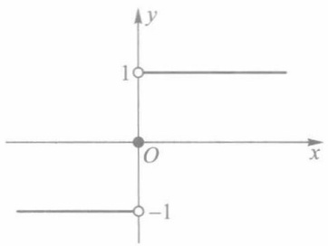
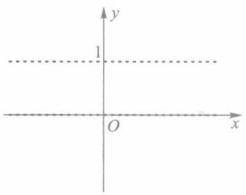
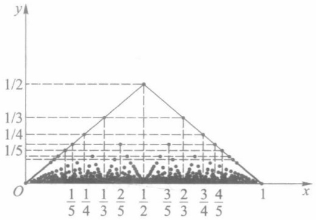
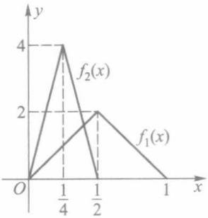
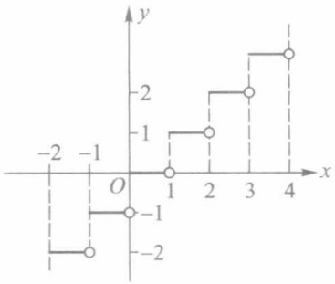
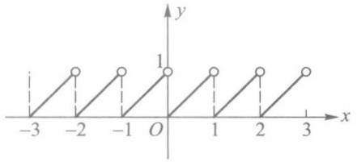

# 第1章 实数集与函数

原始 PDF 第 12–31 页。

## 第一章

## 实数集与函数

## §1 实数

数学分析研究的基本对象是定义在实数集上的函数.为此,我们先简要叙述实数的有关概念.

## 一、实数及其性质

在中学数学课程中,我们知道实数由有理数与无理数两部分组成.有理数可用分数形式 $\frac{p}{q}(p,q$ 为整数, $q\neq0$ )表示,也可用有限十进小数或无限十进循环小数来表示;而无限十进不循环小数则称为无理数.有理数和无理数统称为实数.

为了以下讨论的需要,我们把有限小数(包括整数)也表示为无限小数.对此我们作如下规定:对于正有限小数(包括正整数)x,当 $x=a_{0}.a_{1}a_{2}\cdots a_{n}$ 时,其中 $0\leqslant a_{i}\leqslant9,i=1,2,\cdots,n,a_{n}\neq0,a_{0}$ 为非负整数,记

$$
x = a _ {0}. a _ {1} a _ {2} \dots (a _ {n} - 1) 9 9 9 9 \dots ,
$$

而当 $x = a_{0}$ 为正整数时，则记

$$
x = (a _ {0} - 1). 9 9 9 9 \dots ,
$$

例如 2.001 记为 2.0009999…; 对于负有限小数 (包括负整数) y, 则先将 -y 表示为无限小数, 再在所得无限小数之前加负号, 例如 -8 记为 -7.9999…; 又规定数 0 表示为 0.0000…. 于是, 任何实数都可用一个确定的无限小数来表示.

我们已经熟知比较两个有理数大小的方法.现定义两个实数的大小关系.

定义1 给定两个非负实数

$$
x = a _ {0}. a _ {1} a _ {2} \dots a _ {n} \dots , \quad y = b _ {0}. b _ {1} b _ {2} \dots b _ {n} \dots ,
$$

其中 $a_0, b_0$ 为非负整数，$a_k, b_k (k=1,2,\cdots)$ 为整数，$0 \leqslant a_k \leqslant 9, 0 \leqslant b_k \leqslant 9$. 若有

$$
a _ {k} = b _ {k}, k = 0, 1, 2, \dots ,
$$

则称 $x$ 与 $y$ 相等，记为 $x = y$；若 $a_0 > b_0$ 或存在非负整数 $l$，使得

$$
a _ {k} = b _ {k} (  k = 0, 1, 2, \dots , l)    \text {而}    a _ {l + 1} > b _ {l + 1},
$$

则称 x 大于 y 或 y 小于 x，分别记为 x > y 或 y < x.

对于负实数 $x, y$，若按上述规定分别有 $-x = -y$ 与 $-x > -y$，则分别称 $x = y$ 与 $x < y$（或

1

---

第一章 实数集与函数

$y>x)$. 另外, 规定任何非负实数大于任何负实数.

以下给出通过有限小数来比较两个实数大小的等价条件.为此,先给出如下定义.

定义 2 设  $x=a_{0}.a_{1}a_{2}\cdots a_{n}\cdots$  为非负实数.称有理数

$$
x _ {n} = a _ {0}. a _ {1} a _ {2} \dots a _ {n}
$$

为实数 $x$ 的 $n$ 位不足近似，而有理数

$$
\overline {{x}} _ {n} = x _ {n} + \frac {1}{1 0 ^ {n}}
$$

称为 x 的 n 位过剩近似,  $n=0,1,2,\cdots$

对于负实数  $x = -a_{0}. a_{1} a_{2} \cdots a_{n} \cdots$ ，其 n 位不足近似与过剩近似分别规定为

$$
x _ {n} = -   a _ {0}. a _ {1} a _ {2} \dots a _ {n}   -   \frac {1}{1 0 ^ {n}}   \text {与}    \overline {{{{x}}}} _ {n} = -   a _ {0}. a _ {1} a _ {2} \dots a _ {n}.
$$

注 不难看出, 实数 x 的不足近似  $x_{n}$  当 n 增大时不减, 即有  $x_{0} \leqslant x_{1} \leqslant x_{2} \leqslant \cdots$ , 而过剩近似  $\bar{x}_{n}$  当 n 增大时不增, 即有  $\bar{x}_{0} \geqslant \bar{x}_{1} \geqslant \bar{x}_{2} \geqslant \cdots$ .

我们有以下的命题.

命题 设  $x=a_{0}.a_{1}a_{2}\cdots$  与  $y=b_{0}.b_{1}b_{2}\cdots$  为两个实数，则 x>y 的等价条件是:存在非负整数 n，使得

$$
x _ {n} > \bar {y} _ {n},
$$

其中  $x_{n}$  表示 x 的 n 位不足近似， $\bar{y}_{n}$  表示 y 的 n 位过剩近似.

关于这个命题的证明,以及关于实数的四则运算法则的定义,可参阅本书附录Ⅰ第八节.

例 1 设 x, y 为实数, x < y. 证明: 存在有理数 r, 满足

$$
x <   r <   y.
$$

证 由于 $x < y$ ，故存在非负整数 $n$ ，使得 $\overline{x}_n < y_n$ .令

$$
r = \frac {1}{2} (\bar {x _ {n}} + y _ {n}),
$$

则 r 为有理数,且有

$$
x \leqslant \overline {{x}} _ {n} <   r <   y _ {n} \leqslant y,
$$

即得 $x < r < y$.

为方便起见,通常将全体实数构成的集合记为 R, 即

$$
\mathbf {R} = \{  x   |   x   \text {为实数}   \}.
$$

实数有如下一些主要性质:

1. 实数集 R 对加、减、乘、除（除数不为 0）四则运算是封闭的，即任意两个实数的和、差、积、商（除数不为 0）仍然是实数.
2. 实数集是有序的, 即任意两实数 a, b 必满足下述三个关系之一: a < b, a = b, a > b.
3. 实数的大小关系具有传递性, 即若 a > b, b > c, 则有 a > c.
4. 实数具有阿基米德(Archimedes)性, 即对任何 $a, b \in \mathbb{R}$, 若 $b > a > 0$, 则存在正整数 $n$, 使得 $na > b$.
5. 实数集 $\mathbf{R}$ 具有稠密性, 即任何两个不相等的实数之间必有另一个实数, 且既有有理数 (见例 1), 也有无理数.

2

---

§ 1 实数 |||

6. 如果在一直线(通常画成水平直线)上确定一点 O 作为原点, 指定一个方向为正向(通常把指向右方的方向规定为正向), 并规定一个单位长度, 则称此直线为数轴. 可以说明: 任一实数都对应数轴上唯一的一点; 反之, 数轴上的每一点也都唯一地代表一个实数. 于是, 实数集 R 与数轴上的点有着一一对应关系. 在本书以后的叙述中, 常把“实数 a”与“数轴上的点 a”这两种说法看作具有相同的含义.

例 2 设  $a, b \in R$ . 证明: 若对任何正数  $\varepsilon$ , 有  $a < b + \varepsilon$ , 则  $a \leqslant b$ .

证 用反证法.倘若结论不成立,则根据实数集的有序性,有 a>b.令  $\varepsilon=a-b$ , 则  $\varepsilon$  为正数且  $a=b+\varepsilon$ , 但这与假设  $a<b+\varepsilon$  相矛盾.从而必有  $a\leqslant b$ .

关于实数的定义与性质的详细论述,有兴趣的读者可参阅本书附录Ⅰ.

## 二、绝对值与不等式

实数 $a$ 的绝对值定义为

$$
\mid a \mid = \left\{ \begin{array}{l l} a, & a \geqslant 0, \\ - a, & a <   0. \end{array} \right.
$$

从数轴上看, 数 a 的绝对值  $\left|a\right|$  就是点 a 到原点的距离.

实数的绝对值有如下一些性质:

1. $|a| = |-a| \geqslant 0$, 当且仅当 $a = 0$ 时有 $|a| = 0$.

2. $-|a| \leqslant a \leqslant |a|$.

3. $|a| < h \Leftrightarrow -h < a < h, |a| \leqslant h \Leftrightarrow -h \leqslant a \leqslant h (h > 0)$.

4. 对任何 $a, b \in \mathbb{R}$, 都有如下的三角形不等式:

$$
\mid a \mid - \mid b \mid \leqslant \mid a \pm b \mid \leqslant \mid a \mid + \mid b \mid .
$$

5. $|ab| = |a| |b|$.

6.  $\left|\frac{a}{b}\right|=\frac{|a|}{|b|}(b\neq0).$

下面只证明性质 4, 其余性质由读者自行证明.

由性质2有

$$
- \mid a \mid \leqslant a \leqslant \mid a \mid , - \mid b \mid \leqslant b \leqslant \mid b \mid .
$$

两式相加后得到

$$
- \left(\mid a \mid + \mid b \mid\right) \leqslant a + b \leqslant \mid a \mid + \mid b \mid .
$$

根据性质 3, 上式等价于

$$
\mid a + b \mid \leqslant \mid a \mid + \mid b \mid . \tag {1}
$$

将(1)式中 b 换成 -b,(1) 式右边不变, 即得  $\left|a-b\right|\leqslant\left|a\right|+\left|b\right|$ , 这就证明了性质 4 不等式的右半部分. 又由  $\left|a\right|=\left|a-b+b\right|$ , 据(1)式有

$$
\mid a \mid   \leqslant   \mid a - b \mid   +   \mid b \mid .
$$

从而得

$$
\mid a \mid - \mid b \mid \leqslant \mid a - b \mid . \tag {2}
$$

将(2)式中 b 换成 -b，即得  $\left|a\right|-\left|b\right|\leqslant\left|a+b\right|$ . 性质 4 得证.

3

---

第一章 实数集与函数

## 习题 1.1

1. 设 $a$ 为有理数, $x$ 为无理数. 证明:

(1)  $a + x$  是无理数； (2) 当  $a \neq 0$  时，ax 是无理数.

2. 试在数轴上表示出下列不等式的解:

(1)  $x(x^{2}-1)>0;$  (2)  $\left|x-1\right|<\left|x-3\right|;$  (3)  $\sqrt{x-1}-\sqrt{2x-1}\geqslant\sqrt{3x-2}.$

3. 设 $a, b \in \mathbf{R}$. 证明: 若对任何正数 $\varepsilon$, 有 $|a - b| < \varepsilon$, 则 $a = b$.

4. 设 $x \neq 0$，证明 $\left|x + \frac{1}{x}\right| \geqslant 2$，并说明其中等号何时成立。

5. 证明: 对任何 $x \in \mathbb{R}$, 有

(1) $\left|x-1\right|+\left|x-2\right|\geqslant1;$  (2) $\left|x-1\right|+\left|x-2\right|+\left|x-3\right|\geqslant2.$

并说明等号何时成立.

6. 设 $a, b, c \in \mathbf{R}^{+}$ ($\mathbf{R}^{+}$ 表示全体正实数的集合). 证明

$$
\left| \sqrt {a ^ {2} + b ^ {2}} - \sqrt {a ^ {2} + c ^ {2}} \right| \leqslant \left| b - c \right|.
$$

你能说明此不等式的几何意义吗？

7. 设 $x > 0, b > 0, a \neq b$. 证明 $\frac{a + x}{b + x}$ 介于 1 与 $\frac{a}{b}$ 之间.

8. 设 $p$ 为正整数. 证明: 若 $p$ 不是完全平方数, 则 $\sqrt{p}$ 是无理数.

9. 设 $a, b$ 为给定实数. 试用不等式符号 (不用绝对值符号) 表示下列不等式的解:

(1) $|x - a| < |x - b|$; (2) $|x - a| < x - b$; (3) $|x^2 - a| < b$.

## § 2 数集·确界原理

本节中我们先定义 R 中两类重要的数集——区间与邻域,然后讨论有界集,并给出确界定义和确界原理.

## 一、区间与邻域

设 $a, b \in \mathbb{R}$, 且 $a < b$. 我们称数集 $\{x \mid a < x < b\}$ 为开区间, 记作 $(a, b)$; 数集 $\{x \mid a \leqslant x \leqslant b\}$ 称为闭区间, 记作 $[a, b]$; 数集 $\{x \mid a \leqslant x < b\}$ 和 $\{x \mid a < x \leqslant b\}$ 都称为半开半闭区间, 分别记作 $[a, b)$ 和 $(a, b]$. 以上这几类区间统称为有限区间. 从数轴上来看, 开区间 $(a, b)$ 表示 $a, b$ 两点间所有点的集合, 闭区间 $[a, b]$ 比开区间 $(a, b)$ 多两个端点, 半开半闭区间 $[a, b)$ 比开区间 $(a, b)$ 多一个端点 $a$ 等.

满足关系式 $x \geqslant a$ 的全体实数 $x$ 的集合记作 $[a, +\infty)$, 这里符号 $\infty$ 读作“无穷大”, $+\infty$ 读作“正无穷大”. 类似地, 我们记

$$
\begin{array}{l} (- \infty , a ] = \{x \mid x \leqslant a \}, (a, + \infty) = \{x \mid x > a \}, \\ (- \infty , a) = \{x \mid x <   a \}, (- \infty , + \infty) = \{x \mid - \infty <   x <   + \infty \} = \mathbf {R}, \\ \end{array}
$$

4

---

§ 2 数集·确界原理

其中 $-\infty$ 读作“负无穷大”.以上这几类数集都称为无限区间.有限区间和无限区间统称为区间.

设 $a \in \mathbb{R}, \delta > 0$. 满足绝对值不等式 $|x - a| < \delta$ 的全体实数 $x$ 的集合称为点 $a$ 的 $\delta$ 邻域, 记作 $U(a; \delta)$, 或简单地写作 $U(a)$, 即有

$$
U (a; \delta) = \{x | | x - a | <   \delta \} = (a - \delta , a + \delta).
$$

点 $a$ 的空心 $\delta$ 邻域定义为

$$
U ^ {\circ} (a; \delta) = \{x \mid 0 <   | x - a | <   \delta \},
$$

它也可简单地记作 $U^{\circ}(a)$. 注意, $U^{\circ}(a; \delta)$ 与 $U(a; \delta)$ 的差别在于: $U^{\circ}(a; \delta)$ 不包含点 $a$.

此外,我们还常用到以下几种邻域:

点 $a$ 的 $\delta$ 右邻域 $U_{+}(a;\delta) = [a,a + \delta)$，简记为 $U_{+}(a)$；

点 $a$ 的 $\delta$ 左邻域 $U_{-}(a;\delta) = (a - \delta ,a]$，简记为 $U_{-}(a)$；

$(U_{-}(a)$ 与 $U_{+}(a)$ 去除点a后,分别为点a的空心 $\delta$ 左、右邻域,简记为 $U_{-}^{\circ}(a)$ 与 $U_{+}^{\circ}(a)$.)

∞邻域  $U(\infty)=\{x\mid|x|>M\}$ ，其中 M 为充分大的正数（下同）；

$+\infty$  邻域  $U(+\infty)=\{x \mid x>M\}$ ;

-∞邻域 $U(-\infty) = \{x\mid x <   - M\}$

## 二、有界集·确界原理

定义1 设 $S$ 为 $\mathbf{R}$ 中的一个数集. 若存在数 $M(L)$, 使得对一切 $x \in S$, 都有 $x \leqslant M (x \geqslant L)$, 则称 $S$ 为有上界(下界)的数集, 数 $M(L)$ 称为 $S$ 的一个上界(下界).

若数集 S 既有上界又有下界, 则称 S 为有界集. 若 S 不是有界集, 则称 S 为无界集.

例 1 证明数集  $N_{+}=\{n \mid n$  为正整数 } 有下界而无上界.

证 显然,任何一个不大于1的实数都是 $N_{+}$ 的下界,故 $N_{+}$ 为有下界的数集.

为证 $\mathbf{N}_{+}$ 无上界, 按照定义只需证明: 对于无论多么大的数 $M$, 总存在某个正整数 $n_{0}(\in \mathbf{N}_{+})$, 使得 $n_{0} > M$. 事实上, 对任何正数 $M$ (无论多么大), 取 $n_{0} = [M] + 1^{①}$, 则 $n_{0} \in \mathbf{N}_{+}$, 且 $n_{0} > M$. 这就证明了 $\mathbf{N}_{+}$ 无上界.

读者还可自行证明:任何有限区间都是有界集,无限区间都是无界集;由有限个数组成的数集是有界集.

若数集 S 有上界, 则显然它有无穷多个上界, 而其中最小的一个上界常常具有重要的作用, 称它为数集 S 的上确界. 同样, 有下界数集的最大下界, 称为该数集的下确界. 下面给出数集的上确界和下确界的精确定义.

定义 2 设 S 是 R 中的一个数集. 若数  $\eta$  满足:

(i) 对一切  $x \in S$ ，有  $x \leqslant \eta$ ，即  $\eta$  是 S 的上界；

（ii）对任何  $\alpha < \eta$ ，存在  $x_{0} \in S$ ，使得  $x_{0} > \alpha$ ，即  $\eta$  又是 S 的最小上界，则称数  $\eta$  为数集 S 的上确界，记作

<small>① $[x]$ 表示不超过数 $x$ 的最大整数，例如 $[2.9] = 2, [-4.1] = -5.$</small>

5

---

第一章 实数集与函数

$$
\eta = \sup S ^ {①}.
$$

定义3 设 $S$ 是 $\mathbf{R}$ 中的一个数集. 若数 $\xi$ 满足:

(i) 对一切  $x \in S$ ，有  $x \geqslant \xi$ ，即  $\xi$  是 S 的下界；

（ii）对任何 $\beta >\xi$ ，存在 $x_0\in S$ ，使得 $x_0 <   \beta$ ，即 $\xi$ 又是 $S$ 的最大下界，则称数 $\xi$ 为数集 $S$ 的下确界，记作

$$
\xi = \inf S.
$$

上确界与下确界统称为确界.

例2 设 $S = \{x \mid x$ 为区间(0,1)上的有理数}.试按上、下确界的定义验证: $\sup S = 1, \inf S = 0$.

解 先验证 $\sup S = 1$

(i) 对一切  $x \in S$ ，显然有  $x \leqslant 1$ ，即 1 是 S 的上界.
（ii）对任何 $\alpha < 1$ ，若 $\alpha \leqslant 0$ ，则任取 $x_0 \in S$ ，都有 $x_0 > \alpha$ ；若 $\alpha > 0$ ，则由有理数集在实数集中的稠密性，在 $(\alpha, 1)$ 上必有有理数 $x_0$ ，即存在 $x_0 \in S$ ，使得 $x_0 > \alpha$

类似地可验证 inf S=0.

读者还可自行验证:闭区间[0,1]的上、下确界分别为1和0;对于数集 $E=\left\{\frac{(-1)^{n}}{n}\mid n=1,2,\cdots\right\}$ ，有 $\sup E=\frac{1}{2},\inf E=-1$ ;正整数集 $N_{+}$ 有下确界 $\inf N_{+}=1$ ，而没有上确界.

注1 由上(下)确界的定义可见,若数集 S 存在上(下)确界,则一定是唯一的.又若数集 S 存在上、下确界,则有  $\inf S \leqslant \sup S$ .

注 2 从上面一些例子可见, 数集 S 的确界可能属于 S, 也可能不属于 S.

例3 设数集 $S$ 有上确界.证明

$$
\eta = \sup S \in S \Leftrightarrow \eta = \max S ^ {②}.
$$

证 $\Rightarrow$ 设 $\eta = \sup S\in S$ ，则对一切 $x\in S$ ，有 $x\leqslant \eta$ ，而 $\eta \in S$ ，故 $\eta$ 是数集 $S$ 中最大的数，即 $\eta = \max S$

$\Leftarrow$ 设 $\eta = \max S$ ，则 $\eta \in S$ ；下面验证 $\eta = \sup S$ :

(i) 对一切  $x \in S$ ，有  $x \leqslant \eta$ ，即  $\eta$  是 S 的上界；

(ii) 对任何 $\alpha < \eta$，只需取 $x_0 = \eta \in S$，则 $x_0 > \alpha$. 从而满足 $\eta = \sup S$ 的定义.

关于数集确界的存在性,我们给出如下确界原理.

定理 1.1(确界原理) 设 S 为非空数集. 若 S 有上界, 则 S 必有上确界; 若 S 有下界, 则 S 必有下确界.

证 我们只证明关于上确界的结论,后一结论可类似地证明.

为叙述方便,不妨设 S 含有非负数.由于 S 有上界,故可找到非负整数 n,使得

1）对于任何  $x \in S$ ，有  $x < n + 1$ ；
2）存在 $a_0 \in S$，使 $a_0 \geqslant n$.

对半开区间 $[n,n+1)$ 作10等分,分点为 $n.1,n.2,\cdots,n.9$ ,则存在 $0,1,2,\cdots,9$ 中的一个数 $n_{1}$ ,使得

<small>① sup 是拉丁文 supremum(上确界)一词的简写,下面的 inf 是拉丁文 infimum(下确界)一词的简写.</small>

<small>② 记号 max 是 maximum(最大) 一词的简写, $\eta = \max S$ 表示数 $\eta$ 是数集 $S$ 中最大的数. 以下将出现的记号 min 是 minimum(最小) 一词的简写, $\min S$ 表示数集 $S$ 中最小的数.</small>

6

---

§ 2 数集·确界原理

1）对于任何  $x \in S$ ，有  $x < n.n_{1} + \frac{1}{10}$ ;
2）存在 $a_1 \in S$，使 $a_1 \geqslant n.n_1$.

再对半开区间 $\left[n.n_{1},n.n_{1}+\frac{1}{10}\right)$ 作10等分，则存在 $0,1,2,\cdots,9$ 中的一个数 $n_{2}$ ，使得

1）对于任何  $x \in S$ ，有  $x < n.n_{1}n_{2} + \frac{1}{10^{2}}$ ;
2）存在 $a_2 \in S$，使 $a_2 \geqslant n.n_1n_2$.

继续不断地 10 等分在前一步骤中所得到的半开区间, 可知对任何  $k=1,2,\cdots$ , 存在  $0,1,2,\cdots,9$  中的一个数  $n_{k}$ , 使得

1）对于任何  $x \in S$ ，有  $x < n.n_{1}n_{2}\cdots n_{k} + \frac{1}{10^{k}}$ ;
2）存在  $a_{k} \in S$ ，使  $a_{k} \geqslant n.n_{1}n_{2}\cdots n_{k}$ .

将上述步骤无限地进行下去,得到实数  $\eta=n.n_{1}n_{2}\cdots n_{k}\cdots$ . 以下证明  $\eta=\sup S.$ 为此只需证明:

(i) 对一切 $x \in S$，有 $x \leqslant \eta$; (ii) 对任何 $\alpha < \eta$，存在 $a' \in S$，使 $\alpha < a'$.

倘若结论(i)不成立,即存在  $x \in S$ ,使  $x > \eta$ ,则可找到 x 的 k 位不足近似  $x_{k}$ ,使

$$
x _ {k} > \bar {\eta} _ {k} = n. n _ {1} n _ {2} \dots n _ {k} + \frac {1}{1 0 ^ {k}},
$$

从而得

$$
x > n. n _ {1} n _ {2} \dots n _ {k} + \frac {1}{1 0 ^ {k}},
$$

但这与不等式(1)相矛盾.于是(i)得证.

现设 $\alpha < \eta$ ，则存在 $k$ ，使 $\eta$ 的 $k$ 位不足近似 $\eta_{k} > \bar{\alpha}_{k}$ ，即

$$
n. n _ {1} n _ {2} \dots n _ {k} > \bar {\alpha} _ {k}.
$$

根据数  $\eta$  的构造, 存在  $a' \in S$ , 使  $a' \geqslant \eta_{k}$ , 从而有

$$
a ^ {\prime} \geqslant \eta_ {k} > \bar {\alpha} _ {k} \geqslant \alpha ,
$$

即得到  $\alpha<a'$ . 这说明 (ii) 成立.

在本书中确界原理是极限理论的基础,读者应给予充分的重视.

例 4 设 A, B 为非空数集, 满足: 对一切  $x \in A$  和  $y \in B$  有  $x \leqslant y$ . 证明: 数集 A 有上确界, 数集 B 有下确界, 且

$$
\sup A \leqslant \inf B. \tag {2}
$$

证 由假设, 数集 B 中任一数 y 都是数集 A 的上界, A 中任一数 x 都是 B 的下界, 故由确界原理推知数集 A 有上确界, 数集 B 有下确界.

现证不等式(2). 对任何 $y \in B, y$ 是数集 $A$ 的一个上界, 而由上确界的定义知, $\sup A$ 是数集 $A$ 的最小上界, 故有 $\sup A \leqslant y$. 而此式又表明数 $\sup A$ 是数集 $B$ 的一个下界, 故由下确界定义证得 $\sup A \leqslant \inf B$.

例 5 设 A, B 为非空有界数集,  $S = A \cup B$ . 证明:

(i)  $\sup S = \max \left\{ \sup A, \sup B \right\}$ ;
(ii)  $\inf S = \min\{\inf A, \inf B\}$ .

证 由于 $S = A \cup B$ ，显然 $S$ 也是非空有界数集，因此 $S$ 的上、下确界都存在.

(i) 对任何 $x \in S$，有 $x \in A$ 或 $x \in B \Rightarrow x \leqslant \sup A$ 或 $x \leqslant \sup B$，从而有 $x \leqslant \max \{\sup A, \sup B\}$，故得 $\sup S \leqslant \max \{\sup A, \sup B\}$.

7

---

第一章 实数集与函数

另一方面，对任何 $x \in A$ ，有 $x \in S \Rightarrow x \leqslant \sup S \Rightarrow \sup A \leqslant \sup S$ ；同理又有 $\sup B \leqslant \sup S$ .所以 $\sup S \geqslant \max \{\sup A, \sup B\}$

综上, 即证得  $\sup S = \max \left\{ \sup A, \sup B \right\}$ .

(ii) 可类似地证明.

若把 $+\infty$ 和 $-\infty$ 补充到实数集中，并规定任一实数 $a$ 与 $+\infty, -\infty$ 的大小关系为:$a < +\infty, a > -\infty, -\infty < +\infty$，则确界概念可扩充为:若数集 $S$ 无上界，则定义 $+\infty$ 为 $S$ 的非正常上确界，记作 $\sup S = +\infty$；若 $S$ 无下界，则定义 $-\infty$ 为 $S$ 的非正常下确界，记作 $\inf S = -\infty$。相应地，前面定义2和定义3中所定义的确界分别称为正常上、下确界。

在上述扩充意义下,我们有

推广的确界原理 任一非空数集必有上、下确界(正常的或非正常的).

例如,对于正整数集  $N_{+}$ , 有  $\inf N_{+}=1,\sup N_{+}=+\infty$ ; 对于数集

$$
S = \{y \mid y = 2 - x ^ {2}, x \in \mathbf {R} \}, \tag {3}
$$

有  $\inf S = -\infty, \sup S = 2.$

## 习题 1.2

1. 用区间表示下列不等式的解:

(1) $\left|1-x\right|-x\geqslant0;$  (2) $\left|x+\frac{1}{x}\right|\leqslant6;$

(3) $(x-a)(x-b)(x-c)>0(a,b,c$ 为常数，且 $a<b<c$ ; (4) $\sin x\geqslant\frac{\sqrt{2}}{2}$ .

2. 设 S 为非空数集. 试对下列概念给出定义:

(1) S 无上界； (2) S 无界.

3. 试证明由(3)式所确定的数集 S 有上界而无下界.

4. 求下列数集的上、下确界，并依定义加以验证:

(1)  $S=\{x \mid x^{2}<2\}$ ; (2)  $S=\{x \mid x=n!, n \in N_{+}\}$ ;

(3) $S = \{x \mid x$ 为 $(0,1)$ 上的无理数}; (4) $S = \{x \mid x = 1 - \frac{1}{2^n}, n \in \mathbf{N}_+\}$.

5. 设 $S$ 为非空有下界数集. 证明:

$$
\inf S = \xi \in S \Leftrightarrow \xi = \min S.
$$

6. 设 $S$ 为非空数集, 定义 $S^{-} = \{x \mid -x \in S\}$. 证明:

(1) $\inf S^{-} = -\sup S$; (2) $\sup S^{-} = -\inf S$.

7. 设 A, B 皆为非空有界数集, 定义数集

$$
A + B = \{z \mid z = x + y, x \in A, y \in B \}.
$$

证明:(1) $\sup(A+B)=\sup A+\sup B;$  (2) $\inf(A+B)=\inf A+\inf B.$

## § 3 函数概念

关于函数概念,在中学数学中我们已有了初步的了解,本节将对此作进一步的讨论.

8

---

§ 3 函数概念 |||

## 一、函数的定义

定义1 给定两个实数集 $D$ 和 $M$, 若有对应法则 $f$, 使对每一个 $x \in D$, 都有唯一的 $y \in M$ 与它相对应, 则称 $f$ 是定义在数集 $D$ 上的函数, 记作

$$
f \colon D \to M, \tag {1}
$$

$$
x \mapsto y.
$$

数集 $D$ 称为函数 $f$ 的定义域, $x$ 所对应的 $y$ 称为 $f$ 在点 $x$ 的函数值, 常记为 $f(x)$. 全体函数值的集合

$$
f (D) = \{y \mid y = f (x), x \in D \} (\subset M)
$$

称为函数 $f$ 的值域.

（1）中第一式“ $f: D \to M$ ”表示按法则 $f$ 建立数集 $D$ 到 $M$ 的函数关系；第二式“$x \mapsto y$”表示这两个数集中元素之间的对应关系，也可记为“ $x \mapsto f(x)$ ”.习惯上，我们称此函数关系中的 $x$ 为自变量，$y$ 为因变量.

关于函数的定义,我们作如下几点说明:

1. 定义 1 中的实数集 $M$ 常以 $\mathbf{R}$ 来代替, 于是定义域 $D$ 和对应法则 $f$ 就成为确定函数的两个主要因素. 所以, 我们也常用

$$
y = f (x), x \in D
$$

表示一个函数. 由此, 我们说某两个函数相同, 是指它们有相同的定义域和对应法则. 如果两个函数对应法则相同而定义域不同, 那么这两个函数仍是不相同的. 例如 $f(x) = 1, x \in \mathbb{R}$ 和 $g(x) = 1, x \in \mathbb{R} \setminus \{0\}$ 是不相同的两个函数. 另一方面, 两个相同的函数, 其对应法则的表达形式可能不同, 例如

$$
\varphi (x) = \mid x \mid , x \in \mathbf {R} \text {和} \psi (x) = \sqrt {x ^ {2}}, x \in \mathbf {R}.
$$

2. 我们在中学数学中已经知道, 表示函数的主要方法是解析法(公式法), 即用数学运算式子来表示函数. 这时, 函数的定义域常取使该运算式子有意义的自变量值的全体, 通常称为存在域. 在这种情况下, 函数的定义域(即存在域) D 可省略不写, 而只用对应法则 f 来表示一个函数, 此时可简单地说“函数  $y = f(x)$ ”或“函数 f”.

3. 函数 $f$ 给出了 $x$ 轴上的点集 $D$ 到 $y$ 轴上点集 $M$ 之间的单值对应, 也称为映射. 对于 $a \in D, f(a)$ 称为映射 $f$ 下 $a$ 的象, $a$ 则称为 $f(a)$ 的原象.

4. 在函数定义中, 对每一个 $x \in D$, 只能有唯一的一个 $y$ 值与它对应, 这样定义的函数称为单值函数. 若同一个 $x$ 值可以对应多于一个的 $y$ 值, 则称这种函数为多值函数. 在本书范围内, 我们只讨论单值函数.

## 二、函数的表示法

在中学课程里,我们已经知道函数的表示法主要有三种,即解析法(或称公式法)、列表法和图像法.

有些函数在其定义域的不同部分用不同的公式表达,这类函数通常称为分段函数.例如,函数

$$
\mathrm{sgn} x = \left\{ \begin{array}{l l} 1, & x > 0, \\ 0, & x = 0, \\ - 1, & x <   0 \end{array} \right.
$$

9

---

第一章 实数集与函数

是分段函数,称为符号函数,其图像如图1-1所示.又如函数 $f(x)=|x|$ 也可用如下的分段函数形式来表示:

$$
f (x) = \left\{ \begin{array}{l l} x, & x \geqslant 0, \\ - x, x <   0. \end{array} \right.
$$

它还可表示为 $f(x) = x \operatorname{sgn} x$.

函数 $y = f(x), x \in D$ 又可用有序数对的集合

$$
G = \{(x, y) \mid y = f (x), x \in D \}
$$

contour

| X | Y |
| --- | --- |
| 0 | 1 |
| 0 | -1 |
| 1 | 1 |
| 1 | -1 |

图1-1

来表示.在坐标平面上,集合 G 的每一个元素  $(x,y)$  表示平面上的一个点,因而集合 G 在坐标平面上描绘出这个函数的图像.这就是用图像法表示函数的依据.

有些函数只能用语言来描述,如定义在 R 上的狄利克雷(Dirichlet)函数

$$
D (x) = \left\{ \begin{array}{l l} 1, & \text {当} x \text {为有理数}, \\ 0, & \text {当} x \text {为无理数} \end{array} \right.
$$

和定义在 $[0,1]$ 上的黎曼(Riemann)函数

$$
R (x) = \left\{ \begin{array}{l l} \frac {1}{q}, & \text {当} x = \frac {p}{q} (p, q \in \mathbf {N} _ {+}, \frac {p}{q} \text {为既约真分数}), \\ 0, & \text {当} x = 0, 1 \text {和} (0, 1) \text {内的无理数}. \end{array} \right.
$$

图 1-2 和图 1-3 分别是这两个函数的示意图.

text_image

y
1
O x

图1-2

scatter

| X | Y |
| --- | --- |
| 0 | 0 |
| 1/5 | 1/3 |
| 1/4 | 1/4 |
| 1/3 | 1/5 |
| 2/5 | 1/5 |
| 1/2 | 1/2 |
| 3/5 | 1/3 |
| 2/3 | 1/4 |
| 3/4 | 1/5 |
| 4/5 | 1/5 |
| 1 | 0 |

图1-3

## 三、函数的四则运算

给定两个函数 $f, x \in D_1$ 和 $g, x \in D_2$. 记 $D = D_1 \cap D_2$, 并设 $D \neq \emptyset$. 我们定义 $f$ 与 $g$ 在 $D$ 上的和、差、积运算如下:

$$
F (x) = f (x) + g (x), x \in D,
$$

$$
G (x) = f (x) - g (x), x \in D,
$$

$$
H (x) = f (x) g (x), x \in D.
$$

若在 D 中剔除使  $g(x)=0$  的 x 值, 即令

$$
D ^ {*} = D _ {1} \cap \{x \mid g (x) \neq 0, x \in D _ {2} \} \neq \varnothing ,
$$

可在 $D^{*}$ 上定义 $f$ 与 $g$ 的商的运算如下:

$$
L (x) = \frac {f (x)}{g (x)}, x \in D ^ {*}.
$$

注 若 $D = D_{1} \cap D_{2} = \varnothing$，则 $f$ 与 $g$ 不能进行四则运算。例如，设

10

---

§ 3 函数概念 |||

$$
f (x) = \sqrt {1 - x ^ {2}}, x \in D _ {1} = \{x | | x | \leqslant 1 \},
$$

$$
g (x) = \sqrt {x ^ {2} - 4}, x \in D _ {2} = \{x \mid | x | \geqslant 2 \},
$$

由于 $D_{1} \cap D_{2} = \varnothing$ ，所以表达式

$$
f (x) + g (x) = \sqrt {1 - x ^ {2}} + \sqrt {x ^ {2} - 4}
$$

是没有意义的.

以后为叙述方便,函数f与g的和、差、积、商常分别写作

$$
f + g, f - g, f g, \frac {f}{g}.
$$

## 四、复合函数

设有两函数

$$
\begin{array}{l} y = f (u), u \in D, \tag {2} \\ u = g (x), x \in E. \\ \end{array}
$$

记 $E^{*} = \{x\mid g(x)\in D\} \cap E.$ 若 $E^{*}\neq \emptyset$ ，则对每一个 $x\in E^{*}$ ，可通过函数 $g$ 对应 $D$ 上唯一的一个值 $u$ ，而 $u$ 又通过函数 $f$ 对应唯一的一个值 $y.$ 这就确定了一个定义在 $E^{*}$ 上的函数，它以 $x$ 为自变量，$y$ 为因变量，记作

$$
y = f (  g (  x  )  ), x \in E ^ {*} \text {或} y = (  f \circ   g  ) (  x  ), x \in E ^ {*},
$$

称为函数 $f$ 和 $g$ 的复合函数. 并称 $f$ 为外函数, $g$ 为内函数, (2) 式中的 $u$ 为中间变量. 函数 $f$ 和 $g$ 的复合运算也可简单地写作 $f \circ g$.

例1 函数 $y = f(u) = \sqrt{u}, u \in D = [0, +\infty)$ 与函数 $u = g(x) = 1 - x^2, x \in E = \mathbf{R}$ 的复合函数为

$$
y = f (  g (  x  )  ) = \sqrt {1   -   x ^ {2}} \quad \text {或} \quad (  f \circ   g  ) (  x  ) = \sqrt {1   -   x ^ {2}}  ,
$$

其定义域 $E^{*} = [-1,1]\subset E.$

复合函数也可由多个函数相继复合而成.例如,由三个函数  $y=\sin u, u=\sqrt{v}$  与 v=1-x^{2} (它们的定义域取为各自的存在域) 相继复合而得的复合函数为

$$
y = \sin \sqrt {1 - x ^ {2}}, x \in [ - 1, 1 ].
$$

注 当且仅当 $E^{*} \neq \emptyset$ （即 $D \cap g(E) \neq \emptyset$）时，函数 $f$ 与 $g$ 才能进行复合。例如，以 $y = f(u) = \arcsin u, u \in D = [-1, 1]$ 为外函数，$u = g(x) = 2 + x^2, x \in E = \mathbf{R}$ 为内函数，就不能进行复合。这是因为外函数的定义域 $D = [-1, 1]$ 与内函数的值域 $g(E) = [2, +\infty)$ 不相交。

## 五、反函数

函数  $y=f(x)$  的自变量 x 与因变量 y 的关系往往是相对的.有时我们不仅要研究 y 随 x 而变化的状况,也要研究 x 随 y 而变化的状况.对此,我们引入反函数概念.

设函数

$$
y = f (x), x \in D \tag {3}
$$

满足:对于值域 $f(D)$ 上的每一个y,D中有且只有一个x,使得

$$
f (x) = y,
$$

11

---

第一章 实数集与函数

则按此对应法则得到一个定义在 $f(D)$ 上的函数，称这个函数为 $f$ 的反函数，记作

$$
f ^ {- 1}: f (D) \to D,
$$

$$
y \mapsto x
$$

或

$$
x = f ^ {- 1} (y), y \in f (D). \tag {4}
$$

注1 函数 $f$ 有反函数, 意味着 $f$ 是 $D$ 与 $f(D)$ 之间的一个一一映射. 我们称 $f^{-1}$ 为映射 $f$ 的逆映射, 它把集合 $f(D)$ 映射到集合 $D$, 即把 $f(D)$ 中的每一个值 $f(a)$ 对应到 $D$ 上唯一的一个值 $a$. 这时称 $a$ 为逆映射 $f^{-1}$ 下 $f(a)$ 的象, 而 $f(a)$ 则是 $a$ 在逆映射 $f^{-1}$ 下的原象.

从上述讨论还可看到,函数 f 也是函数  $f^{-1}$  的反函数.或者说,f 与  $f^{-1}$  互为反函数.并有

$$
f ^ {- 1} (f (x)) \equiv x, x \in D,
$$

$$
f (f ^ {- 1} (y)) \equiv y, y \in f (D).
$$

注2 在反函数 $f^{-1}$ 的表示式(4)中, 是以 $y$ 为自变量, $x$ 为因变量. 若按习惯, 仍用 $x$ 作为自变量的记号, $y$ 作为因变量的记号, 则函数(3)的反函数(4)可改写为

$$
y = f ^ {- 1} (x), x \in f (D). \tag {5}
$$

例如, 按习惯记法, 函数  $y=ax+b(a\neq0)$ ,  $y=a^{x}(a>0, a\neq1)$  与  $y=\sin x, x\in\left[-\frac{\pi}{2},\frac{\pi}{2}\right]$  的反函数分别是

$$
y = \frac {x - b}{a}, y = \log_ {a} x \text {与} y = \arcsin x.
$$

应该注意, 尽管反函数  $f^{-1}$  的表示式(4)与(5)的形式不同, 但它们仍表示同一个函数, 因为它们的定义域都是  $f(D)$ , 对应法则都是  $f^{-1}$ , 只是所用变量的记号不同而已.

例2 设 $a > 0, n (\geqslant 2)$ 是自然数. 证明: 方程 $x^n = a$ 有唯一的正数解. 这个解称为 $a$ 的 $n$ 次正根 (即算术根), 记为 $\sqrt[n]{a}$ 或者 $a^{\frac{1}{n}}$.

证 为简单起见,我们仅证 n=2 的情形.

首先证明存在性.a=1时显然有解.又由于方程

$$
x ^ {2} = a
$$

与方程

$$
\frac {1}{x ^ {2}} = \frac {1}{a}
$$

同解,所以仅需考虑 0<a<1 的情形.设

$$
E = \{x \mid x > 0, x ^ {2} <   a \}.
$$

因为 $a \in E$，且1是 $E$ 的一个上界，所以由确界定理，$E$ 的上确界存在，记为 $c = \sup E$. 由确界定义易得 $a \leqslant c \leqslant 1$. 下面证明 $c^2 = a$.

（1）若 $c^2 > a$ ，根据实数的阿基米德性质，存在自然数 $m$ ，使得 $\frac{1}{m} < \frac{c^2 - a}{2}, \frac{1}{m} < c.$ 由确界的定义，存在 $x_0 \in E, x_0 > c - \frac{1}{m} > 0$ ，从而

$$
x _ {0} ^ {2} > \left(c - \frac {1}{m}\right) ^ {2} = c ^ {2} - 2 \cdot \frac {c}{m} + \frac {1}{m ^ {2}} > c ^ {2} - \frac {2}{m} > c ^ {2} - (c ^ {2} - a) = a,
$$

12

---

§ 3 函数概念 |||

这与 $x_0 \in E$ 矛盾，说明 $c^2 \leqslant a$.

(2) 同理可证  $c^{2}<a$  也不成立. 由此得到  $c^{2}=a$ .

再证明唯一性.对任意正数 $b(\neq c), b^2 - a = b^2 - c^2 = (b - c)(b + c) \neq 0$，这证明了解的唯一性.

设 $a > 0, m, n, p$ 为正整数，规定 $a^{\frac{m}{n}} = (a^{\frac{1}{n}})^m$，那么有 $a^{\frac{pm}{pn}} = (a^{\frac{1}{pn}})^{pm} = a^{\frac{m}{n}}$. 我们将此性质的证明留作习题.

## 六、初等函数

在中学数学中,读者已经熟悉基本初等函数有以下六类:

常量函数 $y = c$ （$c$ 是常数）；

幂函数  $y=x^{\alpha}$  ( $\alpha$  为实数);

指数函数 $y = a^{x} (a > 0, a \neq 1)$;

对数函数  $y=\log_{a}x(a>0,a\neq1)$ ;

三角函数  $y=\sin x$  (正弦函数),  $y=\cos x$  (余弦函数),

$y=\tan x$ （正切函数）， $y=\cot x$ （余切函数）；

反三角函数  $y=\arcsin x$  (反正弦函数),  $y=\arccos x$  (反余弦函数),

$y=\arctan x$  (反正切函数),  $y=\operatorname{arccot} x$  (反余切函数).

这里我们要指出,幂函数  $y=x^{\alpha}$  和指数函数  $y=a^{x}$  都涉及乘幂,而在中学数学课程中只给出了有理指数乘幂的定义.下面我们借助确界来定义无理指数幂,使它与有理指数幂一起构成实指数乘幂,并保持有理指数幂的基本性质.

定义2 给定实数 $a > 0, a \neq 1$. 设 $x$ 为无理数, 我们规定

$$
a ^ {x} = \left\{ \begin{array}{l} \sup _ {r <   x} \left\{a ^ {r} \mid r \text {为有理数} \right\}, \text {当} a > 1 \text {时,} \\ \inf _ {r <   x} \left\{a ^ {r} \mid r \text {为有理数} \right\}, \text {当} 0 <   a <   1 \text {时.} \end{array} \right. \tag {6}
$$

注1 对任一无理数 $x$，必有有理数 $r_0$，使 $x < r_0$，则当有理数 $r < x$ 时，有 $r < r_0$，从而由有理数乘幂的性质，当 $a > 1$ 时，有 $a^r < a^{r_0}$。这表明非空数集

$$
\{a ^ {r} \mid r <   x, r \text {为有理数} \}
$$

有一个上界 $a^{r_0}$. 由确界原理, 该数集有上确界, 所以 (6) 式右边是一个确定的数. 同理, 当 $0 < a < 1$ 时, (7) 式右边也是一个定数.

注2 如果把(6)、(7)两式中的“$r < x$”改为“$r \leqslant x$”，那么，无论 $x$ 是无理数或是有理数，$a^x$ 都可用如上两式的确界形式来统一表示.

定义 3 由基本初等函数经过有限次四则运算与复合运算所得到的函数,统称为初等函数.

不是初等函数的函数,称为非初等函数.如在本节第二段中给出的狄利克雷函数和黎曼函数,都是非初等函数.

## 习题 1.3

1. 试作下列函数的图像:

$$
(1) y = x ^ {2} + 1; \quad (2) y = (x + 1) ^ {2}; \quad (3) y = 1 - (x + 1) ^ {2};
$$

13

---

第一章 实数集与函数

(4)  $y = \text{sgn}(\sin x)$ ; (5)  $y = \begin{cases} 3x, & |x| > 1, \\ x^3, & |x| < 1, \\ 3, & |x| = 1. \end{cases}$

2. 试比较函数 $y = a^x$ 与 $y = \log_a x$ 分别当 $a = 2$ 和 $a = \frac{1}{2}$ 时的图像.

3. 根据图 1-4 写出定义在  $[0,1]$  上的分段函数  $f_{1}(x)$  和  $f_{2}(x)$  的解析表示式.

4. 确定下列初等函数的存在域:

(1)  $y = \sin(\sin x)$ ;

(2) $y = \lg (\lg x)$;

(3)  $y = \arcsin\left(\lg \frac{x}{10}\right)$ ;

(4) $y = \lg \left(\arcsin \frac{x}{10}\right)$.

5. 设函数

$$
f (x) = \left\{ \begin{array}{l l} 2 + x, & x \leqslant 0, \\ 2 ^ {x}, & x > 0. \end{array} \right.
$$

求:(1) $f(-3), f(0), f(1)$; (2) $f(\Delta x) - f(0), f(-\Delta x) - f(0) (\Delta x > 0)$.

6. 设函数 $f(x) = \frac{1}{1 + x}$，求 $f(2 + x), f(2x), f(x^2), f(f(x)), f\left(\frac{1}{f(x)}\right)$.

7. 试问下列函数是由哪些初等函数复合而成:

(1)  $y = (1 + x)^{20}$ ;

(2) $y = (\arcsin x^2)^2$;

(3)  $y=\lg(1+\sqrt{1+x^{2}})$ ;

(4) $y = 2^{\sin^2 x}$.

8. 在什么条件下, 函数

$$
y = \frac {a x + b}{c x + d}
$$

的反函数就是它本身？

9. 试作函数 $y = \arcsin (\sin x)$ 的图像.

10. 试问下列等式是否成立:

(1)  $\tan(\arctan x)=x, x\in\mathbf{R}$ ;
(2)  $\arctan(\tan x)=x, x\neq k\pi+\frac{\pi}{2}, k=0,\pm1,\pm2,\cdots.$

11. 试问 $y = |x|$ 是初等函数吗？

12. 证明关于函数 $y = [x]$ 的如下不等式:

(1) 当 x>0 时,  $1-x<x\left[\frac{1}{x}\right]\leqslant1$ ;
(2) 当 x<0 时,  $1 \leqslant x\left[\frac{1}{x}\right] < 1 - x.$

## § 4 具有某些特性的函数

在本节中,我们将介绍以后常用到的几类具有某些特性的函数.

line

| X | f1(x) | f2(x) |
| --- | --- | --- |
| 0 | 0 | 0 |
| 1/4 | — | 4 |
| 1/2 | 2 | 0 |
| 1 | 0 | — |

图1-4

14

---

§ 4 具有某些特性的函数

## 一、有界函数

定义1 设 $f$ 为定义在 $D$ 上的函数. 若存在数 $M(L)$, 使得对每一个 $x \in D$, 有

$$
f (x) \leqslant M (f (x) \geqslant L),
$$

则称 $f$ 为 $D$ 上的有上(下)界函数, $M(L)$ 称为 $f$ 在 $D$ 上的一个上(下)界.

根据定义, $f$ 在 $D$ 上有上(下)界, 意味着值域 $f(D)$ 是一个有上(下)界的数集. 又若 $M(L)$ 为 $f$ 在 $D$ 上的上(下)界, 则任何大于(小于) $M(L)$ 的数也是 $f$ 在 $D$ 上的上(下)界.

定义 2 设 f 为定义在 D 上的函数. 若存在正数 M, 使得对每一个  $x \in D$ , 有

$$
\mid f (x) \mid \leqslant M, \tag {1}
$$

则称 f 为 D 上的有界函数.

根据定义,f在D上有界,意味着值域 $f(D)$ 是一个有界集.又按定义,不难验证:f在D上有界的充要条件是f在D上既有上界又有下界.(1)式的几何意义是:若f为D上的有界函数,则f的图像完全落在直线y=M与y=-M之间.

例如, 正弦函数 $\sin x$ 和余弦函数 $\cos x$ 为 $\mathbf{R}$ 上的有界函数, 因为对每一个 $x \in \mathbf{R}$, 都有 $|\sin x| \leqslant 1$ 和 $|\cos x| \leqslant 1$.

关于函数 $f$ 在数集 $D$ 上无上界、无下界或无界的定义，可按上述相应定义的否定说法来叙述.例如，设 $f$ 为定义在 $D$ 上的函数，若对任何 $M$ （无论 $M$ 多大），都存在 $x_0 \in D$ ，使得 $f(x_0) > M$ ，则称 $f$ 为 $D$ 上的无上界函数.

作为练习,读者可自行写出无下界函数与无界函数的定义.

例1 证明 $f(x) = \frac{1}{x}$ 为(0,1]上的无上界函数.

证 对任何正数 $M$ ，取 $(0,1]$ 上一点 $x_0 = \frac{1}{M + 1}$ ，则有

$$
f (x _ {0}) = \frac {1}{x _ {0}} = M + 1 > M.
$$

故按上述定义,f为 $(0,1]$ 上的无上界函数.

前面已经指出，$f$ 在其定义域 $D$ 上有上界，是指值域 $f(D)$ 为有上界的数集。于是由确界原理，数集 $f(D)$ 有上确界。通常，我们把 $f(D)$ 的上确界记为 $\sup_{x \in D} f(x)$，并称之为 $f$ 在 $D$ 上的上确界。类似地，若 $f$ 在其定义域 $D$ 上有下界，则 $f$ 在 $D$ 上的下确界记为 $\inf_{x \in D} f(x)$。

例2 设 $f, g$ 为 $D$ 上的有界函数. 证明:

(i)  $\inf_{x\in D}f(x)+\inf_{x\in D}g(x)\leqslant\inf_{x\in D}\{f(x)+g(x)\}$ ;
(ii)  $\sup_{x\in D}\{f(x)+g(x)\}\leqslant\sup_{x\in D}f(x)+\sup_{x\in D}g(x).$

证 (i) 对任何 $x \in D$, 有

$$
\inf _ {x \in D} f (x) \leqslant f (x), \inf _ {x \in D} g (x) \leqslant g (x) \Rightarrow \inf _ {x \in D} f (x) + \inf _ {x \in D} g (x) \leqslant f (x) + g (x).
$$

上式表明，数 $\inf_{x\in D}f(x) + \inf_{x\in D}g(x)$ 是函数 $f + g$ 在 $D$ 上的一个下界，从而

$$
\inf _ {x \in D} f (x) + \inf _ {x \in D} g (x) \leqslant \inf _ {x \in D} \{f (x) + g (x) \}.
$$

15

---

第一章 实数集与函数

(ii) 可类似地证明(略).

注 例 2 中的两个不等式, 其严格的不等号有可能成立. 例如, 设

$$
f (x) = x, g (x) = - x, x \in [ - 1, 1 ],
$$

则有 $\inf_{|x|\leqslant 1}f(x) = \inf_{|x|\leqslant 1}g(x) = -1,\sup_{|x|\leqslant 1}f(x) = \sup_{|x|\leqslant 1}g(x) = 1$ ，而

$$
\inf _ {| x | \leqslant 1} \left\{f (x) + g (x) \right\} = \sup _ {| x | \leqslant 1} \left\{f (x) + g (x) \right\} = 0.
$$

## 二、单调函数

定义3 设 $f$ 为定义在 $D$ 上的函数. 若对任何 $x_{1}, x_{2} \in D$, 当 $x_{1} < x_{2}$ 时, 总有

(i) $f(x_{1}) \leqslant f(x_{2})$ ，则称 $f$ 为 $D$ 上的（递）增函数，特别当成立严格不等式 $f(x_{1}) < f(x_{2})$ 时，称 $f$ 为 $D$ 上的严格（递）增函数；
(ii) $f(x_{1}) \geqslant f(x_{2})$，则称 $f$ 为 $D$ 上的（递）减函数，特别当成立严格不等式 $f(x_{1}) > f(x_{2})$ 时，称 $f$ 为 $D$ 上的严格（递）减函数；

增函数和减函数统称为单调函数,严格增函数和严格减函数统称为严格单调函数.

例3 函数 $y = x^3$ 在 $\mathbf{R}$ 上是严格增的. 因为对任何 $x_1, x_2 \in \mathbf{R}$，当 $x_1 < x_2$ 时，总有

$$
x _ {2} ^ {3} - x _ {1} ^ {3} = (x _ {2} - x _ {1}) \left[ \left(x _ {2} + \frac {x _ {1}}{2}\right) ^ {2} + \frac {3}{4} x _ {1} ^ {2} \right] > 0,
$$

即 $x_{1}^{3} < x_{2}^{3}$.

例 4 函数  $y = [x]$  在 R 上是增的. 因为对任何  $x_{1}, x_{2} \in R$ , 当  $x_{1} < x_{2}$  时显然有  $[x_{1}] \leqslant [x_{2}]$ . 但此函数在 R 上不是严格增的, 若取  $x_{1} = 0, x_{2} = \frac{1}{2}$ , 则有  $[x_{1}] = [x_{2}] = 0$ , 即定义中所要求的严格不等式不成立. 此函数的图像如图 1-5 所示.

严格单调函数的图像与任一平行于 x 轴的直线至多有一个交点, 这一特性保证了它必定具有反函数.

line

| X | Y |
| --- | --- |
| -2 | -2 |
| -1 | -1 |
| 0 | -1 |
| 1 | 0 |
| 1 | 1 |
| 2 | 1 |
| 3 | 2 |
| 4 | 3 |

图1-5

定理 1.2 设  $y=f(x)$ ,  $x \in D$  为严格增(减)函数, 则 f 必有反函数  $f^{-1}$ , 且  $f^{-1}$  在其定义域  $f(D)$  上也是严格增(减)函数.

证 设 $f$ 在 $D$ 上严格增. 对任一 $y \in f(D)$, 有 $x \in D$ 使 $f(x) = y$. 下面证明这样的 $x$ 只能有一个. 事实上, 对于 $D$ 中任一 $x_1 \neq x$, 由 $f$ 在 $D$ 上的严格增性, 当 $x_1 < x$ 时, $f(x_1) < y$, 当 $x_1 > x$ 时, 有 $f(x_1) > y$, 总之 $f(x_1) \neq y$. 这就说明, 对每一个 $y \in f(D)$, 都只存在唯一的一个 $x \in D$, 使得 $f(x) = y$, 从而函数 $f$ 存在反函数 $x = f^{-1}(y), y \in f(D)$.

现证 $f^{-1}$ 也是严格增的.任取 $y_{1},y_{2}\in f(D),y_{1} < y_{2}$ .设 $x_{1} = f^{-1}(y_{1}),x_{2} = f^{-1}(y_{2})$ ，则$y_{1} = f(x_{1}),y_{2} = f(x_{2})$ .由 $y_{1} <   y_{2}$ 及 $f$ 的严格增性，显然有 $x_{1} <   x_{2}$ ，即 $f^{-1}(y_1) <   f^{-1}(y_2)$ .所以反函数 $f^{-1}$ 是严格增的.

例 5 函数  $y=x^{2}$  在  $[0,+\infty)$  上是严格增的，由 §3 例 1 可知，其值域为  $[0,+\infty)$ ，故有反函数  $y=\sqrt{x}, x\in[0,+\infty)$ ; 函数  $y=x^{2}$  在  $(-∞,0)$  是严格减的，有反函数  $y=-\sqrt{x}, x\in(0,+\infty)$ . 但  $y=x^{2}$  在整个定义域 R 上不是单调的，也不存在反函数.

上节中我们给出了实指数幂的定义,从而将指数函数

16

---

§ 4 具有某些特性的函数

$$
y = a ^ {x} (a > 0, a \neq 1)
$$

的定义域拓广到整个实数集 R. 下面证明指数函数在 R 上的严格单调性.

例 6 证明:  $y=a^{x}$  当 a>1 时在 R 上严格递增, 当 0<a<1 时在 R 上严格递减.

证 设 $a > 1$. 给定 $x_{1}, x_{2} \in \mathbf{R}, x_{1} < x_{2}$. 由有理数集的稠密性, 可取到有理数 $r_{1}, r_{2}$, 使 $x_{1} < r_{1} < r_{2} < x_{2}$ (参见 §1 例 1), 故有

$$
\begin{array}{l} a ^ {x _ {1}} = \sup _ {r \leqslant x _ {1}} \left\{a ^ {r} \mid r \text {为有理数} \right\} \leqslant a ^ {r _ {1}} \\ <   a ^ {r _ {2}} \leqslant \sup _ {r \leqslant x _ {2}} \left\{a ^ {r} \mid r \text {为有理数} \right\} = a ^ {x _ {2}}, \\ \end{array}
$$

这就证明了 $a^x$ 当 $a > 1$ 时在 $\mathbf{R}$ 上严格递增.

类似地可证 $a^x$ 当 $0 < a < 1$ 时在 $\mathbf{R}$ 上严格递减.

注 因为 $y = a^{x} (a > 0, a \neq 1)$ 的值域为 $(0, +\infty)$，所以由例6及定理1.2还可得出结论:对数函数 $y = \log_{a} x$ 当 $a > 1$ 时在 $(0, +\infty)$ 上严格递增，当 $0 < a < 1$ 时在 $(0, +\infty)$ 上严格递减。另外，在第四章中将证明关于实指数幂的一个基本性质 $(a^{\alpha})^{\beta} = a^{\alpha \beta}$ （定理4.10），从而相应地有

$$
\log_ {a} x ^ {\alpha} = \alpha \log_ {a} x (a > 0, a \neq 1, x \in \mathbf {R} ^ {+}, \alpha \in \mathbf {R}). \tag {2}
$$

## 三、奇函数和偶函数

定义4 设 $D$ 为对称于原点的数集, $f$ 为定义在 $D$ 上的函数. 若对每一个 $x \in D$, 有

$$
f (- x) = - f (x) \left(f (- x) = f (x)\right),
$$

则称 f 为 D 上的奇(偶)函数.

从函数图形上看,奇函数的图像关于原点对称,偶函数的图像则关于 y 轴对称.

例如, 正弦函数 $y = \sin x$ 和正切函数 $y = \tan x$ 是奇函数, 余弦函数 $y = \cos x$ 是偶函数, 符号函数 $y = \operatorname{sgn} x$ 是奇函数 (见图1-1). 而函数 $f(x) = \sin x + \cos x$ 既不是奇函数, 也不是偶函数, 因若取 $x_0 = \frac{\pi}{4}$, 则 $f(x_0) = \sqrt{2}, f(-x_0) = 0$, 显然既不成立 $f(-x_0) = -f(x_0)$, 也不成立 $f(-x_0) = f(x_0)$.

## 四、周期函数

设 $f$ 为定义在数集 $D$ 上的函数. 若存在 $\sigma > 0$, 使得对一切 $x \in D, x \pm \sigma \in D$, 有 $f(x \pm \sigma) = f(x)$, 则称 $f$ 为周期函数, $\sigma$ 称为 $f$ 的一个周期. 显然, 若 $\sigma$ 为 $f$ 的周期, 则 $n\sigma(n$

为正整数)也是f的周期.若在周期函数f的所有周期中有一个最小的周期,则称此最小周期为f的基本周期,或简称周期.

例如, $\sin x$ 的周期为 $2\pi,\tan x$ 的周期为 $\pi$ .函数

line

| X | Y |
| --- | --- |
| -3 | 0 |
| -2 | 1 |
| -1 | 0 |
| 0 | 1 |
| 1 | 0 |
| 2 | 1 |
| 3 | 0 |

图1-6

$$
f (x) = x - [ x ], x \in \mathbf {R}
$$

的周期为1(见图1-6).常量函数 $f(x)=c$ 是以任何正数为周期的周期函数,但不存在基本周期.

17

---

第一章 实数集与函数

## 习题 1.4

1. 证明 $f(x) = \frac{x}{x^2 + 1}$ 是 $\mathbf{R}$ 上的有界函数.

2.（1）叙述无界函数的定义；

(2) 证明  $f(x)=\frac{1}{x^{2}}$  为  $(0,1)$  上的无界函数；
(3) 举出函数 f 的例子, 使 f 为闭区间  $[0,1]$  上的无界函数.

3. 证明下列函数在指定区间上的单调性:

(1) y = 3x - 1 在  $(-∞, +∞)$  上严格递增；
(2) $y = \sin x$ 在 $\left[-\frac{\pi}{2}, \frac{\pi}{2}\right]$ 上严格递增；
(3) $y = \cos x$ 在 $[0, \pi]$ 上严格递减.

4. 判别下列函数的奇偶性:

(1)  $f(x) = \frac{1}{2} x^{4} + x^{2} - 1$ ;
(2) $f(x) = x + \sin x;$
(3)  $f(x) = x^{2} e^{-x^{2}}$ ;
(4) $f(x) = \lg (x + \sqrt{1 + x^2})$.

5. 求下列函数的周期:

(1)  $\cos^{2}x;$
(2) $\tan 3x$;
(3)  $\cos \frac{x}{2} + 2 \sin \frac{x}{3}.$

6. 设函数 f 定义在  $[-a, a]$  上, 证明:

(1)  $F(x)=f(x)+f(-x), x\in[-a,a]$  为偶函数；
(2) $G(x) = f(x) - f(-x), x \in [-a, a]$ 为奇函数；
(3) f 可表示为某个奇函数与某个偶函数之和.

7. 由三角函数的两角和(差)公式

$$
\begin{array}{l} \sin (\alpha \pm \beta) = \sin \alpha \cos \beta \pm \sin \beta \cos \alpha, \\ \cos (\alpha + \beta) = \cos \alpha \cos \beta \mp \sin \alpha \sin \beta , \\ \end{array}
$$

推出:

(1) 和差化积公式

$$
\begin{array}{l} \sin \alpha + \sin \beta = 2 \sin \frac {\alpha + \beta}{2} \cos \frac {\alpha - \beta}{2}, \\ \sin \alpha - \sin \beta = 2 \sin \frac {\alpha - \beta}{2} \cos \frac {\alpha + \beta}{2}, \\ \cos \alpha + \cos \beta = 2 \cos \frac {\alpha + \beta}{2} \cos \frac {\alpha - \beta}{2}, \\ \cos \alpha - \cos \beta = - 2 \sin \frac {\alpha + \beta}{2} \sin \frac {\alpha - \beta}{2}; \\ \end{array}
$$

(2) 积化和差公式

$$
\begin{array}{l} \sin \alpha \sin \beta = \frac {1}{2} \left[ \cos (\alpha - \beta) - \cos (\alpha + \beta) \right], \\ \sin \alpha \cos \beta = \frac {1}{2} \left[ \sin (\alpha + \beta) + \sin (\alpha - \beta) \right], \\ \end{array}
$$

18

---

第一章总练习题

$$
\cos \alpha \cos \beta = \frac {1}{2} \left[ \cos (\alpha + \beta) + \cos (\alpha - \beta) \right].
$$

8. 设 $f, g$ 为定义在 $D$ 上的有界函数，满足

$$
f (x) \leqslant g (x), x \in D.
$$

证明:(1) $\sup_{x\in D}f(x)\leqslant \sup_{x\in D}g(x);$ (2) $\inf_{x\in D}f(x)\leqslant \inf_{x\in D}g(x)$

9. 设 $f$ 为定义在 $D$ 上的有界函数, 证明:

(1) $\sup_{x\in D}\{-f(x)\} = -\inf_{x\in D}f(x);$ (2) $\inf_{x\in D}\{-f(x)\} = -\sup_{x\in D}f(x)$.

10. 证明: $\tan x$ 在 $\left(-\frac{\pi}{2}, \frac{\pi}{2}\right)$ 上无界, 而在任一闭区间 $[a, b] \subset \left(-\frac{\pi}{2}, \frac{\pi}{2}\right)$ 上有界.

11. 讨论狄利克雷函数

$$
D (x) = \left\{ \begin{array}{l l} 1, \text {当} x \text {为有理数}, \\ 0, \text {当} x \text {为无理数} \end{array} \right.
$$

的有界性、单调性与周期性.

12. 证明: $f(x) = x + \sin x$ 在 R 上严格增.

13. 设定义在 $[a, +\infty)$ 上的函数 $f$ 在任何闭区间 $[a, b]$ 上有界. 定义 $[a, +\infty)$ 上的函数:

$$
m (x) = \inf _ {a \leqslant y \leqslant x} f (y), \quad M (x) = \sup _ {a \leqslant y \leqslant x} f (y).
$$

试讨论 $m(x)$ 与 $M(x)$ 的图像，其中

(1) $f(x) = \cos x, x \in [0, +\infty)$; (2) $f(x) = x^2, x \in [-1, +\infty)$.

## 第一章总练习题

1. 设 $a, b \in \mathbb{R}$, 证明:

(1)  $\max\{a,b\}=\frac{1}{2}(a+b+\left|a-b\right|)$ ;

(2)  $\min\{a,b\}=\frac{1}{2}(a+b-\mid a-b\mid)$ .

2. 设 $f$ 和 $g$ 都是 $D$ 上的初等函数. 定义

$$
M (x) = \max \left\{f (x), g (x) \right\}, m (x) = \min \left\{f (x), g (x) \right\}, x \in D.
$$

试问 $M(x)$ 和 $m(x)$ 是否为初等函数？

3. 设函数 $f(x) = \frac{1 - x}{1 + x}$，求:

$$
f (- x), f (x + 1), f (x) + 1, f \left(\frac {1}{x}\right), \frac {1}{f (x)}, f (x ^ {2}), f (f (x)).
$$

4. 已知 $f\left(\frac{1}{x}\right) = x + \sqrt{1 + x^2}$，求 $f(x)$.

5. 利用函数  $y = [x]$  求解:

（1）某系各班级推选学生代表，每5人推选1名代表，余额满3人可增选1名.写出可推选代表数y与班级学生数x之间的函数关系(假设每班学生数为30\~50人)；

(2) 正数 x 经四舍五入后得整数 y, 写出 y 与 x 之间的函数关系.

6. 已知函数  $y=f(x)$  的图像, 试作下列各函数的图像:

(1)  $y = -f(x)$ ; (2)  $y = f(-x)$ ; (3)  $y = -f(-x)$ ;

19

---

第一章 实数集与函数

(4)  $y = |f(x)|$ ; (5)  $y = \text{sgn } f(x)$ ; (6)  $y = \frac{1}{2} [|f(x)| + f(x)]$ ;
(7)  $y=\frac{1}{2}\left[\left|f(x)\right|-f(x)\right].$

7. 已知函数 $f$ 和 $g$ 的图像, 试作下列函数的图像:

(1)  $\varphi(x)=\max\{f(x),g(x)\}$ ; (2)  $\psi(x)=\min\{f(x),g(x)\}$ .

8. 设 $f, g$ 和 $h$ 为增函数, 满足

$$
f (x) \leqslant g (x) \leqslant h (x), x \in \mathbf {R}.
$$

证明: $f(f(x)) \leqslant g(g(x)) \leqslant h(h(x))$ .
9. 设 $f$ 和 $g$ 为区间 $(a, b)$ 上的增函数，证明第7题中定义的函数 $\varphi(x)$ 和 $\psi(x)$ 也都是 $(a, b)$ 上的增函数.
10. 设 $f$ 为 $[-a, a]$ 上的奇（偶）函数。证明:若 $f$ 在 $[0, a]$ 上增，则 $f$ 在 $[-a, 0]$ 上增（减）。

11. 证明:

(1) 两个奇函数之和为奇函数, 其积为偶函数;
(2) 两个偶函数之和与积都为偶函数；
(3) 奇函数与偶函数之积为奇函数.

12. 设 f, g 为 D 上的有界函数. 证明:

(1)  $\inf_{x\in D}\{f(x)+g(x)\}\leqslant\inf_{x\in D}f(x)+\sup_{x\in D}g(x);$
(2)  $\sup_{x\in D}f(x)+\inf_{x\in D}g(x)\leqslant\sup_{x\in D}\{f(x)+g(x)\}$ .

13. 设 f, g 为 D 上的非负有界函数. 证明:

(1)  $\inf_{x\in D}f(x)\cdot\inf_{x\in D}g(x)\leqslant\inf_{x\in D}\{f(x)g(x)\}$ ;
(2)  $\sup_{x\in D}\{f(x)g(x)\}\leqslant\sup_{x\in D}f(x)\cdot\sup_{x\in D}g(x).$

14. 将定义在 $(0, +\infty)$ 上的函数 $f$ 延拓到 $\mathbf{R}$ 上，使延拓后的函数为 (i) 奇函数；(ii) 偶函数. 设

(1)  $f(x)=\sin x+1;$
(2) $f(x)=\left\{\begin{aligned}&1-\sqrt{1-x^{2}},&0<x\leqslant1,\\ &x^{3},&x>1.\end{aligned}\right.$

15. 设 $f$ 为定义在 $\mathbf{R}$ 上以 $h$ 为周期的函数, $a$ 为实数. 证明: 若 $f$ 在 $[a, a + h]$ 上有界, 则 $f$ 在 $\mathbf{R}$ 上有界.
16. 设 f 在区间 I 上有界. 记

$$
M = \sup _ {x \in I} f (x), \quad m = \inf _ {x \in I} f (x).
$$

证明

$$
\sup _ {x ^ {\prime}, x ^ {\prime \prime} \in I} \left| f (x ^ {\prime}) - f (x ^ {\prime \prime}) \right| = M - m.
$$

17. 设

$$
f (x) = \left\{ \begin{array}{l l} q, & \text {当} x = \frac {p}{q} (p, q \in \mathbb {N} _ {+}, \frac {p}{q} \text {为既约真分数}, 0 <   p <   q), \\ 0, & x \text {为} (0, 1) \text {中的无理数}. \end{array} \right.
$$

证明:对任意  $x_{0}\in(0,1)$ ，任意正数  $\delta,(x_{0}-\delta,x_{0}+\delta)\subset(0,1)$ ，有  $f(x)$  在  $(x_{0}-\delta,x_{0}+\delta)$  上无界.

18. 设 $a > 0, m, n, p$ 为正整数，规定 $a^{\frac{m}{n}} = (a^{\frac{1}{n}})^m$. 证明:$a^{\frac{pm}{pn}} = (a^{\frac{1}{pn}})^{pm} = a^{\frac{m}{n}}$.

## 第一章综合自测题

20
