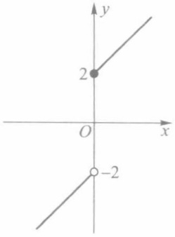
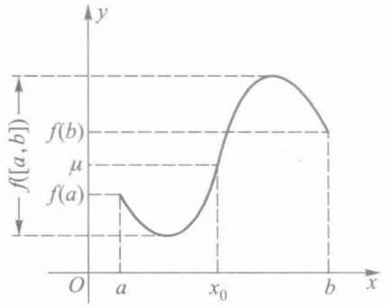
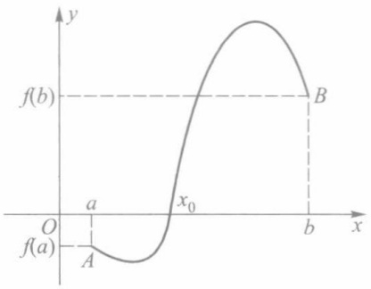
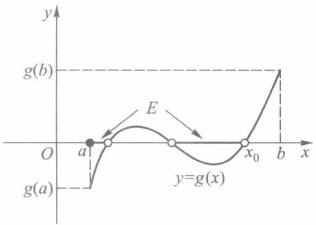
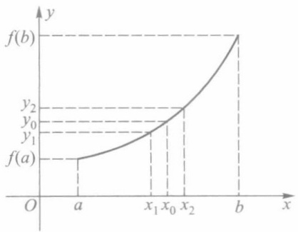
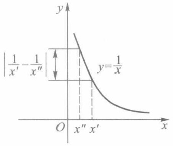

# 第4章 函数的连续性

原始 PDF 第 76–93 页。

## 第四章

## 函数的连续性

## § 1 连续性概念

连续函数是数学分析中着重讨论的一类函数.

从几何形象上粗略地说,连续函数在坐标平面上的图像是一条连绵不断的曲线.当然我们不能满足于这种直观的认识,而应给出函数连续性的精确定义,并由此出发研究连续函数的性质.本节中先定义函数在一点的连续性和在区间上的连续性.

## 一、函数在一点的连续性

定义1 设函数 $f$ 在某 $U(x_0)$ 上有定义. 若

$$
\lim _ {x \to x _ {0}} f (x) = f (x _ {0}), \tag {1}
$$

则称 f 在点  $x_{0}$  连续.

例如,函数 $f(x)=2x+1$ 在点x=2连续,因为

$$
\lim _ {x \to 2} f (x) = \lim _ {x \to 2} (2 x + 1) = 5 = f (2).
$$

又如,函数

$$
f (x) = \left\{ \begin{array}{c l} x \sin \frac {1}{x}, & x \neq 0, \\ 0, & x = 0 \end{array} \right.
$$

在点 $x = 0$ 连续，因为

$$
\lim _ {x \to 0} f (x) = \lim _ {x \to 0} x \sin \frac {1}{x} = 0 = f (0).
$$

为引入函数 $y = f(x)$ 在点 $x_0$ 连续的另一种表述，记 $\Delta x = x - x_0$，称为自变量 $x$ （在点 $x_0$）的增量或改变量。设 $y_0 = f(x_0)$，相应的函数 $y$ （在点 $x_0$）的增量记为

$$
\Delta y = f (x) - f (x _ {0}) = f (x _ {0} + \Delta x) - f (x _ {0}) = y - y _ {0}.
$$

注 自变量的增量  $\Delta x$  或函数的增量  $\Delta y$  可以是正数,也可以是 0 或负数.

引进了增量的概念之后,易见“函数  $y=f(x)$  在点  $x_{0}$  连续”等价于

$$
\lim _ {\Delta x \to 0} \Delta y = 0.
$$

由于函数在一点的连续性是通过极限来定义的,因而也可直接用  $\varepsilon-\delta$  方式来叙述,即:若对任给的  $\varepsilon>0$ ,存在  $\delta>0$ ,使得当  $\left|x-x_{0}\right|<\delta$  时,有

65

---

第四章 函数的连续性

$$
\mid f (x) - f (x _ {0}) \mid <   \varepsilon , \tag {2}
$$

则称函数 f 在点  $x_{0}$  连续.

由上述定义,我们可得出函数f在点 $x_{0}$ 有极限与f在 $x_{0}$ 连续这两个概念之间的联系.首先,f在点 $x_{0}$ 有极限是f在 $x_{0}$ 连续的必要条件;进一步说,“f在点 $x_{0}$ 连续”不仅要求f在点 $x_{0}$ 有极限,而且要求其极限值应等于f在 $x_{0}$ 的函数值 $f(x_{0})$ .其次,在讨论极限时,我们假定f在点 $x_{0}$ 的某空心邻域 $U^{\circ}(x_{0})$ 上有定义(f在点 $x_{0}$ 可以没有定义),而“f在点 $x_{0}$ 连续”则要求f在某 $U(x_{0})$ 上(包括点 $x_{0}$ )有定义,此时由于(2)式当 $x=x_{0}$ 时总是成立的,所以在极限定义中的“ $0<|x-x_{0}|<\delta$ ”换成了在连续定义中的“ $|x-x_{0}|<\delta$ ”.最后,(1)式又可表示为

$$
\lim _ {x \to x _ {0}} f (x) = f (\lim _ {x \to x _ {0}} x),
$$

可见“f在点 $x_{0}$ 连续”意味着极限运算 $\lim_{x\to x_{0}}$ 与对应法则f的可交换性.

例 1 证明函数  $f(x)=xD(x)$  在点 x=0 连续, 其中  $D(x)$  为狄利克雷函数.

证 由 $f(0) = 0$ 及 $\mid D(x)\mid \leqslant 1$ ，对任给的 $\varepsilon >0$ ，为使

$$
\mid f (x) - f (0) \mid = \mid x D (x) \mid \leqslant \mid x \mid <   \varepsilon ,
$$

只要取  $\delta=\varepsilon$ ，即可按  $\varepsilon-\delta$  定义推得 f 在点 x=0 连续.

相应于 f 在点  $x_{0}$  的左、右极限的概念, 我们给出左、右连续的定义如下.

定义2 设函数 $f$ 在某 $U_{+}(x_{0})(U_{-}(x_{0}))$ 有定义.若

$$
\lim _ {x \to x _ {0} ^ {+}} f (x) = f (x _ {0}) \left(\lim _ {x \to x _ {0} ^ {-}} f (x) = f (x _ {0})\right),
$$

则称 f 在点  $x_{0}$  右(左)连续.

根据上述定义1与定义2,不难推出如下定理.

定理 4.1 函数 f 在点  $x_{0}$  连续的充要条件是: f 在点  $x_{0}$  既是右连续, 又是左连续.

例2 讨论函数

$$
f (x) = \left\{ \begin{array}{l l} x + 2, & x \geqslant 0, \\ x - 2, & x <   0 \end{array} \right.
$$

在点 x=0 的连续性.

解 因为

$$
\lim _ {x \to 0 ^ {+}} f (x) = \lim _ {x \to 0 ^ {+}} (x + 2) = 2,
$$

$$
\lim _ {x \to 0 ^ {-}} f (x) = \lim _ {x \to 0 ^ {-}} (x - 2) = - 2,
$$

而 $f(0) = 2$ ，所以 $f$ 在点 $x = 0$ 右连续，但不左连续，从而它在 $x = 0$ 不连续（见图4-1）.

text_image

y
2
O x
-2

图4-1

## 二、间断点及其分类

定义3 设函数 $f$ 在某 $U^{\circ}(x_0)$ 上有定义. 若 $f$ 在点 $x_0$ 无定义, 或 $f$ 在点 $x_0$ 有定义而不连续, 则称点 $x_0$ 为函数 $f$ 的间断点或不连续点.

按此定义以及上一段中关于极限与连续性之间联系的讨论, 可知若  $x_{0}$  为函数 f 的间断点, 则必出现下列情形之一:

(i) $f$ 在点 $x_0$ 无定义或极限 $\lim_{x\to x_0}f(x)$ 不存在；

66

---

§ 1 连续性概念

(ii) $f$ 在点 $x_0$ 有定义且极限 $\lim_{x\to x_0}f(x)$ 存在①，但 $\lim_{x\to x_0}f(x)\neq f(x_0)$

据此,我们对函数的间断点作如下分类.

1. 可去间断点 若

$$
\lim _ {x \to x _ {0}} f (x) = A,
$$

而 $f$ 在点 $x_0$ 无定义，或有定义但 $f(x_0) \neq A$ ，则称点 $x_0$ 为 $f$ 的可去间断点.

例如,对于函数  $f(x)=\left|\operatorname{sgn}x\right|$ , 因  $f(0)=0$ , 而

$$
\lim _ {x \to 0} f (x) = 1 \neq f (0),
$$

故点 $x = 0$ 为 $f(x) = |\operatorname{sgn} x|$ 的可去间断点. 又如函数 $g(x) = \frac{\sin x}{x}$, 由于 $\lim_{x \to 0} g(x) = 1$, 而 $g$ 在 $x = 0$ 无定义, 所以点 $x = 0$ 是函数 $g$ 的可去间断点.

设点 $x_0$ 为函数 $f$ 的可去间断点，且 $\lim_{x\to x_0}f(x) = A.$ 我们按如下方法定义一个函数 $\hat{f}$ :当 $x\neq x_0$ 时， $\hat{f} (x) = f(x)$ ；当 $x = x_0$ 时， $\hat{f} (x_0) = A.$ 易见，对于函数 $\hat{f}$ ，点 $x_0$ 是它的连续点.例如，对上述的 $g(x) = \frac{\sin{x}}{x}$ ，我们定义

$$
\hat {g} (x) = \left\{ \begin{array}{c l} \frac {\sin x}{x}, & x \neq 0, \\ 1, & x = 0, \end{array} \right.
$$

则  $\hat{g}$  在点 x=0 连续.

2. 跳跃间断点 若函数 f 在点  $x_{0}$  的左、右极限都存在, 但

$$
\lim _ {x \to x _ {0} ^ {+}} f (x) \neq \lim _ {x \to x _ {0} ^ {-}} f (x),
$$

则称点 $x_0$ 为函数 $f$ 的跳跃间断点.

例如,对函数 $f(x)=[x]$ （图1-5），当 $x=n(n$ 为整数）时，有

$$
\lim _ {x \to n ^ {-}} [ x ] = n - 1, \lim _ {x \to n ^ {+}} [ x ] = n,
$$

所以在整数点上函数 $f$ 的左、右极限不相等，从而整数点都是函数 $f(x) = [x]$ 的跳跃间断点. 又如符号函数 $\operatorname{sgn} x$ 在 $x = 0$ 处的左、右极限分别为-1和1，故 $x = 0$ 是 $\operatorname{sgn} x$ 的跳跃间断点（图1-1）.

可去间断点和跳跃间断点统称为第一类间断点.第一类间断点的特点是函数在该点处的左、右极限都存在.

3. 函数的所有其他形式的间断点, 即使得函数至少有一侧极限不存在的那些点, 称为第二类间断点.

例如, 函数  $y=\frac{1}{x}$  当  $x\to0$  时不存在有限的极限, 故 x=0 是  $y=\frac{1}{x}$  的第二类间断点. 函数  $\sin\frac{1}{x}$  在 x=0 处左、右极限都不存在, 故 x=0 是  $\sin\frac{1}{x}$  的第二类间断点. 又如, 对于狄利克雷函数  $D(x)$ , 其定义域 R 上每一点 x 都是第二类间断点.

<small>① 这里所说的极限存在是指存在有限极限,即不包括非正常极限.</small>

67

---

第四章 函数的连续性

## 三、区间上的连续函数

若函数 $f$ 在区间 $I$ 上的每一点都连续, 则称 $f$ 为 $I$ 上的连续函数. 对于闭区间或半开半闭区间的端点, 函数在这些点上连续是指左连续或右连续.

例如, 函数 $y = c, y = x, y = \sin x$ 和 $y = \cos x$ 都是 $\mathbf{R}$ 上的连续函数. 又如函数 $y = \sqrt{1 - x^2}$ 在 $(-1, 1)$ 上的每一点都连续, 在 $x = 1$ 为左连续, 在 $x = -1$ 为右连续, 因而它在 $[-1, 1]$ 上连续.

若函数 $f$ 在区间 $[a, b]$ 上仅有有限个第一类间断点，则称 $f$ 在 $[a, b]$ 上分段连续。例如，函数 $y = [x]$ 和 $y = x - [x]$ 在区间 $[-3, 3]$ 上是分段连续的。

在 §3 中我们将证明任何初等函数在其定义区间上为连续函数. 同时, 也存在着在其定义区间上每一点都不连续的函数, 如前面已提到的狄利克雷函数.

例 3 证明: 黎曼函数

$$
R (x) = \left\{ \begin{array}{l l} \frac {1}{q}, & \text {当} x = \frac {p}{q} \bigg (p, q \text {为正整数}, \frac {p}{q} \text {为既约真分数} \bigg), \\ 0, & \text {当} x = 0, 1 \text {及} (0, 1) \text {上的无理数} \end{array} \right.
$$

在 $(0,1)$ 上任何无理点都连续,任何有理点都不连续.

证 设  $\xi\in(0,1)$  为无理数.任给  $\varepsilon>0\left(\text{不妨设 }\varepsilon<\frac{1}{2}\right)$ ，满足  $\frac{1}{q}\geqslant\varepsilon$  的正整数 q 显然只有有限个（但至少有一个，如 q=2），从而使  $R(x)\geqslant\varepsilon$  的有理数  $x\in(0,1)$  只有有限个（至少有一个，如  $\frac{1}{2}$ ），设为  $x_{1},\cdots,x_{n}$ .取

$$
\delta = \min \left\{\mid x _ {1} - \xi \mid , \dots , \mid x _ {n} - \xi \mid , \xi , 1 - \xi \right\},
$$

则对任何 $x \in U(\xi; \delta) ( \subset (0,1))$，当 $x$ 为有理数时，有 $R(x) < \varepsilon$，当 $x$ 为无理数时，有 $R(x) = 0$。于是，对任何 $x \in U(\xi; \delta)$，总有

$$
\mid R (x) - R (\xi) \mid = R (x) <   \varepsilon .
$$

这就证明了  $R(x)$  在无理点  $\xi$  连续.

现设 $\frac{p}{q}$ 为(0,1)上任一有理数.取 $\varepsilon_0 = \frac{1}{2q}$, 对任何正数 $\delta$ (无论多么小), 在 $U\left(\frac{p}{q}; \delta\right)$ 内总可取到无理数 $x (\in (0,1))$, 使得

$$
\left| R (x) - R \bigg (\frac {p}{q} \bigg) \right| = \frac {1}{q} > \varepsilon_ {0}.
$$

所以  $R(x)$  在任何有理点都不连续.

## 习题 4.1

1. 按定义证明下列函数在其定义域内连续:

(1)  $f(x)=\frac{1}{x}$ ;

(2) $f(x) = |x|$.

2. 指出下列函数的间断点并说明其类型:

68

---

§ 2 连续函数的性质

(1)  $f(x)=x+\frac{1}{x}$ ; (2)  $f(x)=\frac{\sin x}{|x|}$ ;

(3)  $f(x) = \left[ \left| \cos x \right| \right]$ ; (4)  $f(x) = \operatorname{sgn} |x|$ ;

(5)  $f(x)=\mathrm{sgn}(\cos x)$ ; (6)  $f(x)=\left\{\begin{aligned}&x,&x\text{为有理数},\\ &-x,&x\text{为无理数};\end{aligned}\right.$

(7) $f(x) = \begin{cases} \frac{1}{x + 7}, & -\infty < x < -7, \\ x, & -7 \leqslant x \leqslant 1, \\ (x - 1)\sin \frac{1}{x - 1}, & 1 < x < +\infty. \end{cases}$

3. 延拓下列函数,使其在 R 上连续:

(1)  $f(x) = \frac{x^{3} - 8}{x - 2}$ ;

(2)  $f(x) = \frac{1 - \cos x}{x^{2}}$ ;

(3) $f(x) = x \cos \frac{1}{x}$.

4. 证明: 若 $f$ 在点 $x_0$ 连续, 则 $\left|f\right|$ 与 $f^2$ 也在点 $x_0$ 连续. 又问: 若 $\left|f\right|$ 或 $f^2$ 在 $I$ 上连续, 那么 $f$ 在 $I$ 上是否必连续?

5. 设当 $x \neq 0$ 时, $f(x) \equiv g(x)$, 而 $f(0) \neq g(0)$. 证明: $f$ 与 $g$ 两者中至多有一个在 $x = 0$ 连续.

6. 设 $f$ 为区间 $I$ 上的单调函数. 证明: 若 $x_0 \in I$ 为 $f$ 的间断点, 则 $x_0$ 必是 $f$ 的第一类间断点.

7. 设函数 $f$ 只有可去间断点, 定义

$$
g (x) = \lim _ {y \to x} f (y).
$$

证明 g 为连续函数.

8. 设 $f$ 为 $\mathbf{R}$ 上的单调函数, 定义

$$
g (x) = f (x + 0).
$$

证明 g 在 R 上每一点都右连续.

9. 举出定义在 $[0,1]$ 上分别符合下述要求的函数:

(1) 只在 $\frac{1}{2}$, $\frac{1}{3}$ 和 $\frac{1}{4}$ 三点不连续的函数；

(2) 只在 $\frac{1}{2},\frac{1}{3}$ 和 $\frac{1}{4}$ 三点连续的函数；

(3) 只在 $\frac{1}{n}(n=1,2,3,\cdots)$ 上间断的函数；

(4) 只在 x=0 右连续, 而在其他点都不连续的函数.

## § 2 连续函数的性质

## 一、连续函数的局部性质

若函数 f 在点  $x_{0}$  连续，则 f 在点  $x_{0}$  有极限，且极限值等于函数值  $f(x_{0})$ . 从而，根据函数极限的性质能推断出函数 f 在  $U(x_{0})$  的性态.

定理 4.2(局部有界性) 若函数 f 在点  $x_{0}$  连续, 则 f 在某  $U(x_{0})$  上有界.

定理 4.3(局部保号性) 若函数 f 在点  $x_{0}$  连续, 且  $f(x_{0}) > 0$  (或 <0), 则对任何正

69

---

第四章 函数的连续性

数 $r < f(x_0)$ （或 $r < -f(x_0)$ ），存在某 $U(x_0)$，使得对一切 $x \in U(x_0)$，有

$$
f (x) > r (\text {或} f (x) <   - r).
$$

注 在具体应用局部保号性时, 常取  $r=\frac{1}{2}f(x_{0})$ , 则 (当  $f(x_{0})>0$  时) 存在某  $U(x_{0})$ , 使在其上有  $f(x)>\frac{1}{2}f(x_{0})$ .

定理 4.4(四则运算) 若函数 f 和 g 在点  $x_{0}$  连续, 则  $f \pm g, f \cdot g, f / g$  (这里  $g(x_{0}) \neq 0$ ) 也都在点  $x_{0}$  连续.

以上三个定理的证明,都可从函数极限的有关定理直接推得.

对常量函数 y=c 和函数 y=x 反复应用定理 4.4, 能推出多项式函数

$$
P (x) = a _ {0} x ^ {n} + a _ {1} x ^ {n - 1} + \dots + a _ {n - 1} x + a _ {n}
$$

和有理函数 $R(x) = \frac{P(x)}{Q(x)}$ ($P, Q$ 为多项式)在其定义域的每一点都是连续的. 同样, 由 $\sin x$ 和 $\cos x$ 在 $\mathbf{R}$ 上的连续性, 可推得 $\tan x$ 与 $\cot x$ 在其定义域的每一点都连续.

关于复合函数的连续性,有如下定理.

定理 4.5 若函数 f 在点  $x_{0}$  连续, g 在点  $u_{0}$  连续,  $u_{0}=f(x_{0})$ , 则复合函数  $g \circ f$  在点  $x_{0}$  连续.

证 由于 $g$ 在 $u_0$ 连续，对任给的 $\varepsilon > 0$ ，存在 $\delta_1 > 0$ ，使得当 $|u - u_0| < \delta_1$ 时，有

$$
\mid g (u) - g (u _ {0}) \mid <   \varepsilon . \tag {1}
$$

又由 $u_0 = f(x_0)$ 及 $u = f(x)$ 在点 $x_0$ 连续，故对上述 $\delta_1 > 0$ ，存在 $\delta > 0$ ，使得当 $|x - x_0| < \delta$ 时，有 $|u - u_0| = |f(x) - f(x_0)| < \delta_1.$ 联系(1)得:对任给的 $\varepsilon > 0$ ，存在 $\delta > 0$ ，当 $|x - x_0| < \delta$ 时，有

$$
\mid g (f (x)) - g (f (x _ {0})) \mid <   \varepsilon .
$$

这就证明了  $g \circ f$  在点  $x_{0}$  连续.

注 根据连续性的定义,上述定理的结论可表为

$$
\lim _ {x \to x _ {0}} g (f (x)) = g (\lim _ {x \to x _ {0}} f (x)) = g (f (x _ {0})). \tag {2}
$$

例 1 求  $\lim_{x\to1}\sin\left(1-x^{2}\right)$ .

解 $\sin (1 - x^2)$ 可看作函数 $g(u) = \sin u$ 与 $f(x) = 1 - x^2$ 的复合.由(2)式得

$$
\lim _ {x \to 1} \sin (1 - x ^ {2}) = \sin (\lim _ {x \to 1} (1 - x ^ {2})) = \sin 0 = 0.
$$

注 若复合函数 $g \circ f$ 的内函数 $f$ 当 $x \to x_0$ 时极限为 $a$, 而 $a \neq f(x_0)$ 或 $f$ 在 $x_0$ 无定义（即 $x_0$ 为 $f$ 的可去间断点），又外函数 $g$ 在 $u = a$ 连续，则我们仍可用上述定理来求复合函数的极限，即有

$$
\lim _ {x \to x _ {0}} g (f (x)) = g (\lim _ {x \to x _ {0}} f (x)). \tag {3}
$$

读者还可证明:(3)式不仅对于 $x \to x_0$ 这种类型的极限成立，而且对于 $x \to +\infty, x \to -\infty$ 或 $x \to x_0^\pm$ 等类型的极限也是成立的.

例 2 求极限:

(1) $\lim_{x\to 0}\sqrt{2 - \frac{\sin x}{x}};$ (2) $\lim_{x\to \infty}\sqrt{2 - \frac{\sin x}{x}}.$

70

---

§ 2 连续函数的性质

解 （1） $\lim_{x\to0}\sqrt{2-\frac{\sin x}{x}}=\sqrt{2-\lim_{x\to0}\frac{\sin x}{x}}=\sqrt{2-1}=1;$

(2) $\lim_{x\to \infty}\sqrt{2 - \frac{\sin x}{x}} = \sqrt{2 - \lim_{x\to\infty}\frac{\sin x}{x}} = \sqrt{2 - 0} = \sqrt{2}.$

## 二、闭区间上连续函数的基本性质

设f为闭区间 $[a,b]$ 上的连续函数,本段中我们讨论f在 $[a,b]$ 上的整体性质.

定义1 设 $f$ 为定义在数集 $D$ 上的函数. 若存在 $x_0 \in D$, 使得对一切 $x \in D$, 有

$$
f (x _ {0}) \geqslant f (x) (f (x _ {0}) \leqslant f (x)),
$$

则称 $f$ 在 $D$ 上有最大（最小）值，并称 $f(x_0)$ 为 $f$ 在 $D$ 上的最大（最小）值.

例如，$\sin x$ 在 $[0, \pi]$ 上有最大值1，最小值0。但一般而言，函数 $f$ 在其定义域 $D$ 上不一定有最大值或最小值（即使 $f$ 在 $D$ 上有界）。如 $f(x) = x$ 在 $(0, 1)$ 上既无最大值也无最小值。又如

$$
g (x) = \left\{ \begin{array}{l l} \frac {1}{x}, & x \in (0, 1), \\ 2, & x = 0 \text {与} 1, \end{array} \right. \tag {4}
$$

它在闭区间 $[0,1]$ 上也无最大、最小值.下述定理给出了函数能取得最大、最小值的充分条件.

定理 4.6(最大、最小值定理) 若函数 f 在闭区间  $[a, b]$  上连续，则 f 在  $[a, b]$  上有最大值与最小值.

为了更好地证明这个定理,我们先证明一个引理.

引理(有界性定理) 若函数 $f(x)$ 在闭区间 $[a,b]$ 上连续,那么 $f(x)$ 在闭区间 $[a,b]$ 上有界.

证 若不然,不妨假设 $f(x)$ 在 $[a,b]$ 上无上界.那么存在 $x_{n}\in[a,b]$ ,使得

$$
f (x _ {n}) > n, \quad n = 1, 2, \dots .
$$

由此得 $\lim_{n\to \infty}f(x_n) = +\infty$ .另一方面，因为 $\{x_{n}\} (\subset [a,b])$ 是有界数列，所以由致密性定理， $\{x_{n}\}$ 有收敛的子列 $\{x_{n_k}\}$ ，设 $\lim_{k\to \infty}x_{n_k} = x_0$

由于

$$
a \leqslant x _ {n _ {k}} \leqslant b,
$$

由极限的不等式性质推得

$$
a \leqslant x _ {0} \leqslant b,
$$

故 $f(x)$ 在点 $x_0$ 连续.由归结原则导出

$$
+ \infty = \lim _ {n \to \infty} f (x _ {n}) = \lim _ {k \to \infty} f (x _ {n _ {k}}) = \lim _ {x \to x _ {0}} f (x) = f (x _ {0}),
$$

矛盾.

定理 4.6 的证明 由引理和确界原理, 存在上确界

$$
\sup _ {x \in [ a, b ]} f (x) = M.
$$

下面来证明:存在  $\xi\in[a,b]$ ，使  $f(\xi)=M$ 。倘若不然，对一切  $x\in[a,b]$ ，都有  $f(x)<M$ 。令

$$
g (x) = \frac {1}{M - f (x)}, \quad x \in [ a, b ].
$$

71

---

第四章 函数的连续性

易见函数 $g$ 在 $[a,b]$ 上连续，且取正值，故 $g$ 在 $[a,b]$ 上有上界，记为 $G$. 则有

$$
0 <   g (x) = \frac {1}{M - f (x)} \leqslant G, \quad x \in [ a, b ].
$$

从而推得

$$
f (x) \leqslant M - \frac {1}{G}, \quad x \in [ a, b ].
$$

但这与 $M$ 为 $f([a,b])$ 的上确界相矛盾.所以必有 $\xi \in [a,b]$ ，使 $f(\xi) = M$ ，即 $f$ 在 $[a,b]$ 上有最大值.

同理可证 $f$ 在 $[a,b]$ 上有最小值.

注 函数 $f(x) = x, x \in (0,1)$ 既没有最大值也没有最小值.

定理4.7（介值性定理）设函数 $f$ 在闭区间 $[a, b]$ 上连续，且 $f(a) \neq f(b)$. 若 $\mu$ 为介于 $f(a)$ 与 $f(b)$ 之间的任何实数 $(f(a) < \mu < f(b)$ 或 $f(a) > \mu > f(b))$，则至少存在一点 $x_0 \in (a, b)$，使得

$$
f (x _ {0}) = \mu .
$$

这个定理表明, 若 f 在  $[a, b]$  上连续, 又不妨设  $f(a) < f(b)$ , 则 f 在  $[a, b]$  上必能取得区间  $[f(a), f(b)]$  上的一切值, 即有

$$
[ f (a), f (b) ] \subset f ([ a, b ]),
$$

其几何意义如图 4-2 所示. 下面的推论是定理 4.7 的等价命题.

推论（根的存在定理）若函数 $f$ 在闭区间 $[a, b]$ 上连续，且 $f(a)$ 与 $f(b)$ 异号（即 $f(a)f(b) < 0$），则至少存在一点 $x_0 \in (a, b)$，使得

$$
f (x _ {0}) = 0,
$$

即方程 $f(x) = 0$ 在 $(a, b)$ 上至少有一个根.

这个推论的几何解释如图4-3所示:若点 $A(a,f(a))$ 与 $B(b,f(b))$ 分别在x轴的两侧,则连接A,B的连续曲线 $y=f(x)$ 与x轴至少有一个交点.

line

| X | Y |
| --- | --- |
| a | f(a) |
| x0 | \(\mu\) |
| b | f(b) |

图4-2

line

| Point | X-coordinate | Y-coordinate |
| --- | --- | --- |
| A | a | f(a) |
| x0 | x0 | 0 |
| b | b | f(b) |

图4-3

应用介值性定理,我们还容易推得连续函数的下述性质:若f在区间I上连续且不是常量函数,则值域 $f(I)$ 也是一个区间;特别地,若I为闭区间 $[a,b]$ ,f在 $[a,b]$ 上的最大值为M,最小值为m,则 $f([a,b])=[m,M]$ ;又若f为 $[a,b]$ 上的递增(递减)连续函数且不为常数,则

$$
f (\left[ a, b \right]) = \left[ f (a), f (b) \right] \left(\left[ f (b), f (a) \right]\right).
$$

定理4.7的证明 不妨设 $f(a) < \mu < f(b)$. 令 $g(x) = f(x) - \mu$, 则 $g$ 也是 $[a, b]$ 上的连

72

---

§ 2 连续函数的性质

续函数,且  $g(a)<0, g(b)>0$ . 于是定理的结论转化为: 存在  $x_{0}\in(a,b)$ , 使得  $g(x_{0})=0$  (即上述推论). 设集合(见图4-4)

$$
E = \{x \mid g (x) <   0, x \in [ a, b ] \}.
$$

显然 E 为非空有界数集  $(E \subset [a, b]$ ，且  $a \in E)$ ，故由确界原理，存在上确界  $x_{0} = \sup E$ 。另一方面，因  $g(a) < 0$ ， $g(b) > 0$ ，由连续函数的局部保号性，存在  $\delta > 0$ ，使得

line

| Point | x-coordinate | y-coordinate |
| --- | --- | --- |
| A | a | g(a) |
| B | x0 | g(b) |

图4-4

$$
g (x) <   0, x \in [ a, a + \delta); g (x) > 0, x \in (b - \delta , b ].
$$

由此易见 $x_0 \neq a, x_0 \neq b$，即 $x_0 \in (a, b)$.

下证 $g(x_0) = 0$. 倘若 $g(x_0) \neq 0$, 不妨设 $g(x_0) < 0$. 再由局部保号性, 存在 $U(x_0; \eta) (\subset (a, b))$, 使在其上 $g(x) < 0$, 特别有 $g\left(x_0 + \frac{\eta}{2}\right) < 0 \Rightarrow x_0 + \frac{\eta}{2} \in E$. 但这与 $x_0 = \sup E$ 相矛盾, 故必有 $g(x_0) = 0$.

例 3 设 a>0, n 是正整数. 证明: 方程  $x^{n}=a$  有唯一的正数解.

在第一章 §3 例 2 中给出了该题 n=2 情形的证明, 现在用介值性定理来证明一般的情形.

证 先证存在性.由于当 $x \to +\infty$ 时,有 $x^n \to +\infty$,故必存在正数 $b$,使得 $b^n > a$.因$f(x) = x^n$ 在 $[0,b]$ 上连续,并有 $f(0) < a < f(b)$,故由介值性定理,至少存在一点 $x_0 \in (0,b)$,使得 $f(x_0) = x_0^n = a$.

再证唯一性.设正数 $x_{1}$ 使得 $x_{1}^{n} = a$ ，则有

$$
x _ {0} ^ {n} - x _ {1} ^ {n} = (x _ {0} - x _ {1}) (x _ {0} ^ {n - 1} + x _ {0} ^ {n - 2} x _ {1} + \dots + x _ {1} ^ {n - 1}) = 0,
$$

由于第二个括号内的数为正,所以只能  $x_{0}-x_{1}=0$ , 即  $x_{1}=x_{0}$ .

例 4 设 f 在  $[a, b]$  上连续, 满足

$$
f ([ a, b ]) \subset [ a, b ]. \tag {5}
$$

证明:存在  $x_{0} \in [a, b]$ ，使得

$$
f (x _ {0}) = x _ {0}. \tag {6}
$$

证 条件(5)意味着:对任何  $x \in [a, b]$ ，有  $a \leqslant f(x) \leqslant b$ ，特别有

$$
a \leqslant f (  a  ) \quad {\text {以及}} \quad f (  b  ) \leqslant b.
$$

若 $a = f(a)$ 或 $f(b) = b$ ，则取 $x_0 = a$ 或 $b$ ，从而(6)式成立.现设 $a <   f(a)$ 与 $f(b) <   b.$ 令

$$
F (x) = f (x) - x,
$$

则 $F(a) = f(a) - a > 0, F(b) = f(b) - b < 0.$ 故由根的存在性定理，存在 $x_0 \in (a, b)$，使得 $F(x_0) = 0$，即 $f(x_0) = x_0$.

从本例的证明过程可见,在应用介值性定理或根的存在性定理证明某些问题时,选取合适的辅助函数(如在本例中令  $F(x)=f(x)-x$ ), 可收到事半功倍的效果.

## 三、反函数的连续性

定理4.8 若函数 $f$ 在 $[a, b]$ 上严格单调并连续，则反函数 $f^{-1}$ 在其定义域 $[f(a), f(b)]$ 或 $[f(b), f(a)]$ 上连续.

73

---

第四章 函数的连续性

证 不妨设 $f$ 在 $[a, b]$ 上严格增. 此时 $f$ 的值域即反函数 $f^{-1}$ 的定义域为 $[f(a), f(b)]$. 任取 $y_0 \in (f(a), f(b))$, 设 $x_0 = f^{-1}(y_0)$, 则 $x_0 \in (a, b)$. 于是对任给的 $\varepsilon > 0$, 可在 $(a, b)$ 上 $x_0$ 的两侧各取异于 $x_0$ 的点 $x_1, x_2$ ($x_1 < x_0 < x_2$), 使它们与 $x_0$ 的距离小于 $\varepsilon$ (图4-5).

设与 $x_{1}, x_{2}$ 对应的函数值分别为 $y_{1}, y_{2}$, 由 $f$ 的严格增性知 $y_{1} < y_{0} < y_{2}$. 令

$$
\delta = \min \left\{y _ {2} - y _ {0}, y _ {0} - y _ {1} \right\},
$$

line

| Point | X-coordinate | Y-coordinate |
| --- | --- | --- |
| Start | a | f(a) |
| x1 | x1 | y1 |
| x0 | x0 | y0 |
| x2 | x2 | y2 |
| b | b | f(b) |

图4-5

则当 $y \in U(y_0; \delta)$ 时，对应的 $x = f^{-1}(y)$ 的值都落在 $x_1$ 与 $x_2$ 之间，故有

$$
\left| f ^ {- 1} (y) - f ^ {- 1} (y _ {0}) \right| = \left| x - x _ {0} \right| <   \varepsilon ,
$$

这就证明了 $f^{-1}$ 在点 $y_0$ 连续，从而 $f^{-1}$ 在 $(f(a), f(b))$ 上连续.

类似地可证 $f^{-1}$ 在其定义区间的端点 $f(a)$ 与 $f(b)$ 分别为右连续与左连续.所以 $f^{-1}$ 在 $[f(a), f(b)]$ 上连续.

例 5 由于  $y=\sin x$  在区间  $\left[-\frac{\pi}{2},\frac{\pi}{2}\right]$  上严格单调且连续, 故其反函数  $y=\arcsin x$  在区间  $[-1,1]$  上连续.

同理可得其他反三角函数也在相应的定义区间上连续.如 $y = \arccos x$ 在 $[-1,1]$ 上连续，$y = \arctan x$ 在 $(-\infty, +\infty)$ 上连续等.

例6 由于 $y = x^n$ ( $n$ 为正整数) 在 $[0, +\infty)$ 上严格单调且连续，其值域为 $[0, +\infty)$，故 $y = x^{\frac{1}{n}}$ 在 $[0, +\infty)$ 上连续。又若把 $y = x^{-\frac{1}{n}}$ ( $n$ 为正整数) 看作由 $y = u^{\frac{1}{n}}$ 与 $u = \frac{1}{x}$ 复合而成的函数，则由复合函数的连续性，$y = x^{-\frac{1}{n}}$ 在 $(0, +\infty)$ 上连续。

综上可知, 若 q 为非零整数, 则  $y = x^{\frac{1}{q}}$  是其定义区间上的连续函数.

例 7 证明:有理幂函数  $y=x^{\alpha}$  在其定义区间上连续.

证 设有理数 $\alpha = \frac{p}{q}$, 这里 $p, q (\neq 0)$ 为整数. 因为 $y = u^{\frac{1}{q}}$ 与 $u = x^p$ 均在其定义区间上连续, 所以复合函数

$$
y = (x ^ {p}) ^ {\frac {1}{q}} = x ^ {\alpha}
$$

也是其定义区间上的连续函数.

## 四、一致连续性

函数 f 在区间上连续, 是指 f 在该区间上每一点都连续. 本段中讨论的一致连续性概念反映了函数在区间上更强的连续性.

定义2 设 $f$ 为定义在区间 $I$ 上的函数. 若对任给的 $\varepsilon > 0$, 存在 $\delta = \delta(\varepsilon) > 0$, 使得对任何 $x', x'' \in I$, 只要 $|x' - x''| < \delta$, 就有

$$
\mid f (x ^ {\prime}) - f (x ^ {\prime \prime}) \mid <   \varepsilon ,
$$

则称函数 $f$ 在区间 $I$ 上一致连续.

直观地说，f 在 I 上一致连续意味着:不论两点  $x'$  与  $x''$  在 I 中处于什么位置，只要

74

---

§ 2 连续函数的性质

它们的距离小于 $\delta$ ，就可使 $|f(x') - f(x'')| < \varepsilon.$

例 8 证明  $f(x)=ax+b\quad(a\neq0)$  在  $(-∞,+∞)$  上一致连续.

证 任给 $\varepsilon > 0$ ，由于

$$
\mid f (x ^ {\prime}) - f (x ^ {\prime \prime}) \mid = \mid a \mid \mid x ^ {\prime} - x ^ {\prime \prime} \mid ,
$$

故可选取 $\delta = \frac{\varepsilon}{|a|}$，则对任何 $x', x'' \in (-\infty, +\infty)$，只要 $|x' - x''| < \delta$，就有

$$
\mid f (x ^ {\prime}) - f (x ^ {\prime \prime}) \mid <   \varepsilon .
$$

这就证得 $f(x) = ax + b$ 在 $(-\infty, +\infty)$ 上一致连续.

例 9 证明函数  $y=\frac{1}{x}$  在  $(0,1)$  上不一致连续（尽管它在  $(0,1)$  上每一点都连续）.

证 按一致连续性的定义,为证函数 f 在某区间 I 上不一致连续,只需证明:存在某  $\varepsilon_{0}>0$ , 对任何正数  $\delta$  (不论  $\delta$  多么小), 总存在两点  $x', x'' \in I$ , 尽管  $\left|x'-x''\right| < \delta$ , 但有  $\left|f(x') - f(x'')\right| \geqslant \varepsilon_{0}$ .

对于本例中函数 $y = \frac{1}{x}$，可取 $\varepsilon_0 = 1$，对无论多么小的正数 $\delta \left( <\frac{1}{2} \right)$，只要取 $x' = \delta$ 与 $x'' = \frac{\delta}{2}$ （图4-6），则虽有

$$
\mid x ^ {\prime} - x ^ {\prime \prime} \mid = \frac {\delta}{2} <   \delta ,
$$

但

$$
\left| \frac {1}{x ^ {\prime}} - \frac {1}{x ^ {\prime \prime}} \right| = \frac {1}{\delta} > 1,
$$

所以 $y = \frac{1}{x}$ 在(0,1)上不一致连续.

contour

| Feature | Description |
| --- | --- |
| Curve | y = 1/x |
| Horizontal Line | y = 1/x |
| Vertical Line | x'' |
| Lower Bound | (1/x' - 1/x'') |
| Upper Bound | (1/x' - 1/x'') |

图4-6

例10 函数 $f(x)$ 定义在区间 $I$ 上，试证 $f(x)$ 在 $I$ 上一致连续的充要条件为:对任何数列 $\{x_n'\}, \{x_n''\} \subset I$ ，若 $\lim_{n\to \infty}(x_n' - x_n'') = 0$ ，则

$$
\lim _ {n \to \infty} \left[ f (x _ {n} ^ {\prime}) - f (x _ {n} ^ {\prime \prime}) \right] = 0.
$$

证 必要性 若 $f(x)$ 在 $I$ 上一致连续, 则 $\forall \varepsilon > 0, \exists \delta(\varepsilon) > 0, \forall x', x'' \in I, |x' - x''| < \delta$, 则 $|f(x') - f(x'')| < \varepsilon$. 设 $I$ 上两个数列 $\{x_n'\}, \{x_n''\}$, 满足 $\lim_{n \to \infty} (x_n' - x_n'') = 0$, 于是对上述 $\delta > 0, \exists N > 0, \forall n > N, |x_n' - x_n''| < \delta$, 由一致连续性条件, 有

$$
\mid f (x _ {n} ^ {\prime}) - f (x _ {n} ^ {\prime \prime}) \mid <   \varepsilon ,
$$

即

$$
\lim _ {n \to \infty} \left[ f (x _ {n} ^ {\prime}) - f (x _ {n} ^ {\prime \prime}) \right] = 0.
$$

充分性 设对 $I$ 上任意两个数列 $\{x_{n}^{\prime}\}$ 与 $\{x_{n}^{\prime \prime}\}$, 若 $\lim_{n\to \infty}(x_n' - x_n'') = 0$, 则有 $\lim_{n\to \infty}[f(x_n') - f(x_n'')] = 0$. 现证 $f(x)$ 在 $I$ 上一致连续.

用反证法.若 $f(x)$ 在I上不一致连续,则

$\exists \varepsilon_0 > 0, \forall \delta > 0, \exists x', x''$, 满足 $|x' - x''| < \delta$, 但有 $|f(x') - f(x'')| \geqslant \varepsilon_0$.

75

---

第四章 函数的连续性

取 $\delta_{1} = 1, \exists x_{1}^{\prime}, x_{1}^{\prime \prime} \in I, |x_{1}^{\prime} - x_{1}^{\prime \prime}| < 1$，有 $|f(x_1') - f(x_1'')| \geqslant \varepsilon_0$

取 $\delta_2 = \frac{1}{2},\exists x_2',x_2''\in I,\mid x_2' - x_2''\mid <  \frac{1}{2}$ ，有 $|f(x_2') - f(x_2'')|\geqslant \varepsilon_0,$

... ... ... ... ... ... ...

取 $\delta_{n} = \frac{1}{n},\exists x_{n}^{\prime},x_{n}^{\prime \prime}\in I,\mid x_{n}^{\prime} - x_{n}^{\prime \prime}\mid <  \frac{1}{n}$ ，有 $\mid f(x_n^\prime) - f(x_n^{\prime \prime})\mid \geqslant \varepsilon_0$

... ... ... ... ... ... ...

于是 $\lim_{n\to \infty}(x_n' - x_n'') = 0$ ，但是 $\lim_{n\to \infty}[f(x_n') - f(x_n'')] \neq 0$ ，与所设条件矛盾.所以 $f(x)$ 在 $I$ 上一致连续.

例 11 证明  $f(x)=\sin\frac{1}{x}$  在区间  $(0,1)$  上不一致连续.

证 取  $x_{n}=\frac{1}{2n\pi}, y_{n}=\frac{1}{2n\pi+\frac{\pi}{2}}, n=1,2,\cdots$  虽然

$$
\lim _ {n \to \infty} (x _ {n} - y _ {n}) = 0,
$$

但是

$$
\left| \sin \frac {1}{x _ {n}} - \sin \frac {1}{y _ {n}} \right| = 1 \rightarrow 0,
$$

故由例 10 的结论推得  $\sin\frac{1}{x}$  在  $(0,1)$  上不一致连续.

函数在区间上的连续与一致连续这两个概念有着重要的差别. $f$ 在区间 $I$ 上连续，是指任给 $\varepsilon > 0$ ，对每一点 $x \in I$ ，都存在相应的正数 $\delta = \delta(\varepsilon, x)$，只要 $x' \in I$ 且 $|x - x'| < \delta$ 就有 $|f(x) - f(x')| < \varepsilon.$ 一般来说，对于 $I$ 上不同的点，相应的正数 $\delta$ 是不同的.换句话说，$\delta$ 的取值除依赖于 $\varepsilon$ 之外，还与点 $x$ 有关，由此我们写 $\delta = \delta(\varepsilon, x)$ 以表示 $\delta$ 与 $\varepsilon$ 和 $x$ 的依赖关系.如果能做到 $\delta$ 只与 $\varepsilon$ 有关，而与 $x$ 无关，或者说存在适合于 $I$ 上所有点 $x$ 的公共的 $\delta$ ，即 $\delta = \delta(\varepsilon)$，那么函数就不仅在 $I$ 上连续，而且是一致连续了.

所以，f 在区间 I 上一致连续是 f 的又一个整体性质，由它可推出 f 在 I 上每一点都连续的这一局部性质（只要在定义 2 中把  $x'$  看作定点，把  $x''$  看作动点，即得 f 在点  $x'$  连续）。而从例 9 可见，由 f 在区间 I 上每一点都连续，并不能推出 f 在 I 上一致连续。然而，对于定义在闭区间上的函数来说，由它在每一点都连续却可推出在区间上的一致连续性，即有如下重要定理:

定理 4.9(一致连续性定理) 若函数 f 在闭区间  $[a, b]$  上连续, 则 f 在  $[a, b]$  上一致连续.

证 若不然, 存在  $\varepsilon_{0}>0$ , 以及区间  $[a,b]$  上的点列  $\{x_{n}\},\{y_{n}\}$ , 虽然  $\lim_{n\to\infty}(x_{n}-y_{n})=0$ , 但是

$$
\mid f (x _ {n}) - f (y _ {n}) \mid \geqslant \varepsilon_ {0}, \quad n = 1, 2, \dots . \tag {7}
$$

因为 $\{x_{n}\}$ 有界，所以由致密性定理，$\{x_{n}\}$ 有一个收敛的子列 $\{x_{n_k}\}$. 设 $\lim_{k\to \infty}x_{n_k} = x_0$ ，从而

$$
\lim _ {k \to \infty} y _ {n _ {k}} = \lim _ {k \to \infty} \left[ (y _ {n _ {k}} - x _ {n _ {k}}) + x _ {n _ {k}} \right] = x _ {0},
$$

又 $a \leqslant x_{n_k} \leqslant b$，由极限的不等式性质推得 $a \leqslant x_0 \leqslant b$，故 $f(x)$ 在点 $x_0$ 连续。由归结原则与

76

---

§ 2 连续函数的性质

(7)式得

$$
\varepsilon_ {0} \leqslant \lim _ {k \to \infty} \left| f (x _ {n _ {k}}) - f (y _ {n _ {k}}) \right| = \left| f (x _ {0}) - f (x _ {0}) \right| = 0,
$$

矛盾.

例12 设区间 $I_{1}$ 的右端点为 $c \in I_{1}$, 区间 $I_{2}$ 的左端点也为 $c \in I_{2}(I_{1}, I_{2}$ 可分别为有限或无限区间). 试按一致连续性的定义证明: 若 $f$ 分别在 $I_{1}$ 和 $I_{2}$ 上一致连续, 则 $f$ 在 $I = I_{1} \cup I_{2}$ 上也一致连续.

证 任给 $\varepsilon > 0$，由 $f$ 在 $I_{1}$ 和 $I_{2}$ 上的一致连续性，分别存在正数 $\delta_{1}$ 和 $\delta_{2}$，使得对任何 $x', x'' \in I_{1}$，只要 $|x' - x''| < \delta_{1}$，就有

$$
\mid f (x ^ {\prime}) - f (x ^ {\prime \prime}) \mid <   \varepsilon ; \tag {8}
$$

又对任何 $x^{\prime}, x^{\prime \prime} \in I_{2}$, 只要 $|x^{\prime} - x^{\prime \prime}| < \delta_{2}$, 也有(8)式成立.

点 $x = c$ 作为 $I_{1}$ 的右端点，$f$ 在点 $c$ 为左连续，作为 $I_{2}$ 的左端点，$f$ 在点 $c$ 为右连续，所以 $f$ 在点 $c$ 连续.故对上述 $\varepsilon > 0$ ，存在 $\delta_{3} > 0$ ，当 $|x - c| < \delta_{3}$ 时，有

$$
\mid f (x) - f (c) \mid <   \frac {\varepsilon}{2}. \tag {9}
$$

令 $\delta = \min \{\delta_1, \delta_2, \delta_3\}$，对任何 $x', x'' \in I, |x' - x''| < \delta$，分别讨论以下两种情形:

(i)  $x'$ ,  $x''$  同时属于  $I_{1}$  或同时属于  $I_{2}$ ，则 (8) 式成立.
(ii) $x^{\prime}, x^{\prime \prime}$ 分属 $I_{1}$ 与 $I_{2}$, 设 $x^{\prime} \in I_{1}, x^{\prime \prime} \in I_{2}$, 则

$$
\mid x ^ {\prime} - c \mid = c - x ^ {\prime} <   x ^ {\prime \prime} - x ^ {\prime} <   \delta \leqslant \delta_ {3},
$$

故由(9)式得 $|f(x') - f(c)| < \frac{\varepsilon}{2}$. 同理得 $|f(x'') - f(c)| < \frac{\varepsilon}{2}$. 从而也有(8)式成立. 这就证明了 $f$ 在 $I$ 上一致连续.

## 习题 4.2

1. 讨论复合函数 $f \circ g$ 与 $g \circ f$ 的连续性，设

(1)  $f(x) = \operatorname{sgn} x$ ,  $g(x) = 1 + x^{2}$ ;
(2)  $f(x) = \operatorname{sgn} x$ ,  $g(x) = (1 - x^{2})x$ .

2. 设 $f, g$ 在点 $x_0$ 连续，证明:

(1) 若  $f(x_{0}) > g(x_{0})$ ，则存在  $U(x_{0}; \delta)$ ，使在其上有  $f(x) > g(x)$ ;
(2) 若在某  $U^{\circ}(x_{0})$  上有  $f(x) > g(x)$ ，则  $f(x_{0}) \geqslant g(x_{0})$ .

3. 设 $f, g$ 在区间 $I$ 上连续. 记

$$
F (x) = \max \left\{f (x), g (x) \right\}, G (x) = \min \left\{f (x), g (x) \right\}.
$$

证明 F 和 G 也都在 I 上连续.

提示: 利用第一章总练习题 1.

4. 设 $f$ 为 $\mathbf{R}$ 上连续函数, 常数 $c > 0$. 记

$$
F (x) = \left\{ \begin{array}{l l} - c, & f (x) <   - c, \\ f (x), & | f (x) | \leqslant c, \\ c, & f (x) > c. \end{array} \right.
$$

证明 F 在 R 上连续.

提示: $F(x)=\max\{-c,\min\{c,f(x)\}\}$ .

77

---

第四章 函数的连续性

5. 设 $f(x) = \sin x, g(x) = \begin{cases} x - \pi, & x \leqslant 0, \\ x + \pi, & x > 0. \end{cases}$ 证明:复合函数 $f \circ g$ 在 $x = 0$ 连续，但 $g$ 在 $x = 0$ 不连续.

6. 设 $f$ 在 $[a, +\infty)$ 上连续，且 $\lim_{x \to +\infty} f(x)$ 存在。证明:$f$ 在 $[a, +\infty)$ 上有界。又问 $f$ 在 $[a, +\infty)$ 上必有最大值或最小值吗？

7. 若对任何充分小的 $\varepsilon > 0, f$ 在 $[a + \varepsilon, b - \varepsilon]$ 上连续，能否由此推出 $f$ 在 $(a, b)$ 上连续？

8. 求极限:

(1) $\lim_{x\to \frac{\pi}{4}}(\pi -x)\tan x;$ (2) $\lim_{x\to 1^{+}}\frac{x\sqrt{1 + 2x} - \sqrt{x^2 - 1}}{x + 1}.$

9. 证明: 若 $f$ 在 $[a, b]$ 上连续, 且对任何 $x \in [a, b], f(x) \neq 0$, 则 $f$ 在 $[a, b]$ 上恒正或恒负.

10. 证明:任一实系数奇次方程至少有一个实根.

11. 试用一致连续的定义证明: 若 f, g 都在区间 I 上一致连续, 则  $f + g$  也在 I 上一致连续.

12. 证明 $f(x) = \sqrt{x}$ 在 $[0, +\infty)$ 上一致连续.

提示: $[0,+\infty)=[0,1]\cup[1,+\infty)$ ，利用定理4.9和例10的结论.

13. 证明: $f(x)=x^{2}$ 在 $[a,b]$ 上一致连续，但在 $(-∞,+∞)$ 上不一致连续.

14. 设函数 $f$ 在区间 $I$ 上满足利普希茨（Lipschitz）条件，即存在常数 $L > 0$ ，使得对 $I$ 上任意两点 $x', x''$ ，都有

$$
\left| f (x ^ {\prime}) - f (x ^ {\prime \prime}) \right| \leqslant L \left| x ^ {\prime} - x ^ {\prime \prime} \right|.
$$

证明 f 在 I 上一致连续.

15. 证明 $\sin x$ 在 $(- \infty, +\infty)$ 上一致连续.

提示: 利用不等式  $\left|\sin x' - \sin x''\right| \leqslant \left|x' - x''\right|$  (见第三章 §1 例 4).

16. 设函数 $f$ 满足第6题的条件. 证明 $f$ 在 $[a, +\infty)$ 上一致连续.

17. 设函数 $f$ 在 $[0, 2a]$ 上连续，且 $f(0) = f(2a)$. 证明:存在点 $x_0 \in [0, a]$，使得 $f(x_0) = f(x_0 + a)$.

18. 设 $f$ 为 $[a, b]$ 上的增函数，其值域为 $[f(a), f(b)]$. 证明 $f$ 在 $[a, b]$ 上连续.

19. 设 f 在  $[a, b]$  上连续， $x_{1}, x_{2}, \cdots, x_{n} \in [a, b]$ . 证明:存在  $\xi \in [a, b]$ ，使得

$$
f (\xi) = \frac {1}{n} [ f (x _ {1}) + f (x _ {2}) + \dots + f (x _ {n}) ].
$$

20. 证明 $f(x) = \cos \sqrt{x}$ 在 $[0, +\infty)$ 上一致连续.

提示: $[0, +\infty) = [0, 1] \cup [1, +\infty)$. 在 $[1, +\infty)$ 上成立不等式

$$
\left| \cos \sqrt {x ^ {\prime}} - \cos \sqrt {x ^ {\prime \prime}} \right| \leqslant \left| \sqrt {x ^ {\prime}} - \sqrt {x ^ {\prime \prime}} \right| \leqslant \left| x ^ {\prime} - x ^ {\prime \prime} \right|.
$$

## § 3 初等函数的连续性

从前面两节知道,在基本初等函数中,三角函数、反三角函数以及有理指数幂函数都是其定义域上的连续函数.本节将讨论指数函数、对数函数与实指数幂函数的连续性,以及初等函数的连续性.

## 一、指数函数的连续性

在第一章中,我们已定义了实指数的乘幂,并证明了指数函数  $y=a^{x}\quad(0<a\neq1)$  在 R

78

---

§ 3 初等函数的连续性

上是严格单调的.下面先把关于有理指数幂的一个重要性质推广到实指数幂,然后证明指数函数的连续性.

定理 4.10 设  $a>0,\alpha,\beta$  为任意两个实数, 则有

$$
a ^ {\alpha} \cdot a ^ {\beta} = a ^ {\alpha + \beta}, \quad (a ^ {\alpha}) ^ {\beta} = a ^ {\alpha \beta}.
$$

证 不妨设 $a > 1$ ，由 $a^x$ 的定义(第一章 §3 定义2)，即有

$$
a ^ {x} = \sup _ {r \leqslant x} \{a ^ {r} \mid r \text {为有理数} \}.
$$

依据上确界定义,任给  $\varepsilon>0$ , 存在有理数  $r\leqslant\alpha$  和  $s\leqslant\beta$ , 使得

$$
a ^ {\alpha} - \varepsilon <   a ^ {r}, \quad a ^ {\beta} - \varepsilon <   a ^ {s}.
$$

由 $a^x$ 的严格递增性, 得

$$
a ^ {r + s} \leqslant a ^ {\alpha + \beta}.
$$

而由有理指数乘幂的性质,有  $a^{r} \cdot a^{s} = a^{r+s}$ , 故得

$$
(a ^ {\alpha} - \varepsilon) (a ^ {\beta} - \varepsilon) <   a ^ {r + s} \leqslant a ^ {\alpha + \beta}.
$$

由 $\varepsilon$ 的任意性, 可得

$$
a ^ {\alpha} \cdot a ^ {\beta} \leqslant a ^ {\alpha + \beta}.
$$

为证相反的不等式,同理存在有理数  $p \leqslant \alpha + \beta$ , 使得

$$
a ^ {\alpha + \beta} - \varepsilon <   a ^ {p}.
$$

再取有理数 $r \leqslant \alpha$ 和 $s \leqslant \beta$, 并使 $p \leqslant r + s$, 则有

$$
a ^ {p} \leqslant a ^ {r + s} = a ^ {r} \cdot a ^ {s} \leqslant a ^ {\alpha} \cdot a ^ {\beta}.
$$

由此得到 $a^{\alpha +\beta} - \varepsilon < a^p\leqslant a^\alpha \cdot a^\beta$ ，并由 $\varepsilon$ 的任意性，推得

$$
a ^ {\alpha + \beta} \leqslant a ^ {\alpha} \cdot a ^ {\beta}.
$$

这就证得 $a^{\alpha} \cdot a^{\beta} = a^{\alpha + \beta}$. 后一等式的证明留给读者.

定理 4.11 指数函数  $a^{x}$  (a>0) 在 R 上是连续的.

证 先设 $a > 1$. 由第三章 §2 例4知

$$
\lim _ {x \to 0} a ^ {x} = 1 = a ^ {0},
$$

这表明 $a^x$ 在 $x = 0$ 连续. 现任取 $x_0 \in \mathbf{R}$. 由定理4.10得

$$
a ^ {x} = a ^ {x _ {0} + (x - x _ {0})} = a ^ {x _ {0}} \cdot a ^ {x - x _ {0}}.
$$

令 $t = x - x_0$ ，则当 $x\to x_0$ 时有 $t\to 0$ ，从而有

$$
\lim _ {x \to x _ {0}} a ^ {x} = \lim _ {x \to x _ {0}} a ^ {x _ {0}} a ^ {x - x _ {0}} = a ^ {x _ {0}} \lim _ {t \to 0} a ^ {t} = a ^ {x _ {0}}.
$$

这就证明了 $a^x$ 在任一点 $x_0$ 连续.

当 $0 < a < 1$ 时，令 $b = \frac{1}{a}$，则有 $b > 1$，而

$$
a ^ {x} = \left(\frac {1}{b}\right) ^ {x} = b ^ {- x}
$$

可看作函数  $b^{u}$  与 u = -x 的复合, 所以此时  $a^{x}$  亦在 R 上连续.

利用指数函数  $a^{x}$  的连续性,以及第三章 §5 例 4 中已证明的

$$
\lim _ {x \to - \infty} a ^ {x} = 0, \lim _ {x \to + \infty} a ^ {x} = + \infty (a > 1),
$$

可知 $a^x$ 的值域为 $(0, +\infty)$ （$0 < a < 1$ 时也是如此). 于是，$a^x$ 的反函数——对数函数 $\log_a x$ 在其定义域 $(0, +\infty)$ 上也连续.

79

---

第四章 函数的连续性

例1 设 $\lim_{x\to x_0}u(x) = a > 0,\lim_{x\to x_0}v(x) = b.$ 证明

$$
\lim _ {x \to x _ {0}} u (x) ^ {v (x)} = a ^ {b}.
$$

证 补充定义 $u(x_0) = a, v(x_0) = b$，则 $u(x), v(x)$ 在点 $x_0$ 连续，从而 $v(x) \ln u(x)$ 在 $x_0$ 连续，所以 $u(x)^{v(x)} = \mathrm{e}^{v(x) \ln u(x)}$ 在 $x_0$ 连续. 由此得

$$
\lim _ {x \to x _ {0}} u (x) ^ {v (x)} = \lim _ {x \to x _ {0}} \mathrm{e} ^ {v (x) \ln u (x)} = \mathrm{e} ^ {b \ln a} = a ^ {b}.
$$

## 二、初等函数的连续性

由于幂函数  $x^{\alpha}$  ( $\alpha$  为实数) 可表为  $x^{\alpha}=e^{\alpha\ln x}$ ，它是函数  $e^{u}$  与  $u=\alpha\ln x$  的复合，故由指数函数与对数函数的连续性以及复合函数的连续性，推得幂函数  $y=x^{\alpha}$  在其定义域  $(0,+\infty)$  上连续.

前面已经指出,常量函数、三角函数、反三角函数都是其定义域上的连续函数,因此我们有下述定理:

定理 4.12 一切基本初等函数都是其定义域上的连续函数.

由于任何初等函数都是由基本初等函数经过有限次四则运算与复合运算所得到，所以有

定理 4.13 任何初等函数都是在其定义区间上的连续函数.

下面举两个利用函数的连续性求极限的例子.

例2 求 $\lim_{x\to 0}\frac{\ln(1 + x)}{x}.$

解 由对数函数的连续性有

原式 $= \lim_{x\to 0}\ln (1 + x)^{\frac{1}{x}} = \ln [\lim_{x\to 0}(1 + x)^{\frac{1}{x}}]$

$$
= \ln e = 1.
$$

例 3 求  $\lim_{x\to0}\frac{\ln(1+x^{2})}{\cos x}$ .

解 由于 $x = 0$ 在初等函数 $f(x) = \frac{\ln(1 + x^2)}{\cos x}$ 的定义域内，故由 $f$ 的连续性得

$$
\lim _ {x \to 0} \frac {\ln (1 + x ^ {2})}{\cos x} = f (0) = 0.
$$

## 习题 4.3

1. 求下列极限:

(1)  $\lim_{x\to0}\frac{e^{x}\cos x+5}{1+x^{2}+\ln(1-x)}$ ;

(2) $\lim_{x\to +\infty}\left(\sqrt{x + \sqrt{x + \sqrt{x}}} -\sqrt{x}\right)$;

(3) $\lim_{x\to 0^{+}}\left(\sqrt{\frac{1}{x} + \sqrt{\frac{1}{x} + \sqrt{\frac{1}{x}}} - \sqrt{\frac{1}{x} - \sqrt{\frac{1}{x} + \sqrt{\frac{1}{x}}}}\right);$

(4)  $\lim_{x\to+\infty}\frac{\sqrt{x+\sqrt{x+\sqrt{x}}}}{\sqrt{x+1}}$ ;

(5) $\lim_{x\to 0}(1 + \sin x)^{\cot x}$.

80

---

第四章总练习题

2. 设 $\lim_{n\to \infty}a_n = a > 0,\lim_{n\to \infty}b_n = b.$ 证明 $\lim_{n\to \infty}(a_n)^{b_n} = a^b.$

提示: $\left(a_{n}\right)^{b_{n}}=\mathrm{e}^{b_{n}\ln a_{n}}$

## 第四章总练习题

1. 设函数 $f$ 在 $(a, b)$ 上连续，且 $f(a + 0)$ 与 $f(b - 0)$ 为有限值。证明:

(1) f 在  $(a, b)$  上有界；
(2) 若存在  $\xi \in (a, b)$ ，使得  $f(\xi) \geqslant \max\{f(a+0), f(b-0)\}$ ，则 f 在  $(a, b)$  上能取到最大值；
(3) f 在  $(a, b)$  上一致连续.

2. 设函数 $f$ 在 $(a, b)$ 上连续，且 $f(a + 0) = f(b - 0) = +\infty$. 证明 $f$ 在 $(a, b)$ 上能取到最小值.

3. 设函数 $f$ 在区间 $I$ 上连续, 证明:

（1）若对任何有理数 $r \in I$ ，有 $f(r) = 0$ ，则在 $I$ 上 $f(x) \equiv 0$
(2) 若对任意两个有理数  $r_{1}, r_{2}, r_{1} < r_{2}$ ，有  $f(r_{1}) < f(r_{2})$ ，则 f 在 I 上严格增.

4. 设 $a_1, a_2, a_3$ 为正数，$\lambda_1 < \lambda_2 < \lambda_3$. 证明:方程

$$
\frac {a _ {1}}{x - \lambda_ {1}} + \frac {a _ {2}}{x - \lambda_ {2}} + \frac {a _ {3}}{x - \lambda_ {3}} = 0
$$

在区间 $(\lambda_{1},\lambda_{2})$ 与 $(\lambda_{2},\lambda_{3})$ 上各有一个根.

提示: 考虑  $f(x)=a_{1}(x-\lambda_{2})(x-\lambda_{3})+a_{2}(x-\lambda_{1})(x-\lambda_{3})+a_{3}(x-\lambda_{1})(x-\lambda_{2})$ .

5. 设 $f$ 在 $[a, b]$ 上连续，且对任何 $x \in [a, b]$，存在 $y \in [a, b]$，使得

$$
\left| f (y) \right| \leqslant \frac {1}{2} \left| f (x) \right|.
$$

证明:存在  $\xi\in[a,b]$ ，使得  $f(\xi)=0$ .

提示:函数  $\left|f\right|$  在  $[a,b]$  上有最小值  $m=f(\xi)$ ，若 m=0，则已得证；若 m>0，可得矛盾.

6. 设 f 在  $[a, b]$  上连续， $x_{1}, x_{2}, \cdots, x_{n} \in [a, b]$ ，另有一组正数  $\lambda_{1}, \lambda_{2}, \cdots, \lambda_{n}$  满足  $\lambda_{1} + \lambda_{2} + \cdots + \lambda_{n} = 1$ .
证明:存在一点  $\xi\in[a,b]$ ，使得

$$
f (\xi) = \lambda_ {1} f (x _ {1}) + \lambda_ {2} f (x _ {2}) + \dots + \lambda_ {n} f (x _ {n}).
$$

注:本章§2习题19是本题的特例,其中 $\lambda_{1}=\lambda_{2}=\cdots=\lambda_{n}=\frac{1}{n}$ .

7. 设 $f$ 在 $[0, +\infty)$ 上连续，满足 $0 \leqslant f(x) \leqslant x, x \in [0, +\infty)$. 设 $a_1 \geqslant 0, a_{n+1} = f(a_n), n = 1, 2, \cdots$. 证明:

(1)  $\{a_{n}\}$  为收敛数列；
(2) 设  $\lim_{n\to\infty}a_{n}=t$ ，则有  $f(t)=t$ ;
(3) 若条件改为  $0 \leqslant f(x) < x, x \in (0, +\infty)$ ，则 t = 0.

8. 设 $f$ 在 $[0,1]$ 上连续，$f(0) = f(1)$. 证明:对任何正整数 $n$，存在 $\xi \in [0,1]$，使得

$$
f \left(\xi + \frac {1}{n}\right) = f (\xi).
$$

提示:n=1 时取  $\xi=0, n>1$  时令  $F(x)=f\left(x+\frac{1}{n}\right)-f(x)$ ，则有

$$
F (0) + F \bigg (\frac {1}{n} \bigg) + \dots + F \bigg (\frac {n - 1}{n} \bigg) = 0.
$$

9. 设 $f$ 在 $x = 0$ 连续，且对任何 $x, y \in \mathbb{R}$，有

$$
f (x + y) = f (x) + f (y).
$$

81

---

第四章 函数的连续性

证明:(1)f在R上连续;(2) $f(x)=f(1)x$ .

提示:(1) 易见  $\lim_{x\to0}f(x)=f(0)=0\Rightarrow\lim_{x\to x_{0}}f(x)=\lim_{x\to x_{0}}\left[f(x-x_{0})+f(x_{0})\right]=f(x_{0})$ ;

(2) 对整数  $p, q (\neq 0)$  有  $f(p) = pf(1)$ ,  $f\left(\frac{1}{q}\right) = \frac{1}{q}f(1) \Rightarrow$  对有理数 r 有  $f(r) = rf(1) \Rightarrow$  结论.

10. 设定义在 $\mathbf{R}$ 上的函数 $f$ 在 0,1 两点连续，且对任何 $x \in \mathbf{R}$，有 $f(x^2) = f(x)$. 证明 $f$ 为常量函数.

提示: 易见 f 偶; 对任何  $x \in R^{+}$ ,  $f(x) = f(x^{\frac{1}{2^n}}) \to f(1)$  ( $n \to \infty$ ), 从而得  $x \neq 0$  时  $f(x) = f(1)$ ;  $f(0) = \lim_{x \to 0} f(x) = f(1)$ .

11. 设 $0 \leqslant \alpha \leqslant 1$. 证明: $f(x) = x^{\alpha}$ 在区间 $[0, +\infty)$ 上一致连续.

12. 设 $f(x)$ 是区间 $[a, b]$ 上的一个非常数的连续函数，$M, m$ 分别是最大、最小值。证明:存在 $[\alpha, \beta] \subset [a, b]$，使得

(1)  $m < f(x) < M, x \in (\alpha, \beta)$ ;
(2) $f(\alpha), f(\beta)$ 恰好是 $f(x)$ 在 $[a, b]$ 上的最大、最小值（最小、最大值）.

## 第四章综合自测题

82
