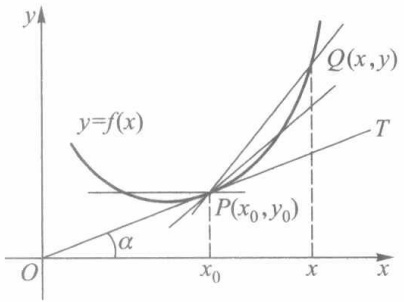
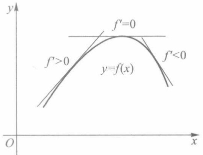
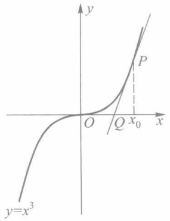
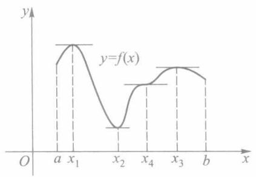
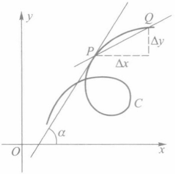
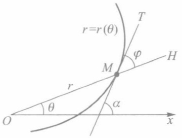
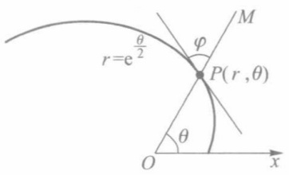
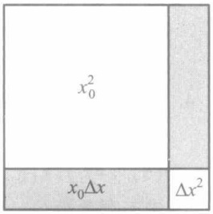
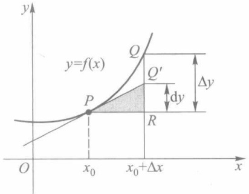
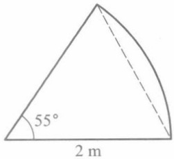

# 第5章 导数和微分

原始 PDF 第 94–121 页。

## 第五章

## 导数和微分

## § 1 导数的概念

## 一、导数的定义

导数的思想最初是由法国数学家费马(Fermat)为研究极值问题而引入的,但与导数概念直接相联系的是以下两个问题:已知运动规律求速度和已知曲线求它的切线.这是由英国数学家牛顿(Newton)和德国数学家莱布尼茨(Leibniz)分别在研究力学和几何学过程中建立起来的.

下面我们以这两个问题为背景引入导数的概念.

1. 瞬时速度 设一质点作直线运动, 其运动规律为  $s = s(t)$ . 若  $t_{0}$  为某一确定的时刻, t 为邻近于  $t_{0}$  的时刻, 则

$$
\overline {{v}} = \frac {s (t) - s (t _ {0})}{t - t _ {0}}
$$

是质点在时间段 $[t_0, t]$（或 $[t, t_0]$）上的平均速度。若 $t \to t_0$ 时平均速度 $\bar{v}$ 的极限存在，则称极限

$$
v = \lim _ {t \to t _ {0}} \frac {s (t) - s (t _ {0})}{t - t _ {0}} \tag {1}
$$

为质点在时刻 $t_0$ 的瞬时速度. 以后我们将会发现, 在计算诸如物质比热、电流强度、线密度等问题中, 尽管它们的物理背景各不相同, 但最终都归结于讨论形如 (1) 式的极限.

2. 切线的斜率 如图 5-1 所示, 曲线  $y = f(x)$  在其上一点  $P(x_{0}, y_{0})$  处的切线 PT 是割线 PQ 当动点 Q 沿此曲线无限接近于点 P 时的极限位置. 由于割线 PQ 的斜率为

$$
\overline {{k}} = \frac {f (x) - f (x _ {0})}{x - x _ {0}},
$$

因此当 $x \to x_0$ 时, 如果 $\bar{k}$ 的极限存在, 则极限

text_image

y
y=f(x)
Q(x,y)
T
α
P(x₀,y₀)
O
x₀
x
x

图5-1

83

---

第五章 导数和微分

$$
k = \lim _ {x \to x _ {0}} \frac {f (x) - f (x _ {0})}{x - x _ {0}} \tag {2}
$$

即为切线 PT 的斜率.

上述两个问题中,前一个是运动学的问题,后一个是几何学的问题,但是它们都可以归结为形如(1)、(2)这种类型的极限.

下面我们给出导数的定义.

定义1 设函数 $y = f(x)$ 在点 $x_0$ 的某邻域内有定义, 若极限

$$
\lim _ {x \to x _ {0}} \frac {f (x) - f (x _ {0})}{x - x _ {0}} \tag {3}
$$

存在,则称函数f在点 $x_{0}$ 可导,并称该极限为函数f在点 $x_{0}$ 的导数,记作 $f'(x_{0})$ .

令 $x = x_0 + \Delta x, \Delta y = f(x_0 + \Delta x) - f(x_0)$，则（3）式可改写为

$$
\lim _ {\Delta x \to 0} \frac {\Delta y}{\Delta x} = \lim _ {\Delta x \to 0} \frac {f (x _ {0} + \Delta x) - f (x _ {0})}{\Delta x} = f ^ {\prime} (x _ {0}). \tag {4}
$$

所以导数是函数增量 $\Delta y$ 与自变量增量 $\Delta x$ 之比 $\frac{\Delta y}{\Delta x}$ 的极限. 这个增量比称为函数关于自变量的平均变化率（又称差商），而导数 $f'(x_0)$ 则为 $f$ 在 $x_0$ 处关于 $x$ 的变化率.

若(3)(或(4))式极限不存在,则称f在点 $x_{0}$ 不可导.

例 1 求函数  $f(x)=x^{2}$  在点 x=1 的导数，并求曲线在点  $(1,1)$  的切线方程.

解 由定义求得

$$
\begin{array}{l} f ^ {\prime} (1) = \lim _ {\Delta x \rightarrow 0} \frac {f (1 + \Delta x) - f (1)}{\Delta x} = \lim _ {\Delta x \rightarrow 0} \frac {(1 + \Delta x) ^ {2} - 1}{\Delta x} \\ = \lim _ {\Delta x \to 0} \frac {2 \Delta x + \Delta x ^ {2}}{\Delta x} = \lim _ {\Delta x \to 0} (2 + \Delta x) = 2. \\ \end{array}
$$

由此知道抛物线  $y=x^{2}$  在点(1,1)的切线斜率为

$$
k = f ^ {\prime} (1) = 2,
$$

所以切线方程为

$$
y - 1 = 2 (x - 1) \quad \text {即} \quad y = 2 x - 1.
$$

例 2 证明函数  $f(x)=|x|$  在点  $x_{0}=0$  不可导.

证 因为

$$
\frac {f (x) - f (0)}{x - 0} = \frac {| x |}{x} = \left\{ \begin{array}{l l} 1, & x > 0, \\ - 1, & x <   0 \end{array} \right.
$$

当  $x \to 0$  时极限不存在, 所以 f 在点 x = 0 不可导.

例 3 显然常量函数  $f(x)=C$  在任何一点 x 的导数都等于零, 即

$$
f ^ {\prime} (x) = 0.
$$

下面我们介绍有限增量公式.

设 $f(x)$ 在点 $x_{0}$ 可导,那么

$$
\varepsilon = \frac {\Delta y}{\Delta x} - f ^ {\prime} (x _ {0})
$$

是当 $\Delta x\to 0$ 时的无穷小量，于是 $\varepsilon \cdot \Delta x = o(\Delta x)$ ，即

84

---

§ 1 导数的概念

$$
\Delta y = f ^ {\prime} (x _ {0}) \Delta x + o (\Delta x). \tag {5}
$$

我们称(5)式为 $f(x)$ 在点 $x_{0}$ 的有限增量公式.注意,此公式对 $\Delta x=0$ 仍旧成立.

由公式(5)立即推得如下定理.

定理5.1 若函数 $f$ 在点 $x_0$ 可导, 则 $f$ 在点 $x_0$ 连续.

注 可导仅是函数在该点连续的充分条件,而不是必要条件.如例2中的函数 $f(x)=|x|$ 在点x=0连续,但不可导.

例 4 证明函数  $f(x)=x^{2}D(x)$  仅在点  $x_{0}=0$  可导, 其中  $D(x)$  为狄利克雷函数.

证 当 $x_0 \neq 0$ 时, 由归结原则可得 $f(x)$ 在点 $x = x_0$ 不连续, 所以由定理5.1, $f(x)$ 在点 $x = x_0$ 不可导.

当 $x_0 = 0$ 时，由于 $D(x)$ 为有界函数，因此得到

$$
f ^ {\prime} (0) = \lim _ {x \to 0} \frac {f (x) - f (0)}{x - 0} = \lim _ {x \to 0} x D (x) = 0.
$$

若只讨论函数在点 $x_0$ 的右邻域（左邻域）上的变化率，我们需引进单侧导数的概念.

定义2 设函数 $y = f(x)$ 在点 $x_0$ 的某右邻域 $[x_0, x_0 + \delta)$ 上有定义，若右极限

$$
\lim _ {\Delta x \to 0 ^ {+}} \frac {\Delta y}{\Delta x} = \lim _ {\Delta x \to 0 ^ {+}} \frac {f (x _ {0} + \Delta x) - f (x _ {0})}{\Delta x} \quad (0 <   \Delta x <   \delta)
$$

存在,则称该极限值为f在点 $x_{0}$ 的右导数,记作 $f'_{+}(x_{0})$ .

类似地,我们可定义左导数

$$
f _ {-} ^ {\prime} (x _ {0}) = \lim _ {\Delta x \to 0 ^ {-}} \frac {f (x _ {0} + \Delta x) - f (x _ {0})}{\Delta x}.
$$

右导数和左导数统称为单侧导数.

如同左、右极限与极限之间的关系,我们有

定理5.2 若函数 $y = f(x)$ 在点 $x_0$ 的某邻域上有定义，则 $f'(x_0)$ 存在的充要条件是 $f_{+}'(x_0)$ 与 $f_{-}'(x_0)$ 都存在，且

$$
f _ {+} ^ {\prime} (x _ {0}) = f _ {-} ^ {\prime} (x _ {0}).
$$

例 5 设  $f(x)=\left\{\begin{aligned}&1-\cos x,&x\geqslant0,\\&x,&x<0.\end{aligned}\right.$  讨论  $f(x)$  在点 x=0 的左、右导数与导数.

解 由于

$$
\frac {f (0 + \Delta x) - f (0)}{\Delta x} = \left\{ \begin{array}{l l} \frac {1 - \cos \Delta x}{\Delta x}, & \Delta x > 0, \\ 1, & \Delta x <   0, \end{array} \right.
$$

因此

$$
f _ {+} ^ {\prime} (0) = \lim _ {\Delta x \to 0 ^ {+}} \frac {1 - \cos \Delta x}{\Delta x} = 0,
$$

$$
f _ {-} ^ {\prime} (0) = \lim _ {\Delta x \to 0 ^ {-}} 1 = 1.
$$

因为 $f_{+}^{\prime}(0)\neq f_{-}^{\prime}(0)$ ，所以f在点x=0不可导.

## 二、导函数

若函数在区间 I 上每一点都可导(对区间端点,仅考虑相应的单侧导数),则称 f 为

85

---

第五章 导数和微分

$I$ 上的可导函数. 此时对每一个 $x \in I$, 都有 $f$ 的一个导数 $f'(x)$ (或单侧导数) 与之对应. 这样就定义了一个在 $I$ 上的函数, 称为 $f$ 在 $I$ 上的导函数, 也简称为导数. 记作 $f', y'$ 或 $\frac{\mathrm{d}y}{\mathrm{d}x}$, 即

$$
f ^ {\prime} (x) = \lim _ {\Delta x \to 0} \frac {f (x + \Delta x) - f (x)}{\Delta x}, \quad x \in I.
$$

在物理学中,导数  $y'$  也常用牛顿记号  $\dot{y}$  表示,而记号  $\frac{dy}{dx}$  是莱布尼茨首先引用的.目前我们把  $\frac{dy}{dx}$  看作一个整体,也可把它理解为  $\frac{d}{dx}$  施加于 y 的求导运算,待到学过“微分”之后,我们将说明这个记号实际上是一个“商”.相应于上述各种表示导数的形式, $f'(x_{0})$  有时也写作

$$
y ^ {\prime} \mid_ {x = x _ {0}} \quad \text {或} \quad \frac {\mathrm{d} y}{\mathrm{d} x} \Big | _ {x = x _ {0}}.
$$

例6 证明

(i) $(x^{n})'=nx^{n-1},n$ 为正整数；
(ii)  $(\sin x)' = \cos x, (\cos x)' = -\sin x;$
(iii) $(\log_a x)' = \frac{1}{x} \log_a e (a > 0, a \neq 1, x > 0)$, 特别 $(\ln x)' = \frac{1}{x}$.

证 (i) 对于 $y = x^n$，由于

$$
\frac {\Delta y}{\Delta x} = \frac {(x + \Delta x) ^ {n} - x ^ {n}}{\Delta x} = \mathrm{C} _ {n} ^ {1} x ^ {n - 1} + \mathrm{C} _ {n} ^ {2} x ^ {n - 2} \Delta x + \dots + \mathrm{C} _ {n} ^ {n} \Delta x ^ {n - 1},
$$

因此

$$
y ^ {\prime} = \lim _ {\Delta x \to 0} \frac {\Delta y}{\Delta x} = \lim _ {\Delta x \to 0} \left(\mathrm{C} _ {n} ^ {1} x ^ {n - 1} + \mathrm{C} _ {n} ^ {2} x ^ {n - 2} \Delta x + \dots + \mathrm{C} _ {n} ^ {n} \Delta x ^ {n - 1}\right) = \mathrm{C} _ {n} ^ {1} x ^ {n - 1} = n x ^ {n - 1}.
$$

(ii) 下面证第一个等式, 类似地可证第二个等式. 由于

$$
\frac {\sin (x + \Delta x) - \sin x}{\Delta x} = \frac {2 \sin \frac {\Delta x}{2} \cos \left(x + \frac {\Delta x}{2}\right)}{\Delta x} = \frac {\sin \frac {\Delta x}{2}}{\frac {\Delta x}{2}} \cos \left(x + \frac {\Delta x}{2}\right),
$$

以及  $\cos x$  是  $(-\infty, +\infty)$  上的连续函数, 因此得到

$$
(\sin x) ^ {\prime} = \lim _ {\Delta x \to 0} \frac {\sin \frac {\Delta x}{2}}{\frac {\Delta x}{2}} \cdot \lim _ {\Delta x \to 0} \cos \left(x + \frac {\Delta x}{2}\right) = \cos x.
$$

(iii) 由于

$$
\frac {\log_ {a} (x + \Delta x) - \log_ {a} x}{\Delta x} = \frac {1}{\Delta x} \log_ {a} \left(1 + \frac {\Delta x}{x}\right) = \frac {1}{x} \log_ {a} \left(1 + \frac {\Delta x}{x}\right) ^ {\frac {x}{\Delta x}},
$$

所以

86

---

§ 1 导数的概念

$$
(\log_ {a} x) ^ {\prime} = \lim _ {\Delta x \to 0} \frac {1}{x} \log_ {a} \left(1 + \frac {\Delta x}{x}\right) ^ {\frac {x}{\Delta x}} = \frac {1}{x} \log_ {a} e. \tag {6}
$$

若 $a = \mathrm{e}$ ，且以 $\mathrm{e}$ 为底的自然对数常写作 $\ln x$ ，则由 $\ln \mathrm{e} = 1$ 及(6)式有

$$
(\ln x) ^ {\prime} = \frac {1}{x}.
$$

## 三、导数的几何意义

我们已经知道 $f(x)$ 在点 $x = x_0$ 的切线斜率 $k$ ，正是割线斜率在 $x \to x_0$ 时的极限，即

$$
k = \lim _ {x \to x _ {0}} \frac {f (x) - f (x _ {0})}{x - x _ {0}}.
$$

由导数的定义, $k=f'(x_{0})$ ,所以曲线 $y=f(x)$ 在点 $(x_{0},y_{0})$ 的切线方程是

$$
y - y _ {0} = f ^ {\prime} (x _ {0}) (x - x _ {0}). \tag {7}
$$

这就是说:函数f在点 $x_{0}$ 的导数 $f'(x_{0})$ 是曲线 $y=f(x)$ 在点 $(x_{0},y_{0})$ 的切线斜率.若 $\alpha$ 表

示这条切线与 x 轴正向的夹角, 则  $f'(x_{0}) = \tan \alpha$ . 从而  $f'(x_{0}) > 0$  意味着切线与 x 轴正向的夹角为锐角;  $f'(x_{0}) < 0$  意味着切线与 x 轴正向的夹角为钝角;  $f'(x_{0}) = 0$  表示切线与 x 轴平行(图 5-2).

例 7 求曲线  $y=x^{3}$  在点  $P(x_{0},y_{0})$  的切线方程与法线方程.

text_image

y
f'=0
f'>0
y=f(x)
f'<0
O
x

图5-2

解 由于

$$
\frac {\Delta y}{\Delta x} = 3 x _ {0} ^ {2} + 3 x _ {0} \Delta x + \Delta x ^ {2},
$$

$$
f ^ {\prime} (x _ {0}) = \lim _ {\Delta x \to 0} (3 x _ {0} ^ {2} + 3 x _ {0} \Delta x + \Delta x ^ {2}) = 3 x _ {0} ^ {2}.
$$

所以根据(7)式,曲线  $y=x^{3}$  在点 P 的切线方程为

$$
y - y _ {0} = 3 x _ {0} ^ {2} (x - x _ {0}).
$$

由解析几何知道,若切线斜率为 k,则法线斜率为  $-\frac{1}{k}$ . 从而过点 P 的法线方程为

$$
y - y _ {0} = - \frac {1}{f ^ {\prime} (x _ {0})} (x - x _ {0}). \tag {8}
$$

因此曲线 $y = x^3$ 过点 $P(x_0 \neq 0)$ 的法线方程为

$$
y - x _ {0} ^ {3} = - \frac {1}{3 x _ {0} ^ {2}} (x - x _ {0}).
$$

若 $x_0 = 0$ ，则法线方程为 $x = 0$

顺便说一下,对于曲线  $y=x^{3}$ , 可把它在点  $P(x_{0},y_{0})$  的切线斜率  $f'(x_{0})$  改写成如下形式:

$$
f ^ {\prime} (x _ {0}) = 3 x _ {0} ^ {2} = \frac {x _ {0} ^ {3}}{\frac {x _ {0}}{3}} = \frac {y _ {0}}{\frac {x _ {0}}{3}}.
$$

87

---

第五章 导数和微分

因此,为了作过点 P 的切线,如图 5-3 所示,只需对 x 轴上从原点 O 到点  $x_{0}$  的线段三等分,取靠近  $x_{0}$  的分点 Q,那么直线 PQ 就是所求的切线.

定义3 若函数 $f$ 在点 $x_0$ 的某邻域 $U(x_0)$ 上对一切 $x \in U(x_0)$ 有

$$
f (x _ {0}) \geqslant f (x) \quad (f (x _ {0}) \leqslant f (x)), \tag {9}
$$

则称函数 f 在点  $x_{0}$  取得极大(小)值, 称点  $x_{0}$  为极大(小)值点. 极大值、极小值统称为极值, 极大值点、极小值点统称为极值点.

设函数 f 如图 5-4 所示, 它在点  $x = x_{1}, x_{3}$  取极大值, 在点  $x = x_{2}$  取极小值.

例8 证明: 若 $f_{+}^{\prime}(x_{0}) > 0$, 则存在 $\delta > 0$, 对任何 $x \in (x_{0}, x_{0} + \delta)$, 有

text_image

y
P
x₀
O
Q
y=x³

图5-3

line

| Interval | Function Value |
| --- | --- |
| a to x1 | Peak |
| x1 to x2 | Local Minimum |
| x2 to x4 | Local Maximum |
| x4 to x3 | Local Maximum |
| x3 to b | Local Maximum |

图5-4

$$
f (x _ {0}) <   f (x). \tag {10}
$$

证 因为

$$
f _ {+} ^ {\prime} (x _ {0}) = \lim _ {x \to x _ {0} ^ {+}} \frac {f (x) - f (x _ {0})}{x - x _ {0}} > 0,
$$

所以由保号性可知,存在正数  $\delta$ , 对一切  $x \in (x_{0}, x_{0} + \delta)$ , 有

$$
\frac {f (x) - f (x _ {0})}{x - x _ {0}} > 0,
$$

从而不难推得, 当  $0 < x - x_{0} < \delta$  时, (10) 式成立.

用类似的方法可讨论 $f_{+}^{\prime}(x_0) < 0, f_{-}^{\prime}(x_0) > 0$ 和 $f_{-}^{\prime}(x_0) < 0$ 的情况. 例如, 若 $f_{-}^{\prime}(x_0) > 0$, 则存在 $\delta > 0$, 对任何 $x \in (x_0 - \delta, x_0)$, 有 $f(x_0) > f(x)$.

注 例 8 告诉我们: 若  $f'(x_{0})$  存在且不为零, 则  $x_{0}$  不是  $f(x)$  的极值点.

这样我们就得到了著名的费马定理.

定理 5.3(费马定理) 设函数 f 在点  $x_{0}$  的某邻域上有定义, 且在点  $x_{0}$  可导. 若点  $x_{0}$  为 f 的极值点, 则必有

$$
f ^ {\prime} (x _ {0}) = 0.
$$

费马定理的几何意义非常明确: 若函数  $f(x)$  在极值点  $x = x_{0}$  可导, 那么在该点的切线平行于 x 轴.

我们称满足方程  $f'(x)=0$  的点为稳定点（也称为驻点）.

对于函数 $f(x) = x^3$，点 $x = 0$ 是稳定点，但却不是极值点.

## 习题 5.1

1. 已知直线运动方程为

88

---

§ 1 导数的概念

$$
s = 1 0 t + 5 t ^ {2},
$$

分别令  $\Delta t=1,0.1,0.01$ ，求从 t=4 至  $t=4+\Delta t$  这一段时间内运动的平均速度及 t=4 时的瞬时速度.

2. 等速旋转的角速度等于旋转角与对应时间的比,试由此给出变速旋转的角速度的定义.

3. 设 $f(x_0) = 0$, $f'(x_0) = 4$, 试求极限

$$
\lim _ {\Delta x \to 0} \frac {f (x _ {0} + \Delta x)}{\Delta x}.
$$

4. 设 $f(x) = \begin{cases} x^2, & x \geqslant 3, \\ ax + b, & x < 3, \end{cases}$ 试确定 $a, b$ 的值，使 $f$ 在 $x = 3$ 处可导.

5. 试确定曲线  $y=\ln x$  上哪些点的切线平行于下列直线:

(1) y = x - 1;

(2) y = 2x - 3.

6. 求下列曲线在指定点 P 的切线方程与法线方程:

(1)  $y=\frac{x^{2}}{4}, P(2,1)$ ;

(2) $y = \cos x, P(0,1)$.

7. 求下列函数的导函数:

(1)  $f(x) = \left| x \right|^3$ ;

(2)  $f(x) = \left\{ \begin{aligned} & x + 1, & x \geqslant 0, \\ & 1, & x < 0. \end{aligned} \right.$

8. 设函数

$$
f (  x  ) = \left\{ \begin{array}{l l} {{x ^ {m} \sin \frac {1}{x},}} & {{x \neq 0  ,}} \\ {{0  ,}} & {{x   =   0}} \end{array} \right. (\text {m为正整数}),
$$

试问:(1) m 等于何值时，f 在 x=0 连续；

(2) m 等于何值时, f 在 x=0 可导.

9. 求下列函数的稳定点:

(1)  $f(x) = \sin x - \cos x;$

(2)  $f(x) = x - \ln x.$

10. 设函数 f 在点  $x_{0}$  存在左、右导数，试证 f 在点  $x_{0}$  连续.

11. 设  $g(0)=g'(0)=0$ ,

$$
f (x) = \left\{ \begin{array}{c c} g (x) \sin \frac {1}{x}, & x \neq 0, \\ 0, & x = 0, \end{array} \right.
$$

求 $f'(0)$ .

12. 设 $f$ 是定义在 $\mathbf{R}$ 上的函数, 且对任何 $x_{1}, x_{2} \in \mathbf{R}$, 都有

$$
f (x _ {1} + x _ {2}) = f (x _ {1}) \cdot f (x _ {2}).
$$

若 $f'(0) = 1$ ，证明对任何 $x \in \mathbb{R}$，都有

$$
f ^ {\prime} (x) = f (x).
$$

13. 证明: 若  $f'(x_{0})$  存在, 则

$$
\lim _ {\Delta x \to 0} \frac {f (x _ {0} + \Delta x) - f (x _ {0} - \Delta x)}{\Delta x} = 2 f ^ {\prime} (x _ {0}).
$$

14. 证明: 若函数 $f$ 在 $[a, b]$ 上连续, 且 $f(a) = f(b) = K$, $f'_+(a)f'_-(b) > 0$, 则至少有一点 $\xi \in (a, b)$, 使 $f(\xi) = K$.

15. 设有一吊桥, 其铁链呈抛物线形, 两端系于相距  $100 \, m$  高度相同的支柱上, 铁链之最低点在悬点下  $10 \, m$  处, 求铁链与支柱所成之角.

16. 在曲线 $y = x^3$ 上取一点 $P$，过 $P$ 的切线与该曲线交于 $Q$，证明:曲线在 $Q$ 处的切线斜率正好是

89

---

第五章 导数和微分

在 P 处切线斜率的四倍.

17. 设  $f(x)=x^{n}+a_{1}x^{n-1}+\cdots+a_{n}$  的最大零点为  $x_{0}$ . 证明:  $f'(x_{0})\geqslant0$ .

## § 2 求导法则

上一节我们从定义出发求出了一些简单函数的导数,对于一般函数的导数,虽然也可以用定义来求,但通常极为繁琐.本节将引入一些求导法则,利用这些法则,能较简便地求出初等函数的导数.

## 一、导数的四则运算

定理5.4 若函数 $u(x)$ 和 $v(x)$ 在点 $x_0$ 可导，则函数 $f(x) = u(x) \pm v(x)$ 在点 $x_0$ 也可导，且

$$
f ^ {\prime} (x _ {0}) = u ^ {\prime} (x _ {0}) \pm v ^ {\prime} (x _ {0}). \tag {1}
$$

证 $f^{\prime}(x_0) = \lim_{\Delta x\to 0}\frac{\left[u(x_0 + \Delta x)\pm v(x_0 + \Delta x)\right] - \left[u(x_0)\pm v(x_0)\right]}{\Delta x}$

$$
\begin{array}{l} = \lim _ {\Delta x \to 0} \frac {u (x _ {0} + \Delta x) - u (x _ {0})}{\Delta x} \pm \lim _ {\Delta x \to 0} \frac {v (x _ {0} + \Delta x) - v (x _ {0})}{\Delta x} \\ = u ^ {\prime} (x _ {0}) \pm v ^ {\prime} (x _ {0}). \\ \end{array}
$$

定理5.5 若函数 $u(x)$ 和 $v(x)$ 在点 $x_0$ 可导，则函数 $f(x) = u(x)v(x)$ 在点 $x_0$ 也可导，且

$$
f ^ {\prime} (x _ {0}) = u ^ {\prime} (x _ {0}) v (x _ {0}) + u (x _ {0}) v ^ {\prime} (x _ {0}). \tag {2}
$$

证 $f^{\prime}(x_0) = \lim_{\Delta x\to 0}\frac{u(x_0 + \Delta x)v(x_0 + \Delta x) - u(x_0)v(x_0)}{\Delta x}$

$$
\begin{array}{l} = \lim _ {\Delta x \rightarrow 0} \frac {u \left(x _ {0} + \Delta x\right) v \left(x _ {0} + \Delta x\right) - u \left(x _ {0}\right) v \left(x _ {0} + \Delta x\right) + u \left(x _ {0}\right) v \left(x _ {0} + \Delta x\right) - u \left(x _ {0}\right) v \left(x _ {0}\right)}{\Delta x} \\ = \lim _ {\Delta x \to 0} \frac {u (x _ {0} + \Delta x) - u (x _ {0})}{\Delta x} v (x _ {0} + \Delta x) + \lim _ {\Delta x \to 0} u (x _ {0}) \frac {v (x _ {0} + \Delta x) - v (x _ {0})}{\Delta x} \\ = u ^ {\prime} (x _ {0}) v (x _ {0}) + u (x _ {0}) v ^ {\prime} (x _ {0}). \\ \end{array}
$$

利用数学归纳法可以把这个法则推广到任意有限个函数乘积的情形.例如:

$$
(u v w) ^ {\prime} = u ^ {\prime} v w + u v ^ {\prime} w + u v w ^ {\prime}.
$$

推论 若函数 $v(x)$ 在点 $x_0$ 可导，$c$ 为常数，则

$$
(c v (x)) _ {x = x _ {0}} ^ {\prime} = c v ^ {\prime} (x _ {0}). \tag {3}
$$

例 1 设  $f(x)=x^{3}+5x^{2}-9x+\pi$ ，求  $f'(x)$ .

解 由公式(1)、(3)，

$$
\begin{array}{l} f ^ {\prime} (x) = (x ^ {3}) ^ {\prime} + 5 (x ^ {2}) ^ {\prime} - 9 (x) ^ {\prime} + (\pi) ^ {\prime} \\ = 3 x ^ {2} + 1 0 x - 9. \\ \end{array}
$$

一般地说:多项式函数

90

---

§ 2 求导法则 | ■ ■

$$
f (x) = a _ {0} x ^ {n} + a _ {1} x ^ {n - 1} + \dots + a _ {n - 1} x + a _ {n}
$$

的导数为

$$
f ^ {\prime} (x) = n a _ {0} x ^ {n - 1} + (n - 1) a _ {1} x ^ {n - 2} + \dots + a _ {n - 1}.
$$

它比 $f$ 低一个幂次.

例 2 设  $y = \cos x \ln x$ ，求  $y' \big|_{x = \pi}$ .

解 由公式(2)，

$$
y ^ {\prime} = (\cos x) ^ {\prime} \ln x + \cos x (\ln x) ^ {\prime} = - \sin x \ln x + \frac {1}{x} \cos x.
$$

所以

$$
y ^ {\prime} \mid_ {x = \pi} = - \frac {1}{\pi}.
$$

定理5.6 若函数 $u(x)$ 和 $v(x)$ 在点 $x_0$ 都可导，且 $v(x_0) \neq 0$ ，则 $f(x) = \frac{u(x)}{v(x)}$ 在点 $x_0$ 也可导，且

$$
f ^ {\prime} (x _ {0}) = \frac {u ^ {\prime} (x _ {0}) v (x _ {0}) - u (x _ {0}) v ^ {\prime} (x _ {0})}{\left[ v (x _ {0}) \right] ^ {2}}. \tag {4}
$$

证 设 $f(x) = u(x)g(x)$，其中 $g(x) = \frac{1}{v(x)}$，现证 $g(x)$ 在点 $x_0$ 可导。由于

$$
\begin{array}{l} \frac {g (x _ {0} + \Delta x) - g (x _ {0})}{\Delta x} = \frac {\frac {1}{v (x _ {0} + \Delta x)} - \frac {1}{v (x _ {0})}}{\Delta x} \\ = - \frac {v (x _ {0} + \Delta x) - v (x _ {0})}{\Delta x} \cdot \frac {1}{v (x _ {0} + \Delta x) v (x _ {0})}, \\ \end{array}
$$

而 $v(x)$ 在点 $x_0$ 可导，从而在点 $x_0$ 连续，且 $v(x_0) \neq 0$ ，因此

$$
\left(\frac {1}{v (x)}\right) _ {x = x _ {0}} ^ {\prime} = g ^ {\prime} (x _ {0}) = \lim _ {\Delta x \to 0} \frac {g (x _ {0} + \Delta x) - g (x _ {0})}{\Delta x} = - \frac {v ^ {\prime} (x _ {0})}{[ v (x _ {0}) ] ^ {2}}. \tag {5}
$$

应用公式(2)、(5)便证得

$$
\begin{array}{l} f ^ {\prime} (x _ {0}) = \left(\frac {u (x)}{v (x)}\right) _ {x = x _ {0}} ^ {\prime} = u ^ {\prime} (x _ {0}) \frac {1}{v (x _ {0})} + u (x _ {0}) \left(- \frac {v ^ {\prime} (x _ {0})}{[ v (x _ {0}) ] ^ {2}}\right) \\ = \frac {u ^ {\prime} (x _ {0}) v (x _ {0}) - u (x _ {0}) v ^ {\prime} (x _ {0})}{\left[ v (x _ {0}) \right] ^ {2}}. \\ \end{array}
$$

例 3 证明 $(x^{-n})'= -nx^{-n-1}$ ，其中 n 为正整数.

证 由公式(5)可得

$$
\left(x ^ {- n}\right) ^ {\prime} = \left(\frac {1}{x ^ {n}}\right) ^ {\prime} = - \frac {n x ^ {n - 1}}{x ^ {2 n}} = - n x ^ {- n - 1}.
$$

例 4 证明: $(\tan x)' = \sec^{2}x, (\cot x)' = -\csc^{2}x.$

证 由 $\tan x = \frac{\sin x}{\cos x}$ 及公式(4)可推得

91

---

第五章 导数和微分

$$
\begin{array}{l} \left(\tan x\right) ^ {\prime} = \left(\frac {\sin x}{\cos x}\right) ^ {\prime} = \frac {(\sin x) ^ {\prime} \cos x - \sin x (\cos x) ^ {\prime}}{\cos^ {2} x} \\ = \frac {\cos^ {2} x + \sin^ {2} x}{\cos^ {2} x} = \frac {1}{\cos^ {2} x} = \sec^ {2} x. \\ \end{array}
$$

同理可证 $(\cot x)'=-\csc^{2}x.$

例 5 证明: $(\sec x)' = \sec x \tan x, (\csc x)' = -\csc x \cot x.$

证 我们仍只证第一式,第二式请读者自证.由  $\sec x=\frac{1}{\cos x}$  及公式(5)有

$$
(\sec x) ^ {\prime} = \left(\frac {1}{\cos x}\right) ^ {\prime} = - \frac {(\cos x) ^ {\prime}}{\cos^ {2} x} = \frac {\sin x}{\cos^ {2} x} = \sec x \tan x.
$$

## 二、反函数的导数

我们已经求得对数函数与三角函数的导数,为求得它们的反函数的导数,下面先证明反函数求导公式.

定理5.7 设 $y = f(x)$ 为 $x = \varphi(y)$ 的反函数，若 $\varphi(y)$ 在点 $y_0$ 的某邻域上连续，严格单调且 $\varphi'(y_0) \neq 0$，则 $f(x)$ 在点 $x_0 (x_0 = \varphi(y_0))$ 可导，且

$$
f ^ {\prime} (x _ {0}) = \frac {1}{\varphi^ {\prime} (y _ {0})}. \tag {6}
$$

证 设 $\Delta x = \varphi(y_0 + \Delta y) - \varphi(y_0), \Delta y = f(x_0 + \Delta x) - f(x_0)$. 因为 $\varphi$ 在 $y_0$ 的某邻域上连续且严格单调, 故 $f = \varphi^{-1}$ 在 $x_0$ 的某邻域上连续且严格单调. 从而当且仅当 $\Delta y = 0$ 时 $\Delta x = 0$, 并且当且仅当 $\Delta y \to 0$ 时 $\Delta x \to 0$. 由 $\varphi'(y_0) \neq 0$, 可得

$$
f ^ {\prime} (x _ {0}) = \lim _ {\Delta x \to 0} \frac {\Delta y}{\Delta x} = \lim _ {\Delta y \to 0} \frac {\Delta y}{\Delta x} = \frac {1}{\lim _ {\Delta y \to 0} \frac {\Delta x}{\Delta y}} = \frac {1}{\varphi^ {\prime} (y _ {0})}.
$$

例6 证明:

(i) $(a^{x})' = a^{x}\ln a$ (其中 $a > 0, a \neq 1$), 特别地, $(\mathrm{e}^{x})' = \mathrm{e}^{x}$.
(ii)  $(\arcsin x)'=\frac{1}{\sqrt{1-x^{2}}}$ ,  $(\arccos x)'=-\frac{1}{\sqrt{1-x^{2}}}$ .
(iii)  $(\arctan x)'=\frac{1}{1+x^{2}},(\operatorname{arccot}x)'=-\frac{1}{1+x^{2}}.$

证（i）由于 $y = a^{x}, x \in \mathbb{R}$ 为对数函数 $x = \log_a y, y \in (0, +\infty)$ 的反函数，故由公式(6)得到

$$
(a ^ {x}) ^ {\prime} = \frac {1}{(\log_ {a} y) ^ {\prime}} = \frac {y}{\log_ {a} \mathrm{e}} = a ^ {x} \ln a.
$$

(ii) 由于 $y = \arcsin x, x \in (-1, 1)$ 是 $x = \sin y, y \in \left(-\frac{\pi}{2}, \frac{\pi}{2}\right)$ 的反函数，故由公式(6)得到

$$
(\arcsin x) ^ {\prime} = \frac {1}{(\sin y) ^ {\prime}} = \frac {1}{\cos y} = \frac {1}{\sqrt {1 - \sin^ {2} y}} = \frac {1}{\sqrt {1 - x ^ {2}}}, x \in (- 1, 1).
$$

92

---

§ 2 求导法则 |||

同理可证: $(\arccos x)' = -\frac{1}{\sqrt{1 - x^2}}, x \in (-1, 1)$.

(iii) 由于 $y = \arctan x, x \in \mathbf{R}$ 是 $x = \tan y, y \in \left(-\frac{\pi}{2}, \frac{\pi}{2}\right)$ 的反函数，因此

$$
(\arctan x) ^ {\prime} = \frac {1}{(\tan y) ^ {\prime}} = \frac {1}{\sec^ {2} y} = \frac {1}{1 + \tan^ {2} y} = \frac {1}{1 + x ^ {2}}, x \in (- \infty , + \infty).
$$

同理可证: $(\operatorname{arccot}x)' = -\frac{1}{1 + x^2}, x \in (-\infty, +\infty)$.

## 三、复合函数的导数

为了证明复合函数的求导公式,我们先证明一个引理.

引理 $f(x)$ 在点 $x_0$ 可导的充要条件是:在 $x_0$ 的某邻域 $U(x_0)$ 上，存在一个在点 $x_0$ 连续的函数 $H(x)$，使得

$$
f (x) - f (x _ {0}) = H (x) (x - x _ {0}),
$$

从而 $f^{\prime}(x_0) = H(x_0)$

证 设 $f(x)$ 在点 $x_0$ 可导, 令

$$
H (x) = \left\{ \begin{array}{l l} \frac {f (x) - f (x _ {0})}{x - x _ {0}}, & x \in U ^ {\circ} (x _ {0}), \\ f ^ {\prime} (x _ {0}), & x = x _ {0}, \end{array} \right.
$$

则因

$$
\lim _ {x \to x _ {0}} H (x) = \lim _ {x \to x _ {0}} \frac {f (x) - f (x _ {0})}{x - x _ {0}} = f ^ {\prime} (x _ {0}) = H (x _ {0}),
$$

所以 $H(x)$ 在点 $x_0$ 连续，且 $f(x) - f(x_0) = H(x)(x - x_0), x \in U(x_0)$.

反之，设存在 $H(x), x \in U(x_0)$，它在点 $x_0$ 连续，且

$$
f (x) - f (x _ {0}) = H (x) (x - x _ {0}), x \in U (x _ {0}).
$$

因存在极限

$$
\lim _ {x \to x _ {0}} \frac {f (x) - f (x _ {0})}{x - x _ {0}} = \lim _ {x \to x _ {0}} H (x) = H (x _ {0}),
$$

所以 $f(x)$ 点 $x_0$ 可导，且 $f'(x_0) = H(x_0)$.

注 引理说明了点 $x_0$ 是函数 $g(x) = \frac{f(x) - f(x_0)}{x - x_0}$ 可去间断点的充要条件是 $f(x)$ 在点 $x_0$ 可导. 这个结论可推广到向量函数的导数（第二十三章）.

定理 5.8 设  $u=\varphi(x)$  在点  $x_{0}$  可导,  $y=f(u)$  在点  $u_{0}=\varphi(x_{0})$  可导, 则复合函数  $f\circ\varphi$  在点  $x_{0}$  可导, 且

$$
(f \circ \varphi) ^ {\prime} (x _ {0}) = f ^ {\prime} (u _ {0}) \varphi^ {\prime} (x _ {0}) = f ^ {\prime} (\varphi (x _ {0})) \varphi^ {\prime} (x _ {0}). \tag {7}
$$

证 由 $f(u)$ 在点 $u_0$ 可导，由引理必要性部分，存在一个在点 $u_0$ 连续的函数 $F(u)$，使得 $f'(u_0) = F(u_0)$，且

$$
f (u) - f (u _ {0}) = F (u) (u - u _ {0}), u \in U (u _ {0}).
$$

又由 $u = \varphi (x)$ 在点 $x_0$ 可导，同理存在一个在点 $x_0$ 连续的函数 $\Phi (x)$，使得 $\varphi^{\prime}(x_0) =$

93

---

第五章 导数和微分

$\Phi (x_0)$ ，且

$$
\varphi (x) - \varphi (x _ {0}) = \Phi (x) (x - x _ {0}), x \in U (x _ {0}).
$$

于是就有

$$
\begin{array}{l} f (\varphi (x)) - f (\varphi (x _ {0})) = F (\varphi (x)) (\varphi (x) - \varphi (x _ {0})) \\ = F (\varphi (x)) \Phi (x) (x - x _ {0}). \\ \end{array}
$$

因为  $\varphi, \Phi$  在点  $x_{0}$  连续, F 在点  $u_{0} = \varphi(x_{0})$  连续, 因此  $H(x) = F(\varphi(x)) \Phi(x)$  在点  $x_{0}$  连续. 由引理充分性部分证得  $f \circ \varphi$  在点  $x_{0}$  可导, 且

$$
(f \circ \varphi) ^ {\prime} (x _ {0}) = H (x _ {0}) = F (\varphi (x _ {0})) \Phi (x _ {0}) = f ^ {\prime} (u _ {0}) \varphi^ {\prime} (x _ {0}).
$$

注1 复合函数的求导公式(7)亦称为链式法则. 函数 $y = f(u), u = \varphi(x)$ 的复合函数在点 $x$ 的求导公式一般也写作

$$
\frac {\mathrm{d} y}{\mathrm{d} x} = \frac {\mathrm{d} y}{\mathrm{d} u} \cdot \frac {\mathrm{d} u}{\mathrm{d} x}. \tag {8}
$$

对于由多个函数复合而得到的复合函数,其导数公式可反复应用(8)式而得.

注2 $f^{\prime}(\varphi (x)) = f^{\prime}(u)\big|_{u = \varphi (x)}$ 与 $(f(\varphi (x)))' = f'(\varphi (x))\varphi '(x)$ 的含义不可混淆.

例 7 设  $y = \sin x^{2}$ ，求  $y'$ .

解 将  $\sin x^{2}$  看作  $y=\sin u$  与  $u=x^{2}$  的复合函数, 故

$$
(\sin x ^ {2}) ^ {\prime} = \cos u \cdot 2 x = 2 x \cos x ^ {2}.
$$

注 必须指出: $(\sin x^{2})'\neq\cos x^{2}$

例 8 设  $\alpha$  为实数, 求幂函数  $y = x^{\alpha} (x > 0)$  的导数.

解 因为 $y = x^{\alpha} = \mathrm{e}^{\alpha \ln x}$ 可看作 $y = \mathrm{e}^{u}$ 与 $u = \alpha \ln x$ 的复合函数，故

$$
(x ^ {\alpha}) ^ {\prime} = (\mathrm{e} ^ {\alpha \ln x}) ^ {\prime} = \mathrm{e} ^ {\alpha \ln x} \cdot \frac {\alpha}{x} = \alpha x ^ {\alpha - 1}.
$$

例 9 设  $f(x)=\sqrt{x^{2}+1}$ ，求  $f'(0)$ ， $f'(1)$ .

解 由于

$$
f ^ {\prime} (x) = \left(\sqrt {x ^ {2} + 1}\right) ^ {\prime} = \frac {1}{2 \sqrt {x ^ {2} + 1}} (x ^ {2} + 1) ^ {\prime} = \frac {x}{\sqrt {x ^ {2} + 1}},
$$

因此 $f'(0)=0, f'(1)=\frac{1}{\sqrt{2}}$ .

例 10 求下列函数的导函数:

(1) $f(x) = \ln (x + \sqrt{1 + x^2})$; (2) $f(x) = \tan^2 \frac{1}{x}$.

解 (1) $(\ln (x + \sqrt{1 + x^2}))' = \frac{1}{x + \sqrt{1 + x^2}} (x + \sqrt{1 + x^2})'$

$$
= \frac {1}{x + \sqrt {1 + x ^ {2}}} \left(1 + \frac {x}{\sqrt {1 + x ^ {2}}}\right) = \frac {1}{\sqrt {1 + x ^ {2}}}.
$$

(2) $\left(\tan^2\frac{1}{x}\right)' = 2\tan \frac{1}{x}\left(\tan \frac{1}{x}\right)' = 2\tan \frac{1}{x}\sec^2\frac{1}{x}\left(\frac{1}{x}\right)'$

$$
= - \frac {2}{x ^ {2}} \tan \frac {1}{x} \sec^ {2} \frac {1}{x}.
$$

94

---

§ 2 求导法则

例 11(对数求导法) 设  $y=\frac{(x+5)^{2}(x-4)^{\frac{1}{3}}}{(x+2)^{5}(x+4)^{\frac{1}{2}}}$  (x>4)，求  $y'$ .

解 先对函数式取对数, 得

$$
\begin{array}{l} \ln y = \ln \frac {(x + 5) ^ {2} (x - 4) ^ {\frac {1}{3}}}{(x + 2) ^ {5} (x + 4) ^ {\frac {1}{2}}} \\ = 2 \ln (x + 5) + \frac {1}{3} \ln (x - 4) - 5 \ln (x + 2) - \frac {1}{2} \ln (x + 4). \\ \end{array}
$$

再对上式两边分别求导数,得

$$
\frac {y ^ {\prime}}{y} = \frac {2}{x + 5} + \frac {1}{3 (x - 4)} - \frac {5}{x + 2} - \frac {1}{2 (x + 4)}.
$$

整理后得到

$$
y ^ {\prime} = \frac {(x + 5) ^ {2} (x - 4) ^ {\frac {1}{3}}}{(x + 2) ^ {5} (x + 4) ^ {\frac {1}{2}}} \bigg [ \frac {2}{x + 5} + \frac {1}{3 (x - 4)} - \frac {5}{x + 2} - \frac {1}{2 (x + 4)} \bigg ].
$$

注 虽然我们可用导数的乘积和商的公式来求例 11 中的导数,但用对数求导法显得更为清晰、简便.

例 12 设  $y=u(x)^{v(x)}$ ，其中  $u(x)>0$ ，且  $u(x)$  和  $v(x)$  均可导，试求此幂指函数的导数.

$$
\begin{array}{l} = u (x) ^ {v (x)} \left(v ^ {\prime} (x) \ln u (x) + v (x) \frac {u ^ {\prime} (x)}{u (x)}\right) \\ = u (x) ^ {v (x)} v ^ {\prime} (x) \ln u (x) + u (x) ^ {v (x) - 1} u ^ {\prime} (x) v (x). \\ \end{array}
$$

解 $y' = (u(x)^{v(x)})' = (\mathrm{e}^{v(x)\ln u(x)})' = \mathrm{e}^{v(x)\ln u(x)}(v(x)\ln u(x))'$

## 四、基本求导法则与公式

现在把前面得到的求导法则与基本初等函数的导数公式列出如下:

## 基本求导法则

1.  $(u \pm v)' = u' \pm v'$ .
2. $(uv)' = u'v + uv', (cu)' = cu'$  (c为常数).
3. $\left(\frac{u}{v}\right)^{\prime} = \frac{u^{\prime}v - uv^{\prime}}{v^{2}},\left(\frac{1}{v}\right)^{\prime} = -\frac{v^{\prime}}{v^{2}}\quad (v\neq 0)$
4. 反函数导数  $\frac{dy}{dx}=\frac{1}{\frac{dx}{dy}}$ .

5. 复合函数导数  $\frac{dy}{dx}=\frac{dy}{du}\cdot\frac{du}{dx}.$

## 基本初等函数导数公式

1. $(c)' = 0$ （$c$ 为常数）.
2. $(x^{\alpha})'= \alpha x^{\alpha-1}$  ( $\alpha$ 为任意实数).
3.  $(\sin x)' = \cos x, (\cos x)' = -\sin x, (\tan x)' = \sec^{2}x,$

95

---

第五章 导数和微分

$$
(\cot x) ^ {\prime} = - \csc^ {2} x, (\sec x) ^ {\prime} = \sec x \tan x, (\csc x) ^ {\prime} = - \csc x \cot x.
$$

4. $(\arcsin x)' = \frac{1}{\sqrt{1 - x^2}}, (\arccos x)' = -\frac{1}{\sqrt{1 - x^2}},$

$$
(\arctan x) ^ {\prime} = \frac {1}{1 + x ^ {2}}, (\operatorname{arccot} x) ^ {\prime} = - \frac {1}{1 + x ^ {2}}.
$$

5. $(a^{x})' = a^{x}\ln a (a > 0$ 且 $a \neq 1)$, $(\mathrm{e}^{x})' = \mathrm{e}^{x}$.

6. $(\log_a|x|)' = \frac{1}{x\ln a} (a > 0$ 且 $a\neq 1)$ ， $(\ln |x|)' = \frac{1}{x}$

## 习题 5.2

1. 求下列函数在指定点的导数:

(1) 设  $f(x)=3x^{4}+2x^{3}+5$ ，求  $f'(0)$ ， $f'(1)$ ;
(2) 设  $f(x)=\frac{x}{\cos x}$ ，求  $f'(0)$ ， $f'(\pi)$ ;
(3) 设  $f(x)=\sqrt{1+\sqrt{x}}$ ，求  $f'(0)$ ， $f'(1)$ ， $f'(4)$ .

2. 求下列函数的导数:

(1) $y = 3x^{2} + 2$;
(3) $y = x^n + nx$;
(5) $y = x^3 \log_3 x$;
(7)  $y = (x^{2} + 1)(3x - 1)(1 - x^{3})$ ;
(9)  $y=\frac{x}{1-\cos x}$ ;
(11)  $y = (\sqrt{x} + 1) \arctan x;$

(2) $y = \frac{1 - x^2}{1 + x + x^2}$;
(4)  $y=\frac{x}{m}+\frac{m}{x}+2\sqrt{x}+\frac{2}{\sqrt{x}}$ ;
(6) $y = \mathrm{e}^{x}\cos x;$
(8)  $y=\frac{\tan x}{x}$ ;
(10)  $y=\frac{1+\ln x}{1-\ln x}$ ;
(12)  $y=\frac{1+x^{2}}{\sin x+\cos x}.$

3. 求下列函数的导函数:

(1) $y = x\sqrt{1 - x^2}$;
(3)  $y = \left( \frac{1 + x^{2}}{1 - x} \right)^{3}$ ;
(5)  $y=\ln(\sin x)$ ;
(7) $y = \ln (x + \sqrt{1 + x^2})$;
(9) $y = (\sin x + \cos x)^3$;
(11) $y = \sin \sqrt{1 + x^2}$;
(13)  $y = \arcsin \frac{1}{x}$ ;
(15) y = arccot  $\frac{1 + x}{1 - x}$ ;
(17) $y = \mathrm{e}^{x + 1}$;

(2) $y = (x^2 - 1)^3$;
(4) $y = \ln (\ln x)$;
(6) $y = \lg (x^2 + x + 1)$;
(8)  $y=\ln\frac{\sqrt{1+x}-\sqrt{1-x}}{\sqrt{1+x}+\sqrt{1-x}}$ ;
(10) $y = \cos^3 4x$;
(12) $y = (\sin x^2)^3$;
(14) $y = (\arctan x^3)^2$;
(16) $y = \arcsin (\sin^2 x)$;
(18)  $y=2^{\sin x}$ ;

96

---

§ 3 参变量函数的导数

(19)  $y = x^{\sin x}$ ;

(20)  $y = x^{x^{x}}$ ;

(21)  $y = e^{-x} \sin 2x;$

(22)  $y=\sqrt{x+\sqrt{x+\sqrt{x}}}$ ;

(23)  $y = \sin(\sin(\sin x))$ ;

(24)  $y=\sin\left(\frac{x}{\sin\left(\frac{x}{\sin x}\right)}\right)$ ;

(25) $y = (x - a_1)^{\alpha_1}(x - a_2)^{\alpha_2} \cdots (x - a_n)^{\alpha_n}$;

(26) $y = \frac{1}{\sqrt{a^2 - b^2}} \arcsin \frac{a \sin x + b}{a + b \sin x}$.

4. 对下列各函数计算 $f'(x)$, $f'(x+1)$, $f'(x-1)$.

(1) $f(x) = x^3$;

(2) $f(x + 1) = x^3$;

(3) $f(x - 1) = x^3$.

5. 已知 $g$ 为可导函数, $a$ 为实数, 试求下列函数 $f$ 的导数:

(1)  $f(x) = g(x + g(a))$ ;

(2) $f(x) = g(x + g(x))$;

(3)  $f(x) = g(xg(a))$ ;

(4) $f(x) = g(xg(x))$.

6. 设 $f$ 为可导函数, 证明: 若 $x = 1$ 时有

$$
\frac {\mathrm{d}}{\mathrm{d} x} f (x ^ {2}) = \frac {\mathrm{d}}{\mathrm{d} x} f ^ {2} (x).
$$

则必有 $f^{\prime}(1) = 0$ 或 $f(1) = 1$.

7. 定义双曲函数如下:

双曲正弦函数  $\sinh x=\frac{e^{x}-e^{-x}}{2}$ ，双曲余弦函数  $\cosh x=\frac{e^{x}+e^{-x}}{2}$ ;

双曲正切函数  $\tanh x=\frac{\sin h x}{\cos h x}$ ，双曲余切函数  $\coth x=\frac{\cos h x}{\sin h x}$ .

证明:

(1)  $(\sinh x)' = \cos h x;$

(2) $(\cosh x)' = \sin h x;$

(3)  $(\tanh x)'=\frac{1}{\cos h^{2}x};$

(4)  $(\coth x)' = -\frac{1}{\sin h^{2}x}.$

8. 求下列函数的导数:

(1)  $y = \sinh^{3} x;$

(2) $y = \cosh (\sinh x)$;

(3)  $y = \ln{(\cosh x)}$ ;

(4) $y = \arctan (\tanh x)$.

9. 以 $\operatorname{arsinh} x, \operatorname{arcosh} x, \operatorname{artanh} x, \operatorname{arcoth} x$ 分别表示各双曲函数的反函数. 试求下列函数的导数:

(1)  $y = \operatorname{arsinh} x;$

(2)  $y = \operatorname{arcosh} x;$

(3) y = artanh x;

(4) y = arcoth x;

(5) y = artanh x - arcoth  $\frac{1}{x}$ ;

(6) $y = \operatorname{arsinh}(\tan x)$.

## § 3 参变量函数的导数

平面曲线 C 一般的表达形式是参变量(参量)方程

$$
\left\{ \begin{array}{l} x = \varphi (t), \\ y = \psi (t), \end{array} \right. \quad \alpha \leqslant t \leqslant \beta \tag {1}
$$

97

---

第五章 导数和微分

表示. 设  $t=t_{0}$  对应曲线 C 上的点 P. 如果在点 P 有切线, 那么切线的斜率可由割线的斜

率取极限而得,为此设  $\varphi,\psi$  在点  $t_{0}$  可导,且  $x'(t_{0})\neq0$ . 若  $t_{0}+\Delta t$  对应 C 上的点 Q(图5-5),割线 PQ 的斜率

$$
\frac {\Delta y}{\Delta x} = \frac {\psi (t _ {0} + \Delta t) - \psi (t _ {0})}{\varphi (t _ {0} + \Delta t) - \varphi (t _ {0})},
$$

于是曲线 $C$ 在点 $P$ 的切线斜率是

$$
\begin{array}{l} \tan \alpha = \lim _ {\Delta t \to 0} \frac {\Delta y}{\Delta x} = \frac {\lim _ {\Delta t \to 0} \frac {\psi (t _ {0} + \Delta t) - \psi (t _ {0})}{\Delta t}}{\lim _ {\Delta t \to 0} \frac {\varphi (t _ {0} + \Delta t) - \varphi (t _ {0})}{\Delta t}} \\ = \frac {\psi^ {\prime} (t _ {0})}{\varphi^ {\prime} (t _ {0})}. \\ \end{array}
$$

text_image

y
Q
Δy
P
Δx
C
α
O
x

图5-5

其中 $\alpha$ 为切线与 $x$ 轴正向的夹角.若 $\varphi'(t_0) = 0$ ，但 $\psi'(t_0)\neq 0$ ，同样可得

$$
\cot \alpha = \lim _ {\Delta t \to 0} \frac {\Delta x}{\Delta y} = \frac {\varphi^ {\prime} (t _ {0})}{\psi^ {\prime} (t _ {0})}.
$$

若 $\varphi, \psi$ 在 $[\alpha, \beta]$ 上都存在连续的导函数，且 $\varphi'^2 + \psi'^2 \neq 0$ ，这时称 $C$ 为光滑曲线。其特点是在曲线 $C$ 上不仅每一点都有切线，且切线与 $x$ 轴正向的夹角 $\alpha(t)$ 是 $t$ 的连续函数。

若 $x = \varphi (t)$ 具有反函数 $t = \varphi^{-1}(x)$，那么它与 $y = \psi (t)$ 构成一个复合函数

$$
y = \psi \circ \varphi^ {- 1} (x).
$$

这时只要函数 $\varphi, \psi$ 可导，$\varphi'(t) \neq 0$（因而当 $\Delta x \to 0$ 时，也有 $\Delta t \to 0$ 和 $\Delta y \to 0$），就可由复合函数和反函数的求导法则得到

$$
\frac {\mathrm{d} y}{\mathrm{d} x} = \frac {\mathrm{d} y}{\mathrm{d} t} \cdot \frac {\mathrm{d} t}{\mathrm{d} x} = \frac {\mathrm{d} y}{\mathrm{d} t} / \frac {\mathrm{d} x}{\mathrm{d} t} = \frac {\psi^ {\prime} (t)}{\varphi^ {\prime} (t)}. \tag {2}
$$

例1 试求由上半椭圆的参量方程

$$
\left\{ \begin{array}{l} x = a \cos t, \\ y = b \sin t, \end{array} \right. \quad 0 <   t <   \pi
$$

所确定的函数  $y=y(x)$  的导数.

解 按公式(2)求得

$$
\frac {\mathrm{d} y}{\mathrm{d} x} = \frac {\mathrm{d} y}{\mathrm{d} t} / \frac {\mathrm{d} x}{\mathrm{d} t} = \frac {(b \sin t) ^ {\prime}}{(a \cos t) ^ {\prime}} = - \frac {b}{a} \cot t.
$$

若曲线 C 由极坐标  $r=r(\theta)$  表示, 则可转化为以极角  $\theta$  为参量的参量方程:

$$
\left\{ \begin{array}{l} x = r \cos \theta = r (\theta) \cos \theta , \\ y = r \sin \theta = r (\theta) \sin \theta . \end{array} \right.
$$

这时在相应的条件下可得

$$
\frac {\mathrm{d} y}{\mathrm{d} x} = \frac {(r (\theta) \sin \theta) ^ {\prime}}{(r (\theta) \cos \theta) ^ {\prime}} = \frac {r ^ {\prime} (\theta) \sin \theta + r (\theta) \cos \theta}{r ^ {\prime} (\theta) \cos \theta - r (\theta) \sin \theta} = \frac {r ^ {\prime} (\theta) \tan \theta + r (\theta)}{r ^ {\prime} (\theta) - r (\theta) \tan \theta}. \tag {3}
$$

98

---

§ 3 参变量函数的导数

(3)式表示在曲线 $r = r(\theta)$ 上的点 $M(r,\theta)$ 的切线MT与极轴 $Ox$ 轴的夹角的正切（图5-6）.

过点 $M$ 的射线 $OH$ 与切线 $MT$ 的夹角 $\varphi$ 的正切则是

$$
\tan \varphi = \tan (\alpha - \theta) = \frac {\tan \alpha - \tan \theta}{1 + \tan \alpha \tan \theta}. \tag {4}
$$

将(3)式代入(4)式则得向径与切线夹角的正切

$$
\tan \varphi = \frac {r (\theta)}{r ^ {\prime} (\theta)}. \tag {5}
$$

例 2 证明: 对数螺线  $r = e^{\frac{\theta}{2}}$  (图 5-7) 上所有点的切线与向径的夹角  $\varphi$  为常量.
证 由(5)式得,对每一  $\theta$  值都有

text_image

r=r(θ)
T
φ
H
M
r
θ
α
O
x

图5-6

text_image

r=e^{\frac{\theta}{2}}\n\varphi\np(r,\theta)\nO\nx

图5-7

$$
\tan \varphi = \frac {r (\theta)}{r ^ {\prime} (\theta)} = \frac {\mathrm{e} ^ {\frac {\theta}{2}}}{\frac {1}{2} \mathrm{e} ^ {\frac {\theta}{2}}} = 2,
$$

即在对数螺线上任一点的切线与向径的夹角等于 arctan 2.

## 习题 5.3

1. 求下列由参量方程所确定的导数 $\frac{\mathrm{dy}}{\mathrm{dx}}$:

(1) $\left\{ \begin{array}{l} x = \cos^4 t, \\ y = \sin^4 t \end{array} \right.$ 在 $t = \frac{\pi}{3}$ 处；

(2) $\left\{\begin{aligned}x&=\frac{t}{1+t},\\ y&=\frac{1-t}{1+t}\end{aligned}\right.$ 在 t>0 处.

2. 设 $\left\{ \begin{array}{l} x = a(t - \sin t), \\ y = a(1 - \cos t). \end{array} \right.$ 求 $\frac{\mathrm{dy}}{\mathrm{dx}} \bigg|_{t = \frac{\pi}{2}}, \frac{\mathrm{dy}}{\mathrm{dx}} \bigg|_{t = \pi}$.

3. 设曲线方程 $x = 1 - t^2, y = t - t^2$，求它在下列点处的切线方程与法线方程:

(1) t = 1;

(2) $t = \frac{\sqrt{2}}{2}$.

4. 证明曲线

$$
\left\{ \begin{array}{l} x = a (\cos t + t \sin t), \\ y = a (\sin t - t \cos t) \end{array} \right.
$$

上任一点的法线到原点距离等于 $a$.

5. 证明: 圆  $r=2a\sin\theta$  (a>0) 上任一点的切线与向径的夹角等于向径的极角.

99

---

第五章 导数和微分

6. 求心形线  $r = a(1 + \cos \theta)$  的切线与切点向径之间的夹角.

## § 4 高阶导数

设物体的运动方程为  $s=s(t)$ ，则物体的运动速度为  $v(t)=s'(t)$ ，而速度在时刻  $t_{0}$  的变化率

$$
\lim _ {\Delta t \to 0} \frac {v (t _ {0} + \Delta t) - v (t _ {0})}{\Delta t} = \lim _ {t \to t _ {0}} \frac {v (t) - v (t _ {0})}{t - t _ {0}}
$$

就是运动物体在时刻  $t_{0}$  的加速度. 因此, 加速度是速度函数的导数, 也就是路程  $s(t)$  的导函数的导数, 这就产生了高阶导数的概念.

定义1 若函数 $f$ 的导函数 $f'$ 在点 $x_0$ 可导, 则称 $f'$ 在点 $x_0$ 的导数为 $f$ 在点 $x_0$ 的二阶导数, 记作 $f''(x_0)$, 即

$$
\lim _ {x \to x _ {0}} \frac {f ^ {\prime} (x) - f ^ {\prime} (x _ {0})}{x - x _ {0}} = f ^ {\prime \prime} (x _ {0}),
$$

同时称 f 在点  $x_{0}$  为二阶可导.

若 $f$ 在区间 $I$ 上每一点都二阶可导, 则得到一个定义在 $I$ 上的函数, 这个函数称为 $f$ 的二阶导函数, 记作 $f''(x), x \in I$, 或者简单记为 $f''$.

一般地, 可由 f 的 n-1 阶导函数定义 f 的 n 阶导函数(或简称 n 阶导数).

二阶以及二阶以上的导数都称为高阶导数,函数f在点 $x_{0}$ 处的n阶导数记作

$$
f ^ {(n)} (  x _ {0}  )  , y ^ {(n)}   \big | _ {x = x _ {0}} \text {或}   \frac {\mathrm{d} ^ {n} y}{\mathrm{d} x ^ {n}}   \bigg | _ {x = x _ {0}}.
$$

相应地，$n$ 阶导函数记作

$$
f ^ {(n)}, y ^ {(n)} \text {或} \frac {\mathrm{d} ^ {n} y}{\mathrm{d} x ^ {n}}.
$$

这里 $\frac{d^{n}y}{dx^{n}}$ 亦可写作 $\frac{d^{n}}{dx^{n}}y$ ，它是对y相继进行n次求导运算“ $\frac{d}{dx}$ ”的结果.

例 1 求幂函数  $y=x^{n}$  (n 为正整数) 的各阶导数.

解 由幂函数的求导公式得

$$
\begin{array}{l} y ^ {\prime} = n x ^ {n - 1}, \\ y ^ {\prime \prime} = n (n - 1) x ^ {n - 2}, \\ y ^ {(n - 1)} = \left(y ^ {(n - 2)}\right) ^ {\prime} = n (n - 1) \dots 2 x, \\ y ^ {(n)} = \left(y ^ {(n - 1)}\right) ^ {\prime} = (n (n - 1) \dots 2 x) ^ {\prime} = n!, \\ y ^ {(n + 1)} = y ^ {(n + 2)} = \dots = 0. \\ \end{array}
$$

... ... ... ... ... ... ...

由此可见,对于正整数幂函数  $x^{n}$ , 每求导一次, 其幂次降低 1, 第 n 阶导数为一常数, 大于 n 阶的导数都等于 0.

100

---

§ 4 高阶导数 ||||

例 2 求  $y = \sin x$  和  $y = \cos x$  的各阶导数.

解 对于 $y = \sin x$ ，由三角函数的求导公式得

$$
y ^ {\prime} = \cos x, y ^ {\prime \prime} = - \sin x, y ^ {\prime \prime \prime} = - \cos x, y ^ {(4)} = \sin x.
$$

继续求导,将出现周而复始的现象.为了得到一般 n 阶导数公式,可将上述导数公式改写为

$$
\begin{array}{l} y ^ {\prime} = \cos x = \sin \left(x + \frac {\pi}{2}\right), \\ y ^ {\prime \prime} = - \sin x = \sin \left(x + 2 \cdot \frac {\pi}{2}\right), \\ y ^ {\prime \prime \prime} = - \cos x = \sin \left(x + 3 \cdot \frac {\pi}{2}\right), \\ y ^ {(4)} = \sin x = \sin \left(x + 4 \cdot \frac {\pi}{2}\right). \\ \end{array}
$$

一般地,可推得

$$
y ^ {(n)} = \sin \left(x + n \cdot \frac {\pi}{2}\right), n \in \mathbf {N} _ {+}.
$$

类似地有

$$
\cos^ {(n)} x = \cos \left(x + n \cdot \frac {\pi}{2}\right), n \in \mathbf {N} _ {+}.
$$

例 3 求  $y=e^{x}$  的各阶导数.

解 因为 $\left(\mathrm{e}^{x}\right)^{\prime}=\mathrm{e}^{x}$ ，所以 $\left(\mathrm{e}^{x}\right)^{(n)}=\mathrm{e}^{x},n\in\mathbf{N}_{+}$

指数函数  $e^{x}$  的各阶导数仍旧是  $e^{x}$ .

一阶导数的运算法则可直接移植到高阶导数.容易看出:

$$
\left[ u \pm v \right] ^ {(n)} = u ^ {(n)} \pm v ^ {(n)}. \tag {1}
$$

对于乘法求导法则较为复杂一些. 设 y = uv，则

$$
\begin{array}{l} y ^ {\prime} = u ^ {\prime} v + u v ^ {\prime}, \\ y ^ {\prime \prime} = (u ^ {\prime} v + u v ^ {\prime}) ^ {\prime} = u ^ {\prime \prime} v + 2 u ^ {\prime} v ^ {\prime} + u v ^ {\prime \prime}, \\ y ^ {\prime \prime \prime} = (u ^ {\prime \prime} v + 2 u ^ {\prime} v ^ {\prime} + u v ^ {\prime \prime}) ^ {\prime} = u ^ {\prime \prime \prime} v + 3 u ^ {\prime \prime} v ^ {\prime} + 3 u ^ {\prime} v ^ {\prime \prime} + u v ^ {\prime \prime \prime}, \\ \end{array}
$$

如此下去,读者不难看到,计算结果与二项式 $(u+v)^{n}$ 展开式极为相似,用数学归纳法,可得

$$
\begin{array}{l} (u v) ^ {(n)} = u ^ {(n)} v ^ {(0)} + \mathrm{C} _ {n} ^ {1} u ^ {(n - 1)} v ^ {(1)} + \mathrm{C} _ {n} ^ {2} u ^ {(n - 2)} v ^ {(2)} + \dots + \\ \mathrm{C} _ {n} ^ {k} u ^ {(n - k)} v ^ {(k)} + \dots + u ^ {(0)} v ^ {(n)} = \sum_ {k = 0} ^ {n} \mathrm{C} _ {n} ^ {k} u ^ {(n - k)} v ^ {(k)}, \tag {2} \\ \end{array}
$$

其中 $u^{(0)} = u, v^{(0)} = v$. 这个公式称为莱布尼茨公式.

例 4 设  $y = x^{2} e^{x}$ ，求  $y^{(n)}$ .

解 令 $u(x) = \mathrm{e}^x, v(x) = x^2$，应用莱布尼茨公式得

$$
\begin{array}{l} y ^ {(n)} = \sum_ {k = 0} ^ {n} \mathrm{C} _ {n} ^ {k} u ^ {(n - k)} v ^ {(k)} = \sum_ {k = 0} ^ {n} \mathrm{C} _ {n} ^ {k} v ^ {(k)} \mathrm{e} ^ {x} \\ = x ^ {2} \mathrm{e} ^ {x} + 2 n x \mathrm{e} ^ {x} + n (n - 1) \mathrm{e} ^ {x} = \mathrm{e} ^ {x} [ x ^ {2} + 2 n x + n (n - 1) ]. \\ \end{array}
$$

101

---

第五章 导数和微分

例 5 设  $y=e^{x}\sin x$ ，求  $y^{(n)}$ .

解 因为

$$
y ^ {\prime} = \mathrm{e} ^ {x} \sin x + \mathrm{e} ^ {x} \cos x = \sqrt {2} \mathrm{e} ^ {x} \sin \left(x + \frac {\pi}{4}\right),
$$

$$
y ^ {\prime \prime} = \sqrt {2} \left[ \mathrm{e} ^ {x} \sin \left(x + \frac {\pi}{4}\right) + \mathrm{e} ^ {x} \cos \left(x + \frac {\pi}{4}\right) \right] = (\sqrt {2}) ^ {2} \mathrm{e} ^ {x} \sin \left(x + 2 \cdot \frac {\pi}{4}\right),
$$

... ... ... ... ... ... ...

所以由归纳法可证

$$
y ^ {(n)} = (\sqrt {2}) ^ {n} \mathrm{e} ^ {x} \sin \left(x + n \cdot \frac {\pi}{4}\right).
$$

例6 讨论函数

$$
f (x) = \left\{ \begin{array}{l l} x ^ {2}, & x \geqslant 0, \\ - x ^ {2}, & x <   0 \end{array} \right.
$$

的高阶导数.

解 当 x>0 时， $f'(x)=2x$ ， $f''(x)=2$ ， $f^{(k)}(x)\equiv0\ (k\geqslant3)$ .

当 $x < 0$ 时，$f'(x) = -2x, f''(x) = -2, f^{(k)}(x) \equiv 0 (k \geqslant 3)$.

当 $x = 0$ 时，由左、右导数定义不难求得 $f_{+}^{\prime}(0) = f_{-}^{\prime}(0) = f^{\prime}(0) = 0$ ，而当 $k\geqslant 2$ 时，$f^{(k)}(0)$ 不存在.

整理后得

$$
f ^ {\prime} (x) = \left\{ \begin{array}{c l} 2 x, & x > 0, \\ 0, & x = 0, \\ - 2 x, & x <   0, \end{array} \right.
$$

$$
f ^ {\prime \prime} (x) = \left\{ \begin{array}{c l} 2, & x > 0, \\ \text {不存在}, & x = 0, \\ - 2, & x <   0, \end{array} \right.
$$

当 $k \geqslant 3$ 时，

$$
f ^ {(k)} (x) = 0 (x \neq 0), f ^ {(k)} (0) \text {不存在}.
$$

设 $\varphi, \psi$ 在 $[\alpha, \beta]$ 上都二阶可导，则由参量方程

$$
\left\{ \begin{array}{l} x = \varphi (t), \\ y = \psi (t) \end{array} \right.
$$

所确定的函数的一阶导数 $\frac{dy}{dx}=\frac{\psi'(t)}{\varphi'(t)}$ ，它的参量方程是

$$
\left\{ \begin{array}{l} x = \varphi (t), \\ \frac {\mathrm{d} y}{\mathrm{d} x} = \frac {\psi^ {\prime} (t)}{\varphi^ {\prime} (t)}. \end{array} \right.
$$

因此由 §3 公式(2)得

$$
\frac {\mathrm{d} ^ {2} y}{\mathrm{d} x ^ {2}} = \frac {\mathrm{d}}{\mathrm{d} x} \Big (\frac {\mathrm{d} y}{\mathrm{d} x} \Big) = \frac {\frac {\mathrm{d}}{\mathrm{d} t} \Big (\frac {\psi^ {\prime}}{\varphi^ {\prime}} \Big)}{\frac {\mathrm{d} x}{\mathrm{d} t}} = \frac {\Big (\frac {\psi^ {\prime} (t)}{\varphi^ {\prime} (t)} \Big) ^ {\prime}}{\varphi^ {\prime} (t)}
$$

102

---

§ 4 高阶导数

$$
= \frac {\psi^ {\prime \prime} (t) \varphi^ {\prime} (t) - \psi^ {\prime} (t) \varphi^ {\prime \prime} (t)}{\left[ \varphi^ {\prime} (t) \right] ^ {3}}. \tag {3}
$$

例 7 试求由摆线参量方程

$$
\left\{ \begin{array}{l} x = a (t - \sin t), \\ y = a (1 - \cos t) \end{array} \right.
$$

所确定的函数  $y=y(x)$  的二阶导数.

解 由 §3 公式(2)得

$$
\frac {\mathrm{d} y}{\mathrm{d} x} = \frac {\left[ a (1 - \cos t) \right] ^ {\prime}}{\left[ a (t - \sin t) \right] ^ {\prime}} = \frac {\sin t}{1 - \cos t} = \cot \frac {t}{2}.
$$

再由公式(3)

$$
\frac {\mathrm{d} ^ {2} y}{\mathrm{d} x ^ {2}} = \frac {\left(\cot \frac {t}{2}\right) ^ {\prime}}{\left[ a (t - \sin t) \right] ^ {\prime}} = \frac {- \frac {1}{2} \csc^ {2} \frac {t}{2}}{a (1 - \cos t)} = - \frac {1}{4 a} \csc^ {4} \frac {t}{2}.
$$

## 习题 5.4

1. 求下列函数在指定点的高阶导数:

(1)  $f(x)=3x^{3}+4x^{2}-5x-9$ , 求  $f''(1)$ ,  $f'''(1)$ ,  $f^{(4)}(1)$ ;

(2) $f(x)=\frac{x}{\sqrt{1+x^{2}}}$ , 求  $f''(0)$ ,  $f''(1)$ ,  $f''(-1)$ .

2. 设函数 $f$ 在 $x = 1$ 处二阶可导，证明:若 $f'(1) = 0, f''(1) = 0$，则在 $x = 1$ 处有 $\frac{\mathrm{d}}{\mathrm{d}x} f(x^2) = \frac{\mathrm{d}^2}{\mathrm{d}x^2} f^2(x)$.

3. 求下列函数的高阶导数:

(1)  $f(x)=x\ln x$ , 求  $f''(x)$ ; (2)  $f(x)=\mathrm{e}^{-x^{2}}$ , 求  $f'''(x)$ ;
(3) $f(x) = \ln (1 + x)$, 求 $f^{(5)}(x)$; (4) $f(x) = x^3\mathrm{e}^x$, 求 $f^{(10)}(x)$.

4. 设 f 为二阶可导函数, 求下列各函数的二阶导数:

(1)  $y = f(\ln x)$ ;

(2)  $y = f(x^{n})$ ,  $n \in N_{+}$ ;

(3)  $y = f[f(x)]$ .

5. 求下列函数的 $n$ 阶导数:

(1)  $y = \ln x$ ;

(2)  $y = a^{x} \quad (a > 0, a \neq 1)$ ;
(3)  $y=\frac{1}{x(1-x)}$ ; (4)  $y=\frac{\ln x}{x}$ ;
(5) $f(x) = \frac{x^n}{1 - x}$; (6) $y = \mathrm{e}^{ax}\sin bx$ ($a, b$ 均为实数).

6. 求由下列参量方程所确定的函数的二阶导数 $\frac{\mathrm{d}^2y}{\mathrm{d}x^2}$:

(1)  $\left\{\begin{aligned}x&=a\cos^{3}t,\\ y&=a\sin^{3}t;\end{aligned}\right.$

(2) $\left\{ \begin{array}{l}x = \mathrm{e}^{t}\cos t,\\ y = \mathrm{e}^{t}\sin t. \end{array} \right.$

7. 研究函数 $f(x) = |x^3|$ 在 $x = 0$ 处的各阶导数.

8. 设函数 $y = f(x)$ 在点 $x$ 三阶可导，且 $f'(x) \neq 0$. 若 $f(x)$ 存在反函数 $x = f^{-1}(y)$，试用 $f'(x), f''(x)$ 以及 $f'''(x)$ 表示 $(f^{-1})'''(y)$.

103

---

第五章 导数和微分

9. 设 $y = \arctan x$.

(1) 证明它满足方程 $(1+x^{2})y''+2xy'=0$ ;
(2) 求  $y^{(n)} \mid_{x=0}$ .

10. 设  $y = \arcsin x$ .

(1) 证明它满足方程 $(1-x^{2})y^{(n+2)}-(2n+1)xy^{(n+1)}-n^{2}y^{(n)}=0$  ( $n\geqslant0$ );
(2) 求  $y^{(n)} \mid_{x=0}$ .

11. 证明函数

$$
f (x) = \left\{ \begin{array}{l l} \mathrm{e} ^ {- \frac {1}{x ^ {2}}}, & x \neq 0, \\ 0, & x = 0 \end{array} \right.
$$

在 $x = 0$ 处 $n$ 阶可导且 $f^{(n)}(0) = 0$ ，其中 $n$ 为任意正整数.

## § 5 微 分

## 一、微分的概念

先考察一个具体问题.设一边长为 x 的正方形,它的面积

$$
S = x ^ {2}
$$

是 x 的函数, 若边长由  $x_{0}$  增加  $\Delta x$ , 相应地正方形面积的增量

$$
\Delta S = (x _ {0} + \Delta x) ^ {2} - x _ {0} ^ {2} = 2 x _ {0} \Delta x + (\Delta x) ^ {2}.
$$

$\Delta S$ 由两部分组成: 第一部分 $2x_{0}\Delta x$ (即图5-8中的阴影部分); 第二部分 $(\Delta x)^{2}$ 是关于

$\Delta x$  的高阶无穷小量.由此可见,当给  $x_{0}$  一个微小增量  $\Delta x$  时,由此引起的正方形面积增量  $\Delta S$  可以近似地用第一部分( $\Delta x$  的线性部分  $2x_{0}\Delta x$ )来代替.由此产生的误差是一个关于  $\Delta x$  的高阶无穷小量,也就是以  $\Delta x$  为边长的小正方形面积.

定义1 设函数 $y = f(x)$ 定义在点 $x_0$ 的某邻域 $U(x_0)$ 上. 当给 $x_0$ 一个增量 $\Delta x, x_0 + \Delta x \in U(x_0)$ 时, 相应地得到函数的增量为

$$
\Delta y = f (x _ {0} + \Delta x) - f (x _ {0}).
$$

text_image

x₀²

x₀Δx	Δx²

图5-8

如果存在常数 A, 使得  $\Delta y$  能表示成

$$
\Delta y = A \Delta x + o (\Delta x), \tag {1}
$$

则称函数 $f$ 在点 $x_0$ 可微，并称(1)式中的第一项 $A\Delta x$ 为 $f$ 在点 $x_0$ 的微分，记作

$$
\mathrm{d} y \mid_ {x = x _ {0}} = A \Delta x \quad \text {或} \quad \mathrm{d} f (  x  )   \mid_ {x = x _ {0}} = A \Delta x. \tag {2}
$$

由定义可见,函数的微分与增量仅相差一个关于  $\Delta x$  的高阶无穷小量,由于 dy 是  $\Delta x$  的线性函数,所以当  $A \neq 0$  时,也说微分 dy 是增量  $\Delta y$  的线性主部.

容易看出,函数f在点 $x_{0}$ 可导和可微是等价的.

定理 5.9 函数 f 在点  $x_{0}$  可微的充要条件是函数 f 在点  $x_{0}$  可导, 而且 (1) 式中的 A

104

---

§ 5 微分

等于 $f'(x_{0})$ .

证 必要性 若 $f$ 在点 $x_0$ 可微，由(1)式有

$$
\frac {\Delta y}{\Delta x} = A + o (1).
$$

取极限后有

$$
f ^ {\prime} (x _ {0}) = \lim _ {\Delta x \to 0} \frac {\Delta y}{\Delta x} = \lim _ {\Delta x \to 0} [ A + o (1) ] = A.
$$

这就证明了 $f$ 在点 $x_0$ 可导且导数等于 $A$.

充分性 若 $f$ 在点 $x_0$ 可导, 则 $f$ 在点 $x_0$ 的有限增量公式

$$
\Delta y = f ^ {\prime} (x _ {0}) \Delta x + o (\Delta x)
$$

表明函数增量 $\Delta y$ 可表示为 $\Delta x$ 的线性部分 $(f'(x_0)\Delta x)$ 与较 $\Delta x$ 高阶的无穷小量之和，所以 $f$ 在点 $x_0$ 可微，且有

$$
\mathrm{d} y \mid_ {x = x _ {0}} = f ^ {\prime} (x _ {0}) \Delta x.
$$

微分的几何解释如图 5-9 所示. 当自变量由  $x_{0}$  增加到  $x_{0} + \Delta x$  时, 函数增量  $\Delta y = f(x_{0} + \Delta x) - f(x_{0}) = RQ$ , 而微分则是在点 P 处的切线上与  $\Delta x$  所对应的增量

$$
\mathrm{d} y = f ^ {\prime} (x _ {0}) \Delta x = R Q ^ {\prime},
$$

并且

$$
\lim _ {x \to x _ {0}} \frac {\Delta y - \mathrm{d} y}{\Delta x} = \lim _ {x \to x _ {0}} \frac {Q ^ {\prime} Q}{P R} = f ^ {\prime} (x _ {0}) \lim _ {x \to x _ {0}} \frac {Q ^ {\prime} Q}{R Q ^ {\prime}} = 0,
$$

所以当 $f'(x_{0})\neq0$ 时，

$$
\lim _ {x \to x _ {0}} \frac {Q ^ {\prime} Q}{R Q ^ {\prime}} = 0.
$$

text_image

y
y=f(x)
Q
Q'
dy
Δy
P
R
O
x₀
x₀+Δx
x

图5-9

这表明当 $x \to x_0$ 时线段 $Q'Q$ 的长度比 $RQ'$ 的长度要小得多.

若函数 $y = f(x)$ 在区间上每一点都可微，则称 $f$ 为 $I$ 上的可微函数。函数 $y = f(x)$ 在 $I$ 上任一点 $x$ 处的微分记作

$$
\mathrm{d} y = f ^ {\prime} (x) \Delta x, x \in I, \tag {3}
$$

它不仅依赖于  $\Delta x$ ，而且也依赖于 x.

特别当 $y = x$ 时，

$$
\mathrm{d} y = \mathrm{d} x = \Delta x,
$$

这表示自变量的微分 $\mathrm{dx}$ 就等于自变量的增量.于是可将(3)式改写为

$$
\mathrm{d} y = f ^ {\prime} (x) \mathrm{d} x, \tag {4}
$$

即函数的微分等于函数的导数与自变量微分的积.比如

$$
\mathrm{d} (x ^ {\alpha}) = \alpha x ^ {\alpha - 1} \mathrm{d} x,
$$

$$
\mathrm{d} (\sin x) = \cos x \mathrm{d} x,
$$

$$
\mathrm{d} (\ln x) = \frac {\mathrm{d} x}{x}.
$$

如果把(4)式写成

105

---

第五章 导数和微分

$$
f ^ {\prime} (x) = \frac {\mathrm{d} y}{\mathrm{d} x},
$$

那么函数的导数就等于函数微分与自变量微分的商.因此,导数也常称为微商.在这以前,我们总把 $\frac{dy}{dx}$ 作为一个运算记号的整体来看待,有了微分概念之后,也不妨把它看作一个分式了.

## 二、微分的运算法则

由导数与微分的关系,我们能立刻推出如下微分运算法则:

1.  $\mathrm{d}[u(x)\pm v(x)]=\mathrm{d}u(x)\pm\mathrm{d}v(x)$ ;
2.  $\mathrm{d}[u(x)v(x)]=v(x)\mathrm{d}u(x)+u(x)\mathrm{d}v(x)$ ;
3.  $\mathrm{d}\left[\frac{u(x)}{v(x)}\right]=\frac{v(x)\mathrm{d}u(x)-u(x)\mathrm{d}v(x)}{v^{2}(x)}(v(x)\neq0)$ ;
4. $\mathrm{d}[f\circ g(x)] = f'(u)g'(x)\mathrm{d}x$ ，其中 $u = g(x)$

在上述复合函数的微分运算法则 4 中, 由于  $\mathrm{d}u = g'(x) \mathrm{~d}x$ , 所以它也可写作

$$
\mathrm{d} y = f ^ {\prime} (u) \mathrm{d} u.
$$

这与(4)式在形式上完全相同,即(4)式不仅在x为自变量时成立,当它是另一可微函数的因变量时也成立.这个性质通常称为一阶微分形式的不变性.

例 1 求  $y=x^{2}\ln x+\cos x^{2}$  的微分.

解 $\mathrm{dy} = \mathrm{d}(x^2\ln x + \cos x^2) = \mathrm{d}(x^2\ln x) + \mathrm{d}(\cos x^2)$

$$
= \ln x \mathrm{d} (x ^ {2}) + x ^ {2} \mathrm{d} (\ln x) + \mathrm{d} (\cos x ^ {2}) = x (2 \ln x + 1 - 2 \sin x ^ {2}) \mathrm{d} x.
$$

例 2 求  $y = e^{\sin(ax + b)}$  的微分.

解 由一阶微分形式不变性,可得

$$
\begin{array}{l} \mathrm{d} y = \mathrm{e} ^ {\sin (a x + b)} \mathrm{d} [ \sin (a x + b) ] \\ = \mathrm{e} ^ {\sin (a x + b)} \cos (a x + b) \mathrm{d} (a x + b) = a \mathrm{e} ^ {\sin (a x + b)} \cos (a x + b) \mathrm{d} x. \\ \end{array}
$$

## 三、高阶微分

我们知道函数 $y = f(x)$ 的一阶微分是

$$
\mathrm{d} y = f ^ {\prime} (x) \mathrm{d} x,
$$

其中变量 x 和 dx 是相互独立的. 现将一阶微分只作为 x 的函数, 若 f 二阶可导, 那么 dy 对自变量 x 的微分

$$
\mathrm{d} (\mathrm{d} y) = \mathrm{d} (f ^ {\prime} (x) \mathrm{d} x) = f ^ {\prime \prime} (x) \mathrm{d} x \cdot \mathrm{d} x = f ^ {\prime \prime} (x) (\mathrm{d} x) ^ {2},
$$

或写作

$$
\mathrm{d} ^ {2} y = f ^ {\prime \prime} (x) \mathrm{d} x ^ {2}, \tag {5}
$$

称它为函数 $f$ 的二阶微分.

注 这里 $\mathrm{dx}^2$ 是指 $(\mathrm{dx})^2; \mathrm{d}^2 x$ 表示 $x$ 的二阶微分 $(\mathrm{d}^2 x = 0)$; 而 $\mathrm{d}(x^2)$ 则表示 $x^2$ 的一阶微分 $(\mathrm{d}(x^2) = 2x\mathrm{d}x)$. 三者不能混淆.

一般地，n 阶微分是 n-1 阶微分的微分，记作  $d^{n}y$ ，即

$$
\begin{array}{l} \mathrm{d} ^ {n} y = \mathrm{d} (\mathrm{d} ^ {n - 1} y) = \mathrm{d} (f ^ {(n - 1)} (x) \mathrm{d} x ^ {n - 1}) \\ = f ^ {(n)} (x) \mathrm{d} x ^ {n}. \\ \end{array}
$$

106

---

§ 5 微分

若将它写成

$$
\frac {\mathrm{d} ^ {n} y}{\mathrm{d} x ^ {n}} = f ^ {(n)} (x)
$$

时,就和 n 阶导数的记法一致了.

对  $n \geqslant 2$  的 n 阶微分均称为高阶微分.

一阶微分具有形式不变性,而对于高阶微分来说已不具备这个性质了.以二阶微分为例,当 x 为  $y=f(x)$  的自变量时,

$$
\mathrm{d} ^ {2} y = f ^ {\prime \prime} (x) \mathrm{d} x ^ {2}. \tag {6}
$$

当 x 为复合函数  $y=f(x)$ ,  $x=\varphi(t)$  的中间变量时,  $y=f(\varphi(t))$  作为 t 的函数, 关于 t 的一阶微分可以写作

$$
\mathrm{d} y = f ^ {\prime} (x) \mathrm{d} x,
$$

其中  $\mathrm{d}x=\varphi'(t)\mathrm{d}t;$  而对 t 的二阶微分则为

$$
\begin{array}{l} \mathrm{d} ^ {2} y = (f (\varphi (t))) ^ {\prime \prime} \mathrm{d} t ^ {2} = (f ^ {\prime} (\varphi (t)) \varphi^ {\prime} (t)) ^ {\prime} \mathrm{d} t ^ {2} \\ = \left[ f ^ {\prime \prime} (\varphi (t)) (\varphi^ {\prime} (t)) ^ {2} + f ^ {\prime} (\varphi (t)) \varphi^ {\prime \prime} (t) \right] \mathrm{d} t ^ {2} \\ = f ^ {\prime \prime} (x) \mathrm{d} x ^ {2} + f ^ {\prime} (x) \mathrm{d} ^ {2} x, \tag {7} \\ \end{array}
$$

它比(5)式多了一项,这说明二阶微分已不再具有形式不变性.

例 3 设  $y=f(x)=\sin x, x=\varphi(t)=t^{2}$ . 分别依公式(6)和公式(7)求  $d^{2}y$ .

解 由 $y = \sin t^2$ 得 $y' = 2t\cos t^2, y'' = 2\cos t^2 - 4t^2\sin t^2$，依公式(6)得

$$
\mathrm{d} ^ {2} y = (2 \cos t ^ {2} - 4 t ^ {2} \sin t ^ {2}) \mathrm{d} t ^ {2}.
$$

类似地,依公式(7)可得

$$
\begin{array}{l} \mathrm{d} ^ {2} y = f ^ {\prime \prime} (x) \mathrm{d} x ^ {2} + f ^ {\prime} (x) \mathrm{d} ^ {2} x \\ = - \sin x \mathrm{d} x ^ {2} + \cos x \mathrm{d} ^ {2} x \\ = - \sin t ^ {2} \cdot (2 t) ^ {2} \mathrm{d} t ^ {2} + \cos t ^ {2} \cdot 2 \mathrm{d} t ^ {2} \\ = (2 \cos t ^ {2} - 4 t ^ {2} \sin t ^ {2}) \mathrm{d} t ^ {2}. \\ \end{array}
$$

注 下面的解法是错误的:

$$
\mathrm{d} ^ {2} y = f ^ {\prime \prime} (x) \mathrm{d} x ^ {2} = - \sin x (2 t \mathrm{d} t) ^ {2} = - 4 t ^ {2} \sin t ^ {2} \mathrm{d} t ^ {2}.
$$

## 四、微分在近似计算中的应用

微分在数学中有许多重要的应用.这里介绍它在近似计算方面的一些应用.

1. 函数的近似计算 由函数增量与微分关系

$$
\Delta y = f ^ {\prime} (x _ {0}) \Delta x + o (\Delta x) = \mathrm{d} y + o (\Delta x),
$$

当 $\Delta x$ 很小时，有 $\Delta y \approx \mathrm{d}y$ ，由此即得

$$
f (x _ {0} + \Delta x) \approx f (x _ {0}) + f ^ {\prime} (x _ {0}) \Delta x, \tag {8}
$$

或当 $x \approx x_0$ 时有

$$
f (x) \approx f (x _ {0}) + f ^ {\prime} (x _ {0}) (x - x _ {0}). \tag {9}
$$

注意到在点 $(x_0, f(x_0))$ 的切线方程即为

$$
y = f (x _ {0}) + f ^ {\prime} (x _ {0}) (x - x _ {0}),
$$

(9)式的几何意义就是当 $x$ 充分接近 $x_0$ 时，可用切线近似替代曲线（以直代曲）.常用这种线性近似的思想来对复杂问题进行简化处理.

107

---

第五章 导数和微分

设 $f(x)$ 分别是 $\sin x, \tan x, \ln (1 + x)$ 和 $\mathrm{e}^x$，令 $x_0 = 0$，则由(9)式可得这些函数在原点附近的近似公式:

$$
\begin{array}{l} \sin x \approx x, \quad \tan x \approx x, \\ \ln (1 + x) \approx x, \quad \mathrm{e} ^ {x} \approx 1 + x. \\ \end{array}
$$

一般地,为求得 $f(x)$ 的近似值,可找一邻近于x的点 $x_{0}$ ,只要 $f(x_{0})$ 和 $f'(x_{0})$ 易于计算,由(9)式可求得 $f(x)$ 的近似值.

例 4 求  $\sin 33^{\circ}$  的近似值.

解 由于 $\sin 33^{\circ} = \sin \left(\frac{\pi}{6} +\frac{\pi}{60}\right)$ ，因此取 $f(x) = \sin x,x_0 = \frac{\pi}{6},\Delta x = \frac{\pi}{60}$ ，由(9)式得到

$$
\sin 3 3 ^ {\circ} \approx \sin \frac {\pi}{6} + \cos \frac {\pi}{6} \cdot \frac {\pi}{6 0} = \frac {1}{2} + \frac {\sqrt {3}}{2} \cdot \frac {\pi}{6 0} \approx 0. 5 4 5.
$$

$(\sin 33^{\circ}$ 的真值为 0.544 639….)

例 5 设钟摆的周期是1 s, 在冬季摆长至多缩短 0.01 cm, 试问此钟每天至多快几秒?

解 由物理学知道,单摆周期 T 与摆长 l 的关系为

$$
T = 2 \pi \sqrt {\frac {l}{g}},
$$

其中 $g$ 是重力加速度.已知钟摆周期为 $1\mathrm{s}$ ，故此摆原长为

$$
l _ {0} = \frac {g}{(2 \pi) ^ {2}}.
$$

当摆长最多缩短 $0.01\mathrm{cm}$ 时，摆长的增量 $\Delta l = -0.01$ ，它引起单摆周期的增量

$$
\begin{array}{l} \Delta T \approx \left. \frac {\mathrm{d} T}{\mathrm{d} l} \right| _ {l = l _ {0}} \cdot \Delta l = \frac {\pi}{\sqrt {g}} \cdot \frac {1}{\sqrt {l _ {0}}} \Delta l = \frac {2 \pi^ {2}}{g} \Delta l \\ = \frac {2 \pi^ {2}}{9 8 0} \times (- 0. 0 1) \approx - 0. 0 0 0 2 (\mathrm{s}). \\ \end{array}
$$

这就是说,加快约 0.0002 s,因此每天大约加快

$$
6 0 \times 6 0 \times 2 4 \times 0. 0 0 0 2 = 1 7. 2 8 (\mathrm{s}).
$$

2. 误差估计 设量 $x$ 由测量得到, 量 $y$ 由函数 $y = f(x)$ 经过计算得到. 在测量时, 由于存在测量误差, 实际测得的只是 $x$ 的某一近似值 $x_0$, 因此由 $x_0$ 算得的 $y_0 = f(x_0)$ 也只是 $y = f(x)$ 的一个近似值. 若已知测量值 $x_0$ 的误差限为 $\delta_x$ (它与测量工具的精度有关), 即

$$
\mid \Delta x \mid = \mid x - x _ {0} \mid \leqslant \delta_ {x},
$$

则当 $\delta_x$ 很小时，

$$
\mid \Delta y \mid = \mid f (x) - f (x _ {0}) \mid \approx \mid f ^ {\prime} (x _ {0}) \Delta x \mid \leqslant \mid f ^ {\prime} (x _ {0}) \mid \delta_ {x}, \tag {10}
$$

而相对误差限则为

$$
\frac {\delta_ {y}}{| y _ {0} |} = \left| \frac {f ^ {\prime} (x _ {0})}{f (x _ {0})} \right| \delta_ {x}. \tag {11}
$$

108

---

§ 5 微分

例 6 设测得一球体的直径为42 cm, 测量工具的精度为0.05 cm. 试求以此直径计算球体体积时所引起的误差.

解 由直径 $d$ 计算球体体积的函数式为

$$
V = \frac {1}{6} \pi d ^ {3}.
$$

取 $d_0 = 42, \delta_d = 0.05$，求得

$$
V _ {0} = \frac {1}{6} \pi d _ {0} ^ {3} \approx 3 8 7 9 2. 3 9 (\mathrm{cm} ^ {3}),
$$

并由（10）、（11）两式得体积的绝对误差限和相对误差限分别为

$$
\delta_ {V} = \left| \frac {1}{2} \pi d _ {0} ^ {2} \right| \cdot \delta_ {d} = \frac {\pi}{2} \cdot 4 2 ^ {2} \cdot 0. 0 5 \approx 1 3 8. 5 4 (\mathrm{cm} ^ {3}),
$$

$$
\frac {\delta_ {V}}{| V _ {0} |} = \frac {\frac {1}{2} \pi d _ {0} ^ {2}}{\frac {1}{6} \pi d _ {0} ^ {3}} \cdot \delta_ {d} = \frac {3}{d _ {0}} \delta_ {d} \approx 3.57 ‰.
$$

## 习题 5.5

1. 若 $x = 1$ ，而 $\Delta x = 0.1, 0.01.$ 问对于 $y = x^2, \Delta y$ 与 $\mathrm{dy}$ 之差分别是多少？

2. 求下列函数的微分:

(1)  $y = x + 2x^{2} - \frac{1}{3}x^{3} + x^{4}$ ;

(2) $y = x \ln x - x$;

(3) $y = x^2 \cos 2x$;

(4) $y = \frac{x}{1 - x^2}$;

(5) $y = \mathrm{e}^{ax}\sin bx$;

(6) $y = \arcsin \sqrt{1 - x^2}$.

3. 求下列函数的高阶微分:

(1) 设  $u(x)=\ln x, v(x)=\mathrm{e}^{x}$ ，求  $\mathrm{d}^{3}(uv), \mathrm{d}^{3}\left(\frac{u}{v}\right)$ ;
(2) 设  $u(x)=\mathrm{e}^{\frac{x}{2}}, v(x)=\cos 2x$ ，求  $\mathrm{d}^{3}(uv), \mathrm{d}^{3}\left(\frac{u}{v}\right)$ .

4. 利用微分求近似值:

(1)  $\sqrt[3]{1.02}$ ;

(2) lg 2.7;

(3)  $\tan 45^{\circ}10'$ ;

(4) $\sqrt{26}$.

5. 为了使计算出球的体积准确到 $1\%$ ，问度量半径为 $r$ 时允许发生的相对误差至多应为多少？

6. 检验一个半径为 2 m, 中心角为  $55^{\circ}$  的工件面积 (图 5-10), 现可直接测量其中心角或此角所对的弦长, 设量角最大误差为  $0.5^{\circ}$ , 量弦长最大误差为 3 mm, 试问用哪一种方法检验的结果较为精确.

text_image

55°
2 m

图5-10

109

---

第五章 导数和微分

# 第五章总练习题

1. 设  $y=\frac{ax+b}{cx+d}$ ，证明:

(1)  $y'=\frac{1}{(cx+d)^{2}}\left|\begin{matrix}a&b\\ c&d\end{matrix}\right|$ ;

(2) $y^{(n)} = (-1)^{n+1} \frac{n! c^{n-1}}{(cx+d)^{n+1}} \begin{vmatrix} a & b \\ c & d \end{vmatrix}$.

2. 证明下列函数在 $x = 0$ 处不可导:

(1) $f(x)=x^{\frac{2}{3}}$;

(2) $f(x)=\left|\ln|x-1\right|$.

3.（1）举出一个连续函数，它仅在已知点 $a_1, a_2, \dots, a_n$ 不可导；

(2) 举出一个函数, 它仅在点  $a_{1}, a_{2}, \cdots, a_{n}$  可导.

4. 证明:

(1) 可导的偶函数, 其导函数为奇函数;
(2) 可导的奇函数, 其导函数为偶函数;
(3) 可导的周期函数, 其导函数仍为周期函数.

5. 对下列命题, 若认为是正确的, 请给予证明; 若认为是错误的, 请举一反例予以否定:

（1）设 $f=\varphi+\psi$ ，若f在点 $x_{0}$ 可导，则 $\varphi,\psi$ 在点 $x_{0}$ 可导；
(2) 设  $f=\varphi+\psi$ ，若  $\varphi$  在点  $x_{0}$  可导， $\psi$  在点  $x_{0}$  不可导，则 f 在点  $x_{0}$  一定不可导；
(3) 设  $f=\varphi\cdot\psi$ ，若 f 在点  $x_{0}$  可导，则  $\varphi,\psi$  在点  $x_{0}$  可导；
（4）设 $f=\varphi\cdot\psi$ ，若 $\varphi$ 在点 $x_{0}$ 可导， $\psi$ 在点 $x_{0}$ 不可导，则f在点 $x_{0}$ 一定不可导.

6. 设 $\varphi(x)$ 在点 $a$ 连续，$f(x) = |x - a| \varphi(x)$，求 $f_{-}^{\prime}(a)$ 和 $f_{+}^{\prime}(a)$. 问在什么条件下 $f'(a)$ 存在？

7. 设 f 为可导函数, 求下列各函数的一阶导数:

(1)  $y = f(e^{x}) e^{f(x)}$ ;

(2)  $y=f(f(f(x)))$ .

8. 设 $\varphi, \psi$ 为可导函数, 求 $y'$:

(1)  $y = \sqrt{[\varphi(x)]^{2} + [\psi(x)]^{2}}$ ;
(2)  $y = \arctan \frac{\varphi(x)}{\psi(x)}$ ;
(3)  $y=\log_{\varphi(x)}\psi(x)$  ( $\varphi,\psi>0,\varphi\neq1$ ).

9. 设  $f_{ij}(x)$  ( $i,j=1,2,\cdots,n$ ) 为可导函数, 证明:

$$
\frac {\mathrm{d}}{\mathrm{d} x} \left| \begin{array}{c c c c} f _ {1 1} (x) & f _ {1 2} (x) & \dots & f _ {1 n} (x) \\ f _ {2 1} (x) & f _ {2 2} (x) & \dots & f _ {2 n} (x) \\ \vdots & \vdots & & \vdots \\ f _ {n 1} (x) & f _ {n 2} (x) & \dots & f _ {n n} (x) \end{array} \right| = \sum_ {k = 1} ^ {n} \left| \begin{array}{c c c c} f _ {1 1} (x) & f _ {1 2} (x) & \dots & f _ {1 n} (x) \\ f _ {2 1} (x) & f _ {2 2} (x) & \dots & f _ {2 n} (x) \\ \vdots & \vdots & & \vdots \\ f _ {\textit {k 1}} ^ {\prime} (x) & f _ {\textit {k 2}} ^ {\prime} (x) & \dots & f _ {\textit {k n}} ^ {\prime} (x) \\ \vdots & \vdots & & \vdots \\ f _ {n 1} (x) & f _ {n 2} (x) & \dots & f _ {n n} (x) \end{array} \right|.
$$

并利用这个结果求  $F'(x)$ :

(1)  $F(x) = \left| \begin{array}{ccc} x - 1 & 1 & 2 \\ -3 & x & 3 \\ -2 & -3 & x + 1 \end{array} \right|$ ;

(2) $F(x)=\left|\begin{matrix}x&x^{2}&x^{3}\\ 1&2x&3x^{2}\\ 0&2&6x\end{matrix}\right|$.

## 第五章综合自测题

110
