# 第6章 微分中值定理及其应用

原始 PDF 第 122–160 页。

## 第六章

## 微分中值定理及其应用

# § 1 拉格朗日定理和函数的单调性

在这一章里,我们要讨论怎样由导数 $f'$ 的已知性质来推断函数f所应具有的性质.微分中值定理(包括罗尔定理、拉格朗日定理、柯西定理、泰勒定理)正是进行这一讨论的有效工具.

本节首先介绍拉格朗日定理以及它的预备定理——罗尔定理,并用此讨论函数的单调性.

## 一、罗尔定理与拉格朗日定理

定理6.1(罗尔(Rolle)中值定理) 若函数 $f$ 满足如下条件:

(i) f 在闭区间  $[a, b]$  上连续；
(ii) f 在开区间  $(a, b)$  上可导；
(iii)  $f(a)=f(b)$ .

则在 $(a,b)$ 上至少存在一点 $\xi$ ，使得

$$
f ^ {\prime} (\xi) = 0. \tag {1}
$$

罗尔定理的几何意义是说:在每一点都可导的一段连续曲线上,如果曲线的两端点高度相等,则至少存在一条水平切线(图6-1).

证 因为 f 在  $[a, b]$  上连续, 所以有最大值与最小值, 分别用 M 与 m 表示, 现分两种情况来讨论:

（1）若 m=M，则 f 在  $[a,b]$  上必为常数，从而结论显然成立.
（2）若 m < M，则因  $f(a) = f(b)$ ，使得最大值 M 与最小值 m 至少有一个在  $(a, b)$  上的某点  $\xi$  处取得，从而  $\xi$  是 f 的极值点。由条件 (ii)，f 在点  $\xi$  处可导，故由费马定理推知

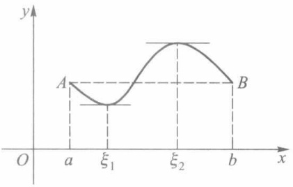

line

| Point | X-coordinate | Y-coordinate |
| --- | --- | --- |
| A | a | A |
| \(\xi1\) | \(\xi1\) | ~0.25 |
| \(\xi2\) | \(\xi2\) | ~0.75 |
| b | b | B |

图6-1

$$
f ^ {\prime} (\xi) = 0.
$$

注 定理中的三个条件缺少任何一个,结论将不一定成立(见图6-2).

作为罗尔定理的简单应用,请看下面的例子.

111

---

第六章 微分中值定理及其应用

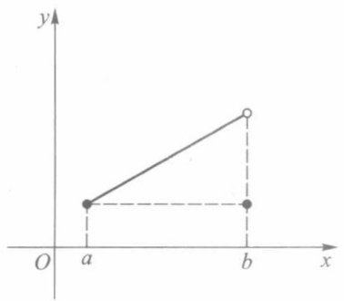

text_image

y
O a b x

缺条件(i)

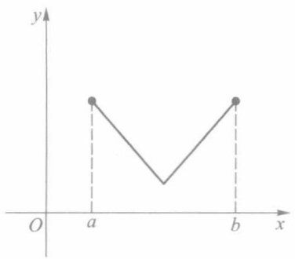

line

| X | Y |
| --- | --- |
| a | ~0.75 |
| b | ~0.75 |

缺条件(ii)

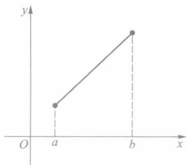

text_image

y
O a b x

缺条件(iii)

图6-2

例 1 设 f 为 R 上的可导函数, 证明: 若方程  $f'(x)=0$  没有实根, 则方程  $f(x)=0$  至多只有一个实根.

证 这可反证如下:倘若  $f(x)=0$  有两个实根  $x_{1}$  和  $x_{2}$  (设  $x_{1}<x_{2}$ ), 则函数 f 在  $[x_{1},x_{2}]$  上满足罗尔定理的三个条件, 从而存在  $\xi\in(x_{1},x_{2})$ , 使  $f'(\xi)=0$ , 这与  $f'(x)\neq0$  的假设相矛盾, 命题得证. □

定理 6.2(拉格朗日(Lagrange)中值定理) 若函数 f 满足如下条件:

(i) f 在闭区间  $[a, b]$  上连续；

(ii) f 在开区间  $(a, b)$  上可导，则在  $(a, b)$  上至少存在一点  $\xi$ ，使得

$$
f ^ {\prime} (\xi) = \frac {f (b) - f (a)}{b - a}. \tag {2}
$$

显然,特别当 $f(a)=f(b)$ 时,本定理的结论(2)即为罗尔定理的结论(1).这表明罗尔定理是拉格朗日定理的一个特殊情形.

证 作辅助函数

$$
F (x) = f (x) - f (a) - \frac {f (b) - f (a)}{b - a} (x - a).
$$

显然， $F(a)=F(b)$  （=0），且 F 在  $[a,b]$  上满足罗尔定理的另两个条件。故存在  $\xi\in(a,b)$ ，使

$$
F ^ {\prime} (\xi) = f ^ {\prime} (\xi) - \frac {f (b) - f (a)}{b - a} = 0,
$$

移项后即得到所要证明的(2)式.

拉格朗日中值定理的几何意义是:在满足定理条件的曲线  $y=f(x)$  上至少存在一点  $P(\xi,f(\xi))$ ，该曲线在该点处的切线平行于曲线两端点的连线 AB。我们在证明中引入的辅助函数  $F(x)$ ，正是曲线  $y=f(x)$  与直线  $AB(y=f(a)+\frac{f(b)-f(a)}{b-a}(x-a))$  之差（如图 6-3 所示）。

定理 6.2 的结论(公式(2))称为拉格朗日公式.

拉格朗日公式还有下面几种等价表示形式,供读者在不同场合选用:

$$
f (b) - f (a) = f ^ {\prime} (\xi) (b - a), a <   \xi <   b; \tag {3}
$$

112

---

§ 1 拉格朗日定理和函数的单调性

$$
f (b) - f (a) = f ^ {\prime} (a + \theta (b - a)) (b - a), 0 <   \theta <   1; \tag {4}
$$

$$
f (a + h) - f (a) = f ^ {\prime} (a + \theta h) h, 0 <   \theta <   1. \tag {5}
$$

值得注意的是,拉格朗日公式无论对于 a&lt;b, 还是 a&gt;b 都成立,而  $\xi$  则是介于 a 与 b 之间的某一定数.而(4)、(5)两式的特点,在于把中值点  $\xi$  表示成了  $a+\theta(b-a)$ ,使得不论 a,b 为何值, $\theta$  总可为小于 1 的某一正数.

例 2 证明: arctan b-arctan  $a \leqslant b-a$ , 其中 a < b.

证 设 $f(x) = \arctan x$ ，则

$$
f (b) - f (a) = f ^ {\prime} (\xi) (b - a) = \frac {1}{1 + \xi^ {2}} (b - a), \quad a <   \xi <   b.
$$

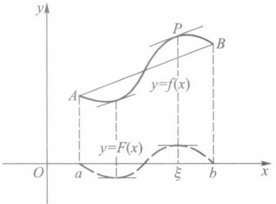

text_image

y
P
B
A
y=f(x)
y=F(x)
O
a
ξ
b
x

图6-3

从而得

$$
\arctan b - \arctan a \leqslant b - a.
$$

推论1 若函数 $f$ 在区间 $I$ 上可导，且 $f'(x) \equiv 0, x \in I$ ，则 $f$ 为 $I$ 上的一个常量函数.

证 任取两点 $x_{1}, x_{2} \in I$ (设 $x_{1} < x_{2}$), 在区间 $[x_{1}, x_{2}]$ 上应用拉格朗日定理, 存在 $\xi \in (x_{1}, x_{2}) \subset I$, 使得

$$
f \left(x _ {2}\right) - f \left(x _ {1}\right) = f ^ {\prime} (\xi) \left(x _ {2} - x _ {1}\right) = 0.
$$

这就证得 f 在区间 I 上任何两点之值相等.

由推论 1 又可进一步得到如下结论:

推论2 若函数 $f$ 和 $g$ 均在区间 $I$ 上可导，且 $f'(x) \equiv g'(x), x \in I$，则在区间 $I$ 上 $f(x)$ 与 $g(x)$ 只相差某一常数，即

$$
f \left(x\right) = g \left(x\right)   +   c \quad (c   \text {为某一常数}).
$$

推论3（导数极限定理）设函数 $f$ 在点 $x_0$ 的某邻域 $U(x_0)$ 上连续，在 $U^{\circ}(x_0)$ 上可导，且极限 $\lim_{x\to x_0}f'(x)$ 存在，则 $f$ 在点 $x_0$ 可导，且

$$
f ^ {\prime} (x _ {0}) = \lim _ {x \to x _ {0}} f ^ {\prime} (x). \tag {6}
$$

证 分别按左、右导数来证明(6)式成立.

（1）任取 $x \in U_{+}^{\circ}(x_0), f(x)$ 在 $[x_0, x]$ 上满足拉格朗日定理条件，则存在 $\xi \in (x_0, x)$，使得

$$
\frac {f (x) - f (x _ {0})}{x - x _ {0}} = f ^ {\prime} (\xi). \tag {7}
$$

由于 $x_0 < \xi < x$，因此当 $x \to x_0^+$ 时，随之有 $\xi \to x_0^+$，对(7)式两边取极限，便得

$$
\lim _ {x \to x _ {0} ^ {+}} \frac {f (x) - f (x _ {0})}{x - x _ {0}} = \lim _ {x \to x _ {0} ^ {+}} f ^ {\prime} (\xi) = f ^ {\prime} (x _ {0} + 0).
$$

(2) 同理可得  $f_{-}^{\prime}(x_{0})=f^{\prime}(x_{0}-0)$ .

因为 $\lim_{x\to x_0}f'(x) = k$ 存在，所以 $f^{\prime}(x_0 + 0) = f^{\prime}(x_0 - 0) = k$ ，从而 $f_{+}^{\prime}(x_0) = f_{-}^{\prime}(x_0) = k,$ 即 $f^{\prime}(x_0) = k.$ □

导数极限定理适合于用来求分段函数的导数.

113

---

第六章 微分中值定理及其应用

例3 求分段函数

$$
f (x) = \left\{ \begin{array}{l l} x + \sin x ^ {2}, & x \leqslant 0, \\ \ln (1 + x), & x > 0 \end{array} \right.
$$

的导数.

解 首先易得

$$
f ^ {\prime} (x) = \left\{ \begin{array}{l l} 1 + 2 x \cos x ^ {2}, & x <   0, \\ \frac {1}{1 + x}, & x > 0. \end{array} \right.
$$

进一步考虑 f 在 x=0 处的导数.在此之前,我们只能依赖导数定义来处理,现在则可以利用导数极限定理.由于

$$
\lim _ {x \to 0 ^ {+}} f (x) = \lim _ {x \to 0 ^ {+}} \ln (1 + x) = 0 = f (0),
$$

$$
\lim _ {x \to 0 ^ {-}} f (x) = \lim _ {x \to 0 ^ {-}} (x + \sin x ^ {2}) = 0 = f (0),
$$

因此 f 在 x=0 处连续, 又因

$$
f ^ {\prime} (0 - 0) = \lim _ {x \to 0 ^ {-}} (1 + 2 x \cos x ^ {2}) = 1,
$$

$$
f ^ {\prime} (0 + 0) = \lim _ {x \to 0 ^ {+}} \frac {1}{1 + x} = 1,
$$

所以 $\lim_{x\to 0}f'(x) = 1.$ 依据导数极限定理推知 $f$ 在 $x = 0$ 处可导，且 $f^{\prime}(0) = 1$

□

问题 若把例3中 $f(x)$ 在 $x \leqslant 0$ 时的函数表达式改为 $\sin x^2$，有关 $f$ 在 $x = 0$ 处的导数（或左、右导数）能得出何种结论？

## 二、单调函数

定理6.3 设 $f(x)$ 在区间 $I$ 上可导, 则 $f(x)$ 在 $I$ 上递增(减)的充要条件是

$$
f ^ {\prime} (x) \geqslant 0 (\leqslant 0).
$$

证 若 $f$ 为递增函数, 则对每一 $x_0 \in I$, 当 $x \neq x_0$ 时, 有

$$
\frac {f (x) - f (x _ {0})}{x - x _ {0}} \geqslant 0.
$$

令 $x \to x_0$，即得 $f'(x_0) \geqslant 0$.

反之，若 $f(x)$ 在区间 $I$ 上恒有 $f'(x) \geqslant 0$ ，则对任意 $x_{1}, x_{2} \in I$ （设 $x_{1} < x_{2}$），应用拉格朗日定理，存在 $\xi \in (x_{1}, x_{2}) \subset I$，使得

$$
f \left(x _ {2}\right) - f \left(x _ {1}\right) = f ^ {\prime} (\xi) \left(x _ {2} - x _ {1}\right) \geqslant 0.
$$

由此证得 f 在 I 上为递增函数.

例 4 设  $f(x)=x^{3}-x$ . 试讨论函数 f 的单调区间.

解 由于

$$
f ^ {\prime} (x) = 3 x ^ {2} - 1 = (\sqrt {3} x + 1) (\sqrt {3} x - 1),
$$

因此

当 $x \in \left(-\infty, -\frac{1}{\sqrt{3}}\right]$ 时，$f'(x) \geqslant 0, f$ 递增；

114

---

§ 1 拉格朗日定理和函数的单调性

当 $x \in \left[-\frac{1}{\sqrt{3}}, \frac{1}{\sqrt{3}}\right]$ 时, $f'(x) \leqslant 0, f$ 递减；

当 $x \in \left[\frac{1}{\sqrt{3}}, +\infty\right)$ 时, $f'(x) \geqslant 0, f$ 递增.

其图像如图 6-4 所示.

定理 6.4 若函数 f 在  $(a, b)$  上可导，则 f 在  $(a, b)$  上严格递增（递减）的充要条件是:

(i) 对一切  $x \in (a, b)$ ，有  $f'(x) \geqslant 0 \quad (f'(x) \leqslant 0)$ ;

(ii) 在  $(a, b)$  的任何子区间上  $f'(x) \neq 0$ .

我们将这个定理的证明留给读者.此定理有以下一个简单的推论.

推论 设函数在区间 I 上可微, 若  $f'(x) > 0$   $(f'(x) < 0)$ , 则 f 在 I 上严格递增(严格递减).

注 若 $f$ 在 $(a, b)$ 上（严格）递增（减），且在点 $a$ 右连续，则 $f$ 在 $[a, b)$ 上亦为（严格）递增（减），对右端点 $b$ 可类似讨论.

例5 证明不等式

$$
\mathrm{e} ^ {x} > 1 + x, x \neq 0.
$$

证 设 $f(x) = \mathrm{e}^x - 1 - x$，则 $f'(x) = \mathrm{e}^x - 1$. 故当 $x > 0$ 时，$f'(x) > 0, f$ 严格递增；当 $x < 0$，$f'(x) < 0, f$ 严格递减. 又由于 $f$ 在点 $x = 0$ 连续，则当 $x \neq 0$ 时，

$$
f (x) > f (0) = 0,
$$

从而证得

$$
\mathrm{e} ^ {x} > 1 + x, x \neq 0.
$$

定理 6.5(达布(Darboux)定理) 若函数 f 在  $[a, b]$  上可导，且  $f'_{+}(a) \neq f'_{-}(b)$ ，k 为介于  $f'_{+}(a)$ ， $f'_{-}(b)$  之间任一实数，则至少存在一点  $\xi \in (a, b)$ ，使得

$$
f ^ {\prime} (\xi) = k.
$$

证 设 $F(x) = f(x) - kx$，则 $F(x)$ 在 $[a, b]$ 上可导，且

$$
F _ {+} ^ {\prime} (a) \cdot F _ {-} ^ {\prime} (b) = (f _ {+} ^ {\prime} (a) - k) (f _ {-} ^ {\prime} (b) - k) <   0.
$$

不妨设 $F_{+}^{\prime}(a) > 0, F_{-}^{\prime}(b) < 0$. 由第五章 §1 例8, 分别存在 $x_{1} \in U_{+}^{\circ}(a), x_{2} \in U_{-}^{\circ}(b)$, 且 $x_{1} < x_{2}$, 使得

$$
F (x _ {1}) > F (a), \quad F (x _ {2}) > F (b). \tag {8}
$$

因为 $F$ 在 $[a, b]$ 上可导，所以连续。根据最大、最小值定理（定理4.6），存在一点 $\xi \in [a, b]$，使 $F$ 在点 $\xi$ 取得最大值。由(8)式，可知 $\xi \neq a, b$。这就说明 $\xi$ 是 $F$ 的极大值点。由费马定理得 $F'(\xi) = 0$，即

$$
f ^ {\prime} (\xi) = k, \quad \xi \in (a, b).
$$

有时称上述定理为导函数的介值定理.

推论 设函数 $f(x)$ 在区间 $I$ 上满足 $f'(x) \neq 0$, 那么 $f(x)$ 在区间 $I$ 上严格单调.

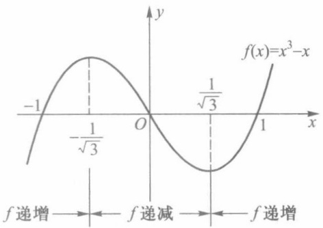

contour

| Point | Description |
| --- | --- |
| Leftmost point | \(-1/\sqrt{3}\) |
| Intersection point | O |
| Intersection point | \(1/\sqrt{3}\) |
| Rightmost point | \(f(x)=x^{3}-x\) |

图6-4

115

---

第六章 微分中值定理及其应用

## 习题 6.1

1. 试讨论下列函数在指定区间上是否存在一点 $\xi$，使 $f'(\xi) = 0$:

$$
(1) f (x) = \left\{ \begin{array}{l l} x \sin \frac {1}{x}, & 0 <   x \leqslant \frac {1}{\pi}, \\ 0, & x = 0; \end{array} \right. \quad (2) f (x) = | x |, - 1 \leqslant x \leqslant 1.
$$

2. 证明:(1) 方程 $x^{3} - 3x + c = 0$ (这里 $c$ 为常数) 在区间 $[0,1]$ 上不可能有两个不同的实根；

（2）方程 $x^{n} + px + q = 0$ （$n$ 为正整数，$p, q$ 为实数）当 $n$ 为偶数时至多有两个实根，当 $n$ 为奇数时至多有三个实根.

3. 证明定理6.2的推论2.

4. 证明:(1) 若函数 $f$ 在 $[a, b]$ 上可导，且 $f'(x) \geqslant m$，则

$$
f (b) \geqslant f (a) + m (b - a);
$$

(2) 若函数 f 在  $[a, b]$  上可导，且  $|f'(x)| \leqslant M$ ，则

$$
\mid f (b) - f (a) \mid \leqslant M (b - a);
$$

(3) 对任意实数  $x_{1}, x_{2}$ ，都有  $\left|\sin x_{1}-\sin x_{2}\right| \leqslant \left|x_{1}-x_{2}\right|$ .

5. 应用拉格朗日中值定理证明下列不等式:

(1) $\frac{b - a}{b} < \ln \frac{b}{a} < \frac{b - a}{a}$, 其中 $0 < a < b$;
(2) $\frac{h}{1+h^{2}}<\arctan h<h$ , 其中 h>0.

6. 确定下列函数的单调区间:

(1)  $f(x) = 3x - x^{2}$ ;
(2) $f(x) = 2x^{2} - \ln x$;
(3) $f(x) = \sqrt{2x - x^2}$;
(4) $f(x) = \frac{x^2 - 1}{x}$.

7. 应用函数的单调性证明下列不等式:

(1)  $\tan x > x - \frac{x^{3}}{3}, x \in \left(0, \frac{\pi}{2}\right)$ ;
(2) $\frac{2x}{\pi} < \sin x < x, x \in \left(0, \frac{\pi}{2}\right)$;
(3) $x - \frac{x^2}{2} < \ln (1 + x) < x - \frac{x^2}{2(1 + x)}, x > 0.$

8. 以 $S(x)$ 记由 $(a, f(a)), (b, f(b)), (x, f(x))$ 三点组成的三角形面积，试对 $S(x)$ 应用罗尔中值定理证明拉格朗日中值定理.
9. 设 $f$ 为 $[a, b]$ 上二阶可导函数，$f(a) = f(b) = 0$，并存在一点 $c \in (a, b)$，使得 $f(c) > 0$。证明至少存在一点 $\xi \in (a, b)$，使得 $f''(\xi) < 0$。
10. 设函数 f 在  $(a, b)$  上可导，且  $f'$  单调. 证明  $f'$  在  $(a, b)$  上连续.

11. 设 $p(x)$ 为多项式, $\alpha$ 为 $p(x) = 0$ 的 $r$ 重实根. 证明 $\alpha$ 必定是 $p'(x) = 0$ 的 $r - 1$ 重实根.

12. 证明: 设 $f$ 为 $n$ 阶可导函数, 若方程 $f(x) = 0$ 有 $n + 1$ 个相异的实根, 则方程 $f^{(n)}(x) = 0$ 至少有一个实根.

13. 设 a>0. 证明函数  $f(x)=x^{3}+ax+b$  存在唯一的零点.

14. 证明: $\frac{\tan x}{x} > \frac{x}{\sin x}, x \in \left(0, \frac{\pi}{2}\right)$.

116

---

§ 2 柯西中值定理和不定式极限

15. 证明: 若函数 $f, g$ 在区间 $[a, b]$ 上可导, 且 $f'(x) > g'(x), f(a) = g(a)$, 则在 $(a, b]$ 上有 $f(x) > g(x)$.

## § 2 柯西中值定理和不定式极限

## 一、柯西中值定理

现给出一个形式更一般的微分中值定理.

定理 6.6(柯西中值定理) 设函数 f 和 g 满足:

(i) 在  $[a, b]$  上都连续；
(ii) 在  $(a, b)$  上都可导；
(iii)  $f'(x)$  和  $g'(x)$  不同时为零；
(iv)  $g(a) \neq g(b)$ ,

则存在 $\xi \in (a,b)$ ，使得

$$
\frac {f ^ {\prime} (\xi)}{g ^ {\prime} (\xi)} = \frac {f (b) - f (a)}{g (b) - g (a)}. \tag {1}
$$

证 作辅助函数

$$
F (x) = f (x) - f (a) - \frac {f (b) - f (a)}{g (b) - g (a)} (g (x) - g (a)).
$$

易见 $F$ 在 $[a,b]$ 上满足罗尔定理条件，故存在 $\xi \in (a,b)$，使得

$$
F ^ {\prime} (\xi) = f ^ {\prime} (\xi) - \frac {f (b) - f (a)}{g (b) - g (a)} g ^ {\prime} (\xi) = 0.
$$

因为 $g'(\xi) \neq 0$ （否则由上式 $f'(\xi)$ 也为零），所以可把上式改写成(1)式.

柯西中值定理有与前两个中值定理相类似的几何意义.只是现在要把 $f,g$ 这两个函数写作以 $x$ 为参量的参量方程

$$
\left\{ \begin{array}{l} u = g (x), \\ v = f (x), \end{array} \right.
$$

它在 uOv 平面上表示一段曲线(图6-5). 由于(1)式右边的  $\frac{f(b)-f(a)}{g(b)-g(a)}$  表示连接该曲线两端的弦 AB 的斜率, 而(1)式左边的

$$
\frac {f ^ {\prime} (\xi)}{g ^ {\prime} (\xi)} = \frac {\mathrm{d} v}{\mathrm{d} u} \Bigg | _ {x = \xi}
$$

则表示该曲线上与  $x=\xi$  相对应的一点  $C(g(\xi), f(\xi))$  处的切线的斜率. 因此(1)式即表示上述切线与弦 AB 互相平行.

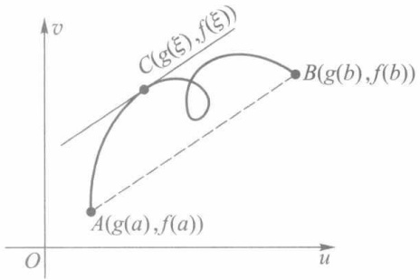

text_image

v
C(g(ξ),f(ξ))
B(g(b),f(b))
A(g(a),f(a))
O
u

图6-5

例1 设函数 $f$ 在 $[a, b]$ ($a > 0$) 上连续，在 $(a, b)$ 上可导，则存在 $\xi \in (a, b)$，使得

117

---

第六章 微分中值定理及其应用

$$
f (b) - f (a) = \xi f ^ {\prime} (\xi) \ln \frac {b}{a}. \tag {2}
$$

证 设 $g(x) = \ln x$，显然它在 $[a, b]$ 上与 $f(x)$ 一起满足柯西中值定理条件，于是存在 $\xi \in (a, b)$，使得

$$
\frac {f (b) - f (a)}{\ln b - \ln a} = \frac {f ^ {\prime} (\xi)}{\frac {1}{\xi}}.
$$

上式整理后便得到所要证明的(2)式.

例2 设 $f$ 在区间 $(0,1]$ 上可导，$\lim_{x\to 0^{+}}\sqrt{xf'(x)} = A.$ 证明:$f$ 在区间 $(0,1]$ 上一致连续.

证 设 $M = |A| + 1$. 因为 $\lim_{x \to 0^{+}} \sqrt{x} f'(x) = A$，所以存在 $\delta_1 (0 < \delta_1 < 1)$，当 $0 < x < \delta_1$ 时，$\left|\sqrt{x} f'(x)\right| < M$. 那么对任意的 $x, y \in (0, \delta_1]$, $x < y$，由柯西中值定理，存在 $\xi$，使

$$
\left| \frac {f (x) - f (y)}{\sqrt {x} - \sqrt {y}} \right| = 2 \left| \sqrt {\xi} f ^ {\prime} (\xi) \right| \leqslant 2 M, \quad 0 <   x <   \xi <   y \leqslant \delta_ {1}.
$$

由此

$$
\left| f (x) - f (y) \right| \leqslant 2 M \left| \sqrt {x} - \sqrt {y} \right|.
$$

因为函数 $\sqrt{x}$ 在区间 $(0, \delta_1]$ 上一致连续，所以 $f(x)$ 亦在 $(0, \delta_1]$ 上一致连续。又 $f(x)$ 在 $[\delta_1, 1]$ 上连续，从而为一致连续，故函数 $f$ 在区间 $(0, 1]$ 上一致连续。

## 二、不定式极限

我们在第三章学习无穷小(大)量阶的比较时,已经遇到过两个无穷小(大)量之比的极限.由于这种极限可能存在,也可能不存在,因此我们把两个无穷小量或两个无穷大量之比的极限统称为不定式极限,分别记为 $\frac{0}{0}$ 型或 $\frac{\infty}{\infty}$ 型的不定式极限.现在我们将以导数为工具研究不定式极限,这个方法通常称为洛必达(L'Hospital)法则.柯西中值定理则是建立洛必达法则的理论依据.

1. $\frac{0}{0}$ 型不定式极限

定理6.7 若函数 $f$ 和 $g$ 满足:

(i) $\lim_{x\to x_0}f(x) = \lim_{x\to x_0}g(x) = 0;$
(ii) 在点 $x_0$ 的某空心邻域 $U^{\circ}(x_0)$ 上两者都可导，且 $g'(x) \neq 0$
(iii) $\lim_{x\to x_0}\frac{f'(x)}{g'(x)} = A(A$ 可为实数，也可为 $\pm \infty$ 或 $\infty)$

则

$$
\lim _ {x \to x _ {0}} \frac {f (x)}{g (x)} = \lim _ {x \to x _ {0}} \frac {f ^ {\prime} (x)}{g ^ {\prime} (x)} = A.
$$

证 补充定义 $f(x_0) = g(x_0) = 0$ ，使得 $f$ 与 $g$ 在点 $x_0$ 连续.任取 $x\in U^{\circ}(x_0)$ ，在区间$[x_0,x]$ （或 $[x,x_0]$ ）上应用柯西中值定理，有

$$
\frac {f (x) - f (x _ {0})}{g (x) - g (x _ {0})} = \frac {f ^ {\prime} (\xi)}{g ^ {\prime} (\xi)},
$$

118

---

§ 2 柯西中值定理和不定式极限

即

$$
\frac {f (  x  )}{g (  x  )} = \frac {f ^ {\prime} (  \xi  )}{g ^ {\prime} (  \xi  )} \quad (\xi   \text {介于}   x _ {0}   \text {与}   x   \text {之间}).
$$

当令 $x \to x_0$ 时，也有 $\xi \to x_0$ ，故得

$$
\lim _ {x \to x _ {0}} \frac {f (x)}{g (x)} = \lim _ {x \to x _ {0}} \frac {f ^ {\prime} (\xi)}{g ^ {\prime} (\xi)} = \lim _ {x \to x _ {0}} \frac {f ^ {\prime} (x)}{g ^ {\prime} (x)} = A.
$$

注意 若将定理 6.7 中  $x \rightarrow x_{0}$  换成  $x \rightarrow x_{0}^{+}, x \rightarrow x_{0}^{-}, x \rightarrow \pm\infty, x \rightarrow \infty$ ，只要相应地修正条件(ii)中的邻域，也可得到同样的结论.

例3 求 $\lim_{x\to \pi}\frac{1 + \cos x}{\tan^2x}.$

解 容易检验 $f(x) = 1 + \cos x$ 与 $g(x) = \tan^2 x$ 在点 $x_0 = \pi$ 的邻域上满足定理6.7的条件(i)和(ii)，又因

$$
\lim _ {x \to \pi} \frac {f ^ {\prime} (x)}{g ^ {\prime} (x)} = \lim _ {x \to \pi} \frac {- \sin x}{2 \tan x \sec^ {2} x} = - \lim _ {x \to \pi} \frac {\cos^ {3} x}{2} = \frac {1}{2},
$$

故由洛必达法则求得

$$
\lim _ {x \to \pi} \frac {f (x)}{g (x)} = \lim _ {x \to \pi} \frac {f ^ {\prime} (x)}{g ^ {\prime} (x)} = \frac {1}{2}.
$$

如果 $\lim_{x\to x_0}\frac{f'(x)}{g'(x)}$ 仍是 $\frac{0}{0}$ 型不定式极限，只要有可能，我们可再次用洛必达法则，即考察极限 $\lim_{x\to x_0}\frac{f'(x)}{g'(x)}$ 是否存在.当然这时 $f'$ 和 $g'$ 在点 $x_0$ 的某邻域上必须满足定理6.7的条件.

例4 求 $\lim_{x\to 0}\frac{\mathrm{e}^x - (1 + 2x)^{\frac{1}{2}}}{\ln(1 + x^2)}.$

解 利用 $\ln (1 + x^2)\sim x^2 (x\to 0)$ ，则得

$$
\begin{array}{l} \lim _ {x \to 0} \frac {\mathrm{e} ^ {x} - (1 + 2 x) ^ {\frac {1}{2}}}{\ln (1 + x ^ {2})} = \lim _ {x \to 0} \frac {\mathrm{e} ^ {x} - (1 + 2 x) ^ {\frac {1}{2}}}{x ^ {2}} = \lim _ {x \to 0} \frac {\mathrm{e} ^ {x} - (1 + 2 x) ^ {- \frac {1}{2}}}{2 x} \\ = \lim _ {x \to 0} \frac {\mathrm{e} ^ {x} + (1 + 2 x) ^ {- \frac {3}{2}}}{2} = \frac {2}{2} = 1. \\ \end{array}
$$

例5 求 $\lim_{x\to 0^{+}}\frac{\sqrt{x}}{1 - \mathrm{e}^{\sqrt{x}}}.$

解 这是 $\frac{0}{0}$ 型不定式极限, 可直接运用洛必达法则求解. 但若作适当变换, 在计算上可方便些. 为此, 令 $t = \sqrt{x}$, 当 $x \to 0^{+}$时有 $t \to 0^{+}$, 于是有

119

---

第六章 微分中值定理及其应用

$$
\lim _ {x \to 0 ^ {+}} \frac {\sqrt {x}}{1 - \mathrm{e} ^ {\sqrt {x}}} = \lim _ {t \to 0 ^ {+}} \frac {t}{1 - \mathrm{e} ^ {t}} = \lim _ {t \to 0 ^ {+}} \frac {1}{- \mathrm{e} ^ {t}} = - 1.
$$

## 2. $\frac{\bullet}{\infty}$ 型不定式极限

定理6.8 若函数 $f$ 和 $g$ 满足:

(i) 在  $x_{0}$  的某个右邻域  $U_{+}^{\circ}(x_{0})$  上两者可导，且  $g'(x) \neq 0$ ;

(ii)  $\lim_{x\to x_{0}^{+}}g(x)=\infty;$

(iii)  $\lim_{x\to x_{0}^{+}}\frac{f'(x)}{g'(x)}=A(A$  可为实数,也可为  $\pm\infty,\infty)$ ,

则

$$
\lim _ {x \to x _ {0} ^ {+}} \frac {f (x)}{g (x)} = A.
$$

证 先设 $A$ 为实数, 由 (iii), 对任意正数 $\varepsilon$, 存在 $x_{1} \in U_{+}^{\circ}(x_{0})$, 对满足不等式 $x_{0} < x < x_{1}$ 的每一个 $x$, 有

$$
A - \frac {\varepsilon}{2} <   \frac {f ^ {\prime} (x)}{g ^ {\prime} (x)} <   A + \frac {\varepsilon}{2}, \tag {3}
$$

由条件(ii), $f$ 和 $g$ 在区间 $[x, x_1]$ 上满足柯西中值定理, 故存在 $\xi \in (x, x_1) \subset (x_0, x_1)$, 使得

$$
A - \frac {\varepsilon}{2} <   \left(\frac {f (x)}{g (x)} - \frac {f (x _ {1})}{g (x)}\right) \left(\frac {g (x)}{g (x) - g (x _ {1})}\right) = \frac {f (x) - f (x _ {1})}{g (x) - g (x _ {1})} = \frac {f ^ {\prime} (\xi)}{g ^ {\prime} (\xi)} <   A + \frac {\varepsilon}{2}. \tag {4}
$$

因为 $\lim_{x\to x_0^+}\frac{g(x)}{g(x) - g(x_1)} = 1$ ，所以由保号性，存在正数 $\delta_1(< x_1 - x_0)$ ，使得当 $x_0 <   x <   x_0 + \delta_1$ 时，$\frac{g(x)}{g(x) - g(x_1)} >0$ ，再根据(4)式可得

$$
\left(1 - \frac {g (x _ {1})}{g (x)}\right) \left(A - \frac {\varepsilon}{2}\right) + \frac {f (x _ {1})}{g (x)} <   \frac {f (x)}{g (x)} <   \left(1 - \frac {g (x _ {1})}{g (x)}\right) \left(A + \frac {\varepsilon}{2}\right) + \frac {f (x _ {1})}{g (x)}. \tag {5}
$$

又因为  $\lim_{x\to x_{0}^{+}}g(x)=\infty$  ,所以

$$
\lim _ {x \to x _ {0} ^ {+}} \left(\left(1 - \frac {g (x _ {1})}{g (x)}\right) \left(A - \frac {\varepsilon}{2}\right) + \frac {f (x _ {1})}{g (x)}\right) = A - \frac {\varepsilon}{2},
$$

$$
\lim _ {x \to x _ {0} ^ {+}} \left(\left(1 - \frac {g (x _ {1})}{g (x)}\right) \left(A + \frac {\varepsilon}{2}\right) + \frac {f (x _ {1})}{g (x)}\right) = A + \frac {\varepsilon}{2}.
$$

再由保号性得知:存在正数  $\delta(<\delta_{1})$ ，当  $x_{0}<x<x_{0}+\delta$  时，有

$$
A - \varepsilon <   \frac {f (x)}{g (x)} <   A + \varepsilon ,
$$

这样就证明了

120

---

§ 2 柯西中值定理和不定式极限

$$
\lim _ {x \to x _ {0} ^ {+}} \frac {f (x)}{g (x)} = A.
$$

类似地可以证明当 $A = \pm \infty$ 或 $\infty$ 的情形，这里就不再赘述了.

定理 6.8 对于  $x \rightarrow x_{0}^{-}, x \rightarrow x_{0}$  或  $x \rightarrow \pm\infty, x \rightarrow \infty$  等情形也有相同的结论.

如果 $f'$ ,  $g'$ ,  $f''$ ,  $g''$ 满足相应条件, 我们可以再次应用定理6.8.

例 6 求  $\lim_{x\to+\infty}\frac{\ln x}{x}$ .

解 由定理6.8,有

$$
\lim _ {x \to + \infty} \frac {\ln x}{x} = \lim _ {x \to + \infty} \frac {(\ln x) ^ {\prime}}{(x) ^ {\prime}} = \lim _ {x \to + \infty} \frac {1}{x} = 0.
$$

例7 求 $\lim_{x\to +\infty}\frac{\mathrm{e}^x}{x^3}$

解 $\lim_{x\to +\infty}\frac{\mathrm{e}^x}{x^3} = \lim_{x\to +\infty}\frac{\mathrm{e}^x}{3x^2} = \lim_{x\to +\infty}\frac{\mathrm{e}^x}{6x} = \lim_{x\to +\infty}\frac{\mathrm{e}^x}{6} = +\infty .$

例8 设 $f(x)$ 在区间 $[0, +\infty)$ 上可导，$\lim_{x \to +\infty} [f(x) + f'(x)] = A.$ 证明:$\lim_{x \to +\infty} f(x) = A.$ 证 因为 $\lim_{x \to +\infty} e^x = +\infty$，所以由定理6.8得

$$
\lim _ {x \to + \infty} f (x) = \lim _ {x \to + \infty} \frac {\mathrm{e} ^ {x} f (x)}{\mathrm{e} ^ {x}} = \lim _ {x \to + \infty} \frac {\mathrm{e} ^ {x} [ f (x) + f ^ {\prime} (x) ]}{\mathrm{e} ^ {x}} = \lim _ {x \to + \infty} [ f (x) + f ^ {\prime} (x) ] = A.
$$

注1 若 $\lim_{x\to x_0}\frac{f'(x)}{g'(x)}$ 不存在，并不能说明 $\lim_{x\to x_0}\frac{f(x)}{g(x)}$ 不存在.（试想，这是为什么？）

注2 不能对任何比式极限都按洛必达法则求解.首先必须注意它是不是不定式极限,其次是否满足洛必达法则的其他条件.

下面这个简单的极限

$$
\lim _ {x \to \infty} \frac {x + \sin x}{x} = 1
$$

虽然是 $\frac{\infty}{\infty}$ 型,但若不顾条件随便使用洛必达法则:

$$
\lim _ {x \to + \infty} \frac {x + \sin x}{x} = \lim _ {x \to + \infty} \frac {1 + \cos x}{1},
$$

就会因右式的极限不存在而推出原极限不存在的错误结论.

## 3. 其他类型不定式极限

不定式极限还有 $0 \cdot \infty, 1^{\infty}, 0^{0}, \infty^{0}, \infty - \infty$ 等类型. 经过简单变换, 它们一般均可化为 $\frac{0}{0}$ 型或 $\frac{\infty}{\infty}$ 型的极限.

例 9 求  $\lim_{x\to0^{+}}x\ln x$ .

解 这是一个 $0 \cdot \infty$ 型不定式极限. 用恒等变形 $x \ln x = \frac{\ln x}{\frac{1}{x}}$ 将它转化为 $\frac{\infty}{\infty}$ 型的不定

121

---

第六章 微分中值定理及其应用

式极限,并应用洛必达法则得到

$$
\lim _ {x \to 0 ^ {+}} x \ln x = \lim _ {x \to 0 ^ {+}} \frac {\ln x}{\frac {1}{x}} = \lim _ {x \to 0 ^ {+}} \frac {\frac {1}{x}}{- \frac {1}{x ^ {2}}} = \lim _ {x \to 0 ^ {+}} (- x) = 0.
$$

例 10 求  $\lim_{x\to0}(\cos x)^{\frac{1}{x^{2}}}$ .

解 这是一个 $1^{\infty}$ 型不定式极限.作恒等变形

$$
(\cos x) ^ {\frac {1}{x ^ {2}}} = \mathrm{e} ^ {\frac {1}{x ^ {2}} \ln \cos x},
$$

其指数部分的极限 $\lim_{x\to 0}\frac{1}{x^2}\ln \cos x$ 是 $\frac{0}{0}$ 型不定式极限，可先求得

$$
\lim _ {x \to 0} \frac {\ln \cos x}{x ^ {2}} = \lim _ {x \to 0} \frac {- \tan x}{2 x} = - \frac {1}{2},
$$

从而得到

$$
\lim _ {x \to 0} (\cos x) ^ {\frac {1}{x ^ {2}}} = \mathrm{e} ^ {- \frac {1}{2}}.
$$

例 11 求  $\lim_{x\to0^{+}}(\sin x)^{\frac{k}{1+\ln x}}$  (k 为常数).

解 这是一个 $0^0$ 型不定式极限, 按上例变形的方法, 先求 $\frac{\infty}{\infty}$ 型极限:

$$
\lim _ {x \to 0 ^ {+}} \frac {k \ln \sin x}{1 + \ln x} = \lim _ {x \to 0 ^ {+}} \frac {\frac {k \cos x}{\sin x}}{\frac {1}{x}} = \lim _ {x \to 0 ^ {+}} k \cos x \cdot \frac {x}{\sin x} = k,
$$

然后得到

$$
\lim _ {x \to 0 ^ {+}} (\sin x) ^ {\frac {k}{1 + \ln x}} = \mathrm{e} ^ {k} \quad (k \neq 0).
$$

当 k=0 时上面所得的结果显然成立.

例 12 求  $\lim_{x\to+\infty}\left(x+\sqrt{1+x^{2}}\right)^{\frac{1}{\ln x}}$ .

解 这是一个 $\infty^0$ 型不定式极限. 类似地先求其对数的极限 $\left(\frac{\infty}{\infty}\right)$:

$$
\lim _ {x \to + \infty} \frac {\ln (  x   +   \sqrt {1   +   x ^ {2}}  )}{\ln   x} = \lim _ {x \to + \infty} \frac {\frac {1}{\sqrt {1   +   x ^ {2}}}}{\frac {1}{x}} = 1,
$$

于是有

$$
\lim _ {x \to + \infty} (x + \sqrt {1 + x ^ {2}}) ^ {\frac {1}{\ln x}} = \mathrm{e}.
$$

例 13 求  $\lim_{x\to1}\left(\frac{1}{x-1}-\frac{1}{\ln x}\right)$ .

122

---

§ 2 柯西中值定理和不定式极限

解 这是一个 $\infty -\infty$ 型不定式极限，通分后化为 $\frac{0}{0}$ 型的极限，即

$$
\begin{array}{l} \lim _ {x \to 1} \left(\frac {1}{x - 1} - \frac {1}{\ln x}\right) = \lim _ {x \to 1} \frac {\ln x - x + 1}{(x - 1) \ln x} = \lim _ {x \to 1} \frac {\frac {1}{x} - 1}{\frac {x - 1}{x} + \ln x} \\ = \lim _ {x \to 1} \frac {1 - x}{x - 1 + x \ln x} = \lim _ {x \to 1} \frac {- 1}{2 + \ln x} = - \frac {1}{2}. \\ \end{array}
$$

例14 设

$$
f (x) = \left\{ \begin{array}{l l} \frac {g (x)}{x}, & x \neq 0, \\ 0, & x = 0, \end{array} \right.
$$

且已知 $g(0) = g'(0) = 0, g''(0) = 3$，试求 $f'(0)$.

解 因为

$$
\frac {f (x) - f (0)}{x - 0} = \frac {g (x)}{x ^ {2}},
$$

所以由洛必达法则得

$$
\begin{array}{l} f ^ {\prime} (0) = \lim _ {x \to 0} \frac {g (x)}{x ^ {2}} = \lim _ {x \to 0} \frac {g ^ {\prime} (x)}{2 x} \\ = \frac {1}{2} \lim _ {x \to 0} \frac {g ^ {\prime} (x) - g ^ {\prime} (0)}{x - 0} = \frac {1}{2} g ^ {\prime \prime} (0) = \frac {3}{2}. \\ \end{array}
$$

问题两则:

(1) 上例解法中, 已知条件  $g(0)=0$  用在何处?
(2) 如果用两次洛必达法则, 得到

$$
\begin{array}{l} f ^ {\prime} (0) = \dots = \lim _ {x \to 0} \frac {g ^ {\prime} (x)}{2 x} \\ = \lim _ {x \to 0} \frac {g ^ {\prime \prime} (x)}{2} = \frac {1}{2} g ^ {\prime \prime} (0) = \frac {3}{2}. \\ \end{array}
$$

错在何处？

最后指出,对于数列的不定式极限,可利用函数极限的归结原则,通过先求相应形式的函数极限而得到结果.

例 15 求数列极限  $\lim_{n\to\infty}\left(1+\frac{1}{n}+\frac{1}{n^{2}}\right)^{n}$ .

解 先求函数极限 $\lim_{x\to +\infty}\left(1 + \frac{1}{x} +\frac{1}{x^2}\right)^x$ （$1^\infty$型）.类似于例10，取对数后的极限为

$$
\lim _ {x \to + \infty} x \ln \left(1 + \frac {1}{x} + \frac {1}{x ^ {2}}\right) = \lim _ {x \to + \infty} \frac {\ln (1 + x + x ^ {2}) - \ln x ^ {2}}{\frac {1}{x}}
$$

123

---

第六章 微分中值定理及其应用

$$
= \lim _ {x \to + \infty} \frac {\frac {2 x + 1}{1 + x + x ^ {2}} - \frac {2}{x}}{- \frac {1}{x ^ {2}}} = \lim _ {x \to + \infty} \frac {x ^ {2} + 2 x}{x ^ {2} + x + 1} = 1,
$$

所以由归结原则可得

$$
\lim _ {n \to \infty} \left(1 + \frac {1}{n} + \frac {1}{n ^ {2}}\right) ^ {n} = \lim _ {x \to + \infty} \left(1 + \frac {1}{x} + \frac {1}{x ^ {2}}\right) ^ {x} = \mathrm{e}.
$$

注意 不能在数列形式下直接用洛必达法则,因为对离散变量  $n \in N_{+}$  求导数是没有意义的.

## 习题 6.2

1. 试问函数 $f(x) = x^2, g(x) = x^3$ 在区间 $[-1, 1]$ 上能否应用柯西中值定理得到相应的结论，为什么？

2. 设函数 $f$ 在 $[a, b]$ 上连续，在 $(a, b)$ 上可导. 证明:存在 $\xi \in (a, b)$，使得

$$
2 \xi [ f (b) - f (a) ] = (b ^ {2} - a ^ {2}) f ^ {\prime} (\xi).
$$

3. 设函数 f 在点 a 处具有连续的二阶导数. 证明:

$$
\lim _ {h \to 0} \frac {f (a + h) + f (a - h) - 2 f (a)}{h ^ {2}} = f ^ {\prime \prime} (a).
$$

4. 设 $0 < \alpha < \beta < \frac{\pi}{2}$. 证明存在 $\theta \in (\alpha, \beta)$, 使得

$$
\frac {\sin \alpha - \sin \beta}{\cos \beta - \cos \alpha} = \cot \theta .
$$

5. 求下列不定式极限:

(1)  $\lim_{x\to0}\frac{e^{x}-1}{\sin x};$

(2)  $\lim_{x\to\frac{\pi}{6}}\frac{1-2\sin x}{\cos3x}$ ;

(3)  $\lim_{x\to0}\frac{\ln(1+x)-x}{\cos x-1}$ ;

(4)  $\lim_{x\to0}\frac{\tan x-x}{x-\sin x}$ ;

(5)  $\lim_{x\to\frac{\pi}{2}}\frac{\tan x-6}{\sec x+5}$ ;

(6)  $\lim_{x\to0}\left(\frac{1}{x}-\frac{1}{\mathrm{e}^{x}-1}\right)$ ;

(7)  $\lim_{x\to0}(\tan x)^{\sin x};$

(8)  $\lim_{x\to1}x^{\frac{1}{1-x}}$ ;

(9)  $\lim_{x\to0}(1+x^{2})^{\frac{1}{x}}$ ;

(10)  $\lim_{x\to0^{+}}\sin x\ln x;$

(11) $\lim_{x\to 0}\left(\frac{1}{x^2} -\frac{1}{\sin^2x}\right);$

(12) $\lim_{x\to 0}\left(\frac{\tan x}{x}\right)^{\frac{1}{x^2}}.$

6. 设函数 $f$ 在点 $a$ 的某个邻域上具有二阶导数. 证明: 对充分小的 $h$, 存在 $\theta, 0 < \theta < 1$, 使得

$$
\frac {f (a + h) + f (a - h) - 2 f (a)}{h ^ {2}} = \frac {f ^ {\prime \prime} (a + \theta h) + f ^ {\prime \prime} (a - \theta h)}{2}.
$$

7. 求下列不定式极限:

(1)  $\lim_{x\to1}\frac{\ln\cos(x-1)}{1-\sin\frac{\pi x}{2}}$ ;

(2) $\lim_{x\to +\infty}(\pi - 2\arctan x)\ln x;$

124

---

§ 3 泰勒公式

(3)  $\lim_{x\to0^{+}}x^{\sin x}$ ;

(4)  $\lim_{x\to\frac{\pi}{4}}(\tan x)^{\tan2x};$

(5)  $\lim_{x\to0}\left(\frac{\ln(1+x)^{(1+x)}}{x^{2}}-\frac{1}{x}\right)$ ;

(6)  $\lim_{x\to0}\left(\cot x-\frac{1}{x}\right)$ ;

(7)  $\lim_{x\to0}\frac{(1+x)^{\frac{1}{x}}-e}{x}$ ;

(8) $\lim_{x\to +\infty}\left(\frac{\pi}{2} -\arctan x\right)^{\frac{1}{\ln x}}.$

8. 设 $f(0) = 0, f'$ 在原点的某邻域上连续，且 $f'(0) \neq 0$. 证明:

$$
\lim _ {x \to 0 ^ {+}} x ^ {f (x)} = 1.
$$

9. 证明定理 6.7 中  $\lim_{x\to+\infty}f(x)=0,\quad\lim_{x\to+\infty}g(x)=0$  情形时的洛必达法则.

10. 证明: $f(x) = x^3 \mathrm{e}^{-x^2}$ 为有界函数.

## §3 泰勒公式

多项式函数是各类函数中最简单的一种,用多项式逼近函数是近似计算和理论分析的一个重要内容.

## 一、带有佩亚诺型余项的泰勒公式

我们在学习导数和微分概念时已经知道,如果函数f在点 $x_{0}$ 可导,则有

$$
f (x) = f (x _ {0}) + f ^ {\prime} (x _ {0}) (x - x _ {0}) + o (x - x _ {0}).
$$

即在点 $x_0$ 附近，用一次多项式 $f(x_0) + f'(x_0)(x - x_0)$ 逼近函数 $f(x)$ 时，其误差为 $(x - x_0)$ 的高阶无穷小量.然而在很多场合，取一次多项式逼近是不够的，往往需要用二次或高于二次的多项式去逼近，并要求误差为 $o((x - x_0)^n)$，其中 $n$ 为多项式的次数.为此，我们考察任一 $n$ 次多项式

$$
p _ {n} (x) = a _ {0} + a _ {1} (x - x _ {0}) + a _ {2} (x - x _ {0}) ^ {2} + \dots + a _ {n} (x - x _ {0}) ^ {n}. \tag {1}
$$

逐次求它在点 $x_0$ 的各阶导数，得到

$$
p _ {n} (x _ {0}) = a _ {0}, p _ {n} ^ {\prime} (x _ {0}) = a _ {1}, p _ {n} ^ {\prime \prime} (x _ {0}) = 2! a _ {2}, \dots , p _ {n} ^ {(n)} (x _ {0}) = n! a _ {n},
$$

即

$$
a _ {0} = p _ {n} (x _ {0}), a _ {1} = \frac {p _ {n} ^ {\prime} (x _ {0})}{1 !}, a _ {2} = \frac {p _ {n} ^ {\prime \prime} (x _ {0})}{2 !}, \dots , a _ {n} = \frac {p _ {n} ^ {(n)} (x _ {0})}{n !}.
$$

由此可见，多项式 $p_n(x)$ 的各项系数由其在点 $x_0$ 的各阶导数值所唯一确定.

对于一般函数 $f$ ，设它在点 $x_0$ 存在直到 $n$ 阶的导数.由这些导数构造一个 $n$ 次多项式

$$
\begin{array}{l} T _ {n} (x) = f (x _ {0}) + \frac {f ^ {\prime} (x _ {0})}{1 !} (x - x _ {0}) + \frac {f ^ {\prime \prime} (x _ {0})}{2 !} (x - x _ {0}) ^ {2} + \dots + \\ \frac {f ^ {(n)} (x _ {0})}{n !} (x - x _ {0}) ^ {n}, \tag {2} \\ \end{array}
$$

称为函数 f 在点  $x_{0}$  的泰勒 (Taylor) 多项式,  $T_{n}(x)$  的各项系数  $\frac{f^{(k)}(x_{0})}{k!}(k=1,2,\cdots,n)$  称

125

---

第六章 微分中值定理及其应用

为泰勒系数.由上面对多项式系数的讨论,易知 $f(x)$ 与其泰勒多项式 $T_{n}(x)$ 在点 $x_{0}$ 有相同的函数值和相同的直至n阶导数值,即

$$
f ^ {(k)} (x _ {0}) = T _ {n} ^ {(k)} (x _ {0}), k = 0, 1, 2, \dots , n. \tag {3}
$$

下面将要证明 $f(x) - T_{n}(x) = o((x - x_{0})^{n})$ ，即以(2)式所示的泰勒多项式逼近 $f(x)$ 时，其误差为关于 $(x - x_0)^n$ 的高阶无穷小量.

定理6.9 若函数 $f$ 在点 $x_0$ 存在直至 $n$ 阶导数，则有 $f(x) = T_n(x) + o((x - x_0)^n)$，即

$$
f (x) = f (x _ {0}) + f ^ {\prime} (x _ {0}) (x - x _ {0}) + \frac {f ^ {\prime \prime} (x _ {0})}{2 !} (x - x _ {0}) ^ {2} + \dots +
$$

$$
\frac {f ^ {(n)} (x _ {0})}{n !} (x - x _ {0}) ^ {n} + o ((x - x _ {0}) ^ {n}). \tag {4}
$$

证设

$$
R _ {n} (x) = f (x) - T _ {n} (x), Q _ {n} (x) = (x - x _ {0}) ^ {n},
$$

现在只要证

$$
\lim _ {x \to x _ {0}} \frac {R _ {n} (x)}{Q _ {n} (x)} = 0.
$$

由关系式(3)可知，

$$
R _ {n} (x _ {0}) = R _ {n} ^ {\prime} (x _ {0}) = \dots = R _ {n} ^ {(n)} (x _ {0}) = 0,
$$

并易知

$$
Q _ {n} (x _ {0}) = Q _ {n} ^ {\prime} (x _ {0}) = \dots = Q _ {n} ^ {(n - 1)} (x _ {0}) = 0, Q _ {n} ^ {(n)} (x _ {0}) = n!.
$$

因为 $f^{(n)}(x_0)$ 存在，所以在点 $x_0$ 的某邻域 $U(x_0)$ 上 $f$ 存在 $n - 1$ 阶导函数.于是，当 $x\in U^{\circ}(x_0)$ 且 $x\to x_0$ 时，允许接连使用洛必达法则 $n - 1$ 次，得到

$$
\begin{array}{l} \lim _ {x \to x _ {0}} \frac {R _ {n} (x)}{Q _ {n} (x)} = \lim _ {x \to x _ {0}} \frac {R _ {n} ^ {\prime} (x)}{Q _ {n} ^ {\prime} (x)} = \dots = \lim _ {x \to x _ {0}} \frac {R _ {n} ^ {(n - 1)} (x)}{Q _ {n} ^ {(n - 1)} (x)} \\ = \lim _ {x \to x _ {0}} \frac {f ^ {(n - 1)} (x) - f ^ {(n - 1)} (x _ {0}) - f ^ {(n)} (x _ {0}) (x - x _ {0})}{n (n - 1) \cdots 2 (x - x _ {0})} \\ = \frac {1}{n !} \lim _ {x \to x _ {0}} \left[ \frac {f ^ {(n - 1)} (x) - f ^ {(n - 1)} (x _ {0})}{x - x _ {0}} - f ^ {(n)} (x _ {0}) \right] \\ = 0. \\ \end{array}
$$

定理所证的(4)式称为函数 $f$ 在 $x_0$ 的泰勒公式，$R_{n}(x) = f(x) - T_{n}(x)$ 称为泰勒公式的余项，形如 $o((x - x_0)^n)$ 的余项称为佩亚诺(Peano)型余项.所以(4)式又称为带有佩亚诺型余项的泰勒公式.

注1 若 $f(x)$ 在 $x_0$ 附近满足

$$
f (x) = p _ {n} (x) + o ((x - x _ {0}) ^ {n}), \tag {5}
$$

其中 $p_n(x)$ 为(1)式所示的 $n$ 阶多项式，这时并不意味着 $p_n(x)$ 必定就是 $f$ 的泰勒多项式 $T_{n}(x)$.例如

$$
f (x) = x ^ {n + 1} D (x), n \in \mathbf {N} _ {+},
$$

其中  $D(x)$  为狄利克雷函数. 不难知道,  $f(x)$  在 x=0 处除了  $f'(0)=0$  外不再存在其他任何阶导数 (为什么?). 因此无法构造出一个高于一次的泰勒多项式  $T_{n}(x)$ , 但因

126

---

§ 3 泰勒公式 |||

$$
\lim _ {x \to 0} \frac {f (x)}{x ^ {n}} = \lim _ {x \to 0} x D (x) = 0,
$$

即 $f(x) = o(x^n)$，所以若取

$$
p _ {n} (x) = 0 + 0 \cdot x + 0 \cdot x ^ {2} + \dots + 0 \cdot x ^ {n} \equiv 0
$$

时，(5)式对任何 $n\in \mathbf{N}_{+}$ 恒成立.

注2 满足(5)式要求(即带有佩亚诺型误差)的 $n$ 次逼近多项式 $p_n(x)$ 是唯一的.

综合定理 6.9 和上述注 2, 若函数 f 满足定理 6.9 的条件时, 满足 (5) 式要求的逼近多项式  $p_{n}(x)$  只可能是 f 的泰勒多项式  $T_{n}(x)$ .

以后用得较多的是泰勒公式(4)在 $x_{0}=0$ 时的特殊形式:

$$
f (x) = f (0) + f ^ {\prime} (0) x + \frac {f ^ {\prime \prime} (0)}{2 !} x ^ {2} + \dots + \frac {f ^ {(n)} (0)}{n !} x ^ {n} + o (x ^ {n}). \tag {6}
$$

它也称为(带有佩亚诺余项的)麦克劳林(Maclaurin)公式.

例 1 验证下列函数的麦克劳林公式:

(1)  $e^{x}=1+x+\frac{x^{2}}{2!}+\cdots+\frac{x^{n}}{n!}+o(x^{n})$ ;
(2)  $\sin x = x - \frac{x^{3}}{3!} + \frac{x^{5}}{5!} + \cdots + (-1)^{m-1} \frac{x^{2m-1}}{(2m-1)!} + o(x^{2m})$ ;
(3)  $\cos x = 1 - \frac{x^{2}}{2!} + \frac{x^{4}}{4!} + \cdots + (-1)^{m} \frac{x^{2m}}{(2m)!} + o(x^{2m+1})$ ;
(4)  $\ln(1+x)=x-\frac{x^{2}}{2}+\frac{x^{3}}{3}+\cdots+(-1)^{n-1}\frac{x^{n}}{n}+o(x^{n})$ ;
(5) $(1 + x)^{\alpha} = 1 + \alpha x + \frac{\alpha(\alpha - 1)}{2!} x^{2} + \dots +\frac{\alpha(\alpha - 1)\cdots(\alpha - n + 1)}{n!} x^{n} + o(x^{n})$
(6)  $\frac{1}{1-x}=1+x+x^{2}+\cdots+x^{n}+o(x^{n})$ .

证 这里只验证其中两个公式,其余请读者自行证明.

(2) 设  $f(x)=\sin x$ ，由于  $f^{(k)}(x)=\sin\left(x+\frac{k\pi}{2}\right)$ ，因此

$$
f ^ {(2 k)} (0) = 0, f ^ {(2 k - 1)} (0) = (- 1) ^ {k - 1}, k = 1, 2, \dots , n.
$$

把它们代入公式(6)，便得到  $\sin x$  的麦克劳林公式. 需要说明的是: 由于这里有  $T_{2m-1}(x)=T_{2m}(x)$ ，因此公式中的余项可以写作  $o(x^{2m-1})$ ，也可以写作  $o(x^{2m})$ . 关于公式(3)中的余项可作同样说明.

（4）设 $f(x)=\ln(1+x)$ . 由于 $f'(x)=\frac{1}{1+x},\cdots,f^{(k)}(x)=(-1)^{k-1}(k-1)!(1+x)^{-k},k=1,2,\cdots,n$ ，因此

$$
f ^ {(k)} (0) = (- 1) ^ {k - 1} (k - 1)!, k = 1, 2, \dots , n.
$$

把它们代入公式(6)，便得  $\ln(1+x)$  的麦克劳林公式.

利用上述麦克劳林公式,可间接求得其他一些函数的麦克劳林公式或泰勒公式,还可用来求某种类型的极限.

127

---

第六章 微分中值定理及其应用

例2 写出 $f(x) = \mathrm{e}^{-\frac{x^2}{2}}$ 的麦克劳林公式，并求 $f^{(98)}(0)$ 与 $f^{(99)}(0)$.

解 用 $\left(-\frac{x^{2}}{2}\right)$ 替换公式(1)中的x,便得

$$
\mathrm{e} ^ {- \frac {x ^ {2}}{2}} = 1 - \frac {x ^ {2}}{2} + \frac {x ^ {4}}{2 ^ {2} \cdot 2 !} + \dots + (- 1) ^ {n} \cdot \frac {x ^ {2 n}}{2 ^ {n} n !} + o (x ^ {2 n}).
$$

根据定理 6.9 注 2, 知道上式即为所求的麦克劳林公式.

由泰勒公式系数的定义,在上述 $f(x)$ 的麦克劳林公式中, $x^{98}$ 与 $x^{99}$ 的系数分别为

$$
\frac {1}{9 8 !} f ^ {(9 8)} (0) = (- 1) ^ {4 9} \frac {1}{2 ^ {4 9} \cdot 4 9 !}, \frac {1}{9 9 !} f ^ {(9 9)} (0) = 0.
$$

由此得到 $f^{(98)}(0) = -\frac{98!}{2^{49} \cdot 49!}, f^{(99)}(0) = 0.$

例 3 求  $\ln x$  在 x=2 处的泰勒公式.

解 由于 $\ln x = \ln [2 + (x - 2)] = \ln 2 + \ln \left(1 + \frac{x - 2}{2}\right)$，因此

$$
\begin{array}{l} \ln x = \ln 2 + \frac {1}{2} (x - 2) - \frac {1}{2 \cdot 2 ^ {2}} (x - 2) ^ {2} + \dots + \\ (- 1) ^ {n - 1} \frac {1}{n \cdot 2 ^ {n}} (x - 2) ^ {n} + o \left(\left(\frac {x - 2}{2}\right) ^ {n}\right). \\ \end{array}
$$

根据与例 1 相同的理由, 上式即为所求的泰勒公式.

例4 求极限 $\lim_{x\to 0}\frac{\cos x - \mathrm{e}^{-\frac{x^2}{2}}}{x^4}.$

解 本题可用洛必达法则求解（较繁琐），在这里应用泰勒公式求解.考虑到极限式的分母为 $x^4$ ，我们用麦克劳林公式表示极限的分子（取 $n = 4$ ，并利用例2）:

$$
\begin{array}{l} \cos x = 1 - \frac {x ^ {2}}{2} + \frac {x ^ {4}}{2 4} + o (x ^ {5}), \\ \mathrm{e} ^ {- \frac {x ^ {2}}{2}} = 1 - \frac {x ^ {2}}{2} + \frac {x ^ {4}}{8} + o (x ^ {5}), \\ \cos x - \mathrm{e} ^ {- \frac {x ^ {2}}{2}} = - \frac {x ^ {4}}{1 2} + o (x ^ {5}). \\ \end{array}
$$

因而求得

$$
\lim _ {x \to 0} \frac {\cos x - \mathrm{e} ^ {- \frac {x ^ {2}}{2}}}{x ^ {4}} = \lim _ {x \to 0} \frac {- \frac {1}{1 2} x ^ {4} + o (x ^ {5})}{x ^ {4}} = - \frac {1}{1 2}.
$$

## 二、带有拉格朗日型余项的泰勒公式

上面我们从微分近似出发,推广得到用 n 次多项式逼近函数的泰勒公式(4).它的佩亚诺型余项只是定性地告诉我们:当  $x \rightarrow x_{0}$  时,逼近误差是较  $(x - x_{0})^{n}$  高阶的无穷小量.现在我们将泰勒公式构造一个定量形式的余项,以便于对逼近误差进行具体的计算或估计.

128

---

§ 3 泰勒公式

定理 6.10(泰勒定理) 若函数 f 在  $[a, b]$  上存在直至 n 阶的连续导函数，在  $(a, b)$  上存在  $(n+1)$  阶导函数，则对任意给定的  $x, x_{0} \in [a, b]$ ，至少存在一点  $\xi \in (a, b)$ ，使得

$$
\begin{array}{l} f (x) = f (x _ {0}) + f ^ {\prime} (x _ {0}) (x - x _ {0}) + \frac {f ^ {\prime \prime} (x _ {0})}{2 !} (x - x _ {0}) ^ {2} + \dots + \\ \frac {f ^ {(n)} (x _ {0})}{n !} (x - x _ {0}) ^ {n} + \frac {f ^ {(n + 1)} (\xi)}{(n + 1) !} (x - x _ {0}) ^ {n + 1}. \tag {7} \\ \end{array}
$$

证 作辅助函数

$$
\begin{array}{l} F (t) = f (x) - \left[ f (t) + f ^ {\prime} (t) (x - t) + \dots + \frac {f ^ {(n)} (t)}{n !} (x - t) ^ {n} \right], \\ G (t) = (x - t) ^ {n + 1}. \\ \end{array}
$$

所要证明的(7)式即为

$$
F (  x _ {0}  ) = \frac {f ^ {(  n + 1)}   (\xi)}{(  n   +   1  )   !} G (  x _ {0}  )    \text {或} \frac {F (  x _ {0}  )}{G (  x _ {0}  )} = \frac {f ^ {(  n + 1)}   (\xi)}{(  n   +   1  )   !}.
$$

不妨设 $x_0 < x$，则 $F(t)$ 与 $G(t)$ 在 $[x_0, x]$ 上连续，在 $(x_0, x)$ 上可导，且

$$
\begin{array}{l} F ^ {\prime} (t) = - \frac {f ^ {(n + 1)} (t)}{n !} (x - t) ^ {n}, \\ G ^ {\prime} (t) = - (n + 1) (x - t) ^ {n} \neq 0. \\ \end{array}
$$

又因 $F(x) = G(x) = 0$ ，所以由柯西中值定理证得

$$
\frac {F (x _ {0})}{G (x _ {0})} = \frac {F (x _ {0}) - F (x)}{G (x _ {0}) - G (x)} = \frac {F ^ {\prime} (\xi)}{G ^ {\prime} (\xi)} = \frac {f ^ {(n + 1)} (\xi)}{(n + 1) !},
$$

其中  $\xi\in(x_{0},x)\subset(a,b)$ .

(7) 式同样称为泰勒公式, 它的余项为

$$
\begin{array}{l} R _ {n} (x) = f (x) - T _ {n} (x) = \frac {f ^ {(n + 1)} (\xi)}{(n + 1) !} (x - x _ {0}) ^ {n + 1}, \\ \xi = x _ {0} + \theta (x - x _ {0}) \quad (0 <   \theta <   1), \\ \end{array}
$$

称为拉格朗日型余项.所以(7)式又称为带有拉格朗日型余项的泰勒公式.

注意到 n=0 时，(7) 式即为拉格朗日中值公式

$$
f (x) - f (x _ {0}) = f ^ {\prime} (\xi) (x - x _ {0}).
$$

所以泰勒定理可以看作拉格朗日中值定理的推广.

当  $x_{0}=0$  时, 得到泰勒公式

$$
\begin{array}{l} f (x) = f (0) + f ^ {\prime} (0) x + \frac {f ^ {\prime \prime} (0)}{2 !} x ^ {2} + \dots + \frac {f ^ {(n)} (0)}{n !} x ^ {n} + \\ \frac {f ^ {(n + 1)} (\theta x)}{(n + 1) !} x ^ {n + 1} \quad (0 <   \theta <   1). \tag {8} \\ \end{array}
$$

(8)式也称为(带有拉格朗日余项的)麦克劳林公式.

例 5 把例1中六个麦克劳林公式改写为带有拉格朗日型余项的形式.

解 (1) $f(x) = \mathrm{e}^x$ ，由 $f^{(n + 1)}(x) = \mathrm{e}^x$ ，得到

$$
\mathrm{e} ^ {x} = 1 + x + \frac {x ^ {2}}{2 !} + \dots + \frac {x ^ {n}}{n !} + \frac {\mathrm{e} ^ {\theta x}}{(n + 1) !} x ^ {n + 1},
$$

129

---

第六章 微分中值定理及其应用

$$
0 <   \theta <   1, x \in (- \infty , + \infty).
$$

(2) $f(x) = \sin x$ ，由 $f^{(2m + 1)}(x) = \sin \left(x + \frac{2m + 1}{2}\pi\right) = (-1)^{m}\cos x$ ，得到

$$
\begin{array}{l} \sin x = x - \frac {x ^ {3}}{3 !} + \frac {x ^ {5}}{5 !} + \dots + (- 1) ^ {m - 1} \frac {x ^ {2 m - 1}}{(2 m - 1) !} + \\ (- 1) ^ {m} \frac {\cos \theta x}{(2 m + 1) !} x ^ {2 m + 1}, 0 <   \theta <   1, x \in (- \infty , + \infty). \\ \end{array}
$$

(3) 类似于  $\sin x$ , 可得

$$
\begin{array}{l} \cos x = 1 - \frac {x ^ {2}}{2 !} + \frac {x ^ {4}}{4 !} + \dots + (- 1) ^ {m} \frac {x ^ {2 m}}{(2 m) !} + \\ (- 1) ^ {m + 1} \frac {\cos \theta x}{(2 m + 2) !} x ^ {2 m + 2}, 0 <   \theta <   1, x \in (- \infty , + \infty). \\ \end{array}
$$

(4) $f(x) = \ln (1 + x)$, 由 $f^{(n + 1)}(x) = (-1)^{n}n!$ $(1 + x)^{-n - 1}$, 得到

$$
\begin{array}{l} \ln (1 + x) = x - \frac {x ^ {2}}{2} + \frac {x ^ {3}}{3} + \dots + (- 1) ^ {n - 1} \frac {x ^ {n}}{n} + \\ (- 1) ^ {n} \frac {x ^ {n + 1}}{(n + 1) (1 + \theta x) ^ {n + 1}}, 0 <   \theta <   1, x > - 1. \\ \end{array}
$$

(5) $f(x)=(1+x)^{\alpha}$ ，由 $f^{(n+1)}(x)=\alpha(\alpha-1)\cdots(\alpha-n)(1+x)^{\alpha-n-1}$ ，得到

$$
\begin{array}{l} (1 + x) ^ {\alpha} = 1 + \alpha x + \frac {\alpha (\alpha - 1)}{2 !} x ^ {2} + \dots + \frac {\alpha (\alpha - 1) \cdots (\alpha - n + 1)}{n !} x ^ {n} + \\ \frac {\alpha (\alpha - 1) \cdots (\alpha - n)}{(n + 1) !} (1 + \theta x) ^ {\alpha - n - 1} x ^ {n + 1}, \\ 0 <   \theta <   1, x > - 1. \\ \end{array}
$$

(6) $f(x)=\frac{1}{1-x}$ ，由 $f^{(n+1)}(x)=\frac{(n+1)!}{(1-x)^{n+2}}$ ，得到

$$
\begin{array}{l} \frac {1}{1 - x} = 1 + x + x ^ {2} + \dots + x ^ {n} + \frac {x ^ {n + 1}}{(1 - \theta x) ^ {n + 2}}, \\ 0 <   \theta <   1, | x | <   1. \\ \end{array}
$$

## 三、在近似计算上的应用

这里只讨论泰勒公式在近似计算上的应用. 在 §4, §5 两节里还要借助泰勒公式这一工具去研究函数的极值与凸性.

例 6 （1）计算 e 的值,使其误差不超过  $10^{-6}$ ;

(2) 证明数 e 为无理数.

解（1）由例5公式(1)，当 $x = 1$ 时，有

$$
\mathrm{e} = 1 + 1 + \frac {1}{2 !} + \frac {1}{3 !} + \dots + \frac {1}{n !} + \frac {\mathrm{e} ^ {\theta}}{(n + 1) !} \quad (0 <   \theta <   1). \tag {9}
$$

故 $R_{n}(1) = \frac{\mathrm{e}^{\theta}}{(n + 1)!} < \frac{3}{(n + 1)!}$, 当 $n = 9$ 时, 便有

$$
R _ {9} (1) <   \frac {3}{1 0 !} = \frac {3}{3 6 2 8 8 0 0} <   1 0 ^ {- 6}.
$$

130

---

§ 3 泰勒公式

从而略去 $R_{9}(1)$ 而求得 $\mathrm{e}$ 的近似值为

$$
\mathrm{e} \approx 1 + 1 + \frac {1}{2 !} + \frac {1}{3 !} + \dots + \frac {1}{9 !} \approx 2. 7 1 8 2 8 5.
$$

(2) 由(9)式得

$$
n! \mathrm{e} - (n! + n! + 3 \cdot 4 \cdot \dots \cdot n + \dots + n + 1) = \frac {\mathrm{e} ^ {\theta}}{n + 1}. \tag {10}
$$

倘若 $\mathrm{e} = \frac{p}{q} (p,q$ 为正整数），则当 $n > q$ 时，$n!$ e为正整数，从而(10)式左边为整数.因为 $\frac{\mathrm{e}^{\theta}}{n + 1} < \frac{\mathrm{e}}{n + 1} < \frac{3}{n + 1}$，所以当 $n\geqslant 2$ 时右边为非整数，矛盾.从而e只能是无理数.

例 7 用泰勒多项式逼近正弦函数  $\sin x$  (例 5 中的(2)), 要求误差不超过  $10^{-3}$ . 试以 m=1 和 m=2 两种情形分别讨论 x 的取值范围.

(i) $m = 1$ 时，$\sin x \approx x$，使其误差满足

$$
\mid R _ {2} (x) \mid = \left| \frac {\cos \theta x}{3 !} x ^ {3} \right| \leqslant \frac {\mid x \mid^ {3}}{6} <   1 0 ^ {- 3}.
$$

只需 $|x| < 0.1817$ （弧度），即大约在原点左右 $10^{\circ}24'40''$ 范围内以 $x$ 近似 $\sin x$ ，其误差不超过 $10^{-3}$

(ii) $m = 2$ 时，$\sin x \approx x - \frac{x^3}{6}$，使其误差满足:

$$
\mid R _ {4} (x) \mid = \left| \frac {\cos \theta x}{5 !} x ^ {5} \right| \leqslant \frac {\mid x \mid^ {5}}{5 !} <   1 0 ^ {- 3}.
$$

只需 $|x|<0.654\ 3$ （弧度），即大约在原点左右 $37^{\circ}29'38''$ 范围内，上述三次多项式逼近的误差不超过 $10^{-3}$ .

如果进一步用更高次的多项式来逼近  $\sin x$ ，x 能在更大范围内满足同一误差。图 6-6 就是正弦函数与其泰勒多项式  $(m=1,2,3,4,5)$  在原点附近的逼近差异情况。

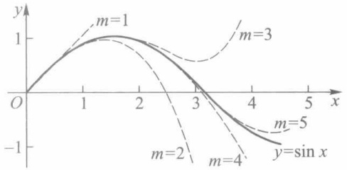

line

| x | y (m=1) | y (m=2) | y (m=3) | y (m=4) | y (m=5) |
| --- | --- | --- | --- | --- | --- |
| 0 | 0 | 0 | 0 | 0 | 0 |
| ~1.5 | ~1.1 | — | — | — | — |
| ~3.0 | — | ~-0.8 | ~0.6 | — | — |
| ~4.5 | — | — | — | ~-0.9 | ~-0.7 |

图6-6

## 习题 6.3

1. 求下列函数带佩亚诺型余项的麦克劳林公式:

(1)  $f(x) = \frac{1}{\sqrt{1 + x}}$ ;
(2) $f(x)=\arctan x$ 到含 $x^{5}$ 的项；
(3) $f(x)=\tan x$ 到含 $x^{5}$ 的项.

2. 按例 4 的方法求下列极限:

(1)  $\lim_{x\to0}\frac{e^{x}\sin x-x(1+x)}{x^{3}}$ ;

(2) $\lim_{x\to \infty}\left[x - x^2\ln \left(1 + \frac{1}{x}\right)\right];$

131

---

第六章 微分中值定理及其应用

(3)  $\lim_{x\to0}\frac{1}{x}\left(\frac{1}{x}-\cot x\right)$ .

3. 求下列函数在指定点处带拉格朗日余项的泰勒公式:

(1) $f(x) = x^3 + 4x^2 + 5$，在 $x = 1$ 处；

(2) $f(x) = \frac{1}{1 + x}$, 在 $x = 0$ 处.

4. 估计下列近似公式的绝对误差:

(1)  $\sin x \approx x - \frac{x^{3}}{6}$ ，当  $|x| \leqslant \frac{1}{2}$ ;

(2) $\sqrt{1 + x} \approx 1 + \frac{x}{2} - \frac{x^2}{8}, x \in [0,1]$.

5. 计算: (1) 数 e 准确到  $10^{-9}$ ;

(2) lg 2.7 准确到  $10^{-5}$ .

## § 4 函数的极值与最大(小)值

## 一、极值判别

函数的极值不仅在实际问题中占有重要的地位,而且也是函数性态的一个重要特征.

费马定理(定理5.3)已经告诉我们,若函数f在点 $x_{0}$ 可导,且 $x_{0}$ 为f的极值点,则 $f'(x_{0})=0$ .这就是说,可导函数在点 $x_{0}$ 取极值的必要条件是 $f'(x_{0})=0$ .

下面讨论充分条件.

定理 6.11(极值的第一充分条件) 设 f 在点  $x_{0}$  连续, 在某邻域  $U^{\circ}(x_{0};\delta)$  上可导.

(i) 若当 $x \in (x_0 - \delta, x_0)$ 时 $f'(x) \leqslant 0$，当 $x \in (x_0, x_0 + \delta)$ 时 $f'(x) \geqslant 0$，则 $f$ 在点 $x_0$ 取得极小值.
(ii) 若当 $x \in (x_0 - \delta, x_0)$ 时 $f'(x) \geqslant 0$，当 $x \in (x_0, x_0 + \delta)$ 时 $f'(x) \leqslant 0$，则 $f$ 在点 $x_0$ 取得极大值.

证 下面只证(ii),(i)的证明可类似地进行.

由定理的条件及定理6.3,f在 $(x_{0}-\delta,x_{0})$ 上递增，在 $(x_{0},x_{0}+\delta)$ 上递减，又由f在点 $x_{0}$ 连续，故对任意 $x\in U(x_{0};\delta)$ ，恒有

$$
f (x) \leqslant f (x _ {0}).
$$

即 f 在点  $x_{0}$  取得极大值.

若f是二阶可导函数,则有如下判别极值定理.

定理 6.12(极值的第二充分条件) 设 f 在  $x_{0}$  的某邻域  $U(x_{0};\delta)$  上一阶可导，在  $x = x_{0}$  处二阶可导，且  $f'(x_{0}) = 0, f''(x_{0}) \neq 0$ .

(i) 若  $f''(x_{0})<0$ ，则 f 在  $x_{0}$  取得极大值.
(ii) 若  $f''(x_{0})>0$ ，则 f 在  $x_{0}$  取得极小值.

证 由条件, 可得 f 在  $x_{0}$  处的二阶泰勒公式

$$
f (x) = f (x _ {0}) + f ^ {\prime} (x _ {0}) (x - x _ {0}) + \frac {1}{2 !} f ^ {\prime \prime} (x _ {0}) (x - x _ {0}) ^ {2} + o ((x - x _ {0}) ^ {2}).
$$

132

---

§ 4 函数的极值与最大(小)值

由于 $f'(x_{0})=0$ ，因此

$$
f (x) - f (x _ {0}) = \left[ \frac {f ^ {\prime \prime} (x _ {0})}{2} + o (1) \right] (x - x _ {0}) ^ {2}. \tag {1}
$$

又因 $f''(x_0) \neq 0$，故存在正数 $\delta' \leqslant \delta$，当 $x \in U(x_0; \delta')$ 时，$\frac{1}{2} f''(x_0)$ 与 $\frac{1}{2} f''(x_0) + o(1)$ 同号。所以，当 $f''(x_0) < 0$ 时，(1) 式取负值，从而对任意 $x \in U^\circ(x_0; \delta')$，有

$$
f (x) - f (x _ {0}) <   0,
$$

即 $f$ 在 $x_0$ 取极大值. 同样对 $f''(x_0) > 0$, 可得 $f$ 在点 $x_0$ 取极小值.

例 1 求  $f(x)=(2x-5)\sqrt[3]{x^{2}}$  的极值点与极值.

解 $f(x) = (2x - 5)\sqrt[3]{x^2} = 2x^{\frac{5}{3}} - 5x^{\frac{2}{3}}$ 在 $(-\infty, +\infty)$ 上连续，且当 $x \neq 0$ 时，有

$$
f ^ {\prime} (x) = \frac {1 0}{3} x ^ {\frac {2}{3}} - \frac {1 0}{3} x ^ {- \frac {1}{3}} = \frac {1 0}{3} \frac {x - 1}{\sqrt [ 3 ]{x}}.
$$

易见，x=1 为 f 的稳定点，x=0 为 f 的不可导点。这两点是否是极值点，需作进一步讨论。现列表如下（表中  $\nearrow$  表示递增， $\searrow$  表示递减）:

| x | $(-\infty,0)$ | 0 | $(0,1)$ | 1 | $(1,+\infty)$ |
| --- | --- | --- | --- | --- | --- |
| y' | + | 不存在 | - | 0 | + |
| y | ↗ | 0 | ↘ | -3 | ↗ |

由上表可见: 点 x=0 为 f 的极大值点, 极大值  $f(0)=0$ ; x=1 为 f 的极小值点, 极小值  $f(1)=-3$  (图 6-7).

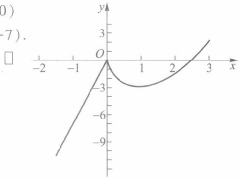

line

| X | Y |
| --- | --- |
| -2 | ~-10 |
| -1 | ~-5 |
| 0 | 0 |
| 1 | ~-3 |
| 2 | ~-1 |
| 3 | ~2 |

图6-7

例 2 求  $f(x)=x^{2}+\frac{432}{x}$  的极值点与极值.

解 当 $x \neq 0$ 时，

$$
f ^ {\prime} (x) = 2 x - \frac {4 3 2}{x ^ {2}} = \frac {2 x ^ {3} - 4 3 2}{x ^ {2}}.
$$

令 $f'(x)=0$ , 求得稳定点 x=6. 又因

$$
f ^ {\prime \prime} (6) = \left(2 + \frac {8 6 4}{x ^ {3}}\right) _ {x = 6} = 6 > 0,
$$

依定理 6.12, x=6 为 f 的极小值点, 极小值  $f(6)=108$ .

对于应用二阶导数无法判别的问题,可借助更高阶的导数来判别.

定理 6.13(极值的第三充分条件) 设 f 在  $x_{0}$  的某邻域上存在直到 n-1 阶导函数，在  $x_{0}$  处 n 阶可导，且  $f^{(k)}(x_{0}) = 0 \quad (k = 1, 2, \cdots, n-1), f^{(n)}(x_{0}) \neq 0$ ，则

（i）当 n 为偶数时，f 在  $x_{0}$  取得极值，且当  $f^{(n)}(x_{0})<0$  时取极大值， $f^{(n)}(x_{0})>0$  时取极小值.

(ii) 当 n 为奇数时, f 在  $x_{0}$  处不取极值.

该定理的证明类似于定理 6.12, 我们将它留给读者.

例 3 试求函数  $x^{4}(x-1)^{3}$  的极值.

133

---

第六章 微分中值定理及其应用

解 由于 $f'(x) = x^3 (x - 1)^2 (7x - 4)$，因此 $x = 0, 1, \frac{4}{7}$ 是函数的三个稳定点. $f$ 的二阶导数为

$$
f ^ {\prime \prime} (x) = 6 x ^ {2} (x - 1) (7 x ^ {2} - 8 x + 2),
$$

由此得, $f''(0)=f''(1)=0$  及 $f''\left(\frac{4}{7}\right)>0$ . 所以 $f(x)$  在 $x=\frac{4}{7}$  时取得极小值. 求三阶导数

$$
f ^ {\prime \prime \prime} (x) = 6 x (3 5 x ^ {3} - 6 0 x ^ {2} + 3 0 x - 4),
$$

有 $f'''(0) = 0, f'''(1) > 0$. 由于 $n = 3$ 为奇数，由定理6.13知 $f$ 在 $x = 1$ 不取极值. 再求 $f$ 的四阶导数

$$
f ^ {(4)} (x) = 2 4 (3 5 x ^ {3} - 4 5 x ^ {2} + 1 5 x - 1),
$$

有 $f^{(4)}(0) < 0$. 因为 $n = 4$ 为偶数, 故 $f$ 在 $x = 0$ 取得极大值.

综上所述, $f(0)=0$ 为极大值,

$$
f \bigg (\frac {4}{7} \bigg) = - \bigg (\frac {4}{7} \bigg) ^ {4} \bigg (\frac {3}{7} \bigg) ^ {3} = - \frac {6 9 1 2}{8 2 3 5 4 3}
$$

为极小值.

注 定理 6.13 仍是判定极值的充分条件.读者可考察函数(图 6-8)

$$
f (x) = \left\{ \begin{array}{l l} \mathrm{e} ^ {- \frac {1}{x ^ {2}}}, & x \neq 0, \\ 0, & x = 0. \end{array} \right.
$$

很显然,它在 x=0 处取极小值 0.但因  $f^{(k)}(0)=0, k=1,2,\cdots$ . 所以无法用定理 6.13 对它作出判别.

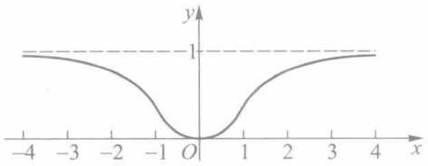

contour

| X | Y |
| --- | --- |
| -4 | 1 |
| -3 | ~0.95 |
| -2 | ~0.75 |
| -1 | ~0.35 |
| 0 | 0 |
| 1 | ~0.35 |
| 2 | ~0.75 |
| 3 | ~0.95 |
| 4 | 1 |

图6-8

## 二、最大值与最小值

根据闭区间上连续函数的基本性质,若函数 f 在闭区间  $[a, b]$  上连续,则 f 在  $[a, b]$  上一定有最大、最小值.这就为我们求连续函数的最大、最小值提供了理论保证.本段将讨论怎样求出这个最大(小)值.

若函数 $f$ 的最大（小）值点 $x_0$ 在开区间 $(a, b)$ 上，则 $x_0$ 必定是 $f$ 的极大（小）值点。又若 $f$ 在 $x_0$ 可导，则 $x_0$ 还是一个稳定点。所以我们只要比较 $f$ 在区间内部所有稳定点、不可导点和区间端点上的函数值，就能从中找到 $f$ 在 $[a, b]$ 上的最大值与最小值。下面举例说明这个求解过程。

例 4 求函数  $f(x)=\left|2x^{3}-9x^{2}+12x\right|$  在闭区间  $\left[-\frac{1}{4},\frac{5}{2}\right]$  上的最大值与最小值.

解 函数 $f$ 在闭区间 $\left[-\frac{1}{4}, \frac{5}{2}\right]$ 上连续，故必存在最大、最小值.由于

$$
\begin{array}{l} f (x) = \left| 2 x ^ {3} - 9 x ^ {2} + 1 2 x \right| \\ = \left| x (2 x ^ {2} - 9 x + 1 2) \right| \\ \end{array}
$$

134

---

§ 4 函数的极值与最大(小)值

$$
= \left\{ \begin{array}{l l} - x (2 x ^ {2} - 9 x + 1 2), & - \frac {1}{4} \leqslant x \leqslant 0, \\ x (2 x ^ {2} - 9 x + 1 2), & 0 <   x \leqslant \frac {5}{2}, \end{array} \right.
$$

因此

$$
\begin{array}{l} f ^ {\prime} (x) = \left\{ \begin{array}{l} - 6 x ^ {2} + 1 8 x - 1 2 \\ 6 x ^ {2} - 1 8 x + 1 2 \end{array} \right. \\ = \left\{ \begin{array}{l l} - 6 (x - 1) (x - 2), & - \frac {1}{4} \leqslant x <   0, \\ 6 (x - 1) (x - 2), & 0 <   x \leqslant \frac {5}{2}. \end{array} \right. \\ \end{array}
$$

又因 $f^{\prime}(0 - 0) = -12, f^{\prime}(0 + 0) = 12$，所以由导数极限定理可知函数在 $x = 0$ 处不可导。求出函数 $f$ 在 $\left[-\frac{1}{4}, \frac{5}{2}\right]$ 内部的稳定点 $x = 1, 2$，不可导点 $x = 0$，以及端点 $x = -\frac{1}{4}, \frac{5}{2}$ 的函数值

$$
f (1) = 5, f (2) = 4, f (0) = 0, f \left(- \frac {1}{4}\right) = \frac {1 1 5}{3 2}, f \left(\frac {5}{2}\right) = 5.
$$

所以函数 $f$ 在 $x = 0$ 处取最小值0，在 $x = 1$ 和 $x = \frac{5}{2}$ 处取得最大值5(图6-9).

在生产实践和科学实验中,我们常会遇到求函数的最大值或最小值问题.

例 5 一艘轮船在航行中的燃料费和它的速度的立方成正比.已知当速度为 10 km/h, 燃料费为每小时 6 元, 而其他与速度无关的费用为每小时 96 元.问轮船的速度为多少时, 每航行 1 km 所消耗的费用最小?

解 设船速为 $x \mathrm{~km/h}$, 据题意每航行 $1 \mathrm{~km}$ 的耗费为

$$
y = \frac {1}{x} (k x ^ {3} + 9 6).
$$

由已知, 当 x=10 时,  $k \cdot 10^{3}=6$ , 故得比例系数 k=0.006. 所以有

$$
y = \frac {1}{x} (0. 0 0 6 x ^ {3} + 9 6), x \in (0, + \infty).
$$

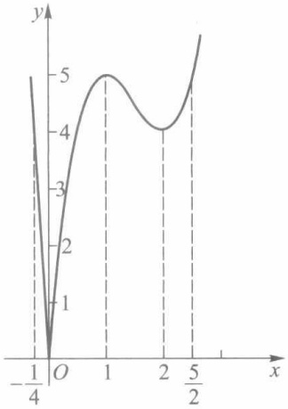

line

| X | Y |
| --- | --- |
| -1/4 | 0 |
| 1 | 5 |
| 2 | 4 |
| 5/2 | 5 |

图6-9

令

$$
y ^ {\prime} = \frac {0 . 0 1 2}{x ^ {2}} (x ^ {3} - 8 0 0 0) = 0,
$$

求得稳定点 $x = 20$. 由极值第一充分条件检验得 $x = 20$ 是极小值点. 由于在 $(0, +\infty)$ 上该函数处处可导, 且只有唯一的极值点, 当它为极小值点时必为最小值点. 所以求得当船速为 $20 \mathrm{~km} / \mathrm{h}$ 时, 每航行 $1 \mathrm{~km}$ 的耗费为最少, 其值为 $y_{\min} = 0.006 \times 20^{2} + \frac{96}{20} = 7.2$ (元).

135

---

第六章 微分中值定理及其应用

例 6 如图6-10所示,剪去正方形四角同样大小的正方形后制成一个无盖盒子,问剪去小方块的边长为何值时,可使盒子的容积最大.

解 设每个小方块边长为 x，则盒子的容积为

$$
V (x) = x (a - 2 x) ^ {2}, x \in \left[ 0, \frac {a}{2} \right].
$$

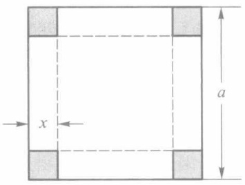

text_image

x
a

图6-10

令

$$
V ^ {\prime} (x) = 1 2 \bigg (x - \frac {a}{6} \bigg) \left(x - \frac {a}{2}\right) = 0,
$$

在 $\left(0,\frac{a}{2}\right)$ 内解得稳定点 $x=\frac{a}{6}$ ，并由 $V''\left(\frac{a}{6}\right)=-4a<0$ 知 $V\left(\frac{a}{6}\right)=\frac{2a^{3}}{27}$ 为极大值。由于 $V(x)$ 在 $\left(0,\frac{a}{2}\right)$ 上只有唯一一个极值点，且为极大值点，因此该极大值就是所求的最大值。即正方形四个角各剪去一块边长为 $\frac{a}{6}$ 的小正方形后，能做成容积最大的盒子。

## 习题 6.4

1. 求下列函数的极值:

(1) $f(x) = 2x^{3} - x^{4}$;

(2)  $f(x) = \frac{2x}{1 + x^{2}}$ ;

(3)  $f(x) = \frac{(\ln x)^{2}}{x}$ ;

(4) $f(x) = \arctan x - \frac{1}{2} \ln (1 + x^2)$.

2. 设

$$
f (x) = \left\{ \begin{array}{l l} x ^ {4} \sin^ {2} \frac {1}{x}, & x \neq 0, \\ 0, & x = 0. \end{array} \right.
$$

(1) 证明: x=0 是极小值点;

(2) 说明 f 在极小值点 x=0 是否满足极值的第一充分条件或第二充分条件.

3. 证明: 若函数 $f$ 在点 $x_0$ 有 $f'_+(x_0) < 0 (>0)$, $f'_-(x_0) > 0 (<0)$, 则 $x_0$ 为 $f$ 的极大 (小) 值点.

4. 求下列函数在给定区间上的最大、最小值:

(1) $y = x^{5} - 5x^{4} + 5x^{3} + 1, [-1, 2]$;

(2) $y = 2\tan x - \tan^2 x, \left[0, \frac{\pi}{2}\right)$;

(3)  $y=\sqrt{x}\ln x,(0,+\infty)$ .

5. 设 $f(x)$ 在区间 $I$ 上连续，并且在 $I$ 上仅有唯一的极值点 $x_0$. 证明:若 $x_0$ 是 $f$ 的极大（小）值点，则 $x_0$ 必是 $f(x)$ 在 $I$ 上的最大（小）值点.

6. 把长为 l 的线段截为两段, 问怎样截能使以这两段线为边所组成的矩形的面积最大?

7. 有一个无盖的圆柱形容器, 当给定体积为 V 时, 要使容器的表面积为最小, 问底的半径与容器高的比例应该怎样?

8. 设用某仪器进行测量时, 读得 n 次实验数据为  $a_{1}a_{2}, \cdots, a_{n}$ . 问以怎样的数值 x 表达所要测量的真值, 才能使它与这 n 个数之差的平方和为最小?

136

---

§ 5 函数的凸性与拐点

9. 求一正数 $a$，使它与其倒数之和最小。

10. 求下列函数的极值:

(1) $f(x) = |x(x^2 - 1)|$;

(2)  $f(x) = \frac{x(x^{2} + 1)}{x^{4} - x^{2} + 1};$

(3) $f(x) = (x - 1)^2 (x + 1)^3.$

11. 设 $f(x) = a \ln x + bx^2 + x$ 在 $x_1 = 1, x_2 = 2$ 处都取得极值，试求 $a$ 与 $b$; 并问这时 $f$ 在 $x_1$ 与 $x_2$ 是取得极大值还是极小值？

12. 在抛物线 $y^{2} = 2px$ 上哪一点的法线被抛物线所截之线段为最短？

13. 要把货物从运河边上 $A$ 城运往与运河相距为 $BC = a \mathrm{~km}$ 的图6-11$B$ 城（见图6-11），轮船运费的单价是 $\alpha$ 元/km，火车运费的单价是 $\beta$ 元/km ($\beta > \alpha$)，试求运河边上的一点 $M$，修建铁路 $MB$，使得 $A \to M \to B$ 的总运费最省.

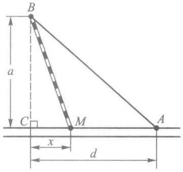

text_image

B
a
C
M
x
d
A

图6-11

## § 5 函数的凸性与拐点

读者已经熟悉函数 $f(x) = x^2$ 和 $f(x) = \sqrt{x}$ 的图像. 它们不同的特点是: 曲线 $y = x^2$ 上任意两点间的弧段总在这两点连线的下方; 而曲线 $y = \sqrt{x}$ 则相反, 任意两点间的弧段总在这两点连线的上方. 我们把具有前一种特性的曲线称为凸的, 相应的函数称为凸函数; 后一种曲线称为凹的, 相应的函数称为凹函数.

定义1 设 $f$ 为定义在区间 $I$ 上的函数, 若对 $I$ 上的任意两点 $x_{1}, x_{2}$ 和任意实数 $\lambda \in (0,1)$, 总有

$$
f \left(\lambda x _ {1} + (1 - \lambda) x _ {2}\right) \leqslant \lambda f \left(x _ {1}\right) + (1 - \lambda) f \left(x _ {2}\right), \tag {1}
$$

则称 $f$ 为 $I$ 上的凸函数. 反之, 如果总有

$$
f \left(\lambda x _ {1} + (1 - \lambda) x _ {2}\right) \geqslant \lambda f \left(x _ {1}\right) + (1 - \lambda) f \left(x _ {2}\right), \tag {2}
$$

则称 f 为 I 上的凹函数.

如果(1)、(2)中的不等式改为严格不等式,则相应的函数称为严格凸函数和严格凹函数.

图 6-12 中的 (a) 和 (b) 分别是凸函数和凹函数的几何形状, 其中  $x = \lambda x_{1} + (1 - \lambda)x_{2}, A = f(x_{1}), B = f(x_{2}), C = \lambda A + (1 - \lambda)B.$

容易证明: 若 -f 为区间 I 上的凸函数, 则 f 为区间 I 上的凹函数. 因此, 今后只需讨论凸函数的性质即可.

引理 $f$ 为 $I$ 上的凸函数的充要条件是:对于 $I$ 上的任意三点 $x_{1} < x_{2} < x_{3}$，总有

$$
\frac {f (x _ {2}) - f (x _ {1})}{x _ {2} - x _ {1}} \leqslant \frac {f (x _ {3}) - f (x _ {2})}{x _ {3} - x _ {2}}. \tag {3}
$$

证 必要性 记 $\lambda = \frac{x_3 - x_2}{x_3 - x_1}$, 则 $x_2 = \lambda x_1 + (1 - \lambda)x_3$. 由 $f$ 的凸性知道

$$
f \left(x _ {2}\right) = f \left(\lambda x _ {1} + (1 - \lambda) x _ {3}\right) \leqslant \lambda f \left(x _ {1}\right) + (1 - \lambda) f \left(x _ {3}\right)
$$

137

---

第六章 微分中值定理及其应用

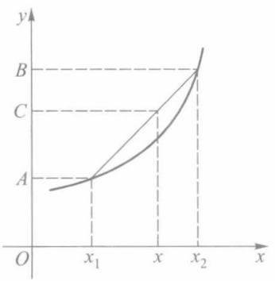

line

| Point | X | Y |
| --- | --- | --- |
| A | \(x_1\) | A |
| C | x | C |
| B | \(x_2\) | B |

(a) 凸函数

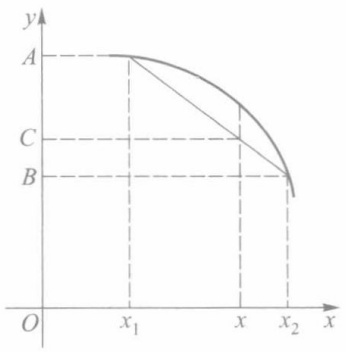

line

| Point | X-coordinate | Y-coordinate |
| --- | --- | --- |
| A | \(x_1\) | A |
| B | \(x_2\) | B |
| C | x | C |

(b) 凹函数

图6-12

$$
= \frac {x _ {3} - x _ {2}}{x _ {3} - x _ {1}} f (x _ {1}) + \frac {x _ {2} - x _ {1}}{x _ {3} - x _ {1}} f (x _ {3}),
$$

从而有

$$
(x _ {3} - x _ {1}) f (x _ {2}) \leqslant (x _ {3} - x _ {2}) f (x _ {1}) + (x _ {2} - x _ {1}) f (x _ {3}),
$$

$$
(x _ {3} - x _ {2}) f (x _ {2}) + (x _ {2} - x _ {1}) f (x _ {2}) \leqslant (x _ {3} - x _ {2}) f (x _ {1}) + (x _ {2} - x _ {1}) f (x _ {3}),
$$

整理后即得(3)式.

充分性 如图 6-13 所示, 在 I 上任取两点  $x_{1}, x_{3} (x_{1} < x_{3})$ , 在  $[x_{1}, x_{3}]$  上任取一点  $x_{2} = \lambda x_{1} + (1 - \lambda) x_{3}, \lambda \in (0, 1)$ , 即  $\lambda = \frac{x_{3} - x_{2}}{x_{3} - x_{1}}$ . 由必要性的推导逆过程, 可推得

$$
f (\lambda x _ {1} + (1 - \lambda) x _ {3}) \leqslant \lambda f (x _ {1}) + (1 - \lambda) f (x _ {3}),
$$

故 f 为 I 上的凸函数.

同理可证,f为I上的凸函数的充要条件是:对于I上任意三点 $x_{1}<x_{2}<x_{3}$ ，有

$$
\begin{array}{l} \frac {f (x _ {2}) - f (x _ {1})}{x _ {2} - x _ {1}} \leqslant \frac {f (x _ {3}) - f (x _ {1})}{x _ {3} - x _ {1}} \\ \leqslant \frac {f (x _ {3}) - f (x _ {2})}{x _ {3} - x _ {2}}. \tag {4} \\ \end{array}
$$

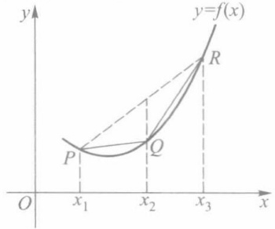

text_image

y
y=f(x)
P
Q
R
O
x₁
x₂
x₃
x

图6-13

注 如果 $f(x)$ 为 $I$ 上的严格凸函数, 则不等式(3)和(4)中的“$\leqslant$”可改为“<”.

定理 6.14 设 f 为区间 I 上的可导函数, 则下述论断互相等价:

$1^{\circ}$  f为I上凸函数；

$2^{\circ}$   $f'$  为 I 上的增函数；

$3^{\circ}$ 对 $I$ 上的任意两点 $x_{1}, x_{2}$, 有

$$
f \left(x _ {2}\right) \geqslant f \left(x _ {1}\right) + f ^ {\prime} (x _ {1}) (x _ {2} - x _ {1}). \tag {5}
$$

证 $(1^{\circ}\rightarrow 2^{\circ})$ 任取 $I$ 上两点 $x_{1},x_{2}(x_{1} < x_{2})$ 及充分小的正数 $h.$ 由于 $x_{1} - h <   x_{1} <   x_{2} <   x_{2} + h$ ，根据 $f$ 的凸性及引理有

$$
\frac {f (x _ {1}) - f (x _ {1} - h)}{h} \leqslant \frac {f (x _ {2}) - f (x _ {1})}{x _ {2} - x _ {1}} \leqslant \frac {f (x _ {2} + h) - f (x _ {2})}{h}.
$$

由 f 是可导函数, 令  $h \rightarrow 0^{+}$  时可得

138

---

§ 5 函数的凸性与拐点

$$
f ^ {\prime} (x _ {1}) \leqslant \frac {f (x _ {2}) - f (x _ {1})}{x _ {2} - x _ {1}} \leqslant f ^ {\prime} (x _ {2}),
$$

所以 $f'$ 为I上的递增函数.

$(2^{\circ}\rightarrow 3^{\circ})$ 在以 $x_{1},x_{2}(x_{1} <   x_{2})$ 为端点的区间上，应用拉格朗日中值定理和 $f^{\prime}$ 递增条件，有

$$
f \left(x _ {2}\right) - f \left(x _ {1}\right) = f ^ {\prime} (\xi) \left(x _ {2} - x _ {1}\right) \geqslant f ^ {\prime} \left(x _ {1}\right) \left(x _ {2} - x _ {1}\right).
$$

移项后即得(5)式成立,且当 $x_{1}>x_{2}$ 时仍可得到相同结论.

$(3^{\circ}\rightarrow 1^{\circ})$ 设 $x_{1},x_{2}$ 为 $I$ 上任意两点， $x_{3} = \lambda x_{1} + (1 - \lambda)x_{2},0 <   \lambda <  1.$ 由 $3^{\circ}$ ，并利用 $x_{1}-$ $x_{3} = (1 - \lambda)(x_{1} - x_{2})$ 与 $x_{2} - x_{3} = \lambda (x_{2} - x_{1})$ ，有

$$
f \left(x _ {1}\right) \geqslant f \left(x _ {3}\right) + f ^ {\prime} \left(x _ {3}\right) \left(x _ {1} - x _ {3}\right) = f \left(x _ {3}\right) + (1 - \lambda) f ^ {\prime} \left(x _ {3}\right) \left(x _ {1} - x _ {2}\right),
$$

$$
f \left(x _ {2}\right) \geqslant f \left(x _ {3}\right) + f ^ {\prime} \left(x _ {3}\right) \left(x _ {2} - x _ {3}\right) = f \left(x _ {3}\right) + \lambda f ^ {\prime} \left(x _ {3}\right) \left(x _ {2} - x _ {1}\right).
$$

分别用 $\lambda$ 和 $1 - \lambda$ 乘上列两式并相加，便得

$$
\lambda f (x _ {1}) + (1 - \lambda) f (x _ {2}) \geqslant f (x _ {3}) = f (\lambda x _ {1} + (1 - \lambda) x _ {2}).
$$

从而 $f$ 为 $I$ 上的凸函数.

注意 论断 $3^{\circ}$ 的几何意义是: 曲线 $y = f(x)$ 总是在它的任一切线的上方 (图6-14). 这是可导凸函数的几何特征.

对于凹函数,同样有类似于定理 6.14 的结论.

定理 6.15 设 f 为区间 I 上的二阶可导函数, 则在 I 上 f 为凸(凹)函数的充要条件是

$$
f ^ {\prime \prime} (x) \geqslant 0 (f ^ {\prime \prime} (x) \leqslant 0), x \in I.
$$

这个定理的结论可由定理 6.3 和定理 6.14 推出.

例 1 讨论函数  $f(x)=\arctan x$  的凸(凹)性区间.

解 由于 $f''(x) = \frac{-2x}{(1 + x^2)^2}$，因而当 $x \leqslant 0$ 时，$f''(x) \geqslant$

$0; x \geqslant 0$ 时, $f''(x) \leqslant 0$. 从而在 $(- \infty, 0]$ 上 $f$ 为凸函数, 在 $[0, +\infty)$ 上 $f$ 为凹函数.

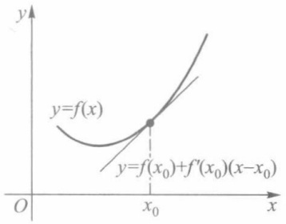

text_image

y
y=f(x)
y=f(x₀)+f'(x₀)(x-x₀)
O
x₀
x

图6-14

例 2 若函数 f 为定义在开区间  $(a, b)$  上的可导的凸（凹）函数，则  $x_{0} \in (a, b)$  为 f 的极小（大）值点的充要条件是  $x_{0}$  为 f 的稳定点，即  $f'(x_{0}) = 0$ .

证 下面只证明 f 为凸函数的情形.

必要性已由费马定理给出,现在证明充分性.

由定理6.14,任取 $(a,b)$ 上的一点 $x(\neq x_0)$,它与 $x_0$ 一起有

$$
f (x) \geqslant f (x _ {0}) + f ^ {\prime} (x _ {0}) (x - x _ {0}).
$$

因为 $f^{\prime}(x_0) = 0$ ，故对任何 $x\in (a,b)$ ，总有

$$
f (x) \geqslant f (x _ {0}),
$$

即  $x_{0}$  为 f 在  $(a, b)$  上的极小值点（而且为最小值点）.

例 3 设  $f(x)$  为区间  $(a, b)$  上的凸函数, 不恒为常数. 证明:  $f(x)$  不取最大值.

证 若不然, 可设  $f(x_{0})$  是最大值. 由凸函数的定义, 对于任意  $x_{1}, x_{2} \in (a, b), x_{1} < x_{0} < x_{2}$ , 有

$$
f \left(x _ {0}\right) \leqslant \frac {x _ {2} - x _ {0}}{x _ {2} - x _ {1}} f \left(x _ {1}\right) + \frac {x _ {0} - x _ {1}}{x _ {2} - x _ {1}} f \left(x _ {2}\right)
$$

139

---

第六章 微分中值定理及其应用

$$
\leqslant \left(\frac {x _ {2} - x _ {0}}{x _ {2} - x _ {1}} + \frac {x _ {0} - x _ {1}}{x _ {2} - x _ {1}}\right) f (x _ {0}) = f (x _ {0}),
$$

从而得到 $f(x_0) = f(x_1) = f(x_2)$，即 $f(x)$ 是常量函数，矛盾.

注 若 $f(x)$ 是区间 $[a, b]$ 上的凸的连续函数, 那么

$$
f (x) \leqslant \max \left\{f (a), f (b) \right\}.
$$

例 4 求证  $1 + x^{2} \leqslant 2^{x} \leqslant 1 + x, x \in [0,1]$ .

证 设 $f(x) = 1 + x^{2} - 2^{x}, g(x) = 2^{x} - 1 - x$，那么

$$
f ^ {\prime \prime} (x) = 2 - 2 ^ {x} (\ln 2) ^ {2} \geqslant 0, \quad g ^ {\prime \prime} (x) = 2 ^ {x} (\ln 2) ^ {2} > 0.
$$

因此 $f(x), g(x)$ 均为 $[0,1]$ 上的凸函数，故由例3得

$$
f (x) \leqslant \max \{f (0), f (1) \} = 0, \quad g (x) \leqslant \max \{g (0), g (1) \} = 0.
$$

由此推得所需的结果.

下例是定义1的一般情形.

例 5(延森(Jensen)不等式) 若 f 为  $[a, b]$  上的凸函数, 则对任意  $x_{i} \in [a, b]$ ,  $\lambda_{i} > 0$   $(i = 1, 2, \cdots, n)$ ,  $\sum_{i=1}^{n} \lambda_{i} = 1$ , 有

$$
f \Big (\sum_ {i = 1} ^ {n} \lambda_ {i} x _ {i} \Big) \leqslant \sum_ {i = 1} ^ {n} \lambda_ {i} f (x _ {i}). \tag {6}
$$

证 应用数学归纳法. 当 n=2 时, 由定义 1, 命题显然成立. 设 n=k 时命题成立. 即对任意  $x_{1}, x_{2}, \cdots, x_{k} \in [a, b]$  及

$$
\alpha_ {i} > 0, i = 1, 2, \dots , k, \sum_ {i = 1} ^ {k} \alpha_ {i} = 1,
$$

都有

$$
f \Big (\sum_ {i = 1} ^ {k} \alpha_ {i} x _ {i} \Big) \leqslant \sum_ {i = 1} ^ {k} \alpha_ {i} f (x _ {i}).
$$

现设  $x_{1}, x_{2}, \cdots, x_{k}, x_{k+1} \in [a, b]$  及

$$
\lambda_ {i} > 0 (i = 1, 2, \dots , k + 1), \sum_ {i = 1} ^ {k + 1} \lambda_ {i} = 1.
$$

令  $\alpha_{i}=\frac{\lambda_{i}}{1-\lambda_{k+1}}, i=1,2,\cdots,k$ ，则  $\sum_{i=1}^{k}\alpha_{i}=1$ 。由数学归纳法假设可推得

$$
\begin{array}{l} f (\lambda_ {1} x _ {1} + \lambda_ {2} x _ {2} + \dots + \lambda_ {k} x _ {k} + \lambda_ {k + 1} x _ {k + 1}) \\ = f \left((1 - \lambda_ {k + 1}) \frac {\lambda_ {1} x _ {1} + \lambda_ {2} x _ {2} + \cdots + \lambda_ {k} x _ {k}}{1 - \lambda_ {k + 1}} + \lambda_ {k + 1} x _ {k + 1}\right) \\ \leqslant \left(1 - \lambda_ {k + 1}\right) f \left(\alpha_ {1} x _ {1} + \alpha_ {2} x _ {2} + \dots + \alpha_ {k} x _ {k}\right) + \lambda_ {k + 1} f \left(x _ {k + 1}\right) \\ \leqslant \left(1 - \lambda_ {k + 1}\right) \left[ \alpha_ {1} f \left(x _ {1}\right) + \alpha_ {2} f \left(x _ {2}\right) + \dots + \alpha_ {k} f \left(x _ {k}\right) \right] + \lambda_ {k + 1} f \left(x _ {k + 1}\right) \\ = (1 - \lambda_ {k + 1}) \left[ \frac {\lambda_ {1}}{1 - \lambda_ {k + 1}} f (x _ {1}) + \frac {\lambda_ {2}}{1 - \lambda_ {k + 1}} f (x _ {2}) + \dots + \frac {\lambda_ {k}}{1 - \lambda_ {k + 1}} f (x _ {k}) \right] + \\ \lambda_ {k + 1} f (x _ {k + 1}) = \sum_ {i = 1} ^ {k + 1} \lambda_ {i} f (x _ {i}). \\ \end{array}
$$

这就证明了对任何正整数 $n(\geqslant 2)$，凸函数 $f$ 总有不等式(6)成立.

140

---

§ 5 函数的凸性与拐点

注 如  $f(x)$  在  $[a, b]$  上严格凸，则 (6) 式可为严格不等式，除非  $x_{1} = x_{2} = \cdots = x_{n}$ .

例 6 证明不等式 $(abc)^{\frac{a+b+c}{3}}\leqslant a^{a}b^{b}c^{c}$ ，其中 a,b,c 均为正数.

证 设 $f(x) = x \ln x, x > 0$. 由 $f(x)$ 的一阶和二阶导数

$$
f ^ {\prime} (x) = \ln x + 1, \quad f ^ {\prime \prime} (x) = \frac {1}{x},
$$

可见, $f(x)=x\ln x$  在 x>0 时为严格凸函数.依延森不等式有

$$
f \bigg (\frac {a + b + c}{3} \bigg) \leqslant \frac {1}{3} \big [ f (a) + f (b) + f (c) \big ],
$$

从而

$$
\frac {a + b + c}{3} \ln \frac {a + b + c}{3} \leqslant \frac {1}{3} (a \ln a + b \ln b + c \ln c),
$$

即

$$
\left(\frac {a + b + c}{3}\right) ^ {a + b + c} \leqslant a ^ {a} b ^ {b} c ^ {c}.
$$

又因 $\sqrt[3]{abc} \leqslant \frac{a + b + c}{3}$, 所以

$$
(a b c) ^ {\frac {a + b + c}{3}} \leqslant a ^ {a} b ^ {b} c ^ {c}.
$$

□

例 7 设 A, B, C 是三角形的三个内角, 证明

$$
\sin A + \sin B + \sin C \leqslant \frac {3}{2} \sqrt {3}.
$$

证 设 $f(x) = \sin x, x \in [0, \pi]$. 由于 $f''(x) = -\sin x < 0$，因而 $f(x)$ 是严格凹函数. 由延森不等式，

$$
\sin A + \sin B + \sin C \leqslant 3 \sin \frac {A + B + C}{3} = \frac {3}{2} \sqrt {3}.
$$

等号成立当且仅当 $A = B = C = \frac{\pi}{3}$

□

例8 设 $f$ 为开区间 $I$ 上的凸(凹)函数, 证明 $f$ 在 $I$ 上任一点 $x_0$ 都存在左、右导数. 证 下面只证凸函数 $f$ 在点 $x_0$ 存在右导数, 同理可证也存在左导数和 $f$ 为凹函数的情形.

设 $0 < h_{1} < h_{2}$，则对 $x_{0} < x_{0} + h_{1} < x_{0} + h_{2}$（这里取充分小的 $h_{2}$，使 $x_{0} + h_{2} \in I$），由引理中的(4)式有

$$
\frac {f \left(x _ {0} + h _ {1}\right) - f \left(x _ {0}\right)}{h _ {1}} \leqslant \frac {f \left(x _ {0} + h _ {2}\right) - f \left(x _ {0}\right)}{h _ {2}}.
$$

令 $F(h) = \frac{f(x_0 + h) - f(x_0)}{h}$, 故由上式可见 $F$ 为增函数. 任取 $x' \in I$ 且 $x' < x_0$, 则对任何 $h > 0$, 只要 $x_0 + h \in I$, 也有

$$
\frac {f (x _ {0}) - f (x ^ {\prime})}{x _ {0} - x ^ {\prime}} \leqslant \frac {f (x _ {0} + h) - f (x _ {0})}{h} = F (h).
$$

141

---

第六章 微分中值定理及其应用

由于上式左端是一个定数,因而函数  $F(h)$  在 h>0 上有下界.根据定理 3.10,极限  $F(h)$  存在,即  $f'_{+}(x_{0})$  存在.

定义2 设曲线 $y = f(x)$ 在点 $(x_0, f(x_0))$ 处有穿过曲线的切线. 且在切点近旁, 曲

线在切线的两侧分别是严格凸和严格凹的,这时称点 $(x_{0},f(x_{0}))$ 为曲线 $y=f(x)$ 的拐点.

由定义可见,拐点正是凸和凹曲线的分界点,如图6-15中的点M.

例 1 中的点  $(0,0)$  为  $y=\arctan x$  的拐点. 容易验证: 正弦曲线  $y=\sin x$  有拐点  $(k\pi,0)$ , k 为整数.

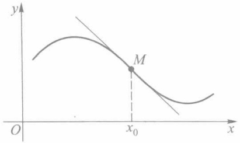

text_image

y
M
O
x₀
x

图6-15

读者容易证明下述两个有关拐点的定理.

定理6.16 若 $f$ 在 $x_0$ 二阶可导, 则 $(x_0, f(x_0))$ 为曲线 $y = f(x)$ 的拐点的必要条件是 $f''(x_0) = 0$.

定理6.17 设 $f$ 在 $x_0$ 可导，在某邻域 $U^{\circ}(x_0)$ 上二阶可导. 若在 $U_{+}^{\circ}(x_0)$ 和 $U_{-}^{\circ}(x_0)$ 上 $f''(x)$ 的符号相反，则 $(x_0, f(x_0))$ 为曲线 $y = f(x)$ 的拐点.

必须指出: 若  $(x_{0}, f(x_{0}))$  是曲线  $y = f(x)$  的一个拐点,  $y = f(x)$  在  $x_{0}$  的导数不一定存在. 请考察函数  $y = \sqrt[3]{x}$  在 x = 0 的情况.

## 习题 6.5

1. 确定下列函数的凸性区间与拐点:

(1) $y = 2x^{3} - 3x^{2} - 36x + 25$;

(2) $y = x + \frac{1}{x}$;

(3)  $y = x^{2} + \frac{1}{x}$ ;

(4)  $y = \ln(x^{2} + 1)$ ;

(5)  $y=\frac{1}{1+x^{2}}$ .

2. 问 $a$ 和 $b$ 为何值时，点(1,3)为曲线 $y = ax^3 + bx^2$ 的拐点？

3. 证明:

(1) 若 f 为凸函数,  $\lambda$  为非负实数, 则  $\lambda f$  为凸函数;
(2) 若 f, g 均为凸函数，则  $f + g$  为凸函数；
(3) 若 f 为区间 I 上凸函数, g 为  $J \supset f(I)$  上凸增函数, 则  $g \circ f$  为 I 上凸函数.

4. 设 $f$ 为区间 $I$ 上严格凸函数. 证明: 若 $x_0 \in I$ 为 $f$ 的极小值点, 则 $x_0$ 为 $f$ 在 $I$ 上唯一的极小值点.

5. 应用凸函数概念证明如下不等式:

(1) 对任意实数 a, b，有  $\mathrm{e}^{\frac{a+b}{2}} \leqslant \frac{1}{2} (\mathrm{e}^{a} + \mathrm{e}^{b})$ ;
(2) 对任何非负实数 a, b，有  $2\arctan\left(\frac{a+b}{2}\right) \geqslant \arctan a + \arctan b.$

6. 证明:$\sin \pi x \leqslant \frac{\pi^2}{2} x (1 - x)$，其中 $x \in [0,1]$.

7. 证明: 若 $f, g$ 均为区间 $I$ 上凸函数, 则 $F(x) = \max \{f(x), g(x)\}$ 也是 $I$ 上凸函数.

8. 证明:(1) $f$ 为区间 $I$ 上凸函数的充要条件是对 $I$ 上任意三点 $x_{1} < x_{2} < x_{3}$, 恒有

142

---

§ 6 函数图像的讨论

$$
\Delta = \left| \begin{array}{c c c} 1 & x _ {1} & f (x _ {1}) \\ 1 & x _ {2} & f (x _ {2}) \\ 1 & x _ {3} & f (x _ {3}) \end{array} \right| \geqslant 0;
$$

(2) f 为严格凸函数的充要条件是  $\Delta > 0$ .

9. 应用延森不等式证明:

(1) 设  $a_{i}>0\ (i=1,2,\cdots,n)$ ，有

$$
\frac {n}{\frac {1}{a _ {1}} + \frac {1}{a _ {2}} + \cdots + \frac {1}{a _ {n}}} \leqslant \sqrt [ n ]{a _ {1} a _ {2} \cdots a _ {n}} \leqslant \frac {a _ {1} + a _ {2} + \cdots + a _ {n}}{n};
$$

(2) 设  $a_{i}, b_{i} > 0 (i = 1, 2, \cdots, n)$ ，有

$$
\sum_ {i = 1} ^ {n} a _ {i} b _ {i} \leqslant \Big (\sum_ {i = 1} ^ {n} a _ {i} ^ {p} \Big) ^ {\frac {1}{p}} \Big (\sum_ {i = 1} ^ {n} b _ {i} ^ {q} \Big) ^ {\frac {1}{q}},
$$

其中 $p > 1, q > 1, \frac{1}{p} + \frac{1}{q} = 1$.

10. 求证: 圆内接 n 边形的面积最大者必为正 n 边形  $(n \geqslant 3)$ .

## § 6 函数图像的讨论

在中学里,我们主要依赖描点作图法画出一些简单函数的图像.一般来说,这样得到的图像比较粗糙,无法确切反映函数的性态(如单调区间、极值点、凸性区间、拐点等).这一节里,我们将综合应用在本章前几节学过的方法,再综合周期性、奇偶性、渐近线等知识,较完善地作出函数的图像.

作函数图像的一般程序是:

1. 求函数的定义域；
2. 考察函数的奇偶性、周期性；
3. 求函数的某些特殊点, 如与两个坐标轴的交点、不连续点、不可导点等;
4. 确定函数的单调区间、极值点、凸性区间以及拐点；
5. 考察渐近线；
6. 综合以上讨论结果画出函数图像.

下面举例说明如何按照上述程序作出函数的图像.

例 讨论函数 $f(x) = \sqrt[3]{x^3 - x^2 - x + 1}$ 的性态,并作出其图像.

解 由于

$$
f (x) = \sqrt [ 3 ]{x ^ {3} - x ^ {2} - x + 1} = \sqrt [ 3 ]{(x - 1) ^ {2}} \cdot \sqrt [ 3 ]{x + 1},
$$

可见此曲线与坐标轴交于 $(1,0)$ ， $(-1,0)$ ， $(0,1)$ 三点.

求出导数:

$$
f ^ {\prime} (x) = \frac {2}{3} \frac {\sqrt [ 3 ]{x + 1}}{\sqrt [ 3 ]{x - 1}} + \frac {1}{3} \cdot \frac {\sqrt [ 3 ]{(x - 1) ^ {2}}}{\sqrt [ 3 ]{(x + 1) ^ {2}}} = \frac {x + \frac {1}{3}}{\sqrt [ 3 ]{x - 1} \cdot \sqrt [ 3 ]{(x + 1) ^ {2}}},
$$

143

---

第六章 微分中值定理及其应用

由此得到稳定点 $x = -\frac{1}{3}$，不可导点 $x = \pm 1$。但因函数在 $x = \pm 1$ 处连续，$y' \big|_{x = \pm 1} = \infty$，所以在 $x = \pm 1$ 处有垂直切线。

再求二阶导数,可得

$$
f ^ {\prime \prime} (x) = - \frac {8}{9 \sqrt [ 3 ]{(x - 1) ^ {4}} \cdot \sqrt [ 3 ]{(x + 1) ^ {5}}}.
$$

下面列表图示  $f'(x)$  变号区间  $(f(x)$  的单调区间) 和  $f''(x)$  变号区间（即凸性区间），并说明函数的性态.

| x | $(-\infty, -1)$ | -1 | $\left(-1, -\frac{1}{3}\right)$ | $-\frac{1}{3}$ | $\left(-\frac{1}{3}, 1\right)$ | 1 | $(1, +\infty)$ |
| --- | --- | --- | --- | --- | --- | --- | --- |
| $f'(x)$ | + | ∞ | + | 0 | - | ∞ | + |
| $f''(x)$ | + | 不存在 | - | - | - | 不存在 | - |
| $f(x)$ | 凸增↗ | 拐点$(-1, 0)$ | 凹增↗ | 极大值$\frac{2}{3}\sqrt[3]{4}$ | 凹减↘ | 极小值0 | 凹增↗ |

另外，曲线 $y = \sqrt[3]{x^3 - x^2 - x + 1}$ 有渐近线

$$
y = x - \frac {1}{3}.
$$

这样我们就可作出函数图像,如图 6-16 所示.

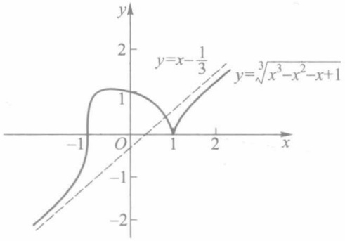

contour

| Function | Intersection Point (x, y) |
| --- | --- |
| y=x-1/3 | (0, 1) |
| \(y=\sqrt[3]{x^{3}-x^{2}-x+1}\) | (1, 0) |

图6-16

## 习题 6.6

按函数作图步骤,作下列函数图像:

(1) $y = x^{3} + 6x^{2} - 15x - 20$;

(2) $y = \frac{x^3}{2(1 + x)^2}$;

(3) y = x - 2arctan x;

(4) $y = x\mathrm{e}^{-x}$;

(5) $y = 3x^{5} - 5x^{3}$;

(6) $y = \mathrm{e}^{-x^2}$;

(7)  $y = (x - 1)x^{\frac{2}{3}}$ ;

(8) $y = |x|^{\frac{2}{3}} (x - 2)^2$.

144

---

\*§ 7 方程的近似解

## \* § 7 方程的近似解

在实际应用中,常常求方程

$$
f (x) = 0 \tag {1}
$$

的解.而方程求解的方法主要有两种:解析法和数值法.解析法也称为公式法,得到的解是精确的,比如一元二次方程的求解公式.然而并不是所有的方程的根都能通过这种方法而求得.法国著名数学家伽罗瓦(Galois)在19世纪就证明了形如

$$
y = a _ {n} x ^ {n} + a _ {n - 1} x ^ {n - 1} + \dots + a _ {0} = 0 \quad (a _ {n} \neq 0)
$$

的代数方程, 当  $n \geqslant 5$  时, 一般不存在求解公式. 因此对于一般方程, 我们必须寻求其他的求解方法.

下面我们介绍一种数值解法——牛顿切线法.

设 $f$ 为 $[a,b]$ 上的二阶可导函数，满足

$$
f ^ {\prime} (x) \cdot f ^ {\prime \prime} (x) \neq 0, \quad f (a) \cdot f (b) <   0.
$$

牛顿切线法的基本思想是构造一收敛点列 $\{x_{n}\}$，使其极限 $\lim_{n\to \infty}x_n = \xi$ 恰好是方程(1)的解.因此当 $n$ 充分大时，$x_{n}$ 可作为 $\xi$ 的近似值.下面分四种情形进行讨论.

（1）设 $f^{\prime}(x) < 0, f^{\prime \prime}(x) > 0.$ 从而有 $f(a) > 0, f(b) < 0$，并设 $f(\xi) = 0$. 令

$$
x _ {0} = a, x _ {n} = x _ {n - 1} - \frac {f (x _ {n - 1})}{f ^ {\prime} (x _ {n - 1})}, n = 1, 2, \dots . \tag {2}
$$

因为 $f''(x) > 0$ ，所以 $f$ 为 $[a,b]$ 上的严格凸函数，由定理6.14

$$
f (x) > f (a) + f ^ {\prime} (a) (x - a), x \in (a, b ]. \tag {3}
$$

设 $x_0 = a$ ，则 $y = f(x)$ 在点 $a$ 的切线与 $x$ 轴的交点为

$$
x _ {1} = a - \frac {f (a)}{f ^ {\prime} (a)} = x _ {0} - \frac {f (x _ {0})}{f ^ {\prime} (x _ {0})}.
$$

由(3)式可知 $f(x_{1})>0$ （见图6-17(1)).

以 $[x_1, b]$ 代替 $[a, b]$ 重复上述步骤可得 $y = f(x)$ 在点 $x_1$ 的切线与 $x$ 轴交点为

$$
x _ {2} = x _ {1} - \frac {f (x _ {1})}{f ^ {\prime} (x _ {1})},
$$

其中 $f(x_{2}) > 0, a = x_{0} < x_{1} < x_{2} < \xi < b.$

如此继续上述过程可得如(2)式确定的点列 $\{x_{n}\}$. 显然 $\{x_{n}\}$ 严格递增且有上界, 故可设 $\lim_{n\to \infty}x_n = c$. 由于 $f$ 和 $f'$ 连续, 对(2)式取极限, 得

$$
c = c - \frac {f (c)}{f ^ {\prime} (c)}.
$$

因而有 $f(c) = 0$ .由 $f$ 严格单调，可知方程(1)的解唯一，从而 $c = \xi$

最后我们估计以 $x_{n}$ 作为 $\xi$ 的近似值的误差.由中值定理

$$
f \left(x _ {n}\right) = f \left(x _ {n}\right) - f (\xi) = f ^ {\prime} (\eta) \left(x _ {n} - \xi\right), x _ {n} <   \eta <   \xi ,
$$

因而

145

---

第六章 微分中值定理及其应用

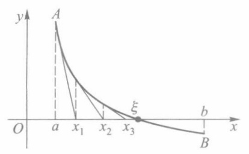

text_image

y
A
ξ
O
a
x₁
x₂
x₃
b
x
B

(1)

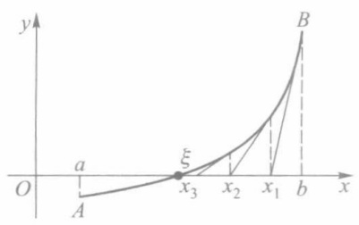

text_image

y
a
ξ
O
A
x₃
x₂
x₁
b
B
x

(2)

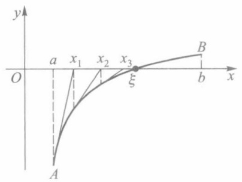

text_image

y
a x₁ x₂ x₃ ξ b x
O
A

(3)

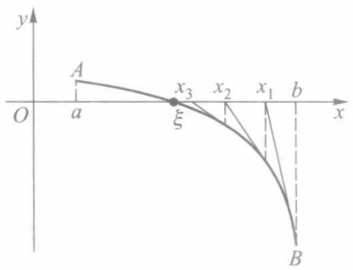

text_image

y
A
x₃
x₂
x₁
b
O
a
ξ
x
B

(4)

图6-17

$$
x _ {n} - \xi = \frac {f (x _ {n})}{f ^ {\prime} (\eta)}.
$$

记 $m = \min_{x\in [a,b]}\{\mid f'(x)\mid \}$ ，则

$$
\mid x _ {n} - \xi \mid \leqslant \frac {\mid f (x _ {n}) \mid}{m}. \tag {4}
$$

读者可类似讨论余下三种情形:

(2) $f'(x)>0,f''(x)>0$ ,这时又有 $f(a)<0,f(b)>0;$
(3) $f'(x)>0,f''(x)<0$ ,这时又有 $f(a)<0,f(b)>0;$
(4) $f'(x)<0,f''(x)<0$ ,这时又有 $f(a)>0,f(b)<0$ .

这三种情形的图像分别如图6-17中的（2）、（3）、（4）所示.对它们同样能构造数列(2)，并可证明其极限是方程（1）的解.只是在（2）、（4）两种情形下，应改取 $x_0 = b$ ，相应得到的 $\{x_{n}\}$ 是单调递减的.

例 用牛顿切线法求方程  $x^{3}-2x^{2}-4x-7=0$  的近似解, 使误差不超过 0.01.

解 设 $f(x) = x^{3} - 2x^{2} - 4x - 7$. 求得导数

$$
f ^ {\prime} (x) = 3 x ^ {2} - 4 x - 4 = (3 x + 2) (x - 2),
$$

$$
f ^ {\prime \prime} (x) = 6 x - 4.
$$

容易检验 $x = -\frac{2}{3}$ 为极大值点，$x = 2$ 为极小值点，并且 $f\left(-\frac{2}{3}\right) < 0.$ 又因

$$
\lim _ {x \to - \infty} f (x) = - \infty ,
$$

$\lim_{x\to +\infty}f(x) = +\infty$ ，所以方程 $f(x) = 0$ 有且只有一个根.

注意到 $f(3) = -10 < 0, f(4) = 9 > 0$ ，因而方程的根 $\xi \in (3,4)$. 由于在[3,4]上 $f'(x)$

146

---

第六章总练习题

$>0,f''(x)>0$ ,因此它属于情形(2),如图6-18所示.从点B(4,9)作切线与x轴相交于

$$
x _ {1} = 4 - \frac {f (4)}{f ^ {\prime} (4)} = 4 - \frac {9}{2 8} \approx 3. 6 8.
$$

我们来估计以 $x_{1}$ 代替 $\xi$ 的误差:$f'(x)$ 在[3,4]上的最小值为 $m = 11$ ，而 $f(x_{1})\approx f(3.68)\approx 1.03$ ，由误差估计公式(4)得

$$
\mid x _ {1} - \xi \mid \leqslant \frac {\mid f (x _ {1}) \mid}{m} \approx \frac {1 . 0 3}{1 1},
$$

而 $\frac{1.03}{11}>0.01$ ,因此尚不合要求.

再在点 $B^{\prime}(x_{1},f(x_{1}))$ 作切线，求得

$$
x _ {2} = x _ {1} - \frac {f (x _ {1})}{f ^ {\prime} (x _ {1})} = 3. 6 8 - \frac {1 . 0 3}{2 1 . 9} \approx 3. 6 3.
$$

由于 $f(x_{2}) = -0.042$ ，此时

$$
\mid x _ {2} - \xi \mid \leqslant \frac {\mid f (x _ {2}) \mid}{m} \approx \frac {0 . 0 4 2}{1 1} <   0. 0 1,
$$

因此取  $\xi\approx3.63$  已能达到所要求的精确度.

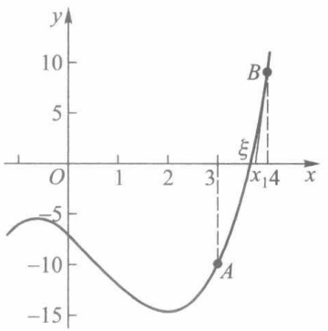

line

| Point | X | Y |
| --- | --- | --- |
| A | 3 | -10 |
| B | 4 | 9 |

图6-18

## 习题 6.7

1. 求 $\frac{x^3}{3} - x^2 + 2 = 0$ 的实根，精确到三位有效数字.
2. 求方程  $x = 0.538 \sin x + 1$  的根的近似值, 精确到 0.001.

## 第六章总练习题

1. 证明: 若 $f(x)$ 在有限开区间 $(a, b)$ 上可导, 且 $\lim_{x \to a^{+}} f(x) = \lim_{x \to b^{-}} f(x)$, 则至少存在一点 $\xi \in (a, b)$, 使 $f'(\xi) = 0$.

2. 证明: 若 x > 0, 则

(1)  $\sqrt{x+1}-\sqrt{x}=\frac{1}{2\sqrt{x+\theta(x)}}$ , 其中  $\frac{1}{4}\leqslant\theta(x)\leqslant\frac{1}{2}$ ;
(2) $\lim_{x\to 0^{+}}\theta (x) = \frac{1}{4},\lim_{x\to +\infty}\theta (x) = \frac{1}{2}.$

3. 设函数 $f$ 在 $[a, b]$ 上连续，在 $(a, b)$ 上可导，且 $a \cdot b > 0$. 证明存在 $\xi \in (a, b)$，使得

$$
\frac {1}{a - b} \left| \begin{array}{c c} a & b \\ f (a) & f (b) \end{array} \right| = f (\xi) - \xi f ^ {\prime} (\xi).
$$

4. 设 $f$ 在 $[a, b]$ 上三阶可导，证明存在 $\xi \in (a, b)$，使得

147

---

第六章 微分中值定理及其应用

$$
f (b) = f (a) + \frac {1}{2} (b - a) [ f ^ {\prime} (a) + f ^ {\prime} (b) ] - \frac {1}{1 2} (b - a) ^ {3} f ^ {\prime \prime \prime} (\xi).
$$

5. 对  $f(x)=\ln(1+x)$  应用拉格朗日中值定理, 试证: 对 x>0, 有

$$
0 <   \frac {1}{\ln (1 + x)} - \frac {1}{x} <   1.
$$

6. 设  $a_{1}, a_{2}, \cdots, a_{n}$  为 n 个正数，且

$$
f (x) = \left(\frac {a _ {1} ^ {x} + a _ {2} ^ {x} + \cdots + a _ {n} ^ {x}}{n}\right) ^ {\frac {1}{x}}.
$$

证明:(1)  $\lim_{x\to0}f(x)=\sqrt[n]{a_{1}a_{2}\cdots a_{n}}$ ;

(2)  $\lim_{x\to+\infty}f(x)=\max\left\{a_{1},a_{2},\cdots,a_{n}\right\}$ .

7. 求下列极限:

(1)  $\lim_{x\to1^{-}}(1-x^{2})^{1/\ln(1-x)}$ ;

(2)  $\lim_{x\to0}\frac{xe^{x}-\ln(1+x)}{x^{2}}$ ;

(3) $\lim_{x\to 0}\frac{x^2\sin\frac{1}{x}}{\sin x}.$

8. 设 $h > 0$，函数 $f$ 在 $U(a; h)$ 上具有 $n + 2$ 阶连续导数，且 $f^{(n + 2)}(a) \neq 0, f$ 在 $U(a; h)$ 上的泰勒公式为

$$
f (a + h) = f (a) + f ^ {\prime} (a) h + \dots + \frac {f ^ {(n)} (a)}{n !} h ^ {n} + \frac {f ^ {(n + 1)} (a + \theta h)}{(n + 1) !} h ^ {n + 1}, 0 <   \theta <   1.
$$

证明: $\lim_{h\to0}\theta=\frac{1}{n+2}.$

9. 设 k>0，试问 k 为何值时，方程  $\arctan x-kx=0$  有正实根.

10. 证明: 对任一多项式 $p(x)$, 一定存在 $x_{1}$ 与 $x_{2}$, 使 $p(x)$ 在 $(- \infty, x_{1})$ 与 $(x_{2}, +\infty)$ 上分别严格单调.

11. 讨论函数

$$
f (x) = \left\{ \begin{array}{l l} \frac {x}{2} + x ^ {2} \sin \frac {1}{x}, & x \neq 0, \\ 0, & x = 0, \end{array} \right.
$$

(1) 在 x=0 点是否可导?

(2) 是否存在 x=0 的一个邻域, 使 f 在该邻域上单调?

12. 设函数 $f$ 在 $[a, b]$ 上二阶可导，$f'(a) = f'(b) = 0$. 证明存在一点 $\xi \in (a, b)$，使得

$$
\mid f ^ {\prime \prime} (\xi) \mid \geqslant \frac {4}{(b - a) ^ {2}} \left| f (b) - f (a) \right|.
$$

13. 设函数 $f$ 在 $[0, a]$ 上具有二阶导数，且 $|f''(x)| \leqslant M, f$ 在 $(0, a)$ 上取得最大值。试证

$$
\left| f ^ {\prime} (0) \right| + \left| f ^ {\prime} (a) \right| \leqslant M a.
$$

14. 设 $f$ 在 $[0, +\infty)$ 上可微，且 $0 \leqslant f'(x) \leqslant f(x), f(0) = 0.$ 证明:在 $[0, +\infty)$ 上 $f(x) \equiv 0.$

15. 设 $f(x)$ 满足 $f''(x) + f'(x)g(x) - f(x) = 0$，其中 $g(x)$ 为任一函数。证明:若 $f(x_0) = f(x_1) = 0$ ($x_0 < x_1$)，则 $f$ 在 $[x_0, x_1]$ 上恒等于 0。

16. 证明: 定圆内接正 n 边形面积将随 n 的增加而增加.

17. 证明: f 为 I 上凸函数的充要条件是对任何  $x_{1}, x_{2} \in I$ ，函数

$$
\varphi (\lambda) = f (\lambda x _ {1} + (1 - \lambda) x _ {2})
$$

148

---

第六章 总练习题

为 $[0,1]$ 上的凸函数

18. 证明:(1) 设 $f$ 在 $(a, +\infty)$ 上可导，若 $\lim_{x \to +\infty} f(x), \lim_{x \to +\infty} f'(x)$ 都存在，则

$$
\lim _ {x \to + \infty} f ^ {\prime} (x) = 0.
$$

(2) 设 f 在  $(a, +\infty)$  上 n 阶可导. 若  $\lim_{x \to +\infty} f(x)$  和  $\lim_{x \to +\infty} f^{(n)}(x)$  都存在, 则

$$
\lim _ {x \to + \infty} f ^ {(k)} (x) = 0 (k = 1, 2, \dots , n).
$$

19. 设 $f$ 为 $(- \infty, +\infty)$ 上的二阶可导函数. 若 $f$ 在 $(- \infty, +\infty)$ 上有界, 则存在 $\xi \in (-\infty, +\infty)$, 使 $f''(\xi) = 0$.

## 第六章综合自测题

149
