# 第9章 定积分

原始 PDF 第 197–232 页。

## 第九章定积分

## § 1 定积分概念

## 一、问题提出

不定积分和定积分是积分学中的两大基本问题.求不定积分是求导数的逆运算,定积分则是某种特殊和式的极限,它们之间既有区别又有联系.现在先从两个例子来看定积分概念是怎样提出来的.

1. 曲边梯形的面积 设 $f$ 为闭区间 $[a, b]$ 上的连续函数，且 $f(x) \geqslant 0$. 由曲线 $y = f(x)$，直线 $x = a, x = b$ 以及 $x$ 轴所围成的平面图形（图9-1），称为曲边梯形. 下面讨论曲边梯形的面积（这是求任何曲线边界图形面积的基础）.

在初等数学里,圆面积是用一系列边数无限增多的内接(或外切)正多边形面积的极限来定义的.现在我们仍用类似的办法来定义曲边梯形的面积.

在区间 $[a, b]$ 上任取 $n - 1$ 个分点，它们依次为

$$
a = x _ {0} <   x _ {1} <   x _ {2} <   \dots <   x _ {n - 1} <   x _ {n} = b,
$$

这些点把  $[a, b]$  分割成 n 个小区间  $[x_{i-1}, x_{i}]$ ,  $i = 1, 2, \cdots, n$ . 再用直线  $x = x_{i}$ ,  $i = 1, 2, \cdots, n-1$  把曲边梯形分割成 n 个小曲边梯形（图 9-2）.

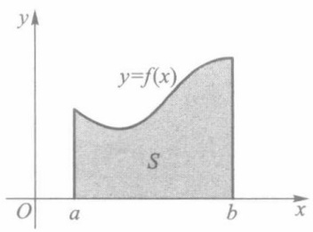

text_image

y
y=f(x)
S
O a b x

图9-1

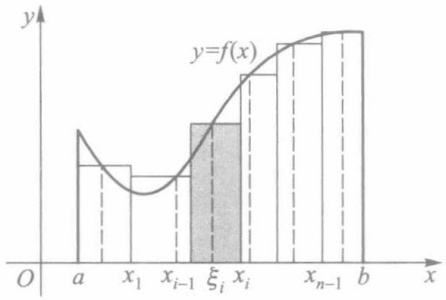

bar

| X-axis Point | Interval Description |
| --- | --- |
| a | 1 |
| \(x_{1}\) | 2 |
| \(x_{i-1}\) | 3 |
| \(\xi_{i}\) | 4 |
| \(x_{i}\) | 5 |
| \(x_{n-1}\) | 6 |
| b | 7 |

图9-2

在每个小区间 $[x_{i-1}, x_i]$ 上任取一点 $\xi_i$，作以 $f(\xi_i)$ 为高，$[x_{i-1}, x_i]$ 为底的小矩形。当分割 $[a, b]$ 的分点较多，又分割得较细密时，由于 $f$ 为连续函数，它在每个小区间上的值变化不大，从而可用这些小矩形的面积近似替代相应小曲边梯形的面积。于是，这 $n$ 个小矩形面积之和就可作为该曲边梯形面积 $S$ 的近似值，即

186

---

§ 1 定积分概念

$$
S \approx \sum_ {i = 1} ^ {n} f (\xi_ {i}) \Delta x _ {i} \quad (\Delta x _ {i} = x _ {i} - x _ {i - 1}). \tag {1}
$$

注意到(1)式右边的和式既依赖于对区间 $[a,b]$ 的分割,又与所有中间点 $\xi_{i}(i=1,2,\cdots,n)$ 的取法有关.当分点无限增多,且对 $[a,b]$ 无限细分时,如果此和式与某一常数无限接近,而且与分点 $x_{i}$ 和中间点 $\xi_{i}$ 的选取无关,则自然地,我们把此常数定义为该曲边梯形的面积S.

2. 变力所做的功 设质点受力 $F$ 的作用沿 $x$ 轴由点 $a$ 移动到点 $b$, 并设 $F$ 处处平

行于 $x$ 轴（图9-3).如果 $F$ 为常力，则它对质点所做的功为 $W = F(b - a)$ .现在的问题是， $F$ 为变力，它连续依赖于质点所在位置的坐标 $x$ ，即 $F = F(x),x\in [a,b]$ 为一连续函数，此时 $F$ 对质点所做的功 $W$ 又该如何计算？

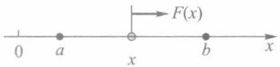

text_image

F(x)
0 a x b x

图9-3

由假设  $F(x)$  为一连续函数, 故在很小的一段位移区间上  $F(x)$  可以近似地看作一常量. 类似于求曲边梯形面积那样, 把  $[a, b]$  细分为 n 个小区间  $[x_{i-1}, x_i]$ ,  $\Delta x_i = x_i - x_{i-1}, i = 1, 2, \cdots, n$ ; 并在每个小区间上任取一点  $\xi_i$ , 就有

$$
F (x) \approx F (\xi_ {i}), x \in [ x _ {i - 1}, x _ {i} ], i = 1, 2, \dots , n.
$$

于是，质点从 $x_{i - 1}$ 位移到 $x_{i}$ 时，力 $F$ 所做的功就近似等于 $F(\xi_i)\Delta x_i$ ，从而

$$
W \approx \sum_ {i = 1} ^ {n} F (\xi_ {i}) \Delta x _ {i}. \tag {2}
$$

同样地,对 $[a,b]$ 作无限细分时,若(2)式右边的和式与某一常数无限接近,则我们把此常数定义为该变力所做的功W.

上面两个例子,一个是计算曲边梯形面积的几何问题,另一个是求变力做功的力学问题,它们最终都归结为一个特定形式的和式逼近.在科学技术中还有许多同样类型的数学问题,解决这类问题的思想方法概括说来就是“分割,近似求和,取极限”.这就是产生定积分概念的背景.

## 二、定积分的定义

定义1 设闭区间 $[a, b]$ 上有 $n - 1$ 个点，依次为

$$
a = x _ {0} <   x _ {1} <   x _ {2} <   \dots <   x _ {n - 1} <   x _ {n} = b,
$$

它们把 $[a,b]$ 分成n个小区间 $\Delta_{i}=\left[x_{i-1},x_{i}\right],i=1,2,\cdots,n.$ 这些分点或这些闭子区间构成对 $[a,b]$ 的一个分割，记为

$$
T = \{  x _ {0}  , x _ {1}  , \dots , x _ {n}   \}    \text {或}   \{\Delta_ {1}  , \Delta_ {2}  , \dots , \Delta_ {n}   \}  .
$$

小区间 $\Delta_{i}$ 的长度为 $\Delta x_{i} = x_{i} - x_{i - 1}$，并记

$$
\| T \| = \max _ {1 \leqslant i \leqslant n} \{\Delta x _ {i} \},
$$

称为分割 T 的模.

注 由于 $\Delta x_{i} \leqslant \| T \|, i = 1,2,\dots,n$, 因此 $\| T \|$ 可用来反映 $[a,b]$ 被分割的细密程度. 另外, 分割 $T$ 一旦给出, $\| T \|$ 就随之而确定; 但是, 具有同一细度 $\| T \|$ 的分割 $T$ 却有无限多个.

定义2 设 $f$ 是定义在 $[a, b]$ 上的一个函数. 对于 $[a, b]$ 的一个分割 $T = \{\Delta_1, \ldots, T\}$.

187

---

第九章 定积分

$\Delta_{2},\cdots,\Delta_{n}\}$ ，任取点 $\xi_{i}\in\Delta_{i},i=1,2,\cdots,n$ ，并作和式

$$
\sum_ {i = 1} ^ {n} f (\xi_ {i}) \Delta x _ {i}.
$$

称此和式为函数 $f$ 在 $[a, b]$ 上的一个积分和，也称黎曼和.

显然,积分和既与分割 T 有关,又与所选取的点集  $\{\xi_{i}\}$  有关.

定义3 设 $f$ 是定义在 $[a, b]$ 上的一个函数, $J$ 是一个确定的实数. 若对任给的正数 $\varepsilon$, 总存在某一正数 $\delta$, 使得对 $[a, b]$ 的任何分割 $T$, 以及在其上任意选取的点集 $\{\xi_i\}$, 只要 $\| T \| < \delta$, 就有

$$
\Big | \sum_ {i = 1} ^ {n} f (\xi_ {i}) \Delta x _ {i} - J \Big | <   \varepsilon ,
$$

则称函数 $f$ 在区间 $[a, b]$ 上可积或黎曼可积；数 $J$ 称为 $f$ 在 $[a, b]$ 上的定积分或黎曼积分，记作

$$
J = \int_ {a} ^ {b} f (x) \mathrm{d} x. \tag {3}
$$

其中 $f$ 称为被积函数，$x$ 称为积分变量，$[a, b]$ 称为积分区间，$a, b$ 分别称为这个定积分的下限和上限.

以上定义1至定义3是定积分抽象概念的完整叙述.下面是与定积分概念有关的几点补充注释.

注1 把定积分定义的 $\varepsilon -\delta$ 说法和函数极限的 $\varepsilon -\delta$ 说法相对照，便会发现两者有相似的陈述方式，因此我们也常用极限符号来表达定积分，即把它写作

$$
J = \lim _ {\| T \| \to 0} \sum_ {i = 1} ^ {n} f (\xi_ {i}) \Delta x _ {i} = \int_ {a} ^ {b} f (x) \mathrm{d} x. \tag {4}
$$

然而,积分和的极限与函数的极限之间其实有着很大的区别:在函数极限 $\lim_{x\to a}f(x)$ 中,对每一个极限变量x来说, $f(x)$ 的值是唯一确定的;而对于积分和的极限而言,每一个 $\|T\|$ 并不唯一对应积分和的一个值.这使得积分和的极限要比通常的函数极限复杂得多.

注 2 可积性是函数的又一分析性质. 稍后(定理 9.3)就会知道连续函数是可积的, 于是本节开头两个实例都可用定积分记号来表示:

1）连续曲线 $y = f(x) \geqslant 0$ 在 $[a, b]$ 上形成的曲边梯形面积为 $S = \int_{a}^{b} f(x) \, \mathrm{d}x$;
2）在连续变力 $F(x)$ 作用下，质点从 $a$ 位移到 $b$ 所做的功为 $W = \int_{a}^{b} F(x) \, \mathrm{d}x$.

注3(定积分的几何意义) 由上述1)看到,对于 $[a,b]$ 上的连续函数f,当 $f(x)\geqslant0,x\in[a,b]$ 时,定积分(3)的几何意义就是该曲边梯形的面积;当 $f(x)\leqslant0,x\in[a,b]$ 时, $J=-\int_{a}^{b}\left[-f(x)\right]\mathrm{d}x$ 是位于x轴下方的曲边梯形面积的相反数,不妨称之为“负面积”;对于一般非定号的 $f(x)$ 而言(图9-4),定积分J的值则是曲线 $y=f(x)$ 在x轴上方部分所有曲边梯形的正面积与下方部分所有曲边梯形的负面积的代数和.

注 4 定积分作为积分和的极限, 它的值只与被积函数 f 和积分区间  $[a, b]$  有关, 而与积分变量所用的符号无关, 即

188

---

§ 1 定积分概念 ||

$$
\int_ {a} ^ {b} f (x) \mathrm{d} x = \int_ {a} ^ {b} f (t) \mathrm{d} t = \int_ {a} ^ {b} f (\theta) \mathrm{d} \theta = \dots .
$$

例 1 求在区间  $[0,1]$  上, 以抛物线  $y=x^{2}$  为曲边的曲边三角形的面积(图 9-5).

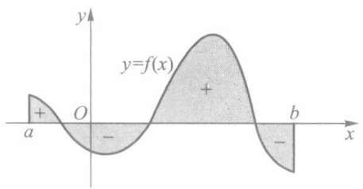

text_image

y
y=f(x)
+
O
-
a
b
x

图9-4

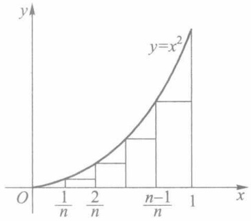

area

| Interval | Area (x) |
| --- | --- |
| 1/n to 2/n | 1/n |
| 2/n to n-1/n | 2/n |
| n-1/n to 1 | 1/n |

图9-5

解 由注3, 因  $y = x^{2}$  在  $[0,1]$  上连续, 故所求面积为

$$
S = \int_ {0} ^ {1} x ^ {2} \mathrm{d} x = \lim _ {\| T \| \to 0} \sum_ {i = 1} ^ {n} \xi_ {i} ^ {2} \Delta x _ {i}.
$$

为求得此极限,在定积分存在的前提下,允许选择某种特殊的分割 T 和特殊的点集  $\{\xi_{i}\}$ .在此只需取等分分割

$$
T = \left\{0, \frac {1}{n}, \frac {2}{n}, \dots , \frac {n - 1}{n}, 1 \right\}, \| T \| = \frac {1}{n};
$$

并取  $\xi_{i}=\frac{i-1}{n}\in\left[\frac{i-1}{n},\frac{i}{n}\right],i=1,2,\cdots,n.$  则有

$$
\begin{array}{l} S = \lim _ {n \to \infty} \sum_ {i = 1} ^ {n} \left(\frac {i - 1}{n}\right) ^ {2} \cdot \frac {1}{n} = \lim _ {n \to \infty} \frac {1}{n ^ {3}} \sum_ {i = 1} ^ {n} (i - 1) ^ {2} \\ = \lim _ {n \to \infty} \frac {(n - 1) n (2 n - 1)}{6 n ^ {3}} = \frac {1}{3}. \\ \end{array}
$$

## 习题 9.1

1. 按定积分定义证明: $\int_{a}^{b}k\mathrm{d}x=k(b-a)$ .

2. 通过对积分区间作等分分割，并取适当的点集 $\{\xi_{i}\}$ ，把定积分看作是对应的积分和的极限，来计算下列定积分:

(1) $\int_{0}^{1} x^{3} \mathrm{~d} x; \left( 提示 : \sum_{i=1}^{n} i^{3} = \frac{1}{4} n^{2} (n + 1)^{2}. \right)$

(2) $\int_{0}^{1}\mathrm{e}^{x}\mathrm{d}x;$

(3) $\int_{a}^{b}\mathrm{e}^{x}\mathrm{d}x;$

(4) $\int_{a}^{b}\frac{\mathrm{d}x}{x^2}(0 < a < b)$. (提示: 取 $\xi_i = \sqrt{x_{i-1}x_i}$.)

189

---

第九章 定积分

## § 2 牛顿—莱布尼茨公式

从上节例题和习题看到,通过求积分和的极限来计算定积分一般是很困难的.下面要介绍的牛顿—莱布尼茨公式不仅为定积分计算提供了一个有效的方法,而且在理论上把定积分与不定积分联系了起来.

定理9.1 若函数 $f$ 在 $[a, b]$ 上连续，且存在原函数 $F$，即 $F'(x) = f(x), x \in [a, b]$，则 $f$ 在 $[a, b]$ 上可积，且

$$
\int_ {a} ^ {b} f (x) \mathrm{d} x = F (b) - F (a). \tag {1}
$$

上式称为牛顿—莱布尼茨公式,它也常写成

$$
\int_ {a} ^ {b} f (x)   \mathrm{d} x = F (x) \bigg | _ {a} ^ {b}.
$$

证 由定积分定义, 任给 $\varepsilon > 0$, 要证存在 $\delta > 0$, 当 $\| T \| < \delta$ 时, 有 $\left|\sum_{i=1}^{n} f(\xi_i) \Delta x_i - [F(b) - F(a)]\right| < \varepsilon$. 下面证明满足如此要求的 $\delta$ 确实是存在的.

事实上，对于 $[a,b]$ 的任一分割 $T=\{a=x_{0},x_{1},\cdots,x_{n}=b\}$ ，在每个小区间 $[x_{i-1},x_{i}]$ 上对 $F(x)$ 使用拉格朗日中值定理，则分别存在 $\eta_{i}\in(x_{i-1},x_{i}),i=1,2,\cdots,n$ ，使得

$$
\begin{array}{l} F (b) - F (a) = \sum_ {i = 1} ^ {n} \left[ F (x _ {i}) - F (x _ {i - 1}) \right] \\ = \sum_ {i = 1} ^ {n} F ^ {\prime} (\eta_ {i}) \Delta x _ {i} = \sum_ {i = 1} ^ {n} f (\eta_ {i}) \Delta x _ {i}. \tag {2} \\ \end{array}
$$

因为 $f$ 在 $[a, b]$ 上连续，从而一致连续，所以对上述 $\varepsilon > 0$ ，存在 $\delta > 0$ ，当 $x'$，$x'' \in [a, b]$ 且 $|x' - x''| < \delta$ 时，有

$$
\left| f (x ^ {\prime}) - f (x ^ {\prime \prime}) \right| <   \frac {\varepsilon}{b - a}.
$$

于是，当 $\Delta x_{i}\leqslant \| T\| < \delta$ 时，任取 $\xi_i\in [x_{i - 1},x_i]$ ，便有 $|\xi_i - \eta_i| < \delta$ ，这就证得

$$
\begin{array}{l} = \Big | \sum_ {i = 1} ^ {n} \left[ f (\xi_ {i}) - f (\eta_ {i}) \right] \Delta x _ {i} \Big | \\ \leqslant \sum_ {i = 1} ^ {n} \left| f (\xi_ {i}) - f (\eta_ {i}) \right| \Delta x _ {i} \\ <   \frac {\varepsilon}{b - a} \cdot \sum_ {i = 1} ^ {n} \Delta x _ {i} = \varepsilon . \\ \end{array}
$$

$$
\left| \sum_ {i = 1} ^ {n} f (\xi_ {i}) \Delta x _ {i} - [ F (b) - F (a) ] \right|
$$

所以 $f$ 在 $[a, b]$ 上可积，且有公式(1)成立.

注1 在应用牛顿—莱布尼茨公式时, $F(x)$ 可由积分法求得.

注 2 定理条件尚可适当减弱,例如:

190

---

§ 2 牛顿—莱布尼茨公式

1）对 $F$ 的要求可减弱为:在 $[a,b]$ 上连续，在 $(a,b)$ 上可导，且 $F^{\prime}(x) = f(x), x \in (a,b)$. 这不影响定理的证明.
2）对 $f$ 的要求可减弱为:在 $[a,b]$ 上可积（不一定连续).这时(2)式仍成立，且由 $f$ 在 $[a,b]$ 上可积，(2)式右边当 $\| T\| \to 0$ 时的极限就是 $\int_{a}^{b}f(x)\mathrm{d}x$ ，而左边恒为一常数.（更一般的情形参见本节习题第3题.)

注3 至 §5 证得连续函数必有原函数之后,本定理的条件中对 $F$ 的假设便是多余的了.

例 1 利用牛顿—莱布尼茨公式计算下列定积分:

(1) $\int_{a}^{b}x^{n}\mathrm{d}x$  (n为正整数);

(2) $\int_{a}^{b}\mathrm{e}^{x}\mathrm{d}x;$

(3) $\int_{a}^{b}\frac{\mathrm{d}x}{x^2} (0 < a < b);$

(4) $\int_{0}^{\pi}\sin xdx;$

(5) $\int_0^2 x\sqrt{4 - x^2}\mathrm{d}x.$

解 其中(1)—(3)即为§1中的例题和习题,现在用牛顿—莱布尼茨公式来计算就十分方便:

(1) $\int_{a}^{b} x^{n} \, \mathrm{d}x = \frac{x^{n+1}}{n+1} \bigg|_{a}^{b} = \frac{1}{n+1} (b^{n+1} - a^{n+1})$;
(2) $\int_{a}^{b}\mathrm{e}^{x}\mathrm{d}x = \mathrm{e}^{x}\Bigg|_{a}^{b} = \mathrm{e}^{b} - \mathrm{e}^{a};$
(3) $\int_{a}^{b}\frac{\mathrm{d}x}{x^2} = -\left.\frac{1}{x}\right|_a^b = \frac{1}{a} -\frac{1}{b};$
(4) $\int_{0}^{\pi}\sin x\mathrm{d}x = -\cos x\bigg|_{0}^{\pi} = 2.$

(这里的(4)是图9-6所示正弦曲线一拱下的面积,其余各题也可作此联想.)

（5）先用不定积分法求出  $f(x)=x\sqrt{4-x^{2}}$  的任一原函数，然后完成定积分计算:

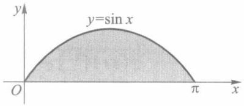

text_image

y=sin x
O
π
x

图9-6

$$
\begin{array}{l} \int x \sqrt {4 - x ^ {2}} \mathrm{d} x = - \frac {1}{2} \int \sqrt {4 - x ^ {2}} \mathrm{d} (4 - x ^ {2}) \\ = - \frac {1}{3} \sqrt {\left(4 - x ^ {2}\right) ^ {3}} + C, \\ \int_ {0} ^ {2} x \sqrt {4 - x ^ {2}} \mathrm{d} x = - \left. \frac {1}{3} \sqrt {\left(4 - x ^ {2}\right) ^ {3}} \right| _ {0} ^ {2} = \frac {8}{3}. \\ \end{array}
$$

例 2 利用定积分求极限

$$
\lim _ {n \to \infty} \left(\frac {1}{n + 1} + \frac {1}{n + 2} + \dots + \frac {1}{2 n}\right) = J.
$$

解 把此极限式化为某个积分和的极限式,并转化为计算定积分.为此作如下变形:

191

---

第九章 定积分

$$
J = \lim _ {n \to \infty} \sum_ {i = 1} ^ {n} \frac {1}{1 + \frac {i}{n}} \cdot \frac {1}{n}.
$$

不难看出,其中的和式是函数 $f(x)=\frac{1}{1+x}$ 在区间 $[0,1]$ 上的一个积分和(这里所取的是等分分割, $\Delta x_{i}=\frac{1}{n},\xi_{i}=\frac{i}{n}\in\left[\frac{i-1}{n},\frac{i}{n}\right],i=1,2,\cdots,n$ ).所以

$$
J = \int_ {0} ^ {1} \frac {\mathrm{d} x}{1 + x} = \ln (1 + x) \Bigg | _ {0} ^ {1} = \ln 2.
$$

当然,也可把 J 看作  $f(x)=\frac{1}{x}$  在  $[1,2]$  上的定积分,同样有

$$
J = \int_ {1} ^ {2} \frac {\mathrm{d} x}{x} = \int_ {2} ^ {3} \frac {\mathrm{d} x}{x - 1} = \dots = \ln 2.
$$

## 习题 9.2

1. 计算下列定积分:

(1) $\int_0^1 (2x + 3)\mathrm{d}x;$

(2) $\int_{0}^{1}\frac{1 - x^2}{1 + x^2}\mathrm{d}x;$

(3) $\int_{\mathrm{e}}^{\mathrm{e}^2}\frac{\mathrm{d}x}{x\ln x};$

(4) $\int_0^1\frac{\mathrm{e}^x - \mathrm{e}^{-x}}{2}\mathrm{d}x;$

(5) $\int_{0}^{\frac{\pi}{3}}\tan^{2}x\mathrm{d}x;$

(6) $\int_{4}^{9}\left(\sqrt{x} +\frac{1}{\sqrt{x}}\right)\mathrm{d}x;$

(7) $\int_0^4\frac{\mathrm{d}x}{1 + \sqrt{x}};$

(8) $\int_{\frac{1}{e}}^{e}\frac{1}{x} (\ln x)^2\mathrm{d}x.$

2. 利用定积分求极限:

(1)  $\lim_{n\to\infty}\frac{1}{n^{4}}\left(1+2^{3}+\cdots+n^{3}\right)$ ;
(2)  $\lim_{n\to\infty}n\left[\frac{1}{(n+1)^{2}}+\frac{1}{(n+2)^{2}}+\cdots+\frac{1}{(n+n)^{2}}\right]$ ;
(3)  $\lim_{n\to\infty}n\left(\frac{1}{n^{2}+1}+\frac{1}{n^{2}+2^{2}}+\cdots+\frac{1}{2n^{2}}\right)$ ;
(4)  $\lim_{n\to\infty}\frac{1}{n}\left(\sin\frac{\pi}{n}+\sin\frac{2\pi}{n}+\cdots+\sin\frac{n-1}{n}\pi\right).$

3. 证明: 若 $f$ 在 $[a, b]$ 上可积, $F$ 在 $[a, b]$ 上连续, 且除有限个点外有 $F'(x) = f(x)$, 则有

$$
\int_ {a} ^ {b} f (x) \mathrm{d} x = F (b) - F (a).
$$

## §3 可积条件

从定理 9.1 及其后注中看到,要判别一个函数是否可积,必须研究可积条件.

192

---

§ 3 可积条件

## 一、可积的必要条件

定理9.2 若函数 $f$ 在 $[a, b]$ 上可积，则 $f$ 在 $[a, b]$ 上必定有界.

证 用反证法. 若 $f$ 在 $[a, b]$ 上无界, 则对于 $[a, b]$ 的任一分割 $T$, 必存在属于 $T$ 的某个小区间 $\Delta_k, f$ 在 $\Delta_k$ 上无界. 在 $i \neq k$ 的各个小区间 $\Delta_i$ 上任意取定 $\xi_i$, 并记

$$
G = \Big | \sum_ {i \neq k} f (\xi_ {i}) \Delta x _ {i} \Big |.
$$

现对任意大的正数 $M$ ，由于 $f$ 在 $\Delta_k$ 上无界，故存在 $\xi_{k}\in \Delta_{k}$ ，使得

$$
\left| f (\xi_ {k}) \right| > \frac {M + G}{\Delta x _ {k}}.
$$

于是有

$$
\begin{array}{l} \Big | \sum_ {i = 1} ^ {n} f (\xi_ {i}) \Delta x _ {i} \Big | \geqslant \big | f (\xi_ {k}) \Delta x _ {k} \big | - \Big | \sum_ {i \neq k} f (\xi_ {i}) \Delta x _ {i} \Big | \\ > \frac {M + G}{\Delta x _ {k}} \cdot \Delta x _ {k} - G = M. \\ \end{array}
$$

由此可见，对于无论多小的 $\| T\|$ ，按上述方法选取点集 $\{\xi_i\}$ 时，总能使积分和的绝对值大于任何预先给出的正数，这与 $f$ 在 $[a,b]$ 上可积相矛盾.

这个定理指出,任何可积函数一定是有界的;但要注意,有界函数却不一定可积.

例1 证明狄利克雷函数

$$
D (x) = \left\{ \begin{array}{l l} 1, & x \text {为有理数}, \\ 0, & x \text {为无理数} \end{array} \right.
$$

在 $[0,1]$ 上有界但不可积.

证 显然 $|D(x)| \leqslant 1, x \in [0,1]$.

对于 $[0,1]$ 的任一分割 $T$ ，由有理数和无理数在实数中的稠密性，在属于 $T$ 的任一小区间 $\Delta_{i}$ 上，当取 $\xi_{i}$ 全为有理数时，$\sum_{i=1}^{n} D(\xi_{i}) \Delta x_{i} = \sum_{i=1}^{n} \Delta x_{i} = 1$；当取 $\xi_{i}$ 全为无理数时，$\sum_{i=1}^{n} D(\xi_{i}) \Delta x_{i} = 0$。所以不论 $\| T \|$ 多么小，只要点集 $\{\xi_{i}\}$ 取法不同（全取有理数或全取无理数），积分和就有不同的极限，即 $D(x)$ 在 $[0,1]$ 上不可积。

由此例可见,有界是可积的必要条件.所以在以后讨论函数的可积性时,总是首先假设函数是有界的,今后不再一一申明.

## 二、可积的充要条件

要判断一个函数是否可积,固然可以根据定义,直接考察积分和是否能无限接近某一常数,但由于积分和的复杂性和那个常数不易预知,因此这是极其困难的.下面即将给出的可积准则只与被积函数本身有关,而不涉及定积分的值.

设  $T=\{\Delta_{i}|i=1,2,\cdots,n\}$  为对  $[a,b]$  的任一分割. 由 f 在  $[a,b]$  上有界, 则它在每个  $\Delta_{i}$  上存在上、下确界:

$$
M _ {i} = \sup _ {x \in \Delta_ {i}} f (x), m _ {i} = \inf _ {x \in \Delta_ {i}} f (x), i = 1, 2, \dots , n.
$$

作和

193

---

第九章 定积分

$$
S (T) = \sum_ {i = 1} ^ {n} M _ {i} \Delta x _ {i}, s (T) = \sum_ {i = 1} ^ {n} m _ {i} \Delta x _ {i},
$$

分别称为 f 关于分割 T 的上和与下和（或称达布上和与达布下和，统称达布和）。任给  $\xi_{i} \in \Delta_{i}, i = 1, 2, \cdots, n$ ，显然有

$$
s (T) \leqslant \sum_ {i = 1} ^ {n} f (\xi_ {i}) \Delta x _ {i} \leqslant S (T). \tag {1}
$$

与积分和相比较, 达布和只与分割 $T$ 有关, 而与点集 $\{\xi_i\}$ 无关. 由不等式 (1), 就能通过讨论上和与下和当 $\| T \| \to 0$ 时的极限来揭示 $f$ 在 $[a, b]$ 上是否可积. 所以可积性理论总是从讨论上和与下和的性质入手的.

定理9.3(可积准则) 函数f在 $[a,b]$ 上可积的充要条件是:任给 $\varepsilon>0$ ,总存在相应的一个分割T,使得

$$
S (T) - s (T) <   \varepsilon . \tag {2}
$$

本定理的证明依赖对上和与下和性质的详尽讨论,这里从略(完整证明补述于§6).

设 $\omega_{i} = M_{i} - m_{i}$ ，称为 $f$ 在 $\Delta_{i}$ 上的振幅，有必要时也记为 $\omega_{i}^{f}$ .由于

$$
S (  T  )   -   s (  T  ) = \sum_ {i   =   1} ^ {n} \omega_ {i} \Delta x _ {i} (\text {或记为} \sum_ {T} \omega_ {i} \Delta x _ {i})  ,
$$

因此可积准则又可改述如下.

定理 9.3' 函数 f 在  $[a, b]$  上可积的充要条件是: 任给  $\varepsilon > 0$ , 总存在相应的某一分割 T, 使得

$$
\sum_ {T} \omega_ {i} \Delta x _ {i} <   \varepsilon . \tag {$2^{\prime$}}
$$

不等式(2)或 $(2')$ 的几何意义是:若f在 $[a,b]$ 上可积,则图9-7中包围曲线 $y=f(x)$ 的一系列小矩形面积之和可以达到任意小,只要分割充分地细;反之亦然.

## 三、可积函数类

根据可积的充要条件,我们证明下面一些类型的函数是可积的(即可积的充分条件).

定理9.4 若 $f$ 为 $[a, b]$ 上的连续函数，则 $f$ 在 $[a, b]$ 上可积.

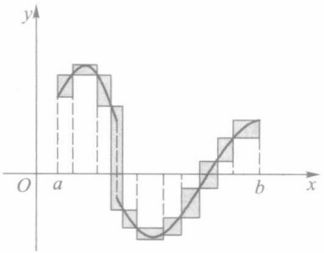

area

| X | Y (Curve) | Y (Squares) |
| --- | --- | --- |
| a | ~0.6 | 1.0 |
| b | ~0.8 | 1.0 |

图9-7

证 由于 $f$ 在闭区间 $[a, b]$ 上连续，因此在 $[a, b]$ 上一致连续。这就是说，任给 $\varepsilon > 0$，存在 $\delta > 0$，对 $[a, b]$ 中任意两点 $x', x''$，只要 $|x' - x''| < \delta$，便有

$$
\left| f (x ^ {\prime}) - f (x ^ {\prime \prime}) \right| <   \frac {\varepsilon}{b - a}.
$$

所以只要对 $[a, b]$ 所作的分割 $T$ 满足 $\| T \| < \delta$，在 $T$ 所属的任一小区间 $\Delta_i$ 上，就能使 $f$ 的振幅满足

194

---

§ 3 可积条件 |||

$$
\omega_ {i} = M _ {i} - m _ {i} = \sup _ {x ^ {\prime}, x ^ {\prime \prime} \in \Delta_ {i}} \left| f (x ^ {\prime}) - f (x ^ {\prime \prime}) \right| ① \leqslant \frac {\varepsilon}{b - a},
$$

从而导致

$$
\sum_ {T} \omega_ {i} \Delta x _ {i} \leqslant \frac {\varepsilon}{b - a} \sum_ {T} \Delta x _ {i} = \varepsilon .
$$

由定理 9.3'证得 f 在  $[a, b]$  上可积.

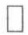

读者应该注意到一致连续性在本定理证明中所起的重要作用.

定理9.5 若 $f$ 是区间 $[a, b]$ 上只有有限个间断点的有界函数，则 $f$ 在 $[a, b]$ 上可积.

证 不失一般性,这里只证明 f 在  $[a, b]$  上仅有一个间断点的情形,并假设该间断点即为端点 b.

任给 $\varepsilon > 0$，取 $\delta'$ 满足 $0 < \delta' < \frac{\varepsilon}{2(M - m)}$，且 $\delta' < b - a$，其中 $M$ 与 $m$ 分别为 $f$ 在 $[a, b]$ 上的上确界与下确界（设 $m < M$，否则 $f$ 为常量函数，显然可积）。记 $f$ 在小区间 $\Delta' = [b - \delta', b]$ 上的振幅为 $\omega'$，则

$$
\omega^ {\prime} \delta^ {\prime} <   (M - m) \cdot \frac {\varepsilon}{2 (M - m)} = \frac {\varepsilon}{2}.
$$

因为 $f$ 在 $[a, b - \delta']$ 上连续，由定理9.4知 $f$ 在 $[a, b - \delta']$ 上可积。再由定理 $9.3'$（必要性），存在对 $[a, b - \delta']$ 的某个分割 $T' = \{\Delta_1, \Delta_2, \dots, \Delta_{n-1}\}$，使得

$$
\sum_ {T ^ {\prime}} \omega_ {i} \Delta x _ {i} <   \frac {\varepsilon}{2}.
$$

令  $\Delta_{n}=\Delta^{\prime}$ ，则  $T=\left\{\Delta_{1},\Delta_{2},\cdots,\Delta_{n-1},\Delta_{n}\right\}$  是对  $[a,b]$  的一个分割，对于 T，有

$$
\sum_ {T} \omega_ {i} \Delta x _ {i} = \sum_ {T ^ {\prime}} \omega_ {i} \Delta x _ {i} + \omega^ {\prime} \delta^ {\prime} <   \frac {\varepsilon}{2} + \frac {\varepsilon}{2} = \varepsilon .
$$

根据定理 9.3'(充分性)，证得 f 在  $[a, b]$  上可积.

定理 9.6 若 f 是  $[a, b]$  上的单调函数, 则 f 在  $[a, b]$  上可积.

证 设 $f$ 为增函数, 且 $f(a) < f(b)$ (若 $f(a) = f(b)$, 则 $f$ 为常量函数, 显然可积). 对 $[a, b]$ 的任一分割 $T$, 由 $f$ 的增性, $f$ 在 $T$ 所属的每个小区间 $\Delta_{i}$ 上的振幅为

$$
\omega_ {i} = f (x _ {i}) - f (x _ {i - 1}),
$$

于是有

$$
\begin{array}{l} \sum_ {T} \omega_ {i} \Delta x _ {i} \leqslant \sum_ {i = 1} ^ {n} \left[ f (x _ {i}) - f (x _ {i - 1}) \right] \| T \| \\ = \left[ f (b) - f (a) \right] \| T \|\cdot \\ \end{array}
$$

由此可见，任给 $\varepsilon > 0$ ，只要 $\| T \| < \frac{\varepsilon}{f(b) - f(a)}$ ，就有

$$
\sum_ {T} \omega_ {i} \Delta x _ {i} <   \varepsilon ,
$$

所以 f 在  $[a, b]$  上可积.

<small>① 此等式成立的证明留作本节习题(第5题).</small>

195

---

第九章 定积分

注意,单调函数即使有无限多个间断点,仍不失其可积性.

例2 试用两种方法证明函数

$$
f (x) = \left\{ \begin{array}{l l} 0, & x = 0, \\ \frac {1}{n}, & \frac {1}{n + 1} <   x \leqslant \frac {1}{n}, n = 1, 2, \dots \end{array} \right.
$$

在区间 $[0,1]$ 上可积.

证 证法一 由于 f 是一增函数(图 9-8)，虽然它在  $[0,1]$  上有无限多个间断点  $x_{n}=\frac{1}{n}, n=2,3,\cdots$ ，但由定理 9.6，仍保证它在  $[0,1]$  上可积。

证法二(仅利用定理 9.3' 和定理 9.5) 任给 $\varepsilon > 0$，由于 $\lim_{n \to \infty} \frac{1}{n} = 0$，因此当 $n$ 充分大时 $\frac{1}{n} < \frac{\varepsilon}{2}$，这说明 $f$ 在 $\left[\frac{\varepsilon}{2}, 1\right]$ 上只有有限个间断点。利用定理 9.5 和定理 9.3' 推知 $f$ 在 $\left[\frac{\varepsilon}{2}, 1\right]$ 上可积，且存在对 $\left[\frac{\varepsilon}{2}, 1\right]$ 的某一分割 $T'$，使得

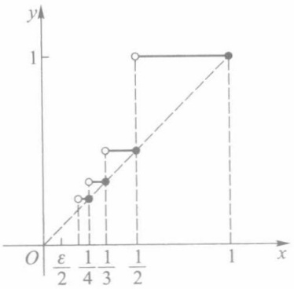

scatter

| X | Y |
| --- | --- |
| 0.25 | ~0.15 |
| 0.375 | ~0.25 |
| 0.4 | ~0.35 |
| 0.625 | ~0.45 |
| 0.875 | 1 |
| 1 | 1 |

图9-8

$$
\sum_ {T ^ {\prime}} \omega_ {i} \Delta x _ {i} <   \frac {\varepsilon}{2}.
$$

再把小区间 $\left[0,\frac{\varepsilon}{2}\right]$ 与 $T'$ 合并，成为对 $[0,1]$ 的一个分割T.由于f在 $\left[0,\frac{\varepsilon}{2}\right]$ 上的振幅 $\omega_{0}<1$ ，因此得到

$$
\sum_ {T} \omega_ {i} \Delta x _ {i} = \omega_ {0} \cdot \frac {\varepsilon}{2} + \sum_ {T ^ {\prime}} \omega_ {i} \Delta x _ {i} <   \frac {\varepsilon}{2} + \frac {\varepsilon}{2} = \varepsilon .
$$

所以 f 在  $[0,1]$  上可积.

事实上,例2的第二种证法并不限于该例中的具体函数,更一般的命题见本节习题第4题.下面例3的证明思想与它可谓异曲同工.

例3 证明黎曼函数

$$
R (x) = \left\{ \begin{array}{l l}  \frac {1}{q}, & x = \frac {p}{q} \bigg (p, q \in \mathbf {N} _ {+}, \frac {p}{q} \text {为既约真分数} \bigg), \\ 0, & x = 0, 1 \text {以及(0,1)内的无理数} \end{array} \right.
$$

在区间 $[0,1]$ 上可积，且

$$
\int_ {0} ^ {1} R (x) \mathrm{d} x = 0.
$$

分析 已知黎曼函数在 $x = 0,1$ 以及一切无理点处连续，而在 $(0,1)$ 上的一切有理点处间断.证明它在[0,1]上可积的直观构思如下:如图9-9所示，在黎曼函数的图像中画一条水平直线 $y = \frac{\varepsilon}{2}$.在此直线上方只有函数图像中有限个点，这些点所对应的自变量可被含于属于分割 $T$ 的有限个小区间中，当 $\| T\|$ 足够小时，这有限个小区间的总

196

---

§ 3 可积条件 |||

长可为任意小；而 $T$ 中其余小区间上函数的振幅不大于 $\frac{\varepsilon}{2}$，把这两部分相合，便可证得 $\sum_{T} \omega_{i} \Delta x_{i} < \varepsilon$. 下面写出这个证明.

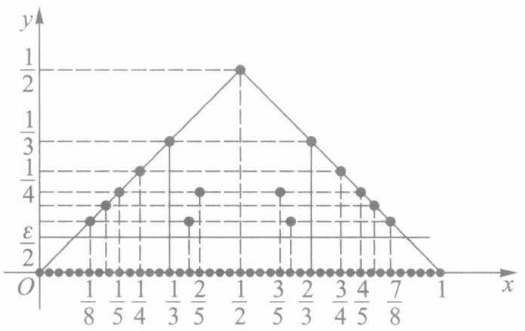

scatter

| X | Y |
| --- | --- |
| 0 | 0 |
| 1/8 | \(\epsilon/2\) |
| 1/5 | 1/4 |
| 1/4 | 1/3 |
| 1/3 | 1/2 |
| 2/5 | \(\epsilon/2\) |
| 1/2 | 1/2 |
| 3/5 | 1/4 |
| 2/3 | 1/3 |
| 3/4 | 1/2 |
| 4/5 | \(\epsilon/2\) |
| 7/8 | \(\epsilon/2\) |
| 1 | 0 |

图9-9

证 任给 $\varepsilon > 0$，在 $[0,1]$ 上使得 $\frac{1}{q} > \frac{\varepsilon}{2}$ 的有理点 $\frac{p}{q}$ 只有有限个，设它们为 $r_1, \dots, r_k$。现对 $[0,1]$ 作分割 $T = \{\Delta_1, \Delta_2, \dots, \Delta_n\}$，使 $\| T \| < \frac{\varepsilon}{2k}$，并把 $T$ 中所有小区间分为 $\{\Delta'_i | i = 1, 2, \dots, m\}$ 和 $\{\Delta''_i | i = 1, 2, \dots, n - m\}$ 两类。其中 $\{\Delta'_i\}$ 为含有 $\{r_i | i = 1, 2, \dots, k\}$ 中点的所有小区间，这类小区间的个数 $m \leqslant 2k$（当所有 $r_i$ 恰好都是 $T$ 的分割点时才有 $m = 2k$）；而 $\{\Delta''_i\}$ 为 $T$ 中所有其余不含 $\{r_i\}$ 中点的小区间。由于 $f$ 在 $\Delta'_i$ 上的振幅 $\omega'_i \leqslant \frac{1}{2}$，于是

$$
\sum_ {i = 1} ^ {m} \omega_ {i} ^ {\prime} \Delta x _ {i} ^ {\prime} \leqslant \frac {1}{2} \sum_ {i = 1} ^ {m} \Delta x _ {i} ^ {\prime} \leqslant \frac {1}{2} \cdot 2 k \| T \| <   \frac {\varepsilon}{2};
$$

而 $f$ 在 $\Delta_{i}^{\prime \prime}$ 上的振幅 $\omega_{i}^{\prime \prime}\leqslant \frac{\varepsilon}{2}$ ，于是

$$
\sum_ {i = 1} ^ {n - m} \omega_ {i} ^ {\prime \prime} \Delta x _ {i} ^ {\prime \prime} \leqslant \frac {\varepsilon}{2} \sum_ {i = 1} ^ {n - m} \Delta x _ {i} ^ {\prime \prime} <   \frac {\varepsilon}{2}.
$$

把这两部分合起来,便证得

$$
\sum_ {i = 1} ^ {n} \omega_ {i} \Delta x _ {i} = \sum_ {i = 1} ^ {m} \omega_ {i} ^ {\prime} \Delta x _ {i} ^ {\prime} + \sum_ {i = 1} ^ {n - m} \omega_ {i} ^ {\prime \prime} \Delta x _ {i} ^ {\prime \prime} <   \varepsilon ,
$$

即 f 在  $[0,1]$  上可积.

因为已经证得 $f$ 在 $[0,1]$ 上可积，所以当取 $\xi_{i}$ 全为无理点时，使 $f(\xi_i) = 0$ ，从而

$$
\int_ {0} ^ {1} R (x) \mathrm{d} x = \lim _ {\| T \| \to 0} \sum_ {i = 1} ^ {n} R (\xi_ {i}) \Delta x _ {i} = 0.
$$

## 习题 9.3

1. 证明: 若 $T'$ 是 $T$ 增加若干个分点后所得的分割, 则 $\sum_{T'} \omega_i' \Delta x_i' \leqslant \sum_T \omega_i \Delta x_i$.
2. 证明:若 $f$ 在 $[a, b]$ 上可积，$[\alpha, \beta] \subset [a, b]$，则 $f$ 在 $[\alpha, \beta]$ 上也可积。
3. 设 $f, g$ 均为定义在 $[a, b]$ 上的有界函数，仅在有限个点处 $f(x) \neq g(x)$. 证明:若 $f$ 在 $[a, b]$ 上可

197

---

第九章 定积分

积，则 $g$ 在 $[a,b]$ 上也可积，且 $\int_{a}^{b}f(x)\mathrm{d}x = \int_{a}^{b}g(x)\mathrm{d}x.$

4. 设 f 在  $[a, b]$  上有界， $\{a_{n}\} \subset [a, b]$ ， $\lim_{n \to \infty} a_{n} = c$ 。证明:若 f 在  $[a, b]$  上只有  $a_{n} (n = 1, 2, \cdots)$  为其间断点，则 f 在  $[a, b]$  上可积。

5. 证明: 若 f 在区间  $\Delta$  上有界, 则

$$
\sup _ {x \in \Delta} f (x) - \inf _ {x \in \Delta} f (x) = \sup _ {x ^ {\prime}, x ^ {\prime \prime} \in \Delta} \left| f (x ^ {\prime}) - f (x ^ {\prime \prime}) \right|.
$$

6. 证明函数

$$
f (x) = \left\{ \begin{array}{l l} 0, & x = 0, \\ \frac {1}{x} - \left[ \frac {1}{x} \right], & x \in (0, 1 ] \end{array} \right.
$$

在 $[0,1]$ 上可积.

7. 设函数 $f$ 在 $[a, b]$ 上有定义，且对于任给的 $\varepsilon > 0$ ，存在 $[a, b]$ 上的可积函数 $g$，使得

$$
\mid f (x) - g (x) \mid <   \varepsilon , \quad x \in [ a, b ].
$$

证明 $f$ 在 $[a, b]$ 上可积.

## § 4 定积分的性质

## 一、定积分的基本性质

性质1 若 $f$ 在 $[a, b]$ 上可积，$k$ 为常数，则 $kf$ 在 $[a, b]$ 上也可积，且

$$
\int_ {a} ^ {b} k f (x) \mathrm{d} x = k \int_ {a} ^ {b} f (x) \mathrm{d} x. \tag {1}
$$

证 当 $k = 0$ 时结论显然成立.

当 $k \neq 0$ 时, 由于

$$
\Big | \sum_ {i = 1} ^ {n} k f (\xi_ {i}) \Delta x _ {i} - k J \Big | = | k | \cdot \Big | \sum_ {i = 1} ^ {n} f (\xi_ {i}) \Delta x _ {i} - J \Big |,
$$

其中 $J = \int_{a}^{b}f(x)\mathrm{d}x$ ，因此当 $f$ 在 $[a,b]$ 上可积时，由定义，任给 $\varepsilon >0$ ，存在 $\delta >0$ ，当$\| T\| <  \delta$ 时，

$$
\Big | \sum_ {i = 1} ^ {n} f (\xi_ {i}) \Delta x _ {i} - J \Big | <   \frac {\varepsilon}{| k |},
$$

从而

$$
\Big | \sum_ {i = 1} ^ {n} k f (\xi_ {i}) \Delta x _ {i} - k J \Big | <   \varepsilon .
$$

即 $kf$ 在 $[a,b]$ 上可积，且

$$
\int_ {a} ^ {b} k f (x) \mathrm{d} x = k J = k \int_ {a} ^ {b} f (x) \mathrm{d} x.
$$

性质2 若 $f, g$ 都在 $[a, b]$ 上可积，则 $f \pm g$ 在 $[a, b]$ 上也可积，且

$$
\int_ {a} ^ {b} \left[ f (x) \pm g (x) \right] \mathrm{d} x = \int_ {a} ^ {b} f (x) \mathrm{d} x \pm \int_ {a} ^ {b} g (x) \mathrm{d} x. \tag {2}
$$

198

---

§ 4 定积分的性质

证明与性质 1 类同,留给读者.

性质 1 与性质 2 是定积分的线性性质, 合起来即为

$$
\int_ {a} ^ {b} \left[ \alpha f (x) + \beta g (x) \right] \mathrm{d} x = \alpha \int_ {a} ^ {b} f (x) \mathrm{d} x + \beta \int_ {a} ^ {b} g (x) \mathrm{d} x,
$$

其中  $\alpha,\beta$  为常数.

性质 3 若 f, g 都在  $[a, b]$  上可积，则  $f \cdot g$  在  $[a, b]$  上也可积.

证 由 f, g 都在  $[a, b]$  上可积, 从而都有界, 设

$$
A = \sup _ {x \in [ a, b ]} \left| f (x) \right|, \quad B = \sup _ {x \in [ a, b ]} \left| g (x) \right|,
$$

且 A>0, B>0 (否则 f, g 中至少有一个恒为零值函数, 于是  $f \cdot g$  亦为零值函数, 结论显然成立).

任给  $\varepsilon>0$ ，由 f, g 可积，必分别存在分割  $T_{1}, T_{2}$ ，使得

$$
\sum_ {T _ {1}} \omega_ {1, i} ^ {f} \Delta x _ {1, i} <   \frac {\varepsilon}{2 B}, \quad \sum_ {T _ {2}} \omega_ {2, i} ^ {g} \Delta x _ {2, i} <   \frac {\varepsilon}{2 A}.
$$

令 $T = T_{1} + T_{2}$ （表示把 $T_{1}, T_{2}$ 的所有分割点合并而成的一个新的分割 $T$ ). 对于 $[a, b]$ 上 $T$ 所属的每一个 $\Delta_{i}$，有

$$
\begin{array}{l} \omega_ {i} ^ {f \cdot g} = \sup _ {x ^ {\prime}, x ^ {\prime \prime} \in \Delta_ {i}} \left| f (x ^ {\prime}) g (x ^ {\prime}) - f (x ^ {\prime \prime}) g (x ^ {\prime \prime}) \right| \\ \leqslant \sup _ {x ^ {\prime}, x ^ {\prime \prime} \in \Delta_ {i}} \left[ | g (x ^ {\prime}) | \cdot | f (x ^ {\prime}) - f (x ^ {\prime \prime}) | + | f (x ^ {\prime \prime}) | \cdot | g (x ^ {\prime}) - g (x ^ {\prime \prime}) | \right] \\ \leqslant B \omega_ {i} ^ {f} + A \omega_ {i} ^ {g}. \\ \end{array}
$$

利用习题 9.3 的第 1 题, 可知

$$
\begin{array}{l} \sum_ {T} \omega_ {i} ^ {f \cdot g} \Delta x _ {i} \leqslant B \sum_ {T} \omega_ {i} ^ {f} \Delta x _ {i} + A \sum_ {T} \omega_ {i} ^ {g} \Delta x _ {i} \\ \leqslant B \sum_ {T _ {1}} \omega_ {1, i} ^ {f} \Delta x _ {1, i} + A \sum_ {T _ {2}} \omega_ {2, i} ^ {g} \Delta x _ {2, i} \\ <   B \cdot \frac {\varepsilon}{2 B} + A \cdot \frac {\varepsilon}{2 A} = \varepsilon , \\ \end{array}
$$

这就证得 $f \cdot g$ 在 $[a, b]$ 上可积.

注意,在一般情形下, $\int_{a}^{b}f(x)g(x)\mathrm{d}x\neq\int_{a}^{b}f(x)\mathrm{d}x\cdot\int_{a}^{b}g(x)\mathrm{d}x.$

性质4 $f$ 在 $[a,b]$ 上可积的充要条件是:任给 $c\in (a,b),f$ 在 $[a,c]$ 与 $[c,b]$ 上都可积.此时又有等式

$$
\int_ {a} ^ {b} f (x) \mathrm{d} x = \int_ {a} ^ {c} f (x) \mathrm{d} x + \int_ {c} ^ {b} f (x) \mathrm{d} x. \tag {3}
$$

证 充分性 由于 $f$ 在 $[a, c]$ 与 $[c, b]$ 上都可积，故任给 $\varepsilon > 0$ ，分别存在对 $[a, c]$ 与 $[c, b]$ 的分割 $T'$ 与 $T''$ ，使得

$$
\sum_ {T ^ {\prime}} \omega_ {i} ^ {\prime} \Delta x _ {i} ^ {\prime} <   \frac {\varepsilon}{2}, \quad \sum_ {T ^ {\prime \prime}} \omega_ {i} ^ {\prime \prime} \Delta x _ {i} ^ {\prime \prime} <   \frac {\varepsilon}{2}.
$$

现令 $T = T' + T''$ ，它是对 $[a,b]$ 的一个分割，且有

$$
\sum_ {T} \omega_ {i} \Delta x _ {i} = \sum_ {T ^ {\prime}} \omega_ {i} ^ {\prime} \Delta x _ {i} ^ {\prime} + \sum_ {T ^ {\prime \prime}} \omega_ {i} ^ {\prime \prime} \Delta x _ {i} ^ {\prime \prime} <   \varepsilon .
$$

由此证得f在 $[a,b]$ 上可积.

199

---

第九章 定积分

必要性 已知 $f$ 在 $[a, b]$ 上可积，故任给 $\varepsilon > 0$ ，存在对 $[a, b]$ 的某分割 $T$ ，使得 $\sum_{T} \omega_{i} \Delta x_{i} < \varepsilon.$ 在 $T$ 上再增加一个分点 $c$ ，得到一个新的分割 $T^{*}$. 由习题9.3的第1题，又有

$$
\sum_ {T ^ {*}} \omega_ {i} ^ {*} \Delta x _ {i} ^ {*} \leqslant \sum_ {T} \omega_ {i} \Delta x _ {i} <   \varepsilon .
$$

分割 $T^{*}$ 在 $[a, c]$ 和 $[c, b]$ 上的部分分别构成对 $[a, c]$ 和 $[c, b]$ 的分割，记为 $T'$ 和 $T''$，则有

$$
\begin{array}{l} \sum_ {T ^ {\prime}} \omega_ {i} ^ {\prime} \Delta x _ {i} ^ {\prime} \leqslant \sum_ {T ^ {*}} \omega_ {i} ^ {*} \Delta x _ {i} ^ {*} <   \varepsilon , \\ \sum_ {T ^ {\prime \prime}} \omega_ {i} ^ {\prime \prime} \Delta x _ {i} ^ {\prime \prime} \leqslant \sum_ {T ^ {*}} \omega_ {i} ^ {*} \Delta x _ {i} ^ {*} <   \varepsilon . \\ \end{array}
$$

这就证得 $f$ 在 $[a, c]$ 与 $[c, b]$ 上都可积.

在证得上面结果的基础上最后来证明等式(3).为此对 $[a,b]$ 作分割 $T$ ，恒使点 $c$ 为其中的一个分点，这时 $T$ 在 $[a,c]$ 与 $[c,b]$ 上的部分各自构成对 $[a,c]$ 与 $[c,b]$ 的分割，分别记为 $T^{\prime}$ 与 $T''$.由于

$$
\sum_ {T} f (\xi_ {i}) \Delta x _ {i} = \sum_ {T ^ {\prime}} f (\xi_ {i} ^ {\prime}) \Delta x _ {i} ^ {\prime} + \sum_ {T ^ {\prime \prime}} f (\xi_ {i} ^ {\prime \prime}) \Delta x _ {i} ^ {\prime \prime},
$$

因此当 $\| T\| \to 0$ （同时有 $\| T^{\prime}\| \to 0,\| T^{\prime \prime}\| \to 0)$ 时，对上式取极限，就得到(3)式成立.

性质 4 及公式(3)称为关于积分区间的可加性. 当  $f(x) \geqslant 0$  时, (3)式的几何意义就是曲边梯形面积的可加性. 如图9-10所示, 曲边梯形 AabB 的面积等于曲边梯形 AacC

的面积与 CcbB 的面积之和.

按定积分的定义, 记号  $\int_{a}^{b} f(x) \, dx$  只有当 a < b 时才有意义, 而当 a = b 或 a > b 时本来是没有意义的. 但为了运用上的方便, 对它作如下规定.

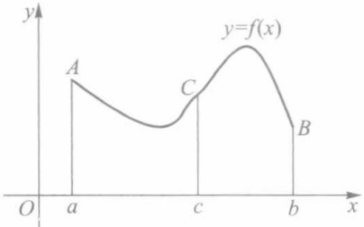

line

| Point | x-coordinate | y-coordinate |
| --- | --- | --- |
| A | a | ~0.6 |
| C | c | ~0.5 |
| B | b | ~0.3 |

图9-10

规定 1 当 a=b 时, 令  $\int_{a}^{a}f(x)\mathrm{d}x=0$ .

规定 2 当 a > b 时, 令  $\int_{a}^{b} f(x) \, dx = -\int_{b}^{a} f(x) \, dx$ .

有了这些规定之后,等式(3)对于 a,b,c 的任何大小顺序都能成立.例如,当 a<b<c 时,只要 f 在 [a,c] 上可积,则有

$$
\begin{array}{l} \int_ {a} ^ {c} f (x) \mathrm{d} x + \int_ {c} ^ {b} f (x) \mathrm{d} x = \left(\int_ {a} ^ {b} f (x) \mathrm{d} x + \int_ {b} ^ {c} f (x) \mathrm{d} x\right) - \int_ {b} ^ {c} f (x) \mathrm{d} x \\ = \int_ {a} ^ {b} f (x) \mathrm{d} x. \\ \end{array}
$$

性质5 设 $f$ 为 $[a, b]$ 上的可积函数. 若 $f(x) \geqslant 0, x \in [a, b]$, 则

$$
\int_ {a} ^ {b} f (x) \mathrm{d} x \geqslant 0. \tag {4}
$$

证 由于在 $[a, b]$ 上 $f(x) \geqslant 0$，因此 $f$ 的任一积分和都为非负。由 $f$ 在 $[a, b]$ 上可积，则有

200

---

§ 4 定积分的性质

$$
\int_ {a} ^ {b} f (x) \mathrm{d} x = \lim _ {\| T \| \to 0} \sum_ {i = 1} ^ {n} f (\xi_ {i}) \Delta x _ {i} \geqslant 0.
$$

推论(积分不等式性) 若 $f$ 与 $g$ 为 $[a, b]$ 上的两个可积函数, 且 $f(x) \leqslant g(x), x \in [a, b]$, 则有

$$
\int_ {a} ^ {b} f (x) \mathrm{d} x \leqslant \int_ {a} ^ {b} g (x) \mathrm{d} x. \tag {5}
$$

证 令 $F(x) = g(x) - f(x) \geqslant 0, x \in [a, b]$，由性质2知道 $F$ 在 $[a, b]$ 上可积，且由性质5推得

$$
0 \leqslant \int_ {a} ^ {b} F (x) \mathrm{d} x = \int_ {a} ^ {b} g (x) \mathrm{d} x - \int_ {a} ^ {b} f (x) \mathrm{d} x,
$$

不等式(5)得证.

性质6 若 $f$ 在 $[a, b]$ 上可积，则 $|f|$ 在 $[a, b]$ 上也可积，且

$$
\left| \int_ {a} ^ {b} f (x) \mathrm{d} x \right| \leqslant \int_ {a} ^ {b} | f (x) | \mathrm{d} x. \tag {6}
$$

证 由于 $f$ 在 $[a, b]$ 上可积，故任给 $\varepsilon > 0$ ，存在某分割 $T$ ，使得 $\sum_{T} \omega_{i}^{f} \Delta x_{i} < \varepsilon.$ 由绝对值不等式

$$
\mid \left| f (x ^ {\prime}) \right| - \left| f (x ^ {\prime \prime}) \right| \mid \leqslant \left| f (x ^ {\prime}) - f (x ^ {\prime \prime}) \right|,
$$

可得 $\omega_{i}^{|f|}\leqslant \omega_{i}^{f}$ ，于是有

$$
\sum_ {T} \omega_ {i} ^ {| f |} \Delta x _ {i} \leqslant \sum_ {T} \omega_ {i} ^ {f} \Delta x _ {i} <   \varepsilon .
$$

从而证得 $|f|$ 在 $[a,b]$ 上可积.

再由不等式 $-\left|f(x)\right|\leqslant f(x)\leqslant\left|f(x)\right|$ ，应用性质5（推论），即证得不等式(6)成立.

注 这个性质的逆命题一般不成立.例如

$$
f (x) = \left\{ \begin{array}{c l} 1, & x \text {为有理数}, \\ - 1, & x \text {为无理数} \end{array} \right.
$$

在 $[0,1]$ 上不可积（类似于狄利克雷函数）；但 $|f(x)| \equiv 1$ ，它在 $[0,1]$ 上可积.

例1 求 $\int_{-1}^{1} f(x) \, \mathrm{d}x$，其中

$$
f (x) = \left\{ \begin{array}{l l} 2 x - 1, & - 1 \leqslant x <   0, \\ \mathrm{e} ^ {- x}, & 0 \leqslant x \leqslant 1. \end{array} \right.
$$

解 对于分段函数的定积分,通常利用积分区间可加性来计算,即

$$
\begin{array}{l} \int_ {- 1} ^ {1} f (x) \mathrm{d} x = \int_ {- 1} ^ {0} f (x) \mathrm{d} x + \int_ {0} ^ {1} f (x) \mathrm{d} x \\ = \int_ {- 1} ^ {0} (2 x - 1) \mathrm{d} x + \int_ {0} ^ {1} \mathrm{e} ^ {- x} \mathrm{d} x \\ = (x ^ {2} - x) \left| \begin{array}{l} 0 \\ - 1 \end{array} + (- \mathrm{e} ^ {- x}) \right| _ {0} ^ {1} \\ = - 2 - \mathrm{e} ^ {- 1} + 1 = - (\mathrm{e} ^ {- 1} + 1). \\ \end{array}
$$

注1 上述解法中取 $\int_{-1}^{0} f(x) \, \mathrm{d}x = \int_{-1}^{0} (2x - 1) \, \mathrm{d}x$，其中被积函数在 $x = 0$ 处的值已由

201

---

第九章 定积分

原来的 $f(0) = \mathrm{e}^{-x}\Bigg|_{x = 0} = 1$ 改为 $(2x - 1)\Bigg|_{x = 0} = -1$ ，由习题9.3的第3题知道这一改动并不影响 $f$ 在[-1,0]上的可积性和定积分的值.

注2 如果要求直接在 $[-1, 1]$ 上使用牛顿—莱布尼茨公式来计算 $\int_{-1}^{1} f(x) \, \mathrm{d}x = F(1) - F(-1)$，这时 $F(x)$ 应取怎样的函数？读者可对照习题9.2的第3题来回答.

例2 证明: 若 $f$ 在 $[a, b]$ 上连续, 且 $f(x) \geqslant 0$, $\int_{a}^{b} f(x) \mathrm{d}x = 0$, 则 $f(x) \equiv 0, x \in [a, b]$.

证 用反证法. 倘若有某 $x_0 \in [a, b]$, 使 $f(x_0) > 0$, 则由连续函数的局部保号性, 存在 $x_0$ 的某邻域 $(x_0 - \delta, x_0 + \delta)$ (当 $x_0 = a$ 或 $x_0 = b$ 时, 则为右邻域或左邻域), 使在其中 $f(x) \geqslant \frac{f(x_0)}{2} > 0$. 由性质4和性质5推知

$$
\begin{array}{l} \int_ {a} ^ {b} f (x) \mathrm{d} x = \int_ {a} ^ {x _ {0} - \delta} f (x) \mathrm{d} x + \int_ {x _ {0} - \delta} ^ {x _ {0} + \delta} f (x) \mathrm{d} x + \int_ {x _ {0} + \delta} ^ {b} f (x) \mathrm{d} x \\ \geqslant 0 + \int_ {x _ {0} - \delta} ^ {x _ {0} + \delta} \frac {f (x _ {0})}{2} \mathrm{d} x + 0 = f (x _ {0}) \delta > 0, \\ \end{array}
$$

这与假设 $\int_{a}^{b}f(x)\mathrm{d}x = 0$ 相矛盾.所以 $f(x)\equiv 0,x\in [a,b]$

注 从此例证明中看到, 即使 f 为一非负可积函数, 只要它在某一点  $x_{0}$  处连续, 且  $f(x_{0}) > 0$ , 则必有  $\int_{a}^{b} f(x) \, dx > 0$ . (至于可积函数必有连续点, 这是一个较难证明的命题, 读者可参阅习题 9.6 的第 7 题.)

## 二、积分中值定理

定理 9.7(积分第一中值定理) 若 f 在  $[a, b]$  上连续, 则至少存在一点  $\xi \in [a, b]$ , 使得

$$
\int_ {a} ^ {b} f (x) \mathrm{d} x = f (\xi) (b - a). \tag {7}
$$

证 由于 $f$ 在 $[a, b]$ 上连续，因此存在最大值 $M$ 和最小值 $m$. 由

$$
m \leqslant f (x) \leqslant M, \quad x \in [ a, b ],
$$

使用积分不等式性质得到

$$
m (b - a) \leqslant \int_ {a} ^ {b} f (x) \mathrm{d} x \leqslant M (b - a),
$$

或

$$
m \leqslant \frac {1}{b - a} \int_ {a} ^ {b} f (x) \mathrm{d} x \leqslant M.
$$

再由连续函数的介值性,至少存在一点  $\xi \in [a, b]$ , 使得

$$
f (\xi) = \frac {1}{b - a} \int_ {a} ^ {b} f (x) \mathrm{d} x, \tag {$7^{\prime$}}
$$

这就证得(7)式成立.

积分第一中值定理的几何意义如图9-11所示, 若 f 在  $[a, b]$  上非负连续, 则  $y = f(x)$  在  $[a, b]$  上的曲边梯形面积等于以  $(7')$  所示的  $f(\xi)$  为高,  $[a, b]$  为底的矩形面积.

202

---

§ 4 定积分的性质

而 $\frac{1}{b - a}\int_{a}^{b}f(x)\mathrm{d}x$ 则可理解为 $f(x)$ 在区间 $[a,b]$ 上所有函数值的平均值.这是通常有限个数的算术平均值的推广.

例3 试求 $f(x) = \sin x$ 在 $[0, \pi]$ 上的平均值.

解 所求平均值为

$$
f (\xi) = \frac {1}{\pi} \int_ {0} ^ {\pi} \sin x \mathrm{d} x = - \left. \frac {1}{\pi} \cos x \right| _ {0} ^ {\pi} = \frac {2}{\pi}. \tag * {\square}
$$

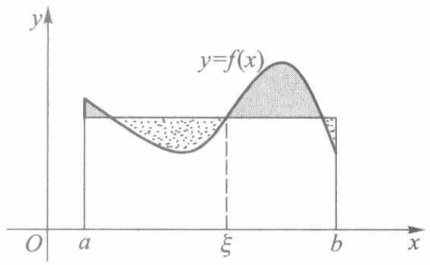

text_image

y
y=f(x)
O a ξ b x

图9-11

定理9.8(推广的积分第一中值定理) 若 $f$ 与 $g$ 都在 $[a, b]$ 上连续，且 $g(x)$ 在 $[a, b]$ 上不变号，则至少存在一点 $\xi \in [a, b]$，使得

$$
\int_ {a} ^ {b} f (x) g (x) \mathrm{d} x = f (\xi) \int_ {a} ^ {b} g (x) \mathrm{d} x. \tag {8}
$$

(当  $g(x) \equiv 1$  时, 即为定理 9.7.)

证 不妨设 $g(x) \geqslant 0, x \in [a, b]$. 这时有

$$
m g (x) \leqslant f (x) g (x) \leqslant M g (x), x \in [ a, b ],
$$

其中 $M, m$ 分别为 $f$ 在 $[a, b]$ 上的最大、最小值. 由定积分的不等式性质, 得到

$$
m \int_ {a} ^ {b} g (x) \mathrm{d} x \leqslant \int_ {a} ^ {b} f (x) g (x) \mathrm{d} x \leqslant M \int_ {a} ^ {b} g (x) \mathrm{d} x.
$$

若 $\int_{a}^{b}g(x)\mathrm{d}x = 0$ ，则由上式知 $\int_{a}^{b}f(x)g(x)\mathrm{d}x = 0$ ，从而对任何 $\xi \in [a,b]$ ，(8)式都成立.若 $\int_{a}^{b}g(x)\mathrm{d}x > 0$ ，则得

$$
m \leqslant \frac {\int_ {a} ^ {b} f (x) g (x) \mathrm{d} x}{\int_ {a} ^ {b} g (x) \mathrm{d} x} \leqslant M.
$$

由连续函数的介值性,必至少有一点  $\xi \in [a, b]$ , 使得

$$
f (\xi) = \frac {\int_ {a} ^ {b} f (x) g (x) \mathrm{d} x}{\int_ {a} ^ {b} g (x) \mathrm{d} x},
$$

这就证得(8)式成立.

注 事实上,定理 9.7 和定理 9.8 中的中值点  $\xi$  必能在开区间  $(a,b)$  上取得(证明留作习题).

例4 设 $f$ 在 $[0,1]$ 上连续，求 $\lim_{n\to \infty}\int_0^1 f(\sqrt[n]{x})\mathrm{d}x.$

解 对于任意的正整数 $n \geqslant 2$，根据积分第一中值定理，存在 $\xi_{n} \in \left[0, \frac{1}{n}\right]$ 及 $\eta_{n} \in \left[\frac{1}{n}, 1\right]$，使得

$$
\int_ {0} ^ {\frac {1}{n}} f (\sqrt [ n ]{x}) \mathrm{d} x = f (\sqrt [ n ]{\xi_ {n}}). \frac {1}{n}, \quad \int_ {\frac {1}{n}} ^ {1} f (\sqrt [ n ]{x}) \mathrm{d} x = f (\sqrt [ n ]{\eta_ {n}}) \cdot \left(1 - \frac {1}{n}\right).
$$

203

---

第九章 定积分

因为 $f$ 在 $[0,1]$ 上是有界的，而有界量与无穷小量的乘积仍为无穷小量，所以

$$
\lim _ {n \to \infty} f (\sqrt [ n ]{\xi_ {n}}) \cdot \frac {1}{n} = 0.
$$

又因 $\frac{1}{n} \leqslant \eta_n \leqslant 1$，故有 $\frac{1}{\sqrt[n]{n}} \leqslant \sqrt[n]{\eta_n} \leqslant 1$，所以 $\lim_{n \to \infty} \sqrt[n]{\eta_n} = 1$。根据 $f$ 在 $x = 1$ 处的连续性，有

$$
\lim _ {n \to \infty} f (\sqrt [ n ]{\eta_ {n}}) \cdot \left(1 - \frac {1}{n}\right) = f (1).
$$

因此

$$
\begin{array}{l} \lim _ {n \to \infty} \int_ {0} ^ {1} f (\sqrt [ n ]{x}) \mathrm{d} x = \lim _ {n \to \infty} \left(\int_ {0} ^ {\frac {1}{n}} f (\sqrt [ n ]{x}) \mathrm{d} x + \int_ {\frac {1}{n}} ^ {1} f (\sqrt [ n ]{x}) \mathrm{d} x\right) \\ = \lim _ {n \to \infty} \left[ f (\sqrt [ n ]{\xi_ {n}}) \cdot \frac {1}{n} + f (\sqrt [ n ]{\eta_ {n}}) \cdot \left(1 - \frac {1}{n}\right) \right] = f (1). \\ \end{array}
$$

## 习题 9.4

1. 证明: 若 $f$ 与 $g$ 都在 $[a, b]$ 上可积, 则

$$
\lim _ {\| T \| \to 0} \sum_ {i = 1} ^ {n} f (\xi_ {i}) g (\eta_ {i}) \Delta x _ {i} = \int_ {a} ^ {b} f (x) g (x) \mathrm{d} x,
$$

其中  $\xi_{i},\eta_{i}$  是 T 所属小区间  $\Delta_{i}$  中的任意两点,  $i=1,2,\cdots,n$ .

2. 不求出定积分的值, 比较下列各对定积分的大小:

(1) $\int_0^1 x\mathrm{d}x$ 与 $\int_0^1 x^2\mathrm{d}x$

(2) $\int_{0}^{\frac{\pi}{2}} x \, \mathrm{d}x$ 与 $\int_{0}^{\frac{\pi}{2}} \sin x \, \mathrm{d}x$.

3. 证明下列不等式:

(1) $\frac{\pi}{2} < \int_{0}^{\frac{\pi}{2}}\frac{\mathrm{d}x}{\sqrt{1 - \frac{1}{2}\sin^2x}} < \frac{\pi}{\sqrt{2}};$

(2) $1 < \int_{0}^{1}\mathrm{e}^{x^2}\mathrm{d}x < \mathrm{e};$

(3) $1 < \int_{0}^{\frac{\pi}{2}}\frac{\sin x}{x}\mathrm{d}x < \frac{\pi}{2};$

(4) $3\sqrt{\mathrm{e}} < \int_{\mathrm{e}}^{4\mathrm{e}}\frac{\ln x}{\sqrt{x}}\mathrm{d}x < 6.$

4. 设 $f$ 在 $[a, b]$ 上连续，且 $f(x)$ 不恒等于零，证明 $\int_{a}^{b}(f(x))^2 \mathrm{d}x > 0$.

5. 设 $f$ 与 $g$ 都在 $[a, b]$ 上可积，证明

$$
M (x) = \max _ {x \in [ a, b ]} \{f (x), g (x) \}, \quad m (x) = \min _ {x \in [ a, b ]} \{f (x), g (x) \}
$$

在 $[a,b]$ 上也都可积.

6. 试求心形线 $r = a(1 + \cos \theta), 0 \leqslant \theta \leqslant 2\pi$ 上各点极径的平均值.

7. 设 $f$ 在 $[a, b]$ 上可积，且在 $[a, b]$ 上满足 $|f(x)| \geqslant m > 0$. 证明 $\frac{1}{f}$ 在 $[a, b]$ 上也可积.

8. 进一步证明积分第一中值定理(包括定理 9.7 和定理 9.8)中的中值点  $\xi \in (a, b)$ .

9. 证明: 若 $f$ 与 $g$ 都在 $[a, b]$ 上可积, 且 $g(x)$ 在 $[a, b]$ 上不变号, $M, m$ 分别为 $f(x)$ 在 $[a, b]$ 上的上、下确界, 则必存在某实数 $\mu (m \leqslant \mu \leqslant M)$, 使得

$$
\int_ {a} ^ {b} f (x) g (x) \mathrm{d} x = \mu \int_ {a} ^ {b} g (x) \mathrm{d} x.
$$

204

---

§ 5 微积分学基本定理·定积分计算(续)

10. 证明: 若 $f$ 在 $[a, b]$ 上连续, 且 $\int_{a}^{b} f(x) \mathrm{d}x = \int_{a}^{b} x f(x) \mathrm{d}x = 0$, 则在 $(a, b)$ 上至少存在两点 $x_1, x_2$, 使 $f(x_1) = f(x_2) = 0$. 又若 $\int_{a}^{b} x^2 f(x) \mathrm{d}x = 0$, 这时 $f$ 在 $(a, b)$ 上是否至少有三个零点?

11. 设 $f$ 在 $[a, b]$ 上二阶可导，且 $f''(x) > 0$. 证明:

(1) $f\left(\frac{a+b}{2}\right) \leqslant \frac{1}{b-a} \int_{a}^{b} f(x) \, \mathrm{d}x;$

(2) 又若  $f(x) \leqslant 0, x \in [a, b]$ ，则又有

$$
f (x) \geqslant \frac {2}{b - a} \int_ {a} ^ {b} f (x) \mathrm{d} x, \quad x \in [ a, b ].
$$

12. 证明:

(1)  $\ln(1+n)<1+\frac{1}{2}+\cdots+\frac{1}{n}<1+\ln n;$

(2)  $\lim_{n\to\infty}\frac{1+\frac{1}{2}+\cdots+\frac{1}{n}}{\ln n}=1.$

## § 5 微积分学基本定理·定积分计算(续)

当函数的可积性问题告一段落,并对定积分的性质有了足够的认识之后,接着要来解决一个以前多次提到过的问题——在定积分形式下证明连续函数必定存在原函数.

## 一、变限积分与原函数的存在性

设 $f$ 在 $[a, b]$ 上可积，根据定积分的性质4，对任何 $x \in [a, b]$，$f$ 在 $[a, x]$ 上也可积。于是，由

$$
\Phi (x) = \int_ {a} ^ {x} f (t)   \mathrm{d} t, \quad x \in [ a, b ] \tag {1}
$$

定义了一个以积分上限 x 为自变量的函数, 称为变上限的定积分. 类似地, 又可定义变下限的定积分:

$$
\Psi (x) = \int_ {x} ^ {b} f (t) \mathrm{d} t, \quad x \in [ a, b ]. \tag {2}
$$

$\Phi$ 与 $\Psi$ 统称为变限积分.注意,在变限积分(1)与(2)中,不可再把积分变量写成 $x$ (例如 $\int_{a}^{x}f(x)\mathrm{d}x$),以免与积分上、下限的 $x$ 相混淆.

变限积分所定义的函数有着重要的性质.由于

$$
\int_ {x} ^ {b} f (t) \mathrm{d} t = - \int_ {b} ^ {x} f (t) \mathrm{d} t,
$$

因此下面只讨论变上限积分的情形.

定理 9.9 若 f 在  $[a, b]$  上可积，则由 (1) 式所定义的函数  $\Phi$  在  $[a, b]$  上连续.

证 对 $[a, b]$ 上任一确定的点 $x$，只要 $x + \Delta x \in [a, b]$，按定义式(1)有

205

---

第九章 定积分

$$
\Delta \Phi = \int_ {a} ^ {x + \Delta x} f (t) \mathrm{d} t - \int_ {a} ^ {x} f (t) \mathrm{d} t = \int_ {x} ^ {x + \Delta x} f (t) \mathrm{d} t.
$$

因 $f$ 在 $[a, b]$ 上有界，可设 $|f(t)| \leqslant M, t \in [a, b]$. 于是，当 $\Delta x > 0$ 时，有

$$
\mid \Delta \varPhi \mid = \left| \int_ {x} ^ {x + \Delta x} f (t) \mathrm{d} t \right| \leqslant \int_ {x} ^ {x + \Delta x} \mid f (t) \mid \mathrm{d} t \leqslant M \Delta x;
$$

当 $\Delta x < 0$ 时，则有 $|\Delta \Phi| \leqslant M |\Delta x|$. 由此得到

$$
\lim _ {\Delta x \to 0} \Delta \Phi = 0,
$$

即证得  $\Phi$  在点 x 连续. 由 x 的任意性,  $\Phi$  在  $[a, b]$  上处处连续.

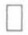

定理 9.10 （原函数存在定理） 若 f 在  $[a, b]$  上连续，则由(1)式所定义的函数  $\Phi$  在  $[a, b]$  上处处可导，且

$$
\Phi^ {\prime} (x) = \frac {\mathrm{d}}{\mathrm{d} x} \int_ {a} ^ {x} f (t) \mathrm{d} t = f (x), \quad x \in [ a, b ]. \tag {3}
$$

证 对 $[a, b]$ 上任一确定的 $x$，当 $\Delta x \neq 0$ 且 $x + \Delta x \in [a, b]$ 时，按定义式(1)和积分第一中值定理，有

$$
\frac {\Delta \Phi}{\Delta x} = \frac {1}{\Delta x} \int_ {x} ^ {x + \Delta x} f (t) \mathrm{d} t = f (x + \theta \Delta x), \quad 0 \leqslant \theta \leqslant 1.
$$

由于f在点x连续,故有

$$
\Phi^ {\prime} (x) = \lim _ {\Delta x \to 0} \frac {\Delta \Phi}{\Delta x} = \lim _ {\Delta x \to 0} f (x + \theta \Delta x) = f (x).
$$

由 x 在  $[a, b]$  上的任意性, 证得  $\Phi$  是 f 在  $[a, b]$  上的一个原函数.

本定理沟通了导数和定积分这两个从表面看去似不相干的概念之间的内在联系；同时也证明了“连续函数必有原函数”这一基本结论，并以积分形式(1)给出了f的一个原函数.正因为定理9.10的重要作用而被誉为微积分学基本定理.

此外,又因f的任意两个原函数只能相差一个常数,所以当f为连续函数时,它的任一原函数F必满足

$$
F (x) = \int_ {a} ^ {x} f (t) \mathrm{d} t + C.
$$

若在此式中令 $x = a$ ，得到 $C = F(a)$ ，从而有

$$
\int_ {a} ^ {x} f (t) \mathrm{d} t = F (x) - F (a).
$$

再令 $x = b$ ，即得

$$
\int_ {a} ^ {b} f (t) \mathrm{d} t = F (b) - F (a). \tag {4}
$$

这是牛顿—莱布尼茨公式的又一证明.比照定理9.1,现在只需假设被积函数f为连续函数,其原函数F的存在性已由定理9.10证得,无需另作假设.

例1 求极限 $\lim_{x\to +\infty}\left(\int_0^x\mathrm{e}^{t^2}\mathrm{d}t\right)^{\frac{1}{x^2}}.$

解 应用洛必达法则及定理9.10得到

$$
\lim _ {x \to + \infty} \ln \Bigl (\int_ {0} ^ {x} \mathrm{e} ^ {t ^ {2}} \mathrm{d} t \Bigr) ^ {\frac {1}{x ^ {2}}} = \lim _ {x \to + \infty} \frac {\ln \Bigl (\int_ {0} ^ {x} \mathrm{e} ^ {t ^ {2}} \mathrm{d} t \Bigr)}{x ^ {2}}
$$

206

---

§ 5 微积分学基本定理·定积分计算(续)

$$
= \lim _ {x \to + \infty} \frac {\mathrm{e} ^ {x ^ {2}}}{2 x \int_ {0} ^ {x} \mathrm{e} ^ {t ^ {2}} \mathrm{d} t} = \lim _ {x \to + \infty} \frac {2 x \mathrm{e} ^ {x ^ {2}}}{2 \int_ {0} ^ {x} \mathrm{e} ^ {t ^ {2}} \mathrm{d} t + 2 x \mathrm{e} ^ {x ^ {2}}}
$$

$$
= \lim _ {x \to + \infty} \frac {\mathrm{e} ^ {x ^ {2}} + 2 x ^ {2} \mathrm{e} ^ {x ^ {2}}}{2 \mathrm{e} ^ {x ^ {2}} + 2 x ^ {2} \mathrm{e} ^ {x ^ {2}}} = \lim _ {x \to + \infty} \frac {1 + 2 x ^ {2}}{2 + 2 x ^ {2}} = 1.
$$

所以

$$
\lim _ {x \to + \infty} \left(\int_ {0} ^ {x} \mathrm{e} ^ {t ^ {2}} \mathrm{d} t\right) ^ {\frac {1}{x ^ {2}}} = \lim _ {x \to + \infty} \mathrm{e} ^ {\ln \left(\int_ {0} ^ {x} \mathrm{e} ^ {t ^ {2}} \mathrm{d} t\right) ^ {\frac {1}{x ^ {2}}}} = \mathrm{e}. \tag {$\square$}
$$

利用变限积分又能证明下述积分第二中值定理.

定理 9.11(积分第二中值定理) 设函数 f 在  $[a, b]$  上可积.

(i) 若函数 $g$ 在 $[a, b]$ 上减，且 $g(x) \geqslant 0$ ，则存在 $\xi \in [a, b]$，使得

$$
\int_ {a} ^ {b} f (x) g (x) \mathrm{d} x = g (a) \int_ {a} ^ {\xi} f (x) \mathrm{d} x; \tag {5}
$$

(ii) 若函数 $g$ 在 $[a, b]$ 上增，且 $g(x) \geqslant 0$ ，则存在 $\eta \in [a, b]$，使得

$$
\int_ {a} ^ {b} f (x) g (x) \mathrm{d} x = g (b) \int_ {\eta} ^ {b} f (x) \mathrm{d} x. \tag {6}
$$

证 下面只证(i), 类似地可证(ii). 设

$$
F (x) = \int_ {a} ^ {x} f (t)   \mathrm{d} t, \quad x \in [ a, b ].
$$

由于 $f$ 在 $[a, b]$ 上可积，因此 $F$ 在 $[a, b]$ 上连续，从而存在最大值 $M$ 和最小值 $m$.

若 $g(a) = 0$ ，由假设 $g(x)\equiv 0,x\in [a,b]$ ，此时对任何 $\xi \in [a,b]$ ，(5)式恒成立.下面设 $g(a) > 0$ ，这时(5)式即为

$$
F (\xi) = \int_ {a} ^ {\xi} f (t) \mathrm{d} t = \frac {1}{g (a)} \int_ {a} ^ {b} f (x) g (x) \mathrm{d} x. \tag {$5^{\prime$}}
$$

所以问题转化为只需证明

$$
m \leqslant \frac {1}{g (a)} \int_ {a} ^ {b} f (x) g (x) \mathrm{d} x \leqslant M, \tag {7}
$$

因为由此可借助 $F$ 的介值性立刻证得 $(5')$. 当然(7)式又等同于

$$
m g (a) \leqslant \int_ {a} ^ {b} f (x) g (x) \mathrm{d} x \leqslant M g (a), \tag {$7^{\prime$}}
$$

下面就来证明这个不等式.

由条件f有界, 设  $\left|f(x)\right|\leqslant L,x\in[a,b]$ ; 而 g 必为可积, 从而对任给的  $\varepsilon>0$ , 必有分割  $T:a=x_{0}<x_{1}<\cdots<x_{n}=b$ , 使

$$
\sum_ {T} \omega_ {i} ^ {\mathrm{g}} \Delta x _ {i} <   \frac {\varepsilon}{L}.
$$

现把 $I = \int_{a}^{b}f(x)g(x)\mathrm{d}x$ 按积分区间可加性写成

$$
\begin{array}{l} I = \sum_ {i = 1} ^ {n} \int_ {x _ {i - 1}} ^ {x _ {i}} f (x) g (x) \mathrm{d} x \\ = \sum_ {i = 1} ^ {n} \int_ {x _ {i - 1}} ^ {x _ {i}} [ g (x) - g (x _ {i - 1}) ] f (x) \mathrm{d} x + \sum_ {i = 1} ^ {n} g (x _ {i - 1}) \int_ {x _ {i - 1}} ^ {x _ {i}} f (x) \mathrm{d} x \\ \end{array}
$$

207

---

第九章 定积分

$$
= I _ {1} + I _ {2}.
$$

对于 $I_{1}$ ，必有

$$
\begin{array}{l} \left| I _ {1} \right| \leqslant \sum_ {i = 1} ^ {n} \int_ {x _ {i - 1}} ^ {x _ {i}} | g (x) - g (x _ {i - 1}) | \cdot | f (x) | \mathrm{d} x \\ \leqslant L \cdot \sum_ {i = 1} ^ {n} \omega_ {i} ^ {g} \Delta x _ {i} <   L \cdot \frac {\varepsilon}{L} = \varepsilon . \\ \end{array}
$$

对于 $I_{2}$ ，由于 $F(x_0) = F(a) = 0$ 和

$$
\int_ {x _ {i - 1}} ^ {x _ {i}} f (x) \mathrm{d} x = \int_ {a} ^ {x _ {i}} f (x) \mathrm{d} x - \int_ {a} ^ {x _ {i - 1}} f (x) \mathrm{d} x = F (x _ {i}) - F (x _ {i - 1}),
$$

可得

$$
\begin{array}{l} I _ {2} = \sum_ {i = 1} ^ {n} g (x _ {i - 1}) [ F (x _ {i}) - F (x _ {i - 1}) ] \\ = g \left(x _ {0}\right) \left[ F \left(x _ {1}\right) - F \left(x _ {0}\right) \right] + \dots + g \left(x _ {n - 1}\right) \left[ F \left(x _ {n}\right) - F \left(x _ {n - 1}\right) \right] \\ = F \left(x _ {1}\right) \left[ g \left(x _ {0}\right) - g \left(x _ {1}\right) \right] + \dots + F \left(x _ {n - 1}\right) \left[ g \left(x _ {n - 2}\right) - g \left(x _ {n - 1}\right) \right] + \\ F (x _ {n}) g (x _ {n - 1}) \\ = \sum_ {i = 1} ^ {n - 1} F (x _ {i}) [ g (x _ {i - 1}) - g (x _ {i}) ] + F (b) g (x _ {n - 1}). \\ \end{array}
$$

再由  $g(x) \geqslant 0$  且减，使得其中  $g(x_{n-1}) \geqslant 0, g(x_{i-1}) - g(x_i) \geqslant 0, i = 1, 2, \cdots, n-1.$  于是利用  $F(x_i) \leqslant M, i = 1, 2, \cdots, n$  估计得

$$
I _ {2} \leqslant M \sum_ {i = 1} ^ {n - 1} \left[ g (x _ {i - 1}) - g (x _ {i}) \right] + M g (x _ {n - 1}) = M g (a).
$$

同理由  $F(x_{i}) \geqslant m, i = 1, 2, \cdots, n$  又有  $I_{2} \geqslant mg(a)$ .

综合 $I = I_{1} + I_{2},\mid I_{1}\mid < \varepsilon ,mg(a)\leqslant I_{2}\leqslant Mg(a)$ ，得到

$$
- \varepsilon + m g (a) \leqslant I \leqslant M g (a) + \varepsilon.
$$

由  $\varepsilon$  为任意小正数, 这便证得

$$
m g (a) \leqslant I \leqslant M g (a),
$$

即不等式 $(7')$ 成立.随之又有 $(7),(5')$ 和 $(5)$ 式成立.

推论 设函数 $f$ 在 $[a, b]$ 上可积. 若 $g$ 为单调函数, 则存在 $\xi \in [a, b]$, 使得

$$
\int_ {a} ^ {b} f (x) g (x) \mathrm{d} x = g (a) \int_ {a} ^ {\xi} f (x) \mathrm{d} x + g (b) \int_ {\xi} ^ {b} f (x) \mathrm{d} x. \tag {8}
$$

证 若 $g$ 为单调递减函数, 令 $h(x) = g(x) - g(b)$, 则 $h$ 为非负、递减函数. 由定理 9.11(i), 存在 $\xi \in [a, b]$, 使得

$$
\int_ {a} ^ {b} f (x) h (x) \mathrm{d} x = h (a) \int_ {a} ^ {\xi} f (x) \mathrm{d} x = [ g (a) - g (b) ] \int_ {a} ^ {\xi} f (x) \mathrm{d} x.
$$

由于 $\int_{a}^{b}f(x)h(x)\mathrm{d}x = \int_{a}^{b}f(x)g(x)\mathrm{d}x - g(b)\int_{a}^{b}f(x)\mathrm{d}x$ ，因此证得

$$
\begin{array}{l} \int_ {a} ^ {b} f (x) g (x) \mathrm{d} x = g (b) \int_ {a} ^ {b} f (x) \mathrm{d} x + [ g (a) - g (b) ] \int_ {a} ^ {\xi} f (x) \mathrm{d} x \\ = g (a) \int_ {a} ^ {\xi} f (x) \mathrm{d} x + g (b) \int_ {\xi} ^ {b} f (x) \mathrm{d} x. \\ \end{array}
$$

208

---

§ 5 微积分学基本定理·定积分计算(续)

若 $g$ 为单调递增函数，只需令 $h(x) = g(x) - g(a)$，并由定理9.11(ii)和(6)，同样可证得(8)式成立.

积分第二中值定理以及它的推论是今后建立反常积分收敛判别法的工具.

## 二、换元积分法与分部积分法

对原函数的存在性有了正确的认识,就能顺利地把不定积分的换元积分法和分部积分法移植到定积分计算中来.

定理 9.12(定积分换元积分法) 若函数 f 在  $[a, b]$  上连续,  $\varphi'$  在  $[\alpha, \beta]$  上可积, 且满足

$$
\varphi (\alpha) = a, \quad \varphi (\beta) = b, \quad \varphi ([ \alpha , \beta ]) \subseteq [ a, b ],
$$

则有定积分换元公式:

$$
\int_ {a} ^ {b} f (x) \mathrm{d} x = \int_ {\alpha} ^ {\beta} f (\varphi (t)) \varphi^ {\prime} (t) \mathrm{d} t. \tag {9}
$$

证 由于 $f$ 在 $[a, b]$ 上连续，因此它的原函数存在。设 $F$ 是 $f$ 在 $[a, b]$ 上的一个原函数，由复合函数微分法

$$
\frac {\mathrm{d}}{\mathrm{d} t} (F (\varphi (t))) = F ^ {\prime} (\varphi (t)) \varphi^ {\prime} (t) = f (\varphi (t)) \varphi^ {\prime} (t),
$$

可见 $F(\varphi (t))$ 是 $f(\varphi (t))\varphi '(t)$ 的一个原函数.因为 $f(\varphi (t))\varphi '(t)$ 在 $[\alpha ,\beta ]$ 上可积，根据牛顿一莱布尼茨公式(定理9.1)的注2,2)之所述，证得

$$
\begin{array}{l} \int_ {\alpha} ^ {\beta} f (\varphi (t)) \varphi^ {\prime} (t) \mathrm{d} t = F (\varphi (\beta)) - F (\varphi (\alpha)) \\ = F (b) - F (a) = \int_ {a} ^ {b} f (x) \mathrm{d} x. \\ \end{array}
$$

从以上证明看到,在用换元法计算定积分时,一旦得到了用新变量表示的原函数后,不必作变量还原,而只要用新的积分限代入并求其差值就可以了.这就是定积分换元积分法与不定积分换元积分法的区别,这一区别的原因在于不定积分所求的是被积函数的原函数,理应保留与原来相同的自变量;而定积分的计算结果是一个确定的数,如果(9)式一边的定积分计算出来了,那么另一边的定积分自然也求得了.

注 如果在定理 9.12 的条件中只假定 f 为可积函数,但还要求  $\varphi$  是单调的,那么 (9) 式仍然成立.(本节习题第 14 题.)

例2 计算 $\int_0^1\sqrt{1 - x^2}\mathrm{d}x.$

解 令 $x = \sin t$，当 $t$ 由0变到 $\frac{\pi}{2}$ 时，$x$ 由0增到1，故取 $[\alpha, \beta] = \left[0, \frac{\pi}{2}\right]$. 应用公式 (9)，并注意到在第一象限中 $\cos t \geqslant 0$，则有

$$
\begin{array}{l} \int_ {0} ^ {1} \sqrt {1 - x ^ {2}} \mathrm{d} x = \int_ {0} ^ {\frac {\pi}{2}} \sqrt {1 - \sin^ {2} t} \cos t \mathrm{d} t = \int_ {0} ^ {\frac {\pi}{2}} \cos^ {2} t \mathrm{d} t \\ = \frac {1}{2} \int_ {0} ^ {\frac {\pi}{2}} (1 + \cos 2 t) \mathrm{d} t = \frac {1}{2} \left(t + \frac {1}{2} \sin 2 t\right) \Bigg | _ {0} ^ {\frac {\pi}{2}} \\ \end{array}
$$

209

---

第九章 定积分

$$
= \frac {\pi}{4}.
$$

例 3 计算  $\int_{0}^{\frac{\pi}{2}}\sin t\cos^{2}t dt.$

解 逆向使用公式(9)，令 $x = \cos t, \mathrm{d}x = -\sin t\mathrm{d}t$ ，当 $t$ 由0变到 $\frac{\pi}{2}$ 时，$x$ 由1减到0，则有

$$
\int_ {0} ^ {\frac {\pi}{2}} \sin t \cos^ {2} t \mathrm{d} t = - \int_ {1} ^ {0} x ^ {2} \mathrm{d} x = \int_ {0} ^ {1} x ^ {2} \mathrm{d} x = \frac {1}{3}.
$$

例 4 计算  $J = \int_{0}^{1} \frac{\ln(1 + x)}{1 + x^{2}} dx.$

解 令 $x = \tan t$，当 $t$ 从0变到 $\frac{\pi}{4}$ 时，$x$ 从0增到1.于是由公式(9)及 $\mathrm{d}t = \frac{\mathrm{d}x}{1 + x^2}$ 得到

$$
\begin{array}{l} J = \int_ {0} ^ {\frac {\pi}{4}} \ln (1 + \tan t) \mathrm{d} t = \int_ {0} ^ {\frac {\pi}{4}} \ln \frac {\cos t + \sin t}{\cos t} \mathrm{d} t \\ = \int_ {0} ^ {\frac {\pi}{4}} \ln \frac {\sqrt {2} \cos \left(\frac {\pi}{4} - t\right)}{\cos t} \mathrm{d} t \\ = \int_ {0} ^ {\frac {\pi}{4}} \ln \sqrt {2} \mathrm{d} t + \int_ {0} ^ {\frac {\pi}{4}} \ln \cos \left(\frac {\pi}{4} - t\right) \mathrm{d} t - \int_ {0} ^ {\frac {\pi}{4}} \ln \cos t \mathrm{d} t. \\ \end{array}
$$

对第二个定积分作变换  $u=\frac{\pi}{4}-t$ ，有

$$
\int_ {0} ^ {\frac {\pi}{4}} \ln \cos \left(\frac {\pi}{4} - t\right) \mathrm{d} t = \int_ {\frac {\pi}{4}} ^ {0} \ln \cos u (- \mathrm{d} u) = \int_ {0} ^ {\frac {\pi}{4}} \ln \cos u \mathrm{d} u,
$$

它与上面第三个定积分相消.故得

$$
J = \int_ {0} ^ {\frac {\pi}{4}} \ln \sqrt {2} \mathrm{d} t = \frac {\pi}{8} \ln 2.
$$

事实上,例4中的被积函数的原函数虽然存在,但难以用初等函数来表示,因此无法直接使用牛顿—莱布尼茨公式.可是像上面那样,利用定积分的性质和换元公式(9),消去了其中无法求出原函数的部分,最终得出这个定积分的值.

换元积分法还可用来证明一些特殊的积分性质,如本节习题中的第5,6,7等题.

定理 9.13(定积分分部积分法) 若  $u(x)$ ,  $v(x)$  为  $[a, b]$  上的可微函数, 且  $u'(x)$  和  $v'(x)$  都在  $[a, b]$  上可积, 则有定积分分部积分公式:

$$
\int_ {a} ^ {b} u (x) v ^ {\prime} (x) \mathrm{d} x = u (x) v (x) \Bigg | _ {a} ^ {b} - \int_ {a} ^ {b} u ^ {\prime} (x) v (x) \mathrm{d} x. \tag {10}
$$

证 因为 $uv$ 是 $uv' + u'v$ 在 $[a, b]$ 上的一个原函数，所以有

$$
\begin{array}{l} \int_ {a} ^ {b} u (x) v ^ {\prime} (x) \mathrm{d} x + \int_ {a} ^ {b} u ^ {\prime} (x) v (x) \mathrm{d} x = \int_ {a} ^ {b} [ u (x) v ^ {\prime} (x) + u ^ {\prime} (x) v (x) ] \mathrm{d} x \\ = u (x) v (x) \Bigg | _ {a} ^ {b}. \\ \end{array}
$$

移项后即为(10)式.

210

---

§ 5 微积分学基本定理·定积分计算(续)

为方便起见,公式(10)允许写成

$$
\int_ {a} ^ {b} u (x) \mathrm{d} v (x) = u (x) v (x) \Bigg | _ {a} ^ {b} - \int_ {a} ^ {b} v (x) \mathrm{d} u (x). \tag {$10^{\prime$}}
$$

例5 计算 $\int_{1}^{e}x^{2}\ln x\mathrm{d}x$

解 $\int_{1}^{e}x^{2}\ln x\mathrm{d}x = \frac{1}{3}\int_{1}^{e}\ln x\mathrm{d}(x^{3}) = \frac{1}{3}\left(x^{3}\ln x\Bigg|_{1}^{\mathrm{e}} - \int_{1}^{\mathrm{e}}x^{2}\mathrm{d}x\right)$

$$
= \frac {1}{3} \left(\mathrm{e} ^ {3} - \frac {1}{3} x ^ {3} \Big | _ {1} ^ {\mathrm{e}}\right) = \frac {1}{9} (2 \mathrm{e} ^ {3} + 1).
$$

例 6 计算  $\int_{0}^{\frac{\pi}{2}}\sin^{n}x dx$  和  $\int_{0}^{\frac{\pi}{2}}\cos^{n}x dx, n=1,2,\cdots.$

解 当  $n \geqslant 2$  时, 用分部积分求得

$$
\begin{array}{l} J _ {n} = \int_ {0} ^ {\frac {\pi}{2}} \sin^ {n} x \mathrm{d} x = - \left. \sin^ {n - 1} x \cos x \right| _ {0} ^ {\frac {\pi}{2}} + (n - 1) \int_ {0} ^ {\frac {\pi}{2}} \sin^ {n - 2} x \cos^ {2} x \mathrm{d} x \\ = (n - 1) \int_ {0} ^ {\frac {\pi}{2}} \sin^ {n - 2} x \mathrm{d} x - (n - 1) \int_ {0} ^ {\frac {\pi}{2}} \sin^ {n} x \mathrm{d} x \\ = (n - 1) J _ {n - 2} - (n - 1) J _ {n}. \\ \end{array}
$$

移项整理后得到递推公式:

$$
J _ {n} = \frac {n - 1}{n} J _ {n - 2}, \quad n \geqslant 2. \tag {11}
$$

由于

$$
J _ {0} = \int_ {0} ^ {\frac {\pi}{2}} \mathrm{d} x = \frac {\pi}{2}, \quad J _ {1} = \int_ {0} ^ {\frac {\pi}{2}} \sin x \mathrm{d} x = 1,
$$

重复应用递推式(11)便得

$$
\left. \begin{array}{l} J _ {2 m} = \frac {2 m - 1}{2 m} \cdot \frac {2 m - 3}{2 m - 2} \cdot \dots \cdot \frac {1}{2} \cdot \frac {\pi}{2} = \frac {(2 m - 1) ! !}{(2 m) ! !} \cdot \frac {\pi}{2}, \\ J _ {2 m + 1} = \frac {2 m}{2 m + 1} \cdot \frac {2 m - 2}{2 m - 1} \cdot \dots \cdot \frac {2}{3} \cdot 1 = \frac {(2 m) ! !}{(2 m + 1) ! !}. \end{array} \right\} \tag {12}
$$

令 $x = \frac{\pi}{2} - t$ ，可得

$$
\int_ {0} ^ {\frac {\pi}{2}} \cos^ {n} x \mathrm{d} x = - \int_ {\frac {\pi}{2}} ^ {0} \cos^ {n} \left(\frac {\pi}{2} - t\right) \mathrm{d} t = \int_ {0} ^ {\frac {\pi}{2}} \sin^ {n} x \mathrm{d} x.
$$

因而这两个定积分是等值的.

由例 6 结论(12)可导出著名的沃利斯(Wallis)公式:

$$
\frac {\pi}{2} = \lim _ {m \to \infty} \left[ \frac {(2 m) ! !}{(2 m - 1) ! !} \right] ^ {2} \cdot \frac {1}{2 m + 1}. \tag {13}
$$

事实上，由

$$
\int_ {0} ^ {\frac {\pi}{2}} \sin^ {2 m + 1} x \mathrm{d} x <   \int_ {0} ^ {\frac {\pi}{2}} \sin^ {2 m} x \mathrm{d} x <   \int_ {0} ^ {\frac {\pi}{2}} \sin^ {2 m - 1} x \mathrm{d} x,
$$

把(12)式代入,得到

211

---

第九章 定积分

$$
\frac {(2 m) ! !}{(2 m + 1) ! !} <   \frac {(2 m - 1) ! !}{(2 m) ! !} \cdot \frac {\pi}{2} <   \frac {(2 m - 2) ! !}{(2 m - 1) ! !},
$$

由此又得

$$
A _ {m} = \left[ \frac {(2 m) ! !}{(2 m - 1) ! !} \right] ^ {2} \frac {1}{2 m + 1} <   \frac {\pi}{2} <   \left[ \frac {(2 m) ! !}{(2 m - 1) ! !} \right] ^ {2} \frac {1}{2 m} = B _ {m}.
$$

因为

$$
0 <   B _ {m} - A _ {m} = \left[ \frac {(2 m) ! !}{(2 m - 1) ! !} \right] ^ {2} \frac {1}{2 m (2 m + 1)} <   \frac {1}{2 m} \cdot \frac {\pi}{2} \rightarrow 0 (m \rightarrow \infty),
$$

所以 $\lim_{m\to \infty}(B_m - A_m) = 0.$ 而 $\frac{\pi}{2} -A_m <   B_m - A_m$ ，故得

$$
\lim _ {m \to \infty} A _ {m} = \frac {\pi}{2} (\text {即} (1 3) \text {式}).
$$

沃利斯公式(13)揭示了  $\pi$  与整数之间的一种很不寻常的关系.

## 三、泰勒公式的积分型余项

若在 $[a, b]$ 上 $u(x), v(x)$ 有 $n + 1$ 阶连续导函数，则有

$$
\begin{array}{l} \int_ {a} ^ {b} u (x) v ^ {(n + 1)} (x) \mathrm{d} x = \left[ u (x) v ^ {(n)} (x) - u ^ {\prime} (x) v ^ {(n - 1)} (x) + \dots + \right. \\ \left. \left(- 1\right) ^ {n} u ^ {(n)} (x) v (x) \right] _ {a} ^ {b} + \left(- 1\right) ^ {n + 1} \int_ {a} ^ {b} u ^ {(n + 1)} (x) v (x) \mathrm{d} x \\ (n = 1, 2, \dots). \tag {14} \\ \end{array}
$$

这是推广的分部积分公式,读者不难用数学归纳法加以证明.下面应用公式(14)导出泰勒公式的积分型余项.

设函数 $f$ 在点 $x_0$ 的某邻域 $U(x_0)$ 上有 $n + 1$ 阶连续导函数. 令 $x \in U(x_0), u(t) = (x - t)^n, v(t) = f(t), t \in [x_0, x]$ （或 $[x, x_0]$ ). 利用(14)式得

$$
\begin{array}{l} \int_ {x _ {0}} ^ {x} (x - t) ^ {n} f ^ {(n + 1)} (t) \mathrm{d} t \\ = \left[ (x - t) ^ {n} f ^ {(n)} (t) + n (x - t) ^ {n - 1} f ^ {(n - 1)} (t) + \dots + n! f (t) \right] _ {x _ {0}} ^ {x} + \int_ {x _ {0}} ^ {x} 0 \cdot f (t) \mathrm{d} t \\ = n! f (x) - n! \left[ f (x _ {0}) + f ^ {\prime} (x _ {0}) (x - x _ {0}) + \dots + \frac {f ^ {(n)} (x _ {0})}{n !} (x - x _ {0}) ^ {n} \right] \\ = n! R _ {n} (x), \\ \end{array}
$$

其中 $R_{n}(x)$ 即为泰勒公式的 $n$ 阶余项.由此求得

$$
R _ {n} (x) = \frac {1}{n !} \int_ {x _ {0}} ^ {x} f ^ {(n + 1)} (t) (x - t) ^ {n} \mathrm{d} t, \tag {15}
$$

这就是泰勒公式的积分型余项.

由于 $f^{(n + 1)}(t)$ 连续， $(x - t)^n$ 在 $[x_0,x]$ （或 $[x,x_0]$ ）上保持同号，因此由推广的积分第一中值定理，可将（15）式写作

$$
R _ {n} (x) = \frac {1}{n !} f ^ {(n + 1)} (\xi) \int_ {x _ {0}} ^ {x} (x - t) ^ {n} \mathrm{d} t
$$

212

---

§ 5 微积分学基本定理·定积分计算(续)

$$
= \frac {1}{(n + 1) !} f ^ {(n + 1)} (\xi) (x - x _ {0}) ^ {n + 1},
$$

其中 $\xi = x_0 + \theta (x - x_0), 0 \leqslant \theta \leqslant 1$. 这就是以前所熟悉的拉格朗日型余项.

如果直接用积分第一中值定理于(15)，则得

$$
R _ {n} (x) = \frac {1}{n !} f ^ {(n + 1)} (\xi) (x - \xi) ^ {n} (x - x _ {0}),
$$

$$
\xi = x _ {0} + \theta (x - x _ {0}), 0 \leqslant \theta \leqslant 1.
$$

由于

$$
(x - \xi) ^ {n} (x - x _ {0}) = [ x - x _ {0} - \theta (x - x _ {0}) ] ^ {n} (x - x _ {0})
$$

$$
= (1 - \theta) ^ {n} (x - x _ {0}) ^ {n + 1},
$$

因此又可进一步把 $R_{n}(x)$ 改写为

$$
R _ {n} (x) = \frac {1}{n !} f ^ {(n + 1)} (x _ {0} + \theta (x - x _ {0})) (1 - \theta) ^ {n} (x - x _ {0}) ^ {n + 1},
$$

$$
0 \leqslant \theta \leqslant 1. \tag {16}
$$

特别当 $x_0 = 0$ 时，又有

$$
R _ {n} (x) = \frac {1}{n !} f ^ {(n + 1)} (\theta x) (1 - \theta) ^ {n} x ^ {n + 1}, \quad 0 \leqslant \theta \leqslant 1. \tag {17}
$$

公式(16)、(17)称为泰勒公式的柯西型余项.各种形式的泰勒公式余项,将在第十四章里显示它们的功用.

## 习题 9.5

1. 设 $f$ 为连续函数, $u, v$ 均为可导函数, 且可实行复合 $f \circ u$ 与 $f \circ v$. 证明:

$$
\frac {\mathrm{d}}{\mathrm{d} x} \int_ {u (x)} ^ {v (x)} f (t) \mathrm{d} t = f (v (x)) v ^ {\prime} (x) - f (u (x)) u ^ {\prime} (x).
$$

2. 设 $f$ 在 $[a, b]$ 上连续，$F(x) = \int_{a}^{x} f(t)(x - t) \, \mathrm{d}t.$ 证明 $F''(x) = f(x), x \in [a, b]$.

3. 求下列极限:

(1) $\lim_{x\to 0}\frac{1}{x}\int_{0}^{x}\cos t^2\mathrm{d}t;$ (2) $\lim_{x\to \infty}\frac{\left(\int_0^x\mathrm{e}^{t^2}\mathrm{d}t\right)^2}{\int_0^x\mathrm{e}^{2t^2}\mathrm{d}t}.$

4. 计算下列定积分:

(1) $\int_{0}^{\frac{\pi}{2}}\cos^{5}x\sin 2xdx;$
(2) $\int_0^1\sqrt{4 - x^2}\mathrm{d}x;$
(3) $\int_{0}^{a} x^{2} \sqrt{a^{2} - x^{2}} \, \mathrm{d}x (a > 0)$;
(4) $\int_0^1\frac{\mathrm{d}x}{(x^2 - x + 1)^{3 / 2}};$
(5) $\int_{0}^{1}\frac{\mathrm{d}x}{\mathrm{e}^{x} + \mathrm{e}^{-x}};$
(6) $\int_{0}^{\frac{\pi}{2}}\frac{\cos x}{1 + \sin^2x}\mathrm{d}x;$
(7) $\int_0^1\arcsin x\mathrm{d}x;$
(8) $\int_{0}^{\frac{\pi}{2}}\mathrm{e}^{x}\sin x\mathrm{d}x;$
(9) $\int_{\frac{1}{e}}^{e}|\ln x| \, \mathrm{d}x;$
(10) $\int_0^1\mathrm{e}^{\sqrt{x}}\mathrm{d}x;$

213

---

第九章 定积分

(11) $\int_{0}^{a} x^{2} \sqrt{\frac{a - x}{a + x}} \, \mathrm{d}x (a > 0)$; (12) $\int_{0}^{\frac{\pi}{2}} \frac{\cos \theta}{\sin \theta + \cos \theta} \, \mathrm{d}\theta$.

5. 设 $f$ 在 $[-a, a]$ 上可积. 证明:

(1) 若 f 为奇函数, 则  $\int_{-a}^{a} f(x) \, dx = 0$ ;

(2) 若 f 为偶函数，则  $\int_{-a}^{a} f(x) \, dx = 2 \int_{0}^{a} f(x) \, dx.$

6. 设 $f$ 为 $(- \infty, +\infty)$ 上以 $p$ 为周期的连续周期函数. 证明对任何实数 $a$, 恒有

$$
\int_ {a} ^ {a + p} f (x) \mathrm{d} x = \int_ {0} ^ {p} f (x) \mathrm{d} x.
$$

7. 设 $f$ 为连续函数. 证明:

(1) $\int_{0}^{\frac{\pi}{2}} f(\sin x) \, \mathrm{d}x = \int_{0}^{\frac{\pi}{2}} f(\cos x) \, \mathrm{d}x$;
(2) $\int_{0}^{\pi} x f(\sin x) \, \mathrm{d}x = \frac{\pi}{2} \int_{0}^{\pi} f(\sin x) \, \mathrm{d}x.$

8. 设 $J(m, n) = \int_{0}^{\frac{\pi}{2}} \sin^{m} x \cos^{n} x \mathrm{~d}x$ ($m, n$ 为正整数). 证明:

$$
J (m, n) = \frac {n - 1}{m + n} J (m, n - 2) = \frac {m - 1}{m + n} J (m - 2, n),
$$

并求 $J(2m, 2n)$.

9. 证明: 若在  $(0, +\infty)$  上 f 为连续函数, 且对任何 a > 0 有

$$
g (  x  ) = \int_ {x} ^ {a x} f (  t  )   \mathrm{d} t \equiv \text {常数}, \quad x \in (  0  , +   \infty  )  ,
$$

则  $f(x)=\frac{c}{x}, x \in (0, +\infty)$ , c 为常数.

10. 设 $f$ 为连续可微函数, 试求

$$
\frac {\mathrm{d}}{\mathrm{d} x} \int_ {a} ^ {x} (x - t) f ^ {\prime} (t) \mathrm{d} t,
$$

并用此结果求 $\frac{d}{dx}\int_{0}^{x}(x-t)\sin tdt.$

11. 设 $y = f(x)$ 为 $[a, b]$ 上严格增的连续曲线（图9-12）. 试证存在 $\xi \in (a, b)$, 使图中两阴影部分面积相等.

12. 设 $f$ 为 $[0, 2\pi]$ 上的单调递减函数. 证明: 对任何正整数 $n$, 恒有

$$
\int_ {0} ^ {2 \pi} f (x) \sin n x \mathrm{d} x \geqslant 0.
$$

13. 证明: 当 x > 0 时有不等式

$$
\left| \int_ {x} ^ {x + c} \sin t ^ {2} \mathrm{d} t \right| \leqslant \frac {1}{x} (c > 0).
$$

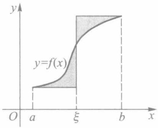

text_image

y
y=f(x)
O a ξ b x

图9-12

14. 证明: 若 $f$ 在 $[a, b]$ 上可积, $\varphi$ 在 $[\alpha, \beta]$ 上严格单调且 $\varphi'$ 在 $[\alpha, \beta]$ 上可积, $\varphi(\alpha) = a, \varphi(\beta) = b$, 则有

$$
\int_ {a} ^ {b} f (x) \mathrm{d} x = \int_ {\alpha} ^ {\beta} f (\varphi (t)) \varphi^ {\prime} (t) \mathrm{d} t.
$$

15. 若 $f$ 在 $[a, b]$ 上连续可微，则存在 $[a, b]$ 上连续可微的增函数 $g$ 和连续可微的减函数 $h$，使得

$$
f (x) = g (x) + h (x), \quad x \in [ a, b ].
$$

\* 16. 证明: 若在 $[a, b]$ 上 $f$ 为连续函数, $g$ 为连续可微的单调函数, 则存在 $\xi \in [a, b]$, 使得

214

---

\*§ 6 可积性理论补叙 |||

$$
\int_ {a} ^ {b} f (x) g (x) \mathrm{d} x = g (a) \int_ {a} ^ {\xi} f (x) \mathrm{d} x + g (b) \int_ {\xi} ^ {b} f (x) \mathrm{d} x.
$$

（提示:与定理9.11及其推论相比较，这里的条件要强得多，因此可给出一个比较简单的、不同于定理9.11的证明。）

## \* § 6 可积性理论补叙

## 一、上和与下和的性质

在 §3 第二段里, 我们已经引入了上和 $S(T)$ 和下和 $s(T)$ 的概念. 即对于分割 $T: a = x_0 < x_1 < \cdots < x_n = b$, 以及 $\Delta_i = [x_{i-1}, x_i], \Delta x_i = x_i - x_{i-1}$, 有

$$
S (T) = \sum_ {i = 1} ^ {n} M _ {i} \Delta x _ {i}, \quad s (T) = \sum_ {i = 1} ^ {n} m _ {i} \Delta x _ {i},
$$

其中  $M_{i}=\sup_{x\in\Delta_{i}}f(x)$ ,  $m_{i}=\inf_{x\in\Delta_{i}}f(x)$ ,  $i=1,2,\cdots,n$ . 由于假设 f 在 [a,b] 上有界，因此上述  $M_{i}, m_{i}$  以及 f 在 [a,b] 上的上、下确界 M 与 m 都存在，而且对于任何  $\xi_{i}\in\Delta_{i}$ ，必有

$$
m (b - a) \leqslant s (T) \leqslant \sum_ {i = 1} ^ {n} f (\xi_ {i}) \Delta x _ {i} \leqslant S (T) \leqslant M (b - a). \tag {1}
$$

下面讨论上和与下和的性质.借助这些性质,便能由不等式(1)导出可积的充要条件.

性质1 对同一个分割 $T$ ，相对于任何点集 $\{\xi_i\}$ 而言，上和是所有积分和的上确界，下和是所有积分和的下确界.即

$$
S (T) = \sup _ {| \xi_ {i} |} \sum_ {i = 1} ^ {n} f (\xi_ {i}) \Delta x _ {i}, \quad s (T) = \inf _ {| \xi_ {i} |} \sum_ {i = 1} ^ {n} f (\xi_ {i}) \Delta x _ {i}.
$$

证 由不等式(1)知道,相对于任何点集 $\{\xi_{i}\}$ 而言,上和与下和分别是全体积分和的上界与下界.现在进一步证明它们分别是全体积分和的最小上界与最大下界.

任给 $\varepsilon > 0$，在各个 $\Delta_{i}$ 上由于 $M_{i}$ 是 $f(x)$ 的上确界，故可选取点 $\xi_{i} \in \Delta_{i}$，使 $f(\xi_{i}) > M_{i} - \frac{\varepsilon}{b - a}$. 于是有

$$
\begin{array}{l} \sum_ {i = 1} ^ {n} f (\xi_ {i}) \Delta x _ {i} > \sum_ {i = 1} ^ {n} \left(M _ {i} - \frac {\varepsilon}{b - a}\right) \Delta x _ {i} \\ = \sum_ {i = 1} ^ {n} M _ {i} \Delta x _ {i} - \frac {\varepsilon}{b - a} \sum_ {i = 1} ^ {n} \Delta x _ {i} = S (T) - \varepsilon . \\ \end{array}
$$

这就证明了 $S(T)$ 是全体积分和的上确界.类似地可证 $s(T)$ 是全体积分和的下确界. $\square$

性质2 设  $T'$  为分割 T 添加 p 个新分点后所得到的分割, 则有

$$
S (T) \geqslant S (T ^ {\prime}) \geqslant S (T) - (M - m) p \| T \|, \tag {2}
$$

$$
s (T) \leqslant s (T ^ {\prime}) \leqslant s (T) + (M - m) p \| T \|. \tag {3}
$$

这个性质指出:增加分点后,上和不增,下和不减.

证 这里证明不等式(2)，同理可证(3).

215

---

第九章 定积分

将 $p$ 个新分点同时添加到 $T$, 和逐个添加到 $T$, 都同样得到 $T'$, 所以我们先证 $p = 1$ 的情形.

在 $T$ 上添加1个新分点，它必落在 $T$ 的某一小区间 $\Delta_{k}$ 上，而且将 $\Delta_{k}$ 分为两个小区间，记为 $\Delta_k'$ 与 $\Delta_k''$. 但 $T$ 的其他小区间 $\Delta_i (i \neq k)$ 仍旧是新分割 $T_1$ 所属的小区间. 因此，比较 $S(T)$ 与 $S(T_1)$ 的各个被加项，它们之间的差别仅仅是 $S(T)$ 中的 $M_k \Delta x_k$ 一项换成了 $S(T_1)$ 中的 $M_k' \Delta x_k'$ 与 $M_k'' \Delta x_k''$ 两项（这里 $M_k'$ 与 $M_k''$ 分别是 $f$ 在 $\Delta_k'$ 与 $\Delta_k''$ 上的上确界），所以

$$
\begin{array}{l} S (T) - S (T _ {1}) = M _ {k} \Delta x _ {k} - (M _ {k} ^ {\prime} \Delta x _ {k} ^ {\prime} + M _ {k} ^ {\prime \prime} \Delta x _ {k} ^ {\prime \prime}) \\ = M _ {k} (\Delta x _ {k} ^ {\prime} + \Delta x _ {k} ^ {\prime \prime}) - (M _ {k} ^ {\prime} \Delta x _ {k} ^ {\prime} + M _ {k} ^ {\prime \prime} \Delta x _ {k} ^ {\prime \prime}) \\ = (M _ {k} - M _ {k} ^ {\prime}) \Delta x _ {k} ^ {\prime} + (M _ {k} - M _ {k} ^ {\prime \prime}) \Delta x _ {k} ^ {\prime \prime}. \\ \end{array}
$$

由于

$$
m \leqslant M _ {k} ^ {\prime} (\text {或} M _ {k} ^ {\prime \prime}) \leqslant M _ {k} \leqslant M,
$$

故有

$$
\begin{array}{l} 0 \leqslant S (T) - S (T _ {1}) \leqslant (M - m) \Delta x _ {k} ^ {\prime} + (M - m) \Delta x _ {k} ^ {\prime \prime} \\ = (M - m) \Delta x _ {k} \leqslant (M - m) \| T \|\cdot \\ \end{array}
$$

这就证得 p=1 时(2)式成立.

一般说来,对  $T_{i}$  增加 1 个分点得到  $T_{i+1}$ ,就有

$$
0 \leqslant S (T _ {i}) - S (T _ {i + 1}) \leqslant (M - m) \| T _ {i} \|, i = 0, 1, 2, \dots , p - 1,
$$

(这里  $T_{0}=T, T_{p}=T'$ ). 把这些不等式对 i 依次相加, 得到

$$
0 \leqslant S (T) - S (T ^ {\prime}) \leqslant (M - m) \sum_ {i = 0} ^ {p - 1} \| T _ {i} \| \leqslant (M - m) p \| T \|\cdot
$$

这就证得(2)式成立.

性质 3 若  $T'$  与  $T''$  为任意两个分割,  $T = T' + T''$  表示把  $T'$  与  $T''$  的所有分点合并而得的分割(注意: 重复的分点只取一次), 则

$$
\begin{array}{l} S (T) \leqslant S (T ^ {\prime}), \quad s (T) \geqslant s (T ^ {\prime}), \\ S (T) \leqslant S (T ^ {\prime \prime}), \quad s (T) \geqslant s (T ^ {\prime \prime}). \\ \end{array}
$$

证 这是因为 T 既可看作  $T'$  添加新分点后得到的分割,也可看作  $T''$  添加新分点后得到的分割,所以由性质 2 立刻推知此性质成立.

性质 4 对任意两个分割  $T'$  与  $T''$ ，总有

$$
s (T ^ {\prime}) \leqslant S (T ^ {\prime \prime}).
$$

证 令 $T = T' + T''$. 由性质1与性质3便有

$$
s (T ^ {\prime}) \leqslant s (T) \leqslant S (T) \leqslant S (T ^ {\prime \prime}).
$$

这个性质指出:在对 $[a,b]$ 所作的任意两个分割中,一个分割的下和总不大于另一个分割的上和.因此对所有分割来说,所有下和有上界,所有上和有下界,从而分别存在上确界与下确界,把它们记作

$$
S = \inf _ {T} S (  T  )  , \quad s = \sup _ {T} s (  T  ).
$$

通常称 S 为 f 在  $[a, b]$  上的上积分, s 为 f 在  $[a, b]$  上的下积分.

性质 5  $m(b-a) \leqslant s \leqslant S \leqslant M(b-a)$ .

这可由性质 4 直接推出.

216

---

\* § 6 可积性理论补叙

性质 6(达布定理) 上、下积分也是上和与下和在  $\|T\|\rightarrow0$  时的极限, 即

$$
\lim _ {\| T \| \to 0} S (T) = S, \quad \lim _ {\| T \| \to 0} s (T) = s.
$$

证 下面只证第一个极限.

任给 $\varepsilon > 0$ ，由 $S$ 的定义，必存在某一分割 $T'$，使得

$$
S (T ^ {\prime}) <   S + \frac {\varepsilon}{2}. \tag {4}
$$

设  $T'$  由 p 个分点所构成, 对于任意另一个分割 T 来说,  $T + T'$  至多比 T 多 p 个分点, 由性质 2 和性质 3 得到

$$
S (T) - (M - m) p \parallel T \parallel \leqslant S (T + T ^ {\prime}) \leqslant S (T ^ {\prime}).
$$

于是有

$$
S (T) \leqslant S (T ^ {\prime}) + (M - m) p \| T \|\cdot
$$

所以，只要 $\| T\| < \frac{\varepsilon}{2(M - m)p}$ ①，就有 $S(T)\leqslant S(T') + \frac{\varepsilon}{2}$. 联系(4)式，推得 $S\leqslant S(T) < S+$ $\varepsilon$ .这就证得

$$
\lim _ {\| T \| \to 0} S (T) = S.
$$

## 二、可积的充要条件

定理9.14(可积的第一充要条件) 函数 f 在  $[a, b]$  上可积的充要条件是: f 在  $[a, b]$  上的上积分与下积分相等, 即

$$
S = s.
$$

证 必要性 设 $f$ 在 $[a, b]$ 上可积，$J = \int_{a}^{b} f(x) \, \mathrm{d}x$。由定积分定义，任给 $\varepsilon > 0$，存在 $\delta > 0$，只要 $\| T \| < \delta$，就有

$$
\Big | \sum_ {i = 1} ^ {n} f (\xi_ {i}) \Delta x _ {i} - J \Big | <   \varepsilon .
$$

另一方面，由于 $S(T)$ 与 $s(T)$ 分别为积分和关于点集 $\{\xi_i\}$ 的上、下确界（即性质1），所以当 $\| T\| < \delta$ 时，又有

$$
\mid S (T) - J \mid \leqslant \varepsilon , \quad \mid s (T) - J \mid \leqslant \varepsilon.
$$

这说明当 $\| T\| \to 0$ 时 $S(T)$ 与 $s(T)$ 都以 $J$ 为极限.由达布定理（即性质6），$S = s = J$.

充分性 设 S=s=J. 由达布定理得

$$
\lim _ {\| T \| \to 0} S (T) = \lim _ {\| T \| \to 0} s (T) = J. \tag {5}
$$

借助不等式(1)，任给  $\varepsilon>0$ ，存在  $\delta>0$ ，当  $\|T\|<\delta$  时，满足

$$
J - \varepsilon <   s (T) \leqslant \sum_ {i = 1} ^ {n} f (\xi_ {i}) \Delta x _ {i} \leqslant S (T) <   J + \varepsilon .
$$

从而 $f$ 在 $[a, b]$ 上可积，且 $\int_{a}^{b} f(x) \, \mathrm{d}x = J.$

§ 3 例 1 提到的狄利克雷函数在 [0,1] 上不可积, 正是由于它的上积分 (S=1) 与

<small>① 当 M=m 时 f 为常量函数, 性质恒成立. 所以这里设 M>m.</small>

217

---

第九章 定积分

下积分 $(s=0)$ 不相等所致.

定理 9.15(可积的第二充要条件) 函数 f 在  $[a, b]$  上可积的充要条件是: 任给  $\varepsilon > 0$ , 总存在某一分割 T, 使得

$$
S (  T  )   -   s (  T  )   <     \varepsilon  , \text {即}   \sum_ {i   =   1} ^ {n} \omega_ {i} \Delta x _ {i}   <     \varepsilon .
$$

其中  $\omega_{i}=M_{i}-m_{i}(f$  在  $\Delta_{i}$  上的振幅 $)$ ,  $i=1,2,\cdots,n.$

此定理即为 §3 中未曾证明的可积准则.

证 必要性 设 $f$ 在 $[a, b]$ 上可积，由定理9.14中的(5)式，有

$$
\lim _ {\| T \| \to 0} \left[ S (T) - s (T) \right] = 0.
$$

于是，任给  $\varepsilon>0$ ，只要  $\|T\|$  足够小，总存在分割 T，使得

$$
S (T) - s (T) <   \varepsilon .
$$

充分性 若定理条件得到满足,则由

$$
s (T) \leqslant s \leqslant S \leqslant S (T)
$$

可推得

$$
0 \leqslant S - s \leqslant S (T) - s (T) <   \varepsilon .
$$

由于  $\varepsilon$  的任意性, 必有 S=s, 故由定理 9.14 证得 f 在  $[a, b]$  上可积.

在 §3 证明可积函数类与 §4 讨论定积分的性质时, 我们已经熟悉了可积第二充要条件的重要作用.

定理 9.16(可积的第三充要条件) 函数 f 在  $[a, b]$  上可积的充要条件是: 任给正数  $\varepsilon, \eta$ , 总存在某一分割 T, 使得属于 T 的所有小区间中, 对应于振幅  $\omega_{k'} \geqslant \varepsilon$  的那些小区间  $\Delta_{k'}$  的总长  $\sum_{k'} \Delta x_{k'} < \eta$ .

证 必要性 设 $f$ 在 $[a, b]$ 上可积. 由定理9.15, 对于 $\sigma = \varepsilon \eta > 0$, 存在某一分割 $T$, 使得 $\sum_{k} \omega_{k} \Delta x_{k} < \sigma$. 于是便有

$$
\varepsilon \sum_ {k ^ {\prime}} \Delta x _ {k ^ {\prime}} \leqslant \sum_ {k ^ {\prime}} \omega_ {k ^ {\prime}} \Delta x _ {k ^ {\prime}} \leqslant \sum_ {k} \omega_ {k} \Delta x _ {k} <   \varepsilon \eta ,
$$

由此即得 $\sum_{k'}\Delta x_{k'} < \eta$

充分性 任给 $\varepsilon' > 0$，取 $\varepsilon = \frac{\varepsilon'}{2(b - a)} > 0, \eta = \frac{\varepsilon'}{2(M - m)} > 0.$ 由假设，存在某一分割 $T$，使得 $\omega_{k'} \geqslant \varepsilon$ 的那些 $\Delta_{k'}$ 的总长 $\sum_{k'} \Delta x_{k'} < \eta$. 设 $T$ 中其余满足 $\omega_{k''} < \varepsilon$ 的那些小区间为 $\Delta_{k''}$，则有

$$
\begin{array}{l} \sum_ {k} \omega_ {k} \Delta x _ {k} = \sum_ {k ^ {\prime}} \omega_ {k ^ {\prime}} \Delta x _ {k ^ {\prime}} + \sum_ {k ^ {\prime \prime}} \omega_ {k ^ {\prime \prime}} \Delta x _ {k ^ {\prime \prime}} \\ <   (M - m) \sum_ {k ^ {\prime}} \Delta x _ {k ^ {\prime}} + \varepsilon \sum_ {k ^ {\prime \prime}} \Delta x _ {k ^ {\prime \prime}} \\ \leqslant (M - m) \eta + \varepsilon (b - a) \\ = \frac {\varepsilon^ {\prime}}{2} + \frac {\varepsilon^ {\prime}}{2} = \varepsilon^ {\prime}. \\ \end{array}
$$

由定理 9.15 推知 f 在  $[a, b]$  上可积.

218

---

\* § 6 可积性理论补叙

例 1 用定理9.16证明黎曼函数在 $[0,1]$ 上可积,且定积分等于0.

证 在 §3 的例 3, 我们曾用可积的第二充要条件证得黎曼函数在 $[0,1]$ 上可积. 现在改用第三充要条件来证明, 将更为简明.

已知黎曼函数为

$$
f (x) = \left\{ \begin{array}{l l} { \frac {1}{q},} & {x =  \frac {p}{q} \quad \left(p, q \in \mathbf {N} _ {+},  \frac {p}{q} \text {为既约真分数}\right),} \\ {0,} & {x = 0, 1 \text {以及(0,1)} \text {内的无理数}.} \end{array} \right.
$$

任给 $\varepsilon > 0, \eta > 0$. 由于满足 $\frac{1}{q} \geqslant \varepsilon$，即 $q \leqslant \frac{1}{\varepsilon}$ 的有理点 $\frac{p}{q}$ 只有有限个（设为 $K$ 个），因此含有这类点的小区间至多 $2K$ 个，在其上 $\omega_{k'} \geqslant \varepsilon$. 当 $\| T \| < \frac{\eta}{2K}$ 时，就能保证这些小区间的总长满足

$$
\sum_ {k ^ {\prime}} \Delta x _ {k ^ {\prime}} \leqslant 2 K \| T \| <   \eta ,
$$

所以 f 在  $[0,1]$  上可积.

因为  $m_{i}=\inf_{x\in\Delta_{i}}f(x)=0, i=1,2,\cdots,n$ ，所以  $s(T)=0$ ，

$$
\int_ {0} ^ {1} f (x) \mathrm{d} x = s = 0.
$$

例2 证明: 若 $f$ 在 $[a, b]$ 上连续, $\varphi$ 在 $[\alpha, \beta]$ 上可积, $a \leqslant \varphi(t) \leqslant b, t \in [\alpha, \beta]$, 则 $f \circ \varphi$ 在 $[\alpha, \beta]$ 上可积.

证 任给 $\varepsilon > 0, \eta > 0$. 由于 $f$ 在 $[a, b]$ 上一致连续，因此对上述 $\eta$ ，存在 $\delta > 0$ ，当 $x'$，$x'' \in [a, b]$ 且 $|x' - x''| < \delta$ 时，

$$
\mid f (x ^ {\prime}) - f (x ^ {\prime \prime}) \mid <   \eta .
$$

由假设 $\varphi$ 在 $[\alpha, \beta]$ 上可积，对上述正数 $\delta$ 和 $\varepsilon$ ，存在某一分割 $T$ ，使得在 $T$ 所属的小区间中，$\omega_{k'}^\varphi \geqslant \delta$ 的所有小区间 $\Delta_{k'}$ 的总长 $\sum_{k'} \Delta t_{k'} < \varepsilon$ ；而在其余小区间 $\Delta_{k''}$ 上 $\omega_{k''}^\varphi < \delta$.

设 $F(t) = f(\varphi (t)), t \in [\alpha, \beta]$. 由以上可知: 在 $T$ 中的小区间 $\Delta_{k''}$ 上, $\omega_{k''}^{F} < \eta$; 至多在所有 $\Delta_{k'}$ 上 $\omega_{k'}^{F} \geqslant \eta$, 而这些小区间的总长至多为 $\sum_{k'} \Delta t_{k'} < \varepsilon$.

由可积的第三充要条件,证得复合函数 $f\circ\varphi$ 在 $[\alpha,\beta]$ 上可积.

## 习题 9.6

1. 证明性质 2 中关于下和的不等式(3).
2. 证明性质6中关于下和的极限式 $\lim_{\| T\| \to 0}s(T) = s.$
3. 设

$$
f (  x  ) = \left\{ \begin{array}{l l} {{x  ,}} & {{x   \text {为有理数},}} \\ {{0  ,}} & {{x   \text {为无理数}.}} \end{array} \right.
$$

试求 $f$ 在 $[0,1]$ 上的上积分和下积分；并由此判断 $f$ 在 $[0,1]$ 上是否可积.

4. 设 $f$ 在 $[a, b]$ 上可积，且 $f(x) \geqslant 0, x \in [a, b]$. 试问 $\sqrt{f}$ 在 $[a, b]$ 上是否可积？为什么？
5. 证明: 定理 9.15 中的可积第二充要条件等价于“任给 $\varepsilon > 0$, 存在 $\delta > 0$, 对一切满足

219

---

第九章 定积分

$\| T \| < \delta$ 的 $T$, 都有 $\sum_{T} \omega_{i} \Delta x_{i} = S(T) - s(T) < \varepsilon$

6. 据理回答:

(1) 何种函数具有“任意下和等于任意上和”的性质？
(2) 何种连续函数具有“所有下和(或上和)都相等”的性质？
(3) 对于可积函数, 若“所有下和(或上和)都相等”, 是否仍有(2)的结论?

7. 本题的最终目的是要证明: 若 $f$ 在 $[a, b]$ 上可积, 则 $f$ 在 $[a, b]$ 上必定有无限多个处处稠密的连续点. 这可用区间套方法按以下顺序逐一证明:

(1) 若 T 是  $[a, b]$  的一个分割，使得  $S(T) - s(T) < b - a$ ，则在 T 中存在某个小区间  $\Delta_{i}$ ，使  $\omega_{i}^{f} < 1$ .
(2) 存在区间  $I_{1}=\left[a_{1},b_{1}\right]\subset(a,b)$ ，使得

$$
\omega^ {f} (I _ {1}) = \sup _ {x \in I _ {1}} f (x) - \inf _ {x \in I _ {1}} f (x) <   1.
$$

(3) 存在区间  $I_{2}=\left[a_{2},b_{2}\right]\subset(a_{1},b_{1})$ ，使得

$$
\omega^ {f} (I _ {2}) = \sup _ {x \in I _ {2}} f (x) - \inf _ {x \in I _ {2}} f (x) <   \frac {1}{2}.
$$

(4) 继续以上方法, 求出一区间序列  $I_{n}=\left[a_{n},b_{n}\right]\subset\left(a_{n-1},b_{n-1}\right)$ , 使得

$$
\omega^ {f} (I _ {n}) = \sup _ {x \in I _ {n}} f (x) - \inf _ {x \in I _ {n}} f (x) <   \frac {1}{n}.
$$

说明 $\{I_{n}\}$ 为一区间套，从而存在 $x_{0}\in I_{n},n=1,2,\cdots;$ 而且f在点 $x_{0}$ 连续.

(5) 上面求得的 f 的连续点在  $[a, b]$  上处处稠密.

## 第九章总练习题

1. 证明: 若 $\varphi$ 在 $[0, a]$ 上连续, $f$ 二阶可导, 且 $f''(x) \geqslant 0$, 则有

$$
\frac {1}{a} \int_ {0} ^ {a} f (\varphi (t)) \mathrm{d} t \geqslant f \left(\frac {1}{a} \int_ {0} ^ {a} \varphi (t) \mathrm{d} t\right).
$$

2. 证明下列命题:

(1) 若 f 在  $[a, b]$  上连续增，

$$
F (x) = \left\{ \begin{array}{l l} \frac {1}{x - a} \int_ {a} ^ {x} f (t)   \mathrm{d} t, & x \in (a, b ], \\ f (a), & x = a, \end{array} \right.
$$

则 F 为  $[a, b]$  上的增函数.

(2) 若 f 在  $[0, +\infty)$  上连续，且  $f(x) > 0$ ，则

$$
\varphi (x) = \int_ {0} ^ {x} t f (t) \mathrm{d} t / \int_ {0} ^ {x} f (t) \mathrm{d} t
$$

为 $(0, +\infty)$ 上的严格增函数. 如果要使 $\varphi$ 在 $[0, +\infty)$ 上为严格增, 试问应补充定义 $\varphi(0) = ?$

3. 设 $f$ 在 $[0, +\infty)$ 上连续，且 $\lim_{x \to +\infty} f(x) = A$ ，证明

$$
\lim _ {x \to + \infty} \frac {1}{x} \int_ {0} ^ {x} f (t)   \mathrm{d} t = A.
$$

4. 设 $f$ 是定义在 $(- \infty, +\infty)$ 上的一个连续周期函数，周期为 $p$ ，证明

220

---

第九章总练习题

$$
\lim _ {x \to + \infty} \frac {1}{x} \int_ {0} ^ {x} f (t) \mathrm{d} t = \frac {1}{p} \int_ {0} ^ {p} f (t) \mathrm{d} t.
$$

5. 证明: 连续的奇函数的一切原函数皆为偶函数; 连续的偶函数的原函数中只有一个是奇函数.

6. 证明施瓦茨(Schwarz)不等式: 若 f 和 g 在  $[a, b]$  上可积, 则

$$
\left(\int_ {a} ^ {b} f (x) g (x) \mathrm{d} x\right) ^ {2} \leqslant \int_ {a} ^ {b} f ^ {2} (x) \mathrm{d} x \cdot \int_ {a} ^ {b} g ^ {2} (x) \mathrm{d} x.
$$

7. 利用施瓦茨不等式证明:

(1) 若 f 在  $[a, b]$  上可积, 则

$$
\left(\int_ {a} ^ {b} f (x) \mathrm{d} x\right) ^ {2} \leqslant (b - a) \int_ {a} ^ {b} f ^ {2} (x) \mathrm{d} x;
$$

(2) 若 f 在  $[a, b]$  上可积，且  $f(x) \geqslant m > 0$ ，则

$$
\int_ {a} ^ {b} f (x) \mathrm{d} x \cdot \int_ {a} ^ {b} \frac {1}{f (x)} \mathrm{d} x \geqslant (b - a) ^ {2};
$$

（3）若 $f, g$ 都在 $[a, b]$ 上可积，则有闵可夫斯基（Minkowski）不等式:

$$
\left[ \int_ {a} ^ {b} (f (x) + g (x)) ^ {2} \mathrm{d} x \right] ^ {\frac {1}{2}} \leqslant \left[ \int_ {a} ^ {b} f ^ {2} (x) \mathrm{d} x \right] ^ {\frac {1}{2}} + \left[ \int_ {a} ^ {b} g ^ {2} (x) \mathrm{d} x \right] ^ {\frac {1}{2}}.
$$

8. 证明: 若 f 在  $[a, b]$  上连续, 且  $f(x) > 0$ , 则

$$
\ln \biggl (\frac {1}{b - a} \int_ {a} ^ {b} f (x) \mathrm{d} x \biggr) \geqslant \frac {1}{b - a} \int_ {a} ^ {b} \ln f (x) \mathrm{d} x.
$$

9. 设 $f$ 为 $(0, +\infty)$ 上的连续减函数, $f(x) > 0$; 又设

$$
a _ {n} = \sum_ {k = 1} ^ {n} f (k) - \int_ {1} ^ {n} f (x) \mathrm{d} x.
$$

证明 $\{a_{n}\}$ 为收敛数列.

10. 若 $f$ 在 $[0, a]$ 上连续可微，且 $f(0) = 0$ ，则

$$
\int_ {0} ^ {a} \left| f (x) f ^ {\prime} (x) \right| \mathrm{d} x \leqslant \frac {a}{2} \int_ {0} ^ {a} \left[ f ^ {\prime} (x) \right] ^ {2} \mathrm{d} x.
$$

\* 11. 证明: 若 $f$ 在 $[a, b]$ 上可积, 且处处有 $f(x) > 0$, 则 $\int_{a}^{b} f(x) \, \mathrm{d}x > 0$.

(提示:由可积的第一充要条件进行反证;也可利用习题9.6第7题的结论.)

## 第九章综合自测题

221
