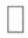
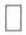
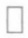
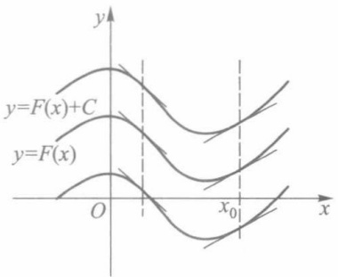
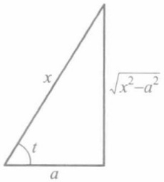
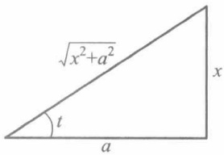

## § 1 关于实数集完备性的基本定理

在第一、二章中,我们证明了关于实数集的确界原理和数列的单调有界定理,给出了数列的致密性定理和柯西收敛准则.这些命题以不同方式反映了实数集 R 的一种特性,通常称为实数的完备性或实数的连续性.可以举例说明,有理数集就不具有这种特性(本节习题 4).有关实数集完备性的基本定理,除上面这些定理外,还有区间套定理、聚点定理和有限覆盖定理.在本节中将阐述这三个基本定理,并指出所有这六个基本定理的等价性.

## 一、区间套定理

定义1 设闭区间列 $\{[a_n, b_n]\}$ 具有如下性质:

(i)  $\left[a_{n},b_{n}\right]\supset\left[a_{n+1},b_{n+1}\right],n=1,2,\cdots;$

(ii)  $\lim_{n\to\infty}(b_{n}-a_{n})=0,$

则称 $\{[a_{n},b_{n}]\}$ 为闭区间套,或简称区间套.

这里性质(i)表明,构成区间套的闭区间列是前一个套着后一个,即各闭区间的端点满足如下不等式:

$$
a _ {1} \leqslant a _ {2} \leqslant \dots \leqslant a _ {n} \leqslant \dots \leqslant b _ {n} \leqslant \dots \leqslant b _ {2} \leqslant b _ {1}. \tag {1}
$$

定理 7.1(区间套定理) 若  $\{[a_{n}, b_{n}]\}$  是一个区间套, 则在实数系中存在唯一的一点  $\xi$ , 使得  $\xi \in [a_{n}, b_{n}], n = 1, 2, \cdots$ , 即

$$
a _ {n} \leqslant \xi \leqslant b _ {n}, n = 1, 2, \dots . \tag {2}
$$

证 由(1)式， $\{a_{n}\}$  为递增有界数列，依单调有界定理， $\{a_{n}\}$  有极限  $\xi$ ，且有

$$
a _ {n} \leqslant \xi , n = 1, 2, \dots . \tag {3}
$$

同理,递减有界数列 $\{b_{n}\}$ 也有极限,并按区间套的条件(ii),有

$$
\lim _ {n \to \infty} b _ {n} = \lim _ {n \to \infty} a _ {n} = \xi , \tag {4}
$$

且

$$
b _ {n} \geqslant \xi , n = 1, 2, \dots . \tag {5}
$$

联合(3)、(5)即得(2)式.

最后证明满足(2)的  $\xi$  是唯一的. 设数  $\xi'$  也满足

$$
a _ {n} \leqslant \xi^ {\prime} \leqslant b _ {n}, n = 1, 2, \dots ,
$$

则由(2)式有

$$
\mid \xi - \xi^ {\prime} \mid \leqslant b _ {n} - a _ {n}, n = 1, 2, \dots .
$$

由区间套的条件(ii)得

$$
\mid \xi - \xi^ {\prime} \mid \leqslant \lim _ {n \to \infty} (b _ {n} - a _ {n}) = 0,
$$

故有  $\xi'=\xi.$

由(4)式容易推得如下很有用的区间套性质:

推论 若  $\xi\in[a_{n},b_{n}]$  ( $n=1,2,\cdots$ ) 是区间套  $\{[a_{n},b_{n}]\}$  所确定的点，则对任给的  $\varepsilon>0$ ，存在 N>0，使得当 n>N 时，有

$$
[ a _ {n}, b _ {n} ] \subset U (\xi ; \varepsilon).
$$

注 区间套定理中要求各个区间都是闭区间,才能保证定理的结论成立.对于开区间列,如 $\left\{\left(0,\frac{1}{n}\right)\right\}$ ,虽然其中各个开区间也是前一个包含后一个,且 $\lim_{n\to\infty}\left(\frac{1}{n}-0\right)=0$ ,但不存在属于所有开区间的公共点.

例 1 用区间套定理证明连续函数根的存在性定理.

证 设 $f$ 在区间 $[a, b]$ 上连续，$f(a)f(b) < 0$，并且记 $[a_1, b_1] = [a, b]$. 令 $c_1 = \frac{a_1 + b_1}{2}$，如果 $f(c_1) = 0$，结论已经成立，故可设 $f(c_1) \neq 0$. 那么 $f(a_1)f(c_1)$ 与 $f(c_1)f(b_1)$ 有一个小于零，不妨设 $f(a_1)f(c_1) < 0$，记 $[a_2, b_2] = [a_1, c_1]$. 再令 $c_2 = \frac{a_2 + b_2}{2}$，如果 $f(c_2) = 0$，结论已经成立，故同样可设 $f(c_2) \neq 0$. 那么 $f$ 在 $[a_2, c_2]$ 与 $[c_2, b_2]$ 这两个区间中的某一个区间上端点值异号，并记这个区间为 $[a_3, b_3]$. 将这个过程无限重复下去，就得到一列闭区间 $\{[a_n, b_n]\}$，满足:

(1) $\left[a_{n},b_{n}\right]\supset\left[a_{n+1},b_{n+1}\right],n=1,2,\cdots;$
(2)  $\lim_{n\to\infty}(b_{n}-a_{n})=\lim_{n\to\infty}\frac{b-a}{2^{n-1}}=0;$
(3)  $f(a_{n})f(b_{n})<0, n=1,2,\cdots.$

由(1)和(2)可知 $\left\{\left[a_{n},b_{n}\right]\right\}$ 是一个区间套,由定理7.1,存在 $\xi\in\left[a_{n},b_{n}\right],n=1,2,\cdots$ ,且有 $\lim_{n\to\infty}a_{n}=\lim_{n\to\infty}b_{n}=\xi$ .因为f在点 $\xi$ 连续,所以由(3)得

$$
f ^ {2} (\xi) = \lim _ {n \to \infty} f (a _ {n}) f (b _ {n}) \leqslant 0,
$$

则必有 $f(\xi) = 0$ .显然 $\xi \in [a,b]$ ，它就是 $f$ 的一个零点

## 二、聚点定理与有限覆盖定理

定义2 设 $S$ 为数轴上的点集, $\xi$ 为定点 (它可以属于 $S$, 也可以不属于 $S$). 若 $\xi$ 的任何邻域都含有 $S$ 中无穷多个点, 则称 $\xi$ 为点集 $S$ 的一个聚点.

例如，点集 $S = \left\{(-1)^n +\frac{1}{n}\right\}$ 有两个聚点 $\xi_1 = -1$ 和 $\xi_{2} = 1$；点集 $S = \left\{\frac{1}{n}\right\}$ 只有一个聚点 $\xi = 0$；又若 $S$ 为开区间 $(a,b)$，则 $(a,b)$ 上每一点以及端点 $a,b$ 都是 $S$ 的聚点；而正整数集 $\mathbf{N}_{+}$ 没有聚点，任何有限数集也没有聚点。

聚点概念的另两个等价定义如下.

定义 2' 对于点集 S, 若点  $\xi$  的任何  $\varepsilon$  邻域都含有 S 中异于  $\xi$  的点, 即  $U^{\circ}(\xi; \varepsilon) \cap S \neq \varnothing$ , 则称  $\xi$  为 S 的一个聚点.

定义 2" 若存在各项互异的收敛数列  $\{x_{n}\} \subset S$ ，则其极限  $\lim_{n\to\infty}x_{n} = \xi$  称为 S 的一个聚点.

关于以上三个定义等价性的证明,我们简述如下.

定义  $2 \Rightarrow$  定义  $2'$  是显然的, 定义  $2'' \Rightarrow$  定义 2 也不难得到; 现证定义  $2' \Rightarrow$  定义  $2''$ :

设  $\xi$  为 S(按定义  $2'$ ) 的聚点, 则对任给的  $\varepsilon > 0$ , 存在  $x \in U^{\circ}(\xi; \varepsilon) \cap S$ .

令  $\varepsilon_{1}=1$ ，则存在  $x_{1}\in U^{\circ}(\xi;\varepsilon_{1})\cap S;$

令 $\varepsilon_{2} = \min \left\{\frac{1}{2}, |\xi - x_{1}| \right\}$, 则存在 $x_{2} \in U^{\circ}(\xi; \varepsilon_{2}) \cap S$, 且显然 $x_{2} \neq x_{1}$;

......

令  $\varepsilon_{n}=\min\left\{\frac{1}{n},\mid\xi-x_{n-1}\mid\right\}$ ，则存在  $x_{n}\in U^{\circ}(\xi;\varepsilon_{n})\cap S$ ，且  $x_{n}$  与  $x_{1},\cdots,x_{n-1}$  互异.

无限地重复以上步骤,得到 S 中各项互异的数列  $\{x_{n}\}$ , 且由  $\left|\xi-x_{n}\right|<\varepsilon_{n}\leqslant\frac{1}{n}$ , 易见  $\lim_{n\to\infty}x_{n}=\xi.$

定理 7.2(魏尔斯特拉斯(Weierstrass)聚点定理) 实轴上的任一有界无限点集 S 至少有一个聚点.

证 证法一 因 $S$ 为有界点集, 故存在 $M > 0$, 使得 $S \subset [-M, M]$, 记 $[a_1, b_1] = [-M, M]$.

现将 $[a_1, b_1]$ 等分为两个子区间. 因 $S$ 为无限点集, 故两个子区间中至少有一个含有 $S$ 中无穷多个点, 记此子区间为 $[a_2, b_2]$, 则 $[a_1, b_1] \supset [a_2, b_2]$, 且

$$
b _ {2} - a _ {2} = \frac {1}{2} (b _ {1} - a _ {1}) = M.
$$

再将 $[a_2, b_2]$ 等分为两个子区间，则其中至少有一个子区间含有 $S$ 中无穷多个点，取出这样的一个子区间，记为 $[a_3, b_3]$，则 $[a_2, b_2] \supset [a_3, b_3]$，且

$$
b _ {3} - a _ {3} = \frac {1}{2} (b _ {2} - a _ {2}) = \frac {M}{2}.
$$

将此等分子区间的步骤无限地进行下去,得到一个区间列 $\{[a_{n},b_{n}]\}$ ,它满足

$$
[ a _ {n}, b _ {n} ] \supset [ a _ {n + 1}, b _ {n + 1} ], n = 1, 2, \dots ,
$$

$$
b _ {n} - a _ {n} = \frac {M}{2 ^ {n - 2}} \rightarrow 0 (n \rightarrow \infty),
$$

即 $\{[a_n, b_n]\}$ 是区间套，且其中每一个闭区间都含有 $S$ 中无穷多个点.

由区间套定理,存在唯一的一点  $\xi\in[a_{n},b_{n}],n=1,2,\cdots$ . 于是由定理 7.1 的推论,对任给的  $\varepsilon>0$ , 存在 N>0, 当 n>N 时有  $[a_{n},b_{n}]\subset U(\xi;\varepsilon)$ . 从而  $U(\xi;\varepsilon)$  内含有 S 中无穷多个点, 按定义 2,  $\xi$  为 S 的一个聚点.

证法二 设 $S$ 是有界无限点集. 在 $S$ 中取一列两两不同的点列 $\{x_{n}\}$, 显然 $\{x_{n}\}$ 是有界点列. 由致密性定理, $\{x_{n}\}$ 存在一个收敛的子列 $\{x_{n_k}\}$, 其极限设为 $x_{0}$. 那么对于任意正数 $\varepsilon$, 存在 $K$, 当 $k > K$ 时, 有 $x_{0} - \varepsilon < x_{n_k} < x_{0} + \varepsilon$. 这就说明 $(x_{0} - \varepsilon, x_{0} + \varepsilon)$ 含有 $S$ 中无限多个点, 即  $x_{0}$  是 S 的一个聚点.

十分明显,致密性定理是聚点定理的一种特殊情形.这只需把有界数列 $\{x_{n}\}$ 看成有界点集S,并把 $\{x_{n}\}$ 中的无限多个“项”看成S中的无限多个“点”.

定义3 设 $S$ 为数轴上的点集, $H$ 为开区间的集合(即 $H$ 的每一个元素都是形如 $(\alpha, \beta)$ 的开区间). 若 $S$ 中任何一点都含在 $H$ 中至少一个开区间内, 则称 $H$ 为 $S$ 的一个开覆盖, 或称 $H$ 覆盖 $S$. 若 $H$ 中开区间的个数是无限(有限)的, 则称 $H$ 为 $S$ 的一个无限开覆盖(有限开覆盖).

在具体问题中,一个点集的开覆盖常由该问题的某些条件所确定.例如,若函数f在 $(a,b)$ 上连续,则给定 $\varepsilon>0$ ,对每一点 $x\in(a,b)$ ,都可确定正数 $\delta_{x}$ (它依赖于 $\varepsilon$ 与x),使得当 $x'\in U(x;\delta_{x})$ 时,有 $\left|f(x')-f(x)\right|<\varepsilon$ .这样就得到一个开区间集

$$
H = \{(x - \delta_ {x}, x + \delta_ {x}) | x \in (a, b) \},
$$

它是区间 $(a,b)$ 的一个无限开覆盖.

定理 7.3(海涅—博雷尔(Heine-Borel)有限覆盖定理) 设 H 为闭区间  $[a, b]$  的一个(无限)开覆盖, 则从 H 中可选出有限个开区间来覆盖  $[a, b]$ .

证 用反证法 假设定理的结论不成立, 即不能用 H 中有限个开区间来覆盖  $[a, b]$ .

将 $[a, b]$ 等分为两个子区间，则其中至少有一个子区间不能用 $H$ 中有限个开区间来覆盖。记这个子区间为 $[a_1, b_1]$，则 $[a_1, b_1] \subset [a, b]$，且 $b_1 - a_1 = \frac{1}{2}(b - a)$。

再将 $[a_1, b_1]$ 等分为两个子区间，同样，其中至少有一个子区间不能用 $H$ 中有限个开区间来覆盖。记这个子区间为 $[a_2, b_2]$，则 $[a_2, b_2] \subset [a_1, b_1]$，且 $b_2 - a_2 = \frac{1}{2^2} (b - a)$。

重复上述步骤并不断地进行下去，则得到一个闭区间列 $\{[a_n,b_n]\}$，它满足

$$
[ a _ {n}, b _ {n} ] \supset [ a _ {n + 1}, b _ {n + 1} ], n = 1, 2, \dots ,
$$

$$
b _ {n} - a _ {n} = \frac {1}{2 ^ {n}} (b - a) \rightarrow 0 (n \rightarrow \infty),
$$

即 $\{[a_n, b_n]\}$ 是区间套，且其中每一个闭区间都不能用 $H$ 中有限个开区间来覆盖.

由区间套定理,存在唯一的一点  $\xi\in[a_{n},b_{n}],n=1,2,\cdots$ .由于 H 是 [a,b] 的一个开覆盖,故存在开区间  $(\alpha,\beta)\in H$ ,使  $\xi\in(\alpha,\beta)$ .于是,由定理 7.1 推论,当 n 充分大时,有

$$
[ a _ {n}, b _ {n} ] \subset (\alpha , \beta).
$$

这表明 $[a_{n}, b_{n}]$ 只需用 $H$ 中的一个开区间 $(\alpha, \beta)$ 就能覆盖，与挑选 $[a_{n}, b_{n}]$ 时的假设“不能用 $H$ 中有限个开区间来覆盖”相矛盾。从而证得必存在属于 $H$ 的有限个开区间能覆盖 $[a, b]$。

注 定理 7.3 的结论只对闭区间  $[a, b]$  成立, 而对开区间则不一定成立. 例如, 开区间集合  $\left\{\left(\frac{1}{n+1}, 1\right)\right\}$  ( $n=1,2,\cdots$ ) 构成了开区间  $(0,1)$  的一个开覆盖, 但不能从中选出有限个开区间盖住  $(0,1)$ .

例 2 用有限覆盖定理证明:闭区间上连续函数的有界性定理.

证 设 $f(x)$ 在区间 $[a, b]$ 上连续. 根据连续函数的局部有界性定理, 对于任意的$x_0 \in [a, b]$, 存在正数 $M_{x_0}$ 以及正数 $\delta_{x_0}$, 当 $x \in (x_0 - \delta_{x_0}, x_0 + \delta_{x_0}) \cap [a, b]$ 时有 $|f(x)| \leqslant M_{x_0}$. 作开区间集

$$
H = \left\{\left(x - \delta_ {x}, x + \delta_ {x}\right) \mid \mid f (x) \mid \leqslant M _ {x}, x \in [ a, b ], x \in \left(x - \delta_ {x}, x + \delta_ {x}\right) \cap [ a, b ] \right\},
$$

显然 $H$ 覆盖了区间 $[a, b]$. 根据有限覆盖定理, 存在 $H$ 中有限个开区间

$$
(x _ {1} - \delta_ {x _ {1}}, x _ {1} + \delta_ {x _ {1}}), (x _ {2} - \delta_ {x _ {2}}, x _ {2} + \delta_ {x _ {2}}), \dots , (x _ {n} - \delta_ {x _ {n}}, x _ {n} + \delta_ {x _ {n}}),
$$

它们也覆盖了 $[a, b]$. 令 $M = \max \{M_{x_1}, M_{x_2}, \dots, M_{x_n}\}$, 那么对于任意的 $x \in [a, b]$, 存在 $k$, $1 \leqslant k \leqslant n$, 使得 $x \in (x_k - \delta_{x_k}, x_k + \delta_{x_k})$, 并且有 $|f(x)| \leqslant M_{x_k} \leqslant M$.

## \* 三、实数完备性基本定理之间的等价性

至此,我们已经介绍了有关实数完备性的六个基本定理,即

1. 确界原理(定理 1.1);
2. 单调有界定理(定理 2.9);
3. 区间套定理(定理 7.1);
4. 有限覆盖定理(定理 7.3);

5. 聚点定理(定理 7.2)和致密性定理(定理 2.10);

6. 柯西收敛准则(定理 2.11).

在本书中,我们首先证明了确界原理,由它证明了单调有界定理,再用单调有界定理导出区间套定理,最后用区间套定理分别证明余下的三个定理.事实上,在实数系中这六个命题是相互等价的,即从其中任何一个命题都可推出其余的五个命题.对此,我们可按下列顺序给予证明:

$$
1 \Rightarrow 2 \Rightarrow 3 \Rightarrow 4 \Rightarrow 5 \Rightarrow 6 \Rightarrow 1.
$$

其中  $1 \Rightarrow 2, 2 \Rightarrow 3$  与  $3 \Rightarrow 4$  分别见定理 2.9, 7.1 与 7.3;  $4 \Rightarrow 5$  和  $5 \Rightarrow 6$  请读者作为练习自证（见本节习题 8 和 9）；而  $6 \Rightarrow 1$  见下例.

例 3 用数列的柯西收敛准则证明确界原理.

证 设 $S$ 为非空有上界数集. 由实数的阿基米德性, 对任何正数 $\alpha$, 存在整数 $k_{\alpha}$, 使得 $\lambda_{\alpha} = k_{\alpha} \alpha$ 为 $S$ 的上界, 而 $\lambda_{\alpha} - \alpha = (k_{\alpha} - 1) \alpha$ 不是 $S$ 的上界, 即存在 $\alpha' \in S$, 使得 $\alpha' > (k_{\alpha} - 1) \alpha$.

分别取  $\alpha=\frac{1}{n}, n=1,2,\cdots$ ，则对每一个正整数 n，存在相应的  $\lambda_{n}$ ，使得  $\lambda_{n}$  为 S 的上界，而  $\lambda_{n}-\frac{1}{n}$  不是 S 的上界，故存在  $a'\in S$ ，使得

$$
a ^ {\prime} > \lambda_ {n} - \frac {1}{n}. \tag {6}
$$

又对正整数 $m, \lambda_{m}$ 是 $S$ 的上界，故有 $\lambda_{m} \geqslant a'$. 结合 (6) 式得 $\lambda_{n} - \lambda_{m} < \frac{1}{n}$; 同理有 $\lambda_{m} - \lambda_{n} < \frac{1}{m}$. 从而得

$$
\mid \lambda_ {m} - \lambda_ {n} \mid <   \max \Bigl \{\frac {1}{m}, \frac {1}{n} \Bigr \}.
$$

于是,对任给的  $\varepsilon>0$ , 存在 N>0, 使得当 m, n>N 时, 有

$$
\left| \lambda_ {m} - \lambda_ {n} \right| <   \varepsilon .
$$

由柯西收敛准则, 数列  $\{\lambda_{n}\}$  收敛. 记

$$
\lim _ {n \to \infty} \lambda_ {n} = \lambda . \tag {7}
$$

现在证明 $\lambda$ 就是 $S$ 的上确界. 首先, 对任何 $a \in S$ 和正整数 $n$, 有 $a \leqslant \lambda_{n}$, 由 (7) 式得 $a \leqslant \lambda$, 即 $\lambda$ 是 $S$ 的一个上界. 其次, 对任何 $\delta > 0$, 由 $\frac{1}{n} \to 0 (n \to \infty)$ 及 (7) 式, 对充分大的 $n$, 同时有

$$
\frac {1}{n} <   \frac {\delta}{2}, \lambda_ {n} > \lambda - \frac {\delta}{2}.
$$

又因 $\lambda_{n} - \frac{1}{n}$ 不是 $S$ 的上界，故存在 $a' \in S$ ，使得 $a' > \lambda_{n} - \frac{1}{n}$. 结合上式得

$$
a ^ {\prime} > \lambda - \frac {\delta}{2} - \frac {\delta}{2} = \lambda - \delta.
$$

这说明  $\lambda$  为 S 的上确界.

同理可证: 若 S 为非空有下界数集, 则必存在下确界.

## 习题 7.1

1. 证明数集 $\left\{(-1)^n + \frac{1}{n}\right\}$ 有且只有两个聚点 $\xi_1 = -1$ 和 $\xi_2 = 1$.
2. 证明: 任何有限数集都没有聚点.
3. 设  $\{(a_{n}, b_{n})\}$  是一个严格开区间套, 即满足

$$
a _ {1} <   a _ {2} <   \dots <   a _ {n} <   b _ {n} <   \dots <   b _ {2} <   b _ {1},
$$

且 $\lim_{n\to \infty}(b_n - a_n) = 0.$ 证明:存在唯一的一点 $\xi$ ，使得

$$
a _ {n} <   \xi <   b _ {n}, n = 1, 2, \dots .
$$

4. 试举例说明: 在有理数集上, 确界原理、单调有界定理、聚点定理和柯西收敛准则一般都不能成立.
5. 设  $H=\left\{\left(\frac{1}{n+2},\frac{1}{n}\right)\mid n=1,2,\cdots\right\}$ . 问

(1) H 能否覆盖  $(0,1)$ ?
(2) 能否从 H 中选出有限个开区间覆盖 (i)  $\left(0, \frac{1}{2}\right)$ , (ii)  $\left(\frac{1}{100}, 1\right)$ ?

6. 证明: 闭区间  $[a, b]$  的全体聚点的集合是  $[a, b]$  本身.
7. 设 $\{x_{n}\}$ 为单调数列. 证明: 若 $\{x_{n}\}$ 存在聚点, 则必是唯一的, 且为 $\{x_{n}\}$ 的确界.
8. 试用有限覆盖定理证明聚点定理.
9. 试用聚点定理证明柯西收敛准则.
10. 用有限覆盖定理证明根的存在性定理.
11. 用有限覆盖定理证明连续函数的一致连续性定理.

## \* § 2 上极限和下极限

定义1 若数 $a$ 的任一邻域含有数列 $\{x_{n}\}$ 中的无限多个项, 则称 $a$ 为数列 $\{x_{n}\}$ 的一个聚点①.

例如，数列 $\left\{(-1)^{n}\frac{n}{n+1}\right\}$ 有聚点-1与1；数列 $\left\{\sin\frac{n\pi}{4}\right\}$ 有 $-1,-\frac{\sqrt{2}}{2},0,\frac{\sqrt{2}}{2}$ 和1五个聚点；数列 $\left\{\frac{1}{n}\right\}$ 只有一个聚点0；常数列 $\{1,1,\cdots,1,\cdots\}$ 只有一个聚点1.

注 点列(或数列)的聚点定义与上一节中关于点集(或数集)的聚点定义是有区别的.当把点列看作点集时,点列中对应于相同数值的项,只能作为一个点来看待.如上述点列 $\left\{\sin\frac{n\pi}{4}\right\}$ 作为点集来看待时,它仅含有五个点,即

$$
\left\{\sin \frac {n \pi}{4} \right\} = \left\{- 1, - \frac {\sqrt {2}}{2}, 0, \frac {\sqrt {2}}{2}, 1 \right\},
$$

按点集聚点的定义,这个有限集没有聚点.然而,我们在点列聚点的定义中只考虑项,只要在一点的任意小邻域内聚集了无穷多个项(不论其数值是否相同),该点就称为点列的聚点.所以,点列的聚点实际上就是其收敛子列的极限.

定理 7.4 有界点列(数列) $\{x_{n}\}$ 至少有一个聚点,且存在最大聚点与最小聚点.

证 关于 $\{x_{n}\}$ 聚点存在性的证明, 完全类似于定理7.2的证明方法, 只需把那个证明中的“无限多个点”改为“无限多个项”即可.

至于最大聚点的存在性, 只需在定理 7.2 的证明过程中, 当每次把区间 $[a_{k-1}, b_{k-1}]$ 等分为两个子区间时, 若右边一个含有 $\{x_n\}$ 中无穷多个项, 则取它为 $[a_k, b_k]$, 否则取左边的子区间为 $[a_k, b_k]$. 这样的选取方法既保证了每次选出的 $[a_k, b_k]$ 都含有 $\{x_n\}$ 中无限多个项, 同时在 $[a_k, b_k]$ 的右边却至多只有 $\{x_n\}$ 的有限个项, 于是由区间套 $\{[a_k, b_k]\}$ 所确定的点列 $\{x_n\}$ 的聚点 $\xi$ 必是 $\{x_n\}$ 的最大聚点. 因若不然, 设另有 $\{x_n\}$ 的聚点 $\zeta > \xi$, 则令 $\delta = \frac{1}{3} (\zeta - \xi) > 0$, 在 $U(\zeta; \delta)$ 内含有 $\{x_n\}$ 中无限多个项. 但当 $n$ 充分大时, $U(\zeta, \delta)$ 将完全落在 $[a_n, b_n]$ 的右边, 这与区间列 $\{[a_k, b_k]\}$ 的上述选取方法相矛盾. 所以 $\xi$ 必为 $\{x_n\}$ 的最大聚点.

类似地, 只要把每次优先挑选右边一个子区间改为优先挑选左边一个, 就能证得最小聚点的存在性.

定义2 有界数列(点列) $\{x_{n}\}$ 的最大聚点 $\overline{A}$ 与最小聚点 $\underline{A}$ 分别称为 $\{x_{n}\}$ 的上极限与下极限, 记作

<small>① 本节中同前面一样,不区分实数与数轴上的点,因此点列的聚点等同于数列的聚点.数列或点列的聚点也称为极限点.</small>

$$
\overline {{A}} = \varlimsup_ {n \to \infty} x _ {n}, \quad \underline {{A}} = \varliminf_ {n \to \infty} x _ {n}.
$$

由定理 7.4 立刻可得: 任何有界数列必存在上、下极限.

例1 $\lim_{n\to \infty}(-1)^{n}\frac{n}{n + 1} = 1,\lim_{n\to \infty}(-1)^{n}\frac{n}{n + 1} = -1;$

$$
\varlimsup_ {n \to \infty} \sin \frac {n \pi}{4} = 1, \lim _ {n \to \infty} \sin \frac {n \pi}{4} = - 1;
$$

$$
\varlimsup_ {n \to \infty} \frac {1}{n} = \lim _ {n \to \infty} \frac {1}{n} = 0.
$$

定理7.5 对任何有界数列 $\{x_{n}\}$，有

$$
\varliminf_ {n \to \infty} x _ {n} \leqslant \varlimsup_ {n \to \infty} x _ {n}.
$$

定理7.6 $\lim_{n\to \infty}x_n = A$ 的充要条件是 $\overline{\lim}_{n\to \infty}x_n = \overline{\lim}_{n\to \infty}x_n = A.$

以上两个定理的证明由定理 7.4 与定义 2 立即可得.

定理 7.7 设  $\{x_{n}\}$  为有界数列.

(1) A 为  $\{x_{n}\}$  上极限的充要条件是: 任给  $\varepsilon > 0$ ,
(i) 存在 N>0，使得当 n>N 时，有  $x_{n}<\overline{A}+\varepsilon$ ;
(ii) 存在子列  $\{x_{n_{k}}\}, x_{n_{k}} > \overline{A} - \varepsilon, k = 1, 2, \cdots.$
(2) A 为  $\{x_{n}\}$  下极限的充要条件是: 任给  $\varepsilon > 0$ ,
(i) 存在 N>0，使得当 n>N 时，有  $x_{n}>\underline{A}-\varepsilon$ ;
(ii) 存在子列  $\{x_{n_{k}}\}, x_{n_{k}} < \underline{A} + \varepsilon, k = 1, 2, \cdots.$

证 （1）必要性 因  $\overline{A}$  是  $\{x_{n}\}$  的聚点，故对任给的  $\varepsilon>0, U(\overline{A};\varepsilon)$  含有  $\{x_{n}\}$  中无穷多项，设为  $\{x_{n_{k}}\}$ ，则有  $x_{n_{k}}>\overline{A}-\varepsilon, k=1,2,\cdots$ .

又因  $\overline{A}$  是  $\{x_{n}\}$  的最大聚点, 故在  $\overline{A} + \varepsilon$  的右边至多只有  $\{x_{n}\}$  的有限个项, 设此有限项的最大下标为 N, 则当 n > N 时, 有  $x_{n} < \overline{A} + \varepsilon$ .

充分性 任给 $\varepsilon > 0$，由条件 (i) 和 (ii) 易见，$U(\overline{A}; \varepsilon)$ 含有 $\{x_n\}$ 中无穷多个项，故 $\overline{A}$ 是 $\{x_n\}$ 的一个聚点.

又设 $\alpha >\overline{A}$ 记 $\varepsilon = \frac{1}{2} (\alpha -\overline{A})$ ，则由条件(i)易见 $U(\alpha ;\varepsilon)$ 内至多只有 $\{x_{n}\}$ 中有限个项，故 $\alpha$ 不是 $\{x_{n}\}$ 的聚点.所以 $\overline{A}$ 是 $\{x_{n}\}$ 的最大聚点.

(2) 类似地证明.

定理 7.7 的另一种形式如下:

定理 7.7' 设  $\{x_{n}\}$  为有界数列.

(1) $\overline{A}$ 为 $\{x_{n}\}$ 上极限的充要条件是: 对任何 $\alpha >\overline{A},\{x_{n}\}$ 中大于 $\alpha$ 的项至多有限个; 对任何 $\beta < \overline{A},\{x_{n}\}$ 中大于 $\beta$ 的项有无限多个.
(2) $\underline{A}$ 为 $\{x_{n}\}$ 下极限的充要条件是: 对任何 $\beta < \underline{A}, \{x_{n}\}$ 中小于 $\beta$ 的项至多有限个;

对任何 $\alpha > A, \{x_{n}\}$ 中小于 $\alpha$ 的项有无限多个.

定理 7.8(上、下极限的保不等式性) 设有界数列  $\{a_{n}\},\{b_{n}\}$  满足: 存在  $N_{0}>0$ , 当  $n>N_{0}$  时, 有  $a_{n}\leqslant b_{n}$ , 则

$$
\varlimsup_ {n \to \infty} a _ {n} \leqslant \varlimsup_ {n \to \infty} b _ {n}, \varliminf_ {n \to \infty} a _ {n} \leqslant \varliminf_ {n \to \infty} b _ {n}.
$$

特别地，若 $\alpha, \beta$ 为常数，又存在 $N_0 > 0$ ，当 $n > N_0$ 时，有 $\alpha \leqslant a_n \leqslant \beta$ ，则

$$
\alpha \leqslant \varliminf_ {n \to \infty} a _ {n} \leqslant \varlimsup_ {n \to \infty} a _ {n} \leqslant \beta .
$$

这个定理的证明留给读者.

例2 设 $\{a_{n}\}, \{b_{n}\}$ 为有界数列.证明

$$
\varlimsup_ {n \to \infty} (a _ {n} + b _ {n}) \leqslant \varlimsup_ {n \to \infty} a _ {n} + \varliminf_ {n \to \infty} b _ {n}. \tag {1}
$$

特别地，若 $\lim_{n\to \infty}a_n$ 存在，则

$$
\varlimsup_ {n \to \infty} (a _ {n} + b _ {n}) = \varlimsup_ {n \to \infty} a _ {n} + \varliminf_ {n \to \infty} b _ {n} = \lim _ {n \to \infty} a _ {n} + \varliminf_ {n \to \infty} b _ {n}. \tag {2}
$$

证 设 $\lim_{n\to \infty}a_n = A, \lim_{n\to \infty}b_n = B.$ 由定理7.7，对任给的 $\varepsilon >0$ ，存在 $N > 0$ ，当 $n > N$ 时，有

$$
a _ {n} <   A + \frac {\varepsilon}{2}, b _ {n} <   B + \frac {\varepsilon}{2} \Rightarrow a _ {n} + b _ {n} <   A + B + \varepsilon .
$$

再利用上极限的保不等式性(定理 7.8)得

$$
\varlimsup_ {n \to \infty} (a _ {n} + b _ {n}) \leqslant A + B + \varepsilon .
$$

故由 $\varepsilon$ 的任意性得 $\lim_{n\to \infty}(a_n + b_n)\leqslant A + B$ ，即(1)式成立.

若 $\lim_{n\to \infty}a_n = \lim_{n\to \infty}a_n = A$ （即极限存在），由（1）式得

$$
\begin{array}{l} \overline {{\lim _ {n \to \infty}}} b _ {n} = \overline {{\lim _ {n \to \infty}}} \left[ (a _ {n} + b _ {n}) - a _ {n} \right] \leqslant \overline {{\lim _ {n \to \infty}}} (a _ {n} + b _ {n}) + \overline {{\lim}} (- a _ {n}) \\ = \varlimsup_ {n \to \infty} (a _ {n} + b _ {n}) - A. \\ \end{array}
$$

故

$$
\overline {{\lim _ {n \to \infty}}} (a _ {n} + b _ {n}) \geqslant \overline {{\lim _ {n \to \infty}}} a _ {n} + \overline {{\lim _ {n \to \infty}}} b _ {n},
$$

结合(1)式可知(2)式成立.

注 (1)式有可能成立严格的不等式.例如,设 $a_{n}=(-1)^{n},b_{n}=(-1)^{n+1}$ ,则易见(1)式左边等于0,右边等于2.

定理 7.9 设  $\{x_{n}\}$  为有界数列.

(1) $\overline{A}$ 为 $\{x_{n}\}$ 上极限的充要条件是

$$
\overline {{A}} = \lim _ {n \to \infty} \sup _ {k \geqslant n} \{x _ {k} \}; \tag {3}
$$

(2) $\underline{A}$ 为 $\{x_{n}\}$ 下极限的充要条件是

$$
\underline {{A}} = \lim _ {n \to \infty} \inf _ {k \geqslant n} \left\{x _ {k} \right\}. \tag {4}
$$

做过第二章 §3 习题 12 的读者, 对这个定理应该不会感到陌生, 并能自行写出其证明. 有些教科书上也用 (3)、(4) 分别作为有界数列 $\{x_{n}\}$ 上、下极限的定义.

若定义1中的 $a$ 可允许是非正常点 $+\infty$ 或 $-\infty$ ，则定理7.4可相应地扩充为:任一

点列 $\{x_{n}\}$ 至少有一个聚点,且存在最大聚点与最小聚点.

不难证明:无上(下)界点列的最大(小)聚点为 $+\infty(-\infty)$ .于是,无上(下)界点列有非正常上(下)极限 $+\infty(-\infty)$ .例如,

$$
\varlimsup_ {n \to \infty} \left[ (- 1) ^ {n} + 1 \right] n = + \infty , \quad \varliminf_ {n \to \infty} \left[ (- 1) ^ {n} + 1 \right] n = 0;
$$

$$
\varlimsup_ {n \to \infty} (- 1) ^ {n} n = + \infty , \lim _ {n \to \infty} (- 1) ^ {n} n = - \infty .
$$

注 对于非正常上、下极限,上述定理 7.5 至 7.9 也成立(其中定理 7.7 应作相应地修改.例如, $\lim_{n\to\infty}x_n=+\infty$ 的充要条件是

$$
\varlimsup_ {n \to \infty} x _ {n} = \varliminf_ {n \to \infty} x _ {n} = + \infty).
$$

## 习题 7.2

1. 求以下数列的上、下极限:

(1)  $\left\{1+(-1)^{n}\right\}$ ;

(2)  $\left\{(-1)^{n}\frac{n}{2n+1}\right\}$ ;

(3) $\{2n + 1\}$;

(4) $\left\{\frac{2n}{n+1}\sin\frac{n\pi}{4}\right\}$ ;

(5)  $\left\{\frac{n^{2}+1}{n}\sin\frac{\pi}{n}\right\}$ ;

(6)  $\left\{\sqrt[n]{\left|\cos\frac{n\pi}{3}\right|}\right\}.$

2. 设 $\{a_{n}\}, \{b_{n}\}$ 为有界数列，证明:

(1)  $\lim_{n\to\infty}a_{n}=-\overline{\lim_{n\to\infty}}(-a_{n})$ ;
(2)  $\lim_{n\to\infty}a_n+\lim_{n\to\infty}b_n\leqslant\lim_{n\to\infty}(a_n+b_n)$ ;
(3) 若  $a_{n}>0, b_{n}>0$  ( $n=1,2,\cdots$ ), 则

$$
\varliminf_ {n \to \infty} a _ {n} \varliminf_ {n \to \infty} b _ {n} \leqslant \varliminf_ {n \to \infty} a _ {n} b _ {n}, \varlimsup_ {n \to \infty} a _ {n} \varlimsup_ {n \to \infty} b _ {n} \geqslant \varlimsup_ {n \to \infty} a _ {n} b _ {n};
$$

(4) 若  $a_{n}>0,\lim_{n\to\infty}a_{n}>0$  , 则

$$
\varlimsup_ {n \to \infty} \frac {1}{a _ {n}} = \frac {1}{\varliminf_ {n \to \infty} a _ {n}}.
$$

3. 证明:若 $\{a_{n}\}$ 为递增数列，则 $\lim_{n\to \infty}a_n = \lim_{n\to \infty}a_n.$
4. 证明:若 $a_{n} > 0 (n = 1,2,\dots)$ 且 $\lim_{n\to \infty}a_n\cdot \lim_{n\to \infty}\frac{1}{a_n} = 1$ ，则数列 $\{a_{n}\}$ 收敛.
5. 证明定理 7.8.
6. 证明定理 7.9.

## 第七章总练习题

1. 设 $E'$ 是集合 $E$ 的全体聚点所成的点集, $x_0$ 是 $E'$ 的一个聚点. 试证: $x_0 \in E'$.

2. 用确界原理证明有限覆盖定理.

\*3. 设 $\lim_{n\to \infty}x_n = A < B = \lim_{n\to \infty}x_n, \lim_{n\to \infty}(x_{n+1} - x_n) = 0.$ 试证: 数列 $\{x_n\}$ 的聚点全体恰为闭区间 $[A, B]$.

## 第七章综合自测题

## 第八章 不定积分

## § 1 不定积分概念与基本积分公式

正如加法有其逆运算减法,乘法有其逆运算除法一样,微分法也有它的逆运算——积分法.我们已经知道,微分法的基本问题是研究如何从已知函数求出它的导函数,那么与之相反的问题是:求一个未知函数,使其导函数恰好是某一已知函数.提出这个逆问题,首先是因为它出现在许多实际问题之中.例如:已知速度求路程;已知加速度求速度;已知曲线上每一点处的切线斜率(或斜率所满足的某一规律),求曲线方程;等等.本章与其后两章(定积分与定积分的应用)构成一元函数积分学.

## 一、原函数与不定积分

定义1 设函数 $f$ 与 $F$ 在区间 $I$ 上都有定义. 若

$$
F ^ {\prime} (x) = f (x), \quad x \in I,
$$

则称 F 为 f 在区间 I 上的一个原函数.

例如， $\frac{1}{3}x^{3}$ 是 $x^{2}$ 在 $(-∞,+∞)$ 上的一个原函数，因为 $\left(\frac{1}{3}x^{3}\right)'=x^{2}$ ; 又如 $-\frac{1}{2}\cos2x$ 与 $-\frac{1}{2}\cos2x+1$ 都是 $\sin2x$ 在 $(-∞,+∞)$ 上的原函数，因为

$$
\left(- \frac {1}{2} \cos 2 x\right) ^ {\prime} = \left(- \frac {1}{2} \cos 2 x + 1\right) ^ {\prime} = \sin 2 x.
$$

如果这些简单的例子都可从基本求导公式反推而得的话,那么

$$
F (x) = x \arctan x - \frac {1}{2} \ln (1 + x ^ {2})
$$

是 $f(x)=\arctan x$ 的一个原函数,就不那样明显了.事实上,研究原函数必须解决下面两个重要问题:

1. 满足何种条件的函数必定存在原函数？如果存在，是否唯一？
2. 若已知某个函数的原函数存在, 又怎样把它求出来?

关于第一个问题,我们用下面两个定理来回答;至于第二个问题,其解答则是本章接着要介绍的各种积分方法.

定理 8.1 若函数 f 在区间 I 上连续, 则 f 在 I 上存在原函数 F, 即  $F'(x)=$

$$
f (x), x \in I.
$$

本定理要到第九章 §5 中才能获得证明.

由于初等函数在其定义区间上为连续函数,因此每个初等函数在其定义区间上都有原函数(只是初等函数的原函数不一定仍是初等函数).当然,一个函数如果存在间断点,那么此函数在其间断点所在的区间上就不一定存在原函数(参见本节习题第4题和第8题).

定理 8.2 设 F 是 f 在区间 I 上的一个原函数, 则

(i)  $F + C$  也是 f 在 I 上的原函数, 其中 C 为任意常量函数 $^{①}$ ;
(ii) f 在 I 上的任意两个原函数之间, 只可能相差一个常数.

证（i）这是因为 $[F(x) + C]' = F'(x) = f(x), x \in I.$

(ii) 设 F 和 G 是 f 在 I 上的任意两个原函数, 则有

$$
\begin{array}{l} \left[ F (x) - G (x) \right] ^ {\prime} = F ^ {\prime} (x) - G ^ {\prime} (x) \\ = f (x) - f (x) = 0, \quad x \in I. \\ \end{array}
$$

根据第六章拉格朗日中值定理的推论,知道

$$
F (x) - G (x) \equiv C, \quad x \in I.
$$

定义 2 函数 f 在区间 I 上的全体原函数称为 f 在 I 上的不定积分, 记作

$$
\int f (x) \mathrm{d} x, \tag {1}
$$

其中称 $\int$ 为积分号, $f(x)$ 为被积函数, $f(x)\mathrm{d}x$ 为被积表达式②, $x$ 为积分变量.尽管记号(1)中各个部分都有其特定的名称,但在使用时必须把它们看作一个整体.

由定义2可见,不定积分与原函数是总体与个体的关系,即若F是f的一个原函数,则f的不定积分是一个函数族 $\{F+C\}$ ,其中C是任意常数.为方便起见,写作

$$
\int f (x) \mathrm{d} x = F (x) + C. \tag {2}
$$

这时又称 C 为积分常数, 它可取任一实数值. 于是又有

$$
\left[ \int f (x) \mathrm{d} x \right] ^ {\prime} = \left[ F (x) + C \right] ^ {\prime} = f (x), \tag {3}
$$

$$
\mathrm{d} \int f (x) \mathrm{d} x = \mathrm{d} [ F (x) + C ] = f (x) \mathrm{d} x. \tag {4}
$$

按照写法(2)，本节开头所举的几个例子可写作

$$
\begin{array}{l} \int x ^ {2} \mathrm{d} x = \frac {1}{3} x ^ {3} + C, \\ \int \sin 2 x \mathrm{d} x = - \frac {1}{2} \cos 2 x + C, \\ \int \arctan x \mathrm{d} x = x \arctan x - \frac {1}{2} \ln (1 + x ^ {2}) + C. \\ \end{array}
$$

<small>① 这里既把 C 看作常量函数, 又把它作为该常量函数的函数值. 在不致混淆时, 以后常说“C 为任意常数”.</small>

<small>② 不久可看到,被积表达式可认同为 f 的原函数 F 的微分,即  $\mathrm{d}F = F'(x) \mathrm{~dx} = f(x) \mathrm{~dx}$ .</small>

此外,一个函数“存在不定积分”与“存在原函数”显然是等同的说法.

不定积分的几何意义 若 $F$ 是 $f$ 的一个原函数, 则称 $y = F(x)$ 的图像为 $f$ 的一条积分曲线. 于是, $f$ 的不定积分在几何上表示 $f$ 的某一积分曲线沿纵轴方向任意平移所得一切积分曲线组成的曲线族 (图8-1). 显然, 若在每一条积分曲线上横坐标相同的点处作切线, 则这些切线互相平行.

在求原函数的具体问题中,往往先求出全体原函数,然后从中确定一个满足条件  $F(x_{0})=y_{0}$  (称为初始

text_image

y
y=F(x)+C
y=F(x)
O
x₀
x

图8-1

条件,它由具体问题所规定)的原函数,它就是积分曲线族中通过点 $(x_{0},y_{0})$ 的那一条积分曲线.例如,质点做匀加速直线运动时, $a(t)=v'(t)=a$ ,则

$$
v (t) = \int a \mathrm{d} t = a t + C.
$$

若已知 $v(t_0) = v_0$ ，代入上式后确定积分常数 $C = v_{0} - at_{0}$ ，于是就有

$$
v (t) = a (t - t _ {0}) + v _ {0}.
$$

又因 $s'(t) = v(t)$，所以又有

$$
s (t) = \int [ a (t - t _ {0}) + v _ {0} ] \mathrm{d} t = \frac {1}{2} a (t - t _ {0}) ^ {2} + v _ {0} t + C _ {1}.
$$

若已知 $s(t_0) = s_0$ ，则 $C_1 = s_0 - v_0t_0$ ，代入上式得到

$$
s (t) = \frac {1}{2} a (t - t _ {0}) ^ {2} + v _ {0} (t - t _ {0}) + s _ {0}.
$$

## 二、基本积分表

怎样求原函数？读者很快就会发现这要比求导数困难得多。原因在于原函数的定义不像导数定义那样具有构造性，即它只告诉我们其导数恰好等于某个已知函数 $f$ ，而没有指出怎样由 $f$ 求出它的原函数的具体形式和途径。因此，我们只能先按照微分法的已知结果去试探。

首先,我们把基本导数公式改写成基本积分公式:

1. $\int 0\mathrm{d}x = C.$
2. $\int 1\mathrm{d}x = \int \mathrm{d}x = x + C.$
3. $\int x^{\alpha}\mathrm{d}x = \frac{x^{\alpha + 1}}{\alpha + 1} +C(\alpha \neq -1,x > 0).$
4.  $\int\frac{1}{x}dx=\ln\left|x\right|+C^{①}(x\neq0).$

① 公式 4 适用于不含坐标原点的任何区间,读者容易验证

$$
(\ln \mid x \mid + C) ^ {\prime} = \frac {1}{x}, x \neq 0.
$$

5. $\int \mathrm{e}^{x}\mathrm{d}x = \mathrm{e}^{x} + C.$
6. $\int a^{x}\mathrm{d}x = \frac{a^{x}}{\ln a} +C(a > 0,a\neq 1).$
7.  $\int\cos axdx=\frac{1}{a}\sin ax+C(a\neq0).$
8. $\int \sin ax\mathrm{d}x = -\frac{1}{a}\cos ax + C (a\neq 0)$
9. $\int \sec^2 x\mathrm{d}x = \tan x + C.$
10. $\int \csc^2 x\mathrm{d}x = -\cot x + C.$
11. $\int \sec x\cdot \tan x\mathrm{d}x = \sec x + C.$
12. $\int \csc x\cdot \cot x\mathrm{d}x = -\csc x + C.$
13. $\int \frac{\mathrm{d}x}{\sqrt{1 - x^2}} = \arcsin x + C = -\arccos x + C_1.$
14. $\int \frac{\mathrm{d}x}{1 + x^2} = \arctan x + C = -\operatorname{arccot} x + C_1.$

上列基本积分公式,读者必须牢牢记住,因为其他函数的不定积分经运算变形后,最后归为这些基本不定积分.当然,仅有这些基本公式是不够用的,即使像  $\ln x, \tan x, \cot x, \sec x, \csc x, \arcsin x, \arctan x$  这样一些基本初等函数,现在还不知道怎样去求得它们的原函数.所以我们还需要从一些求导法则去导出相应的不定积分法则,并逐步扩充不定积分公式.

最简单的是从导数线性运算法则得到不定积分的线性运算法则.

定理8.3 若函数 $f$ 与 $g$ 在区间 $I$ 上都存在原函数，$k_{1}, k_{2}$ 为两个任意常数，则 $k_{1}f + k_{2}g$ 在 $I$ 上也存在原函数，且当 $k_{1}$ 和 $k_{2}$ 不同时为零时，有

$$
\int \left[ k _ {1} f (x) + k _ {2} g (x) \right] \mathrm{d} x = k _ {1} \int f (x) \mathrm{d} x + k _ {2} \int g (x) \mathrm{d} x. \tag {5}
$$

证 这是因为

$$
\begin{array}{l} \left[ k _ {1} \int f (x) \mathrm{d} x + k _ {2} \int g (x) \mathrm{d} x \right] ^ {\prime} = k _ {1} \left(\int f (x) \mathrm{d} x\right) ^ {\prime} + k _ {2} \left(\int g (x) \mathrm{d} x\right) ^ {\prime} \\ = k _ {1} f (x) + k _ {2} g (x). \\ \end{array}
$$

线性法则(5)的一般形式为

$$
\int \Big (\sum_ {i = 1} ^ {n} k _ {i} f _ {i} (x) \Big) \mathrm{d} x = \sum_ {i = 1} ^ {n} k _ {i} \int f _ {i} (x) \mathrm{d} x. \tag {6}
$$

根据上述线性运算法则和基本积分公式,可求得一些简单函数的不定积分.

例 1  $p(x)=a_{0}x^{n}+a_{1}x^{n-1}+\cdots+a_{n-1}x+a_{n}.$

$$
\int p (x) \mathrm{d} x = \frac {a _ {0}}{n + 1} x ^ {n + 1} + \frac {a _ {1}}{n} x ^ {n} + \dots + \frac {a _ {n - 1}}{2} x ^ {2} + a _ {n} x + C.
$$

例2 $\int \frac{x^4 + 1}{x^2 + 1}\mathrm{d}x = \int \left(x^2 -1 + \frac{2}{x^2 + 1}\right)\mathrm{d}x$

$$
= \frac {1}{3} x ^ {3} - x + 2 \arctan x + C.
$$

例3 $\int \frac{\mathrm{d}x}{\cos^2 x\sin^2 x} = \int \frac{\cos^2 x + \sin^2 x}{\cos^2 x\sin^2 x}\mathrm{d}x$

$$
= \int (\csc^ {2} x + \sec^ {2} x) \mathrm{d} x = - \cot x + \tan x + C.
$$

例4 $\int \cos 3x\cdot \sin x\mathrm{d}x = \frac{1}{2}\int (\sin 4x - \sin 2x)\mathrm{d}x$

$$
= \frac {1}{2} \left(- \frac {1}{4} \cos 4 x + \frac {1}{2} \cos 2 x\right) + C
$$

$$
= - \frac {1}{8} (\cos 4 x - 2 \cos 2 x) + C.
$$

例5 $\int (10^{x} - 10^{-x})^{2}\mathrm{d}x = \int (10^{2x} + 10^{-2x} - 2)\mathrm{d}x$

$$
= \int \left[ (1 0 ^ {2}) ^ {x} + (1 0 ^ {- 2}) ^ {x} - 2 \right] \mathrm{d} x
$$

$$
= \frac {1}{2 \ln 1 0} (1 0 ^ {2 x} - 1 0 ^ {- 2 x}) - 2 x + C.
$$

例 6 求不定积分  $\int |x - 1| dx$ .

解设

$$
f (x) = \mid x - 1 \mid = \left\{ \begin{array}{l l} x - 1, & x \geqslant 1, \\ 1 - x, & x \leqslant 1. \end{array} \right.
$$

因为 $f(x)$ 在 $(-\infty, +\infty)$ 上连续，所以不定积分 $\int |x - 1|\mathrm{d}x$ 在 $(-\infty, +\infty)$ 上存在.

易见 $\frac{1}{2} x^2 - x$ 是 $f(x)$ 在 $[1, +\infty)$ 上的一个原函数. 设 $F(x)$ 为 $f(x)$ 的一个原函数, 且满足

$$
F (x) = \frac {1}{2} x ^ {2} - x, \quad x \in [ 1, + \infty).
$$

则当 $x \in (-\infty, 1]$ 时，$F'(x) = 1 - x$. 所以存在常数 $C_1$，使得

$$
F (x) = - \frac {1}{2} x ^ {2} + x + C _ {1}, \quad x \in (- \infty , 1 ].
$$

因为  $F(x)$  在  $(-∞,+∞)$  上连续, 所以在 x=1 处连续, 从而有

$$
- \frac {1}{2} + 1 + C _ {1} = \frac {1}{2} - 1,
$$

即 $C_1 = -1$ .因此

$$
F (x) = \left\{ \begin{array}{l l} \frac {1}{2} x ^ {2} - x, & x \in [ 1, + \infty), \\ - \frac {1}{2} x ^ {2} + x - 1, & x \in (- \infty , 1 ], \end{array} \right.
$$

$$
\int \mid x - 1 \mid \mathrm{d} x = F (x) + C.
$$

## 习题 8.1

1. 验证下列等式，并与(3)、(4)两式相比照:

(1) $\int f'(x)\mathrm{d}x = f(x) + C;$

(2) $\int \mathrm{d}f(x) = f(x) + C.$

2. 求一曲线  $y=f(x)$ ，使得在曲线上每一点  $(x,y)$  处的切线斜率为 2x，且通过点  $(2,5)$ .

3. 验证 $y = \frac{x^2}{2} \operatorname{sgn} x$ 是 $|x|$ 在 $(-\infty, +\infty)$ 上的一个原函数.

4. 据理说明为什么每一个含有第一类间断点的函数都没有原函数.

5. 求下列不定积分:

(1) $\int \left(1 - x + x^3 -\frac{1}{\sqrt[3]{x^2}}\right)\mathrm{d}x;$

(2) $\int \left(x - \frac{1}{\sqrt{x}}\right)^{2} \mathrm{d}x;$

(3) $\int \frac{\mathrm{d}x}{\sqrt{2gx}}$ ( $g$ 为正常数);

(4) $\int (2^{x} + 3^{x})^{2}\mathrm{d}x;$

(5) $\int \frac{3}{\sqrt{4 - 4x^2}}\mathrm{d}x;$

(6) $\int \frac{x^2}{3(1 + x^2)}\mathrm{d}x;$

(7) $\int \tan^2 x\mathrm{d}x;$

(8) $\int \sin^2 x\mathrm{d}x$

(9) $\int \frac{\cos 2x}{\cos x - \sin x} \, \mathrm{d}x;$

(10) $\int \frac{\cos 2x}{\cos^2 x \cdot \sin^2 x} \, \mathrm{d}x;$

(11)  $\int10^{t}\cdot3^{2t}dt;$

(12) $\int \sqrt{x\sqrt{x\sqrt{x}}}\mathrm{d}x;$

(13) $\int \left(\sqrt{\frac{1 + x}{1 - x}} +\sqrt{\frac{1 - x}{1 + x}}\right)\mathrm{d}x;$

(14) $\int (\cos x + \sin x)^2\mathrm{d}x;$

(15)  $\int\cos x \cdot \cos 2x dx;$

(16) $\int (\mathrm{e}^x -\mathrm{e}^{-x})^3\mathrm{d}x;$

(17) $\int \frac{2^{x + 1} - 5^{x - 1}}{10^x}\mathrm{d}x;$

(18) $\int \frac{\sqrt{x^4 + x^{-4} + 2}}{x^3}\mathrm{d}x.$

6. 求下列不定积分:

(1) $\int \mathrm{e}^{-|x|}\mathrm{d}x;$

(2) $\int |\sin x| \, \mathrm{d}x$.

7. 设  $f'(\arctan x) = x^{2}$ ，求  $f(x)$ .

8. 举例说明含有第二类间断点的函数可能有原函数,也可能没有原函数.

## § 2 换元积分法与分部积分法

## 一、换元积分法

由复合函数求导法,可以导出换元积分法.

定理8.4（第一换元积分法）设函数 $f(x)$ 在区间 $I$ 上有定义，$\varphi(t)$ 在区间 $J$ 上可导，且 $\varphi(J) \subseteq I$. 如果不定积分 $\int f(x) \, \mathrm{d}x = F(x) + C$ 在 $I$ 上存在，则不定积分 $\int f(\varphi(t))\varphi'(t) \, \mathrm{d}t$ 在 $J$ 上也存在，且

$$
\int f (\varphi (t)) \varphi^ {\prime} (t) \mathrm{d} t = F (\varphi (t)) + C. \tag {1}
$$

证 用复合函数求导法进行验证: 因为对于任何  $t \in J$ , 有

$$
\frac {\mathrm{d}}{\mathrm{d} t} (F (\varphi (t))) = F ^ {\prime} (\varphi (t)) \varphi^ {\prime} (t) = f (\varphi (t)) \varphi^ {\prime} (t),
$$

所以 $f(\varphi (t))\varphi '(t)$ 以 $F(\varphi (t))$ 为其原函数，(1)式成立.

下面的例 1 至例 5 采用第一换元积分法求解. 在使用公式(1)时, 也可把它写成如下简便形式:

$$
\begin{array}{l} \int f (\varphi (t)) \varphi^ {\prime} (t) \mathrm{d} t = \int f (\varphi (t)) \mathrm{d} \varphi (t) \\ = \int f (x) \mathrm{d} x \quad (\text {令} x = \varphi (t)) \tag {$1^{\prime$}} \\ = F (x) + C \\ = F (\varphi (t)) + C. \\ \end{array}
$$

因此第一换元法也称为凑微分法.

例1 求 $\int \tan x\mathrm{d}x.$

解 由

$$
\int \tan x \mathrm{d} x = \int \frac {\sin x}{\cos x} \mathrm{d} x = - \int \frac {(\cos x) ^ {\prime}}{\cos x} \mathrm{d} x,
$$

可令 $u = \cos x, g(u) = \frac{1}{u}$, 则得

$$
\begin{array}{l} \int \tan x \mathrm{d} x = - \int \frac {1}{u} \mathrm{d} u = - \ln | u | + C \\ = - \ln | \cos x | + C. \\ \end{array}
$$

例2 求 $\int \frac{\mathrm{d}x}{a^2 + x^2} (a > 0)$.

$$
\begin{array}{l} = \frac {1}{a} \int \frac {\mathrm{d} u}{1 + u ^ {2}} = \frac {1}{a} \arctan u + C \\ = \frac {1}{a} \arctan \frac {x}{a} + C. \\ \end{array}
$$

解 $\int \frac{\mathrm{d}x}{a^2 + x^2} = \frac{1}{a}\int \frac{\mathrm{d}\left(\frac{x}{a}\right)}{1 + \left(\frac{x}{a}\right)^2}$ （令 $u = \frac{x}{a}$）

对第一换元积分法较熟练后,可以不写出换元变量 u.

例3 求 $\int \frac{\mathrm{d}x}{\sqrt{a^2 - x^2}} (a > 0)$.

解 $\int \frac{\mathrm{d}x}{\sqrt{a^2 - x^2}} = \frac{1}{a}\int \frac{\mathrm{d}x}{\sqrt{1 - \left(\frac{x}{a}\right)^2}} = \int \frac{\mathrm{d}\left(\frac{x}{a}\right)}{\sqrt{1 - \left(\frac{x}{a}\right)^2}}$

$$
= \arcsin \frac {x}{a} + C.
$$

例4 求 $\int \frac{\mathrm{d}x}{x^2 - a^2} (a \neq 0)$.

$$
\begin{array}{l} = \frac {1}{2 a} \left[ \int \frac {\mathrm{d} (x - a)}{x - a} - \int \frac {\mathrm{d} (x + a)}{x + a} \right] \\ = \frac {1}{2 a} [ \ln | x - a | - \ln | x + a | ] + C \\ = \frac {1}{2 a} \ln \left| \frac {x - a}{x + a} \right| + C. \\ \end{array}
$$

解 $\int \frac{\mathrm{d}x}{x^2 - a^2} = \frac{1}{2a}\int \left(\frac{1}{x - a} -\frac{1}{x + a}\right)\mathrm{d}x$

例5 求 $\int \sec x\mathrm{d}x.$

解 解法一 利用例4的结果可得

$$
\begin{array}{l} \int \sec x \mathrm{d} x = \int \frac {\cos x}{\cos^ {2} x} \mathrm{d} x = \int \frac {\mathrm{d} (\sin x)}{1 - \sin^ {2} x} \\ = \frac {1}{2} \ln \left| \frac {1 + \sin x}{1 - \sin x} \right| + C. \\ \end{array}
$$

解法二

$$
\begin{array}{l} \int \sec x \mathrm{d} x = \int \frac {\sec x (\sec x + \tan x)}{\sec x + \tan x} \mathrm{d} x \\ = \int \frac {\mathrm{d} (\sec x + \tan x)}{\sec x + \tan x} \\ = \ln | \sec x + \tan x | + C. \\ \end{array}
$$

这两种解法所得结果只是形式上的不同,请读者将它们统一起来.

从以上几例看到, 使用第一换元积分法的关键在于把被积表达式凑成  $f(\varphi(x))\varphi'(x)\mathrm{d}x$  的形式, 以便选取变换  $u=\varphi(x)$ , 化为易于积分的  $\int f(u)\mathrm{d}u$ . 最终不要忘记把新引入的变量 (u) 还原为起始变量 (x).

定理8.5（第二换元积分法）设函数 $f(x)$ 在区间 $I$ 上有定义，$\varphi(t)$ 在区间 $J$ 上可导，$\varphi(J) = I$，且 $x = \varphi(t)$ 在区间 $J$ 上存在反函数 $t = \varphi^{-1}(x), x \in I.$ 如果不定积分 $\int f(x) \, \mathrm{d}x$ 在 $I$ 上存在，则当不定积分 $\int f(\varphi(t)) \varphi'(t) \, \mathrm{d}t = G(t) + C$ 在 $J$ 上存在时，在 $I$

上有

$$
\int f (x) \mathrm{d} x = G (\varphi^ {- 1} (x)) + C \tag {2}
$$

证 设 $\int f(x)\mathrm{d}x = F(x) + C.$ 对于任何 $t\in J$ ，有

$$
\begin{array}{l} \frac {\mathrm{d}}{\mathrm{d} t} (F (\varphi (t)) - G (t)) = F ^ {\prime} (\varphi (t)) \varphi^ {\prime} (t) - G ^ {\prime} (t) \\ = f (\varphi (t)) \varphi^ {\prime} (t) - f (\varphi (t)) \varphi^ {\prime} (t) = 0. \\ \end{array}
$$

所以存在常数 $C_1$，使得 $F(\varphi(t)) - G(t) = C_1$ 对于任何 $t \in J$ 成立，从而 $G(\varphi^{-1}(x)) = F(x) - C_1$ 对于任何 $x \in I$ 成立。因此，对于任何 $x \in I$，有

$$
\frac {\mathrm{d}}{\mathrm{d} x} (G (\varphi^ {- 1} (x))) = F ^ {\prime} (x) = f (x),
$$

即 $G(\varphi^{-1}(x))$ 为 $f(x)$ 的原函数，(2)式成立.

注1 定理中“不定积分 $\int f(x)\mathrm{d}x$ 存在”是一个必需条件, 否则结论可能不成立. 例如: 设

$$
f (x) = \left\{ \begin{array}{l l} 1, & x \in (0, 8 ], \\ 0, & x = 0, \end{array} \right. \quad \varphi (t) = t ^ {3}, t \in [ 0, 2 ].
$$

则 $x = \varphi (t)$ 在[0,2]上存在反函数，且在[0,2]上不定积分

$$
\int f (\varphi (t)) \varphi^ {\prime} (t) \mathrm{d} t = \int 3 t ^ {2} \mathrm{d} t = t ^ {3} + C
$$

存在.但是 $f(x)$ 在[0,8]上有第一类间断点 $x = 0$ ，所以在区间[0,8]上不定积分$\int f(x)\mathrm{d}x$ 不存在.

注2 如果将条件“ $x = \varphi(t)$ 在 $J$ 上存在反函数 $t = \varphi^{-1}(x), x \in I$”换成更强的条件“$\varphi'(t) \neq 0, x \in J$”，则当不定积分 $\int f(\varphi(t))\varphi'(t)\mathrm{d}t = G(t) + C$ 在 $J$ 上存在时，不定积分 $\int f(x)\mathrm{d}x$ 在 $I$ 上也存在，且有

$$
\int f (x) \mathrm{d} x = G (\varphi^ {- 1} (x)) + C.
$$

这是因为在条件“$\varphi'(t) \neq 0, x \in J$”下，$x = \varphi(t)$ 在 $J$ 上存在可导的反函数 $t = \varphi^{-1}(x), x \in I$，然后直接用复合函数和反函数求导法可得

$$
\begin{array}{l} \frac {\mathrm{d}}{\mathrm{d} x} (G (\varphi^ {- 1} (x))) = G ^ {\prime} (\varphi^ {- 1} (x)) (\varphi^ {- 1} (x)) ^ {\prime} \\ = f (\varphi (t)) \varphi^ {\prime} (t) \Big | _ {t = \varphi^ {- 1} (x)} \cdot \frac {1}{\varphi^ {\prime} (t)} \Big | _ {t = \varphi^ {- 1} (x)} = f (x). \\ \end{array}
$$

第二换元积分法从形式上看是第一换元积分法的逆行,但目的都是为了化为容易求得原函数的形式(最终同样不要忘记变量还原).以下例6至例9采用第二换元积分法求解.在使用公式(2)时,也可把它写成如下简便形式:

$$
\begin{array}{l} \int f (  x  )   \mathrm{d} x = \int f (  \varphi   (  t  )  )   \varphi^ {'} (  t  )   \mathrm{d} t \quad (\text {令}   x = \varphi   (  t  )  ) \\ = G (t) + C \tag {$2^{\prime$}} \\ = G (\varphi^ {- 1} (x)) + C. (t = \varphi^ {- 1} (x)) \\ \end{array}
$$

因此第二换元法也称为代入换元法.

例6 求 $\int \frac{\mathrm{d}u}{\sqrt{u} + \sqrt[3]{u}}.$

解 为去掉被积函数中的根式,取根次数2与3的最小公倍数6,并令 $u=x^{6}$ ,则可把原来的不定积分化为简单有理式的积分:

$$
\begin{array}{l} \int \frac {\mathrm{d} u}{\sqrt {u} + \sqrt [ 3 ]{u}} = \int \frac {6 x ^ {5}}{x ^ {3} + x ^ {2}} \mathrm{d} x = 6 \int \left(x ^ {2} - x + 1 - \frac {1}{x + 1}\right) \mathrm{d} x \\ = 6 \left(\frac {x ^ {3}}{3} - \frac {x ^ {2}}{2} + x - \ln | x + 1 |\right) + C \\ = 2 \sqrt {u} - 3 \sqrt [ 3 ]{u} + 6 \sqrt [ 6 ]{u} - 6 \ln | \sqrt [ 6 ]{u} + 1 | + C. \\ \end{array}
$$

例7 求 $\int \sqrt{a^2 - x^2} \, \mathrm{d}x (a > 0)$.

解 令 $x = a\sin t, |t| \leqslant \frac{\pi}{2}$（这是存在反函数 $t = \arcsin \frac{x}{a}$ 的一个单调区间）。于是

$$
\begin{array}{l} \int \sqrt {a ^ {2} - x ^ {2}} \mathrm{d} x = \int a \cos t \mathrm{d} (a \sin t) = a ^ {2} \int \cos^ {2} t \mathrm{d} t \\ = \frac {a ^ {2}}{2} \left(\arcsin \frac {x}{a} + \frac {x}{a} \sqrt {1 - \left(\frac {x}{a}\right) ^ {2}}\right) + C \\ = \frac {1}{2} (a ^ {2} \arcsin \frac {x}{a} + x \sqrt {a ^ {2} - x ^ {2}}) + C. \\ \end{array}
$$

$$
= \frac {a ^ {2}}{2} \int (1 + \cos 2 t) \mathrm{d} t = \frac {a ^ {2}}{2} \left(t + \frac {1}{2} \sin 2 t\right) + C
$$

例8 求 $\int \frac{\mathrm{d}x}{\sqrt{x^2 - a^2}} (a > 0)$.

解 令 $x = a\sec t, 0 < t < \frac{\pi}{2}$ （同理可考虑 $t < 0$ 的情况），于是有

$$
\begin{array}{l} \int \frac {\mathrm{d} x}{\sqrt {x ^ {2} - a ^ {2}}} = \int \frac {a \sec t \cdot \tan t}{a \tan t} \mathrm{d} t = \int \sec t \mathrm{d} t \\ = \ln | \sec t + \tan t | + C. \\ \end{array}
$$

借助图 8-2 的辅助直角三角形, 便于求出  $\sec t = \frac{x}{a}$ ,  $\tan t = \frac{\sqrt{x^{2}-a^{2}}}{a}$ , 故得

text_image

x
√x²−a²
t
a

图8-2

$$
\begin{array}{l} \int \frac {\mathrm{d} x}{\sqrt {x ^ {2} - a ^ {2}}} = \ln \left| \frac {x}{a} + \frac {\sqrt {x ^ {2} - a ^ {2}}}{a} \right| + C \\ = \ln | x + \sqrt {x ^ {2} - a ^ {2}} | + C _ {1}. \\ \end{array}
$$

例 9 求  $\int\frac{\mathrm{d}x}{\left(x^{2}+a^{2}\right)^{2}}$  (a > 0).

解 令 $x = a\tan t, |t| < \frac{\pi}{2}$ （如图8-3），于是有

$$
\begin{array}{l} \int \frac {\mathrm{d} x}{\left(x ^ {2} + a ^ {2}\right) ^ {2}} = \int \frac {a \sec^ {2} t}{a ^ {4} \sec^ {4} t} \mathrm{d} t = \frac {1}{a ^ {3}} \int \cos^ {2} t \mathrm{d} t \\ = \frac {1}{2 a ^ {3}} \int (1 + \cos 2 t) \mathrm{d} t \\ = \frac {1}{2 a ^ {3}} (t + \sin t \cos t) + C \\ = \frac {1}{2 a ^ {3}} \left(\arctan \frac {x}{a} + \frac {a x}{x ^ {2} + a ^ {2}}\right) + C. \\ \end{array}
$$

text_image

√x²+a²
t
a
x

图8-3

有些不定积分还可采用两种换元方法来计算.

例10 求 $\int \frac{\mathrm{d}x}{x^2\sqrt{x^2 - 1}}.$

解 解法一 采用第一换元积分法:

$$
\begin{array}{l} \int \frac {\mathrm{d} x}{x ^ {2} \sqrt {x ^ {2} - 1}} = \int \frac {\mathrm{d} x}{x ^ {3} \sqrt {1 - \frac {1}{x ^ {2}}}} = \int \frac {1}{x} \cdot \frac {- 1}{\sqrt {1 - \frac {1}{x ^ {2}}}} \mathrm{d} \left(\frac {1}{x}\right) \\ = \int \frac {- u}{\sqrt {1 - u ^ {2}}} \mathrm{d} u = \sqrt {1 - u ^ {2}} + C \\ = \frac {1}{x} \sqrt {x ^ {2} - 1} + C. \\ \end{array}
$$

解法二 采用第二换元积分法(令  $x = \sec t$ ):

$$
\begin{array}{l} \int \frac {\mathrm{d} x}{x ^ {2} \sqrt {x ^ {2} - 1}} = \int \frac {\sec t \cdot \tan t}{\sec^ {2} t \cdot \tan t} \mathrm{d} t = \int \cos t \mathrm{d} t \\ = \sin t + C = \frac {1}{x} \sqrt {x ^ {2} - 1} + C. \\ \end{array}
$$

公式(1)与(2)分别称为第一换元公式与第二换元公式.

## 二、分部积分法

由乘积求导法,可以导出分部积分法.

定理8.6（分部积分法）若 $u(x)$ 与 $v(x)$ 可导，不定积分 $\int u'(x)v(x)\mathrm{d}x$ 存在，则$\int u(x)v'(x)\mathrm{d}x$ 也存在，并有

$$
\int u (x) v ^ {\prime} (x) \mathrm{d} x = u (x) v (x) - \int u ^ {\prime} (x) v (x) \mathrm{d} x. \tag {3}
$$

证 由

$$
\left[ u (x) v (x) \right] ^ {\prime} = u ^ {\prime} (x) v (x) + u (x) v ^ {\prime} (x)
$$

或

$$
u (x) v ^ {\prime} (x) = \left[ u (x) v (x) \right] ^ {\prime} - u ^ {\prime} (x) v (x),
$$

对上式两边求不定积分,就得到(3)式.

公式(3)称为分部积分公式,常简写作

$$
\int u \mathrm{d} v = u v - \int v \mathrm{d} u. \tag {4}
$$

例11 求 $\int x\cos x\mathrm{d}x.$

解 令 $u = x, v' = \cos x$，则有 $u' = 1, v = \sin x$. 由公式(3)求得

$$
\begin{array}{l} \int x \cos x \mathrm{d} x = x \sin x - \int \sin x \mathrm{d} x \\ = x \sin x + \cos x + C. \\ \end{array}
$$

例12 求 $\int \arctan x\mathrm{d}x.$

解 令 $u = \arctan x, v' = 1$，则 $u' = \frac{1}{1 + x^2}, v = x$，由公式(3)求得

$$
\begin{array}{l} \int \arctan x \mathrm{d} x = x \arctan x - \int \frac {x}{1 + x ^ {2}} \mathrm{d} x \\ = x \arctan x - \frac {1}{2} \ln (1 + x ^ {2}) + C. \\ \end{array}
$$

例13 求 $\int x^{3}\ln x\mathrm{d}x$

解 令 $u = \ln x, v' = x^3$，由公式(4)则有

$$
\begin{array}{l} \int x ^ {3} \ln x \mathrm{d} x = \int \ln x \mathrm{d} \left(\frac {x ^ {4}}{4}\right) = \frac {1}{4} (x ^ {4} \ln x - \int x ^ {3} \mathrm{d} x) \\ = \frac {x ^ {4}}{1 6} (4 \ln x - 1) + C. \\ \end{array}
$$

有时需要接连使用几次分部积分才能求得结果;有时还会出现与原不定积分同类的项,需经移项合并后方能完成求解.现分别示例如下.

例14 求 $\int x^{2}\mathrm{e}^{-x}\mathrm{d}x$

$$
\begin{array}{l} = - x ^ {2} \mathrm{e} ^ {- x} + 2 \int x \mathrm{d} (- \mathrm{e} ^ {- x}) \\ = - x ^ {2} \mathrm{e} ^ {- x} - 2 x \mathrm{e} ^ {- x} + 2 \int \mathrm{e} ^ {- x} \mathrm{d} x \\ = - \mathrm{e} ^ {- x} (x ^ {2} + 2 x + 2) + C. \\ \end{array}
$$

解 $\int x^{2}\mathrm{e}^{-x}\mathrm{d}x = \int x^{2}\mathrm{d}(-\mathrm{e}^{-x}) = -x^{2}\mathrm{e}^{-x} + 2\int x\mathrm{e}^{-x}\mathrm{d}x$

例15 求 $I_{1} = \int \mathrm{e}^{ax}\cos bx\mathrm{d}x$ 和 $I_{2} = \int \mathrm{e}^{ax}\sin bx\mathrm{d}x.$

解 $I_{1} = \frac{1}{a}\int \cos bxd(\mathrm{e}^{ax}) = \frac{1}{a} (\mathrm{e}^{ax}\cos bx + b\int \mathrm{e}^{ax}\sin bx\mathrm{d}x)$

$$
= \frac {1}{a} (\mathrm{e} ^ {a x} \cos b x + b I _ {2}),
$$

$$
I _ {2} = \frac {1}{a} \int \sin b x \mathrm{d} (\mathrm{e} ^ {a x}) = \frac {1}{a} (\mathrm{e} ^ {a x} \sin b x - b I _ {1}).
$$

由此得到

$$
\left\{ \begin{array}{l} a I _ {1} - b I _ {2} = \mathrm{e} ^ {a x} \cos b x, \\ b I _ {1} + a I _ {2} = \mathrm{e} ^ {a x} \sin b x. \end{array} \right.
$$

解此方程组,求得

$$
I _ {1} = \int \mathrm{e} ^ {a x} \cos b x \mathrm{d} x = \mathrm{e} ^ {a x} \frac {b \sin b x + a \cos b x}{a ^ {2} + b ^ {2}} + C,
$$

$$
I _ {2} = \int \mathrm{e} ^ {a x} \sin b x \mathrm{d} x = \mathrm{e} ^ {a x} \frac {a \sin b x - b \cos b x}{a ^ {2} + b ^ {2}} + C.
$$

例 16 导出不定积分  $I_{n}=\int\frac{x^{n}}{\sqrt{1-x^{2}}}dx$  (n 为正整数) 的递推公式.

解 易得 $I_{1} = -\sqrt{1 - x^{2}} + C, I_{2} = \frac{1}{2}\arcsin x - \frac{1}{2} x\sqrt{1 - x^{2}} + C.$ 当 $n \geqslant 2$ 时，由分部积分公式，我们有

$$
\begin{array}{l} I _ {n} = \int x ^ {n - 1} \mathrm{d} (- \sqrt {1 - x ^ {2}}) \\ = - x ^ {n - 1} \sqrt {1 - x ^ {2}} + (n - 1) \int x ^ {n - 2} \sqrt {1 - x ^ {2}} \mathrm{d} x \\ = - x ^ {n - 1} \sqrt {1 - x ^ {2}} + (n - 1) \int \frac {x ^ {n - 2} (1 - x ^ {2})}{\sqrt {1 - x ^ {2}}} \mathrm{d} x \\ = - x ^ {n - 1} \sqrt {1 - x ^ {2}} + (n - 1) \int \frac {x ^ {n - 2} - x ^ {n}}{\sqrt {1 - x ^ {2}}} \mathrm{d} x \\ = - x ^ {n - 1} \sqrt {1 - x ^ {2}} + (n - 1) \int \frac {x ^ {n - 2}}{\sqrt {1 - x ^ {2}}} \mathrm{d} x - (n - 1) \int \frac {x ^ {n}}{\sqrt {1 - x ^ {2}}} \mathrm{d} x \\ = - x ^ {n - 1} \sqrt {1 - x ^ {2}} + (n - 1) I _ {n - 2} - (n - 1) I _ {n}, \\ \end{array}
$$

因此得到递推公式

$$
I _ {n} = - \frac {1}{n} x ^ {n - 1} \sqrt {1 - x ^ {2}} + \frac {n - 1}{n} I _ {n - 2}.
$$

## 习题 8.2

1. 应用换元积分法求下列不定积分:

(1) $\int \cos (3x + 4)\mathrm{d}x;$

(2) $\int x\mathrm{e}^{2x^2}\mathrm{d}x;$

(3) $\int \frac{\mathrm{d}x}{2x + 1}$;
(5) $\int \left(\frac{1}{\sqrt{3 - x^2}} + \frac{1}{\sqrt{1 - 3x^2}}\right)\mathrm{d}x;$
(7) $\int \sqrt{8 - 3x} \, \mathrm{d}x$;
(9) $\int x\sin x^2\mathrm{d}x;$
(11) $\int \frac{\mathrm{d}x}{1 + \cos x}$;
(13) $\int \csc x\mathrm{d}x;$
(15) $\int \frac{x}{4 + x^4}\mathrm{d}x;$
(17) $\int \frac{x^4}{(1 - x^5)^3}\mathrm{d}x;$
(19)  $\int\frac{dx}{x(1+x)}$ ;
(21) $\int \cos^5 x\mathrm{d}x$
(23) $\int \frac{\mathrm{d}x}{\mathrm{e}^x + \mathrm{e}^{-x}};$
(25) $\int \frac{x^2 + 2}{(x + 1)^3} \mathrm{d}x$;
(27) $\int \frac{\mathrm{d}x}{\left(x^2 + a^2\right)^{3 / 2}} (a > 0)$;
(29) $\int \frac{\sqrt{x}}{1 - \sqrt[3]{x}}\mathrm{d}x;$
(31) $\int x(1 - 2x)^{99}\mathrm{d}x;$
(33) $\int \frac{x^{2n - 1}}{x^n + 1}\mathrm{d}x;$
(35)  $\int\frac{\ln2x}{x\ln4x}dx;$

2. 应用分部积分法求下列不定积分:

(1)  $\int \arcsin x dx;$
(3) $\int x^{2}\cos x\mathrm{d}x;$
(5)  $\int(\ln x)^{2}\mathrm{d}x;$
(7)  $\int\left[\ln(\ln x)+\frac{1}{\ln x}\right]\mathrm{d}x;$

(4) $\int (1 + x)^n\mathrm{d}x;$
(6) $\int 2^{2x + 3}\mathrm{d}x;$
(8) $\int \frac{\mathrm{d}x}{\sqrt[3]{7 - 5x}};$
(10) $\int \frac{\mathrm{d}x}{\sin^2\left(2x + \frac{\pi}{4}\right)};$
(12) $\int \frac{\mathrm{d}x}{1 + \sin x}$;
(14) $\int \frac{x}{\sqrt{1 - x^2}}\mathrm{d}x;$
(16)  $\int\frac{dx}{x\ln x}$ ;
(18) $\int \frac{x^3}{x^8 - 2}\mathrm{d}x;$
(20)  $\int\cot x dx;$
(22) $\int \frac{\mathrm{d}x}{\sin x\cos x}$;
(24) $\int \frac{2x - 3}{x^2 - 3x + 8}\mathrm{d}x;$
(26) $\int \frac{\mathrm{d}x}{\sqrt{x^2 + a^2}} (a > 0)$;
(28) $\int \frac{x^5}{\sqrt{1 - x^2}}\mathrm{d}x;$
(30) $\int \frac{\sqrt{x + 1} - 1}{\sqrt{x + 1} + 1}\mathrm{d}x;$
(32) $\int \frac{\mathrm{d}x}{x(1 + x^n)}$ ( $n$ 为自然数);
(34)  $\int\frac{dx}{x\ln x\ln\ln x}$ ;
(36) $\int \frac{\mathrm{d}x}{x^4\sqrt{x^2 - 1}}.$

(2)  $\int\ln x dx;$
(4) $\int \frac{\ln x}{x^3} \mathrm{d}x$;
(6)  $\int x \arctan x dx;$
(8)  $\int(\arcsin x)^{2}\mathrm{d}x;$

(9)  $\int\sec^{3}x dx;$

(10) $\int \sqrt{x^2 \pm a^2} \, \mathrm{d}x$ ($a > 0$).

3. 求下列不定积分:

(1) $\int [f(x)]^{\alpha} f'(x) \, \mathrm{d}x$ ($\alpha \neq -1$);

(2) $\int \frac{f' (x)}{1 + [f(x)]^2} \, \mathrm{d}x$;

(3) $\int \frac{f'(x)}{f(x)}\mathrm{d}x;$

(4) $\int \mathrm{e}^{f(x)}f'(x)\mathrm{d}x.$

4. 证明:

(1) 若  $I_{n} = \int \tan^{n} x dx, n = 2, 3, \cdots$ , 则

$$
I _ {n} = \frac {1}{n - 1} \tan^ {n - 1} x - I _ {n - 2},
$$

(2) 若  $I(m, n) = \int \cos^{m} x \sin^{n} x \, dx$ ，则当  $m + n \neq 0$  时，

$$
\begin{array}{l} I (m, n) = \frac {\cos^ {m - 1} x \sin^ {n + 1} x}{m + n} + \frac {m - 1}{m + n} I (m - 2, n) \\ = - \frac {\cos^ {m + 1} x \sin^ {n - 1} x}{m + n} + \frac {n - 1}{m + n} I (m, n - 2), \\ n, m = 2, 3, \dots . \\ \end{array}
$$

5. 利用上题的递推公式计算:

(1) $\int \tan^3 x\mathrm{d}x$

(2) $\int \tan^4 x\mathrm{d}x$

(3) $\int \cos^2 x\sin^4 x\mathrm{d}x.$

6. 导出下列不定积分对于正整数 $n$ 的递推公式:

(1) $I_{n} = \int x^{n}\mathrm{e}^{kx}\mathrm{d}x;$

(2) $I_{n} = \int (\ln x)^{n}\mathrm{d}x;$

(3) $I_{n} = \int (\arcsin x)^{n}\mathrm{d}x;$

(4) $I_{n} = \int \mathrm{e}^{ax}\sin^{n}x\mathrm{d}x.$

7. 利用上题所得递推公式计算:

(1)  $\int x^{3}e^{2x}dx;$

(2) $\int (\ln x)^3\mathrm{d}x;$

(3)  $\int(\arcsin x)^{3}\mathrm{d}x;$

(4) $\int \mathrm{e}^{x}\sin^{3}x\mathrm{d}x.$

## § 3 有理函数和可化为有理函数的不定积分

至此我们已经学得了一些最基本的积分方法.在此基础上,本节将讨论某些特殊类型的不定积分,这些不定积分无论怎样复杂,原则上都可按一定的步骤把它求出来.

## 一、有理函数的不定积分

有理函数是指由两个多项式函数的商所表示的函数,其一般形式为

$$
R (x) = \frac {P (x)}{Q (x)} = \frac {\alpha_ {0} x ^ {n} + \alpha_ {1} x ^ {n - 1} + \cdots + \alpha_ {n}}{\beta_ {0} x ^ {m} + \beta_ {1} x ^ {m - 1} + \cdots + \beta_ {m}}, \tag {1}
$$

其中 n, m 为非负整数， $\alpha_{0}, \alpha_{1}, \cdots, \alpha_{n}$  与  $\beta_{0}, \beta_{1}, \cdots, \beta_{m}$  都是常数，且  $\alpha_{0} \neq 0, \beta_{0} \neq 0$ . 若 m > n，则称它为真分式；若  $m \leqslant n$ ，则称它为假分式. 由多项式的除法可知，假分式总能化为一个多项式与一个真分式之和. 由于多项式的不定积分是容易求得的，因此只需研究真分式的不定积分，故设(1)为一有理真分式.

根据代数知识,如果多项式  $Q_{1}(x)$  与  $Q_{2}(x)$  是互素的,即  $(Q_{1}(x), Q_{2}(x)) = 1$ , 则存在多项式  $P_{1}(x)$  与  $P_{2}(x)$ , 使得  $P_{1}(x)Q_{1}(x) + P_{2}(x)Q_{2}(x) = 1$ . 于是

$$
\frac {1}{Q _ {1} (x) Q _ {2} (x)} = \frac {P _ {1} (x) Q _ {1} (x) + P _ {2} (x) Q _ {2} (x)}{Q _ {1} (x) Q _ {2} (x)} = \frac {P _ {1} (x)}{Q _ {2} (x)} + \frac {P _ {2} (x)}{Q _ {1} (x)}
$$

因此,有理真分式必定可以表示成若干个部分分式之和(称为部分分式分解).因而问题归结为求那些部分分式的不定积分.为此,先把怎样分解部分分式的步骤简述如下(可与后面的例1对照着做):

第一步 对分母  $Q(x)$  在实系数内作标准分解:

$$
Q (x) = (x - a _ {1}) ^ {\lambda_ {1}} \dots (x - a _ {s}) ^ {\lambda_ {s}} (x ^ {2} + p _ {1} x + q _ {1}) ^ {\mu_ {1}} \dots (x ^ {2} + p _ {t} x + q _ {t}) ^ {\mu_ {t}}, \tag {2}
$$

其中  $\beta_{0}=1,\lambda_{i},\mu_{j}(i=1,2,\cdots,s;j=1,2,\cdots,t)$  均为自然数，而且

$$
\sum_ {i = 1} ^ {s} \lambda_ {i} + 2 \sum_ {j = 1} ^ {t} \mu_ {j} = m; \quad p _ {j} ^ {2} - 4 q _ {j} <   0, \quad j = 1, 2, \dots , t.
$$

第二步 根据分母的各个因式分别写出与之相应的部分分式: 对于每个形如  $(x-a)^{k}$  的因式, 它所对应的部分分式是

$$
\frac {A _ {1}}{x - a} + \frac {A _ {2}}{(x - a) ^ {2}} + \dots + \frac {A _ {k}}{(x - a) ^ {k}};
$$

对每个形如 $(x^{2} + px + q)^{k}$ 的因式，它所对应的部分分式是

$$
\frac {B _ {1} x + C _ {1}}{x ^ {2} + p x + q} + \frac {B _ {2} x + C _ {2}}{(x ^ {2} + p x + q) ^ {2}} + \dots + \frac {B _ {k} x + C _ {k}}{(x ^ {2} + p x + q) ^ {k}}.
$$

把所有部分分式加起来,使之等于  $R(x)$ .(至此,部分分式中的常数系数  $A_{i}, B_{i}, C_{i}$  尚为待定的.)

第三步 确定待定系数:一般方法是将所有部分分式通分相加,所得分式的分母即为原分母  $Q(x)$ , 而其分子亦应与原分子  $P(x)$  恒等.于是, 按同幂项系数必定相等, 得到一组关于待定系数的线性方程, 这组方程的解就是需要确定的系数.

例 1 对  $R(x)=\frac{2x^{4}-x^{3}+4x^{2}+9x-10}{x^{5}+x^{4}-5x^{3}-2x^{2}+4x-8}$  作部分分式分解.

解 按上述步骤依次执行如下:

$$
\begin{array}{l} Q (x) = x ^ {5} + x ^ {4} - 5 x ^ {3} - 2 x ^ {2} + 4 x - 8 \\ = (x - 2) (x + 2) ^ {2} (x ^ {2} - x + 1). \\ \end{array}
$$

部分分式分解的待定形式为

$$
R (x) = \frac {A _ {0}}{x - 2} + \frac {A _ {1}}{x + 2} + \frac {A _ {2}}{(x + 2) ^ {2}} + \frac {B x + C}{x ^ {2} - x + 1}. \tag {3}
$$

用  $Q(x)$  乘上式两边, 得一恒等式

$$
2 x ^ {4} - x ^ {3} + 4 x ^ {2} + 9 x - 1 0 \equiv A _ {0} (x + 2) ^ {2} (x ^ {2} - x + 1) +
$$

$$
A _ {1} (x - 2) (x + 2) \left(x ^ {2} - x + 1\right) + A _ {2} (x - 2) \left(x ^ {2} - x + 1\right) +
$$

$$
\((B x + C) (x - 2) (x + 2) ^ {2}. \tag {4}
$$

然后使等式两边同幂项系数相等,得到线性方程组:

$$
\left\{ \begin{array}{l l} A _ {0} + A _ {1} + B = 2, & x ^ {4} \text {的系数} \\ 3 A _ {0} - A _ {1} + A _ {2} + 2 B + C = - 1, & x ^ {3} \text {的系数} \\ A _ {0} - 3 A _ {1} - 3 A _ {2} - 4 B + 2 C = 4, & x ^ {2} \text {的系数} \\ 4 A _ {1} + 3 A _ {2} - 8 B - 4 C = 9, & x \text {的系数} \\ 4 A _ {0} - 4 A _ {1} - 2 A _ {2} - 8 C = - 1 0. & \text {常数项} \end{array} \right.
$$

求出它的解: $A_{0}=1,A_{1}=2,A_{2}=-1,B=-1,C=1$ ,并代入(3)式,这便完成了对 $R(x)$ 的部分分式分解:

$$
R (x) = \frac {1}{x - 2} + \frac {2}{x + 2} - \frac {1}{(x + 2) ^ {2}} - \frac {x - 1}{x ^ {2} - x + 1}.
$$

上述待定系数法有时可用较简便的方法去替代.例如可将 $x$ 的某些特定值（如$Q(x) = 0$ 的根）代入(4)式，以便得到一组较简单的方程，或直接求得某几个待定系数的值.对于上例，若分别用 $x = 2$ 和 $x = -2$ 代入(4)式，立即求得

$$
A _ {0} = 1 \quad \text {和} \quad A _ {2} = - 1.
$$

于是(4)式简化成为

$$
x ^ {4} - 3 x ^ {3} + 1 2 x - 1 6 = A _ {1} (x - 2) (x + 2) (x ^ {2} - x + 1) +
$$

$$
(B x + C) (x - 2) (x + 2) ^ {2}.
$$

为继续求得 $A_{1}, B, C$，还可用 $x$ 的三个简单值代入上式，如令 $x = 0, 1, -1$，相应得到

$$
\left\{ \begin{array}{l} A _ {1} + 2 C = 4, \\ A _ {1} + 3 B + 3 C = 2, \\ 3 A _ {1} - B + C = 8. \end{array} \right.
$$

由此易得  $A_{1}=2, B=-1, C=1$ . 这就同样确定了所有待定系数.

一旦完成了部分分式分解,最后求各个部分分式的不定积分.由以上讨论知道,任何有理真分式的不定积分都将归为求以下两种形式的不定积分:

(Ⅰ)  $\int\frac{dx}{(x-a)^{k}};$

(Ⅱ)  $\int\frac{Lx+M}{\left(x^{2}+px+q\right)^{k}}dx\left(p^{2}-4q<0\right).$

对于（I），已知

$$
\int \frac {\mathrm{d} x}{(x - a) ^ {k}} = \left\{ \begin{array}{c l} \ln | x - a | + C, & k = 1, \\ \frac {1}{(1 - k) (x - a) ^ {k - 1}} + C, & k > 1. \end{array} \right.
$$

对于（Ⅱ），只要作适当换元 $\left(\text{令 } t=x+\frac{p}{2}\right)$ ，便化为

$$
\int \frac {L x + M}{(x ^ {2} + p x + q) ^ {k}} \mathrm{d} x = \int \frac {L t + N}{(t ^ {2} + r ^ {2}) ^ {k}} \mathrm{d} t
$$

$$
= L \int \frac {t}{\left(t ^ {2} + r ^ {2}\right) ^ {k}} \mathrm{d} t + N \int \frac {\mathrm{d} t}{\left(t ^ {2} + r ^ {2}\right) ^ {k}}, \tag {5}
$$

其中  $r^{2}=q-\frac{p^{2}}{4}, N=M-\frac{p}{2}L.$

当 k=1 时，(5) 式右边两个不定积分分别为

$$
\int \frac {t}{t ^ {2} + r ^ {2}} \mathrm{d} t = \frac {1}{2} \ln (t ^ {2} + r ^ {2}) + C,
$$

$$
\int \frac {\mathrm{d} t}{t ^ {2} + r ^ {2}} = \frac {1}{r} \arctan \frac {t}{r} + C. \tag {6}
$$

当  $k \geqslant 2$  时，(5) 式右边第一个不定积分为

$$
\int \frac {t}{(t ^ {2} + r ^ {2}) ^ {k}} \mathrm{d} t = \frac {1}{2 (1 - k) (t ^ {2} + r ^ {2}) ^ {k - 1}} + C.
$$

对于第二个不定积分,记

$$
I _ {k} = \int \frac {\mathrm{d} t}{\left(t ^ {2} + r ^ {2}\right) ^ {k}},
$$

可用分部积分法导出递推公式如下:

$$
\begin{array}{l} I _ {k} = \frac {1}{r ^ {2}} \int \frac {\left(t ^ {2} + r ^ {2}\right) - t ^ {2}}{\left(t ^ {2} + r ^ {2}\right) ^ {k}} \mathrm{d} t \\ = \frac {1}{r ^ {2}} I _ {k - 1} - \frac {1}{r ^ {2}} \int \frac {t ^ {2}}{\left(t ^ {2} + r ^ {2}\right) ^ {k}} \mathrm{d} t \\ = \frac {1}{r ^ {2}} I _ {k - 1} + \frac {1}{2 r ^ {2} (k - 1)} \int t \mathrm{d} \left(\frac {1}{\left(t ^ {2} + r ^ {2}\right) ^ {k - 1}}\right) \\ = \frac {1}{r ^ {2}} I _ {k - 1} + \frac {1}{2 r ^ {2} (k - 1)} \left[ \frac {t}{\left(t ^ {2} + r ^ {2}\right) ^ {k - 1}} - I _ {k - 1} \right]. \\ \end{array}
$$

经整理得到

$$
I _ {k} = \frac {t}{2 r ^ {2} (k - 1) (t ^ {2} + r ^ {2}) ^ {k - 1}} + \frac {2 k - 3}{2 r ^ {2} (k - 1)} I _ {k - 1}. \tag {7}
$$

重复使用递推公式(7)，最终归为计算 $I_{1}$ ，这已由(6)式给出.

把所有这些局部结果代回(5)式,并令  $t=x+\frac{p}{2}$ , 就完成了对不定积分(Ⅱ)的计算.

例 2 求  $\int\frac{x^{2}+1}{(x^{2}-2x+2)^{2}}dx$ .

解 在本题中,由于被积函数的分母只有单一因式,因此,部分分式分解能被简化为

$$
\begin{array}{l} \frac {x ^ {2} + 1}{(x ^ {2} - 2 x + 2) ^ {2}} = \frac {(x ^ {2} - 2 x + 2) + (2 x - 1)}{(x ^ {2} - 2 x + 2) ^ {2}} \\ = \frac {1}{x ^ {2} - 2 x + 2} + \frac {2 x - 1}{\left(x ^ {2} - 2 x + 2\right) ^ {2}}. \\ \end{array}
$$

现分别计算部分分式的不定积分如下:

$$
\int \frac {\mathrm{d} x}{x ^ {2} - 2 x + 2} = \int \frac {\mathrm{d} (x - 1)}{(x - 1) ^ {2} + 1} = \arctan (x - 1) + C _ {1}.
$$

$$
\begin{array}{l} \int \frac {2 x - 1}{(x ^ {2} - 2 x + 2) ^ {2}} \mathrm{d} x = \int \frac {(2 x - 2) + 1}{(x ^ {2} - 2 x + 2) ^ {2}} \mathrm{d} x \\ = \int \frac {\mathrm{d} (x ^ {2} - 2 x + 2)}{(x ^ {2} - 2 x + 2) ^ {2}} + \int \frac {\mathrm{d} (x - 1)}{\left[ (x - 1) ^ {2} + 1 \right] ^ {2}} \\ = \frac {- 1}{x ^ {2} - 2 x + 2} + \int \frac {\mathrm{d} t}{\left(t ^ {2} + 1\right) ^ {2}}. \\ \end{array}
$$

由递推公式(7)，求得其中

$$
\begin{array}{l} \int \frac {\mathrm{d} t}{(t ^ {2} + 1) ^ {2}} = \frac {t}{2 (t ^ {2} + 1)} + \frac {1}{2} \int \frac {\mathrm{d} t}{t ^ {2} + 1} \\ = \frac {x - 1}{2 (x ^ {2} - 2 x + 2)} + \frac {1}{2} \arctan (x - 1) + C _ {2}. \\ \end{array}
$$

于是得到

$$
\int \frac {x ^ {2} + 1}{(x ^ {2} - 2 x + 2) ^ {2}} \mathrm{d} x = \frac {x - 3}{2 (x ^ {2} - 2 x + 2)} + \frac {3}{2} \arctan (x - 1) + C.
$$

下面再介绍几类被积函数能变换为有理函数的不定积分.

## 二、三角函数有理式的不定积分

由  $u(x), v(x)$  及常数经过有限次四则运算所得到的函数称为关于  $u(x), v(x)$  的有理式，并用  $R(u(x), v(x))$  表示.

$\int R(\sin x, \cos x) \mathrm{d}x$ 是三角函数有理式的不定积分. 一般通过变换 $t = \tan \frac{x}{2}$, 可把它化为有理函数的不定积分. 这是因为

$$
\sin x = \frac {2 \sin \frac {x}{2} \cos \frac {x}{2}}{\sin^ {2} \frac {x}{2} + \cos^ {2} \frac {x}{2}} = \frac {2 \tan \frac {x}{2}}{1 + \tan^ {2} \frac {x}{2}} = \frac {2 t}{1 + t ^ {2}}, \tag {8}
$$

$$
\cos x = \frac {\cos^ {2} \frac {x}{2} - \sin^ {2} \frac {x}{2}}{\sin^ {2} \frac {x}{2} + \cos^ {2} \frac {x}{2}} = \frac {1 - \tan^ {2} \frac {x}{2}}{1 + \tan^ {2} \frac {x}{2}} = \frac {1 - t ^ {2}}{1 + t ^ {2}}, \tag {9}
$$

$$
\mathrm{d} x = \frac {2}{1 + t ^ {2}} \mathrm{d} t, \tag {10}
$$

所以  $\int R(\sin x, \cos x) \, dx = \int R\left(\frac{2t}{1 + t^{2}}, \frac{1 - t^{2}}{1 + t^{2}}\right)\frac{2}{1 + t^{2}} \, dt.$

例3 求 $\int \frac{1 + \sin x}{\sin x(1 + \cos x)}\mathrm{d}x.$

解 令 $t = \tan \frac{x}{2}$, 将 (8)、(9)、(10) 代入被积表达式,

$$
\begin{array}{l} \int \frac {1 + \sin x}{\sin x (1 + \cos x)} \mathrm{d} x = \int \frac {1 + \frac {2 t}{1 + t ^ {2}}}{\frac {2 t}{1 + t ^ {2}} \left(1 + \frac {1 - t ^ {2}}{1 + t ^ {2}}\right)} \cdot \frac {2}{1 + t ^ {2}} \mathrm{d} t \\ = \int \frac {1}{2} \left(t + 2 + \frac {1}{t}\right) \mathrm{d} t = \frac {1}{2} \left(\frac {t ^ {2}}{2} + 2 t + \ln | t |\right) + C \\ = \frac {1}{4} \tan^ {2} \frac {x}{2} + \tan \frac {x}{2} + \frac {1}{2} \ln \left| \tan \frac {x}{2} \right| + C. \\ \end{array}
$$

注意 上面所用的变换 $t = \tan \frac{x}{2}$ 对三角函数有理式的不定积分虽然总是有效的，但并不意味着在任何场合都是简便的.

例4 求 $\int \frac{\mathrm{d}x}{a^2\sin^2 x + b^2\cos^2 x}$ ($ab \neq 0$).

解 由于

$$
\int \frac {\mathrm{d} x}{a ^ {2} \sin^ {2} x + b ^ {2} \cos^ {2} x} = \int \frac {\sec^ {2} x}{a ^ {2} \tan^ {2} x + b ^ {2}} \mathrm{d} x = \int \frac {\mathrm{d} (\tan x)}{a ^ {2} \tan^ {2} x + b ^ {2}},
$$

故令 $t = \tan x$ ，就有

$$
\begin{array}{l} \int \frac {\mathrm{d} x}{a ^ {2} \sin^ {2} x + b ^ {2} \cos^ {2} x} = \int \frac {\mathrm{d} t}{a ^ {2} t ^ {2} + b ^ {2}} = \frac {1}{a} \int \frac {\mathrm{d} (a t)}{(a t) ^ {2} + b ^ {2}} \\ = \frac {1}{a b} \arctan \frac {a t}{b} + C \\ = \frac {1}{a b} \arctan \left(\frac {a}{b} \tan x\right) + C. \\ \end{array}
$$

通常当被积函数是  $\sin^{2}x, \cos^{2}x$  及  $\sin x \cos x$  的有理式时, 采用变换  $t = \tan x$  往往较为简便. 其他特殊情形可因题而异, 选择合适的变换.

## 三、某些无理根式的不定积分

1. $\int R\left(x, \sqrt[n]{\frac{ax + b}{cx + d}}\right) \mathrm{d}x$ 型不定积分 $(ad - bc \neq 0)$. 对此只需令 $t = \sqrt[n]{\frac{ax + b}{cx + d}}$, 就可化为有理函数的不定积分.

例 5 求  $\int\frac{1}{x}\sqrt{\frac{x+2}{x-2}}dx.$

解 令 $t = \sqrt{\frac{x + 2}{x - 2}}$，则有 $x = \frac{2(t^2 + 1)}{t^2 - 1}, \mathrm{d}x = \frac{-8t}{(t^2 - 1)^2}\mathrm{d}t,$

$$
\begin{array}{l} \int \frac {1}{x} \sqrt {\frac {x + 2}{x - 2}} \mathrm{d} x = \int \frac {4 t ^ {2}}{(1 - t ^ {2}) (1 + t ^ {2})} \mathrm{d} t \\ = \int \left(\frac {2}{1 - t ^ {2}} - \frac {2}{1 + t ^ {2}}\right) \mathrm{d} t \\ = \ln \left| \frac {1 + t}{1 - t} \right| - 2 \arctan t + C \\ \end{array}
$$

$$
= \ln \left| \frac {1 + \sqrt {(x + 2) / (x - 2)}}{1 - \sqrt {(x + 2) / (x - 2)}} \right| - 2 \arctan \sqrt {\frac {x + 2}{x - 2}} + C.
$$

例6 求 $\int \frac{\mathrm{d}x}{(1 + x)\sqrt{2 + x - x^2}}.$

解 由于

$$
\frac {1}{(1 + x) \sqrt {2 + x - x ^ {2}}} = \frac {1}{(1 + x) ^ {2}} \sqrt {\frac {1 + x}{2 - x}},
$$

故令 $t = \sqrt{\frac{1 + x}{2 - x}}$ ，则有 $x = \frac{2t^2 - 1}{1 + t^2},\mathrm{d}x = \frac{6t}{(1 + t^2)^2}\mathrm{d}t,$

$$
\begin{array}{l} \int \frac {\mathrm{d} x}{(1 + x) \sqrt {2 + x - x ^ {2}}} = \int \frac {1}{(1 + x) ^ {2}} \sqrt {\frac {1 + x}{2 - x}} \mathrm{d} x \\ = \int \frac {(1 + t ^ {2}) ^ {2}}{9 t ^ {4}} \cdot t \cdot \frac {6 t}{(1 + t ^ {2}) ^ {2}} \mathrm{d} t = \int \frac {2}{3 t ^ {2}} \mathrm{d} t \\ = - \frac {2}{3 t} + C = - \frac {2}{3} \sqrt {\frac {2 - x}{1 + x}} + C. \\ \end{array}
$$

2. $\int R(x, \sqrt{ax^2 + bx + c})\mathrm{d}x$ 型不定积分（$a > 0$ 时 $b^2 - 4ac \neq 0, a < 0$ 时 $b^2 - 4ac > 0$）.
由于

$$
a x ^ {2} + b x + c = a \left[ \left(x + \frac {b}{2 a}\right) ^ {2} + \frac {4 a c - b ^ {2}}{4 a ^ {2}} \right],
$$

若记 $u = x + \frac{b}{2a}, k^2 = \left|\frac{4ac - b^2}{4a^2}\right|$，则此二次三项式必属于以下三种情形之一:

$$
\mid a \mid (u ^ {2} + k ^ {2}), \mid a \mid (u ^ {2} - k ^ {2}), \mid a \mid (k ^ {2} - u ^ {2}).
$$

因此上述无理根式的不定积分也就转化为以下三种类型之一:

$$
\int R (u, \sqrt {u ^ {2} \pm k ^ {2}}) \mathrm{d} u, \qquad \int R (u, \sqrt {k ^ {2} - u ^ {2}}) \mathrm{d} u.
$$

当分别令  $u = k \tan t, u = k \sec t, u = k \sin t$  后，它们都化为三角有理式的不定积分.

例7 求 $I = \int \frac{\mathrm{d}x}{x\sqrt{x^2 - 2x - 3}}.$

解 解法一 按上述一般步骤,求得

$$
\begin{array}{l} I = \int \frac {\mathrm{d} x}{x \sqrt {(x - 1) ^ {2} - 4}} = \int \frac {\mathrm{d} u}{(u + 1) \sqrt {u ^ {2} - 4}} \quad (x = u + 1) \\ = \int \frac {2 \sec \theta \tan \theta}{(2 \sec \theta + 1) \cdot 2 \tan \theta} \mathrm{d} \theta \quad (u = 2 \sec \theta) \\ \end{array}
$$