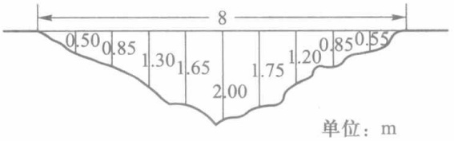
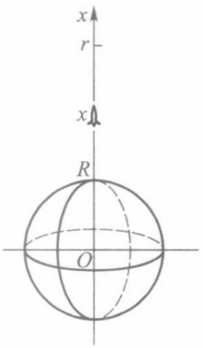
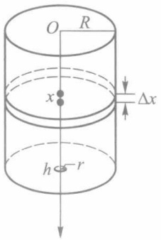
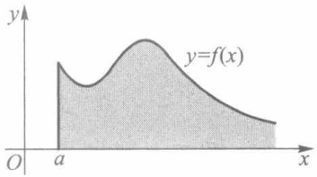
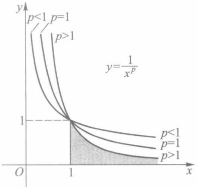

2. 用抛物线法近似计算 $\int_{0}^{\pi}\frac{\sin x}{x}\mathrm{d}x$ （分别将积分区间二等分、四等分、六等分）.
3. 图 10 - 29 所示为河道某一截面图. 试由测得数据用抛物线法求截面面积.

contour

| Elevation Level (m) |
| --- |
| 0.50 |
| 0.85 |
| 1.30 |
| 1.65 |
| 2.00 |
| 1.75 |
| 1.20 |
| 0.85 |
| 0.55 |

图10-29

4. 下表所列为夏季某一天每隔两小时测得的气温:

| 时间$t_{i}$ | 0 | 2 | 4 | 6 | 8 | 10 | 12 | 14 | 16 | 18 | 20 | 22 | 24 |
| --- | --- | --- | --- | --- | --- | --- | --- | --- | --- | --- | --- | --- | --- |
| 温度$C_{i}$ | 25.8 | 23.0 | 24.1 | 25.6 | 27.3 | 30.2 | 33.4 | 35.0 | 33.8 | 31.1 | 28.2 | 27.0 | 25.0 |

（1）按积分平均 $\frac{1}{b-a}\int_{a}^{b}f(t)dt$ 求这一天的平均气温，其中定积分值由三种近似法分别计算；
(2) 若按算术平均  $\frac{1}{12}\sum_{i=1}^{12}C_{i-1}$  或  $\frac{1}{12}\sum_{i=1}^{12}C_{i}$  求得平均气温, 那么它们与矩形法积分平均和梯形法积分平均各有什么联系? 简述理由.

## 第十章综合自测题

## 第十一章反常积分

## § 1 反常积分概念

## 一、问题提出

在讨论定积分时有两个最基本的限制:积分区间的有穷性和被积函数的有界性.但在很多实际问题中往往需要突破这些限制,考虑无穷区间上的“积分”,或是无界函数的“积分”,这便是本章的主题.

例 1(第二宇宙速度问题) 在地球表面垂直发射火箭(图 11-1), 要使火箭克服地球引力无限远离地球, 试问初速度  $v_{0}$  至少要多大?

设地球半径为 R，火箭质量为 m，地面上的重力加速度为 g。按万有引力定律，在距地心  $x(\geqslant R)$  处火箭所受的引力为

$$
F = \frac {m g R ^ {2}}{x ^ {2}}.
$$

于是火箭从地面上升到距离地心为  $r (>R)$  处需做的功为

$$
\int_ {R} ^ {r} \frac {m g R ^ {2}}{x ^ {2}} \mathrm{d} x = m g R ^ {2} \bigg (\frac {1}{R} - \frac {1}{r} \bigg).
$$

text_image

x
r
x
R
O

图11-1

当  $r \rightarrow +\infty$  时, 其极限 mgR 就是火箭无限远离地球需做的功. 我们很自然地会把这极限写作上限为  $+\infty$  的“积分”:

$$
\int_ {R} ^ {+ \infty} \frac {m g R ^ {2}}{x ^ {2}} \mathrm{d} x = \lim _ {r \to + \infty} \int_ {R} ^ {r} \frac {m g R ^ {2}}{x ^ {2}} \mathrm{d} x = m g R.
$$

最后,由机械能守恒定律可求得初速度  $v_{0}$  至少应使

$$
\frac {1}{2} m v _ {0} ^ {2} = m g R.
$$

用  $g=9.81\ m/s^{2}, R=6.371\times10^{6}\ m$  代入, 便得

$$
v _ {0} = \sqrt {2 g R} \approx 1 1. 2 (\mathrm{km/s}).
$$

例 2 圆柱形桶的内壁高为 h，内半径为 R，桶底有一半径为 r 的小孔（图11-2）。试问从盛满水开始打开小孔直至流完桶中的水，共需多少时间？

从物理学知道,在不计摩擦力的情形下,当桶内水位高度为h-x时,水从孔中流出的流速(单位时间内流过单位截面积的流量)为

$$
v = \sqrt {2 g (h - x)},
$$

其中 g 为重力加速度.

设在很小一段时间 dt 内, 桶中液面降低的微小量为 dx, 它们之间应满足

$$
\pi R ^ {2} \mathrm{d} x = v \pi r ^ {2} \mathrm{d} t,
$$

由此则有

$$
\mathrm{d} t = \frac {R ^ {2}}{r ^ {2} \sqrt {2 g (h - x)}} \mathrm{d} x, x \in [ 0, h).
$$

所以流完一桶水所需时间在形式上亦可写成“积分”:

$$
t _ {f} = \int_ {0} ^ {h} \frac {R ^ {2}}{r ^ {2} \sqrt {2 g (h - x)}} \mathrm{d} x.
$$

但是在这里因为被积函数是 $[0, h)$ 上的无界函数，所以它的确切含义应该是

$$
\begin{array}{l} t _ {f} = \lim _ {u \to h ^ {-}} \int_ {0} ^ {u} \frac {R ^ {2}}{r ^ {2} \sqrt {2 g (h - x)}} \mathrm{d} x \\ = \lim _ {u \to h ^ {-}} \sqrt {\frac {2}{g}} \cdot \frac {R ^ {2}}{r ^ {2}} (\sqrt {h} - \sqrt {h - u}) \\ = \sqrt {\frac {2 h}{g}} \left(\frac {R}{r}\right) ^ {2}. \\ \end{array}
$$

text_image

O
R
x
Δx
h
r

图11-2

相对于以前所讲的定积分(不妨称之为正常积分)而言,例1和例2分别提出了两类反常积分.

## 二、两类反常积分的定义

定义1 设函数 $f$ 定义在无穷区间 $[a, +\infty)$ 上，且在任何有限区间 $[a, u]$ 上可积。如果存在极限

$$
\lim _ {u \to + \infty} \int_ {a} ^ {u} f (x)   \mathrm{d} x = J, \tag {1}
$$

则称此极限 J 为函数 f 在  $[a, +\infty)$  上的无穷限反常积分（简称无穷积分），记作

$$
J = \int_ {a} ^ {+ \infty} f (x) \mathrm{d} x, \tag {$1^{\prime$}}
$$

并称 $\int_{a}^{+\infty}f(x)\mathrm{d}x$ 收敛.如果极限(1)不存在，为方便起见，亦称 $\int_{a}^{+\infty}f(x)\mathrm{d}x$ 发散.

类似地,可定义f在 $(-∞,b]$ 上的无穷积分:

$$
\int_ {- \infty} ^ {b} f (x) \mathrm{d} x = \lim _ {u \to - \infty} \int_ {u} ^ {b} f (x) \mathrm{d} x. \tag {2}
$$

对于 $f$ 在 $(-\infty, +\infty)$ 上的无穷积分，用前面两种无穷积分来定义:

$$
\int_ {- \infty} ^ {+ \infty} f (x) \mathrm{d} x = \int_ {- \infty} ^ {a} f (x) \mathrm{d} x + \int_ {a} ^ {+ \infty} f (x) \mathrm{d} x, \tag {3}
$$

其中 $a$ 为任一实数. 当且仅当等号右边两个无穷积分都收敛时, 它才是收敛的.

注1 无穷积分(3)的收敛性与收敛时的值,都和实数 a 的选取无关.

注2 由于无穷积分(3)是由(1)、(2)两类无穷积分来定义的,因此,f在任何有限区间 $[v,u]\subset(-\infty,+\infty)$ 上,首先必须是可积的.

注3 $\int_{a}^{+\infty}f(x)\mathrm{d}x$ 收敛的几何意义是:若 $f$ 在 $[a, + \infty)$ 上为非负连续函数，则图11-3中介于曲线 $y = f(x)$，直线$x = a$ 以及 $x$ 轴之间那一块向右无限延伸的阴影区域有面积 $J$.

text_image

y
y=f(x)
O
a
x

图11-3

例3 讨论无穷积分

$$
\int_ {1} ^ {+ \infty} \frac {\mathrm{d} x}{x ^ {p}} \tag {4}
$$

的敛散性.

解 由于

$$
\int_ {1} ^ {u} \frac {\mathrm{d} x}{x ^ {p}} = \left\{ \begin{array}{l l} \frac {1}{1 - p} (u ^ {1 - p} - 1), & p \neq 1, \\ \ln u, & p = 1, \end{array} \right.
$$

$$
\lim _ {u \to + \infty} \int_ {1} ^ {u} \frac {\mathrm{d} x}{x ^ {p}} = \left\{ \begin{array}{l l} \frac {1}{p - 1}, & p > 1, \\ + \infty , & p \leqslant 1. \end{array} \right.
$$

因此无穷积分(4)当p>1时收敛,其值为 $\frac{1}{p-1}$ ;而当 $p\leqslant$ 1时发散于 $+\infty$ .

从图 11-4 看到, 例 3 的结论是很直观的: p 的值越大, 曲线  $y=\frac{1}{x^{p}}$  当 x>1 时越靠近 x 轴, 从而曲线下方的阴影区域存在有限面积的可能性也就越大.

area

| Category | Description |
| --- | --- |
| Curve 1 | p < 1 |
| Curve 2 | p = 1 |
| Curve 3 | p > 1 |
| Curve 4 | p < 1 |
| Curve 5 | p = 1 |
| Curve 6 | p > 1 |

图11-4

例4 讨论下列无穷积分的敛散性:

1) $\int_{2}^{+\infty}\frac{\mathrm{d}x}{x(\ln x)^p};$

2） $\int_{-\infty}^{+\infty}\frac{\mathrm{d}x}{1 + x^2}.$

解 1）由于无穷积分是通过变限定积分的极限来定义的,因此有关定积分的换元积分法和分部积分法一般都可引用到无穷积分中来.对于本例来说,就有

$$
\int_ {2} ^ {+ \infty} \frac {\mathrm{d} x}{x (\ln x) ^ {p}} = \int_ {\ln 2} ^ {+ \infty} \frac {\mathrm{d} t}{t ^ {p}}.
$$

从例 3 知道,该无穷积分当 p>1 时收敛,当  $p \leqslant 1$  时发散.

2）任取实数 a，讨论如下两个无穷积分:

$$
\int_ {- \infty} ^ {a} {\frac {\mathrm{d} x}{1 + x ^ {2}}} \quad {\text {和}} \quad \int_ {a} ^ {+ \infty} {\frac {\mathrm{d} x}{1 + x ^ {2}}}.
$$

由于

$$
\lim _ {u \to - \infty} \int_ {u} ^ {a} \frac {\mathrm{d} x}{1 + x ^ {2}} = \lim _ {u \to - \infty} (\arctan a - \arctan u) = \arctan a + \frac {\pi}{2},
$$

$$
\lim _ {v \to + \infty} \int_ {a} ^ {v} \frac {\mathrm{d} x}{1 + x ^ {2}} = \lim _ {v \to + \infty} (\arctan v - \arctan a) = \frac {\pi}{2} - \arctan a,
$$

因此这两个无穷积分都收敛.由定义1,

$$
\int_ {- \infty} ^ {+ \infty} \frac {\mathrm{d} x}{1 + x ^ {2}} = \int_ {- \infty} ^ {a} \frac {\mathrm{d} x}{1 + x ^ {2}} + \int_ {a} ^ {+ \infty} \frac {\mathrm{d} x}{1 + x ^ {2}} = \pi .
$$

注 由于上述结果与 a 无关, 因此若取 a=0, 则可使计算过程更简洁些.

定义 2 设函数 f 定义在区间  $(a, b]$  上, 在点 a 的任一右邻域上无界, 但在任何内闭区间  $[u, b] \subset (a, b]$  上有界且可积. 如果存在极限

$$
\lim _ {u \to a ^ {+}} \int_ {u} ^ {b} f (x) \mathrm{d} x = J, \tag {5}
$$

则称此极限为无界函数 $f$ 在 $(a,b]$ 上的反常积分，记作

$$
J = \int_ {a} ^ {b} f (x) \mathrm{d} x, \tag {$5^{\prime$}}
$$

并称反常积分 $\int_{a}^{b}f(x)\mathrm{d}x$ 收敛.如果极限(5)不存在，这时也说反常积分 $\int_{a}^{b}f(x)\mathrm{d}x$ 发散.

在定义2中,被积函数f在点a近旁是无界的,这时点a称为f的瑕点,而无界函数反常积分 $\int_{a}^{b}f(x)\mathrm{d}x$ 又称为瑕积分.

类似地,可定义瑕点为 b 时的瑕积分:

$$
\int_ {a} ^ {b} f (x) \mathrm{d} x = \lim _ {u \to b ^ {-}} \int_ {a} ^ {u} f (x) \mathrm{d} x.
$$

其中 $f$ 在 $[a, b)$ 有定义，在点 $b$ 的任一左邻域上无界，但在任何 $[a, u] \subset [a, b)$ 上可积.

若 $f$ 的瑕点 $c \in (a, b)$, 则定义瑕积分

$$
\begin{array}{l} \int_ {a} ^ {b} f (x) \mathrm{d} x = \int_ {a} ^ {c} f (x) \mathrm{d} x + \int_ {c} ^ {b} f (x) \mathrm{d} x \\ = \lim _ {u \to c ^ {-}} \int_ {a} ^ {u} f (x) \mathrm{d} x + \lim _ {v \to c ^ {+}} \int_ {v} ^ {b} f (x) \mathrm{d} x. \tag {6} \\ \end{array}
$$

其中 $f$ 在 $[a, c) \cup (c, b]$ 上有定义，在点 $c$ 的任一邻域上无界，但在任何 $[a, u] \subset [a, c)$ 和 $[v, b] \subset (c, b]$ 上都可积。当且仅当(6)式右边两个瑕积分都收敛时，左边的瑕积分才是收敛的。

又若 a, b 两点都是 f 的瑕点，而 f 在任何  $[u, v] \subset (a, b)$  上可积，这时定义瑕积分

$$
\begin{array}{l} \int_ {a} ^ {b} f (x) \mathrm{d} x = \int_ {a} ^ {c} f (x) \mathrm{d} x + \int_ {c} ^ {b} f (x) \mathrm{d} x \\ = \lim _ {u \to a ^ {+}} \int_ {u} ^ {c} f (x) \mathrm{d} x + \lim _ {v \to b ^ {-}} \int_ {c} ^ {v} f (x) \mathrm{d} x, \tag {7} \\ \end{array}
$$

其中 c 为  $(a, b)$  上任一实数. 同样地, 当且仅当 (7) 式右边两个瑕积分都收敛时, 左边的瑕积分才是收敛的.

例 5 计算瑕积分  $\int_{0}^{1}\frac{dx}{\sqrt{1-x^{2}}}$  的值.

解 被积函数 $f(x) = \frac{1}{\sqrt{1 - x^2}}$ 在 $[0,1)$ 上连续，从而在任何 $[0,u] \subset [0,1)$ 上可积，$x = 1$ 为其瑕点.依定义2求得

$$
\int_ {0} ^ {1} \frac {\mathrm{d} x}{\sqrt {1 - x ^ {2}}} = \lim _ {u \to 1 ^ {-}} \int_ {0} ^ {u} \frac {\mathrm{d} x}{\sqrt {1 - x ^ {2}}} = \lim _ {u \to 1 ^ {-}} \arcsin u = \frac {\pi}{2}.
$$

例6 讨论瑕积分

$$
\int_ {0} ^ {1} \frac {\mathrm{d} x}{x ^ {q}} (q > 0) \tag {8}
$$

的收敛性.

解 被积函数在 $(0,1]$ 上连续,x=0为其瑕点.由于

$$
\int_ {u} ^ {1} \frac {\mathrm{d} x}{x ^ {q}} = \left\{ \begin{array}{l l} \frac {1}{1 - q} (1 - u ^ {1 - q}), & q \neq 1, \\ - \ln u, & q = 1 \end{array} \right. (0 <   u <   1),
$$

故当 $0 < q < 1$ 时，瑕积分(8)收敛，且

$$
\int_ {0} ^ {1} \frac {\mathrm{d} x}{x ^ {q}} = \lim _ {u \to 0 ^ {+}} \int_ {u} ^ {1} \frac {\mathrm{d} x}{x ^ {q}} = \frac {1}{1 - q};
$$

而当 $q \geqslant 1$ 时，瑕积分(8)发散于 $+\infty$

上述结论在图 11-4 中同样能获得直观的反映.

如果把例 3 与例 6 联系起来,考察反常积分

$$
\int_ {0} ^ {+ \infty} \frac {\mathrm{d} x}{x ^ {p}} (p > 0). \tag {9}
$$

我们定义

$$
\int_ {0} ^ {+ \infty} \frac {\mathrm{d} x}{x ^ {p}} = \int_ {0} ^ {1} \frac {\mathrm{d} x}{x ^ {p}} + \int_ {1} ^ {+ \infty} \frac {\mathrm{d} x}{x ^ {p}},
$$

它当且仅当右边的瑕积分和无穷积分都收敛时才收敛.但由例3与例6的结果可知,这两个反常积分不能同时收敛,故反常积分(9)对任何实数p都是发散的.

## 习题 11.1

1. 讨论下列无穷积分是否收敛？若收敛，则求其值:

(1) $\int_{0}^{+\infty} x \mathrm{e}^{-x^2} \, \mathrm{d}x$;

(2) $\int_{-\infty}^{+\infty} x \mathrm{e}^{-x^2} \, \mathrm{d}x$;

(3) $\int_{0}^{+\infty}\frac{1}{\sqrt{\mathrm{e}^x}}\mathrm{d}x;$

(4) $\int_{1}^{+\infty}\frac{\mathrm{d}x}{x^2(1 + x)};$

(5) $\int_{-\infty}^{+\infty}\frac{\mathrm{d}x}{4x^2 + 4x + 5};$

(6) $\int_{0}^{+\infty}\mathrm{e}^{-x}\sin x\mathrm{d}x;$

(7) $\int_{-\infty}^{+\infty}\mathrm{e}^x\sin x\mathrm{d}x;$

(8) $\int_{0}^{+\infty}\frac{\mathrm{d}x}{\sqrt{1 + x^2}}.$

2. 讨论下列瑕积分是否收敛？若收敛，则求其值:

(1) $\int_{a}^{b}\frac{\mathrm{d}x}{(x - a)^p};$

(2) $\int_{0}^{1}\frac{\mathrm{d}x}{1 - x^2};$

(3) $\int_0^2\frac{\mathrm{d}x}{\sqrt{|x - 1|}};$

(4) $\int_0^1\frac{x}{\sqrt{1 - x^2}}\mathrm{d}x;$

(5) $\int_0^1\ln x\mathrm{d}x$

(6) $\int_0^1\sqrt{\frac{x}{1 - x}}\mathrm{d}x;$

(7) $\int_0^1\frac{\mathrm{d}x}{\sqrt{x - x^2}};$

(8) $\int_{0}^{1}\frac{\mathrm{d}x}{x(\ln x)^p}.$

3. 举例说明: 瑕积分  $\int_{a}^{b} f(x) \, dx$  收敛时,  $\int_{a}^{b} f^{2}(x) \, dx$  不一定收敛.

4. 举例说明: $\int_{a}^{+\infty}f(x)\mathrm{d}x$ 收敛且f在 $[a,+\infty)$ 上连续时，不一定有 $\lim_{x\to+\infty}f(x)=0$ .

5. 证明: 若 $\int_{a}^{+\infty} f(x) \, \mathrm{d}x$ 收敛, 且存在极限 $\lim_{x \to +\infty} f(x) = A$, 则 $A = 0$.

6. 证明: 若 $f$ 在 $[a, +\infty)$ 上可导, 且 $\int_{a}^{+\infty} f(x) \mathrm{d}x$ 与 $\int_{a}^{+\infty} f'(x) \mathrm{d}x$ 都收敛, 则 $\lim_{x \to +\infty} f(x) = 0$.

## § 2 无穷积分的性质与敛散判别

## 一、无穷积分的性质

由定义知道,无穷积分  $\int_{a}^{+\infty}f(x)\mathrm{d}x$  收敛与否,取决于函数  $F(u)=\int_{a}^{u}f(x)\mathrm{d}x$  在  $u\to+\infty$  时是否存在极限.因此可由函数极限的柯西准则导出无穷积分收敛的柯西准则.

定理11.1 无穷积分 $\int_{a}^{+\infty} f(x) \, \mathrm{d}x$ 收敛的充要条件是: 任给 $\varepsilon > 0$, 存在 $G \geqslant a$, 只要 $u_{1}, u_{2} > G$, 便有

$$
\left| \int_ {a} ^ {u _ {2}} f (x) \mathrm{d} x - \int_ {a} ^ {u _ {1}} f (x) \mathrm{d} x \right| = \left| \int_ {u _ {1}} ^ {u _ {2}} f (x) \mathrm{d} x \right| <   \varepsilon .
$$

此外,还可根据函数极限的性质与定积分的性质,导出无穷积分的一些相应性质.

性质1 若 $\int_{a}^{+\infty}f_1(x)\mathrm{d}x$ 与 $\int_{a}^{+\infty}f_2(x)\mathrm{d}x$ 都收敛， $k_{1},k_{2}$ 为任意常数，则 $\int_{a}^{+\infty}[k_{1}f_{1}(x) + k_{2}f_{2}(x)]\mathrm{d}x$ 也收敛，且

$$
\int_ {a} ^ {+ \infty} \left[ k _ {1} f _ {1} (x) + k _ {2} f _ {2} (x) \right] \mathrm{d} x = k _ {1} \int_ {a} ^ {+ \infty} f _ {1} (x) \mathrm{d} x + k _ {2} \int_ {a} ^ {+ \infty} f _ {2} (x) \mathrm{d} x. \tag {1}
$$

性质2 若 $f$ 在任何有限区间 $[a, u]$ 上可积，$a < b$，则 $\int_{a}^{+\infty} f(x) \mathrm{d}x$ 与 $\int_{b}^{+\infty} f(x) \mathrm{d}x$ 同敛态（即同时收敛或同时发散），且有

$$
\int_ {a} ^ {+ \infty} f (x) \mathrm{d} x = \int_ {a} ^ {b} f (x) \mathrm{d} x + \int_ {b} ^ {+ \infty} f (x) \mathrm{d} x, \tag {2}
$$

其中右边第一项是定积分.

性质 2 相当于定积分的积分区间可加性, 由它又可导出  $\int_{a}^{+\infty} f(x) \, dx$  收敛的另一充

要条件:任给  $\varepsilon > 0$ , 存在  $G \geqslant a$ , 当 u > G 时, 总有

$$
\left| \int_ {u} ^ {+ \infty} f (x)   \mathrm{d} x \right| <   \varepsilon .
$$

事实上，这可由

$$
\int_ {a} ^ {+ \infty} f (x) \mathrm{d} x = \int_ {a} ^ {u} f (x) \mathrm{d} x + \int_ {u} ^ {+ \infty} f (x) \mathrm{d} x
$$

结合无穷积分的收敛定义而得.

性质3 若 $f$ 在任何有限区间 $[a, u]$ 上可积，且有 $\int_{a}^{+\infty}|f(x)|\mathrm{d}x$ 收敛，则 $\int_{a}^{+\infty}f(x)\mathrm{d}x$ 亦必收敛，并有

$$
\left| \int_ {a} ^ {+ \infty} f (x) \mathrm{d} x \right| \leqslant \int_ {a} ^ {+ \infty} | f (x) | \mathrm{d} x. \tag {3}
$$

证 由 $\int_{a}^{+\infty}|f(x)|\mathrm{d}x$ 收敛，根据柯西准则（必要性），任给 $\varepsilon >0$ ，存在 $G\geqslant a$ ，当$u_{2} > u_{1} > G$ 时，总有

$$
\left| \int_ {u _ {1}} ^ {u _ {2}} | f (x) | \mathrm{d} x \right| = \int_ {u _ {1}} ^ {u _ {2}} | f (x) | \mathrm{d} x <   \varepsilon .
$$

利用定积分的绝对值不等式,又有

$$
\left| \int_ {u _ {1}} ^ {u _ {2}} f (x)   \mathrm{d} x \right| \leqslant \int_ {u _ {1}} ^ {u _ {2}} | f (x) |   \mathrm{d} x <   \varepsilon .
$$

再由柯西准则(充分性)，证得 $\int_{a}^{+\infty}f(x)\mathrm{d}x$ 收敛.

又因  $\left|\int_{a}^{u}f(x)\mathrm{d}x\right|\leqslant\int_{a}^{u}|f(x)|\mathrm{d}x(u>a)$ ，令  $u\to+\infty$  取极限，立刻得到不等式 (3).

当 $\int_{a}^{+\infty}|f(x)|\mathrm{d}x$ 收敛时，称 $\int_{a}^{+\infty}f(x)\mathrm{d}x$ 为绝对收敛.性质3指出:绝对收敛的无穷积分，它自身也一定收敛.但是它的逆命题一般不成立，今后将举例说明收敛的无穷积分不一定绝对收敛.

我们称收敛而不绝对收敛者为条件收敛.

## 二、非负函数无穷积分的敛散判别法

首先给出非负函数无穷积分的比较判别法.

设 $f$ 是定义在 $[a, +\infty)$ 上的非负函数，且在任何有限区间 $[a, u]$ 上可积。由于 $\int_{a}^{u} f(x) \mathrm{d}x$ 关于上限 $u$ 是单调递增的，因此 $\int_{a}^{+\infty} f(x) \mathrm{d}x$ 收敛的充要条件是 $\int_{a}^{u} f(x) \mathrm{d}x$ 在 $[a, +\infty)$ 上存在上界。根据这一分析，便立即导出下述比较判别法（请读者自己写出证明）。

定理11.2（比较原则）设定义在 $[a, +\infty)$ 上的两个非负函数 $f$ 和 $g$ 都在任何有限区间 $[a, u]$ 上可积，且满足

$$
f (x) \leqslant g (x), x \in [ a, + \infty),
$$

则当 $\int_{a}^{+\infty}g(x)\mathrm{d}x$ 收敛时， $\int_{a}^{+\infty}f(x)\mathrm{d}x$ 必收敛（或当 $\int_{a}^{+\infty}f(x)\mathrm{d}x$ 发散时， $\int_{a}^{+\infty}g(x)\mathrm{d}x$

必发散).

例 1 讨论 $\int_{0}^{+\infty}\frac{\sin x}{1+x^{2}}dx$ 的敛散性.

解 由于 $\left|\frac{\sin x}{1 + x^2}\right| \leqslant \frac{1}{1 + x^2}, x \in [0, +\infty)$, 以及 $\int_0^{+\infty} \frac{\mathrm{d}x}{1 + x^2} = \frac{\pi}{2}$ 收敛 (§ 1 例 4), 根据比较原则知 $\int_0^{+\infty} \frac{\sin x}{1 + x^2} \mathrm{d}x$ 绝对收敛.

上述比较原则的极限形式如下.

推论1 若 $f$ 和 $g$ 都在任何有限区间 $[a, u]$ 上可积，当 $x \in [a, +\infty)$ 时，$f(x) \geqslant 0$，$g(x) > 0$，且 $\lim_{x \to +\infty} \frac{f(x)}{g(x)} = c$，则有:

(i) 当 $0 < c < +\infty$ 时，$\int_{a}^{+\infty} f(x) \, \mathrm{d}x$ 与 $\int_{a}^{+\infty} g(x) \, \mathrm{d}x$ 同敛态；
(ii) 当 $c = 0$ 时，由 $\int_{a}^{+\infty} g(x) \, \mathrm{d}x$ 收敛可推知 $\int_{a}^{+\infty} f(x) \, \mathrm{d}x$ 也收敛；
(iii) 当 $c = +\infty$ 时, 由 $\int_{a}^{+\infty} g(x) \mathrm{d}x$ 发散可推知 $\int_{a}^{+\infty} f(x) \mathrm{d}x$ 也发散.

特别地,如果选用 $\int_{1}^{+\infty}\frac{dx}{x^{p}}$ 作为比较对象,则我们有如下两个推论(称为柯西判别法).

推论 2 设 f 定义于  $[a, +\infty) (a > 0)$ ，且在任何有限区间  $[a, u]$  上可积，则有:

(i) 当 $0 \leqslant f(x) \leqslant \frac{1}{x^p}, x \in [a, +\infty)$, 且 $p > 1$ 时, $\int_{a}^{+\infty} f(x) \, \mathrm{d}x$ 收敛;
(ii) 当 $f(x) \geqslant \frac{1}{x^p}, x \in [a, +\infty)$, 且 $p \leqslant 1$ 时, $\int_{a}^{+\infty} f(x) \mathrm{d}x$ 发散.

推论3 设 $f$ 是定义于 $[a, +\infty)$ 上的非负函数，在任何有限区间 $[a, u]$ 上可积，且

$$
\lim _ {x \to + \infty} x ^ {p} f (x) = \lambda .
$$

则有

(i) 当 $p > 1, 0 \leqslant \lambda < +\infty$ 时，$\int_{a}^{+\infty} f(x) \, \mathrm{d}x$ 收敛；
(ii) 当 $p \leqslant 1, 0 < \lambda \leqslant +\infty$ 时，$\int_{a}^{+\infty} f(x) \mathrm{d}x$ 发散.

例 2 讨论下列无穷限积分的敛散性:

1) $\int_{1}^{+\infty} x^{\alpha} \mathrm{e}^{-x} \, \mathrm{d}x$;

2) $\int_{0}^{+\infty}\frac{x^2}{\sqrt{x^5 + 1}}\mathrm{d}x.$

解 本例中两个被积函数都是非负的.

1）由于对任何实数 $\alpha$ ，都有

$$
\lim _ {x \to + \infty} x ^ {2} \cdot x ^ {\alpha} \mathrm{e} ^ {- x} = \lim _ {x \to + \infty} \frac {x ^ {\alpha + 2}}{\mathrm{e} ^ {x}} = 0,
$$

因此根据上述推论  $3(p=2,\lambda=0)$ ，推知 1) 对任何实数  $\alpha$  都是收敛的.

2）由于

$$
\lim _ {x \to + \infty} x ^ {\frac {1}{2}} \cdot \frac {x ^ {2}}{\sqrt {x ^ {5} + 1}} = 1,
$$

因此根据上述推论 $3\left(p = \frac{1}{2},\lambda = 1\right)$ ，推知2)是发散的.

对于 $\int_{-\infty}^{b}f(x)\mathrm{d}x$ 的比较判别亦可类似地进行.

## 三、一般无穷积分的敛散判别法

这里来介绍两个判别一般无穷积分敛散的判别法.

定理 11.3(狄利克雷判别法) 若  $F(u)=\int_{a}^{u}f(x)\mathrm{d}x$  在  $[a,+\infty)$  上有界,  $g(x)$  在  $[a,+\infty)$  上当  $x\to+\infty$  时单调趋于 0, 则  $\int_{a}^{+\infty}f(x)g(x)\mathrm{d}x$  收敛.

证 由条件设 $\left|\int_{a}^{u}f(x)\mathrm{d}x\right| \leqslant M, u \in [a, +\infty)$. 任给 $\varepsilon > 0$，由于 $\lim_{x \to +\infty} g(x) = 0$，因此存在 $G \geqslant a$，当 $x > G$ 时，有

$$
\mid g (x) \mid <   \frac {\varepsilon}{4 M}.
$$

又因 $g$ 为单调函数, 利用积分第二中值定理 (定理 9.11) 的推论, 对于任何 $u_{2} > u_{1} > G$, 存在 $\xi \in [u_{1}, u_{2}]$, 使得

$$
\int_ {u _ {1}} ^ {u _ {2}} f (x) g (x) \mathrm{d} x = g (u _ {1}) \int_ {u _ {1}} ^ {\xi} f (x) \mathrm{d} x + g (u _ {2}) \int_ {\xi} ^ {u _ {2}} f (x) \mathrm{d} x.
$$

于是有

$$
\begin{array}{l} \left| \int_ {u _ {1}} ^ {u _ {2}} f (x) g (x) \mathrm{d} x \right| \leqslant | g (u _ {1}) | \cdot \left| \int_ {u _ {1}} ^ {\xi} f (x) \mathrm{d} x \right| + | g (u _ {2}) | \cdot \left| \int_ {\xi} ^ {u _ {2}} f (x) \mathrm{d} x \right| \\ = \mid g (u _ {1}) \mid \cdot \left| \int_ {a} ^ {\xi} f (x)   \mathrm{d} x - \int_ {a} ^ {u _ {1}} f (x)   \mathrm{d} x \right| + \\ \mid g (u _ {2}) \mid \cdot \left| \int_ {a} ^ {u _ {2}} f (x)   \mathrm{d} x - \int_ {a} ^ {\xi} f (x)   \mathrm{d} x \right| \\ <   \frac {\varepsilon}{4 M} \cdot 2 M + \frac {\varepsilon}{4 M} \cdot 2 M = \varepsilon . \\ \end{array}
$$

根据柯西准则,证得  $\int_{a}^{+\infty}f(x)g(x)\mathrm{d}x$  收敛.

定理 11.4(阿贝尔(Abel)判别法) 若  $\int_{a}^{+\infty} f(x) dx$  收敛,  $g(x)$  在  $[a, +\infty)$  上单调有界, 则  $\int_{a}^{+\infty} f(x) g(x) dx$  收敛.

这定理同样可用积分第二中值定理来证明,但又可利用狄利克雷判别法更方便地获得证明(留作习题).

例3 讨论 $\int_{1}^{+\infty}\frac{\sin x}{x^p}\mathrm{d}x$ 与 $\int_{1}^{+\infty}\frac{\cos x}{x^p}\mathrm{d}x(p > 0)$ 的敛散性.

解 这里只讨论前一个无穷积分,后者有完全相同的结论.下面分两种情形来讨论:

(i) 当 $p > 1$ 时, $\int_{1}^{+\infty} \frac{\sin x}{x^p} \mathrm{d}x$ 绝对收敛. 这是因为

$$
\left| \frac {\sin x}{x ^ {p}} \right| \leqslant \frac {1}{x ^ {p}}, x \in [ 1, + \infty),
$$

而 $\int_{1}^{+\infty}\frac{\mathrm{d}x}{x^p}$ 当 $p > 1$ 时收敛，故由比较原则推知 $\int_{1}^{+\infty}\left|\frac{\sin x}{x^p}\right|\mathrm{d}x$ 收敛.

(ii) 当 $0 < p \leqslant 1$ 时, $\int_{1}^{+\infty} \frac{\sin x}{x^p} \mathrm{d}x$ 条件收敛. 这是因为对任意 $u \geqslant 1$, 有 $\left|\int_{1}^{u} \sin x \mathrm{d}x\right| = |\cos 1 - \cos u| \leqslant 2$, 而 $\frac{1}{x^p}$ 当 $p > 0$ 时单调趋于 $0 (x \to +\infty)$, 故由狄利克雷判别法推知 $\int_{1}^{+\infty} \frac{\sin x}{x^p} \mathrm{d}x$ 当 $p > 0$ 时总是收敛的.

另一方面,由于

$$
\left| \frac {\sin x}{x ^ {p}} \right| \geqslant \frac {\sin^ {2} x}{x} = \frac {1}{2 x} - \frac {\cos 2 x}{2 x}, x \in [ 1, + \infty),
$$

其中 $\int_{1}^{+\infty}\frac{\cos 2x}{2x}\mathrm{d}x = \frac{1}{2}\int_{2}^{+\infty}\frac{\cos t}{t}\mathrm{d}t$ 满足狄利克雷判别条件，是收敛的.而 $\int_{1}^{+\infty}\frac{\mathrm{d}x}{2x}$ 是发散的，因此当 $0 < p\leqslant 1$ 时该无穷积分不是绝对收敛的，所以它是条件收敛的. □

例 4 证明下列无穷积分都是条件收敛的:

$$
\int_ {1} ^ {+ \infty} \sin x ^ {2} \mathrm{d} x, \int_ {1} ^ {+ \infty} \cos x ^ {2} \mathrm{d} x, \int_ {1} ^ {+ \infty} x \sin x ^ {4} \mathrm{d} x.
$$

证 前两个无穷积分经换元 $t = x^2$ 得到

$$
\int_ {1} ^ {+ \infty} \sin x ^ {2} \mathrm{d} x = \int_ {1} ^ {+ \infty} \frac {\sin t}{2 \sqrt {t}} \mathrm{d} t,
$$

$$
\int_ {1} ^ {+ \infty} \cos x ^ {2} \mathrm{d} x = \int_ {1} ^ {+ \infty} \frac {\cos t}{2 \sqrt {t}} \mathrm{d} t.
$$

由例 3 知它们是条件收敛的.

对于第三个无穷积分,经换元  $t=x^{2}$  得

$$
\int_ {1} ^ {+ \infty} x \sin x ^ {4} \mathrm{d} x = \frac {1}{2} \int_ {1} ^ {+ \infty} \sin t ^ {2} \mathrm{d} t,
$$

它也是条件收敛的.

从例 4 中三个无穷积分的收敛性可以看到, 当  $x \to +\infty$  时被积函数即使不趋于零, 甚至是无界的, 无穷积分仍有可能收敛.

例5 若 $f(x)$ 在 $[a, +\infty)$ 上单调，且 $\int_{a}^{+\infty} f(x) \mathrm{d}x$ 收敛，则当 $x \to +\infty$ 时，$f(x)$ 趋于0.

证 如果 $f(x)$ 在 $[a, +\infty)$ 上单调递增，则或者 $\lim_{x \to +\infty} f(x) = +\infty$，或者存在实数 $A$ 使得 $\lim_{x \to +\infty} f(x) = A$.

（1）若 $\lim_{x\to +\infty}f(x) = +\infty$ ，则存在 $M > 0$ ，对任何 $x\geqslant M$ ，有 $f(x) > 1.$ 于是对任何 $u > M$ ，有

$$
\begin{array}{l} \int_ {a} ^ {u} f (x) \mathrm{d} x = \int_ {a} ^ {M} f (x) \mathrm{d} x + \int_ {M} ^ {u} f (x) \mathrm{d} x \\ \geqslant \int_ {a} ^ {M} f (x)   \mathrm{d} x + u - M \rightarrow + \infty (u \rightarrow + \infty), \\ \end{array}
$$

这与无穷积分 $\int_{a}^{+\infty}f(x)\mathrm{d}x$ 收敛相矛盾.

（2）若 $\lim_{x\to +\infty}f(x) = A$ 且 $A > 0$ ，则存在 $M > 0$ ，对任何 $x\geqslant M$ ，有 $f(x) > \frac{A}{2}$ .于是对任何 $u>$ $M$ ，有

$$
\begin{array}{l} \int_ {a} ^ {u} f (x) \mathrm{d} x = \int_ {a} ^ {M} f (x) \mathrm{d} x + \int_ {M} ^ {u} f (x) \mathrm{d} x \\ \geqslant \int_ {a} ^ {M} f (x) \mathrm{d} x + (u - M) \cdot \frac {A}{2} \rightarrow + \infty (u \rightarrow + \infty), \\ \end{array}
$$

这与无穷积分 $\int_{a}^{+\infty}f(x)\mathrm{d}x$ 收敛相矛盾.若 $A < 0$ ，类似地也会得到这样的矛盾

因此  $\lim_{x\to+\infty}f(x)=0.$

当 $f(x)$ 在 $[a,+\infty)$ 上单调递减时,类似可证.

## 习题 11.2

1. 证明定理 11.2 及其推论 1.

2. 设 $f$ 与 $g$ 是定义在 $[a, +\infty)$ 上的函数，对任何 $u > a$ ，它们在 $[a, u]$ 上都可积。证明:若 $\int_{a}^{+\infty} f^{2}(x) \mathrm{d}x$ 与 $\int_{a}^{+\infty} g^{2}(x) \mathrm{d}x$ 收敛，则 $\int_{a}^{+\infty} f(x) g(x) \mathrm{d}x$ 与 $\int_{a}^{+\infty} [f(x) + g(x)]^{2} \mathrm{d}x$ 也都收敛。

3. 设 $f, g, h$ 是定义在 $[a, +\infty)$ 上的三个连续函数，且成立不等式 $h(x) \leqslant f(x) \leqslant g(x)$. 证明:

(1) 若  $\int_{a}^{+\infty} h(x) \, dx$  与  $\int_{a}^{+\infty} g(x) \, dx$  都收敛，则  $\int_{a}^{+\infty} f(x) \, dx$  也收敛；
(2) 又若  $\int_{a}^{+\infty} h(x) \, dx = \int_{a}^{+\infty} g(x) \, dx = A$ ，则  $\int_{a}^{+\infty} f(x) \, dx = A$ .

4. 讨论下列无穷积分的敛散性:

(1) $\int_{0}^{+\infty}\frac{\mathrm{d}x}{\sqrt[3]{x^4 + 1}};$

(2) $\int_{1}^{+\infty}\frac{x}{1 - \mathrm{e}^x}\mathrm{d}x;$

(3) $\int_{0}^{+\infty}\frac{\mathrm{d}x}{1 + \sqrt{x}};$

(4) $\int_{1}^{+\infty}\frac{x\arctan x}{1 + x^3}\mathrm{d}x;$

(5) $\int_{1}^{+\infty}\frac{\ln(1 + x)}{x^n}\mathrm{d}x;$

(6) $\int_{0}^{+\infty}\frac{x^m}{1 + x^n}\mathrm{d}x(n,m\geqslant 0)$.

5. 讨论下列无穷积分为绝对收敛还是条件收敛:

(1) $\int_{1}^{+\infty}\frac{\sin\sqrt{x}}{x}\mathrm{d}x;$

(2) $\int_{0}^{+\infty}\frac{\operatorname{sgn}(\sin x)}{1 + x^2}\mathrm{d}x;$

(3) $\int_{0}^{+\infty}\frac{\sqrt{x}\cos x}{100 + x}\mathrm{d}x;$

(4) $\int_{\mathrm{e}}^{+\infty}\frac{\ln(\ln x)}{\ln x}\sin x\mathrm{d}x.$

6. 举例说明:$\int_{a}^{+\infty} f(x) \, \mathrm{d}x$ 收敛时，$\int_{a}^{+\infty} f^2(x) \, \mathrm{d}x$ 不一定收敛；$\int_{a}^{+\infty} f(x) \, \mathrm{d}x$ 绝对收敛时，$\int_{a}^{+\infty} f^2(x) \, \mathrm{d}x$ 也不一定收敛.

7. 证明: 若 $\int_{a}^{+\infty} f(x) \, \mathrm{d}x$ 绝对收敛, 且 $\lim_{x \to +\infty} f(x) = 0$, 则 $\int_{a}^{+\infty} f^2(x) \, \mathrm{d}x$ 必定收敛.

8. 证明: 若 $f$ 是 $[a, +\infty)$ 上的单调函数, 且 $\int_{a}^{+\infty} f(x) \mathrm{d}x$ 收敛, 则 $f(x) = o\left(\frac{1}{x}\right), x \to +\infty$.

9. 证明: 若 $f$ 在 $[a, +\infty)$ 上一致连续, 且 $\int_{a}^{+\infty} f(x) \mathrm{d}x$ 收敛, 则 $\lim_{x \to +\infty} f(x) = 0$.

10. 利用狄利克雷判别法证明阿贝尔判别法.

## § 3 瑕积分的性质与敛散判别

类似于无穷积分的柯西收敛准则以及其后的三个性质,瑕积分同样可由函数极限
 $\lim_{u\to a^{+}}\int_{u}^{b}f(x)\mathrm{d}x=\int_{a}^{b}f(x)\mathrm{d}x$  的原意写出相应的命题.

定理11.5 瑕积分 $\int_{a}^{b} f(x) \, \mathrm{d}x$ (瑕点为 $a$) 收敛的充要条件是: 任给 $\varepsilon > 0$, 存在 $\delta > 0$, 只要 $u_{1}, u_{2} \in (a, a + \delta)$, 总有

$$
\left| \int_ {u _ {1}} ^ {b} f (x) \mathrm{d} x - \int_ {u _ {2}} ^ {b} f (x) \mathrm{d} x \right| = \left| \int_ {u _ {1}} ^ {u _ {2}} f (x) \mathrm{d} x \right| <   \varepsilon .
$$

性质1 设函数 $f_{1}$ 与 $f_{2}$ 的瑕点同为 $x = a, k_{1}, k_{2}$ 为常数，则当瑕积分 $\int_{a}^{b} f_{1}(x) \mathrm{d}x$ 与 $\int_{a}^{b} f_{2}(x) \mathrm{d}x$ 都收敛时，瑕积分 $\int_{a}^{b} [k_{1} f_{1}(x) + k_{2} f_{2}(x)] \mathrm{d}x$ 必定收敛，并有

$$
\int_ {a} ^ {b} \left[ k _ {1} f _ {1} (x) + k _ {2} f _ {2} (x) \right] \mathrm{d} x = k _ {1} \int_ {a} ^ {b} f _ {1} (x) \mathrm{d} x + k _ {2} \int_ {a} ^ {b} f _ {2} (x) \mathrm{d} x. \tag {1}
$$

性质2 设函数 $f$ 的瑕点为 $x = a, c \in (a, b)$ 为任一常数. 则瑕积分 $\int_{a}^{b} f(x) \mathrm{d}x$ 与 $\int_{a}^{c} f(x) \mathrm{d}x$ 同敛态，并有

$$
\int_ {a} ^ {b} f (x) \mathrm{d} x = \int_ {a} ^ {c} f (x) \mathrm{d} x + \int_ {c} ^ {b} f (x) \mathrm{d} x, \tag {2}
$$

其中 $\int_{c}^{b}f(x)\mathrm{d}x$ 为定积分.

性质3 设函数 $f$ 的瑕点为 $x = a, f$ 在 $(a, b]$ 的任一内闭区间 $[u, b]$ 上可积. 则当 $\int_{a}^{b} |f(x)| \mathrm{d}x$ 收敛时, $\int_{a}^{b} f(x) \mathrm{d}x$ 也必定收敛, 并有

$$
\left| \int_ {a} ^ {b} f (x) \mathrm{d} x \right| \leqslant \int_ {a} ^ {b} | f (x) | \mathrm{d} x. \tag {3}
$$

同样地，当 $\int_{a}^{b}|f(x)|\mathrm{d}x$ 收敛时，称 $\int_{a}^{b}f(x)\mathrm{d}x$ 为绝对收敛.又称收敛而不绝对收敛的瑕积分是条件收敛的.

判别非负函数瑕积分收敛的比较原则及其推论如下:

定理11.6（比较原则）设定义在 $(a,b]$ 上的两个函数 $f$ 与 $g$ ，瑕点同为 $x = a$ ，在任何 $[u,b] \subset (a,b]$ 上都可积，且满足

$$
0 \leqslant f (x) \leqslant g (x), x \in (a, b ].
$$

则当 $\int_{a}^{b}g(x)\mathrm{d}x$ 收敛时， $\int_{a}^{b}f(x)\mathrm{d}x$ 必定收敛（或者，当 $\int_{a}^{b}f(x)\mathrm{d}x$ 发散时， $\int_{a}^{b}g(x)\mathrm{d}x$ 亦必发散）.

推论1 又若 $f(x) \geqslant 0, g(x) > 0$，且 $\lim_{x \to a^+} \frac{f(x)}{g(x)} = c$，则有:

(i) 当 $0 < c < +\infty$ 时，$\int_{a}^{b} f(x) \, \mathrm{d}x$ 与 $\int_{a}^{b} g(x) \, \mathrm{d}x$ 同敛态；
(ii) 当 $c = 0$ 时，由 $\int_{a}^{b} g(x) \, \mathrm{d}x$ 收敛可推知 $\int_{a}^{b} f(x) \, \mathrm{d}x$ 也收敛；
(iii) 当 $c = +\infty$ 时, 由 $\int_{a}^{b} g(x) \mathrm{d}x$ 发散可推知 $\int_{a}^{b} f(x) \mathrm{d}x$ 也发散.

特别地,如果选用 $\int_{a}^{b}\frac{dx}{(x-a)^{p}}$ 作为比较对象,则我们有如下两个推论(称为柯西判别法).

推论2 设 $f$ 定义在 $(a, b]$ 上，$a$ 为其瑕点，且在任何 $[u, b] \subset (a, b]$ 上可积，则有:

(i) 当 $0 \leqslant f(x) \leqslant \frac{1}{(x - a)^p}$, 且 $0 < p < 1$ 时, $\int_{a}^{b} f(x) \mathrm{d}x$ 收敛;
(ii) 当 $f(x) \geqslant \frac{1}{(x - a)^p}$，且 $p \geqslant 1$ 时，$\int_{a}^{b} f(x) \, \mathrm{d}x$ 发散.

推论3 设 $f$ 是定义在 $(a, b]$ 上的非负函数, $a$ 为其瑕点, 且在任何 $[u, b] \subset (a, b]$ 上可积. 如果

$$
\lim _ {x \to a ^ {+}} (x - a) ^ {p} f (x) = \lambda ,
$$

则有:

(i) 当 $0 < p < 1, 0 \leqslant \lambda < +\infty$ 时，$\int_{a}^{b} f(x) \, \mathrm{d}x$ 收敛；
(ii) 当  $p \geqslant 1, 0 < \lambda \leqslant +\infty$  时， $\int_{a}^{b} f(x) \, dx$  发散.

对于一般瑕积分,也有相应的狄利克雷判别法和阿贝尔判别法.

定理11.7（狄利克雷判别法）设 $a$ 为 $f(x)$ 的瑕点，函数 $F(u) = \int_{u}^{b} f(x) \, \mathrm{d}x$ 在 $(a, b]$ 上有界，函数 $g(x)$ 在 $(a, b]$ 上单调且 $\lim_{x \to a^+} g(x) = 0$，则瑕积分 $\int_{a}^{b} f(x) g(x) \, \mathrm{d}x$ 收敛.

定理 11.8(阿贝尔判别法) 设 a 为  $f(x)$  的瑕点, 瑕积分  $\int_{a}^{b} f(x) \, dx$  收敛, 函数  $g(x)$  在  $(a, b]$  上单调且有界, 则瑕积分  $\int_{a}^{b} f(x) g(x) \, dx$  收敛.

例 1 判别下列瑕积分的敛散性:

1) $\int_0^1\frac{\ln x}{\sqrt{x}}\mathrm{d}x;$

2) $\int_{1}^{2}\frac{\sqrt{x}}{\ln x}\mathrm{d}x.$

解 本例两个瑕积分的被积函数在各自的积分区间上分别保持同号—— $\frac{\ln x}{\sqrt{x}}$ 在 $(0,1]$ 上恒为负， $\frac{\sqrt{x}}{\ln x}$ 在 $(1,2]$ 上恒为正——所以它们的瑕积分收敛与绝对收敛是同一回事.

1）此瑕积分的瑕点为 $x = 0$ .由上述推论3，当取 $p = \frac{3}{4} < 1$ 时，有

$$
\lambda = \lim _ {x \to 0 ^ {+}} x ^ {\frac {3}{4}} \cdot \left| \frac {\ln x}{\sqrt {x}} \right| = - \lim _ {x \to 0 ^ {+}} \frac {\ln x}{x ^ {- \frac {1}{4}}} = \lim _ {x \to 0 ^ {+}} (4 x ^ {\frac {1}{4}}) = 0,
$$

所以瑕积分 1) 收敛.

2）此瑕积分的瑕点为 $x = 1$ .当取 $p = 1$ 时，由

$$
\lambda = \lim _ {x \to 1 ^ {+}} (x - 1) \cdot \frac {\sqrt {x}}{\ln x} = \lim _ {x \to 1 ^ {+}} \frac {x - 1}{\ln x} = 1,
$$

推知该瑕积分发散.

最后举一个既是无穷积分又是瑕积分的例子.

例 2 讨论反常积分

$$
\Phi (\alpha) = \int_ {0} ^ {+ \infty} \frac {x ^ {\alpha - 1}}{1 + x} \mathrm{d} x
$$

的收敛性.

解 把反常积分  $\Phi(\alpha)$  写成

$$
\Phi (\alpha) = \int_ {0} ^ {1} \frac {x ^ {\alpha - 1}}{1 + x} \mathrm{d} x + \int_ {1} ^ {+ \infty} \frac {x ^ {\alpha - 1}}{1 + x} \mathrm{d} x = I (\alpha) + J (\alpha).
$$

(i) 先讨论 $I(\alpha)$. 当 $\alpha - 1 \geqslant 0$, 即 $\alpha \geqslant 1$ 时它是定积分; 当 $\alpha < 1$ 时它是瑕积分, 瑕点为 $x = 0$. 由于

$$
\lim _ {x \to 0 ^ {+}} x ^ {1 - \alpha} \cdot \frac {x ^ {\alpha - 1}}{1 + x} = 1,
$$

根据定理11.6推论3，当 $0 < p = 1 - \alpha < 1$ ，即 $\alpha > 0$ 且 $\lambda = 1$ 时，瑕积分 $I(\alpha)$ 收敛；当 $p = 1 - \alpha \geqslant 1$ ，即 $\alpha \leqslant 0$ 且 $\lambda = 1$ 时，$I(\alpha)$ 发散.

(ii) 再讨论  $J(\alpha)$ ，它是无穷积分。由于

$$
\lim _ {x \to + \infty} x ^ {2 - \alpha} \cdot \frac {x ^ {\alpha - 1}}{1 + x} = \lim _ {x \to + \infty} \frac {x}{1 + x} = 1,
$$

根据定理11.2推论3，当 $p = 2 - \alpha > 1$ ，即 $\alpha < 1$ 且 $\lambda = 1$ 时，$J(\alpha)$ 收敛；而当 $p = 2 - \alpha \leqslant 1$ ，即 $\alpha \geqslant 1$ 且 $\lambda = 1$ 时，$J(\alpha)$ 发散.

综上所述,把讨论结果列如下表:

| $\alpha$ | $\alpha \leqslant 0$ | $0 < \alpha < 1$ | $\alpha \geqslant 1$ |
| --- | --- | --- | --- |
| $I(\alpha)$ | 发散 | 收敛 | 定积分 |
| $J(\alpha)$ | 收敛 | 收敛 | 发散 |
| $\Phi(\alpha)$ | 发散 | 收敛 | 发散 |

由此可见,反常积分  $\Phi(\alpha)$  只有当  $0<\alpha<1$  时才是收敛的.

## 习题 11.3

1. 写出性质 3 的证明.
2. 写出定理 11.6 及其推论 1 的证明.
3. 讨论下列瑕积分的敛散性:

(1) $\int_0^2\frac{\mathrm{d}x}{(x - 1)^2};$
(2) $\int_{0}^{\pi}\frac{\sin x}{x^{3 / 2}}\mathrm{d}x;$
(3) $\int_{0}^{1}\frac{\mathrm{d}x}{\sqrt{x}\ln x};$
(4) $\int_{0}^{1}\frac{\ln x}{1 - x}\mathrm{d}x;$
(5) $\int_0^1\frac{\arctan x}{1 - x^3}\mathrm{d}x;$
(6) $\int_{0}^{\pi /2}\frac{1 - \cos x}{x^m}\mathrm{d}x;$
(7) $\int_{0}^{1}\frac{1}{x^{\alpha}}\sin \frac{1}{x}\mathrm{d}x;$
(8) $\int_{0}^{+\infty}\mathrm{e}^{-x}\ln x\mathrm{d}x.$

4. 计算下列瑕积分的值（其中 $n$ 为正整数）:

(1)  $\int_{0}^{1}(\ln x)^{n}\mathrm{d}x;$

(2) $\int_{0}^{1}\frac{x^n}{\sqrt{1 - x}}\mathrm{d}x.$

5. 证明瑕积分 $J = \int_{0}^{\pi /2}\ln (\sin x)\mathrm{d}x$ 收敛，且 $J = -\frac{\pi}{2}\ln 2$. (提示:利用 $\int_0^{\pi /2}\ln (\sin x)\mathrm{d}x = \int_{0}^{\pi /2}\ln (\cos x)\mathrm{d}x$，并将它们相加.)
6. 利用上题结果, 证明:

(1) $\int_{0}^{\pi}\theta \ln (\sin \theta)\mathrm{d}\theta = -\frac{\pi^2}{2}\ln 2;$
(2) $\int_{0}^{\pi}\frac{\theta\sin\theta}{1 - \cos\theta}\mathrm{d}\theta = 2\pi \ln 2.$

7. 写出定理 11.7 和 11.8 的证明.

## 第十一章总练习题

1. 证明下列等式:

(1) $\int_{0}^{1}\frac{x^{p - 1}}{x + 1}\mathrm{d}x = \int_{1}^{+\infty}\frac{x^{-p}}{x + 1}\mathrm{d}x,p > 0;$
(2) $\int_{0}^{+\infty}\frac{x^{p - 1}}{x + 1}\mathrm{d}x = \int_{0}^{+\infty}\frac{x^{-p}}{x + 1}\mathrm{d}x,0 < p < 1.$

2. 证明下列不等式:

(1) $\frac{\pi}{2\sqrt{2}} < \int_{0}^{1}\frac{\mathrm{d}x}{\sqrt{1 - x^4}} < \frac{\pi}{2};$
(2) $\frac{1}{2}\left(1 - \frac{1}{\mathrm{e}}\right) < \int_{0}^{+\infty}\mathrm{e}^{-x^2}\mathrm{d}x < 1 + \frac{1}{2\mathrm{e}}.$

3. 计算下列反常积分的值:

(1) $\int_{0}^{+\infty}\mathrm{e}^{-ax}\cos bx\mathrm{d}x(a > 0);$

(2) $\int_{0}^{+\infty}\mathrm{e}^{-ax}\sin bx\mathrm{d}x(a > 0);$

(3) $\int_{0}^{+\infty}\frac{\ln x}{1 + x^2}\mathrm{d}x;$

(4) $\int_{0}^{\pi /2}\ln (\tan \theta)\mathrm{d}\theta .$

4. 讨论反常积分 $\int_{0}^{+\infty}\frac{\sin bx}{x^{\lambda}}\mathrm{d}x (b\neq 0),\lambda$ 取何值时绝对收敛或条件收敛.

5. 证明: 设 $f$ 在 $[0, +\infty)$ 上连续, $0 < a < b$.

(1) 若  $\lim_{x\to+\infty}f(x)=k$  , 则

$$
\int_ {0} ^ {+ \infty} \frac {f (a x) - f (b x)}{x} \mathrm{d} x = [ f (0) - k ] \ln \frac {b}{a};
$$

(2) 若  $\int_{a}^{+\infty}\frac{f(x)}{x}dx$  收敛, 则

$$
\int_ {0} ^ {+ \infty} \frac {f (a x) - f (b x)}{x} \mathrm{d} x = f (0) \ln \frac {b}{a}.
$$

6. 证明下述命题:

（1）设 $f$ 为 $[a, +\infty)$ 上的非负连续函数. 若 $\int_{a}^{+\infty} x f(x) \mathrm{d}x$ 收敛，则 $\int_{a}^{+\infty} f(x) \mathrm{d}x$ 也收敛.
（2）设 $f$ 为 $[a, +\infty)$ 上的连续可微函数，且当 $x \to +\infty$ 时，$f(x)$ 递减地趋于0，则 $\int_{a}^{+\infty} f(x) \mathrm{d}x$ 收敛的充要条件为 $\int_{a}^{+\infty} x f'(x) \mathrm{d}x$ 收敛.

7. 设 $f(x)$ 在 $[1, +\infty)$ 上二阶连续可微，对于任何 $x \in [1, +\infty)$ 有 $f(x) > 0$，且 $\lim_{x \to +\infty} f''(x) = +\infty$. 证明:无穷积分 $\int_{1}^{+\infty} \frac{1}{f(x)} \mathrm{d}x$ 收敛.

## 第十一章综合自测题

## 附录 I

## 实数理论

在中学数学中,我们已经知道实数包括有理数和无理数.从历史上看,人们先认识有理数.不过在公元前古希腊时期就已发现不可公度线段,指出“无理数”的存在.但有关实数的理论却直到19世纪末,为奠定微积分基础的需要才完整地建立起来.

## 一、建立实数的原则

有理数全体组成的集合 $\mathbf{Q}$, 构成一个阿基米德有序域, 我们希望有理数扩充到实数之后, 全体实数的集合也构成阿基米德有序域.

所谓集合 $F$ 构成一个阿基米德有序域，是说它满足以下三个条件:

1. $F$ 是域 在 $F$ 中定义了加法“+”与乘法“·”两个运算, 使得对于 $F$ 中任意元素 $a, b, c$ 成立:

加法的结合律: $(a + b) + c = a + (b + c)$

加法的交换律: $a + b = b + a$

乘法的结合律: $(a\cdot b)\cdot c = a\cdot (b\cdot c);$

乘法的交换律: $a\cdot b = b\cdot a$

乘法关于加法的分配律: $a\cdot (b + c) = a\cdot b + a\cdot c.$

在 $F$ 中存在零元素和反元素: 在 $F$ 中存在一个元素“0”, 使得对 $F$ 中任一元素 $a$, 有 $a + 0 = a$, 则称“0”为零元素; 对每一个元素 $a \in F$, 有一个元素 $(-a) \in F$, 使得 $a + (-a) = 0$, 则称 $-a$ 为 $a$ 的反元素.

在 $F$ 中存在单位元素与逆元素: 在 $F$ 中存在一个元素 $e$, 使得对 $F$ 中任一元素 $a$, 有 $a \cdot e = a$, 则称 $e$ 为单位元素; 对每一个非零元素 $a \in F$, 有一个元素 $a^{-1} \in F$, 使得 $a \cdot a^{-1} = e$, 则称 $a^{-1}$ 为 $a$ 的逆元素.

2. F 是有序域 在 F 中定义了序关系“<”具有如下(全序)性质:

传递性: 对 F 中的元素 a, b, c, 若  $a < b^{①}$ , b < c, 则 a < c;

三歧性: F 中任意两个元素 a 与 b 之间, 关系

$$
a <   b, a = b, a > b
$$

三者必居其一，也只居其一（这里 $a > b$ ，就是 $b < a$ ）.

当序与加法、乘法运算结合起来进行时,则有如下性质:

加法保序性: 若 a < b, 则对任何  $c \in F$ , 有  $a + c < b + c$ ;

<small>① 关系式 a < b 称为 a 小于 b，或 b 大于 a.</small>

乘法保序性: 若 a < b 及  $c > 0^{①}$ ，则 ac < bc.

3. $F$ 中元素满足阿基米德性 对 $F$ 中任意两个正元素 $a, b$, 必存在自然数 $n$, 使得 $na > b^{②}$.

有理数系 Q 满足上述所有条件,所以它是一个阿基米德有序域.我们现在的目标是:利用有理数作材料,构造出一个新的有序域,它不仅具有阿基米德性,而且能使确界原理得以成立,并把有理数作为它的一部分.特别当有理数作为新数进行运算时,仍保持其原来的运算规律,我们称这种新数为实数.用有理数构造新数的方法很多,如戴德金的分划说,康托尔的基本列说,区间套说,等等.本附录将向大家详细介绍戴德金分划说.

## 二、分析

我们称能使确界原理得以成立的有序域为具有完备性的有序域.读者已知有理数域 Q 不是完备的有序域,现在要把它扩充成一个具有完备性的有序域 R.

不妨先假定这种 R 是存在的,然后看它应具有什么特性,尤其是新数与旧数(有理数)之间的关系如何?

先介绍两个引理(证明可以暂时不看).

引理 1 一个有序域如果具有完备性,则必具有阿基米德性.

证 用反证法. 设 $\alpha, \beta$ 为域中正元素, 倘若序列 $\{n\alpha\}$ 中没有一项大于 $\beta$, 则序列有上界 ($\beta$ 就是一个). 因而由完备性假设, 存在 $\{n\alpha\}$ 的上确界 $\lambda$, 对一切自然数 $n$ 有 $\lambda \geqslant n\alpha^{③}$, 同时存在某个自然数 $n_0$, 使 $n_0\alpha > \lambda - \alpha$. 从而有

$$
(n _ {0} + 2) \alpha \leqslant \lambda <   (n _ {0} + 1) \alpha \text {或} \alpha <   0,
$$

这与假设 $\alpha > 0$ 矛盾. 所以完备的有序域必具有阿基米德性.

引理 2 一个有序域, 如果具有阿基米德性, 则它的有理元素 $^{④}$ 必在该域中稠密. 即对有序域中任意两个不同的元素 $\alpha, \beta$, 在 $\alpha$ 与 $\beta$ 之间必存在一个有理元素 (从而存在无穷多个有理元素).

证 设 $\alpha, \beta$ 为有序域中两个不同的元素，且 $\alpha < \beta$. 由阿基米德性，存在正整数 $N$，使得 $N(\beta - \alpha) > 1$ 或 $\frac{1}{N} < \beta - \alpha$. 令 $d = \frac{1}{N}$，它是一个有理数，再任取一个有理数 $\gamma_0 < \alpha$，在等差序列 $\{\gamma_0 + nd\}$ 中，由阿基米德性总有某项大于 $\alpha$，设在该序列中第一个大于 $\alpha$ 的项为 $\gamma_0 + n_0 d$，则该数就是所求的有理数，即 $\alpha < \gamma_0 + n_0 d < \beta$. 因为由 $n_0$ 的选择有 $\gamma_0 + (n_0 - 1)d \leqslant \alpha$，倘若 $\gamma_0 + n_0 d \geqslant \beta$，则这两个不等式相减将有 $d \geqslant \beta - \alpha$，这与 $d$ 的定义矛盾，从而得证.

<small>① 若元素 $c$ 满足关系式 $c > 0$ ，则称 $c$ 为正元素；若满足关系式 $c < 0$ ，则称 $c$ 为负元素.</small>

<small>②  $n(\text{自然数})$  个元素 a 相加, 记作  $na(=\underbrace{a+a+\cdots+a}_{n\text{个}})$ .</small>

<small>③ 关系式  $a \leqslant b$  表示元素 a, b 之间有关系式 a < b 或 a = b.</small>

<small>④ 任一阿基米德有序域都有一个与有理数域同构的子域, 其元素称为有理元素. 为此, 今后为叙述方便, 将对“有理元素”与“有理数”两种说法看作有相同含义而不加以区别. 如有理元素 $d$ 也说有理数 $d$.</small>

由这两个引理看到,若存在完备的有序域 R,则有理数必在其中稠密.

接下来分析 $\mathbf{R}$ 中新数（非有理数）与旧数（有理数）之间的关系.设 $\alpha \in \mathbb{R}$，但 $\alpha \notin \mathbb{Q}$. 那么任一 $\gamma \in \mathbb{Q}$，或者 $\gamma < \alpha$，或者 $\gamma >\alpha$，二者必居其一.令

$$
A = \{\gamma \in \mathbf {Q} | \gamma <   \alpha \}, A ^ {\prime} = \{\gamma \in \mathbf {Q} | \gamma > \alpha \}. \tag {1}
$$

这时 $A$ 与 $A'$ 满足下述三个条件:

$1^{\circ}$ $A$ 和 $A^{\prime}$ 皆不空；

$2^{\circ} \quad A \cup A' = \mathbf{Q}$;

$3^{\circ}$ 若 $a \in A, a' \in A'$, 则 $a < a'$ (从而 $A \cap A' = \varnothing$).

一般地,我们引入下面的定义:

定义1 若 $A, A'$ 是满足上述三个条件的有理数集 $\mathbf{Q}$ 的子集, 则称序对 $(A, A')$ 为 $\mathbf{Q}$ 的一个分划, 并分别称 $A$ 和 $A'$ 为该分划的下类和上类.

例如,对任一  $\gamma \in Q$ ,令

$$
A = \{x \in \mathbf {Q} \mid x <   \gamma \}, A ^ {\prime} = \mathbf {Q} \backslash A = \{x \in \mathbf {Q} \mid x \geqslant \gamma \},
$$

则 $(A, A')$ 显然是一个分划（我们称它为第一种分划）. 若令

$$
A = \{x \in \mathbf {Q} \mid x \leqslant \gamma \}, A ^ {\prime} = \mathbf {Q} \backslash A = \{x \in Q \mid x > \gamma \},
$$

这里 $(A,A')$ 显然也是一个分划(我们称它为第二种分划).这两个分划的特点是:第一种分划的上类有最小数,第二种分划的下类有最大数.此外还有第三种分划,它的上类无最小数,下类无最大数①.例如,

$$
A ^ {\prime} = \{x \in \mathbf {Q} \mid x > 0 \text {且} x ^ {2} > 2 \},
$$

$$
A = \mathbf {Q} \backslash A ^ {\prime} = \{x \in \mathbf {Q} \mid x \leqslant 0 \quad \text {或} \quad (x > 0 \text {且} x ^ {2} <   2) \}.
$$

这也是一个分划,而且在这个分划里,A 中无最大数, $A'$ 中无最小数.这是因为,当 x>1 且 $x^{2}<2$ 时,对任何满足 $0<h<\frac{2-x^{2}}{2x+1}$ 的 h,有

$$
(x + h) ^ {2} = x ^ {2} + 2 x h + h ^ {2} <   x ^ {2} + 2 x h + h <   x ^ {2} + 2 - x ^ {2} = 2.
$$

可见 $A$ 中无最大数.类似地，设 $x > 0$ 且 $x^{2} > 2$ ，则对任何满足 $0 < h < \frac{x^2 - 2}{2x}$ 的 $h$ ，有

$$
(x - h) ^ {2} = x ^ {2} - 2 x h + h ^ {2} > x ^ {2} - 2 x h > 2.
$$

可见  $A'$  中无最小数.

第三种分划的存在说明有理数集尽管稠密,但仍有空隙.容易看出,填补上例中空隙的正是无理数 $\sqrt{2}$ .

现在回头来看上面由新数 $\alpha$ 所产生的分划(1)，究竟属于哪一种.很清楚，如果 $A$ 有最大数或 $A^{\prime}$ 有最小数，则该最大数或最小数与 $\alpha$ 之间将不存在任何有理数，从而与引理2矛盾，所以由 $\alpha$ 所产生的分划 $(A,A^{\prime})$ 必为第三种分划.反之，设 $(A,A^{\prime})$ 是 $\mathbf{Q}$ 的任一第三种分划，它是否必由某一新数 $\alpha$ 产生呢？首先 $A$ 与 $A^{\prime}$ 之间必至少有一新数存在，否则 $A$ 作为 $\mathbf{R}$ 的有上界的子集将没有上确界（最小上界），这与 $\mathbf{R}$ 的完备性相矛盾.其次，$A$ 与 $A^{\prime}$ 之间也只能有一个新数，倘若有两个新数，则在这两个数之间又将不存在任何有理数，这又与引理2相矛盾.设这唯一的新数为 $\alpha$ ，则分划 $(A,A^{\prime})$ 只能由 $\alpha$ 所产生而且也是反过来确定 $\alpha$ 的.这样就获得如下重要结果:如果 $\mathbf{Q}$ 能扩充成完备的有序域 $\mathbf{R}$,则 $\mathbf{R}$ 中的新数与 $Q$ 中的第三种分划必一一对应.

<small>① 由有理数本身的稠密性, 不可能存在上类有最小数, 同时下类有最大数的分划.</small>

这样一来,只要知道 Q 的所有第三种分划,就可以知道 R 上的序,这是因为不仅新数与旧数可比较大小,新数与新数也可以比较大小.一旦知道了 R 上的序,就可从 Q 内已知的四则运算推知 R 上的四则运算.这是因为在有序域上序与加法、乘法运算是协调的.此外,也不难看到:若存在 Q 的完备扩充的话,则这种扩充基本上(即在序同构意义下)是唯一的.所有这些虽然我们不打算作深入地讨论,但必须认识到有上述事实,才有助于对以下内容的理解.

## 三、分划全体所成的有序集

现在不再假设 $\mathbf{R}$ 的存在,而是要把它真正地构造出来.我们设想,对每一个可能的$\mathbf{Q}$ 的第三种分划,都定义一个新数来填补空隙.由于这种分划与新数是一一对应的,因此,不妨干脆就把分划本身用来充当新数,这是允许的.因为归根到底数学对象本身究竟是什么并不重要,重要的是它们之间的关系和运算.而且为统一起见,我们也用分划形式来表示相应的旧数(正如把整数扩充到有理数时,也可用假分数来表示整数那样).于是我们就把注意力转到 $\mathbf{Q}$ 的分划的全体上去.

定义 2 Q 的分划的全体称为分划集, 以 R 表示, 其中第一种分划和第二种分划看作是同一种分划, 即由同一个 r 产生的第一种分划和第二种分划不加区别地看作同一分划, 称为有端分划 $^{①}$ , 并用  $r^{*}$  记这个分划. 第三种分划称为无端分划. 今后凡分划, 不论有端还是无端, 都用小写希腊字母来表示, 如  $\alpha = (A, A')$ ,  $\beta = (B, B')$  等 (小写拉丁字母则用来表示有理数).

由于任一分划均由它的上、下两类中的任何一类完全确定,因此,给定了分划的一个类,也就完全确定了该分划.Q的怎样的子集才能成为一个分划的类呢?对此有如下命题:

定理1(类的标志) Q 的非空子集 $M$ 能成为一个分划的上(下)类的充要条件是:

$1^{\circ}$ $M\neq \mathbf{Q}$

$2^{\circ}$ 若 $x \in M$，且 $y > x (y < x)$，则 $y \in M$.

证 只需证充分性. 设 $M$ 满足条件, 则 $M$ 与 $\mathbf{Q} \setminus M$ 不空. 令 $A = M, A' = \mathbf{Q} \setminus M$, 则 $(A, A')$ 满足分划的前两个条件. 设 $x \in A, y \in A'$, 由 $A'$ 的定义不可能有 $y = x$. 再由 $2^\circ$ 它也不可能有 $y < x$, 因而必有 $y > x$, 即分划的第三个条件也满足.

推论 不论是上类还是下类, 若 a, b 属于它, 则 a, b 之间的有理数都属于它.

定义3 设 $\alpha = (A, A')$, $\beta = (B, B')$ 为任意两个分划, 我们说: 在 $A, B$ 无端 (通过调整总可以办到) 的情形下, 若 $A \subset B$, 则有 $\alpha < \beta$; 若 $A = B$, 则有 $\alpha = \beta$; 若 $A \supset B$, 则有 $\alpha > \beta$.

定理 2 定义3中的关系“<”是全序的, 即满足下述条件:

$1^{\circ}$ 若 $\alpha < \beta, \beta < \gamma$，则 $\alpha < \gamma$（传递性）；

$2^{\circ}\quad\alpha<\beta,\alpha=\beta,\alpha>\beta$ 三者必居其一，且仅居其一（三歧性）.

<small>① 这里“端”是指上类的最小数或下类的最大数.</small>

证 $1^{\circ}$ 是显然的. 现在证明 $2^{\circ}$ (三歧性). 如果 $A \neq B$, 且 $A \not\subset B$, 则必存在某个 $a \in A$, 同时 $a \in B'$. 由后一关系及分划定义, 对任何 $b \in B$ 都有 $a > b$. 再由定理 1 得 $B \subset A$. $\square$

注意 如果不限制下类无端,则对同一个有端分划将出现第一种分划小于第二种分划的不合理现象.

读者容易证明如下命题.

定理3 $1^{\circ}$ 设 $\alpha = (A, A')$，对任何 $a \in A$，$a$ 对应的分划记为 $a^{*}$，则有 $a^{*} \leqslant \alpha$，对任何 $b \in A'$，有 $b^{*} \geqslant \alpha$。反之，由 $a^{*} < \alpha$ 有 $a \in A$，由 $b^{*} > \alpha$ 有 $b \in A'$。

$2^{\circ}$ 对任意 $\alpha, \beta$，当 $\alpha < \beta$ 时，存在 $r \in \mathbf{Q}$，使得 $\alpha < r < \beta$（这说明有端分划在 $\mathbf{R}$ 中稠密）.

定理 4(戴德金定理,或称实数的连续性定理) 设 A 与  $A'$  为 R 的子集, 它满足如下条件:

$1^{\circ}$  A 与  $A'$  均不空；
$2^{\circ} \quad A \cup A' = \mathbf{R}$;
$3^{\circ}$ 若 $\alpha \in A, \alpha' \in A'$, 则 $\alpha < \alpha'$.

则或者 $A$ 有最大元, 或者 $A'$ 有最小元 (称序对 $(A, A')$ 为 $\mathbf{R}$ 的一个分划).

证 令 $A = \{r \in \mathbf{Q} | r^* \in A\}, A' = \{r \in \mathbf{Q} | r^* \in A'\}$, 则 $\alpha = (A, A')$ 为 $\mathbf{Q}$ 的一个分划. 设 $\beta < \alpha$, 由定理3的 $2^\circ$, 存在 $r \in \mathbf{Q}$, 使得 $\beta < r^* < \alpha$. 由 $r^* < \alpha$ 及定理3的 $1^\circ$ 有 $r \in A$. 又由 $\beta < r^*$, 根据类的标志①知道 $\beta \in A$. 同样由 $\beta > \alpha$, 可得 $\beta \in A'$. 但 $\alpha$ 本身作为 $\mathbf{Q}$ 的一个分划, 也是 $\mathbf{R}$ 的元素, 故不属于 $A$, 必属于 $A'$. 若 $\alpha \in A$, 则 $\alpha$ 为 $A$ 的最大元, 否则为 $A'$ 的最小元.

因为以后将把 R 看作是实数集, 所以本定理是说: 实数集无空隙, 或更通俗地说: 如果将实数集看作一条直线, 并用一把没有厚度的理想的刀来砍它, 那么不论砍在哪里, 总要碰到直线上的一点. 戴德金称实数的这个性质为连续性, 但有的书也称它为实数的连通性.

定理 5(实数的完备性定理) 设 M 为 R 中有上界的子集, 则 M 在 R 中有上确界. 即 M 在 R 中全体上界所组成的集合有最小元.

证 令 $M$ 在 $\mathbf{R}$ 中全体上界组成的集合为 $A'$, 令 $A = \mathbf{R} \setminus A'$. 则 $(A, A')$ 为 $\mathbf{R}$ 的一个分划. 由戴德金定理, 或者 $A$ 有最大元, 或者 $A'$ 有最小元. 因为 $A$ 中任一元素 $a$ 都不是 $M$ 的上界, 故存在 $M$ 中某一元素 $m$, 使 $a < m$. 由定理3的 $2^\circ$, 存在 $a_1$, 使得 $a < a_1 < m$, 即 $a_1 \in A$, 于是 $A$ 无最大元. 因而 $A'$ 一定有最小元.

## 四、R中的加法

在定义 R 中的加法之前, 先证明一个引理.

引理3 对任何 $\mathbf{Q}$ 的分划 $(A, A')$ 及任何有理数 $k > 0$, 存在 $a \in A, a' \in A'$, 使得 $a' - a = k$.

证 设 $c \in A, c' \in A'$. 由阿基米德性, 在等差序列 $\{c + nk\}$ 中必有大于 $c'$ 的项, 设 $c + n_0k$ 是该序列中第一个大于 $c'$ 的项, 则 $c + n_0k \in A'$, 而 $c + (n_0 - 1)k \in A$, 故分别取它们为

<small>① 在定理1中如果将Q改为R,其结论仍然成立.当然这里只用到它的必要条件部分.</small>

$a^{\prime}$ 与 $a$ 时，其差正是 $k$.

设 $X, Y$ 为两个数集，我们用 $X + Y, X \cdot Y$ 和 $-X$ 分别表示 $\{x + y \mid x \in X, y \in Y\}, \{x \cdot y \mid x \in X, y \in Y\}$ 和 $\{-x \mid x \in X\}$.

定义4 设 $\alpha = (A, A')$, $\beta = (B, B')$，我们定义 $\alpha + \beta = (C, C')$，其中 $C = A + B$，从而 $C' = \mathbf{Q} \setminus C$.

这里必须指出, 定义 4 中的  $(C, C')$  确是 Q 的一个分划, 因为 C 非空,  $C \neq Q$ , 设  $x \in A, y \in B, z < x + y$ . 这时令  $x_{1} = x - \frac{x + y - z}{2}, y_{1} = y - \frac{x + y - z}{2}$ , 则  $x_{1} \in A, y_{1} \in B$  且  $z = x_{1} + y_{1}$ , 故 C 确是这一分划的下类.

当然,我们也可以从定义  $C' = A' + B'$  入手.读者可以验证这两个定义的一致性,即它们至多相差一个端.

定理 6 R 中的加法具有下列性质: 对任何  $\alpha, \beta, \gamma \in R$ ,

$1^{\circ}\quad \alpha +\beta = \beta +\alpha$ （交换律）， $(\alpha +\beta) + \gamma = \alpha +(\beta +\gamma)$ （结合律）.
$2^{\circ}$ 存在零元 $\mathbf{0}^{①}$, 对任何 $\alpha \in \mathbb{R}$, 有 $\alpha + \mathbf{0} = \alpha$.
$3^{\circ}$ 对任何 $\alpha \in \mathbf{R}$, 存在反元 $-\alpha \in \mathbf{R}$, 使得 $\alpha + (-\alpha) = 0$.
$4^{\circ}$ 若 $\alpha < \beta$ ，则 $\alpha + \gamma < \beta + \gamma$ （加法的单调性）.

证  $1^{\circ}$  显然.

$2^{\circ}$ 以一切负有理数为下类的 $0^{*}$ 满足零元要求.事实上，设 $A$ 为 $\alpha$ 的下类，则对任一 $x\in A$ 及 $y < 0$ ，都有 $x + y < x$ ，故 $x + y\in A$ ，从而 $\alpha +0^{*}\leqslant \alpha .$ 另一方面.若 $A$ 无端，则对任何$x\in A$ ，存在 $x_{1} > x$ ，且 $x_{1}\in A.$ 从而 $x = x_{1} + (x - x_{1})$ ，其中 $x - x_{1} <   0.$ 于是又有 $\alpha +0^{*}\geqslant \alpha .$ 这就得到 $\alpha +0^{*} = \alpha .$ 由于零元的唯一性②，今后将一直把 $0^{*}$ 写作0.
$3^{\circ}$ 设 $\alpha = (A, A')$，现在证明 $(-A', -A)$ 满足要求，易见 $(-A', -A)$ 是一个分划。暂将它写作 $-\alpha$。由于 $A + (-A') = A - A'$ 中的元素恒为负有理数，故 $\alpha + (-\alpha) \leqslant 0$。另一方面，由引理3，对任给的 $\varepsilon > 0$，总存在 $A'$ 中的数 $a'$ 与 $A$ 中的数 $a$，使得 $0 \leqslant a' - a < \varepsilon$，故有 $\alpha + (-\alpha) \geqslant 0$。从而得 $\alpha + (-\alpha) = 0$。由于反元的唯一性。今后将一直把 $(-A', -A)$ 写作 $-\alpha$。
$4^{\circ}$ 设 $\alpha < \beta$ ，由定义 $A \subset B.$ 于是有 $A + C \subseteq B + C$ ，所以 $\alpha + \gamma \leqslant \beta + \gamma.$ 另一方面，倘若 $\alpha + \gamma = \beta + \gamma$ ，则两边各加 $-\gamma$ 将有 $\alpha = \beta.$ 这与假设相矛盾，故应有 $\alpha + \gamma < \beta + \gamma.$

## 五、R中的乘法

在定义 R 中乘法之前先介绍一个与引理 3 相类似的定理.

定理7 对任何分划 $\alpha = (A, A') > 0$ 及任何有理数 $k > 1$, 存在 $a \in A, a' \in A'$, 使得 $\frac{a'}{a} = k$.

证 与引理3的证明相仿,只需将那里的等差序列改用等比序列 $\{ck^{n}\}$ 就可以了.

<small>① 这里 0 表示 R 中零元, 以区别 Q 中零元 0, 当把 R 中零元等同于 Q 中零元后, 就统一用 0 表示零元, 下一段 R 中单位元也用同样的表示方式.</small>

<small>② 设  $0_{1}$  和  $0_{2}$  为两个零元，由于  $0_{1}=0_{1}+0_{2}=0_{2}+0_{1}=0_{2}$ ，所以零元是唯一的。用同样的方法读者可证反元和下一段讲到的逆元也具有唯一性。</small>

定义5 设 $\alpha = (A, A')$，则在 $A, A'$ 两类中有一个且仅有一个不包含0，也就是说该类中元素皆同号，我们称这个类为分划 $\alpha$ 的同号类，记作 $\overline{A}$.

由定义5可见, 当  $\alpha > 0$  时, 其同号类是上类, 当  $\alpha < 0$  时, 则下类为其同号类, 若  $\alpha = 0$ , 则不定.

定理8（同号类的标志）Q的不空子集 $M$ 成为某分划的同号类的充要条件是:

$1^{\circ}$  M 中只含同号的数.

$2^{\circ}$ 若 $x \in M$，则对任何正有理数 $h, x(1 + h) \in M$.

这个定理的证明读者容易自行推得.

定义6 设 $\alpha$ 的同号类为 $\overline{A}, \beta$ 的同号类为 $\overline{B}$, 我们定义 $\alpha \cdot \beta$ 为 $\{x \cdot y | x \in \overline{A}, y \in \overline{B}\}$, 也就是 $\overline{A} \cdot \overline{B}$ 为其同号类的分划.

注意定义6中的 $\overline{A} \cdot \overline{B}$ 确实是某个分划的同号类. 因为由定理7(同号类的标志)知满足 $1^{\circ}$ 是显然的. 又若 $xy \in \overline{A} \cdot \overline{B}$, 则由于

$$
(1 + h) = \left(1 + \frac {h}{2 + h}\right) \cdot \left(1 + \frac {h}{2}\right),
$$

有

$$
x y (1 + h) = x \bigg (1 + \frac {h}{2 + h} \bigg) \cdot y \bigg (1 + \frac {h}{2} \bigg).
$$

由同号类标志右边属于  $\overline{A} \cdot \overline{B}$ ，故左边亦属于它，即  $2^{\circ}$  也满足.

定理 9 R 中的乘法具有下列性质: 对任何  $\alpha, \beta, \gamma \in R$ ,

$1^{\circ}\quad\alpha\cdot\beta=\beta\cdot\alpha(\text{交换律}),(\alpha\cdot\beta)\gamma=\alpha(\beta\cdot\gamma)(\text{结合律}).$

$2^{\circ}$  同号相乘得正,异号相乘得负 $^{①}$ ,乘0得0.

$3^{\circ}\quad(\alpha+\beta)\gamma=\alpha\gamma+\beta\gamma(分配律).$

$4^{\circ}$  存在单位元1,它对任何  $\alpha$  都有  $\alpha \cdot 1 = \alpha$ .

$5^{\circ}$ 对任何 $\alpha \neq 0$ ，存在逆元 $\alpha^{-1}$ 使 $\alpha \cdot \alpha^{-1} = 1.$

$6^{\circ}$ 若 $\alpha < \beta$ 且 $\gamma > 0$, 则 $\alpha \gamma < \beta \gamma$.

证 $1^{\circ}$ 显然.

$2^{\circ}$ 易见当 $\alpha, \beta$ 同号时，有 $\alpha \cdot \beta \geqslant 0$ ，当 $\alpha, \beta$ 异号时，则有 $\alpha \cdot \beta \leqslant 0.$ 现在只需证明 $\alpha, \beta$ 均不为0时，$\alpha \cdot \beta \neq 0.$ 事实上，如果 $\alpha, \beta \neq 0$ ，则在0与 $\overline{A}$ 之间必存在某有理数 $a$ ，同样在0与 $\overline{B}$ 之间也必存在某有理数 $b.$ 因而 $a \cdot b$ 必在0与 $\overline{A} \cdot \overline{B}$ 之间，也就是说 $\alpha \cdot \beta \neq 0.$

$3^{\circ}$ （i）先假定 $\alpha, \beta$ 同号，且 $\gamma \neq 0$. 我们只需证明 $(\alpha + \beta)\gamma = \alpha\gamma + \beta\gamma$ 两边有相等的同号类即可. 由于两个同号分划的和的同号类等于它们的同号类的和，因此有下列一连串的等式:

$$
\begin{array}{l} \overline {{(A + B) C}} = \overline {{(A + B)}} \cdot \overline {{C}} = (\overline {{A}} + \overline {{B}}) \cdot \overline {{C}} = \overline {{A}} \cdot \overline {{C}} + \overline {{B}} \cdot \overline {{C}} \\ = \overline {{A C}} + \overline {{B C}} = \overline {{A C + B C}}. \\ \end{array}
$$

这里只有中间那个等式需要说明一下,等式左边和右边的一般项分别为

<small>① 同有理数一样, 若  $\alpha > 0$ , 则称  $\alpha$  为正元; 若  $\alpha < 0$ , 则称  $\alpha$  为负元.</small>

$$
(a + b) c \text {和} a c _ {1} + b c _ {2}, \text {其中} a \in \overline {{A}}, b \in \overline {{B}}, c, c _ {1}, c _ {2}, \in \overline {{C}}.
$$

显然前者是后者的特例.但由于 $a$ 与 $b$ 同号，$ac_{1} + bc_{2}$ 必然在 $(a + b)c_{1}$ 与 $(a + b)c_{2}$ 之间，故后者也是前者的特例.从而等式成立.

（ii）对于一般情况，当 $\alpha, \beta, \gamma$ 和 $\alpha + \beta$ 皆不为0时，可如下证明. 设 $\alpha, \beta$ 不同号. 对等式 $\alpha + \beta = (\alpha + \beta)$ 作移项得 $(\alpha + \beta) + (-\alpha) = \beta$ 或 $(\alpha + \beta) + (-\beta) = \alpha$. 这两个式子中总有一个左边有两个同号的被加项，不妨设是其中第一式，那么对该式应用(i)并利用关系 $(- \alpha) \gamma = -\alpha \gamma^{①}$ 再作一次移项就行了. 若 $\alpha, \beta$ 中有一个为0，那就更不成问题了.

$4^{\circ} 1^{*}$ 满足作为单位元的要求.事实上， $1^{*}$ 的同号类为 $\{1 + h \mid h \in \mathbf{Q}$ 且 $h > 0\}$. 设 $\overline{A}$ 为 $\alpha$ 的同号类，$x$ 为 $\overline{A}$ 中任一数，$h > 0$，则 $\overline{A} \cdot \overline{1}^{*}$ 之一般项为 $x(1 + h)$. 又由 $\overline{A}$ 为同号类，所以 $x(1 + h) \in \overline{A}$，从而 $\overline{A} \cdot \overline{1}^{*} \subset \overline{A}$. 另一方面，假设 $\overline{A}$ 无端，则对任何 $x \in \overline{A}$，存在 $x' \in \overline{A}$，使 $\frac{x}{x'} > 1$，从而 $x = x' \cdot \frac{x}{x'}$，这里 $\frac{x}{x'} \in \overline{1}^{*}$，故又有 $\overline{A} \subset \overline{A} \cdot \overline{1}^{*}$，这就推得 $\alpha \cdot 1^{*} = \alpha$. 由于单位元的唯一性，今后将 $1^{*}$ 写作 1.

$5^{\circ}$ 设 $\alpha \neq 0$ ，且 $\alpha$ 的同号类为 $\overline{A}$. 现在证明以

$$
\overline {{{A}}} ^ {- 1} = \{y ^ {- 1} \mid y \text {在} 0 \text {与} \overline {{{A}}} \text {之间} \}
$$

为同号类的分划满足逆元的要求. 首先易见它是一个分划, 暂把它写作 $\alpha^{-1}$. 对 $x \in \overline{A}$, $y^{-1} \in \overline{A}^{-1}$ 有 $xy^{-1} > 1$, 故 $\alpha \cdot \alpha^{-1} = 1$. 又由引理3知存在 $x \in \overline{A}, y^{-1} \in \overline{A}^{-1}$, 使 $xy^{-1}$ 和1可接近到事先指定的任何程度, 故 $\alpha \cdot \alpha^{-1} \leqslant 1$. 从而等式成立. 我们今后将 $\alpha$ 的逆元写作 $\alpha^{-1}$.

$6^{\circ}$ 设 $\alpha < \beta$, 由加法性质 $4^{\circ}$, 两边各加 $-\alpha$ 得 $\beta - \alpha > 0$. 由于过程可逆知道: $\alpha < \beta$ 当且仅当 $\beta - \alpha > 0$. 因分配律对差也成立②, 有 $(\beta - \alpha)\gamma = \beta \gamma - \alpha \gamma$. 再由正乘正得正, 故 $\beta \gamma - \alpha \gamma > 0$. 从而又有 $\alpha \gamma < \beta \gamma$.

## 六、R 作为 Q 的扩充

通过对应 $r \leftrightarrow r^{*}$, $\mathbf{Q}$ 与 $\mathbf{R}$ 的子集 $\mathbf{Q}^{*}$ 之间建立了一对一的映射.

定理 10 对于 Q 与 R 的子集  $Q^{*}$  之间的映射  $r \leftrightarrow r^{*}$ ，具有如下性质:

$1^{\circ}$ 保序性 即 $a < b (a = b)$ 当且仅当 $a^{*} < b^{*}(a^{*} = b^{*})$.

$2^{\circ}$  保持加法和乘法两个运算, 即

$$
(a + b) ^ {*} = a ^ {*} + b ^ {*}, (a \cdot b) ^ {*} = a ^ {*} \cdot b ^ {*}.
$$

证 关于保序性是显然的,故只证后一结论.

关于加法,我们比较下类.由于

$$
(a + b) ^ {*} \text {的下类} = \{z \mid z <   a + b \},
$$

$$
a ^ {*} + b ^ {*} \text {的下类} = \{x + y \mid x <   a, y <   b \}.
$$

因 $x < a, y < b$ 时有 $x + y < a + b$, 故 $a^{*} + b^{*} \subset (a + b)^{*}$. 另一方面, 因任一 $z < a + b$ 恒可表示为 $z = \left(a - \frac{a + b - z}{2}\right) + \left(b - \frac{a + b - z}{2}\right)$, 故相反的包含关系也成立.

关于乘法,比较它们的同号类.由于

<small>① 这实际上是  $\alpha + \beta = 0$  时的特例, 它可由比较两边同号类而得到.</small>

<small>② $(\alpha -\beta)\gamma +\beta \gamma = [( \alpha -\beta) + \beta ]\cdot \gamma = \alpha \cdot \gamma$ ，等式两边加 $(- \beta \gamma)$ 即得 $(\alpha -\beta)\gamma = \alpha \gamma -\beta \gamma .$</small>

$$
(a \cdot b) ^ {*} \text {的同号类} = \{a b (1 + h) \mid h > 0 \},
$$

$$
a ^ {*} \cdot b ^ {*} \text {的同号类} = \{a (1 + s) \mid s > 0 \} \cdot \{b (1 + t) \mid t > 0 \},
$$

$(1+s)(1+t)>1$ , 故

$$
a ^ {*} \cdot b ^ {*} \text {的同号类} \subset (a \cdot b) ^ {*} \text {的同号类}.
$$

另一方面，因 $(1 + h) = \left(1 + \frac{h}{2 + h}\right)\left(1 + \frac{h}{2}\right)$，故相反的包含关系也成立.

这个定理说明,在这个映射下 Q 与  $Q^{*}$  具有同构关系,从而可以把它们等同起来,把 R 看作是 Q 的扩充,把无端分划称为无理数,称 R 为实数集.

最后一项工作是必须指出 R 中运算的唯一性.

定理 11 在 R 中的加、乘、求反元、求逆元等运算是唯一的, 即从等价的分划出发, 得到的结论也是等价的, 且只能在有端分划的情形下出现形式上的差异.

证 仅就乘法来证明. 设 $\overline{A}, \overline{B}$ 分别为 $\alpha, \beta$ 的同号类. 为简便起见, 设 $\overline{A}$ 有端为 $a, \overline{B}$ 无端. 我们证明 $\overline{A} \cdot \overline{B} = \overline{A}^{\circ} \overline{B}$ (这里 $\overline{A}^{\circ}$ 表示去掉端的 $\overline{A}$). 由于 $\overline{A} \cdot \overline{B} = a \cdot \overline{B} \cup \overline{A}^{\circ} \overline{B}$, 所以只需指出 $a \cdot \overline{B} \subset \overline{A}^{\circ} \overline{B}$ 即可. 事实上, 对任一 $b \in \overline{B}$, 由于 $\overline{B}$ 无端, 故当 $h$ 充分小时, $\frac{b}{1 + h} \in \overline{B}$. 又因 $a \cdot b = a(1 + h) \frac{b}{1 + h}$, 而 $a(1 + h) \in \overline{A}^{\circ}$, 可见 $a \cdot b \in \overline{A}^{\circ} \overline{B}$. 因此, 只有 $\overline{A}, \overline{B}$ 皆无端时, $\overline{A} \cdot \overline{B}$ 才会比 $\overline{A}^{\circ} \cdot \overline{B}^{\circ}$ 多出一个 $a \cdot b$.

由于每一分划都是由它的下类或上类来确定的,因此,完全可由全体分划的下类(或上类)所组成集合 $R'$ 来代替原来的分划集.不仅如此,当用下类(或上类)来定义实数时,也可以硬性规定统一的形式.如规定下类(或上类)一律无端来达到表示的唯一性.但不管采用哪一种方式,都可以相应地定义序和运算来达到相同的扩充目的.

## 七、实数的无限小数表示①

为了实用的目的,人们需要给实数一种方便的表示形式,使它既易于比较大小,又便于运算和估计以至达到任意精确的程度,无限小数就是这样的一种表示形式.

定理 12 对任一实数  $\gamma\in[0,1)$  都唯一地对应着一个整数数列  $\{c_{n}\}$ ，其中  $c_{n}$  为 0， $1,\cdots,9$  中的某一数，且有无限个  $c_{n}<9$ ，使得有理数列  $\{a_{n}\}(a_{n}=0.c_{1}\cdots c_{n}②)$  满足不等式

$$
a _ {n} \leqslant \gamma <   a _ {n} + 1 0 ^ {- n}, n = 1, 2, \dots . \tag {2}
$$

反之，任一满足上述关于 $c_{n}$ 条件的整数数列 $\{c_n\}$，必存在唯一实数 $\gamma \in [0,1)$，使不等式(2)成立.

证 首先证明, 若实数  $\gamma \in [0,1)$ , 则存在整数数列  $\{c_{n}\}$  且满足不等式(2). 为此, 将闭区间  $[0,1]$  十等分, 令  $0.c_{1}$  为分点:  $0, 0.1, \cdots, 0.9$  (不考虑右端点) 中不超过  $\gamma$  的最大数, 于是  $0.c_{1} \leqslant \gamma < 0.c_{1} + 10^{-1}$ . 再对区间  $[0.c_{1}, 0.c_{1} + 10^{-1}]$  十等分, 令  $0.c_{1}c_{2}$  为分点:

<small>① 在本段中只用到实数域的性质(主要是阿基米德性和区间套定理),而与实数的具体定义方式无关.因此本段可独立阅读.</small>

<small>② 在此采取了通常十进位小数记法，即  $0.c_{1}\cdots c_{n}=\sum_{k=1}^{n}\frac{c_{k}}{10^{k}}$ .</small>

$0.c_{1},0.c_{1}1,\cdots,0.c_{1}9$ （不考虑右端点）中不超过 $\gamma$ 的最大数，于是 $0.c_{1}c_{2}\leqslant\gamma<0.c_{1}c_{2}+10^{-2}$ . 照此无限进行下去，它的第n步便是(2)式.

还要证明在所有 $c_{n}$ 中，必有无限多个小于9.事实上，假如当 $n > r$ 后均有 $c_{n} = 9$ ，则这时出现

$$
a _ {n} = 0. c _ {1} \dots c _ {r} 9 \dots 9.
$$

由于 $\gamma \geqslant a_{n}$ ，将有

$$
\gamma - a _ {r} \geqslant \frac {1}{1 0 ^ {r}} \sum_ {k = 1} ^ {n - r} \frac {9}{1 0 ^ {k}} = \frac {1}{1 0 ^ {r}} \bigg (1 - \frac {1}{1 0 ^ {n - r}} \bigg).
$$

这表明当 $n$ 充分大时上式右边可任意接近于 $10^{-r}$, 但由(2) $\gamma - a_r$ 应为小于 $10^{-r}$ 的定数, 矛盾!

其次证明 $\gamma$ 的存在性. 设 $\{c_n\}$ 满足定理中关于 $c_n$ 的条件, 显然 $\{a_n\}$ 为递增数列. 令 $a_n + 10^{-n} = b_n$, 则因

$$
b _ {n - 1} - b _ {n} = 1 0 ^ {- (n - 1)} - (c _ {n} + 1) 1 0 ^ {- n} \left\{ \begin{array}{l l} = 0, \text {当} c _ {n} = 9, \\ > 0, \text {当} c _ {n} <   9 \end{array} \right.
$$

可知 $\left[a_{n},b_{n}\right],n=1,2,\cdots$ 构成区间套.又因 $b_{n}-a_{n}=10^{-n}\rightarrow0(n\rightarrow\infty)$ ，故由区间套定理，存在唯一实数 $\gamma$ ，满足 $a_{n}\leqslant\gamma\leqslant b_{n},n=1,2,\cdots$ .但因有无限多个 $c_{n}<9$ ，从而 $\{b_{n}\}$ 中无最小项.因此对任何 $n,\gamma\neq b_{n}$ ，这样就得到(2).

最后证明对应的唯一性.先证明不同实数对应不同的数列.事实上,若实数  $\gamma,\delta$  都对应同一数列  $\{c_{n}\}$ , 则由(2)可得不等式  $|\gamma-\delta|<10^{-n}$  对任何 n 成立, 从而有  $\gamma=\delta$ . 再证明不同的数列为不同的实数所对应. 设  $\gamma$  对应于  $\{c_{n}\}$ ,  $\delta$  对应于  $\{d_{n}\}$ . 如果当 n<r 时,  $c_{n}=d_{n}$ , 但  $c_{r}<d_{r}$ , 则由(2)有

$$
\gamma <   0. c _ {1} \dots c _ {r} + 1 0 ^ {- r} \quad \text {及} \quad \delta \geqslant 0. c _ {1} \dots c _ {r - 1} d _ {r},
$$

故由 $c_{r} < d_{r}$ 就得到 $\gamma < \delta$. 从而不同的数列对应的实数也不同.

现在利用定理 12 的结果给  $[0,1)$  内的任一实数一种方便的记法:

$$
\gamma = 0. c _ {1} c _ {2} \dots .
$$

它不外乎是定理 12 中那一列不等式的缩写,有了这个记法,任何实数都可写作

$$
\gamma = c _ {0} + 0. c _ {1} c _ {2} \dots ①, \tag {3}
$$

其中 $c_{0}$ 为整数.(3)式称为实数 $\gamma$ 的无限小数表示，而有限小数

$$
c _ {0} + 0. c _ {1} \dots c _ {n} \quad \text {和} \quad c _ {0} + 0. c _ {1} \dots c _ {n} + 1 0 ^ {- n}
$$

分别称为  $\gamma$  的 (n 阶) 不足近似值和过剩近似值, 它们一起构成足以确定  $\gamma$  的区间套.

## 八、无限小数四则运算的定义

我们将应用无限小数递增有界数列必“稳定”于某个小数这一重要性质来建立无限小数的四则运算.以下讨论的都是非负小数.

设

$$
x _ {1}, x _ {2}, \dots , x _ {n}, \dots \tag {4}
$$

<small>① 如果 $c_{n}$ 从某项起均为0，可将这些0省略而得到有限小数.又若 $c_{0} \geqslant 0$ ，还可简单地写作 $\gamma = c_{0}, c_{1}c_{2}\dots$.</small>

是小数数列, 若对所有  $k=1,2,\cdots$ , 有  $x_{k}\leqslant x_{k+1}$ , 数列(4)称为递增数列. 若存在整数 M, 使对于所有  $k=1,2,\cdots$ , 有  $x_{k}\leqslant M$ , 则称数列(4)有上界.

若数列的项 $x_{n}$ 都是整数，并能找到 $n_0$ ，对所有 $n > n_0$ ，有 $x_{n} = \xi$ ，则称数列稳定于 $\xi$ 容易看出，若整数数列递增，并且有上界 $M$ ，那么这数列必稳定于某一整数 $\xi \leqslant M$

现在考虑小数数列

$$
\boldsymbol {a} _ {1} = \alpha_ {1 0}. \alpha_ {1 1} \alpha_ {1 2} \alpha_ {1 3} \dots
$$

$$
\boldsymbol {a} _ {2} = \alpha_ {2 0}. \alpha_ {2 1} \alpha_ {2 2} \alpha_ {2 3} \dots \tag {5}
$$

... ... ... ... ... ... ...

$$
\boldsymbol {a} _ {n} = \alpha_ {n 0}. \alpha_ {n 1} \alpha_ {n 2} \alpha_ {n 3} \dots
$$

... ... ... ... ... ... ...

(5) 的右边相当于一个无限矩阵.

定义 7 若对任意  $k=0,1,2,\cdots,(5)$  的第 k 列  $\{\alpha_{nk}\}$  稳定于  $\gamma_{k}$ ，则称数列 (5) 稳定于  $a=\gamma_{0}\cdot\gamma_{1}\gamma_{2}\gamma_{3}\cdots$ ，记作

$$
a _ {n} \stackrel {\rightarrow} {\longrightarrow} a, \tag {6}
$$

其中  $\gamma_{0}$  是整数， $\gamma_{k}(k=1,2,\cdots)$  是  $\{0,1,2,\cdots,9\}$  中某个数字.

定理13 若递增数列(5)有上界 $M$ ，则数列必稳定于满足下列不等式的某个数 $a$

$$
a _ {n} \leqslant a \leqslant M \quad (n = 1, 2, 3, \dots). \tag {7}
$$

证 由于矩阵(5)的零列也是递增的,而且有上界M,因此零列的整数稳定于某一非负整数 $\gamma_{0}\leqslant M$ .现用归纳法来证明.假若已证明矩阵(5)中下标不大于k的各列分别稳定于 $\gamma_{0},\gamma_{1},\cdots,\gamma_{k}$ ,而且

$$
\gamma_ {0} \cdot \gamma_ {1} \dots \gamma_ {k} \leqslant M \quad (\gamma_ {1}, \dots , \gamma_ {k} \text {是数字}).
$$

现需证明(5)的第 $(k + 1)$ 列必稳定于某一数字 $\gamma_{k + 1}$，而且有不等式

$$
\gamma_ {0} \cdot \gamma_ {1} \dots \gamma_ {k} \gamma_ {k + 1} \leqslant M. \tag {8}
$$

事实上，当 $n_1$ 充分大且 $n > n_1$ 时，$\pmb{a}_n$ 的小数表示可写为

$$
\boldsymbol {a} _ {n} = \gamma_ {0}. \gamma_ {1} \dots \gamma_ {k} a _ {n, k + 1} a _ {n, k + 2} \dots \leqslant M.
$$

因为 $a_{n}$ 是递增的，所以对上述 $n$ ，数字 $a_{n,k + 1}(\leqslant 9)$ 递增，于是当 $n > n_{2}(n_{2}$ 充分大）时，$\{a_{n,k + 1}\}$ 将稳定于某一数字 $\gamma_{k + 1}$，而且

$$
\gamma_ {0} \cdot \gamma_ {1} \dots \gamma_ {k} \gamma_ {k + 1} \leqslant a _ {n} \leqslant M \quad (n > n _ {2}),
$$

这就证明了不等式(8)和 $a_{n}\rightarrow a=\gamma_{0}\cdot\gamma_{1}\gamma_{2}\cdots$ ，于是可推出(7)中第二个不等式.

现证对所有 $n, \pmb{a}_n \leqslant \pmb{a}$. 若结论不成立, 则可以找到自然数 $n$, 使得 $\pmb{a} < \pmb{a}_n$. 因此, 对某个 $k$ 有

$$
a _ {n} = \gamma_ {0} \cdot \gamma_ {1} \dots \gamma_ {k} a _ {n, k + 1} a _ {n, k + 2} \dots ,
$$

并且 $\gamma_{k + 1} < a_{n,k + 1}$. 当 $n$ 无限增大时, $a_{n,k + 1}$ 递增, 并稳定于数 $\gamma_{k + 1}$, 由此得到 $\gamma_{k + 1} < \gamma_{k + 1}$ 的矛盾.

给定两个小数  $x=\alpha_{0}\cdot\alpha_{1}\alpha_{2}\cdots,y=\beta_{0}\cdot\beta_{1}\beta_{2}\cdots$ ，用  $x^{(n)}$  表示 x 的 n 位不足近似值，则  $x^{(n)}+y^{(n)}=\alpha_{0}\cdot\alpha_{1}\cdots\alpha_{n}+\beta_{0}\cdot\beta_{1}\cdots\beta_{n}$ .

定理14 在上述记号下，

$$
\boldsymbol {x} ^ {(n)} + \boldsymbol {y} ^ {(n)};
$$

$$
(\boldsymbol {x} ^ {(n)} \cdot \boldsymbol {y} ^ {(n)}) ^ {(n)};
$$

$$
\boldsymbol {x} ^ {(n)} - (\boldsymbol {y} ^ {(n)} + 1 0 ^ {- n}) \quad (\boldsymbol {x} > \boldsymbol {y} > 0),
$$

$$
\left(\frac {\boldsymbol {x} ^ {(n)}}{\boldsymbol {y} ^ {(n)} + 1 0 ^ {- n}}\right) ^ {(n)} \quad (\boldsymbol {y} > 0) \tag {9}
$$

都是递增有界数列,所以分别稳定于某个数.

证 由于

$$
\boldsymbol {x} ^ {(n)} + \boldsymbol {y} ^ {(n)} \leqslant \alpha_ {0} + 1 + \beta_ {0} + 1;
$$

$$
(\boldsymbol {x} ^ {(n)} \cdot \boldsymbol {y} ^ {(n)}) ^ {(n)} \leqslant (\alpha_ {0} + 1) (\beta_ {0} + 1);
$$

$$
\boldsymbol {x} ^ {(n)} - (\boldsymbol {y} ^ {(n)} + 1 0 ^ {- n}) \leqslant \alpha_ {0} + 1;
$$

$\left(\frac{\boldsymbol{x}^{(n)}}{\boldsymbol{y}^{(n)} + 10^{-n}}\right)^{(n)} \leqslant \frac{\alpha_0 + 1}{\beta_0 \cdot \beta_1 \cdots \beta_s}$ （其中 $s$ 使得 $\beta_s > 0$），

因此所有数列都是有界的,因为当 n 增大时, $x^{(n)}$  递增, $y^{(n)}+10^{-n}$  递减,易见(9)中各数列是递增的.由定理13,即有(9)中各数列稳定于某个数.

定义 8 对任意两个无限小数 x, y, 我们定义  $x + y, x \cdot y, x - y$  为

$$
\boldsymbol {x} ^ {(n)} + \boldsymbol {y} ^ {(n)} \longrightarrow \boldsymbol {x} + \boldsymbol {y};
$$

$$
(x ^ {(n)} \cdot y ^ {(n)}) ^ {(n)} \rightrightarrows x \cdot y;
$$

$$
\boldsymbol {x} ^ {(n)} - \left(\boldsymbol {y} ^ {(n)} + 1 0 ^ {- n}\right) \Rightarrow \boldsymbol {x} - \boldsymbol {y} \quad (\boldsymbol {x} > \boldsymbol {y} > 0);
$$

$$
\left(\frac {x ^ {(n)}}{y ^ {(n)} + 1 0 ^ {- n}}\right) ^ {(n)} \Rightarrow \frac {x}{y} \quad (y > 0).
$$

由此可知: 当 x > y > 0 时, 必存在 n, 使得  $\boldsymbol{x}^{(n)} - (\boldsymbol{y}^{(n)} + 10^{-n}) > 0$ .

## 一、含有 $x^n$ 的形式

1. $\int x^{n}\mathrm{d}x = \frac{x^{n + 1}}{n + 1} +C,\quad n\neq -1$
2. $\int \frac{1}{x} \mathrm{d}x = \ln |x| + C$

## 二、含有 $a + bx$ 的形式

3. $\int \frac{x}{a + bx}\mathrm{d}x = \frac{1}{b^2} (bx - a\ln |a + bx|) + C$

4. $\int \frac{x}{(a + bx)^2} \, \mathrm{d}x = \frac{1}{b^2} \left( \frac{a}{a + bx} + \ln |a + bx| \right) + C$

5. $\int \frac{x}{(a + bx)^n} \, \mathrm{d}x = \frac{1}{b^2} \left[ \frac{-1}{(n - 2)(a + bx)^{n-2}} + \right.$

$$
\left. \frac {a}{(n - 1) (a + b x) ^ {n - 1}} \right] + C, \quad n \neq 1, 2
$$

6. $\int \frac{x^2}{a + bx}\mathrm{d}x = \frac{1}{b^3}\left[-\frac{bx}{2} (2a - bx) + a^2\ln |a + bx|\right] + C$

7. $\int \frac{x^2}{(a + bx)^2} \, \mathrm{d}x = \frac{1}{b^3} \left( bx - \frac{a^2}{a + bx} - 2a \ln |a + bx| \right) + C$

8. $\int \frac{x^2}{(a + bx)^3} \, \mathrm{d}x = \frac{1}{b^3} \left[ \frac{2a}{a + bx} - \frac{a^2}{2(a + bx)^2} + \ln |a + bx| \right] + C$

9. $\int \frac{x^2}{(a + bx)^n}\mathrm{d}x = \frac{1}{b^3}\left[\frac{-1}{(n - 3)(a + bx)^{n - 3}} +\right.$

$$
\left. \frac {2 a}{(n - 2) (a + b x) ^ {n - 2}} - \frac {a ^ {2}}{(n - 1) (a + b x) ^ {n - 1}} \right] + C, \quad n \neq 1, 2, 3
$$

10. $\int \frac{1}{x(a + bx)}\mathrm{d}x = \frac{1}{a}\ln \left|\frac{x}{a + bx}\right| + C$

11. $\int \frac{1}{x(a + bx)^2} \, \mathrm{d}x = \frac{1}{a} \left( \frac{1}{a + bx} + \frac{1}{a} \ln \left| \frac{x}{a + bx} \right| \right) + C$

12. $\int \frac{1}{x^2(a + bx)}\mathrm{d}x = -\frac{1}{a}\left(\frac{1}{x} +\frac{b}{a}\ln \left|\frac{x}{a + bx}\right|\right) + C$

13. $\int \frac{1}{x^2(a + bx)^2}\mathrm{d}x = -\frac{1}{a^2}\left[\frac{a + 2bx}{x(a + bx)} +\frac{2b}{a}\ln \left|\frac{x}{a + bx}\right|\right] + C$

## 三、含有 $a^2 \pm x^2, a > 0$ 的形式

14. $\int \frac{1}{a^2 + x^2}\mathrm{d}x = \frac{1}{a}\arctan \frac{x}{a} +C$
15. $\int \frac{1}{x^2 - a^2}\mathrm{d}x = -\int \frac{1}{a^2 - x^2}\mathrm{d}x = \frac{1}{2a}\ln \left|\frac{x - a}{x + a}\right| + C$
16. $\int \frac{1}{(a^2\pm x^2)^n}\mathrm{d}x = \frac{1}{2a^2(n - 1)}\left[\frac{x}{(a^2\pm x^2)^{n - 1}} +\right.$

$$
(2 n - 3) \int \frac {1}{(a ^ {2} \pm x ^ {2}) ^ {n - 1}} \mathrm{d} x \Big ], \quad n \neq 1
$$

## 四、含有 $a + bx + cx^2, b^2 \neq 4ac$ 的形式

17. $\int \frac{1}{a + bx + cx^2}\mathrm{d}x = \frac{2}{\sqrt{4ac - b^2}}\arctan \frac{2cx + b}{\sqrt{4ac - b^2}} +C,\quad b^2 < 4ac$

$$
= \frac {1}{\sqrt {b ^ {2} - 4 a c}} \ln \left| \frac {2 c x + b - \sqrt {b ^ {2} - 4 a c}}{2 c x + b + \sqrt {b ^ {2} - 4 a c}} \right| + C, \quad b ^ {2} > 4 a c
$$

18. $\int \frac{x}{a + bx + cx^2}\mathrm{d}x = \frac{1}{2c}\left(\ln |a + bx + cx^2| - b\int \frac{1}{a + bx + cx^2}\mathrm{d}x\right)$

## 五、含有 $\sqrt{a + bx}$ 的形式

19. $\int x^{n}\sqrt{a + bx}\mathrm{d}x = \frac{2}{b(2n + 3)}\cdot \left[x^{n}(a + bx)^{3 / 2} - na\int x^{n - 1}\sqrt{a + bx}\mathrm{d}x\right]$

20. $\int \frac{1}{x\sqrt{a + bx}}\mathrm{d}x = \frac{1}{\sqrt{a}}\ln \left|\frac{\sqrt{a + bx} - \sqrt{a}}{\sqrt{a + bx} + \sqrt{a}}\right| + C,\quad a > 0$

$$
= \frac {2}{\sqrt {- a}} \arctan \sqrt {\frac {a + b x}{- a}} + C, \quad a <   0
$$

21. $\int \frac{1}{x^n\sqrt{a + bx}}\mathrm{d}x = \frac{-1}{a(n - 1)}\left[\frac{\sqrt{a + bx}}{x^{n - 1}} +\frac{b(2n - 3)}{2}\int \frac{1}{x^{n - 1}\sqrt{a + bx}}\mathrm{d}x\right],\quad n\neq 1$
22. $\int \frac{\sqrt{a + bx}}{x}\mathrm{d}x = 2\sqrt{a + bx} +a\int \frac{1}{x\sqrt{a + bx}}\mathrm{d}x$
23. $\int \frac{\sqrt{a + bx}}{x^n}\mathrm{d}x = \frac{-1}{a(n - 1)}\left[\frac{(a + bx)^{3 / 2}}{x^{n - 1}} +\right.$

$$
\frac {(2 n - 5) b}{2} \int \frac {\sqrt {a + b x}}{x ^ {n - 1}} \mathrm{d} x \Bigg ], \quad n \neq 1
$$

24. $\int \frac{x}{\sqrt{a + bx}}\mathrm{d}x = \frac{-2(2a - bx)}{3b^2}\sqrt{a + bx} +C$
25. $\int \frac{x^n}{\sqrt{a + bx}}\mathrm{d}x = \frac{2}{(2n + 1)b}\left(x^n\sqrt{a + bx} -na\int \frac{x^{n - 1}}{\sqrt{a + bx}}\mathrm{d}x\right)$

## 六、含有 $\sqrt{x^2\pm a^2}$ ， $a > 0$ 的形式

26. $\int \sqrt{x^2 \pm a^2} \, \mathrm{d}x = \frac{1}{2}\left(x\sqrt{x^2 \pm a^2} \pm a^2 \ln |x + \sqrt{x^2 \pm a^2} |\right) + C$
27. $\int x^{2}\sqrt{x^{2} \pm a^{2}}\mathrm{d}x = \frac{1}{8}\left[x(2x^{2} \pm a^{2})\sqrt{x^{2} \pm a^{2}} - a^{4}\ln |x + \sqrt{x^{2} \pm a^{2}}|\right] + C$
28. $\int \frac{1}{x}\sqrt{x^2 + a^2}\mathrm{d}x = \sqrt{x^2 + a^2} -a\ln \left|\frac{a + \sqrt{x^2 + a^2}}{x}\right| + C$
29. $\int \frac{1}{x}\sqrt{x^2 - a^2}\mathrm{d}x = \sqrt{x^2 - a^2} -a\arccos \frac{a}{x} +C$
30. $\int \frac{1}{x^2}\sqrt{x^2\pm a^2}\mathrm{d}x = \frac{-1}{x}\sqrt{x^2\pm a^2} +\ln |x + \sqrt{x^2\pm a^2}| + C$
31. $\int \frac{1}{\sqrt{x^2 \pm a^2}} \, \mathrm{d}x = \ln |x + \sqrt{x^2 \pm a^2}| + C$
32. $\int \frac{x^2}{\sqrt{x^2 \pm a^2}} \, \mathrm{d}x = \frac{1}{2} (x\sqrt{x^2 \pm a^2} + a^2 \ln |x + \sqrt{x^2 \pm a^2}|) + C$
33. $\int \frac{1}{x\sqrt{x^2 - a^2}}\mathrm{d}x = \frac{1}{a}\arccos \frac{a}{x} +C$
34. $\int \frac{1}{x\sqrt{x^2 + a^2}}\mathrm{d}x = \frac{-1}{a}\ln \left|\frac{a + \sqrt{x^2 + a^2}}{x}\right| + C$
35. $\int \frac{1}{x^2\sqrt{x^2\pm a^2}}\mathrm{d}x = \mp \frac{\sqrt{x^2\pm a^2}}{a^2x} +C$
36. $\int \frac{1}{(x^2\pm a^2)^{3 / 2}}\mathrm{d}x = \frac{\pm x}{a^2\sqrt{x^2\pm a^2}} +C$

## 七、含有 $\sqrt{a^2 - x^2}, a > 0$ 的形式

37. $\int \sqrt{a^2 - x^2} \, \mathrm{d}x = \frac{1}{2} \left( x\sqrt{a^2 - x^2} + a^2 \arcsin \frac{x}{a} \right) + C$
38. $\int x^{2}\sqrt{a^{2} - x^{2}}\mathrm{d}x = \frac{1}{8}\left[x(2x^{2} - a^{2})\sqrt{a^{2} - x^{2}} +a^{4}\arcsin \frac{x}{a}\right] + C$
39. $\int \frac{1}{x}\sqrt{a^2 - x^2} \, \mathrm{d}x = \sqrt{a^2 - x^2} - a\ln \left|\frac{a + \sqrt{a^2 - x^2}}{x}\right| + C$