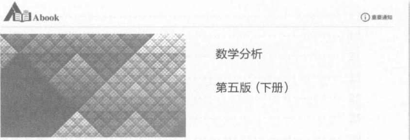

# 封面、前言与目录

原始 PDF 第 1–8 页。

“十二五”普通高等学校教育本科国家级专题院校

“十二五”普通高等教育本科国家级规划教材

# 数学分析

## 第五版（下册）

华东师范大学数学科学学院 编

高等教育出版社

---

“十二五”普通高等教育本科国家级规划教材

## 数学分析

第五版（下册）

华东师范大学数学科学学院 编

高等教育出版社·北京

---

## 内容提要

本书是 “十二五” 普通高等教育本科国家级规划教材、普通高等教育 “十一五” 国家级规划教材和面向 21 世纪课程教材，主要内容包括数项级数、函数列与函数项级数、幂级数、傅里叶级数、多元函数的极限与连续、多元函数微分学、隐函数定理及其应用、含参量积分、曲线积分、重积分、曲面积分、向量函数微分学等。

本次修订是在第四版的基础上对一些内容进行适当调整，使教材逻辑性更合理，并适当补充数字资源。第五版仍旧保持前四版“内容选取适当，深入浅出，易教易学，可读性强”的特点。

本书可作为高等学校数学和其他相关专业的教材使用。

## 图书在版编目(CIP)数据

数学分析. 下册 / 华东师范大学数学科学学院编.
--5 版. --北京:高等教育出版社, 2019.5

ISBN 978-7-04-051323-3

I.①数… Ⅱ.①华… Ⅲ.①数学分析-高等学校-教材 Ⅳ.①017

中国版本图书馆 CIP 数据核字(2019)第 024703 号

项目策划 李艳馥 兰莹莹 李蕊

策划编辑 兰莹莹 李蕊

插图绘制 于 博

蕊

责任编辑 兰莹莹

责任校对 张薇

封面设计 王凌波

责任印制 刘思涵

版式设计 杜微言

出版发行 高等教育出版社

社 址 北京市西城区德外大街4号

邮政编码 100120

印刷 山东临沂新华印刷物流集团有限责任公司

开 本 787mm×1092mm 1/16

印 张 21.25

字 数 490 千字

购书热线 010-58581118

咨询电话 400-810-0598

网址 http://www.hep.edu.cn

http://www.hep.com.cn

网上订购 http://www.hepmall.com.cn

http://www.hepmall.com

http://www.hepmall.cn

版 次 1981 年 6 月第 1 版

2019年5月第5版

印 次 2019年5月第1次印刷

定 价 46.80 元

本书如有缺页、倒页、脱页等质量问题，请到所购图书销售部门联系调换

版权所有 侵权必究

物料号 51323-00

---

# 数学分析

## 第五版（下册）

华东师范大学数学科学学院 编

1. 计算机访问http://abook.hep.com.cn/1210296，或手机扫描二维码、下载并安装Abook应用。
2. 注册并登录，进入“我的课程”。
3. 输入封底数字课程账号（20位密码，刮开涂层可见），或通过 Abook 应用扫描封底数字课程账号二维码，完成课程绑定。
4. 单击“进入课程”按钮，开始本数字课程的学习。

text_image

自自 Abook
① 重要通知
数学分析
第五版（下册）

数学分析数字课程与纸质教材一体化设计，紧密配合。数字课程提供数学史料、自测题等数字资源，充分运用多种媒体资源，丰富了知识的呈现形式，拓展了教材内容，在提升课程教学效果的同时，为学生学习提供思维与探索的空间。

用户名:

密码:

验证码

2692

忘记密码？

登录

注册

记住我(30天内免登录)

课程绑定后一年为数字课程使用有效期。受硬件限制，部分内容无法在手机端显示，请按提示通过计算机访问学习。

如有使用问题，请发邮件至abook@hep.com.cn。

text_image

QR code with embedded logo in center, likely linking to a digital resource or website

扫描二维码下载Abook应用

数学分析简史(上)

数学分析简史(下)

http://abook.hep.com.cn/1210296

---

## 目录

## 第十二章 数项级数 …… 1

§ 1 级数的敛散性 …… 1
§ 2 正项级数 …… 6

一、正项级数敛散性的一般判别原则 6
二、比式判别法和根式判别法 8
三、积分判别法 12
四、拉贝判别法 14

§ 3 一般项级数 …… 17

一、交错级数 17
二、绝对收敛级数及其性质 17
三、阿贝尔判别法和狄利克雷判别法 21

## 第十三章 函数列与函数项级数 …… 25

§ 1 一致收敛性 …… 25

一、函数列及其一致收敛性 25
二、函数项级数及其一致收敛性 29
三、函数项级数的一致收敛性判别法 31

§ 2 一致收敛函数列与函数项级数的性质 …… 34

## 第十四章 幂级数 41

§ 1 幂级数…… 41

一、幂级数的收敛区间 41
二、幂级数的性质 44
三、幂级数的运算 46

§ 2 函数的幂级数展开 …… 49

一、泰勒级数 49
二、初等函数的幂级数展开式 50

\* §3 复变量的指数函数·欧拉公式 …… 57

## 第十五章 傅里叶级数 60

§ 1 傅里叶级数 …… 60

一、三角级数·正交函数系 60
二、以  $2\pi$  为周期的函数的傅里叶级数 …… 61
三、收敛定理 63

§ 2 以 2l 为周期的函数的展开式……69

一、以 $2l$ 为周期的函数的傅里叶级数 69

i

---

目录

二、偶函数与奇函数的傅里叶级数 70

§ 3 收敛定理的证明 …… 75

## 第十六章 多元函数的极限与连续 82

§ 1 平面点集与多元函数 …… 82

一、平面点集 82
二、$\mathbf{R}^2$ 上的完备性定理 85
三、二元函数 87
四、n元函数 88

§ 2 二元函数的极限 …… 89

一、二元函数的极限 89
二、累次极限 92

§ 3 二元函数的连续性 …… 95

一、二元函数的连续性概念 96
二、有界闭域上连续函数的性质 97

## 第十七章 多元函数微分学 …… 102

§ 1 可微性 …… 102

一、可微性与全微分 102
二、偏导数……103
三、可微性条件 105
四、可微性几何意义及应用 107

§ 2 复合函数微分法 …… 112

一、复合函数的求导法则 112
二、复合函数的全微分 116

§ 3 方向导数与梯度 …… 118

§ 4 泰勒公式与极值问题 …… 121

一、高阶偏导数 121
二、中值定理和泰勒公式 125
三、极值问题 128

## 第十八章 隐函数定理及其应用 …… 136

§ 1 隐函数 …… 136

一、隐函数的概念 136
二、隐函数存在性条件的分析 …… 137
三、隐函数定理 138
四、隐函数求导举例 141

§ 2 隐函数组 …… 143

一、隐函数组的概念 143
二、隐函数组定理 144
三、反函数组与坐标变换 146

§ 3 几何应用 …… 150

一、平面曲线的切线与法线 150
二、空间曲线的切线与法平面 151
三、曲面的切平面与法线 153

§ 4 条件极值 …… 155

ii

---

目录

## 第十九章 含参量积分 …… 163

§ 1 含参量正常积分 …… 163
§ 2 含参量反常积分 …… 169

一、一致收敛性及其判别法 169
二、含参量反常积分的性质 173

§ 3 欧拉积分 …… 179

一、Γ函数 179
二、B函数 181
三、Γ函数与B函数之间的关系 182

## 第二十章 曲线积分 …… 185

§ 1 第一型曲线积分 …… 185

一、第一型曲线积分的定义 185
二、第一型曲线积分的计算 186

§ 2 第二型曲线积分 …… 189

一、第二型曲线积分的定义 189
二、第二型曲线积分的计算 191
三、两类曲线积分的联系 195

## 第二十一章 重积分 …… 198

§ 1 二重积分的概念 …… 198

一、平面图形的面积 198
二、二重积分的定义及其存在性 200
三、二重积分的性质 202

§ 2 直角坐标系下二重积分的计算 …… 204
§ 3 格林公式·曲线积分与路线的无关性 …… 209

一、格林公式 209
二、曲线积分与路线的无关性 212

§ 4 二重积分的变量变换 …… 217

一、二重积分的变量变换公式 …… 217
二、用极坐标计算二重积分 220

§ 5 三重积分 …… 226

一、三重积分的概念 226
二、化三重积分为累次积分 226
三、三重积分换元法 230

§ 6 重积分的应用 …… 234

一、曲面的面积 235
二、质心 238
三、转动惯量 239
四、引力 241

\* § 7 n 重积分 …… 242
\* § 8 反常二重积分 …… 247

一、无界区域上的二重积分 247
二、无界函数的二重积分 251

\* § 9 在一般条件下重积分变量变换公式的证明 …… 253

iii

---

目录

## 第二十二章 曲面积分 …… 259

§ 1 第一型曲面积分 …… 259

一、第一型曲面积分的概念 259
二、第一型曲面积分的计算 259

§ 2 第二型曲面积分 …… 262

一、曲面的侧 262
二、第二型曲面积分的概念 263
三、第二型曲面积分的计算 265
四、两类曲面积分的联系 267

§ 3 高斯公式与斯托克斯公式 …… 269

一、高斯公式 269
二、斯托克斯公式 271

\* § 4 场论初步 …… 276

一、场的概念 276
二、梯度场 276
三、散度场 278
四、旋度场 279
五、管量场与有势场 281

## \* 第二十三章 向量函数微分学…… 285

§ 1 n 维欧氏空间与向量函数 …… 285

一、n维欧氏空间 285
二、向量函数 …… 287
三、向量函数的极限与连续 288

§ 2 向量函数的微分 …… 291

一、可微性与可微条件 291
二、可微函数的性质 294
三、黑塞矩阵与极值 296

§ 3 反函数定理和隐函数定理 …… 299

一、反函数定理 299
二、隐函数定理 302
三、拉格朗日乘数法 304

## 部分习题答案与提示 308

## 索引 328

iv
