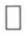
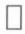
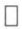
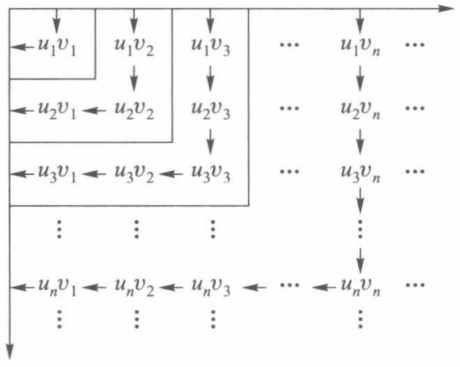
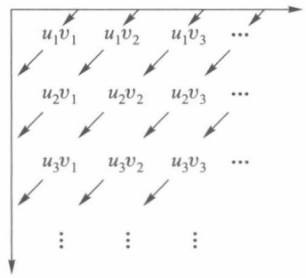

# 第12章 数项级数

原始 PDF 第 9–32 页。

## 第十二章数项级数

## § 1 级数的敛散性

初等数学知识告诉我们,有限个实数  $u_{1}, u_{2}, \cdots, u_{n}$  相加,其和一定存在并且是一个实数,而无限个实数相加会出现什么结果呢?例如,在第二章提到《庄子·天下篇》“一尺之棰,日取其半,万世不竭”的例中,把每天截下那一部分的长度“加”起来:

$$
\frac {1}{2} + \frac {1}{2 ^ {2}} + \frac {1}{2 ^ {3}} + \dots + \frac {1}{2 ^ {n}} + \dots ,
$$

这就是“无限个数相加”的一个例子. 从直观上可以看到, 它的和是 1. 再如下面由“无限个数相加”的表达式

$$
1 + (- 1) + 1 + (- 1) + \dots
$$

中,如果将它写作

$$
(1 - 1) + (1 - 1) + (1 - 1) + \dots = 0 + 0 + 0 + \dots ,
$$

其结果无疑是0,如写作

$$
1 + [ (- 1) + 1 ] + [ (- 1) + 1 ] + \dots = 1 + 0 + 0 + 0 + \dots ,
$$

其结果则是1,因此两个结果完全不同.由此提出这样的问题:“无限个数相加”是否存在“和”;如果存在,“和”等于什么?可见,我们对有限和的认识是无法完全移植到“无限和”的,需要建立“无限和”自身的理论.

定义1 给定一个数列 $\{u_{n}\}$，对它的各项依次用“+”号连接起来的表达式

$$
u _ {1} + u _ {2} + \dots + u _ {n} + \dots \tag {1}
$$

称为常数项无穷级数或数项级数（也常简称级数），其中 $u_{n}$ 称为数项级数(1)的通项或一般项.

数项级数(1)也常写作  $\sum_{n=1}^{\infty}u_{n}$  或简单写作  $\sum u_{n}$ .

数项级数(1)的前 n 项之和,记为

$$
S _ {n} = \sum_ {k = 1} ^ {n} u _ {k} = u _ {1} + u _ {2} + \dots + u _ {n}, \tag {2}
$$

称它为数项级数(1)的第 n 个部分和,也简称部分和.

定义2 若数项级数(1)的部分和数列 $\{S_n\}$ 收敛于 $S$ （即 $\lim_{n\to \infty}S_n = S$），则称数项级

1

---

第十二章 数项级数

数(1)收敛,称 S 为数项级数(1)的和,记作

$$
S = u _ {1} + u _ {2} + \dots + u _ {n} + \dots \quad \text {或} \quad S = \sum u _ {n}.
$$

若 $\{S_{n}\}$ 是发散数列,则称数项级数(1)发散.

例 1 讨论等比级数(也称为几何级数)

$$
a + a q + a q ^ {2} + \dots + a q ^ {n} + \dots \tag {3}
$$

的敛散性 $(a\neq0)$ .

解 $q \neq 1$ 时, 级数(3)的第 $n$ 个部分和

$$
S _ {n} = a + a q + \dots + a q ^ {n - 1} = a \cdot \frac {1 - q ^ {n}}{1 - q}.
$$

因此，

(i) 当 $|q| < 1$ 时, $\lim_{n\to \infty}S_n = \lim_{n\to \infty}a\cdot \frac{1 - q^n}{1 - q} = \frac{a}{1 - q}$. 此时级数(3)收敛, 其和为 $\frac{a}{1 - q}$.

(ii) 当  $\left|q\right|>1$  时,  $\lim_{n\to\infty}S_n=\infty$ , 级数(3)发散.

(iii) 当 q=1 时,  $S_{n}=na$ , 级数发散.

当 q=-1 时， $S_{2k}=0, S_{2k+1}=a, k=0,1,2,\cdots$ ，级数发散.

总之， $|q|<1$  时，级数(3)收敛； $|q|\geqslant1$  时，级数(3)发散.

□

例2 讨论数项级数

$$
\frac {1}{1 \cdot 2} + \frac {1}{2 \cdot 3} + \dots + \frac {1}{n (n + 1)} + \dots \tag {4}
$$

的敛散性.

解 级数(4)的第 $n$ 个部分和

$$
\begin{array}{l} S _ {n} = \frac {1}{1 \cdot 2} + \frac {1}{2 \cdot 3} + \dots + \frac {1}{n (n + 1)} \\ = \left(1 - \frac {1}{2}\right) + \left(\frac {1}{2} - \frac {1}{3}\right) + \dots + \left(\frac {1}{n} - \frac {1}{n + 1}\right) \\ = 1 - \frac {1}{n + 1}. \\ \end{array}
$$

由于

$$
\lim _ {n \to \infty} S _ {n} = \lim _ {n \to \infty} \left(1 - \frac {1}{n + 1}\right) = 1,
$$

因此级数(4)收敛,且

$$
\frac {1}{1 \cdot 2} + \frac {1}{2 \cdot 3} + \dots + \frac {1}{n (n + 1)} + \dots = 1.
$$

□

由于级数(1)的收敛或发散(简称敛散性)是由它的部分和数列 $\{S_{n}\}$ 来确定,因而也可把级数(1)作为数列 $\{S_{n}\}$ 的另一种表现形式.反之,任给一个数列 $\{a_{n}\}$ ,如果把它看作某一数项级数的部分和数列,则这个数项级数就是

$$
\sum_ {n = 1} ^ {\infty} u _ {n} = a _ {1} + (a _ {2} - a _ {1}) + (a _ {3} - a _ {2}) + \dots + (a _ {n} - a _ {n - 1}) + \dots . \tag {5}
$$

这时数列 $\{a_{n}\}$ 与级数(5)具有相同的敛散性，且当 $\{a_{n}\}$ 收敛时，其极限值就是级数(5)的和.

2

---

§ 1 级数的敛散性

基于级数与数列的这种关系,读者不难根据数列极限的性质推出下面有关级数的一些定理.

定理 12.1(级数收敛的柯西准则) 级数(1)收敛的充要条件是:任给正数  $\varepsilon$ , 总存在正整数 N, 使得当 m > N 以及对任意的正整数 p, 都有

$$
\left| u _ {m + 1} + u _ {m + 2} + \dots + u _ {m + p} \right| <   \varepsilon . \tag {6}
$$

根据定理12.1,我们立刻可写出级数(1)发散的充要条件:存在某正数 $\varepsilon_{0}$ ,对任何正整数N,总存在正整数 $m_{0}(>N)$ 和 $p_{0}$ ,有

$$
\left| u _ {m _ {0} + 1} + u _ {m _ {0} + 2} + \dots + u _ {m _ {0} + p _ {0}} \right| \geqslant \varepsilon_ {0}. \tag {7}
$$

由定理 12.1 立即可得如下推论, 它是级数收敛的一个必要条件.

推论 若级数(1)收敛,则

$$
\lim _ {n \to \infty} u _ {n} = 0.
$$

当一个级数 $\sum_{n=1}^{\infty} u_n$ 的一般项 $u_n$ 不收敛于零时, 由推论可知该级数发散. 因此, 上述推论常用来判断级数的发散. 但推论只是级数收敛的必要条件, 不是充分条件, 即当一般项 $u_n \to 0$ 时, 不能得出该级数收敛的结论. 请看下例.

例3 证明调和级数

$$
1 + \frac {1}{2} + \frac {1}{3} + \dots + \frac {1}{n} + \dots
$$

是发散的.

证 由

$$
\lim _ {n \to \infty} u _ {n} = \lim _ {n \to \infty} \frac {1}{n} = 0,
$$

无法用推论推出调和级数发散. 但令 $p = m$ 时, 有

$$
\begin{array}{l} \left| u _ {m + 1} + u _ {m + 2} + \dots + u _ {2 m} \right| = \left| \frac {1}{m + 1} + \frac {1}{m + 2} + \dots + \frac {1}{2 m} \right| \\ \geqslant \left| \frac {1}{2 m} + \frac {1}{2 m} + \dots + \frac {1}{2 m} \right| \\ = \frac {1}{2}, \\ \end{array}
$$

因此由定理 12.1, 取  $\varepsilon_{0}=\frac{1}{2}$ , 对任何正整数 N, 只要 m>N 和 p=m 就有 (7) 式成立, 所以调和级数是发散的.

例4 判别级数 $\sum_{n=1}^{\infty} \frac{\left(n + \frac{1}{n}\right)^n}{n^{n + \frac{1}{n}}}$ 的敛散性.

解 因为 $\lim_{n\to \infty}\frac{\left(n + \frac{1}{n}\right)^n}{n^{n + \frac{1}{n}}} = \lim_{n\to \infty}\frac{\left(n + \frac{1}{n}\right)^n}{n^n n^{\frac{1}{n}}} = \lim_{n\to \infty}\frac{\left[\left(1 + \frac{1}{n^2}\right)^{n^2}\right]^{\frac{1}{n}}}{n^{\frac{1}{n}}} = 1\neq 0,$

所以由推论得知该级数发散.

例 5 应用级数收敛的柯西准则证明级数  $\sum\frac{1}{n^{2}}$  收敛.

3

---

第十二章 数项级数

证 由于

$$
\begin{array}{l} u _ {m + 1} + u _ {m + 2} + \dots + u _ {m + p} \mid \\ = \frac {1}{(m + 1) ^ {2}} + \frac {1}{(m + 2) ^ {2}} + \dots + \frac {1}{(m + p) ^ {2}} \\ <   \frac {1}{m (m + 1)} + \frac {1}{(m + 1) (m + 2)} + \dots + \frac {1}{(m + p - 1) (m + p)} \\ = \frac {1}{m} - \frac {1}{m + p} \\ <   \frac {1}{m}, \\ \end{array}
$$

因此，对任给正数 $\varepsilon$ ，取 $N = \left[\frac{1}{\varepsilon}\right]$ ，使当 $m > N$ 及对任意正整数 $p$ ，由上式就有

$$
\mid u _ {m + 1} + u _ {m + 2} + \dots + u _ {m + p} \mid <   \frac {1}{m} <   \varepsilon .
$$

依定理12.1推得级数 $\sum \frac{1}{n^2}$ 是收敛的.

□

定理 12.2 若级数  $\sum u_{n}$  与  $\sum v_{n}$  都收敛, 则对任意常数 c, d, 级数  $\sum (cu_{n} + dv_{n})$  亦收敛, 且

$$
\sum (c u _ {n} + d v _ {n}) = c \sum u _ {n} + d \sum v _ {n}.
$$

由定理12.1,级数 $\sum u_{n}$ 的敛散性取决于:对任给正数 $\varepsilon$,是否存在充分大的正数 $N$,使得当 $n > N$ 及对任意正整数 $p$ 恒有(6)式成立.由此可见,一个级数是否收敛与级数前面有限项的取值无关.从而我们可得到以下定理.

定理 12.3 去掉、增加或改变级数的有限个项并不改变级数的敛散性.

由此定理知道,若级数  $\sum_{n=1}^{\infty}u_{n}$  收敛,其和为 S,则级数

$$
u _ {n + 1} + u _ {n + 2} + \dots \tag {8}
$$

也收敛,且其和  $R_{n}=S-S_{n}$ .(8)式称为级数  $\sum u_{n}$  的第 n 个余项(或简称余项),它表示以部分和  $S_{n}$  代替 S 时所产生的误差.

定理 12.4 在收敛级数的项中任意加括号,既不改变级数的收敛性,也不改变它的和.

证 设  $\sum u_{n}$  为收敛级数, 其和为 S. 记

$$
v _ {1} = u _ {1} + \dots + u _ {n _ {1}}, \quad v _ {2} = u _ {n _ {1} + 1} + \dots + u _ {n _ {2}}, \dots ,
$$

$$
v _ {k} = u _ {n _ {k - 1} + 1} + \dots + u _ {n _ {k}}, \dots .
$$

现在证明  $\sum u_{n}$  加括号后的级数  $\sum_{k=1}^{\infty}(u_{n_{k-1}+1}+\cdots+u_{n_{k}})=\sum_{k=1}^{\infty}v_{k}$  也收敛，且其和也是 S. 事实上，设  $\{S_{n}\}$  为收敛级数  $\sum u_{n}$  的部分和数列，则级数  $\sum v_{k}$  的部分和数列  $\{S_{n_{k}}\}$  是  $\{S_{n}\}$  的一个子列. 由于  $\{S_{n}\}$  收敛，且  $\lim_{n\to\infty}S_{n}=S$ . 故由子列性质， $\{S_{n_{k}}\}$  也收敛，且  $\lim_{k\to\infty}S_{n_{k}}=S$ ，即级数  $\sum v_{k}$  收敛，且它的和也等于 S.

注意:从级数加括号后的收敛,不能推断它在加括号前也收敛.例如

$$
(1 - 1) + (1 - 1) + \dots + (1 - 1) + \dots = 0 + 0 + 0 + \dots = 0
$$

4

---

§ 1 级数的敛散性

收敛,但级数

$$
1 - 1 + 1 - 1 + \dots
$$

却是发散的.

例 6 判别级数 $\frac{1}{\sqrt{2}-1}-\frac{1}{\sqrt{2}+1}+\frac{1}{\sqrt{3}-1}-\frac{1}{\sqrt{3}+1}+\frac{1}{\sqrt{4}-1}-\frac{1}{\sqrt{4}+1}+\cdots$ 的敛散性.

解 考虑加了括号后的级数

$$
\left(\frac {1}{\sqrt {2} - 1} - \frac {1}{\sqrt {2} + 1}\right) + \left(\frac {1}{\sqrt {3} - 1} - \frac {1}{\sqrt {3} + 1}\right) + \left(\frac {1}{\sqrt {4} - 1} - \frac {1}{\sqrt {4} + 1}\right) + \dots ,
$$

其一般项 $u_{n} = \frac{1}{\sqrt{n} - 1} -\frac{1}{\sqrt{n} + 1} = \frac{2}{n - 1}$ .由例3及定理12.2知道，级数 $\sum_{n = 2}^{\infty}u_n = 2\sum_{n = 2}^{\infty}\frac{1}{n - 1} =$ $2\sum_{n = 1}^{\infty}\frac{1}{n}$ 发散，从而根据定理12.4，原级数发散. □

## 习题 12.1

1. 证明下列级数收敛，并求其和:

(1)  $\frac{1}{1 \cdot 6} + \frac{1}{6 \cdot 11} + \frac{1}{11 \cdot 16} + \cdots + \frac{1}{(5n-4)(5n+1)} + \cdots;$
(2) $\left(\frac{1}{2}+\frac{1}{3}\right)+\left(\frac{1}{2^{2}}+\frac{1}{3^{2}}\right)+\cdots+\left(\frac{1}{2^{n}}+\frac{1}{3^{n}}\right)+\cdots;$
(3) $\sum_{n=1}^{\infty} \frac{1}{n(n+1)(n+2)}$;
(4) $\sum_{n=1}^{\infty} (\sqrt{n+2}-2\sqrt{n+1}+\sqrt{n})$;
(5) $\sum_{n=1}^{\infty} \frac{2n - 1}{2^n}$.

2. 证明: 若级数 $\sum u_{n}$ 发散, $c \neq 0$, 则 $\sum cu_{n}$ 也发散.

3. 设级数  $\sum u_{n}$  与  $\sum v_{n}$  都发散，试问  $\sum (u_{n} + v_{n})$  一定发散吗？又若  $u_{n}$  与  $v_{n}$  （ $n = 1, 2, \cdots$ ）都是非负数，则能得出什么结论？

4. 证明: 若数列  $\{a_{n}\}$  收敛于 a, 则级数  $\sum_{n=1}^{\infty}(a_{n}-a_{n+1})=a_{1}-a$ .

5. 证明:若数列 $\{b_n\}$ 有 $\lim_{n\to \infty}b_n = \infty$ ，则

(1) 级数  $\sum(b_{n+1}-b_{n})$  发散；
(2) 当  $b_{n} \neq 0$  时, 级数  $\sum\left(\frac{1}{b_{n}} - \frac{1}{b_{n+1}}\right) = \frac{1}{b_{1}}$ .

6. 应用第 4,5 题的结果求下列级数的和:

(1) $\sum_{n=1}^{\infty} \frac{1}{(a + n - 1)(a + n)}$;
(2) $\sum_{n=1}^{\infty}(-1)^{n+1}\frac{2n+1}{n(n+1)}$;
(3) $\sum_{n=1}^{\infty} \frac{2n + 1}{(n^2 + 1)[(n + 1)^2 + 1]}$.

7. 应用柯西准则判别下列级数的敛散性:

5

---

第十二章 数项级数

(1)  $\sum\frac{\sin2^{n}}{2^{n}}$ ;

(2)  $\sum\frac{(-1)^{n-1}n^{2}}{2n^{2}+1};$

(3) $\sum \frac{(-1)^n}{n}$;

(4)  $\sum\frac{1}{\sqrt{n+n^{2}}}$ .

8. 证明级数 $\sum u_{n}$ 收敛的充要条件是:任给正数 $\varepsilon$ ，存在某正整数 $N$ ，对一切 $n > N$ 总有

$$
\left| u _ {N} + u _ {N + 1} + \dots + u _ {n} \right| <   \varepsilon .
$$

9. 举例说明: 若级数  $\sum u_{n}$  对每个固定的 p 满足条件

$$
\lim _ {n \to \infty} (u _ {n + 1} + \dots + u _ {n + p}) = 0,
$$

此级数仍可能不收敛.

10. 设级数  $\sum u_{n}$  满足: 加括号后级数  $\sum_{k=1}^{\infty}\left(u_{n_{k}+1} + u_{n_{k}+2} + \cdots + u_{n_{k+1}}\right)$  收敛  $(n_{1} = 0)$ ，且在同一括号中的  $u_{n_{k}+1}, u_{n_{k}+2}, \cdots, u_{n_{k+1}}$  符号相同，证明  $\sum u_{n}$  亦收敛.

## § 2 正项级数

## 一、正项级数敛散性的一般判别原则

若数项级数各项的符号都相同,则称它为同号级数.对于同号级数,只需研究各项都是由非负数组成的级数——称为正项级数.如果级数的各项都是非正数,则它乘以-1后就得到一个正项级数,它们具有相同的敛散性.

注 这样定义正项级数更一般, 更便于讨论. 实际上  $u_{n}=0$  的项不影响级数的敛散性, 在判别正项级数敛散性时可自然排除.

由于级数与其部分和数列具有相同的敛散性,所以首先得到如下定理.

定理12.5 正项级数 $\sum u_{n}$ 收敛的充要条件是:部分和数列 $\{S_n\}$ 有界，即存在某正数 $M$ ，对一切正整数 $n$ 有 $S_{n} < M$

证 由于 $u_{i} \geqslant 0 (i = 1,2,\dots)$, 所以 $\{S_n\}$ 是递增数列. 而单调数列收敛的充要条件是该数列有界(单调有界定理(定理2.9)). 这就证明了本定理的结论. □

定理 12.6(比较原则) 设  $\sum u_{n}$  和  $\sum v_{n}$  是两个正项级数, 如果存在某正数 N, 对一切 n > N 都有

$$
u _ {n} \leqslant v _ {n}, \tag {1}
$$

则

(i) 若级数  $\sum v_{n}$  收敛, 则级数  $\sum u_{n}$  也收敛;
(ii) 若级数  $\sum u_{n}$  发散, 则级数  $\sum v_{n}$  也发散.

证 因为改变级数的有限项并不影响原有级数的敛散性,因此不妨设不等式(1)对一切正整数都成立.

现分别以 $S_{n}^{\prime}$ 和 $S_{n}^{\prime \prime}$ 记级数 $\sum u_{n}$ 与 $\sum v_{n}$ 的部分和.由(1)式推得，对一切正整数 $n$ 都有

6

---

§ 2 正项级数

$$
S _ {n} ^ {\prime} \leqslant S _ {n} ^ {\prime \prime}. \tag {2}
$$

若 $\sum v_{n}$ 收敛，即 $\lim_{n\to \infty}S_n''$ 存在，则由(2)式，对一切 $n$ 有 $S_n' \leqslant \lim_{n\to \infty}S_n''$ ，即正项级数 $\sum u_{n}$ 的部分和数列 $\{S_n'\}$ 有界，由定理12.5知级数 $\sum u_{n}$ 收敛.这就证明了(i);（ii）为(i）的逆否命题，自然成立.

例 1 考察  $\sum\frac{1}{n^{2}-n+1}$  的敛散性.

解 由于当 $n \geqslant 2$ 时, 有

$$
\frac {1}{n ^ {2} - n + 1} \leqslant \frac {1}{n ^ {2} - n} = \frac {1}{n (n - 1)} \leqslant \frac {1}{(n - 1) ^ {2}}.
$$

因为正项级数 $\sum_{n=2}^{\infty} \frac{1}{(n-1)^2}$ 收敛 (§ 1 例 5), 故由定理 12.6, 级数 $\sum \frac{1}{n^2 - n+1}$ 也收敛.

□

在实际使用上,比较原则的下述极限形式有时更为方便.

推论 设

$$
u _ {1} + u _ {2} + \dots + u _ {n} + \dots , \tag {3}
$$

$$
v _ {1} + v _ {2} + \dots + v _ {n} + \dots \tag {4}
$$

是两个正项级数,若

$$
\lim _ {n \to \infty} \frac {u _ {n}}{v _ {n}} = l, \tag {5}
$$

则

(i) 当  $0 < l < +\infty$  时, 级数 (3)、(4) 同时收敛或同时发散;
(ii) 当 l=0 且级数(4)收敛时, 级数(3)也收敛;
(iii) 当  $l = +\infty$  且级数(4)发散时, 级数(3)也发散.

证 对于(i)，当 $0 < l < +\infty$ 时，对任意正数 $\varepsilon$ （$\varepsilon < l$），存在某正数 $N$，当 $n > N$ 时，恒有

$$
\left| \frac {u _ {n}}{v _ {n}} - l \right| <   \varepsilon
$$

或

$$
(l - \varepsilon) v _ {n} <   u _ {n} <   (l + \varepsilon) v _ {n}. \tag {6}
$$

由定理 12.6 及 (6) 式可得级数 (3) 和 (4) 具有相同的敛散性.

对于(ii)，当 $l = 0$ 时，由(6)式右半部分及比较原则可得:若级数(4)收敛，则级数(3)也收敛.

对于（iii），若 $l = +\infty$ ，即对任给的正数 $M$ ，存在相应的正数 $N$ ，当 $n > N$ 时，都有

$$
\frac {u _ {n}}{v _ {n}} > M
$$

或

$$
u _ {n} > M v _ {n}.
$$

于是由比较原则知道,若级数(4)发散,则级数(3)也发散.

□

例2 级数

7

---

第十二章 数项级数

$$
\sum \frac {1}{2 ^ {n} - n}
$$

是收敛的.

因为

$$
\lim _ {n \to \infty} \frac {\frac {1}{2 ^ {n} - n}}{\frac {1}{2 ^ {n}}} = \lim _ {n \to \infty} \frac {2 ^ {n}}{2 ^ {n} - n} = \lim _ {n \to \infty} \frac {1}{1 - \frac {n}{2 ^ {n}}} = 1,
$$

以及等比级数 $\sum \frac{1}{2^n}$ 收敛，所以根据推论，级数 $\sum \frac{1}{2^n - n}$ 也收敛.

例3 级数

$$
\sum \sin \frac {1}{n} = \sin 1 + \sin \frac {1}{2} + \dots + \sin \frac {1}{n} + \dots
$$

是发散的.

因为 $\lim_{n\to \infty}\frac{\sin\frac{1}{n}}{\frac{1}{n}} = 1,$

根据推论以及调和级数 $\sum \frac{1}{n}$ 发散，所以级数 $\sum \sin \frac{1}{n}$ 也发散.

## 二、比式判别法和根式判别法

根据比较原则,可以利用已知收敛或者发散级数作为比较对象来判别其他级数的敛散性.本段所介绍的两个方法是以等比级数作为比较对象而得到的.

定理 12.7(达朗贝尔判别法,或称比式判别法) 设  $\sum u_{n}$  为正项级数,且存在某正整数  $N_{0}$  及常数  $q(0 < q < 1)$ .

(i) 若对一切  $n > N_{0}$ ，成立不等式

$$
\frac {u _ {n + 1}}{u _ {n}} \leqslant q, \tag {7}
$$

则级数  $\sum u_{n}$  收敛.

(ii) 若对一切  $n > N_{0}$ ，成立不等式

$$
\frac {u _ {n + 1}}{u _ {n}} \geqslant 1, \tag {8}
$$

则级数  $\sum u_{n}$  发散.

证 （i）不妨设不等式(7)对一切 $n \geqslant 1$ 成立，于是有

$$
\frac {u _ {2}}{u _ {1}} \leqslant q, \quad \frac {u _ {3}}{u _ {2}} \leqslant q, \dots , \quad \frac {u _ {n}}{u _ {n - 1}} \leqslant q, \dots .
$$

把前 $n - 1$ 个不等式的左边及右边分别相乘后，得到

$$
\frac {u _ {2}}{u _ {1}} \cdot \frac {u _ {3}}{u _ {2}} \cdot \dots \cdot \frac {u _ {n}}{u _ {n - 1}} \leqslant q ^ {n - 1}
$$

或者

8

---

§ 2 正项级数

$$
u _ {n} \leqslant u _ {1} q ^ {n - 1}.
$$

由于当 $0 < q < 1$ 时，等比级数 $\sum_{n=1}^{\infty} q^{n-1}$ 收敛，根据比较原则可推知级数 $\sum u_n$ 收敛.

(ii) 由于  $n > N_{0}$  时成立不等式(8)，即有

$$
u _ {n + 1} \geqslant u _ {n} \geqslant u _ {N _ {0}}.
$$

于是当 $n\to \infty$ 时，$u_{n}$ 的极限不可能为零.由定理12.1推论知级数 $\sum u_{n}$ 是发散的.

推论1（比式判别法的极限形式）若 $\sum u_{n}$ 为正项级数，且

$$
\lim _ {n \to \infty} \frac {u _ {n + 1}}{u _ {n}} = q, \tag {9}
$$

则

(i) 当 $q < 1$ 时, 级数 $\sum u_{n}$ 收敛;
(ii) 当 q>1 或  $q=+\infty$  时, 级数  $\sum u_{n}$  发散.

证 由(9)式,对取定的正数  $\varepsilon=\frac{1}{2}|1-q|$ , 存在正数 N, 当 n>N 时, 都有

$$
q - \varepsilon <   \frac {u _ {n + 1}}{u _ {n}} <   q + \varepsilon .
$$

当 $q < 1$ 时, $q + \varepsilon = \frac{1}{2} (1 + q) < 1$, 由上述不等式的右半部分及定理12.7的(i), 推得级数 $\sum u_{n}$ 是收敛的.

当 $q > 1$ 时，$q - \varepsilon = \frac{1}{2} (1 + q) > 1$，由上述不等式的左半部分及定理12.7的（ii），推得级数 $\sum u_{n}$ 是发散的。

当 $q = +\infty$ 时，则存在 $N$ ，当 $n > N$ 时有

$$
\frac {u _ {n + 1}}{u _ {n}} > 1,
$$

从而 $\lim_{n\to \infty}u_n\neq 0$ ，所以这时级数 $\sum u_{n}$ 是发散的.

例4 设级数

$$
\frac {2}{1} + \frac {2 \cdot 5}{1 \cdot 5} + \frac {2 \cdot 5 \cdot 8}{1 \cdot 5 \cdot 9} + \dots + \frac {2 \cdot 5 \cdot 8 \cdot \cdots \cdot [ 2 + 3 (n - 1) ]}{1 \cdot 5 \cdot 9 \cdot \cdots \cdot [ 1 + 4 (n - 1) ]} + \dots .
$$

由于

$$
\lim _ {n \to \infty} \frac {u _ {n + 1}}{u _ {n}} = \lim _ {n \to \infty} \frac {2 + 3 n}{1 + 4 n} = \frac {3}{4} <   1,
$$

根据推论1,上述级数是收敛的.

例 5 讨论级数  $\sum nx^{n-1}$  (x>0) 的敛散性.

解 因为

$$
\frac {u _ {n + 1}}{u _ {n}} = \frac {(n + 1) x ^ {n}}{n x ^ {n - 1}} = x \cdot \frac {n + 1}{n} \rightarrow x (n \rightarrow \infty),
$$

根据推论1, 当0<x<1时级数收敛; 当x>1时级数发散; 而当x=1时, 所考察的级数是 $\sum n$ , 它显然也是发散的. ☐

若(9)中 q=1, 这时用比式判别法不能对级数的敛散性作出判断, 因为它可能是收

9

---

第十二章 数项级数

敛的,也可能是发散的.例如级数 $\sum\frac{1}{n^{2}}$ 和 $\sum\frac{1}{n}$ ,它们的比式极限都是

$$
\frac {u _ {n + 1}}{u _ {n}} \rightarrow 1 (n \rightarrow \infty),
$$

但 $\sum \frac{1}{n^2}$ 是收敛的（§1例5），而 $\sum \frac{1}{n}$ 却是发散的（§1例3）.

若某级数的(9)式的极限不存在,则可应用上、下极限来判别.

推论 2 设  $\sum u_{n}$  为正项级数.

(i) 若  $\lim_{n\to\infty}\frac{u_{n+1}}{u_n}=q<1$  , 则级数收敛；
(ii) 若  $\lim_{n\to\infty}\frac{u_{n+1}}{u_n}=q>1$  , 则级数发散.

读者可仿照推论1的方法证明本推论.

例6 讨论级数

$$
1 + b + b c + b ^ {2} c + b ^ {2} c ^ {2} + \dots + b ^ {n} c ^ {n - 1} + b ^ {n} c ^ {n} + \dots \tag {10}
$$

的敛散性,其中 0<b<c.

解 由于

$$
\frac {u _ {n + 1}}{u _ {n}} = \left\{ \begin{array}{l l} b, & n \text {为奇数}, \\ c, & n \text {为偶数}, \end{array} \right.
$$

故有

$$
\varlimsup_ {n \to \infty} \frac {u _ {n + 1}}{u _ {n}} = c, \quad \varliminf_ {n \to \infty} \frac {u _ {n + 1}}{u _ {n}} = b,
$$

于是，当 $c < 1$ 时，级数(10)收敛；当 $b > 1$ 时，级数(10)发散；但当 $b < 1 < c$ 时，比式判别法无法判断级数(10)的敛散性.

定理 12.8(柯西判别法,或称根式判别法) 设  $\sum u_{n}$  为正项级数,且存在某正数  $N_{0}$  及正常数 l,

(i) 若对一切 $n > N_0$，成立不等式

$$
\sqrt [ n ]{u _ {n}} \leqslant l <   1, \tag {11}
$$

则级数 $\sum u_{n}$ 收敛；

(ii) 若对一切 $n > N_0$，成立不等式

$$
\sqrt [ n ]{u _ {n}} \geqslant 1, \tag {12}
$$

则级数 $\sum u_{n}$ 发散.

证 由(11)式有

$$
u _ {n} \leqslant l ^ {n}.
$$

因为等比级数 $\sum l^n$ 当 $0 < l < 1$ 时收敛，故由比较原则，这时级数 $\sum u_{n}$ 也收敛，对于情形(ii)，由(12)式可推得

$$
u _ {n} \geqslant 1 ^ {n} = 1.
$$

当 $n \to \infty$ 时, 显然 $u_{n}$ 不可能以零为极限, 因而由级数收敛的必要条件可知, 级数 $\sum u_{n}$ 是发散的.

推论 1(根式判别法的极限形式) 设  $\sum u_{n}$  为正项级数, 且

$$
\lim _ {n \to \infty} \sqrt [ n ]{u _ {n}} = l, \tag {13}
$$

10

---

§ 2 正项级数 |||

则

(i) 当 l<1 时, 级数  $\sum u_{n}$  收敛;
(ii) 当 l>1 时, 级数  $\sum u_{n}$  发散.

证 由(13)式, 当取  $\varepsilon < |1 - l|$  时, 存在某正数 N, 对一切 n > N, 有

$$
l - \varepsilon <   \sqrt [ n ]{u _ {n}} <   l + \varepsilon.
$$

于是由定理 12.8 就能得到这个推论所要证明的结论.

例 7 研究级数  $\sum\frac{2+(-1)^{n}}{2^{n}}$  的敛散性.

解 由于

$$
\lim _ {n \to \infty} \sqrt [ n ]{u _ {n}} = \lim _ {n \to \infty} \frac {\sqrt [ n ]{2 + (- 1) ^ {n}}}{2} = \frac {1}{2},
$$

所以级数是收敛的.

若在(13)式中 $l = 1$ ，则根式判别法仍无法对级数的敛散性作出判断.例如，对 $\sum \frac{1}{n^2}$ 和 $\sum \frac{1}{n}$ ，都有

$$
\sqrt [ n ]{u _ {n}} \rightarrow 1 (n \rightarrow \infty).
$$

但 $\sum \frac{1}{n^2}$ 是收敛的，而 $\sum \frac{1}{n}$ 却是发散的.

若(13)式的极限不存在,则可根据根式 $\sqrt[n]{u_{n}}$ 的上极限来判断.

推论 2 设  $\sum u_{n}$  为正项级数, 且

$$
\varlimsup_ {n \to \infty} \sqrt [ n ]{u _ {n}} = l,
$$

则当

(i) l<1 时级数收敛；
(ii) l>1 时级数发散.

本推论的证明可仿照推论1的证法进行.

例8 考察级数

$$
b + c + b ^ {2} + c ^ {2} + \dots + b ^ {n} + c ^ {n} + \dots
$$

的敛散性,其中 0<b<c<1.

解 由于

$$
\sqrt [ n ]{u _ {n}} = \left\{ \begin{array}{l l} (c ^ {m}) ^ {\frac {1}{2 m}} \to \sqrt {c}, \\ (b ^ {m + 1}) ^ {\frac {1}{2 m + 1}} \to \sqrt {b} \end{array} \right. \quad (m \to \infty)
$$

及

$$
\varlimsup_ {n \to \infty} \sqrt [ n ]{u _ {n}} = \sqrt {c} <   1,
$$

因此级数是收敛的.但若应用比式判别法,则由于

$$
\varlimsup_ {n \to \infty} \frac {u _ {n + 1}}{u _ {n}} = \lim _ {n \to \infty} \frac {c ^ {n}}{b ^ {n}} = + \infty ,
$$

$$
\varliminf_ {n \to \infty} \frac {u _ {n + 1}}{u _ {n}} = \lim _ {n \to \infty} \frac {b ^ {n + 1}}{c ^ {n}} = 0 <   1,
$$

则无法应用定理 12.7 推论 2 判断其敛散性.

11

---

第十二章 数项级数

读者已从第二章总练习题4(7)知道,若

$$
\lim _ {n \to \infty} \frac {u _ {n + 1}}{u _ {n}} = q,
$$

则必有

$$
\lim _ {n \to \infty} \sqrt [ n ]{u _ {n}} = q.
$$

这说明凡能由比式判别法鉴别收敛性的级数,它也能由根式判别法来判断,而且可以说,根式判别法较之比式判别法更有效.例如,级数 $\sum\frac{2+(-1)^{n}}{2^{n}}$ .由于

$$
\begin{array}{l} \lim _ {m \to \infty} \frac {u _ {2 m}}{u _ {2 m - 1}} = \lim _ {m \to \infty} \frac {\frac {3}{2 ^ {2 m}}}{\frac {1}{2 ^ {2 m - 1}}} = \frac {3}{2}, \\ \lim _ {m \to \infty} \frac {u _ {2 m + 1}}{u _ {2 m}} = \lim _ {m \to \infty} \frac {\frac {1}{2 ^ {2 m + 1}}}{\frac {3}{2 ^ {2 m}}} = \frac {1}{6}, \\ \end{array}
$$

故由比式判别法无法鉴别此级数的收敛性. 但应用根式判别法来考察这个级数(例7), 可知此级数是收敛的.

例 9 讨论级数  $\sum_{n=1}^{\infty}\frac{x^{n}}{1+x^{2n}}$  的敛散性, 其中 x>0.

解 因为 $\lim_{n\to \infty}\sqrt[n]{1 + x^{2n}} = \max \{1,x^2\}$ ，所以

$$
\lim _ {n \to \infty} \sqrt [ n ]{u _ {n}} = \lim _ {n \to \infty} \sqrt [ n ]{\frac {x ^ {n}}{1 + x ^ {2 n}}} = \frac {x}{\max \left\{1 , x ^ {2} \right\}} \left\{ \begin{array}{l l} <   1, & x \neq 1, \\ = 1, & x = 1. \end{array} \right.
$$

于是，当 $x \neq 1$ 时，原级数收敛，当 $x = 1$ 时，原级数发散.

例10 判别下列级数的敛散性:(i) $\sum_{n=1}^{\infty} \frac{(n!)^2}{(2n)!}$; (ii) $\sum_{n=1}^{\infty} \frac{n^2}{\left(2 + \frac{1}{n}\right)^n}$.

解 (i) 因为

$$
\lim _ {n \to \infty} \frac {u _ {n + 1}}{u _ {n}} = \lim _ {n \to \infty} \frac {\left[ (n + 1) ! \right] ^ {2}}{\left[ 2 (n + 1) \right] !} \cdot \frac {(2 n) !}{(n !) ^ {2}} = \lim _ {n \to \infty} \frac {(n + 1) ^ {2}}{(2 n + 1) (2 n + 2)} = \frac {1}{4} <   1,
$$

所以由比式判别法,该级数收敛.

(ii) 因为

$$
\lim _ {n \to \infty} \sqrt [ n ]{u _ {n}} = \lim _ {n \to \infty} \frac {\sqrt [ n ]{n ^ {2}}}{\sqrt [ n ]{\left(2 + \frac {1}{n}\right) ^ {n}}} = \lim _ {n \to \infty} \frac {\sqrt [ n ]{n ^ {2}}}{2 + \frac {1}{n}} = \frac {1}{2} <   1,
$$

所以由根式判别法,该级数收敛.

## 三、积分判别法

积分判别法是利用非负函数的单调性和积分性质,并以反常积分为比较对象来判断正项级数的敛散性.

12

---

§ 2 正项级数 |||

定理12.9 设 $f$ 为 $[1, +\infty)$ 上的减函数，则级数 $\sum_{n=1}^{\infty} f(n)$ 收敛的充分必要条件是反常积分 $\int_{1}^{+\infty} f(x) \mathrm{d}x$ 收敛.

证 设 $\sum_{n=1}^{\infty} f(n)$ 收敛, 其和为 $S$, 则 $\lim_{n \to \infty} f(n) = 0$. 又因为 $f$ 为 $[1, +\infty)$ 上的减函数, 所以 $f(x) \geqslant 0$, 从而 $f$ 是 $[1, +\infty)$ 上非负的减函数, $\sum_{n=1}^{\infty} f(n)$ 为正项级数. 于是对任意正整数 $m$, 有

$$
\int_ {1} ^ {m} f (x) \mathrm{d} x = \sum_ {n = 2} ^ {m} \int_ {n - 1} ^ {n} f (x) \mathrm{d} x \leqslant \sum_ {n = 1} ^ {m - 1} f (n) \leqslant \sum_ {n = 1} ^ {\infty} f (n) = S.
$$

由 $f$ 是 $[1, +\infty)$ 上非负的减函数，可得对任何正数 $A$ ，都有

$$
0 \leqslant \int_ {1} ^ {A} f (x) \mathrm{d} x \leqslant \int_ {1} ^ {m + 1} f (x) \mathrm{d} x \leqslant \sum_ {n = 1} ^ {m} f (n) \leqslant S, m <   A \leqslant m + 1.
$$

根据定理11.2,知反常积分 $\int_{1}^{+\infty}f(x)\mathrm{d}x$ 收敛.

反之, 设反常积分 $\int_{1}^{+\infty} f(x) \mathrm{d}x$ 收敛, 根据第十一章 §2 的例 5, 知 $\lim_{x \to +\infty} f(x) = 0$. 又 $f$ 是 $[1, +\infty)$ 上的减函数, 由此可得 $f$ 为 $[1, +\infty)$ 上非负的减函数, $\sum_{n=1}^{\infty} f(n)$ 是正项级数. 因此对任意正整数 $m$, 有

$$
\sum_ {n = 1} ^ {m} f (n) = f (1) + \sum_ {n = 2} ^ {m} f (n) \leqslant f (1) + \int_ {1} ^ {m} f (x) \mathrm{d} x \leqslant f (1) + \int_ {1} ^ {+ \infty} f (x) \mathrm{d} x.
$$

根据定理12.5可得级数 $\sum_{n = 1}^{\infty}f(n)$ 收敛.

例 11 讨论 p 级数  $\sum\frac{1}{n^{p}}$  的敛散性.

解 函数 $f(x) = \frac{1}{x^p}$，当 $p > 0$ 时在 $[1, +\infty)$ 上是非负减函数。由第十一章 §1 例3知道反常积分 $\int_{1}^{+\infty} \frac{\mathrm{d}x}{x^p}$ 在 $p > 1$ 时收敛，$p \leqslant 1$ 时发散。故由定理12.9得 $\sum \frac{1}{n^p}$ 当 $p > 1$ 时收敛，当 $0 < p \leqslant 1$ 时发散。至于 $p \leqslant 0$ 的情形，则可由定理12.1推论知道它也是发散的。

例12 讨论下列级数

(i)  $\sum_{n=2}^{\infty}\frac{1}{n(\ln n)^{p}}$ ; (ii)  $\sum_{n=3}^{\infty}\frac{1}{n(\ln n)(\ln\ln n)^{p}}$

的敛散性.

解 研究反常积分 $\int_{2}^{+\infty}\frac{\mathrm{d}x}{x(\ln x)^p}$ ，由于

$$
\int_ {2} ^ {+ \infty} \frac {\mathrm{d} x}{x (\ln x) ^ {p}} = \int_ {2} ^ {+ \infty} \frac {\mathrm{d} (\ln x)}{(\ln x) ^ {p}} = \int_ {\ln 2} ^ {+ \infty} \frac {\mathrm{d} u}{u ^ {p}}
$$

当 $p > 1$ 时收敛，$p \leqslant 1$ 时发散. 根据定理12.9知级数(i)在 $p > 1$ 时收敛，$p \leqslant 1$ 时发散.

13

---

第十二章 数项级数

对于(ii)，考察反常积分 $\int_{3}^{\infty}\frac{\mathrm{d}x}{x(\ln x)(\ln\ln x)^p}$ ，同样可推得级数(ii)在 $p > 1$ 时收敛，在 $p\leqslant 1$ 时发散. □

## \* 四、拉贝判别法

比式判别法和根式判别法是基于把所要判断的级数与某一等比级数相比较的想法而得到的,也就是说,只有那些级数的通项收敛于零的速度比某一等比级数收敛速度快的级数,这两种方法才能鉴定出它的收敛性.如果级数的通项收敛速度较慢,它们就无能为力了.因此为了获得判别范围更大的一类级数,就必须寻找级数的通项收敛于零较慢的级数作为比较标准.

以 $p$ 级数为比较标准，得到拉贝（Raabe）判别法，现介绍如下:

定理12.10（拉贝判别法）设 $\sum u_{n}$ 为正项级数，且存在某正整数 $N_0$ 及常数 $r$

(i) 若对一切 $n > N_0$ ，成立不等式

$$
n \bigg (1 - \frac {u _ {n + 1}}{u _ {n}} \bigg) \geqslant r > 1,
$$

则级数 $\sum u_{n}$ 收敛；

(ii) 若对一切 $n > N_0$，成立不等式

$$
n \bigg (1 - \frac {u _ {n + 1}}{u _ {n}} \bigg) \leqslant 1,
$$

则级数 $\sum u_{n}$ 发散.

证 (i) 由 $n\left(1 - \frac{u_{n + 1}}{u_n}\right) \geqslant r$ 可得 $\frac{u_{n + 1}}{u_n} < 1 - \frac{r}{n}$. 选 $p$ 使 $1 < p < r$. 由于

$$
\lim _ {n \to \infty} \frac {1 - \left(1 - \frac {1}{n}\right) ^ {p}}{\frac {r}{n}} = \lim _ {x \to 0} \frac {1 - (1 - x) ^ {p}}{r x} = \lim _ {x \to 0} \frac {p (1 - x) ^ {p - 1}}{r} = \frac {p}{r} <   1,
$$

因此,存在正数 N,使对任意 n>N,

$$
\frac {r}{n} > 1 - \left(1 - \frac {1}{n}\right) ^ {p}.
$$

这样

$$
\frac {u _ {n + 1}}{u _ {n}} <   1 - \left[ 1 - \left(1 - \frac {1}{n}\right) ^ {p} \right] = \left(1 - \frac {1}{n}\right) ^ {p} = \left(\frac {n - 1}{n}\right) ^ {p}.
$$

于是, 当 n > N 时就有

$$
\begin{array}{l} u _ {n + 1} = \frac {u _ {n + 1}}{u _ {n}} \cdot \frac {u _ {n}}{u _ {n - 1}} \cdot \dots \cdot \frac {u _ {N + 1}}{u _ {N}} \cdot u _ {N} \\ \leqslant \left(\frac {n - 1}{n}\right) ^ {p} \left(\frac {n - 2}{n - 1}\right) ^ {p} \cdot \dots \cdot \left(\frac {N - 1}{N}\right) ^ {p} \cdot u _ {N} \\ = \frac {(N - 1) ^ {p}}{n ^ {p}} \cdot u _ {N}. \\ \end{array}
$$

当 $p > 1$ 时，$\sum \frac{1}{n^p}$ 收敛，故级数 $\sum u_{n}$ 是收敛的.

(ii) 由 $n\left(1 - \frac{u_{n + 1}}{u_n}\right) \leqslant 1$ 可得 $\frac{u_{n + 1}}{u_n} \geqslant 1 - \frac{1}{n} = \frac{n - 1}{n}$, 于是

$$
\begin{array}{l} u _ {n + 1} = \frac {u _ {n + 1}}{u _ {n}} \cdot \frac {u _ {n}}{u _ {n - 1}} \cdot \dots \cdot \frac {u _ {3}}{u _ {2}} \cdot u _ {2} \\ > \frac {n - 1}{n} \cdot \frac {n - 2}{n - 1} \cdot \dots \cdot \frac {1}{2} \cdot u _ {2} \\ \end{array}
$$

14

---

§ 2 正项级数 |||

$$
= \frac {1}{n} \cdot u _ {2}.
$$

因为  $\sum\frac{1}{n}$  发散, 故  $\sum u_{n}$  是发散的.

推论(拉贝判别法的极限形式) 设  $\sum u_{n}$  为正项级数,且极限

$$
\lim _ {n \to \infty} n \bigg (1 - \frac {u _ {n + 1}}{u _ {n}} \bigg) = r
$$

存在,则

(i) 当 r>1 时, 级数  $\sum u_{n}$  收敛;
(ii) 当 r<1 时, 级数  $\sum u_{n}$  发散.

例13 讨论级数

$$
\Sigma \left[ \frac {1 \cdot 3 \cdot \cdots \cdot (2 n - 1)}{2 \cdot 4 \cdot \cdots \cdot (2 n)} \right] ^ {s} \tag {14}
$$

当 s=1,2,3 时的敛散性.

解 无论 s=1,2,3 哪一值, 对级数(14)的比式极限, 都有

$$
\lim _ {n \to \infty} \frac {u _ {n + 1}}{u _ {n}} = 1,
$$

所以用比式判别法无法判别级数(14)的敛散性. 现在应用拉贝判别法来讨论. 当 s=1 时, 由于

$$
n \bigg (1 - \frac {u _ {n + 1}}{u _ {n}} \bigg) = n \bigg (1 - \frac {2 n + 1}{2 n + 2} \bigg) = \frac {n}{2 n + 2} \rightarrow \frac {1}{2} \quad (n \rightarrow \infty),
$$

所以级数(14)是发散的. 当 s=2 时, 由于

$$
n \bigg (1 - \frac {u _ {n + 1}}{u _ {n}} \bigg) = n \bigg [ 1 - \bigg (\frac {2 n + 1}{2 n + 2} \bigg) ^ {2} \bigg ] = \frac {n (4 n + 3)}{(2 n + 2) ^ {2}} <   1 \quad (n \to \infty),
$$

由定理 12.10 拉贝判别法可知级数(14)发散. 当 s=3 时, 由于

$$
n \bigg (1 - \frac {u _ {n + 1}}{u _ {n}} \bigg) = n \bigg [ 1 - \bigg (\frac {2 n + 1}{2 n + 2} \bigg) ^ {3} \bigg ] = \frac {n (1 2 n ^ {2} + 1 8 n + 7)}{(2 n + 2) ^ {3}} \rightarrow \frac {3}{2} (n \rightarrow \infty),
$$

所以级数(14)收敛.

从上面看到,拉贝判别法虽然判别的范围比比式判别法或根式判别法更广泛,但当 r=1 时仍无法判别.而从例 12 应该可以得出这样的结论:没有收敛得最慢的收敛级数.因此任何判别法都只能解决一类级数的收敛问题,而不能解决所有级数的收敛问题.当然我们还可以建立比拉贝判别法更为精细有效的判别法,但这个过程是无限的.

## 习题 12.2

1. 应用比较原则判别下列级数的敛散性:

(1)  $\sum\frac{1}{n^{2}+a^{2}}$ ;

(2)  $\sum 2^{n}\sin\frac{\pi}{3^{n}}$ ;

(3)  $\sum\frac{1}{\sqrt{1+n^{2}}}$ ;

(4) $\sum_{n=2}^{\infty} \frac{1}{(\ln n)^n}$;

(5)  $\sum\left(1-\cos\frac{1}{n}\right)$ ;

(6)  $\sum\frac{1}{n\sqrt[n]{n}}$ ;

(7)  $\sum\left(\sqrt[n]{a}-1\right)\quad(a>1)$ ;

(8) $\sum_{n=2}^{\infty} \frac{n}{(\ln n)^{\ln n}}$;

(9)  $\sum\left(a^{\frac{1}{n}}+a^{-\frac{1}{n}}-2\right)\quad(a>0)$ ;

(10)  $\sum\frac{1}{n^{2n\sin\frac{1}{n}}}$ .

15

---

第十二章 数项级数

2. 用比式判别法或根式判别法讨论下列级数的敛散性:

(1)  $\sum\frac{1\cdot3\cdot\cdots\cdot(2n-1)}{n!}$ ;
(2)  $\sum\frac{(n+1)!}{10^{n}}$ ;
(3)  $\sum\left(\frac{n}{2n+1}\right)^{n}$ ;
(4)  $\sum\frac{n!}{n^{n}}$ ;
(5)  $\sum\frac{n^{2}}{2^{n}}$ ;
(6)  $\sum\left(\frac{b}{a_{n}}\right)^{n}$  （其中  $a_{n}\rightarrow a\quad(n\rightarrow\infty)$ ,  $a_{n}, b, a>0$ , 且  $a\neq b$ ）.

3. 设 $\sum u_{n}$ 和 $\sum v_{n}$ 为正项级数，且存在正数 $N_0$ ，对一切 $n > N_0$ ，有

$$
\frac {u _ {n + 1}}{u _ {n}} \leqslant \frac {v _ {n + 1}}{v _ {n}}.
$$

证明:若级数 $\sum v_{n}$ 收敛，则级数 $\sum u_{n}$ 也收敛；若 $\sum u_{n}$ 发散，则 $\sum v_{n}$ 也发散.

4. 设正项级数 $\sum a_{n}$ 收敛，证明 $\sum a_{n}^{2}$ 亦收敛；试问反之是否成立？
5. 设  $a_{n} \geqslant 0, n = 1, 2, \cdots$ . 且  $\{na_{n}\}$  有界，证明  $\sum a_{n}^{2}$  收敛.
6. 设级数 $\sum a_{n}^{2}$ 收敛, 证明 $\sum \frac{a_{n}}{n} (a_{n} > 0)$ 也收敛.
7. 设正项级数 $\sum u_{n}$ 收敛, 证明级数 $\sum \sqrt{u_{n}u_{n + 1}}$ 也收敛.
8. 利用级数收敛的必要条件,证明下列等式:

(1)  $\lim_{n\to\infty}\frac{n^{n}}{(n!)^{2}}=0;$

(2) $\lim_{n\to \infty}\frac{(2n)!}{a^{n!}} = 0\quad (a > 1)$.

9. 用积分判别法讨论下列级数的敛散性:

(1)  $\sum\frac{1}{n^{2}+1};$
(2)  $\sum\frac{n}{n^{2}+1};$
(3)  $\sum_{n=3}^{\infty}\frac{1}{n(\ln n)(\ln\ln n)}$ ;
(4) $\sum_{n=3}^{\infty} \frac{1}{n (\ln n)^p (\ln \ln n)^q}$.

10. 判别下列级数的敛散性:

(1)  $\sum\frac{n-\sqrt{n}}{2n-1};$

(2)  $\sum\frac{1}{1+a^{n}}\quad(a>1)$ ;

(3)  $\sum\frac{n\ln n}{2^{n}}$ ;

(4)  $\sum\frac{n!2^{n}}{n^{n}}$ ;

(5)  $\sum\frac{n!3^{n}}{n^{n}}$ ;

(6)  $\sum\frac{1}{3^{\ln n}}$ ;

(7)  $\sum\frac{x^{n}}{(1+x)(1+x^{2})\cdots(1+x^{n})}$  (x>0).

11. 设 $\{a_{n}\}$ 为递减正项数列, 证明: 级数 $\sum_{n=1}^{\infty} a_{n}$ 与 $\sum 2^{m} a_{2^{m}}$ 同时收敛或同时发散.
12. 用拉贝判别法判别下列级数的敛散性:

(1)  $\sum\frac{1\cdot3\cdot\cdots\cdot(2n-1)}{2\cdot4\cdot\cdots\cdot(2n)}\cdot\frac{1}{2n+1};$

(2) $\sum \frac{n!}{(x + 1)(x + 2)\cdots(x + n)}$ （$x > 0$）.

13. 用根式判别法证明级数 $\sum 2^{-n - (-1)^n}$ 收敛，并说明比式判别法对此级数无效.
14. 求下列极限(其中 p>1):
(1)  $\lim_{n\to\infty}\left[\frac{1}{(n+1)^{p}}+\frac{1}{(n+2)^{p}}+\cdots+\frac{1}{(2n)^{p}}\right]$ ;

16

---

§ 3 一般项级数

(2)  $\lim_{n\to\infty}\left(\frac{1}{p^{n+1}}+\frac{1}{p^{n+2}}+\cdots+\frac{1}{p^{2n}}\right)$ .

15. 设  $a_{n}>0$ ，证明数列  $\left\{(1+a_{1})(1+a_{2})\cdots(1+a_{n})\right\}$  与级数  $\sum a_{n}$  同时收敛或同时发散.

## § 3 一般项级数

上节我们讨论了正项级数的收敛性问题,关于一般数项级数的收敛性判别问题要比正项级数复杂,本节只讨论某些特殊类型的级数的收敛性问题.

## 一、交错级数

若级数的各项符号正负相间,即

$$
u _ {1} - u _ {2} + u _ {3} - u _ {4} + \dots + (- 1) ^ {n + 1} u _ {n} + \dots \quad (u _ {n} > 0, n = 1, 2, \dots), \tag {1}
$$

则称(1)为交错级数.

对于交错级数,有下面常用的判别法.

定理 12.11(莱布尼茨判别法) 若交错级数(1)满足下述两个条件:

(i) 数列  $\{u_{n}\}$  单调递减；
(ii)  $\lim_{n\to\infty}u_{n}=0$ ,

则级数(1)收敛.

证 考察交错级数(1)的部分和数列 $\{S_{n}\}$ ，它的奇数项和偶数项分别为

$$
S _ {2 m - 1} = u _ {1} - (u _ {2} - u _ {3}) - \dots - (u _ {2 m - 2} - u _ {2 m - 1}),
$$

$$
S _ {2 m} = \left(u _ {1} - u _ {2}\right) + \left(u _ {3} - u _ {4}\right) + \dots + \left(u _ {2 m - 1} - u _ {2 m}\right).
$$

由条件(i)，上述两式中各个括号内的数都是非负的，从而数列 $\{S_{2m-1}\}$ 是递减的，而数列 $\{S_{2m}\}$ 是递增的。又由条件(ii)知道

$$
0 <   S _ {2 m - 1} - S _ {2 m} = u _ {2 m} \rightarrow 0 \quad (m \rightarrow \infty),
$$

从而 $\{[S_{2m}, S_{2m-1}]\}$ 是一个区间套. 由区间套定理, 存在惟一的一个数 $S$, 使得

$$
\lim _ {m \to \infty} S _ {2 m - 1} = \lim _ {m \to \infty} S _ {2 m} = S.
$$

所以数列 $\{S_{n}\}$ 收敛,即级数(1)收敛.

推论 若级数(1)满足莱布尼茨判别法的条件,则收敛级数(1)的余项估计式为

$$
\mid R _ {n} \mid \leqslant u _ {n + 1}.
$$

对下列交错级数应用莱布尼茨判别法检验,容易检验它们都是收敛的.

$$
1 - \frac {1}{2} + \frac {1}{3} + \dots + (- 1) ^ {n + 1} \frac {1}{n} + \dots ; \tag {2}
$$

$$
1 - \frac {1}{3 !} + \frac {1}{5 !} - \frac {1}{7 !} + \dots + (- 1) ^ {n + 1} \frac {1}{(2 n - 1) !} + \dots ; \tag {3}
$$

$$
\frac {1}{1 0} - \frac {2}{1 0 ^ {2}} + \frac {3}{1 0 ^ {3}} - \frac {4}{1 0 ^ {4}} + \dots + (- 1) ^ {n + 1} \frac {n}{1 0 ^ {n}} + \dots . \tag {4}
$$

## 二、绝对收敛级数及其性质

若级数

17

---

第十二章 数项级数

$$
u _ {1} + u _ {2} + \dots + u _ {n} + \dots \tag {5}
$$

各项绝对值所组成的级数

$$
\left| u _ {1} \right| + \left| u _ {2} \right| + \dots + \left| u _ {n} \right| + \dots \tag {6}
$$

收敛,则称原级数(5)为绝对收敛级数.

定理 12.12 绝对收敛级数一定收敛.

证 由于级数(6)收敛,根据级数的柯西收敛准则,对任意正数  $\varepsilon$ , 总存在正数 N, 使得对 m > N 和任意正整数 r, 有

$$
\mid u _ {m + 1} \mid + \mid u _ {m + 2} \mid + \dots + \mid u _ {m + r} \mid <   \varepsilon .
$$

由于

$$
\left| u _ {m + 1} + u _ {m + 2} + \dots + u _ {m + r} \right| \leqslant \left| u _ {m + 1} \right| + \left| u _ {m + 2} \right| + \dots + \left| u _ {m + r} \right| <   \varepsilon ,
$$

因此由柯西收敛准则知级数(5)也收敛.

对于级数(5)是否绝对收敛,可引用正项级数的各种判别法对级数(6)进行考察.

例1 级数

$$
\sum_ {n = 1} ^ {\infty} \frac {\alpha^ {n}}{n !} = \alpha + \frac {\alpha^ {2}}{2 !} + \dots + \frac {\alpha^ {n}}{n !} + \dots
$$

的各项绝对值所组成的级数是

$$
\sum \frac {\mid \alpha \mid^ {n}}{n !} = \mid \alpha \mid + \frac {\mid \alpha \mid^ {2}}{2 !} + \dots + \frac {\mid \alpha \mid^ {n}}{n !} + \dots .
$$

应用比式判别法,对于任何实数  $\alpha$  都有

$$
\lim _ {n \to \infty} \frac {\mid u _ {n + 1} \mid}{\mid u _ {n} \mid} = \lim _ {n \to \infty} \frac {\mid \alpha \mid}{n + 1} = 0,
$$

因此,所考察的级数对任何实数  $\alpha$  都绝对收敛.

若级数(5)收敛,但级数(6)不收敛,则称级数(5)为条件收敛级数.

例如级数(2)是条件收敛,而级数(3)、(4)则是绝对收敛.

全体收敛的级数可分为绝对收敛级数与条件收敛级数两大类.

下面讨论绝对收敛级数的两个重要性质.

## 1. 级数的重排

我们把正整数列  $\{1,2,\cdots,n,\cdots\}$  到它自身的一一映射  $f:n\to k(n)$  称为正整数列的重排，相应地对于数列  $\{u_{n}\}$  按映射  $F:u_{n}\to u_{k(n)}$  所得到的数列  $\{u_{k(n)}\}$  称为原数列的重排。相应于此，我们也称级数  $\sum_{n=1}^{\infty}u_{k(n)}$  是级数（5）的重排。为叙述上的方便，记  $v_{n}=u_{k(n)}$ ，即把级数  $\sum_{n=1}^{\infty}u_{k(n)}$  写作

$$
v _ {1} + v _ {2} + \dots + v _ {n} + \dots . \tag {7}
$$

定理12.13 设级数(5)绝对收敛,且其和等于 S,则任意重排后所得到的级数(7)也绝对收敛,且有相同的和数.

证 先假设级数(5)是正项级数,用  $S_{n}$  表示它的第 n 个部分和.现以

$$
\sigma_ {m} = v _ {1} + v _ {2} + \dots + v _ {m}
$$

表示级数(7)的第 $m$ 个部分和. 因为级数(7)为级数(5)的重排, 所以每一 $v_{k} (1 \leqslant k \leqslant m)$ 都等于某一 $u_{i_k} (1 \leqslant k \leqslant m)$. 记

18

---

§ 3 一般项级数

$$
n = \max \left\{i _ {1}, i _ {2}, \dots , i _ {m} \right\},
$$

则对任何 m, 都存在 n, 使  $\sigma_{m} \leqslant S_{n}$ .

由于 $\lim_{n\to \infty}S_n = S$ ，所以对任何正整数 $m$ 都有 $\sigma_{m}\leqslant S$ ，即得级数(7)收敛，且其和 $\sigma \leqslant S.$

由于级数(5)也可看作级数(7)的重排,所以也有 $S\leqslant\sigma$ ,从而推得 $\sigma=S$ .

若级数(5)是一般项级数且绝对收敛,则由级数(6)收敛及上述证明可推得级数 $\sum\left|v_{n}\right|$ 也收敛,即级数(7)是绝对收敛的.

最后证明绝对收敛级数(7)的和也等于S.为此,令

$$
p _ {n} = \frac {\left| u _ {n} \right| + u _ {n}}{2}, \quad q _ {n} = \frac {\left| u _ {n} \right| - u _ {n}}{2}. \tag {8}
$$

当 $u_{n}\geqslant 0$ 时， $p_n = u_n\geqslant 0,q_n = 0$ ；当 $u_{n} <   0$ 时， $p_n = 0,q_n = \mid u_n\mid = -u_n > 0.$ 从而有

$$
0 \leqslant p _ {n} \leqslant \left| u _ {n} \right|, \quad 0 \leqslant q _ {n} \leqslant \left| u _ {n} \right|, \tag {9}
$$

$$
p _ {n} + q _ {n} = \left| u _ {n} \right|, \quad p _ {n} - q _ {n} = u _ {n}. \tag {10}
$$

因为级数(5)绝对收敛,故由(9)知道 $\sum p_{n},\sum q_{n}$ 都是正项的收敛级数.再由定理12.2可得

$$
S = \sum u _ {n} = \sum p _ {n} - \sum q _ {n}.
$$

对于级数(5)重排后所得到的级数(7)，也可按(8)式的办法，把它表示为两个收敛的正项级数之差

$$
\sum v _ {n} = \sum p _ {n} ^ {\prime} - \sum q _ {n} ^ {\prime},
$$

其中  $\sum p_{n}^{\prime}, \sum q_{n}^{\prime}$  分别是  $\sum p_{n}, \sum q_{n}$  的重排，前面已经证明收敛的正项级数重排后，它的和不变，从而有

$$
\sum v _ {n} = \sum p _ {n} ^ {\prime} - \sum q _ {n} ^ {\prime} = \sum p _ {n} - \sum q _ {n} = S.
$$

注意:由条件收敛级数重排后所得到的新级数，即使收敛，也不一定收敛于原来的和数。而且条件收敛级数适当重排后，可得到发散级数，或收敛于任何事先指定的数。例如级数(2)是条件收敛的，设其和为 $A$ ，即

$$
\sum_ {n = 1} ^ {\infty} \left(- 1\right) ^ {n + 1} \frac {1}{n} = 1 - \frac {1}{2} + \frac {1}{3} - \frac {1}{4} + \frac {1}{5} - \frac {1}{6} + \frac {1}{7} - \frac {1}{8} + \dots = A.
$$

乘以常数 $\frac{1}{2}$ 后,有

$$
\frac {1}{2} \sum (- 1) ^ {n + 1} \frac {1}{n} = \frac {1}{2} - \frac {1}{4} + \frac {1}{6} - \frac {1}{8} + \dots = \frac {A}{2}.
$$

将上述两个级数相加,就得到

$$
1 + \frac {1}{3} - \frac {1}{2} + \frac {1}{5} + \frac {1}{7} - \frac {1}{4} + \dots = \frac {3}{2} A.
$$

## 2. 级数的乘积

由定理 12.2 知道, 若  $\sum u_{n}$  为收敛级数, a 为常数, 则

$$
a \sum u _ {n} = \sum a u _ {n},
$$

由此立刻可以推广到收敛级数 $\sum_{n=1}^{\infty} u_n$ 与有限项和的乘积，即

$$
(a _ {1} + a _ {2} + \dots + a _ {m}) \sum_ {n = 1} ^ {\infty} u _ {n} = \sum_ {n = 1} ^ {\infty} \sum_ {k = 1} ^ {m} a _ {k} u _ {n},
$$

现在讨论在什么条件下能把它推广到无穷级数之间的乘积上去.

设有收敛级数

$$
\sum u _ {n} = u _ {1} + u _ {2} + \dots + u _ {n} + \dots = A, \tag {11}
$$

$$
\sum v _ {n} = v _ {1} + v _ {2} + \dots + v _ {n} + \dots = B. \tag {12}
$$

19

---

第十二章 数项级数

把级数(11)与(12)中每一项所有可能的乘积列成下表:

$$
\begin{array}{c c c c c c} \hline u _ {1} v _ {1} & u _ {1} v _ {2} & u _ {1} v _ {3} & \dots & u _ {1} v _ {n} & \dots \\ u _ {2} v _ {1} & u _ {2} v _ {2} & u _ {2} v _ {3} & \dots & u _ {2} v _ {n} & \dots \\ u _ {3} v _ {1} & u _ {3} v _ {2} & u _ {3} v _ {3} & \dots & u _ {3} v _ {n} & \dots \\ \vdots & \vdots & \vdots & & \vdots \\ u _ {n} v _ {1} & u _ {n} v _ {2} & u _ {n} v _ {3} & \dots & u _ {n} v _ {n} & \dots \\ \vdots & \vdots & \vdots & & \vdots \end{array} \tag {13}
$$

这些乘积  $u_{i}v_{j}$  可以按各种方法排成不同的级数, 常用的有按正方形顺序或按对角线顺序(图 12-1 所示)依次相加, 于是分别有

$$
u _ {1} v _ {1} + u _ {1} v _ {2} + u _ {2} v _ {2} + u _ {2} v _ {1} + u _ {1} v _ {3} + u _ {2} v _ {3} + u _ {3} v _ {3} + u _ {3} v _ {2} + u _ {3} v _ {1} + \dots \tag {14}
$$

和

$$
u _ {1} v _ {1} + u _ {1} v _ {2} + u _ {2} v _ {1} + u _ {1} v _ {3} + u _ {2} v _ {2} + u _ {3} v _ {1} + \dots . \tag {15}
$$

flowchart

This diagram illustrates a hierarchical decomposition or transformation process using directional arrows and nested sub-processes, likely representing a neural network or signal processing workflow.

text_image

u₁v₁ u₁v₂ u₁v₃ ... 
u₂v₁ u₂v₂ u₂v₃ ... 
u₃v₁ u₃v₂ u₃v₃ ... 
... : : : :

图12-1

定理12.14(柯西定理) 若级数(11)、(12)都绝对收敛,则对(13)中所有乘积 $u_{i}v_{j}$ 按任意顺序排列所得到的级数 $\sum w_{n}$ 也绝对收敛,且其和等于AB.

证 以 $S_{n}$ 表示级数 $\sum \mid w_{n}$ 的部分和，即

$$
S _ {n} = \left| w _ {1} \right| + \left| w _ {2} \right| + \dots + \left| w _ {n} \right|,
$$

其中  $w_{k}=u_{i_{k}}v_{j_{k}}\quad(k=1,2,\cdots,n)$ ，记

$$
m = \max \left\{i _ {1}, j _ {1}, i _ {2}, j _ {2}, \dots , i _ {n}, j _ {n} \right\},
$$

$$
A _ {m} = \left| u _ {1} \right| + \left| u _ {2} \right| + \dots + \left| u _ {m} \right|,
$$

20

---

§ 3 一般项级数 |||

$$
B _ {m} = \left| v _ {1} \right| + \left| v _ {2} \right| + \dots + \left| v _ {m} \right|,
$$

则必有

$$
S _ {n} \leqslant A _ {m} B _ {m}. \tag {16}
$$

由定理条件,级数(11)与(12)都绝对收敛,因而  $\sum\left|u_{n}\right|$  与  $\sum\left|v_{n}\right|$  的部分和数列  $\{A_{n}\}$  和  $\{B_{n}\}$  都是有界的.于是由不等式(16)知  $\{S_{n}\}$  是有界的,从而级数  $\sum w_{n}$  绝对收敛.

由于绝对收敛级数具有可重排的性质,也就是说级数的和与采用哪一种排列的次序无关.为方便求和,采取级数(14)(按正方形顺序)并对各被加项取括号,即

$$
u _ {1} v _ {1} + (u _ {1} v _ {2} + u _ {2} v _ {2} + u _ {2} v _ {1}) + (u _ {1} v _ {3} + u _ {2} v _ {3} + u _ {3} v _ {3} + u _ {3} v _ {2} + u _ {3} v _ {1}) + \dots ,
$$

把每一括号作为一项,得新级数

$$
p _ {1} + p _ {2} + p _ {3} + \dots + p _ {n} + \dots , \tag {17}
$$

它与级数  $\sum w_{n}$  同时收敛, 且和数相同. 现以  $P_{n}$  表示级数 (17) 的部分和, 它与级数 (11), (12) 的部分和  $A_{n}$  与  $B_{n}$  有如下关系式:

$$
P _ {n} = A _ {n} B _ {n}.
$$

从而有

$$
\lim _ {n \to \infty} P _ {n} = \lim _ {n \to \infty} A _ {n} B _ {n} = \lim _ {n \to \infty} A _ {n} \lim _ {n \to \infty} B _ {n} = A B.
$$

例2 等比级数

$$
\frac {1}{1 - r} = 1 + r + r ^ {2} + \dots + r ^ {n} + \dots , \quad | r | <   1
$$

是绝对收敛的. 将 $\left(\sum r^{n}\right)^{2}$ 按(15)的顺序排列, 则得到

$$
\begin{array}{l} \frac {1}{(1 - r) ^ {2}} = 1 + (r + r) + \left(r ^ {2} + r ^ {2} + r ^ {2}\right) + \dots + \left(\underbrace {r ^ {n} + \cdots + r ^ {n}} _ {n + 1 \text {个}}\right) + \dots \\ = 1 + 2 r + 3 r ^ {2} + \dots + (n + 1) r ^ {n} + \dots . \\ \end{array}
$$

## 三、阿贝尔判别法和狄利克雷判别法

本段介绍两个判别一般项级数收敛性的方法,先引进一个公式:

引理(分部求和公式,也称阿贝尔变换) 设  $\varepsilon_{i}, v_{i} \quad (i=1,2,\cdots,n)$  为两组实数, 若令

$$
\sigma_ {k} = v _ {1} + v _ {2} + \dots + v _ {k} \quad (k = 1, 2, \dots , n),
$$

则有如下分部求和公式成立:

$$
\sum_ {i = 1} ^ {n} \varepsilon_ {i} v _ {i} = (\varepsilon_ {1} - \varepsilon_ {2}) \sigma_ {1} + (\varepsilon_ {2} - \varepsilon_ {3}) \sigma_ {2} + \dots + (\varepsilon_ {n - 1} - \varepsilon_ {n}) \sigma_ {n - 1} + \varepsilon_ {n} \sigma_ {n}. \tag {18}
$$

证 以  $v_{1}=\sigma_{1}, v_{k}=\sigma_{k}-\sigma_{k-1}$  ( $k=2,3,\cdots,n$ ) 分别乘  $\varepsilon_{k}$  ( $k=1,2,\cdots,n$ ), 整理后就得所要证的公式(18).

推论(阿贝尔引理) 若

(i)  $\varepsilon_{1}, \varepsilon_{2}, \cdots, \varepsilon_{n}$  是单调数组；

（ii）对任一正整数 k （ $1 \leqslant k \leqslant n$ ）有  $\left|\sigma_{k}\right| \leqslant A$  （这里  $\sigma_{k} = v_{1} + \cdots + v_{k}$ ），则记  $\varepsilon = \max_{k} \left\{\left|\varepsilon_{k}\right|\right\}$ ，有

$$
\left| \sum_ {k = 1} ^ {n} \varepsilon_ {k} v _ {k} \right| \leqslant 3 \varepsilon A. \tag {19}
$$

证 由(i)知道

21

---

第十二章 数项级数

$$
\varepsilon_ {1} - \varepsilon_ {2}, \varepsilon_ {2} - \varepsilon_ {3}, \dots , \varepsilon_ {n - 1} - \varepsilon_ {n}
$$

都是同号的. 于是由分部求和公式及条件(ii)推得

$$
\begin{array}{l} \left| \sum_ {k = 1} ^ {n} \varepsilon_ {k} v _ {k} \right| = \left| \left(\varepsilon_ {1} - \varepsilon_ {2}\right) \sigma_ {1} + \left(\varepsilon_ {2} - \varepsilon_ {3}\right) \sigma_ {2} + \dots + \left(\varepsilon_ {n - 1} - \varepsilon_ {n}\right) \sigma_ {n - 1} + \varepsilon_ {n} \sigma_ {n} \right| \\ \leqslant A \left| \left(\varepsilon_ {1} - \varepsilon_ {2}\right) + \left(\varepsilon_ {2} - \varepsilon_ {3}\right) + \dots + \left(\varepsilon_ {n - 1} - \varepsilon_ {n}\right) \right| + A \left| \varepsilon_ {n} \right| \\ = A \left| \varepsilon_ {1} - \varepsilon_ {n} \right| + A \left| \varepsilon_ {n} \right| \\ \leqslant A \left(\left| \varepsilon_ {1} \right| + 2 \left| \varepsilon_ {n} \right|\right) \\ \leqslant 3 \varepsilon A. \\ \end{array}
$$

现在讨论级数

$$
\sum a _ {n} b _ {n} = a _ {1} b _ {1} + a _ {2} b _ {2} + \dots + a _ {n} b _ {n} + \dots \tag {20}
$$

收敛性的判别法.

定理 12.15(阿贝尔判别法) 若  $\{a_{n}\}$  为单调有界数列, 且级数  $\sum b_{n}$  收敛, 则级数 (20) 收敛.

证 由级数 $\sum b_{n}$ 收敛, 依柯西准则, 对任给正数 $\varepsilon$, 存在正数 $N$, 使当 $n > N$ 时对任一正整数 $p$, 都有

$$
\left| \sum_ {k = n + 1} ^ {n + p} b _ {k} \right| <   \varepsilon .
$$

又由于数列 $\{a_{n}\}$ 有界，所以存在 $M > 0$ ，使 $|a_n| \leqslant M$ ，应用(19)式结果可得到

$$
\left| \sum_ {k = n + 1} ^ {n + p} a _ {k} b _ {k} \right| \leqslant 3 M \varepsilon .
$$

这就说明级数(20)收敛.

定理12.16（狄利克雷判别法） 若数列 $\{a_{n}\}$ 单调递减，且 $\lim_{n\to \infty}a_n = 0$ ，又级数 $\sum b_{n}$ 的部分和数列有界，则级数(20)收敛.

证明方法类似于定理 12.15, 请读者自证.

由阿贝尔判别法知道,若级数  $\sum u_{n}$  收敛,则下述两个级数:

$$
\sum \frac {u _ {n}}{n ^ {p}} \quad (p > 0), \quad \sum \frac {u _ {n}}{\sqrt {n + 1}}
$$

都收敛.

例3 若数列 $\{a_{n}\}$ 具有性质:

$$
a _ {1} \geqslant a _ {2} \geqslant \dots \geqslant a _ {n} \geqslant \dots , \quad \lim _ {n \to \infty} a _ {n} = 0,
$$

则级数 $\sum a_{n}\sin nx$ 和 $\sum a_{n}\cos nx$ 对任何 $x\in (0,2\pi)$ 都收敛.

解 因为

$$
\begin{array}{l} 2 \sin \frac {x}{2} \left(\frac {1}{2} + \sum_ {k = 1} ^ {n} \cos k x\right) = \sin \frac {x}{2} + \left(\sin \frac {3}{2} x - \sin \frac {x}{2}\right) + \dots + \\ \left[ \sin \left(n + \frac {1}{2}\right) x - \sin \left(n - \frac {1}{2}\right) x \right] \\ = \sin \left(n + \frac {1}{2}\right) x, \\ \end{array}
$$

当 $x \in (0, 2\pi)$ 时，$\sin \frac{x}{2} \neq 0$，故得到

22

---

§ 3 一般项级数

$$
\frac {1}{2} + \sum_ {k = 1} ^ {n} \cos k x = \frac {\sin \left(n + \frac {1}{2}\right) x}{2 \sin \frac {x}{2}}. \tag {21}
$$

所以级数 $\sum \cos nx$ 的部分和数列当 $x \in (0, 2\pi)$ 时有界，由狄利克雷判别法推得级数 $\sum a_{n} \cos nx$ 收敛. 同理可证级数 $\sum a_{n} \sin nx$ 也是收敛的.

作为例 3 的特殊情形,我们知道级数

$$
\sum \frac {\sin n x}{n} \quad \text {和} \quad \sum \frac {\cos n x}{n}
$$

对一切  $x \in (0, 2\pi)$  都收敛.

## 习题 12.3

1. 下列级数哪些是绝对收敛、条件收敛或发散的:

(1)  $\sum\frac{\sin nx}{n!}$ ;

(2) $\sum (-1)^{n} \frac{n}{n+1}$;

(3)  $\sum\frac{(-1)^{n}}{n^{p+\frac{1}{n}}}$ ;

(4) $\sum (-1)^{n}\sin \frac{2}{n}$;

(5)  $\sum\left(\frac{(-1)^{n}}{\sqrt{n}}+\frac{1}{n}\right)$ ;

(6)  $\sum\frac{(-1)^{n}\ln(n+1)}{n+1}$ ;

(7)  $\sum(-1)^{n}\left(\frac{2n+100}{3n+1}\right)^{n}$ ;

(8)  $\sum n!\left(\frac{x}{n}\right)^{n}$ ;

(9)  $1+\frac{1}{2}+\frac{1}{3}-\frac{1}{4}-\frac{1}{5}-\frac{1}{6}+\cdots;$

(10) $1+\frac{1}{2}-\frac{1}{3}+\frac{1}{4}+\frac{1}{5}-\frac{1}{6}+\cdots.$

2. 应用阿贝尔判别法或狄利克雷判别法判断下列级数的敛散性:

(1)  $\sum\frac{(-1)^{n}}{n}\frac{x^{n}}{1+x^{n}}$  (x>0);
(2)  $\sum\frac{\sin nx}{n^{\alpha}}, x \in (0, 2\pi) \quad (\alpha > 0)$ ;
(3)  $\sum(-1)^{n}\frac{\cos^{2}n}{n}.$

3. 设  $a_{n}>0, a_{n}>a_{n+1}$  ( $n=1,2,\cdots$ ) 且  $\lim_{n\to\infty}a_{n}=0$ . 证明级数

$$
\sum (- 1) ^ {n - 1} \frac {a _ {1} + a _ {2} + \cdots + a _ {n}}{n}
$$

是收敛的.

4. 设 $p_n, q_n$ 如(8)式所定义. 证明: 若 $\sum u_n$ 条件收敛, 则级数 $\sum p_n$ 与 $\sum q_n$ 都是发散的.
5. 写出下列级数的乘积:

(1)  $\left(\sum_{n=1}^{\infty}nx^{n-1}\right)\left(\sum_{n=1}^{\infty}(-1)^{n-1}nx^{n-1}\right)$ ;

(2) $\left(\sum_{n=0}^{\infty} \frac{1}{n!}\right)\left(\sum_{n=0}^{\infty} \frac{(-1)^n}{n!}\right).$\]

6. 证明级数 $\sum_{n=0}^{\infty} \frac{a^n}{n!}$ 与 $\sum_{n=0}^{\infty} \frac{b^n}{n!}$ 绝对收敛, 且它们的乘积等于 $\sum_{n=0}^{\infty} \frac{(a + b)^n}{n!}$.
7. 重排级数 $\sum (-1)^{n + 1}\frac{1}{n}$, 使它成为发散级数.

23

---

第十二章 数项级数

8. 证明:级数 $\sum \frac{(-1)^{\left[\sqrt{n}\right]}}{n}$ 收敛.

## 第十二章总练习题

1. 证明: 若正项级数  $\sum u_{n}$  收敛, 且数列  $\{u_{n}\}$  单调, 则  $\lim_{n\to\infty}nu_{n}=0$ .

2. 若级数 $\sum a_{n}$ 与 $\sum c_{n}$ 都收敛，且成立不等式

$$
a _ {n} \leqslant b _ {n} \leqslant c _ {n} \quad (n = 1, 2, \dots),
$$

证明级数 $\sum b_{n}$ 也收敛. 若 $\sum a_{n}, \sum c_{n}$ 都发散, 试问 $\sum b_{n}$ 一定发散吗?

3. 讨论 $\sum_{n=1}^{+\infty} \frac{\sin nx}{n^p} \left(1 + \frac{1}{n}\right)^n (0 < x < 2\pi, p > 0)$ 的收敛性.

4. 若 $\lim_{n\to \infty}\frac{a_n}{b_n} = k\neq 0$ ，且级数 $\sum b_{n}$ 绝对收敛，证明级数 $\sum a_{n}$ 也收敛.若上述条件中只知道 $\sum b_{n}$ 收敛，能推得 $\sum a_{n}$ 收敛吗？

5.（1）设 $\sum u_{n}$ 为正项级数，且 $\frac{u_{n + 1}}{u_n} < 1$ ，能否断定 $\sum u_{n}$ 收敛？

(2) 对于级数  $\sum u_{n}$  有  $\left|\frac{u_{n+1}}{u_{n}}\right| \geqslant 1$ ，能否断定级数  $\sum u_{n}$  不绝对收敛，但可能条件收敛？

(3) 设  $\sum u_{n}$  为收敛的正项级数, 能否存在一个正数  $\varepsilon$ , 使得

$$
\lim _ {n \to \infty} \frac {u _ {n}}{\frac {1}{n ^ {1 + \varepsilon}}} = c > 0?
$$

6. 证明:若级数 $\sum a_{n}$ 收敛，$\sum (b_{n+1} - b_n)$ 绝对收敛，则级数 $\sum a_{n}b_{n}$ 也收敛.

7. 设 $a_{n} > 0$ ，证明级数

$$
\sum \frac {a _ {n}}{(1 + a _ {1}) (1 + a _ {2}) \cdots (1 + a _ {n})}
$$

是收敛的.

8. 证明: 若级数  $\sum a_{n}^{2}$  与  $\sum b_{n}^{2}$  收敛, 则级数  $\sum a_{n}b_{n}$  和  $\sum (a_{n}+b_{n})^{2}$  也收敛, 且

$$
\begin{array}{l} (\sum a _ {n} b _ {n}) ^ {2} \leqslant \sum a _ {n} ^ {2} \cdot \sum b _ {n} ^ {2}, \\ (\sum (a _ {n} + b _ {n}) ^ {2}) ^ {\frac {1}{2}} \leqslant (\sum a _ {n} ^ {2}) ^ {\frac {1}{2}} + (\sum b _ {n} ^ {2}) ^ {\frac {1}{2}}. \\ \end{array}
$$

## 第十二章综合自测题

24
