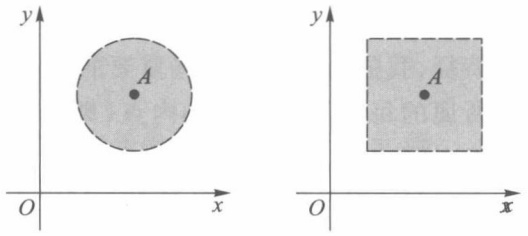
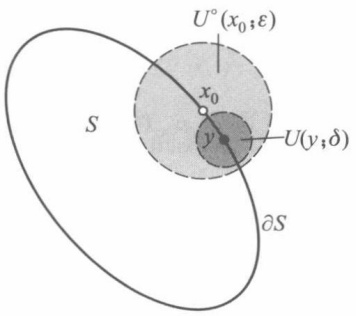
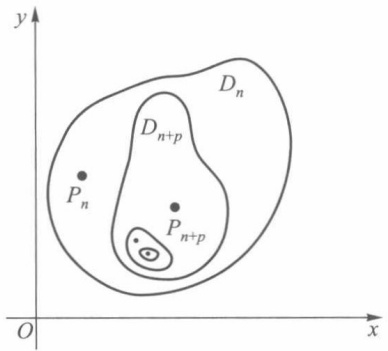
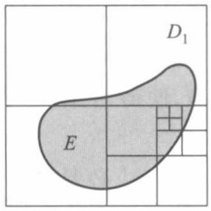
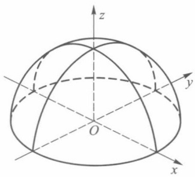
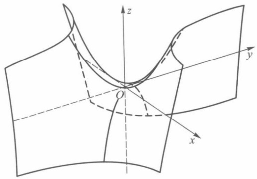
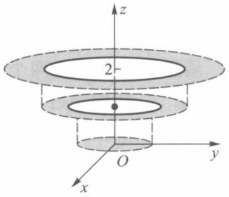

# 第16章 多元函数的极限与连续

原始 PDF 第 90–109 页。

第十六章

多元函数的极限与连续

## §1 平面点集与多元函数

多元函数是一元函数的推广,因此它保留着一元函数的许多性质,但也由于自变量由一个增加到多个,产生了某些新的性质,读者对这些性质尤其要加以注意.对于多元函数,我们将着重讨论二元函数.在掌握了二元函数的有关理论与研究方法之后,我们可以把它们推广到一般的多元函数中去.

一元函数的定义域是实数轴上的点集,二元函数的定义域将是坐标平面上的点集.因此,在讨论二元函数之前,有必要先了解有关平面点集的一些基本概念.

## 一、平面点集

由平面解析几何知道,当在平面上确定了一个坐标系(今后如不特别指出,都假定是直角坐标系)之后,所有有序实数对 $^{①}(x,y)$ 与平面上所有的点之间建立了一一对应.因此,今后将把“数对”与“平面上的点”这两种说法看作是完全等同的.这种确定了坐标系的平面,称为坐标平面.

坐标平面上满足某种条件 P 的点的集合称为平面点集, 并记作

$$
E = \{(x, y) \mid (x, y) \text {满足条件} P \}.
$$

例如,全平面上的点所组成的点集是

$$
\mathbf {R} ^ {2} = \{(x, y) | - \infty <   x <   + \infty , - \infty <   y <   + \infty \}. \tag {1}
$$

平面上以原点为中心、r 为半径的圆内所有的点的集合是

$$
C = \{(x, y) \mid x ^ {2} + y ^ {2} <   r ^ {2} \}. \tag {2}
$$

而集合

$$
S = \{(x, y) \mid a \leqslant x \leqslant b, c \leqslant y \leqslant d \} \tag {3}
$$

则为一矩形及其内部所有点的全体,为书写上的方便,也常把它记作 $[a,b]\times[c,d]^{②}$ .
平面点集

<small>① 或简称“数对”.</small>

<small>② 一般地，对于任意两个数集（或点集） $A, B$ ，记 $A \times B = \{(x, y) \mid x \in A, y \in B\}$，称为 $A$ 与 $B$ 的直积。例如 $A = \{(u, v) \mid u^2 + v^2 \leqslant 1\}, B = [0, 1]$，则 $A \times B = \{(u, v, w) \mid u^2 + v^2 \leqslant 1, 0 \leqslant w \leqslant 1\}$</small>

82

---

§ 1 平面点集与多元函数

$$
\{(x, y) \mid (x - x _ {0}) ^ {2} + (y - y _ {0}) ^ {2} <   \delta^ {2} \}
$$

与

$$
\{(x, y) \mid | x - x _ {0} | <   \delta , | y - y _ {0} | <   \delta \}
$$

分别称为以点 $A(x_0,y_0)$ 为中心的 $\delta$ 圆邻域与 $\delta$ 方邻域（图16-1）.

图16-1

由于点 $A$ 的任一个圆邻域总包含有点 $A$ 的某一个方邻域（反之亦然），因此通常用“点 $A$ 的 $\delta$ 邻域”或“点 $A$ 的邻域”泛指这两种形状的邻域，并以记号 $U(A; \delta)$ 或 $U(A)$ 来表示。点 $A$ 的空心邻域是指

$$
\{(x, y) \mid 0 <   (x - x _ {0}) ^ {2} + (y - y _ {0}) ^ {2} <   \delta^ {2} \}
$$

或 $\{(x,y)\mid |x - x_0| <   \delta ,|y - y_0| <   \delta ,(x,y)\neq (x_0,y_0)\}$

并用记号  $U^{\circ}(A;\delta)$  或  $U^{\circ}(A)$  来表示.

下面利用邻域来描述点和点集之间的关系.

任意一点  $A \in R^{2}$  与任意一个点集  $E \subset R^{2}$  之间必有以下三种关系之一:

(i) 内点——若存在点 $A$ 的某邻域 $U(A)$, 使得 $U(A) \subset E$, 则称点 $A$ 是点 $E$ 的内点. $E$ 的全体内点构成的集合称为 $E$ 的内部, 记作 $\operatorname{int} E$.
（ii）外点——若存在点 $A$ 的某邻域 $U(A)$，使得 $U(A) \cap E = \varnothing$，则称 $A$ 是点集 $E$ 的外点.
（iii）界点——若在点 A 的任何邻域内既含有属于 E 的点，又含有不属于 E 的点，则称 A 是集合 E 的界点。即对任何正数  $\delta$ ，恒有

$$
U (A; \delta) \cap E \neq \varnothing \text {且} U (A; \delta) \cap E ^ {c} \neq \varnothing ,
$$

其中 $E^{c} = \mathbf{R}^{2}\backslash E$ 是 $E$ 关于全平面的余集. $E$ 的全体界点构成 $E$ 的边界，记作 $\partial E$.

E 的内点必定属于 E, E 的外点必定不属于 E, E 的界点可能属于 E, 也可能不属于 E.

点 A 与点集 E 的上述关系是按“点 A 在 E 内或在 E 外”来区分的. 此外, 还可按在点 A 的近旁是否密集着 E 中无穷多个点而构成另一类关系:

(i) 聚点——若在点 A 的任何空心邻域  $U^{\circ}(A)$  内都含有 E 中的点，则称 A 是 E 的聚点，聚点本身可能属于 E，也可能不属于 E.

$A$ 是点集 $E$ 的聚点的定义等价于“点 $A$ 的任何邻域 $U(A)$ 包含有 $E$ 的无穷多个点”.

（ii）孤立点——若点 $A \in E$，但不是 $E$ 的聚点，即存在某一正数 $\delta$，使得 $U^{\circ}(A; \delta) \cap E = \varnothing$，则称点 $A$ 是 $E$ 的孤立点。

显然,孤立点一定是界点,内点和非孤立的界点一定是聚点,既不是聚点,又不是孤立点,则必为外点.

83

---

第十六章 多元函数的极限与连续

例1 设平面点集

$$
D = \{(x, y) \mid 1 \leqslant x ^ {2} + y ^ {2} <   4 \}. \tag {4}
$$

满足 $1 < x^{2} + y^{2} < 4$ 的一切点都是 $D$ 的内点，满足 $x^{2} + y^{2} = 1$ 的一切点是 $D$ 的界点，它们都属于 $D$ ，满足 $x^{2} + y^{2} = 4$ 的一切点也是 $D$ 的界点，但它们都不属于 $D$ ，点集 $D$ 连同它外圆边界上的一切点都是 $D$ 的聚点.

根据点集中所属点的特征,我们再来定义一些重要的平面点集.

开集——若平面点集所属的每一点都是 $E$ 的内点（即 $\operatorname{int} E = E$），则称 $E$ 为开集.

闭集——若平面点集 $E$ 的所有聚点都属于 $E$, 则称 $E$ 为闭集. 若点集 $E$ 没有聚点, 这时也称 $E$ 为闭集.

在前面列举的平面点集中，(2)所表示的点集 $C$ 是开集，(3)所表示的点集 $S$ 是闭集，(4)所表示的点集 $D$ 既非开集，又非闭集，而且(1)所表示的点集 $\mathbf{R}^2$ 既是开集又是闭集.此外，还约定空集 $\varnothing$ 既是开集又是闭集.可以证明，在一切平面点集中，只有 $\mathbf{R}^2$ 与 $\varnothing$ 是既开又闭的点集.

开域——若非空开集 E 具有连通性, 即 E 中任意两点之间都可用一条完全含于 E 的有限折线(由有限条直线段连接而成的折线)相连接, 则称 E 为开域(即开域就是非空连通开集).

闭域——开域连同其边界所成的点集称为闭域.

区域——开域、闭域,或者开域连同其一部分界点所成的点集,统称为区域.

在上述诸例中，(2)是开域，(3)是闭域，(1)既是开域又是闭域.

又如

$$
E = \{(x, y) \mid x y > 0 \} \tag {5}
$$

虽然是开集,但因Ⅰ、Ⅲ象限之间不具有连通性,所以它不是开域,也不是区域.

有界点集——对于平面点集 $E$ ，若存在某一正数 $r$ ，使得

$$
E \subset U (O; r),
$$

其中 O 是坐标原点(也可以是其他固定点), 则称 E 是有界点集. 否则就是无界点集. 上述(2)、(3)、(4)都是有界点集, (1)、(5)则是无界点集.

E 为有界点集的另一等价说法是: 存在矩形区域  $D = [a, b] \times [c, d] \supset E$ .

点集的有界性还可用点集的直径来反映,所谓点集 E 的直径,就是

$$
d (E) = \sup _ {P _ {1}, P _ {2} \in E} \rho (P _ {1}, P _ {2}),
$$

其中 $\rho(P_1, P_2)$ 表示 $P_1$ 与 $P_2$ 两点之间的距离，当 $P_1, P_2$ 的坐标分别为 $(x_1, y_1)$ 和 $(x_2, y_2)$ 时，则

$$
\rho (P _ {1}, P _ {2}) = \sqrt {(x _ {1} - x _ {2}) ^ {2} + (y _ {1} - y _ {2}) ^ {2}}.
$$

于是,当且仅当  $d(E)$  为有限值时 E 是有界点集.

根据距离概念,读者不难证明如下三角形不等式,即对  $R^{2}$  上任何三点  $P_{1}, P_{2}$  和  $P_{3}$ ,皆有

$$
\rho (P _ {1}, P _ {2}) \leqslant \rho (P _ {1}, P _ {3}) + \rho (P _ {2}, P _ {3}).
$$

例 2 证明: 对任何  $S \subset R^{2}$ ,  $\partial S$  恒为闭集.

证 如图16-2所示, 设 $x_0$ 为 $\partial S$ 的任一聚点, 要证 $x_0 \in \partial S$. 为此, 任给 $\varepsilon > 0$, 由聚点

84

---

§ 1 平面点集与多元函数

定义, 存在  $y \in U^{\circ}(x_{0}; \varepsilon) \cap \partial S$ . 又 y 是 S 的界点, 所以对任意  $U(y; \delta) \subset U(x_{0}; \varepsilon)$ ,  $U(y; \delta)$  上既有 S 的点, 又有非 S 的点. 于是  $U(x_{0}; \varepsilon)$  上也既有 S 的点, 又有非 S 的点, 由  $\varepsilon$  的任意性, 推知  $x_{0}$  是 S 的界点, 即  $x_{0} \in \partial S$ , 这就证明了  $\partial S$  是闭集. ☐

## 二、$\mathbf{R}^2$ 上的完备性定理

反映实数系完备性的几个等价定理,构成了一元函数极限理论的基础.现在把这些定理推广到  $R^{2}$ , 它们同

text_image

U°(x₀;ε)
x₀
y
U(y;δ)
∂S

图16-2

样是二元函数极限理论的基础. 为此, 先给出平面点列的收敛性概念.

定义1 设 $\{P_n\} \subset \mathbf{R}^2$ 为平面点列, $P_0 \in \mathbf{R}^2$ 为一固定点. 若对任给的正数 $\varepsilon$, 存在正整数 $N$, 使得当 $n > N$ 时, 有 $P_n \in U(P_0; \varepsilon)$, 则称点列 $\{P_n\}$ 收敛于点 $P_0$, 记作

$$
\lim _ {n \to \infty} P _ {n} = P _ {0} \quad \text {或} \quad P _ {n} \to P _ {0}, n \to \infty .
$$

在坐标平面中，以 $(x_{n},y_{n})$ 与 $(x_0,y_0)$ 分别表示 $P_{n}$ 与 $P_{0}$ 时， $\lim_{n\to \infty}P_n = P_0$ 显然等价于$\lim_{n\to \infty}x_n = x_0,\lim_{n\to \infty}y_n = y_0.$ 同样地，当以 $\rho_{n} = \rho (P_{n},P_{0})$ 表示点 $P_{n}$ 与 $P_{0}$ 之间距离时， $\lim_{\bar{n}\to \infty}P_n =$ $P_{0}$ 也就等价于 $\lim_{n\to \infty}\rho_n = 0.$ 由于点列极限这两种等价形式都是数列极限，因此立即得到下述关于平面点列的收敛原理.

定理 16.1(柯西准则) 平面点列  $\{P_{n}\}$  收敛的充要条件是: 任给正数  $\varepsilon$ , 存在正整数 N, 使得当 n > N 时, 对一切正整数 p, 都有

$$
\rho (P _ {n}, P _ {n + p}) <   \varepsilon . \tag {6}
$$

证 [必要性] 设 $\lim_{n\to \infty}P_n = P_0$ ，则由三角形不等式

$$
\rho (P _ {n}, P _ {n + p}) \leqslant \rho (P _ {n}, P _ {0}) + \rho (P _ {n + p}, P _ {0})
$$

及点列收敛定义,对所给  $\varepsilon$ , 存在正整数 N, 当 n > N (也有  $n + p > N$ ) 时, 恒有

$$
\rho (P _ {n}, P _ {0}) <   \frac {\varepsilon}{2}, \quad \rho (P _ {n + p}, P _ {0}) <   \frac {\varepsilon}{2}.
$$

应用三角形不等式,立刻得到(6)式.

[充分性] 当(6)式成立时,则同时有

$$
\begin{array}{l} \mid x _ {n + p} - x _ {n} \mid \leqslant \rho (P _ {n}, P _ {n + p}) <   \varepsilon , \\ \mid y _ {n + p} - y _ {n} \mid \leqslant \rho (P _ {n}, P _ {n + p}) <   \varepsilon . \\ \end{array}
$$

这说明数列 $\{x_{n}\}$ 和 $\{y_{n}\}$ 都满足柯西收敛准则（定理2.11），所以它们都收敛.设 $\lim_{n\to \infty}x_n = x_0,\lim_{n\to \infty}y_n = y_0.$ 从而由点列收敛概念推得 $\{P_n\}$ 收敛于点 $P_0(x_0,y_0)$ （本节习题6）.

定理 16.2(闭域套定理) 设  $\{D_{n}\}$  是  $R^{2}$  中的闭域列, 它满足:

(i)  $D_{n} \supset D_{n+1}, n=1,2,\cdots;$
(ii)  $d_{n}=d(D_{n}),\lim_{n\to\infty}d_{n}=0,$

则存在惟一的点  $P_{0} \in D_{n}, n = 1, 2, \cdots$ .

证 任取点列 $P_{n} \in D_{n}, n = 1,2,\dots$. 由于 $D_{n+p} \subset D_{n}$, 因此 $P_{n}, P_{n+p} \in D_{n}$, 从而有 (图16-3)

$$
\rho (P _ {n}, P _ {n + p}) \leqslant d _ {n} \rightarrow 0, n \rightarrow \infty .
$$

85

---

第十六章 多元函数的极限与连续

由定理 16.1 知道存在  $P_{0} \in R^{2}$ ，使得

$$
\lim _ {n \to \infty} P _ {n} = P _ {0}.
$$

任意取定 n, 对任何正整数 p, 有

$$
P _ {n + p} \in D _ {n + p} \subset D _ {n}.
$$

再令 $p \to \infty$，由于 $D_{n}$ 是闭域，从而必定是闭集（本节习题4）。因此 $P_{0}$ 作为 $D_{n}$ 的聚点必定属于 $D_{n}$，即

$$
P _ {0} = \lim _ {p \to \infty} P _ {n + p} \in D _ {n}, n = 1, 2, \dots .
$$

最后证明  $P_{0}$  的惟一性. 若还有  $P_{0}^{\prime} \in D_{n}, n = 1, 2, \cdots$ , 则由

text_image

y
Dₙ
Dₙ₊ₚ
Pₙ
Pₙ₊ₚ
O
x

图16-3

$$
\rho (P _ {0}, P _ {0} ^ {\prime}) \leqslant \rho (P _ {0}, P _ {n}) + \rho (P _ {0} ^ {\prime}, P _ {n}) \leqslant 2 d _ {n} \rightarrow 0, n \rightarrow \infty
$$

得到  $\rho(P_{0}, P_{0}^{\prime}) = 0$ ，即  $P_{0} = P_{0}^{\prime}$ .

闭域套定理显然是 R 中闭区间套定理(定理 7.1)的直接推广.

推论 对上述闭域套 $\{D_n\}$, 任给 $\varepsilon > 0$, 存在 $N \in \mathbf{N}_+$, 当 $n > N$ 时, 有 $D_n \subset U(P_0; \varepsilon)$.

另外, 把  $\{D_{n}\}$  改为闭集套时, 定理 16.2 仍然成立.

定理 16.3(聚点定理) 设  $E \subset R^{2}$  为有界无限点集, 则 E 在  $R^{2}$  中至少有一个聚点.

证 现用闭域套定理来证明. 由于 $E$ 是平面有界集合, 因此存在一个闭正方形 $D_{1}$ 包含它. 连接正方形对边中点, 把 $D_{1}$ 分成四个小的闭正方形, 则在这四个小闭正方形中, 至少有一个小闭正方形含有 $E$ 中无限多个点. 记这个小闭正方形为 $D_{2}$. 再对正方形 $D_{2}$ 如上法分成四个更小的闭正方形, 其中又至少有一个小闭正方形含有 $E$ 的无限多个点. 如此下去得到一个闭正方形序列 (图 16-4):

text_image

D₁
E

图16-4

$$
D _ {1} \supset D _ {2} \supset D _ {3} \supset \dots .
$$

容易看到这个闭正方形序列 $\{D_{n}\}$ 的边长随着n趋向于无限而趋向于零.于是由闭域套定理,存在一点 $M_{0}\in D_{n},n=1,2,\cdots$ .

现在证明 $M_0$ 就是 $E$ 的聚点. 任取 $M_0$ 的 $\varepsilon$ 邻域 $U(M_0; \varepsilon)$, 当 $n$ 充分大之后, 正方形的边长可小于 $\varepsilon / 2$, 即有 $D_n \subset U(M_0; \varepsilon)$. 又由 $D_n$ 的取法知道 $U(M_0; \varepsilon)$ 中含有 $E$ 的无限多个点, 这就表明 $M_0$ 是 $E$ 的聚点.

与一元情形类似,定理 16.3 与定理 16.3'等价.

定理 16.3' 有界无限点列  $\{P_{n}\} \subset R^{2}$  必存在收敛子列  $\{P_{n_{k}}\}$ .

证明留给读者.

定理 16.4(有限覆盖定理) 设  $D \subset R^{2}$  为一有界闭域,  $\{\Delta_{\alpha}\}$  为一开域族, 它覆盖了 D (即  $D \subset \bigcup_{\alpha} \Delta_{\alpha}$ ), 则在  $\{\Delta_{\alpha}\}$  中必存在有限个开域  $\Delta_{1}, \Delta_{2}, \cdots, \Delta_{n}$ , 它们同样覆盖了 D (即  $D \subset \bigcup_{i=1}^{n} \Delta_{i}$ ).

本定理的证明与 R 中的有限覆盖定理(定理 7.3)相仿,在此从略.

在更一般的情况下,可将定理16.4中的D改设为有界闭集,而 $\Delta_{\alpha}\subset R^{2}$ 为一族开

86

---

§ 1 平面点集与多元函数

集,此时定理结论依然成立.

## 三、二元函数

函数(或映射)是两个集合之间的一种确定的对应关系. R 到 R 的映射是一元函数, 而  $R^{2}$  到 R 的映射是二元函数.

定义2 设平面点集 $D \subset \mathbb{R}^2$，若按照某对应法则 $f, D$ 中每一点 $P(x, y)$ 都有惟一确定的实数 $z$ 与之对应，则称 $f$ 为定义在 $D$ 上的二元函数（或称 $f$ 为 $D$ 到 $\mathbf{R}$ 的一个映射），记作

$$
\begin{array}{c}f: D \rightarrow \mathbf {R},\\P \longmapsto z,\end{array}\tag {7}
$$

且称 $D$ 为 $f$ 的定义域. $P \in D$ 所对应的 $z$ 为 $f$ 在点 $P$ 的函数值, 记作 $z = f(P)$ 或 $z = f(x, y)$. 全体函数值的集合为 $f$ 的值域, 记作 $f(D) \subset \mathbf{R}$. 通常还把 $P$ 的坐标 $x$ 与 $y$ 称为 $f$ 的自变量, 而把 $z$ 称为因变量.

在映射意义下,上述  $z=f(P)$  称为 P 的象,P 称为 z 的原象.当把  $(x,y)\in D$  和它所对应的象  $z=f(x,y)$  一起组成三维数组  $(x,y,z)$  时,三维欧氏空间  $R^{3}$  中的点集

$$
S = \{(x, y, z) \mid z = f (x, y), (x, y) \in D \} \subset \mathbf {R} ^ {3}
$$

便是二元函数 $f$ 的图像. 通常 $z = f(x, y)$ 的图像是一空间曲面, $f$ 的定义域 $D$ 便是该曲面在 $xOy$ 平面上的投影.

为方便起见,由(7)式所确定的二元函数也记作

$$
z = f (x, y), \quad (x, y) \in D
$$

或 $z = f(P),\quad P\in D,$

且当它的定义域 $D$ 不会被误解的情况下，也简单地说“函数 $z = f(x,y)$”或“函数 $f$ ”.

例3 函数 $z = 2x + 5y$ 的图像是 $\mathbf{R}^3$ 中一个平面，其定义域是 $\mathbf{R}^2$ ，值域是 $\mathbf{R}$ □

例4 函数 $z = \sqrt{1 - (x^2 + y^2)}$ 的定义域是 $xOy$ 平面上的单位圆域 $\{(x, y) | x^2 + y^2 \leqslant 1\}$, 值域为区间 $[0, 1]$, 它的图像是以原点为中心的单位球面的上半部分（图16-5）.

例 5 z=xy 是定义在整个 xOy 平面上的函数, 它的图像是过原点的双曲抛物面 (图 16-6).

text_image

z
y
O
x

图16-5

text_image

z
y
O
x

图16-6

例6 $z = \left[\sqrt{x^2 + y^2}\right]$ 是定义在 $\mathbf{R}^2$ 上的函数，值域是全体非负整数，它的图形如图

87

---

第十六章 多元函数的极限与连续

16-7 所示.

若二元函数的值域是有界数集,则称该函数为有界函数,如例4中的函数;若值域是无界数集,则称该函数为无界函数,如例3、例5、例6中的函数.

与一元函数相类似，$f$ 在 $D$ 上无界的充要条件是存在 $\{P_k\} \subset D$，使 $\lim_{k\to \infty}f(P_k) = \infty$，这里 $D\subset \mathbf{R}^2$.

## 四、$n$ 元函数

text_image

z
2
O
y
x

图16-7

所有有序实数组 $(x_{1},x_{2},\cdots,x_{n})$ 的全体称为n维向量

空间,简称 n 维空间,记作  $R^{n}$ . 其中每个有序实数组  $(x_{1}, x_{2}, \cdots, x_{n})$  称为  $R^{n}$  中的一个点, n 个实数  $x_{1}, x_{2}, \cdots, x_{n}$  是这个点的坐标.

设 E 为  $R^{n}$  中的点集, 若有某个对应法则 f, 使 E 中每一点  $P(x_{1}, x_{2}, \cdots, x_{n})$  都有惟一的一个实数 y 与之对应, 则称 f 为定义在 E 上的 n 元函数 (或称 f 为  $E \subset R^{n}$  到 R 的一个映射), 记作

$$
f \colon E \to \mathbf {R},
$$

$$
(x _ {1}, x _ {2}, \dots , x _ {n}) \mapsto y. \tag {8}
$$

也常把 $n$ 元函数简写成

$$
y = f (x _ {1}, x _ {2}, \dots , x _ {n}), \quad (x _ {1}, x _ {2}, \dots , x _ {n}) \in E
$$

或

$$
y = f (P), \quad P \in E. \tag {9}
$$

对于后一种被称为“点函数”的写法,它可使多元函数与一元函数在形式上尽量保持一致,以便仿照一元函数的办法来处理多元函数中的许多问题,同时还可把二元函数的某些论断推广到  $n(\geqslant3)$  元函数.

## 习题 16.1

1. 判断下列平面点集中哪些是开集、闭集、有界集、区域，并分别指出它们的聚点与界点:

(1) $[a, b) \times [c, d)$;

(2)  $\{(x,y) | xy \neq 0\}$ ;

(3)  $\{(x,y) \mid xy = 0\}$ ;

(4) $\{(x, y) | y > x^2\}$;

(5)  $\{(x,y)\mid x<2,y<2,x+y>2\}$ ;

(6)  $\{(x,y)\mid x^{2}+y^{2}=1 \text{ 或 } y=0,0\leqslant x\leqslant1\}$ ;

(7)  $\{(x,y)\mid x^{2}+y^{2}\leqslant1$  或  $y=0,1\leqslant x\leqslant2\}$ ;

(8) $\{(x,y)\mid x,y\text{均为整数}\}$ ;

(9)  $\{(x,y)\mid y=\sin\frac{1}{x},x>0\}$ .

2. 试问集合 $\{(x, y) \mid 0 < |x - a| < \delta, 0 < |y - b| < \delta\}$ 与集合 $\{(x, y) \mid |x - a| < \delta, |y - b| < \delta, (x, y) \neq (a, b)\}$ 是否相同？

3. 证明: 当且仅当存在各点互不相同的点列  $\{P_{n}\} \subset E, P_{n} \neq P_{0}, \lim_{n \to \infty} P_{n} = P_{0}$  时,  $P_{0}$  是 E 的聚点.

4. 证明: 闭域必为闭集. 举例说明反之不真.

5. 对任何点集  $S \subset R^{2}$ ，导集  $S^{d}$  亦为闭集.

6. 证明: 点列  $\left\{P_{n}(x_{n},y_{n})\right\}$  收敛于  $P_{0}(x_{0},y_{0})$  的充要条件是  $\lim_{n\to\infty}x_{n}=x_{0}$  和  $\lim_{n\to\infty}y_{n}=y_{0}$ .

88

---

§ 2 二元函数的极限

7. 求下列各函数的函数值:

(1) $f(x,y)=\left[\frac{\arctan(x+y)}{\arctan(x-y)}\right]^{2}$, 求 $f\left(\frac{1+\sqrt{3}}{2},\frac{1-\sqrt{3}}{2}\right)$;
(2) $f(x,y)=\frac{2xy}{x^{2}+y^{2}}$, 求 $f\left(1,\frac{y}{x}\right)$;
(3) $f(x,y) = x^{2} + y^{2} - xy\tan \frac{x}{y}$, 求 $f(tx,ty)$.

8. 设 $F(x, y) = \ln x \ln y$，证明:若 $u > 0, v > 0$，则

$$
F (x y, u v) = F (x, u) + F (x, v) + F (y, u) + F (y, v).
$$

9. 求下列各函数的定义域, 画出定义域的图形, 并说明是何种点集:

(1)  $f(x, y) = \frac{x^{2} + y^{2}}{x^{2} - y^{2}}$ ;

(2) $f(x,y)=\frac{1}{2x^{2}+3y^{2}}$;

(3) $f(x, y) = \sqrt{xy}$;

(4) $f(x, y) = \sqrt{1 - x^2} + \sqrt{y^2 - 1}$;

(5)  $f(x, y) = \ln x + \ln y;$

(6)  $f(x, y) = \sqrt{\sin{(x^{2} + y^{2})}}$ ;

(7) $f(x, y) = \ln (y - x)$;

(8) $f(x,y) = \mathrm{e}^{-(x^2 + y^2)}$;

(9)  $f(x, y, z) = \frac{z}{x^{2} + y^{2} + 1}$ ;

(10) $f(x, y, z) = \sqrt{R^2 - x^2 - y^2 - z^2} + \frac{1}{\sqrt{x^2 + y^2 + z^2 - r^2}} \quad (R > r)$.

10. 证明: 开集与闭集具有对偶性——若 E 为开集, 则  $E^{c}$  为闭集; 若 E 为闭集, 则  $E^{c}$  为开集.

11. 证明:

(1) 若  $F_{1}, F_{2}$  为闭集，则  $F_{1} \cup F_{2}$  与  $F_{1} \cap F_{2}$  都为闭集；
(2) 若  $E_{1}, E_{2}$  为开集，则  $E_{1} \cup E_{2}$  与  $E_{1} \cap E_{2}$  都为开集；
(3) 若 F 为闭集, E 为开集, 则  $F \setminus E$  为闭集,  $E \setminus F$  为开集.
12. 试把闭域套定理推广为闭集套定理,并证明之.
13. 证明定理 16.4(有限覆盖定理).
14. 证明:设 $D \subset \mathbf{R}^2$，则 $f$ 在 $D$ 上无界的充要条件是存在 $\{P_k\} \subset D$，使 $\lim_{k \to \infty} f(P_k) = \infty$.

## § 2 二元函数的极限

与一元函数的极限相类似,二元函数的极限同样是二元函数微积分的基础.但因自变量个数的增多,导致二元函数的极限要比一元函数的极限复杂很多.

## 一、二元函数的极限

定义1 设 $f$ 为定义在 $D \subset \mathbf{R}^2$ 上的二元函数, $P_0$ 为 $D$ 的一个聚点, $A$ 是一个确定的实数. 若对任给正数 $\varepsilon$, 总存在某正数 $\delta$, 使得当 $P \in U^\circ(P_0; \delta) \cap D$ 时, 都有

$$
\mid f (P) - A \mid <   \varepsilon ,
$$

则称 $f$ 在 $D$ 上当 $P \to P_0$ 时以 $A$ 为极限，记作

$$
\lim_{\substack{P\to P_{0}\\ P\in D}}f(P) = A. \tag{1}
$$

89

---

第十六章 多元函数的极限与连续

在对于 $P \in D$ 不致产生误解时, 也可简单地写作

$$
\lim _ {P \to P _ {0}} f (P) = A. \tag {$1^{\prime$}}
$$

当 $P, P_0$ 分别用坐标 $(x, y), (x_0, y_0)$ 表示时，$(1')$ 式也常写作

$$
\lim _ {(x, y) \to (x _ {0}, y _ {0})} f (x, y) = A. \tag {$1^{\prime\prime$}}
$$

例1 依定义验证 $\lim_{(x,y)\to (2,1)}(x^2 +xy + y^2) = 7.$

证 因为

$$
\begin{array}{l} \left| x ^ {2} + x y + y ^ {2} - 7 \right| \\ = \left| (x ^ {2} - 4) + x y - 2 + (y ^ {2} - 1) \right| \\ = | (x + 2) (x - 2) + (x - 2) y + 2 (y - 1) + (y + 1) (y - 1) | \\ \leqslant | x - 2 | | x + y + 2 | + | y - 1 | | y + 3 |, \\ \end{array}
$$

先限制在点(2,1)的 $\delta = 1$ 的方邻域

$$
\{(x, y) \mid | x - 2 | <   1, | y - 1 | <   1 \}
$$

上讨论,于是有

$$
\begin{array}{l} \mid y + 3 \mid = \mid y - 1 + 4 \mid \leqslant \mid y - 1 \mid + 4 <   5, \\ \mid x + y + 2 \mid = \mid (x - 2) + (y - 1) + 5 \mid \\ \leqslant | x - 2 | + | y - 1 | + 5 <   7. \\ \end{array}
$$

所以

$$
\begin{array}{l} \left| x ^ {2} + x y + y ^ {2} - 7 \right| <   7 \left| x - 2 \right| + 5 \left| y - 1 \right| \\ <   7 \left(\mid x - 2 \mid + \mid y - 1 \mid\right). \\ \end{array}
$$

设 $\varepsilon$ 为任给的正数，取 $\delta = \min \left\{1, \frac{\varepsilon}{14}\right\}$，则当 $|x - 2| < \delta, |y - 1| < \delta, (x, y) \neq (2, 1)$ 时，就有

$$
\left| x ^ {2} + x y + y ^ {2} - 7 \right| <   7 \cdot 2 \delta = 1 4 \delta <   \varepsilon ,
$$

即 $\lim_{(x,y)\to (2,1)}(x^2 +xy + y^2) = 7.$

例2 设

$$
f (x, y) = \left\{ \begin{array}{l l} x y \frac {x ^ {2} - y ^ {2}}{x ^ {2} + y ^ {2}}, & (x, y) \neq (0, 0), \\ 0, & (x, y) = (0, 0), \end{array} \right.
$$

证明 $\lim_{(x,y)\to (0,0)}f(x,y) = 0.$

证 对函数的自变量作极坐标变换 $x = r\cos \varphi, y = r\sin \varphi$. 这时 $(x, y) \to (0, 0)$ 等价于对任何 $\varphi$ 都有 $r \to 0$. 由于

$$
\begin{array}{l} \mid f (x, y) - 0 \mid = \left| x y \frac {x ^ {2} - y ^ {2}}{x ^ {2} + y ^ {2}} \right| \\ = \frac {1}{4} r ^ {2} \mid \sin 4 \varphi \mid \leqslant \frac {1}{4} r ^ {2}, \\ \end{array}
$$

因此，对任何 $\varepsilon > 0$ ，只需取 $\delta = 2\sqrt{\varepsilon}$ ，当 $0 < r = \sqrt{x^2 + y^2} < \delta$ 时，不管 $\varphi$ 取什么值都有 $|f(x,y) - 0| < \varepsilon$ ，即 $\lim_{(x,y)\to (0,0)}f(x,y) = 0.$

下述定理及其推论相当于数列极限的子列定理与一元函数极限的海涅归结原则

90

---

§ 2 二元函数的极限

(而且证明方法也相似). 读者可通过它们进一步认识定义1中“ $P \rightarrow P_{0}$ ”所包含的意义.

定理 16.5  $\lim_{\substack{P\to P_{0}\\ P\in D}}f(P)=A$  的充要条件是: 对于 D 的任一子集 E, 只要  $P_{0}$  是 E 的聚点, 就有

$$
\lim_{\substack{P\to P_{0}\\ P\in E}}f(P) = A.
$$

推论1 设 $E_{1} \subset D, P_{0}$ 是 $E_{1}$ 的聚点. 若 $\lim_{\substack{P \to P_0 \\ P \in E_1}} f(P)$ 不存在, 则 $\lim_{\substack{P \to P_0 \\ P \in D}} f(P)$ 也不存在.

推论2 设 $E_{1}, E_{2} \subset D, P_{0}$ 是它们的聚点，若存在极限

$$
\lim_{\substack{P\to P_{0}\\ P\in E_{1}}}f(P) = A_{1},\quad \lim_{\substack{P\to P_{0}\\ P\in E_{2}}}f(P) = A_{2},
$$

但  $A_{1} \neq A_{2}$ ，则  $\lim_{\substack{P \to P_{0} \\ P \in D}} f(P)$  不存在.

推论3 极限 $\lim_{\substack{P\to P_0\\ P\in D}}f(P)$ 存在的充要条件是:对于 $D$ 中任一满足条件 $P_{n}\neq P_{0}$ 且 $\lim_{n\to \infty}P_n = P_0$ 的点列 $\{P_n\}$，它所对应的数列 $\{f(P_n)\}$ 都收敛.

下面两个例子是它们的应用.

例3 讨论 $f(x, y) = \frac{xy}{x^2 + y^2}$ 当 $(x, y) \to (0, 0)$ 时是否存在极限.

解 当动点 $(x, y)$ 沿着直线 $y = mx$ 而趋于定点 $(0, 0)$ 时，由于此时 $f(x, y) = f(x, mx) = \frac{m}{1 + m^2}$，因而有

$$
\lim_{\substack{(x,y)\to (0,0)\\ y = mx}}f(x,y) = \lim_{x\to 0}f(x,mx) = \frac{m}{1 + m^2}.
$$

这一结果说明动点沿不同斜率 m 的直线趋于原点时, 对应的极限值也不同, 因此所讨论的极限不存在. □

例4 二元函数

$$
f (  x  , y  ) = \left\{ \begin{array}{l l} {{1  ,}} & {{0 <   y <   x ^ {2}  ,   -   \infty    <   x <   +   \infty  ,}} \\ {{0  ,}} & {{\text {其余部分}.}} \end{array} \right.
$$

如图16-8所示，当 $(x,y)$ 沿任何直线趋于原点时，相应的 $f(x,y)$ 都趋于零，但这并不表明此函数在 $(x,y)\rightarrow (0,$ 0)时极限存在.因为当点 $(x,y)$ 沿抛物线 $y = kx^{2}$ （ $0 < k <$ 1)趋于 $O$ 点时， $f(x,y)$ 将趋于1.所以极限

$$
\lim _ {(x, y) \to (0, 0)} f (x, y)
$$

不存在.

text_image

y
f=0
f=1
O
x
f=1
f=0

图16-8

下面我们再给出当 $P(x,y)\rightarrow P_0(x_0,y_0)$ 时，$f(x,y)$ 趋于 $+\infty$ （非正常极限）的定义.

定义2 设 $D$ 为二元函数 $f$ 的定义域, $P_0(x_0, y_0)$ 是 $D$ 的一个聚点. 若对任给正数 $M$, 总存在点 $P_0$ 的一个 $\delta$ 邻域, 使得当 $P(x, y) \in U^\circ(P_0; \delta) \cap D$ 时, 都有 $f(P) > M$, 则称 $f$ 在 $D$ 上当 $P \to P_0$ 时, 存在非正常极限 $+\infty$, 记作

91

---

第十六章 多元函数的极限与连续

$$
\lim _ {(x, y) \to (x _ {0}, y _ {0})} f (x, y) = + \infty
$$

或 $\lim_{P\to P_0}f(P) = +\infty .$

仿此可类似地定义

$$
\lim _ {P \to P _ {0}} f (  P  ) = -   \infty \qquad {\text {与}} \qquad \lim _ {P \to P _ {0}} f (  P  ) = \infty  .
$$

例 5 设  $f(x,y)=\frac{1}{2x^{2}+3y^{2}}$ . 证明

$$
\lim _ {(x, y) \to (0, 0)} f (x, y) = + \infty .
$$

证 因为 $2x^{2} + 3y^{2} < 4(x^{2} + y^{2})$ ，对任给正数 $M$ ，取

$$
\delta = \frac {1}{2 \sqrt {M}},
$$

当 $\sqrt{x^2 + y^2} < \delta = \frac{1}{2\sqrt{M}}$

时,就有  $2x^{2} + 3y^{2} < \frac{1}{M}$ ,

即 $\frac{1}{2x^2 + 3y^2} > M.$

这就证得结果(该函数在原点附近的图像参见图 16-9).

二元函数极限的四则运算法则与一元函数极限的四则运算法则相仿,特别把 $f(x,y)$ 看作点函数 $f(P)$ 时,相应定理的证法也完全相同,这里就不再一一列出.

## 二、累次极限

在上一段所研究的极限 $\lim_{(x,y)\to (x_0,y_0)}f(x,y)$ 中，两个自变量 $x,y$ 同时以任何方式趋于 $x_0$ ，$y_0$ .这种极限也称为重极限.在这一段里，我们要考察 $x$ 与 $y$ 依一定的先后顺序相继趋于 $x_0$ 与 $y_0$ 时 $f$ 的极限，这种极限称为累次极限.

text_image

3D mathematical diagram showing a hyperboloid surface with labeled x, y, z axes and origin O

图16-9

定义 3 设  $f(x,y)$ ,  $(x,y)\in D$ , D 在 x 轴、y 轴上的投影分别为 X, Y, 即

$$
X = \{x \mid (x, y) \in D \}, Y = \{y \mid (x, y) \in D \},
$$

$x_0, y_0$ 分别是 $X, Y$ 的聚点. 若对每一个 $y \in Y (y \neq y_0)$, 存在极限 $\lim_{x \to x_0} f(x, y)$, 它一般与 $y$ 有关, 故记作

$$
\varphi (y) = \lim _ {x \to x _ {0}} f (x, y),
$$

如果进一步还存在极限

$$
L = \lim _ {y \to y _ {0}} \varphi (y),
$$

则称此极限 $L$ 为 $f(x,y)$ 先对 $x(\rightarrow x_0)$，后对 $y(\rightarrow y_0)$ 的累次极限，记作

$$
L = \lim _ {y \to y _ {0}} \lim _ {x \to x _ {0}} f (x, y).
$$

92

---

§ 2 二元函数的极限

类似地可以定义先对 $y$ 后对 $x$ 的累次极限

$$
K = \lim _ {x \to x _ {0}} \lim _ {y \to y _ {0}} f (x, y).
$$

累次极限与重极限是两个不同的概念,它们的存在性没有必然的蕴含关系.下面三个例子将说明这一点.

例6 设 $f(x, y) = \frac{xy}{x^2 + y^2}$. 由例3已经知道 $(x, y) \to (0, 0)$ 时 $f$ 的重极限不存在. 但当 $y \neq 0$ 时有

$$
\lim _ {x \to 0} \frac {x y}{x ^ {2} + y ^ {2}} = 0.
$$

从而有 $\lim_{y\to 0}\lim_{x\to 0}\frac{xy}{x^2 + y^2} = 0.$

同理可得 $\lim_{x\to 0}\lim_{y\to 0}\frac{xy}{x^2 + y^2} = 0.$

即 $f$ 的两个累次极限都存在而且相等.

例7 设 $f(x, y) = \frac{x - y + x^2 + y^2}{x + y}$，它关于原点的两个累次极限分别为

$$
\lim _ {y \to 0} \lim _ {x \to 0} \frac {x - y + x ^ {2} + y ^ {2}}{x + y} = \lim _ {y \to 0} \frac {y ^ {2} - y}{y} = \lim _ {y \to 0} (y - 1) = - 1
$$

与

$$
\lim _ {x \to 0} \lim _ {y \to 0} \frac {x - y + x ^ {2} + y ^ {2}}{x + y} = \lim _ {x \to 0} \frac {x + x ^ {2}}{x} = \lim _ {x \to 0} (1 + x) = 1.
$$

当沿斜率不同的直线 $y = mx, (x, y) \to (0, 0)$ 时，容易验证所得极限也不同。因此该函数的重极限不存在（下面的定理16.6将告诉我们，这是一个必然的结果）。

例8 设 $f(x, y) = x \sin \frac{1}{y} + y \sin \frac{1}{x}$，它关于原点的两个累次极限都不存在。这是因为对任何 $y \neq 0$，当 $x \to 0$ 时 $f$ 的第二项不存在极限。同理，对任何 $x \neq 0$，当 $y \to 0$ 时 $f$ 的第一项也不存在极限。但是由于

$$
\left| x \sin \frac {1}{y} + y \sin \frac {1}{x} \right| \leqslant | x | + | y |,
$$

故按定义1知道 $f$ 的重极限存在，且 $\lim_{(x,y)\to (0,0)}f(x,y) = 0.$

下述定理告诉我们:重极限与累次极限在一定条件下也是有联系的.

定理16.6 若 $f(x,y)$ 在点 $(x_0,y_0)$ 存在重极限

$$
\lim _ {(x, y) \to (x _ {0}, y _ {0})} f (x, y)
$$

与累次极限

$$
\lim _ {x \to x _ {0}} \lim _ {y \to y _ {0}} f (x, y),
$$

则它们必相等.

证设

$$
\lim _ {(x, y) \to (x _ {0}, y _ {0})} f (x, y) = A,
$$

93

---

第十六章 多元函数的极限与连续

则对任给的正数 $\varepsilon$ ，总存在正数 $\delta$ ，使得当 $P(x,y)\in U^{\circ}(P_0;\delta)$ 时，有

$$
\left| f (x, y) - A \right| <   \varepsilon . \tag {2}
$$

另由存在累次极限之假设,对任一满足不等式

$$
0 <   \left| x - x _ {0} \right| <   \delta \tag {3}
$$

的 $x$ ，存在极限

$$
\lim _ {y \to y _ {0}} f (x, y) = \varphi (x). \tag {4}
$$

回到不等式(2)，让其中 $y\to y_{0}$ ，由(4)式可得

$$
\mid \varphi (x) - A \mid \leqslant \varepsilon . \tag {5}
$$

故由(3)式、(5)式证得 $\lim_{x\to x_{0}}\varphi(x)=A$ ，即

$$
\lim _ {x \to x _ {0}} \lim _ {y \to y _ {0}} f (x, y) = \lim _ {(x, y) \to (x _ {0}, y _ {0})} f (x, y) = A.
$$

由这个定理可导出如下两个便于应用的推论.

推论 1 若累次极限

$$
\lim _ {x \to x _ {0}} \lim _ {y \to y _ {0}} f (x, y), \quad \lim _ {y \to y _ {0}} \lim _ {x \to x _ {0}} f (x, y)
$$

和重极限

$$
\lim _ {(x, y) \to (x _ {0}, y _ {0})} f (x, y)
$$

都存在,则三者相等.

推论 2 若累次极限

$$
\lim _ {x \to x _ {0}} \lim _ {y \to y _ {0}} f (x, y) \quad \text {与} \quad \lim _ {y \to y _ {0}} \lim _ {x \to x _ {0}} f (x, y)
$$

存在但不相等,则重极限  $\lim_{(x,y)\to(x_{0},y_{0})}f(x,y)$  必不存在.

请注意,定理 16.6 保证了在重极限与一个累次极限都存在时,它们必相等.(本节习题 3 则给出较定理 16.6 弱一些的充分条件.)但它们对另一个累次极限的存在性却得不出什么结论,对此只需考察本节习题 2 的(5).

推论 1 给出了累次极限次序可交换的一个充分条件, 推论 2 可被用来否定重极限的存在性(如例 7).

## 习题 16.2

1. 试求下列极限（包括非正常极限）:

(1)  $\lim_{(x,y)\to(0,0)}\frac{x^{2}y^{2}}{x^{2}+y^{2}};$

(2) $\lim_{(x,y)\to (0,0)}\frac{1 + x^2 + y^2}{x^2 + y^2};$

(3)  $\lim_{(x,y)\to(0,0)}\frac{x^{2}+y^{2}}{\sqrt{1+x^{2}+y^{2}}-1};$

(4)  $\lim_{(x,y)\to(0,0)}\frac{xy+1}{x^{4}+y^{4}};$

(5)  $\lim_{(x,y)\to(1,2)}\frac{1}{2x-y};$

(6)  $\lim_{(x,y)\to(0,0)}(x+y)\sin\frac{1}{x^{2}+y^{2}};$

(7)  $\lim_{(x,y)\to(0,0)}\frac{\sin(x^{2}+y^{2})}{x^{2}+y^{2}}.$

2. 讨论下列函数在点 $(0,0)$ 的重极限与累次极限:

94

---

§ 3 二元函数的连续性

(1) $f(x, y) = \frac{y^2}{x^2 + y^2}$;

(2) $f(x, y) = (x + y) \sin \frac{1}{x} \sin \frac{1}{y}$;

(3) $f(x, y) = \frac{x^2y^2}{x^2y^2 + (x - y)^2}$;

(4) $f(x, y) = \frac{x^3 + y^3}{x^2 + y}$;

(5)  $f(x, y) = y \sin \frac{1}{x}$ ;

(6) $f(x,y) = \frac{x^2y^2}{x^3 + y^3}$;

(7)  $f(x, y) = \frac{\mathrm{e}^{x} - \mathrm{e}^{y}}{\sin xy}.$

3. 证明: 若 $1^{\circ} \lim_{(x,y) \to (a,b)} f(x,y)$ 存在且等于 $A$; $2^{\circ} y$ 在 $b$ 的某邻域内, 有 $\lim_{x \to a} f(x,y) = \varphi(y)$, 则

$$
\limsup _ {y \to b} \lim _ {x \to a} f (x, y) = A.
$$

4. 试应用 $\varepsilon -\delta$ 定义证明

$$
\lim _ {(x, y) \to (0, 0)} \frac {x ^ {2} y}{x ^ {2} + y ^ {2}} = 0.
$$

5. 叙述并证明: 二元函数极限的惟一性定理、局部有界性定理与局部保号性定理.

6. 试写出下列类型极限的精确定义:

(1)  $\lim_{(x,y)\to(+\infty,+\infty)}f(x,y)=A;$

(2) $\lim_{(x,y)\to (0, + \infty)}f(x,y) = A.$

7. 试求下列极限:

(1)  $\lim_{(x,y)\to(+\infty,+\infty)}\frac{x^{2}+y^{2}}{x^{4}+y^{4}};$

(2) $\lim_{(x,y)\to (+\infty , + \infty)}(x^2 +y^2)\mathrm{e}^{-(x + y)};$

(3)  $\lim_{(x,y)\to(+\infty,+\infty)}\left(1+\frac{1}{xy}\right)^{x\sin y}$ ;

(4) $\lim_{(x,y)\to (+\infty ,0)}\left(1 + \frac{1}{x}\right)^{\frac{x^2}{x + y}}.$

8. 试作一函数 $f(x, y)$，使当 $x \to +\infty$，$y \to +\infty$ 时，

(1) 两个累次极限存在而重极限不存在；
(2) 两个累次极限不存在而重极限存在；
(3) 重极限与累次极限都不存在；
(4) 重极限与一个累次极限存在, 另一个累次极限不存在.

9. 证明定理 16.5 及其推论 3.

10. 设 $f(x, y)$ 在点 $P_0(x_0, y_0)$ 的某邻域 $U^\circ(P_0)$ 上有定义，且满足:

(i) 在 $U^{\circ}(P_{0})$ 上，对每个 $y \neq y_{0}$，存在极限 $\lim_{x \to x_{0}} f(x, y) = \psi(y)$；

(ii) 在 $U^{\circ}(P_0)$ 上, 关于 $x$ 一致地存在极限 $\lim_{y\to y_0}f(x,y) = \varphi (x)$ (即对任意 $\varepsilon >0$, 存在 $\delta >0$, 当 $0 < |y - y_0| < \delta$ 时, 对所有的 $x$, 只要 $(x,y)\in U^{\circ}(P_0)$, 都有 $|f(x,y) - \varphi (x)| < \varepsilon$ 成立).

试证明

$$
\lim _ {x \to x _ {0}} \lim _ {y \to y _ {0}} f (x, y) = \lim _ {y \to y _ {0}} \lim _ {x \to x _ {0}} f (x, y).
$$

## § 3 二元函数的连续性

在多元微积分中所讨论的函数中,最重要的一类就是连续函数,这与一元微积分

95

---

第十六章 多元函数的极限与连续

是一样的. 二元函数连续性的定义比一元函数更一般化,但它们的局部性质与在有界闭域上的整体性质则完全相同.

## 一、二元函数的连续性概念

定义1 设 $f$ 为定义在点集 $D \subset \mathbf{R}^2$ 上的二元函数, $P_0 \in D$ （它或者是 $D$ 的聚点, 或者是 $D$ 的孤立点）. 对于任给的正数 $\varepsilon$, 总存在相应的正数 $\delta$, 只要 $P \in U(P_0; \delta) \cap D$, 就有

$$
\mid f (P) - f (P _ {0}) \mid <   \varepsilon , \tag {1}
$$

则称 $f$ 关于集合 $D$ 在点 $P_0$ 连续. 在不致误解的情况下, 也称 $f$ 在点 $P_0$ 连续.

若 f 在 D 上任何点都关于集合 D 连续, 则称 f 为 D 上的连续函数.

由上述定义知道: 若  $P_{0}$  是 D 的孤立点, 则  $P_{0}$  必定是 f 关于 D 的连续点; 若  $P_{0}$  是 D 的聚点, 则 f 关于 D 在  $P_{0}$  连续等价于

$$
\lim_{\substack{P\to P_{0}\\ P\in D}}f(P) = f(P_{0}). \tag{2}
$$

如果 $P_{0}$ 是 $D$ 的聚点，而(2)式不成立（其含义与一元函数的对应情形相同），则称$P_{0}$ 是 $f$ 的不连续点（或称间断点).特别当(2)式左边极限存在但不等于 $f(P_0)$ 时， $P_{0}$ 是 $f$ 的可去间断点.

如上节例 1、例 2 给出的函数在原点连续, 例 4 给出的函数在原点不连续, 又若把例 3 的函数改为

$$
f (x, y) = \left\{ \begin{array}{l l} \frac {x y}{x ^ {2} + y ^ {2}}, & (x, y) \in \{(x, y) \mid y = m x, x \neq 0 \}, \\ \frac {m}{1 + m ^ {2}}, & (x, y) = (0, 0), \end{array} \right.
$$

其中 m 为固定实数,亦即函数 f 只定义在直线 y=mx 上.这时由于

$$
\lim_{\substack{(x,y)\to (0,0)\\ y = mx}}f(x,y) = \frac{m}{1 + m ^ {2}} = f(0,0),
$$

因此 f 在原点沿着直线 y = mx 是连续的.

例1 讨论函数

$$
f (x, y) = \left\{ \begin{array}{l l} \frac {x ^ {\alpha}}{x ^ {2} + y ^ {2}}, & (x, y) \neq (0, 0), \\ 0, & (x, y) = (0, 0) \end{array} \right. \quad (\alpha > 0)
$$

在点 $(0,0)$ 的连续性.

解 由于当 $\alpha > 2$ 且 $r \to 0$ 时，

$$
\mid f (r \cos \theta , r \sin \theta) \mid = \mid r ^ {\alpha - 2} (\cos \theta) ^ {\alpha} \mid \leqslant r ^ {\alpha - 2} \rightarrow 0,
$$

因此 $\lim_{(x,y)\to (0,0)}f(x,y) = 0 = f(0,0)$，此时 $f$ 在点 $(0,0)$ 连续；当 $\alpha \leqslant 2$ 时，$\lim_{(x,y)\to (0,0)}f(x,y)$ 不存在，此时 $f$ 在点 $(0,0)$ 间断。

设 $P_{0}(x_{0},y_{0}), P(x,y)\in D, \Delta x = x - x_{0},\Delta y = y - y_{0}$ ，则称

$$
\begin{array}{l} \Delta z = \Delta f (x _ {0}, y _ {0}) = f (x, y) - f (x _ {0}, y _ {0}) \\ = f (x _ {0} + \Delta x, y _ {0} + \Delta y) - f (x _ {0}, y _ {0}) \\ \end{array}
$$

96

---

§ 3 二元函数的连续性

为函数 $f$ 在点 $P_0$ 的全增量. 和一元函数一样, 可用增量形式来描述连续性, 即当

$$
\lim_{\substack{(\Delta x,\Delta y)\to (0,0)\\ (x,y)\in D}}\Delta z = 0
$$

时,f在点 $P_{0}$ 连续.

如果在全增量中取 $\Delta x = 0$ 或 $\Delta y = 0$ ，则相应的函数增量称为偏增量，记作

$$
\begin{array}{l} \Delta_ {x} f (x _ {0}, y _ {0}) = f (x _ {0} + \Delta x, y _ {0}) - f (x _ {0}, y _ {0}), \\ \Delta_ {y} f (x _ {0}, y _ {0}) = f (x _ {0}, y _ {0} + \Delta y) - f (x _ {0}, y _ {0}). \\ \end{array}
$$

一般说来,函数的全增量并不等于相应的两个偏增量之和.

若一个偏增量的极限为零,例如 $\lim_{\Delta x\to0}\Delta_{x}f(x_{0},y_{0})=0$ ,它表示在f的两个自变量中,当固定 $y=y_{0}$ 时, $f(x,y_{0})$ 作为x的一元函数在 $x_{0}$ 连续.同理,若 $\lim_{\Delta y\to0}\Delta_{y}f(x_{0},y_{0})=0$ ,则表示

$f(x_{0},y)$  在  $y_{0}$  连续. 容易证明: 当 f 在其定义域的内点  $(x_{0},y_{0})$  连续时,  $f(x,y_{0})$  在  $x_{0}$  和  $f(x_{0},y)$  在  $y_{0}$  都连续. 但是反过来, 二元函数对单个自变量都连续并不能保证该函数的连续性 (除非再增加条件, 如本节习题 4, 7,10). 例如二元函数 (参见图16-10)

$$
f (x, y) = \left\{ \begin{array}{l l} 1, & x y \neq 0, \\ 0, & x y = 0 \end{array} \right.
$$

在原点处显然不连续.但由于

text_image

z
1
O
y
x

图16-10

$$
f (0, y) = f (x, 0) \equiv 0,
$$

因此在原点处 f 对 x 和对 y 分别都连续.

若二元函数在某一点连续,则与一元函数一样,可以证明它在这一点近旁具有局部有界性、局部保号性以及相应的有理运算的各个法则.下面证明二元复合函数的连续性定理,其余留给读者自己去证明.

定理16.7（复合函数的连续性）设函数 $u = \varphi (x,y)$ 和 $v = \psi (x,y)$ 在 $xy$ 平面上点$P_0(x_0,y_0)$ 的某邻域内有定义，并在点 $P_{0}$ 连续；函数 $f(u,v)$ 在 $uv$ 平面上点 $Q_{0}(u_{0},v_{0})$ 的某邻域内有定义，并在点 $Q_{0}$ 连续，其中 $u_{0} = \varphi (x_{0},y_{0}),v_{0} = \psi (x_{0},y_{0})$ .则复合函数$g(x,y) = f[\varphi (x,y),\psi (x,y)]$ 在点 $P_0$ 也连续.

证 由 f 在点  $Q_{0}$  连续可知: 任给正数  $\varepsilon$ , 存在相应正数  $\eta$ , 使得当  $\left|u-u_{0}\right|<\eta,\left|v-v_{0}\right|<\eta$  时, 有

$$
\mid f (u, v) - f (u _ {0}, v _ {0}) \mid <   \varepsilon .
$$

又由  $\varphi, \psi$  在点  $P_{0}$  连续可知: 对上述正数  $\eta$ , 总存在正数  $\delta$ , 使得当  $\left|x-x_{0}\right|<\delta,\left|y-y_{0}\right|<\delta$  时, 都有

$$
\begin{array}{l} \left| u - u _ {0} \right| = \left| \varphi (x, y) - \varphi \left(x _ {0}, y _ {0}\right) \right| <   \eta , \\ \left| v - v _ {0} \right| = \left| \psi (x, y) - \psi \left(x _ {0}, y _ {0}\right) \right| <   \eta . \\ \end{array}
$$

综合起来, 当  $\left|x-x_{0}\right|<\delta,\left|y-y_{0}\right|<\delta$  时, 便有

$$
\mid g (x, y) - g (x _ {0}, y _ {0}) \mid = \mid f (u, v) - f (u _ {0}, v _ {0}) \mid <   \varepsilon .
$$

所以复合函数 $f(\varphi (x,y),\psi (x,y))$ 在点 $P_0(x_0,y_0)$ 连续.

## 二、有界闭域上连续函数的性质

本段讨论有界闭域上多元连续函数的性质. 它们可以看作是闭区间上一元连续函

97

---

第十六章 多元函数的极限与连续

数性质的推广.

定理 16.8(有界性与最大、最小值定理) 若函数 f 在有界闭域  $D \subset R^{2}$  上连续, 则 f 在 D 上有界, 且能取得最大值与最小值.

证 先证明 $f$ 在 $D$ 上有界. 倘若不然, 则对每个正整数 $n$, 必存在点 $P_{n} \in D$, 使得

$$
\mid f (P _ {n}) \mid > n, \quad n = 1, 2, \dots . \tag {3}
$$

于是得到一个有界点列 $\{P_n\} \subset D$，且总能使 $\{P_n\}$ 中有无穷多个不同的点。由 §1 定理 16.3，$\{P_n\}$ 存在收敛子列 $\{P_{n_k}\}$，设 $\lim_{k\to \infty}P_{n_k} = P_0$。且因 $D$ 是闭域，从而 $P_0 \in D$。

由于 $f$ 在 $D$ 上连续，当然在点 $P_0$ 也连续，因此有

$$
\lim _ {k \to \infty} f (P _ {n _ {k}}) = f (P _ {0}).
$$

这与不等式(3)相矛盾. 所以 f 是 D 上的有界函数.

下面证明 $f$ 在 $D$ 上能取到最大、最小值.为此设

$$
m = \inf f (D), \quad M = \sup f (D).
$$

可证必有一点 $Q \in D$，使 $f(Q) = M$（同理可证存在 $Q' \in D$，使 $f(Q') = m$）。如若不然，对任意 $P \in D$，都有 $M - f(P) > 0$。考察 $D$ 上的连续正值函数

$$
F (P) = \frac {1}{M - f (P)},
$$

由前面的证明知道，$F$ 在 $D$ 上有界. 又因 $f$ 不能在 $D$ 上达到上确界 $M$, 所以存在收敛点列 $\{P_n\} \subset D$, 使 $\lim_{n \to \infty} f(P_n) = M$. 于是有 $\lim_{n \to \infty} f(P_n) = +\infty$, 这导致与 $F$ 在 $D$ 上有界的结论相矛盾. 从而证得 $f$ 在 $D$ 上能取得最大值.

定理 16.9(一致连续性定理) 若函数 f 在有界闭域  $D \subset R^{2}$  上连续, 则 f 在 D 上一致连续. 即对任何  $\varepsilon > 0$ , 总存在只依赖于  $\varepsilon$  的正数  $\delta$ , 使得对一切点 P, Q, 只要  $\rho(P, Q) < \delta$ , 就有  $|f(P) - f(Q)| < \varepsilon$ .

证 我们可以用聚点定理来证明.

倘若 f 在 D 上连续而不一致连续，则存在某  $\varepsilon_{0}>0$ ，对于任意小的  $\delta>0$ ，例如  $\delta=\frac{1}{n}$ ， $n=1,2,\cdots$ ，总有相应的  $P_{n}, Q_{n} \in D$ ，虽然  $\rho(P_{n}, Q_{n}) < \frac{1}{n}$ ，但是  $\left|f(P_{n}) - f(Q_{n})\right| \geqslant \varepsilon_{0}$ .

由于 $D$ 为有界闭域，因此存在收敛子列 $\{P_{n_k}\} \subset \{P_n\}$，并设 $\lim_{k\to \infty}P_{n_k} = P_0\in D.$ 为记号方便起见，再在 $\{Q_n\}$ 中取出与 $P_{n_k}$ 下标相同的子列 $\{Q_{n_k}\}$，则因

$$
0 \leqslant \rho (P _ {n _ {k}}, Q _ {n _ {k}}) <   \frac {1}{n _ {k}} \rightarrow 0, k \rightarrow \infty ,
$$

而有 $\lim_{k\to \infty}Q_{n_k} = \lim_{k\to \infty}P_{n_k} = P_0$ .最后，由 $f$ 在 $P_0$ 连续，得到

$$
\lim _ {k \to \infty} \left| f (P _ {n _ {k}}) - f (Q _ {n _ {k}}) \right| = \left| f (P _ {0}) - f (P _ {0}) \right| = 0.
$$

这与 $|f(P_{n_k}) - f(Q_{n_k})| \geqslant \varepsilon_0 > 0$ 相矛盾. 所以 $f$ 在 $D$ 上一致连续.

定理 16.10(介值性定理) 设函数 f 在区域  $D \subset R^{2}$  上连续, 若  $P_{1}, P_{2}$  为 D 中任意两点, 且  $f(P_{1}) < f(P_{2})$ , 则对任何满足不等式

$$
f (P _ {1}) <   \mu <   f (P _ {2}) \tag {4}
$$

的实数  $\mu$ ，必存在点  $P_{0} \in D$ ，使得  $f(P_{0}) = \mu$ .

证 作辅助函数

98

---

§ 3 二元函数的连续性

$$
F (P) = f (P) - \mu , \quad P \in D.
$$

易见 $F$ 仍在 $D$ 上连续，且由不等式(4)知道 $F(P_{1}) < 0, F(P_{2}) > 0.$ 这里不妨假设 $P_{1}, P_{2}$ 是 $D$ 的内点（为什么？). 下面证明必存在 $P_{0} \in D$ ，使 $F(P_{0}) = 0$.

由于 $D$ 为区域, 我们可以用 $D$ 中的有限折线联结 $P_{1}$ 和 $P_{2}$ (图16-11). 若有某一个联结点所对应的函数值为0, 则定理已得证. 否则从一端开始逐个检查直线段, 必定存在某直线段, $F$ 在它两端的函数值异号, 不失一般性, 设联结 $P_{1}(x_{1}, y_{1}), P_{2}(x_{2}, y_{2})$ 的直线段含于 $D$, 其方程为

$$
\left\{ \begin{array}{l} x = x _ {1} + t (x _ {2} - x _ {1}), \\ y = y _ {1} + t (y _ {2} - y _ {1}), \end{array} \right. \quad 0 \leqslant t \leqslant 1.
$$

在此直线段上，F 表示为关于 t 的复合函数

text_image

y
D
P₁
P₂
O
x

图16-11

$$
G (t) = F (x _ {1} + t (x _ {2} - x _ {1}), y _ {1} + t (y _ {2} - y _ {1})) , 0 \leqslant t \leqslant 1.
$$

它是 $[0,1]$ 上的一元连续函数，且 $F(P_{1}) = G(0) < 0 < G(1) = F(P_{2})$。由一元函数根的存在定理，在 $(0,1)$ 内存在一点 $t_0$，使得 $G(t_0) = 0$。记

$$
x _ {0} = x _ {1} + t _ {0} (x _ {2} - x _ {1}), \quad y _ {0} = y _ {1} + t _ {0} (y _ {2} - y _ {1}),
$$

则有 $P_0(x_0,y_0)\in D$ ，使得

$$
F (P _ {0}) = G (t _ {0}) = 0 \text {即} f (P _ {0}) = \mu .
$$

实际上,定理 16.8 与定理 16.9 中的有界闭域 D 可以改为有界闭集(证明过程无原则性变化).但是,介值性定理中所考察的点集 D 只能假设是一区域,这是为了保证它具有连通性,而一般的开集或闭集不一定具有这一特性.此外,由定理 16.10 可知,若 f 为区域 D 上的连续函数,则  $f(D)$  必定是一个区间(有限或无限).

## 习题 16.3①

1. 讨论下列函数的连续性:

(1)  $f(x, y) = \tan(x^{2} + y^{2})$ ;

(2)  $f(x, y) = [x + y]$ ;

(3)  $f(x, y) = \left\{ \begin{aligned} & \frac{\sin xy}{y}, & y \neq 0, \\ & 0, & y = 0; \end{aligned} \right.$

(4) $f(x,y)=\left\{\begin{aligned}\frac{\sin xy}{\sqrt{x^{2}+y^{2}}},&x^{2}+y^{2}\neq0,\\ 0,&x^{2}+y^{2}=0;\end{aligned}\right.$

(5)  $f(x,y)=\left\{\begin{aligned}&0,&x \text{为无理数,}\\ &y,&x \text{为有理数;}\end{aligned}\right.$

$^{*}$ (6)  $f(x,y)=\left\{\begin{aligned}y^{2}\ln\left(x^{2}+y^{2}\right),&x^{2}+y^{2}\neq0,\\ 0,&x^{2}+y^{2}=0;\end{aligned}\right.$

\* (7) $f(x, y) = \frac{1}{\sin x \sin y}$;

\* (8) $f(x, y) = \mathrm{e}^{-\frac{x}{y}}$.

2. 叙述并证明二元连续函数的局部保号性.

3. 设

$$
f (x, y) = \left\{ \begin{array}{l l} \frac {x}{(  x ^ {2}   +   y ^ {2}  ) ^ {p}}, & x ^ {2}   +   y ^ {2}   \neq   0  , \\ 0  , & x ^ {2}   +   y ^ {2}   =   0 \end{array} \right. \quad (  p   >   0  )  ,
$$

<small>① 本习题中有 \* 号者为横线下习题.</small>

99

---

第十六章 多元函数的极限与连续

试讨论它在点 $(0,0)$ 处的连续性.

4. 设 $f(x, y)$ 定义在闭矩形域 $S = [a, b] \times [c, d]$ 上. 若 $f$ 对 $y$ 在 $[c, d]$ 上处处连续, 对 $x$ 在 $[a, b]$ 上 (且关于 $y$) 一致连续, 证明 $f$ 在 $S$ 上处处连续.

5. 证明: 若 $D \subset \mathbf{R}^2$ 是有界闭域, $f$ 为 $D$ 上连续函数, 且 $f$ 不是常数函数, 则 $f(D)$ 不仅有界 (定理16.8), 而且是闭区间.

6. 设 $f(x, y)$ 在 $[a, b] \times [c, d]$ 上连续，又有函数列 $\{\varphi_k(x)\}$ 在 $[a, b]$ 上一致收敛，且

$$
c \leqslant \varphi_ {k} (x) \leqslant d, \quad x \in [ a, b ], \quad k = 1, 2, \dots .
$$

试证 $\{F_k(x)\} = \{f(x,\varphi_k(x))\}$ 在 $[a,b]$ 上也一致收敛.

7. 设 $f(x, y)$ 在区域 $G \subset \mathbf{R}^2$ 上对 $x$ 连续，对 $y$ 满足利普希茨条件:

$$
\left| f (x, y ^ {\prime}) - f (x, y ^ {\prime \prime}) \right| \leqslant L \left| y ^ {\prime} - y ^ {\prime \prime} \right|,
$$

其中 $(x,y')$ ， $(x,y'')\in G,L$ 为常数.试证明f在G上处处连续.

8. 若一元函数 $\varphi(x)$ 在 $[a, b]$ 上连续，令

$$
f (x, y) = \varphi (x), \quad (x, y) \in D = [ a, b ] \times (- \infty , + \infty).
$$

试讨论 f 在 D 上是否连续, 是否一致连续?

9. 设

$$
f (x, y) = \frac {1}{1 - x y}, \quad (x, y) \in D = [ 0, 1) \times [ 0, 1).
$$

证明 f 在 D 上连续,但不一致连续.

10. 设 $f$ 在 $\mathbf{R}^2$ 上分别对每一自变量 $x$ 和 $y$ 是连续的，并且每当固定 $x$ 时 $f$ 对 $y$ 是单调的，证明 $f$ 是 $\mathbf{R}^2$ 上的二元连续函数.

## 第十六章总练习题

1. 设 $E \subset \mathbb{R}^2$ 是有界闭集, $d(E)$ 为 $E$ 的直径. 证明: 存在 $P_1, P_2 \in E$, 使得

$$
\rho (P _ {1}, P _ {2}) = d (E).
$$

2. 设 $E \subset \mathbf{R}^2$. 试证 $E$ 为闭集的充要条件是 $E = E \cup \partial E$ 或 $E^c = \operatorname{int} E^c$.

3. 设 $f(x, y) = \frac{1}{xy}, r = \sqrt{x^2 + y^2}, k > 1$,

$$
D _ {1} = \{(x, y) \mid \frac {1}{k} x \leqslant y \leqslant k x \},
$$

$$
D _ {2} = \{(x, y) \mid x > 0, y > 0 \}.
$$

试分别讨论 i=1,2 时极限  $\lim f(x,y)$  是否存在,为什么?

$$
\begin{array}{c} r \longrightarrow + \infty \\ (x, y) \in D _ {i} \end{array}
$$

4. 设 $\lim_{y\to y_0}\varphi (y) = \varphi (y_0) = A,\lim_{x\to x_0}\psi (x) = \psi (x_0) = 0$ ，且在 $(x_0,y_0)$ 附近有 $|f(x,y) - \varphi (y)|\leqslant \psi (x)$ 证明 $\lim_{(x,y)\to (x_0,y_0)}f(x,y) = A.$

5. 设 f 为定义在  $R^{2}$  上的连续函数,  $\alpha$  是任一实数,

$$
E = \{(x, y) \mid f (x, y) > \alpha , (x, y) \in \mathbf {R} ^ {2} \},
$$

$$
F = \{(x, y)   |   f (x, y) \geqslant \alpha , (x, y) \in \mathbf {R} ^ {2} \}.
$$

证明 E 是开集, F 是闭集.

100

---

第十六章总练习题

6. 设 $f$ 在有界开集 $E$ 上一致连续. 证明:

(1) 可将 f 连续延拓到 E 的边界；

(2) f 在 E 上有界.

7. 设 $u = \varphi(x, y)$ 与 $v = \psi(x, y)$ 在 $xy$ 平面中的点集 $E$ 上一致连续. $\varphi$ 与 $\psi$ 把点集 $E$ 映射为 $uv$ 平面中的点集 $D, f(u, v)$ 在 $D$ 上一致连续. 证明复合函数 $f(\varphi(x, y), \psi(x, y))$ 在 $E$ 上一致连续.

8. 设  $f(t)$  在区间  $(a, b)$  内连续可导, 函数

$$
F (x, y) = \frac {f (x) - f (y)}{x - y} \quad (x \neq y), \quad F (x, x) = f ^ {\prime} (x)
$$

定义在区域  $D=(a,b)\times(a,b)$  上. 证明: 对任何  $c\in(a,b)$ ，有

$$
\lim _ {(x, y) \to (c, c)} f (x, y) = f ^ {\prime} (c).
$$

## 第十六章综合自测题

101
