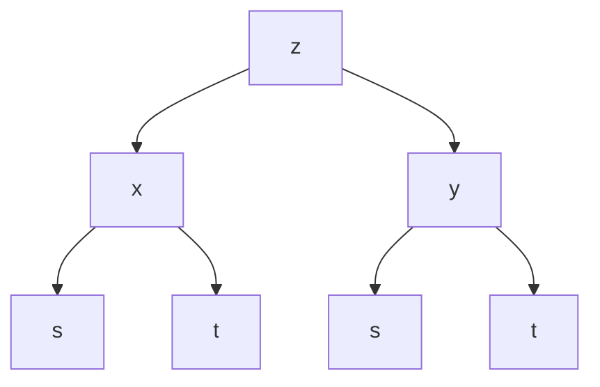
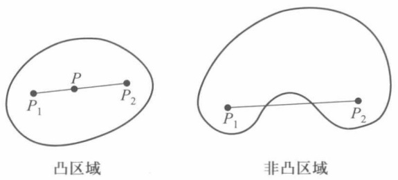
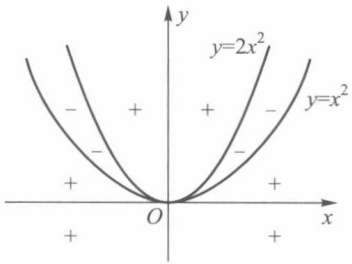
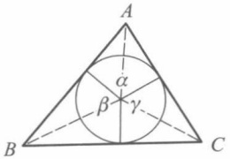
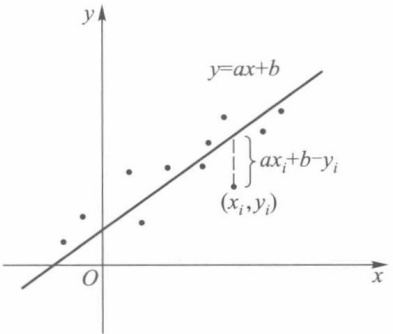

# 第17章 多元函数微分学

原始 PDF 第 110–143 页。

第十七章

多元函数微分学

## §1 可微性

## 一、可微性与全微分

与一元函数一样,在多元函数微分学中,主要讨论多元函数的可微性及其应用.本章重点建立二元函数可微性概念,至于一般 n 元函数的可微性不难据此相应地给出(对此,在第二十三章有更详细的论述).

定义1 设函数 $z = f(x, y)$ 在点 $P_0(x_0, y_0)$ 的某邻域 $U(P_0)$ 上有定义，对于 $U(P_0)$ 中的点 $P(x, y) = (x_0 + \Delta x, y_0 + \Delta y)$，若函数 $f$ 在点 $P_0$ 处的全增量 $\Delta z$ 可表示为

$$
\begin{array}{l} \Delta z = f (x _ {0} + \Delta x, y _ {0} + \Delta y) - f (x _ {0}, y _ {0}) \\ = A \Delta x + B \Delta y + o (\rho), \tag {1} \\ \end{array}
$$

其中 $A, B$ 是仅与点 $P_0$ 有关的常数，$\rho = \sqrt{\Delta x^2 + \Delta y^2}$，$o(\rho)$ 是较 $\rho$ 高阶的无穷小量，则称函数 $f$ 在点 $P_0$ 可微。并称(1)式中关于 $\Delta x, \Delta y$ 的线性函数 $A \Delta x + B \Delta y$ 为函数 $f$ 在点 $P_0$ 的全微分，记作

$$
\mathrm{d} z \mid_ {P _ {0}} = \mathrm{d} f (x _ {0}, y _ {0}) = A \Delta x + B \Delta y. \tag {2}
$$

由(1)，(2)可见 dz 是  $\Delta z$  的线性主部，特别当  $\left|\Delta x\right|$ ， $\left|\Delta y\right|$  充分小时，全微分 dz 可作为全增量  $\Delta z$  的近似值，即

$$
f (x, y) \approx f (x _ {0}, y _ {0}) + A (x - x _ {0}) + B (y - y _ {0}). \tag {3}
$$

在使用上,有时也把(1)式写成如下形式:

$$
\Delta z = A \Delta x + B \Delta y + \alpha \Delta x + \beta \Delta y, \tag {4}
$$

这里

$$
\lim _ {(\Delta x, \Delta y) \to (0, 0)} \alpha = \lim _ {(\Delta x, \Delta y) \to (0, 0)} \beta = 0.
$$

例 1 考察函数  $f(x,y)=xy$  在点  $(x_{0},y_{0})$  处的可微性.

解 在点 $(x_0, y_0)$ 处函数 $f$ 的全增量为

$$
\begin{array}{l} \Delta f (x _ {0}, y _ {0}) = (x _ {0} + \Delta x) (y _ {0} + \Delta y) - x _ {0} y _ {0} \\ = y _ {0} \Delta x + x _ {0} \Delta y + \Delta x \Delta y. \\ \end{array}
$$

由于

102

---

§ 1 可微性 |||

$$
\frac {\mid \Delta x \Delta y \mid}{\rho} = \rho \frac {\mid \Delta x \mid}{\rho} \frac {\mid \Delta y \mid}{\rho} \leqslant \rho \rightarrow 0 (\rho \rightarrow 0),
$$

因此 $\Delta x\Delta y = o(\rho)$ .从而函数 $f$ 在 $(x_0,y_0)$ 可微，且

$$
\mathrm{d} f = y _ {0} \Delta x + x _ {0} \Delta y.
$$

## 二、偏导数

由一元函数微分学知道: 若  $f(x)$  在点  $x_{0}$  可微, 则函数增量  $f(x_{0}+\Delta x)-f(x_{0})=A\Delta x+o(\Delta x)$ , 其中  $A=f'(x_{0})$ . 同样, 由上一段已知, 若二元函数 f 在点  $(x_{0},y_{0})$  可微, 则 f 在  $(x_{0},y_{0})$  处的全增量可由(1)式表示. 现在讨论其中 A, B 的值与函数 f 的关系. 为此, 在(4)式中令  $\Delta y=0\quad(\Delta x\neq0)$ , 这时得到  $\Delta z$  关于 x 的偏增量  $\Delta_{x}z$ , 且有

$$
\Delta_ {x} z = A \Delta x + \alpha \Delta x \quad \text {或} \quad {\frac {\Delta_ {x} z}{\Delta x}} = A + \alpha .
$$

现让 $\Delta x\to 0$ ，由上式便得 $A$ 的一个极限表示式

$$
A = \lim _ {\Delta x \to 0} \frac {\Delta_ {x} z}{\Delta x} = \lim _ {\Delta x \to 0} \frac {f (x _ {0} + \Delta x , y _ {0}) - f (x _ {0} , y _ {0})}{\Delta x}. \tag {5}
$$

容易看出，(5)式右边的极限正是关于 $x$ 的一元函数 $f(x, y_0)$ 在 $x = x_0$ 处的导数. 类似地，令 $\Delta x = 0 (\Delta y \neq 0)$，由(4)式又可得到

$$
B = \lim _ {\Delta y \to 0} \frac {\Delta_ {y} z}{\Delta y} = \lim _ {\Delta y \to 0} \frac {f (x _ {0} , y _ {0} + \Delta y) - f (x _ {0} , y _ {0})}{\Delta y}. \tag {6}
$$

它是关于 $y$ 的一元函数 $f(x_0,y)$ 在 $y = y_{0}$ 处的导数.

二元函数当固定其中一个自变量时,它对另一个自变量的导数称为偏导数,定义如下.

定义2 设函数 $z = f(x, y), (x, y) \in D$. 若 $(x_0, y_0) \in D$，且 $f(x, y_0)$ 在 $x_0$ 的某邻域内有定义，则当极限

$$
\lim _ {\Delta x \to 0} \frac {\Delta_ {x} f (x _ {0} , y _ {0})}{\Delta x} = \lim _ {\Delta x \to 0} \frac {f (x _ {0} + \Delta x , y _ {0}) - f (x _ {0} , y _ {0})}{\Delta x} \tag {7}
$$

存在时,称这个极限为函数f在点 $(x_{0},y_{0})$ 关于x的偏导数,记作

$$
f _ {x} (  x _ {0}, y _ {0}) \text {或}   z _ {x} (  x _ {0}, y _ {0})  ,   \left. \frac {\partial f}{\partial x} \right| _ {(  x _ {0}, y _ {0})}  ,   \left. \frac {\partial z}{\partial x} \right| _ {(  x _ {0}, y _ {0})}.
$$

同样定义 $f$ 在点 $(x_0, y_0)$ 关于 $y$ 的偏导数 $f_y(x_0, y_0)$ 或 $\frac{\partial f}{\partial y} \bigg|_{(x_0, y_0)}$.

注1 这里符号 $\frac{\partial}{\partial x}, \frac{\partial}{\partial y}$ 专用于偏导数算符，与一元函数的导数符号 $\frac{\mathrm{d}}{\mathrm{d}x}$ 相仿，但又有差别.

注2 在上述定义中，$f$ 在点 $(x_0, y_0)$ 存在关于 $x$（或 $y$）的偏导数，$f$ 至少在 $\{(x, y) \mid y = y_0, |x - x_0| < \delta\}$（或 $\{(x, y) \mid x = x_0, |y - y_0| < \delta\}$）上必须有定义.

若函数  $z=f(x,y)$  在区域 D 上每一点  $(x,y)$  都存在对 x（或对 y）的偏导数，则得到函数  $z=f(x,y)$  在区域 D 上对 x（或对 y）的偏导函数（也简称偏导数），记作

$$
f _ {x} (  x, y  )   \text {或} \frac {\partial f (  x , y  )}{\partial x}    \left(f _ {y} (  x, y  )   \text {或} \frac {\partial f (  x , y  )}{\partial y}\right)  ,
$$

103

---

第十七章 多元函数微分学

也可简单地写作 $f_{x}, z_{x}$ 或 $\frac{\partial f}{\partial x}, \frac{\partial z}{\partial x}\left(f_{y}, z_{y}\right.$ 或 $\frac{\partial f}{\partial y}, \frac{\partial z}{\partial y}$.

在上一章中已指出，二元函数 $z = f(x,y)$ 的几何图像通常是三维空间中的曲面.设$P_0(x_0,y_0,z_0)$ 为这曲面上一点，其中 $z_0 = f(x_0,y_0)$ .过 $P_0$ 作平面 $y = y_0$ ，它与曲面 $z = f(x,y)$ 的交线

$$
C: \left\{ \begin{array}{l} y = y _ {0}, \\ z = f (x, y) \end{array} \right.
$$

是平面 $y = y_0$ 上的一条曲线. 于是, 二元函数偏导数的几何意义 (如图17-1) 是: $f_x(x_0, y_0)$

作为一元函数 $f(x,y_0)$ 在 $x = x_0$ 的导数，就是曲线$C$ 在点 $P_{0}$ 处的切线 $T_{x}$ 对于 $x$ 轴的斜率，即 $T_{x}$ 与$x$ 轴正向所成倾角的正切 $\tan \alpha$ .同样， $f_{y}(x_{0},y_{0})$ 是平面 $x = x_0$ 与曲面 $z = f(x,y)$ 的交线

$$
\left\{ \begin{array}{l} x = x _ {0}, \\ z = f (x, y) \end{array} \right.
$$

在点  $P_{0}$  处的切线  $T_{y}$  关于 y 轴的斜率  $\tan \beta$ .

由偏导数的定义还知道,函数 f 对某一个自变量求偏导数,是先把其他自变量看作常数,从而变成一元函数的求导问题.因此第五章中有关

求导的一些基本法则,对多元函数求偏导数仍然适用.

text_image

z=f(x,y)
P₀
C
Tₓ
Tᵧ
y₀
O
β
x₀
α
x
y

图17-1

例 2 求函数  $f(x,y)=x^{3}+2x^{2}y-y^{3}$  在点 (1,3) 关于 x 和关于 y 的偏导数.

解 先求 $f$ 在点(1,3)关于 $x$ 的偏导数, 为此, 令 $y = 3$, 得到以 $x$ 为自变量的函数 $f(x,3) = x^3 + 6x^2 - 27$, 求它在 $x = 1$ 的导数, 即

$$
f _ {x} (1, 3) = \frac {\mathrm{d} f (x , 3)}{\mathrm{d} x} \bigg | _ {x = 1} = 3 x ^ {2} + 1 2 x \big | _ {x = 1} = 1 5.
$$

再求 f 在  $(1,3)$  关于 y 的偏导数. 先令 x=1, 得到以 y 为自变量的函数  $f(1,y)=1+2y-y^{3}$ , 求它在 y=3 的导数, 得

$$
f _ {y} (1, 3) = \frac {\mathrm{d} f (1 , y)}{\mathrm{d} y} \bigg | _ {y = 3} = 2 - 3 y ^ {2} \mid_ {y = 3} = - 2 5.
$$

通常也可分别先求出 $f$ 关于 $x$ 和 $y$ 的偏导函数:

$$
f _ {x} (x, y) = 3 x ^ {2} + 4 x y,
$$

$$
f _ {y} (x, y) = 2 x ^ {2} - 3 y ^ {2}.
$$

然后以 $(x,y)=(1,3)$ 代入,也能得到同样结果.

例 3 求函数  $z = x^{y} (x > 0)$  的偏导数.

解

$$
\frac {\partial z}{\partial x} = y x ^ {y - 1}, \quad \frac {\partial z}{\partial y} = x ^ {y} \ln x.
$$

例 4 求三元函数  $u = \sin(x + y^{2} - e^{z})$  的偏导数.

解 把 y 和 z 看作常数, 得

$$
\frac {\partial u}{\partial x} = \cos (x + y ^ {2} - \mathrm{e} ^ {z}).
$$

104

---

§ 1 可微性

把 x, z 看作常数, 得

$$
\frac {\partial u}{\partial y} = 2 y \cos (x + y ^ {2} - \mathrm{e} ^ {z}).
$$

把 x, y 看作常数, 得

$$
\frac {\partial u}{\partial z} = - \mathrm{e} ^ {z} \cos (x + y ^ {2} - \mathrm{e} ^ {z}).
$$

## 三、可微性条件

由偏导数定义及(5)，(6)两式可得如下定理.

定理 17.1(可微的必要条件) 若二元函数 f 在其定义域内一点  $(x_{0}, y_{0})$  可微，则 f 在该点关于每个自变量的偏导数都存在，且(1)式中的

$$
A = f _ {x} (  x _ {0}  , y _ {0}  )  , \quad B = f _ {y} (  x _ {0}  , y _ {0}  )  .
$$

因此,函数f在点 $(x_{0},y_{0})$ 的全微分(2)可惟一地表示为

$$
\mathrm{d} f \mid_ {(x _ {0}, y _ {0})} = f _ {x} (x _ {0}, y _ {0}) \cdot \Delta x + f _ {y} (x _ {0}, y _ {0}) \cdot \Delta y.
$$

与一元函数的情况一样,由于自变量的增量等于自变量的微分,即

$$
\Delta x = \mathrm{d} x, \quad \Delta y = \mathrm{d} y,
$$

所以 $f$ 在点 $(x_0, y_0)$ 的全微分又可写为

$$
\mathrm{d} z = f _ {x} (x _ {0}, y _ {0}) \mathrm{d} x + f _ {y} (x _ {0}, y _ {0}) \mathrm{d} y.
$$

若函数 f 在区域 D 上每一点  $(x, y)$  都可微, 则称函数 f 在区域 D 上可微, 且 f 在 D 上全微分为

$$
\mathrm{d} f (x, y) = f _ {x} (x, y) \mathrm{d} x + f _ {y} (x, y) \mathrm{d} y. \tag {8}
$$

例5 考察函数

$$
f (x, y) = \left\{ \begin{array}{l l} \frac {x y}{\sqrt {x ^ {2} + y ^ {2}}}, & x ^ {2} + y ^ {2} \neq 0, \\ 0, & x ^ {2} + y ^ {2} = 0 \end{array} \right.
$$

在原点的可微性.

解 按偏导数定义

$$
f _ {x} (0, 0) = \lim _ {\Delta x \to 0} \frac {f (\Delta x , 0) - f (0 , 0)}{\Delta x} = \lim _ {\Delta x \to 0} \frac {0 - 0}{\Delta x} = 0.
$$

同理可得 $f_{\gamma}(0,0) = 0$ .若函数 $f$ 在原点可微，则

$$
\begin{array}{l} \Delta z - \mathrm{d} z = f (0 + \Delta x, 0 + \Delta y) - f (0, 0) - f _ {x} (0, 0) \Delta x - f _ {y} (0, 0) \Delta y \\ = \frac {\Delta x \Delta y}{\sqrt {\Delta x ^ {2} + \Delta y ^ {2}}} \\ \end{array}
$$

应是较  $\rho=\sqrt{\Delta x^{2}+\Delta y^{2}}$  高阶的无穷小量.为此,考察极限

$$
\lim _ {\rho \to 0} \frac {\Delta z - \mathrm{d} z}{\rho} = \lim _ {\rho \to 0} \frac {\Delta x \Delta y}{\Delta x ^ {2} + \Delta y ^ {2}},
$$

由第十六章 §2 例 3 知道, 上述极限不存在, 因而函数 f 在原点不可微.

我们知道,一元函数可微与存在导数是等价的.而例5说明对于多元函数,偏导数即使都存在,该函数也不一定可微.现在不禁要问:当所有偏导数都存在时,还需要添

105

---

第十七章 多元函数微分学

加哪些条件,才能保证函数可微呢?

定理17.2（可微的充分条件）若函数 $z = f(x,y)$ 的偏导数在点 $(x_0,y_0)$ 的某邻域内存在，且 $f_{x}$ 与 $f_{y}$ 在点 $(x_0,y_0)$ 连续，则函数 $f$ 在点 $(x_0,y_0)$ 可微.

证 我们把全增量 $\Delta z$ 写作

$$
\begin{array}{l} \Delta z = f (x _ {0} + \Delta x, y _ {0} + \Delta y) - f (x _ {0}, y _ {0}) \\ = \left[ f (x _ {0} + \Delta x, y _ {0} + \Delta y) - f (x _ {0}, y _ {0} + \Delta y) \right] + \left[ f (x _ {0}, y _ {0} + \Delta y) - f (x _ {0}, y _ {0}) \right]. \\ \end{array}
$$

在第一个括号里,它是函数 $f(x,y_{0}+\Delta y)$ 关于x的偏增量.在第二个括号里,则是函数 $f(x_{0},y)$ 关于y的偏增量.对它们分别应用一元函数的拉格朗日中值定理,得

$$
\Delta z = f _ {x} (x _ {0} + \theta_ {1} \Delta x, y _ {0} + \Delta y) \Delta x + f _ {y} (x _ {0}, y _ {0} + \theta_ {2} \Delta y) \Delta y, 0 <   \theta_ {1}, \theta_ {2} <   1. \tag {9}
$$

由于 $f_{x}$ 与 $f_{y}$ 在点 $(x_0,y_0)$ 连续，因此有

$$
f _ {x} (x _ {0} + \theta_ {1} \Delta x, y _ {0} + \Delta y) = f _ {x} (x _ {0}, y _ {0}) + \alpha , \tag {10}
$$

$$
f _ {y} (x _ {0}, y _ {0} + \theta_ {2} \Delta y) = f _ {y} (x _ {0}, y _ {0}) + \beta , \tag {11}
$$

其中当 $(\Delta x, \Delta y) \to (0, 0)$ 时，$\alpha \to 0, \beta \to 0$。将(10)式、(11)式代入(9)式，则得

$$
\Delta z = f _ {x} (x _ {0}, y _ {0}) \Delta x + f _ {y} (x _ {0}, y _ {0}) \Delta y + \alpha \Delta x + \beta \Delta y.
$$

由(4)式便知函数f在点 $(x_{0},y_{0})$ 可微.

根据这个定理,例2中的函数 $f(x,y)=x^{3}+2x^{2}y-y^{3}$ 在点(1,3)可微,且

$$
\mathrm{d} f \mid_ {(1, 3)} = 1 5 \mathrm{d} x - 2 5 \mathrm{d} y.
$$

例3中的函数 $z = x^{y}$ 在 $D = \{(x,y)\mid x > 0, - \infty <  y < + \infty \}$ 上可微，且

$$
\mathrm{d} z = y x ^ {y - 1} \mathrm{d} x + x ^ {y} \ln x \mathrm{d} y.
$$

注 偏导数连续并不是函数可微的必要条件,如函数

$$
f (x, y) = \left\{ \begin{array}{l l} (  x ^ {2} + y ^ {2}) \sin \frac {1}{\sqrt {x ^ {2} + y ^ {2}}}, & x ^ {2} + y ^ {2} \neq 0  , \\ 0  , & x ^ {2} + y ^ {2} = 0 \end{array} \right.
$$

在原点(0,0)可微,但 $f_{x}$ 与 $f_{y}$ 却在点(0,0)不连续(见本节习题7).若 $z=f(x,y)$ 在点 $(x_{0},y_{0})$ 的偏导数 $f_{x},f_{y}$ 连续,则称f在点 $(x_{0},y_{0})$ 连续可微.

在定理 17.2 证明过程中所出现的(9)式,实际上是二元函数的一个中值公式,可以将其归纳为下述定理.

定理17.3 设函数 $f$ 在点 $(x_0, y_0)$ 的某邻域内存在偏导数，若 $(x, y)$ 属于该邻域，则存在 $\xi = x_0 + \theta_1(x - x_0)$ 和 $\eta = y_0 + \theta_2(y - y_0), 0 < \theta_1, \theta_2 < 1$ ，使得

$$
f (x, y) - f (x _ {0}, y _ {0}) = f _ {x} (\xi , y) (x - x _ {0}) + f _ {y} (x _ {0}, \eta) (y - y _ {0}). \tag {12}
$$

读者还可以从可微性概念看到,函数在可微点处必连续,但在函数的连续点处不一定存在偏导数,当然它更不能保证函数在该点可微.例如,函数 $f(x,y)=\sqrt{x^{2}+y^{2}}$ （圆锥）在原点连续,但在该点不存在偏导数.更值得注意的是,即使函数在某一点存在对所有自变量的偏导数,也不能保证函数在该点连续.例如,

$$
f (x, y) = \left\{ \begin{array}{l l} \frac {x y}{x ^ {2} + y ^ {2}}, & x ^ {2} + y ^ {2} \neq 0, \\ 0, & x ^ {2} + y ^ {2} = 0 \end{array} \right.
$$

在原点不连续,但却存在偏导数

106

---

§ 1 可微性 |||

$$
f _ {x} (0, 0) = \lim _ {\Delta x \to 0} \frac {0 - 0}{\Delta x} = 0, \quad f _ {y} (0, 0) = 0.
$$

这是因为偏导数只是刻画了函数沿 $x$ 轴或 $y$ 轴方向的变化特征, 所以这个例子只能说明 $f$ 在原点分别对 $x$ 和对 $y$ 必定连续, 但由此并不能保证 $f$ 作为二元函数在原点连续. 与定理17.2相仿, 只有对偏导数附加适当的条件后, 才能保证函数的连续性 (有关内容可从本节习题中去找).

## 四、可微性几何意义及应用

一元函数可微,在几何上反映为曲线存在不平行于 y 轴的切线.对于二元函数来说,可微性则反映为曲面与其切平面之间的类似关系.为此,我们需要先给出曲面的切平面的定义,这可以从曲线的切线定义中获得启发.

在第五章 §1 中, 我们曾把平面曲线 $S$ 在某一点 $P(x_0, y_0)$ 的切线 $PT$ 定义为过 $P$ 点的割线 $PQ$ 当 $Q$ 沿 $S$ 趋近 $P$ 时的极限位置 (如果存在的话). 这时, $PQ$ 与 $PT$ 的夹角 $\varphi$ 也将随 $Q \to P$ 而趋于零 (图 17-2). 由于

$$
\sin \varphi = \frac {h}{d},
$$

其中 $h$ 和 $d$ 分别表示点 $Q$ 到切线 $PT$ 的距离和 $Q$ 到 $P$ 的距离, 因此当 $Q$ 沿 $S$ 趋于 $P$ 时, $\varphi \to 0$ 等同于 $\frac{h}{d} \to 0$.

仿照这个想法,我们引入曲面 S 在点 P 的切平面定义.

定义3 设 $P$ 是曲面 $S$ 上一点, $\Pi$ 为通过点 $P$ 的一个平面, 曲面 $S$ 上的动点 $Q$ 到定点 $P$ 和到平面 $\Pi$ 的距离分别为 $d$ 与 $h$ (图17-3). 若当 $Q$ 在 $S$ 上以任何方式趋近于 $P$ 时, 恒有 $\frac{h}{d} \to 0$, 则称平面 $\Pi$ 为曲面 $S$ 在点 $P$ 处的切平面, $P$ 为切点.

text_image

S
P
d
φ
Q
h
T

图17-2

text_image

z
Π
P
h
Q
d
S
O
y
x

图17-3

定理17.4 曲面 $z = f(x,y)$ 在点 $P(x_0,y_0,f(x_0,y_0))$ 存在不平行于 $z$ 轴的切平面 $\Pi$ 的充要条件是函数 $f$ 在点 $P_0(x_0,y_0)$ 可微.

证 [充分性] 若函数 $f$ 在 $P_0$ 处可微, 由定义知

$$
\Delta z = z - z _ {0} = f _ {x} (x _ {0}, y _ {0}) (x - x _ {0}) + f _ {y} (x _ {0}, y _ {0}) (y - y _ {0}) + o (\rho),
$$

其中 $z_0 = f(x_0, y_0), \rho = \sqrt{(x - x_0)^2 + (y - y_0)^2}$. 现在讨论过点 $P(x_0, y_0, z_0)$ 的平面

$$
Z - z _ {0} = f _ {x} (x _ {0}, y _ {0}) (X - x _ {0}) + f _ {y} (x _ {0}, y _ {0}) (Y - y _ {0}),
$$

其中 $X, Y, Z$ 是平面上任意点的坐标. 我们证明它就是曲面 $z = f(x, y)$ 在点 $P$ 的切平面

107

---

第十七章 多元函数微分学

$\Pi$. 事实上, 由解析几何学知道, 曲面上任意一点 $Q(x, y, z)$ 到这个平面的距离为

$$
\begin{array}{l} h = \frac {\left| z - z _ {0} - f _ {x} \left(x _ {0} , y _ {0}\right) \left(x - x _ {0}\right) - f _ {y} \left(x _ {0} , y _ {0}\right) \left(y - y _ {0}\right) \right|}{\sqrt {1 + f _ {x} ^ {2} \left(x _ {0} , y _ {0}\right) + f _ {y} ^ {2} \left(x _ {0} , y _ {0}\right)}} \\ = \frac {\mid o (\rho) \mid}{\sqrt {1 + f _ {x} ^ {2} (x _ {0} , y _ {0}) + f _ {y} ^ {2} (x _ {0} , y _ {0})}}, \\ \end{array}
$$

另一方面， $P$ 到 $Q$ 的距离为

$$
d = \sqrt {\left(x - x _ {0}\right) ^ {2} + \left(y - y _ {0}\right) ^ {2} + \left(z - z _ {0}\right) ^ {2}} = \sqrt {\rho^ {2} + \left(z - z _ {0}\right) ^ {2}} \geqslant \rho .
$$

于是由 $\frac{h}{d} \geqslant 0$ 及

$$
\frac {h}{d} <   \frac {h}{\rho} = \frac {| o (\rho) |}{\rho} \frac {1}{\sqrt {1 + f _ {x} ^ {2} (x _ {0} , y _ {0}) + f _ {y} ^ {2} (x _ {0} , y _ {0})}} \rightarrow 0 (\rho \rightarrow 0),
$$

根据定义3,平面 $\Pi$ 为曲面 $z = f(x,y)$ 在点 $P$ 的切平面.

[必要性] 若曲面 $z = f(x,y)$ 在点 $P(x_0,y_0,f(x_0,y_0))$ 存在不平行于 $z$ 轴的切平面

$$
Z - z _ {0} = A (X - x _ {0}) + B (Y - y _ {0}),
$$

且 $Q(x,y,z)$ 是曲面上任意一点，则点 $Q$ 到这个平面的距离为

$$
h = \frac {\left| z - z _ {0} - A (x - x _ {0}) - B (y - y _ {0}) \right|}{\sqrt {1 + A ^ {2} + B ^ {2}}}.
$$

令 $x - x_0 = \Delta x, y - y_0 = \Delta y, z - z_0 = \Delta z, \rho = \sqrt{\Delta x^2 + \Delta y^2}$. 由切平面定义知，当 $Q$ 充分接近 $P$ 时，有 $\frac{h}{d} \to 0$. 要证明 $f$ 在 $P_0(x_0, y_0)$ 可微，就是要证明

$$
\lim _ {\rho \to 0} \frac {\left| \Delta z - A \Delta x - B \Delta y \right|}{\rho} = 0.
$$

由于

$$
\begin{array}{l} \frac {\left| \Delta z - A \Delta x - B \Delta y \right|}{\rho} = \frac {\left| \Delta z - A \Delta x - B \Delta y \right|}{d \sqrt {1 + A ^ {2} + B ^ {2}}} \cdot \frac {d}{\rho} \cdot \sqrt {1 + A ^ {2} + B ^ {2}} \\ = \frac {h}{d} \cdot \frac {d}{\rho} \cdot \sqrt {1 + A ^ {2} + B ^ {2}}, \\ \end{array}
$$

而 $\frac{h}{d}\rightarrow0(\rho\rightarrow0)$ ，故只需证明当 $\rho$ 充分小时， $\frac{d}{\rho}$ 有界即可.

对于充分接近 P 的 Q, 有

$$
0 <   \frac {h}{d} = \frac {\left| \Delta z - A \Delta x - B \Delta y \right|}{d \sqrt {1 + A ^ {2} + B ^ {2}}} <   \frac {1}{2 \sqrt {1 + A ^ {2} + B ^ {2}}},
$$

由此得

$$
\left| \Delta z - A \Delta x - B \Delta y \right| <   \frac {d}{2} = \frac {1}{2} \sqrt {\Delta x ^ {2} + \Delta y ^ {2} + \Delta z ^ {2}} = \frac {1}{2} \sqrt {\rho^ {2} + \Delta z ^ {2}}.
$$

由 $|a| - |b| \leqslant |a - b|$，可得

$$
\left| \Delta z \right| - \left| A \right| \left| \Delta x \right| - \left| B \right| \left| \Delta y \right| <   \frac {1}{2} \sqrt {\rho^ {2} + \Delta z ^ {2}} \leqslant \frac {1}{2} (\rho + \left| \Delta z \right|),
$$

故有

$$
\frac {1}{2} | \Delta z | <   | A | | \Delta x | + | B | | \Delta y | + \frac {1}{2} \rho ,
$$

$$
\frac {\mid \Delta z \mid}{\rho} <   2 \left(\mid A \mid \frac {\mid \Delta x \mid}{\rho} + \mid B \mid \frac {\mid \Delta y \mid}{\rho}\right) + 1 \leqslant 2 \left(\mid A \mid + \mid B \mid\right) + 1.
$$

108

---

§ 1 可微性

因此 $\frac{|\Delta z|}{\rho}$ 是有界量. 从而推得 $\frac{d}{\rho} = \frac{\sqrt{\rho^2 + \Delta z^2}}{\rho} = \sqrt{1 + \left(\frac{\Delta z}{\rho}\right)^2}$ 也是有界量.

根据前面的分析,有

$$
\lim _ {\rho \to 0} \frac {\left| \Delta z - A \Delta x - B \Delta y \right|}{\rho} = 0.
$$

即

$$
\Delta z = A \Delta x + B \Delta y + o (\rho).
$$

这就证明了函数 $z = f(x,y)$ 在点 $P_0(x_0,y_0)$ 是可微的.

定理17.4说明:若函数 $f$ 在点 $P_0(x_0,y_0)$ 可微，则曲面 $z = f(x,y)$ 在点 $P(x_0,y_0,z_0)$ 的切平面方程为

$$
z - z _ {0} = f _ {x} (x _ {0}, y _ {0}) (x - x _ {0}) + f _ {y} (x _ {0}, y _ {0}) (y - y _ {0}). \tag {13}
$$

过切点 P 与切平面垂直的直线称为曲面在点 P 的法线. 由切平面方程知道, 法线的方向数是

$$
\pm (f _ {x} (x _ {0}, y _ {0}), f _ {y} (x _ {0}, y _ {0}), - 1),
$$

所以过切点 $P$ 的法线方程是

$$
\frac {x - x _ {0}}{f _ {x} (x _ {0} , y _ {0})} = \frac {y - y _ {0}}{f _ {y} (x _ {0} , y _ {0})} = \frac {z - z _ {0}}{- 1}. \tag {14}
$$

二元函数全微分的几何意义如图17-4所示，当自变量 $x, y$ 的增量分别为 $\Delta x, \Delta y$

时，函数 $z = f(x,y)$ 的增量 $\Delta z$ 是竖坐标上的一段 $NQ$ 而二元函数 $z = f(x,y)$ 在点 $(x_0,y_0)$ 的全微分

$$
\mathrm{d} z = f _ {x} (x _ {0}, y _ {0}) \Delta x + f _ {y} (x _ {0}, y _ {0}) \Delta y
$$

的值是过点 P 的切平面  $PM_{1}MM_{2}$  上相应的增量 NM. 于是  $\Delta z$  与 dz 之差是 MQ, 它的值随着  $\rho \rightarrow 0$  而趋于零, 而且是较  $\rho$  高阶的无穷小量.

例6 试求抛物面 $z = ax^{2} + by^{2}$ 在曲面上一点$M(x_0,y_0,z_0)$ 处的切平面方程与法线方程.

text_image

z
Q
S
Π
M
Q₁
M₁
P
N₁
N
O
x
y
(x₀,y₀)
(x₀+Δx,y₀+Δy)

图17-4

解 因为

$$
f _ {x} (x _ {0}, y _ {0}) = 2 a x _ {0}, \quad f _ {y} (x _ {0}, y _ {0}) = 2 b y _ {0},
$$

由公式(13)，过 M 的切平面方程为

$$
z - z _ {0} = 2 a x _ {0} (x - x _ {0}) + 2 b y _ {0} (y - y _ {0}).
$$

因为 $z_0 = ax_0^2 + by_0^2$，所以它可简化为

$$
2 a x _ {0} x + 2 b y _ {0} y - z - z _ {0} = 0.
$$

由公式(14)，过点 M 的法线方程是

$$
\frac {x - x _ {0}}{2 a x _ {0}} = \frac {y - y _ {0}}{2 b y _ {0}} = \frac {z - z _ {0}}{- 1}.
$$

下面的例 7 和例 8 是利用线性近似公式(3)所作的近似计算和误差估计.

例 7 求  $1.08^{3.96}$  的近似值.

解 设 $f(x, y) = x^y$，令 $x_0 = 1, y_0 = 4, \Delta x = 0.08, \Delta y = -0.04$. 由公式(3)有

$$
\begin{array}{l} 1. 0 8 ^ {3. 9 6} = f (x _ {0} + \Delta x, y _ {0} + \Delta y) \\ \approx f (1, 4) + f _ {x} (1, 4) \Delta x + f _ {y} (1, 4) \Delta y \\ \end{array}
$$

109

---

第十七章 多元函数微分学

$$
\begin{array}{l} = 1 + 4 \times 0. 0 8 + 1 ^ {4} \times \ln 1 \times (- 0. 0 4) \\ = 1 + 0. 3 2 = 1. 3 2. \\ \end{array}
$$

□

例8 应用公式 $S = \frac{1}{2} ab\sin C$ 计算某三角形面积, 现测得 $a = 12.50, b = 8.30, C = 30^\circ$. 若测量 $a, b$ 的误差为 $\pm 0.01, C$ 的误差为 $\pm 0.1^\circ$, 求用此公式计算三角形面积时的绝对误差限与相对误差限.

解 依题意,测量中 a,b,C 的绝对误差限分别为

$$
\mid \Delta a \mid = 0. 0 1, \quad \mid \Delta b \mid = 0. 0 1, \quad \mid \Delta C \mid = 0. 1 ^ {\circ} = \frac {\pi}{1 8 0 0}.
$$

由于

$$
\begin{array}{l} \mid \Delta S \mid \approx \mid \mathrm{d} S \mid = \left| \frac {\partial S}{\partial a} \Delta a + \frac {\partial S}{\partial b} \Delta b + \frac {\partial S}{\partial C} \Delta C \right| \\ \leqslant \left| \frac {\partial S}{\partial a} \right| | \Delta a | + \left| \frac {\partial S}{\partial b} \right| | \Delta b | + \left| \frac {\partial S}{\partial C} \right| | \Delta C | \\ = \frac {1}{2} | b \sin C | | \Delta a | + \frac {1}{2} | a \sin C | | \Delta b | + \frac {1}{2} | a b \cos C | | \Delta C |, \\ \end{array}
$$

将各数据代入上式,得到 S 的绝对误差限为

$$
\mid \Delta S \mid \approx 0. 1 3.
$$

因为

$$
S = \frac {1}{2} a b \sin C = \frac {1}{2} \times 1 2. 5 0 \times 8. 3 0 \times \frac {1}{2} \approx 2 5. 9 4,
$$

所以 $S$ 的相对误差限为

$$
\left|\frac{\Delta S}{S}\right| \approx \frac{0.13}{25.94} \approx 0.5\%.
$$

## 习题 17.1

1. 求下列函数的偏导数:

(1) $z = x^{2}y$;

(2) $z = y\cos x$;

(3)  $z=\frac{1}{\sqrt{x^{2}+y^{2}}}$ ;

(4) $z = \ln (x + y^2)$;

(5)  $z = e^{xy}$ ;

(6)  $z = \arctan \frac{y}{x}$ ;

(7)  $z = xy \mathrm{e}^{\sin(xy)}$ ;

(8)  $u=\frac{y}{x}+\frac{z}{y}-\frac{x}{z};$

(9) $u = (xy)^{z}$;

(10) $u = x^{y^z}$.

2. 设 $f(x, y) = x + (y - 1) \arcsin \sqrt{\frac{x}{y}}$，求 $f_x(x, 1)$.

3. 设  $f(x,y)=\left\{\begin{aligned} y\sin\frac{1}{x^{2}+y^{2}}, & x^{2}+y^{2}\neq0, \\ 0, & x^{2}+y^{2}=0,\end{aligned}\right.$  考察函数 f 在原点  $(0,0)$  的偏导数.

4. 证明函数 $z = \sqrt{x^2 + y^2}$ 在点(0,0)连续但偏导数不存在.

110

---

§ 1 可微性 |||

5. 考察函数 $f(x, y) = \begin{cases} xy \sin \frac{1}{x^2 + y^2}, & x^2 + y^2 \neq 0, \\ 0, & x^2 + y^2 = 0 \end{cases}$ 在点(0,0)的可微性.

6. 证明函数 $f(x, y) = \begin{cases} \frac{x^2y}{x^2 + y^2}, & x^2 + y^2 \neq 0, \\ 0, & x^2 + y^2 = 0 \end{cases}$ 在点(0,0)连续且偏导数存在，但在此点不可微.

7. 证明函数 $f(x, y) = \begin{cases} (x^2 + y^2) \sin \frac{1}{\sqrt{x^2 + y^2}}, & x^2 + y^2 \neq 0, \\ 0, & x^2 + y^2 = 0 \end{cases}$ 在点(0,0)连续且偏导数存在，但偏导数在点(0,0)不连续，而 $f$ 在点(0,0)可微.

8. 求下列函数在给定点的全微分:

(1) $z = x^4 + y^4 - 4x^2y^2$ 在点 $(0,0)$, (1,1); (2) $z = \frac{x}{\sqrt{x^2 + y^2}}$ 在点 $(1,0)$, (0,1).

9. 求下列函数的全微分:

(1)  $z = y \sin(x + y)$ ; (2)  $u = x e^{yz} + e^{-z} + y.$

10. 求曲面 $z = \arctan \frac{y}{x}$ 在点 $\left(1, 1, \frac{\pi}{4}\right)$ 的切平面方程和法线方程.

11. 求曲面 $3x^{2} + y^{2} - z^{2} = 27$ 在点 $(3,1,1)$ 的切平面与法线方程.

12. 在曲面 $z = xy$ 上求一点，使这点的切平面平行于平面 $x + 3y + z + 9 = 0$ ，并写出此切平面方程和法线方程.

13. 计算近似值:

(1)  $1.002 \times 2.003^{2} \times 3.004^{3}$ ; (2)  $\sin 29^{\circ} \times \tan 46^{\circ}$ .

14. 设圆台上、下底的半径分别为 $R = 30 \mathrm{~cm}, r = 20 \mathrm{~cm}$, 高 $h = 40 \mathrm{~cm}$. 若 $R, r, h$ 分别增加 $3 \mathrm{~mm}, 4 \mathrm{~mm}, 2 \mathrm{~mm}$, 求此圆台体积变化的近似值.

15. 证明: 若二元函数 f 在点  $P(x_{0}, y_{0})$  的某邻域  $U(P)$  上的偏导函数  $f_{x}$  与  $f_{y}$  有界, 则 f 在  $U(P)$  上连续.

16. 设二元函数 f 在区域  $D = [a, b] \times [c, d]$  上连续.

(1) 若在 int D 内有  $f_{x} \equiv 0$ ，试问 f 在 D 上有何特性？
(2) 若在 int D 内有  $f_{x}=f_{y}\equiv0$ , f 又怎样?
(3) 在(1)的讨论中,关于f在D上的连续性假设可否省略?长方形区域可否改为任意区域?

17. 试证在原点 $(0,0)$ 的充分小邻域内,有

$$
\arctan \frac {x + y}{1 + x y} \approx x + y.
$$

18. 求曲面 $z = \frac{x^2 + y^2}{4}$ 与平面 $y = 4$ 的交线在 $x = 2$ 处的切线与 $Ox$ 轴的交角.

19. 试证:(1)乘积的相对误差限近似于各因子相对误差限之和;

(2) 商的相对误差限近似于分子和分母相对误差限之和.

20. 测得一物体的体积  $V=4.45\ cm^{3}$ ，其绝对误差限为  $0.01\ cm^{3}$ ；又测得质量 m=30.80 g，其绝对误差限为 0.01 g。求由公式  $\rho=\frac{m}{V}$  算出的密度  $\rho$  的相对误差限和绝对误差限。

111

---

第十七章 多元函数微分学

## § 2 复合函数微分法

本节讨论复合函数的可微性、偏导数与全微分.

## 一、复合函数的求导法则

设函数

$$
x = \varphi (s, t) \quad \text {与} \quad y = \psi (s, t) \tag {1}
$$

定义在 $st$ 平面的区域 $D$ 上，函数

$$
z = f (x, y) \tag {2}
$$

定义在 $xy$ 平面的区域 $D_{1}$ 上，且

$$
\{(x, y) \mid x = \varphi (s, t), y = \psi (s, t), (s, t) \in D \} \subset D _ {1},
$$

则函数

$$
z = F (s, t) = f (\varphi (s, t), \psi (s, t)), \quad (s, t) \in D \tag {3}
$$

是以(2)为外函数、(1)为内函数的复合函数. 其中 x, y 称为函数 F 的中间变量, s, t 为 F 的自变量.

定理17.5 若函数 $x = \varphi(s, t), y = \psi(s, t)$ 在点 $(s, t) \in D$ 可微，$z = f(x, y)$ 在点 $(x, y) = (\varphi(s, t), \psi(s, t))$ 可微，则复合函数

$$
z = f (\varphi (s, t), \psi (s, t))
$$

在点 $(s,t)$ 可微，且它关于 $s$ 与 $t$ 的偏导数分别为

$$
\left. \frac {\partial z}{\partial s} \right| _ {(s, t)} = \left. \frac {\partial z}{\partial x} \right| _ {(x, y)} \left. \frac {\partial x}{\partial s} \right| _ {(s, t)} + \left. \frac {\partial z}{\partial y} \right| _ {(x, y)} \left. \frac {\partial y}{\partial s} \right| _ {(s, t)}, \tag {4}
$$

$$
\left. \frac {\partial z}{\partial t} \right| _ {(s, t)} = \left. \frac {\partial z}{\partial x} \right| _ {(x, y)} \frac {\partial x}{\partial t} \Bigg | _ {(s, t)} + \left. \frac {\partial z}{\partial y} \right| _ {(x, y)} \frac {\partial y}{\partial t} \Bigg | _ {(s, t)}.
$$

证 由假设 $x = \varphi (s,t),y = \psi (s,t)$ 在点 $(s,t)$ 可微，于是

$$
\Delta x = \frac {\partial x}{\partial s} \Delta s + \frac {\partial x}{\partial t} \Delta t + \alpha_ {1} \Delta s + \beta_ {1} \Delta t, \tag {5}
$$

$$
\Delta y = \frac {\partial y}{\partial s} \Delta s + \frac {\partial y}{\partial t} \Delta t + \alpha_ {2} \Delta s + \beta_ {2} \Delta t, \tag {6}
$$

其中当  $\Delta s, \Delta t$  趋于零时， $\alpha_{1}, \alpha_{2}, \beta_{1}, \beta_{2}$  都趋于零。又由  $z = f(x, y)$  在点  $(x, y)$  可微，所以

$$
\Delta z = \frac {\partial z}{\partial x} \Delta x + \frac {\partial z}{\partial y} \Delta y + \alpha \Delta x + \beta \Delta y, \tag {7}
$$

其中当  $\Delta x, \Delta y \rightarrow 0$  时， $\alpha, \beta \rightarrow 0$  （并补充定义当  $\Delta x = 0, \Delta y = 0$  时  $\alpha = \beta = 0$ ），将（5）式、（6）式代入（7）式，得

$$
\Delta z = \left(\frac {\partial z}{\partial x} + \alpha\right) \left(\frac {\partial x}{\partial s} \Delta s + \frac {\partial x}{\partial t} \Delta t + \alpha_ {1} \Delta s + \beta_ {1} \Delta t\right) + \left(\frac {\partial z}{\partial y} + \beta\right) \left(\frac {\partial y}{\partial s} \Delta s + \frac {\partial y}{\partial t} \Delta t + \alpha_ {2} \Delta s + \beta_ {2} \Delta t\right).
$$

整理后

112

---

§ 2 复合函数微分法

$$
\Delta z = \left(\frac {\partial z}{\partial x} \frac {\partial x}{\partial s} + \frac {\partial z}{\partial y} \frac {\partial y}{\partial s}\right) \Delta s + \left(\frac {\partial z}{\partial x} \frac {\partial x}{\partial t} + \frac {\partial z}{\partial y} \frac {\partial y}{\partial t}\right) \Delta t + \bar {\alpha} \Delta s + \bar {\beta} \Delta t, \tag {8}
$$

其中

$$
\bar {\alpha} = \frac {\partial z}{\partial x} \alpha_ {1} + \frac {\partial z}{\partial y} \alpha_ {2} + \frac {\partial x}{\partial s} \alpha + \frac {\partial y}{\partial s} \beta + \alpha \alpha_ {1} + \beta \alpha_ {2}, \tag {9}
$$

$$
\bar {\beta} = \frac {\partial z}{\partial x} \beta_ {1} + \frac {\partial z}{\partial y} \beta_ {2} + \frac {\partial x}{\partial t} \alpha + \frac {\partial y}{\partial t} \beta + \alpha \beta_ {1} + \beta \beta_ {2}. \tag {10}
$$

由于 $\varphi(s, t), \psi(s, t)$ 在点 $(s, t)$ 可微，因此它们在点 $(s, t)$ 都连续，即当 $\Delta s, \Delta t \to 0$ 时，有 $\Delta x, \Delta y \to 0$. 从而也有 $\alpha \to 0, \beta \to 0$ 以及 $\alpha_1, \alpha_2, \beta_1, \beta_2 \to 0$. 于是在 (9) 式、(10) 式中，当 $\Delta s, \Delta t \to 0$ 时，有 $\bar{\alpha} \to 0, \bar{\beta} \to 0$. 故由 (8) 式推得复合函数 (3) 可微并求得 $z$ 关于 $s$ 和 $t$ 的偏导数 (4).

这里公式(4)也称为链式法则.

注 如果只是求复合函数 $f(\varphi (s,t),\psi (s,t))$ 关于 $s$ 或 $t$ 的偏导数，则定理17.5中$x = \varphi (s,t)$ 和 $y = \psi (s,t)$ 只需具有关于 $s$ 或 $t$ 的偏导数就够了.因为以 $\Delta s$ 或 $\Delta t$ 除(7)式两边，然后让 $\Delta s\to 0$ 或 $\Delta t\rightarrow 0$ ，也能得到相应的结果.但是对外函数 $f$ 的可微性假设是不能省略的，否则上述复合函数求导公式不一定成立.如函数

$$
f (x, y) = \left\{ \begin{array}{l l} \frac {x ^ {2} y}{x ^ {2} + y ^ {2}}, & x ^ {2} + y ^ {2} \neq 0, \\ 0, & x ^ {2} + y ^ {2} = 0. \end{array} \right.
$$

由 §1 习题6 知 $f_{x}(0,0) = f_{y}(0,0) = 0$，但 $f(x,y)$ 在 (0,0) 处不可微。若以 $f(x,y)$ 为外函数，$x = t, y = t$ 为内函数，则得以 $t$ 为自变量的复合函数

$$
z = F (t) = f (t, t) = \frac {t}{2},
$$

所以 $\frac{dz}{dt}=\frac{1}{2}$ .这时若用链式法则,将得出错误结果

$$
\begin{array}{l} \left. \frac {\mathrm{d} z}{\mathrm{d} t} \right| _ {t = 0} = \frac {\partial z}{\partial x} \left| _ {(0, 0)} \frac {\mathrm{d} x}{\mathrm{d} t} \right| _ {t = 0} + \left. \frac {\partial z}{\partial y} \right| _ {(0, 0)} \frac {\mathrm{d} y}{\mathrm{d} t} \Bigg | _ {t = 0} \\ = 0 \cdot 1 + 0 \cdot 1 = 0. \\ \end{array}
$$

这个例子说明在使用复合函数求导公式时,必须注意外函数f可微这一重要条件.

一般地，若 $f(u_{1},\cdots,u_{m})$ 在点 $(u_{1},\cdots,u_{m})$ 可微， $u_{k}=g_{k}(x_{1},\cdots,x_{n})(k=1,2,\cdots,m)$ ，在点 $(x_{1},\cdots,x_{n})$ 具有关于 $x_{i}(i=1,2,\cdots,n)$ 的偏导数，则复合函数

$$
f (g _ {1} (x _ {1}, \dots , x _ {n}), g _ {2} (x _ {1}, \dots , x _ {n}), \dots , g _ {m} (x _ {1}, \dots , x _ {n}))
$$

关于自变量 $x_{i}$ 的偏导数是

$$
\frac {\partial f}{\partial x _ {i}} = \sum_ {k = 1} ^ {m} \frac {\partial f}{\partial u _ {k}} \frac {\partial u _ {k}}{\partial x _ {i}} \quad (i = 1, 2, \dots , n).
$$

多元函数的复合函数求导一般比较复杂,读者必须特别注意复合函数中哪些是自变量,哪些是中间变量.只有这样才能正确使用链式法则(4)求出结果.

为了便于记忆链式法则,可以按照各变量间的复合关系,画成图 17-5 那样的树状

113

---

第十七章 多元函数微分学

图. 首先从因变量 $z$ 向中间变量 $x, y$ 画两个分枝, 然后再分别从中间变量 $x, y$ 向自变量 $s, t$ 画分枝, 并在每个分枝旁写上对应的偏导数. 求 $\frac{\partial z}{\partial s}$ 时, 只要把从 $z$ 到 $s$ 的每条路径上的各个偏导数相乘, 然后再将这些乘积相加即得:

$$
\frac {\partial z}{\partial s} = \frac {\partial z}{\partial x} \frac {\partial x}{\partial s} + \frac {\partial z}{\partial y} \frac {\partial y}{\partial s}.
$$

flowchart

图17-5

类似地考察从 z 到 t 的路径, 可写出  $\frac{\partial z}{\partial t}$ .

例 1 设  $z=\ln(u^{2}+v)$ ，而  $u=e^{x+y^{2}}$ ,  $v=x^{2}+y$ ，求

$$
\frac {\partial z}{\partial x}, \frac {\partial z}{\partial y}.
$$

解 所讨论的复合函数以 $x, y$ 为自变量, $u, v$ 为中间变量. 由于

$$
\frac {\partial z}{\partial u} = \frac {2 u}{u ^ {2} + v}, \frac {\partial z}{\partial v} = \frac {1}{u ^ {2} + v},
$$

$$
\frac {\partial u}{\partial x} = \mathrm{e} ^ {x + y ^ {2}}, \frac {\partial u}{\partial y} = 2 y \mathrm{e} ^ {x + y ^ {2}}, \frac {\partial v}{\partial x} = 2 x, \frac {\partial v}{\partial y} = 1,
$$

根据公式(4)得到

$$
\begin{array}{l} \frac {\partial z}{\partial x} = \frac {\partial z}{\partial u} \frac {\partial u}{\partial x} + \frac {\partial z}{\partial v} \frac {\partial v}{\partial x} \\ = \frac {2 u}{u ^ {2} + v} \mathrm{e} ^ {x + y ^ {2}} + \frac {1}{u ^ {2} + v} 2 x = \frac {2}{u ^ {2} + v} (u \mathrm{e} ^ {x + y ^ {2}} + x), \\ \frac {\partial z}{\partial y} = \frac {\partial z}{\partial u} \frac {\partial u}{\partial y} + \frac {\partial z}{\partial v} \frac {\partial v}{\partial y} \\ = \frac {2 u}{u ^ {2} + v} 2 y \mathrm{e} ^ {x + y ^ {2}} + \frac {1}{u ^ {2} + v} = \frac {1}{u ^ {2} + v} (4 u y \mathrm{e} ^ {x + y ^ {2}} + 1). \\ \end{array}
$$

例 2 设  $u = u(x, y)$  可微，在极坐标变换  $x = r \cos \theta, y = r \sin \theta$  下，证明:

$$
\left(\frac {\partial u}{\partial r}\right) ^ {2} + \frac {1}{r ^ {2}} \left(\frac {\partial u}{\partial \theta}\right) ^ {2} = \left(\frac {\partial u}{\partial x}\right) ^ {2} + \left(\frac {\partial u}{\partial y}\right) ^ {2}.
$$

证 $u$ 可以看作 $r, \theta$ 的复合函数 $u = u(r\cos \theta, r\sin \theta)$, 因此

$$
\frac {\partial u}{\partial r} = \frac {\partial u}{\partial x} \frac {\partial x}{\partial r} + \frac {\partial u}{\partial y} \frac {\partial y}{\partial r} = \frac {\partial u}{\partial x} \cos \theta + \frac {\partial u}{\partial y} \sin \theta ,
$$

$$
\frac {\partial u}{\partial \theta} = \frac {\partial u}{\partial x} \frac {\partial x}{\partial \theta} + \frac {\partial u}{\partial y} \frac {\partial y}{\partial \theta} = \frac {\partial u}{\partial x} (- r \sin \theta) + \frac {\partial u}{\partial y} r \cos \theta .
$$

于是

$$
\begin{array}{l} \left(\frac {\partial u}{\partial r}\right) ^ {2} + \frac {1}{r ^ {2}} \left(\frac {\partial u}{\partial \theta}\right) ^ {2} \\ = \left(\frac {\partial u}{\partial x} \cos \theta + \frac {\partial u}{\partial y} \sin \theta\right) ^ {2} + \frac {1}{r ^ {2}} \left(- \frac {\partial u}{\partial x} r \sin \theta + \frac {\partial u}{\partial y} r \cos \theta\right) ^ {2} \\ = \left(\frac {\partial u}{\partial x}\right) ^ {2} + \left(\frac {\partial u}{\partial y}\right) ^ {2}. \\ \end{array}
$$

114

---

§ 2 复合函数微分法

例3 设 $z = uv + \sin t$，其中 $u = \mathrm{e}^t, v = \cos t$，求 $\frac{\mathrm{d}z}{\mathrm{d}t}$.

解 根据复合关系,画出树状图 17-6. 于是

$$
\begin{array}{l} \frac {\mathrm{d} z}{\mathrm{d} t} = \frac {\partial z}{\partial u} \frac {\mathrm{d} u}{\mathrm{d} t} + \frac {\partial z}{\partial v} \frac {\mathrm{d} v}{\mathrm{d} t} + \frac {\partial z}{\partial t} \\ = v \mathrm{e} ^ {t} + u (- \sin t) + \cos t \\ = \mathrm{e} ^ {t} (\cos t - \sin t) + \cos t. \\ \end{array}
$$

text_image

∂z/∂u
| ∂z/∂v
∂z/∂t
u
v
t
∂u/∂t
∂v/∂t
□
t
t

图17-6

注 上面第一个等式中, 左边的  $\frac{dz}{dt}$  是作为一元函数的复合函数对 t 求导数, 右边最后一项里的  $\frac{\partial z}{\partial t}$  是外函数 (作为 u, v, t 的三元函数) 对 t 求偏导数, 二者所用符号各自有别.

例 4 用多元复合微分法计算下列一元函数的导数:

(1) $y = x^{x}$;

(2) $y = \frac{(1 + x^2)\ln x}{\sin x + \cos x}$.

解（1）令 $y = u^{v}, u = x, v = x$，则有

$$
\begin{array}{l} \frac {\mathrm{d} y}{\mathrm{d} x} = y _ {u} \cdot \frac {\mathrm{d} u}{\mathrm{d} x} + y _ {v} \cdot \frac {\mathrm{d} v}{\mathrm{d} x} = v u ^ {v - 1} + u ^ {v} \ln u \\ = x \cdot x ^ {x - 1} + x ^ {x} \ln x = x ^ {x} (1 + \ln x). \\ \end{array}
$$

(2) 令  $y=\frac{vw}{u}, u=\sin x+\cos x, v=1+x^{2}, w=\ln x$ ，则有

$$
\begin{array}{l} \frac {\mathrm{d} y}{\mathrm{d} x} = \frac {\partial y}{\partial u} \frac {\mathrm{d} u}{\mathrm{d} x} + \frac {\partial y}{\partial v} \frac {\mathrm{d} v}{\mathrm{d} x} + \frac {\partial y}{\partial w} \frac {\mathrm{d} w}{\mathrm{d} x} \\ = \frac {- v w}{u ^ {2}} (\cos x - \sin x) + \frac {w}{u} \cdot 2 x + \frac {v}{u} \frac {1}{x} \\ = \frac {1}{(\sin x + \cos x) ^ {2}} \left[ (\sin x + \cos x) \left(2 x \ln x + \frac {1 + x ^ {2}}{x}\right) - \right. \\ \end{array}
$$

$$
(\cos x - \sin x) (1 + x ^ {2}) \ln x ].
$$

由此可见,以前用“对数求导法”求一元函数的导数问题,如今也可用多元复合函数链式法则来计算.

例5 设 $u = f(x, y, z), y = \varphi(x, t), t = \psi(x, z)$ 都有一阶连续偏导数，求 $\frac{\partial u}{\partial x}, \frac{\partial u}{\partial z}$.

解 代入中间变量,得到复合函数  $u=f(x,\varphi(x,\psi(x,z)),z)$  为 x,z 的函数,参见图17-7得到

$$
\frac {\partial u}{\partial x} = \frac {\partial f}{\partial x} + \frac {\partial f}{\partial y} \frac {\partial \varphi}{\partial x} + \frac {\partial f}{\partial y} \frac {\partial \varphi}{\partial t} \frac {\partial \psi}{\partial x};
$$

$$
\frac {\partial u}{\partial z} = \frac {\partial f}{\partial y} \frac {\partial \varphi}{\partial t} \frac {\partial \psi}{\partial z} + \frac {\partial f}{\partial z}.
$$

注意,这里用 $\frac{\partial u}{\partial x}$ 表示复合函数 $u=f(x,\varphi(x,\psi(x,z)),z)$ 对x的偏导数,而用 $\frac{\partial f}{\partial x}$ 表示函数 $u=f(x,y,z)$ 对第一个变量x的偏导数,以区别两者的不同.

115

---

第十七章 多元函数微分学

例6 设 $f(x, y)$ 在 $\mathbf{R}^2$ 上可微，且满足方程:$y f_x(x, y) = x f_y(x, y)$. 证明:在极坐标中 $f$ 只是 $r$ 的函数，即 $\frac{\partial f}{\partial \theta} = 0$.

证 设 $u = f(x, y), x = r\cos \theta, y = r\sin \theta$，则有

$$
\begin{array}{l} \frac {\partial u}{\partial \theta} = \frac {\partial f}{\partial x} \cdot \frac {\partial x}{\partial \theta} + \frac {\partial f}{\partial y} \cdot \frac {\partial y}{\partial \theta} = \frac {\partial f}{\partial x} \cdot (- r \sin \theta) + \frac {\partial f}{\partial y} \cdot (r \cos \theta) \\ = - y \cdot \frac {\partial f}{\partial x} + x \cdot \frac {\partial f}{\partial y} = 0. \\ \end{array}
$$

## 二、复合函数的全微分

flowchart

图17-7

若以 x 和 y 为自变量的函数  $z=f(x,y)$  可微，则其全微分为

$$
\mathrm{d} z = \frac {\partial z}{\partial x} \mathrm{d} x + \frac {\partial z}{\partial y} \mathrm{d} y. \tag {11}
$$

如果 $x, y$ 作为中间变量又是自变量 $s, t$ 的可微函数

$$
x = \varphi (s, t), \quad y = \psi (s, t),
$$

则由定理 17.5 知道, 复合函数  $z=f(\varphi(s,t),\psi(s,t))$  是可微的, 其全微分为

$$
\begin{array}{l} \mathrm{d} z = \frac {\partial z}{\partial s} \mathrm{d} s + \frac {\partial z}{\partial t} \mathrm{d} t \\ = \left(\frac {\partial z}{\partial x} \frac {\partial x}{\partial s} + \frac {\partial z}{\partial y} \frac {\partial y}{\partial s}\right) \mathrm{d} s + \left(\frac {\partial z}{\partial x} \frac {\partial x}{\partial t} + \frac {\partial z}{\partial y} \frac {\partial y}{\partial t}\right) \mathrm{d} t \\ = \frac {\partial z}{\partial x} \left(\frac {\partial x}{\partial s} \mathrm{d} s + \frac {\partial x}{\partial t} \mathrm{d} t\right) + \frac {\partial z}{\partial y} \left(\frac {\partial y}{\partial s} \mathrm{d} s + \frac {\partial y}{\partial t} \mathrm{d} t\right). \tag {12} \\ \end{array}
$$

由于 x, y 又是  $(s, t)$  的可微函数, 因此同时有

$$
\mathrm{d} x = \frac {\partial x}{\partial s} \mathrm{d} s + \frac {\partial x}{\partial t} \mathrm{d} t, \quad \mathrm{d} y = \frac {\partial y}{\partial s} \mathrm{d} s + \frac {\partial y}{\partial t} \mathrm{d} t. \tag {13}
$$

将(13)式代入(12)式,得到与(11)式完全相同的结果.这就是关于多元函数的一阶(全)微分形式不变性.

必须指出,在(11)式中当x,y作为自变量时,dx和dy各自独立取值;当x,y作为中间变量时,dx和dy如(13)式所示,它们的值由s,t,ds,dt所确定.

利用微分形式不变性,能更有条理地计算复杂函数的全微分.

例 7 设  $z = \mathrm{e}^{xy} \sin(x + y)$ ，利用微分形式不变性求 dz，并由此导出  $\frac{\partial z}{\partial x}$  与  $\frac{\partial z}{\partial y}$ .

解 令 $z = \mathrm{e}^{u}\sin v, u = xy, v = x + y$. 由于

$$
\begin{array}{l} \mathrm{d} z = z _ {u} \mathrm{d} u + z _ {v} \mathrm{d} v = \mathrm{e} ^ {u} \sin v \mathrm{d} u + \mathrm{e} ^ {u} \cos v \mathrm{d} v, \\ \mathrm{d} u = y \mathrm{d} x + x \mathrm{d} y, \\ \mathrm{d} v = \mathrm{d} x + \mathrm{d} y, \\ \end{array}
$$

因此

$$
\begin{array}{l} \mathrm{d} z = \mathrm{e} ^ {u} \sin v (y \mathrm{d} x + x \mathrm{d} y) + \mathrm{e} ^ {u} \cos v (\mathrm{d} x + \mathrm{d} y) \\ = \mathrm{e} ^ {x y} \left[ y \sin (x + y) + \cos (x + y) \right] \mathrm{d} x + \\ \mathrm{e} ^ {x y} \left[ x \sin (x + y) + \cos (x + y) \right] \mathrm{d} y, \\ \end{array}
$$

116

---

§ 2 复合函数微分法

并由此得到

$$
z _ {x} = \mathrm{e} ^ {x y} \left[ y \sin (x + y) + \cos (x + y) \right],
$$

$$
z _ {y} = \mathrm{e} ^ {x y} \left[ x \sin (x + y) + \cos (x + y) \right].
$$

## 习题 17.2

1. 求下列复合函数的偏导数或导数:

(1) 设  $z = \arctan(xy)$ ,  $y = e^{x}$ , 求  $\frac{dz}{dx}$ ;
(2) 设  $z=\frac{x^{2}+y^{2}}{xy}\mathrm{e}^{\frac{x^{2}+y^{2}}{xy}}$ ，求  $\frac{\partial z}{\partial x},\frac{\partial z}{\partial y}$ ;
(3) 设  $z = x^{2} + xy + y^{2}$ ,  $x = t^{2}$ , y = t, 求  $\frac{dz}{dt}$ ;
(4) 设  $z = x^{2} \ln y, x = \frac{u}{v}, y = 3u - 2v$ ，求  $\frac{\partial z}{\partial u}, \frac{\partial z}{\partial v}$ ;
(5) 设  $u = f(x + y, xy)$ ，求  $\frac{\partial u}{\partial x}, \frac{\partial u}{\partial y}$ ;
(6) 设  $u=f\left(\frac{x}{y},\frac{y}{z}\right)$ ，求  $\frac{\partial u}{\partial x},\frac{\partial u}{\partial y},\frac{\partial u}{\partial z}$ .

2. 设 $z = (x + y)^{xy}$, 求 $\mathrm{dz}$.

3. 设 $z = \frac{y}{f(x^2 - y^2)}$，其中 $f$ 为可微函数，验证

$$
\frac {1}{x} \frac {\partial z}{\partial x} + \frac {1}{y} \frac {\partial z}{\partial y} = \frac {z}{y ^ {2}}.
$$

4. 设 $z = \sin y + f(\sin x - \sin y)$，其中 $f$ 为可微函数，证明

$$
\frac {\partial z}{\partial x} \sec x + \frac {\partial z}{\partial y} \sec y = 1.
$$

5. 设  $f(x,y)$  可微, 证明: 在坐标旋转变换

$$
x = u \cos \theta - v \sin \theta , \quad y = u \sin \theta + v \cos \theta
$$

之下， $(f_{x})^{2}+(f_{y})^{2}$ 是一个形式不变量. 即若

$$
g (u, v) = f (u \cos \theta - v \sin \theta , u \sin \theta + v \cos \theta),
$$

则必有 $(f_{x})^{2}+(f_{y})^{2}=(g_{u})^{2}+(g_{v})^{2}$ （其中旋转角 $\theta$ 是常数）.

6. 设 $f(u)$ 是可微函数, $F(x,t) = f(x + 2t) + f(3x - 2t)$. 试求:

$$
F _ {x} (0, 0) \text {与} F _ {t} (0, 0).
$$

7. 若函数 $u = F(x, y, z)$ 满足恒等式 $F(tx, ty, tz) = t^k F(x, y, z)$ ($t > 0$)，则称 $F(x, y, z)$ 为 $k$ 次齐次函数。试证下述关于齐次函数的欧拉定理:可微函数 $F(x, y, z)$ 为 $k$ 次齐次函数的充要条件是

$$
x F _ {x} (x, y, z) + y F _ {y} (x, y, z) + z F _ {z} (x, y, z) = k F (x, y, z).
$$

并证明: $z=\frac{xy^{2}}{\sqrt{x^{2}+y^{2}}} -xy$  为2次齐次函数.

8. 设 $f(x, y, z)$ 具有性质 $f(tx, t^k y, t^m z) = t^n f(x, y, z) \quad (t > 0)$，证明:

(1)  $f(x, y, z) = x^{n} f \left( 1, \frac{y}{x^{k}}, \frac{z}{x^{m}} \right)$ ;

117

---

第十七章 多元函数微分学

(2)  $xf_{x}(x,y,z)+kyf_{y}(x,y,z)+mzf_{z}(x,y,z)=nf(x,y,z)$ .

9. 设由行列式表示的函数

$$
D (t) = \left| \begin{array}{c c c} a _ {1 1} (t) & \dots & a _ {1 n} (t) \\ \vdots & & \vdots \\ a _ {n 1} (t) & \dots & a _ {n n} (t) \end{array} \right|,
$$

其中  $a_{ij}(t)$  ( $i,j=1,2,\cdots,n$ ) 的导数都存在,证明

$$
\frac {\mathrm{d} D (t)}{\mathrm{d} t} = \sum_ {k = 1} ^ {n} \left| \begin{array}{c c c} a _ {1 1} (t) & \dots & a _ {1 n} (t) \\ \vdots & & \vdots \\ a _ {k 1} ^ {\prime} (t) & \dots & a _ {k n} ^ {\prime} (t) \\ \vdots & & \vdots \\ a _ {n 1} (t) & \dots & a _ {n n} (t) \end{array} \right|.
$$

## § 3 方向导数与梯度

在许多问题中,不仅要知道函数在坐标轴方向上的变化率(即偏导数),而且还要设法求得函数在其他特定方向上的变化率.这就是本节所要讨论的方向导数.

定义1 设三元函数 $f$ 在点 $P_0(x_0, y_0, z_0)$ 的某邻域 $U(P_0) \subset \mathbf{R}^3$ 有定义，$l$ 为从点 $P_0$ 出发的射线，$P(x, y, z)$ 为 $l$ 上且含于 $U(P_0)$ 内的任一点，以 $\rho$ 表示 $P$ 与 $P_0$ 两点间的距离。若极限

$$
\lim _ {\rho \to 0 ^ {+}} \frac {f (P) - f (P _ {0})}{\rho} = \lim _ {\rho \to 0 ^ {+}} \frac {\Delta_ {l} f}{\rho}
$$

存在,则称此极限为函数f在点 $P_{0}$ 沿方向l的方向导数,记作

$$
\frac {\partial f}{\partial \boldsymbol {l}} \bigg | _ {P _ {0}}, f _ {l} (P _ {0}) \text {或} f _ {l} (x _ {0}, y _ {0}, z _ {0}).
$$

容易看到,若f在点 $P_{0}$ 存在关于x的偏导数,则f在点 $P_{0}$ 沿x轴正向的方向导数恰为

$$
\left. \frac {\partial f}{\partial \boldsymbol {l}} \right| _ {P _ {0}} = \left. \frac {\partial f}{\partial x} \right| _ {P _ {0}}.
$$

当 l 的方向为 x 轴的负方向时, 则有

$$
\frac {\partial f}{\partial \boldsymbol {l}} \bigg | _ {P _ {0}} = - \left. \frac {\partial f}{\partial x} \right| _ {P _ {0}}.
$$

沿任一方向的方向导数与偏导数的关系由下述定理给出.

定理17.6 若函数 $f$ 在点 $P_0(x_0, y_0, z_0)$ 可微，则 $f$ 在点 $P_0$ 沿任一方向 $l$ 的方向导数都存在，且

$$
f _ {l} (P _ {0}) = f _ {x} (P _ {0}) \cos \alpha + f _ {y} (P _ {0}) \cos \beta + f _ {z} (P _ {0}) \cos \gamma , \tag {1}
$$

其中  $\cos\alpha,\cos\beta,\cos\gamma$  为方向 l 的方向余弦.

118

---

§ 3 方向导数与梯度

证 设 $P(x,y,z)$ 为 $\pmb{l}$ 上任一点，于是（见图17-8）

$$
\left. \begin{array}{l} x - x _ {0} = \Delta x = \rho \cos \alpha , \\ y - y _ {0} = \Delta y = \rho \cos \beta , \\ z - z _ {0} = \Delta z = \rho \cos \gamma . \end{array} \right\} \tag {2}
$$

由假设f在点 $P_{0}$ 可微,则有

$$
\begin{array}{l} f (P) - f (P _ {0}) \\ = f _ {x} (P _ {0}) \Delta x + f _ {y} (P _ {0}) \Delta y + f _ {z} (P _ {0}) \Delta z + o (\rho). \\ \end{array}
$$

上式左、右两边皆除以  $\rho$ ，并根据(2)式可得

$$
\begin{array}{l} \frac {f (P) - f (P _ {0})}{\rho} = f _ {x} (P _ {0}) \frac {\Delta x}{\rho} + f _ {y} (P _ {0}) \frac {\Delta y}{\rho} + f _ {z} (P _ {0}) \frac {\Delta z}{\rho} + \frac {o (\rho)}{\rho} \\ = f _ {x} (P _ {0}) \cos \alpha + f _ {y} (P _ {0}) \cos \beta + f _ {z} (P _ {0}) \cos \gamma + \frac {o (\rho)}{\rho}. \\ \end{array}
$$

因为当 $\rho \to 0$ 时，上式右边末项 $\frac{o(\rho)}{\rho} \to 0$ ，于是左边极限存在且有

$$
\begin{array}{l} f _ {l} (P _ {0}) = \lim _ {\rho \to 0 ^ {+}} \frac {f (P) - f (P _ {0})}{\rho} \\ = f _ {x} (P _ {0}) \cos \alpha + f _ {y} (P _ {0}) \cos \beta + f _ {z} (P _ {0}) \cos \gamma . \\ \end{array}
$$

对于二元函数 $f(x,y)$ 来说,相应于(1)的结果是

$$
f _ {l} (P _ {0}) = f _ {x} (x _ {0}, y _ {0}) \cos \alpha + f _ {y} (x _ {0}, y _ {0}) \cos \beta ,
$$

其中  $\alpha,\beta$  是平面向量 l 的方向角.

例 1 设  $f(x,y,z)=x+y^{2}+z^{3}$ ，求 f 在点  $P_{0}(1,1,1)$  沿方向 l:(2,-2,1) 的方向导数.

解 易见 $f$ 在点 $P_0$ 可微. 故由 $f_x(P_0) = 1, f_y(P_0) = 2, f_z(P_0) = 3$ 及方向 $\pmb{l}$ 的方向余弦

$$
\begin{array}{l} \cos \alpha = \frac {2}{\sqrt {2 ^ {2} + (- 2) ^ {2} + 1 ^ {2}}} = \frac {2}{3}, \\ \cos \beta = \frac {- 2}{\sqrt {2 ^ {2} + (- 2) ^ {2} + 1 ^ {2}}} = - \frac {2}{3}, \\ \cos \gamma = \frac {1}{\sqrt {2 ^ {2} + (- 2) ^ {2} + 1 ^ {2}}} = \frac {1}{3}, \\ \end{array}
$$

可按公式(1)求得 $f$ 沿方向 $\pmb{l}$ 的方向导数为

$$
f _ {l} (P _ {0}) = 1 \cdot \frac {2}{3} + 2 \Big (- \frac {2}{3} \Big) + 3 \cdot \frac {1}{3} = \frac {1}{3}.
$$

例2 设

$$
f (x, y) = \left\{ \begin{array}{l l} 1, & \text {当} 0 <   y <   x ^ {2}, - \infty <   x <   + \infty \text {时}, \\ 0, & \text {其余部分}, \end{array} \right.
$$

如图 16-8 所示. 这个函数在原点不连续(当然也不可微), 但在始于原点的任何射线上, 都存在包含原点的充分小的一段, 在这一段上 f 的函数值恒为零. 于是由方向导数定义, 在原点处沿任何方向 l 都有

$$
\left. \frac {\partial f}{\partial l} \right| _ {(0, 0)} = 0.
$$

text_image

z
P₀
Δz
Δx
P
l
Δy
O
y
x

图17-8

119

---

第十七章 多元函数微分学

这个例子说明:(i)函数在一点可微是方向导数存在的充分条件而不是必要条件.(ii)函数在一点连续同样不是方向导数存在的必要条件,当然也不是充分条件(对此,读者容易举出反例).

定义 2 若  $f(x,y,z)$  在点  $P_{0}(x_{0},y_{0},z_{0})$  存在对所有自变量的偏导数，则称向量  $(f_{x}(P_{0}),f_{y}(P_{0}),f_{z}(P_{0}))$  为函数 f 在点  $P_{0}$  的梯度，记作①

$$
\mathbf {g r a d} f = (f _ {x} (P _ {0}), f _ {y} (P _ {0}), f _ {z} (P _ {0})).
$$

向量 grad f 的长度(或模)为

$$
\left| \mathbf {g r a d} f \right| = \sqrt {f _ {x} (P _ {0}) ^ {2} + f _ {y} (P _ {0}) ^ {2} + f _ {z} (P _ {0}) ^ {2}}.
$$

在定理 17.6 的条件下, 若记 l 方向上的单位向量为

$$
l _ {0} = (\cos \alpha , \cos \beta , \cos \gamma).
$$

于是方向导数公式又可写成

$$
f _ {l} (P _ {0}) = \mathbf {g r a d} f (P _ {0}) \cdot \boldsymbol {l} _ {0} = | \mathbf {g r a d} f (P _ {0}) | \cos \theta ,
$$

这里  $\theta$  是梯度向量 grad  $f(P_{0})$  与  $l_{0}$  的夹角.

因此当  $\theta=0$  时， $f_{l}(P_{0})$  取得最大值  $\left|\mathbf{grad}f(P_{0})\right|$ . 这就是说，当 f 在点  $P_{0}$  可微时，f 在点  $P_{0}$  的梯度方向是 f 的值增长最快的方向，且沿这一方向的变化率就是梯度的模；而当 l 与梯度向量反方向  $(\theta=\pi)$  时，方向导数取得最小值  $-\left|\mathbf{grad}f(P_{0})\right|$ .

例 3 设  $f(x,y,z)=xy^{2}+yz^{3}$ ，求 f 在  $P_{0}(2,-1,1)$  的梯度及它的模.

解 由于 $f_{x}(P_{0}) = 1, f_{y}(P_{0}) = -3, f_{z}(P_{0}) = -3$，所以

$$
\text {grad} f (P _ {0}) = (1, - 3, - 3),
$$

$$
\mid \mathbf {g r a d} f (P _ {0}) \mid = \sqrt {1 ^ {2} + (- 3) ^ {2} + (- 3) ^ {2}} = \sqrt {1 9}.
$$

## 习题 17.3

1. 求函数 $u = xy^2 + z^3 - xyz$ 在点 (1, 1, 2) 沿方向 $l$ （其方向角分别为 $60^\circ, 45^\circ, 60^\circ$）的方向导数.
2. 求函数 u = xyz 在沿点 A(5,1,2) 到点 B(9,4,14) 的方向  $\overrightarrow{AB}$  上的方向导数.
3. 求函数 $u = x^{2} + 2y^{2} + 3z^{2} + xy - 4x + 2y - 4z$ 在 $A = (0,0,0)$ 及 $B = \left(5, -3, \frac{2}{3}\right)$ 的梯度以及它们的模.
4. 设函数 $u = \ln \left( \frac{1}{r} \right)$，其中 $r = \sqrt{(x - a)^2 + (y - b)^2 + (z - c)^2}$，求 $u$ 的梯度，并指出在空间哪些点上成立等式 $|\mathbf{grad} u| = 1$.
5. 设函数 $u = \frac{z^2}{c^2} - \frac{x^2}{a^2} - \frac{y^2}{b^2}$，求它在点 $(a, b, c)$ 的梯度.

6. 证明:

(1)  $\mathbf{grad}(u+c)=\mathbf{grad}u$  (c 为常数); (2)  $\mathbf{grad}(\alpha u+\beta v)=\alpha\mathbf{grad}u+\beta\mathbf{grad}v$  ( $\alpha,\beta$  为常数);
(3)  $\text{grad}(uv)=u\text{grad }v+v\text{grad }u;$ 

(4)  $\text{grad }f(u)=f'(u)\text{grad }u.$

7. 设 $r = \sqrt{x^2 + y^2 + z^2}$, 试求:

(1) grad r;
(2) grad  $\frac{1}{r}$ .

<small>① grad 是英文 gradient(梯度)一词的缩写.</small>

120

---

§ 4 泰勒公式与极值问题

8. 设 $u = x^3 + y^3 + z^3 - 3xyz$，试问在怎样的点集上 $\operatorname{grad} u$ 分别满足:

(1) 垂直于 z 轴；

(2) 平行于 z 轴；

(3) 恒为零向量.

9. 设 $f(x, y)$ 可微, $l$ 是 $\mathbf{R}^2$ 上的一个确定向量. 倘若处处有 $f_l(x, y) \equiv 0$, 试问此函数 $f$ 有何特征?

10. 设 $f(x, y)$ 可微，$l_1$ 与 $l_2$ 是 $\mathbf{R}^2$ 上的一组线性无关向量。试证明:若 $f_{l_i}(x, y) \equiv 0 \quad (i = 1, 2)$，则 $f(x, y) \equiv \text{常数}$。

## § 4 泰勒公式与极值问题

## 一、高阶偏导数

由于 $z = f(x,y)$ 的偏导函数 $f_{x}(x,y),f_{y}(x,y)$ 仍然是自变量 $x$ 与 $y$ 的函数，如果它们关于 $x$ 与 $y$ 的偏导数也存在，则说函数 $f$ 具有二阶偏导数，二元函数的二阶偏导数有如下四种情形:

$$
\begin{array}{l} \frac {\partial}{\partial x} \Big (\frac {\partial z}{\partial x} \Big) = \frac {\partial^ {2} z}{\partial x ^ {2}} = f _ {x x} (x, y), \\ \frac {\partial}{\partial y} \Big (\frac {\partial z}{\partial x} \Big) = \frac {\partial^ {2} z}{\partial x \partial y} = f _ {x y} (x, y), \\ \frac {\partial}{\partial x} \Big (\frac {\partial z}{\partial y} \Big) = \frac {\partial^ {2} z}{\partial y \partial x} = f _ {y x} (x, y), \\ \frac {\partial}{\partial y} \Big (\frac {\partial z}{\partial y} \Big) = \frac {\partial^ {2} z}{\partial y ^ {2}} = f _ {y y} (x, y). \\ \end{array}
$$

类似地可定义更高阶的偏导数, $z=f(x,y)$ 的三阶偏导数共有八种情形,如

$$
\begin{array}{l} \frac {\partial}{\partial x} \Big (\frac {\partial^ {2} z}{\partial x ^ {2}} \Big) = \frac {\partial^ {3} z}{\partial x ^ {3}} = f _ {x ^ {3}} (x, y), \\ \frac {\partial}{\partial y} \Big (\frac {\partial^ {2} z}{\partial x ^ {2}} \Big) = \frac {\partial^ {3} z}{\partial x ^ {2} \partial y} = f _ {x ^ {2} y} (x, y), \\ \end{array}
$$

... ... ... ... ... ... ...

例1 求函数 $z = \mathrm{e}^{x + 2y}$ 的所有二阶偏导数和 $\frac{\partial^3z}{\partial y\partial x^2}$.

解 由于函数的一阶偏导数是

$$
\frac {\partial z}{\partial x} = \mathrm{e} ^ {x + 2 y}, \quad \frac {\partial z}{\partial y} = 2 \mathrm{e} ^ {x + 2 y}.
$$

因此有

$$
\begin{array}{l} \frac {\partial^ {2} z}{\partial x ^ {2}} = \frac {\partial}{\partial x} \Big (\frac {\partial z}{\partial x} \Big) = \frac {\partial}{\partial x} (\mathrm{e} ^ {x + 2 y}) = \mathrm{e} ^ {x + 2 y}, \\ \frac {\partial^ {2} z}{\partial x \partial y} = \frac {\partial}{\partial y} \Big (\frac {\partial z}{\partial x} \Big) = \frac {\partial}{\partial y} (\mathrm{e} ^ {x + 2 y}) = 2 \mathrm{e} ^ {x + 2 y}, \\ \end{array}
$$

121

---

第十七章 多元函数微分学

$$
\frac {\partial^ {2} z}{\partial y \partial x} = \frac {\partial}{\partial x} \left(\frac {\partial z}{\partial y}\right) = \frac {\partial}{\partial x} (2 \mathrm{e} ^ {x + 2 y}) = 2 \mathrm{e} ^ {x + 2 y},
$$

$$
\frac {\partial^ {2} z}{\partial y ^ {2}} = \frac {\partial}{\partial y} \left(\frac {\partial z}{\partial y}\right) = \frac {\partial}{\partial y} (2 \mathrm{e} ^ {x + 2 y}) = 4 \mathrm{e} ^ {x + 2 y}
$$

和 $\frac{\partial^3z}{\partial y\partial x^2} = \frac{\partial}{\partial x}\left(\frac{\partial^2z}{\partial y\partial x}\right) = \frac{\partial}{\partial x}(2\mathrm{e}^{x + 2y}) = 2\mathrm{e}^{x + 2y}.$

例2 求函数 $z = \arctan \frac{y}{x}$ 的所有二阶偏导数.

解 因为 $\frac{\partial z}{\partial x} = \frac{-y}{x^2 + y^2}, \frac{\partial z}{\partial y} = \frac{x}{x^2 + y^2}$, 所以二阶偏导数为

$$
\frac {\partial^ {2} z}{\partial x ^ {2}} = \frac {\partial}{\partial x} \left(\frac {- y}{x ^ {2} + y ^ {2}}\right) = \frac {2 x y}{\left(x ^ {2} + y ^ {2}\right) ^ {2}},
$$

$$
\frac {\partial^ {2} z}{\partial x \partial y} = \frac {\partial}{\partial y} \left(\frac {- y}{x ^ {2} + y ^ {2}}\right) = - \frac {x ^ {2} - y ^ {2}}{\left(x ^ {2} + y ^ {2}\right) ^ {2}},
$$

$$
\frac {\partial^ {2} z}{\partial y \partial x} = \frac {\partial}{\partial x} \left(\frac {x}{x ^ {2} + y ^ {2}}\right) = - \frac {x ^ {2} - y ^ {2}}{\left(x ^ {2} + y ^ {2}\right) ^ {2}},
$$

$$
\frac {\partial^ {2} z}{\partial y ^ {2}} = \frac {\partial}{\partial y} \left(\frac {x}{x ^ {2} + y ^ {2}}\right) = \frac {- 2 x y}{\left(x ^ {2} + y ^ {2}\right) ^ {2}}.
$$

注 从上面两个例子看到,这些函数关于 x 和 y 的不同顺序的两个二阶偏导数都相等(这种既有关于 x 又有关于 y 的高阶偏导数称为混合偏导数),即

$$
\frac {\partial^ {2} z}{\partial x \partial y} = \frac {\partial^ {2} z}{\partial y \partial x}.
$$

但这个结论并不对任何函数都成立,例如函数

$$
f (x, y) = \left\{ \begin{array}{l l} x y \frac {x ^ {2} - y ^ {2}}{x ^ {2} + y ^ {2}}, & x ^ {2} + y ^ {2} \neq 0, \\ 0, & x ^ {2} + y ^ {2} = 0. \end{array} \right.
$$

它的一阶偏导数为

$$
f _ {x} (x, y) = \left\{ \begin{array}{l l} \frac {y (x ^ {4} + 4 x ^ {2} y ^ {2} - y ^ {4})}{(x ^ {2} + y ^ {2}) ^ {2}}, & x ^ {2} + y ^ {2} \neq 0, \\ 0, & x ^ {2} + y ^ {2} = 0, \end{array} \right.
$$

$$
f _ {y} (x, y) = \left\{ \begin{array}{l l} \frac {x (x ^ {4} - 4 x ^ {2} y ^ {2} - y ^ {4})}{(x ^ {2} + y ^ {2}) ^ {2}}, & x ^ {2} + y ^ {2} \neq 0, \\ 0, & x ^ {2} + y ^ {2} = 0. \end{array} \right.
$$

进而求 f 在  $(0,0)$  处关于 x 和 y 的两个不同顺序的混合偏导数, 得

$$
f _ {x y} (0, 0) = \lim _ {\Delta y \to 0} \frac {f _ {x} (0 , \Delta y) - f _ {x} (0 , 0)}{\Delta y} = \lim _ {\Delta y \to 0} \frac {- \Delta y}{\Delta y} = - 1,
$$

$$
f _ {y x} (0, 0) = \lim _ {\Delta x \to 0} \frac {f _ {y} (\Delta x , 0) - f _ {y} (0 , 0)}{\Delta x} = \lim _ {\Delta x \to 0} \frac {\Delta x}{\Delta x} = 1.
$$

122

---

§ 4 泰勒公式与极值问题

由此看到, 这里的  $f(x,y)$  在原点处的两个二阶混合偏导数与求导顺序有关. 那么, 在什么条件下混合偏导数与求导顺序无关呢? 为此, 我们按定义先把  $f_{xy}(x_{0},y_{0})$  与  $f_{yx}(x_{0},y_{0})$  表示成极限形式. 由于

$$
f _ {x} (x, y) = \lim _ {\Delta x \to 0} \frac {f (x + \Delta x , y) - f (x , y)}{\Delta x},
$$

因此有

$$
\begin{array}{l} f _ {x y} (x _ {0}, y _ {0}) = \lim _ {\Delta y \to 0} \frac {f _ {x} (x _ {0} , y _ {0} + \Delta y) - f _ {x} (x _ {0} , y _ {0})}{\Delta y} \\ = \lim _ {\Delta y \to 0} \frac {1}{\Delta y} \left[ \lim _ {\Delta x \to 0} \frac {f (x _ {0} + \Delta x , y _ {0} + \Delta y) - f (x _ {0} , y _ {0} + \Delta y)}{\Delta x} - \right. \\ \lim _ {\Delta x \to 0} \frac {f (x _ {0} + \Delta x , y _ {0}) - f (x _ {0} , y _ {0})}{\Delta x} \\ = \lim _ {\Delta y \to 0} \lim _ {\Delta x \to 0} \frac {f (x _ {0} + \Delta x , y _ {0} + \Delta y) - f (x _ {0} , y _ {0} + \Delta y) - f (x _ {0} + \Delta x , y _ {0}) + f (x _ {0} , y _ {0})}{\Delta x \Delta y}. \tag {1} \\ \end{array}
$$

类似地有

$$
\begin{array}{l} f _ {y x} (x _ {0}, y _ {0}) \\ = \lim _ {\Delta x \to 0} \lim _ {\Delta y \to 0} \frac {f (x _ {0} + \Delta x , y _ {0} + \Delta y) - f (x _ {0} + \Delta x , y _ {0}) - f (x _ {0} , y _ {0} + \Delta y) + f (x _ {0} , y _ {0})}{\Delta x \Delta y}. \tag {2} \\ \end{array}
$$

为使 $f_{xy}(x_0, y_0) = f_{yx}(x_0, y_0)$ 成立，必须使(1)，(2)这两个累次极限相等，即可以交换累次极限的极限次序。下述定理给出了使极限(1)，(2)相等的一个充分条件。

定理17.7 若 $f_{xy}(x,y)$ 和 $f_{yx}(x,y)$ 都在点 $(x_0,y_0)$ 连续，则

$$
f _ {x y} (x _ {0}, y _ {0}) = f _ {y x} (x _ {0}, y _ {0}). \tag {3}
$$

证令

$$
F (\Delta x, \Delta y) = f (x _ {0} + \Delta x, y _ {0} + \Delta y) - f (x _ {0} + \Delta x, y _ {0}) - f (x _ {0}, y _ {0} + \Delta y) + f (x _ {0}, y _ {0}),
$$

$$
\varphi (x) = f (x, y _ {0} + \Delta y) - f (x, y _ {0}).
$$

于是有

$$
F (\Delta x, \Delta y) = \varphi (x _ {0} + \Delta x) - \varphi (x _ {0}). \tag {4}
$$

由于函数 $f$ 存在关于 $x$ 的偏导数，所以函数 $\varphi$ 可导.应用一元函数的中值定理，有

$$
\begin{array}{l} \varphi (x _ {0} + \Delta x) - \varphi (x _ {0}) \\ = \varphi^ {\prime} (x _ {0} + \theta_ {1} \Delta x) \Delta x \\ = \left[ f _ {x} (x _ {0} + \theta_ {1} \Delta x, y _ {0} + \Delta y) - f _ {x} (x _ {0} + \theta_ {1} \Delta x, y _ {0}) \right] \Delta x \quad (0 <   \theta_ {1} <   1). \\ \end{array}
$$

又由 $f_{x}$ 存在关于 $y$ 的偏导数，故对以 $y$ 为自变量的函数 $f_{x}(x_{0} + \theta_{1}\Delta x,y)$ 应用一元函数中值定理，又使上式化为

$$
\varphi (x _ {0} + \Delta x) - \varphi (x _ {0}) = f _ {x y} (x _ {0} + \theta_ {1} \Delta x, y _ {0} + \theta_ {2} \Delta y) \Delta x \Delta y \quad (0 <   \theta_ {1}, \theta_ {2} <   1).
$$

由(4)则有

$$
F (\Delta x, \Delta y) = f _ {x y} (x _ {0} + \theta_ {1} \Delta x, y _ {0} + \theta_ {2} \Delta y) \Delta x \Delta y \quad (0 <   \theta_ {1}, \theta_ {2} <   1). \tag {5}
$$

123

---

第十七章 多元函数微分学

如果令

$$
\psi (y) = f (x _ {0} + \Delta x, y) - f (x _ {0}, y),
$$

则有

$$
F (\Delta x, \Delta y) = \psi (y _ {0} + \Delta y) - \psi (y _ {0}).
$$

用前面相同的方法,又可得到

$$
F (\Delta x, \Delta y) = f _ {y x} (x _ {0} + \theta_ {3} \Delta x, y _ {0} + \theta_ {4} \Delta y) \Delta x \Delta y \quad (0 <   \theta_ {3}, \theta_ {4} <   1). \tag {6}
$$

当  $\Delta x, \Delta y$  不为零时，由(5)，(6)两式得到

$$
f _ {x y} (x _ {0} + \theta_ {1} \Delta x, y _ {0} + \theta_ {2} \Delta y) = f _ {y x} (x _ {0} + \theta_ {3} \Delta x, y _ {0} + \theta_ {4} \Delta y) \quad (0 <   \theta_ {1}, \theta_ {2}, \theta_ {3}, \theta_ {4} <   1). \tag {7}
$$

由定理假设 $f_{xy}(x,y)$ 与 $f_{yx}(x,y)$ 在点 $(x_0,y_0)$ 连续，故当 $\Delta x\to 0,\Delta y\to 0$ 时，(7)式两边极限都存在而且相等，这就得到所要证明的(3)式. □

这个定理的结论对 $n$ 元函数的混合偏导数也成立. 如三元函数 $u = f(x, y, z)$, 若下述六个三阶混合偏导数

$$
f _ {x y z} (x, y, z), \quad f _ {y z x} (x, y, z), \quad f _ {z x y} (x, y, z),
$$

$$
f _ {x z y} (x, y, z), \quad f _ {y x z} (x, y, z), \quad f _ {z y x} (x, y, z)
$$

在某一点都连续,则在这一点六个混合偏导数都相等.同样,若二元函数 $z=f(x,y)$ 在点 $(x,y)$ 存在直到n阶的连续混合偏导数,则在这一点 $m\left(\leqslant n\right)$ 阶混合偏导数都与顺序无关.

今后除特别指出外,都假设相应阶数的混合偏导数连续,从而混合偏导数与求导顺序无关.

下面讨论复合函数的高阶偏导数. 设 z 是通过中间变量 x, y 而成为 s, t 的函数, 即

$$
z = f (x, y),
$$

其中 $x = \varphi (s,t),y = \psi (s,t)$ .若函数 $f,\varphi ,\psi$ 都具有连续的二阶偏导数，则作为复合函数的 $z$ 对 $s,t$ 同样存在二阶连续偏导数.具体计算如下:

$$
\frac {\partial z}{\partial s} = \frac {\partial z}{\partial x} \frac {\partial x}{\partial s} + \frac {\partial z}{\partial y} \frac {\partial y}{\partial s},
$$

$$
\frac {\partial z}{\partial t} = \frac {\partial z}{\partial x} \frac {\partial x}{\partial t} + \frac {\partial z}{\partial y} \frac {\partial y}{\partial t}.
$$

显然 $\frac{\partial z}{\partial s}$ 与 $\frac{\partial z}{\partial t}$ 仍是s,t的复合函数,其中 $\frac{\partial z}{\partial x},\frac{\partial z}{\partial y}$ 是x,y的函数, $\frac{\partial x}{\partial s},\frac{\partial x}{\partial t},\frac{\partial y}{\partial s},\frac{\partial y}{\partial t}$ 是s,t的函数.继续求z关于s,t的二阶偏导数

$$
\begin{array}{l} \frac {\partial^ {2} z}{\partial s ^ {2}} = \frac {\partial}{\partial s} \left(\frac {\partial z}{\partial x}\right) \frac {\partial x}{\partial s} + \frac {\partial z}{\partial x} \cdot \frac {\partial}{\partial s} \left(\frac {\partial x}{\partial s}\right) + \frac {\partial}{\partial s} \left(\frac {\partial z}{\partial y}\right) \frac {\partial y}{\partial s} + \frac {\partial z}{\partial y} \cdot \frac {\partial}{\partial s} \left(\frac {\partial y}{\partial s}\right) \\ = \left(\frac {\partial^ {2} z}{\partial x ^ {2}} \frac {\partial x}{\partial s} + \frac {\partial^ {2} z}{\partial x \partial y} \frac {\partial y}{\partial s}\right) \frac {\partial x}{\partial s} + \frac {\partial z}{\partial x} \frac {\partial^ {2} x}{\partial s ^ {2}} + \left(\frac {\partial^ {2} z}{\partial y \partial x} \frac {\partial x}{\partial s} + \frac {\partial^ {2} z}{\partial y ^ {2}} \frac {\partial y}{\partial s}\right) \frac {\partial y}{\partial s} + \frac {\partial z}{\partial y} \frac {\partial^ {2} y}{\partial s ^ {2}} \\ = \frac {\partial^ {2} z}{\partial x ^ {2}} \left(\frac {\partial x}{\partial s}\right) ^ {2} + 2 \frac {\partial^ {2} z}{\partial x \partial y} \frac {\partial x}{\partial s} \frac {\partial y}{\partial s} + \frac {\partial^ {2} z}{\partial y ^ {2}} \left(\frac {\partial y}{\partial s}\right) ^ {2} + \frac {\partial z}{\partial x} \frac {\partial^ {2} x}{\partial s ^ {2}} + \frac {\partial z}{\partial y} \frac {\partial^ {2} y}{\partial s ^ {2}}. \\ \end{array}
$$

同理可得

$$
\frac {\partial^ {2} z}{\partial t ^ {2}} = \frac {\partial^ {2} z}{\partial x ^ {2}} \left(\frac {\partial x}{\partial t}\right) ^ {2} + 2 \frac {\partial^ {2} z}{\partial x \partial y} \frac {\partial x}{\partial t} \frac {\partial y}{\partial t} + \frac {\partial^ {2} z}{\partial y ^ {2}} \left(\frac {\partial y}{\partial t}\right) ^ {2} + \frac {\partial z}{\partial x} \frac {\partial^ {2} x}{\partial t ^ {2}} + \frac {\partial z}{\partial y} \frac {\partial^ {2} y}{\partial t ^ {2}},
$$

124

---

§ 4 泰勒公式与极值问题

$$
\begin{array}{l} \frac {\partial^ {2} z}{\partial s \partial t} = \frac {\partial^ {2} z}{\partial x ^ {2}} \frac {\partial x}{\partial s} \frac {\partial x}{\partial t} + \frac {\partial^ {2} z}{\partial x \partial y} \left(\frac {\partial x}{\partial s} \frac {\partial y}{\partial t} + \frac {\partial x}{\partial t} \frac {\partial y}{\partial s}\right) + \frac {\partial^ {2} z}{\partial y ^ {2}} \frac {\partial y}{\partial s} \frac {\partial y}{\partial t} + \frac {\partial z}{\partial x} \frac {\partial^ {2} x}{\partial s \partial t} + \frac {\partial z}{\partial y} \frac {\partial^ {2} y}{\partial s \partial t} \\ = \frac {\partial^ {2} z}{\partial t \partial s}. \\ \end{array}
$$

例3 设 $z = f\left(x, \frac{x}{y}\right)$, 求 $\frac{\partial^2 z}{\partial x^2}, \frac{\partial^2 z}{\partial x \partial y}$.

解 这里 z 是以 x 和 y 为自变量的复合函数, 它也可改写成如下形式:

$$
z = f (u, v), \quad u = x, \quad v = \frac {x}{y}.
$$

由复合函数求导公式有

$$
\frac {\partial z}{\partial x} = \frac {\partial f}{\partial u} \frac {\partial u}{\partial x} + \frac {\partial f}{\partial v} \frac {\partial v}{\partial x} = \frac {\partial f}{\partial u} + \frac {1}{y} \frac {\partial f}{\partial v}.
$$

注意,这里 $\frac{\partial f}{\partial u},\frac{\partial f}{\partial v}$ 仍是以u,v为中间变量,以x,y为自变量的复合函数.所以

$$
\begin{array}{l} \frac {\partial^ {2} z}{\partial x ^ {2}} = \frac {\partial}{\partial x} \left(\frac {\partial f}{\partial u} + \frac {1}{y} \frac {\partial f}{\partial v}\right) \\ = \frac {\partial^ {2} f}{\partial u ^ {2}} \frac {\partial u}{\partial x} + \frac {\partial^ {2} f}{\partial u \partial v} \frac {\partial v}{\partial x} + \frac {1}{y} \left(\frac {\partial^ {2} f}{\partial v \partial u} \frac {\partial u}{\partial x} + \frac {\partial^ {2} f}{\partial v ^ {2}} \frac {\partial v}{\partial x}\right) \\ = \frac {\partial^ {2} f}{\partial u ^ {2}} + \frac {2}{y} \frac {\partial^ {2} f}{\partial u \partial v} + \frac {1}{y ^ {2}} \frac {\partial^ {2} f}{\partial v ^ {2}}, \\ \frac {\partial^ {2} z}{\partial x \partial y} = \frac {\partial}{\partial y} \left(\frac {\partial f}{\partial u} + \frac {1}{y} \frac {\partial f}{\partial v}\right) \\ = \frac {\partial^ {2} f}{\partial u ^ {2}} \frac {\partial u}{\partial y} + \frac {\partial^ {2} f}{\partial u \partial v} \frac {\partial v}{\partial y} - \frac {1}{y ^ {2}} \frac {\partial f}{\partial v} + \frac {1}{y} \left(\frac {\partial^ {2} f}{\partial v \partial u} \frac {\partial u}{\partial y} + \frac {\partial^ {2} f}{\partial v ^ {2}} \frac {\partial v}{\partial y}\right) \\ = - \frac {x}{y ^ {2}} \frac {\partial^ {2} f}{\partial u \partial v} - \frac {x}{y ^ {3}} \frac {\partial^ {2} f}{\partial v ^ {2}} - \frac {1}{y ^ {2}} \frac {\partial f}{\partial v}. \\ \end{array}
$$

## 二、中值定理和泰勒公式

二元函数的中值公式和泰勒公式,与一元函数的拉格朗日公式和泰勒公式相仿,对于 n 元函数 $(n>2)$ 也有同样的公式,只是形式上更复杂一些.

在叙述有关定理之前,先介绍凸区域的概念.

若区域 $D$ 上任意两点的连线都含于 $D$, 则称 $D$ 为凸区域 (图17-9). 这就是说, 若 $D$ 为凸区域, 则对任意两点 $P_{1}(x_{1}, y_{1}), P_{2}(x_{2}, y_{2}) \in D$ 和一切 $\lambda$ ($0 \leqslant \lambda \leqslant 1$), 恒有

$$
P (x _ {1} + \lambda (x _ {2} - x _ {1}), y _ {1} + \lambda (y _ {2} - y _ {1})) \in D.
$$

定理17.8(中值定理) 设二元函数 f 在凸开域  $D \subset R^{2}$  上可微, 则对任意两点  $P(a, b)$ ,  $Q(a + h, b + k) \in D$ , 存在实数  $\theta (0 < \theta < 1)$ , 使得

$$
\begin{array}{l} f (a + h, b + k) - f (a, b) \\ = f _ {x} (a + \theta h, b + \theta k) h + f _ {y} (a + \theta h, b + \theta k) k. \tag {8} \\ \end{array}
$$

证令

125

---

第十七章 多元函数微分学

text_image

P₁
P
P₂
凸区域
P₁
P₂
非凸区域

图17-9

$$
\Phi (t) = f (a + t h, b + t k).
$$

因为 $D$ 是凸开域, 所以 $\Phi(t)$ 是定义在 $[0,1]$ 上的一元函数. 由定理中的条件知 $\Phi(t)$ 在 $[0,1]$ 上连续, 在 $(0,1)$ 上可微. 于是根据一元函数中值定理, 存在 $\theta (0 < \theta < 1)$, 使得

$$
\Phi (1) - \Phi (0) = \Phi^ {\prime} (\theta). \tag {9}
$$

由复合函数的求导法则

$$
\Phi^ {\prime} (\theta) = f _ {x} (a + \theta h, b + \theta k) h + f _ {y} (a + \theta h, b + \theta k) k. \tag {10}
$$

由于 D 为凸区域, 所以  $(a+\theta h, b+\theta k) \in D$ , 故由 (9), (10) 即得所要证明的 (8) 式.

注 若 $D$ 是闭凸域, 且对 $D$ 上任意两点 $P_{1}(x_{1}, y_{1}), P_{2}(x_{2}, y_{2})$ 及任意 $\lambda (0 < \lambda < 1)$, 都有

$$
P (x _ {1} + \lambda (x _ {2} - x _ {1}), y _ {1} + \lambda (y _ {2} - y _ {1})) \in \mathrm{int} D,
$$

则对 $D$ 上连续，$\operatorname{int} D$ 内可微的函数 $f$，只要 $P, Q \in D$，也存在 $\theta \in (0,1)$，使(8)式成立.

例如 $D$ 是圆域 $\{(x,y) \mid (x - \xi)^2 + (y - \eta)^2 \leqslant r^2\}$, $f$ 在 $D$ 上连续, 在 $\operatorname{int} D$ 内可微, 则必有 (8) 式成立. 倘若 $D$ 是矩形区域 $[a, b] \times [c, d]$, 那就不能保证对 $D$ 上任意两点 $P, Q$ 都有 (8) 式成立 (为什么?).

公式(8)也称为二元函数(在凸域上)的中值公式. 它与定理17.3的中值公式(12)相比较, 差别在于这里的中值点 $(a+\theta h, b+\theta k)$ 是在P, Q的连线上, 而在定理17.3中 $\theta_{1}$ 与 $\theta_{2}$ 可以不相等.

推论 若函数 $f$ 在区域 $D$ 上存在偏导数，且

$$
f _ {x} = f _ {y} \equiv 0,
$$

则 f 在区域 D 上为常量函数.

请读者作为练习自行证明(注意本推论与§1习题16(2)两者证明的差别).

例 4 对  $f(x,y)=\frac{1}{\sqrt{x^{2}-2xy+1}}$  应用微分中值定理, 证明存在  $\theta(0<\theta<1)$ , 使得

$$
1 - \sqrt {2} = \sqrt {2} (1 - 3 \theta) (1 - 2 \theta + 3 \theta^ {2}) ^ {- 3 / 2}.
$$

证 将 $1 - \sqrt{2} = \sqrt{2}(1 - 3\theta)(1 - 2\theta + 3\theta^2)^{-3/2}$ 改写成

$$
\frac {1 - \sqrt {2}}{\sqrt {2}} = (1 - 3 \theta) (1 - 2 \theta + 3 \theta^ {2}) ^ {- 3 / 2},
$$

左边恰好是 $f(1,0) - f(0,1) = \frac{1}{\sqrt{2}} -1$ ，所以尝试在凸区域 $D = \{(x,y)\mid x^2 +y^2\leqslant 1\}$ 上，对两点 $P_{1}(1,0)$ 与 $P_{2}(0,1)$ 应用微分中值定理.

因为当 $x^{2} + y^{2}\leqslant 1$ 时， $x^{2} - 2xy + 1 > 0$ ，所以函数 $f$ 在 $D$ 上连续，并且

126

---

§ 4 泰勒公式与极值问题

$$
f _ {x} = - \frac {x - y}{\left(x ^ {2} - 2 x y + 1\right) ^ {3 / 2}}, \quad f _ {y} = \frac {x}{\left(x ^ {2} - 2 x y + 1\right) ^ {3 / 2}}
$$

也在 $D$ 上连续. $P_{1}, P_{2} \in D$, 根据微分中值定理, 存在 $\theta (0 < \theta < 1)$, 使得

$$
\begin{array}{l} \frac {1}{\sqrt {2}} - 1 = f (1, 0) - f (0, 1) = f _ {x} (0 + \theta , 1 - \theta) \cdot 1 + f _ {y} (0 + \theta , 1 - \theta) \cdot (- 1) \\ = - \frac {\theta - (1 - \theta)}{\left[ \theta^ {2} - 2 \theta (1 - \theta) + 1 \right] ^ {3 / 2}} - \frac {\theta}{\left[ \theta^ {2} - 2 \theta (1 - \theta) + 1 \right] ^ {3 / 2}} \\ = (1 - 3 \theta) (1 - 2 \theta + 3 \theta^ {2}) ^ {- 3 / 2}. \\ \end{array}
$$

定理17.9（泰勒定理）若函数 $f$ 在点 $P_0(x_0,y_0)$ 的某邻域 $U(P_0)$ 上有直到 $n + 1$ 阶的连续偏导数，则对 $U(P_0)$ 上任一点 $(x_0 + h,y_0 + k)$，存在相应的 $\theta \in (0,1)$，使得

$$
\begin{array}{l} f (x _ {0} + h, y _ {0} + k) = f (x _ {0}, y _ {0}) + \left(h \frac {\partial}{\partial x} + k \frac {\partial}{\partial y}\right) f (x _ {0}, y _ {0}) + \frac {1}{2 !} \left(h \frac {\partial}{\partial x} + k \frac {\partial}{\partial y}\right) ^ {2} f (x _ {0}, y _ {0}) + \dots + \\ \frac {1}{n !} \left(h \frac {\partial}{\partial x} + k \frac {\partial}{\partial y}\right) ^ {n} f (x _ {0}, y _ {0}) + \frac {1}{(n + 1) !} \left(h \frac {\partial}{\partial x} + k \frac {\partial}{\partial y}\right) ^ {n + 1} f (x _ {0} + \theta h, y _ {0} + \theta k). \tag {11} \\ \end{array}
$$

(11)式称为二元函数f在点 $P_{0}$ 的n阶泰勒公式,其中

$$
\left(h \frac {\partial}{\partial x} + k \frac {\partial}{\partial y}\right) ^ {m} f (x _ {0}, y _ {0}) = \sum_ {i = 0} ^ {m} \mathrm{G} _ {m} ^ {i} \frac {\partial^ {m}}{\partial x ^ {i} \partial y ^ {m - i}} f (x _ {0}, y _ {0}) h ^ {i} k ^ {m - i}.
$$

证 与定理17.8的证明一样.作函数

$$
\Phi (t) = f (x _ {0} + t h, y _ {0} + t k).
$$

由定理的假设,一元函数  $\Phi(t)$  在  $[0,1]$  上满足一元函数泰勒定理条件,于是有

$$
\Phi (1) = \Phi (0) + \frac {\Phi^ {\prime} (0)}{1 !} + \frac {\Phi^ {\prime \prime} (0)}{2 !} + \dots + \frac {\Phi^ {(n)} (0)}{n !} + \frac {\Phi^ {(n + 1)} (\theta)}{(n + 1) !} \quad (0 <   \theta <   1). \tag {12}
$$

应用复合函数求导法则,可求得  $\Phi(t)$  的各阶导数:

$$
\Phi^ {(m)} (t) = \left(h \frac {\partial}{\partial x} + k \frac {\partial}{\partial y}\right) ^ {m} f (x _ {0} + t h, y _ {0} + t k) \quad (m = 1, 2, \dots , n + 1).
$$

当 $t = 0$ 时, 则有

$$
\Phi^ {(m)} (0) = \left(h \frac {\partial}{\partial x} + k \frac {\partial}{\partial y}\right) ^ {m} f (x _ {0}, y _ {0}) \quad (m = 1, 2, \dots , n), \tag {13}
$$

$$
\Phi^ {(n + 1)} (\theta) = \left(h \frac {\partial}{\partial x} + k \frac {\partial}{\partial y}\right) ^ {n + 1} f (x _ {0} + \theta h, y _ {0} + \theta k). \tag {14}
$$

将(13)，(14)式代入(12)式就得到所求之泰勒公式(11).

易见,中值公式(8)正是泰勒公式(11)在 n=0 时的特殊情形.

若在公式(11)中只要求余项 $R_{n} = o(\rho^{n})(\rho = \sqrt{h^{2} + k^{2}})$，则仅需 $f$ 在 $U(P_0)$ 内存在直到 $n$ 阶连续偏导数，便有

$$
\begin{array}{l} f (x _ {0} + h, y _ {0} + k) \\ = f (x _ {0}, y _ {0}) + \sum_ {P = 1} ^ {n} \frac {1}{P !} \left(h \frac {\partial}{\partial x} + k \frac {\partial}{\partial y}\right) ^ {P} f (x _ {0}, y _ {0}) + o (\rho^ {n}). \tag {15} \\ \end{array}
$$

例 5 求  $f(x, y) = x^{y}$  在点 (1,4) 的泰勒公式（到二阶为止），并用它计算  $(1.08)^{3.96}$ .

127

---

第十七章 多元函数微分学

解 由于 $x_0 = 1, y_0 = 4, n = 2$，因此有

$$
\begin{array}{l} f (x, y) = x ^ {y}, \quad f (1, 4) = 1, \\ f _ {x} (x, y) = y x ^ {y - 1}, \quad f _ {x} (1, 4) = 4, \\ f _ {y} (x, y) = x ^ {y} \ln x, \quad f _ {y} (1, 4) = 0, \\ f _ {x ^ {2}} (x, y) = y (y - 1) x ^ {y - 2}, \quad f _ {x ^ {2}} (1, 4) = 1 2, \\ f _ {x y} (x, y) = x ^ {y - 1} + y x ^ {y - 1} \ln x, \quad f _ {x y} (1, 4) = 1. \\ f _ {y ^ {2}} (x, y) = x ^ {y} (\ln x) ^ {2}, \quad f _ {y ^ {2}} (1, 4) = 0. \\ \end{array}
$$

将它们代入泰勒公式(15)，即得

$$
x ^ {y} = 1 + 4 (x - 1) + 6 (x - 1) ^ {2} + (x - 1) (y - 4) + o (\rho^ {2}).
$$

若略去余项,并让 x=1.08, y=3.96, 则有

$$
(1. 0 8) ^ {3. 9 6} \approx 1 + 4 \times 0. 0 8 + 6 \times 0. 0 8 ^ {2} - 0. 0 8 \times 0. 0 4 = 1. 3 5 5 2.
$$

与 §1 例 7 的结果相比较, 这是更接近于精确值 (1.356 307…) 的近似值. 因为微分近似式相当于现在的一阶泰勒公式.

## 三、极值问题

多元函数的极值问题是多元函数微分学的重要应用,这里仍以二元函数为例进行讨论.

定义1 设函数 $f$ 在点 $P_0(x_0, y_0)$ 的某邻域 $U(P_0)$ 上有定义. 若对于任何点 $P(x, y) \in U(P_0)$, 成立不等式

$$
f (P) \leqslant f (P _ {0}) \quad (\text {或} f (P) \geqslant f (P _ {0}))  ,
$$

则称函数 f 在点  $P_{0}$  取得极大（或极小）值，点  $P_{0}$  称为 f 的极大（或极小）值点。极大值、极小值统称极值。极大值点、极小值点统称极值点。

注 这里所讨论的极值点只限于定义域的内点.

例6 设 $f(x, y) = 2x^{2} + y^{2}, g(x, y) = \sqrt{1 - x^{2} - y^{2}}, h(x, y) = xy$. 由定义直接知道，坐标原点(0,0)是 $f$ 的极小值点，是 $g$ 的极大值点，但不是 $h$ 的极值点. 这是因为对任何点 $(x, y)$，恒有 $f(x, y) \geqslant f(0, 0) = 0$; 对任何 $(x, y) \in \{(x, y) | x^{2} + y^{2} \leqslant 1\}$，恒有 $g(x, y) \leqslant g(0, 0) = 1$; 而对于函数 $h$，在原点的任意小邻域上，既含有使 $h(x, y) > 0$ 的 I，Ⅲ象限中的点，又含有使 $h(x, y) < 0$ 的 II，IV象限中的点，所以 $h(0, 0) = 0$ 既不是极大值又不是极小值.

由定义可见, 若 f 在点  $(x_{0}, y_{0})$  取得极值, 则当固定  $y = y_{0}$  时, 一元函数  $f(x, y_{0})$  必定在  $x = x_{0}$  取相同的极值. 同理, 一元函数  $f(x_{0}, y)$  在  $y = y_{0}$  也取相同的极值. 于是得到二元函数取极值的必要条件如下:

定理17.10(极值必要条件) 若函数 $f$ 在点 $P_0(x_0, y_0)$ 存在偏导数，且在 $P_0$ 取得极值，则有

$$
f _ {x} (x _ {0}, y _ {0}) = 0, \quad f _ {y} (x _ {0}, y _ {0}) = 0. \tag {16}
$$

反之, 若函数 f 在点  $P_{0}$  满足 (16), 则称点  $P_{0}$  为 f 的稳定点. 定理 17.10 指出: 若 f 存在偏导数, 则其极值点必是稳定点. 但稳定点并不都是极值点, 如例 6 中的函数 h, 原点为其稳定点, 但它在原点并不取得极值.

128

---

§ 4 泰勒公式与极值问题

与一元函数的情形相同,函数在偏导数不存在的点上也有可能取得极值.例如 $f(x,y)=\sqrt{x^{2}+y^{2}}$ 在原点没有偏导数,但 $f(0,0)=0$ 是f的极小值.

为了讨论二元函数 f 在点  $P_{0}(x_{0}, y_{0})$  取得极值的充分条件, 我们假定 f 具有二阶连续偏导数, 并记

$$
\boldsymbol {H} _ {f} (P _ {0}) = \left( \begin{array}{l l} f _ {x x} (P _ {0}) & f _ {x y} (P _ {0}) \\ f _ {y x} (P _ {0}) & f _ {y y} (P _ {0}) \end{array} \right) = \left( \begin{array}{l l} f _ {x x} & f _ {x y} \\ f _ {y x} & f _ {y y} \end{array} \right) _ {P _ {0}} \tag {17}
$$

它称为f在 $P_{0}$ 的黑塞(Hesse)矩阵①.

定理17.11（极值充分条件）设二元函数 $f$ 在点 $P_0(x_0,y_0)$ 的某邻域 $U(P_0)$ 上具有二阶连续偏导数，且 $P_0$ 是 $f$ 的稳定点.则当 $\pmb{H}_f(P_0)$ 是正定矩阵时， $f$ 在点 $P_0$ 取得极小值；当 $\pmb{H}_f(P_0)$ 是负定矩阵时， $f$ 在点 $P_0$ 取得极大值；当 $\pmb{H}_f(P_0)$ 是不定矩阵时， $f$ 在点$P_0$ 不取极值.

证 由 $f$ 在点 $P_0$ 的二阶泰勒公式，并注意到条件 $f_{x}(P_{0}) = f_{y}(P_{0}) = 0$ ，有

$$
\begin{array}{l} f (x, y) - f (x _ {0}, y _ {0}) \\ = \frac {1}{2} (\Delta x, \Delta y) \boldsymbol {H} _ {f} (P _ {0}) (\Delta x, \Delta y) ^ {\mathrm{T}} + o (\Delta x ^ {2} + \Delta y ^ {2}). \\ \end{array}
$$

由于 $H_{f}(P_{0})$ 正定，所以对任何 $(\Delta x, \Delta y) \neq (0, 0)$，恒使二次型

$$
Q (\Delta x, \Delta y) = (\Delta x, \Delta y) H _ {f} (P _ {0}) (\Delta x, \Delta y) ^ {\mathrm{T}} > 0.
$$

因此存在一个与  $\Delta x, \Delta y$  无关的正数  $q^{②}$ ，使得

$$
Q (\Delta x, \Delta y) \geqslant 2 q (\Delta x ^ {2} + \Delta y ^ {2}).
$$

从而对于充分小的 $U(P_0)$，只要 $(x,y) \in U(P_0)$，就有

$$
\begin{array}{l} f (x, y) - f \left(x _ {0}, y _ {0}\right) \geqslant q \left(\Delta x ^ {2} + \Delta y ^ {2}\right) + o \left(\Delta x ^ {2} + \Delta y ^ {2}\right) \\ = (\Delta x ^ {2} + \Delta y ^ {2}) (q + o (1)) \geqslant 0, \\ \end{array}
$$

即 f 在点  $(x_{0}, y_{0})$  取得极小值.

同理可证  $H_{f}(P_{0})$  为负定矩阵时，f 在点  $P_{0}$  取得极大值.

最后，当 $H_{f}(P_{0})$ 不定时，$f$ 在点 $P_{0}$ 不取极值。这是因为倘若 $f$ 取极值（例如取极大值），则沿任何过点 $P_{0}$ 的直线 $x = x_{0} + t\Delta x, y = y_{0} + t\Delta y, f(x,y) = f(x_{0} + t\Delta x,y_{0} + t\Delta y) = \varphi(t)$ 在 $t = 0$ 亦取极大值。由一元函数取极值的充分条件，$\varphi''(0) > 0$ 是不可能的（否则 $\varphi$ 在 $t = 0$ 将取极小值），故 $\varphi''(0) \leqslant 0$。而

$$
\begin{array}{l} \varphi^ {\prime} (t) = f _ {x} \Delta x + f _ {y} \Delta y, \\ \varphi^ {\prime \prime} (t) = f _ {x x} \Delta x ^ {2} + 2 f _ {x y} \Delta x \Delta y + f _ {y y} \Delta y ^ {2}, \\ \varphi^ {\prime \prime} (0) = (\Delta x, \Delta y) \boldsymbol {H} _ {f} \left(P _ {0}\right) (\Delta x, \Delta y) ^ {\mathrm{T}}. \\ \end{array}
$$

这表明 $H_{f}(P_{0})$ 必须是半负定的.同理，倘若 $f$ 取极小值，则将导致 $H_{f}(P_{0})$ 必须是半正

<small>① 关于黑塞矩阵的一般形式,将在第二十三章里介绍.</small>

<small>② 因为 $Q(\Delta x, \Delta y) / (\Delta x^2 + \Delta y^2) = (u, v)\boldsymbol{H}_f(P_0)(u, v)^{\mathrm{T}} = \Phi(u, v)$，其中</small>

<small>$u = \Delta x / \sqrt{\Delta x^2 + \Delta y^2}, v = \Delta y / \sqrt{\Delta x^2 + \Delta y^2}.$</small>

<small>显然，$\Phi(u, v)$ 是 $(u, v)$ 的连续函数。由于 $u^2 + v^2 = 1$，因此 $\Phi$ 在单位圆 $u^2 + v^2 = 1$ 上必有最小值 $2q \geqslant 0$。又因 $(u, v) \neq (0, 0)$，故 $q > 0$。</small>

129

---

第十七章 多元函数微分学

定的.也就是说,当f在点 $P_{0}$ 取得极值时, $H_{f}(P_{0})$ 必须是半正定或半负定矩阵,但这与假设相矛盾.

根据半正定或半负定对称阵所属主子行列式的符号规则, 定理 17.11 又可写成如下比较实用的形式.

若函数 f 如定理 17.11 所设.  $P_{0}$  是 f 的稳定点, 则有:

(i) 当 $f_{xx}(P_0) > 0, (f_{xx}f_{yy} - f_{xy}^2)(P_0) > 0$ 时，$f$ 在点 $P_0$ 取得极小值；
(ii) 当  $f_{xx}(P_{0})<0$ ,  $(f_{xx}f_{yy}-f_{xy}^{2})(P_{0})>0$  时, f 在点  $P_{0}$  取得极大值;
(iii) 当 $(f_{xx}f_{yy}-f_{xy}^{2})(P_{0})<0$ 时，f在点 $P_{0}$ 不能取得极值；
(iv) 当 $(f_{xx}f_{yy}-f_{xy}^{2})(P_{0})=0$ 时,不能肯定f在点 $P_{0}$ 是否取得极值.

例 7 求  $f(x,y)=x^{2}+5y^{2}-6x+10y+6$  的极值.

解 由方程组

$$
\left\{ \begin{array}{l} f _ {x} = 2 x - 6 = 0, \\ f _ {y} = 1 0 y + 1 0 = 0 \end{array} \right.
$$

得 f 的稳定点  $P_{0}(3,-1)$ ，由于

$$
f _ {x x} (P _ {0}) = 2, \quad f _ {x y} (P _ {0}) = 0,
$$

$$
f _ {y y} (P _ {0}) = 1 0, \quad (f _ {x x} f _ {y y} - f _ {x y} ^ {2}) (P _ {0}) = 2 0.
$$

因此 $f$ 在点 $P_0$ 取得极小值 $f(3, -1) = -8$. 又因 $f$ 处处存在偏导数，故 $(3, -1)$ 为 $f$ 的惟一极值点. □

例 8 讨论  $f(x,y)=x^{2}+xy$  是否存在极值.

解 由方程组 $f_{x} = 2x + y = 0, f_{y} = x = 0$ 得稳定点为原点.

因 $f_{xx}f_{yy} - f_{xy}^{2} = -1 < 0$ ，故原点不是 $f$ 的极值点.又因 $f$ 处处可微，所以 $f$ 没有极值点

例 9 讨论  $f(x,y)=(y-x^{2})(y-2x^{2})$  在原点是否取得极值.

解 容易验证原点是 $f$ 的稳定点，且在原点 $f_{xx} f_{yy} - f_{xy}^2 = 0$ ，故由定理17.11无法判定 $f$ 在原点是否取到极值.但由于当 $x^{2} < y < 2x^{2}$ 时 $f(x,y) < 0$ ，而当 $y > 2x^{2}$ 或 $y < x^{2}$ 时，$f(x,y) > 0$ （图17-10），所以函数 $f$ 不可能在原点取得极值.

由极值的定义还知道,极值只是函数f在某一点的局部性概念.要想获得函数f在区域D上的最大值和最小值(由上一章知道在有界闭区域上的连续函数一定

text_image

y
y=2x²
-
+
-
y=x²
+
+
O
x

图17-10

能取得最大与最小值),与一元函数的问题一样,必须考察函数f在所有稳定点、无偏导点以及属于区域的界点上的函数值 $^{①}$ .

比较这些值,其中最大者(或最小者)即为函数f在D上的最大(小)值.

<small>① 如果属于区域的界点成一曲线  $F(x,y)=0$ ，求函数 f 在此曲线上的最大（小）值一般要用下一章的条件极值方法去解决。倘若该曲线有一显式方程  $y=\varphi(x)$ ，则上述问题归结为求一元函数  $g(x)=f(x,\varphi(x))$  的极值。</small>

130

---

§ 4 泰勒公式与极值问题

例 10 证明: 圆的所有外切三角形中, 以正三角形的面积为最小.

证 设圆的半径为 $a$. 任一外切三角形为 $\triangle ABC$, 三切点处的半径两两相夹的中心角分别为 $\alpha, \beta, \gamma$. 其中 $\gamma = 2\pi - (\alpha + \beta)$ (图17-11). 容易得出 $\triangle ABC$ 的面积表达式为

$$
\begin{array}{l} S = a ^ {2} \left(\tan \frac {\alpha}{2} + \tan \frac {\beta}{2} + \tan \frac {\gamma}{2}\right) \\ = a ^ {2} \left(\tan \frac {\alpha}{2} + \tan \frac {\beta}{2} - \tan \frac {\alpha + \beta}{2}\right). \\ \end{array}
$$

text_image

A
α
β
γ
B
C

图17-11

其中 $0 < \alpha, \beta < \pi$. 为求得稳定点，令

$$
\left\{ \begin{array}{l} S _ {\alpha} = \frac {1}{2} a ^ {2} \Big (\sec^ {2} \frac {\alpha}{2} - \sec^ {2} \frac {\alpha + \beta}{2} \Big) = 0, \\ S _ {\beta} = \frac {1}{2} a ^ {2} \Big (\sec^ {2} \frac {\beta}{2} - \sec^ {2} \frac {\alpha + \beta}{2} \Big) = 0. \end{array} \right.
$$

在定义域内上述关于 $\alpha, \beta$ 的方程组仅有惟一解 $\alpha = \beta = \frac{2}{3}\pi, \gamma = 2\pi - (\alpha + \beta) = \frac{2}{3}\pi$.

为了应用定理 17.11, 求得在稳定点  $(\alpha, \beta) = \left(\frac{2}{3}\pi, \frac{2}{3}\pi\right)$  处的二阶偏导数为

$$
S _ {\alpha \alpha} = 4 \sqrt {3} a ^ {2}, S _ {\alpha \beta} = 2 \sqrt {3} a ^ {2}, S _ {\beta \beta} = 4 \sqrt {3} a ^ {2}.
$$

由于 $S_{\alpha \alpha} > 0, S_{\alpha \alpha} S_{\beta \beta} - S_{\alpha \beta}^{2} = 36a^{4} > 0$ ，因此 $S$ 在此稳定点上取得极小值.

因为面积函数 S 在定义域内处处存在偏导数, 又因此时  $\alpha = \beta = \gamma$ , 而具体问题存在最小值, 故外切三角形中以正三角形的面积为最小. ☐

例 11(最小二乘法问题) 设通过观测或实验得到一列点 $(x_{i}, y_{i}), i=1,2,\cdots,n$ . 它们大体上在一条直线上, 即大体上可用直线方程来反映变量 x 与 y 之间的对应关系(参见图 17-12). 现要确定一直线使得与这 n 个点的偏差平方和最小(最小二乘方).

解 设所求直线方程为

$$
y = a x + b,
$$

所测得的 n 个点为  $(x_{i}, y_{i})$  ( $i = 1, 2, \cdots, n$ ). 现要确定 a, b, 使得

text_image

y
y=ax+b
ax_i+b-y_i
(x_i, y_i)
O
x

图17-12

$$
f (a, b) = \sum_ {i = 1} ^ {n} \left(a x _ {i} + b - y _ {i}\right) ^ {2}
$$

为最小.为此,令

$$
\left\{ \begin{array}{l} f _ {a} = 2 \sum_ {i = 1} ^ {n} x _ {i} (a x _ {i} + b - y _ {i}) = 0, \\ f _ {b} = 2 \sum_ {i = 1} ^ {n} (a x _ {i} + b - y _ {i}) = 0, \end{array} \right.
$$

把这组关于 a, b 的线性方程加以整理, 得

131

---

第十七章 多元函数微分学

$$
\left\{ \begin{array}{l} a \sum_ {i = 1} ^ {n} x _ {i} ^ {2} + b \sum_ {i = 1} ^ {n} x _ {i} = \sum_ {i = 1} ^ {n} x _ {i} y _ {i}, \\ a \sum_ {i = 1} ^ {n} x _ {i} + b n = \sum_ {i = 1} ^ {n} y _ {i}. \end{array} \right.
$$

求此方程组的解,即得 $f(a,b)$ 的稳定点①

$$
\overline {{a}} = \frac {n \sum_ {i = 1} ^ {n} x _ {i} y _ {i} - \left(\sum_ {i = 1} ^ {n} x _ {i}\right) \left(\sum_ {i = 1} ^ {n} y _ {i}\right)}{n \sum_ {i = 1} ^ {n} x _ {i} ^ {2} - \left(\sum_ {i = 1} ^ {n} x _ {i}\right) ^ {2}},
$$

$$
\bar {b} = \frac {\left(\sum_ {i = 1} ^ {n} x _ {i} ^ {2}\right) \left(\sum_ {i = 1} ^ {n} y _ {i}\right) - \left(\sum_ {i = 1} ^ {n} x _ {i} y _ {i}\right) \left(\sum_ {i = 1} ^ {n} x _ {i}\right)}{n \sum_ {i = 1} ^ {n} x _ {i} ^ {2} - \left(\sum_ {i = 1} ^ {n} x _ {i}\right) ^ {2}}.
$$

为进一步确定该点是极小值点,我们计算得

$$
A = f _ {a a} = 2 \sum_ {i = 1} ^ {n} x _ {i} ^ {2} > 0,
$$

$$
B = f _ {a b} = 2 \sum_ {i = 1} ^ {n} x _ {i},
$$

$$
C = f _ {b b} = 2 n,
$$

$$
D = A C - B ^ {2} = 4 n \sum_ {i = 1} ^ {n} x _ {i} ^ {2} - 4 \Big (\sum_ {i = 1} ^ {n} x _ {i} \Big) ^ {2} > 0,
$$

从而根据定理 17.11,  $f(a,b)$  在点  $(\bar{a},\bar{b})$  取得极小值. 由实际问题可知此极小值为最小值. □

## 习题 17.4

1. 求下列函数的高阶偏导数:

(1) $z = x^{4} + y^{4} - 4x^{2}y^{2}$, 所有二阶偏导数；
(2) $z = \mathrm{e}^{x}(\cos y + x\sin y)$, 所有二阶偏导数；

(3)  $z = x \ln(xy)$ ,  $\frac{\partial^{3}z}{\partial x^{2}\partial y}$ ,  $\frac{\partial^{3}z}{\partial x\partial y^{2}}$ ;

(4)  $u = xyz e^{x + y + z}, \frac{\partial^{p + q + r} u}{\partial x^{p} \partial y^{q} \partial z^{r}};$

(5)  $z=f(xy^{2},x^{2}y)$ ，所有二阶偏导数；

(6)  $u = f(x^{2} + y^{2} + z^{2})$ , 所有二阶偏导数;

(7)  $z = f \left( x + y, xy, \frac{x}{y} \right)$ ,  $z_{x}, z_{xx}, z_{xy}$ .

2. 设 $u = f(x, y), x = r\cos \theta, y = r\sin \theta$. 证明:

① 当  $x_{1}, x_{2}, \cdots, x_{n}$  不全相等时，可由数学归纳法证得  $n \sum_{i=1}^{n} x_{i}^{2} - \left( \sum_{i=1}^{n} x_{i} \right)^{2} > 0.$

132

---

§ 4 泰勒公式与极值问题

$$
\frac {\partial^ {2} u}{\partial r ^ {2}} + \frac {1}{r} \frac {\partial u}{\partial r} + \frac {1}{r ^ {2}} \frac {\partial^ {2} u}{\partial \theta^ {2}} = \frac {\partial^ {2} u}{\partial x ^ {2}} + \frac {\partial^ {2} u}{\partial y ^ {2}}.
$$

3. 设  $u = f(r)$ ,  $r^{2} = x_{1}^{2} + x_{2}^{2} + \cdots + x_{n}^{2}$ . 证明:

$$
\frac {\partial^ {2} u}{\partial x _ {1} ^ {2}} + \frac {\partial^ {2} u}{\partial x _ {2} ^ {2}} + \dots + \frac {\partial^ {2} u}{\partial x _ {n} ^ {2}} = \frac {\mathrm{d} ^ {2} u}{\mathrm{d} r ^ {2}} + \frac {n - 1}{r} \frac {\mathrm{d} u}{\mathrm{d} r}.
$$

4. 设  $v=\frac{1}{r}g\left(t-\frac{r}{c}\right)$ ，c 为常数， $r=\sqrt{x^{2}+y^{2}+z^{2}}$ . 证明:

$$
v _ {x x} + v _ {y y} + v _ {z z} = \frac {1}{c ^ {2}} v _ {t t}.
$$

5. 证明定理 17.8 的推论.

6. 通过对 $F(x, y) = \sin x \cos y$ 施用中值定理，证明对某 $\theta \in (0,1)$，有

$$
\frac {3}{4} = \frac {\pi}{3} \cos \frac {\pi \theta}{3} \cos \frac {\pi \theta}{6} - \frac {\pi}{6} \sin \frac {\pi \theta}{3} \sin \frac {\pi \theta}{6}.
$$

7. 求下列函数在指定点处的泰勒公式:

(1) $f(x,y)=\sin(x^{2}+y^{2})$ 在点(0,0)(到二阶为止);
(2) $f(x,y)=\frac{x}{y}$ 在点(1,1)(到三阶为止);
(3)  $f(x,y)=\ln(1+x+y)$  在点  $(0,0)$ ;
(4) $f(x,y)=2x^{2}-xy-y^{2}-6x-3y+5$ 在点 $(1,-2)$.

8. 求下列函数的极值点:

(1)  $z = 3axy - x^{3} - y^{3}$  (a > 0);
(2)  $z = x^{2} - xy + y^{2} - 2x + y$ ;
(3)  $z = e^{2x}(x + y^{2} + 2y)$ .

9. 求下列函数在指定范围内的最大值与最小值:

(1) $z = x^{2} - y^{2},\{(x,y)\mid x^{2} + y^{2}\leqslant 4\}$;
(2) $z = x^{2} - xy + y^{2},\{(x,y)||x| + |y|\leqslant 1\}$;
(3) $z = \sin x + \sin y - \sin (x + y),\{(x,y)\mid x\geqslant 0,y\geqslant 0,x + y\leqslant 2\pi \}$.

10. 在已知周长为 2p 的一切三角形中, 求出面积为最大的三角形.

11. 在 $xy$ 平面上求一点，使它到三直线 $x = 0, y = 0$ 及 $x + 2y - 16 = 0$ 的距离平方和最小.

12. 已知平面上 $n$ 个点的坐标分别是

$$
A _ {1} (x _ {1}, y _ {1}), A _ {2} (x _ {2}, y _ {2}), \dots , A _ {n} (x _ {n}, y _ {n}),
$$

试求一点,使它与这 n 个点距离的平方和最小.

13. 证明: 函数 $u = \frac{1}{2a\sqrt{\pi t}}\mathrm{e}^{-\frac{(x - b)^2}{4a^2t}}$ ($a, b$ 为常数) 满足热传导方程

$$
\frac {\partial u}{\partial t} = a ^ {2} \frac {\partial^ {2} u}{\partial x ^ {2}}.
$$

14. 证明: 函数 $u = \ln \sqrt{(x - a)^2 + (y - b)^2}$ ($a, b$ 为常数) 满足拉普拉斯方程

$$
\frac {\partial^ {2} u}{\partial x ^ {2}} + \frac {\partial^ {2} u}{\partial y ^ {2}} = 0.
$$

15. 证明: 若函数  $u = f(x, y)$  满足拉普拉斯方程

$$
\frac {\partial^ {2} u}{\partial x ^ {2}} + \frac {\partial^ {2} u}{\partial y ^ {2}} = 0,
$$

则函数  $v=f\left(\frac{x}{x^{2}+y^{2}},\frac{y}{x^{2}+y^{2}}\right)$  也满足此方程.

133

---

第十七章 多元函数微分学

16. 设函数  $u = \varphi(x + \psi(y))$ ，证明

$$
\frac {\partial u}{\partial x} \frac {\partial^ {2} u}{\partial x \partial y} = \frac {\partial u}{\partial y} \frac {\partial^ {2} u}{\partial x ^ {2}}.
$$

17. 设 $f_{x}, f_{y}$ 和 $f_{yx}$ 在点 $(x_0, y_0)$ 的某邻域上存在，$f_{yx}$ 在点 $(x_0, y_0)$ 连续，证明 $f_{xy}(x_0, y_0)$ 也存在，且 $f_{xy}(x_0, y_0) = f_{yx}(x_0, y_0)$.

18. 设 $f_{x}, f_{y}$ 在点 $(x_{0}, y_{0})$ 的某邻域上存在且在点 $(x_{0}, y_{0})$ 可微，则有

$$
f _ {x y} (  x _ {0}  , y _ {0}  ) = f _ {y x} (  x _ {0}  , y _ {0}  ).
$$

19. 设

$$
u = \left| \begin{array}{c c c} 1 & 1 & 1 \\ x & y & z \\ x ^ {2} & y ^ {2} & z ^ {2} \end{array} \right|.
$$

求:(1) $u_{x}+u_{y}+u_{z}$; (2) $xu_{x}+yu_{y}+zu_{z}$; (3) $u_{xx}+u_{yy}+u_{zz}$.

20. 设 $f(x, y, z) = Ax^2 + By^2 + Cz^2 + Dxy + Eyz + Fzx$，试按 $h, k, l$ 的正数幂展开 $f(x + h, y + k, z + l)$.

## 第十七章总练习题

1. 设 $f(x, y, z) = x^2y + y^2z + z^2x$，证明

$$
f _ {x} + f _ {y} + f _ {z} = (x + y + z) ^ {2}.
$$

2. 求函数

$$
f (x, y) = \left\{ \begin{array}{l l} \frac {x ^ {3} - y ^ {3}}{x ^ {2} + y ^ {2}}, & x ^ {2} + y ^ {2} \neq 0, \\ 0, & x ^ {2} + y ^ {2} = 0 \end{array} \right.
$$

在原点的偏导数 $f_{x}(0,0)$ 与 $f_{y}(0,0)$，并考察 $f(x,y)$ 在 $(0,0)$ 的可微性.

3. 设

$$
u = \left| \begin{array}{c c c c} 1 & 1 & \dots & 1 \\ x _ {1} & x _ {2} & \dots & x _ {n} \\ x _ {1} ^ {2} & x _ {2} ^ {2} & \dots & x _ {n} ^ {2} \\ \vdots & \vdots & & \vdots \\ x _ {1} ^ {n - 1} & x _ {2} ^ {n - 1} & \dots & x _ {n} ^ {n - 1} \end{array} \right|,
$$

证明:（1） $\sum_{k = 1}^{n}\frac{\partial u}{\partial x_k} = 0$ （2） $\sum_{k = 1}^{n}x_{k}\frac{\partial u}{\partial x_{k}} = \frac{n(n - 1)}{2} u.$

4. 设函数  $f(x,y)$  具有连续的 n 阶偏导数, 试证函数  $g(t)=f(a+ht,b+kt)$  的 n 阶导数

$$
\frac {\mathrm{d} ^ {n} g (t)}{\mathrm{d} t ^ {n}} = \left(h \frac {\partial}{\partial x} + k \frac {\partial}{\partial y}\right) ^ {n} f (a + h t, b + k t).
$$

5. 设

$$
\varphi (x, y, z) = \left| \begin{array}{l l l} a + x & b + y & c + z \\ d + z & e + x & f + y \\ g + y & h + z & k + x \end{array} \right|,
$$

求 $\frac{\partial^{2}\varphi}{\partial x^{2}}$ .

134

---

第十七章总练习题

6. 设

$$
\Phi (x, y, z) = \left| \begin{array}{c c c} f _ {1} (x) & f _ {2} (x) & f _ {3} (x) \\ g _ {1} (y) & g _ {2} (y) & g _ {3} (y) \\ h _ {1} (z) & h _ {2} (z) & h _ {3} (z) \end{array} \right|,
$$

求 $\frac{\partial^{3}\Phi}{\partial x\partial y\partial z}.$

7. 设函数 $u = f(x, y)$ 在 $\mathbf{R}^2$ 上有 $u_{xy} = 0$，试求 $u$ 关于 $x, y$ 的函数式.

8. 设 f 在点  $P_{0}(x_{0}, y_{0})$  可微，且在  $P_{0}$  给定了 n 个向量  $l_{i}, i=1,2,\cdots,n$ ，相邻两个向量之间的夹角为  $\frac{2\pi}{n}$ . 证明

$$
\sum_ {i = 1} ^ {n} f _ {l _ {i}} (P _ {0}) = 0.
$$

## 第十七章综合自测题

135
