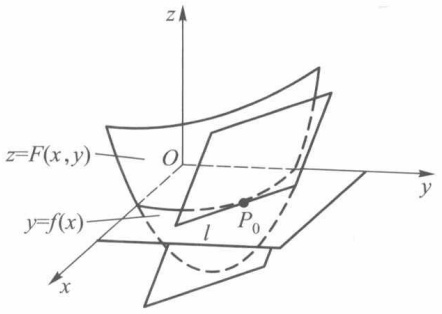
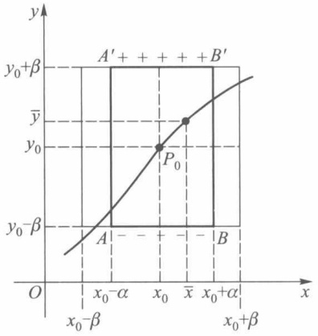
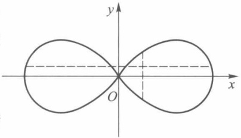
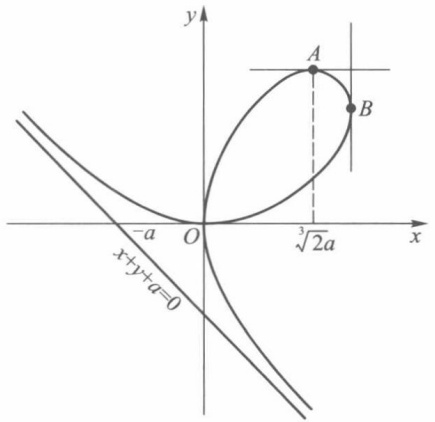
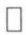
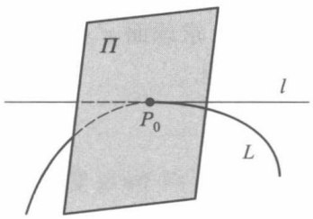
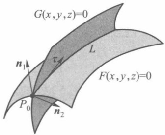
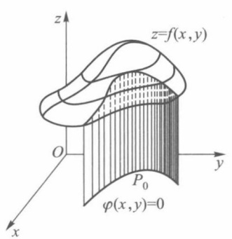
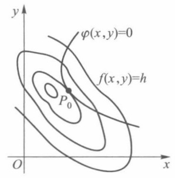

# 第18章 隐函数定理及其应用

原始 PDF 第 144–170 页。

第十八章

隐函数定理及其应用

## §1 隐函数

## 一、隐函数的概念

在这之前我们所接触的函数,其表达式大多是自变量的某个算式,如

$$
y = x ^ {2} + 1, u = \mathrm{e} ^ {x y z} (\sin x y + \sin y z + \sin z x).
$$

这种形式的函数称为显函数.但在不少场合常会遇到另一种形式的函数,其自变量与因变量之间的对应法则由一个方程式所确定,通常称为隐函数.例如: $x^{3}+y^{3}+z^{3}-3xy=0$ .

设 $E \subset \mathbf{R}^2$，函数 $F: E \to \mathbf{R}$. 对于方程

$$
F (x, y) = 0, \tag {1}
$$

如果存在集合 $I, J \subset \mathbf{R}$, 对任何 $x \in I$, 有惟一确定的 $y \in J$, 使得 $(x, y) \in E$, 且满足方程 (1), 则称方程 (1) 确定了一个定义在 $I$ 上, 值域含于 $J$ 的隐函数. 若把它记为

$$
y = f (x) ①, x \in I, y \in J,
$$

则成立恒等式

$$
F (x, f (x)) \equiv 0, x \in I.
$$

例如方程

$$
x y + y - 1 = 0
$$

能确定一个定义在 $(-∞,-1)∪(-1,+∞)$ 上的隐函数 $y=f(x)$ . 如果从方程中把y解出, 这个函数也可表示为显函数形式

$$
y = \frac {1}{1 + x}.
$$

又如圆方程 $x^{2} + y^{2} = 1$ 能确定一个定义在 $[-1,1]$ 上，函数值不小于0的隐函数 $y = \sqrt{1 - x^2}$；又能确定另一个定义在 $[-1,1]$ 上，函数值不大于0的隐函数 $y = -\sqrt{1 - x^2}$。

所以隐函数必须在指出确定它的方程以及 x, y 的取值范围后才有意义. 当然在不产生误解的情况下, 其取值范围也可不必一一指明. 此外, 还需指出:

<small>① 这里只表示存在着定义在 I 上、值域在 J 内的函数 f，它并不意味着 y 能否用 x 的某一显式来表示.</small>

136

---

§ 1 隐函数

(i) 并不是任一方程都能确定出隐函数, 如方程

$$
x ^ {2} + y ^ {2} + c = 0.
$$

当 c>0 时, 就不能确定任何函数  $f(x)$ , 使得

$$
x ^ {2} + \left[ f (x) \right] ^ {2} + c \equiv 0.
$$

而只有当 $c \leqslant 0$ 时, 才能确定隐函数. 因此我们必须研究方程(1)在什么条件下才能确定隐函数.

（ii）倘若方程(1)能确定隐函数,一般并不都像前面的一些例子那样,能从方程中解出y,并用自变量x的算式来表示(即使 $F(x,y)$ 是初等函数).例如,对于方程

$$
y - x - \frac {1}{2} \sin y = 0.
$$

确实存在一个定义在 $(-\infty, +\infty)$ 上的函数 $f(x)$，使得

$$
f (x) - x + \frac {1}{2} \sin f (x) \equiv 0,
$$

但函数 $f(x)$ 却无法用 $x$ 的算式来表达. 因此, 在一般情况下, 我们主要考虑方程(1)能否确定隐函数以及这个隐函数的连续性、可微性, 而不管它是否能用显式表示.

## 二、隐函数存在性条件的分析

上一段给出了隐函数的定义, 现在的问题是: 当函数  $F(x,y)$  满足哪些条件时, 由方程(1)能确定隐函数  $y=f(x)$ , 并且该隐函数具有连续、可微等性质? 为此我们先作一些分析.

首先, $y=f(x)$ 可以看作曲面 $z=F(x,y)$ 与坐标平面z=0的交线,因此隐函数要存在,至少该交集不能为空,即存在 $P_{0}(x_{0},y_{0})$ ,使 $F(x_{0},y_{0})=0,y_{0}=f(x_{0})$ .

text_image

z
z=F(x,y)
O
y=f(x)
P₀
l
x
y

图18-1

其次，方程(1)能在点 $P_0$ 附近确定一个连续函数，表现为上述交集是一条通过点$P_{0}$ 的连续曲线段（图18-1).如果曲面 $z = F(x,y)$ 在点 $P_0$ 存在切平面，且切平面与坐标平面 $z = 0$ 相交于直线 $l$ ，那么曲面 $z = F(x,y)$ 在点 $P_0$ 附近亦必与坐标平面 $z = 0$ 相交（其交线在点 $P_0$ 处的切线正是 $l$ ).为此，设 $F$ 在点 $P_0$ 可微，且

$$
(F _ {x} (P _ {0}), F _ {y} (P _ {0})) \neq (0, 0), \tag {2}
$$

则可使上述切平面存在,并满足与 z=0 相交成直线的要求.

如果进一步要求上述隐函数 $y = f(x)$ （或 $x = g(y)$ ）在点 $P_0$ 可微，则在 $F$ 可微的假设下，通过方程(1)在 $P_0$ 处对 $x$ 求导，依链式法则得到

$$
F _ {x} (P _ {0}) + F _ {y} (P _ {0}) \cdot \frac {\mathrm{d} y}{\mathrm{d} x} \Big | _ {x = x _ {0}} = 0. \tag {3}
$$

当 $F_{y}(P_{0})\neq 0$ 时，可由(3)解出

$$
\frac {\mathrm{d} y}{\mathrm{d} x} \Bigg | _ {x = x _ {0}} = - \frac {F _ {x} (P _ {0})}{F _ {y} (P _ {0})}. \tag {4}
$$

类似地，当 $F_{x}(P_{0})\neq 0$ 时，通过方程(1)对 $y$ 求导后也可解出

137

---

第十八章 隐函数定理及其应用

$$
\frac {\mathrm{d} x}{\mathrm{d} y} \Big | _ {y = y _ {0}} = - \frac {F _ {y} (P _ {0})}{F _ {x} (P _ {0})}.
$$

由此可见,条件(2)不仅对于隐函数的存在性,而且对于隐函数的求导同样是重要的.

## 三、隐函数定理

定理 18.1(隐函数存在惟一性定理) 若函数  $F(x,y)$  满足下列条件:

(i) F 在以  $P_{0}(x_{0}, y_{0})$  为内点的某一区域  $D \subset R^{2}$  上连续；
(ii)  $F(x_{0}, y_{0}) = 0$  (通常称为初始条件);
(iii) F 在 D 上存在连续的偏导数  $F_{y}(x,y)$ ;
(iv)  $F_{y}(x_{0}, y_{0}) \neq 0.$

则

$1^{\circ}$ 存在点 $P_{0}$ 的某邻域 $U(P_{0})\subset D$ ，在 $U(P_0)$ 上方程 $F(x,y) = 0$ 惟一地决定了一个定义在某区间 $(x_0 - \alpha ,x_0 + \alpha)$ 上的（隐）函数 $y = f(x)$ ，使得当 $x\in (x_0 - \alpha ,x_0 + \alpha)$ 时，$(x,f(x))\in U(P_0)$ ，且 $F(x,f(x))\equiv 0,f(x_0) = y_0$

$2^{\circ}f(x)$ 在 $(x_0 - \alpha ,x_0 + \alpha)$ 上连续.

证 先证隐函数 f 的存在性与惟一性.

由条件(iv)，不妨设 $F_{y}(x_{0},y_{0}) > 0$ （若 $F_{y}(x_{0},y_{0}) < 0$ ，则可讨论 $-F(x,y) = 0$ ).由条件(iii) $F_{y}$ 在 $D$ 上连续，由连续函数的局部保号性，存在点 $P_0$ 的某一闭的方邻域$[x_0 - \beta ,x_0 + \beta ]\times [y_0 - \beta ,y_0 + \beta ]\subset D$ ，使得在其上每一点都有 $F_{y}(x,y) > 0.$ 因而，对每个固定的 $x\in [x_0 - \beta ,x_0 + \beta ],F(x,y)$ 作为 $y$ 的一元函数，必定在 $[y_0 - \beta ,y_0 + \beta ]$ 上严格增且连续.由初始条件(ii)可知

$$
F (x _ {0}, y _ {0} - \beta) <   0, F (x _ {0}, y _ {0} + \beta) > 0.
$$

再由 $F$ 的连续性条件(i)，又可知道 $F(x,y_0 - \beta)$ 与 $F(x,y_0 + \beta)$ 在 $[x_0 - \beta ,x_0 + \beta ]$ 上也是连续的.因此由保号性存在 $\alpha >0$ （ $\alpha \leqslant \beta$ )，当 $x\in (x_0 - \alpha ,x_0 + \alpha)$ 时恒有

$$
F (x, y _ {0} - \beta) <   0, F (x, y _ {0} + \beta) > 0.
$$

如图 18-2 所示, 在矩形  $ABB'A'$  的 AB 边上 F 取负值, 在  $A'B'$  边上 F 取正值. 因此对

$(x_0 - \alpha, x_0 + \alpha)$ 上每个固定值 $\bar{x}$, 同样有 $F(\bar{x}, y_0 - \beta) < 0, F(\bar{x}, y_0 + \beta) > 0$. 根据前已指出的 $F(\bar{x}, y)$ 在 $[y_0 - \beta, y_0 + \beta]$ 上严格增且连续, 由介值性定理知存在惟一的 $\bar{y} \in (y_0 - \beta, y_0 + \beta)$, 满足 $F(\bar{x}, \bar{y}) = 0$. 由 $\bar{x}$ 在 $(x_0 - \alpha, x_0 + \alpha)$ 中的任意性, 这就证明了存在惟一的一个隐函数 $y = f(x)$, 它的定义域为 $(x_0 - \alpha, x_0 + \alpha)$, 值域含于 $(y_0 - \beta, y_0 + \beta)$. 若记

$$
\begin{array}{l} U (P _ {0}) = (x _ {0} - \alpha , x _ {0} + \alpha) \\ \times (y _ {0} - \beta , y _ {0} + \beta), \\ \end{array}
$$

则  $y=f(x)$  在  $U(P_{0})$  上满足结论  $1^{\circ}$  的各项要求.

再证明 f 的连续性.

contour

| Point | X-coordinate | Y-coordinate |
| --- | --- | --- |
| P0 | x0 | y0 |
| A | \(x0-\alpha\) | — |
| B | \(x0+\alpha\) | — |

图18-2

对于 $(x_{0}-\alpha,x_{0}+\alpha)$ 上的任意点 $\bar{x},\bar{y}=f(\bar{x})$ .由上述结论可知 $y_{0}-\beta<\bar{y}<y_{0}+\beta$ .任给 $\varepsilon>$

138

---

§ 1 隐函数

0, 且  $\varepsilon$  足够小, 使得

$$
y _ {0} - \beta \leqslant \bar {y} - \varepsilon <   \bar {y} <   \bar {y} + \varepsilon \leqslant y _ {0} + \beta .
$$

由 $F(\bar{x},\bar{y}) = 0$ 及 $F(x,y)$ 关于 $y$ 严格递增，可得 $F(\bar{x},\bar{y} -\varepsilon) <   0,F(\bar{x},\bar{y} +\varepsilon) > 0.$ 根据保号性，知存在 $\bar{x}$ 的某邻域 $(\bar{x} -\delta ,\bar{x} +\delta)\subset (x_0 - \alpha ,x_0 + \alpha)$ ，使得当 $x\in (\bar{x} -\delta ,\bar{x} +\delta)$ 时同样有

$$
F (x, \bar {y} - \varepsilon) <   0, F (x, \bar {y} + \varepsilon) > 0.
$$

因此存在惟一的 $y$，使得 $F(x, y) = 0$，即 $y = f(x)$，$|y - \bar{y}| < \varepsilon$。这就证明了当 $|x - \bar{x}| < \delta$ 时，$|f(x) - f(\bar{x})| < \varepsilon$，即 $f(x)$ 在 $\bar{x}$ 连续。由 $\bar{x}$ 的任意性，可得 $f(x)$ 在 $(x_0 - \alpha, x_0 + \alpha)$ 上连续。

注1 定理18.1的条件仅仅是充分的.例如方程 $y^{3} - x^{3} = 0$ ，在点 $(0,0)$ 不满足条件

(iv) $(F_{y}(0,0)=0)$ ，但它仍能确定惟一的连续函数 y=x。当然，由于条件(iv)不满足，往往导致定理结论的失效，例如图18-3所示的双纽线，其方程为

$$
F (x, y) = \left(x ^ {2} + y ^ {2}\right) ^ {2} - x ^ {2} + y ^ {2} = 0.
$$

由于 $F(0,0) = 0,F$ 与 $F_{y} = 4y(x^{2} + y^{2}) + 2y$ 均连续，故满足定理条件(i)，(ii)，(iii).但因 $F_{y}(0,0) = 0$ ，致使在原点的无论怎样小的邻域内都不可能存在惟一的隐函数.

text_image

y
O
x

图18-3

注2 在定理证明过程中, 条件(iii)和(iv)只是用来保证存在 $P_{0}$ 的某一邻域, 在此邻域上 $F$ 关于变量 $y$ 是严格单调的. 因此对于本定理所要证明的结论来说, 可以把这两个条件减弱为“$F$ 在 $P_{0}$ 的某一邻域上关于 $y$ 严格单调”. 现在采用较强的条件 (iii) 和 (iv), 只是为了在实际应用中便于检验.

注3 如果把定理的条件(iii)和(iv)改为 $F_{x}(x,y)$ 连续，且 $F_{x}(x_{0},y_{0})\neq 0.$ 这时结论是存在惟一的连续函数 $x = g(y)$

定理18.2（隐函数可微性定理）设 $F(x,y)$ 满足隐函数存在惟一性定理中的条件(i)—(iv)，又设在 $D$ 上还存在连续的偏导数 $F_{x}(x,y)$，则由方程(1)所确定的隐函数$y = f(x)$ 在其定义域 $(x_0 - \alpha ,x_0 + \alpha)$ 上有连续导函数，且

$$
f ^ {\prime} (x) = - \frac {F _ {x} (x , y)}{F _ {y} (x , y)}. \tag {5}
$$

证 设 $x$ 与 $x + \Delta x$ 都属于 $(x_0 - \alpha, x_0 + \alpha)$，它们所对应的函数值 $y = f(x)$ 与 $y + \Delta y = f(x + \Delta x)$ 都含于 $(y_0 - \beta, y_0 + \beta)$ 内。由于

$$
F (x, y) = 0, F (x + \Delta x, y + \Delta y) = 0,
$$

因此由 $F_{x}, F_{y}$ 的连续性以及二元函数中值定理，有

$$
\begin{array}{l} 0 = F (x + \Delta x, y + \Delta y) - F (x, y) \\ = F _ {x} (x + \theta \Delta x, y + \theta \Delta y) \Delta x + F _ {y} (x + \theta \Delta x, y + \theta \Delta y) \Delta y, \\ \end{array}
$$

其中 $0 < \theta < 1$ .因而

$$
\frac {\Delta y}{\Delta x} = - \frac {F _ {x} (x + \theta \Delta x , y + \theta \Delta y)}{F _ {y} (x + \theta \Delta x , y + \theta \Delta y)}.
$$

注意到上式右端是连续函数 $F_{x}(x,y), F_{y}(x,y)$ 与 $f(x)$ 的复合函数，而且 $F_{y}(x,y)$ 在 $U(P_0)$ 上不等于零，故有

$$
f ^ {\prime} (x) = \lim _ {\Delta x \to 0} \frac {\Delta y}{\Delta x} = - \frac {F _ {x} (x , y)}{F _ {y} (x , y)}
$$

139

---

第十八章 隐函数定理及其应用

且 $f^{\prime}(x)$ 在 $(x_0 - \alpha, x_0 + \alpha)$ 上连续.

像在第二段里我们所分析的那样,若已知方程(1)确实存在连续可微的隐函数,则可对方程(1)应用复合函数求导法得到隐函数的导数,因为把 $F(x,f(x))$ 看作 $F(x,y)$ 与 $y=f(x)$ 的复合函数时,有

$$
F _ {x} (x, y) + F _ {y} (x, y) y ^ {\prime} = 0. \tag {6}
$$

当 $F_{y}(x,y)\neq 0$ 时，由它可立刻推得与(5)相同的结果.

对于隐函数的高阶导数,可用和上面同样的方法来求得,这时只要假定函数 F 存在相应阶数的连续高阶偏导数.例如,要计算  $y''$ , 只需对恒等式(6)继续应用复合函数求导法则,便得

$$
F _ {x x} (x, y) + F _ {x y} (x, y) y ^ {\prime} + \left[ F _ {y x} (x, y) + F _ {y y} (x, y) y ^ {\prime} \right] y ^ {\prime} + F _ {y} (x, y) y ^ {\prime \prime} = 0.
$$

再把(5)的结果代入上式,整理后得到

$$
\begin{array}{l} y ^ {\prime \prime} = - \frac {1}{F _ {y}} (F _ {x x} + 2 F _ {x y} y ^ {\prime} + F _ {y y} y ^ {\prime 2}) \\ = \frac {2 F _ {x} F _ {y} F _ {x y} - F _ {y} ^ {2} F _ {x x} - F _ {x} ^ {2} F _ {y y}}{F _ {y} ^ {3}}, \tag {7} \\ \end{array}
$$

当然它也可由公式(5)直接对 x 求导数而得到.

隐函数极值问题 利用隐函数求导公式(5)，(7)，得到求由 $F(x,y)=0$ 确定的隐函数 $y=f(x)$ 极值的方法如下:

首先，求 $y'$ 为零的点（驻点）$A(\widetilde{x},\widetilde{y})$ ，即方程组 $F(x,y) = 0,F_{x}(x,y) = 0$ 的解；其次，因在 $A$ 处 $F_{x} = 0$ ，从而使(7)式简化为 $y''|_A = -\frac{F_{xx}}{F_y}\Bigg|_A$ ；最后根据极值判别的第二充分条件，当 $y''|_A <   0$ （或 $>0$ )时，隐函数 $y = f(x)$ 在 $\widetilde{x}$ 处取极大值（极小值） $\widetilde{y}$

最后,我们可以类似地理解由方程  $F(x_{1},x_{2},\cdots,x_{n},y)=0$  所确定的 n 元隐函数的概念,并叙述下列 n 元隐函数的惟一存在与连续可微性定理.

## 定理18.3 若

(i) 函数  $F(x_{1}, x_{2}, \cdots, x_{n}, y)$  在以点  $P_{0}(x_{1}^{0}, x_{2}^{0}, \cdots, x_{n}^{0}, y^{0})$  为内点的区域  $D \subset R^{n+1}$  上连续；

(ii)  $F(x_{1}^{0}, x_{2}^{0}, \cdots, x_{n}^{0}, y^{0}) = 0$ ;

(iii) 偏导数  $F_{x_{1}}, F_{x_{2}}, \cdots, F_{x_{n}}, F_{y}$  在 D 上存在且连续；

(iv)  $F_{y}(x_{1}^{0}, x_{2}^{0}, \cdots, x_{n}^{0}, y^{0}) \neq 0.$

则

$1^{\circ}$ 存在点 $P_{0}$ 的某邻域 $U(P_{0})\subset D$ ，在 $U(P_{0})$ 上方程 $F(x_{1},\dots ,x_{n},y) = 0$ 惟一地确定了一个定义在 $Q_{0}(x_{1}^{0},x_{2}^{0},\dots ,x_{n}^{0})$ 的某邻域 $U(Q_0)\subset \mathbf{R}^n$ 上的 $n$ 元连续函数（隐函数） $y = f(x_{1},\dots ,x_{n})$ ，使得当 $(x_{1},x_{2},\dots ,x_{n})\in U(Q_{0})$ 时，

$$
(x _ {1}, x _ {2}, \dots , x _ {n}, f (x _ {1}, x _ {2}, \dots , x _ {n})) \in U (P _ {0}),
$$

且  $F(x_{1},\cdots,x_{n},f(x_{1},\cdots,x_{n}))\equiv0,$

$$
y ^ {0} = f (x _ {1} ^ {0}, \dots , x _ {n} ^ {0});
$$

$2^{\circ}\quad y=f(x_{1},\cdots,x_{n})$ 在 $U(Q_{0})$ 上有连续偏导数 $f_{x_1},f_{x_2},\cdots,f_{x_n}$ ，而且

140

---

§ 1 隐函数 |||

$$
f _ {x _ {1}} = - \frac {F _ {x _ {1}}}{F _ {y}}, f _ {x _ {2}} = - \frac {F _ {x _ {2}}}{F _ {y}}, \dots , f _ {x _ {n}} = - \frac {F _ {x _ {n}}}{F _ {y}}.
$$

## 四、隐函数求导举例

例1 设方程

$$
F (x, y) = y - x - \frac {1}{2} \sin y = 0. \tag {8}
$$

由于 $F$ 及其偏导数 $F_{x}, F_{y}$ 在平面上任一点都连续，且

$$
F (0, 0) = 0,
$$

$$
F _ {y} (x, y) = 1 - \frac {1}{2} \cos y > 0.
$$

故依定理 18.1 和 18.2, 方程(8)确定了一个连续可导隐函数  $y=f(x)$ , 按公式(5), 其导数为

$$
f ^ {\prime} (x) = - \frac {F _ {x} (x , y)}{F _ {y} (x , y)} = \frac {1}{1 - \frac {1}{2} \cos y} = \frac {2}{2 - \cos y}. \tag {$\square$}
$$

例 2 讨论笛卡儿(Descartes)叶形线(图 18-4)

$$
x ^ {3} + y ^ {3} - 3 a x y = 0 \tag {9}
$$

所确定的隐函数  $y=f(x)$  的一阶与二阶导数, 并求隐函数的极值.

解 令 $F(x, y) = x^3 + y^3 - 3axy$ ($a > 0$). 在曲线 (9) 上使 $F_y = 3(y^2 - ax) = 0$ 的点是 $O(0, 0)$ 和 $B(\sqrt[3]{4}a, \sqrt[3]{2}a)$. 除这两点外，方程 (9) 在其他各点附近都能确定隐函数 $y = f(x)$.

由公式(5)，得到

$$
y ^ {\prime} = - \frac {F _ {x}}{F _ {y}} = - \frac {3 (x ^ {2} - a y)}{3 (y ^ {2} - a x)} = \frac {a y - x ^ {2}}{y ^ {2} - a x}.
$$

由于

$$
2 F _ {x} F _ {y} F _ {x y} = - 5 4 a (y ^ {2} - a x) (x ^ {2} - a y),
$$

$$
F _ {y} ^ {2} F _ {x x} = 5 4 x (y ^ {2} - a x) ^ {2}, \quad F _ {x} ^ {2} F _ {y y} = 5 4 y (x ^ {2} - a y) ^ {2},
$$

于是根据公式(7)，有

$$
\begin{array}{l} y ^ {\prime \prime} = \frac {2 F _ {x} F _ {y} F _ {x y} - F _ {y} ^ {2} F _ {x x} - F _ {x} ^ {2} F _ {y y}}{F _ {y} ^ {3}} \\ = \frac {- 5 4 \left[ a \left(y ^ {2} - a x\right) \left(x ^ {2} - a y\right) + x \left(y ^ {2} - a x\right) ^ {2} + y \left(x ^ {2} - a y\right) ^ {2} \right]}{2 7 \left(y ^ {2} - a x\right) ^ {3}} \\ = \frac {- 2 \left[ - 3 a x ^ {2} y ^ {2} + x y (x ^ {3} + y ^ {3} + a ^ {3}) \right]}{(y ^ {2} - a x) ^ {3}} = \frac {- 2 \left[ - 3 a x ^ {2} y ^ {2} + x y (3 a x y + a ^ {3}) \right]}{(y ^ {2} - a x) ^ {3}} \\ = - \frac {2 a ^ {3} x y}{\left(y ^ {2} - a x\right) ^ {3}}. \\ \end{array}
$$

下面讨论极值问题. 从 $x^{3} + y^{3} - 3axy = 0$ 和 $x^{2} - ay = 0$ 解出隐函数 $y = f(x)$ 的驻点 $A(\sqrt[3]{2} a, \sqrt[3]{4} a)$. 因为 $y''|_{A} = -\frac{2a^{3}xy}{(y^{2} - ax)^{3}}\bigg|_{(\sqrt[3]{2} a, \sqrt[3]{4} a)} = -\frac{4}{\sqrt[3]{2} a} < 0$, 所以隐函数 $y = f(x)$ 在点

text_image

y
A
B
-a
O
x
√2a
x+y+a=0

图18-4

141

---

第十八章 隐函数定理及其应用

$A(\sqrt[3]{2}a,\sqrt[3]{4}a)$  取得极大值 $\sqrt[3]{4}a$ .

注 由于在 $B$ 点和原点处的任何邻域上, 每一个 $x$ 所对应的 $y$ 值不惟一, 所以方程(9)不能在那两点的邻域上确定惟一的隐函数.

例3 求由方程

$$
F (x, y, z) = x y z ^ {3} + x ^ {2} + y ^ {3} - z = 0 \tag {10}
$$

在原点附近所确定的二元隐函数  $z=f(x,y)$  的偏导数及在  $(0,1,1)$  处的全微分.

解 由于 $F(0,0,0) = 0, F_z(0,0,0) = -1 \neq 0, F, F_x, F_y, F_z$ 处处连续，根据隐函数定理18.3，在原点 $(0,0,0)$ 附近能惟一确定连续可微的隐函数 $z = f(x,y)$，且可求得它的偏导数如下:

$$
\begin{array}{l} \frac {\partial z}{\partial x} = - \frac {F _ {x}}{F _ {z}} = \frac {y z ^ {3} + 2 x}{1 - 3 x y z ^ {2}}, \\ \frac {\partial z}{\partial y} = - \frac {F _ {y}}{F _ {z}} = \frac {x z ^ {3} + 3 y ^ {2}}{1 - 3 x y z ^ {2}}. \\ \end{array}
$$

以 $(x,y,z)=(0,1,1)$ 代入，得 $\left.\frac{\partial z}{\partial x}\right|_{(0,1,1)}=1,\left.\frac{\partial z}{\partial y}\right|_{(0,1,1)}=3,\mathrm{d}z\mid_{(0,1,1)}=\mathrm{d}x+3\mathrm{d}y.$

例 4(反函数的存在性与其导数) 设  $y=f(x)$  在  $x_{0}$  的某邻域上有连续的导函数  $f'(x)$ ，且  $f(x_{0})=y_{0}$ ，考虑方程

$$
F (x, y) = y - f (x) = 0. \tag {11}
$$

由于

$$
F (x _ {0}, y _ {0}) = 0, F _ {y} = 1, F _ {x} (x _ {0}, y _ {0}) = - f ^ {\prime} (x _ {0}),
$$

所以只要 $f'(x_0) \neq 0$，就能满足隐函数定理的所有条件，这时方程(11)能确定出在 $y_0$ 的某邻域 $U(y_0)$ 上的连续可微隐函数 $x = g(y)$，并称它为函数 $y = f(x)$ 的反函数。反函数的导数是

$$
g ^ {\prime} (y) = - \frac {F _ {y}}{F _ {x}} = - \frac {1}{- f ^ {\prime} (x)} = \frac {1}{f ^ {\prime} (x)}. \tag {12}
$$

事实上,这就是在第五章里曾经得到过的反函数求导公式.

例 5 设  $z=z(x,y)$  由方程  $F(x-z,y-z)=0$  确定, 其中 F 具有二阶偏导数. 试证:  $z_{xx}+2z_{xy}+z_{yy}=0$ .

证 以 $F_{1}, F_{2}$ 分别表示 $F$ 关于第一个变量和第二个变量的偏导数，则 $F_{x} = F_{1}$，$F_{y} = F_{2}$，$F_{z} = -(F_{1} + F_{2})$，于是有

$$
z _ {x} = \frac {F _ {1}}{F _ {1} + F _ {2}}, \quad z _ {y} = \frac {F _ {2}}{F _ {1} + F _ {2}},
$$

所以 $z_{x} + z_{y} = 1$。再两边分别对 $x$ 和 $y$ 求偏导，得 $z_{xx} + z_{yx} = 0, z_{xy} + z_{yy} = 0$。由于二阶偏导数连续，故 $z_{xy} = z_{yx}$，将上述两项相加即得所需结果。

## 习题 18.1

1. 方程 $\cos x + \sin y = \mathrm{e}^{xy}$ 能否在原点的某邻域上确定隐函数 $y = f(x)$ 或 $x = g(y)$?
2. 方程  $xy + z \ln y + e^{xz} = 1$  在点  $(0, 1, 1)$  的某邻域上能否确定出某一个变量为另外两个变量的

142

---

§ 2 隐函数组

函数？

3. 求由下列方程所确定的隐函数的导数:

(1) $x^{2}y + 3x^{4}y^{3} - 4 = 0$ ，求 $\frac{\mathrm{dy}}{\mathrm{dx}};$
(2)  $\ln \sqrt{x^{2}+y^{2}} = \arctan \frac{y}{x}$ ，求  $\frac{dy}{dx}$ ;
(3)  $e^{-xy} + 2z - e^{z} = 0$ , 求  $\frac{\partial z}{\partial x}, \frac{\partial z}{\partial y}$ ;
(4) $a + \sqrt{a^2 - y^2} = y\mathrm{e}^u, u = \frac{x + \sqrt{a^2 - y^2}}{a}$ ($a > 0$), 求 $\frac{\mathrm{d}y}{\mathrm{d}x}, \frac{\mathrm{d}^2y}{\mathrm{d}x^2}$;
(5) $x^{2} + y^{2} + z^{2} - 2x + 2y - 4z - 5 = 0$ ，求 $\frac{\partial z}{\partial x},\frac{\partial z}{\partial y};$
(6) $z = f(x + y + z, xyz)$, 求 $\frac{\partial z}{\partial x}, \frac{\partial x}{\partial y}, \frac{\partial y}{\partial z}$.

4. 设 $z = x^{2} + y^{2}$, 其中 $y = f(x)$ 为由方程 $x^{2} - xy + y^{2} = 1$ 所确定的隐函数, 求 $\frac{\mathrm{dz}}{\mathrm{dx}}$ 及 $\frac{\mathrm{d}^2z}{\mathrm{dx}^2}$.

5. 设 $u = x^{2} + y^{2} + z^{2}$, 其中 $z = f(x, y)$ 是由方程 $x^{3} + y^{3} + z^{3} = 3xyz$ 所确定的隐函数, 求 $u_{x}$ 及 $u_{xx}$.

6. 设 $F(x, y, z) = 0$ 可以确定连续可微隐函数: $x = x(y, z), y = y(z, x), z = z(x, y)$, 试证: $\frac{\partial x}{\partial y} \cdot \frac{\partial y}{\partial z} \cdot \frac{\partial z}{\partial x} = -1$ (偏导数不再是偏微分的商!).

7. 求由下列方程所确定的隐函数的偏导数:

(1)  $x + y + z = \mathrm{e}^{-(x + y + z)}$ ，求 z 对于 x, y 的一阶与二阶偏导数；
(2) $F(x,x+y,x+y+z)=0$, 求 $\frac{\partial z}{\partial x},\frac{\partial z}{\partial y}$ 和 $\frac{\partial^{2}z}{\partial x^{2}}$.

8. 证明: 设方程 $F(x, y) = 0$ 所确定的隐函数 $y = f(x)$ 具有二阶导数, 则当 $F_y \neq 0$ 时, 有

$$
F _ {y} ^ {3} y ^ {\prime \prime} = \left| \begin{array}{c c c} F _ {x x} & F _ {x y} & F _ {x} \\ F _ {x y} & F _ {y y} & F _ {y} \\ F _ {x} & F _ {y} & 0 \end{array} \right|.
$$

9. 设 $f$ 是一元函数, 试问应对 $f$ 提出什么条件, 方程

$$
2 f (x y) = f (x) + f (y)
$$

在点(1,1)的邻域上就能确定出惟一的 $y$ 为 $x$ 的函数？

## § 2 隐函数组

## 一、隐函数组的概念

前一节讨论的是由一个方程所确定的隐函数,本节将讨论由方程组所确定的隐函数组.

设有方程组

143

---

第十八章 隐函数定理及其应用

$$
\left\{ \begin{array}{l} F (x, y, u, v) = 0, \\ G (x, y, u, v) = 0, \end{array} \right. \tag {1}
$$

其中 $F(x,y,u,v), G(x,y,u,v)$ 为定义在 $V \subset \mathbb{R}^4$ 上的4元函数. 若存在平面区域 $D, E \subset \mathbb{R}^2$, 对于 $D$ 中每一点 $(x,y)$, 有惟一的 $(u,v) \in E$, 使得 $(x,y,u,v) \in V$, 且满足方程组(1), 则称由方程组(1)确定了隐函数组

$$
\left\{ \begin{array}{l l} u = f (x, y), \\ v = g (x, y), \end{array} \right. (x, y) \in D, \quad (u, v) \in E,
$$

并在 $D$ 上成立恒等式

$$
\left\{ \begin{array}{l} F (x, y, f (x, y), g (x, y)) \equiv 0, \\ G (x, y, f (x, y), g (x, y)) \equiv 0, \end{array} \right. \quad (x, y) \in D.
$$

关于隐函数组的一般情况(含有  $m+n$  个变量的 m 个方程所确定的 m 个隐函数)将在第二十三章里用向量形式作进一步讨论.

## 二、隐函数组定理

为了探索由方程组(1)确定隐函数组所需要的条件,不妨假设(1)中的函数F与G是可微的,而且由(1)所确定的两个隐函数u与v也是可微的.那么通过对方程组(1)关于x,y分别求偏导数,得到

$$
\left\{ \begin{array}{l} F _ {x} + F _ {u} u _ {x} + F _ {v} v _ {x} = 0, \\ G _ {x} + G _ {u} u _ {x} + G _ {v} v _ {x} = 0, \end{array} \right. \tag {2}
$$

$$
\left\{ \begin{array}{l} F _ {y} + F _ {u} u _ {y} + F _ {v} v _ {y} = 0, \\ G _ {y} + G _ {u} u _ {y} + G _ {v} v _ {y} = 0. \end{array} \right. \tag {3}
$$

要想从(2)解出 $u_{x}$ 与 $v_{x}$, 从(3)解出 $u_{y}$ 与 $v_{y}$, 其充分条件是它们的系数行列式不为零, 即

$$
\left| \begin{array}{l l} F _ {u} & F _ {v} \\ G _ {u} & G _ {v} \end{array} \right| \neq 0. \tag {4}
$$

(4)式左边的行列式称为函数 $F, G$ 关于变量 $u, v$ 的函数行列式（或雅可比（Jacobi）行列式），亦可记作 $\frac{\partial(F, G)}{\partial(u, v)}$. 条件(4)在隐函数组定理中所起的作用，与定理18.1中的条件(iv)相当.

定理18.4（隐函数组定理）若

(i) $F(x,y,u,v)$ 与 $G(x,y,u,v)$ 在以点 $P_0(x_0,y_0,u_0,v_0)$ 为内点的区域 $V\subset \mathbf{R}^4$ 上连续；

(ii)  $F(x_{0}, y_{0}, u_{0}, v_{0}) = 0$ ,  $G(x_{0}, y_{0}, u_{0}, v_{0}) = 0$  (初始条件);

(iii) 在 V 上 F, G 具有一阶连续偏导数；

(iv) $J = \frac{\partial(F, G)}{\partial(u, v)}$ 在点 $P_0$ 不等于零.

则

$1^{\circ}$ 存在点 $P_{0}$ 的某一(四维空间)邻域 $U(P_0)\subset V$ ，在 $U(P_0)$ 上方程组(1)惟一地

144

---

§ 2 隐函数组

确定了定义在点 $Q_{0}(x_{0},y_{0})$ 的某一(二维空间)邻域 $U(Q_0)$ 上的两个二元隐函数

$$
u = f (x, y), v = g (x, y),
$$

使得 $u_0 = f(x_0, y_0), v_0 = g(x_0, y_0)$，且当 $(x, y) \in U(Q_0)$ 时，

$$
\begin{array}{l} (x, y, f (x, y), g (x, y)) \in U (P _ {0}), \\ F (x, y, f (x, y), g (x, y)) \equiv 0, \\ G (x, y, f (x, y), g (x, y)) \equiv 0; \\ \end{array}
$$

$2^{\circ}f(x,y),g(x,y)$ 在 $U(Q_0)$ 上连续；

$3^{\circ}f(x,y),g(x,y)$ 在 $U(Q_0)$ 上有一阶连续偏导数，且

$$
\begin{array}{l} \frac {\partial u}{\partial x} = - \frac {1}{J} \frac {\partial (F , G)}{\partial (x , v)}, \quad \frac {\partial v}{\partial x} = - \frac {1}{J} \frac {\partial (F , G)}{\partial (u , x)}, \tag {5} \\ \frac {\partial u}{\partial y} = - \frac {1}{J} \frac {\partial (F , G)}{\partial (y , v)}, \quad \frac {\partial v}{\partial y} = - \frac {1}{J} \frac {\partial (F , G)}{\partial (u , y)}. \\ \end{array}
$$

本定理的证明这里从略,有兴趣的读者可参阅第二十三章里的一般隐函数组定理及其证明.

注 在定理18.4中, 若将条件(iv)改为 $\frac{\partial(F,G)}{\partial(y,v)}\Big|_{P_0} \neq 0$, 则方程(1)所确定的隐函数组相应是 $y = y(u,x), v = v(u,x)$, 其他情形均可类似推得. 总之, 由方程组定义隐函数组及隐函数组求导时, 应先明确哪些变量是自变量, 哪些变量是因变量, 然后再进行有关的运算和讨论.

例1 讨论方程组

$$
\left\{ \begin{array}{l} F (x, y, u, v) = u ^ {2} + v ^ {2} - x ^ {2} - y = 0, \\ G (x, y, u, v) = - u + v - x y + 1 = 0 \end{array} \right. \tag {6}
$$

在点 $P_0(2,1,1,2)$ 近旁能确定怎样的隐函数组，并求其偏导数.

解 首先, $F(P_{0})=G(P_{0})=0$ , 即  $P_{0}$  满足初始条件. 再求出 F, G 的所有一阶偏导数

$$
\begin{array}{l} F _ {x} = - 2 x, F _ {y} = - 1, F _ {u} = 2 u, F _ {v} = 2 v, \\ G _ {x} = - y, G _ {y} = - x, G _ {u} = - 1, G _ {v} = 1. \\ \end{array}
$$

容易验算,在  $P_{0}$  处的所有六个雅可比行列式中只有

$$
\frac {\partial (F , G)}{\partial (x , v)} = 0.
$$

因此, 只有 x, v 难以肯定能否作为以 y, u 为自变量的隐函数. 除此之外, 在  $P_{0}$  的近旁任何两个变量都可作为以其余两个变量为自变量的隐函数.

如果我们想求得 $x = x(u, v), y = y(u, v)$ 的偏导数，只需对方程组(6)分别关于 $u, v$ 求偏导数，得到

$$
\left\{ \begin{array}{l} 2 u - 2 x x _ {u} - y _ {u} = 0, \\ - 1 - y x _ {u} - x y _ {u} = 0, \end{array} \right. \tag {7}
$$

$$
\left\{ \begin{array}{l} 2 v - 2 x x _ {v} - y _ {v} = 0, \\ 1 - x y _ {v} - y x _ {v} = 0. \end{array} \right. \tag {8}
$$

由(7)解出

145

---

第十八章 隐函数定理及其应用

$$
x _ {u} = \frac {2 x u + 1}{2 x ^ {2} - y}, y _ {u} = - \frac {2 x + 2 y u}{2 x ^ {2} - y}.
$$

由(8)解出

$$
x _ {v} = \frac {2 x v - 1}{2 x ^ {2} - y}, y _ {v} = \frac {2 x - 2 y v}{2 x ^ {2} - y}.
$$

例 2 设函数  $f(x,y)$ ,  $g(x,y)$  具有连续偏导数，而  $u=u(x,y)$ ,  $v=v(x,y)$  是由方程组  $u=f(ux,v+y)$ ,  $g(u-x,v^{2}y)=0$  确定的隐函数组，试求  $\frac{\partial u}{\partial x}, \frac{\partial v}{\partial y}$ .

解 设 $F = u - f(ux, v + y), G = g(u - x, v^2y)$，则有

$$
\left( \begin{array}{c c c c} F _ {x} & F _ {y} & F _ {u} & F _ {v} \\ G _ {x} & G _ {y} & G _ {u} & G _ {v} \end{array} \right) = \left( \begin{array}{c c c c} - u f _ {1} & - f _ {2} & 1 - x f _ {1} & - f _ {2} \\ - g _ {1} & v ^ {2} g _ {2} & g _ {1} & 2 v y g _ {2} \end{array} \right).
$$

于是

$$
\begin{array}{l} J _ {u v} = \left| \begin{array}{c c} 1 - x f _ {1} & - f _ {2} \\ g _ {1} & 2 v y g _ {2} \end{array} \right| = 2 y v g _ {2} - 2 x y v f _ {1} g _ {2} + f _ {2} g _ {1}, \\ J _ {x v} = \left| \begin{array}{c c} - u f _ {1} & - f _ {2} \\ - g _ {1} & 2 v y g _ {2} \end{array} \right| = - 2 y u v f _ {1} g _ {2} - f _ {2} g _ {1}, \\ J _ {u y} = \left| \begin{array}{c c} 1 - x f _ {1} & - f _ {2} \\ g _ {1} & v ^ {2} g _ {2} \end{array} \right| = v ^ {2} g _ {2} - x v ^ {2} f _ {1} g _ {2} + f _ {2} g _ {1}. \\ \end{array}
$$

因此

$$
\begin{array}{l} \frac {\partial u}{\partial x} = - \frac {J _ {x v}}{J _ {u v}} = \frac {2 y u v f _ {1} g _ {2} + f _ {2} g _ {1}}{2 y v g _ {2} - 2 x y v f _ {1} g _ {2} + f _ {2} g _ {1}}, \\ \frac {\partial v}{\partial y} = - \frac {J _ {u y}}{J _ {u v}} = \frac {x v ^ {2} f _ {1} g _ {2} - f _ {2} g _ {1} - v ^ {2} g _ {2}}{2 y v g _ {2} - 2 x y v f _ {1} g _ {2} + f _ {2} g _ {1}}. \\ \end{array}
$$

## 三、反函数组与坐标变换

在 §1 例 4 中, 我们通过隐函数定理讨论了一元函数反函数存在的(充分)条件. 现在讨论由二元函数组所确定的反函数组存在的(充分)条件.

设函数组

$$
u = u (x, y), v = v (x, y) \tag {9}
$$

是定义在 $xy$ 平面点集 $B \subset \mathbf{R}^2$ 上的两个函数，对每一点 $P(x, y) \in B$ ，由方程组(9)有 $uv$ 平面上惟一的一点 $Q(u, v) \in \mathbf{R}^2$ 与之对应. 我们称方程组(9)确定了 $B$ 到 $\mathbf{R}^2$ 的一个映射（变换），记作 $T$. 这时映射(9)可写成如下函数形式:

$$
\begin{array}{l} T: B \to \mathbf {R} ^ {2}, \\ P (x, y) \mapsto Q (u, v) \\ \end{array}
$$

或写成点函数形式 $Q = T(P), P \in B$，并称 $Q(u, v)$ 为映射 $T$ 下 $P(x, y)$ 的象，而 $P$ 则是 $Q$ 的原象。记 $B$ 在映射 $T$ 下的象集为 $B' = T(B)$。

反过来, 若 T 为一一映射(即不仅每一原象只对应一个象, 而且不同的原象对应不同的象). 这时每一点  $Q \in B'$ , 由方程组(9)都有惟一的一点  $P \in B$  与之相对应. 由此所

146

---

§ 2 隐函数组

产生的新映射称为映射 $T$ 的逆映射（逆变换），记作 $T^{-1}$，即

$$
T ^ {- 1}: B ^ {\prime} \rightarrow B,
$$

$$
Q \mapsto P
$$

或 $P = T^{-1}(Q), Q \in B'$.

亦即存在定义在 $B'$ 上的一个函数组

$$
x = x (u, v), y = y (u, v), \tag {10}
$$

把它代入(9)而成为恒等式:

$$
u \equiv u (x (u, v), y (u, v)), v \equiv v (x (u, v), y (u, v)), \tag {11}
$$

这时我们又称函数组(10)是函数组(9)的反函数组.

关于反函数组的存在性问题,其实是隐函数组存在性问题的一种特殊情形.这只需把方程组(9)改写成

$$
\left\{ \begin{array}{l} F (x, y, u, v) = u - u (x, y) = 0, \\ G (x, y, u, v) = v - v (x, y) = 0, \end{array} \right. \tag {12}
$$

并将定理 18.4 应用于(12)，便可得到函数组(9)在某个局部范围内存在反函数组(10)的下述定理.

定理18.5（反函数组定理）设函数组(9)及其一阶偏导数在某区域 $D\subset \mathbf{R}^2$ 上连续，点 $P_0(x_0,y_0)$ 是 $D$ 的内点，且

$$
u _ {0} = u (x _ {0}, y _ {0}), \quad v _ {0} = v (x _ {0}, y _ {0}), \quad \frac {\partial (u , v)}{\partial (x , y)} \Big | _ {P _ {0}} \neq 0,
$$

则在点 $P_0'(u_0, v_0)$ 的某一邻域 $U(P_0')$ 上存在惟一的一组反函数 (10)，使得 $x_0 = x(u_0, v_0), y_0 = y(u_0, v_0)$，且当 $(u, v) \in U(P_0')$ 时，有

$$
(x (u, v), y (u, v)) \in U (P _ {0})
$$

以及恒等式(11). 此外, 反函数组(10)在  $U(P_{0}^{\prime})$  上存在连续的一阶偏导数, 且

$$
\frac {\partial x}{\partial u} = \frac {\partial v}{\partial y} / \frac {\partial (u , v)}{\partial (x , y)}, \quad \frac {\partial x}{\partial v} = - \frac {\partial u}{\partial y} / \frac {\partial (u , v)}{\partial (x , y)},
$$

$$
\frac {\partial y}{\partial u} = - \left. \frac {\partial v}{\partial x} \right/ \frac {\partial (u , v)}{\partial (x , y)}, \quad \frac {\partial y}{\partial v} = \frac {\partial u}{\partial x} \Bigg / \frac {\partial (u , v)}{\partial (x , y)}. \tag {13}
$$

由(13)式看到:互为反函数组的(9)与(10),它们的雅可比行列式互为倒数,即

$$
\frac {\partial (u , v)}{\partial (x , y)} \cdot \frac {\partial (x , y)}{\partial (u , v)} = 1.
$$

这与(一元)反函数求导公式(§1中(12)式)相类似.

例 3 平面上的点 P 的直角坐标  $(x, y)$  与极坐标  $(r, \theta)$  之间的坐标变换公式为

$$
x = r \cos \theta , \quad y = r \sin \theta . \tag {14}
$$

由于

$$
\frac {\partial (x , y)}{\partial (r , \theta)} = \left| \begin{array}{c c} \cos \theta & - r \sin \theta \\ \sin \theta & r \cos \theta \end{array} \right| = r,
$$

所以除原点外,在一切点上由函数组(14)所确定的反函数组是

$$
r = \sqrt {x ^ {2} + y ^ {2}},
$$

147

---

第十八章 隐函数定理及其应用

$$
\theta = \left\{ \begin{array}{l l} \arctan \frac {y}{x}, & x > 0, \\ \pi + \arctan \frac {y}{x}, & x <   0 \end{array} \right. \quad \text {或} \quad \theta = \left\{ \begin{array}{l l} \operatorname{arccot} \frac {x}{y}, & y > 0, \\ \pi + \operatorname{arccot} \frac {x}{y}, & y <   0. \end{array} \right.
$$

对于函数组

$$
x = x (u, v, w), y = y (u, v, w), z = z (u, v, w),
$$

在相应于定理18.5的条件下所确定出的反函数组为

$$
u = u (x, y, z), v = v (x, y, z), w = w (x, y, z),
$$

它们是三维空间中直角坐标与曲面坐标之间的坐标变换.

例4 直角坐标 $(x,y,z)$ 与球坐标 $(r,\varphi ,\theta)$ 之间的变换公式为

$$
\left\{ \begin{array}{l} x = r \sin \varphi \cos \theta , \\ y = r \sin \varphi \sin \theta , \\ z = r \cos \varphi . \end{array} \right. \tag {15}
$$

由于

$$
\begin{array}{l} \frac {\partial (x , y , z)}{\partial (r , \varphi , \theta)} = \left| \begin{array}{c c c} \sin \varphi \cos \theta & r \cos \varphi \cos \theta & - r \sin \varphi \sin \theta \\ \sin \varphi \sin \theta & r \cos \varphi \sin \theta & r \sin \varphi \cos \theta \\ \cos \varphi & - r \sin \varphi & 0 \end{array} \right| \\ = r ^ {2} \sin \varphi , \\ \end{array}
$$

所以在 $r^2\sin \varphi \neq 0$ 即除去 $z$ 轴上的一切点，由方程组(15)可确定出 $r, \varphi, \theta$ 为 $x, y, z (x > 0)$ 的函数，即

$$
\begin{array}{l} r = \sqrt {x ^ {2} + y ^ {2} + z ^ {2}}, \varphi = \arccos \frac {z}{r}, \\ \theta = \left\{ \begin{array}{l l} {\arctan \frac {y}{x},} & {x > 0,} \\ {\pi + \arctan \frac {y}{x},} & {x <   0} \end{array} \right. \quad \text {或} \quad \theta = \left\{ \begin{array}{l l} {\operatorname{arccot} \frac {x}{y},} & {y > 0,} \\ {\pi + \operatorname{arccot} \frac {x}{y},} & {y <   0.} \end{array} \right. \\ \end{array}
$$

例5 设 $\varphi$ 为二元连续可微函数. 对于函数组 $u = x + at, v = x - at$, 试把弦振动方程

$$
a ^ {2} \frac {\partial^ {2} \varphi}{\partial x ^ {2}} = \frac {\partial^ {2} \varphi}{\partial t ^ {2}} (a > 0)
$$

变换成以 u, v 为自变量的形式.

解 首先有 $u_{x} = v_{x} = 1, u_{t} = -v_{t} = a$，从而 $\frac{\partial(u, v)}{\partial(x, t)} = -2a \neq 0$，因此所设变换存在逆变换，而且又有

$$
\mathrm{d} u = u _ {x} \mathrm{d} x + u _ {t} \mathrm{d} t = \mathrm{d} x + a \mathrm{d} t, \mathrm{d} v = \mathrm{d} x - a \mathrm{d} t.
$$

于是按微分形式不变性,得到

$$
\mathrm{d} \varphi = \varphi_ {u} \mathrm{d} u + \varphi_ {v} \mathrm{d} v = (\varphi_ {u} + \varphi_ {v}) \mathrm{d} x + a (\varphi_ {u} - \varphi_ {v}) \mathrm{d} t,
$$

并由此推知

$$
\varphi_ {x} = \varphi_ {u} + \varphi_ {v}, \quad \varphi_ {t} = a (\varphi_ {u} - \varphi_ {v}).
$$

按此继续求以 $u, v$ 为自变量的 $\varphi_{xx}$ 与 $\varphi_{u}$ 如下:

$$
\varphi_ {x x} = \frac {\partial}{\partial u} (\varphi_ {u} + \varphi_ {v}) u _ {x} + \frac {\partial}{\partial v} (\varphi_ {u} + \varphi_ {v}) v _ {x}
$$

148

---

§ 2 隐函数组

$$
\begin{array}{l} = \varphi_ {u u} + \varphi_ {v u} + \varphi_ {u v} + \varphi_ {v v} = \varphi_ {u u} + 2 \varphi_ {u v} + \varphi_ {v v}, \\ \varphi_ {u} = a \frac {\partial}{\partial u} \left(\varphi_ {u} - \varphi_ {v}\right) u _ {t} + a \frac {\partial}{\partial v} \left(\varphi_ {u} - \varphi_ {v}\right) v _ {t} \\ = a ^ {2} (\varphi_ {u u} - 2 \varphi_ {u v} + \varphi_ {v v}). \\ \end{array}
$$

借助这些结果就得到

$$
a ^ {2} \varphi_ {x x} - \varphi_ {u} = 4 a ^ {2} \varphi_ {u v} = 0,
$$

即把原来以 $x, t$ 作为自变量的弦振动方程变换成以 $u, v$ 作为新自变量的方程为

$$
\frac {\partial^ {2} \varphi}{\partial u \partial v} = 0.
$$

而且进一步容易求得此方程的解的形式为

$$
\varphi = f (u) + g (v) = f (x + a t) + g (x - a t)
$$

(参见第十七章总练习题7).

## 习题 18.2

1. 试讨论方程组

$$
\left\{ \begin{array}{l} x ^ {2} + y ^ {2} = \frac {z ^ {2}}{2}, \\ x + y + z = 2 \end{array} \right.
$$

在点 $(1, -1, 2)$ 的附近能否确定形如 $x = f(z), y = g(z)$ 的隐函数组？

2. 求下列方程组所确定的隐函数组的导数:

(1) $\left\{ \begin{array}{l} x^{2} + y^{2} + z^{2} = a^{2}, \\ x^{2} + y^{2} = ax, \end{array} \right.$ 求 $\frac{\mathrm{d}y}{\mathrm{d}x}, \frac{\mathrm{d}z}{\mathrm{d}x}$;
(2) $\left\{ \begin{array}{l} x - u^2 - yv = 0, \\ y - v^2 - xu = 0, \end{array} \right.$ 求 $\frac{\partial u}{\partial x}, \frac{\partial v}{\partial x}, \frac{\partial u}{\partial y}, \frac{\partial v}{\partial y};$
(3) $\left\{ \begin{array}{l} u = f(ux, v + y), \\ v = g(u - x, v^2y), \end{array} \right.$ 求 $\frac{\partial u}{\partial x}, \frac{\partial v}{\partial x}$.

3. 求下列函数组所确定的反函数组的偏导数:

(1) $\left\{ \begin{array}{l} x = \mathrm{e}^{u} + u \sin v, \\ y = \mathrm{e}^{u} - u \cos v, \end{array} \right.$ 求 $u_{x}, v_{x}, u_{y}, v_{y}$;
(2) $\left\{\begin{aligned}x&=u+v,\\ y&=u^{2}+v^{2},\\ z&=u^{3}+v^{3},\end{aligned}\right.$  求  $z_{x}$

4. 设函数 $z = z(x, y)$ 是由方程组

$$
x = \mathrm{e} ^ {u + v}, y = \mathrm{e} ^ {u - v}, z = u v
$$

$(u, v$ 为参量)所定义的函数, 求当 $u = 0, v = 0$ 时的 $\mathrm{dz}$.

5. 设以 $u, v$ 为新的自变量变换下列方程:

(1) $(x+y)\frac{\partial z}{\partial x}-(x-y)\frac{\partial z}{\partial y}=0$ , 设  $u=\ln\sqrt{x^{2}+y^{2}}$ ,  $v=\arctan\frac{y}{x}$ ;
(2) $x^{2}\frac{\partial^{2}z}{\partial x^{2}} - y^{2}\frac{\partial^{2}z}{\partial y^{2}} = 0$ ，设 $u = xy, v = \frac{x}{y}$.

6. 设函数 $u = u(x, y)$ 由方程组

$$
u = f (x, y, z, t), \quad g (y, z, t) = 0, \quad h (z, t) = 0
$$

149

---

第十八章 隐函数定理及其应用

所确定, 求  $\frac{\partial u}{\partial x}$  和  $\frac{\partial u}{\partial y}$ .

7. 设 $u = u(x, y, z), v = v(x, y, z)$ 和 $x = x(s, t), y = y(s, t), z = z(s, t)$ 都有连续的一阶偏导数. 证明

$$
\frac {\partial (u , v)}{\partial (s , t)} = \frac {\partial (u , v)}{\partial (x , y)} \frac {\partial (x , y)}{\partial (s , t)} + \frac {\partial (u , v)}{\partial (y , z)} \frac {\partial (y , z)}{\partial (s , t)} + \frac {\partial (u , v)}{\partial (z , x)} \frac {\partial (z , x)}{\partial (s , t)}.
$$

8. 设 $u = \frac{y}{\tan x}, v = \frac{y}{\sin x}$. 证明: 当 $0 < x < \frac{\pi}{2}, y > 0$ 时, $u, v$ 可以用来作为曲线坐标, 解出 $x, y$ 作为 $u, v$ 的函数, 画出 $xy$ 平面上 $u = 1, v = 2$ 所对应的坐标曲线, 计算 $\frac{\partial(u, v)}{\partial(x, y)}$ 和 $\frac{\partial(x, y)}{\partial(u, v)}$ 并验证它们互为倒数.

9. 将以下式中的 $(x,y,z)$ 变换成球面坐标 $(r,\theta,\varphi)$ 的形式:

$$
\Delta_ {1} u = \left(\frac {\partial u}{\partial x}\right) ^ {2} + \left(\frac {\partial u}{\partial y}\right) ^ {2} + \left(\frac {\partial u}{\partial z}\right) ^ {2},
$$

$$
\Delta_ {2} u = \frac {\partial^ {2} u}{\partial x ^ {2}} + \frac {\partial^ {2} u}{\partial y ^ {2}} + \frac {\partial^ {2} u}{\partial z ^ {2}}.
$$

10. 设 $u = \frac{x}{r^2}, v = \frac{y}{r^2}, w = \frac{z}{r^2}$, 其中 $r = \sqrt{x^2 + y^2 + z^2}$.

(1) 试求以 u, v, w 为自变量的反函数组；

(2) 计算 $\frac{\partial(u,v,w)}{\partial(x,y,z)}$ .

## §3 几何应用

在本节中所讨论的曲线和曲面,由于它们的方程是以隐函数(组)的形式出现的,因此在求它们的切线(或切平面)时都要用到隐函数(组)的微分法.

## 一、平面曲线的切线与法线

设平面曲线由方程

$$
F (x, y) = 0 \tag {1}
$$

给出,它在点  $P_{0}(x_{0},y_{0})$  的某邻域上满足隐函数定理条件,于是在点  $P_{0}$  附近所确定的连续可微隐函数  $y=f(x)$  (或  $x=g(y)$ ) 和方程(1)在点  $P_{0}$  附近表示同一曲线,从而该曲线在点  $P_{0}$  存在切线和法线,其方程分别为

$$
y - y _ {0} = f ^ {\prime} (  x _ {0}  )   (  x - x _ {0}  ) \quad (\text {或}   x - x _ {0} = g ^ {\prime} (  y _ {0}  )   (  y - y _ {0}  )  )
$$

与

$$
y - y _ {0} = - \frac {1}{f ^ {\prime} (  x _ {0}  )} (  x - x _ {0}  ) \quad (\text {或}   x - x _ {0} = - \frac {1}{g ^ {\prime} (  y _ {0}  )} (  y - y _ {0}  )  ).
$$

由于

$$
f ^ {\prime} (  x  ) = -   \frac {F _ {x}}{F _ {y}} \quad \left(  \text {或}    g ^ {\prime} (  y  ) = -   \frac {F _ {y}}{F _ {x}}\right)  ,
$$

所以曲线(1)在点 $P_{0}$ 的切线与法线方程为

150

---

§ 3 几何应用

切线: $F_{x}(x_{0},y_{0})(x - x_{0}) + F_{y}(x_{0},y_{0})(y - y_{0}) = 0,$ (2)

法线: $F_{y}(x_{0},y_{0})(x - x_{0}) - F_{x}(x_{0},y_{0})(y - y_{0}) = 0.$ (3)

例 1 求笛卡儿叶形线(参见 §1 例 2)

$$
2 (x ^ {3} + y ^ {3}) - 9 x y = 0
$$

在点 $(2,1)$ 的切线与法线.

解 设 $F(x, y) = 2(x^3 + y^3) - 9xy$，于是 $F_x = 6x^2 - 9y, F_y = 6y^2 - 9x$ 在全平面连续，且 $F_x(2,1) = 15 \neq 0, F_y(2,1) = -12 \neq 0$. 因此，由公式（2）与（3）分别求得曲线在点（2，1）的切线方程与法线方程分别为

$$
\begin{array}{l} 1 5 (x - 2) - 1 2 (y - 1) = 0 \quad \text {即} \quad 5 x - 4 y - 6 = 0, \\ - 1 2 (x - 2) - 1 5 (y - 1) = 0 \quad \text {即} \quad 4 x + 5 y - 1 3 = 0. \\ \end{array}
$$

## 二、空间曲线的切线与法平面

下面我们讨论由参数方程

$$
L \colon x = x (t), y = y (t), z = z (t), \alpha \leqslant t \leqslant \beta \tag {4}
$$

表示的空间曲线 L 上某一点  $P_{0}(x_{0}, y_{0}, z_{0})$  的切线和法平面方程，这里  $x_{0} = x(t_{0})$ ,  $y_{0} = y(t_{0})$ ,  $z_{0} = z(t_{0})$ ,  $\alpha \leqslant t_{0} \leqslant \beta$ ，并假定(4)式中的三个函数在  $t_{0}$  处可导，且

$$
\left[ x ^ {\prime} (t _ {0}) \right] ^ {2} + \left[ y ^ {\prime} (t _ {0}) \right] ^ {2} + \left[ z ^ {\prime} (t _ {0}) \right] ^ {2} \neq 0.
$$

在曲线 L 上点  $P_{0}$  附近选取一点  $P(x,y,z)=P(x_{0}+\Delta x,y_{0}+\Delta y,z_{0}+\Delta z)$ ，于是连接 L 上的点  $P_{0}$  与 P 的割线方程为

$$
\frac {x - x _ {0}}{\Delta x} = \frac {y - y _ {0}}{\Delta y} = \frac {z - z _ {0}}{\Delta z},
$$

其中  $\Delta x = x(t_{0} + \Delta t) - x(t_{0})$ ,  $\Delta y = y(t_{0} + \Delta t) - y(t_{0})$ ,  $\Delta z = z(t_{0} + \Delta t) - z(t_{0})$ . 以  $\Delta t$  除上式各分母, 得

$$
\frac {x - x _ {0}}{\frac {\Delta x}{\Delta t}} = \frac {y - y _ {0}}{\frac {\Delta y}{\Delta t}} = \frac {z - z _ {0}}{\frac {\Delta z}{\Delta t}}.
$$

当  $\Delta t \rightarrow 0$  时,  $P \rightarrow P_{0}$ , 且

$$
\frac {\Delta x}{\Delta t} \rightarrow x ^ {\prime} (  t _ {0})  , \quad \frac {\Delta y}{\Delta t} \rightarrow y ^ {\prime} (  t _ {0})  , \quad \frac {\Delta z}{\Delta t} \rightarrow z ^ {\prime} (  t _ {0})  ,
$$

即得曲线 L 在  $P_{0}$  处的切线方程为

$$
\frac {x - x _ {0}}{x ^ {\prime} (t _ {0})} = \frac {y - y _ {0}}{y ^ {\prime} (t _ {0})} = \frac {z - z _ {0}}{z ^ {\prime} (t _ {0})}. \tag {5}
$$

由此可见，当 $x'(t_0), y'(t_0), z'(t_0)$ 不全为零时，它们是该切线的方向数.

过点 $P_{0}$ 可以作无穷多条直线与切线 $l$ 垂直，所有这些直线都在同一平面上，称此平面为曲线 $L$ 在点$P_{0}$ 的法平面（图18-5中的平面 $\Pi$ ).它通过点 $P_{0}$ ，且以 $L$ 在 $P_{0}$ 的切线 $l$ 为它的法线，所以法平面 $\Pi$ 的方程为

text_image

Π
P₀
l
L

图18-5

151

---

第十八章 隐函数定理及其应用

$$
x ^ {\prime} (t _ {0}) (x - x _ {0}) + y ^ {\prime} (t _ {0}) (y - y _ {0}) + z ^ {\prime} (t _ {0}) (z - z _ {0}) = 0. \tag {6}
$$

当空间曲线 $L$ 由方程组

$$
L: \left\{ \begin{array}{l} F (x, y, z) = 0, \\ G (x, y, z) = 0 \end{array} \right. \tag {7}
$$

给出时, 若它在点 $P_{0}(x_{0}, y_{0}, z_{0})$ 的某邻域上满足隐函数组定理的条件 (这里不妨设条件 (iv) 是 $\frac{\partial(F, G)}{\partial(x, y)} \bigg|_{P_{0}} \neq 0$), 则方程组 (7) 在点 $P_{0}$ 附近能确定惟一连续可微的隐函数组

$$
x = \varphi (z), y = \psi (z), \tag {8}
$$

使得 $x_0 = \varphi (z_0), y_0 = \psi (z_0)$，且

$$
\frac {\mathrm{d} x}{\mathrm{d} z} = - \frac {\frac {\partial (F , G)}{\partial (z , y)}}{\frac {\partial (F , G)}{\partial (x , y)}}, \frac {\mathrm{d} y}{\mathrm{d} z} = - \frac {\frac {\partial (F , G)}{\partial (x , z)}}{\frac {\partial (F , G)}{\partial (x , y)}}.
$$

由于在点 $P_0$ 附近方程组(7)与函数组(8)表示同一空间曲线,因此以 $z$ 为参量时,就得到点 $P_0$ 附近曲线 $L$ 的参量方程

$$
x = \varphi (z), y = \psi (z), z = z.
$$

于是由(5)式,曲线在 $P_{0}$ 处的切线方程为

$$
\frac {x - x _ {0}}{\left. \frac {\mathrm{d} x}{\mathrm{d} z} \right| _ {P _ {0}}} = \frac {y - y _ {0}}{\left. \frac {\mathrm{d} y}{\mathrm{d} z} \right| _ {P _ {0}}} = \frac {z - z _ {0}}{1},
$$

即

$$
\frac {x - x _ {0}}{\left. \frac {\partial (F , G)}{\partial (y , z)} \right| _ {P _ {0}}} = \frac {y - y _ {0}}{\left. \frac {\partial (F , G)}{\partial (z , x)} \right| _ {P _ {0}}} = \frac {z - z _ {0}}{\left. \frac {\partial (F , G)}{\partial (x , y)} \right| _ {P _ {0}}}. \tag {9}
$$

按(6)式,曲线在 $P_{0}$ 处的法平面方程为

$$
\frac {\partial (F , G)}{\partial (y , z)} \Big | _ {P _ {0}} (x - x _ {0}) + \frac {\partial (F , G)}{\partial (z , x)} \Big | _ {P _ {0}} (y - y _ {0}) + \frac {\partial (F , G)}{\partial (x , y)} \Big | _ {P _ {0}} (z - z _ {0}) = 0. \tag {10}
$$

同样可推出: 当  $\frac{\partial(F,G)}{\partial(y,z)}$  或  $\frac{\partial(F,G)}{\partial(z,x)}$  在  $P_{0}$  处不等于零时, 曲线在  $P_{0}$  处的切线与法平面方程仍分别取(9)与(10)的形式. 由此可见, 当

$$
\frac {\partial (F , G)}{\partial (y , z)} \Big | _ {P _ {0}}, \quad \frac {\partial (F , G)}{\partial (z , x)} \Big | _ {P _ {0}}, \quad \frac {\partial (F , G)}{\partial (x , y)} \Big | _ {P _ {0}}
$$

不全为零时,它们是空间曲线(7)在 $P_{0}$ 处的切线的方向数.

例 2 求球面  $x^{2}+y^{2}+z^{2}=50$  与锥面  $x^{2}+y^{2}=z^{2}$  所截出的曲线在  $(3,4,5)$  处的切线与法平面方程.

解设

$$
F (x, y, z) = x ^ {2} + y ^ {2} + z ^ {2} - 5 0,
$$

$$
G (x, y, z) = x ^ {2} + y ^ {2} - z ^ {2}.
$$

它们在(3,4,5)处的偏导数和雅可比行列式之值分别为

$$
\frac {\partial F}{\partial x} = 6, \quad \frac {\partial F}{\partial y} = 8, \quad \frac {\partial F}{\partial z} = 1 0,
$$

152

---

§ 3 几何应用

$$
\frac {\partial G}{\partial x} = 6, \quad \frac {\partial G}{\partial y} = 8, \quad \frac {\partial G}{\partial z} = - 1 0
$$

和 $\frac{\partial(F,G)}{\partial(y,z)} = -160,\quad \frac{\partial(F,G)}{\partial(z,x)} = 120,\quad \frac{\partial(F,G)}{\partial(x,y)} = 0.$

所以曲线在 $(3,4,5)$ 处的切线方程为

$$
\frac {x - 3}{- 1 6 0} = \frac {y - 4}{1 2 0} = \frac {z - 5}{0},
$$

即 $\left\{ \begin{array}{l}3(x - 3) + 4(y - 4) = 0,\\ z = 5. \end{array} \right.$

法平面方程为

$$
- 4 (x - 3) + 3 (y - 4) + 0 (z - 5) = 0,
$$

即 $4x - 3y = 0.$

## 三、曲面的切平面与法线

设曲面由方程

$$
F (x, y, z) = 0 \tag {11}
$$

给出, 它在点  $P_{0}(x_{0}, y_{0}, z_{0})$  的某邻域上满足隐函数定理条件(这里不妨设  $F_{z}(x_{0}, y_{0}, z_{0}) \neq 0$ ). 于是方程(11) 在点  $P_{0}$  附近确定惟一连续可微的隐函数  $z = f(x, y)$ , 使得  $z_{0} = f(x_{0}, y_{0})$ , 且

$$
\frac {\partial z}{\partial x} = - \frac {F _ {x} (x , y , z)}{F _ {z} (x , y , z)}, \quad \frac {\partial z}{\partial y} = - \frac {F _ {y} (x , y , z)}{F _ {z} (x , y , z)}.
$$

由于在点 $P_{0}$ 附近(11)式与 $z = f(x,y)$ 表示同一曲面，从而该曲面在 $P_{0}$ 处有切平面与法线（第十七章 §1 的(13)式、(14)式），它们的方程分别是

$$
z - z _ {0} = - \frac {F _ {x} (x _ {0} , y _ {0} , z _ {0})}{F _ {z} (x _ {0} , y _ {0} , z _ {0})} (x - x _ {0}) - \frac {F _ {y} (x _ {0} , y _ {0} , z _ {0})}{F _ {z} (x _ {0} , y _ {0} , z _ {0})} (y - y _ {0})
$$

与

$$
\frac {x - x _ {0}}{- \frac {F _ {x} (x _ {0} , y _ {0} , z _ {0})}{F _ {z} (x _ {0} , y _ {0} , z _ {0})}} = \frac {y - y _ {0}}{- \frac {F _ {y} (x _ {0} , y _ {0} , z _ {0})}{F _ {z} (x _ {0} , y _ {0} , z _ {0})}} = \frac {z - z _ {0}}{- 1}.
$$

它们也可分别写成如下形式:

$$
\begin{array}{l} F _ {x} (x _ {0}, y _ {0}, z _ {0}) (x - x _ {0}) + F _ {y} (x _ {0}, y _ {0}, z _ {0}) (y - y _ {0}) + \\ F _ {z} (x _ {0}, y _ {0}, z _ {0}) (z - z _ {0}) = 0 \tag {12} \\ \end{array}
$$

与

$$
\frac {x - x _ {0}}{F _ {x} (x _ {0} , y _ {0} , z _ {0})} = \frac {y - y _ {0}}{F _ {y} (x _ {0} , y _ {0} , z _ {0})} = \frac {z - z _ {0}}{F _ {z} (x _ {0} , y _ {0} , z _ {0})}. \tag {13}
$$

这种形式对于 $F_{x}(x_{0},y_{0},z_{0})\neq 0$ 或 $F_{y}(x_{0},y_{0},z_{0})\neq 0$ 也同样适合.

注1 由上面讨论知道, 函数 $F(x,y,z)$ 在点 $P(x,y,z)$ 的梯度 $\operatorname{grad} F(P)$ 就是等值面 $F(x,y,z)=0$ 在点 $P$ 的法向量 $\boldsymbol{n}=(F_x(P), F_y(P), F_z(P))$.

注2 将(7)式表示的曲线 $L$ 看成两个曲面 $F(x,y,z) = 0$ 和 $G(x,y,z) = 0$ 的交线（图18-6），于是 $L$ 在点 $P_0$ 的切线与这两个曲面在 $P_0$ 的法线都垂直. 而这两个法向量

153

---

第十八章 隐函数定理及其应用

为  $\boldsymbol{n}_{1}=(F_{x},F_{y},F_{z})\mid_{P_{0}}$  与  $\boldsymbol{n}_{2}=(G_{x},G_{y},G_{z})\mid_{P_{0}}$ ，因此 L 在  $P_{0}$  的切向量可以取  $n_{1}$  与  $n_{2}$  的向量积

$$
\begin{array}{l} \boldsymbol {\tau} = \boldsymbol {n} _ {1} \times \boldsymbol {n} _ {2} = \left| \begin{array}{c c c} \boldsymbol {i} & \boldsymbol {j} & \boldsymbol {k} \\ F _ {x} (P _ {0}) & F _ {y} (P _ {0}) & F _ {z} (P _ {0}) \\ G _ {x} (P _ {0}) & G _ {y} (P _ {0}) & G _ {z} (P _ {0}) \end{array} \right| \\ = \frac {\partial (F , G)}{\partial (y , z)} \Big | _ {P _ {0}} \boldsymbol {i} + \frac {\partial (F , G)}{\partial (z , x)} \Big | _ {P _ {0}} \boldsymbol {j} + \frac {\partial (F , G)}{\partial (x , y)} \Big | _ {P _ {0}} \boldsymbol {k}. \\ \end{array}
$$

这个结果相比前面导出(9)式的过程更容易记住.

text_image

G(x,y,z)=0
n₁
τ
L
F(x,y,z)=0
P₀
n₂

图18-6

例 3 求椭球面  $x^{2}+2y^{2}+3z^{2}=6$  在  $(1,1,1)$  处的切平面方程与法线方程.

解 设 $F(x, y, z) = x^2 + 2y^2 + 3z^2 - 6$. 由于 $F_x = 2x, F_y = 4y, F_z = 6z$ 在全空间上处处连续. 在 $(1, 1, 1)$ 处 $F_x = 2, F_y = 4, F_z = 6$. 因此由公式(12)，(13)得切平面方程

$$
2 (x - 1) + 4 (y - 1) + 6 (z - 1) = 0,
$$

即 $x + 2y + 3z = 6$

和法线方程

$$
\frac {x - 1}{1} = \frac {y - 1}{2} = \frac {z - 1}{3}.
$$

例 4 证明: 曲面  $f\left(\frac{x-a}{z-c}, \frac{y-b}{z-c}\right)=0$  的任一切平面都过某个定点, 其中 f 是连续可微函数.

证 令 $F(x,y,z) = f\left(\frac{x - a}{z - c},\frac{y - b}{z - c}\right)$，因为

$$
(F _ {x}, F _ {y}, F _ {z}) = \left(\frac {f _ {1}}{z - c}, \frac {f _ {2}}{z - c}, - \frac {(x - a) f _ {1} + (y - b) f _ {2}}{(z - c) ^ {2}}\right),
$$

所以曲面在其上任意一点 $P_0(x_0,y_0,z_0)$ 的法向量可取为

$$
\boldsymbol {n} = \left(f _ {1} (P _ {0}), f _ {2} (P _ {0}), - \frac {(x _ {0} - a) f _ {1} (P _ {0}) + (y _ {0} - b) f _ {2} (P _ {0})}{z _ {0} - c}\right).
$$

由此得到切平面方程

$$
f _ {1} (P _ {0}) (x - x _ {0}) + f _ {2} (P _ {0}) (y - y _ {0}) - \frac {(x _ {0} - a) f _ {1} (P _ {0}) + (y _ {0} - b) f _ {2} (P _ {0})}{z _ {0} - c} (z - z _ {0}) = 0.
$$

将 $(x,y,z) = (a,b,c)$ 代入上式，就得到一个恒等式

$$
f _ {1} (P _ {0}) (a - x _ {0}) + f _ {2} (P _ {0}) (b - y _ {0}) - \frac {(x _ {0} - a) f _ {1} (P _ {0}) + (y _ {0} - b) f _ {2} (P _ {0})}{z _ {0} - c} (c - z _ {0}) \equiv 0,
$$

这说明定点 $(a,b,c)$ 在曲面的任一切平面上.

## 习题 18.3

1. 求平面曲线 $x^{2/3} + y^{2/3} = a^{2/3}$ ($a > 0$) 上任一点处的切线方程，并证明这些切线被坐标轴所截取的线段等长.

2. 求下列曲线在所示点处的切线与法平面:

(1) $x = a\sin^2 t, y = b\sin t\cos t, z = c\cos^2 t$，在点 $t = \frac{\pi}{4}$;

154

---

§ 4 条件极值 |||

(2) $2x^{2}+3y^{2}+z^{2}=9,z^{2}=3x^{2}+y^{2}$ ，在点 $(1,-1,2)$ .

3. 求下列曲面在所示点处的切平面与法线:

(1)  $y - e^{2x - z} = 0$ , 在点  $(1, 1, 2)$ ;

(2) $\frac{x^2}{a^2} + \frac{y^2}{b^2} + \frac{z^2}{c^2} = 1$，在点 $\left(\frac{a}{\sqrt{3}}, \frac{b}{\sqrt{3}}, \frac{c}{\sqrt{3}}\right)$.

4. 证明对任意常数 $\rho, \varphi$，球面 $x^{2} + y^{2} + z^{2} = \rho^{2}$ 与锥面 $x^{2} + y^{2} = \tan^{2} \varphi \cdot z^{2}$ 是正交的.

5. 求曲面 $x^{2} + 2y^{2} + 3z^{2} = 21$ 的切平面，使它平行于平面

$$
x + 4 y + 6 z = 0.
$$

6. 在曲线  $x=t, y=t^{2}, z=t^{3}$  上求出一点，使曲线在此点的切线平行于平面  $x+2y+z=4$ .

7. 求函数

$$
u = \frac {x}{\sqrt {x ^ {2} + y ^ {2} + z ^ {2}}}
$$

在点 $M(1,2,-2)$ 沿曲线

$$
x = t, \quad y = 2 t ^ {2}, \quad z = - 2 t ^ {4}
$$

在该点切线的方向导数.

8. 试证明: 函数 $F(x, y)$ 在点 $P_{0}(x_{0}, y_{0})$ 的梯度恰好是 $F$ 的等值线在点 $P_{0}$ 的法向量 (设 $F$ 有连续一阶偏导数).

9. 确定正数  $\lambda$ ，使曲面  $xyz = \lambda$  与椭球面  $\frac{x^{2}}{a^{2}} + \frac{y^{2}}{b^{2}} + \frac{z^{2}}{c^{2}} = 1$  在某一点相切（即在该点有公共切平面）.

10. 求 $x^{2} + y^{2} + z^{2} = x$ 的切平面，使其垂直于平面 $x - y - \frac{1}{2} z = 2$ 和 $x - y - z = 2$.

11. 求两曲面

$$
F (x, y, z) = 0, G (x, y, z) = 0
$$

的交线在 xy 平面上的投影曲线的切线方程.

## §4 条件极值

以往所讨论的极值问题,其极值点的搜索范围是目标函数的定义域,但是另外还有很多极值问题,其极值点的搜索范围还受到各自不同条件的限制.例如,要设计一个容量为V的长方形开口水箱,试问水箱的长、宽、高各等于多少时,其表面积最小?为此,设水箱的长、宽、高分别为x,y,z,则表面积为

$$
S (x, y, z) = 2 (x z + y z) + x y.
$$

依题意,上述表面积函数的自变量不仅要符合定义域的要求 $(x>0,y>0,z>0)$ ，而且还须满足条件

$$
x y z = V. \tag {1}
$$

这类附有约束条件的极值问题称为条件极值问题(不带约束条件的极值问题不妨称为无条件极值问题). 条件极值在实际问题中的应用非常广泛, 并且还能用来证明或建立不等式.

155

---

第十八章 隐函数定理及其应用

条件极值问题的一般形式是在条件组

$$
\varphi_ {k} (x _ {1}, x _ {2}, \dots , x _ {n}) = 0, k = 1, 2, \dots , m \quad (m <   n) \tag {2}
$$

的限制下,求目标函数

$$
y = f (x _ {1}, x _ {2}, \dots , x _ {n}) \tag {3}
$$

的极值.

过去遇到这类极值问题时, 只能用消元法化为无条件极值问题来求解. 如上面的例子, 由条件(1)解出 z = V / xy, 并代入函数  $S(x, y, z)$  中, 得到

$$
F (x, y) = S \Big (x, y, \frac {V}{x y} \Big) = 2 V \Big (\frac {1}{y} + \frac {1}{x} \Big) + x y.
$$

然后按 $(F_{x},F_{y})=(0,0)$ ，求出稳定点 $x=y=\sqrt[3]{2V}$ ，并有 $z=\frac{1}{2}\sqrt[3]{2V}$ 。最后判定在此稳定点上取得最小面积 $S=3\sqrt[3]{4V^{2}}$ 。

然而,在一般情形下要从条件组(2)中解出 m 个变元并不总是可能的.下面我们介绍的拉格朗日乘数法就是一种不直接依赖消元而求解条件极值问题的有效方法.

我们从 $f, \varphi$ 皆为二元函数这一简单情况入手. 欲求函数

$$
z = f (x, y) \tag {4}
$$

的极值,其中 $(x,y)$ 受条件

$$
C: \varphi (x, y) = 0 \tag {5}
$$

的限制.

若把条件 C 看作  $(x, y)$  所满足的曲线方程，并设 C 上的点  $P_{0}(x_{0}, y_{0})$  为 f 在条件 (5) 下的极值点，且在点  $P_{0}$  的某邻域上方程 (5) 能惟一确定可微的隐函数  $y = g(x)$ ，则  $x = x_{0}$  必定也是  $z = f(x, g(x)) = h(x)$  的极值点。故由 f 在  $P_{0}$  可微，g 在  $x_{0}$  可微，得到

$$
h ^ {\prime} (x _ {0}) = f _ {x} (x _ {0}, y _ {0}) + f _ {y} (x _ {0}, y _ {0}) g ^ {\prime} (x _ {0}) = 0. \tag {6}
$$

而当 $\varphi$ 满足隐函数定理条件时

$$
g ^ {\prime} (x _ {0}) = - \frac {\varphi_ {x} (x _ {0} , y _ {0})}{\varphi_ {y} (x _ {0} , y _ {0})}. \tag {7}
$$

把(7)代入(6)后又得到

$$
f _ {x} (P _ {0}) \varphi_ {y} (P _ {0}) - f _ {y} (P _ {0}) \varphi_ {x} (P _ {0}) = 0. \tag {8}
$$

在几何意义上,关系式(8)表示曲面  $z=f(x,y)$  的等高线  $f(x,y)=f(P_{0})$  与曲线 C 在  $P_{0}$  处具有公共切线(见图 18-7). 从而存在某一常数  $\lambda_{0}$ , 使得在  $P_{0}$  处满足

$$
\left. \begin{array}{l} f _ {x} (P _ {0}) + \lambda_ {0} \varphi_ {x} (P _ {0}) = 0, \\ f _ {y} (P _ {0}) + \lambda_ {0} \varphi_ {y} (P _ {0}) = 0, \\ \varphi (P _ {0}) = 0. \end{array} \right\} \tag {9}
$$

如果引入辅助变量  $\lambda$  和辅助函数

$$
L (x, y, \lambda) = f (x, y) + \lambda \varphi (x, y), \tag {10}
$$

则(9)中三式就是

$$
\left. \begin{array}{l} L _ {x} (x _ {0}, y _ {0}, \lambda_ {0}) = f _ {x} (P _ {0}) + \lambda_ {0} \varphi_ {x} (P _ {0}) = 0, \\ L _ {y} (x _ {0}, y _ {0}, \lambda_ {0}) = f _ {y} (P _ {0}) + \lambda_ {0} \varphi_ {y} (P _ {0}) = 0, \\ L _ {\lambda} (x _ {0}, y _ {0}) = \varphi (P _ {0}) = 0. \end{array} \right\} \tag {11}
$$

156

---

§ 4 条件极值

text_image

z
z=f(x,y)
O
P₀
φ(x,y)=0
y
x

(a)

text_image

y
φ(x,y)=0
f(x,y)=h
P₀
O
x

(b)

图18-7

这样就把条件极值问题(4)，(5)转化为讨论函数(10)的无条件极值问题.这种方法称为拉格朗日乘数法，(10)中的函数 $L$ 称为拉格朗日函数，辅助变量 $\lambda$ 称为拉格朗日乘数

对于由(3)，(2)两式所表示的一般条件极值问题的拉格朗日函数是

$$
\begin{array}{l} L (x _ {1}, x _ {2}, \dots , x _ {n}, \lambda_ {1}, \lambda_ {2}, \dots , \lambda_ {m}) \\ = f (x _ {1}, x _ {2}, \dots , x _ {n}) + \sum_ {k = 1} ^ {m} \lambda_ {k} \varphi_ {k} (x _ {1}, x _ {2}, \dots , x _ {n}), \tag {12} \\ \end{array}
$$

其中  $\lambda_{1}, \lambda_{2}, \cdots, \lambda_{m}$  为拉格朗日乘数，并有下面的定理.

定理 18.6 设在条件(2)的限制下, 求函数(3)的极值问题, 其中 f 与  $\varphi_{k}$  (k=1,  $2, \cdots, m$ ) 在区域 D 上有连续的一阶偏导数. 若 D 的内点  $P_{0}(x_{1}^{(0)}, \cdots, x_{n}^{(0)})$  是上述问题的极值点, 且雅可比矩阵

$$
\left( \begin{array}{c c c} \frac {\partial \varphi_ {1}}{\partial x _ {1}} & \dots & \frac {\partial \varphi_ {1}}{\partial x _ {n}} \\ \vdots & & \vdots \\ \frac {\partial \varphi_ {m}}{\partial x _ {1}} & \dots & \frac {\partial \varphi_ {m}}{\partial x _ {n}} \end{array} \right) _ {P _ {0}} \tag {13}
$$

的秩为 m，则存在 m 个常数  $\lambda_{1}^{(0)},\cdots,\lambda_{m}^{(0)}$ ，使得  $(x_{1}^{(0)},\cdots,x_{n}^{(0)},\lambda_{1}^{(0)},\cdots,\lambda_{m}^{(0)})$  为拉格朗日函数（12）的稳定点，即  $(x_{1}^{(0)},\cdots,x_{n}^{(0)},\lambda_{1}^{(0)},\cdots,\lambda_{m}^{(0)})$  为  $n+m$  个方程

$$
\left\{ \begin{array}{l} L _ {x _ {1}} = \frac {\partial f}{\partial x _ {1}} + \sum_ {k = 1} ^ {m} \lambda_ {k} \frac {\partial \varphi_ {k}}{\partial x _ {1}} = 0, \\ \dots \dots \\ L _ {x _ {n}} = \frac {\partial f}{\partial x _ {n}} + \sum_ {k = 1} ^ {m} \lambda_ {k} \frac {\partial \varphi_ {k}}{\partial x _ {n}} = 0, \\ L _ {\lambda_ {1}} = \varphi_ {1} (x _ {1}, \dots , x _ {n}) = 0, \\ \dots \dots \\ L _ {\lambda_ {m}} = \varphi_ {m} (x _ {1}, \dots , x _ {n}) = 0 \end{array} \right.
$$

的解.

当 n=2, m=1 时, 定理的正确性已在前面作了说明, 对于一般情形的证明可参阅第二十三章的定理 23.19.

157

---

第十八章 隐函数定理及其应用

例 1 用拉格朗日乘数法重新求本节开头提到的水箱设计的问题.

解 这时所求问题的拉格朗日函数是

$$
L (x, y, z, \lambda) = 2 (x z + y z) + x y + \lambda (x y z - V).
$$

对 $L$ 求偏导数, 并令它们都等于 0 , 则有

$$
\left. \begin{array}{l} L _ {x} = 2 z + y + \lambda y z = 0, \\ L _ {y} = 2 z + x + \lambda x z = 0, \\ L _ {z} = 2 (x + y) + \lambda x y = 0, \\ L _ {\lambda} = x y z - V = 0. \end{array} \right\} \tag {14}
$$

求方程组(14)的解,得

$$
x = y = 2 z = \sqrt [ 3 ]{2 V}, \lambda = - \frac {4}{\sqrt [ 3 ]{2 V}}. \tag {15}
$$

依题意,所求水箱的表面积在条件(1)下确实存在最小值.由(15)知当高为 $\sqrt[3]{\frac{V}{4}}$ ,长与宽为高的2倍时,表面积最小.最小值 $S=3(2V)^{2/3}$ .

注 由以上结果还可以得到一个不等式(这是获得不等式的一种好方法). 那就是具体算出目标函数(表面积)的最小值:

$$
S _ {\min} = 2 \cdot \frac {\sqrt [ 3 ]{2 V}}{2} (\sqrt [ 3 ]{2 V} + \sqrt [ 3 ]{2 V}) + (\sqrt [ 3 ]{2 V}) ^ {2} = 3 \sqrt [ 3 ]{4 V ^ {2}},
$$

于是有 $2z(x + y) + xy \geqslant 3\sqrt[3]{4V^2}$，这里 $V = xyz$。消去 $V$，就有不等式

$$
2 z (x + y) + x y \geqslant 3 \sqrt [ 3 ]{4 (x y z) ^ {2}}, \quad x > 0, \quad y > 0, \quad z > 0.
$$

例2 抛物面

$$
x ^ {2} + y ^ {2} = z
$$

被平面

$$
x + y + z = 1
$$

截成一个椭圆. 求这个椭圆到原点的最长与最短距离.

解 这个问题实质上就是要求函数

$$
f (x, y, z) = x ^ {2} + y ^ {2} + z ^ {2}
$$

在条件 $x^{2} + y^{2} - z = 0$ 及 $x + y + z - 1 = 0$ 下的最大、最小值问题.应用拉格朗日乘数法，令

$$
L (x, y, z, \lambda , \mu) = x ^ {2} + y ^ {2} + z ^ {2} + \lambda (x ^ {2} + y ^ {2} - z) + \mu (x + y + z - 1).
$$

对 $L$ 求一阶偏导数，并令它们都等于0，则有

$$
\left\{ \begin{array}{l} L _ {x} = 2 x + 2 x \lambda + \mu = 0, \\ L _ {y} = 2 y + 2 y \lambda + \mu = 0, \\ L _ {z} = 2 z - \lambda + \mu = 0, \\ L _ {\lambda} = x ^ {2} + y ^ {2} - z = 0, \\ L _ {\mu} = x + y + z - 1 = 0. \end{array} \right.
$$

求得此方程组的解为

158

---

§ 4 条件极值 |||

$$
\lambda = - 3 \pm \frac {5}{3} \sqrt {3}, \mu = - 7 \pm \frac {1 1}{3} \sqrt {3},
$$

与 $x = y = \frac{-1\pm\sqrt{3}}{2},z = 2\mp\sqrt{3}.$ (16)

(16) 就是拉格朗日函数 $L(x, y, z, \lambda, \mu)$ 的稳定点，且所求的条件极值点必在其中取得。由于所求问题存在最大值与最小值（因为函数 $f$ 在有界闭集 $\{(x, y, z) | x^2 + y^2 = z, x + y + z = 1\}$ 上连续，从而必存在最大值与最小值），故由

$$
f \Big (\frac {- 1 \pm \sqrt {3}}{2}, \frac {- 1 \pm \sqrt {3}}{2}, 2 \mp \sqrt {3} \Big)
$$

所求得的两个值 $9 \mp 5\sqrt{3}$, 正是该椭圆到原点的最长距离 $\sqrt{9 + 5\sqrt{3}}$ 与最短距离 $\sqrt{9 - 5\sqrt{3}}$.

例3 求 $f(x, y, z) = xyz$ 在条件 $\frac{1}{x} + \frac{1}{y} + \frac{1}{z} = \frac{1}{r} (x > 0, y > 0, z > 0, r > 0)$ 下的极小值，并证明不等式

$$
3 \Big (\frac {1}{a} + \frac {1}{b} + \frac {1}{c} \Big) ^ {- 1} \leqslant \sqrt [ 3 ]{a b c},
$$

其中 $a, b, c$ 为任意正实数.

解 设拉格朗日函数为

$$
L (x, y, z, \lambda) = x y z + \lambda \left(\frac {1}{x} + \frac {1}{y} + \frac {1}{z} - \frac {1}{r}\right).
$$

对 $L$ 求偏导数并令它们都等于0,则有

$$
\left. \begin{array}{l} L _ {x} = y z - \frac {\lambda}{x ^ {2}} = 0, \\ L _ {y} = z x - \frac {\lambda}{y ^ {2}} = 0, \\ L _ {z} = x y - \frac {\lambda}{z ^ {2}} = 0, \\ L _ {\lambda} = \frac {1}{x} + \frac {1}{y} + \frac {1}{z} - \frac {1}{r} = 0. \end{array} \right\} \tag {17}
$$

由方程组(17)的前三式,易得

$$
\frac {1}{x} = \frac {1}{y} = \frac {1}{z} = \frac {x y z}{\lambda} = \mu .
$$

把它代入(17)的第四式,求出  $\mu=\frac{1}{3r}$ . 从而函数 L 的稳定点为  $x=y=z=3r,\lambda=(3r)^{4}$ .

为了判断 $f(3r,3r,3r)=(3r)^{3}$ 是否为所求条件极(小)值,我们可把条件 $\frac{1}{x}+\frac{1}{y}+\frac{1}{z}=\frac{1}{r}$ 看作隐函数 $z=z(x,y)$ （满足隐函数定理条件），并把目标函数 $f(x,y,z)=xyz(x,y)=F(x,y)$ 看作f与 $z=z(x,y)$ 的复合函数.这样，就可应用极值充分条件来作出判断.为此计算如下:

159

---

第十八章 隐函数定理及其应用

$$
z _ {x} = - \left. \frac {- 1}{x ^ {2}} \right/ \frac {- 1}{z ^ {2}} = - \frac {z ^ {2}}{x ^ {2}}, z _ {y} = - \frac {z ^ {2}}{y ^ {2}},
$$

$$
F _ {x} = y z + x y z _ {x} = y z - \frac {y z ^ {2}}{x}, F _ {y} = x z - \frac {x z ^ {2}}{y},
$$

$$
F _ {x x} = y z _ {x} + y z _ {x} + x y z _ {x x} = \frac {2 y z ^ {3}}{x ^ {3}},
$$

$$
F _ {x y} = z + y z _ {y} + x z _ {x} + x y z _ {x y} = z - \frac {z ^ {2}}{y} - \frac {z ^ {2}}{x} + \frac {2 z ^ {3}}{x y},
$$

$$
F _ {y y} = \frac {2 x z ^ {3}}{y ^ {3}}.
$$

当 x=y=z=3r 时，

$$
F _ {x x} = 6 r = F _ {y y}, \quad F _ {x y} = 3 r,
$$

$$
F _ {x x} F _ {y y} - F _ {x y} ^ {2} = 3 6 r ^ {2} - 9 r ^ {2} = 2 7 r ^ {2} > 0.
$$

由此可见,所求得的稳定点为极小值点,而且可以验证是最小值点.这样就有不等式

$$
x y z \geqslant (3 r) ^ {3} \quad (x > 0, y > 0, z > 0 \text {且} \frac {1}{x} + \frac {1}{y} + \frac {1}{z} = \frac {1}{r}). \tag {18}
$$

令 $x = a, y = b, z = c$，则 $r = \left(\frac{1}{a} + \frac{1}{b} + \frac{1}{c}\right)^{-1}$，代入不等式（18）有

$$
abc\geqslant \left[3 \left(\frac {1}{a} + \frac {1}{b} + \frac {1}{c}\right) ^ {- 1} \right] ^ {3}
$$

或 $3\left(\frac{1}{a} + \frac{1}{b} + \frac{1}{c}\right)^{-1} \leqslant \sqrt[3]{abc} \quad (a > 0, b > 0, c > 0)$.

## 习题 18.4

1. 应用拉格朗日乘数法, 求下列函数的条件极值:

(1) $f(x,y)=x^{2}+y^{2}$ ，若 $x+y-1=0$ ;
(2) $f(x,y,z,t)=x+y+z+t$ , 若  $xyzt=c^{4}$  (其中 x,y,z,t>0,c>0);
(3) $f(x,y,z) = xyz$ ，若 $x^{2} + y^{2} + z^{2} = 1, x + y + z = 0.$

2.（1）求表面积一定而体积最大的长方体；

(2) 求体积一定而表面积最小的长方体.

3. 求空间一点 $(x_0, y_0, z_0)$ 到平面 $Ax + By + Cz + D = 0$ 的最短距离.

4. 证明: 在 n 个正数的和为定值条件

$$
x _ {1} + x _ {2} + \dots + x _ {n} = a
$$

下, 这 n 个正数的乘积  $x_{1}x_{2}\cdots x_{n}$  的最大值为  $\frac{a^{n}}{n^{n}}$ . 并由此结果推出 n 个正数的几何平均值不大于算术平均值

$$
\sqrt [ n ]{x _ {1} x _ {2} \cdots x _ {n}} \leqslant \frac {x _ {1} + x _ {2} + \cdots + x _ {n}}{n}.
$$

5. 设  $a_{1}, a_{2}, \cdots, a_{n}$  为已知的 n 个正数，求

160

---

第十八章 总练习题

$$
f (x _ {1}, x _ {2}, \dots , x _ {n}) = \sum_ {k = 1} ^ {n} a _ {k} x _ {k}
$$

在限制条件

$$
x _ {1} ^ {2} + x _ {2} ^ {2} + \dots + x _ {n} ^ {2} \leqslant 1
$$

下的最大值.

6. 求函数

$$
f (x _ {1}, x _ {2}, \dots , x _ {n}) = x _ {1} ^ {2} + x _ {2} ^ {2} + \dots + x _ {n} ^ {2}
$$

在条件

$$
\sum_ {k = 1} ^ {n} a _ {k} x _ {k} = 1 \quad (a _ {k} > 0, k = 1, 2, \dots , n)
$$

下的最小值.

7. 利用条件极值方法证明不等式

$$
x y ^ {2} z ^ {3} \leqslant 1 0 8 \bigg (\frac {x + y + z}{6} \bigg) ^ {6}, \quad x > 0, y > 0, z > 0.
$$

提示: 取目标函数  $f(x,y,z)=xy^{2}z^{3}$ ，约束条件为  $x+y+z=a$  （x>0, y>0, z>0, a>0）.

## 第十八章总练习题

1. 方程 $y^{2} - x^{2}(1 - x^{2}) = 0$ 在哪些点的邻域上可惟一地确定连续可导的隐函数 $y = f(x)$?

2. 设函数 $f(x)$ 在区间 $(a, b)$ 上连续，函数 $\varphi(y)$ 在区间 $(c, d)$ 上连续，而且 $\varphi'(y) > 0$。问在怎样条件下，方程

$$
\varphi (y) = f (x)
$$

能确定函数

$$
y = \varphi^ {- 1} (f (x)),
$$

并研究例子:(i)  $\sin y + \sin y = x$ ; (ii)  $e^{-y} = -\sin^{2}x$ .

3. 设 $f(x, y, z) = 0$, $z = g(x, y)$，试求 $\frac{\mathrm{dy}}{\mathrm{dx}}, \frac{\mathrm{dz}}{\mathrm{dx}}$.

4. 已知 $G_{1}(x,y,z), G_{2}(x,y,z), f(x,y)$ 都是可微的，

$$
g _ {i} (x, y) = G _ {i} (x, y, f (x, y)), i = 1, 2.
$$

证明

$$
\frac {\partial (g _ {1} , g _ {2})}{\partial (x , y)} = \left| \begin{array}{c c c} - f _ {x} & - f _ {y} & 1 \\ G _ {1 x} & G _ {1 y} & G _ {1 z} \\ G _ {2 x} & G _ {2 y} & G _ {2 z} \end{array} \right|.
$$

5. 设 $x = f(u, v, w), y = g(u, v, w), z = h(u, v, w)$，求 $\frac{\partial u}{\partial x}, \frac{\partial u}{\partial y}, \frac{\partial u}{\partial z}$.

6. 试求下列方程所确定的函数的偏导数 $\frac{\partial u}{\partial x}, \frac{\partial u}{\partial y}$ :

(1) $x^{2}+u^{2}=f(x,u)+g(x,y,u);$

(2) $u = f(x + u, yu)$.

7. 据理说明: 在点  $(0,1)$  近旁是否存在连续可微的  $f(x,y)$  和  $g(x,y)$ ，满足  $f(0,1)=1, g(0,1)=-1$ ，且

$$
\left[ f (x, y) \right] ^ {3} + x g (x, y) - y = 0, \left[ g (x, y) \right] ^ {3} + y f (x, y) - x = 0.
$$

161

---

第十八章 隐函数定理及其应用

8. 设 $(x_0, y_0, z_0, u_0)$ 满足方程组

$$
f (x) + f (y) + f (z) = F (u),
$$

$$
g (x) + g (y) + g (z) = G (u),
$$

$$
h (x) + h (y) + h (z) = H (u),
$$

这里所有的函数假定有连续的导数.

（1）说出一个能在该点邻域上确定 x, y, z 为 u 的函数的充分条件；
(2) 在  $f(x)=x, g(x)=x^{2}, h(x)=x^{3}$  的情形下, 上述条件相当于什么?

9. 求由下列方程所确定的隐函数的极值:

(1)  $x^{2}+2xy+2y^{2}=1$ ;

(2) $(x^{2} + y^{2})^{2} = a^{2}(x^{2} - y^{2})(a > 0)$.

10. 设 $y = F(x)$ 和一组函数 $x = \varphi(u, v)$, $y = \psi(u, v)$，那么由方程 $\psi(u, v) = F(\varphi(u, v))$ 可以确定函数 $v = v(u)$. 试用 $u, v, \frac{\mathrm{d}v}{\mathrm{d}u}, \frac{\mathrm{d}^2v}{\mathrm{d}u^2}$ 表示 $\frac{\mathrm{d}y}{\mathrm{d}x}, \frac{\mathrm{d}^2y}{\mathrm{d}x^2}$.

11. 试证明:二次型

$$
f (x, y, z) = A x ^ {2} + B y ^ {2} + C z ^ {2} + 2 D y z + 2 E z x + 2 F x y
$$

在单位球面

$$
x ^ {2} + y ^ {2} + z ^ {2} = 1
$$

上的最大值和最小值恰好是矩阵

$$
\boldsymbol {\Phi} = \left( \begin{array}{c c c} A & F & E \\ F & B & D \\ E & D & C \end{array} \right)
$$

的最大特征值和最小特征值.

12. 设 n 为正整数, x, y > 0. 用条件极值方法证明:

$$
\frac {x ^ {n} + y ^ {n}}{2} \geqslant \left(\frac {x + y}{2}\right) ^ {n}.
$$

提示:参照 §4 例3 的思想方法,给出合适的约束条件.

13. 求出椭球 $\frac{x^{2}}{a^{2}}+\frac{y^{2}}{b^{2}}+\frac{z^{2}}{c^{2}}=1$ 在第一卦限中的切平面与三个坐标面所成四面体的最小体积.

14. 设 $P_{0}(x_{0}, y_{0}, z_{0})$ 是曲面 $F(x, y, z) = 1$ 的非奇异点①，$F$ 在 $U(P_{0})$ 可微，且为 $n$ 次齐次函数。证明:此曲面在 $P_{0}$ 处的切平面方程为

$$
x F _ {x} (P _ {0}) + y F _ {y} (P _ {0}) + z F _ {z} (P _ {0}) = n.
$$

## 第十八章综合自测题

① 若 $(F_{x}, F_{y}, F_{z})|_{P_{0}} \neq (0, 0, 0)$，则点 $P_{0}$ 称为 $F$ 的非奇异点，否则 $P_{0}$ 称为 $F$ 的奇异点.

162
