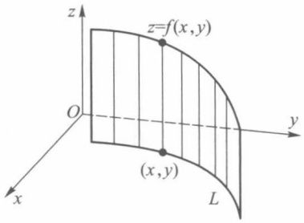
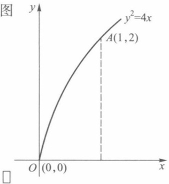
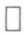
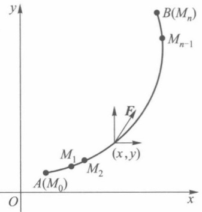
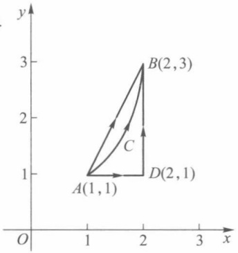
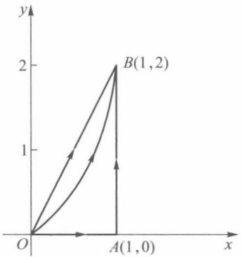
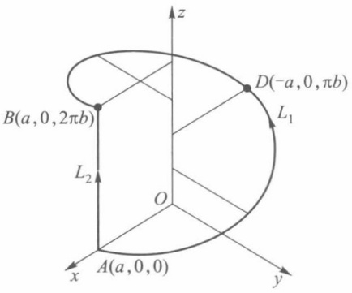

# 第20章 曲线积分

原始 PDF 第 193–205 页。

## 第二十章曲线积分

## §1 第一型曲线积分

以前讨论的定积分研究的是定义在直线段上函数的积分. 本章将研究定义在平面或空间曲线段上函数的积分.

## 一、第一型曲线积分的定义

设某物体的密度函数 $f(P)$ 是定义在 $\Omega$ 上的连续函数. 当 $\Omega$ 是直线段时, 应用定积分就能计算得该物体的质量.

现在研究当  $\Omega$  是平面或空间中某一可求长度的曲线段时物体的质量的计算问题. 首先对  $\Omega$  作分割, 把  $\Omega$  分成 n 个可求长度的小曲线段  $\Omega_{i} (i=1,2,\cdots,n)$ , 并在每一个  $\Omega_{i}$  上任取一点  $P_{i}$ . 由于  $f(P)$  为  $\Omega$  上的连续函数, 故当  $\Omega_{i}$  的弧长都很小时, 每一小段  $\Omega_{i}$  的质量可近似地等于  $f(P_{i})\Delta\Omega_{i}$ , 其中  $\Delta\Omega_{i}$  为小曲线段  $\Omega_{i}$  的长度. 于是在整个  $\Omega$  上的质量就近似地等于和式

$$
\sum_ {i = 1} ^ {n} f (P _ {i}) \Delta \Omega_ {i}.
$$

当对  $\Omega$  的分割越来越细密（即  $d=\max_{1\leqslant i\leqslant n}\Delta\Omega_{i}\rightarrow0$ ）时，上述和式的极限就应是该物体的质量.

由上面看到,求具有某种物质的曲线段的质量,与求直线段的质量一样,也是通过“分割、近似求和、取极限”来得到的.下面给出这类积分的定义.

定义 1 设 L 为平面上可求长度的曲线段,  $f(x,y)$  为定义在 L 上的函数. 对曲线 L 作分割 T, 它把 L 分成 n 个可求长度的小曲线段  $L_{i}$  ( $i=1,2,\cdots,n$ ),  $L_{i}$  的弧长记为  $\Delta s_{i}$ , 分割 T 的细度为  $\|T\|=\max_{1\leqslant i\leqslant n}\Delta s_{i}$ , 在  $L_{i}$  上任取一点  $(\xi_{i},\eta_{i})$  ( $i=1,2,\cdots,n$ ). 若有极限

$$
\lim _ {\| T \| \to 0} \sum_ {i = 1} ^ {n} f (\xi_ {i}, \eta_ {i}) \Delta s _ {i} = J,
$$

且 J 的值与分割 T 和点  $(\xi_{i}, \eta_{i})$  的取法无关，则称此极限为  $f(x, y)$  在 L 上的第一型曲线积分，记作

$$
\int_ {L} f (x, y) \mathrm{d} s. \tag {1}
$$

若 $L$ 为空间可求长曲线段, $f(x,y,z)$ 为定义在 $L$ 上的函数, 则可类似地定义 $f(x,y,z)$

185

---

第二十章 曲线积分

在空间曲线 L 上的第一型曲线积分,并且记作

$$
\int_ {L} f (x, y, z) \mathrm{d} s. \tag {2}
$$

于是前面讲到的质量分布在平面或空间曲线段 $L$ 上的物体的质量可由第一型曲线积分(1)或(2)求得.

第一型曲线积分也和定积分一样具有下述一些重要性质. 下面列出平面上第一型曲线积分的性质, 对于空间第一型曲线积分的性质, 读者可自行仿此写出.

1. 若  $\int_{L} f_{i}(x, y) \, \mathrm{d}s \quad (i = 1, 2, \cdots, k)$  存在， $c_{i} \quad (i = 1, 2, \cdots, k)$  为常数，则  $\int_{L} \sum_{i=1}^{k} c_{i} f_{i}(x, y) \, \mathrm{d}s$  也存在，且

$$
\int_ {L} \sum_ {i = 1} ^ {k} c _ {i} f _ {i} (x, y) \mathrm{d} s = \sum_ {i = 1} ^ {k} c _ {i} \int_ {L} f _ {i} (x, y) \mathrm{d} s.
$$

2. 若曲线段 L 由曲线  $L_{1}, L_{2}, \cdots, L_{k}$  首尾相接而成，且  $\int_{L_{i}} f(x, y) \, ds \quad (i = 1, 2, \cdots, k)$  都存在，则  $\int_{L} f(x, y) \, ds$  也存在，且

$$
\int_ {L} f (x, y) \mathrm{d} s = \sum_ {i = 1} ^ {k} \int_ {L _ {i}} f (x, y) \mathrm{d} s.
$$

3. 若 $\int_{L} f(x, y) \mathrm{d}s$ 与 $\int_{L} g(x, y) \mathrm{d}s$ 都存在，且在 $L$ 上 $f(x, y) \leqslant g(x, y)$，则

$$
\int_ {L} f (x, y) \mathrm{d} s \leqslant \int_ {L} g (x, y) \mathrm{d} s.
$$

4. 若 $\int_{L} f(x, y) \mathrm{d}s$ 存在，则 $\int_{L} |f(x, y)| \mathrm{d}s$ 也存在，且

$$
\left| \int_ {L} f (x, y) \mathrm{d} s \right| \leqslant \int_ {L} | f (x, y) | \mathrm{d} s.
$$

5. 若 $\int_{L} f(x, y) \mathrm{d}s$ 存在, $L$ 的弧长为 $s$, 则存在常数 $c$, 使得

$$
\int_ {L} f (x, y) \mathrm{d} s = c s,
$$

这里 $\inf_{L}f(x,y)\leqslant c\leqslant \sup_{L}f(x,y)$

6. 第一型曲线积分的几何意义

若 $L$ 为平面 $Oxy$ 上分段光滑曲线（如图20-1），$f(x,y)$ 为定义在 $L$ 上非负连续函数.由第一型曲面积分的定义，以 $L$ 为准线，母线平行于 $z$ 轴的柱面上截取 $0 \leqslant z \leqslant f(x,y)$

的部分面积就是 $\int_{L}f(x,y)\mathrm{d}s$

## 二、第一型曲线积分的计算

定理 20.1 设有光滑曲线

$$
L: \left\{ \begin{array}{l l} x = \varphi (t), \\ y = \psi (t), \end{array} \right. t \in [ \alpha , \beta ],
$$

函数 $f(x,y)$ 为定义在 $L$ 上的连续函数，则

text_image

z
z=f(x,y)
O
y
(x,y)
L
x

图20-1

186

---

§ 1 第一型曲线积分

$$
\int_ {L} f (x, y) \mathrm{d} s = \int_ {\alpha} ^ {\beta} f (\varphi (t), \psi (t)) \sqrt {\varphi^ {\prime 2} (t) + \psi^ {\prime 2} (t)} \mathrm{d} t. \tag {3}
$$

证 由弧长公式知道, L 上由  $t = t_{i-1}$  到  $t = t_{i}$  的弧长

$$
\Delta s _ {i} = \int_ {t _ {i - 1}} ^ {t _ {i}} \sqrt {\varphi^ {' 2} (t) + \psi^ {' 2} (t)}   \mathrm{d} t.
$$

由 $\sqrt{\varphi'^2(t) + \psi'^2(t)}$ 的连续性与积分中值定理，有

$$
\Delta s _ {i} = \sqrt {\varphi^ {\prime 2} (\tau_ {i} ^ {\prime}) + \psi^ {\prime 2} (\tau_ {i} ^ {\prime})} \Delta t _ {i} \quad (t _ {i - 1} <   \tau_ {i} ^ {\prime} <   t _ {i}).
$$

所以

$$
\sum_ {i = 1} ^ {n} f (\xi_ {i}, \eta_ {i}) \Delta s _ {i} = \sum_ {i = 1} ^ {n} f (\varphi (\tau_ {i} ^ {\prime \prime}), \psi (\tau_ {i} ^ {\prime \prime})) \sqrt {\varphi^ {\prime 2} (\tau_ {i} ^ {\prime}) + \psi^ {\prime 2} (\tau_ {i} ^ {\prime})} \Delta t _ {i},
$$

这里 $t_{i - 1}\leqslant \tau_i^{\prime},\tau_i^{\prime \prime}\leqslant t_i$ 设

$$
\sigma = \sum_ {i = 1} ^ {n} f (\varphi (\tau_ {i} ^ {\prime \prime}), \psi (\tau_ {i} ^ {\prime \prime})) \left[ \sqrt {\varphi^ {\prime 2} (\tau_ {i} ^ {\prime}) + \psi^ {\prime 2} (\tau_ {i} ^ {\prime})} - \sqrt {\varphi^ {\prime 2} (\tau_ {i} ^ {\prime \prime}) + \psi^ {\prime 2} (\tau_ {i} ^ {\prime \prime})} \right] \Delta t _ {i},
$$

则有

$$
\sum_ {i = 1} ^ {n} f (\xi_ {i}, \eta_ {i}) \Delta s _ {i} = \sum_ {i = 1} ^ {n} f (\varphi (\tau_ {i} ^ {\prime \prime}), \psi (\tau_ {i} ^ {\prime \prime})) \sqrt {\varphi^ {\prime 2} (\tau_ {i} ^ {\prime \prime}) + \psi^ {\prime 2} (\tau_ {i} ^ {\prime \prime})} \Delta t _ {i} + \sigma . \tag {4}
$$

令  $\Delta t = \max\{\Delta t_{1}, \Delta t_{2}, \cdots, \Delta t_{n}\}$ ，则当  $\|T\| \to 0$  时，必有  $\Delta t \to 0$ 。现在证明  $\lim_{\Delta t \to 0} \sigma = 0$ 。

因为复合函数 $f(\varphi (t),\psi (t))$ 关于 $t$ 连续，所以在闭区间 $[\alpha ,\beta ]$ 上有界，即存在常数 $M$ ，使对一切 $t\in [\alpha ,\beta ]$ ，都有

$$
\left| f (\varphi (t), \psi (t)) \right| \leqslant M.
$$

再由 $\sqrt{\varphi'^2(t) + \psi'^2(t)}$ 在 $[\alpha, \beta]$ 上连续，所以它在 $[\alpha, \beta]$ 上一致连续，即对任给的 $\varepsilon > 0$ 必存在 $\delta > 0$ ，使当 $\Delta t < \delta$ 时有

$$
\left| \sqrt {\varphi^ {\prime 2} (\tau_ {i} ^ {\prime \prime}) + \psi^ {\prime 2} (\tau_ {i} ^ {\prime \prime})} - \sqrt {\varphi^ {\prime 2} (\tau_ {i} ^ {\prime}) + \psi^ {\prime 2} (\tau_ {i} ^ {\prime})} \right| <   \varepsilon ,
$$

从而

$$
\mid \sigma \mid \leqslant \varepsilon M \sum_ {i = 1} ^ {n} \Delta t _ {i} = \varepsilon M (\beta - \alpha),
$$

所以 $\lim_{\Delta t\to 0}\sigma = 0.$

再由定积分定义，

$$
\lim _ {\Delta t \to 0} \sum_ {i = 1} ^ {n} f (\varphi (\tau_ {i} ^ {\prime \prime}), \psi (\tau_ {i} ^ {\prime \prime})) \sqrt {\varphi^ {\prime 2} (\tau_ {i} ^ {\prime \prime}) + \psi^ {\prime 2} (\tau_ {i} ^ {\prime \prime})} \Delta t _ {i}
$$

$$
= \int_ {\alpha} ^ {\beta} f (\varphi (t), \psi (t)) \sqrt {\varphi^ {\prime 2} (t) + \psi^ {\prime 2} (t)} \mathrm{d} t.
$$

因此当在(4)式两边取极限后,即得所要证的(3)式.

当曲线 $L$ 由方程

$$
y = \psi (x), \quad x \in [ a, b ]
$$

表示,且  $\psi(x)$  在  $[a,b]$  上有连续的导函数时,(3)式成为

$$
\int_ {L} f (x, y) \mathrm{d} s = \int_ {a} ^ {b} f (x, \psi (x)) \sqrt {1 + \psi^ {\prime 2} (x)} \mathrm{d} x; \tag {5}
$$

当曲线 $L$ 由方程

187

---

第二十章 曲线积分

$$
x = \varphi (y), \quad y \in [ c, d ]
$$

表示，且 $\varphi (y)$ 在 $[c,d]$ 上有连续导函数时，(3)式成为

$$
\int_ {L} f (x, y) \mathrm{d} s = \int_ {c} ^ {d} f (\varphi (y), y) \sqrt {1 + \varphi^ {\prime 2} (y)} \mathrm{d} y. \tag {6}
$$

例1 设 $L$ 是半圆周

$$
\left\{ \begin{array}{l l} x = a \cos t, \\ y = a \sin t, \end{array} \right. 0 \leqslant t \leqslant \pi ,
$$

试计算第一型曲线积分 $\int_{L}(x^{2} + y^{2})\mathrm{d}s$

解 $\int_{L}\left(x^{2} + y^{2}\right)\mathrm{d}s = \int_{0}^{\pi}a^{2}\sqrt{a^{2}\left(\cos^{2}t + \sin^{2}t\right)}\mathrm{d}t = a^{3}\pi .$

例 2 设 L 是  $y^{2}=4x$  从  $O(0,0)$  到  $A(1,2)$  的一段（图 20-2），试计算第一型曲线积分  $\int_{L}yds$ .

解 $\int_{L}y\mathrm{d}s = \int_{0}^{2}y\sqrt{1 + \frac{y^2}{4}}\mathrm{d}y$

$$
\begin{array}{l} = 2 \cdot \frac {2}{3} \left(1 + \frac {y ^ {2}}{4}\right) ^ {\frac {3}{2}} \Bigg | _ {0} ^ {2} \\ = \frac {4}{3} (2 \sqrt {2} - 1). \\ \end{array}
$$

line

| Point | X | Y |
| --- | --- | --- |
| O | 0 | 0 |
| A | 1 | 2 |

图20-2

仿照定理 20.1, 对于空间曲线积分(2), 当曲线 L 由参量方程  $x=\varphi(t)$ ,  $y=\psi(t)$ ,  $z=\chi(t)$ ,  $t\in[\alpha,\beta]$  表示时, 其计算公式为

$$
\int_ {L} f (x, y, z) \mathrm{d} s = \int_ {\alpha} ^ {\beta} f (\varphi (t), \psi (t), \chi (t)) \sqrt {\varphi^ {\prime 2} (t) + \psi^ {\prime 2} (t) + \chi^ {\prime 2} (t)} \mathrm{d} t. \tag {7}
$$

例 3 计算  $\int_{L} x^{2} ds$ ，其中 L 为球面  $x^{2} + y^{2} + z^{2} = a^{2}$  被平面  $x + y + z = 0$  所截得的圆周.

解 由对称性知

$$
\int_ {L} x ^ {2} \mathrm{d} s = \int_ {L} y ^ {2} \mathrm{d} s = \int_ {L} z ^ {2} \mathrm{d} s,
$$

所以

$$
\int_ {L} x ^ {2} \mathrm{d} s = \frac {1}{3} \int_ {L} (x ^ {2} + y ^ {2} + z ^ {2}) \mathrm{d} s = \frac {a ^ {2}}{3} \int_ {L} \mathrm{d} s = \frac {2}{3} \pi a ^ {3}.
$$

由第一型曲线积分的定义,在 Oxy 平面上,线密度为  $\rho(x,y)$  的曲线状物体对 x,y 轴的转动惯量分别为

$$
J _ {x} = \int_ {L} y ^ {2} \rho \left(x, y\right) \mathrm{d} s \quad \text {和} \quad J _ {y} = \int_ {L} x ^ {2} \rho \left(x, y\right) \mathrm{d} s.
$$

例 4 求线密度  $\rho(x,y)=\frac{y}{\sqrt{1+x^{2}}}$  的曲线段  $y=\ln x, x\in[1,2]$  对于 y 轴的转动惯量.

解 $J_{y} = \int_{L}\frac{x^{2}y}{\sqrt{1 + x^{2}}}\mathrm{d}s = \int_{1}^{2}\frac{x^{2}\ln x}{\sqrt{1 + x^{2}}}\sqrt{1 + \frac{1}{x^{2}}}\mathrm{d}x$

$$
= \int_ {1} ^ {2} x \ln x \mathrm{d} x = \ln 4 - \frac {3}{4}.
$$

188

---

§ 2 第二型曲线积分

## 习题 20.1

1. 计算下列第一型曲线积分:

(1) $\int_{L}(x + y)\mathrm{d}s$ ，其中 $L$ 是以 $O(0,0),A(1,0),B(0,1)$ 为顶点的三角形周界；
(2) $\int_{L}(x^{2} + y^{2})^{\frac{1}{2}}\mathrm{d}s$ ，其中 $L$ 是以原点为中心、 $R$ 为半径的右半圆周；
(3) $\int_{L} xy \, \mathrm{d}s$，其中 $L$ 为椭圆 $\frac{x^2}{a^2} + \frac{y^2}{b^2} = 1$ 在第一象限中的部分；
(4) $\int_{L}|y|\mathrm{d}s$ ，其中 $L$ 为单位圆周 $x^{2} + y^{2} = 1$
(5) $\int_{L}(x^{2} + y^{2} + z^{2})\mathrm{d}s$ ，其中 $L$ 为螺旋线 $x = a\cos t,y = a\sin t,z = bt$ （$0\leqslant t\leqslant 2\pi$）的一段；
(6) $\int_{L} xyz \, \mathrm{d}s$，其中 $L$ 是曲线 $x = t, y = \frac{2}{3} \sqrt{2t^3}, z = \frac{1}{2} t^2 (0 \leqslant t \leqslant 1)$ 的一段；
(7) $\int_{L} \sqrt{2y^{2} + z^{2}} \, \mathrm{d}s$，其中 $L$ 是 $x^{2} + y^{2} + z^{2} = a^{2}$ 与 $x = y$ 相交的圆周.

2. 求曲线 $x = a, y = at, z = \frac{1}{2} at^2$ ($0 \leqslant t \leqslant 1, a > 0$) 的质量，设其线密度为 $\rho = \sqrt{\frac{2z}{a}}$.

3. 求摆线 $\left\{\begin{aligned}x=a(t-\sin t),\\ y=a(1-\cos t)\end{aligned}\right.$   $(0\leqslant t\leqslant\pi)$  的质心，设其质量分布是均匀的.

4. 若曲线以极坐标  $\rho=\rho(\theta)$  ( $\theta_{1}\leqslant\theta\leqslant\theta_{2}$ ) 表示, 试给出计算  $\int_{L}f(x,y)\,\mathrm{d}s$  的公式, 并用此公式计算下列曲线积分:

(1) $\int_{L} \mathrm{e}^{\sqrt{x^2 + y^2}} \, \mathrm{d}s$，其中 $L$ 为曲线 $\rho = a \left(0 \leqslant \theta \leqslant \frac{\pi}{4}\right)$ 的一段；
(2) $\int_{L}x\mathrm{d}s$ ，其中L为对数螺线 $\rho=a\mathrm{e}^{k\theta}(k>0)$ 在圆r=a内的部分.

5. 证明: 若函数 $f(x, y)$ 在光滑曲线 $L: x = x(t), y = y(t), t \in [\alpha, \beta]$ 上连续, 则存在点 $(x_0, y_0) \in L$, 使得

$$
\int_ {L} f (x, y) \mathrm{d} s = f (x _ {0}, y _ {0}) \Delta L,
$$

其中  $\Delta L$  为 L 的弧长.

## § 2 第二型曲线积分

## 一、第二型曲线积分的定义

在物理学中还碰到另一种类型的曲线积分问题. 例如一质点受力 $F(x, y)$ 的作用沿平面曲线 $L$ 从点 $A$ 移动到点 $B$, 求力 $F(x, y)$ 所做的功 (图20-3).

为此在曲线 $\widehat{AB}$ 内插入n-1个分点 $M_{1},M_{2},\cdots,M_{n-1}$ ，与 $A=M_{0},B=M_{n}$ 一起把有向曲

189

---

第二十章 曲线积分

线 $\widehat{AB}$ 分成 n 个有向小弧段 $\widehat{M_{i-1}M_i} (i=1,2,\cdots,n)$ . 若记小弧段 $\widehat{M_{i-1}M_i}$ 的弧长为 $\Delta s_i$ ，则分割 T 的细度为

$$
\| T \| = \max _ {1 \leqslant i \leqslant n} \Delta s _ {i}.
$$

设力  $F(x,y)$  在 x 轴和 y 轴方向的投影分别为  $P(x,y)$  与  $Q(x,y)$ ，那么

$$
\boldsymbol {F} (x, y) = (P (x, y), Q (x, y)).
$$

又设小弧段 $\widehat{M_{i-1}M_i}$ 在x轴与y轴上的投影分别为 $\Delta x_i = x_i - x_{i-1}$ 与 $\Delta y_i = y_i - y_{i-1}$，其中 $(x_i, y_i)$ 与 $(x_{i-1}, y_{i-1})$ 分别为分点 $M_i$ 与 $M_{i-1}$ 的坐标.记

text_image

y
B(Mₙ)
Mₙ₋₁
A(M₀)
M₁
M₂
x,y
O
x

图20-3

$$
L _ {M _ {i - 1} M _ {i}} = (\Delta x _ {i}, \Delta y _ {i}),
$$

于是力  $\boldsymbol{F}(x,y)$  在小弧段  $\widehat{M_{i-1}M_{i}}$  上所做的功

$$
W _ {i} \approx F (\xi_ {i}, \eta_ {i}) \cdot L _ {M _ {i - 1} M _ {i}} = P (\xi_ {i}, \eta_ {i}) \Delta x _ {i} + Q (\xi_ {i}, \eta_ {i}) \Delta y _ {i},
$$

其中 $(\xi_{i},\eta_{i})$ 为小弧段 $\widehat{M_{i - 1}M_i}$ 上任一点.因而力 $F(x,y)$ 沿曲线AB所做的功近似地等于

$$
W = \sum_ {i = 1} ^ {n} W _ {i} \approx \sum_ {i = 1} ^ {n} P (\xi_ {i}, \eta_ {i}) \Delta x _ {i} + \sum_ {i = 1} ^ {n} Q (\xi_ {i}, \eta_ {i}) \Delta y _ {i}.
$$

当细度  $\|T\|\rightarrow0$  时, 上式右边和式的极限就应该是所求的功. 这种类型的和式极限就是下面所要讨论的第二型曲线积分.

定义1 设函数 $P(x, y)$ 与 $Q(x, y)$ 定义在平面有向可求长度曲线 $L: \widehat{AB}$ 上. 对 $L$ 的任一分割 $T$, 它把 $L$ 分成 $n$ 个小弧段

$$
\widehat {M _ {i - 1} M _ {i}} \quad (i = 1, 2, \dots , n),
$$

其中  $M_{0}=A, M_{n}=B.$  记各小弧段  $\widehat{M_{i-1}M_{i}}$  的弧长为  $\Delta s_{i}$ ，分割 T 的细度  $\|T\|=\max_{1\leqslant i\leqslant n}\Delta s_{i}$ 。又设 T 的分点  $M_{i}$  的坐标为  $(x_{i},y_{i})$ ，并记  $\Delta x_{i}=x_{i}-x_{i-1},\Delta y_{i}=y_{i}-y_{i-1}(i=1,2,\cdots,n).$  在每个小弧段  $\widehat{M_{i-1}M_{i}}$  上任取一点  $(\xi_{i},\eta_{i})$ ，若极限

$$
\lim _ {\parallel T \parallel \to 0} \sum_ {i = 1} ^ {n} P (\xi_ {i}, \eta_ {i}) \Delta x _ {i} + \lim _ {\parallel T \parallel \to 0} \sum_ {i = 1} ^ {n} Q (\xi_ {i}, \eta_ {i}) \Delta y _ {i}
$$

存在且与分割 T 和点  $(\xi_{i}, \eta_{i})$  的取法无关, 则称此极限为函数  $P(x, y)$ ,  $Q(x, y)$  沿有向曲线 L 上的第二型曲线积分, 记为

$$
\int_ {L} P (  x  , y  )   \mathrm{d} x   +   Q (  x  , y  )   \mathrm{d} y \quad \text {或} \quad \int_ {\widehat {A B}} P (  x  , y  )   \mathrm{d} x   +   Q (  x  , y  )   \mathrm{d} y. \tag {1}
$$

上述积分(1)也可写作

$$
\int_ {L} P (x, y) \mathrm{d} x + \int_ {L} Q (x, y) \mathrm{d} y
$$

或 $\int_{\widehat{AB}}P(x,y)\mathrm{d}x + \int_{\widehat{AB}}Q(x,y)\mathrm{d}y.$

为书写简洁起见,(1)式常简写成

$$
\int_ {L} P \mathrm{d} x   +   Q \mathrm{d} y \quad \text {或} \quad \int_ {\widehat {A B}} P \mathrm{d} x   +   Q \mathrm{d} y.
$$

190

---

§ 2 第二型曲线积分

若 L 为封闭的有向曲线, 则记为

$$
\oint_ {L} P \mathrm{d} x + Q \mathrm{d} y. \tag {2}
$$

若记 $F(x,y) = (P(x,y),Q(x,y)),\mathrm{d}s = (\mathrm{d}x,\mathrm{d}y)$ ，则(1)式可写成向量形式

$$
\int_ {L} \pmb {F} \cdot \mathrm{d} \pmb {s} \quad \text {或} \quad \int_ {\widehat {A B}} \pmb {F} \cdot \mathrm{d} \pmb {s}. \tag {3}
$$

于是，力 $F(x,y) = (P(x,y),Q(x,y))$ 沿有向曲线 $L:\widehat{AB}$ 对质点所做的功为

$$
W = \int_ {L} P (x, y) \mathrm{d} x + Q (x, y) \mathrm{d} y.
$$

倘若 L 为空间有向可求长度曲线,  $P(x,y,z)$ ,  $Q(x,y,z)$ ,  $R(x,y,z)$  为定义在 L 上的函数, 则可按上述办法类似地定义沿空间有向曲线 L 上的第二型曲线积分, 并记为

$$
\int_ {L} P (x, y, z) \mathrm{d} x + Q (x, y, z) \mathrm{d} y + R (x, y, z) \mathrm{d} z, \tag {4}
$$

或简写成

$$
\int_ {L} P \mathrm{d} x + Q \mathrm{d} y + R \mathrm{d} z.
$$

当把 $F(x,y,z) = (P(x,y,z),Q(x,y,z),R(x,y,z))$ 与 $\mathrm{ds} = (\mathrm{dx},\mathrm{dy},\mathrm{dz})$ 看作三维向量时，(4)式也可表示成(3)式的向量形式.

第二型曲线积分与曲线 L 的方向有关. 对同一曲线, 当方向由 A 到 B 改为由 B 到 A 时, 每一小曲线段的方向都改变, 从而所得的  $\Delta x_{i}, \Delta y_{i}$  也随之改变符号, 故有

$$
\int_ {\widehat {A B}} P \mathrm{d} x + Q \mathrm{d} y = - \int_ {\widehat {B A}} P \mathrm{d} x + Q \mathrm{d} y. \tag {5}
$$

而第一型曲线积分的被积表达式只是函数 $f(x,y)$ 与弧长的乘积，它与曲线 $L$ 的方向无关.这是两种类型曲线积分的一个重要区别.

类似于第一型曲线积分,第二型曲线积分也有如下一些主要性质:

1. 若  $\int_{L} P_{i} dx + Q_{i} dy \quad (i = 1, 2, \cdots, k)$  存在，则  $\int_{L} \left( \sum_{i=1}^{k} c_{i} P_{i} \right) dx + \left( \sum_{i=1}^{k} c_{i} Q_{i} \right) dy$  也存在，且

$$
\int_ {L} \Big (\sum_ {i = 1} ^ {k} c _ {i} P _ {i} \Big) \mathrm{d} x + \Big (\sum_ {i = 1} ^ {k} c _ {i} Q _ {i} \Big) \mathrm{d} y = \sum_ {i = 1} ^ {k} c _ {i} \Big (\int_ {L} P _ {i} \mathrm{d} x + Q _ {i} \mathrm{d} y \Big),
$$

其中  $c_{i}$  ( $i=1,2,\cdots,k$ ) 为常数.

2. 若有向曲线 L 是由有向曲线  $L_{1}, L_{2}, \cdots, L_{k}$  首尾相接而成，且  $\int_{L_{i}} P dx + Q dy \quad (i = 1, 2, \cdots, k)$  存在，则  $\int_{L} P dx + Q dy$  也存在，且

$$
\int_ {L} P \mathrm{d} x + Q \mathrm{d} y = \sum_ {i = 1} ^ {k} \int_ {L _ {i}} P \mathrm{d} x + Q \mathrm{d} y.
$$

## 二、第二型曲线积分的计算

与第一型曲线积分一样,第二型曲线积分也可化为定积分来计算.

设平面曲线

191

---

第二十章 曲线积分

$$
L: \left\{ \begin{array}{l l} x = \varphi (t), \\ y = \psi (t), \end{array} \right. t \in [ \alpha , \beta ],
$$

其中 $\varphi(t),\psi(t)$ 在 $[\alpha ,\beta ]$ 上具有一阶连续导函数，且点 $A$ 与 $B$ 的坐标分别为 $(\varphi (\alpha)$ ，$\psi (\alpha))$ 与 $(\varphi (\beta),\psi (\beta))$ .又设 $P(x,y)$ 与 $Q(x,y)$ 为 $L$ 上的连续函数，则沿 $L$ 从 $A$ 到 $B$ 的第二型曲线积分

$$
\begin{array}{l} \int_ {L} P (x, y) \mathrm{d} x + Q (x, y) \mathrm{d} y \\ = \int_ {\alpha} ^ {\beta} \left[ P (\varphi (t), \psi (t)) \varphi^ {\prime} (t) + Q (\varphi (t), \psi (t)) \psi^ {\prime} (t) \right] \mathrm{d} t. \tag {6} \\ \end{array}
$$

读者可仿照 §1 中定理 20.1 的方法分别证明

$$
\begin{array}{l} \int_ {L} P (x, y) \mathrm{d} x = \int_ {\alpha} ^ {\beta} P (\varphi (t), \psi (t)) \varphi^ {\prime} (t) \mathrm{d} t, \\ \int_ {L} Q (x, y) \mathrm{d} y = \int_ {\alpha} ^ {\beta} Q (\varphi (t), \psi (t)) \psi^ {\prime} (t) \mathrm{d} t, \\ \end{array}
$$

由此便可得公式(6)，这里不再赘述了.

对于沿封闭曲线 L 的第二型曲线积分(2)的计算, 可在 L 上任意选取一点作为起点, 沿 L 所指定的方向前进, 最后回到这一点.

例 1 计算  $\int_{L} xy \, dx + (y - x) \, dy$ ，其中 L 分别沿如图 20-4 中路线:

contour

| Point | X | Y |
| --- | --- | --- |
| A | 1 | 1 |
| B | 2 | 3 |
| C | 2 | 1 |
| D | 2 | 1 |

图20-4

(i) 直线 AB;
(ii)  $\widehat{ACB}$  (抛物线:  $y=2(x-1)^{2}+1$ );
(iii) ADBA (三角形周界).

解（i）直线 $AB$ 的参数方程为

$$
\left\{ \begin{array}{l l} x = 1 + t, \\ y = 1 + 2 t, \end{array} \right. \quad t \in [ 0, 1 ].
$$

故由公式(6)可得

$$
\begin{array}{l} \int_ {A B} x y \mathrm{d} x + (y - x) \mathrm{d} y \\ = \int_ {0} ^ {1} \left[ (1 + t) (1 + 2 t) + 2 t \right] \mathrm{d} t \\ = \int_ {0} ^ {1} (1 + 5 t + 2 t ^ {2}) \mathrm{d} t = \frac {2 5}{6}. \\ \end{array}
$$

(ii) 曲线 $\widehat{ACB}$ 为抛物线 $y = 2(x - 1)^2 + 1, 1 \leqslant x \leqslant 2$，所以

$$
\begin{array}{l} \int_ {\widehat {A C B}} x y \mathrm{d} x + (y - x) \mathrm{d} y \\ = \int_ {1} ^ {2} \left\{x [ 2 (x - 1) ^ {2} + 1 ] + [ 2 (x - 1) ^ {2} + 1 - x ] 4 (x - 1) \right\} \mathrm{d} x \\ = \int_ {1} ^ {2} (1 0 x ^ {3} - 3 2 x ^ {2} + 3 5 x - 1 2) \mathrm{d} x = \frac {1 0}{3}. \\ \end{array}
$$

192

---

§ 2 第二型曲线积分

（iii）这里 L 是一条封闭曲线, 故可从 A 开始, 应用上段的性质 2, 分别求沿 AD, DB 和 BA 上的线积分然后相加即可得到所求之曲线积分.

由于沿直线  $AD: x = x, y = 1 (1 \leqslant x \leqslant 2)$  的线积分为

$$
\int_ {A D} x y \mathrm{d} x + (y - x) \mathrm{d} y = \int_ {A D} x y \mathrm{d} x = \int_ {1} ^ {2} x \mathrm{d} x = \frac {3}{2}.
$$

沿直线 DB: x = 2, y = y ( $1 \leqslant y \leqslant 3$ ) 的线积分为

$$
\int_ {D B} x y \mathrm{d} x + (y - x) \mathrm{d} y = \int_ {D B} (y - x) \mathrm{d} y = \int_ {1} ^ {3} (y - 2) \mathrm{d} y = 0.
$$

沿直线 BA 的线积分可由(i)及公式(5)得到

$$
\int_ {B A} x y \mathrm{d} x + (y - x) \mathrm{d} y = - \int_ {A B} x y \mathrm{d} x + (y - x) \mathrm{d} y = - \frac {2 5}{6}.
$$

所以

$$
\oint_ {L} x y \mathrm{d} x + (y - x) \mathrm{d} y = \frac {3}{2} + 0 + \left(- \frac {2 5}{6}\right) = - \frac {8}{3}.
$$

例 2 计算  $\int_{L} x \, dy + y \, dx$ ，这里 L

(i) 沿抛物线  $y=2x^{2}$ ，从 O 到 B 的一段（图 20-5）；
(ii) 沿直线段 OB: y = 2x;
(iii) 沿封闭曲线 OABO.

解 (i) $\int_{L} x \, \mathrm{d}y + y \, \mathrm{d}x$

$$
= \int_ {0} ^ {1} \left[ x (4 x) + 2 x ^ {2} \right] \mathrm{d} x
$$

$$
= \int_ {0} ^ {1} 6 x ^ {2} \mathrm{d} x = \frac {6}{3} = 2.
$$

(ii) $\int_{L} x \, \mathrm{d}y + y \, \mathrm{d}x = \int_{0}^{1}(2x + 2x) \, \mathrm{d}x$

$$
= 4 \cdot \frac {1}{2} = 2.
$$

（iii）在 $OA$ 一段上，$y = 0, 0 \leqslant x \leqslant 1$；在 $AB$ 一段上，$x = 1, 0 \leqslant y \leqslant 2$；在 $BO$ 一段上与 (ii) 一样是 $y = 2x$ 从 $x = 1$ 到 $x = 0$ 的一段。所以

$$
\begin{array}{l} \int_ {O A} x \mathrm{d} y + y \mathrm{d} x = \int_ {0} ^ {1} 0 \mathrm{d} x = 0, \\ \int_ {A B} x \mathrm{d} y + y \mathrm{d} x = \int_ {0} ^ {2} 1 \mathrm{d} y = 2, \\ \int_ {B O} x \mathrm{d} y + y \mathrm{d} x = - \int_ {O B} x \mathrm{d} y + y \mathrm{d} x = - 2 \quad (\text {见} (\mathrm{ii})). \\ \end{array}
$$

因此

$$
\oint_ {L} x \mathrm{d} y + y \mathrm{d} x = \left\{\int_ {O A} + \int_ {A B} + \int_ {B O} \right\} (x \mathrm{d} y + y \mathrm{d} x) = 0 + 2 - 2 = 0.
$$

line

| Point | X | Y |
| --- | --- | --- |
| A | 1 | 0 |
| B | 1 | 2 |

图20-5

193

---

第二十章 曲线积分

对于沿空间有向曲线的第二型曲线积分的计算公式也与(6)式相仿. 设空间有向光滑曲线 L 的参量方程为

$$
\left\{ \begin{array}{l} x = x (t), \\ y = y (t), \\ z = z (t), \end{array} \right. \alpha \leqslant t \leqslant \beta ,
$$

起点为 $(x(\alpha), y(\alpha), z(\alpha))$，终点为 $(x(\beta), y(\beta), z(\beta))$，则

$$
\begin{array}{l} \int_ {L} P \mathrm{d} x + Q \mathrm{d} y + R \mathrm{d} z \\ = \int_ {\alpha} ^ {\beta} \left[ P (x (t), y (t), z (t)) x ^ {\prime} (t) + Q (x (t), y (t), z (t)) y ^ {\prime} (t) + \right. \\ \end{array}
$$

$$
R (x (t), y (t), z (t)) z ^ {\prime} (t) ] \mathrm{d} t. \tag {7}
$$

这里要注意曲线方向与积分上下限的确定应该一致.

例 3 计算第二型曲线积分

$$
I = \int_ {L} x y \mathrm{d} x + (x - y) \mathrm{d} y + x ^ {2} \mathrm{d} z,
$$

L 是螺旋线:  $x = a \cos t, y = a \sin t, z = bt$  从 t = 0 到  $t = \pi$  上的一段.

解 由公式(7)，

$$
\begin{array}{l} I = \int_ {0} ^ {\pi} (- a ^ {3} \cos t \sin^ {2} t + a ^ {2} \cos^ {2} t - a ^ {2} \sin t \cos t + a ^ {2} b \cos^ {2} t) \mathrm{d} t \\ = \left[ - \frac {1}{3} a ^ {3} \sin^ {3} t - \frac {1}{2} a ^ {2} \sin^ {2} t + \frac {1}{2} a ^ {2} (1 + b) \left(t + \frac {1}{2} \sin 2 t\right) \right] \Bigg | _ {0} ^ {\pi} \\ = \frac {1}{2} a ^ {2} (1 + b) \pi . \\ \end{array}
$$

例 4 求在力  $F(y,-x,x+y+z)$  作用下，

(i) 质点由 A 沿螺旋线  $L_{1}$  到 B 所做的功（图 20-6），其中  $L_{1}: x = a \cos t, y = a \sin t, z = bt, 0 \leqslant t \leqslant 2\pi;$
(ii) 质点由 A 沿直线  $L_{2}$  到 B 所做的功.

解 如本节开头所述,在空间曲线 L 上力 F 所做的功为

$$
W = \int_ {L} \boldsymbol {F} \cdot \mathrm{d} \boldsymbol {s} = \int_ {L} y \mathrm{d} x - x \mathrm{d} y + (x + y + z) \mathrm{d} z.
$$

(i) 由于 $\mathrm{dx} = -a\sin t\mathrm{dt},\mathrm{dy} = a\cos t\mathrm{dt},\mathrm{dz} = b\mathrm{dt}$, 所以

$$
\begin{array}{l} W = \int_ {0} ^ {2 \pi} (- a ^ {2} \sin^ {2} t - a ^ {2} \cos^ {2} t + a b \cos t + \\ a b \sin t + b ^ {2} t) \mathrm{d} t = 2 \pi (\pi b ^ {2} - a ^ {2}). \\ \end{array}
$$

(ii) $L_{2}$ 的参量方程为

$$
x = a, y = 0, z = t, 0 \leqslant t \leqslant 2 \pi b.
$$

由于 $\mathrm{dx} = 0, \mathrm{dy} = 0, \mathrm{dz} = \mathrm{dt}$, 所以

text_image

B(a,0,2\pi b)
D(-a,0,\pi b)
L₁
L₂
O
A(a,0,0)
x
y
z

图20-6

194

---

§ 2 第二型曲线积分

$$
W = \int_ {0} ^ {2 \pi b} (a + t) \mathrm{d} t = 2 \pi b (a + \pi b).
$$

## 三、两类曲线积分的联系

虽然第一型曲线积分与第二型曲线积分来自不同的物理原型,且有着不同的特性,但在一定条件下,如在规定了曲线的方向之后,可以建立它们之间的联系.

设 $L$ 为从 $A$ 到 $B$ 的有向光滑曲线，它以弧长 $s$ 为参数，于是

$$
L: \left\{ \begin{array}{l l} x = x (s), \\ y = y (s), \end{array} \right. 0 \leqslant s \leqslant l,
$$

其中 $l$ 为曲线 $L$ 的全长，且点 $A$ 与 $B$ 的坐标分别为 $(x(0), y(0))$ 与 $(x(l), y(l))$。曲线 $L$ 上每一点的切线方向指向弧长增加的一方。现以 $(\widehat{t}, x), (\widehat{t}, y)$ 分别表示切线方向 $t$ 与 $x$ 轴和 $y$ 轴正向的夹角，则在曲线上的每一点的切线方向余弦是

$$
\frac {\mathrm{d} x}{\mathrm{d} s} = \cos (\widehat {\boldsymbol {t}}, x), \quad \frac {\mathrm{d} y}{\mathrm{d} s} = \cos (\widehat {\boldsymbol {t}}, y). \tag {8}
$$

若 $P(x,y), Q(x,y)$ 为曲线 $L$ 上的连续函数, 则由(6)式得

$$
\begin{array}{l} \int_ {L} P \mathrm{d} x + Q \mathrm{d} y \\ = \int_ {0} ^ {l} \left[ P (x (s), y (s)) \cos (\widehat {\boldsymbol {t}}, x) + Q (x (s), y (s)) \cos (\widehat {\boldsymbol {t}}, y) \right] \mathrm{d} s \\ = \int_ {L} \left[ P (x, y) \cos (\widehat {\boldsymbol {t}}, x) + Q (x, y) \cos (\widehat {\boldsymbol {t}}, y) \right] \mathrm{d} s, \tag {9} \\ \end{array}
$$

最后一个等式是根据第一型曲线积分化为定积分的公式.

这里必须指出, 当(9)式左边第二型曲线积分中 L 改变方向时, 积分值改变符号, 相应在(9)式右边第一型曲线积分中, 曲线上各点的切线方向指向相反的方向(即指向弧长减少的方向). 这时夹角  $(\widehat{t}, x)$  和  $(\widehat{t}, y)$  分别与原来的夹角相差一个弧度  $\pi$ , 从而  $\cos(\widehat{t}, x)$  和  $\cos(\widehat{t}, y)$  都要变号. 因此, 一旦方向确定了, 公式(9)总是成立的.

这样,根据条件(8)和公式(9)便建立了两种不同类型曲线积分之间的联系.

类似讨论可以得到

$$
\begin{array}{l} \int_ {L} P \mathrm{d} x + Q \mathrm{d} y + R \mathrm{d} z \\ = \int_ {L} \left[ P (x, y, z) \cos (\widehat {t}, x) + Q (x, y, z) \cos (\widehat {t}, y) + R (x, y, z) \cos (\widehat {t}, z) \right] \mathrm{d} s, \\ \end{array}
$$

其中 $P, Q, R$ 为空间有向曲线 $L$ 上的连续函数，$(\cos(t, \widehat{x}), \cos(t, \widehat{y}), \cos(t, \widehat{z}))$ 为曲线 $L$ 正切向的方向余弦.

例5 计算

$$
\oint_ {L} y \mathrm{d} x + z \mathrm{d} y + x \mathrm{d} z,
$$

其中 L 是  $x^{2}+y^{2}+z^{2}=1$  和  $x+y+z=1$  的交线，从 x 轴正向看去取逆时针方向.

解 利用曲线 $L$ 的描述可以得到其正切向的方向余弦为 $\frac{1}{\sqrt{2}} (z - y,x - z,y - x)$

195

---

第二十章 曲线积分

$$
\begin{array}{l} I = \oint_ {L} y \mathrm{d} x + z \mathrm{d} y + x \mathrm{d} z \\ = \oint_ {L} \frac {1}{\sqrt {2}} [ y (z - y) + z (x - z) + x (y - x) ] \mathrm{d} s \\ = - \frac {1}{\sqrt {2}} \oint_ {L} \mathrm{d} s, \\ \end{array}
$$

交线是一个半径为 $\sqrt{\frac{2}{3}}$ 的圆,所以

$$
I = - \frac {1}{\sqrt {2}} \oint_ {L} \mathrm{d} s = - \frac {2 \sqrt {3} \pi}{3}.
$$

## 习题 20.2

1. 计算第二型曲线积分:

(1) $\int_{L}x\mathrm{d}y-y\mathrm{d}x$ ，其中L为本节例2中的三种情况；
(2) $\int_{L}(2a - y)\mathrm{d}x + \mathrm{d}y$ ，其中 $L$ 为摆线 $x = a(t - \sin t),y = a(1 - \cos t)$ （$0\leqslant t\leqslant 2\pi$）沿 $t$ 增加方向的一段；

(3) $\oint_{L} \frac{-x \, \mathrm{d}x + y \, \mathrm{d}y}{x^2 + y^2}$, 其中 $L$ 为圆周 $x^2 + y^2 = 1$, 依逆时针方向;

(4) $\oint_{L} y \mathrm{~d}x + \sin x \mathrm{~d}y$，其中 $L$ 为 $y = \sin x (0 \leqslant x \leqslant \pi)$ 与 $x$ 轴所围的闭曲线，依顺时针方向；

(5) $\int_{L} x \mathrm{~d}x + y \mathrm{~d}y + z \mathrm{~d}z$，其中 $L$ 为从 (1,1,1) 到 (2,3,4) 的直线段.

2. 设质点受力作用, 力的反方向指向原点, 大小与质点离原点的距离成正比. 若质点由  $(a,0)$  沿椭圆移动到  $(0,b)$ , 求力所做的功.

3. 设一质点受力作用, 力的方向指向原点, 大小与质点到 $xy$ 平面的距离成反比. 若质点沿直线 $x = at, y = bt, z = ct (c \neq 0)$ 从 $M(a, b, c)$ 移动到 $N(2a, 2b, 2c)$, 求力所做的功.

4. 证明曲线积分的估计式

$$
\left| \int_ {\widehat {A B}} P \mathrm{d} x + Q \mathrm{d} y \right| \leqslant L M,
$$

其中 L 为  $\widehat{AB}$  的弧长,  $M = \max_{\{x, y\} \in \widehat{AB}} \sqrt{P^{2} + Q^{2}}$ .

利用上述不等式估计积分

$$
I _ {R} = \int_ {x ^ {2} + y ^ {2} = R ^ {2}} \frac {y \mathrm{d} x - x \mathrm{d} y}{\left(x ^ {2} + x y + y ^ {2}\right) ^ {2}},
$$

并证明  $\lim_{R\to+\infty}I_{R}=0.$

5. 计算沿空间曲线的第二型曲线积分:

(1) $\int_{L} xyz \, \mathrm{d}z$，其中 $L$ 为 $x^{2} + y^{2} + z^{2} = 1$ 与 $y = z$ 相交的圆，其方向按曲线依次经过 $1, 2, 7, 8$ 卦限；

196

---

第二十章总练习题

(2) $\int_{L}(y^{2} - z^{2})\mathrm{d}x + (z^{2} - x^{2})\mathrm{d}y + (x^{2} - y^{2})\mathrm{d}z$ ，其中 $L$ 为球面 $x^{2} + y^{2} + z^{2} = 1$ 在第一卦限部分的边界曲线，其方向按曲线依次经过 $xy$ 平面部分，$yz$ 平面部分和 $zx$ 平面部分.

## 第二十章总练习题

1. 计算下列曲线积分:

(1) $\int_{L}y\mathrm{d}s$ ,其中L是由 $y^{2}=x$ 和 $x+y=2$ 所围的闭曲线；

(2) $\int_{L}|y|\mathrm{d}s$ ，其中 $L$ 为双纽线 $(x^{2} + y^{2})^{2} = a^{2}(x^{2} - y^{2})$

(3) $\int_{L}z\mathrm{d}s$ ,其中L为圆锥螺线

$$
x = t \cos t, y = t \sin t, z = t, \quad t \in [ 0, t _ {0} ];
$$

(4) $\int_{L}xy^{2}dy-x^{2}ydx$ , L为以a为半径、圆心在原点的右半圆周从最上面一点A到最下面一点B;

(5) $\int_{L}\frac{\mathrm{d}y-\mathrm{d}x}{x-y},L$ 是抛物线 $y=x^{2}-4$ ，从 $A(0,-4)$ 到 $B(2,0)$ 的一段；

(6) $\int_{L}y^{2}dx+z^{2}dy+x^{2}dz,L$ 是维维安尼曲线 $x^{2}+y^{2}+z^{2}=a^{2},x^{2}+y^{2}=ax\quad(z\geqslant0,a>0)$ ，若从x轴正向看去，L是沿逆时针方向进行的.

2. 设 $f(x, y)$ 为连续函数，试就如下曲线:

(1) L: 连接  $A(a,a)$ ,  $C(b,a)$  的直线段  $(b>a)$ ;

(2) L: 连接  $A(a,a)$ ,  $C(b,a)$ ,  $B(b,b)$  三点的三角形（逆时针方向）(b>a)，计算下列曲线积分:

$$
\int_ {L} f (x, y) \mathrm{d} s, \int_ {L} f (x, y) \mathrm{d} x, \int_ {L} f (x, y) \mathrm{d} y.
$$

3. 设 $f(x, y)$ 为定义在平面曲线弧段 $\widehat{AB}$ 上的非负连续函数，且在 $\widehat{AB}$ 上恒大于零.

(1) 试证明  $\int_{\widehat{AB}} f(x, y) \, ds > 0;$

(2) 试问在相同条件下,第二型曲线积分

$$
\int_ {\widehat {A B}} f (x, y) \mathrm{d} x > 0
$$

是否成立？为什么？

## 第二十章综合自测题

197
