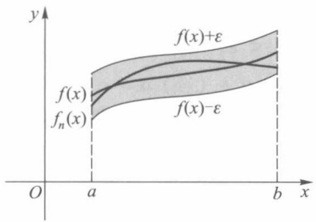
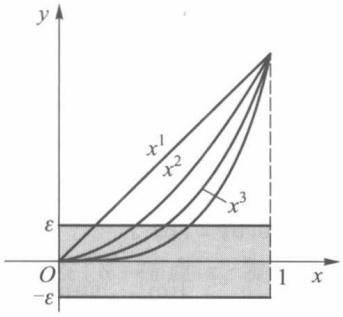
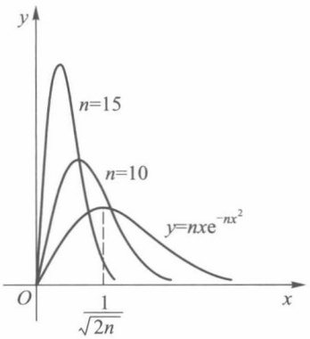
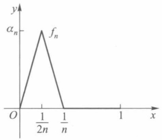
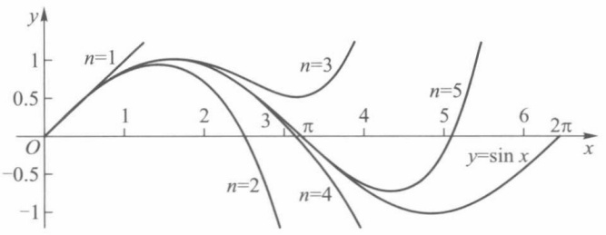
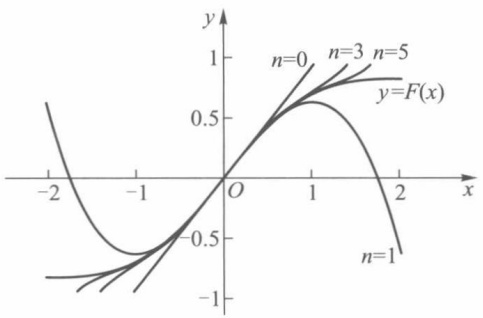

## 第十三章

## 函数列与函数项级数

## § 1 一致收敛性

我们已经知道可以用收敛数列(或数项级数)来表示或定义一个数.本章将讨论怎样用函数列(或函数项级数)来表示(或定义)一个函数,并研究这个函数所具有的性质.

## 一、函数列及其一致收敛性

设

$$
f _ {1}, f _ {2}, \dots , f _ {n}, \dots \tag {1}
$$

是一列定义在同一数集 $E$ 上的函数，称为定义在 $E$ 上的函数列.(1)也可简单地写作

$$
\{f _ {n} \} \quad \text {或} \quad f _ {n}, \quad n = 1, 2, \dots .
$$

设 $x_0 \in E$，以 $x_0$ 代入(1)可得数列

$$
f _ {1} (x _ {0}), f _ {2} (x _ {0}), \dots , f _ {n} (x _ {0}), \dots . \tag {2}
$$

若数列(2)收敛,则称函数列(1)在点 $x_{0}$ 收敛, $x_{0}$ 称为函数列(1)的收敛点.若数列(2)发散,则称函数列(1)在点 $x_{0}$ 发散.若函数列(1)在数集 $D\subset E$ 上每一点都收敛,则称(1)在数集D上收敛.这时对D上每一点x,都有数列 $\{f_{n}(x)\}$ 的一个极限值与之相对应,由这个对应法则所确定的D上的函数,称为函数列(1)的极限函数.若把此极限函数记作f,则有

$$
\lim _ {n \to \infty} f _ {n} (x) = f (x), \quad x \in D
$$

或

$$
f _ {n} (x) \rightarrow f (x) \quad (n \rightarrow \infty), \quad x \in D.
$$

函数列极限的 $\varepsilon - N$ 定义是: 对每一固定的 $x \in D$, 任给正数 $\varepsilon$, 恒存在正数 $N$ (注意: 一般说来 $N$ 值的确定与 $\varepsilon$ 和 $x$ 的值都有关, 所以也用 $N(\varepsilon, x)$ 表示它们之间的依赖关系), 使得当 $n > N$ 时, 总有

$$
\mid f _ {n} (x) - f (x) \mid <   \varepsilon .
$$

使函数列 $\{f_{n}\}$ 收敛的全体收敛点集合,称为函数列 $\{f_{n}\}$ 的收敛域.

例 1 设  $f_{n}(x)=x^{n}, n=1,2,\cdots$  为定义在  $(-∞,+∞)$  上的函数列，证明它的收敛域是  $(-1,1]$ ，且有极限函数

$$
f (x) = \left\{ \begin{array}{l l} 0, & | x | <   1, \\ 1, & x = 1. \end{array} \right. \tag {3}
$$

证 任给 $\varepsilon > 0$ （不妨设 $\varepsilon < 1$），当 $0 < |x| < 1$ 时，由于

$$
\mid f _ {n} (x) - f (x) \mid = \mid x \mid^ {n},
$$

只要取 $N(\varepsilon, x) = \frac{\ln \varepsilon}{\ln |x|}$, 当 $n > N(\varepsilon, x)$ 时, 就有

$$
\left| f _ {n} (x) - f (x) \right| <   \varepsilon .
$$

当 x=0 和 x=1 时, 则对任何正整数 n, 都有

$$
\left| f _ {n} (0) - f (0) \right| = 0 <   \varepsilon , \quad \left| f _ {n} (1) - f (1) \right| = 0 <   \varepsilon.
$$

这就证得 $\{f_{n}\}$ 在 $(-1,1]$ 上收敛，且有(3)式所表示的极限函数.

当 $|x|>1$ 时,则有 $|x|^{n}\rightarrow+\infty\quad(n\rightarrow\infty)$ ,当x=-1时,对应的数列为

$$
- 1, 1, - 1, 1, \dots .
$$

它显然是发散的. 所以函数列  $\{x^{n}\}$  在区间  $(-1,1]$  外都是发散的.

例 2 定义在 $(-∞,+∞)$ 上的函数列 $f_{n}(x)=\frac{\sin nx}{n}, n=1,2,\cdots$ . 由于对任何实数 x, 都有

$$
\left| \frac {\sin n x}{n} \right| \leqslant \frac {1}{n},
$$

故对任给的  $\varepsilon>0$  , 只要  $n>N=\frac{1}{\varepsilon}$  , 就有

$$
\left| \frac {\sin n x}{n} - 0 \right| <   \varepsilon .
$$

所以函数列 $\left\{\frac{\sin nx}{n}\right\}$ 的收敛域为无限区间 $(-∞,+∞)$ ，极限函数 $f(x)=0$ .

对于函数列,我们不仅要讨论它在哪些点上收敛,而更重要的是要研究极限函数所具有的解析性质.比如能否由函数列每项的连续性判断出极限函数的连续性.又如极限函数的导数或积分,是否分别是函数列每项导数或积分的极限.对这些问题的讨论,只要求函数列在数集D上收敛是不够的,必须对它在D上的收敛性提出更高的要求才行,这就是以下所要讨论的一致收敛性问题.

定义1 设函数列 $\{f_n\}$ 与函数 $f$ 定义在同一数集 $D$ 上, 若对任给的正数 $\varepsilon$, 总存在某一正整数 $N$, 使得当 $n > N$ 时, 对一切 $x \in D$, 都有

$$
\mid f _ {n} (x) - f (x) \mid <   \varepsilon ,
$$

则称函数列 $\{f_{n}\}$ 在D上一致收敛于f,记作

$$
f _ {n} (x) \stackrel {\longrightarrow} {\longrightarrow} f (x) (n \to \infty), \quad x \in D.
$$

由定义看到,如果函数列 $\{f_{n}\}$ 在D上一致收敛,那么对于所给的 $\varepsilon$ ,不管D上哪一点x,总存在公共的 $N(\varepsilon)$ （即N的选取仅与 $\varepsilon$ 有关,与x的取值无关）,只要n>N,都有

$$
\left| f _ {n} (x) - f (x) \right| <   \varepsilon .
$$

由此看到函数列 $\{f_n\}$ 在 $D$ 上一致收敛，必在 $D$ 上每一点都收敛.反之，在 $D$ 上每一点都收敛的函数列 $\{f_n\}$，在 $D$ 上不一定一致收敛.

如上述例2中函数列 $\left\{\frac{\sin nx}{n}\right\}$, 对任给正数 $\varepsilon$, 不管 $x$ 取 $(- \infty, +\infty)$ 上什么值, 都可取 $N = \frac{1}{\varepsilon}$ (它仅依赖于 $\varepsilon$ 的值), 当 $n > N$ 时, 恒有 $\left|\frac{\sin nx}{n}\right| < \varepsilon$, 所以函数列 $\left\{\frac{\sin nx}{n}\right\}$ 在 $(- \infty, +\infty)$ 上一致收敛于函数 $f(x) = 0$.

函数列 $\{f_n\}$ 在 $D$ 上不一致收敛于函数 $f$, 是指它们不满足定义1的条件. 但也可以根据定义1对不一致收敛给予正面的陈述. 即函数列(1)在 $D$ 上不一致收敛于 $f$ 的充要条件是: 存在某正数 $\varepsilon_0$, 对任何正数 $N$, 都有 $D$ 上某一点 $x'$ 与正整数 $n' > N$ (注意: $x'$ 与 $n'$ 的取值与 $N$ 有关), 使得

$$
\mid f _ {n ^ {\prime}} (x ^ {\prime}) - f (x ^ {\prime}) \mid \geqslant \varepsilon_ {0}.
$$

从前面例1中知道，函数列 $\{x^n\}$ 在(0,1)上收敛于 $f(x) = 0$。我们证明它在(0,1)上不一致收敛。事实上，令 $\varepsilon_0 = \frac{1}{2}$，对任何正数 $N$，取正整数 $n > N + 1$ 及 $x' = \left(1 - \frac{1}{n}\right)^{\frac{1}{n}} \in (0,1)$，则有

$$
\mid x ^ {\prime n} - 0 \mid = 1 - \frac {1}{n} \geqslant \frac {1}{2}.
$$

函数列(1)一致收敛于f,从几何意义上讲:对任何正数 $\varepsilon$ ,存在正整数N,对于一切序号大于N的曲线 $y=f_{n}(x)$ ,都落在以曲线 $y=f(x)+\varepsilon$ 与 $y=f(x)-\varepsilon$ 为边(即以曲线 $y=f(x)$ 为“中心线”,宽度为 $2\varepsilon$ )的带形区域内(如图13-1所示).

函数列 $\{x^n\}$ 在区间(0,1)内不一致收敛，从几何意义上讲:对于某个事先给定的 $\varepsilon$ （$0 < \varepsilon < 1$），无论 $N$ 多么大，总有曲线 $y = x^n$（$n > N$）不能全部落在以 $y = \varepsilon$ 与 $y = -\varepsilon$ 为边的带形区域内，如图13-2所示。若函数列 $\{x^n\}$ 只限于在区间(0,b)(b<1)内讨论，容易看到，只要 $n > \frac{\ln \varepsilon}{\ln b}$（其中 $0 < \varepsilon < 1$），曲线 $y = x^n$ 就全部落在以 $y = \varepsilon$ 和 $y = -\varepsilon$ 为上下边的带形区域内。所以 $\{x^n\}$ 在(0,b)内是一致收敛的。

text_image

y
f(x)
fn(x)
O
a
b
x
f(x)+ε
f(x)-ε

图13-1

text_image

y
x¹
x²
ε
O
-ε
1 x

图13-2

定理13.1（函数列一致收敛的柯西准则）函数列 $\{f_n\}$ 在数集 $D$ 上一致收敛的充要条件是:对任给正数 $\varepsilon$ ，总存在正数 $N$ ，使得当 $n, m > N$ 时，对一切 $x \in D$ ，都有

$$
\left| f _ {n} (x) - f _ {m} (x) \right| <   \varepsilon . \tag {4}
$$

证 [必要性] 设 $f_{n}(x) \longrightarrow f(x) (n \to \infty), x \in D$，即对任给 $\varepsilon > 0$，存在正数 $N$，使得当 $n > N$ 时，对一切 $x \in D$，都有

$$
\left| f _ {n} (x) - f (x) \right| <   \frac {\varepsilon}{2}. \tag {5}
$$

于是当 $n, m > N$，由(5)就有

$$
\begin{array}{l} \left| f _ {n} (x) - f _ {m} (x) \right| \leqslant \left| f _ {n} (x) - f (x) \right| + \left| f (x) - f _ {m} (x) \right| \\ <   \frac {\varepsilon}{2} + \frac {\varepsilon}{2} = \varepsilon . \\ \end{array}
$$

[充分性] 若条件(4)成立,由数列收敛的柯西准则, $\{f_{n}\}$ 在D上任一点都收敛,记其极限函数为 $f(x),x\in D.$ 现固定(4)式中的n,让 $m\to\infty$ ,于是当n>N时,对一切 $x\in D$ ,都有

$$
\left| f _ {n} (x) - f (x) \right| \leqslant \varepsilon .
$$

由定义 1, $f_{n}(x)\longrightarrow f(x)$ ( $n\to\infty$ ), $x\in D$.

根据一致收敛定义可推出下述定理.

定理13.2 函数列 $\{f_n\}$ 在区间 $D$ 上一致收敛于 $f$ 的充要条件是:

$$
\lim _ {n \to \infty} \sup _ {x \in D} | f _ {n} (x) - f (x) | = 0. \tag {6}
$$

证 [必要性] 若 $f_{n}(x) \longrightarrow f(x) (n \to \infty), x \in D$. 则对任给的正数 $\varepsilon$, 存在不依赖于 $x$ 的正整数 $N$, 当 $n > N$ 时, 有

$$
\left| f _ {n} (x) - f (x) \right| <   \varepsilon , \quad x \in D.
$$

由上确界的定义,亦有

$$
\sup _ {x \in D} \left| f _ {n} (x) - f (x) \right| \leqslant \varepsilon .
$$

这就证得(6)式成立.

[充分性] 由假设,对任给  $\varepsilon>0$ , 存在正整数 N, 使得当 n>N 时, 有

$$
\sup _ {x \in D} | f _ {n} (x) - f (x) | <   \varepsilon . \tag {7}
$$

因为对一切 $x \in D$，总有

$$
\left| f _ {n} (x) - f (x) \right| \leqslant \sup _ {x \in D} \left| f _ {n} (x) - f (x) \right|,
$$

故由(7)式得

$$
\left| f _ {n} (x) - f (x) \right| <   \varepsilon .
$$

于是 $\{f_{n}\}$ 在D上一致收敛于f.

在判断函数列是否一致收敛上定理13.2更为方便一些（其缺点是必须事先知道它的极限函数），如例2，由于

$$
\lim _ {n \to \infty} \sup _ {x \in (- \infty , + \infty)} \left| \frac {\sin n x}{n} - 0 \right| = \lim _ {n \to \infty} \frac {1}{n} = 0,
$$

所以在 $(-∞,+∞)$ 上， $\frac{\sin nx}{n}\xrightarrow[n]{\longrightarrow}0(n\to\infty)$ .

推论 函数列 $\{f_n\}$ 在 $D$ 上不一致收敛于 $f$ 的充分且必要条件是: 存在 $\{x_{n}\} \subset D$, 使得 $\{f_n(x_n) - f(x_n)\}$ 不收敛于 0.

例 3 设  $f_{n}(x)=nx\mathrm{e}^{-nx^{2}}, x \in D=(0,+\infty), n=1,2,\cdots.$  判别  $\{f_{n}(x)\}$  在 D 上的一致收敛性.

解 对任意 $x \in (0, +\infty)$, $\lim_{n \to \infty} n x \mathrm{e}^{-nx^2} = 0 = f(x)$. 在 $(0, +\infty)$ 上, 每个 $n x \mathrm{e}^{-nx^2}$ 只有一个极大值点 $x_{n} = \frac{1}{\sqrt{2n}}$，而 $\sup_{x\in (0, + \infty)}|f_n(x)| = f_n(x_n) = \sqrt{\frac{n}{2}}\mathrm{e}^{-\frac{1}{2}}\rightarrow$ $\infty$。因此由定理13.2可知 $\{f_n\}$ 在 $D$ 上不一致收敛于 $f$。（见图13-3）

为避免求上确界, 亦可取 $x_{n} = \frac{1}{n} \in (0, +\infty)$, 则 $f_{n}(x_{n}) = \mathrm{e}^{-\frac{1}{n}} \to 1 \neq 0 (n \to \infty)$, 因此由推论同样可知 $\{f_{n}\}$ 在 $(0, +\infty)$ 上不一致收敛于 $f(x)$.

定义 2 设函数列  $\{f_{n}\}$  与 f 定义在区间 I 上, 若对任意闭区间  $[a, b] \subset I, \{f_{n}\}$  在  $[a, b]$  上一致收敛于 f, 则称  $\{f_{n}\}$  在 I 上内闭一致收敛于 f.

contour

| Category | Peak X-coordinate | Peak Y-value |
| --- | --- | --- |
| n=15 | ~0.2 | ~0.9 |
| n=10 | ~0.3 | ~0.6 |
| y=nxe^-nx^2 | 1/√(2n) | ~0.4 |

图13-3

注 若 $I = [\alpha, \beta]$ 是有界闭区间，显然 $\{f_n\}$ 在 $I$ 上内闭一致收敛于 $f$ 与 $\{f_n\}$ 在 $I$ 上一致收敛于 $f$ 是一致的.

例1中函数列 $\{f_n\}$ 在[0,1)上不一致收敛于 $f$ ，但对任意 $\delta >0$ ， $\sup_{x\in [0,\delta]}|x^n |\leqslant \delta^n\to 0(n\to \infty)$ ，因此 $\{f_n\}$ 在[0,1)上内闭一致收敛.

例3中函数列 $\{f_n\}$ 在 $(0, +\infty)$ 上不一致收敛于0，但对任意 $[a, b] \subset (0, +\infty)$，$\sup_{x \in [a, b]} |nxe^{-nx^2}| \leqslant nbe^{-na^2} \to 0 (n \to \infty)$，因此 $\{f_n\}$ 在 $(0, +\infty)$ 上内闭一致收敛于0.

## 二、函数项级数及其一致收敛性

设 $\{u_{n}(x)\}$ 是定义在数集E上的一个函数列,表达式

$$
u _ {1} (x) + u _ {2} (x) + \dots + u _ {n} (x) + \dots , \quad x \in E \tag {8}
$$

称为定义在 $E$ 上的函数项级数，简记为 $\sum_{n=1}^{\infty} u_n(x)$ 或 $\sum u_n(x)$. 称

$$
S _ {n} (x) = \sum_ {k = 1} ^ {n} u _ {k} (x), \quad x \in E, \quad n = 1, 2, \dots \tag {9}
$$

为函数项级数(8)的部分和函数列.

若 $x_0 \in E$，数项级数

$$
u _ {1} (x _ {0}) + u _ {2} (x _ {0}) + \dots + u _ {n} (x _ {0}) + \dots \tag {10}
$$

收敛, 即部分和 $S_{n}(x_{0}) = \sum_{k=1}^{n} u_{k}(x_{0})$ 当 $n \to \infty$ 时极限存在, 则称级数 (8) 在点 $x_{0}$ 收敛, $x_{0}$ 称为级数 (8) 的收敛点. 若级数 (10) 发散, 则称级数 (8) 在点 $x_{0}$ 发散. 若级数 (8) 在 $E$ 的某个子集 $D$ 上每点都收敛, 则称级数 (8) 在 $D$ 上收敛. 若 $D$ 为级数 (8) 全体收敛点的集合, 这时则称 $D$ 为级数 (8) 的收敛域. 级数 (8) 在 $D$ 上每一点 $x$ 与其所对应的数项级数 (10) 的和 $S(x)$ 构成一个定义在 $D$ 上的函数, 称为级数 (8) 的和函数, 并写作

$$
u _ {1} (x) + u _ {2} (x) + \dots + u _ {n} (x) + \dots = S (x), \quad x \in D,
$$

即

$$
\lim _ {n \to \infty} S _ {n} (x) = S (x), \quad x \in D.
$$

也就是说,函数项级数(8)的收敛性就是指它的部分和函数列(9)的收敛性.

例 4 定义在 $(-∞,+∞)$ 上的函数项级数(几何级数)

$$
1 + x + x ^ {2} + \dots + x ^ {n} + \dots \tag {11}
$$

的部分和函数为 $S_{n}(x) = \frac{1 - x^{n}}{1 - x}$. 当 $|x| < 1$ 时，

$$
S (x) = \lim _ {n \to \infty} S _ {n} (x) = \frac {1}{1 - x}.
$$

所以几何级数(11)在 $(-1,1)$ 内收敛于和函数 $S(x)=\frac{1}{1-x}$ ; 当 $|x|\geqslant1$ 时, 几何级数是发散的.

定义3 设 $\{S_n(x)\}$ 是函数项级数 $\sum u_n(x)$ 的部分和函数列.若 $\{S_n(x)\}$ 在数集 $D$ 上一致收敛于 $S(x)$，则称 $\sum u_n(x)$ 在 $D$ 上一致收敛于 $S(x)$. 若 $\sum u_n(x)$ 在任意闭区间 $[a, b] \subset I$ 上一致收敛，则称 $\sum u_n(x)$ 在 $I$ 上内闭一致收敛.

由于函数项级数的一致收敛性由它的部分和函数列来确定,所以由前段中有关函数列一致收敛的定理,都可推出相应的有关函数项级数的定理.

定理 13.3(一致收敛的柯西准则) 函数项级数  $\sum u_{n}(x)$  在数集 D 上一致收敛的充要条件为: 对任给的正数  $\varepsilon$ , 总存在某正整数 N, 使得当 n > N 时, 对一切  $x \in D$  和一切正整数 p, 都有

$$
\mid S _ {n + p} (x) - S _ {n} (x) \mid <   \varepsilon
$$

或

$$
\mid u _ {n + 1} (x) + u _ {n + 2} (x) + \dots + u _ {n + p} (x) \mid <   \varepsilon .
$$

此定理中当 p=1 时, 得到函数项级数一致收敛的一个必要条件.

推论 函数项级数 $\sum u_{n}(x)$ 在数集 $D$ 上一致收敛的必要条件是函数列 $\{u_n(x)\}$ 在 $D$ 上一致收敛于零.

设函数项级数 $\sum u_{n}(x)$ 在 $D$ 上的和函数为 $S(x)$，称

$$
R _ {n} (x) = S (x) - S _ {n} (x)
$$

为函数项级数  $\sum u_{n}(x)$  的余项.

定理13.4 函数项级数 $\sum u_{n}(x)$ 在数集 $D$ 上一致收敛于 $S(x)$ 的充要条件是

$$
\lim _ {n \to \infty} \sup _ {x \in D} | R _ {n} (x) | = \lim _ {n \to \infty} \sup _ {x \in D} | S (x) - S _ {n} (x) | = 0.
$$

我们再来看例4中的级数 $\sum_{n = 0}^{\infty}x^n$ ，由于

$$
\begin{array}{l} \sup _ {x \in (- 1, 1)} | S _ {n} (x) - S (x) | = \sup _ {x \in (- 1, 1)} \left| \frac {x ^ {n}}{x - 1} \right| \geqslant \left| \frac {\left(\frac {n}{n + 1}\right) ^ {n}}{1 - \frac {n}{n + 1}} \right| \\ = n \left(\frac {n}{n + 1}\right) ^ {n - 1} \rightarrow \infty (n \rightarrow \infty), \\ \end{array}
$$

知道级数  $\sum_{n=0}^{\infty}x^{n}$  在  $(-1,1)$  上不一致收敛.

对任意  $a \quad (0 < a < 1)$ ,

$$
\sup _ {x \in [ - a, a ]} | S _ {n} (x) - S (x) | = \sup _ {x \in [ - a, a ]} \left| \frac {- x ^ {n}}{1 - x} \right| = \frac {a ^ {n}}{1 - a} \rightarrow 0 \quad (n \rightarrow \infty)
$$

可得级数 $\sum x^n$ 在 $(-1,1)$ 上内闭一致收敛.

## 三、函数项级数的一致收敛性判别法

判别函数项级数的一致收敛性除了根据定义或定理 13.4 外,有些级数还可根据级数各项的特性来判别.

定理 13.5(魏尔斯特拉斯判别法) 设函数项级数  $\sum u_{n}(x)$  定义在数集 D 上,  $\sum M_{n}$  为收敛的正项级数, 若对一切  $x \in D$ , 有

$$
\mid u _ {n} (x) \mid \leqslant M _ {n}, \quad n = 1, 2, \dots , \tag {12}
$$

则函数项级数 $\sum u_{n}(x)$ 在 $D$ 上一致收敛.

证 由假设正项级数 $\sum M_{n}$ 收敛, 根据数项级数的柯西准则, 任给正数 $\varepsilon$, 存在某正整数 $N$, 使得当 $n > N$ 及任何正整数 $p$, 有

$$
\left| M _ {n + 1} + \dots + M _ {n + p} \right| = M _ {n + 1} + \dots + M _ {n + p} <   \varepsilon .
$$

又由(12)式,对一切  $x \in D$  有

$$
\begin{array}{l} \mid u _ {n + 1} (x) + \dots + u _ {n + p} (x) \mid \leqslant \mid u _ {n + 1} (x) \mid + \dots + \mid u _ {n + p} (x) \mid \\ \leqslant M _ {n + 1} + \dots + M _ {n + p} <   \varepsilon . \\ \end{array}
$$

根据函数项级数一致收敛的柯西准则,级数 $\sum u_{n}(x)$ 在D上一致收敛.

例5 函数项级数

$$
\sum \frac {\sin n x}{n ^ {2}}, \qquad \sum \frac {\cos n x}{n ^ {2}}
$$

在 $(-\infty, +\infty)$ 上一致收敛，因为对一切 $x \in (-\infty, +\infty)$ 有

$$
\left| \frac {\sin n x}{n ^ {2}} \right| \leqslant \frac {1}{n ^ {2}}, \quad \left| \frac {\cos n x}{n ^ {2}} \right| \leqslant \frac {1}{n ^ {2}},
$$

而正项级数  $\sum\frac{1}{n^{2}}$  是收敛的.

定理13.5也称为 $M$ 判别法或优级数判别法.当级数 $\sum u_{n}(x)$ 与级数 $\sum M_{n}$ 在区间$[a,b]$ 上成立关系式(12)时，则称级数 $\sum M_n$ 在 $[a,b]$ 上优于级数 $\sum u_{n}(x)$ ，或称 $\sum M_{n}$ 为 $\sum u_{n}(x)$ 的优级数.

下面讨论定义在区间 $I$ 上形如

$$
\sum u _ {n} (x) v _ {n} (x) = u _ {1} (x) v _ {1} (x) + u _ {2} (x) v _ {2} (x) + \dots + u _ {n} (x) v _ {n} (x) + \dots \tag {13}
$$

的函数项级数的一致收敛性判别法,它与数项级数一样,也是基于阿贝尔分部求和公式(第十二章§3的引理).

定理 13.6(阿贝尔判别法) 设

(i)  $\sum u_{n}(x)$  在区间 I 上一致收敛；
(ii) 对于每一个 $x \in I, \{v_n(x)\}$ 是单调的；
(iii)  $\{v_{n}(x)\}$  在 I 上一致有界, 即存在正数 M, 使得对一切  $x \in I$  和正整数 n, 有

$$
\mid v _ {n} (x) \mid \leqslant M,
$$

则级数(13)在 I 上一致收敛.

证 由(i)，任给 $\varepsilon > 0$ ，存在某正数 $N$ ，使得当 $n > N$ 及任何正整数 $p$ ，对一切 $x \in I$ ，有

$$
\mid u _ {n + 1} (x) + \dots + u _ {n + p} (x) \mid <   \varepsilon .
$$

又由(ii)，(iii)及阿贝尔引理(第十二章§3引理的推论)得到

$$
\begin{array}{l} \left| u _ {n + 1} (x) v _ {n + 1} (x) + \dots + u _ {n + p} (x) v _ {n + p} (x) \right| \\ \leqslant \left(\left| v _ {n + 1} (x) \right| + 2 \left| v _ {n + p} (x) \right|\right) \varepsilon \leqslant 3 M \varepsilon. \\ \end{array}
$$

于是根据函数项级数一致收敛性的柯西准则就得到本定理的结论.

定理 13.7(狄利克雷判别法) 设

(i) $\sum u_{n}(x)$ 的部分和函数列

$$
S _ {n} (x) = \sum_ {k = 1} ^ {n} u _ {k} (x) \quad (n = 1, 2, \dots)
$$

在 I 上一致有界；

(ii) 对于每一个 $x \in I, \{v_n(x)\}$ 是单调的；

(iii) 在 I 上  $v_{n}(x) \longrightarrow 0 (n \to \infty)$ ,

则级数(13)在 I 上一致收敛.

证 证法与定理13.6相仿.由(i)，存在正数 $M$ ，对一切 $x\in I$ ，有 $\mid S_n(x)\mid \leqslant M.$ 因此当 $n,p$ 为任何正整数时，

$$
\mid u _ {n + 1} (x) + \dots + u _ {n + p} (x) \mid = \mid S _ {n + p} (x) - S _ {n} (x) \mid \leqslant 2 M.
$$

对任何一个 $x \in I$，再由(ii)及阿贝尔引理，得到

$$
\begin{array}{l} \left| u _ {n + 1} (x) v _ {n + 1} (x) + \dots + u _ {n + p} (x) v _ {n + p} (x) \right| \\ \leqslant 2 M (\mid v _ {n + 1} (x) \mid + 2 \mid v _ {n + p} (x) \mid). \\ \end{array}
$$

再由(iii)，对任给的 $\varepsilon > 0$ ，存在正数 $N$ ，当 $n > N$ 时，对一切 $x \in I$ ，有

$$
\mid v _ {n} (x) \mid <   \varepsilon ,
$$

所以

$$
\mid u _ {n + 1} (x) v _ {n + 1} (x) + \dots + u _ {n + p} (x) v _ {n + p} (x) \mid <   2 M (\varepsilon + 2 \varepsilon) = 6 M \varepsilon .
$$

于是由一致收敛性的柯西准则,级数(13)在I上一致收敛.

例6 函数项级数

$$
\sum \frac {(- 1) ^ {n} (x + n) ^ {n}}{n ^ {n + 1}}
$$

在[0,1]上一致收敛. 这是因为记 $u_{n}(x) = \frac{(-1)^{n}}{n}, v_{n}(x) = \left(1 + \frac{x}{n}\right)^{n}$ 时，由阿贝尔判别法（定理13.6）就能得到结果. □

例 7 若数列  $\{a_{n}\}$  单调且收敛于零, 则级数

$$
\sum a _ {n} \cos n x \tag {14}
$$

在 $\left[\alpha,2\pi-\alpha\right]\left(0<\alpha<\pi\right)$ 上一致收敛.

证 由第十二章 §3(21)式, 在  $[\alpha, 2\pi-\alpha]$  上有

$$
\begin{array}{l} \left| \sum_ {k = 1} ^ {n} \cos k x \right| = \left| \frac {\sin \left(n + \frac {1}{2}\right) x}{2 \sin \frac {x}{2}} - \frac {1}{2} \right| \\ \leqslant \frac {1}{2 \left| \sin \frac {x}{2} \right|} + \frac {1}{2} \leqslant \frac {1}{2 \sin \frac {\alpha}{2}} + \frac {1}{2}, \\ \end{array}
$$

所以级数  $\sum \cos nx$  的部分和函数列在  $[\alpha, 2\pi - \alpha]$  上一致有界，于是令

$$
u _ {n} (x) = \cos n x, v _ {n} (x) = a _ {n},
$$

则由狄利克雷判别法可得级数(14)在 $[\alpha,2\pi-\alpha]$ 上一致收敛.

对于例7中的级数(14)，只要 $\{a_{n}\}$ 单调且收敛于零，那么级数(14)在不包含 $2k\pi(k=0,\pm1,\pm2,\cdots)$ 的任何闭区间上都一致收敛.

## 习题 13.1

1. 讨论下列函数列在所示区间 $D$ 上是否一致收敛或内闭一致收敛，并说明理由:

(1)  $f_{n}(x)=\sqrt{x^{2}+\frac{1}{n^{2}}}$ ,  $n=1,2,\cdots$ ,  $D=(-1,1)$ ;
(2) $f_{n}(x)=\frac{x}{1+n^{2}x^{2}},\quad n=1,2,\cdots,\quad D=(-\infty,+\infty);$

(3) $f_{n}(x)=\left\{\begin{aligned}-(n+1)x+1,&0\leqslant x\leqslant\frac{1}{n+1},\\ 0,&\frac{1}{n+1}<x<1,\quad n=1,2,\cdots;\end{aligned}\right.$

(4)  $f_{n}(x)=\frac{x}{n},\quad n=1,2,\cdots,\quad D=\left[0,+\infty\right)$ ;

(5) $f_{n}(x)=\sin\frac{x}{n},\quad n=1,2,\cdots,\quad D=(-\infty,+ \infty).$

2. 证明:设 $f_{n}(x) \to f(x), x \in D, a_{n} \to 0 (n \to \infty) (a_{n} > 0)$. 若对每一个正整数 $n$ 有 $|f_{n}(x) - f(x)| \leqslant a_{n}, x \in D$，则 $\{f_{n}\}$ 在 $D$ 上一致收敛于 $f$.

3. 判别下列函数项级数在所示区间上的一致收敛性:

(1)  $\sum\frac{x^{n}}{(n-1)!}, x\in[-r,r]$ ;
(2) $\sum \frac{(-1)^{n-1}x^2}{(1+x^2)^n}, x \in (-\infty, +\infty)$;
(3)  $\sum\frac{n}{x^{n}}, |x| > r \geqslant 1;$
(4)  $\sum\frac{x^{n}}{n^{2}}, x \in [0,1]$ ;
(5)  $\sum\frac{(-1)^{n-1}}{x^{2}+n}, x\in(-\infty,+\infty)$ ;
(6)  $\sum\frac{x^{2}}{\left(1+x^{2}\right)^{n-1}}, x\in(-\infty,+\infty).$

4. 设函数项级数 $\sum u_{n}(x)$ 在 $D$ 上一致收敛于 $S(x)$，函数 $g(x)$ 在 $D$ 上有界。证明级数 $\sum g(x)u_{n}(x)$ 在 $D$ 上一致收敛于 $g(x)S(x)$。

5. 若在区间 I 上, 对任何正整数 n,

$$
\mid u _ {n} (x) \mid \leqslant v _ {n} (x),
$$

证明当 $\sum v_{n}(x)$ 在 $I$ 上一致收敛时，级数 $\sum u_{n}(x)$ 在 $I$ 上也一致收敛.

6. 设  $u_{n}(x)$  ( $n=1,2,\cdots$ ) 是  $[a,b]$  上的单调函数. 证明: 若  $\sum u_{n}(a)$  与  $\sum u_{n}(b)$  都绝对收敛, 则  $\sum u_{n}(x)$  在  $[a,b]$  上绝对且一致收敛.

7. 证明: $\{f_{n}\}$  在区间 I 上内闭一致收敛于 f 的充分且必要条件是:对任意  $x_{0} \in I$ ，存在  $x_{0}$  的一个邻域  $U(x_{0})$ ，使得  $\{f_{n}\}$  在  $U(x_{0}) \cap I$  上一致收敛于 f.

8. 在 $[0,1]$ 上定义函数列

$$
u _ {n} (x) = \left\{ \begin{array}{l l} \frac {1}{n}, & x = \frac {1}{n}, \\ 0, & x \neq \frac {1}{n}, \end{array} \right. n = 1, 2, \dots ,
$$

证明级数 $\sum u_{n}(x)$ 在[0,1]上一致收敛，但它不存在优级数.

9. 讨论下列函数列或函数项级数在所示区间 $D$ 上的一致收敛性:

(1) $\sum_{n=2}^{\infty} \frac{1 - 2n}{\left(x^{2} + n^{2}\right)\left[x^{2} + (n-1)^{2}\right]}, D = [-1,1]$;
(2)  $\sum 2^{n}\sin\frac{x}{3^{n}}, D=(0,+\infty)$ ;
(3)  $\sum\frac{x^{2}}{\left[1+(n-1)x^{2}\right](1+nx^{2})},D=(0,+\infty);$
(4)  $\sum\frac{x^{n}}{\sqrt{n}}, D=[-1,0]$ ;
(5)  $\sum(-1)^{n}\frac{x^{2n+1}}{2n+1}, D=(-1,1)$ ;
(6) $\sum_{n=1}^{\infty} \frac{\sin nx}{n}, D = (0, 2\pi)$.

10. 证明: 级数 $\sum (-1)^n x^n (1 - x)$ 在 $[0,1]$ 上绝对收敛并一致收敛, 但由其各项绝对值组成的级数在 $[0,1]$ 上却不一致收敛.

11. 设 $f$ 为定义在区间 $(a, b)$ 内的任一函数，记

$$
f _ {n} (x) = \frac {\left[ n f (x) \right]}{n}, \quad n = 1, 2, \dots ,
$$

证明函数列 $\{f_{n}\}$ 在 $(a,b)$ 内一致收敛于f.

12. 设 $\{u_n(x)\}$ 为 $[a, b]$ 上正的递减且收敛于零的函数列，每一个 $u_n(x)$ 都是 $[a, b]$ 上的单调函数，则级数

$$
u _ {1} (x) - u _ {2} (x) + u _ {3} (x) - u _ {4} (x) + \dots
$$

在 $[a,b]$ 上不仅收敛,而且一致收敛.

13. 证明: 若 $\{f_n(x)\}$ 在区间 $I$ 上一致收敛于 0, 则存在子列 $\{f_{n_i}\}$, 使得 $\sum_{i=1}^{\infty} f_{n_i}(x)$ 在 $I$ 上一致收敛.

## § 2 一致收敛函数列与函数项级数的性质

本节讨论由函数列与函数项级数所确定的函数的连续性、可积性与可微性.

定理13.8 设函数列 $\{f_n\}$ 在 $(a, x_0) \cup (x_0, b)$ 上一致收敛于 $f(x)$，且对每个 $n$，$\lim_{x \to x_0} f_n(x) = a_n$，则 $\lim_{n \to \infty} a_n$ 和 $\lim_{x \to x_0} f(x)$ 均存在且相等。

证 先证 $\{a_{n}\}$ 是收敛数列. 对任意 $\varepsilon > 0$, 由于 $\{f_{n}\}$ 一致收敛, 故有 $N$, 当 $n > N$ 时, 对任意正整数 $p$ 和对一切 $x \in (a, x_{0}) \cup (x_{0}, b)$, 有

$$
\left| f _ {n} (x) - f _ {n + p} (x) \right| <   \varepsilon . \tag {1}
$$

从而

$$
\mid a _ {n} - a _ {n + p} \mid = \lim _ {x \to x _ {0}} \mid f _ {n} (x) - f _ {n + p} (x) \mid \leqslant \varepsilon .
$$

这样由柯西准则可知 $\{a_{n}\}$ 是收敛数列.

设 $\lim_{n\to \infty}a_n = A$ .再证 $\lim_{x\to x_0}f(x) = A$

由于 $f_{n}(x)$ 一致收敛于 $f(x)$ 及 $a_{n}$ 收敛于 $A$ ，因此对任意 $\varepsilon >0$ ，存在正数 $N$ ，当 $n > N$ 时，对任意 $x\in (a,x_0)\cup (x_0,b)$

$$
\mid f _ {n} (  x  ) - f (  x  ) \mid   <     \frac {\varepsilon}{3} \quad \text {和} \quad \mid a _ {n} - A \mid   <     \frac {\varepsilon}{3}
$$

同时成立. 特别取  $n=N+1$ , 有

$$
\left| f _ {N + 1} (x) - f (x) \right| <   \frac {\varepsilon}{3}, \quad \left| a _ {N + 1} - A \right| <   \frac {\varepsilon}{3}.
$$

又 $\lim_{x\to x_0}f_{N + 1}(x) = a_{N + 1}$ ，故存在 $\delta >0$ ，当 $0 < |x - x_0| < \delta$ 时，

$$
\left| f _ {N + 1} (x) - a _ {N + 1} \right| <   \frac {\varepsilon}{3}.
$$

这样, 当 x 满足  $0 < |x - x_{0}| < \delta$  时,

$$
\begin{array}{l} \left| f (x) - A \right| \leqslant \left| f (x) - f _ {N + 1} (x) \right| + \left| f _ {N + 1} (x) - a _ {N + 1} \right| + \left| a _ {N + 1} - A \right| \\ <   \frac {\varepsilon}{3} + \frac {\varepsilon}{3} + \frac {\varepsilon}{3} = \varepsilon , \\ \end{array}
$$

即  $\lim_{x\to x_{0}}f(x)=A.$

这个定理指出:在一致收敛的条件下, $\{f_{n}(x)\}$ 中两个独立变量x与n,在分别求极限时其求极限的顺序可以交换,即

$$
\lim _ {x \to x _ {0}} \lim _ {n \to \infty} f _ {n} (x) = \lim _ {n \to \infty} \lim _ {x \to x _ {0}} f _ {n} (x). \tag {2}
$$

类似地，若 $f_{n}(x)$ 在 $(a,b)$ 上一致收敛且 $\lim_{x\to a^{+}}f_{n}(x)$ 存在，可推得 $\lim_{x\to a^{+}}\lim_{n\to \infty}f_n(x) =$ $\lim_{n\to \infty}\lim_{x\to a^{+}}f_{n}(x)$ ；若 $f_{n}(x)$ 在 $(a,b)$ 上一致收敛且 $\lim_{x\to b^{-}}f_n(x)$ 存在，则可推得 $\lim_{x\to b^{-}}\lim_{n\to \infty}f_n(x) =$ $\lim_{n\to \infty}\lim_{x\to b^{-}}f_n(x)$

由定理 13.8 可得到以下定理.

定理 13.9(连续性) 若函数列  $\{f_{n}\}$  在区间 I 上一致收敛, 且每一项都连续, 则其极限函数 f 在 I 上也连续.

证 设 $x_0$ 为 $I$ 上任一点. 由于 $\lim_{x\to x_0}f_n(x) = f_n(x_0)$, 于是由定理13.8知 $\lim_{x\to x_0}f(x)$ 亦存在, 且 $\lim_{x\to x_0}f(x) = \lim_{n\to \infty}f_n(x_0) = f(x_0)$, 因此 $f(x)$ 在 $x_0$ 上连续.

由定理 13.9 可知: 若各项为连续函数的函数列在区间 I 上其极限函数不连续, 则此函数列在区间 I 上不一致收敛.

例如:函数列 $\{x^{n}\}$ 的各项在 $(-1,1]$ 上都是连续的,但其极限函数

$$
f (x) = \left\{ \begin{array}{l l} 0, & - 1 <   x <   1, \\ 1, & x = 1 \end{array} \right.
$$

在 x=1 时不连续,从而推得  $\{x^{n}\}$  在  $(-1,1]$  上不一致收敛.

注意到函数 $f(x)$ 在 $x$ 上连续仅与它在 $x$ 的近旁的性质有关，因此由定理13.9可得以下推论.

推论 若连续函数列  $\{f_{n}\}$  在区间 I 上内闭一致收敛于 f，则 f 在 I 上连续.

上节例1中 $\{f_n(x)\} = \{x^n\}$ 在 $(-1,1)$ 上不一致收敛，但内闭一致收敛，其极限函数在 $(-1,1)$ 上连续.

定理13.10（可积性） 若函数列 $\{f_n\}$ 在 $[a,b]$ 上一致收敛，且每一项都连续，则

$$
\int_ {a} ^ {b} \lim _ {n \to \infty} f _ {n} (x) \mathrm{d} x = \lim _ {n \to \infty} \int_ {a} ^ {b} f _ {n} (x) \mathrm{d} x. \tag {3}
$$

证 设 f 为函数列  $\{f_{n}\}$  在  $[a, b]$  上的极限函数. 由定理 13.9, f 在  $[a, b]$  上连续, 从而  $f_{n}$  ( $n=1,2,\cdots$ ) 与 f 在  $[a, b]$  上都可积.

因为在 $[a, b]$ 上 $f_n \longrightarrow f (n \to \infty)$, 故对任给正数 $\varepsilon$, 存在 $N$, 当 $n > N$ 时, 对一切 $x \in [a, b]$, 都有

$$
\left| f _ {n} (x) - f (x) \right| <   \varepsilon .
$$

再根据定积分的性质, 当 n > N 时有

$$
\begin{array}{l} \left| \int_ {a} ^ {b} f _ {n} (x) \mathrm{d} x - \int_ {a} ^ {b} f (x) \mathrm{d} x \right| = \left| \int_ {a} ^ {b} (f _ {n} (x) - f (x)) \mathrm{d} x \right| \\ \leqslant \int_ {a} ^ {b} \left| f _ {n} (x) - f (x) \right| \mathrm{d} x \\ \leqslant \varepsilon (b - a). \\ \end{array}
$$

这就证明了等式(3).

这个定理指出:在一致收敛的条件下,极限运算与积分运算的顺序可以交换.

例1 设函数

$$
f _ {n} (x) = \left\{ \begin{array}{l l} 2 n \alpha_ {n} x, & 0 \leqslant x <   \frac {1}{2 n}, \\ 2 \alpha_ {n} - 2 n \alpha_ {n} x, & \frac {1}{2 n} \leqslant x <   \frac {1}{n}, \\ 0, & \frac {1}{n} \leqslant x \leqslant 1, \end{array} \right. \quad n = 1, 2, \dots .
$$

其图像如图 13-4 所示.

显然 $\{f_n(x)\}$ 是[0,1]上的连续函数列，且对任意 $x\in [0,1]$ ， $\lim_{n\to \infty}f_n(x) = 0.$ 又 $\sup_{x\in [0,1]}\left|f_n(x) - 0\right| = \alpha_{n}$ ，因此 $\{f_n(x)\}$ 在[0,1]上一致收敛于0的充要条件是 $\alpha_{n}\rightarrow 0$ （ $n\to \infty$ ）.

由于 $\int_0^1 f_n(x)\mathrm{d}x = \frac{\alpha_n}{2n}$ ，因此 $\int_0^1 f_n(x)\mathrm{d}x\to \int_0^1 f(x)\mathrm{d}x = 0$ 的充要条件是 $\lim_{n\to \infty}\frac{\alpha_n}{2n} = 0.$ 这样当 $\alpha_{n}\equiv 1$ 时，虽然 $\{f_n(x)\}$ 不一致收敛于 $f(x)$ ，但定理13.10的结论仍成立.但当 $\alpha_{n} = n$ 时，$\{f_n(x)\}$ 不一致收敛于 $f(x)$ ，且 $\int_0^1 f_n(x)\mathrm{d}x\equiv \frac{1}{2}$ 也不收敛于

line

| X | Y |
| --- | --- |
| 0 | 0 |
| 1/2n | \(\alpha_n\) |
| 1/n | 0 |
| >1/n | 0 |

图13-4

例 1 说明当  $\{f_{n}(x)\}$  收敛于  $f(x)$  时, 一致收敛性是极限运算与积分运算交换的充分条件, 但不是必要条件.

定理13.11（可微性）设 $\{f_n\}$ 为定义在 $[a,b]$ 上的函数列，若 $x_0\in [a,b]$ 为 $\{f_n\}$ 的收敛点， $\{f_n\}$ 的每一项在 $[a,b]$ 上有连续的导数，且 $\{f'_n\}$ 在 $[a,b]$ 上一致收敛，则

$$
\frac {\mathrm{d}}{\mathrm{d} x} \left(\lim _ {n \to \infty} f _ {n} (x)\right) = \lim _ {n \to \infty} \frac {\mathrm{d}}{\mathrm{d} x} f _ {n} (x). \tag {4}
$$

证 设 $f_{n}(x_{0}) \to A (n \to \infty), f_{n}^{\prime} \longrightarrow g (n \to \infty), x \in [a, b]$. 我们要证明函数列 $\{f_{n}\}$ 在区间 $[a, b]$ 上收敛，且其极限函数的导数存在且等于 $g$.

由定理条件,对任一 $x\in[a,b]$ ,总有

$$
f _ {n} (x) = f _ {n} (x _ {0}) + \int_ {x _ {0}} ^ {x} f _ {n} ^ {\prime} (t) \mathrm{d} t.
$$

当 $n\to \infty$ 时，右边第一项极限为 $A$ ，第二项极限为 $\int_{x_0}^x g(t)\mathrm{d}t$ （定理13.10），所以左边极限存在，记为 $f$ ，则有

$$
f (x) = \lim _ {n \to \infty} f _ {n} (x) = f (x _ {0}) + \int_ {x _ {0}} ^ {x} g (t) \mathrm{d} t,
$$

其中 $f(x_0) = A$ .由 $g$ 的连续性及微积分学基本定理(第九章 §5)推得

$$
f ^ {\prime} = g.
$$

这就证明了等式(4).

在定理 13.11 的条件下, 还可推出在  $[a, b]$  上  $f_{n} \longrightarrow f (n \to \infty)$ , 请读者自己证明.

由于函数的可微性是函数的局部性质,故以下推论成立.

推论 设函数列 $\{f_n\}$ 定义在区间 $I$ 上，若 $x_0 \in I$ 为 $\{f_n\}$ 的收敛点，且 $\{f_n'\}$ 在 $I$ 上内闭一致收敛，则 $f$ 在 $I$ 上可导，且 $f'(x) = \lim_{n \to \infty} f_n'(x)$.

例2 函数列

$$
f _ {n} (x) = \frac {1}{2 n} \ln (1 + n ^ {2} x ^ {2}), \quad n = 1, 2, \dots
$$

与

$$
f _ {n} ^ {\prime} (x) = \frac {n x}{1 + n ^ {2} x ^ {2}}, \quad n = 1, 2, \dots
$$

在 $[0,1]$ 上都收敛于0,由于

$$
\lim _ {n \to \infty} \max _ {x \in [ 0, 1 ]} \left| f _ {n} ^ {\prime} (x) - f ^ {\prime} (x) \right| = \frac {1}{2},
$$

所以导函数列 $\{f_{n}^{\prime}(x)\}$ 在 $[0,1]$ 上不一致收敛，但对任意 $\delta>0$ ，

$$
\sup _ {x \in [ \delta , 1 ]} \left| f _ {n} ^ {\prime} (x) - f ^ {\prime} (x) \right| \leqslant \frac {n}{1 + n ^ {2} \delta} \rightarrow 0 (n \rightarrow \infty),
$$

所以 $\{f_n'\}$ 在(0,1]上内闭一致收敛.由推论，在(0,1]上， $\lim_{n\to \infty}f_n'(x) = (\lim_{n\to \infty}f_n(x))'$ 仍成立.

事实上， $\lim_{n\to\infty}f_n'(x)=0,\quad\lim_{n\to\infty}f_n(x)=0,\quad\lim_{n\to\infty}f_n'(x)=(\lim_{n\to\infty}f_n(x))'$  在 $[0,1]$ 上都成立.

□

此例说明,一致收敛性是极限运算与求导运算交换的充分条件,而不是必要条件.

现在再来讨论定义在区间 $[a, b]$ 上函数项级数

$$
u _ {1} (x) + u _ {2} (x) + \dots + u _ {n} (x) + \dots \tag {5}
$$

的连续性、逐项求积与逐项求导的性质,这些性质可由函数列的相应性质推出.

定理13.12（连续性）若函数项级数 $\sum u_{n}(x)$ 在区间 $[a,b]$ 上一致收敛，且每一项都连续，则其和函数在 $[a,b]$ 上也连续.

这个定理指出:在一致收敛条件下,(无限项)求和运算与求极限运算可以交换顺序,即

$$
\sum (\lim _ {x \to x _ {0}} u _ {n} (x)) = \lim _ {x \to x _ {0}} (\sum u _ {n} (x)). \tag {6}
$$

定理13.13(逐项求积) 若函数项级数  $\sum u_{n}(x)$  在  $[a, b]$  上一致收敛, 且每一项  $u_{n}(x)$  都连续, 则

$$
\sum \int_ {a} ^ {b} u _ {n} (x) \mathrm{d} x = \int_ {a} ^ {b} \sum u _ {n} (x) \mathrm{d} x. \tag {7}
$$

定理13.14（逐项求导） 若函数项级数 $\sum u_{n}(x)$ 在 $[a,b]$ 上每一项都有连续的导函数，$x_0 \in [a,b]$ 为 $\sum u_n(x)$ 的收敛点，且 $\sum u_n'(x)$ 在 $[a,b]$ 上一致收敛，则

$$
\sum \left(\frac {\mathrm{d}}{\mathrm{d} x} u _ {n} (x)\right) = \frac {\mathrm{d}}{\mathrm{d} x} (\sum u _ {n} (x)). \tag {8}
$$

定理 13.13 和定理 13.14 指出, 在一致收敛条件下, 逐项求积或求导后求和等于求和后再求积或求导.

最后,我们指出,本节中六个定理的意义不只是检验函数列或函数项级数是否满足关系式(2)—(4),(6)—(8),更重要的是根据定理的条件,即使没有求出极限函数或和函数,也能由函数列或函数项级数本身获得极限函数或和函数的解析性质.

例3 设

$$
u _ {n} (x) = \frac {1}{n ^ {3}} \ln \left(1 + n ^ {2} x ^ {2}\right), \quad n = 1, 2, \dots .
$$

证明函数项级数 $\sum u_{n}(x)$ 在[0,1]上一致收敛，并讨论其和函数在[0,1]上的连续性、可积性与可微性.

证 对每一个 $n$ ，易见 $u_{n}(x)$ 为[0,1]上增函数，故有

$$
u _ {n} (x) \leqslant u _ {n} (1) = \frac {1}{n ^ {3}} \mathrm{ln} (1 + n ^ {2}), \quad n = 1, 2, \dots .
$$

又当 $t \geqslant 1$ 时，有不等式 $\ln (1 + t^2) < t$ ，所以

$$
u _ {n} (x) \leqslant \frac {1}{n ^ {3}} \mathrm{ln} (1 + n ^ {2}) <   \frac {1}{n ^ {3}} \cdot n = \frac {1}{n ^ {2}}, \quad n = 1, 2, \dots .
$$

以收敛级数 $\sum \frac{1}{n^2}$ 为 $\sum u_n(x)$ 的优级数，推得 $\sum u_n(x)$ 在[0,1]上一致收敛.

由于每一个 $u_{n}(x)$ 在 $[0,1]$ 上连续，根据定理13.12与定理13.13，$\sum u_{n}(x)$ 的和函数 $S(x)$ 在 $[0,1]$ 上连续且可积。又由

$$
u _ {n} ^ {\prime} (x) = \frac {2 x}{n (1 + n ^ {2} x ^ {2})} = \frac {2 n x}{n ^ {2} (1 + n ^ {2} x ^ {2})} \leqslant \frac {1}{n ^ {2}}, \quad n = 1, 2, \dots ,
$$

即 $\sum \frac{1}{n^2}$ 也是 $\sum u_n'(x)$ 的优级数，故 $\sum u_n'(x)$ 也在[0,1]上一致收敛.由定理13.14，得$S(x)$ 在[0,1]上可微.

与函数列的情况相同,定理 13.12 和定理 13.14 中的一致收敛的条件可以减弱为内闭一致收敛.

例 4 证明: 函数  $\zeta(x)=\sum_{n=1}^{\infty}\frac{1}{n^{x}}$  在  $(1,+\infty)$  上有连续的各阶导函数.

证 设 $u_{n}(x) = \frac{1}{n^{x}}$，则 $u_{n}^{(k)}(x) = (-1)^{k}\frac{\ln^{k}n}{n^{x}}, k = 1,2,\dots.$ 设 $[a,b] \subset (1, +\infty)$，对任意 $x \in [a,b]$，有

$$
\mid u _ {n} ^ {(k)} (x) \mid = \frac {\ln^ {k} n}{n ^ {x}} \leqslant \frac {\ln^ {k} n}{n ^ {a}}, \quad k = 1, 2, \dots .
$$

由于 $\lim_{n\to \infty}\frac{\ln^n n}{n^{(a - 1) / 2}} = 0$ ，因此对于充分大的 $n,\frac{\ln^n n}{n^{(a - 1) / 2}} < 1$ ，从而

$$
\frac {\ln^ {k} n}{n ^ {a}} = \frac {1}{n ^ {(a + 1) / 2}} \cdot \frac {\ln^ {k} n}{n ^ {(a - 1) / 2}} <   \frac {1}{n ^ {(a + 1) / 2}}.
$$

因为  $\sum_{n=1}^{\infty}\frac{1}{n^{(a+1)/2}}$  收敛，所以  $\sum_{n=1}^{\infty}u_{n}^{(k)}(x)$  在  $[a,b]$  上一致收敛，于是  $\sum_{n=1}^{\infty}u_{n}^{(k)}(x)$  在  $(1,+\infty)$  上内闭一致收敛。对  $\sum_{n=1}^{\infty}(-1)^{k}\frac{\ln^{k}n}{n^{x}}$  用定理 13.12 和定理 13.14， $\zeta(x)$  在  $(1,+\infty)$  上有连续的各阶导函数，且  $\zeta^{(k)}(x)=\sum_{n=1}^{\infty}(-1)^{k}\frac{\ln^{k}n}{n^{x}}, k=1,2,\cdots.$

## 习题 13.2

1. 讨论下列各函数列 $\{f_n\}$ 在所定义的区间上:

(a)  $\{f_{n}\}$  与  $\{f_{n}^{\prime}\}$  的一致收敛性；
(b) $\{f_n\}$ 是否有定理13.9, 13.10, 13.11的条件与结论.
(1) $f_{n}(x)=\frac{2x+n}{x+n},x\in[0,b]$; (2) $f_{n}(x)=x-\frac{x^{n}}{n},x\in[0,1]$;
(3) $f_{n}(x)=nx\mathrm{e}^{-nx^{2}},x\in[0,1].$

2. 证明: 若函数列  $\{f_{n}\}$  在  $[a, b]$  上满足定理 13.11 的条件, 则  $\{f_{n}\}$  在  $[a, b]$  上一致收敛.

3. 证明定理13.12和定理13.14.

4. 设 $S(x) = \sum_{n=1}^{\infty} \frac{x^{n-1}}{n^2}, x \in [-1, 1]$, 计算积分 $\int_0^x S(t) \, \mathrm{d}t$.

5. 设 $S(x) = \sum_{n=1}^{\infty} \frac{\cos nx}{n\sqrt{n}}, x \in (-\infty, +\infty)$, 计算积分 $\int_{0}^{x} S(t) \, \mathrm{d}t$.

6. 设 $S(x) = \sum_{n=1}^{\infty} n \mathrm{e}^{-nx}, x > 0$，计算 $\int_{\ln 2}^{\ln 3} S(t) \, \mathrm{d}t$.

7. 证明: 函数 $f(x) = \sum \frac{\sin nx}{n^3}$ 在 $(- \infty, +\infty)$ 上连续, 且有连续的导函数.

8. 证明:定义在 $[0, 2\pi]$ 上的函数项级数 $\sum_{n=0}^{\infty} r^n \cos nx$ ($0 < r < 1$) 满足定理 13.13 条件，且 $\int_0^{2\pi} \left( \sum_{n=0}^{\infty} r^n \cos nx \right) \mathrm{d}x = 2\pi$.

9. 讨论下列函数列在所定义区间上的一致收敛性及极限函数的连续性、可微性和可积性:

(1)  $f_{n}(x) = x e^{-nx^{2}}, n = 1, 2, \cdots, x \in [-l, l]$ ;
(2)  $f_{n}(x)=\frac{nx}{nx+1}$ ,  $n=1,2,\cdots$ , (i)  $x\in[0,+\infty)$ , (ii)  $x\in[a,+\infty)$  (a>0).

10. 设 $f$ 在 $(- \infty, +\infty)$ 上有任意阶导数，记 $F_{n} = f^{(n)}$ ，且在任何有限区间内

$$
F _ {n} \longrightarrow \varphi (n \to \infty),
$$

试证 $\varphi (x) = ce^{x}$ （ $c$ 为常数）.

## 第十三章总练习题

1. 试问 $k$ 为何值时，下列函数列 $\{f_n\}$ 一致收敛:

(1) $f_{n}(x)=xn^{k}e^{-nx},0\leqslant x<+\infty;$

(2) $f_{n}(x)=\left\{\begin{aligned}&xn^{k},&0\leqslant x\leqslant\frac{1}{n},\\ &\left(\frac{2}{n}-x\right)n^{k},&\frac{1}{n}<x\leqslant\frac{2}{n},\\ &0,&\frac{2}{n}<x\leqslant1.\end{aligned}\right.$

2. 证明:(1) 若 $f_{n}(x) \longrightarrow f(x) (n \to \infty), x \in I$，且 $f$ 在 $I$ 上有界，则 $\{f_{n}\}$ 至多除有限项外在 $I$ 上是一致有界的；
(2) 若  $f_{n}(x) \longrightarrow f(x) (n \to \infty)$ ,  $x \in I$ , 且对每个正整数 n,  $f_{n}$  在 I 上有界, 则  $\{f_{n}\}$  在 I 上一致有界.
3. 设 $f$ 为 $\left[\frac{1}{2}, 1\right]$ 上的连续函数. 证明:

(1) $\{x^n f(x)\}$ 在 $\left[\frac{1}{2}, 1\right]$ 上收敛；
(2) $\{x^n f(x)\}$ 在 $\left[\frac{1}{2}, 1\right]$ 上一致收敛的充要条件是 $f(1) = 0$.

4. 若把定理13.10中一致收敛函数列 $\{f_n\}$ 的每一项在 $[a, b]$ 上连续改为在 $[a, b]$ 上可积，试证 $\{f_n\}$ 在 $[a, b]$ 上的极限函数在 $[a, b]$ 上也可积.

5. 设级数 $\sum a_{n}$ 收敛. 证明

$$
\lim _ {x \to 0 ^ {+}} \sum \frac {a _ {n}}{n ^ {x}} = \sum a _ {n}.
$$

6. 设可微函数列 $\{f_n\}$ 在 $[a, b]$ 上收敛，$\{f_n'\}$ 在 $[a, b]$ 上一致有界。证明:$\{f_n\}$ 在 $[a, b]$ 上一致收敛。
7. 设连续函数列 $\{f_n(x)\}$ 在 $[a, b]$ 上一致收敛于 $f(x)$，而 $g(x)$ 在 $(- \infty, +\infty)$ 上连续。证明:$\{g(f_n(x))\}$ 在 $[a, b]$ 上一致收敛于 $g(f(x))$。

## 第十三章综合自测题

## 第十四章幂级数

## §1 幂级数

本章将讨论由幂函数序列 $\{a_{n}(x - x_{0})^{n}\}$ 所产生的函数项级数

$$
\sum_ {n = 0} ^ {\infty} a _ {n} (x - x _ {0}) ^ {n} = a _ {0} + a _ {1} (x - x _ {0}) + a _ {2} (x - x _ {0}) ^ {2} + \dots + a _ {n} (x - x _ {0}) ^ {n} + \dots , \tag {1}
$$

它称为幂级数,是一类最简单的函数项级数,从某种意义上说,它也可以看作是多项式函数的延伸.幂级数在理论和实际上都有很多应用,特别在应用它表示函数方面,使我们对它的作用有许多新的认识.

下面将着重讨论 $x_0 = 0$ ，即

$$
\sum_ {n = 0} ^ {\infty} a _ {n} x ^ {n} = a _ {0} + a _ {1} x + a _ {2} x ^ {2} + \dots + a _ {n} x ^ {n} + \dots \tag {2}
$$

的情形,因为只要把(2)中的 x 换成  $x-x_{0}$ , 就得到(1).

## 一、幂级数的收敛区间

首先讨论幂级数(2)的收敛性问题. 显然任意一个幂级数(2)在 $x = 0$ 处总是收敛的. 除此之外, 它还在哪些点收敛? 我们有下面重要的定理.

定理14.1（阿贝尔定理）若幂级数(2)在 $x = \overline{x}\neq 0$ 处收敛，则对满足不等式 $|x|$ $< |\overline{x} |$ 的任何 $x$ ，幂级数(2)收敛而且绝对收敛；若幂级数(2)在 $x = \overline{x}$ 处发散，则对满足不等式 $|x| > |\overline{x} |$ 的任何 $x$ ，幂级数(2)发散.

证 设级数 $\sum_{n=0}^{\infty} a_n \bar{x}^n$ 收敛, 从而数列 $\{a_n \bar{x}^n\}$ 收敛于零且有界, 即存在某正数 $M$, 使得

$$
\mid a _ {n} \overline {{x}} ^ {n} \mid <   M \quad (n = 0, 1, 2, \dots).
$$

另一方面，对任意一个满足不等式 $|x| < |\bar{x}|$ 的 $x$ ，设

$$
r = \left| \frac {x}{\overline {{x}}} \right| <   1,
$$

则有

$$
\left| a _ {n} x ^ {n} \right| = \left| a _ {n} \bar {x} ^ {n} \cdot \frac {x ^ {n}}{\bar {x} ^ {n}} \right| = \left| a _ {n} \bar {x} ^ {n} \right| \cdot \left| \frac {x}{\bar {x}} \right| ^ {n} <   M r ^ {n}.
$$

由于级数 $\sum_{n=0}^{\infty} M r^{n}$ 收敛, 故幂级数(2) 当 $|x| < |\bar{x}|$ 时绝对收敛.

现在证明定理的第二部分. 设幂级数(2)在 $x = \bar{x}$ 处发散, 如果存在某一个 $x_0$, 它满足不等式 $|x_0| > |\bar{x}|$, 且使级数 $\sum_{n=0}^{\infty} a_n x_0^n$ 收敛. 则由定理第一部分知道, 幂级数(2)应在 $x = \bar{x}$ 处绝对收敛, 这与假设相矛盾, 所以对一切满足不等式 $|x| > |\bar{x}|$ 的 $x$, 幂级数(2)都发散.

由此定理知道:幂级数(2)的收敛域是以原点为中心的区间.若以2R表示区间的长度,则称R为幂级数的收敛半径.实际上,它就是使得幂级数(2)收敛的那些收敛点的绝对值的上确界.所以

当 $R = 0$ 时，幂级数(2)仅在 $x = 0$ 处收敛；

当 $R = +\infty$ 时，幂级数(2)在 $(-\infty, +\infty)$ 上收敛；

当 $0 < R < +\infty$ 时，幂级数(2)在 $(-R, R)$ 上收敛；对一切满足不等式 $|x| > R$ 的 $x$ ，幂级数(2)都发散；至于在 $x = \pm R$ 处，则幂级数(2)可能收敛也可能发散.

我们称 $(-R,R)$ 为幂级数(2)的收敛区间.

怎样求得幂级数(2)的收敛半径,有如下定理.

定理 14.2 对于幂级数(2)，若

$$
\lim _ {n \to \infty} \sqrt [ n ]{\left| a _ {n} \right|} = \rho , \tag {3}
$$

则当

(i)  $0 < \rho < +\infty$  时, 幂级数(2)的收敛半径  $R = \frac{1}{\rho}$ ;
(ii)  $\rho=0$  时, 幂级数(2)的收敛半径  $R=+\infty$ ;
(iii)  $\rho = +\infty$  时, 幂级数(2)的收敛半径 R = 0.

证 对于幂级数 $\sum_{n=0}^{\infty}\left|a_n x^n\right|$, 由于

$$
\lim _ {n \to \infty} \sqrt [ n ]{\left| a _ {n} x ^ {n} \right|} = \lim _ {n \to \infty} \sqrt [ n ]{\left| a _ {n} \right|} \left| x \right| = \rho \left| x \right|,
$$

根据级数的根式判别法，当 $\rho |x| < 1$ 时，$\sum_{n=0}^{\infty} |a_n x^n|$ 收敛；当 $\rho |x| > 1$ 时，$\sum_{n=0}^{\infty} |a_n x^n|$ 发散。于是当 $0 < \rho < +\infty$ 时，由 $\rho |x| < 1$ 得幂级数（2）的收敛半径 $R = \frac{1}{\rho}$。当 $\rho = 0$ 时，对任何 $x$ 皆有 $\rho |x| < 1$，所以 $R = +\infty$。当 $\rho = +\infty$ 时，则对除 $x = 0$ 外的任何 $x$ 皆有 $\rho |x| > 1$，所以 $R = 0$。

在第十二章 §2 第二段曾经指出: 若  $\lim_{n\to\infty}\frac{\left|a_{n+1}\right|}{\left|a_n\right|}=\rho$ ，则有  $\lim_{n\to\infty}\sqrt[n]{\left|a_n\right|}=\rho$ 。因此，我们也常用级数的比式判别法来推出幂级数(2)的收敛半径。

例1 考察级数 $\sum_{n=1}^{\infty} \frac{x^n}{n^2}$, 由于

$$
\frac {a _ {n + 1}}{a _ {n}} = \frac {n ^ {2}}{(n + 1) ^ {2}} \rightarrow 1 (n \rightarrow \infty),
$$

所以它的收敛半径 $R = 1$ ，即收敛区间为 $(-1,1)$ ；当 $x = \pm 1$ 时，有 $\left|\frac{(\pm 1)^n}{n^2}\right| = \frac{1}{n^2}$ ，由于级数 $\sum_{n=1}^{\infty} \frac{1}{n^2}$ 收敛，所以级数 $\sum_{n=1}^{\infty} \frac{x^n}{n^2}$ 在 $x = \pm 1$ 时也收敛. 于是这个级数的收敛域为 $[-1,1]$.

例2 考察级数

$$
x + \frac {x ^ {2}}{2} + \dots + \frac {x ^ {n}}{n} + \dots , \tag {4}
$$

由于

$$
R = \lim _ {n \to \infty} \frac {a _ {n}}{a _ {n + 1}} = \lim _ {n \to \infty} \frac {n + 1}{n} = 1,
$$

所以幂级数(4)的收敛区间是 $(-1,1)$ .但级数(4)当x=1时发散,x=-1时收敛,从而推得级数(4)的收敛域是半开区间 $[-1,1)$ .☐

照此方法,读者不难验证级数

$$
\sum_ {n = 0} ^ {\infty} \frac {x ^ {n}}{n !} \quad \text {与} \quad \sum_ {n = 0} ^ {\infty} n! x ^ {n}
$$

的收敛半径分别为  $R = +\infty$  与 R = 0.

定理 14.3(柯西-阿达马(Cauchy-Hadamard)定理) 对于幂级数(2)，设

$$
\rho = \varlimsup_ {n \to \infty} \sqrt [ n ]{\left| a _ {n} \right|}, \tag {5}
$$

则当

(i)  $0 < \rho < +\infty$  时, 收敛半径  $R = \frac{1}{\rho}$ ;
(ii)  $\rho=0$  时,  $R=+\infty$ ;
(iii)  $\rho = +\infty$  时, R = 0.

注意:由于上极限(5)总是存在的,因而任一幂级数总能由(5)式得到它的收敛半径.

定理 14.3 的证明与定理 14.2 相仿,读者可自行根据定理 12.8 推论 2 推出.

例3 考察级数

$$
1 + \frac {x}{3} + \frac {x ^ {2}}{2 ^ {2}} + \frac {x ^ {3}}{3 ^ {3}} + \frac {x ^ {4}}{2 ^ {4}} + \dots + \frac {x ^ {2 n - 1}}{3 ^ {2 n - 1}} + \frac {x ^ {2 n}}{2 ^ {2 n}} + \dots ,
$$

由于

$$
\overline {{\lim _ {n \to \infty}}} \sqrt [ n ]{a _ {n}} = \frac {1}{2},
$$

所以收敛半径 R=2。由于  $x=\pm2$  时，这两个数项级数都发散。故级数的收敛域为  $(-2,2)$ 。

例 4 求  $\sum_{n=1}^{\infty}\frac{x^{2n}}{n-3^{2n}}$  的收敛域.

解 这是一个缺项幂级数,可以用定理 14.3 求收敛半径,也可以用下面的方法来求.

因为当 $\lim_{n\to \infty}\sqrt[n]{\frac{x^{2n}}{|n - 3^{2n}|}} = \frac{1}{9}\lim_{n\to \infty}\sqrt[n]{\frac{x^{2n}}{1 - \frac{n}{3^{2n}}}} = \frac{x^2}{9} < 1$ ，即 $|x| < 3$ 时级数收敛，所以原级数的收敛半径为 $R = 3$ .又当 $x = \pm 3$ 时，相应的级数都是 $\sum_{n = 1}^{\infty}\frac{3^{2n}}{n - 3^{2n}}$ ，而 $\lim_{n\to \infty}\frac{3^{2n}}{n - 3^{2n}} = -1\neq 0,$级数 $\sum_{n=1}^{\infty} \frac{3^{2n}}{n - 3^{2n}}$ 发散.因此原级数的收敛域为 $(-3,3)$.

下面讨论幂级数(2)的一致收敛性问题.

定理 14.4 若幂级数(2)的收敛半径为 R (>0)，则幂级数(2)在它的收敛区间  $(-R, R)$  内任一闭区间  $[a, b]$  上都一致收敛.

证 设 $\bar{x} = \max \{|a|, |b|\} \in (-R, R)$，那么对于 $[a, b]$ 上任一点 $x$，都有

$$
\mid a _ {n} x ^ {n} \mid \leqslant \mid a _ {n} \overline {{x}} ^ {n} \mid .
$$

由于级数(2)在点 $\bar{x}$ 绝对收敛,应用优级数判别法推得级数(2)在 $[a,b]$ 上一致收敛.

定理14.5 若幂级数(2)的收敛半径为 $R (>0)$，且在 $x = R$（或 $x = -R$）时收敛，则级数(2)在 $[0, R]$（或 $[-R, 0]$）上一致收敛。

证 设级数(2)在 x=R 时收敛,对于  $x \in [0, R]$  有

$$
\sum_ {n = 0} ^ {\infty} a _ {n} x ^ {n} = \sum_ {n = 0} ^ {\infty} a _ {n} R ^ {n} \left(\frac {x}{R}\right) ^ {n}.
$$

已知级数 $\sum_{n=0}^{\infty} a_n R^n$ 收敛, 函数列 $\left\{\left(\frac{x}{R}\right)^n\right\}$ 在 $[0, R]$ 上递减且一致有界, 即

$$
1 \geqslant \frac {x}{R} \geqslant \left(\frac {x}{R}\right) ^ {2} \geqslant \dots \geqslant \left(\frac {x}{R}\right) ^ {n} \geqslant \dots \geqslant 0.
$$

故由阿贝尔判别法(定理13.6)，级数(2)在 $[0,R]$ 上一致收敛.

关于一般幂级数(1)的收敛性问题,也可仿照上述的办法来确定它的收敛区间和收敛半径.

例5 考察级数

$$
\sum_ {n = 1} ^ {\infty} \frac {(x - 1) ^ {n}}{2 ^ {n} n} = \frac {x - 1}{2} + \frac {(x - 1) ^ {2}}{2 ^ {2} \cdot 2} + \dots + \frac {(x - 1) ^ {n}}{2 ^ {n} \cdot n} + \dots , \tag {6}
$$

由于

$$
\frac {\frac {1}{2 ^ {n + 1} (n + 1)}}{\frac {1}{2 ^ {n} \cdot n}} = \frac {n}{2 (n + 1)} \rightarrow \frac {1}{2} \quad (n \rightarrow \infty),
$$

因此级数(6)的收敛半径 R=2，因而它的收敛区间为  $\left|x-1\right|<2$ ，即  $(-1,3)$ 。当 x=-1 时，级数(6)为收敛级数

$$
\sum_ {n = 1} ^ {\infty} \frac {(- 2) ^ {n}}{2 ^ {n} \cdot n} = - 1 + \frac {1}{2} - \frac {1}{3} + \dots + (- 1) ^ {n} \frac {1}{n} + \dots ;
$$

当 $x = 3$ 时，级数(6)为发散级数

$$
\sum_ {n = 1} ^ {\infty} \frac {2 ^ {n}}{2 ^ {n} n} = \sum \frac {1}{n} = 1 + \frac {1}{2} + \frac {1}{3} + \dots + \frac {1}{n} + \dots .
$$

于是级数(6)的收敛域为[-1,3).

## 二、幂级数的性质

首先由定理13.12立刻可得

定理 14.6 （i）幂级数(2)的和函数是 $(-R,R)$ 上的连续函数；（ii）若幂级数(2)在收敛区间的左(右)端点上收敛，则其和函数也在这一端点上右(左)连续.

在讨论幂级数的逐项求导与逐项求积之前,先要确定幂级数(2)在收敛区间 $(-R,R)$ 上逐项求导与逐项求积后所得到的幂级数

$$
a _ {1} + 2 a _ {2} x + 3 a _ {3} x ^ {2} + \dots + n a _ {n} x ^ {n - 1} + \dots \tag {7}
$$

与

$$
a _ {0} x + \frac {a _ {1}}{2} x ^ {2} + \frac {a _ {2}}{3} x ^ {3} + \dots + \frac {a _ {n}}{n + 1} x ^ {n + 1} + \dots \tag {8}
$$

的收敛区间.

定理 14.7 幂级数(2)与幂级数(7)、(8)具有相同的收敛区间.

证 这里只要证明(2)与(7)具有相同的收敛区间就可以了,因为对(8)逐项求导就得到(2).

设 $x_0$ 为幂级数(2)在其收敛区间 $(-R,R)$ 内任一不为零的点.由阿贝尔定理（定理14.1）的证明知道，存在正数 $M$ 与 $r(r < 1)$，对一切正整数 $n$，都有

$$
\left| a _ {n} x _ {0} ^ {n} \right| <   M r ^ {n}.
$$

于是

$$
\mid n a _ {n} x _ {0} ^ {n - 1} \mid = \left| \frac {n}{x _ {0}} \right| \mid a _ {n} x _ {0} ^ {n} \mid <   \frac {M}{\mid x _ {0} \mid} n r ^ {n},
$$

由级数的比式判别法知道,级数  $\sum_{n=0}^{\infty}nr^{n}$  收敛.根据级数的比较原则及上述不等式,推知幂级数(7)在点  $x_{0}$  是绝对收敛的(当然也是收敛的!).由于  $x_{0}$  为  $(-R,R)$  上任一点,这就证得幂级数(7)在  $(-R,R)$  上收敛.

现在证明幂级数(7)对一切满足不等式 $|x| > R$ 的 $x$ 都不收敛.如若不然，幂级数(7)在点 $x_0(|x_0| > R)$ 收敛，则有一数 $\bar{x}$，使得 $|x_0| > |\bar{x}| > R$.由阿贝尔定理，幂级数(7)在 $x = \bar{x}$ 处绝对收敛.但是，取 $n\geqslant |\bar{x} |$ 时，就有

$$
\mid n a _ {n} \bar {x} ^ {n - 1} \mid = \frac {n}{\mid \bar {x} \mid} \mid a _ {n} \bar {x} ^ {n} \mid \geqslant \mid a _ {n} \bar {x} ^ {n} \mid ,
$$

由比较原则得幂级数(2)在 $x = \bar{x}$ 处绝对收敛.这与所设幂级数(2)的收敛区间为$(-R,R)$ 相矛盾.这就证明了幂级数(7)的收敛区间也是 $(-R,R)$.

定理14.8 设幂级数(2)在收敛区间 $(-R, R)$ 上的和函数为 $f$, 若 $x$ 为 $(-R, R)$ 上任意一点, 则

(i) $f$ 在点 $x$ 可导，且

$$
f ^ {\prime} (x) = \sum_ {n = 1} ^ {\infty} n a _ {n} x ^ {n - 1};
$$

(ii) $f$ 在0与 $x$ 之间的这个区间上可积，且

$$
\int_ {0} ^ {x} f (t) \mathrm{d} t = \sum_ {n = 0} ^ {\infty} \frac {a _ {n}}{n + 1} x ^ {n + 1}.
$$

定理 14.8 指出幂级数在收敛区间内可逐项求导与逐项求积.

证 由定理14.7知,级数(2),(7),(8)具有相同的收敛半径 $R$. 因此,对任意一点 $x \in (-R, R)$, 总存在正数 $r$, 使得 $|x| < r < R$, 根据定理14.4, 级数(2),(7)在 $[-r, r]$ 上一致收敛. 再由第十三章 §2 的逐项求导与逐项求积定理, 就得到所要证明的结论 (i) 与 (ii).

由定理14.8的(i)可得:

推论1 记 $f$ 为幂级数(2)在收敛区间 $(-R, R)$ 上的和函数，则在 $(-R, R)$ 上 $f$ 具有任何阶导数，且可逐项求导任何次，即

$$
f ^ {\prime} (x) = a _ {1} + 2 a _ {2} x + 3 a _ {3} x ^ {2} + \dots + n a _ {n} x ^ {n - 1} + \dots ,
$$

$$
f ^ {\prime \prime} (x) = 2 a _ {2} + 3 \cdot 2 a _ {3} x + \dots + n (n - 1) a _ {n} x ^ {n - 2} + \dots ,
$$

... ... ... ... ... ... ...

$$
f ^ {(n)} (x) = n! a _ {n} + (n + 1) n (n - 1) \dots 2 a _ {n + 1} x + \dots ,
$$

......

推论2 记 $f$ 为幂级数(2)在点 $x = 0$ 某邻域上的和函数, 则幂级数(2)的系数与 $f$ 在 $x = 0$ 处的各阶导数有如下关系:

$$
a _ {0} = f (0), \quad a _ {n} = \frac {f ^ {(n)} (0)}{n !} (n = 1, 2, \dots).
$$

这个推论还表明,若幂级数(2)在 $(-R,R)$ 上有和函数f,则幂级数(2)由f在点x=0处的各阶导数所惟一确定.

## 三、幂级数的运算

在讨论幂级数的运算之前,先说明两个幂级数

$\sum_{n=0}^{\infty} a_n x^n = a_0 + a_1 x + \cdots + a_n x^n + \cdots$ (2)

$$
\sum_ {n = 0} ^ {\infty} b _ {n} x ^ {n} = b _ {0} + b _ {1} x + \dots + b _ {n} x ^ {n} + \dots \tag {9}
$$

相等的意义.

定义1 若幂级数(2)与(9)在点 $x = 0$ 的某邻域内有相同的和函数, 则称这两个幂级数在该邻域内相等.

定理 14.9 若幂级数(2)与(9)在点 x=0 的某邻域内相等, 则它们同次幂项的系数相等, 即

$$
a _ {n} = b _ {n} (n = 0, 1, 2, \dots).
$$

这个定理的结论可直接由定理14.8的推论2得到.

根据这个定理还可推得:若幂级数(2)的和函数为奇(偶)函数,则(2)式不出现偶(奇)次幂的项.

定理14.10 若幂级数(2)与(9)的收敛半径分别为 $R_{a}$ 和 $R_{b}$，则有

$$
\lambda \sum_ {n = 0} ^ {\infty} a _ {n} x ^ {n} = \sum_ {n = 0} ^ {\infty} \lambda a _ {n} x ^ {n}, | x | <   R _ {a},
$$

$$
\sum_ {n = 0} ^ {\infty} a _ {n} x ^ {n} \pm \sum_ {n = 0} ^ {\infty} b _ {n} x ^ {n} = \sum_ {n = 0} ^ {\infty} (a _ {n} \pm b _ {n}) x ^ {n}, | x | <   R,
$$

$$
\left(\sum_ {n = 0} ^ {\infty} a _ {n} x ^ {n}\right) \left(\sum_ {n = 0} ^ {\infty} b _ {n} x ^ {n}\right) = \sum_ {n = 0} ^ {\infty} c _ {n} x ^ {n}, | x | <   R,
$$

式中  $\lambda$  为常数,  $R = \min\left\{R_{a}, R_{b}\right\}$ ,  $c_{n} = \sum_{k=0}^{n} a_{k} b_{n-k}$ .

定理的证明可由数项级数的相应性质推出.

例6 几何级数在收敛域 $(-1,1)$ 上有

$$
f (x) = \frac {1}{1 - x} = 1 + x + x ^ {2} + \dots + x ^ {n} + \dots . \tag {10}
$$

对级数(10)在 $(-1,1)$ 上逐项求导得

$$
f ^ {\prime} (x) = \frac {1}{(1 - x) ^ {2}} = 1 + 2 x + 3 x ^ {2} + \dots + n x ^ {n - 1} + \dots , \tag {11}
$$

$$
f ^ {\prime \prime} (x) = \frac {2 !}{(1 - x) ^ {3}} = 2 + 3 \cdot 2 x + \dots + n (n - 1) x ^ {n - 2} + \dots . \tag {12}
$$

级数(10)在 $[0,x]$ (x<1)上逐项求积分可得

$$
\int_ {0} ^ {x} \frac {\mathrm{d} t}{1 - t} = \sum_ {n = 0} ^ {\infty} \int_ {0} ^ {x} t ^ {n} \mathrm{d} t,
$$

所以

$$
\ln \frac {1}{1 - x} = x + \frac {x ^ {2}}{2} + \frac {x ^ {3}}{3} + \dots + \frac {x ^ {n + 1}}{n + 1} + \dots (\mid x \mid <   1). \tag {13}
$$

上式对 x = -1 也成立(参见本节习题 3).

从这个例子可以看到:由已知级数(10)的和函数,通过逐项求导或逐项求积可间接地求得级数(11)、(12)或(13)的和函数.

例7 求级数 $\sum_{n=1}^{\infty}(-1)^{n-1}n^2 x^n$ 的和函数.

解 易知级数的收敛域为 $(-1,1)$ . 下面利用逐项求积分的方法来求级数的和函数. 设

$$
S (x) = \sum_ {n = 1} ^ {\infty} (- 1) ^ {n - 1} n ^ {2} x ^ {n} = x \sum_ {n = 1} ^ {\infty} (- 1) ^ {n - 1} n ^ {2} x ^ {n - 1} = x \cdot g (x), x \in (- 1, 1).
$$

对 $g(x) = \sum_{n=1}^{\infty} (-1)^{n-1} n^2 x^{n-1}$ 积分, 得

$$
\int_ {0} ^ {x} g (t) \mathrm{d} t = \sum_ {n = 1} ^ {\infty} (- 1) ^ {n - 1} n ^ {2} \int_ {0} ^ {x} t ^ {n - 1} \mathrm{d} t = \sum_ {n = 1} ^ {\infty} (- 1) ^ {n - 1} n x ^ {n} = x \sum_ {n = 1} ^ {\infty} (- 1) ^ {n - 1} n x ^ {n - 1} = x h (x).
$$

再对  $h(x)$  积分, 得

$$
\int_ {0} ^ {x} h (t) \mathrm{d} t = \sum_ {n = 1} ^ {\infty} (- 1) ^ {n - 1} n \int_ {0} ^ {x} t ^ {n - 1} \mathrm{d} t = \sum_ {n = 1} ^ {\infty} (- 1) ^ {n - 1} x ^ {n} = \frac {x}{1 + x}, x \in (- 1, 1).
$$

因此，

$$
h (x) = \left(\frac {x}{1 + x}\right) ^ {\prime} = \frac {1}{(1 + x) ^ {2}},
$$

$$
g (x) = (x h (x)) ^ {\prime} = \left[ \frac {x}{(1 + x) ^ {2}} \right] ^ {\prime} = \frac {1 - x}{(1 + x) ^ {3}},
$$

$$
S (x) = x g (x) = \frac {x - x ^ {2}}{(1 + x) ^ {3}} \quad x \in (- 1, 1).
$$

## 习题 14.1

1. 求下列幂级数的收敛半径与收敛区域:

(1) $\sum_{n=1}^{\infty} nx^{n}$;

(2) $\sum_{n=1}^{\infty} \frac{x^n}{n^2 \cdot 2^n}$;

(3) $\sum_{n=0}^{\infty} \frac{(n!)^{2}}{(2n)!} x^{n}$;

(4)  $\sum_{n=0}^{\infty} r^{n^{2}} x^{n} \quad (0 < r < 1)$ ;

(5)  $\sum_{n=1}^{\infty}\frac{(x-2)^{2n-1}}{(2n-1)!};$

(6) $\sum_{n=1}^{\infty} \frac{3^n + (-2)^n}{n} (x+1)^n$;

(7)  $\sum_{n=1}^{\infty}\left(1+\frac{1}{2}+\cdots+\frac{1}{n}\right)x^{n};$

(8) $\sum_{n=0}^{\infty} \frac{x^{n^2}}{2^n}$.

2. 应用逐项求导或逐项求积方法求下列幂级数的和函数(应同时指出它们的定义域):

(1)  $x+\frac{x^{3}}{3}+\frac{x^{5}}{5}+\cdots+\frac{x^{2n+1}}{2n+1}+\cdots;$

(2) $1 \cdot 2x + 2 \cdot 3x^{2} + \cdots + n (n + 1)x^{n} + \cdots$;

(3) $\sum_{n=1}^{\infty} n^{2} x^{n}$.

3. 证明:设 $f(x) = \sum_{n=0}^{\infty} a_n x^n$ 当 $|x| < R$ 时收敛，若 $\sum_{n=0}^{\infty} \frac{a_n}{n+1} R^{n+1}$ 也收敛，则

$$
\int_ {0} ^ {R} f (x) \mathrm{d} x = \sum_ {n = 0} ^ {\infty} \frac {a _ {n}}{n + 1} R ^ {n + 1}
$$

(注意:这里不管  $\sum_{n=0}^{\infty}a_{n}x^{n}$  在 x = R 是否收敛). 应用这个结果证明:

$$
\int_ {0} ^ {1} \frac {1}{1 + x} \mathrm{d} x = \ln 2 = \sum_ {n = 1} ^ {\infty} (- 1) ^ {n - 1} \frac {1}{n}.
$$

4. 证明:

(1) $y = \sum_{n=0}^{\infty} \frac{x^{4n}}{(4n)!}$ 满足方程 $y^{(4)} = y$;
(2) $y = \sum_{n=0}^{\infty} \frac{x^n}{(n!)^2}$ 满足方程 $xy'' + y' - y = 0$.

5. 证明: 设 f 为幂级数(2)在 $(-R,R)$ 上的和函数, 若 f 为奇函数, 则级数(2)仅出现奇次幂的项, 若 f 为偶函数, 则(2)仅出现偶次幂的项.

6. 证明: 若 $\sum_{n=0}^{\infty} a_n x^n$ 的收敛半径是 $R(0 < R < +\infty)$, 则 $\sum_{n=0}^{\infty} a_n x^{2n}$ 的收敛半径是 $\sqrt{R}$.

7. 设  $\sum_{n=0}^{\infty} a_{n} x^{n}$  的收敛半径是  $R(0 < R < +\infty)$ . 证明: 对给定的  $M > \frac{1}{R}$ , 存在 K > 0, 使得  $\left|a_{n}\right| \leqslant KM^{n}, \forall n = 1, 2, \cdots$ .

8. 求下列幂级数的收敛域:

(1) $\sum_{n=0}^{\infty} \frac{x^n}{a^n + b^n}\quad (a > 0, b > 0)$;

(2) $\sum_{n=0}^{\infty}\left(1 + \frac{1}{n}\right)^{n^2}x^n.$

9. 证明定理 14.3 并求下列幂级数的收敛半径:

(1)  $\sum_{n=1}^{\infty}\frac{\left[3+(-1)^{n}\right]^{n}}{n}x^{n};$

(2) $a + bx + ax^2 +bx^3 +\dots$ （ $0 <   a <   b$ ）.

10. 求下列幂级数的收敛半径及其和函数:

(1)  $\sum_{n=1}^{\infty}\frac{x^{n}}{n(n+1)}$ ;

(2) $\sum_{n=1}^{\infty} \frac{x^n}{n(n+1)(n+2)}$;

(3) $\sum_{n=2}^{\infty} \frac{(n-1)^{2}}{n+1} x^{n}$ (提示: $(n-1)^{2} = [(n+1)-2]^{2} = (n+1)^{2}-4(n+1)+4$).

11. 设  $a_{0}, a_{1}, a_{2}, \cdots$  为等差数列 ( $a_{0} \neq 0$ ). 试求:

（1）幂级数  $\sum_{n=0}^{\infty}a_{n}x^{n}$  的收敛半径；（2）数项级数  $\sum_{n=0}^{\infty}\frac{a_{n}}{2^{n}}$  的和.

## § 2 函数的幂级数展开

## 一、泰勒级数

在第六章 §3 的泰勒定理中曾指出, 若函数 $f$ 在点 $x_0$ 的某邻域上存在直至 $n+1$ 阶的连续导数, 则

$$
\begin{array}{l} f (x) = f (x _ {0}) + f ^ {\prime} (x _ {0}) (x - x _ {0}) + \frac {f ^ {\prime \prime} (x _ {0})}{2 !} (x - x _ {0}) ^ {2} + \dots + \\ \frac {f ^ {(n)} (x _ {0})}{n !} (x - x _ {0}) ^ {n} + R _ {n} (x), \tag {1} \\ \end{array}
$$

这里 $R_{n}(x)$ 为拉格朗日型余项

$$
R _ {n} (x) = \frac {f ^ {(n + 1)} (\xi)}{(n + 1) !} (x - x _ {0}) ^ {n + 1}, \tag {2}
$$

其中  $\xi$  在 x 与  $x_{0}$  之间, 称(1)为 f 在  $x_{0}$  处的泰勒公式.

如果在(1)中抹去余项 $R_{n}(x)$ ，那么在点 $x_{0}$ 附近f可用(1)式右边的多项式来近似代替，如果函数f在 $x_{0}$ 处存在任意阶的导数，这时称级数

$$
\begin{array}{l} f (x _ {0}) + f ^ {\prime} (x _ {0}) (x - x _ {0}) + \frac {f ^ {\prime \prime} (x _ {0})}{2 !} (x - x _ {0}) ^ {2} + \dots + \\ \frac {f ^ {(n)} (x _ {0})}{n !} (x - x _ {0}) ^ {n} + \dots \tag {3} \\ \end{array}
$$

为函数 f 在  $x_{0}$  处的泰勒级数. 对于级数(3)是否能在点  $x_{0}$  附近确切地表达 f, 或说 f 在  $x_{0}$  处的泰勒级数在点  $x_{0}$  附近的和函数是否就是 f, 这就是本节所要讨论的问题.

先看一个例子.

例1 由于函数

$$
f (x) = \left\{ \begin{array}{l l} \mathrm{e} ^ {- \frac {1}{x ^ {2}}}, & x \neq 0, \\ 0, & x = 0 \end{array} \right.
$$

在 x=0 处的任何阶导数都等于 0（第六章 §4 第一段末尾），即

$$
f ^ {(n)} (0) = 0, \quad n = 1, 2, \dots ,
$$

因此 $f$ 在 $x = 0$ 处的泰勒级数为

$$
0 + 0 \cdot x + \frac {0}{2 !} x ^ {2} + \dots + \frac {0}{n !} x ^ {n} + \dots .
$$

显然它在 $(-∞,+∞)$ 上收敛,且其和函数 $S(x)=0$ .由此看到,对一切 $x≠0$ 都有 $f(x)≠S(x)$ .

这个例子说明,具有任意阶导数的函数,其泰勒级数并不都能收敛于该函数本身.下面定理指出:具备什么条件的函数f,它的泰勒级数才能收敛于f本身.

定理 14.11 设 f 在点  $x_{0}$  具有任意阶导数, 那么 f 在区间  $(x_{0}-r, x_{0}+r)$  上等于它的泰勒级数的和函数的充分必要条件是: 对一切满足不等式  $\left|x-x_{0}\right|<r$  的 x, 有

$$
\lim _ {n \to \infty} R _ {n} (x) = 0,
$$

这里  $R_{n}(x)$  是 f 在  $x_{0}$  处的泰勒公式余项.

读者可自行由第六章 §3 泰勒定理推出本定理的证明.

如果 f 能在点  $x_{0}$  的某邻域内等于其泰勒级数的和函数, 则称函数 f 在点  $x_{0}$  的这一邻域内可以展开成泰勒级数, 并称等式

$$
\begin{array}{l} f (x) = f (x _ {0}) + f ^ {\prime} (x _ {0}) (x - x _ {0}) + \frac {f ^ {\prime \prime} (x _ {0})}{2 !} (x - x _ {0}) ^ {2} + \dots + \\ \frac {f ^ {(n)} (x _ {0})}{n !} (x - x _ {0}) ^ {n} + \dots \tag {4} \\ \end{array}
$$

的右边为 f 在  $x_{0}$  处的泰勒展开式, 或称幂级数展开式.

由定理14.8之推论2已知:若f为幂级数 $\sum_{n=0}^{\infty}a_{n}x^{n}$ 在收敛区间 $(-R,R)$ 上的和函数,则 $\sum_{n=0}^{\infty}a_{n}x^{n}$ 就是f在 $(-R,R)$ 上的泰勒展开式,即幂级数展开式是惟一的.

在实际应用上,主要讨论函数在  $x_{0}=0$  处的展开式,这时(3)式可以写作

$$
f (0) + \frac {f ^ {\prime} (0)}{1 !} x + \frac {f ^ {\prime \prime} (0)}{2 !} x ^ {2} + \dots + \frac {f ^ {(n)} (0)}{n !} x ^ {n} + \dots ,
$$

称为 f 的麦克劳林级数.

从定理 14.11 知道,余项对确定函数能否展开为幂级数是极为重要的.为了便于下面的讨论,我们重新写出当  $x_{0}=0$  时的积分型余项、拉格朗日型余项和柯西型余项,它们分别是

$$
R _ {n} (x) = \frac {1}{n !} \int_ {0} ^ {x} f ^ {(n + 1)} (t) (x - t) ^ {n} \mathrm{d} t,
$$

$R_{n}(x)=\frac{1}{(n+1)!}f^{(n+1)}(\xi)x^{n+1},\quad\xi$  在0与x之间，

$$
R _ {n} (x) = \frac {1}{n !} f ^ {(n + 1)} (\theta x) (1 - \theta) ^ {n} x ^ {n + 1}, \quad 0 \leqslant \theta \leqslant 1.
$$

## 二、初等函数的幂级数展开式

例2 求 $k$ 次多项式函数

$$
f (x) = c _ {0} + c _ {1} x + c _ {2} x ^ {2} + \dots + c _ {k} x ^ {k}
$$

的展开式.

解 由于

$$
f ^ {(n)} (0) = \left\{ \begin{array}{l l} n! c _ {n}, & n \leqslant k, \\ 0, & n > k, \end{array} \right.
$$

总有 $\lim_{n\to \infty}R_n(x) = 0.$ 因而

$$
\begin{array}{l} f (x) = f (0) + f ^ {\prime} (0) x + \frac {f ^ {\prime \prime} (0)}{2 !} x ^ {2} + \dots + \frac {f ^ {(k)} (0)}{k !} x ^ {k} \\ = c _ {0} + c _ {1} x + c _ {2} x ^ {2} + \dots + c _ {k} x ^ {k}, \\ \end{array}
$$

即多项式函数的幂级数展开式就是它本身.

例 3 求函数  $f(x)=\mathrm{e}^{x}$  的展开式.

解 由于 $f^{(n)}(x) = \mathrm{e}^x, f^{(n)}(0) = 1 (n = 1,2,\dots)$. 所以 $f$ 的拉格朗日型余项为 $R_{n}(x) = \frac{\mathrm{e}^{\theta x}}{(n + 1)!} x^{n + 1} (0\leqslant \theta \leqslant 1)$. 显见

$$
\mid R _ {n} (x) \mid \leqslant \frac {\mathrm{e} ^ {\mid x \mid}}{(n + 1) !} \mid x \mid^ {n + 1}.
$$

它对任何实数 x, 都有

$$
\lim _ {n \to \infty} \frac {\mathrm{e} ^ {| x |}}{(n + 1) !} | x | ^ {n + 1} = 0.
$$

因而 $\lim_{n\to \infty}R_n(x) = 0.$ 由定理14.11得到

$$
\mathrm{e} ^ {x} = 1 + \frac {1}{1 !} x + \frac {1}{2 !} x ^ {2} + \dots + \frac {1}{n !} x ^ {n} + \dots , \quad x \in (- \infty , + \infty).
$$

例 4 函数  $f(x)=\sin x$ . 由于

$$
f ^ {(n)} (x) = \sin \left(x + \frac {n \pi}{2}\right), \quad n = 1, 2, \dots .
$$

现在考察正弦函数的拉格朗日型余项 $R_{n}(x)$ ，由于

$$
\begin{array}{l} \mid R _ {n} (x) \mid = \left| \frac {\sin \left(\xi + (n + 1) \frac {\pi}{2}\right)}{(n + 1) !} x ^ {n + 1} \right| \\ \leqslant \frac {\mid x \mid^ {n + 1}}{(n + 1) !} \rightarrow 0 (n \rightarrow \infty), \\ \end{array}
$$

所以  $f(x)=\sin x$  在  $(-∞,+∞)$  上能展开为麦克劳林级数

$$
\sin x = x - \frac {x ^ {3}}{3 !} + \frac {x ^ {5}}{5 !} + \dots + (- 1) ^ {n + 1} \frac {x ^ {2 n - 1}}{(2 n - 1) !} + \dots .
$$

同样可证(或逐项求导)，在 $(-∞,+∞)$ 上有

$$
\cos x = 1 - \frac {x ^ {2}}{2 !} + \frac {x ^ {4}}{4 !} + \dots + (- 1) ^ {n} \frac {x ^ {2 n}}{(2 n) !} + \dots .
$$

$\sin x$  的麦克劳林展开式的部分和逼近过程见图 14-1.

例5 函数 $f(x) = \ln (1 + x)$ 的各阶导数是

$$
f ^ {(n)} (x) = (- 1) ^ {n - 1} \frac {(n - 1) !}{(1 + x) ^ {n}}.
$$

从而

$$
f ^ {(n)} (0) = (- 1) ^ {n - 1} (n - 1)!,
$$

所以 $f$ 的麦克劳林级数是

line

| x | y (n=1) | y (n=2) | y (n=3) | y (n=4) | y (n=5) |
| --- | --- | --- | --- | --- | --- |
| 0 | 0 | — | — | — | — |
| \(\pi/2\) | ~0.9 | — | — | — | — |
| \(\pi\) | — | 0 | ~0.5 | — | — |
| \(3\pi/2\) | — | — | ~0.9 | — | — |
| \(5\pi/2\) | — | — | — | 0 | — |
| \(7\pi/2\) | — | — | — | — | 0 |
| \(2\pi\) | — | — | — | — | ~1.2 |

图14-1

$$
x - \frac {x ^ {2}}{2} + \frac {x ^ {3}}{3} - \frac {x ^ {4}}{4} + \dots + (- 1) ^ {n - 1} \frac {x ^ {n}}{n} + \dots , \tag {5}
$$

用比式判别法容易求得级数(5)的收敛半径 $R = 1$ ，且当 $x = 1$ 时收敛，当 $x = -1$ 时发散，故级数(5)的收敛域是 $(-1,1]$. 现在讨论在这收敛区间上它的余项的极限情形.

当 $0 \leqslant x \leqslant 1$ 时用拉格朗日型余项，有

$$
\begin{array}{l} \left| R _ {n} (x) \right| = \left| \frac {1}{(n + 1) !} (- 1) ^ {n} \frac {n !}{(1 + \xi) ^ {n + 1}} x ^ {n + 1} \right| \\ = \left| \frac {(- 1) ^ {n}}{n + 1} \left(\frac {x}{1 + \xi}\right) ^ {n + 1} \right| \\ \leqslant \frac {1}{n + 1} \rightarrow 0 (n \rightarrow \infty). \\ \end{array}
$$

对于-1<x<0的情形,拉格朗日型余项不易估计,改用柯西型余项.有

$$
\begin{array}{l} \mid R _ {n} (x) \mid = \left| \frac {1}{n !} (- 1) ^ {n} \frac {n !}{(1 + \theta x) ^ {n + 1}} (1 - \theta) ^ {n} x ^ {n + 1} \right| \\ = \frac {1}{1 + \theta x} \left(\frac {1 - \theta}{1 + \theta x}\right) ^ {n} | x | ^ {n + 1}, \quad 0 \leqslant \theta \leqslant 1. \\ \end{array}
$$

因为 $-1 < x < 0$ ，故有 $1 - \theta \leqslant 1 + \theta x.$ 即 $0 \leqslant \frac{1 - \theta}{1 + \theta x} \leqslant 1$ ，所以

$$
\mid R _ {n} (x) \mid \leqslant \frac {\mid x \mid^ {n + 1}}{1 - \mid x \mid} \rightarrow 0 (n \rightarrow \infty).
$$

这就证得在 $(-1,1]$ 上 $\ln(1+x)$ 等于其麦克劳林级数(5).

将(5)式中 x 换成 x-1 后就得到函数  $f(x)=\ln x$  在 x=1 处的泰勒展开式:

$$
\ln x = (x - 1) - \frac {(x - 1) ^ {2}}{2} + \frac {(x - 1) ^ {3}}{3} + \dots + (- 1) ^ {n - 1} \frac {(x - 1) ^ {n}}{n} + \dots .
$$

它的收敛域为 $(0,2]$ .

例 6 讨论二项式函数  $f(x)=(1+x)^{\alpha}$  的展开式.

当  $\alpha$  为正整数时,由二项式定理直接展开,就得到 f 的展开式,这已在前面例 2 中讨论过.

下面讨论  $\alpha$  不等于正整数时的情形, 这时

$$
\begin{array}{l} f ^ {(n)} (x) = \alpha (\alpha - 1) \dots (\alpha - n + 1) (1 + x) ^ {\alpha - n}, \quad n = 1, 2, \dots , \\ f ^ {(n)} (0) = \alpha (\alpha - 1) \dots (\alpha - n + 1), \quad n = 1, 2, \dots . \\ \end{array}
$$

于是 $f(x)$ 的麦克劳林级数是

$$
1 + \alpha x + \frac {\alpha (\alpha - 1)}{2 !} x ^ {2} + \dots + \frac {\alpha (\alpha - 1) \cdots (\alpha - n + 1)}{n !} x ^ {n} + \dots . \tag {6}
$$

运用比式判别法,可得(6)的收敛半径 R=1. 下面来证明  $f(x)=(1+x)^{\alpha}$  的麦克劳林级数(6)在  $(-1,1)$  上收敛于  $(1+x)^{\alpha}$ . 这里同样可以用证明余项趋于零的方法来得到这个结论,但我们希望给读者提供另一种处理类似问题的方法.

设级数(6)的和函数是 $g(x)$ ，即

$$
g (x) = 1 + \alpha x + \frac {\alpha (\alpha - 1)}{2 !} x ^ {2} + \dots + \frac {\alpha (\alpha - 1) \cdots (\alpha - n + 1)}{n !} x ^ {n} + \dots , x \in (- 1, 1).
$$

从 $(1+x)((1+x)^{\alpha})'= \alpha(1+x)^{\alpha}$ 得到启发,对 $g(x)$ 逐项求导,得

$$
g ^ {\prime} (x) = \alpha \left[ 1 + \frac {(\alpha - 1)}{1} x + \frac {(\alpha - 1) (\alpha - 2)}{2 !} x ^ {2} + \dots + \frac {(\alpha - 1) \cdots (\alpha - n + 1)}{(n - 1) !} x ^ {n - 1} + \dots \right],
$$

两边同乘 $(1+x)$ ，则右边 $x^{n}$ 项的系数为

$$
\begin{array}{l} \frac {(\alpha - 1) \cdots (\alpha - n + 1)}{(n - 1) !} + \frac {(\alpha - 1) \cdots (\alpha - n)}{n !} = \frac {(\alpha - 1) \cdots (\alpha - n + 1)}{(n - 1) !} \left(1 + \frac {\alpha - n}{n}\right) \\ = \frac {\alpha (\alpha - 1) \cdots (\alpha - n + 1)}{n !} \quad (n = 1, 2, \dots), \\ \end{array}
$$

于是有

$$
(1 + x) g ^ {\prime} (x) = \alpha g (x), x \in (- 1, 1).
$$

令 $F(x) = \frac{g(x)}{(1 + x)^{\alpha}},$

则  $F(0)=g(0)=1$ ,

$$
F ^ {\prime} (x) = \frac {(1 + x) ^ {\alpha} g ^ {\prime} (x) - \alpha (1 + x) ^ {\alpha - 1} g (x)}{(1 + x) ^ {2 \alpha}} = \frac {(1 + x) g ^ {\prime} (x) - \alpha g (x)}{(1 + x) ^ {\alpha + 1}} = 0.
$$

从而 $F(x) = F(0) = 1, x \in (-1, 1)$，即

$$
g (x) = (1 + x) ^ {\alpha}, x \in (- 1, 1).
$$

所以在 $(-1,1)$ 上，

$$
(1 + x) ^ {\alpha} = 1 + \alpha x + \frac {\alpha (\alpha - 1)}{2 !} x ^ {2} + \dots + \frac {\alpha (\alpha - 1) \cdots (\alpha - n + 1)}{n !} x ^ {n} + \dots . \tag {7}
$$

对于收敛区间端点的情形,它与  $\alpha$  的取值有关,其结果如下(推导参见菲赫金哥尔茨著《微积分学教程》第二卷第二分册):

当  $\alpha \leqslant -1$  时, 收敛域为  $(-1, 1)$ ;

当 $-1<\alpha<0$ 时,收敛域为 $(-1,1]$ ;

当  $\alpha>0$  时, 收敛域为  $[-1,1]$ .

当(7)式中  $\alpha = -1$  时就得到

$$
\frac {1}{1 + x} = 1 - x + x ^ {2} + \dots + (- 1) ^ {n} x ^ {n} + \dots , \quad (- 1, 1). \tag {8}
$$

当  $\alpha = -\frac{1}{2}$  时得到

$$
\frac {1}{\sqrt {1 + x}} = 1 - \frac {1}{2} x + \frac {1 \cdot 3}{2 \cdot 4} x ^ {2} - \frac {1 \cdot 3 \cdot 5}{2 \cdot 4 \cdot 6} x ^ {3} + \dots , \quad (- 1, 1 ]. \tag {9}
$$

□

一般地说, 只有少数比较简单的函数, 其幂级数展开式能直接从定义出发, 并根据定理 14.11 求得. 更多的情况是从已知的展开式出发, 通过变量代换、四则运算或逐项求导、逐项求积等方法, 间接地求得函数的幂级数展开式.

例 7 将  $x^{2}$  与  $-x^{2}$  分别代入(8)式与(9)式, 可得

$$
\frac {1}{1 + x ^ {2}} = 1 - x ^ {2} + x ^ {4} + \dots + (- 1) ^ {n} x ^ {2 n} + \dots , \quad (- 1, 1), \tag {10}
$$

$$
\frac {1}{\sqrt {1 - x ^ {2}}} = 1 + \frac {1}{2} x ^ {2} + \frac {1 \cdot 3}{2 \cdot 4} x ^ {4} + \frac {1 \cdot 3 \cdot 5}{2 \cdot 4 \cdot 6} x ^ {6} + \dots , \quad (- 1, 1). \tag {11}
$$

对于(10)式、(11)式分别逐项求积可得函数  $\arctan x$  与  $\arcsin x$  的展开式:

$$
\begin{array}{l} \arctan x = \int_ {0} ^ {x} \frac {\mathrm{d} t}{1 + t ^ {2}} \\ = x - \frac {x ^ {3}}{3} + \frac {x ^ {5}}{5} + \dots + (- 1) ^ {n} \frac {x ^ {2 n + 1}}{2 n + 1} + \dots , [ - 1, 1 ], \\ \end{array}
$$

$$
\begin{array}{l} \arcsin x = \int_ {0} ^ {x} \frac {\mathrm{d} t}{\sqrt {1 - t ^ {2}}} \\ = x + \frac {1}{2} \frac {x ^ {3}}{3} + \frac {1 \cdot 3}{2 \cdot 4} \frac {x ^ {5}}{5} + \frac {1 \cdot 3 \cdot 5}{2 \cdot 4 \cdot 6} \frac {x ^ {7}}{7} + \dots , [ - 1, 1 ]. \\ \end{array}
$$

由此可见,熟悉某些初等函数的展开式,对于一些函数的幂级数展开是极为方便的.特别是前面介绍的例3至例7的结果,对于用间接方法求幂级数展开式特别有用.

例 8 求函数 $(1-x)\ln(1-x)$ 在 x=0 处的幂级数展开式.

解 利用 $\ln (1 + x) = \sum_{n=1}^{\infty} (-1)^{n-1} \frac{x^n}{n}$, 得

$$
\begin{array}{l} (1 - x) \ln (1 - x) = (1 - x) \left(- \sum_ {n = 1} ^ {\infty} \frac {x ^ {n}}{n}\right) = - \sum_ {n = 1} ^ {\infty} \frac {x ^ {n}}{n} + \sum_ {n = 1} ^ {\infty} \frac {x ^ {n + 1}}{n}\left. \right) \\ = - x - \sum_ {n = 2} ^ {\infty} \frac {x ^ {n}}{n} + \sum_ {n = 2} ^ {\infty} \frac {x ^ {n}}{n - 1} \\ = - x + \sum_ {n = 2} ^ {\infty} \frac {x ^ {n}}{n (n - 1)}, x \in (- 1, 1). \\ \end{array}
$$

$(1 - x)\ln (1 - x)$ 在 $x = -1$ 处连续，在 $x = 1$ 处没有定义，而级数 $\sum_{n=2}^{\infty}\frac{x^n}{n(n-1)}$ 的收敛域为 $[-1,1]$，所以

$$
(1 - x) \ln (1 - x) = - x + \sum_ {n = 2} ^ {\infty} \frac {x ^ {n}}{n (n - 1)}, \quad x \in [ - 1, 1).
$$

注 上式右边的幂级数在 $[-1,1]$ 上都收敛，且在x=1时收敛于0，而 $(1-x)\cdot\ln(1-x)$ 只是它在 $[-1,1)$ 上的和函数。所以可以进一步写成

$$
- x + \sum_ {n = 2} ^ {\infty} \frac {x ^ {n}}{n (n - 1)} = \left\{ \begin{array}{c c} (1 - x) \ln (1 - x), & x \in [ - 1, 1), \\ 0, & x = 1. \end{array} \right.
$$

用类似的方法可得

$$
\ln \frac {1 + x}{1 - x} = 2 \sum_ {n = 0} ^ {\infty} \frac {x ^ {2 n + 1}}{2 n + 1}, \quad x \in (- 1, 1). \tag {12}
$$

例 9 计算 ln 2 的近似值,精确到 0.0001.

解 可以在展开式  $\ln(1+x)=\sum_{n=1}^{\infty}(-1)^{n-1}\frac{x^{n}}{n}$  中令 x=1，得  $\ln2=\sum_{n=1}^{\infty}\frac{(-1)^{n-1}}{n}$ ，这是一个交错级数，需要计算 1 万项的和才能达到 0.0001 的精度，收敛太慢！为此在 (12) 式中令  $\frac{1+x}{1-x}=2$ ，即  $x=\frac{1}{3}$  代入 (12) 式，有

$$
\ln 2 = 2 \left(\frac {1}{3} + \frac {1}{3} \cdot \frac {1}{3 ^ {3}} + \dots + \frac {1}{2 n + 1} \cdot \frac {1}{3 ^ {2 n + 1}} + \dots\right).
$$

估计余项如下:

$$
\begin{array}{l} 0 <   R _ {n} = 2 \bigg (\frac {1}{2 n + 1} \cdot \frac {1}{3 ^ {2 n + 1}} + \frac {1}{2 n + 3} \cdot \frac {1}{3 ^ {2 n + 3}} + \dots \bigg) \\ <   \frac {2}{(2 n + 1) \cdot 3 ^ {2 n + 1}} \left(1 + \frac {1}{3 ^ {2}} + \frac {1}{3 ^ {4}} + \dots\right) \\ = \frac {2}{(2 n + 1) \cdot 3 ^ {2 n + 1}} \cdot \frac {1}{1 - \frac {1}{3 ^ {2}}} = \frac {1}{4 (2 n + 1) \cdot 3 ^ {2 n - 1}}, \\ \end{array}
$$

取 $n = 4$ ，就有 $0 < R_{4} < \frac{1}{4 \cdot 9 \cdot 3^{7}} = \frac{1}{78732} < 0.0001.$ 因此得到

$$
\begin{array}{l} \ln 2 \approx 2 \left(\frac {1}{3} + \frac {1}{3} \cdot \frac {1}{3 ^ {3}} + \frac {1}{5} \cdot \frac {1}{3 ^ {5}} + \frac {1}{7} \cdot \frac {1}{3 ^ {7}}\right) \\ \approx 2 (0. 3 3 3 3 3 + 0. 0 1 2 3 5 + 0. 0 0 0 8 2 + 0. 0 0 0 0 7) \\ = 0. 6 9 3 1. \\ \end{array}
$$

作为本节的结束,最后举例说明怎样用幂级数形式表示某些非初等函数.在本章开头就已经提到幂级数的这种特有的功能.

例 10 用间接方法求非初等函数

$$
F (x) = \int_ {0} ^ {x} \mathrm{e} ^ {- t ^ {2}} \mathrm{d} t
$$

的幂级数展开式.

解 以 $-x^{2}$ 代替例3中 $e^{x}$ 展开式的x,得

$$
\begin{array}{l} \mathrm{e} ^ {- x ^ {2}} = 1 - \frac {x ^ {2}}{1 !} + \frac {x ^ {4}}{2 !} - \frac {x ^ {6}}{3 !} + \dots + \frac {(- 1) ^ {n} x ^ {2 n}}{n !} + \dots , \\ - \infty <   x <   + \infty. \\ \end{array}
$$

再逐项求积就得到 $F(x)$ 在 $(-\infty, +\infty)$ 上的展开式

$$
\begin{array}{l} F (x) = \int_ {0} ^ {x} \mathrm{e} ^ {- t ^ {2}} \mathrm{d} t \\ = x - \frac {1}{1 !} \frac {x ^ {3}}{3} + \frac {1}{2 !} \frac {x ^ {5}}{5} - \frac {1}{3 !} \frac {x ^ {7}}{7} + \dots + \frac {(- 1) ^ {n}}{n !} \frac {x ^ {2 n + 1}}{2 n + 1} + \dots . \\ \end{array}
$$

用上述级数的部分和逐项逼近  $F(x)$  的过程, 如图 14-2 所示.

line

| Curve | Description |
| --- | --- |
| n=0 | Linear function passing through origin |
| n=1 | Non-linear curve passing through origin |
| n=3 | Non-linear curve passing through origin |
| n=5 | Non-linear curve passing through origin |
| y=F(x) | Function curve passing through origin |

图14-2

## 习题 14.2

1. 设函数 $f$ 在区间 $(a, b)$ 上的各阶导数一致有界，即存在正数 $M$ ，对一切 $x \in (a, b)$，有

$$
\left| f ^ {(n)} (x) \right| \leqslant M, \quad n = 1, 2, \dots .
$$

证明: 对  $(a, b)$  上任一点 x 与  $x_{0}$  有

$$
f (x) = \sum_ {n = 0} ^ {\infty} \frac {f ^ {(n)} (x _ {0})}{n !} (x - x _ {0}) ^ {n} \quad (f ^ {(0)} (x) = f (x), 0! = 1).
$$

2. 利用已知函数的幂级数展开式, 求下列函数在 x=0 处的幂级数展开式, 并确定它收敛于该函数的区间:

(1) $\mathrm{e}^{x^2}$;

(2) $\frac{x^{10}}{1 - x}$;

(3) $\frac{x}{\sqrt{1 - 2x}};$

(4) $\sin^2 x$;

(5) $\frac{\mathrm{e}^x}{1 - x}$;

(6) $\frac{x}{1 + x - 2x^2}$;

(7) $\int_{0}^{x}\frac{\sin t}{t}\mathrm{d}t;$

(8) $(1 + x)\mathrm{e}^{-x}$;

(9) $\ln \left(x + \sqrt{1 + x^2}\right)$.

3. 求下列函数在 $x = 1$ 处的泰勒展开式:

(1) $f(x) = 3 + 2x - 4x^{2} + 7x^{3}$;

(2) $f(x) = \frac{1}{x}$;

(3) $f(x) = \sqrt{x^3}$.

4. 求下列函数的麦克劳林级数展开式:

(1) $\frac{x}{(1 - x)(1 - x^2)}$;

(2) $x \arctan x - \ln \sqrt{1 + x^2}$.

5. 试将 $f(x) = \ln x$ 按 $\frac{x - 1}{x + 1}$ 的幂展开成幂级数.