7. 求下列各函数的函数值:

(1) $f(x,y)=\left[\frac{\arctan(x+y)}{\arctan(x-y)}\right]^{2}$, 求 $f\left(\frac{1+\sqrt{3}}{2},\frac{1-\sqrt{3}}{2}\right)$;
(2) $f(x,y)=\frac{2xy}{x^{2}+y^{2}}$, 求 $f\left(1,\frac{y}{x}\right)$;
(3) $f(x,y) = x^{2} + y^{2} - xy\tan \frac{x}{y}$, 求 $f(tx,ty)$.

8. 设 $F(x, y) = \ln x \ln y$，证明:若 $u > 0, v > 0$，则

$$
F (x y, u v) = F (x, u) + F (x, v) + F (y, u) + F (y, v).
$$

9. 求下列各函数的定义域, 画出定义域的图形, 并说明是何种点集:

(1)  $f(x, y) = \frac{x^{2} + y^{2}}{x^{2} - y^{2}}$ ;

(2) $f(x,y)=\frac{1}{2x^{2}+3y^{2}}$;

(3) $f(x, y) = \sqrt{xy}$;

(4) $f(x, y) = \sqrt{1 - x^2} + \sqrt{y^2 - 1}$;

(5)  $f(x, y) = \ln x + \ln y;$

(6)  $f(x, y) = \sqrt{\sin{(x^{2} + y^{2})}}$ ;

(7) $f(x, y) = \ln (y - x)$;

(8) $f(x,y) = \mathrm{e}^{-(x^2 + y^2)}$;

(9)  $f(x, y, z) = \frac{z}{x^{2} + y^{2} + 1}$ ;

(10) $f(x, y, z) = \sqrt{R^2 - x^2 - y^2 - z^2} + \frac{1}{\sqrt{x^2 + y^2 + z^2 - r^2}} \quad (R > r)$.

10. 证明: 开集与闭集具有对偶性——若 E 为开集, 则  $E^{c}$  为闭集; 若 E 为闭集, 则  $E^{c}$  为开集.

11. 证明:

(1) 若  $F_{1}, F_{2}$  为闭集，则  $F_{1} \cup F_{2}$  与  $F_{1} \cap F_{2}$  都为闭集；
(2) 若  $E_{1}, E_{2}$  为开集，则  $E_{1} \cup E_{2}$  与  $E_{1} \cap E_{2}$  都为开集；
(3) 若 F 为闭集, E 为开集, 则  $F \setminus E$  为闭集,  $E \setminus F$  为开集.
12. 试把闭域套定理推广为闭集套定理,并证明之.
13. 证明定理 16.4(有限覆盖定理).
14. 证明:设 $D \subset \mathbf{R}^2$，则 $f$ 在 $D$ 上无界的充要条件是存在 $\{P_k\} \subset D$，使 $\lim_{k \to \infty} f(P_k) = \infty$.

## § 2 二元函数的极限

与一元函数的极限相类似,二元函数的极限同样是二元函数微积分的基础.但因自变量个数的增多,导致二元函数的极限要比一元函数的极限复杂很多.

## 一、二元函数的极限

定义1 设 $f$ 为定义在 $D \subset \mathbf{R}^2$ 上的二元函数, $P_0$ 为 $D$ 的一个聚点, $A$ 是一个确定的实数. 若对任给正数 $\varepsilon$, 总存在某正数 $\delta$, 使得当 $P \in U^\circ(P_0; \delta) \cap D$ 时, 都有

$$
\mid f (P) - A \mid <   \varepsilon ,
$$

则称 $f$ 在 $D$ 上当 $P \to P_0$ 时以 $A$ 为极限，记作

$$
\lim_{\substack{P\to P_{0}\\ P\in D}}f(P) = A. \tag{1}
$$

在对于 $P \in D$ 不致产生误解时, 也可简单地写作

$$
\lim _ {P \to P _ {0}} f (P) = A. \tag {$1^{\prime$}}
$$

当 $P, P_0$ 分别用坐标 $(x, y), (x_0, y_0)$ 表示时，$(1')$ 式也常写作

$$
\lim _ {(x, y) \to (x _ {0}, y _ {0})} f (x, y) = A. \tag {$1^{\prime\prime$}}
$$

例1 依定义验证 $\lim_{(x,y)\to (2,1)}(x^2 +xy + y^2) = 7.$

证 因为

$$
\begin{array}{l} \left| x ^ {2} + x y + y ^ {2} - 7 \right| \\ = \left| (x ^ {2} - 4) + x y - 2 + (y ^ {2} - 1) \right| \\ = | (x + 2) (x - 2) + (x - 2) y + 2 (y - 1) + (y + 1) (y - 1) | \\ \leqslant | x - 2 | | x + y + 2 | + | y - 1 | | y + 3 |, \\ \end{array}
$$

先限制在点(2,1)的 $\delta = 1$ 的方邻域

$$
\{(x, y) \mid | x - 2 | <   1, | y - 1 | <   1 \}
$$

上讨论,于是有

$$
\begin{array}{l} \mid y + 3 \mid = \mid y - 1 + 4 \mid \leqslant \mid y - 1 \mid + 4 <   5, \\ \mid x + y + 2 \mid = \mid (x - 2) + (y - 1) + 5 \mid \\ \leqslant | x - 2 | + | y - 1 | + 5 <   7. \\ \end{array}
$$

所以

$$
\begin{array}{l} \left| x ^ {2} + x y + y ^ {2} - 7 \right| <   7 \left| x - 2 \right| + 5 \left| y - 1 \right| \\ <   7 \left(\mid x - 2 \mid + \mid y - 1 \mid\right). \\ \end{array}
$$

设 $\varepsilon$ 为任给的正数，取 $\delta = \min \left\{1, \frac{\varepsilon}{14}\right\}$，则当 $|x - 2| < \delta, |y - 1| < \delta, (x, y) \neq (2, 1)$ 时，就有

$$
\left| x ^ {2} + x y + y ^ {2} - 7 \right| <   7 \cdot 2 \delta = 1 4 \delta <   \varepsilon ,
$$

即 $\lim_{(x,y)\to (2,1)}(x^2 +xy + y^2) = 7.$

例2 设

$$
f (x, y) = \left\{ \begin{array}{l l} x y \frac {x ^ {2} - y ^ {2}}{x ^ {2} + y ^ {2}}, & (x, y) \neq (0, 0), \\ 0, & (x, y) = (0, 0), \end{array} \right.
$$

证明 $\lim_{(x,y)\to (0,0)}f(x,y) = 0.$

证 对函数的自变量作极坐标变换 $x = r\cos \varphi, y = r\sin \varphi$. 这时 $(x, y) \to (0, 0)$ 等价于对任何 $\varphi$ 都有 $r \to 0$. 由于

$$
\begin{array}{l} \mid f (x, y) - 0 \mid = \left| x y \frac {x ^ {2} - y ^ {2}}{x ^ {2} + y ^ {2}} \right| \\ = \frac {1}{4} r ^ {2} \mid \sin 4 \varphi \mid \leqslant \frac {1}{4} r ^ {2}, \\ \end{array}
$$

因此，对任何 $\varepsilon > 0$ ，只需取 $\delta = 2\sqrt{\varepsilon}$ ，当 $0 < r = \sqrt{x^2 + y^2} < \delta$ 时，不管 $\varphi$ 取什么值都有 $|f(x,y) - 0| < \varepsilon$ ，即 $\lim_{(x,y)\to (0,0)}f(x,y) = 0.$

下述定理及其推论相当于数列极限的子列定理与一元函数极限的海涅归结原则(而且证明方法也相似). 读者可通过它们进一步认识定义1中“ $P \rightarrow P_{0}$ ”所包含的意义.

定理 16.5  $\lim_{\substack{P\to P_{0}\\ P\in D}}f(P)=A$  的充要条件是: 对于 D 的任一子集 E, 只要  $P_{0}$  是 E 的聚点, 就有

$$
\lim_{\substack{P\to P_{0}\\ P\in E}}f(P) = A.
$$

推论1 设 $E_{1} \subset D, P_{0}$ 是 $E_{1}$ 的聚点. 若 $\lim_{\substack{P \to P_0 \\ P \in E_1}} f(P)$ 不存在, 则 $\lim_{\substack{P \to P_0 \\ P \in D}} f(P)$ 也不存在.

推论2 设 $E_{1}, E_{2} \subset D, P_{0}$ 是它们的聚点，若存在极限

$$
\lim_{\substack{P\to P_{0}\\ P\in E_{1}}}f(P) = A_{1},\quad \lim_{\substack{P\to P_{0}\\ P\in E_{2}}}f(P) = A_{2},
$$

但  $A_{1} \neq A_{2}$ ，则  $\lim_{\substack{P \to P_{0} \\ P \in D}} f(P)$  不存在.

推论3 极限 $\lim_{\substack{P\to P_0\\ P\in D}}f(P)$ 存在的充要条件是:对于 $D$ 中任一满足条件 $P_{n}\neq P_{0}$ 且 $\lim_{n\to \infty}P_n = P_0$ 的点列 $\{P_n\}$，它所对应的数列 $\{f(P_n)\}$ 都收敛.

下面两个例子是它们的应用.

例3 讨论 $f(x, y) = \frac{xy}{x^2 + y^2}$ 当 $(x, y) \to (0, 0)$ 时是否存在极限.

解 当动点 $(x, y)$ 沿着直线 $y = mx$ 而趋于定点 $(0, 0)$ 时，由于此时 $f(x, y) = f(x, mx) = \frac{m}{1 + m^2}$，因而有

$$
\lim_{\substack{(x,y)\to (0,0)\\ y = mx}}f(x,y) = \lim_{x\to 0}f(x,mx) = \frac{m}{1 + m^2}.
$$

这一结果说明动点沿不同斜率 m 的直线趋于原点时, 对应的极限值也不同, 因此所讨论的极限不存在. □

例4 二元函数

$$
f (  x  , y  ) = \left\{ \begin{array}{l l} {{1  ,}} & {{0 <   y <   x ^ {2}  ,   -   \infty    <   x <   +   \infty  ,}} \\ {{0  ,}} & {{\text {其余部分}.}} \end{array} \right.
$$

如图16-8所示，当 $(x,y)$ 沿任何直线趋于原点时，相应的 $f(x,y)$ 都趋于零，但这并不表明此函数在 $(x,y)\rightarrow (0,$ 0)时极限存在.因为当点 $(x,y)$ 沿抛物线 $y = kx^{2}$ （ $0 < k <$ 1)趋于 $O$ 点时， $f(x,y)$ 将趋于1.所以极限

$$
\lim _ {(x, y) \to (0, 0)} f (x, y)
$$

不存在.

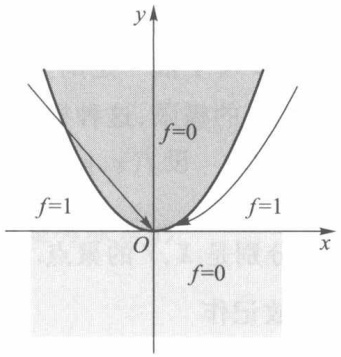

text_image

y
f=0
f=1
O
x
f=1
f=0

图16-8

下面我们再给出当 $P(x,y)\rightarrow P_0(x_0,y_0)$ 时，$f(x,y)$ 趋于 $+\infty$ （非正常极限）的定义.

定义2 设 $D$ 为二元函数 $f$ 的定义域, $P_0(x_0, y_0)$ 是 $D$ 的一个聚点. 若对任给正数 $M$, 总存在点 $P_0$ 的一个 $\delta$ 邻域, 使得当 $P(x, y) \in U^\circ(P_0; \delta) \cap D$ 时, 都有 $f(P) > M$, 则称 $f$ 在 $D$ 上当 $P \to P_0$ 时, 存在非正常极限 $+\infty$, 记作

$$
\lim _ {(x, y) \to (x _ {0}, y _ {0})} f (x, y) = + \infty
$$

或 $\lim_{P\to P_0}f(P) = +\infty .$

仿此可类似地定义

$$
\lim _ {P \to P _ {0}} f (  P  ) = -   \infty \qquad {\text {与}} \qquad \lim _ {P \to P _ {0}} f (  P  ) = \infty  .
$$

例 5 设  $f(x,y)=\frac{1}{2x^{2}+3y^{2}}$ . 证明

$$
\lim _ {(x, y) \to (0, 0)} f (x, y) = + \infty .
$$

证 因为 $2x^{2} + 3y^{2} < 4(x^{2} + y^{2})$ ，对任给正数 $M$ ，取

$$
\delta = \frac {1}{2 \sqrt {M}},
$$

当 $\sqrt{x^2 + y^2} < \delta = \frac{1}{2\sqrt{M}}$

时,就有  $2x^{2} + 3y^{2} < \frac{1}{M}$ ,

即 $\frac{1}{2x^2 + 3y^2} > M.$

这就证得结果(该函数在原点附近的图像参见图 16-9).

二元函数极限的四则运算法则与一元函数极限的四则运算法则相仿,特别把 $f(x,y)$ 看作点函数 $f(P)$ 时,相应定理的证法也完全相同,这里就不再一一列出.

## 二、累次极限

在上一段所研究的极限 $\lim_{(x,y)\to (x_0,y_0)}f(x,y)$ 中，两个自变量 $x,y$ 同时以任何方式趋于 $x_0$ ，$y_0$ .这种极限也称为重极限.在这一段里，我们要考察 $x$ 与 $y$ 依一定的先后顺序相继趋于 $x_0$ 与 $y_0$ 时 $f$ 的极限，这种极限称为累次极限.

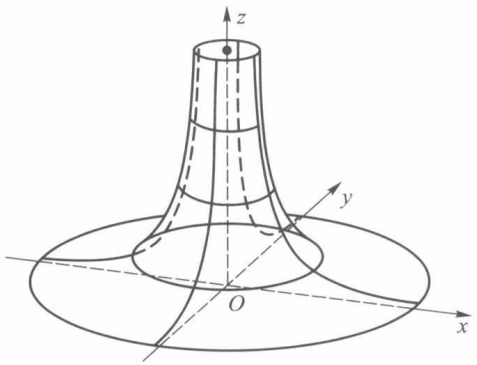

text_image

3D mathematical diagram showing a hyperboloid surface with labeled x, y, z axes and origin O

图16-9

定义 3 设  $f(x,y)$ ,  $(x,y)\in D$ , D 在 x 轴、y 轴上的投影分别为 X, Y, 即

$$
X = \{x \mid (x, y) \in D \}, Y = \{y \mid (x, y) \in D \},
$$

$x_0, y_0$ 分别是 $X, Y$ 的聚点. 若对每一个 $y \in Y (y \neq y_0)$, 存在极限 $\lim_{x \to x_0} f(x, y)$, 它一般与 $y$ 有关, 故记作

$$
\varphi (y) = \lim _ {x \to x _ {0}} f (x, y),
$$

如果进一步还存在极限

$$
L = \lim _ {y \to y _ {0}} \varphi (y),
$$

则称此极限 $L$ 为 $f(x,y)$ 先对 $x(\rightarrow x_0)$，后对 $y(\rightarrow y_0)$ 的累次极限，记作

$$
L = \lim _ {y \to y _ {0}} \lim _ {x \to x _ {0}} f (x, y).
$$

类似地可以定义先对 $y$ 后对 $x$ 的累次极限

$$
K = \lim _ {x \to x _ {0}} \lim _ {y \to y _ {0}} f (x, y).
$$

累次极限与重极限是两个不同的概念,它们的存在性没有必然的蕴含关系.下面三个例子将说明这一点.

例6 设 $f(x, y) = \frac{xy}{x^2 + y^2}$. 由例3已经知道 $(x, y) \to (0, 0)$ 时 $f$ 的重极限不存在. 但当 $y \neq 0$ 时有

$$
\lim _ {x \to 0} \frac {x y}{x ^ {2} + y ^ {2}} = 0.
$$

从而有 $\lim_{y\to 0}\lim_{x\to 0}\frac{xy}{x^2 + y^2} = 0.$

同理可得 $\lim_{x\to 0}\lim_{y\to 0}\frac{xy}{x^2 + y^2} = 0.$

即 $f$ 的两个累次极限都存在而且相等.

例7 设 $f(x, y) = \frac{x - y + x^2 + y^2}{x + y}$，它关于原点的两个累次极限分别为

$$
\lim _ {y \to 0} \lim _ {x \to 0} \frac {x - y + x ^ {2} + y ^ {2}}{x + y} = \lim _ {y \to 0} \frac {y ^ {2} - y}{y} = \lim _ {y \to 0} (y - 1) = - 1
$$

与

$$
\lim _ {x \to 0} \lim _ {y \to 0} \frac {x - y + x ^ {2} + y ^ {2}}{x + y} = \lim _ {x \to 0} \frac {x + x ^ {2}}{x} = \lim _ {x \to 0} (1 + x) = 1.
$$

当沿斜率不同的直线 $y = mx, (x, y) \to (0, 0)$ 时，容易验证所得极限也不同。因此该函数的重极限不存在（下面的定理16.6将告诉我们，这是一个必然的结果）。

例8 设 $f(x, y) = x \sin \frac{1}{y} + y \sin \frac{1}{x}$，它关于原点的两个累次极限都不存在。这是因为对任何 $y \neq 0$，当 $x \to 0$ 时 $f$ 的第二项不存在极限。同理，对任何 $x \neq 0$，当 $y \to 0$ 时 $f$ 的第一项也不存在极限。但是由于

$$
\left| x \sin \frac {1}{y} + y \sin \frac {1}{x} \right| \leqslant | x | + | y |,
$$

故按定义1知道 $f$ 的重极限存在，且 $\lim_{(x,y)\to (0,0)}f(x,y) = 0.$

下述定理告诉我们:重极限与累次极限在一定条件下也是有联系的.

定理16.6 若 $f(x,y)$ 在点 $(x_0,y_0)$ 存在重极限

$$
\lim _ {(x, y) \to (x _ {0}, y _ {0})} f (x, y)
$$

与累次极限

$$
\lim _ {x \to x _ {0}} \lim _ {y \to y _ {0}} f (x, y),
$$

则它们必相等.

证设

$$
\lim _ {(x, y) \to (x _ {0}, y _ {0})} f (x, y) = A,
$$

则对任给的正数 $\varepsilon$ ，总存在正数 $\delta$ ，使得当 $P(x,y)\in U^{\circ}(P_0;\delta)$ 时，有

$$
\left| f (x, y) - A \right| <   \varepsilon . \tag {2}
$$

另由存在累次极限之假设,对任一满足不等式

$$
0 <   \left| x - x _ {0} \right| <   \delta \tag {3}
$$

的 $x$ ，存在极限

$$
\lim _ {y \to y _ {0}} f (x, y) = \varphi (x). \tag {4}
$$

回到不等式(2)，让其中 $y\to y_{0}$ ，由(4)式可得

$$
\mid \varphi (x) - A \mid \leqslant \varepsilon . \tag {5}
$$

故由(3)式、(5)式证得 $\lim_{x\to x_{0}}\varphi(x)=A$ ，即

$$
\lim _ {x \to x _ {0}} \lim _ {y \to y _ {0}} f (x, y) = \lim _ {(x, y) \to (x _ {0}, y _ {0})} f (x, y) = A.
$$

由这个定理可导出如下两个便于应用的推论.

推论 1 若累次极限

$$
\lim _ {x \to x _ {0}} \lim _ {y \to y _ {0}} f (x, y), \quad \lim _ {y \to y _ {0}} \lim _ {x \to x _ {0}} f (x, y)
$$

和重极限

$$
\lim _ {(x, y) \to (x _ {0}, y _ {0})} f (x, y)
$$

都存在,则三者相等.

推论 2 若累次极限

$$
\lim _ {x \to x _ {0}} \lim _ {y \to y _ {0}} f (x, y) \quad \text {与} \quad \lim _ {y \to y _ {0}} \lim _ {x \to x _ {0}} f (x, y)
$$

存在但不相等,则重极限  $\lim_{(x,y)\to(x_{0},y_{0})}f(x,y)$  必不存在.

请注意,定理 16.6 保证了在重极限与一个累次极限都存在时,它们必相等.(本节习题 3 则给出较定理 16.6 弱一些的充分条件.)但它们对另一个累次极限的存在性却得不出什么结论,对此只需考察本节习题 2 的(5).

推论 1 给出了累次极限次序可交换的一个充分条件, 推论 2 可被用来否定重极限的存在性(如例 7).

## 习题 16.2

1. 试求下列极限（包括非正常极限）:

(1)  $\lim_{(x,y)\to(0,0)}\frac{x^{2}y^{2}}{x^{2}+y^{2}};$

(2) $\lim_{(x,y)\to (0,0)}\frac{1 + x^2 + y^2}{x^2 + y^2};$

(3)  $\lim_{(x,y)\to(0,0)}\frac{x^{2}+y^{2}}{\sqrt{1+x^{2}+y^{2}}-1};$

(4)  $\lim_{(x,y)\to(0,0)}\frac{xy+1}{x^{4}+y^{4}};$

(5)  $\lim_{(x,y)\to(1,2)}\frac{1}{2x-y};$

(6)  $\lim_{(x,y)\to(0,0)}(x+y)\sin\frac{1}{x^{2}+y^{2}};$

(7)  $\lim_{(x,y)\to(0,0)}\frac{\sin(x^{2}+y^{2})}{x^{2}+y^{2}}.$

2. 讨论下列函数在点 $(0,0)$ 的重极限与累次极限:

(1) $f(x, y) = \frac{y^2}{x^2 + y^2}$;

(2) $f(x, y) = (x + y) \sin \frac{1}{x} \sin \frac{1}{y}$;

(3) $f(x, y) = \frac{x^2y^2}{x^2y^2 + (x - y)^2}$;

(4) $f(x, y) = \frac{x^3 + y^3}{x^2 + y}$;

(5)  $f(x, y) = y \sin \frac{1}{x}$ ;

(6) $f(x,y) = \frac{x^2y^2}{x^3 + y^3}$;

(7)  $f(x, y) = \frac{\mathrm{e}^{x} - \mathrm{e}^{y}}{\sin xy}.$

3. 证明: 若 $1^{\circ} \lim_{(x,y) \to (a,b)} f(x,y)$ 存在且等于 $A$; $2^{\circ} y$ 在 $b$ 的某邻域内, 有 $\lim_{x \to a} f(x,y) = \varphi(y)$, 则

$$
\limsup _ {y \to b} \lim _ {x \to a} f (x, y) = A.
$$

4. 试应用 $\varepsilon -\delta$ 定义证明

$$
\lim _ {(x, y) \to (0, 0)} \frac {x ^ {2} y}{x ^ {2} + y ^ {2}} = 0.
$$

5. 叙述并证明: 二元函数极限的惟一性定理、局部有界性定理与局部保号性定理.

6. 试写出下列类型极限的精确定义:

(1)  $\lim_{(x,y)\to(+\infty,+\infty)}f(x,y)=A;$

(2) $\lim_{(x,y)\to (0, + \infty)}f(x,y) = A.$

7. 试求下列极限:

(1)  $\lim_{(x,y)\to(+\infty,+\infty)}\frac{x^{2}+y^{2}}{x^{4}+y^{4}};$

(2) $\lim_{(x,y)\to (+\infty , + \infty)}(x^2 +y^2)\mathrm{e}^{-(x + y)};$

(3)  $\lim_{(x,y)\to(+\infty,+\infty)}\left(1+\frac{1}{xy}\right)^{x\sin y}$ ;

(4) $\lim_{(x,y)\to (+\infty ,0)}\left(1 + \frac{1}{x}\right)^{\frac{x^2}{x + y}}.$

8. 试作一函数 $f(x, y)$，使当 $x \to +\infty$，$y \to +\infty$ 时，

(1) 两个累次极限存在而重极限不存在；
(2) 两个累次极限不存在而重极限存在；
(3) 重极限与累次极限都不存在；
(4) 重极限与一个累次极限存在, 另一个累次极限不存在.

9. 证明定理 16.5 及其推论 3.

10. 设 $f(x, y)$ 在点 $P_0(x_0, y_0)$ 的某邻域 $U^\circ(P_0)$ 上有定义，且满足:

(i) 在 $U^{\circ}(P_{0})$ 上，对每个 $y \neq y_{0}$，存在极限 $\lim_{x \to x_{0}} f(x, y) = \psi(y)$；

(ii) 在 $U^{\circ}(P_0)$ 上, 关于 $x$ 一致地存在极限 $\lim_{y\to y_0}f(x,y) = \varphi (x)$ (即对任意 $\varepsilon >0$, 存在 $\delta >0$, 当 $0 < |y - y_0| < \delta$ 时, 对所有的 $x$, 只要 $(x,y)\in U^{\circ}(P_0)$, 都有 $|f(x,y) - \varphi (x)| < \varepsilon$ 成立).

试证明

$$
\lim _ {x \to x _ {0}} \lim _ {y \to y _ {0}} f (x, y) = \lim _ {y \to y _ {0}} \lim _ {x \to x _ {0}} f (x, y).
$$

## § 3 二元函数的连续性

在多元微积分中所讨论的函数中,最重要的一类就是连续函数,这与一元微积分是一样的. 二元函数连续性的定义比一元函数更一般化,但它们的局部性质与在有界闭域上的整体性质则完全相同.

## 一、二元函数的连续性概念

定义1 设 $f$ 为定义在点集 $D \subset \mathbf{R}^2$ 上的二元函数, $P_0 \in D$ （它或者是 $D$ 的聚点, 或者是 $D$ 的孤立点）. 对于任给的正数 $\varepsilon$, 总存在相应的正数 $\delta$, 只要 $P \in U(P_0; \delta) \cap D$, 就有

$$
\mid f (P) - f (P _ {0}) \mid <   \varepsilon , \tag {1}
$$

则称 $f$ 关于集合 $D$ 在点 $P_0$ 连续. 在不致误解的情况下, 也称 $f$ 在点 $P_0$ 连续.

若 f 在 D 上任何点都关于集合 D 连续, 则称 f 为 D 上的连续函数.

由上述定义知道: 若  $P_{0}$  是 D 的孤立点, 则  $P_{0}$  必定是 f 关于 D 的连续点; 若  $P_{0}$  是 D 的聚点, 则 f 关于 D 在  $P_{0}$  连续等价于

$$
\lim_{\substack{P\to P_{0}\\ P\in D}}f(P) = f(P_{0}). \tag{2}
$$

如果 $P_{0}$ 是 $D$ 的聚点，而(2)式不成立（其含义与一元函数的对应情形相同），则称$P_{0}$ 是 $f$ 的不连续点（或称间断点).特别当(2)式左边极限存在但不等于 $f(P_0)$ 时， $P_{0}$ 是 $f$ 的可去间断点.

如上节例 1、例 2 给出的函数在原点连续, 例 4 给出的函数在原点不连续, 又若把例 3 的函数改为

$$
f (x, y) = \left\{ \begin{array}{l l} \frac {x y}{x ^ {2} + y ^ {2}}, & (x, y) \in \{(x, y) \mid y = m x, x \neq 0 \}, \\ \frac {m}{1 + m ^ {2}}, & (x, y) = (0, 0), \end{array} \right.
$$

其中 m 为固定实数,亦即函数 f 只定义在直线 y=mx 上.这时由于

$$
\lim_{\substack{(x,y)\to (0,0)\\ y = mx}}f(x,y) = \frac{m}{1 + m ^ {2}} = f(0,0),
$$

因此 f 在原点沿着直线 y = mx 是连续的.

例1 讨论函数

$$
f (x, y) = \left\{ \begin{array}{l l} \frac {x ^ {\alpha}}{x ^ {2} + y ^ {2}}, & (x, y) \neq (0, 0), \\ 0, & (x, y) = (0, 0) \end{array} \right. \quad (\alpha > 0)
$$

在点 $(0,0)$ 的连续性.

解 由于当 $\alpha > 2$ 且 $r \to 0$ 时，

$$
\mid f (r \cos \theta , r \sin \theta) \mid = \mid r ^ {\alpha - 2} (\cos \theta) ^ {\alpha} \mid \leqslant r ^ {\alpha - 2} \rightarrow 0,
$$

因此 $\lim_{(x,y)\to (0,0)}f(x,y) = 0 = f(0,0)$，此时 $f$ 在点 $(0,0)$ 连续；当 $\alpha \leqslant 2$ 时，$\lim_{(x,y)\to (0,0)}f(x,y)$ 不存在，此时 $f$ 在点 $(0,0)$ 间断。

设 $P_{0}(x_{0},y_{0}), P(x,y)\in D, \Delta x = x - x_{0},\Delta y = y - y_{0}$ ，则称

$$
\begin{array}{l} \Delta z = \Delta f (x _ {0}, y _ {0}) = f (x, y) - f (x _ {0}, y _ {0}) \\ = f (x _ {0} + \Delta x, y _ {0} + \Delta y) - f (x _ {0}, y _ {0}) \\ \end{array}
$$

为函数 $f$ 在点 $P_0$ 的全增量. 和一元函数一样, 可用增量形式来描述连续性, 即当

$$
\lim_{\substack{(\Delta x,\Delta y)\to (0,0)\\ (x,y)\in D}}\Delta z = 0
$$

时,f在点 $P_{0}$ 连续.

如果在全增量中取 $\Delta x = 0$ 或 $\Delta y = 0$ ，则相应的函数增量称为偏增量，记作

$$
\begin{array}{l} \Delta_ {x} f (x _ {0}, y _ {0}) = f (x _ {0} + \Delta x, y _ {0}) - f (x _ {0}, y _ {0}), \\ \Delta_ {y} f (x _ {0}, y _ {0}) = f (x _ {0}, y _ {0} + \Delta y) - f (x _ {0}, y _ {0}). \\ \end{array}
$$

一般说来,函数的全增量并不等于相应的两个偏增量之和.

若一个偏增量的极限为零,例如 $\lim_{\Delta x\to0}\Delta_{x}f(x_{0},y_{0})=0$ ,它表示在f的两个自变量中,当固定 $y=y_{0}$ 时, $f(x,y_{0})$ 作为x的一元函数在 $x_{0}$ 连续.同理,若 $\lim_{\Delta y\to0}\Delta_{y}f(x_{0},y_{0})=0$ ,则表示

$f(x_{0},y)$  在  $y_{0}$  连续. 容易证明: 当 f 在其定义域的内点  $(x_{0},y_{0})$  连续时,  $f(x,y_{0})$  在  $x_{0}$  和  $f(x_{0},y)$  在  $y_{0}$  都连续. 但是反过来, 二元函数对单个自变量都连续并不能保证该函数的连续性 (除非再增加条件, 如本节习题 4, 7,10). 例如二元函数 (参见图16-10)

$$
f (x, y) = \left\{ \begin{array}{l l} 1, & x y \neq 0, \\ 0, & x y = 0 \end{array} \right.
$$

在原点处显然不连续.但由于

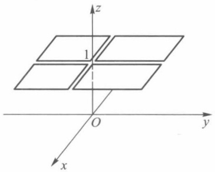

text_image

z
1
O
y
x

图16-10

$$
f (0, y) = f (x, 0) \equiv 0,
$$

因此在原点处 f 对 x 和对 y 分别都连续.

若二元函数在某一点连续,则与一元函数一样,可以证明它在这一点近旁具有局部有界性、局部保号性以及相应的有理运算的各个法则.下面证明二元复合函数的连续性定理,其余留给读者自己去证明.

定理16.7（复合函数的连续性）设函数 $u = \varphi (x,y)$ 和 $v = \psi (x,y)$ 在 $xy$ 平面上点$P_0(x_0,y_0)$ 的某邻域内有定义，并在点 $P_{0}$ 连续；函数 $f(u,v)$ 在 $uv$ 平面上点 $Q_{0}(u_{0},v_{0})$ 的某邻域内有定义，并在点 $Q_{0}$ 连续，其中 $u_{0} = \varphi (x_{0},y_{0}),v_{0} = \psi (x_{0},y_{0})$ .则复合函数$g(x,y) = f[\varphi (x,y),\psi (x,y)]$ 在点 $P_0$ 也连续.

证 由 f 在点  $Q_{0}$  连续可知: 任给正数  $\varepsilon$ , 存在相应正数  $\eta$ , 使得当  $\left|u-u_{0}\right|<\eta,\left|v-v_{0}\right|<\eta$  时, 有

$$
\mid f (u, v) - f (u _ {0}, v _ {0}) \mid <   \varepsilon .
$$

又由  $\varphi, \psi$  在点  $P_{0}$  连续可知: 对上述正数  $\eta$ , 总存在正数  $\delta$ , 使得当  $\left|x-x_{0}\right|<\delta,\left|y-y_{0}\right|<\delta$  时, 都有

$$
\begin{array}{l} \left| u - u _ {0} \right| = \left| \varphi (x, y) - \varphi \left(x _ {0}, y _ {0}\right) \right| <   \eta , \\ \left| v - v _ {0} \right| = \left| \psi (x, y) - \psi \left(x _ {0}, y _ {0}\right) \right| <   \eta . \\ \end{array}
$$

综合起来, 当  $\left|x-x_{0}\right|<\delta,\left|y-y_{0}\right|<\delta$  时, 便有

$$
\mid g (x, y) - g (x _ {0}, y _ {0}) \mid = \mid f (u, v) - f (u _ {0}, v _ {0}) \mid <   \varepsilon .
$$

所以复合函数 $f(\varphi (x,y),\psi (x,y))$ 在点 $P_0(x_0,y_0)$ 连续.

## 二、有界闭域上连续函数的性质

本段讨论有界闭域上多元连续函数的性质. 它们可以看作是闭区间上一元连续函

数性质的推广.

定理 16.8(有界性与最大、最小值定理) 若函数 f 在有界闭域  $D \subset R^{2}$  上连续, 则 f 在 D 上有界, 且能取得最大值与最小值.

证 先证明 $f$ 在 $D$ 上有界. 倘若不然, 则对每个正整数 $n$, 必存在点 $P_{n} \in D$, 使得

$$
\mid f (P _ {n}) \mid > n, \quad n = 1, 2, \dots . \tag {3}
$$

于是得到一个有界点列 $\{P_n\} \subset D$，且总能使 $\{P_n\}$ 中有无穷多个不同的点。由 §1 定理 16.3，$\{P_n\}$ 存在收敛子列 $\{P_{n_k}\}$，设 $\lim_{k\to \infty}P_{n_k} = P_0$。且因 $D$ 是闭域，从而 $P_0 \in D$。

由于 $f$ 在 $D$ 上连续，当然在点 $P_0$ 也连续，因此有

$$
\lim _ {k \to \infty} f (P _ {n _ {k}}) = f (P _ {0}).
$$

这与不等式(3)相矛盾. 所以 f 是 D 上的有界函数.

下面证明 $f$ 在 $D$ 上能取到最大、最小值.为此设

$$
m = \inf f (D), \quad M = \sup f (D).
$$

可证必有一点 $Q \in D$，使 $f(Q) = M$（同理可证存在 $Q' \in D$，使 $f(Q') = m$）。如若不然，对任意 $P \in D$，都有 $M - f(P) > 0$。考察 $D$ 上的连续正值函数

$$
F (P) = \frac {1}{M - f (P)},
$$

由前面的证明知道，$F$ 在 $D$ 上有界. 又因 $f$ 不能在 $D$ 上达到上确界 $M$, 所以存在收敛点列 $\{P_n\} \subset D$, 使 $\lim_{n \to \infty} f(P_n) = M$. 于是有 $\lim_{n \to \infty} f(P_n) = +\infty$, 这导致与 $F$ 在 $D$ 上有界的结论相矛盾. 从而证得 $f$ 在 $D$ 上能取得最大值.

定理 16.9(一致连续性定理) 若函数 f 在有界闭域  $D \subset R^{2}$  上连续, 则 f 在 D 上一致连续. 即对任何  $\varepsilon > 0$ , 总存在只依赖于  $\varepsilon$  的正数  $\delta$ , 使得对一切点 P, Q, 只要  $\rho(P, Q) < \delta$ , 就有  $|f(P) - f(Q)| < \varepsilon$ .

证 我们可以用聚点定理来证明.

倘若 f 在 D 上连续而不一致连续，则存在某  $\varepsilon_{0}>0$ ，对于任意小的  $\delta>0$ ，例如  $\delta=\frac{1}{n}$ ， $n=1,2,\cdots$ ，总有相应的  $P_{n}, Q_{n} \in D$ ，虽然  $\rho(P_{n}, Q_{n}) < \frac{1}{n}$ ，但是  $\left|f(P_{n}) - f(Q_{n})\right| \geqslant \varepsilon_{0}$ .

由于 $D$ 为有界闭域，因此存在收敛子列 $\{P_{n_k}\} \subset \{P_n\}$，并设 $\lim_{k\to \infty}P_{n_k} = P_0\in D.$ 为记号方便起见，再在 $\{Q_n\}$ 中取出与 $P_{n_k}$ 下标相同的子列 $\{Q_{n_k}\}$，则因

$$
0 \leqslant \rho (P _ {n _ {k}}, Q _ {n _ {k}}) <   \frac {1}{n _ {k}} \rightarrow 0, k \rightarrow \infty ,
$$

而有 $\lim_{k\to \infty}Q_{n_k} = \lim_{k\to \infty}P_{n_k} = P_0$ .最后，由 $f$ 在 $P_0$ 连续，得到

$$
\lim _ {k \to \infty} \left| f (P _ {n _ {k}}) - f (Q _ {n _ {k}}) \right| = \left| f (P _ {0}) - f (P _ {0}) \right| = 0.
$$

这与 $|f(P_{n_k}) - f(Q_{n_k})| \geqslant \varepsilon_0 > 0$ 相矛盾. 所以 $f$ 在 $D$ 上一致连续.

定理 16.10(介值性定理) 设函数 f 在区域  $D \subset R^{2}$  上连续, 若  $P_{1}, P_{2}$  为 D 中任意两点, 且  $f(P_{1}) < f(P_{2})$ , 则对任何满足不等式

$$
f (P _ {1}) <   \mu <   f (P _ {2}) \tag {4}
$$

的实数  $\mu$ ，必存在点  $P_{0} \in D$ ，使得  $f(P_{0}) = \mu$ .

证 作辅助函数

$$
F (P) = f (P) - \mu , \quad P \in D.
$$

易见 $F$ 仍在 $D$ 上连续，且由不等式(4)知道 $F(P_{1}) < 0, F(P_{2}) > 0.$ 这里不妨假设 $P_{1}, P_{2}$ 是 $D$ 的内点（为什么？). 下面证明必存在 $P_{0} \in D$ ，使 $F(P_{0}) = 0$.

由于 $D$ 为区域, 我们可以用 $D$ 中的有限折线联结 $P_{1}$ 和 $P_{2}$ (图16-11). 若有某一个联结点所对应的函数值为0, 则定理已得证. 否则从一端开始逐个检查直线段, 必定存在某直线段, $F$ 在它两端的函数值异号, 不失一般性, 设联结 $P_{1}(x_{1}, y_{1}), P_{2}(x_{2}, y_{2})$ 的直线段含于 $D$, 其方程为

$$
\left\{ \begin{array}{l} x = x _ {1} + t (x _ {2} - x _ {1}), \\ y = y _ {1} + t (y _ {2} - y _ {1}), \end{array} \right. \quad 0 \leqslant t \leqslant 1.
$$

在此直线段上，F 表示为关于 t 的复合函数

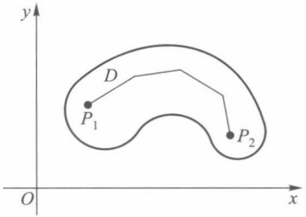

text_image

y
D
P₁
P₂
O
x

图16-11

$$
G (t) = F (x _ {1} + t (x _ {2} - x _ {1}), y _ {1} + t (y _ {2} - y _ {1})) , 0 \leqslant t \leqslant 1.
$$

它是 $[0,1]$ 上的一元连续函数，且 $F(P_{1}) = G(0) < 0 < G(1) = F(P_{2})$。由一元函数根的存在定理，在 $(0,1)$ 内存在一点 $t_0$，使得 $G(t_0) = 0$。记

$$
x _ {0} = x _ {1} + t _ {0} (x _ {2} - x _ {1}), \quad y _ {0} = y _ {1} + t _ {0} (y _ {2} - y _ {1}),
$$

则有 $P_0(x_0,y_0)\in D$ ，使得

$$
F (P _ {0}) = G (t _ {0}) = 0 \text {即} f (P _ {0}) = \mu .
$$

实际上,定理 16.8 与定理 16.9 中的有界闭域 D 可以改为有界闭集(证明过程无原则性变化).但是,介值性定理中所考察的点集 D 只能假设是一区域,这是为了保证它具有连通性,而一般的开集或闭集不一定具有这一特性.此外,由定理 16.10 可知,若 f 为区域 D 上的连续函数,则  $f(D)$  必定是一个区间(有限或无限).

## 习题 16.3①

1. 讨论下列函数的连续性:

(1)  $f(x, y) = \tan(x^{2} + y^{2})$ ;

(2)  $f(x, y) = [x + y]$ ;

(3)  $f(x, y) = \left\{ \begin{aligned} & \frac{\sin xy}{y}, & y \neq 0, \\ & 0, & y = 0; \end{aligned} \right.$

(4) $f(x,y)=\left\{\begin{aligned}\frac{\sin xy}{\sqrt{x^{2}+y^{2}}},&x^{2}+y^{2}\neq0,\\ 0,&x^{2}+y^{2}=0;\end{aligned}\right.$

(5)  $f(x,y)=\left\{\begin{aligned}&0,&x \text{为无理数,}\\ &y,&x \text{为有理数;}\end{aligned}\right.$

$^{*}$ (6)  $f(x,y)=\left\{\begin{aligned}y^{2}\ln\left(x^{2}+y^{2}\right),&x^{2}+y^{2}\neq0,\\ 0,&x^{2}+y^{2}=0;\end{aligned}\right.$

\* (7) $f(x, y) = \frac{1}{\sin x \sin y}$;

\* (8) $f(x, y) = \mathrm{e}^{-\frac{x}{y}}$.

2. 叙述并证明二元连续函数的局部保号性.

3. 设

$$
f (x, y) = \left\{ \begin{array}{l l} \frac {x}{(  x ^ {2}   +   y ^ {2}  ) ^ {p}}, & x ^ {2}   +   y ^ {2}   \neq   0  , \\ 0  , & x ^ {2}   +   y ^ {2}   =   0 \end{array} \right. \quad (  p   >   0  )  ,
$$

<small>① 本习题中有 \* 号者为横线下习题.</small>

试讨论它在点 $(0,0)$ 处的连续性.

4. 设 $f(x, y)$ 定义在闭矩形域 $S = [a, b] \times [c, d]$ 上. 若 $f$ 对 $y$ 在 $[c, d]$ 上处处连续, 对 $x$ 在 $[a, b]$ 上 (且关于 $y$) 一致连续, 证明 $f$ 在 $S$ 上处处连续.

5. 证明: 若 $D \subset \mathbf{R}^2$ 是有界闭域, $f$ 为 $D$ 上连续函数, 且 $f$ 不是常数函数, 则 $f(D)$ 不仅有界 (定理16.8), 而且是闭区间.

6. 设 $f(x, y)$ 在 $[a, b] \times [c, d]$ 上连续，又有函数列 $\{\varphi_k(x)\}$ 在 $[a, b]$ 上一致收敛，且

$$
c \leqslant \varphi_ {k} (x) \leqslant d, \quad x \in [ a, b ], \quad k = 1, 2, \dots .
$$

试证 $\{F_k(x)\} = \{f(x,\varphi_k(x))\}$ 在 $[a,b]$ 上也一致收敛.

7. 设 $f(x, y)$ 在区域 $G \subset \mathbf{R}^2$ 上对 $x$ 连续，对 $y$ 满足利普希茨条件:

$$
\left| f (x, y ^ {\prime}) - f (x, y ^ {\prime \prime}) \right| \leqslant L \left| y ^ {\prime} - y ^ {\prime \prime} \right|,
$$

其中 $(x,y')$ ， $(x,y'')\in G,L$ 为常数.试证明f在G上处处连续.

8. 若一元函数 $\varphi(x)$ 在 $[a, b]$ 上连续，令

$$
f (x, y) = \varphi (x), \quad (x, y) \in D = [ a, b ] \times (- \infty , + \infty).
$$

试讨论 f 在 D 上是否连续, 是否一致连续?

9. 设

$$
f (x, y) = \frac {1}{1 - x y}, \quad (x, y) \in D = [ 0, 1) \times [ 0, 1).
$$

证明 f 在 D 上连续,但不一致连续.

10. 设 $f$ 在 $\mathbf{R}^2$ 上分别对每一自变量 $x$ 和 $y$ 是连续的，并且每当固定 $x$ 时 $f$ 对 $y$ 是单调的，证明 $f$ 是 $\mathbf{R}^2$ 上的二元连续函数.

## 第十六章总练习题

1. 设 $E \subset \mathbb{R}^2$ 是有界闭集, $d(E)$ 为 $E$ 的直径. 证明: 存在 $P_1, P_2 \in E$, 使得

$$
\rho (P _ {1}, P _ {2}) = d (E).
$$

2. 设 $E \subset \mathbf{R}^2$. 试证 $E$ 为闭集的充要条件是 $E = E \cup \partial E$ 或 $E^c = \operatorname{int} E^c$.

3. 设 $f(x, y) = \frac{1}{xy}, r = \sqrt{x^2 + y^2}, k > 1$,

$$
D _ {1} = \{(x, y) \mid \frac {1}{k} x \leqslant y \leqslant k x \},
$$

$$
D _ {2} = \{(x, y) \mid x > 0, y > 0 \}.
$$

试分别讨论 i=1,2 时极限  $\lim f(x,y)$  是否存在,为什么?

$$
\begin{array}{c} r \longrightarrow + \infty \\ (x, y) \in D _ {i} \end{array}
$$

4. 设 $\lim_{y\to y_0}\varphi (y) = \varphi (y_0) = A,\lim_{x\to x_0}\psi (x) = \psi (x_0) = 0$ ，且在 $(x_0,y_0)$ 附近有 $|f(x,y) - \varphi (y)|\leqslant \psi (x)$ 证明 $\lim_{(x,y)\to (x_0,y_0)}f(x,y) = A.$

5. 设 f 为定义在  $R^{2}$  上的连续函数,  $\alpha$  是任一实数,

$$
E = \{(x, y) \mid f (x, y) > \alpha , (x, y) \in \mathbf {R} ^ {2} \},
$$

$$
F = \{(x, y)   |   f (x, y) \geqslant \alpha , (x, y) \in \mathbf {R} ^ {2} \}.
$$

证明 E 是开集, F 是闭集.

6. 设 $f$ 在有界开集 $E$ 上一致连续. 证明:

(1) 可将 f 连续延拓到 E 的边界；

(2) f 在 E 上有界.

7. 设 $u = \varphi(x, y)$ 与 $v = \psi(x, y)$ 在 $xy$ 平面中的点集 $E$ 上一致连续. $\varphi$ 与 $\psi$ 把点集 $E$ 映射为 $uv$ 平面中的点集 $D, f(u, v)$ 在 $D$ 上一致连续. 证明复合函数 $f(\varphi(x, y), \psi(x, y))$ 在 $E$ 上一致连续.

8. 设  $f(t)$  在区间  $(a, b)$  内连续可导, 函数

$$
F (x, y) = \frac {f (x) - f (y)}{x - y} \quad (x \neq y), \quad F (x, x) = f ^ {\prime} (x)
$$

定义在区域  $D=(a,b)\times(a,b)$  上. 证明: 对任何  $c\in(a,b)$ ，有

$$
\lim _ {(x, y) \to (c, c)} f (x, y) = f ^ {\prime} (c).
$$

## 第十六章综合自测题

## §1 可微性

## 一、可微性与全微分

与一元函数一样,在多元函数微分学中,主要讨论多元函数的可微性及其应用.本章重点建立二元函数可微性概念,至于一般 n 元函数的可微性不难据此相应地给出(对此,在第二十三章有更详细的论述).

定义1 设函数 $z = f(x, y)$ 在点 $P_0(x_0, y_0)$ 的某邻域 $U(P_0)$ 上有定义，对于 $U(P_0)$ 中的点 $P(x, y) = (x_0 + \Delta x, y_0 + \Delta y)$，若函数 $f$ 在点 $P_0$ 处的全增量 $\Delta z$ 可表示为

$$
\begin{array}{l} \Delta z = f (x _ {0} + \Delta x, y _ {0} + \Delta y) - f (x _ {0}, y _ {0}) \\ = A \Delta x + B \Delta y + o (\rho), \tag {1} \\ \end{array}
$$

其中 $A, B$ 是仅与点 $P_0$ 有关的常数，$\rho = \sqrt{\Delta x^2 + \Delta y^2}$，$o(\rho)$ 是较 $\rho$ 高阶的无穷小量，则称函数 $f$ 在点 $P_0$ 可微。并称(1)式中关于 $\Delta x, \Delta y$ 的线性函数 $A \Delta x + B \Delta y$ 为函数 $f$ 在点 $P_0$ 的全微分，记作

$$
\mathrm{d} z \mid_ {P _ {0}} = \mathrm{d} f (x _ {0}, y _ {0}) = A \Delta x + B \Delta y. \tag {2}
$$

由(1)，(2)可见 dz 是  $\Delta z$  的线性主部，特别当  $\left|\Delta x\right|$ ， $\left|\Delta y\right|$  充分小时，全微分 dz 可作为全增量  $\Delta z$  的近似值，即

$$
f (x, y) \approx f (x _ {0}, y _ {0}) + A (x - x _ {0}) + B (y - y _ {0}). \tag {3}
$$

在使用上,有时也把(1)式写成如下形式:

$$
\Delta z = A \Delta x + B \Delta y + \alpha \Delta x + \beta \Delta y, \tag {4}
$$

这里

$$
\lim _ {(\Delta x, \Delta y) \to (0, 0)} \alpha = \lim _ {(\Delta x, \Delta y) \to (0, 0)} \beta = 0.
$$

例 1 考察函数  $f(x,y)=xy$  在点  $(x_{0},y_{0})$  处的可微性.

解 在点 $(x_0, y_0)$ 处函数 $f$ 的全增量为

$$
\begin{array}{l} \Delta f (x _ {0}, y _ {0}) = (x _ {0} + \Delta x) (y _ {0} + \Delta y) - x _ {0} y _ {0} \\ = y _ {0} \Delta x + x _ {0} \Delta y + \Delta x \Delta y. \\ \end{array}
$$

由于

$$
\frac {\mid \Delta x \Delta y \mid}{\rho} = \rho \frac {\mid \Delta x \mid}{\rho} \frac {\mid \Delta y \mid}{\rho} \leqslant \rho \rightarrow 0 (\rho \rightarrow 0),
$$

因此 $\Delta x\Delta y = o(\rho)$ .从而函数 $f$ 在 $(x_0,y_0)$ 可微，且

$$
\mathrm{d} f = y _ {0} \Delta x + x _ {0} \Delta y.
$$

## 二、偏导数

由一元函数微分学知道: 若  $f(x)$  在点  $x_{0}$  可微, 则函数增量  $f(x_{0}+\Delta x)-f(x_{0})=A\Delta x+o(\Delta x)$ , 其中  $A=f'(x_{0})$ . 同样, 由上一段已知, 若二元函数 f 在点  $(x_{0},y_{0})$  可微, 则 f 在  $(x_{0},y_{0})$  处的全增量可由(1)式表示. 现在讨论其中 A, B 的值与函数 f 的关系. 为此, 在(4)式中令  $\Delta y=0\quad(\Delta x\neq0)$ , 这时得到  $\Delta z$  关于 x 的偏增量  $\Delta_{x}z$ , 且有

$$
\Delta_ {x} z = A \Delta x + \alpha \Delta x \quad \text {或} \quad {\frac {\Delta_ {x} z}{\Delta x}} = A + \alpha .
$$

现让 $\Delta x\to 0$ ，由上式便得 $A$ 的一个极限表示式

$$
A = \lim _ {\Delta x \to 0} \frac {\Delta_ {x} z}{\Delta x} = \lim _ {\Delta x \to 0} \frac {f (x _ {0} + \Delta x , y _ {0}) - f (x _ {0} , y _ {0})}{\Delta x}. \tag {5}
$$

容易看出，(5)式右边的极限正是关于 $x$ 的一元函数 $f(x, y_0)$ 在 $x = x_0$ 处的导数. 类似地，令 $\Delta x = 0 (\Delta y \neq 0)$，由(4)式又可得到

$$
B = \lim _ {\Delta y \to 0} \frac {\Delta_ {y} z}{\Delta y} = \lim _ {\Delta y \to 0} \frac {f (x _ {0} , y _ {0} + \Delta y) - f (x _ {0} , y _ {0})}{\Delta y}. \tag {6}
$$

它是关于 $y$ 的一元函数 $f(x_0,y)$ 在 $y = y_{0}$ 处的导数.

二元函数当固定其中一个自变量时,它对另一个自变量的导数称为偏导数,定义如下.

定义2 设函数 $z = f(x, y), (x, y) \in D$. 若 $(x_0, y_0) \in D$，且 $f(x, y_0)$ 在 $x_0$ 的某邻域内有定义，则当极限

$$
\lim _ {\Delta x \to 0} \frac {\Delta_ {x} f (x _ {0} , y _ {0})}{\Delta x} = \lim _ {\Delta x \to 0} \frac {f (x _ {0} + \Delta x , y _ {0}) - f (x _ {0} , y _ {0})}{\Delta x} \tag {7}
$$

存在时,称这个极限为函数f在点 $(x_{0},y_{0})$ 关于x的偏导数,记作

$$
f _ {x} (  x _ {0}, y _ {0}) \text {或}   z _ {x} (  x _ {0}, y _ {0})  ,   \left. \frac {\partial f}{\partial x} \right| _ {(  x _ {0}, y _ {0})}  ,   \left. \frac {\partial z}{\partial x} \right| _ {(  x _ {0}, y _ {0})}.
$$

同样定义 $f$ 在点 $(x_0, y_0)$ 关于 $y$ 的偏导数 $f_y(x_0, y_0)$ 或 $\frac{\partial f}{\partial y} \bigg|_{(x_0, y_0)}$.

注1 这里符号 $\frac{\partial}{\partial x}, \frac{\partial}{\partial y}$ 专用于偏导数算符，与一元函数的导数符号 $\frac{\mathrm{d}}{\mathrm{d}x}$ 相仿，但又有差别.

注2 在上述定义中，$f$ 在点 $(x_0, y_0)$ 存在关于 $x$（或 $y$）的偏导数，$f$ 至少在 $\{(x, y) \mid y = y_0, |x - x_0| < \delta\}$（或 $\{(x, y) \mid x = x_0, |y - y_0| < \delta\}$）上必须有定义.

若函数  $z=f(x,y)$  在区域 D 上每一点  $(x,y)$  都存在对 x（或对 y）的偏导数，则得到函数  $z=f(x,y)$  在区域 D 上对 x（或对 y）的偏导函数（也简称偏导数），记作

$$
f _ {x} (  x, y  )   \text {或} \frac {\partial f (  x , y  )}{\partial x}    \left(f _ {y} (  x, y  )   \text {或} \frac {\partial f (  x , y  )}{\partial y}\right)  ,
$$

也可简单地写作 $f_{x}, z_{x}$ 或 $\frac{\partial f}{\partial x}, \frac{\partial z}{\partial x}\left(f_{y}, z_{y}\right.$ 或 $\frac{\partial f}{\partial y}, \frac{\partial z}{\partial y}$.

在上一章中已指出，二元函数 $z = f(x,y)$ 的几何图像通常是三维空间中的曲面.设$P_0(x_0,y_0,z_0)$ 为这曲面上一点，其中 $z_0 = f(x_0,y_0)$ .过 $P_0$ 作平面 $y = y_0$ ，它与曲面 $z = f(x,y)$ 的交线

$$
C: \left\{ \begin{array}{l} y = y _ {0}, \\ z = f (x, y) \end{array} \right.
$$

是平面 $y = y_0$ 上的一条曲线. 于是, 二元函数偏导数的几何意义 (如图17-1) 是: $f_x(x_0, y_0)$

作为一元函数 $f(x,y_0)$ 在 $x = x_0$ 的导数，就是曲线$C$ 在点 $P_{0}$ 处的切线 $T_{x}$ 对于 $x$ 轴的斜率，即 $T_{x}$ 与$x$ 轴正向所成倾角的正切 $\tan \alpha$ .同样， $f_{y}(x_{0},y_{0})$ 是平面 $x = x_0$ 与曲面 $z = f(x,y)$ 的交线

$$
\left\{ \begin{array}{l} x = x _ {0}, \\ z = f (x, y) \end{array} \right.
$$

在点  $P_{0}$  处的切线  $T_{y}$  关于 y 轴的斜率  $\tan \beta$ .

由偏导数的定义还知道,函数 f 对某一个自变量求偏导数,是先把其他自变量看作常数,从而变成一元函数的求导问题.因此第五章中有关

求导的一些基本法则,对多元函数求偏导数仍然适用.

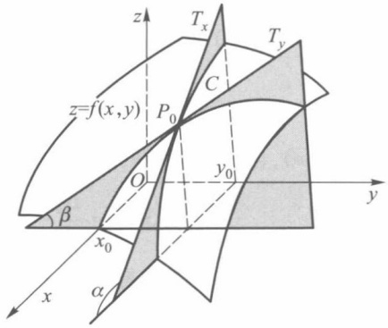

text_image

z=f(x,y)
P₀
C
Tₓ
Tᵧ
y₀
O
β
x₀
α
x
y

图17-1

例 2 求函数  $f(x,y)=x^{3}+2x^{2}y-y^{3}$  在点 (1,3) 关于 x 和关于 y 的偏导数.

解 先求 $f$ 在点(1,3)关于 $x$ 的偏导数, 为此, 令 $y = 3$, 得到以 $x$ 为自变量的函数 $f(x,3) = x^3 + 6x^2 - 27$, 求它在 $x = 1$ 的导数, 即

$$
f _ {x} (1, 3) = \frac {\mathrm{d} f (x , 3)}{\mathrm{d} x} \bigg | _ {x = 1} = 3 x ^ {2} + 1 2 x \big | _ {x = 1} = 1 5.
$$

再求 f 在  $(1,3)$  关于 y 的偏导数. 先令 x=1, 得到以 y 为自变量的函数  $f(1,y)=1+2y-y^{3}$ , 求它在 y=3 的导数, 得

$$
f _ {y} (1, 3) = \frac {\mathrm{d} f (1 , y)}{\mathrm{d} y} \bigg | _ {y = 3} = 2 - 3 y ^ {2} \mid_ {y = 3} = - 2 5.
$$

通常也可分别先求出 $f$ 关于 $x$ 和 $y$ 的偏导函数:

$$
f _ {x} (x, y) = 3 x ^ {2} + 4 x y,
$$

$$
f _ {y} (x, y) = 2 x ^ {2} - 3 y ^ {2}.
$$

然后以 $(x,y)=(1,3)$ 代入,也能得到同样结果.

例 3 求函数  $z = x^{y} (x > 0)$  的偏导数.

解

$$
\frac {\partial z}{\partial x} = y x ^ {y - 1}, \quad \frac {\partial z}{\partial y} = x ^ {y} \ln x.
$$

例 4 求三元函数  $u = \sin(x + y^{2} - e^{z})$  的偏导数.

解 把 y 和 z 看作常数, 得

$$
\frac {\partial u}{\partial x} = \cos (x + y ^ {2} - \mathrm{e} ^ {z}).
$$

把 x, z 看作常数, 得

$$
\frac {\partial u}{\partial y} = 2 y \cos (x + y ^ {2} - \mathrm{e} ^ {z}).
$$

把 x, y 看作常数, 得

$$
\frac {\partial u}{\partial z} = - \mathrm{e} ^ {z} \cos (x + y ^ {2} - \mathrm{e} ^ {z}).
$$

## 三、可微性条件

由偏导数定义及(5)，(6)两式可得如下定理.

定理 17.1(可微的必要条件) 若二元函数 f 在其定义域内一点  $(x_{0}, y_{0})$  可微，则 f 在该点关于每个自变量的偏导数都存在，且(1)式中的

$$
A = f _ {x} (  x _ {0}  , y _ {0}  )  , \quad B = f _ {y} (  x _ {0}  , y _ {0}  )  .
$$

因此,函数f在点 $(x_{0},y_{0})$ 的全微分(2)可惟一地表示为

$$
\mathrm{d} f \mid_ {(x _ {0}, y _ {0})} = f _ {x} (x _ {0}, y _ {0}) \cdot \Delta x + f _ {y} (x _ {0}, y _ {0}) \cdot \Delta y.
$$

与一元函数的情况一样,由于自变量的增量等于自变量的微分,即

$$
\Delta x = \mathrm{d} x, \quad \Delta y = \mathrm{d} y,
$$

所以 $f$ 在点 $(x_0, y_0)$ 的全微分又可写为

$$
\mathrm{d} z = f _ {x} (x _ {0}, y _ {0}) \mathrm{d} x + f _ {y} (x _ {0}, y _ {0}) \mathrm{d} y.
$$

若函数 f 在区域 D 上每一点  $(x, y)$  都可微, 则称函数 f 在区域 D 上可微, 且 f 在 D 上全微分为

$$
\mathrm{d} f (x, y) = f _ {x} (x, y) \mathrm{d} x + f _ {y} (x, y) \mathrm{d} y. \tag {8}
$$

例5 考察函数

$$
f (x, y) = \left\{ \begin{array}{l l} \frac {x y}{\sqrt {x ^ {2} + y ^ {2}}}, & x ^ {2} + y ^ {2} \neq 0, \\ 0, & x ^ {2} + y ^ {2} = 0 \end{array} \right.
$$

在原点的可微性.

解 按偏导数定义

$$
f _ {x} (0, 0) = \lim _ {\Delta x \to 0} \frac {f (\Delta x , 0) - f (0 , 0)}{\Delta x} = \lim _ {\Delta x \to 0} \frac {0 - 0}{\Delta x} = 0.
$$

同理可得 $f_{\gamma}(0,0) = 0$ .若函数 $f$ 在原点可微，则

$$
\begin{array}{l} \Delta z - \mathrm{d} z = f (0 + \Delta x, 0 + \Delta y) - f (0, 0) - f _ {x} (0, 0) \Delta x - f _ {y} (0, 0) \Delta y \\ = \frac {\Delta x \Delta y}{\sqrt {\Delta x ^ {2} + \Delta y ^ {2}}} \\ \end{array}
$$

应是较  $\rho=\sqrt{\Delta x^{2}+\Delta y^{2}}$  高阶的无穷小量.为此,考察极限

$$
\lim _ {\rho \to 0} \frac {\Delta z - \mathrm{d} z}{\rho} = \lim _ {\rho \to 0} \frac {\Delta x \Delta y}{\Delta x ^ {2} + \Delta y ^ {2}},
$$

由第十六章 §2 例 3 知道, 上述极限不存在, 因而函数 f 在原点不可微.

我们知道,一元函数可微与存在导数是等价的.而例5说明对于多元函数,偏导数即使都存在,该函数也不一定可微.现在不禁要问:当所有偏导数都存在时,还需要添

加哪些条件,才能保证函数可微呢?

定理17.2（可微的充分条件）若函数 $z = f(x,y)$ 的偏导数在点 $(x_0,y_0)$ 的某邻域内存在，且 $f_{x}$ 与 $f_{y}$ 在点 $(x_0,y_0)$ 连续，则函数 $f$ 在点 $(x_0,y_0)$ 可微.

证 我们把全增量 $\Delta z$ 写作

$$
\begin{array}{l} \Delta z = f (x _ {0} + \Delta x, y _ {0} + \Delta y) - f (x _ {0}, y _ {0}) \\ = \left[ f (x _ {0} + \Delta x, y _ {0} + \Delta y) - f (x _ {0}, y _ {0} + \Delta y) \right] + \left[ f (x _ {0}, y _ {0} + \Delta y) - f (x _ {0}, y _ {0}) \right]. \\ \end{array}
$$

在第一个括号里,它是函数 $f(x,y_{0}+\Delta y)$ 关于x的偏增量.在第二个括号里,则是函数 $f(x_{0},y)$ 关于y的偏增量.对它们分别应用一元函数的拉格朗日中值定理,得

$$
\Delta z = f _ {x} (x _ {0} + \theta_ {1} \Delta x, y _ {0} + \Delta y) \Delta x + f _ {y} (x _ {0}, y _ {0} + \theta_ {2} \Delta y) \Delta y, 0 <   \theta_ {1}, \theta_ {2} <   1. \tag {9}
$$

由于 $f_{x}$ 与 $f_{y}$ 在点 $(x_0,y_0)$ 连续，因此有

$$
f _ {x} (x _ {0} + \theta_ {1} \Delta x, y _ {0} + \Delta y) = f _ {x} (x _ {0}, y _ {0}) + \alpha , \tag {10}
$$

$$
f _ {y} (x _ {0}, y _ {0} + \theta_ {2} \Delta y) = f _ {y} (x _ {0}, y _ {0}) + \beta , \tag {11}
$$

其中当 $(\Delta x, \Delta y) \to (0, 0)$ 时，$\alpha \to 0, \beta \to 0$。将(10)式、(11)式代入(9)式，则得

$$
\Delta z = f _ {x} (x _ {0}, y _ {0}) \Delta x + f _ {y} (x _ {0}, y _ {0}) \Delta y + \alpha \Delta x + \beta \Delta y.
$$

由(4)式便知函数f在点 $(x_{0},y_{0})$ 可微.

根据这个定理,例2中的函数 $f(x,y)=x^{3}+2x^{2}y-y^{3}$ 在点(1,3)可微,且

$$
\mathrm{d} f \mid_ {(1, 3)} = 1 5 \mathrm{d} x - 2 5 \mathrm{d} y.
$$

例3中的函数 $z = x^{y}$ 在 $D = \{(x,y)\mid x > 0, - \infty <  y < + \infty \}$ 上可微，且

$$
\mathrm{d} z = y x ^ {y - 1} \mathrm{d} x + x ^ {y} \ln x \mathrm{d} y.
$$

注 偏导数连续并不是函数可微的必要条件,如函数

$$
f (x, y) = \left\{ \begin{array}{l l} (  x ^ {2} + y ^ {2}) \sin \frac {1}{\sqrt {x ^ {2} + y ^ {2}}}, & x ^ {2} + y ^ {2} \neq 0  , \\ 0  , & x ^ {2} + y ^ {2} = 0 \end{array} \right.
$$

在原点(0,0)可微,但 $f_{x}$ 与 $f_{y}$ 却在点(0,0)不连续(见本节习题7).若 $z=f(x,y)$ 在点 $(x_{0},y_{0})$ 的偏导数 $f_{x},f_{y}$ 连续,则称f在点 $(x_{0},y_{0})$ 连续可微.

在定理 17.2 证明过程中所出现的(9)式,实际上是二元函数的一个中值公式,可以将其归纳为下述定理.

定理17.3 设函数 $f$ 在点 $(x_0, y_0)$ 的某邻域内存在偏导数，若 $(x, y)$ 属于该邻域，则存在 $\xi = x_0 + \theta_1(x - x_0)$ 和 $\eta = y_0 + \theta_2(y - y_0), 0 < \theta_1, \theta_2 < 1$ ，使得

$$
f (x, y) - f (x _ {0}, y _ {0}) = f _ {x} (\xi , y) (x - x _ {0}) + f _ {y} (x _ {0}, \eta) (y - y _ {0}). \tag {12}
$$

读者还可以从可微性概念看到,函数在可微点处必连续,但在函数的连续点处不一定存在偏导数,当然它更不能保证函数在该点可微.例如,函数 $f(x,y)=\sqrt{x^{2}+y^{2}}$ （圆锥）在原点连续,但在该点不存在偏导数.更值得注意的是,即使函数在某一点存在对所有自变量的偏导数,也不能保证函数在该点连续.例如,

$$
f (x, y) = \left\{ \begin{array}{l l} \frac {x y}{x ^ {2} + y ^ {2}}, & x ^ {2} + y ^ {2} \neq 0, \\ 0, & x ^ {2} + y ^ {2} = 0 \end{array} \right.
$$

在原点不连续,但却存在偏导数

$$
f _ {x} (0, 0) = \lim _ {\Delta x \to 0} \frac {0 - 0}{\Delta x} = 0, \quad f _ {y} (0, 0) = 0.
$$

这是因为偏导数只是刻画了函数沿 $x$ 轴或 $y$ 轴方向的变化特征, 所以这个例子只能说明 $f$ 在原点分别对 $x$ 和对 $y$ 必定连续, 但由此并不能保证 $f$ 作为二元函数在原点连续. 与定理17.2相仿, 只有对偏导数附加适当的条件后, 才能保证函数的连续性 (有关内容可从本节习题中去找).

## 四、可微性几何意义及应用

一元函数可微,在几何上反映为曲线存在不平行于 y 轴的切线.对于二元函数来说,可微性则反映为曲面与其切平面之间的类似关系.为此,我们需要先给出曲面的切平面的定义,这可以从曲线的切线定义中获得启发.

在第五章 §1 中, 我们曾把平面曲线 $S$ 在某一点 $P(x_0, y_0)$ 的切线 $PT$ 定义为过 $P$ 点的割线 $PQ$ 当 $Q$ 沿 $S$ 趋近 $P$ 时的极限位置 (如果存在的话). 这时, $PQ$ 与 $PT$ 的夹角 $\varphi$ 也将随 $Q \to P$ 而趋于零 (图 17-2). 由于

$$
\sin \varphi = \frac {h}{d},
$$

其中 $h$ 和 $d$ 分别表示点 $Q$ 到切线 $PT$ 的距离和 $Q$ 到 $P$ 的距离, 因此当 $Q$ 沿 $S$ 趋于 $P$ 时, $\varphi \to 0$ 等同于 $\frac{h}{d} \to 0$.

仿照这个想法,我们引入曲面 S 在点 P 的切平面定义.

定义3 设 $P$ 是曲面 $S$ 上一点, $\Pi$ 为通过点 $P$ 的一个平面, 曲面 $S$ 上的动点 $Q$ 到定点 $P$ 和到平面 $\Pi$ 的距离分别为 $d$ 与 $h$ (图17-3). 若当 $Q$ 在 $S$ 上以任何方式趋近于 $P$ 时, 恒有 $\frac{h}{d} \to 0$, 则称平面 $\Pi$ 为曲面 $S$ 在点 $P$ 处的切平面, $P$ 为切点.

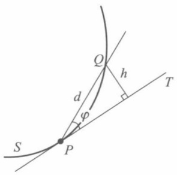

text_image

S
P
d
φ
Q
h
T

图17-2

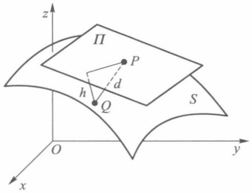

text_image

z
Π
P
h
Q
d
S
O
y
x

图17-3

定理17.4 曲面 $z = f(x,y)$ 在点 $P(x_0,y_0,f(x_0,y_0))$ 存在不平行于 $z$ 轴的切平面 $\Pi$ 的充要条件是函数 $f$ 在点 $P_0(x_0,y_0)$ 可微.

证 [充分性] 若函数 $f$ 在 $P_0$ 处可微, 由定义知

$$
\Delta z = z - z _ {0} = f _ {x} (x _ {0}, y _ {0}) (x - x _ {0}) + f _ {y} (x _ {0}, y _ {0}) (y - y _ {0}) + o (\rho),
$$

其中 $z_0 = f(x_0, y_0), \rho = \sqrt{(x - x_0)^2 + (y - y_0)^2}$. 现在讨论过点 $P(x_0, y_0, z_0)$ 的平面

$$
Z - z _ {0} = f _ {x} (x _ {0}, y _ {0}) (X - x _ {0}) + f _ {y} (x _ {0}, y _ {0}) (Y - y _ {0}),
$$

其中 $X, Y, Z$ 是平面上任意点的坐标. 我们证明它就是曲面 $z = f(x, y)$ 在点 $P$ 的切平面

$\Pi$. 事实上, 由解析几何学知道, 曲面上任意一点 $Q(x, y, z)$ 到这个平面的距离为

$$
\begin{array}{l} h = \frac {\left| z - z _ {0} - f _ {x} \left(x _ {0} , y _ {0}\right) \left(x - x _ {0}\right) - f _ {y} \left(x _ {0} , y _ {0}\right) \left(y - y _ {0}\right) \right|}{\sqrt {1 + f _ {x} ^ {2} \left(x _ {0} , y _ {0}\right) + f _ {y} ^ {2} \left(x _ {0} , y _ {0}\right)}} \\ = \frac {\mid o (\rho) \mid}{\sqrt {1 + f _ {x} ^ {2} (x _ {0} , y _ {0}) + f _ {y} ^ {2} (x _ {0} , y _ {0})}}, \\ \end{array}
$$

另一方面， $P$ 到 $Q$ 的距离为

$$
d = \sqrt {\left(x - x _ {0}\right) ^ {2} + \left(y - y _ {0}\right) ^ {2} + \left(z - z _ {0}\right) ^ {2}} = \sqrt {\rho^ {2} + \left(z - z _ {0}\right) ^ {2}} \geqslant \rho .
$$

于是由 $\frac{h}{d} \geqslant 0$ 及

$$
\frac {h}{d} <   \frac {h}{\rho} = \frac {| o (\rho) |}{\rho} \frac {1}{\sqrt {1 + f _ {x} ^ {2} (x _ {0} , y _ {0}) + f _ {y} ^ {2} (x _ {0} , y _ {0})}} \rightarrow 0 (\rho \rightarrow 0),
$$

根据定义3,平面 $\Pi$ 为曲面 $z = f(x,y)$ 在点 $P$ 的切平面.

[必要性] 若曲面 $z = f(x,y)$ 在点 $P(x_0,y_0,f(x_0,y_0))$ 存在不平行于 $z$ 轴的切平面

$$
Z - z _ {0} = A (X - x _ {0}) + B (Y - y _ {0}),
$$

且 $Q(x,y,z)$ 是曲面上任意一点，则点 $Q$ 到这个平面的距离为

$$
h = \frac {\left| z - z _ {0} - A (x - x _ {0}) - B (y - y _ {0}) \right|}{\sqrt {1 + A ^ {2} + B ^ {2}}}.
$$

令 $x - x_0 = \Delta x, y - y_0 = \Delta y, z - z_0 = \Delta z, \rho = \sqrt{\Delta x^2 + \Delta y^2}$. 由切平面定义知，当 $Q$ 充分接近 $P$ 时，有 $\frac{h}{d} \to 0$. 要证明 $f$ 在 $P_0(x_0, y_0)$ 可微，就是要证明

$$
\lim _ {\rho \to 0} \frac {\left| \Delta z - A \Delta x - B \Delta y \right|}{\rho} = 0.
$$

由于

$$
\begin{array}{l} \frac {\left| \Delta z - A \Delta x - B \Delta y \right|}{\rho} = \frac {\left| \Delta z - A \Delta x - B \Delta y \right|}{d \sqrt {1 + A ^ {2} + B ^ {2}}} \cdot \frac {d}{\rho} \cdot \sqrt {1 + A ^ {2} + B ^ {2}} \\ = \frac {h}{d} \cdot \frac {d}{\rho} \cdot \sqrt {1 + A ^ {2} + B ^ {2}}, \\ \end{array}
$$

而 $\frac{h}{d}\rightarrow0(\rho\rightarrow0)$ ，故只需证明当 $\rho$ 充分小时， $\frac{d}{\rho}$ 有界即可.

对于充分接近 P 的 Q, 有

$$
0 <   \frac {h}{d} = \frac {\left| \Delta z - A \Delta x - B \Delta y \right|}{d \sqrt {1 + A ^ {2} + B ^ {2}}} <   \frac {1}{2 \sqrt {1 + A ^ {2} + B ^ {2}}},
$$

由此得

$$
\left| \Delta z - A \Delta x - B \Delta y \right| <   \frac {d}{2} = \frac {1}{2} \sqrt {\Delta x ^ {2} + \Delta y ^ {2} + \Delta z ^ {2}} = \frac {1}{2} \sqrt {\rho^ {2} + \Delta z ^ {2}}.
$$

由 $|a| - |b| \leqslant |a - b|$，可得

$$
\left| \Delta z \right| - \left| A \right| \left| \Delta x \right| - \left| B \right| \left| \Delta y \right| <   \frac {1}{2} \sqrt {\rho^ {2} + \Delta z ^ {2}} \leqslant \frac {1}{2} (\rho + \left| \Delta z \right|),
$$

故有

$$
\frac {1}{2} | \Delta z | <   | A | | \Delta x | + | B | | \Delta y | + \frac {1}{2} \rho ,
$$

$$
\frac {\mid \Delta z \mid}{\rho} <   2 \left(\mid A \mid \frac {\mid \Delta x \mid}{\rho} + \mid B \mid \frac {\mid \Delta y \mid}{\rho}\right) + 1 \leqslant 2 \left(\mid A \mid + \mid B \mid\right) + 1.
$$

因此 $\frac{|\Delta z|}{\rho}$ 是有界量. 从而推得 $\frac{d}{\rho} = \frac{\sqrt{\rho^2 + \Delta z^2}}{\rho} = \sqrt{1 + \left(\frac{\Delta z}{\rho}\right)^2}$ 也是有界量.

根据前面的分析,有

$$
\lim _ {\rho \to 0} \frac {\left| \Delta z - A \Delta x - B \Delta y \right|}{\rho} = 0.
$$

即

$$
\Delta z = A \Delta x + B \Delta y + o (\rho).
$$

这就证明了函数 $z = f(x,y)$ 在点 $P_0(x_0,y_0)$ 是可微的.

定理17.4说明:若函数 $f$ 在点 $P_0(x_0,y_0)$ 可微，则曲面 $z = f(x,y)$ 在点 $P(x_0,y_0,z_0)$ 的切平面方程为

$$
z - z _ {0} = f _ {x} (x _ {0}, y _ {0}) (x - x _ {0}) + f _ {y} (x _ {0}, y _ {0}) (y - y _ {0}). \tag {13}
$$

过切点 P 与切平面垂直的直线称为曲面在点 P 的法线. 由切平面方程知道, 法线的方向数是

$$
\pm (f _ {x} (x _ {0}, y _ {0}), f _ {y} (x _ {0}, y _ {0}), - 1),
$$

所以过切点 $P$ 的法线方程是

$$
\frac {x - x _ {0}}{f _ {x} (x _ {0} , y _ {0})} = \frac {y - y _ {0}}{f _ {y} (x _ {0} , y _ {0})} = \frac {z - z _ {0}}{- 1}. \tag {14}
$$

二元函数全微分的几何意义如图17-4所示，当自变量 $x, y$ 的增量分别为 $\Delta x, \Delta y$

时，函数 $z = f(x,y)$ 的增量 $\Delta z$ 是竖坐标上的一段 $NQ$ 而二元函数 $z = f(x,y)$ 在点 $(x_0,y_0)$ 的全微分

$$
\mathrm{d} z = f _ {x} (x _ {0}, y _ {0}) \Delta x + f _ {y} (x _ {0}, y _ {0}) \Delta y
$$

的值是过点 P 的切平面  $PM_{1}MM_{2}$  上相应的增量 NM. 于是  $\Delta z$  与 dz 之差是 MQ, 它的值随着  $\rho \rightarrow 0$  而趋于零, 而且是较  $\rho$  高阶的无穷小量.

例6 试求抛物面 $z = ax^{2} + by^{2}$ 在曲面上一点$M(x_0,y_0,z_0)$ 处的切平面方程与法线方程.

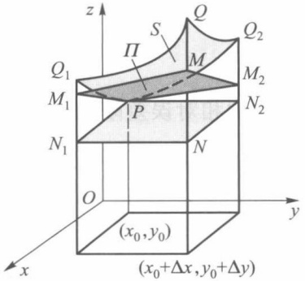

text_image

z
Q
S
Π
M
Q₁
M₁
P
N₁
N
O
x
y
(x₀,y₀)
(x₀+Δx,y₀+Δy)

图17-4

解 因为

$$
f _ {x} (x _ {0}, y _ {0}) = 2 a x _ {0}, \quad f _ {y} (x _ {0}, y _ {0}) = 2 b y _ {0},
$$

由公式(13)，过 M 的切平面方程为

$$
z - z _ {0} = 2 a x _ {0} (x - x _ {0}) + 2 b y _ {0} (y - y _ {0}).
$$

因为 $z_0 = ax_0^2 + by_0^2$，所以它可简化为

$$
2 a x _ {0} x + 2 b y _ {0} y - z - z _ {0} = 0.
$$

由公式(14)，过点 M 的法线方程是

$$
\frac {x - x _ {0}}{2 a x _ {0}} = \frac {y - y _ {0}}{2 b y _ {0}} = \frac {z - z _ {0}}{- 1}.
$$

下面的例 7 和例 8 是利用线性近似公式(3)所作的近似计算和误差估计.

例 7 求  $1.08^{3.96}$  的近似值.

解 设 $f(x, y) = x^y$，令 $x_0 = 1, y_0 = 4, \Delta x = 0.08, \Delta y = -0.04$. 由公式(3)有

$$
\begin{array}{l} 1. 0 8 ^ {3. 9 6} = f (x _ {0} + \Delta x, y _ {0} + \Delta y) \\ \approx f (1, 4) + f _ {x} (1, 4) \Delta x + f _ {y} (1, 4) \Delta y \\ \end{array}
$$

$$
\begin{array}{l} = 1 + 4 \times 0. 0 8 + 1 ^ {4} \times \ln 1 \times (- 0. 0 4) \\ = 1 + 0. 3 2 = 1. 3 2. \\ \end{array}
$$

□

例8 应用公式 $S = \frac{1}{2} ab\sin C$ 计算某三角形面积, 现测得 $a = 12.50, b = 8.30, C = 30^\circ$. 若测量 $a, b$ 的误差为 $\pm 0.01, C$ 的误差为 $\pm 0.1^\circ$, 求用此公式计算三角形面积时的绝对误差限与相对误差限.

解 依题意,测量中 a,b,C 的绝对误差限分别为

$$
\mid \Delta a \mid = 0. 0 1, \quad \mid \Delta b \mid = 0. 0 1, \quad \mid \Delta C \mid = 0. 1 ^ {\circ} = \frac {\pi}{1 8 0 0}.
$$

由于

$$
\begin{array}{l} \mid \Delta S \mid \approx \mid \mathrm{d} S \mid = \left| \frac {\partial S}{\partial a} \Delta a + \frac {\partial S}{\partial b} \Delta b + \frac {\partial S}{\partial C} \Delta C \right| \\ \leqslant \left| \frac {\partial S}{\partial a} \right| | \Delta a | + \left| \frac {\partial S}{\partial b} \right| | \Delta b | + \left| \frac {\partial S}{\partial C} \right| | \Delta C | \\ = \frac {1}{2} | b \sin C | | \Delta a | + \frac {1}{2} | a \sin C | | \Delta b | + \frac {1}{2} | a b \cos C | | \Delta C |, \\ \end{array}
$$

将各数据代入上式,得到 S 的绝对误差限为

$$
\mid \Delta S \mid \approx 0. 1 3.
$$

因为

$$
S = \frac {1}{2} a b \sin C = \frac {1}{2} \times 1 2. 5 0 \times 8. 3 0 \times \frac {1}{2} \approx 2 5. 9 4,
$$

所以 $S$ 的相对误差限为

$$
\left|\frac{\Delta S}{S}\right| \approx \frac{0.13}{25.94} \approx 0.5\%.
$$

## 习题 17.1

1. 求下列函数的偏导数:

(1) $z = x^{2}y$;

(2) $z = y\cos x$;

(3)  $z=\frac{1}{\sqrt{x^{2}+y^{2}}}$ ;

(4) $z = \ln (x + y^2)$;

(5)  $z = e^{xy}$ ;

(6)  $z = \arctan \frac{y}{x}$ ;

(7)  $z = xy \mathrm{e}^{\sin(xy)}$ ;

(8)  $u=\frac{y}{x}+\frac{z}{y}-\frac{x}{z};$

(9) $u = (xy)^{z}$;

(10) $u = x^{y^z}$.

2. 设 $f(x, y) = x + (y - 1) \arcsin \sqrt{\frac{x}{y}}$，求 $f_x(x, 1)$.

3. 设  $f(x,y)=\left\{\begin{aligned} y\sin\frac{1}{x^{2}+y^{2}}, & x^{2}+y^{2}\neq0, \\ 0, & x^{2}+y^{2}=0,\end{aligned}\right.$  考察函数 f 在原点  $(0,0)$  的偏导数.

4. 证明函数 $z = \sqrt{x^2 + y^2}$ 在点(0,0)连续但偏导数不存在.

5. 考察函数 $f(x, y) = \begin{cases} xy \sin \frac{1}{x^2 + y^2}, & x^2 + y^2 \neq 0, \\ 0, & x^2 + y^2 = 0 \end{cases}$ 在点(0,0)的可微性.

6. 证明函数 $f(x, y) = \begin{cases} \frac{x^2y}{x^2 + y^2}, & x^2 + y^2 \neq 0, \\ 0, & x^2 + y^2 = 0 \end{cases}$ 在点(0,0)连续且偏导数存在，但在此点不可微.

7. 证明函数 $f(x, y) = \begin{cases} (x^2 + y^2) \sin \frac{1}{\sqrt{x^2 + y^2}}, & x^2 + y^2 \neq 0, \\ 0, & x^2 + y^2 = 0 \end{cases}$ 在点(0,0)连续且偏导数存在，但偏导数在点(0,0)不连续，而 $f$ 在点(0,0)可微.

8. 求下列函数在给定点的全微分:

(1) $z = x^4 + y^4 - 4x^2y^2$ 在点 $(0,0)$, (1,1); (2) $z = \frac{x}{\sqrt{x^2 + y^2}}$ 在点 $(1,0)$, (0,1).

9. 求下列函数的全微分:

(1)  $z = y \sin(x + y)$ ; (2)  $u = x e^{yz} + e^{-z} + y.$

10. 求曲面 $z = \arctan \frac{y}{x}$ 在点 $\left(1, 1, \frac{\pi}{4}\right)$ 的切平面方程和法线方程.

11. 求曲面 $3x^{2} + y^{2} - z^{2} = 27$ 在点 $(3,1,1)$ 的切平面与法线方程.

12. 在曲面 $z = xy$ 上求一点，使这点的切平面平行于平面 $x + 3y + z + 9 = 0$ ，并写出此切平面方程和法线方程.

13. 计算近似值:

(1)  $1.002 \times 2.003^{2} \times 3.004^{3}$ ; (2)  $\sin 29^{\circ} \times \tan 46^{\circ}$ .

14. 设圆台上、下底的半径分别为 $R = 30 \mathrm{~cm}, r = 20 \mathrm{~cm}$, 高 $h = 40 \mathrm{~cm}$. 若 $R, r, h$ 分别增加 $3 \mathrm{~mm}, 4 \mathrm{~mm}, 2 \mathrm{~mm}$, 求此圆台体积变化的近似值.

15. 证明: 若二元函数 f 在点  $P(x_{0}, y_{0})$  的某邻域  $U(P)$  上的偏导函数  $f_{x}$  与  $f_{y}$  有界, 则 f 在  $U(P)$  上连续.

16. 设二元函数 f 在区域  $D = [a, b] \times [c, d]$  上连续.

(1) 若在 int D 内有  $f_{x} \equiv 0$ ，试问 f 在 D 上有何特性？
(2) 若在 int D 内有  $f_{x}=f_{y}\equiv0$ , f 又怎样?
(3) 在(1)的讨论中,关于f在D上的连续性假设可否省略?长方形区域可否改为任意区域?

17. 试证在原点 $(0,0)$ 的充分小邻域内,有

$$
\arctan \frac {x + y}{1 + x y} \approx x + y.
$$

18. 求曲面 $z = \frac{x^2 + y^2}{4}$ 与平面 $y = 4$ 的交线在 $x = 2$ 处的切线与 $Ox$ 轴的交角.

19. 试证:(1)乘积的相对误差限近似于各因子相对误差限之和;

(2) 商的相对误差限近似于分子和分母相对误差限之和.

20. 测得一物体的体积  $V=4.45\ cm^{3}$ ，其绝对误差限为  $0.01\ cm^{3}$ ；又测得质量 m=30.80 g，其绝对误差限为 0.01 g。求由公式  $\rho=\frac{m}{V}$  算出的密度  $\rho$  的相对误差限和绝对误差限。

## § 2 复合函数微分法

本节讨论复合函数的可微性、偏导数与全微分.

## 一、复合函数的求导法则

设函数

$$
x = \varphi (s, t) \quad \text {与} \quad y = \psi (s, t) \tag {1}
$$

定义在 $st$ 平面的区域 $D$ 上，函数

$$
z = f (x, y) \tag {2}
$$

定义在 $xy$ 平面的区域 $D_{1}$ 上，且

$$
\{(x, y) \mid x = \varphi (s, t), y = \psi (s, t), (s, t) \in D \} \subset D _ {1},
$$

则函数

$$
z = F (s, t) = f (\varphi (s, t), \psi (s, t)), \quad (s, t) \in D \tag {3}
$$

是以(2)为外函数、(1)为内函数的复合函数. 其中 x, y 称为函数 F 的中间变量, s, t 为 F 的自变量.

定理17.5 若函数 $x = \varphi(s, t), y = \psi(s, t)$ 在点 $(s, t) \in D$ 可微，$z = f(x, y)$ 在点 $(x, y) = (\varphi(s, t), \psi(s, t))$ 可微，则复合函数

$$
z = f (\varphi (s, t), \psi (s, t))
$$

在点 $(s,t)$ 可微，且它关于 $s$ 与 $t$ 的偏导数分别为

$$
\left. \frac {\partial z}{\partial s} \right| _ {(s, t)} = \left. \frac {\partial z}{\partial x} \right| _ {(x, y)} \left. \frac {\partial x}{\partial s} \right| _ {(s, t)} + \left. \frac {\partial z}{\partial y} \right| _ {(x, y)} \left. \frac {\partial y}{\partial s} \right| _ {(s, t)}, \tag {4}
$$

$$
\left. \frac {\partial z}{\partial t} \right| _ {(s, t)} = \left. \frac {\partial z}{\partial x} \right| _ {(x, y)} \frac {\partial x}{\partial t} \Bigg | _ {(s, t)} + \left. \frac {\partial z}{\partial y} \right| _ {(x, y)} \frac {\partial y}{\partial t} \Bigg | _ {(s, t)}.
$$

证 由假设 $x = \varphi (s,t),y = \psi (s,t)$ 在点 $(s,t)$ 可微，于是

$$
\Delta x = \frac {\partial x}{\partial s} \Delta s + \frac {\partial x}{\partial t} \Delta t + \alpha_ {1} \Delta s + \beta_ {1} \Delta t, \tag {5}
$$

$$
\Delta y = \frac {\partial y}{\partial s} \Delta s + \frac {\partial y}{\partial t} \Delta t + \alpha_ {2} \Delta s + \beta_ {2} \Delta t, \tag {6}
$$

其中当  $\Delta s, \Delta t$  趋于零时， $\alpha_{1}, \alpha_{2}, \beta_{1}, \beta_{2}$  都趋于零。又由  $z = f(x, y)$  在点  $(x, y)$  可微，所以

$$
\Delta z = \frac {\partial z}{\partial x} \Delta x + \frac {\partial z}{\partial y} \Delta y + \alpha \Delta x + \beta \Delta y, \tag {7}
$$

其中当  $\Delta x, \Delta y \rightarrow 0$  时， $\alpha, \beta \rightarrow 0$  （并补充定义当  $\Delta x = 0, \Delta y = 0$  时  $\alpha = \beta = 0$ ），将（5）式、（6）式代入（7）式，得

$$
\Delta z = \left(\frac {\partial z}{\partial x} + \alpha\right) \left(\frac {\partial x}{\partial s} \Delta s + \frac {\partial x}{\partial t} \Delta t + \alpha_ {1} \Delta s + \beta_ {1} \Delta t\right) + \left(\frac {\partial z}{\partial y} + \beta\right) \left(\frac {\partial y}{\partial s} \Delta s + \frac {\partial y}{\partial t} \Delta t + \alpha_ {2} \Delta s + \beta_ {2} \Delta t\right).
$$

整理后

$$
\Delta z = \left(\frac {\partial z}{\partial x} \frac {\partial x}{\partial s} + \frac {\partial z}{\partial y} \frac {\partial y}{\partial s}\right) \Delta s + \left(\frac {\partial z}{\partial x} \frac {\partial x}{\partial t} + \frac {\partial z}{\partial y} \frac {\partial y}{\partial t}\right) \Delta t + \bar {\alpha} \Delta s + \bar {\beta} \Delta t, \tag {8}
$$

其中

$$
\bar {\alpha} = \frac {\partial z}{\partial x} \alpha_ {1} + \frac {\partial z}{\partial y} \alpha_ {2} + \frac {\partial x}{\partial s} \alpha + \frac {\partial y}{\partial s} \beta + \alpha \alpha_ {1} + \beta \alpha_ {2}, \tag {9}
$$

$$
\bar {\beta} = \frac {\partial z}{\partial x} \beta_ {1} + \frac {\partial z}{\partial y} \beta_ {2} + \frac {\partial x}{\partial t} \alpha + \frac {\partial y}{\partial t} \beta + \alpha \beta_ {1} + \beta \beta_ {2}. \tag {10}
$$

由于 $\varphi(s, t), \psi(s, t)$ 在点 $(s, t)$ 可微，因此它们在点 $(s, t)$ 都连续，即当 $\Delta s, \Delta t \to 0$ 时，有 $\Delta x, \Delta y \to 0$. 从而也有 $\alpha \to 0, \beta \to 0$ 以及 $\alpha_1, \alpha_2, \beta_1, \beta_2 \to 0$. 于是在 (9) 式、(10) 式中，当 $\Delta s, \Delta t \to 0$ 时，有 $\bar{\alpha} \to 0, \bar{\beta} \to 0$. 故由 (8) 式推得复合函数 (3) 可微并求得 $z$ 关于 $s$ 和 $t$ 的偏导数 (4).

这里公式(4)也称为链式法则.

注 如果只是求复合函数 $f(\varphi (s,t),\psi (s,t))$ 关于 $s$ 或 $t$ 的偏导数，则定理17.5中$x = \varphi (s,t)$ 和 $y = \psi (s,t)$ 只需具有关于 $s$ 或 $t$ 的偏导数就够了.因为以 $\Delta s$ 或 $\Delta t$ 除(7)式两边，然后让 $\Delta s\to 0$ 或 $\Delta t\rightarrow 0$ ，也能得到相应的结果.但是对外函数 $f$ 的可微性假设是不能省略的，否则上述复合函数求导公式不一定成立.如函数

$$
f (x, y) = \left\{ \begin{array}{l l} \frac {x ^ {2} y}{x ^ {2} + y ^ {2}}, & x ^ {2} + y ^ {2} \neq 0, \\ 0, & x ^ {2} + y ^ {2} = 0. \end{array} \right.
$$

由 §1 习题6 知 $f_{x}(0,0) = f_{y}(0,0) = 0$，但 $f(x,y)$ 在 (0,0) 处不可微。若以 $f(x,y)$ 为外函数，$x = t, y = t$ 为内函数，则得以 $t$ 为自变量的复合函数

$$
z = F (t) = f (t, t) = \frac {t}{2},
$$

所以 $\frac{dz}{dt}=\frac{1}{2}$ .这时若用链式法则,将得出错误结果

$$
\begin{array}{l} \left. \frac {\mathrm{d} z}{\mathrm{d} t} \right| _ {t = 0} = \frac {\partial z}{\partial x} \left| _ {(0, 0)} \frac {\mathrm{d} x}{\mathrm{d} t} \right| _ {t = 0} + \left. \frac {\partial z}{\partial y} \right| _ {(0, 0)} \frac {\mathrm{d} y}{\mathrm{d} t} \Bigg | _ {t = 0} \\ = 0 \cdot 1 + 0 \cdot 1 = 0. \\ \end{array}
$$

这个例子说明在使用复合函数求导公式时,必须注意外函数f可微这一重要条件.

一般地，若 $f(u_{1},\cdots,u_{m})$ 在点 $(u_{1},\cdots,u_{m})$ 可微， $u_{k}=g_{k}(x_{1},\cdots,x_{n})(k=1,2,\cdots,m)$ ，在点 $(x_{1},\cdots,x_{n})$ 具有关于 $x_{i}(i=1,2,\cdots,n)$ 的偏导数，则复合函数

$$
f (g _ {1} (x _ {1}, \dots , x _ {n}), g _ {2} (x _ {1}, \dots , x _ {n}), \dots , g _ {m} (x _ {1}, \dots , x _ {n}))
$$

关于自变量 $x_{i}$ 的偏导数是

$$
\frac {\partial f}{\partial x _ {i}} = \sum_ {k = 1} ^ {m} \frac {\partial f}{\partial u _ {k}} \frac {\partial u _ {k}}{\partial x _ {i}} \quad (i = 1, 2, \dots , n).
$$

多元函数的复合函数求导一般比较复杂,读者必须特别注意复合函数中哪些是自变量,哪些是中间变量.只有这样才能正确使用链式法则(4)求出结果.

为了便于记忆链式法则,可以按照各变量间的复合关系,画成图 17-5 那样的树状图. 首先从因变量 $z$ 向中间变量 $x, y$ 画两个分枝, 然后再分别从中间变量 $x, y$ 向自变量 $s, t$ 画分枝, 并在每个分枝旁写上对应的偏导数. 求 $\frac{\partial z}{\partial s}$ 时, 只要把从 $z$ 到 $s$ 的每条路径上的各个偏导数相乘, 然后再将这些乘积相加即得:

$$
\frac {\partial z}{\partial s} = \frac {\partial z}{\partial x} \frac {\partial x}{\partial s} + \frac {\partial z}{\partial y} \frac {\partial y}{\partial s}.
$$

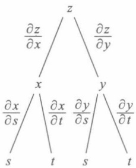

flowchart

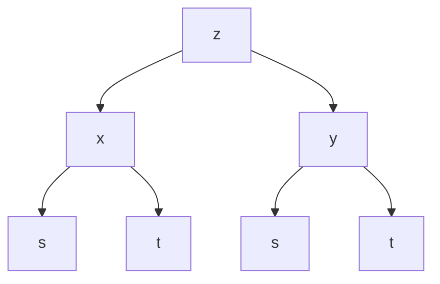

图17-5

类似地考察从 z 到 t 的路径, 可写出  $\frac{\partial z}{\partial t}$ .

例 1 设  $z=\ln(u^{2}+v)$ ，而  $u=e^{x+y^{2}}$ ,  $v=x^{2}+y$ ，求

$$
\frac {\partial z}{\partial x}, \frac {\partial z}{\partial y}.
$$

解 所讨论的复合函数以 $x, y$ 为自变量, $u, v$ 为中间变量. 由于

$$
\frac {\partial z}{\partial u} = \frac {2 u}{u ^ {2} + v}, \frac {\partial z}{\partial v} = \frac {1}{u ^ {2} + v},
$$

$$
\frac {\partial u}{\partial x} = \mathrm{e} ^ {x + y ^ {2}}, \frac {\partial u}{\partial y} = 2 y \mathrm{e} ^ {x + y ^ {2}}, \frac {\partial v}{\partial x} = 2 x, \frac {\partial v}{\partial y} = 1,
$$

根据公式(4)得到

$$
\begin{array}{l} \frac {\partial z}{\partial x} = \frac {\partial z}{\partial u} \frac {\partial u}{\partial x} + \frac {\partial z}{\partial v} \frac {\partial v}{\partial x} \\ = \frac {2 u}{u ^ {2} + v} \mathrm{e} ^ {x + y ^ {2}} + \frac {1}{u ^ {2} + v} 2 x = \frac {2}{u ^ {2} + v} (u \mathrm{e} ^ {x + y ^ {2}} + x), \\ \frac {\partial z}{\partial y} = \frac {\partial z}{\partial u} \frac {\partial u}{\partial y} + \frac {\partial z}{\partial v} \frac {\partial v}{\partial y} \\ = \frac {2 u}{u ^ {2} + v} 2 y \mathrm{e} ^ {x + y ^ {2}} + \frac {1}{u ^ {2} + v} = \frac {1}{u ^ {2} + v} (4 u y \mathrm{e} ^ {x + y ^ {2}} + 1). \\ \end{array}
$$

例 2 设  $u = u(x, y)$  可微，在极坐标变换  $x = r \cos \theta, y = r \sin \theta$  下，证明:

$$
\left(\frac {\partial u}{\partial r}\right) ^ {2} + \frac {1}{r ^ {2}} \left(\frac {\partial u}{\partial \theta}\right) ^ {2} = \left(\frac {\partial u}{\partial x}\right) ^ {2} + \left(\frac {\partial u}{\partial y}\right) ^ {2}.
$$

证 $u$ 可以看作 $r, \theta$ 的复合函数 $u = u(r\cos \theta, r\sin \theta)$, 因此

$$
\frac {\partial u}{\partial r} = \frac {\partial u}{\partial x} \frac {\partial x}{\partial r} + \frac {\partial u}{\partial y} \frac {\partial y}{\partial r} = \frac {\partial u}{\partial x} \cos \theta + \frac {\partial u}{\partial y} \sin \theta ,
$$

$$
\frac {\partial u}{\partial \theta} = \frac {\partial u}{\partial x} \frac {\partial x}{\partial \theta} + \frac {\partial u}{\partial y} \frac {\partial y}{\partial \theta} = \frac {\partial u}{\partial x} (- r \sin \theta) + \frac {\partial u}{\partial y} r \cos \theta .
$$

于是

$$
\begin{array}{l} \left(\frac {\partial u}{\partial r}\right) ^ {2} + \frac {1}{r ^ {2}} \left(\frac {\partial u}{\partial \theta}\right) ^ {2} \\ = \left(\frac {\partial u}{\partial x} \cos \theta + \frac {\partial u}{\partial y} \sin \theta\right) ^ {2} + \frac {1}{r ^ {2}} \left(- \frac {\partial u}{\partial x} r \sin \theta + \frac {\partial u}{\partial y} r \cos \theta\right) ^ {2} \\ = \left(\frac {\partial u}{\partial x}\right) ^ {2} + \left(\frac {\partial u}{\partial y}\right) ^ {2}. \\ \end{array}
$$

例3 设 $z = uv + \sin t$，其中 $u = \mathrm{e}^t, v = \cos t$，求 $\frac{\mathrm{d}z}{\mathrm{d}t}$.

解 根据复合关系,画出树状图 17-6. 于是

$$
\begin{array}{l} \frac {\mathrm{d} z}{\mathrm{d} t} = \frac {\partial z}{\partial u} \frac {\mathrm{d} u}{\mathrm{d} t} + \frac {\partial z}{\partial v} \frac {\mathrm{d} v}{\mathrm{d} t} + \frac {\partial z}{\partial t} \\ = v \mathrm{e} ^ {t} + u (- \sin t) + \cos t \\ = \mathrm{e} ^ {t} (\cos t - \sin t) + \cos t. \\ \end{array}
$$

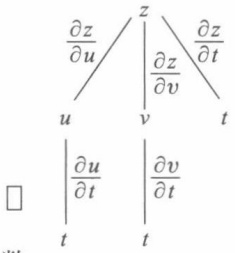

text_image

∂z/∂u
| ∂z/∂v
∂z/∂t
u
v
t
∂u/∂t
∂v/∂t
□
t
t

图17-6

注 上面第一个等式中, 左边的  $\frac{dz}{dt}$  是作为一元函数的复合函数对 t 求导数, 右边最后一项里的  $\frac{\partial z}{\partial t}$  是外函数 (作为 u, v, t 的三元函数) 对 t 求偏导数, 二者所用符号各自有别.

例 4 用多元复合微分法计算下列一元函数的导数:

(1) $y = x^{x}$;

(2) $y = \frac{(1 + x^2)\ln x}{\sin x + \cos x}$.

解（1）令 $y = u^{v}, u = x, v = x$，则有

$$
\begin{array}{l} \frac {\mathrm{d} y}{\mathrm{d} x} = y _ {u} \cdot \frac {\mathrm{d} u}{\mathrm{d} x} + y _ {v} \cdot \frac {\mathrm{d} v}{\mathrm{d} x} = v u ^ {v - 1} + u ^ {v} \ln u \\ = x \cdot x ^ {x - 1} + x ^ {x} \ln x = x ^ {x} (1 + \ln x). \\ \end{array}
$$

(2) 令  $y=\frac{vw}{u}, u=\sin x+\cos x, v=1+x^{2}, w=\ln x$ ，则有

$$
\begin{array}{l} \frac {\mathrm{d} y}{\mathrm{d} x} = \frac {\partial y}{\partial u} \frac {\mathrm{d} u}{\mathrm{d} x} + \frac {\partial y}{\partial v} \frac {\mathrm{d} v}{\mathrm{d} x} + \frac {\partial y}{\partial w} \frac {\mathrm{d} w}{\mathrm{d} x} \\ = \frac {- v w}{u ^ {2}} (\cos x - \sin x) + \frac {w}{u} \cdot 2 x + \frac {v}{u} \frac {1}{x} \\ = \frac {1}{(\sin x + \cos x) ^ {2}} \left[ (\sin x + \cos x) \left(2 x \ln x + \frac {1 + x ^ {2}}{x}\right) - \right. \\ \end{array}
$$

$$
(\cos x - \sin x) (1 + x ^ {2}) \ln x ].
$$

由此可见,以前用“对数求导法”求一元函数的导数问题,如今也可用多元复合函数链式法则来计算.

例5 设 $u = f(x, y, z), y = \varphi(x, t), t = \psi(x, z)$ 都有一阶连续偏导数，求 $\frac{\partial u}{\partial x}, \frac{\partial u}{\partial z}$.

解 代入中间变量,得到复合函数  $u=f(x,\varphi(x,\psi(x,z)),z)$  为 x,z 的函数,参见图17-7得到

$$
\frac {\partial u}{\partial x} = \frac {\partial f}{\partial x} + \frac {\partial f}{\partial y} \frac {\partial \varphi}{\partial x} + \frac {\partial f}{\partial y} \frac {\partial \varphi}{\partial t} \frac {\partial \psi}{\partial x};
$$

$$
\frac {\partial u}{\partial z} = \frac {\partial f}{\partial y} \frac {\partial \varphi}{\partial t} \frac {\partial \psi}{\partial z} + \frac {\partial f}{\partial z}.
$$

注意,这里用 $\frac{\partial u}{\partial x}$ 表示复合函数 $u=f(x,\varphi(x,\psi(x,z)),z)$ 对x的偏导数,而用 $\frac{\partial f}{\partial x}$ 表示函数 $u=f(x,y,z)$ 对第一个变量x的偏导数,以区别两者的不同.

例6 设 $f(x, y)$ 在 $\mathbf{R}^2$ 上可微，且满足方程:$y f_x(x, y) = x f_y(x, y)$. 证明:在极坐标中 $f$ 只是 $r$ 的函数，即 $\frac{\partial f}{\partial \theta} = 0$.

证 设 $u = f(x, y), x = r\cos \theta, y = r\sin \theta$，则有

$$
\begin{array}{l} \frac {\partial u}{\partial \theta} = \frac {\partial f}{\partial x} \cdot \frac {\partial x}{\partial \theta} + \frac {\partial f}{\partial y} \cdot \frac {\partial y}{\partial \theta} = \frac {\partial f}{\partial x} \cdot (- r \sin \theta) + \frac {\partial f}{\partial y} \cdot (r \cos \theta) \\ = - y \cdot \frac {\partial f}{\partial x} + x \cdot \frac {\partial f}{\partial y} = 0. \\ \end{array}
$$

## 二、复合函数的全微分

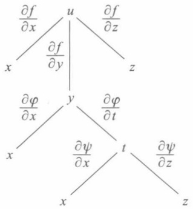

flowchart

图17-7

若以 x 和 y 为自变量的函数  $z=f(x,y)$  可微，则其全微分为

$$
\mathrm{d} z = \frac {\partial z}{\partial x} \mathrm{d} x + \frac {\partial z}{\partial y} \mathrm{d} y. \tag {11}
$$

如果 $x, y$ 作为中间变量又是自变量 $s, t$ 的可微函数

$$
x = \varphi (s, t), \quad y = \psi (s, t),
$$

则由定理 17.5 知道, 复合函数  $z=f(\varphi(s,t),\psi(s,t))$  是可微的, 其全微分为

$$
\begin{array}{l} \mathrm{d} z = \frac {\partial z}{\partial s} \mathrm{d} s + \frac {\partial z}{\partial t} \mathrm{d} t \\ = \left(\frac {\partial z}{\partial x} \frac {\partial x}{\partial s} + \frac {\partial z}{\partial y} \frac {\partial y}{\partial s}\right) \mathrm{d} s + \left(\frac {\partial z}{\partial x} \frac {\partial x}{\partial t} + \frac {\partial z}{\partial y} \frac {\partial y}{\partial t}\right) \mathrm{d} t \\ = \frac {\partial z}{\partial x} \left(\frac {\partial x}{\partial s} \mathrm{d} s + \frac {\partial x}{\partial t} \mathrm{d} t\right) + \frac {\partial z}{\partial y} \left(\frac {\partial y}{\partial s} \mathrm{d} s + \frac {\partial y}{\partial t} \mathrm{d} t\right). \tag {12} \\ \end{array}
$$

由于 x, y 又是  $(s, t)$  的可微函数, 因此同时有

$$
\mathrm{d} x = \frac {\partial x}{\partial s} \mathrm{d} s + \frac {\partial x}{\partial t} \mathrm{d} t, \quad \mathrm{d} y = \frac {\partial y}{\partial s} \mathrm{d} s + \frac {\partial y}{\partial t} \mathrm{d} t. \tag {13}
$$

将(13)式代入(12)式,得到与(11)式完全相同的结果.这就是关于多元函数的一阶(全)微分形式不变性.

必须指出,在(11)式中当x,y作为自变量时,dx和dy各自独立取值;当x,y作为中间变量时,dx和dy如(13)式所示,它们的值由s,t,ds,dt所确定.

利用微分形式不变性,能更有条理地计算复杂函数的全微分.

例 7 设  $z = \mathrm{e}^{xy} \sin(x + y)$ ，利用微分形式不变性求 dz，并由此导出  $\frac{\partial z}{\partial x}$  与  $\frac{\partial z}{\partial y}$ .

解 令 $z = \mathrm{e}^{u}\sin v, u = xy, v = x + y$. 由于

$$
\begin{array}{l} \mathrm{d} z = z _ {u} \mathrm{d} u + z _ {v} \mathrm{d} v = \mathrm{e} ^ {u} \sin v \mathrm{d} u + \mathrm{e} ^ {u} \cos v \mathrm{d} v, \\ \mathrm{d} u = y \mathrm{d} x + x \mathrm{d} y, \\ \mathrm{d} v = \mathrm{d} x + \mathrm{d} y, \\ \end{array}
$$

因此

$$
\begin{array}{l} \mathrm{d} z = \mathrm{e} ^ {u} \sin v (y \mathrm{d} x + x \mathrm{d} y) + \mathrm{e} ^ {u} \cos v (\mathrm{d} x + \mathrm{d} y) \\ = \mathrm{e} ^ {x y} \left[ y \sin (x + y) + \cos (x + y) \right] \mathrm{d} x + \\ \mathrm{e} ^ {x y} \left[ x \sin (x + y) + \cos (x + y) \right] \mathrm{d} y, \\ \end{array}
$$

并由此得到

$$
z _ {x} = \mathrm{e} ^ {x y} \left[ y \sin (x + y) + \cos (x + y) \right],
$$

$$
z _ {y} = \mathrm{e} ^ {x y} \left[ x \sin (x + y) + \cos (x + y) \right].
$$

## 习题 17.2

1. 求下列复合函数的偏导数或导数:

(1) 设  $z = \arctan(xy)$ ,  $y = e^{x}$ , 求  $\frac{dz}{dx}$ ;
(2) 设  $z=\frac{x^{2}+y^{2}}{xy}\mathrm{e}^{\frac{x^{2}+y^{2}}{xy}}$ ，求  $\frac{\partial z}{\partial x},\frac{\partial z}{\partial y}$ ;
(3) 设  $z = x^{2} + xy + y^{2}$ ,  $x = t^{2}$ , y = t, 求  $\frac{dz}{dt}$ ;
(4) 设  $z = x^{2} \ln y, x = \frac{u}{v}, y = 3u - 2v$ ，求  $\frac{\partial z}{\partial u}, \frac{\partial z}{\partial v}$ ;
(5) 设  $u = f(x + y, xy)$ ，求  $\frac{\partial u}{\partial x}, \frac{\partial u}{\partial y}$ ;
(6) 设  $u=f\left(\frac{x}{y},\frac{y}{z}\right)$ ，求  $\frac{\partial u}{\partial x},\frac{\partial u}{\partial y},\frac{\partial u}{\partial z}$ .

2. 设 $z = (x + y)^{xy}$, 求 $\mathrm{dz}$.

3. 设 $z = \frac{y}{f(x^2 - y^2)}$，其中 $f$ 为可微函数，验证

$$
\frac {1}{x} \frac {\partial z}{\partial x} + \frac {1}{y} \frac {\partial z}{\partial y} = \frac {z}{y ^ {2}}.
$$

4. 设 $z = \sin y + f(\sin x - \sin y)$，其中 $f$ 为可微函数，证明

$$
\frac {\partial z}{\partial x} \sec x + \frac {\partial z}{\partial y} \sec y = 1.
$$

5. 设  $f(x,y)$  可微, 证明: 在坐标旋转变换

$$
x = u \cos \theta - v \sin \theta , \quad y = u \sin \theta + v \cos \theta
$$

之下， $(f_{x})^{2}+(f_{y})^{2}$ 是一个形式不变量. 即若

$$
g (u, v) = f (u \cos \theta - v \sin \theta , u \sin \theta + v \cos \theta),
$$

则必有 $(f_{x})^{2}+(f_{y})^{2}=(g_{u})^{2}+(g_{v})^{2}$ （其中旋转角 $\theta$ 是常数）.

6. 设 $f(u)$ 是可微函数, $F(x,t) = f(x + 2t) + f(3x - 2t)$. 试求:

$$
F _ {x} (0, 0) \text {与} F _ {t} (0, 0).
$$

7. 若函数 $u = F(x, y, z)$ 满足恒等式 $F(tx, ty, tz) = t^k F(x, y, z)$ ($t > 0$)，则称 $F(x, y, z)$ 为 $k$ 次齐次函数。试证下述关于齐次函数的欧拉定理:可微函数 $F(x, y, z)$ 为 $k$ 次齐次函数的充要条件是

$$
x F _ {x} (x, y, z) + y F _ {y} (x, y, z) + z F _ {z} (x, y, z) = k F (x, y, z).
$$

并证明: $z=\frac{xy^{2}}{\sqrt{x^{2}+y^{2}}} -xy$  为2次齐次函数.

8. 设 $f(x, y, z)$ 具有性质 $f(tx, t^k y, t^m z) = t^n f(x, y, z) \quad (t > 0)$，证明:

(1)  $f(x, y, z) = x^{n} f \left( 1, \frac{y}{x^{k}}, \frac{z}{x^{m}} \right)$ ;

(2)  $xf_{x}(x,y,z)+kyf_{y}(x,y,z)+mzf_{z}(x,y,z)=nf(x,y,z)$ .

9. 设由行列式表示的函数

$$
D (t) = \left| \begin{array}{c c c} a _ {1 1} (t) & \dots & a _ {1 n} (t) \\ \vdots & & \vdots \\ a _ {n 1} (t) & \dots & a _ {n n} (t) \end{array} \right|,
$$

其中  $a_{ij}(t)$  ( $i,j=1,2,\cdots,n$ ) 的导数都存在,证明

$$
\frac {\mathrm{d} D (t)}{\mathrm{d} t} = \sum_ {k = 1} ^ {n} \left| \begin{array}{c c c} a _ {1 1} (t) & \dots & a _ {1 n} (t) \\ \vdots & & \vdots \\ a _ {k 1} ^ {\prime} (t) & \dots & a _ {k n} ^ {\prime} (t) \\ \vdots & & \vdots \\ a _ {n 1} (t) & \dots & a _ {n n} (t) \end{array} \right|.
$$

## § 3 方向导数与梯度

在许多问题中,不仅要知道函数在坐标轴方向上的变化率(即偏导数),而且还要设法求得函数在其他特定方向上的变化率.这就是本节所要讨论的方向导数.

定义1 设三元函数 $f$ 在点 $P_0(x_0, y_0, z_0)$ 的某邻域 $U(P_0) \subset \mathbf{R}^3$ 有定义，$l$ 为从点 $P_0$ 出发的射线，$P(x, y, z)$ 为 $l$ 上且含于 $U(P_0)$ 内的任一点，以 $\rho$ 表示 $P$ 与 $P_0$ 两点间的距离。若极限

$$
\lim _ {\rho \to 0 ^ {+}} \frac {f (P) - f (P _ {0})}{\rho} = \lim _ {\rho \to 0 ^ {+}} \frac {\Delta_ {l} f}{\rho}
$$

存在,则称此极限为函数f在点 $P_{0}$ 沿方向l的方向导数,记作

$$
\frac {\partial f}{\partial \boldsymbol {l}} \bigg | _ {P _ {0}}, f _ {l} (P _ {0}) \text {或} f _ {l} (x _ {0}, y _ {0}, z _ {0}).
$$

容易看到,若f在点 $P_{0}$ 存在关于x的偏导数,则f在点 $P_{0}$ 沿x轴正向的方向导数恰为

$$
\left. \frac {\partial f}{\partial \boldsymbol {l}} \right| _ {P _ {0}} = \left. \frac {\partial f}{\partial x} \right| _ {P _ {0}}.
$$

当 l 的方向为 x 轴的负方向时, 则有

$$
\frac {\partial f}{\partial \boldsymbol {l}} \bigg | _ {P _ {0}} = - \left. \frac {\partial f}{\partial x} \right| _ {P _ {0}}.
$$

沿任一方向的方向导数与偏导数的关系由下述定理给出.

定理17.6 若函数 $f$ 在点 $P_0(x_0, y_0, z_0)$ 可微，则 $f$ 在点 $P_0$ 沿任一方向 $l$ 的方向导数都存在，且

$$
f _ {l} (P _ {0}) = f _ {x} (P _ {0}) \cos \alpha + f _ {y} (P _ {0}) \cos \beta + f _ {z} (P _ {0}) \cos \gamma , \tag {1}
$$

其中  $\cos\alpha,\cos\beta,\cos\gamma$  为方向 l 的方向余弦.

证 设 $P(x,y,z)$ 为 $\pmb{l}$ 上任一点，于是（见图17-8）

$$
\left. \begin{array}{l} x - x _ {0} = \Delta x = \rho \cos \alpha , \\ y - y _ {0} = \Delta y = \rho \cos \beta , \\ z - z _ {0} = \Delta z = \rho \cos \gamma . \end{array} \right\} \tag {2}
$$

由假设f在点 $P_{0}$ 可微,则有

$$
\begin{array}{l} f (P) - f (P _ {0}) \\ = f _ {x} (P _ {0}) \Delta x + f _ {y} (P _ {0}) \Delta y + f _ {z} (P _ {0}) \Delta z + o (\rho). \\ \end{array}
$$

上式左、右两边皆除以  $\rho$ ，并根据(2)式可得

$$
\begin{array}{l} \frac {f (P) - f (P _ {0})}{\rho} = f _ {x} (P _ {0}) \frac {\Delta x}{\rho} + f _ {y} (P _ {0}) \frac {\Delta y}{\rho} + f _ {z} (P _ {0}) \frac {\Delta z}{\rho} + \frac {o (\rho)}{\rho} \\ = f _ {x} (P _ {0}) \cos \alpha + f _ {y} (P _ {0}) \cos \beta + f _ {z} (P _ {0}) \cos \gamma + \frac {o (\rho)}{\rho}. \\ \end{array}
$$

因为当 $\rho \to 0$ 时，上式右边末项 $\frac{o(\rho)}{\rho} \to 0$ ，于是左边极限存在且有

$$
\begin{array}{l} f _ {l} (P _ {0}) = \lim _ {\rho \to 0 ^ {+}} \frac {f (P) - f (P _ {0})}{\rho} \\ = f _ {x} (P _ {0}) \cos \alpha + f _ {y} (P _ {0}) \cos \beta + f _ {z} (P _ {0}) \cos \gamma . \\ \end{array}
$$

对于二元函数 $f(x,y)$ 来说,相应于(1)的结果是

$$
f _ {l} (P _ {0}) = f _ {x} (x _ {0}, y _ {0}) \cos \alpha + f _ {y} (x _ {0}, y _ {0}) \cos \beta ,
$$

其中  $\alpha,\beta$  是平面向量 l 的方向角.

例 1 设  $f(x,y,z)=x+y^{2}+z^{3}$ ，求 f 在点  $P_{0}(1,1,1)$  沿方向 l:(2,-2,1) 的方向导数.

解 易见 $f$ 在点 $P_0$ 可微. 故由 $f_x(P_0) = 1, f_y(P_0) = 2, f_z(P_0) = 3$ 及方向 $\pmb{l}$ 的方向余弦

$$
\begin{array}{l} \cos \alpha = \frac {2}{\sqrt {2 ^ {2} + (- 2) ^ {2} + 1 ^ {2}}} = \frac {2}{3}, \\ \cos \beta = \frac {- 2}{\sqrt {2 ^ {2} + (- 2) ^ {2} + 1 ^ {2}}} = - \frac {2}{3}, \\ \cos \gamma = \frac {1}{\sqrt {2 ^ {2} + (- 2) ^ {2} + 1 ^ {2}}} = \frac {1}{3}, \\ \end{array}
$$

可按公式(1)求得 $f$ 沿方向 $\pmb{l}$ 的方向导数为

$$
f _ {l} (P _ {0}) = 1 \cdot \frac {2}{3} + 2 \Big (- \frac {2}{3} \Big) + 3 \cdot \frac {1}{3} = \frac {1}{3}.
$$

例2 设

$$
f (x, y) = \left\{ \begin{array}{l l} 1, & \text {当} 0 <   y <   x ^ {2}, - \infty <   x <   + \infty \text {时}, \\ 0, & \text {其余部分}, \end{array} \right.
$$

如图 16-8 所示. 这个函数在原点不连续(当然也不可微), 但在始于原点的任何射线上, 都存在包含原点的充分小的一段, 在这一段上 f 的函数值恒为零. 于是由方向导数定义, 在原点处沿任何方向 l 都有

$$
\left. \frac {\partial f}{\partial l} \right| _ {(0, 0)} = 0.
$$

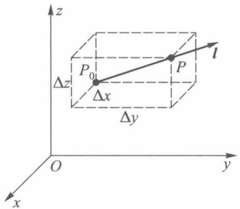

text_image

z
P₀
Δz
Δx
P
l
Δy
O
y
x

图17-8

这个例子说明:(i)函数在一点可微是方向导数存在的充分条件而不是必要条件.(ii)函数在一点连续同样不是方向导数存在的必要条件,当然也不是充分条件(对此,读者容易举出反例).

定义 2 若  $f(x,y,z)$  在点  $P_{0}(x_{0},y_{0},z_{0})$  存在对所有自变量的偏导数，则称向量  $(f_{x}(P_{0}),f_{y}(P_{0}),f_{z}(P_{0}))$  为函数 f 在点  $P_{0}$  的梯度，记作①

$$
\mathbf {g r a d} f = (f _ {x} (P _ {0}), f _ {y} (P _ {0}), f _ {z} (P _ {0})).
$$

向量 grad f 的长度(或模)为

$$
\left| \mathbf {g r a d} f \right| = \sqrt {f _ {x} (P _ {0}) ^ {2} + f _ {y} (P _ {0}) ^ {2} + f _ {z} (P _ {0}) ^ {2}}.
$$

在定理 17.6 的条件下, 若记 l 方向上的单位向量为

$$
l _ {0} = (\cos \alpha , \cos \beta , \cos \gamma).
$$

于是方向导数公式又可写成

$$
f _ {l} (P _ {0}) = \mathbf {g r a d} f (P _ {0}) \cdot \boldsymbol {l} _ {0} = | \mathbf {g r a d} f (P _ {0}) | \cos \theta ,
$$

这里  $\theta$  是梯度向量 grad  $f(P_{0})$  与  $l_{0}$  的夹角.

因此当  $\theta=0$  时， $f_{l}(P_{0})$  取得最大值  $\left|\mathbf{grad}f(P_{0})\right|$ . 这就是说，当 f 在点  $P_{0}$  可微时，f 在点  $P_{0}$  的梯度方向是 f 的值增长最快的方向，且沿这一方向的变化率就是梯度的模；而当 l 与梯度向量反方向  $(\theta=\pi)$  时，方向导数取得最小值  $-\left|\mathbf{grad}f(P_{0})\right|$ .

例 3 设  $f(x,y,z)=xy^{2}+yz^{3}$ ，求 f 在  $P_{0}(2,-1,1)$  的梯度及它的模.

解 由于 $f_{x}(P_{0}) = 1, f_{y}(P_{0}) = -3, f_{z}(P_{0}) = -3$，所以

$$
\text {grad} f (P _ {0}) = (1, - 3, - 3),
$$

$$
\mid \mathbf {g r a d} f (P _ {0}) \mid = \sqrt {1 ^ {2} + (- 3) ^ {2} + (- 3) ^ {2}} = \sqrt {1 9}.
$$

## 习题 17.3

1. 求函数 $u = xy^2 + z^3 - xyz$ 在点 (1, 1, 2) 沿方向 $l$ （其方向角分别为 $60^\circ, 45^\circ, 60^\circ$）的方向导数.
2. 求函数 u = xyz 在沿点 A(5,1,2) 到点 B(9,4,14) 的方向  $\overrightarrow{AB}$  上的方向导数.
3. 求函数 $u = x^{2} + 2y^{2} + 3z^{2} + xy - 4x + 2y - 4z$ 在 $A = (0,0,0)$ 及 $B = \left(5, -3, \frac{2}{3}\right)$ 的梯度以及它们的模.
4. 设函数 $u = \ln \left( \frac{1}{r} \right)$，其中 $r = \sqrt{(x - a)^2 + (y - b)^2 + (z - c)^2}$，求 $u$ 的梯度，并指出在空间哪些点上成立等式 $|\mathbf{grad} u| = 1$.
5. 设函数 $u = \frac{z^2}{c^2} - \frac{x^2}{a^2} - \frac{y^2}{b^2}$，求它在点 $(a, b, c)$ 的梯度.

6. 证明:

(1)  $\mathbf{grad}(u+c)=\mathbf{grad}u$  (c 为常数); (2)  $\mathbf{grad}(\alpha u+\beta v)=\alpha\mathbf{grad}u+\beta\mathbf{grad}v$  ( $\alpha,\beta$  为常数);
(3)  $\text{grad}(uv)=u\text{grad }v+v\text{grad }u;$ 

(4)  $\text{grad }f(u)=f'(u)\text{grad }u.$

7. 设 $r = \sqrt{x^2 + y^2 + z^2}$, 试求:

(1) grad r;
(2) grad  $\frac{1}{r}$ .

<small>① grad 是英文 gradient(梯度)一词的缩写.</small>