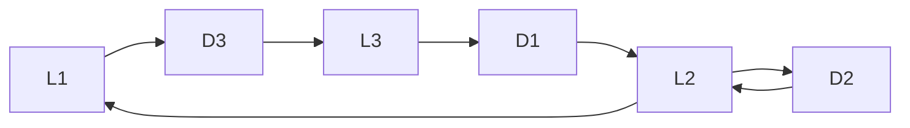

## 第二十章曲线积分

## §1 第一型曲线积分

以前讨论的定积分研究的是定义在直线段上函数的积分. 本章将研究定义在平面或空间曲线段上函数的积分.

## 一、第一型曲线积分的定义

设某物体的密度函数 $f(P)$ 是定义在 $\Omega$ 上的连续函数. 当 $\Omega$ 是直线段时, 应用定积分就能计算得该物体的质量.

现在研究当  $\Omega$  是平面或空间中某一可求长度的曲线段时物体的质量的计算问题. 首先对  $\Omega$  作分割, 把  $\Omega$  分成 n 个可求长度的小曲线段  $\Omega_{i} (i=1,2,\cdots,n)$ , 并在每一个  $\Omega_{i}$  上任取一点  $P_{i}$ . 由于  $f(P)$  为  $\Omega$  上的连续函数, 故当  $\Omega_{i}$  的弧长都很小时, 每一小段  $\Omega_{i}$  的质量可近似地等于  $f(P_{i})\Delta\Omega_{i}$ , 其中  $\Delta\Omega_{i}$  为小曲线段  $\Omega_{i}$  的长度. 于是在整个  $\Omega$  上的质量就近似地等于和式

$$
\sum_ {i = 1} ^ {n} f (P _ {i}) \Delta \Omega_ {i}.
$$

当对  $\Omega$  的分割越来越细密（即  $d=\max_{1\leqslant i\leqslant n}\Delta\Omega_{i}\rightarrow0$ ）时，上述和式的极限就应是该物体的质量.

由上面看到,求具有某种物质的曲线段的质量,与求直线段的质量一样,也是通过“分割、近似求和、取极限”来得到的.下面给出这类积分的定义.

定义 1 设 L 为平面上可求长度的曲线段,  $f(x,y)$  为定义在 L 上的函数. 对曲线 L 作分割 T, 它把 L 分成 n 个可求长度的小曲线段  $L_{i}$  ( $i=1,2,\cdots,n$ ),  $L_{i}$  的弧长记为  $\Delta s_{i}$ , 分割 T 的细度为  $\|T\|=\max_{1\leqslant i\leqslant n}\Delta s_{i}$ , 在  $L_{i}$  上任取一点  $(\xi_{i},\eta_{i})$  ( $i=1,2,\cdots,n$ ). 若有极限

$$
\lim _ {\| T \| \to 0} \sum_ {i = 1} ^ {n} f (\xi_ {i}, \eta_ {i}) \Delta s _ {i} = J,
$$

且 J 的值与分割 T 和点  $(\xi_{i}, \eta_{i})$  的取法无关，则称此极限为  $f(x, y)$  在 L 上的第一型曲线积分，记作

$$
\int_ {L} f (x, y) \mathrm{d} s. \tag {1}
$$

若 $L$ 为空间可求长曲线段, $f(x,y,z)$ 为定义在 $L$ 上的函数, 则可类似地定义 $f(x,y,z)$

在空间曲线 L 上的第一型曲线积分,并且记作

$$
\int_ {L} f (x, y, z) \mathrm{d} s. \tag {2}
$$

于是前面讲到的质量分布在平面或空间曲线段 $L$ 上的物体的质量可由第一型曲线积分(1)或(2)求得.

第一型曲线积分也和定积分一样具有下述一些重要性质. 下面列出平面上第一型曲线积分的性质, 对于空间第一型曲线积分的性质, 读者可自行仿此写出.

1. 若  $\int_{L} f_{i}(x, y) \, \mathrm{d}s \quad (i = 1, 2, \cdots, k)$  存在， $c_{i} \quad (i = 1, 2, \cdots, k)$  为常数，则  $\int_{L} \sum_{i=1}^{k} c_{i} f_{i}(x, y) \, \mathrm{d}s$  也存在，且

$$
\int_ {L} \sum_ {i = 1} ^ {k} c _ {i} f _ {i} (x, y) \mathrm{d} s = \sum_ {i = 1} ^ {k} c _ {i} \int_ {L} f _ {i} (x, y) \mathrm{d} s.
$$

2. 若曲线段 L 由曲线  $L_{1}, L_{2}, \cdots, L_{k}$  首尾相接而成，且  $\int_{L_{i}} f(x, y) \, ds \quad (i = 1, 2, \cdots, k)$  都存在，则  $\int_{L} f(x, y) \, ds$  也存在，且

$$
\int_ {L} f (x, y) \mathrm{d} s = \sum_ {i = 1} ^ {k} \int_ {L _ {i}} f (x, y) \mathrm{d} s.
$$

3. 若 $\int_{L} f(x, y) \mathrm{d}s$ 与 $\int_{L} g(x, y) \mathrm{d}s$ 都存在，且在 $L$ 上 $f(x, y) \leqslant g(x, y)$，则

$$
\int_ {L} f (x, y) \mathrm{d} s \leqslant \int_ {L} g (x, y) \mathrm{d} s.
$$

4. 若 $\int_{L} f(x, y) \mathrm{d}s$ 存在，则 $\int_{L} |f(x, y)| \mathrm{d}s$ 也存在，且

$$
\left| \int_ {L} f (x, y) \mathrm{d} s \right| \leqslant \int_ {L} | f (x, y) | \mathrm{d} s.
$$

5. 若 $\int_{L} f(x, y) \mathrm{d}s$ 存在, $L$ 的弧长为 $s$, 则存在常数 $c$, 使得

$$
\int_ {L} f (x, y) \mathrm{d} s = c s,
$$

这里 $\inf_{L}f(x,y)\leqslant c\leqslant \sup_{L}f(x,y)$

6. 第一型曲线积分的几何意义

若 $L$ 为平面 $Oxy$ 上分段光滑曲线（如图20-1），$f(x,y)$ 为定义在 $L$ 上非负连续函数.由第一型曲面积分的定义，以 $L$ 为准线，母线平行于 $z$ 轴的柱面上截取 $0 \leqslant z \leqslant f(x,y)$

的部分面积就是 $\int_{L}f(x,y)\mathrm{d}s$

## 二、第一型曲线积分的计算

定理 20.1 设有光滑曲线

$$
L: \left\{ \begin{array}{l l} x = \varphi (t), \\ y = \psi (t), \end{array} \right. t \in [ \alpha , \beta ],
$$

函数 $f(x,y)$ 为定义在 $L$ 上的连续函数，则

text_image

z
z=f(x,y)
O
y
(x,y)
L
x

图20-1

$$
\int_ {L} f (x, y) \mathrm{d} s = \int_ {\alpha} ^ {\beta} f (\varphi (t), \psi (t)) \sqrt {\varphi^ {\prime 2} (t) + \psi^ {\prime 2} (t)} \mathrm{d} t. \tag {3}
$$

证 由弧长公式知道, L 上由  $t = t_{i-1}$  到  $t = t_{i}$  的弧长

$$
\Delta s _ {i} = \int_ {t _ {i - 1}} ^ {t _ {i}} \sqrt {\varphi^ {' 2} (t) + \psi^ {' 2} (t)}   \mathrm{d} t.
$$

由 $\sqrt{\varphi'^2(t) + \psi'^2(t)}$ 的连续性与积分中值定理，有

$$
\Delta s _ {i} = \sqrt {\varphi^ {\prime 2} (\tau_ {i} ^ {\prime}) + \psi^ {\prime 2} (\tau_ {i} ^ {\prime})} \Delta t _ {i} \quad (t _ {i - 1} <   \tau_ {i} ^ {\prime} <   t _ {i}).
$$

所以

$$
\sum_ {i = 1} ^ {n} f (\xi_ {i}, \eta_ {i}) \Delta s _ {i} = \sum_ {i = 1} ^ {n} f (\varphi (\tau_ {i} ^ {\prime \prime}), \psi (\tau_ {i} ^ {\prime \prime})) \sqrt {\varphi^ {\prime 2} (\tau_ {i} ^ {\prime}) + \psi^ {\prime 2} (\tau_ {i} ^ {\prime})} \Delta t _ {i},
$$

这里 $t_{i - 1}\leqslant \tau_i^{\prime},\tau_i^{\prime \prime}\leqslant t_i$ 设

$$
\sigma = \sum_ {i = 1} ^ {n} f (\varphi (\tau_ {i} ^ {\prime \prime}), \psi (\tau_ {i} ^ {\prime \prime})) \left[ \sqrt {\varphi^ {\prime 2} (\tau_ {i} ^ {\prime}) + \psi^ {\prime 2} (\tau_ {i} ^ {\prime})} - \sqrt {\varphi^ {\prime 2} (\tau_ {i} ^ {\prime \prime}) + \psi^ {\prime 2} (\tau_ {i} ^ {\prime \prime})} \right] \Delta t _ {i},
$$

则有

$$
\sum_ {i = 1} ^ {n} f (\xi_ {i}, \eta_ {i}) \Delta s _ {i} = \sum_ {i = 1} ^ {n} f (\varphi (\tau_ {i} ^ {\prime \prime}), \psi (\tau_ {i} ^ {\prime \prime})) \sqrt {\varphi^ {\prime 2} (\tau_ {i} ^ {\prime \prime}) + \psi^ {\prime 2} (\tau_ {i} ^ {\prime \prime})} \Delta t _ {i} + \sigma . \tag {4}
$$

令  $\Delta t = \max\{\Delta t_{1}, \Delta t_{2}, \cdots, \Delta t_{n}\}$ ，则当  $\|T\| \to 0$  时，必有  $\Delta t \to 0$ 。现在证明  $\lim_{\Delta t \to 0} \sigma = 0$ 。

因为复合函数 $f(\varphi (t),\psi (t))$ 关于 $t$ 连续，所以在闭区间 $[\alpha ,\beta ]$ 上有界，即存在常数 $M$ ，使对一切 $t\in [\alpha ,\beta ]$ ，都有

$$
\left| f (\varphi (t), \psi (t)) \right| \leqslant M.
$$

再由 $\sqrt{\varphi'^2(t) + \psi'^2(t)}$ 在 $[\alpha, \beta]$ 上连续，所以它在 $[\alpha, \beta]$ 上一致连续，即对任给的 $\varepsilon > 0$ 必存在 $\delta > 0$ ，使当 $\Delta t < \delta$ 时有

$$
\left| \sqrt {\varphi^ {\prime 2} (\tau_ {i} ^ {\prime \prime}) + \psi^ {\prime 2} (\tau_ {i} ^ {\prime \prime})} - \sqrt {\varphi^ {\prime 2} (\tau_ {i} ^ {\prime}) + \psi^ {\prime 2} (\tau_ {i} ^ {\prime})} \right| <   \varepsilon ,
$$

从而

$$
\mid \sigma \mid \leqslant \varepsilon M \sum_ {i = 1} ^ {n} \Delta t _ {i} = \varepsilon M (\beta - \alpha),
$$

所以 $\lim_{\Delta t\to 0}\sigma = 0.$

再由定积分定义，

$$
\lim _ {\Delta t \to 0} \sum_ {i = 1} ^ {n} f (\varphi (\tau_ {i} ^ {\prime \prime}), \psi (\tau_ {i} ^ {\prime \prime})) \sqrt {\varphi^ {\prime 2} (\tau_ {i} ^ {\prime \prime}) + \psi^ {\prime 2} (\tau_ {i} ^ {\prime \prime})} \Delta t _ {i}
$$

$$
= \int_ {\alpha} ^ {\beta} f (\varphi (t), \psi (t)) \sqrt {\varphi^ {\prime 2} (t) + \psi^ {\prime 2} (t)} \mathrm{d} t.
$$

因此当在(4)式两边取极限后,即得所要证的(3)式.

当曲线 $L$ 由方程

$$
y = \psi (x), \quad x \in [ a, b ]
$$

表示,且  $\psi(x)$  在  $[a,b]$  上有连续的导函数时,(3)式成为

$$
\int_ {L} f (x, y) \mathrm{d} s = \int_ {a} ^ {b} f (x, \psi (x)) \sqrt {1 + \psi^ {\prime 2} (x)} \mathrm{d} x; \tag {5}
$$

当曲线 $L$ 由方程

$$
x = \varphi (y), \quad y \in [ c, d ]
$$

表示，且 $\varphi (y)$ 在 $[c,d]$ 上有连续导函数时，(3)式成为

$$
\int_ {L} f (x, y) \mathrm{d} s = \int_ {c} ^ {d} f (\varphi (y), y) \sqrt {1 + \varphi^ {\prime 2} (y)} \mathrm{d} y. \tag {6}
$$

例1 设 $L$ 是半圆周

$$
\left\{ \begin{array}{l l} x = a \cos t, \\ y = a \sin t, \end{array} \right. 0 \leqslant t \leqslant \pi ,
$$

试计算第一型曲线积分 $\int_{L}(x^{2} + y^{2})\mathrm{d}s$

解 $\int_{L}\left(x^{2} + y^{2}\right)\mathrm{d}s = \int_{0}^{\pi}a^{2}\sqrt{a^{2}\left(\cos^{2}t + \sin^{2}t\right)}\mathrm{d}t = a^{3}\pi .$

例 2 设 L 是  $y^{2}=4x$  从  $O(0,0)$  到  $A(1,2)$  的一段（图 20-2），试计算第一型曲线积分  $\int_{L}yds$ .

解 $\int_{L}y\mathrm{d}s = \int_{0}^{2}y\sqrt{1 + \frac{y^2}{4}}\mathrm{d}y$

$$
\begin{array}{l} = 2 \cdot \frac {2}{3} \left(1 + \frac {y ^ {2}}{4}\right) ^ {\frac {3}{2}} \Bigg | _ {0} ^ {2} \\ = \frac {4}{3} (2 \sqrt {2} - 1). \\ \end{array}
$$

line

| Point | X | Y |
| --- | --- | --- |
| O | 0 | 0 |
| A | 1 | 2 |

图20-2

仿照定理 20.1, 对于空间曲线积分(2), 当曲线 L 由参量方程  $x=\varphi(t)$ ,  $y=\psi(t)$ ,  $z=\chi(t)$ ,  $t\in[\alpha,\beta]$  表示时, 其计算公式为

$$
\int_ {L} f (x, y, z) \mathrm{d} s = \int_ {\alpha} ^ {\beta} f (\varphi (t), \psi (t), \chi (t)) \sqrt {\varphi^ {\prime 2} (t) + \psi^ {\prime 2} (t) + \chi^ {\prime 2} (t)} \mathrm{d} t. \tag {7}
$$

例 3 计算  $\int_{L} x^{2} ds$ ，其中 L 为球面  $x^{2} + y^{2} + z^{2} = a^{2}$  被平面  $x + y + z = 0$  所截得的圆周.

解 由对称性知

$$
\int_ {L} x ^ {2} \mathrm{d} s = \int_ {L} y ^ {2} \mathrm{d} s = \int_ {L} z ^ {2} \mathrm{d} s,
$$

所以

$$
\int_ {L} x ^ {2} \mathrm{d} s = \frac {1}{3} \int_ {L} (x ^ {2} + y ^ {2} + z ^ {2}) \mathrm{d} s = \frac {a ^ {2}}{3} \int_ {L} \mathrm{d} s = \frac {2}{3} \pi a ^ {3}.
$$

由第一型曲线积分的定义,在 Oxy 平面上,线密度为  $\rho(x,y)$  的曲线状物体对 x,y 轴的转动惯量分别为

$$
J _ {x} = \int_ {L} y ^ {2} \rho \left(x, y\right) \mathrm{d} s \quad \text {和} \quad J _ {y} = \int_ {L} x ^ {2} \rho \left(x, y\right) \mathrm{d} s.
$$

例 4 求线密度  $\rho(x,y)=\frac{y}{\sqrt{1+x^{2}}}$  的曲线段  $y=\ln x, x\in[1,2]$  对于 y 轴的转动惯量.

解 $J_{y} = \int_{L}\frac{x^{2}y}{\sqrt{1 + x^{2}}}\mathrm{d}s = \int_{1}^{2}\frac{x^{2}\ln x}{\sqrt{1 + x^{2}}}\sqrt{1 + \frac{1}{x^{2}}}\mathrm{d}x$

$$
= \int_ {1} ^ {2} x \ln x \mathrm{d} x = \ln 4 - \frac {3}{4}.
$$

## 习题 20.1

1. 计算下列第一型曲线积分:

(1) $\int_{L}(x + y)\mathrm{d}s$ ，其中 $L$ 是以 $O(0,0),A(1,0),B(0,1)$ 为顶点的三角形周界；
(2) $\int_{L}(x^{2} + y^{2})^{\frac{1}{2}}\mathrm{d}s$ ，其中 $L$ 是以原点为中心、 $R$ 为半径的右半圆周；
(3) $\int_{L} xy \, \mathrm{d}s$，其中 $L$ 为椭圆 $\frac{x^2}{a^2} + \frac{y^2}{b^2} = 1$ 在第一象限中的部分；
(4) $\int_{L}|y|\mathrm{d}s$ ，其中 $L$ 为单位圆周 $x^{2} + y^{2} = 1$
(5) $\int_{L}(x^{2} + y^{2} + z^{2})\mathrm{d}s$ ，其中 $L$ 为螺旋线 $x = a\cos t,y = a\sin t,z = bt$ （$0\leqslant t\leqslant 2\pi$）的一段；
(6) $\int_{L} xyz \, \mathrm{d}s$，其中 $L$ 是曲线 $x = t, y = \frac{2}{3} \sqrt{2t^3}, z = \frac{1}{2} t^2 (0 \leqslant t \leqslant 1)$ 的一段；
(7) $\int_{L} \sqrt{2y^{2} + z^{2}} \, \mathrm{d}s$，其中 $L$ 是 $x^{2} + y^{2} + z^{2} = a^{2}$ 与 $x = y$ 相交的圆周.

2. 求曲线 $x = a, y = at, z = \frac{1}{2} at^2$ ($0 \leqslant t \leqslant 1, a > 0$) 的质量，设其线密度为 $\rho = \sqrt{\frac{2z}{a}}$.

3. 求摆线 $\left\{\begin{aligned}x=a(t-\sin t),\\ y=a(1-\cos t)\end{aligned}\right.$   $(0\leqslant t\leqslant\pi)$  的质心，设其质量分布是均匀的.

4. 若曲线以极坐标  $\rho=\rho(\theta)$  ( $\theta_{1}\leqslant\theta\leqslant\theta_{2}$ ) 表示, 试给出计算  $\int_{L}f(x,y)\,\mathrm{d}s$  的公式, 并用此公式计算下列曲线积分:

(1) $\int_{L} \mathrm{e}^{\sqrt{x^2 + y^2}} \, \mathrm{d}s$，其中 $L$ 为曲线 $\rho = a \left(0 \leqslant \theta \leqslant \frac{\pi}{4}\right)$ 的一段；
(2) $\int_{L}x\mathrm{d}s$ ，其中L为对数螺线 $\rho=a\mathrm{e}^{k\theta}(k>0)$ 在圆r=a内的部分.

5. 证明: 若函数 $f(x, y)$ 在光滑曲线 $L: x = x(t), y = y(t), t \in [\alpha, \beta]$ 上连续, 则存在点 $(x_0, y_0) \in L$, 使得

$$
\int_ {L} f (x, y) \mathrm{d} s = f (x _ {0}, y _ {0}) \Delta L,
$$

其中  $\Delta L$  为 L 的弧长.

## § 2 第二型曲线积分

## 一、第二型曲线积分的定义

在物理学中还碰到另一种类型的曲线积分问题. 例如一质点受力 $F(x, y)$ 的作用沿平面曲线 $L$ 从点 $A$ 移动到点 $B$, 求力 $F(x, y)$ 所做的功 (图20-3).

为此在曲线 $\widehat{AB}$ 内插入n-1个分点 $M_{1},M_{2},\cdots,M_{n-1}$ ，与 $A=M_{0},B=M_{n}$ 一起把有向曲线 $\widehat{AB}$ 分成 n 个有向小弧段 $\widehat{M_{i-1}M_i} (i=1,2,\cdots,n)$ . 若记小弧段 $\widehat{M_{i-1}M_i}$ 的弧长为 $\Delta s_i$ ，则分割 T 的细度为

$$
\| T \| = \max _ {1 \leqslant i \leqslant n} \Delta s _ {i}.
$$

设力  $F(x,y)$  在 x 轴和 y 轴方向的投影分别为  $P(x,y)$  与  $Q(x,y)$ ，那么

$$
\boldsymbol {F} (x, y) = (P (x, y), Q (x, y)).
$$

又设小弧段 $\widehat{M_{i-1}M_i}$ 在x轴与y轴上的投影分别为 $\Delta x_i = x_i - x_{i-1}$ 与 $\Delta y_i = y_i - y_{i-1}$，其中 $(x_i, y_i)$ 与 $(x_{i-1}, y_{i-1})$ 分别为分点 $M_i$ 与 $M_{i-1}$ 的坐标.记

text_image

y
B(Mₙ)
Mₙ₋₁
A(M₀)
M₁
M₂
x,y
O
x

图20-3

$$
L _ {M _ {i - 1} M _ {i}} = (\Delta x _ {i}, \Delta y _ {i}),
$$

于是力  $\boldsymbol{F}(x,y)$  在小弧段  $\widehat{M_{i-1}M_{i}}$  上所做的功

$$
W _ {i} \approx F (\xi_ {i}, \eta_ {i}) \cdot L _ {M _ {i - 1} M _ {i}} = P (\xi_ {i}, \eta_ {i}) \Delta x _ {i} + Q (\xi_ {i}, \eta_ {i}) \Delta y _ {i},
$$

其中 $(\xi_{i},\eta_{i})$ 为小弧段 $\widehat{M_{i - 1}M_i}$ 上任一点.因而力 $F(x,y)$ 沿曲线AB所做的功近似地等于

$$
W = \sum_ {i = 1} ^ {n} W _ {i} \approx \sum_ {i = 1} ^ {n} P (\xi_ {i}, \eta_ {i}) \Delta x _ {i} + \sum_ {i = 1} ^ {n} Q (\xi_ {i}, \eta_ {i}) \Delta y _ {i}.
$$

当细度  $\|T\|\rightarrow0$  时, 上式右边和式的极限就应该是所求的功. 这种类型的和式极限就是下面所要讨论的第二型曲线积分.

定义1 设函数 $P(x, y)$ 与 $Q(x, y)$ 定义在平面有向可求长度曲线 $L: \widehat{AB}$ 上. 对 $L$ 的任一分割 $T$, 它把 $L$ 分成 $n$ 个小弧段

$$
\widehat {M _ {i - 1} M _ {i}} \quad (i = 1, 2, \dots , n),
$$

其中  $M_{0}=A, M_{n}=B.$  记各小弧段  $\widehat{M_{i-1}M_{i}}$  的弧长为  $\Delta s_{i}$ ，分割 T 的细度  $\|T\|=\max_{1\leqslant i\leqslant n}\Delta s_{i}$ 。又设 T 的分点  $M_{i}$  的坐标为  $(x_{i},y_{i})$ ，并记  $\Delta x_{i}=x_{i}-x_{i-1},\Delta y_{i}=y_{i}-y_{i-1}(i=1,2,\cdots,n).$  在每个小弧段  $\widehat{M_{i-1}M_{i}}$  上任取一点  $(\xi_{i},\eta_{i})$ ，若极限

$$
\lim _ {\parallel T \parallel \to 0} \sum_ {i = 1} ^ {n} P (\xi_ {i}, \eta_ {i}) \Delta x _ {i} + \lim _ {\parallel T \parallel \to 0} \sum_ {i = 1} ^ {n} Q (\xi_ {i}, \eta_ {i}) \Delta y _ {i}
$$

存在且与分割 T 和点  $(\xi_{i}, \eta_{i})$  的取法无关, 则称此极限为函数  $P(x, y)$ ,  $Q(x, y)$  沿有向曲线 L 上的第二型曲线积分, 记为

$$
\int_ {L} P (  x  , y  )   \mathrm{d} x   +   Q (  x  , y  )   \mathrm{d} y \quad \text {或} \quad \int_ {\widehat {A B}} P (  x  , y  )   \mathrm{d} x   +   Q (  x  , y  )   \mathrm{d} y. \tag {1}
$$

上述积分(1)也可写作

$$
\int_ {L} P (x, y) \mathrm{d} x + \int_ {L} Q (x, y) \mathrm{d} y
$$

或 $\int_{\widehat{AB}}P(x,y)\mathrm{d}x + \int_{\widehat{AB}}Q(x,y)\mathrm{d}y.$

为书写简洁起见,(1)式常简写成

$$
\int_ {L} P \mathrm{d} x   +   Q \mathrm{d} y \quad \text {或} \quad \int_ {\widehat {A B}} P \mathrm{d} x   +   Q \mathrm{d} y.
$$

若 L 为封闭的有向曲线, 则记为

$$
\oint_ {L} P \mathrm{d} x + Q \mathrm{d} y. \tag {2}
$$

若记 $F(x,y) = (P(x,y),Q(x,y)),\mathrm{d}s = (\mathrm{d}x,\mathrm{d}y)$ ，则(1)式可写成向量形式

$$
\int_ {L} \pmb {F} \cdot \mathrm{d} \pmb {s} \quad \text {或} \quad \int_ {\widehat {A B}} \pmb {F} \cdot \mathrm{d} \pmb {s}. \tag {3}
$$

于是，力 $F(x,y) = (P(x,y),Q(x,y))$ 沿有向曲线 $L:\widehat{AB}$ 对质点所做的功为

$$
W = \int_ {L} P (x, y) \mathrm{d} x + Q (x, y) \mathrm{d} y.
$$

倘若 L 为空间有向可求长度曲线,  $P(x,y,z)$ ,  $Q(x,y,z)$ ,  $R(x,y,z)$  为定义在 L 上的函数, 则可按上述办法类似地定义沿空间有向曲线 L 上的第二型曲线积分, 并记为

$$
\int_ {L} P (x, y, z) \mathrm{d} x + Q (x, y, z) \mathrm{d} y + R (x, y, z) \mathrm{d} z, \tag {4}
$$

或简写成

$$
\int_ {L} P \mathrm{d} x + Q \mathrm{d} y + R \mathrm{d} z.
$$

当把 $F(x,y,z) = (P(x,y,z),Q(x,y,z),R(x,y,z))$ 与 $\mathrm{ds} = (\mathrm{dx},\mathrm{dy},\mathrm{dz})$ 看作三维向量时，(4)式也可表示成(3)式的向量形式.

第二型曲线积分与曲线 L 的方向有关. 对同一曲线, 当方向由 A 到 B 改为由 B 到 A 时, 每一小曲线段的方向都改变, 从而所得的  $\Delta x_{i}, \Delta y_{i}$  也随之改变符号, 故有

$$
\int_ {\widehat {A B}} P \mathrm{d} x + Q \mathrm{d} y = - \int_ {\widehat {B A}} P \mathrm{d} x + Q \mathrm{d} y. \tag {5}
$$

而第一型曲线积分的被积表达式只是函数 $f(x,y)$ 与弧长的乘积，它与曲线 $L$ 的方向无关.这是两种类型曲线积分的一个重要区别.

类似于第一型曲线积分,第二型曲线积分也有如下一些主要性质:

1. 若  $\int_{L} P_{i} dx + Q_{i} dy \quad (i = 1, 2, \cdots, k)$  存在，则  $\int_{L} \left( \sum_{i=1}^{k} c_{i} P_{i} \right) dx + \left( \sum_{i=1}^{k} c_{i} Q_{i} \right) dy$  也存在，且

$$
\int_ {L} \Big (\sum_ {i = 1} ^ {k} c _ {i} P _ {i} \Big) \mathrm{d} x + \Big (\sum_ {i = 1} ^ {k} c _ {i} Q _ {i} \Big) \mathrm{d} y = \sum_ {i = 1} ^ {k} c _ {i} \Big (\int_ {L} P _ {i} \mathrm{d} x + Q _ {i} \mathrm{d} y \Big),
$$

其中  $c_{i}$  ( $i=1,2,\cdots,k$ ) 为常数.

2. 若有向曲线 L 是由有向曲线  $L_{1}, L_{2}, \cdots, L_{k}$  首尾相接而成，且  $\int_{L_{i}} P dx + Q dy \quad (i = 1, 2, \cdots, k)$  存在，则  $\int_{L} P dx + Q dy$  也存在，且

$$
\int_ {L} P \mathrm{d} x + Q \mathrm{d} y = \sum_ {i = 1} ^ {k} \int_ {L _ {i}} P \mathrm{d} x + Q \mathrm{d} y.
$$

## 二、第二型曲线积分的计算

与第一型曲线积分一样,第二型曲线积分也可化为定积分来计算.

设平面曲线

$$
L: \left\{ \begin{array}{l l} x = \varphi (t), \\ y = \psi (t), \end{array} \right. t \in [ \alpha , \beta ],
$$

其中 $\varphi(t),\psi(t)$ 在 $[\alpha ,\beta ]$ 上具有一阶连续导函数，且点 $A$ 与 $B$ 的坐标分别为 $(\varphi (\alpha)$ ，$\psi (\alpha))$ 与 $(\varphi (\beta),\psi (\beta))$ .又设 $P(x,y)$ 与 $Q(x,y)$ 为 $L$ 上的连续函数，则沿 $L$ 从 $A$ 到 $B$ 的第二型曲线积分

$$
\begin{array}{l} \int_ {L} P (x, y) \mathrm{d} x + Q (x, y) \mathrm{d} y \\ = \int_ {\alpha} ^ {\beta} \left[ P (\varphi (t), \psi (t)) \varphi^ {\prime} (t) + Q (\varphi (t), \psi (t)) \psi^ {\prime} (t) \right] \mathrm{d} t. \tag {6} \\ \end{array}
$$

读者可仿照 §1 中定理 20.1 的方法分别证明

$$
\begin{array}{l} \int_ {L} P (x, y) \mathrm{d} x = \int_ {\alpha} ^ {\beta} P (\varphi (t), \psi (t)) \varphi^ {\prime} (t) \mathrm{d} t, \\ \int_ {L} Q (x, y) \mathrm{d} y = \int_ {\alpha} ^ {\beta} Q (\varphi (t), \psi (t)) \psi^ {\prime} (t) \mathrm{d} t, \\ \end{array}
$$

由此便可得公式(6)，这里不再赘述了.

对于沿封闭曲线 L 的第二型曲线积分(2)的计算, 可在 L 上任意选取一点作为起点, 沿 L 所指定的方向前进, 最后回到这一点.

例 1 计算  $\int_{L} xy \, dx + (y - x) \, dy$ ，其中 L 分别沿如图 20-4 中路线:

contour

| Point | X | Y |
| --- | --- | --- |
| A | 1 | 1 |
| B | 2 | 3 |
| C | 2 | 1 |
| D | 2 | 1 |

图20-4

(i) 直线 AB;
(ii)  $\widehat{ACB}$  (抛物线:  $y=2(x-1)^{2}+1$ );
(iii) ADBA (三角形周界).

解（i）直线 $AB$ 的参数方程为

$$
\left\{ \begin{array}{l l} x = 1 + t, \\ y = 1 + 2 t, \end{array} \right. \quad t \in [ 0, 1 ].
$$

故由公式(6)可得

$$
\begin{array}{l} \int_ {A B} x y \mathrm{d} x + (y - x) \mathrm{d} y \\ = \int_ {0} ^ {1} \left[ (1 + t) (1 + 2 t) + 2 t \right] \mathrm{d} t \\ = \int_ {0} ^ {1} (1 + 5 t + 2 t ^ {2}) \mathrm{d} t = \frac {2 5}{6}. \\ \end{array}
$$

(ii) 曲线 $\widehat{ACB}$ 为抛物线 $y = 2(x - 1)^2 + 1, 1 \leqslant x \leqslant 2$，所以

$$
\begin{array}{l} \int_ {\widehat {A C B}} x y \mathrm{d} x + (y - x) \mathrm{d} y \\ = \int_ {1} ^ {2} \left\{x [ 2 (x - 1) ^ {2} + 1 ] + [ 2 (x - 1) ^ {2} + 1 - x ] 4 (x - 1) \right\} \mathrm{d} x \\ = \int_ {1} ^ {2} (1 0 x ^ {3} - 3 2 x ^ {2} + 3 5 x - 1 2) \mathrm{d} x = \frac {1 0}{3}. \\ \end{array}
$$

（iii）这里 L 是一条封闭曲线, 故可从 A 开始, 应用上段的性质 2, 分别求沿 AD, DB 和 BA 上的线积分然后相加即可得到所求之曲线积分.

由于沿直线  $AD: x = x, y = 1 (1 \leqslant x \leqslant 2)$  的线积分为

$$
\int_ {A D} x y \mathrm{d} x + (y - x) \mathrm{d} y = \int_ {A D} x y \mathrm{d} x = \int_ {1} ^ {2} x \mathrm{d} x = \frac {3}{2}.
$$

沿直线 DB: x = 2, y = y ( $1 \leqslant y \leqslant 3$ ) 的线积分为

$$
\int_ {D B} x y \mathrm{d} x + (y - x) \mathrm{d} y = \int_ {D B} (y - x) \mathrm{d} y = \int_ {1} ^ {3} (y - 2) \mathrm{d} y = 0.
$$

沿直线 BA 的线积分可由(i)及公式(5)得到

$$
\int_ {B A} x y \mathrm{d} x + (y - x) \mathrm{d} y = - \int_ {A B} x y \mathrm{d} x + (y - x) \mathrm{d} y = - \frac {2 5}{6}.
$$

所以

$$
\oint_ {L} x y \mathrm{d} x + (y - x) \mathrm{d} y = \frac {3}{2} + 0 + \left(- \frac {2 5}{6}\right) = - \frac {8}{3}.
$$

例 2 计算  $\int_{L} x \, dy + y \, dx$ ，这里 L

(i) 沿抛物线  $y=2x^{2}$ ，从 O 到 B 的一段（图 20-5）；
(ii) 沿直线段 OB: y = 2x;
(iii) 沿封闭曲线 OABO.

解 (i) $\int_{L} x \, \mathrm{d}y + y \, \mathrm{d}x$

$$
= \int_ {0} ^ {1} \left[ x (4 x) + 2 x ^ {2} \right] \mathrm{d} x
$$

$$
= \int_ {0} ^ {1} 6 x ^ {2} \mathrm{d} x = \frac {6}{3} = 2.
$$

(ii) $\int_{L} x \, \mathrm{d}y + y \, \mathrm{d}x = \int_{0}^{1}(2x + 2x) \, \mathrm{d}x$

$$
= 4 \cdot \frac {1}{2} = 2.
$$

（iii）在 $OA$ 一段上，$y = 0, 0 \leqslant x \leqslant 1$；在 $AB$ 一段上，$x = 1, 0 \leqslant y \leqslant 2$；在 $BO$ 一段上与 (ii) 一样是 $y = 2x$ 从 $x = 1$ 到 $x = 0$ 的一段。所以

$$
\begin{array}{l} \int_ {O A} x \mathrm{d} y + y \mathrm{d} x = \int_ {0} ^ {1} 0 \mathrm{d} x = 0, \\ \int_ {A B} x \mathrm{d} y + y \mathrm{d} x = \int_ {0} ^ {2} 1 \mathrm{d} y = 2, \\ \int_ {B O} x \mathrm{d} y + y \mathrm{d} x = - \int_ {O B} x \mathrm{d} y + y \mathrm{d} x = - 2 \quad (\text {见} (\mathrm{ii})). \\ \end{array}
$$

因此

$$
\oint_ {L} x \mathrm{d} y + y \mathrm{d} x = \left\{\int_ {O A} + \int_ {A B} + \int_ {B O} \right\} (x \mathrm{d} y + y \mathrm{d} x) = 0 + 2 - 2 = 0.
$$

line

| Point | X | Y |
| --- | --- | --- |
| A | 1 | 0 |
| B | 1 | 2 |

图20-5

对于沿空间有向曲线的第二型曲线积分的计算公式也与(6)式相仿. 设空间有向光滑曲线 L 的参量方程为

$$
\left\{ \begin{array}{l} x = x (t), \\ y = y (t), \\ z = z (t), \end{array} \right. \alpha \leqslant t \leqslant \beta ,
$$

起点为 $(x(\alpha), y(\alpha), z(\alpha))$，终点为 $(x(\beta), y(\beta), z(\beta))$，则

$$
\begin{array}{l} \int_ {L} P \mathrm{d} x + Q \mathrm{d} y + R \mathrm{d} z \\ = \int_ {\alpha} ^ {\beta} \left[ P (x (t), y (t), z (t)) x ^ {\prime} (t) + Q (x (t), y (t), z (t)) y ^ {\prime} (t) + \right. \\ \end{array}
$$

$$
R (x (t), y (t), z (t)) z ^ {\prime} (t) ] \mathrm{d} t. \tag {7}
$$

这里要注意曲线方向与积分上下限的确定应该一致.

例 3 计算第二型曲线积分

$$
I = \int_ {L} x y \mathrm{d} x + (x - y) \mathrm{d} y + x ^ {2} \mathrm{d} z,
$$

L 是螺旋线:  $x = a \cos t, y = a \sin t, z = bt$  从 t = 0 到  $t = \pi$  上的一段.

解 由公式(7)，

$$
\begin{array}{l} I = \int_ {0} ^ {\pi} (- a ^ {3} \cos t \sin^ {2} t + a ^ {2} \cos^ {2} t - a ^ {2} \sin t \cos t + a ^ {2} b \cos^ {2} t) \mathrm{d} t \\ = \left[ - \frac {1}{3} a ^ {3} \sin^ {3} t - \frac {1}{2} a ^ {2} \sin^ {2} t + \frac {1}{2} a ^ {2} (1 + b) \left(t + \frac {1}{2} \sin 2 t\right) \right] \Bigg | _ {0} ^ {\pi} \\ = \frac {1}{2} a ^ {2} (1 + b) \pi . \\ \end{array}
$$

例 4 求在力  $F(y,-x,x+y+z)$  作用下，

(i) 质点由 A 沿螺旋线  $L_{1}$  到 B 所做的功（图 20-6），其中  $L_{1}: x = a \cos t, y = a \sin t, z = bt, 0 \leqslant t \leqslant 2\pi;$
(ii) 质点由 A 沿直线  $L_{2}$  到 B 所做的功.

解 如本节开头所述,在空间曲线 L 上力 F 所做的功为

$$
W = \int_ {L} \boldsymbol {F} \cdot \mathrm{d} \boldsymbol {s} = \int_ {L} y \mathrm{d} x - x \mathrm{d} y + (x + y + z) \mathrm{d} z.
$$

(i) 由于 $\mathrm{dx} = -a\sin t\mathrm{dt},\mathrm{dy} = a\cos t\mathrm{dt},\mathrm{dz} = b\mathrm{dt}$, 所以

$$
\begin{array}{l} W = \int_ {0} ^ {2 \pi} (- a ^ {2} \sin^ {2} t - a ^ {2} \cos^ {2} t + a b \cos t + \\ a b \sin t + b ^ {2} t) \mathrm{d} t = 2 \pi (\pi b ^ {2} - a ^ {2}). \\ \end{array}
$$

(ii) $L_{2}$ 的参量方程为

$$
x = a, y = 0, z = t, 0 \leqslant t \leqslant 2 \pi b.
$$

由于 $\mathrm{dx} = 0, \mathrm{dy} = 0, \mathrm{dz} = \mathrm{dt}$, 所以

text_image

B(a,0,2\pi b)
D(-a,0,\pi b)
L₁
L₂
O
A(a,0,0)
x
y
z

图20-6

$$
W = \int_ {0} ^ {2 \pi b} (a + t) \mathrm{d} t = 2 \pi b (a + \pi b).
$$

## 三、两类曲线积分的联系

虽然第一型曲线积分与第二型曲线积分来自不同的物理原型,且有着不同的特性,但在一定条件下,如在规定了曲线的方向之后,可以建立它们之间的联系.

设 $L$ 为从 $A$ 到 $B$ 的有向光滑曲线，它以弧长 $s$ 为参数，于是

$$
L: \left\{ \begin{array}{l l} x = x (s), \\ y = y (s), \end{array} \right. 0 \leqslant s \leqslant l,
$$

其中 $l$ 为曲线 $L$ 的全长，且点 $A$ 与 $B$ 的坐标分别为 $(x(0), y(0))$ 与 $(x(l), y(l))$。曲线 $L$ 上每一点的切线方向指向弧长增加的一方。现以 $(\widehat{t}, x), (\widehat{t}, y)$ 分别表示切线方向 $t$ 与 $x$ 轴和 $y$ 轴正向的夹角，则在曲线上的每一点的切线方向余弦是

$$
\frac {\mathrm{d} x}{\mathrm{d} s} = \cos (\widehat {\boldsymbol {t}}, x), \quad \frac {\mathrm{d} y}{\mathrm{d} s} = \cos (\widehat {\boldsymbol {t}}, y). \tag {8}
$$

若 $P(x,y), Q(x,y)$ 为曲线 $L$ 上的连续函数, 则由(6)式得

$$
\begin{array}{l} \int_ {L} P \mathrm{d} x + Q \mathrm{d} y \\ = \int_ {0} ^ {l} \left[ P (x (s), y (s)) \cos (\widehat {\boldsymbol {t}}, x) + Q (x (s), y (s)) \cos (\widehat {\boldsymbol {t}}, y) \right] \mathrm{d} s \\ = \int_ {L} \left[ P (x, y) \cos (\widehat {\boldsymbol {t}}, x) + Q (x, y) \cos (\widehat {\boldsymbol {t}}, y) \right] \mathrm{d} s, \tag {9} \\ \end{array}
$$

最后一个等式是根据第一型曲线积分化为定积分的公式.

这里必须指出, 当(9)式左边第二型曲线积分中 L 改变方向时, 积分值改变符号, 相应在(9)式右边第一型曲线积分中, 曲线上各点的切线方向指向相反的方向(即指向弧长减少的方向). 这时夹角  $(\widehat{t}, x)$  和  $(\widehat{t}, y)$  分别与原来的夹角相差一个弧度  $\pi$ , 从而  $\cos(\widehat{t}, x)$  和  $\cos(\widehat{t}, y)$  都要变号. 因此, 一旦方向确定了, 公式(9)总是成立的.

这样,根据条件(8)和公式(9)便建立了两种不同类型曲线积分之间的联系.

类似讨论可以得到

$$
\begin{array}{l} \int_ {L} P \mathrm{d} x + Q \mathrm{d} y + R \mathrm{d} z \\ = \int_ {L} \left[ P (x, y, z) \cos (\widehat {t}, x) + Q (x, y, z) \cos (\widehat {t}, y) + R (x, y, z) \cos (\widehat {t}, z) \right] \mathrm{d} s, \\ \end{array}
$$

其中 $P, Q, R$ 为空间有向曲线 $L$ 上的连续函数，$(\cos(t, \widehat{x}), \cos(t, \widehat{y}), \cos(t, \widehat{z}))$ 为曲线 $L$ 正切向的方向余弦.

例5 计算

$$
\oint_ {L} y \mathrm{d} x + z \mathrm{d} y + x \mathrm{d} z,
$$

其中 L 是  $x^{2}+y^{2}+z^{2}=1$  和  $x+y+z=1$  的交线，从 x 轴正向看去取逆时针方向.

解 利用曲线 $L$ 的描述可以得到其正切向的方向余弦为 $\frac{1}{\sqrt{2}} (z - y,x - z,y - x)$

$$
\begin{array}{l} I = \oint_ {L} y \mathrm{d} x + z \mathrm{d} y + x \mathrm{d} z \\ = \oint_ {L} \frac {1}{\sqrt {2}} [ y (z - y) + z (x - z) + x (y - x) ] \mathrm{d} s \\ = - \frac {1}{\sqrt {2}} \oint_ {L} \mathrm{d} s, \\ \end{array}
$$

交线是一个半径为 $\sqrt{\frac{2}{3}}$ 的圆,所以

$$
I = - \frac {1}{\sqrt {2}} \oint_ {L} \mathrm{d} s = - \frac {2 \sqrt {3} \pi}{3}.
$$

## 习题 20.2

1. 计算第二型曲线积分:

(1) $\int_{L}x\mathrm{d}y-y\mathrm{d}x$ ，其中L为本节例2中的三种情况；
(2) $\int_{L}(2a - y)\mathrm{d}x + \mathrm{d}y$ ，其中 $L$ 为摆线 $x = a(t - \sin t),y = a(1 - \cos t)$ （$0\leqslant t\leqslant 2\pi$）沿 $t$ 增加方向的一段；

(3) $\oint_{L} \frac{-x \, \mathrm{d}x + y \, \mathrm{d}y}{x^2 + y^2}$, 其中 $L$ 为圆周 $x^2 + y^2 = 1$, 依逆时针方向;

(4) $\oint_{L} y \mathrm{~d}x + \sin x \mathrm{~d}y$，其中 $L$ 为 $y = \sin x (0 \leqslant x \leqslant \pi)$ 与 $x$ 轴所围的闭曲线，依顺时针方向；

(5) $\int_{L} x \mathrm{~d}x + y \mathrm{~d}y + z \mathrm{~d}z$，其中 $L$ 为从 (1,1,1) 到 (2,3,4) 的直线段.

2. 设质点受力作用, 力的反方向指向原点, 大小与质点离原点的距离成正比. 若质点由  $(a,0)$  沿椭圆移动到  $(0,b)$ , 求力所做的功.

3. 设一质点受力作用, 力的方向指向原点, 大小与质点到 $xy$ 平面的距离成反比. 若质点沿直线 $x = at, y = bt, z = ct (c \neq 0)$ 从 $M(a, b, c)$ 移动到 $N(2a, 2b, 2c)$, 求力所做的功.

4. 证明曲线积分的估计式

$$
\left| \int_ {\widehat {A B}} P \mathrm{d} x + Q \mathrm{d} y \right| \leqslant L M,
$$

其中 L 为  $\widehat{AB}$  的弧长,  $M = \max_{\{x, y\} \in \widehat{AB}} \sqrt{P^{2} + Q^{2}}$ .

利用上述不等式估计积分

$$
I _ {R} = \int_ {x ^ {2} + y ^ {2} = R ^ {2}} \frac {y \mathrm{d} x - x \mathrm{d} y}{\left(x ^ {2} + x y + y ^ {2}\right) ^ {2}},
$$

并证明  $\lim_{R\to+\infty}I_{R}=0.$

5. 计算沿空间曲线的第二型曲线积分:

(1) $\int_{L} xyz \, \mathrm{d}z$，其中 $L$ 为 $x^{2} + y^{2} + z^{2} = 1$ 与 $y = z$ 相交的圆，其方向按曲线依次经过 $1, 2, 7, 8$ 卦限；

(2) $\int_{L}(y^{2} - z^{2})\mathrm{d}x + (z^{2} - x^{2})\mathrm{d}y + (x^{2} - y^{2})\mathrm{d}z$ ，其中 $L$ 为球面 $x^{2} + y^{2} + z^{2} = 1$ 在第一卦限部分的边界曲线，其方向按曲线依次经过 $xy$ 平面部分，$yz$ 平面部分和 $zx$ 平面部分.

## 第二十章总练习题

1. 计算下列曲线积分:

(1) $\int_{L}y\mathrm{d}s$ ,其中L是由 $y^{2}=x$ 和 $x+y=2$ 所围的闭曲线；

(2) $\int_{L}|y|\mathrm{d}s$ ，其中 $L$ 为双纽线 $(x^{2} + y^{2})^{2} = a^{2}(x^{2} - y^{2})$

(3) $\int_{L}z\mathrm{d}s$ ,其中L为圆锥螺线

$$
x = t \cos t, y = t \sin t, z = t, \quad t \in [ 0, t _ {0} ];
$$

(4) $\int_{L}xy^{2}dy-x^{2}ydx$ , L为以a为半径、圆心在原点的右半圆周从最上面一点A到最下面一点B;

(5) $\int_{L}\frac{\mathrm{d}y-\mathrm{d}x}{x-y},L$ 是抛物线 $y=x^{2}-4$ ，从 $A(0,-4)$ 到 $B(2,0)$ 的一段；

(6) $\int_{L}y^{2}dx+z^{2}dy+x^{2}dz,L$ 是维维安尼曲线 $x^{2}+y^{2}+z^{2}=a^{2},x^{2}+y^{2}=ax\quad(z\geqslant0,a>0)$ ，若从x轴正向看去，L是沿逆时针方向进行的.

2. 设 $f(x, y)$ 为连续函数，试就如下曲线:

(1) L: 连接  $A(a,a)$ ,  $C(b,a)$  的直线段  $(b>a)$ ;

(2) L: 连接  $A(a,a)$ ,  $C(b,a)$ ,  $B(b,b)$  三点的三角形（逆时针方向）(b>a)，计算下列曲线积分:

$$
\int_ {L} f (x, y) \mathrm{d} s, \int_ {L} f (x, y) \mathrm{d} x, \int_ {L} f (x, y) \mathrm{d} y.
$$

3. 设 $f(x, y)$ 为定义在平面曲线弧段 $\widehat{AB}$ 上的非负连续函数，且在 $\widehat{AB}$ 上恒大于零.

(1) 试证明  $\int_{\widehat{AB}} f(x, y) \, ds > 0;$

(2) 试问在相同条件下,第二型曲线积分

$$
\int_ {\widehat {A B}} f (x, y) \mathrm{d} x > 0
$$

是否成立？为什么？

## 第二十章综合自测题

## 第二十一章重积分

## § 1 二重积分的概念

## 一、平面图形的面积

为了研究定义在平面图形(即平面点集)上函数的积分,我们首先讨论平面有界图形的面积问题.

所谓一个平面图形 P 是有界的, 是指构成这个平面图形的点集是平面上的有界点集, 即存在一矩形 R, 使得  $P \subset R$ .

设 P 是一平面有界图形, 用某一平行于坐标轴的一组直线网 T 分割这个图形(图 21-1). 这时直线网 T 的网眼——小闭矩形  $\Delta_{i}$  可分为三类: (i)  $\Delta_{i}$  上的点都是 P 的内点, (ii)  $\Delta_{i}$  上的点都是 P 的外点, (iii)  $\Delta_{i}$  上含有 P 的边界点.

我们将所有属于直线网 T 的第(i)类小矩形（图21-1中阴影部分）的面积加起来，记这个和数为  $s_{P}(T)$ ，则有  $s_{P}(T) \leqslant \Delta_{R}$ （这里  $\Delta_{R}$  表示包含 P 的那个矩形 R 的面积）；将所有第(i)类与第(iii)类

text_image

y
P
O
x

图21-1

小矩形(图21-1中含有粗线的小矩形)的面积加起来,记这个和数为 $S_{P}(T)$ ,则有 $s_{P}(T)\leqslant S_{P}(T)$ .

由确界存在定理可以推得,对于平面上所有直线网,数集 $\{s_{P}(T)\}$ 有上确界,数集 $\{S_{P}(T)\}$ 有下确界,记

$$
I _ {P} = \sup _ {T} \{s _ {P} (T) \}, \qquad \bar {I} _ {P} = \inf _ {T} \{S _ {P} (T) \}.
$$

显然有

$$
0 \leqslant I _ {P} \leqslant \bar {I} _ {P}. \tag {1}
$$

通常称  $I_{P}$  为 P 的内面积,  $\bar{I}_{P}$  为 P 的外面积.

定义 1 若平面图形 P 的内面积  $I_{P}$  等于它的外面积  $\bar{I}_{P}$ ，则称 P 为可求面积，并称其共同值  $I_{P} = I_{P} = \bar{I}_{P}$  为 P 的面积.

定理 21.1 平面有界图形 P 可求面积的充要条件是: 对任给的  $\varepsilon > 0$ , 总存在直线网 T, 使得

$$
S _ {P} (T) - s _ {P} (T) <   \varepsilon . \tag {2}
$$

证 [必要性] 设平面有界图形 P 的面积为  $I_{P}$ . 由定义 1, 有  $I_{P} = I_{P} = \bar{I}_{P}$ . 对任给的  $\varepsilon > 0$ , 由  $I_{P}$  及  $\bar{I}_{P}$  的定义知道, 分别存在直线网  $T_{1}$  与  $T_{2}$ , 使得

$$
s _ {P} (T _ {1}) > I _ {P} - \frac {\varepsilon}{2}, \quad S _ {P} (T _ {2}) <   I _ {P} + \frac {\varepsilon}{2}. \tag {3}
$$

记 T 为由  $T_{1}$  与  $T_{2}$  这两个直线网合并所成的直线网, 可证得①

$$
s _ {P} (T _ {1}) \leqslant s _ {P} (T), \quad S _ {P} (T _ {2}) \geqslant S _ {P} (T).
$$

于是由(3)可得

$$
s _ {P} (T) > I _ {P} - \frac {\varepsilon}{2}, \quad S _ {P} (T) <   I _ {P} + \frac {\varepsilon}{2}.
$$

从而得到对直线网 T 有  $S_{p}(T)-s_{p}(T)<\varepsilon$ .

[充分性] 设对任给的  $\varepsilon>0$ ，存在某直线网 T，使得(2)式成立。但

$$
s _ {P} (T) \leqslant I _ {- P} \leqslant \bar {I} _ {P} \leqslant S _ {P} (T).
$$

所以

$$
\bar {I} _ {P} - I _ {- P} \leqslant S _ {P} (T) - s _ {P} (T) <   \varepsilon .
$$

由  $\varepsilon$  的任意性可得  $I_{P}=\bar{I}_{P}$ ，因而平面图形 P 可求面积.

由不等式(1)及定理21.1立即可得:

推论 平面有界图形 P 的面积为零的充要条件是它的外面积  $I_{P}=0$ ，即对任给的  $\varepsilon>0$ ，存在直线网 T，使得

$$
S _ {P} (T) <   \varepsilon ,
$$

或对任给的  $\varepsilon>0$ ，平面图形 P 能被有限个其面积总和小于  $\varepsilon$  的小矩形所覆盖.

定理 21.2 平面有界图形 P 可求面积的充要条件是: P 的边界 K 的面积为零.

证 由定理21.1, $P$ 可求面积的充要条件是: 对任给的 $\varepsilon > 0$, 存在直线网 $T$, 使得 $S_{P}(T) - s_{P}(T) < \varepsilon$. 由于

$$
S _ {K} (T) = S _ {P} (T) - s _ {P} (T),
$$

所以也有  $S_{K}(T)<\varepsilon$ . 由上述推论, P 的边界 K 的面积为零.

定理21.3 若曲线 $K$ 为定义在 $[a, b]$ 上的连续函数 $f(x)$ 的图像，则曲线 $K$ 的面积为零.

证 由于 $f(x)$ 在闭区间 $[a, b]$ 上连续，所以它在 $[a, b]$ 上一致连续。因而对任给的 $\varepsilon > 0$，总存在 $\delta > 0$，当把区间 $[a, b]$ 分成 $n$ 个小区间 $[x_{i-1}, x_i] (i = 1, 2, \cdots, n, x_0 = a, x_n = b)$ 并且满足

$$
\max \left\{\Delta x _ {i} = x _ {i} - x _ {i - 1} \mid i = 1, 2, \dots , n \right\} <   \delta
$$

时, 可使  $f(x)$  在每个小区间  $[x_{i-1}, x_i]$  上的振幅都成立  $\omega_i < \frac{\varepsilon}{b-a}$ . 现把曲线 K 按自变量 x = $x_{0}, x_{1}, \cdots, x_{n}$ 分成 n 个小段，这时每一个小段都能被以 $\Delta x_{i}$ 为宽，$\omega_{i}$ 为高的小矩形所覆盖。由于这 n 个小矩形面积的总和为

<small>① 可仿照第九章定积分中上和与下和有关性质证明.</small>

$$
\sum_ {i = 1} ^ {n} \omega_ {i} \Delta x _ {i} <   \frac {\varepsilon}{b - a} \sum_ {i = 1} ^ {n} \Delta x _ {i} = \varepsilon ,
$$

所以由定理21.1的推论即得曲线 $K$ 的面积为零.

我们还可证明:由参量方程  $x=\varphi(t)$ ,  $y=\psi(t)$  ( $\alpha\leqslant t\leqslant\beta$ ) 所表示的平面光滑曲线（即  $\varphi,\psi$  在  $[\alpha,\beta]$  上具有连续的导函数）或按段光滑曲线，其面积一定为零.

推论1 参数方程 $x = \varphi(t), y = \psi(t), t \in [\alpha, \beta]$ 所表示的光滑曲线 $K$ 的面积为零.

证 由光滑曲线的定义, $\varphi'(t)$ , $\psi'(t)$ 在 $[\alpha,\beta]$ 上连续且不同时为零.对任意 $t_{0}\in[\alpha,\beta]$ ，不妨设 $\varphi'(t_{0})\neq0$ ，于是存在 $t_{0}$ 的邻域 $U(t_{0})$ ，使得 $x=\varphi(t)$ 在此邻域上严格单调，从而存在反函数 $t=\varphi^{-1}(x)$ .再由有限覆盖定理可把 $[\alpha,\beta]$ 分成有限段: $\alpha=t_{0}<t_{1}<\cdots<t_{n}=\beta$ ，在每一小区间段上， $y=\psi(\varphi^{-1}(x))$ 或 $x=\varphi(\psi^{-1}(y))$ .由定理21.3，每一小段的曲线面积为零，因此整条曲线面积为零.

推论 2 由平面上分段光滑曲线所围成的有界闭区域是可求面积的.

注1 为简单起见,以下讨论的有界闭区域都是指分段光滑曲线所围成的有界闭区域,从而都是可求面积的.

注 2 并非平面中所有的点集都是可求面积的.例如

$$
D = \{(x, y) \mid x, y \in \mathbf {Q} \cap [ 0, 1 ] \}.
$$

易知 $0 = I_{D} < \bar{I}_{D} = 1, D$ 是不可求面积的.

## 二、二重积分的定义及其存在性

先讨论一个几何问题——求曲顶柱体的体积. 设  $f(x,y)$  为定义在可求面积的有界闭区域 D 上的非负连续函数. 求以曲面  $z=f(x,y)$  为顶, D 为底的柱体 (图 21-2) 的体积 V.

采用类似于求曲边梯形面积的方法. 先用一组平行于坐标轴的直线网 T 把区域 D 分成 n 个小区域  $\sigma_{i}(i=1,2,\cdots,n)$  (称 T 为区域 D 的一个分割). 以  $\Delta\sigma_{i}$  表示小区域  $\sigma_{i}$  的面积. 这个直线网也相应地把曲顶柱体分割成 n 个以  $\sigma_{i}$  为底的小曲顶柱体  $V_{i}(i=1,2,\cdots,n)$ . 由于  $f(x,y)$  在 D 上连续, 故当每个  $\sigma_{i}$  的直径都很小时,  $f(x,y)$  在  $\sigma_{i}$  上各点的函数值都相差无几, 因而可在  $\sigma_{i}$  上任取一点  $(\xi_{i},\eta_{i})$ , 用以  $f(\xi_{i},\eta_{i})$  为高,  $\sigma_{i}$  为底的小平顶柱体的体积  $f(\xi_{i},\eta_{i})\Delta\sigma_{i}$  作为  $V_{i}$  的体积  $\Delta V_{i}$  的近似值 (如图 21-3), 即

text_image

z
z=f(x,y)
O
D
x
y

图21-2

text_image

z
O
x
y
σᵢ
(ξᵢ, ηᵢ)

图21-3

$$
\Delta V _ {i} \approx f (\xi_ {i}, \eta_ {i}) \Delta \sigma_ {i}.
$$

把这些小平顶柱体的体积加起来,就得到曲顶柱体体积 V 的近似值

$$
V = \sum_ {i = 1} ^ {n} \Delta V _ {i} \approx \sum_ {i = 1} ^ {n} f (\xi_ {i}, \eta_ {i}) \Delta \sigma_ {i}.
$$

当直线网 $T$ 的网眼越来越细密，即分割 $T$ 的细度 $\| T\| = \max_{1\leqslant i\leqslant n}d_i(d_i$ 为 $\sigma_{i}$ 的直径）趋于零时，就有

$$
\sum_ {i = 1} ^ {n} f (\xi_ {i}, \eta_ {i}) \Delta \sigma_ {i} \rightarrow V.
$$

至此,读者已经看到,求曲顶柱体的体积也与定积分概念一样,是通过“分割、近似求和、取极限”这三个步骤得到的,所不同的是现在讨论的对象为定义在平面区域上的二元函数.这类问题在物理学与工程技术中也常遇到,如求非均匀平面的质量、质心、转动惯量等.这些都是所要讨论的二重积分的实际背景.

下面叙述定义在平面有界闭区域上函数 $f(x,y)$ 的二重积分的概念.

设 $D$ 为 $xy$ 平面上可求面积的有界闭区域, $f(x,y)$ 为定义在 $D$ 上的函数. 用任意的曲线把 $D$ 分成 $n$ 个可求面积的小区域

$$
\sigma_ {1}, \sigma_ {2}, \dots , \sigma_ {n}.
$$

以 $\Delta \sigma_{i}$ 表示小区域 $\sigma_{i}$ 的面积，这些小区域构成 $D$ 的一个分割 $T$ ，以 $d_{i}$ 表示小区域 $\sigma_{i}$ 的直径，称 $\| T\| = \max_{1\leqslant i\leqslant n}d_i$ 为分割 $T$ 的细度.在每个 $\sigma_{i}$ 上任取一点 $(\xi_i,\eta_i)$ ，作和式

$$
\sum_ {i = 1} ^ {n} f (\xi_ {i}, \eta_ {i}) \Delta \sigma_ {i}.
$$

称它为函数 $f(x,y)$ 在 $D$ 上属于分割 $T$ 的一个积分和，$(\xi_i,\eta_i)$ 称为介点.

定义2 设 $f(x, y)$ 是定义在可求面积的有界闭区域 $D$ 上的函数. $J$ 是一个确定的数, 若对任给的正数 $\varepsilon$, 总存在某个正数 $\delta$, 使对于 $D$ 的任何分割 $T$, 当它的细度 $\| T \| < \delta$ 时, 属于 $T$ 的所有积分和都有

$$
\Big | \sum_ {i = 1} ^ {n} f (\xi_ {i}, \eta_ {i}) \Delta \sigma_ {i} - J \Big | <   \varepsilon , \tag {4}
$$

则称 $f(x,y)$ 在 $D$ 上可积，数 $J$ 称为函数 $f(x,y)$ 在 $D$ 上的二重积分，记作

$$
J = \iint_ {D} f (x, y) \mathrm{d} \sigma , \tag {5}
$$

其中 $f(x,y)$ 称为二重积分的被积函数，$x,y$ 称为积分变量，$D$ 称为积分区域.

当 $f(x,y)\geqslant 0$ 时，二重积分 $\iint_{D}f(x,y)\mathrm{d}\sigma$ 在几何上就表示以 $z = f(x,y)$ 为曲顶，$D$ 为底的曲顶柱体的体积.当 $f(x,y) = 1$ 时，二重积分 $\iint_{D}f(x,y)\mathrm{d}\sigma$ 的值就等于积分区域 $D$ 的面积.

由二重积分的定义知道, 若  $f(x,y)$  在区域 D 上可积, 则与定积分情况一样, 对任何分割 T, 只要当  $\|T\| < \delta$  时, (4) 式都成立. 因此为方便计算, 常选取一些特殊的分割方法, 如选用平行于坐标轴的直线网来分割 D, 则每一小网眼区域  $\sigma$  的面积  $\Delta\sigma = \Delta x \Delta y$ . 此时通常把  $\iint_{D} f(x,y) \, \mathrm{d}\sigma$  记作

$$
\iint_ {D} f (x, y) \mathrm{d} x \mathrm{d} y. \tag {6}
$$

首先可以像定积分那样类似地证明函数 $f(x,y)$ 在有界、可求面积区域 $D$ 上可积的必要条件是它在 $D$ 上有界.

设函数 $f(x,y)$ 在 D 上有界, T 为 D 的一个分割, 它把 D 分成 n 个可求面积的小区域  $\sigma_{1}, \sigma_{2}, \cdots, \sigma_{n}$ . 令

$$
\begin{array}{l} M _ {i} = \sup _ {(x, y) \in \sigma_ {i}} f (x, y), \quad (i = 1, 2, \dots , n). \\ m _ {i} = \inf _ {(x, y) \in \sigma_ {i}} f (x, y) \\ \end{array}
$$

作和式 $S(T) = \sum_{i=1}^{n} M_i \Delta \sigma_i, s(T) = \sum_{i=1}^{n} m_i \Delta \sigma_i$. 它们分别称为函数 $f(x, y)$ 关于分割 $T$ 的上和与下和. 二元函数的上和与下和具有与一元函数的上和与下和同样的性质, 这里就不再重复. 下面列出有关二元函数的可积性定理. 我们只给出定理21.7的证明, 其余请读者自行证明.

定理21.4 $f(x,y)$ 在 $D$ 上可积的充要条件是:

$$
\lim _ {\| T \| \to 0} S (T) = \lim _ {\| T \| \to 0} s (T).
$$

定理 21.5  $f(x,y)$  在 D 上可积的充要条件是: 对于任给的正数  $\varepsilon$ , 存在 D 的某个分割 T, 使得  $S(T)-s(T)<\varepsilon$ .

定理 21.6 有界闭区域 D 上的连续函数必可积.

定理21.7 设 $f(x,y)$ 在有界闭域 $D$ 上有界，且其不连续点集 $E$ 是零面积集，则 $f(x,y)$ 在 $D$ 上可积.

证 对任意  $\varepsilon>0$ ，存在有限个矩形（不含边界）覆盖了 E，而这些矩形面积之和小于  $\varepsilon$ 。记这些矩形之并集为 K，则  $D\backslash K$  是有界闭域（也可能是有限多个不交的有界闭域的并集）。设  $K\cap D$  的面积为  $\Delta_{K}$ ，则  $\Delta_{K}<\varepsilon$ 。由于  $f(x,y)$  在  $D\backslash K$  上连续，因此由定理 21.6 和定理 21.5，存在  $D\backslash K$  上的分割  $T_{1}=\{\sigma_{1},\sigma_{2},\cdots,\sigma_{n}\}$ ，使得  $S(T_{1})-s(T_{1})<\varepsilon$ 。令  $T=\{\sigma_{1},\sigma_{2},\cdots,\sigma_{n},K\cap D\}$ ，则 T 是 D 的一个分割。且

$$
S (T) - s (T) = S (T _ {1}) - s (T _ {1}) + \omega_ {K} \Delta_ {K} <   \varepsilon + \omega \varepsilon ,
$$

其中 $\omega_{K}$ 是 $f(x,y)$ 在 $K\cap D$ 上的振幅，$\omega$ 是 $f(x,y)$ 在 $D$ 上的振幅.由定理21.5, $f(x,y)$ 在 $D$ 上可积.

## 三、二重积分的性质

二重积分具有一系列与定积分完全相类似的性质,现列举如下.

1. 若 $f(x, y)$ 在区域 $D$ 上可积, $k$ 为常数, 则 $kf(x, y)$ 在 $D$ 上也可积, 且

$$
\iint_ {D} k f (x, y) \mathrm{d} \sigma = k \iint_ {D} f (x, y) \mathrm{d} \sigma .
$$

2. 若 $f(x, y), g(x, y)$ 在 $D$ 上都可积，则 $f(x, y) \pm g(x, y)$ 在 $D$ 上也可积，且

$$
\iint_ {D} \left[ f (x, y) \pm g (x, y) \right] \mathrm{d} \sigma = \iint_ {D} f (x, y) \mathrm{d} \sigma \pm \iint_ {D} g (x, y) \mathrm{d} \sigma .
$$

3. 若 $f(x, y)$ 在 $D_{1}$ 和 $D_{2}$ 上都可积，且 $D_{1}$ 与 $D_{2}$ 无公共内点，则 $f(x, y)$ 在 $D_{1} \cup D_{2}$ 上也可积，且

$$
\iint_ {D _ {1} \cup D _ {2}} f (x, y) \mathrm{d} \sigma = \iint_ {D _ {1}} f (x, y) \mathrm{d} \sigma + \iint_ {D _ {2}} f (x, y) \mathrm{d} \sigma .
$$

4. 若 $f(x, y)$ 与 $g(x, y)$ 在 $D$ 上可积，且

$$
f (x, y) \leqslant g (x, y), \quad (x, y) \in D,
$$

则

$$
\iint_ {D} f (x, y) \mathrm{d} \sigma \leqslant \iint_ {D} g (x, y) \mathrm{d} \sigma.
$$

5. 若 $f(x, y)$ 在 $D$ 上可积，则函数 $|f(x, y)|$ 在 $D$ 上也可积，且

$$
\left| \iint_ {D} f (x, y) \mathrm{d} \sigma \right| \leqslant \iint_ {D} \left| f (x, y) \right| \mathrm{d} \sigma .
$$

6. 若 $f(x, y)$ 在 $D$ 上可积，且

$$
m \leqslant f (x, y) \leqslant M, \quad (x, y) \in D,
$$

则

$$
m S _ {D} \leqslant \iint_ {D} f (x, y) \mathrm{d} \sigma \leqslant M S _ {D},
$$

这里  $S_{D}$  是积分区域 D 的面积.

7.（中值定理）若 $f(x,y)$ 在有界闭区域 $D$ 上连续，则存在 $(\xi ,\eta)\in D$ ，使得

$$
\iint_ {D} f (x, y) \mathrm{d} \sigma = f (\xi , \eta) S _ {D},
$$

这里  $S_{D}$  是积分区域 D 的面积.

中值定理的几何意义: 以 D 为底,  $z=f(x,y)$  ( $f(x,y)\geqslant0$ ) 为曲顶的曲顶柱体体积等于一个同底的平顶柱体的体积, 这个平顶柱体的高等于  $f(x,y)$  在区域 D 中某点  $(\xi,\eta)$  的函数值  $f(\xi,\eta)$ .

## 习题 21.1

1. 把重积分  $\iint_{D} xy \, d\sigma$  作为积分和的极限, 计算这个积分值, 其中  $D = [0,1] \times [0,1]$ , 并用直线网

$$
x = \frac {i}{n}, y = \frac {j}{n} \quad (i, j = 1, 2, \dots , n - 1)
$$

分割这个正方形为许多小正方形,每个小正方形取其右上顶点作为其介点.

2. 证明: 若函数  $f(x,y)$  在有界闭区域 D 上可积, 则  $f(x,y)$  在 D 上有界.
3. 证明二重积分中值定理(性质7).
4. 若 $f(x, y)$ 为有界闭区域 $D$ 上的非负连续函数，且在 $D$ 上不恒为零，则

$$
\iint_ {D} f (x, y) \mathrm{d} \sigma > 0.
$$

5. 若 $f(x, y)$ 在有界闭区域 $D$ 上连续，且在 $D$ 内任一子区域 $D' \subset D$ 上有

$$
\iint_ {D ^ {\prime}} f (x, y) \mathrm{d} \sigma = 0,
$$

则在 D 上  $f(x,y) \equiv 0$ .

6. 设 $D = [0,1] \times [0,1]$, 证明函数

$$
f (x, y) = \left\{ \begin{array}{l l} 1, & (x, y) \text {为} D \text {内有理点(即} x, y \text {皆为有理数)}, \\ 0, & (x, y) \text {为} D \text {内非有理点} \end{array} \right.
$$

在 D 上不可积.

7. 证明: 若 $f(x, y)$ 在有界闭区域 $D$ 上连续, $g(x, y)$ 在 $D$ 上可积且不变号, 则存在一点 $(\xi, \eta) \in D$, 使得

$$
\iint_ {D} f (x, y) g (x, y) \mathrm{d} \sigma = f (\xi , \eta) \iint_ {D} g (x, y) \mathrm{d} \sigma .
$$

8. 应用中值定理估计积分

$$
I = \iint_ {| x | + | y | \leqslant 1 0} \frac {\mathrm{d} \sigma}{1 0 0 + \cos^ {2} x + \cos^ {2} y}
$$

的值.

## § 2 直角坐标系下二重积分的计算

本节首先讨论定义在矩形区域  $D = [a, b] \times [c, d]$  上二重积分计算问题, 然后再把它扩展到较为一般的区域上.

定理21.8 设 $f(x,y)$ 在矩形区域 $D = [a,b]\times [c,d]$ 上可积，且对每个 $x\in [a,b]$ 积分 $\int_{c}^{d}f(x,y)\mathrm{d}y$ 存在，则累次积分

$$
\int_ {a} ^ {b} \mathrm{d} x \int_ {c} ^ {d} f (x, y) \mathrm{d} y
$$

也存在,且

$$
\iint_ {D} f (x, y) \mathrm{d} \sigma = \int_ {a} ^ {b} \mathrm{d} x \int_ {c} ^ {d} f (x, y) \mathrm{d} y. \tag {1}
$$

证 令 $F(x) = \int_{c}^{d} f(x, y) \mathrm{d}y$，定理要求证明 $F(x)$ 在 $[a, b]$ 上可积，且积分的结果恰为二重积分。为此，对区间 $[a, b]$ 与 $[c, d]$ 分别作分割 $y$

$$
a = x _ {0} <   x _ {1} <   \dots <   x _ {r} = b,
$$

$$
c = y _ {0} <   y _ {1} <   \dots <   y _ {s} = d.
$$

按这些分点作两组直线

$$
x = x _ {i} \quad (i = 1, 2, \dots , r - 1)
$$

及

$$
y = y _ {k} \quad (k = 1, 2, \dots , s - 1),
$$

它把矩形 D 分为 rs 个小矩形(图 21-4). 记  $\Delta_{ik}$  为小矩形  $\left[x_{i-1}, x_{i}\right] \times \left[y_{k-1}, y_{k}\right]$  ( $i = 1, 2, \cdots, r, k = 1, 2, \cdots, s$ );

text_image

y
d
y_k
Δ_{ik}
y_{k-1}
c
O a x_{i-1} ξ_i x_i b x

图21-4

设 $f(x,y)$ 在 $\Delta_{ik}$ 上的上确界和下确界分别为 $M_{ik}$ 和 $m_{ik}$ . 在区间 $[x_{i-1},x_i]$ 中任取一点 $\xi_i$ ，于是就有不等式

$$
m _ {i k} \Delta y _ {k} \leqslant \int_ {y _ {k - 1}} ^ {y _ {k}} f (\xi_ {i}, y) \mathrm{d} y \leqslant M _ {i k} \Delta y _ {k},
$$

其中  $\Delta y_{k}=y_{k}-y_{k-1}$ . 因此

$$
\sum_ {k = 1} ^ {s} m _ {i k} \Delta y _ {k} \leqslant F (\xi_ {i}) = \int_ {c} ^ {d} f (\xi_ {i}, y) \mathrm{d} y \leqslant \sum_ {k = 1} ^ {s} M _ {i k} \Delta y _ {k},
$$

$$
\sum_ {i = 1} ^ {r} \sum_ {k = 1} ^ {s} m _ {i k} \Delta y _ {k} \Delta x _ {i} \leqslant \sum_ {i = 1} ^ {r} F (\xi_ {i}) \Delta x _ {i} \leqslant \sum_ {i = 1} ^ {r} \sum_ {k = 1} ^ {s} M _ {i k} \Delta y _ {k} \Delta x _ {i}, \tag {2}
$$

其中  $\Delta x_{i}=x_{i}-x_{i-1}$ . 记  $\Delta_{ik}$  的对角线长度为  $d_{ik}$  和

$$
\| T \| = \max _ {i, k} d _ {i k}.
$$

由于二重积分存在,由定理21.4,当  $\|T\|\rightarrow0$  时,  $\sum_{i,k}m_{ik}\Delta y_{k}\Delta x_{i}$  和  $\sum_{i,k}M_{ik}\Delta y_{k}\Delta x_{i}$  有相同的极限,且极限值等于  $\iint_{D}f(x,y)\mathrm{d}\sigma$ . 因此当  $\|T\|\rightarrow0$  时,由不等式(2)可得

$$
\lim _ {\| T \| \to 0} \sum_ {i = 1} ^ {r} F (\xi_ {i}) \Delta x _ {i} = \iint_ {D} f (x, y) \mathrm{d} \sigma . \tag {3}
$$

由于当  $\|T\|\rightarrow0$  时，必有  $\max_{1\leqslant i\leqslant r}\Delta x_{i}\rightarrow0$  ，因此由定积分定义，(3)式左边

$$
\lim _ {\| T \| \to 0} \sum_ {i = 1} ^ {r} F (\xi_ {i}) \Delta x _ {i} = \int_ {a} ^ {b} F (x) \mathrm{d} x = \int_ {a} ^ {b} \mathrm{d} x \int_ {c} ^ {d} f (x, y) \mathrm{d} y.
$$

定理21.9 设 $f(x,y)$ 在矩形区域 $D = [a,b]\times [c,d]$ 上可积，且对每个 $y\in [c,d]$ 积分 $\int_{a}^{b}f(x,y)\mathrm{d}x$ 存在，则累次积分

$$
\int_ {c} ^ {d} \mathrm{d} y \int_ {a} ^ {b} f (x, y) \mathrm{d} x
$$

也存在,且

$$
\iint_ {D} f (x, y) \mathrm{d} \sigma = \int_ {c} ^ {d} \mathrm{d} y \int_ {a} ^ {b} f (x, y) \mathrm{d} x.
$$

定理 21.9 的证明与定理 21.8 相仿.

特别当 $f(x,y)$ 在矩形区域 $D=[a,b]\times[c,d]$ 上连续时，则有

$$
\iint_ {D} f (x, y) \mathrm{d} \sigma = \int_ {a} ^ {b} \mathrm{d} x \int_ {c} ^ {d} f (x, y) \mathrm{d} y = \int_ {c} ^ {d} \mathrm{d} y \int_ {a} ^ {b} f (x, y) \mathrm{d} x.
$$

例 1 计算  $\iint_{D} y \sin(xy) \, dx \, dy$ ，其中  $D = [0, \pi] \times [0, 1]$ .

解 $\iint_{D} y \sin(xy) \, \mathrm{d}x \, \mathrm{d}y = \int_{0}^{1} \mathrm{~d}y \int_{0}^{\pi} y \sin(xy) \, \mathrm{d}x = \int_{0}^{1} \mathrm{~d}y \int_{0}^{\pi} \frac{\partial}{\partial x} (-\cos(xy)) \, \mathrm{d}x$

$$
= - \int_ {0} ^ {1} \cos (x y) \left| _ {0} ^ {\pi} \mathrm{d} y = \int_ {0} ^ {1} (1 - \cos (\pi y)) \mathrm{d} y \right.
$$

$$
= 1 - \frac {1}{\pi} \sin (\pi y) \Bigg | _ {0} ^ {1} = 1.
$$

对于一般区域,通常可以分解为如下两类区域来进行计算.

称平面点集

$$
D = \{(x, y) \mid y _ {1} (x) \leqslant y \leqslant y _ {2} (x), a \leqslant x \leqslant b \} \tag {4}
$$

为 x 型区域(图 21-5(a)); 称平面点集

$$
D = \{(x, y) \mid x _ {1} (y) \leqslant x \leqslant x _ {2} (y), c \leqslant y \leqslant d \} \tag {5}
$$

为 y 型区域(图 21-5(b)).

text_image

y
d
y=y₂(x)
D
y=y₁(x)
c
O
a
b
x

(a) $x$ 型区域

text_image

y
d
x=x₁(y)
D
c
O
x
x=x₂(y)

(b) y型区域

图21-5

这些区域的特点是当 $D$ 为 $x$ 型区域时，垂直于 $x$ 轴的直线 $x = x_0 (a < x_0 < b)$ 至多与区域 $D$ 的边界交于两点；当 $D$ 为 $y$ 型区域时，直线 $y = y_0 (c < y_0 < d)$ 至多与 $D$ 的边界交于两点.

许多常见的区域都可以分解成有限个除边界外无公共内点的 $x$ 型区域或 $y$ 型区域（如图21-6所示的区域 $D$ 可分解成三个区域，其I，Ⅲ为 $x$ 型区域，Ⅱ为 $y$ 型区域).因而解决了 $x$ 型区域或 $y$ 型区域上二重积分的计算问题，那么一般区域上二重积分的计算问题也就得到了解决.

text_image

y
II
III
I
O
x

图21-6

定理 21.10 若  $f(x,y)$  在如(4)式所示的 x 型区域 D 上连续, 其中  $y_{1}(x), y_{2}(x)$  在  $[a,b]$  上连续, 则

$$
\iint_ {D} f (x, y) \mathrm{d} \sigma = \int_ {a} ^ {b} \mathrm{d} x \int_ {y _ {1} (x)} ^ {y _ {2} (x)} f (\dot {x}, y) \mathrm{d} y.
$$

即二重积分可化为先对 y 后对 x 的累次积分.

证 由于 $y_{1}(x)$ 与 $y_{2}(x)$ 在闭区间 $[a,b]$ 上连续，故存在矩形区域 $[a,b] \times [c,d] \supset D$ （如图21-5(a))），现作一定义在 $[a,b] \times [c,d]$ 上的函数

$$
F (x, y) = \left\{ \begin{array}{l l} f (x, y), & (x, y) \in D, \\ 0, & (x, y) \notin D. \end{array} \right.
$$

可以验证,函数  $F(x,y)$  在  $[a,b]\times[c,d]$  上可积,而且

$$
\begin{array}{l} \iint_ {D} f (x, y) \mathrm{d} \sigma = \iint_ {[ a, b ] \times [ c, d ]} F (x, y) \mathrm{d} \sigma = \int_ {a} ^ {b} \mathrm{d} x \int_ {c} ^ {d} F (x, y) \mathrm{d} y \\ = \int_ {a} ^ {b} \mathrm{d} x \int_ {y _ {1} (x)} ^ {y _ {2} (x)} F (x, y) \mathrm{d} y = \int_ {a} ^ {b} \mathrm{d} x \int_ {y _ {1} (x)} ^ {y _ {2} (x)} f (x, y) \mathrm{d} y. \\ \end{array}
$$

注 从几何意义上可以这样来理解化二重积分为累次积分,二重积分是计算以 D为底面, $f(x,y)(\geqslant0)$ 为高的曲顶柱体的体积,这个曲顶柱体可视为介于平行平面x=a与x=b之间的立体,可以利用截面面积 $S(x),x\in[a,b]$ 的积分求出.而截面面积 $S(x)$ 是一元函数 $f(x,y)$ （其中x为参量）与y轴以及直线 $y=y_{1}(x),y=y_{2}(x)$ 所围图形的面积（图21-7），所以

$$
S (x) = \int_ {y _ {1} (x)} ^ {y _ {2} (x)} f (x, y) \mathrm{d} y.
$$

text_image

z=f(x,y)
S(x)
O
y₁(x)
y₂(x)
y

图21-7

那么曲顶柱体的体积

$$
V = \int_ {a} ^ {b} S (x) \mathrm{d} x = \int_ {a} ^ {b} \mathrm{d} x \int_ {y _ {1} (x)} ^ {y _ {2} (x)} f (x, y) \mathrm{d} y.
$$

类似可证, 若 D 为(5)式所示的 y 型区域, 其中  $x_{1}(y), x_{2}(y)$  在 [c, d] 上连续, 则二重积分可化为先对 x 后对 y 的累次积分

$$
\iint_ {D} f (x, y) \mathrm{d} \sigma = \int_ {c} ^ {d} \mathrm{d} y \int_ {x _ {1} (y)} ^ {x _ {2} (y)} f (x, y) \mathrm{d} x.
$$

例 2 设 D 是由直线 x = 0, y = 1 及 y = x 围成的区域（图 21-8），试计算  $I = \iint_{D} x^{2} e^{-y^{2}} d\sigma$  的值.

解 若用先对 $y$ 后对 $x$ 的积分, 则

$$
I = \int_ {0} ^ {1} x ^ {2} \mathrm{d} x \int_ {x} ^ {1} \mathrm{e} ^ {- y ^ {2}} \mathrm{d} y.
$$

由于函数  $e^{-y^{2}}$  的原函数无法用初等函数形式表示, 因此改用另一种顺序的累次积分, 则有

$$
I = \int_ {0} ^ {1} \mathrm{d} y \int_ {0} ^ {y} x ^ {2} \mathrm{e} ^ {- y ^ {2}} \mathrm{d} x = \frac {1}{3} \int_ {0} ^ {1} y ^ {3} \mathrm{e} ^ {- y ^ {2}} \mathrm{d} y.
$$

由分部积分法,即可算得

$$
I = \frac {1}{6} - \frac {1}{3 \mathrm{e}}.
$$

例 3 计算二重积分  $\iint_{D} d\sigma$ ，其中 D 为由直线 y=2x, x=2y 及  $x+y=3$  所围的三角形区域（图 21-9）.

text_image

y
1
D
y=x
O
x

图21-8

line

| Point | x | y |
| --- | --- | --- |
| Intersection (D1, D2) | 1 | 2 |
| Intersection (D1, y=2x) | 1 | 0.5 |
| Intersection (D2, y=2x) | 2 | 1 |

图21-9

解 当把 D 看作 x 型区域时, 相应的

$$
y _ {2} (x) = \left\{ \begin{array}{l l} 2 x, & 0 \leqslant x \leqslant 1, \\ 3 - x, & 1 <   x \leqslant 2, \end{array} \right. y _ {1} (x) = \frac {x}{2}.
$$

所以

$$
\begin{array}{l} \iint_ {D} \mathrm{d} \sigma = \iint_ {D _ {1}} \mathrm{d} \sigma + \iint_ {D _ {2}} \mathrm{d} \sigma = \int_ {0} ^ {1} \mathrm{d} x \int_ {\frac {x}{2}} ^ {2 x} \mathrm{d} y + \int_ {1} ^ {2} \mathrm{d} x \int_ {\frac {x}{2}} ^ {3 - x} \mathrm{d} y \\ = \int_ {0} ^ {1} \left(2 x - \frac {x}{2}\right) \mathrm{d} x + \int_ {1} ^ {2} \left(3 - x - \frac {x}{2}\right) \mathrm{d} x \\ = \left[ \frac {3}{4} x ^ {2} \right] \Bigg | _ {0} ^ {1} + \left[ 3 x - \frac {3}{4} x ^ {2} \right] \Bigg | _ {1} ^ {2} = \frac {3}{2}. \\ \end{array}
$$

例 4 求两个底面半径相同的直交圆柱所围立体的体积 V.

解 设圆柱底面半径为 a，两个圆柱方程为

$$
x ^ {2} + y ^ {2} = a ^ {2} \quad {\text {与}} \quad x ^ {2} + z ^ {2} = a ^ {2}.
$$

利用对称性, 只要求出在第一卦限(即  $x \geqslant 0, y \geqslant 0, z \geqslant 0$ ) 部分(见第十章图 10-10) 的体积, 然后再乘以 8 即得所求的体积. 第一卦限部分的立体是以  $z = \sqrt{a^{2} - x^{2}}$  为曲顶, 以四分之一圆域

$$
D: \left\{ \begin{array}{l l} 0 \leqslant y \leqslant \sqrt {a ^ {2} - x ^ {2}}, \\ 0 \leqslant x \leqslant a \end{array} \right.
$$

为底的曲顶柱体,所以

$$
\begin{array}{l} \frac {1}{8} V = \iint_ {D} \sqrt {a ^ {2} - x ^ {2}} \mathrm{d} \sigma = \int_ {0} ^ {a} \mathrm{d} x \int_ {0} ^ {\sqrt {a ^ {2} - x ^ {2}}} \sqrt {a ^ {2} - x ^ {2}} \mathrm{d} y \\ = \int_ {0} ^ {a} (a ^ {2} - x ^ {2}) \mathrm{d} x = \frac {2}{3} a ^ {3}. \\ \end{array}
$$

于是  $V=\frac{16}{3}a^{3}$ .

## 习题 21.2

1. 设 $f(x, y)$ 在区域 $D$ 上连续，试将二重积分 $\iint_{D} f(x, y) \, \mathrm{d}\sigma$ 化为不同顺序的累次积分:

(1) D 是由不等式  $y \leqslant x, y \geqslant a, x \leqslant b$  (0 < a < b) 所确定的区域；
(2) D 是由不等式  $y \leqslant x, y \geqslant 0, x^{2} + y^{2} \leqslant 1$  所确定的区域；
(3) D 是由不等式  $x^{2}+y^{2}\leqslant1$  与  $x+y\geqslant1$  所确定的区域；
(4)  $D=\left\{(x,y)\mid|x|+|y|\leqslant1\right\}$ .

2. 在下列积分中改变累次积分的顺序:

(1) $\int_0^2\mathrm{d}x\int_{x}^{2x}f(x,y)\mathrm{d}y;$
(2) $\int_{-1}^{1}\mathrm{d}x\int_{-\sqrt{1 - x^2}}^{1 - x^2}f(x,y)\mathrm{d}y;$
(3) $\int_{0}^{2a}\mathrm{d}x\int_{\sqrt{2ax - x^2}}^{\sqrt{2ax}}f(x,y)\mathrm{d}y;$
(4) $\int_{0}^{1}\mathrm{d}x\int_{0}^{x^{2}}f(x,y)\mathrm{d}y + \int_{1}^{3}\mathrm{d}x\int_{0}^{\frac{1}{2}(3 - x)}f(x,y)\mathrm{d}y.$

3. 计算下列二重积分:

(1) $\iint_{D} xy^2 \, \mathrm{d}\sigma$，其中 $D$ 是由抛物线 $y^2 = 2px$ 与直线 $x = \frac{p}{2} (p > 0)$ 所围成的区域；
(2) $\iint_{D}(x^{2} + y^{2})\mathrm{d}\sigma$ ，其中 $D = \{(x,y)\mid 0\leqslant x\leqslant 1,\sqrt{x}\leqslant y\leqslant 2\sqrt{x}\}$
(3) $\iint_{D} \frac{\mathrm{d}\sigma}{\sqrt{2a - x}} (a > 0)$, 其中 $D$ 为图21-10中阴影部分;
(4) $\iint_{D} \sqrt{x} \, \mathrm{d}\sigma$，其中 $D = \{(x, y) | x^2 + y^2 \leqslant x\}$.

4. 求由坐标平面及 $x = 2, y = 3, x + y + z = 4$ 所围的角柱体的体积.

5. 设 $f(x)$ 在 $[a, b]$ 上连续，证明不等式

$$
\left[ \int_ {a} ^ {b} f (x)   \mathrm{d} x \right] ^ {2} \leqslant (b - a) \int_ {a} ^ {b} f ^ {2} (x)   \mathrm{d} x,
$$

其中等号仅在 $f(x)$ 为常量函数时成立.

6. 设平面区域 $D$ 在 $x$ 轴和 $y$ 轴的投影长度分别为 $l_{x}$ 和 $l_{y}, D$ 的面积为 $S_{D}, (\alpha, \beta)$ 为 $D$ 内任一点，证明:

(1)  $\left|\iint_{D}(x-\alpha)(y-\beta)\mathrm{d}\sigma\right|\leqslant l_{x}l_{y}S_{D};$
(2) $\left|\iint_{D}(x-\alpha)(y-\beta)\mathrm{d}\sigma\right|\leqslant\frac{1}{4}l_{x}^{2}l_{y}^{2}.$

7. 设  $D = [0,1] \times [0,1]$ ,

$$
f (x, y) = \left\{ \begin{array}{c l} \frac {1}{q _ {x}} + \frac {1}{q _ {y}}, & \text {当} (x, y) \text {为} D \text {中有理点}, \\ 0, & \text {当} (x, y) \text {为} D \text {中非有理点}, \end{array} \right.
$$

其中 $q_{x}$ 表示有理数 $x$ 化成既约分数后的分母. 证明 $f(x, y)$ 在 $D$ 上的二重积分存在而两个累次积分不存在.

8. 设 $D = [0,1] \times [0,1]$,

$$
f (x, y) = \left\{ \begin{array}{l l} 1, & \text {当} (x, y) \text {为} D \text {中有理点，且} q _ {x} = q _ {y} \text {时，} \\ 0, & \text {当} (x, y) \text {为} D \text {中其他点时，} \end{array} \right.
$$

其中 $q_{x}$ 意义同第7题. 证明 $f(x,y)$ 在 $D$ 上的二重积分不存在而两个累次积分存在.

text_image

y
a
(a,a)
O
a
x

图21-10

## § 3 格林公式·曲线积分与路线的无关性

## 一、格林公式

本节讨论区域 D 上的二重积分与 D 的边界曲线 L 上的第二型曲线积分之间的联系.

设区域 D 的边界 L 由一条或几条光滑曲线所组成. 边界曲线的正方向规定为: 当人沿边界行走时, 区域 D 总在他的左边, 如图 21-11 所示. 与上述规定的方向相反的方向称为负方向, 记为 -L.

定理 21.11 若函数  $P(x,y)$ ,  $Q(x,y)$  在闭区域 D 上连续, 且有连续的一阶偏导数, 则有

$$
\iint_ {D} \left(\frac {\partial Q}{\partial x} - \frac {\partial P}{\partial y}\right) \mathrm{d} \sigma = \oint_ {L} P \mathrm{d} x + Q \mathrm{d} y, \tag {1}
$$

这里 L 为区域 D 的边界曲线, 分段光滑, 并取正方向.

公式(1)称为格林(Green)公式.

证 根据区域 D 的不同形状,一般可分三种情形来证明:

text_image

L
D

图21-11

(i) 若区域 D 既是 x 型区域又是 y 型区域, 即平行于坐标轴的直线和 L 至多交于

两点(图 21-12). 这时区域 D 可表示为

$$
\varphi_ {1} (x) \leqslant y \leqslant \varphi_ {2} (x), a \leqslant x \leqslant b
$$

或

$$
\psi_ {1} (y) \leqslant x \leqslant \psi_ {2} (y), \alpha \leqslant y \leqslant \beta .
$$

这里 $y = \varphi_{1}(x)$ 和 $y = \varphi_{2}(x)$ 分别为曲线 $\widehat{ACB}$ 和 $\widehat{AEB}$ 的方程. 而 $x = \psi_{1}(y)$ 和 $x = \psi_{2}(y)$ 则分别是曲线 $\widehat{CAE}$ 和 $\widehat{CBE}$ 的方程. 于是

text_image

y
β
φ₂(x)
ψ₁(y)
A
B
ψ₂(y)
α
C φ₁(x)
O a b x

图21-12

$$
\begin{array}{l} \iint_ {D} \frac {\partial Q}{\partial x} \mathrm{d} \sigma = \int_ {\alpha} ^ {\beta} \mathrm{d} y \int_ {\psi_ {1} (y)} ^ {\psi_ {2} (y)} \frac {\partial Q}{\partial x} \mathrm{d} x \\ = \int_ {\alpha} ^ {\beta} Q (\psi_ {2} (y), y) \mathrm{d} y - \int_ {\alpha} ^ {\beta} Q (\psi_ {1} (y), y) \mathrm{d} y \\ = \int_ {\widehat {C B E}} Q (x, y) \mathrm{d} y - \int_ {\widehat {C A E}} Q (x, y) \mathrm{d} y \\ = \int_ {\widehat {C B E}} Q (x, y) \mathrm{d} y + \int_ {\widehat {E A C}} Q (x, y) \mathrm{d} y \\ = \oint_ {L} Q (x, y) \mathrm{d} y. \\ \end{array}
$$

同理可以证得

$$
- \iint_ {D} \frac {\partial P}{\partial y} \mathrm{d} \sigma = \oint_ {L} P (x, y) \mathrm{d} x.
$$

将上述两个结果相加即得

$$
\iint_ {D} \Big (\frac {\partial Q}{\partial x} - \frac {\partial P}{\partial y} \Big) \mathrm{d} \sigma = \oint_ {L} P \mathrm{d} x + Q \mathrm{d} y.
$$

(ii) 若区域 D 是由一条按段光滑的闭曲线围成, 如图 21-13 所示, 则先用几段光

滑曲线将 D 分成有限个既是 x 型又是 y 型的子区域, 然后逐块按 (i) 得到它们的格林公式, 并相加即可.

如图21-13所示的区域 $D$. 可将 $D$ 分成三个既是 $x$ 型又是 $y$ 型的区域 $D_{1}, D_{2}, D_{3}$. 于是

$$
\iint_ {D} \Big (\frac {\partial Q}{\partial x} - \frac {\partial P}{\partial y} \Big) \mathrm{d} \sigma
$$

flowchart

图21-13

$$
\begin{array}{l} = \iint_ {D _ {1}} \left(\frac {\partial Q}{\partial x} - \frac {\partial P}{\partial y}\right) \mathrm{d} \sigma + \iint_ {D _ {2}} \left(\frac {\partial Q}{\partial x} - \frac {\partial P}{\partial y}\right) \mathrm{d} \sigma + \iint_ {D _ {3}} \left(\frac {\partial Q}{\partial x} - \frac {\partial P}{\partial y}\right) \mathrm{d} \sigma \\ = \oint_ {L _ {1}} P \mathrm{d} x + Q \mathrm{d} y + \oint_ {L _ {2}} P \mathrm{d} x + Q \mathrm{d} y + \oint_ {L _ {3}} P \mathrm{d} x + Q \mathrm{d} y \\ = \oint_ {L} P \mathrm{d} x + Q \mathrm{d} y. \\ \end{array}
$$

（iii）若区域 $D$ 由几条闭曲线所围成，如图21-14所示，这时可适当添加直线段$AB,CE$ ，把区域转化为(ii)的情况来处理.在图21-14中联结了 $AB,CE$ 后，则 $D$ 的边界曲线由 $AB,L_2,BA,\widehat{AFC},CE,L_3,EC$ 及 $\widehat{CGA}$ 构成.由(ii)知

$$
\begin{array}{l} \iint_ {D} \Big (\frac {\partial Q}{\partial x} - \frac {\partial P}{\partial y} \Big) \mathrm{d} \sigma \\ = \left\{\int_ {A B} + \int_ {L _ {2}} + \int_ {B A} + \int_ {\widehat {A F C}} + \int_ {C E} + \int_ {L _ {3}} + \int_ {E C} + \int_ {\widehat {C G A}} \right\} (P \mathrm{d} x + Q \mathrm{d} y) \\ = \left(\oint_ {L _ {2}} + \oint_ {L _ {3}} + \oint_ {L _ {1}}\right) (P \mathrm{d} x + Q \mathrm{d} y) \\ = \oint_ {L} P \mathrm{d} x + Q \mathrm{d} y. \\ \end{array}
$$

格林公式沟通了沿闭曲线的积分与二重积分之间的联系.为便于记忆,格林公式(1)也可写成下述形式:

$$
\iint_ {D} \left| \begin{array}{c c} {\frac {\partial}{\partial x}} & {\frac {\partial}{\partial y}} \\ {P} & {Q} \end{array} \right| \mathrm{d} \sigma = \oint_ {L} P \mathrm{d} x + Q \mathrm{d} y.
$$

应用格林公式可以简化某些曲线积分的计算.

例1 计算 $\int_{\widehat{AB}} x \, \mathrm{d}y$，其中曲线 $\widehat{AB}$ 是半径为 $r$ 的圆在第一象限部分（图21-15）.

text_image

L₃ E
C
D
F
L₁
G
L₂ B
A

图21-14

text_image

y
A
D
O L B x

图21-15

解 对半径为 r 的四分之一圆域 D, 应用格林公式有

$$
\begin{array}{l} - \iint_ {D} \mathrm{d} \sigma = \oint_ {- L} x \mathrm{d} y \\ = \int_ {O A} x \mathrm{d} y + \int_ {\widehat {A B}} x \mathrm{d} y + \int_ {B O} x \mathrm{d} y. \\ \end{array}
$$

由于 $\int_{OA} x\mathrm{d}y = 0, \int_{BO} x\mathrm{d}y = 0$，所以

$$
\int_ {\widehat {A B}} x \mathrm{d} y = - \iint_ {D} \mathrm{d} \sigma = - \frac {1}{4} \pi r ^ {2}.
$$

例 2 计算  $I=\oint_{L}\frac{xdy-ydx}{x^{2}+y^{2}}$ ，其中 L 为任一不包含原点的闭区域的边界曲线，分段光滑.

解 因为

$$
\frac {\partial}{\partial x} \Big (\frac {x}{x ^ {2} + y ^ {2}} \Big) = \frac {y ^ {2} - x ^ {2}}{\big (x ^ {2} + y ^ {2} \big) ^ {2}}, \frac {\partial}{\partial y} \Big (\frac {- y}{x ^ {2} + y ^ {2}} \Big) = \frac {y ^ {2} - x ^ {2}}{\big (x ^ {2} + y ^ {2} \big) ^ {2}}
$$

在上述区域 D 上连续且相等,于是

$$
\iint_ {D} \left[ \frac {\partial}{\partial x} \Big (\frac {x}{x ^ {2} + y ^ {2}} \Big) - \frac {\partial}{\partial y} \Big (\frac {- y}{x ^ {2} + y ^ {2}} \Big) \right] \mathrm{d} \sigma = 0,
$$

所以由格林公式立即可得

$$
I = 0.
$$

在格林公式中，令 $P = -y, Q = x$ ，则得到一个计算平面区域 $D$ 的面积 $S_{D}$ 的公式

$$
S _ {D} = \iint_ {D} \mathrm{d} \sigma = \frac {1}{2} \oint_ {L} x \mathrm{d} y - y \mathrm{d} x. \tag {2}
$$

例 3 计算抛物线 $(x+y)^{2}=ax\quad(a>0)$ 与 x 轴所围的面积(图 21-16).

解 曲线 $\widehat{AMO}$ 由函数 $y=\sqrt{ax}-x, x\in[0,a]$ 表示， $\widehat{ONA}$ 为直线y=0，于是

$$
\begin{array}{l} S _ {_ D} = \frac {1}{2} \oint x \mathrm{d} y - y \mathrm{d} x \\ = \frac {1}{2} \int_ {\widehat {O N A}} x \mathrm{d} y - y \mathrm{d} x + \frac {1}{2} \int_ {\widehat {A M O}} x \mathrm{d} y - y \mathrm{d} x \\ = \frac {1}{2} \int_ {\widehat {A M O}} x \mathrm{d} y - y \mathrm{d} x \\ = \frac {1}{2} \int_ {a} ^ {0} \left[ x \left(\frac {a}{2 \sqrt {a x}} - 1\right) - (\sqrt {a x} - x) \right] \mathrm{d} x \\ = \frac {1}{2} \int_ {a} ^ {0} - \frac {1}{2} \sqrt {a x} \mathrm{d} x = \frac {\sqrt {a}}{4} \int_ {0} ^ {a} \sqrt {x} \mathrm{d} x = \frac {1}{6} a ^ {2}. \\ \end{array}
$$

text_image

y
M
O
N
A(a,0)
x

图21-16

## 二、曲线积分与路线的无关性

在第二十章 §2 中计算第二型曲线积分的开始两个例子中,读者可能已经看到,在例 1 中,以 A 为起点、B 为终点的曲线积分,若所沿的路线不同,则其积分值也不同,但在例 2 中的曲线积分值只与起点和终点有关,与路线的选取无关.本段将讨论曲线积分在什么条件下,它的值与所沿路线的选取无关.

首先,介绍单连通区域的概念.

若对于平面区域 D 上任一封闭曲线,皆可不经过 D 以外的点而连续收缩于属于 D 的某一点,则称此平面区域为单连通区域,否则称为复连通区域.如图21-17中, $D_{1}$ 与

$D_{2}$ 是单连通区域,而 $D_{3}$ 与 $D_{4}$ 则是复连通区域.单连通区域也可以这样叙述:D内任一封闭曲线所围成的区域内只含有D中的点.更通俗地说,单连通区域是没有“洞”的区域,复连通区域是有“洞”的区域.

text_image

D₁
D₂
D₃
D₄

图21-17

定理21.12 设 $D$ 是单连通闭区域. 若函数 $P(x, y), Q(x, y)$ 在 $D$ 内连续, 且具有一阶连续偏导数, 则以下四个条件等价:

(i) 沿 D 内任一按段光滑封闭曲线 L, 有

$$
\oint_ {L} P \mathrm{d} x + Q \mathrm{d} y = 0;
$$

(ii) 对 D 中任一按段光滑曲线 L, 曲线积分

$$
\int_ {L} P \mathrm{d} x + Q \mathrm{d} y
$$

与路线无关,只与 L 的起点及终点有关;

(iii)  $Pdx+Qdy$  是 D 内某一函数  $u(x,y)$  的全微分, 即在 D 内有

$$
\mathrm{d} u = P \mathrm{d} x + Q \mathrm{d} y;
$$

(iv) 在 D 内处处成立

$$
\frac {\partial P}{\partial y} = \frac {\partial Q}{\partial x}.
$$

证 $(\mathrm{i})\Rightarrow (\mathrm{ii})$ 如图21-18，设 $\widehat{ARB}$ 与 $\widehat{ASB}$ 为联结点 $A,B$ 的任意两条按段光滑曲线，由(i)可推得

flowchart

图21-18

$$
\begin{array}{l} \int_ {\widehat {A R B}} P \mathrm{d} x + Q \mathrm{d} y - \int_ {\widehat {A S B}} P \mathrm{d} x + Q \mathrm{d} y \\ = \int_ {\widehat {A R B}} P \mathrm{d} x + Q \mathrm{d} y + \int_ {\widehat {B S A}} P \mathrm{d} x + Q \mathrm{d} y \\ = \oint_ {\widehat {A R B S A}} P \mathrm{d} x + Q \mathrm{d} y = 0, \\ \end{array}
$$

所以

$$
\int_ {\widehat {A R B}} P \mathrm{d} x + Q \mathrm{d} y = \int_ {\widehat {A S B}} P \mathrm{d} x + Q \mathrm{d} y.
$$

(ii) $\Rightarrow$ (iii) 设  $A(x_{0}, y_{0})$  为 D 内某一定点,  $B(x, y)$  为 D 内任意一点. 由 (ii), 曲线积分

$$
\int_ {\widehat {A B}} P \mathrm{d} x + Q \mathrm{d} y
$$

与路线的选择无关,故当  $B(x,y)$  在 D 内变动时,其积分值是  $B(x,y)$  的函数,即有

$$
u (x, y) = \int_ {\widehat {A B}} P \mathrm{d} x + Q \mathrm{d} y.
$$

取 $\Delta x$ 充分小，使 $(x + \Delta x, y) \in D$ ，则函数 $u(x, y)$ 对于 $x$ 的偏增量（图21-19）

$$
\begin{array}{l} u (x + \Delta x, y) - u (x, y) \\ = \int_ {\widehat {A C}} P \mathrm{d} x + Q \mathrm{d} y - \int_ {\widehat {A B}} P \mathrm{d} x + Q \mathrm{d} y. \\ \end{array}
$$

因为在 D 内曲线积分与路线无关,所以

$$
\begin{array}{l} \int_ {\widehat {A C}} P \mathrm{d} x + Q \mathrm{d} y \\ = \int_ {\widehat {A B}} P \mathrm{d} x + Q \mathrm{d} y + \int_ {B C} P \mathrm{d} x + Q \mathrm{d} y. \\ \end{array}
$$

text_image

y
D
y
y₀
A
B
C
O
x₀
x
x+Δx
x

图21-19

由于直线段 BC 平行于 x 轴, 所以 dy=0, 从而由积分中值定理可得

$$
\begin{array}{l} \Delta u = u (x + \Delta x, y) - u (x, y) = \int_ {B C} P \mathrm{d} x + Q \mathrm{d} y \\ = \int_ {x} ^ {x + \Delta x} P (s, y) \mathrm{d} s = P (x + \theta \Delta x, y) \Delta x, \\ \end{array}
$$

其中  $0 < \theta < 1$ . 根据  $P(x, y)$  在 D 上连续, 于是有

$$
\frac {\partial u}{\partial x} = \lim _ {\Delta x \to 0} \frac {\Delta u}{\Delta x} = \lim _ {\Delta x \to 0} P (x + \theta \Delta x, y) = P (x, y).
$$

同理可证 $\frac{\partial u}{\partial y} = Q(x,y)$ .因此

$$
\mathrm{d} u = P \mathrm{d} x + Q \mathrm{d} y.
$$

(iii) $\Rightarrow$ (iv) 设存在函数  $u(x,y)$ ，使得

$$
\mathrm{d} u = P \mathrm{d} x + Q \mathrm{d} y,
$$

所以 $P(x,y) = \frac{\partial}{\partial x} u(x,y), Q(x,y) = \frac{\partial}{\partial y} u(x,y)$. 因此

$$
\frac {\partial P}{\partial y} = \frac {\partial^ {2} u}{\partial x \partial y}, \quad \frac {\partial Q}{\partial x} = \frac {\partial^ {2} u}{\partial y \partial x}.
$$

因为  $P(x,y)$ ,  $Q(x,y)$  在区域 D 内具有一阶连续偏导数, 所以

$$
\frac {\partial^ {2} u}{\partial x \partial y} = \frac {\partial^ {2} u}{\partial y \partial x}.
$$

从而在 $D$ 内每一点处都有

$$
\frac {\partial P}{\partial y} = \frac {\partial Q}{\partial x}.
$$

(iv)⇒(i) 设 L 为 D 内任一按段光滑封闭曲线, 记 L 所围的区域为  $\sigma$ . 由于 D 为单连通区域, 所以区域  $\sigma$  含在 D 内. 应用格林公式及在 D 内恒有  $\frac{\partial P}{\partial y} = \frac{\partial Q}{\partial x}$  的条件, 就得到

$$
\oint_ {L} P \mathrm{d} x + Q \mathrm{d} y = \iint_ {\sigma} \left(\frac {\partial Q}{\partial x} - \frac {\partial P}{\partial y}\right) \mathrm{d} \sigma = 0.
$$

上面我们将四个条件循环推导了一遍,这就证明了它们是相互等价的.

应用定理21.12中的条件(iv)考察第二十章§2中的例1与例2.在例1中$P(x,y) = xy, Q(x,y) = y - x.$ 由于 $\frac{\partial P}{\partial y} = x, \frac{\partial Q}{\partial x} = -1, \frac{\partial P}{\partial y} \neq \frac{\partial Q}{\partial x}$, 故积分与路线有关.在例2中$P(x,y) = y, Q(x,y) = x$, 由于

$$
\frac {\partial P}{\partial y} = \frac {\partial Q}{\partial x} = 1,
$$

所以积分与路线无关.

定理 21.12 中要求 D 为单连通区域是重要的. 如本节例 2, 对任何不包含原点的单连通区域 D, 已证得在这个 D 内的任何封闭曲线 L 上, 皆有

$$
\oint_ {L} \frac {x \mathrm{d} y - y \mathrm{d} x}{x ^ {2} + y ^ {2}} = 0. \tag {3}
$$

倘若 $L$ 为绕原点一周的封闭曲线，则函数 $P(x,y) = \frac{-y}{x^2 + y^2}, Q(x,y) = \frac{x}{x^2 + y^2}$ 只在剔除原点外的任何区域 $D$ 上有定义，所以 $L$ 必含在某个复连通区域内. 这时它不满足定理21.12的条件，因而就不能保证(3)式成立. 事实上，设 $L$ 为绕原点一周的圆

$$
L: x = a \cos \theta , y = a \sin \theta \quad (0 \leqslant \theta \leqslant 2 \pi),
$$

则有

$$
\oint_ {L} \frac {x \mathrm{d} y - y \mathrm{d} x}{x ^ {2} + y ^ {2}} = \int_ {0} ^ {2 \pi} \frac {a ^ {2} \cos^ {2} \theta + a ^ {2} \sin^ {2} \theta}{a ^ {2}} \mathrm{d} \theta = \int_ {0} ^ {2 \pi} \mathrm{d} \theta = 2 \pi .
$$

若 $P(x,y), Q(x,y)$ 满足定理21.12的条件，则由上述证明可看到二元函数

$$
\begin{array}{l} u (x, y) = \int_ {\widehat {A B}} P (x, y) \mathrm{d} x + Q (x, y) \mathrm{d} y \\ = \int_ {A (x _ {0}, y _ {0})} ^ {B (x, y)} P (s, t) \mathrm{d} s + Q (s, t) \mathrm{d} t \\ \end{array}
$$

具有性质

$$
\mathrm{d} u (x, y) = P (x, y) \mathrm{d} x + Q (x, y) \mathrm{d} y.
$$

它与一元函数的原函数相仿. 所以我们也称 $u(x, y)$ 为 $P \mathrm{~dx} + Q \mathrm{~dy}$ 的一个原函数.

设 I, J 是区间,  $P(x, y)$ ,  $Q(x, y)$  在  $D = I \times J$  上有连续偏导数, 且  $\frac{\partial P}{\partial y} = \frac{\partial Q}{\partial x}$  处处成立, 则任取定  $(x_{0}, y_{0}) \in D$ , 对于  $(x, y) \in D$ , 取路线为图 21-20 中的折线 ABC, 由定理 21.12,

$$
u (x, y) = \int_ {x _ {0}} ^ {x} P (s, y _ {0}) \mathrm{d} s + \int_ {y _ {0}} ^ {y} Q (x, t) \mathrm{d} t
$$

是 $P(x,y)\mathrm{d}x + Q(x,y)\mathrm{d}y$ 的一个原函数. 同理, 取路线 $AB'C$,

text_image

y
B'(x₀,y)
C(x,y)
A(x₀,y₀)
B(x,y₀)
O
x

图21-20

$$
u (x, y) = \int_ {x _ {0}} ^ {x} P (s, y) \mathrm{d} s + \int_ {y _ {0}} ^ {y} Q (x _ {0}, t) \mathrm{d} t
$$

也是  $P(x,y)\mathrm{d}x + Q(x,y)\mathrm{d}y$  的一个原函数.

例4 试用曲线积分求

$$
(2 x + \sin y) \mathrm{d} x + (x \cos y) \mathrm{d} y
$$

的一个原函数.

解 由于 $\frac{\partial}{\partial y}(2x + \sin y) = \cos y = \frac{\partial}{\partial x}(x\cos y)$，因此可取 $(x_0, y_0) = (0, 0)$，有

$$
u (x, y) = \int_ {0} ^ {x} 2 s \mathrm{d} s + \int_ {0} ^ {y} x \cos t \mathrm{d} t = x ^ {2} + x \sin y.
$$

## 习题 21.3

1. 应用格林公式计算下列曲线积分:

(1) $\oint_{L}(x + y)^{2}\mathrm{d}x - (x^{2} + y^{2})\mathrm{d}y$ ，其中 $L$ 是以 $A(1,1),B(3,2),C(2,5)$ 为顶点的三角形，方向取正向；
(2) $\int_{AB} (\mathrm{e}^x \sin y - my) \, \mathrm{d}x + (\mathrm{e}^x \cos y - m) \, \mathrm{d}y$，其中 $m$ 为常数，$AB$ 为由 $(a,0)$ 到 $(0,0)$ 经过圆 $x^2 + y^2 = ax$ 上半部的路线 $(a > 0)$.

2. 应用格林公式计算下列曲线所围的平面面积:

(1) 星形线:  $x = a \cos^{3} t, y = a \sin^{3} t;$
(2) 双纽线:  $(x^{2}+y^{2})^{2}=a^{2}(x^{2}-y^{2})$ .

3. 证明: 若 L 为平面上封闭曲线, l 为任意方向向量, 则

$$
\oint_ {L} \cos (\hat {\boldsymbol {l}}, \boldsymbol {n})   \mathrm{d} s = 0,
$$

其中 n 为曲线 L 的外法线方向.

4. 求积分值  $I=\oint_{L}\left[x\cos\left(\widehat{n},x\right)+y\cos\left(\widehat{n},y\right)\right]\mathrm{d}s$ ，其中 L 为包围有界区域的封闭曲线，n 为 L 的外法线方向.

5. 验证下列积分与路线无关,并求它们的值:

(1) $\int_{(0,0)}^{(1,1)}(x - y)(\mathrm{d}x - \mathrm{d}y)$;
(2) $\int_{(0,0)}^{(x,y)}(2x\cos y - y^2\sin x)\mathrm{d}x + (2y\cos x - x^2\sin y)\mathrm{d}y;$
(3) $\int_{(2,1)}^{(1,2)}\frac{ydx-xdy}{x^{2}}$ ，沿在右半平面的路线；
(4) $\int_{(1,0)}^{(6,8)}\frac{x\mathrm{d}x + y\mathrm{d}y}{\sqrt{x^2 + y^2}}$ ，沿不通过原点的路线；
(5) $\int_{(2,1)}^{(1,2)}\varphi(x)\mathrm{d}x+\psi(y)\mathrm{d}y$ ，其中 $\varphi(x),\psi(y)$ 为连续函数.

6. 求下列全微分的原函数:

(1) $(x^{2}+2xy-y^{2})\mathrm{d}x+(x^{2}-2xy-y^{2})\mathrm{d}y;$
(2)  $\mathrm{e}^{x}\left[\mathrm{e}^{y}(x-y+2)+y\right]\mathrm{d}x+\mathrm{e}^{x}\left[\mathrm{e}^{y}(x-y)+1\right]\mathrm{d}y;$
(3) $f\left(\sqrt{x^{2}+y^{2}}\right)x\mathrm{d}x+f\left(\sqrt{x^{2}+y^{2}}\right)y\mathrm{d}y.$